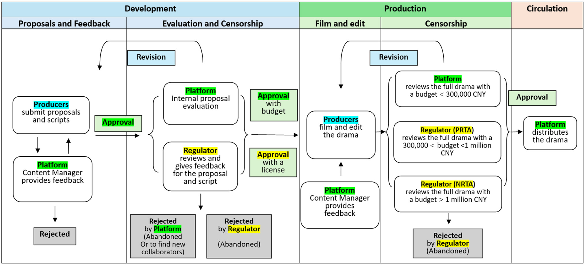

# Producing Commissioned Drama for Chinese Short Video Platforms: Power, Dependence and Creative Control

Chengyao Liu · Television & New Media · 2026-06-25

https://journals.sagepub.com/doi/full/10.1177/15274764261461453

CC BY 4.0 — https://creativecommons.org/licenses/by/4.0/

Reading edition from the publisher HTML. No original printed page numbers are asserted. The source figure and all 23 references are retained.

<!-- micro-drama-028 -->

## Abstract

<!-- micro-drama-029 -->

The production of short online dramas has grown into a significant industry in China. “Micro dramas” have evolved into a distinct genre that refers to a high-volume serial format with fast-paced individual episodes of only a few minutes duration, distributed on Chinese online video platforms. This article discusses the production structures and processes in the Chinese micro drama industry.

<!-- micro-drama-030 -->

Drawing on research combining practitioner interviews and industry observation, it maps the current production system and its key roles. Drawing on Idiz and Poell’s conceptual framework of dependence, it analyses the relationships between platforms and micro drama producers and argues that the latter’s structural dependence on the former creates creative constraints based on platforms’ commercial preferences.

<!-- micro-drama-031 -->

## Introduction

<!-- micro-drama-032 -->

Micro drama is an emerging genre that has become immensely popular on Chinese online video platforms. Primarily commissioned by Chinese short video platforms and formerly known as “short drama,” this genre is designed to compete for audience viewership to generate commercial profit.

<!-- micro-drama-033 -->

This type of drama has evolved into fast-paced narratives with individual episodes lasting tens of seconds to fifteen minutes while maintaining a continuous storyline that extends across dozens to hundreds of episodes (iResearch 2024 ; NRTA 2022 ). The online micro drama industry has achieved exceptional commercial success with a total revenue exceeding 37 billion China yuan (5.2 billion USD) in 2023 (iMedia Research 2023 ).

<!-- micro-drama-034 -->

However, media commentators from industry and academia have criticized repetition and plagiarism in content (Xinhua Daily Telegraph 2024 ) while insider reports have highlighted the overtime and intense workloads faced by micro drama producers (Huang 2024 ).

<!-- micro-drama-035 -->

By examining the production process of commissioned micro dramas in China, this paper discusses the underlying causes of these problems with a focus on the unequal power relationship between platforms and micro drama producers—referring here to a broad category of creative workers producing dramas rather than a specific position—and its impact on their work experience and the content.

<!-- micro-drama-036 -->

Most current research on micro/short drama in China focuses on content and audiences (e.g., Feng 2024 ; Tu and Chen 2024 ), with few exceptions, such as Tian’s (2024) study, which examines the production culture of commercial micro dramas, highlighting how platforms prioritize volume over quality in their commissioning strategies. However, there remains a lack of empirical research examining the industry’s production system, production process, and conditions.

<!-- micro-drama-037 -->

This paper contributes to media industry studies and media production studies providing an analysis of the Chinese micro drama industry, focusing on platform-commissioned dramas. It addresses the following questions: What are the key roles shaping micro drama production? How do power relationships between commissioners and producers shape the production process and the texts of micro dramas?

<!-- micro-drama-038 -->

This article draws on a combination of methods: interviews, ethnographic observation, and secondary data, focusing on professional producers of commissioned micro dramas.

<!-- micro-drama-039 -->

Eight semi-structured interviews were conducted with micro drama producers whose professional backgrounds represent the typical constitution of producers in the industry: (1) six independent producers, directors, and scriptwriters with a background in film and television or advertising; (2) an executive producer of micro drama from Kuaishou, also referred to in the industry as a platform content manager; and (3) an independent director who began as an amateur short video creator.

<!-- micro-drama-040 -->

Ethnographic observation of the 2024 First Micro Drama Summit in Hangzhou provided insights into the production system, regulatory policy changes, platform commissioning strategies, and the experiences of leading production companies. Observation of the production process of a micro drama uncovered the practical experiences of producers on the film set.

<!-- micro-drama-041 -->

Secondary data of industry reports from iMedia Research (2023) and iResearch (2024) are used to complement primary data collection for the analysis of the industry’s business models. This approach enabled the study to address industrial structure and the personal experiences of creative workers more comprehensively, resonating with Caldwell’s (2008 , 4) approach of cross-checking multiple sources of data and analysis to create “critical tension or dialogue” with one another.

<!-- micro-drama-042 -->

The first section of the article discusses the production system of the Chinese micro drama industry with a focus on key roles and production processes, highlighting key developments and nation-specific particularities that shape the current production system. The second part analyses the relationship between media producers and platforms.

<!-- micro-drama-043 -->

Drawing on Idiz and Poell’s (2025) framework of dependence in online screen industries, the article shows how producers’ dependence on platforms combined with platforms’ commercial priorities facilitate platform control, which constrains producers’ creative freedom and causes problematic working conditions.

<!-- micro-drama-044 -->

## Key Roles, Developments, and the Production Process

<!-- micro-drama-045 -->

Micro drama production in China over the last five years has evolved into a large industry with a clear structure of the production system. Based on the empirical data from interviews, observations, and industry reports, the key roles driving industrial developments can be summarized into three categories: commissioners, producers, and regulators. Commissioners in this industry are online video platforms.

<!-- micro-drama-046 -->

Producers are media production companies within and beyond the traditional television industry as well as professional online content creators. Regulators are the national and regional regulatory authorities that represent the National Radio and Television Administration (NRTA).

<!-- micro-drama-047 -->

This section discusses these three key roles and significant developments they have brought to the industry, helping us understand the characteristics of the current Chinese online short drama industry and the formation of power dynamics between the key roles.

<!-- micro-drama-048 -->

The first development was the business expansion of online video platforms from distribution into the commissioning of short drama content, seeking greater content variety and a broader user base for content monetization. The most influential micro drama commissioners to date are short video platforms, led by Kuaishou and Douyin from 2020, and mobile reading platforms, for example, Fanqie Novel and Dianzhong Technology from 2022 (Shenghao 2023 ).

<!-- micro-drama-049 -->

Unlike Western platforms, there is no clear separation on Chinese video-sharing platforms between user-generated content (UGC) and professionally commissioned productions. On Western platforms, UGC is typically distributed on social media entertainment sites like YouTube and TikTok, while “Hollywood-like” commissioned content appears on video-streaming services such as Netflix (Cunningham and David 2019 , 5).

<!-- micro-drama-050 -->

In contrast, Chinese short video platforms distribute both UGC and commissioned dramas through the same scrolling feed powered by algorithmic recommendations, placing amateurs and professionals in direct competition for user attention. Another particularity concerns Chinese mobile reading platforms’ transformation from online literature publishers and distributors to micro drama commissioners.

<!-- micro-drama-051 -->

They commission drama adaptations of their copyrighted online literature in serialized form on a large scale, distributed either through their own VOD platforms or mini programs on the major short video platforms. According to Ruiqing Chen, Chairman of Dianzhong Technology, the company commissions between 40 and 50 drama series monthly (Hongxing News 2024 ).

<!-- micro-drama-052 -->

The involvement of various online platforms in micro drama production created more opportunities for producers and had a profound influence on the evolution of genre and business models in this industry.

<!-- micro-drama-053 -->

The second development concerns the background of producers in this industry, which has become increasingly diverse. Producers can be grouped roughly into three categories: traditional film and television professionals, producers from other creative sectors such as advertising, and former amateur content creators who have become drama producers. One of the key reasons that drove most of them to become micro drama producers was a shift in demand.

<!-- micro-drama-054 -->

As one producer explained regarding his shift to micro dramas, competition in longer online drama forms had become increasingly difficult by the late 2010s, limiting production opportunities to large commercial projects, while the expansion of online video platforms into micro-drama commissioning offered new opportunities.

<!-- micro-drama-055 -->

Furthermore, the rise of Chinese short video platforms not only attracted a large number of users but also led audiences to favor shorter content with fast-paced narratives, leading to a significant increase in demand for micro drama production. Lower budgets and a shorter production timeframe of micro dramas allowed platforms to invest in a large number of commissioned projects and launch programs online within a month to achieve commercial benefits quickly.

<!-- micro-drama-056 -->

This production model required fewer professional TV production skills and smaller production crews and placed importance on a producer’s ability to understand and incorporate current trends in short videos (Tian 2024 ). Therefore, these shifts attracted a wide range of producers, bringing their diverse skills and understandings of cultural and commercial values to micro drama production.

<!-- micro-drama-057 -->

The third development relates to government regulation for the sector. While the industry expanded rapidly in terms of content, revenue and labor, numerous problems also emerged, including vulgar content, plagiarism, and nontransparent payment rules for audiences (Xinhua Daily Telegraph 2024).

<!-- micro-drama-058 -->

To incorporate the emerging industry in the system of official regulation, NRTA (2022) renamed the broad and vague genre from “Duanju” (short drama) into the official term “Wangluo Weiduanju” (online micro drama) with a clearer definition of their characteristics. The change in regulatory policy enabled the NRTA to exert some control over who can produce and distribute what content.

<!-- micro-drama-059 -->

NRTA introduced a standard procedure of content regulation (see Figure 1 ) and license requirements for production and distribution of micro dramas to improve production quality (NRTA 2024 ). Applying for licenses requires companies to have employees with professional qualifications and experience. Therefore, it restricted the right to produce micro dramas to professionals, separating amateur content creators from professionals at the production level since 2024.

<!-- micro-drama-060 -->

The rigorous regulation process has increased financial risks for commissioned projects, as failure to pass the regulatory procedure can lead to abandonment of projects and financial losses, which in turn impacts the relationship between producers and commissioners.

<!-- micro-drama-061 -->

Figure 1. The production process of platform-commissioned micro drama.

<!-- micro-drama-062 -->

The fourth major development concerns micro drama as a genre. The dominant format for micro dramas was developed to suit short video platforms’ conventions, utilizing a vertical-screen format and long-running series with episodes lasting only one to two minutes. It contains elements from popular dramatic short videos, such as the expression of exaggerated emotions by characters, frequent plot twists, and a cliffhanger at the end of each episode.

<!-- micro-drama-063 -->

A smaller number of horizontally shot micro dramas are still being commissioned, but primarily to satisfy the demand of a specific group of platform users for distinctive visual esthetics such as fantasy or traditional Chinese styles, according to the Executive Producer from Kuaishou I interviewed. Mobile reading platforms as commissioners also had a significant impact on the genre’s evolution since 2022.

<!-- micro-drama-064 -->

Their dramas, adapted from online literature, are commonly referred to as “mini-program dramas” within the micro drama industry. These dramas gradually evolved into a distinct sub-genre characterized by a narrative style that is rooted in the combination of online literature and short videos. They often feature popular themes such as revenge and romance, intense emotions and a satisfying dramatic ending, which has significantly influenced the popular content of micro dramas overall (Shenghao 2023 ).

<!-- micro-drama-065 -->

The above interconnected developments gradually established a standardized production process for commissioned micro drama since 2022. Based on interview data, Figure 1 illustrates the standard process for most platform-commissioned micro dramas from proposal to audience viewing. It consists of three main stages: development, production and circulation, with censorship procedures as part of the development and production stages.

<!-- micro-drama-066 -->

The term “censorship” here refers to regulatory procedure in which regulators and platforms review the content and either suggest changes or reject the project. The development stage of Chinese short drama has similarities with some Western TV commissioning systems, such as the British one (see Zoellner 2022 , 591). However, particularities concerning evaluation and censorship in development and production stages in China increase commissioners’ and regulator’s power in content decision making.

<!-- micro-drama-067 -->

This can increase production time and financial uncertainty for producers during the development and production stages, while mitigating financial risks during circulation, including the possibility of failing to satisfy platform demands or being banned for violating regulatory policies.

<!-- micro-drama-068 -->

The influence of platforms extends throughout the entire production process and significantly shapes the final output. During the development stage, producers need to submit the proposal simultaneously to both the platform and the regulator and get approval from both. Even if a proposal has been approved and granted a license by the NRTA or Provincial regulator (PRTA), it still needs to successfully pass the platform’s internal evaluation to get production approval and funding.

<!-- micro-drama-069 -->

In the production stage, producers must adhere to the feedback provided by the platform before submitting the full drama to the regulator for the final review and getting permission for online distribution. For projects with a production budget of less than 300,000 CNY (around 40,000 USD), the platform is allowed to examine the program and insist on changes, instead of the regulator. This process further increases platforms’ power over creative decision-making in the micro drama commissioning process.

<!-- micro-drama-070 -->

Although the regulator has influence over whether a project can be produced, it is the producers who provide the initial ideas whilst platforms select and shape the commissioned work. The following section focuses on power relationships between producers and commissioners, rather than regulators. It explores how the power imbalance and the emphasis on commercial goals in the production process have restricted the creative freedom of producers.

<!-- micro-drama-071 -->

## Dependence, Economics, and Creativity in the Platform Commissioning System

<!-- micro-drama-072 -->

The commissioning process outlined above highlights the financial and structural dependence of micro drama producers on platforms. Concerns over such dependence have been raised in literature on independent film and television production. For example, the commissioning system in the UK’s television industry was found to shift creative control to network commissioners with their preferences shaping content rather than independent production companies (Zoellner 2022 ).

<!-- micro-drama-073 -->

In addition, content visibility in the online screen industries is increasingly shaped by user data and algorithmic recommendation mechanisms, raising concerns about platforms prioritizing popularity and commercial value over other creative and artistic input (Caplan and Gillespie 2020 ; Duffy and Meisner 2023 ). This further affects who gets the chance to produce, and which types of content are more likely to receive investment.

<!-- micro-drama-074 -->

In this section, I explore such concerns for micro drama production and investigate how the power relationship between commissioners and producers influences the production process that shapes the text and the working conditions for producers. I draw on Idiz and Poell’s outline of four main types of dependence in global online screen industries to assist in the analysis: (1) access to data, (2) algorithmic curation, (3) contractual relations, and (4) monetization (Idiz and Poell 2025 , 375).

<!-- micro-drama-075 -->

This framework is applied because it focuses on analyzing dependence from the “perspective of cultural producers,” in an effort to capture the challenges faced by producers across global online screen industries (Idiz and Poell 2025 , 377).

<!-- micro-drama-076 -->

This paper compares micro drama producers’ experience of dependence in China to Idiz and Poell’s findings, arguing that platforms’ business models for monetizing commissioned micro dramas, and their reliance on success metrics and algorithmic curation, limit producers’ creativity and exacerbate economic disparities and contractual dependence between producers and platforms.

<!-- micro-drama-077 -->

The development of business models plays an essential role in monetization within the Chinese micro drama industry. Lotz (2022) argues that different SVOD business models can lead to different metrics of success and funding strategies aimed at achieving company objectives. The business models in the Chinese micro drama industry not only reinforces this argument but also reflects two types of success metrics and related funding strategies through which platforms pursue commercial interests.

<!-- micro-drama-078 -->

For short video platforms, the primary goal of commissioning micro dramas is to attract target audiences to the platform.

<!-- micro-drama-079 -->

The Kuaishou’s Executive Producer explained their commissioning strategy as follows: “What we think about is what new content to create that our users will like more and that will have an advantage when promoted by our algorithm.” These dramas on short video platforms are usually free to view with advertisements, though some programs require a one-time payment as part of the platform’s commercial experiments. This means that every “view” creates revenue.

<!-- micro-drama-080 -->

Therefore, their metrics of success are based on the number of views. In contrast, mini-program dramas adapted from online literature adopt a combination of subscription and one-off payment business models. The first few episodes are available for free, but key plot points at specific stages, such as the tenth and fiftieth episodes, require one-off payments to unlock subsequent episodes.

<!-- micro-drama-081 -->

Repeated views, therefore, do not contribute to revenue; rather, it is the amount of audience payment that determines the success of the drama. These monetization strategies shape the contractual and funding arrangements for producers.

<!-- micro-drama-082 -->

The distinct feature of micro drama industry’s contractual arrangements is collaborative production models situated between the “hosting model” and the “commissioning model” in Idiz and Poell’s (2025 , 385–86) findings. These collaborative models have relatively flexible contractual arrangements, determining the ownership of IP rights, the amount of production funding and the residuals.

<!-- micro-drama-083 -->

Data from industry reports and interviews suggest that the main differences between these arrangements lie in: (1) who owns the script, and (2) who provides the production funding and in what proportion.

<!-- micro-drama-084 -->

In a commissioned drama where the platform provides the script and full production budget and recruits producers for filming and editing, the platform company owns the copyright of the program (iResearch 2024 ). This is more common for mini-program dramas adapted from online literature. The model is similar to the “work-for-hire” model mainly used by global streaming TV services with US origins, featuring a one-time payment and no residual fee for producers (see Lacourt et al. 2023 , 19).

<!-- micro-drama-085 -->

Micro drama producers must follow the platform’s creative decisions under this contractual agreement, and directors have no autonomy to revise the script.

<!-- micro-drama-086 -->

If, on the other hand, the producers provide the script and license it to a platform, they retain the copyright. This is usually seen in original quality dramas commissioned by short video platforms. According to Kuaishou’s Executive Producer, the platform holds “permanent but non-exclusive rights” to most commissioned works. This grants the platform perpetual distribution rights while allowing producers to retain syndication copyrights after the exclusivity period on the commissioner’s platform expires.

<!-- micro-drama-087 -->

There are two kinds of payment methods for producers in this situation. A common one is that producers receive a production budget plus residual payments based on the number of views. However, this residual payment is irregular and constitutes a very small percentage. As micro drama director Si Ge explained in the interview: “Think of it as using platform funding to turn your imagination into reality. If it makes a profit, that is great.

<!-- micro-drama-088 -->

If not, at least it made a dream come true.” Alternatively, producers invest a portion of the budget; they then own the copyright, and the proportion of revenue they receive from the platform increases to approximately 3 to 10% (iResearch 2024 ), which is still comparatively low.

<!-- micro-drama-089 -->

As the founder of Xi’an Fengxing Media Production Company advised in his presentation at the industry summit in 2024, producers should take the production fees as the primary source of income rather than putting their hope on the unpredictable residuals. This situation suggests that a contractual arrangement that allows producers to obtain IP rights can help producers gain more creative freedom.

<!-- micro-drama-090 -->

However, it is still difficult for them to negotiate a contract deal favoring them, risking that a higher investment may not pay off. As most media production companies that create micro dramas are small enterprises (iResearch 2024 ), their resources to invest are limited, and their financial dependence on platforms weakens their position in contractual relationships.

<!-- micro-drama-091 -->

Algorithmic curation is another important source of dependence in the micro drama industry. Previous studies suggest that cultural producers’ lack of control over algorithmic curation negatively impacts their ability to negotiate contracts, particularly regarding issues of visibility and data transparency (Idiz and Poell 2025 ).

<!-- micro-drama-092 -->

Short video platforms in China have not only influenced the visibility of content but also developed data traffic marketing tools like Dou+ to monetize the affordance of content visibility (Huang and Ye 2024 ). To gain a competitive advantage, Kuaishou and Douyin actively leveraged this affordance by providing free data traffic support for collaborative projects to increase audience engagement (Newbc 2024 ).

<!-- micro-drama-093 -->

According to Kuaishou’s Executive Producer, “‘Traffic support’ means we [the platform] recommend content to users, who are likely to be interested. If the video starts getting more views on its own without us pushing it, we see greater potential in the content and allocate even more recommended traffic.” This business strategy relieved producers of the financial burden of purchasing the service themselves to mitigate the risk of uncertain visibility.

<!-- micro-drama-094 -->

However, it also strengthened the platforms’ power in contractual relations through controlling their circulation resources. Several producers interviewed for this research mentioned a consensus within the industry in 2024 that, without free algorithmic curation support, a mini-program drama to be profitable typically needs to invest around ten times its production costs in purchasing third-party data traffic services for online marketing.

<!-- micro-drama-095 -->

The significant financial pressure of online marketing leads to prioritization of funding for marketing over production and commercial profit over production quality, contributing to excessive workloads caused by low budgets and short production time.

<!-- micro-drama-096 -->

Access to data is another source of dependence for producers in the online screen industry with platforms becoming the “gatekeeper” of viewing data. Access to data is important for producers, because it helps them analyze their content’s performance, inform creative decisions and strengthen their arguments in contract negotiations (Idiz and Poell 2025 , 7).

<!-- micro-drama-097 -->

Producers of commissioned dramas on Chinese short video platforms can access real-time viewing statistics through the account’s background, as these dramas are uploaded on the platforms like other short video content.

<!-- micro-drama-098 -->

However, from interviewees’ experience, the data they can access is limited and mainly refers to the percentage of viewers, who continue watching the video at specific times (e.g., the third, fifth, and tenth second), creating an information deficit in platforms’ favor and restricting producers’ ability to analyze and understand the performance of their work.

<!-- micro-drama-099 -->

The above sources of dependence shape producers’ creative freedom. The evaluation of proposals during the production process, carried out by content managers in collaboration with other platform departments, plays a critical role in ensuring that selected projects align with the platform’s commercial goals (Figure 1 ).

<!-- micro-drama-100 -->

Interviewees report that content managers would invite staff from business and marketing sectors to “rate” the micro drama projects together in the internal evaluation as the base for final decisions about budget and promotional support. Producers have to take content managers’ advice to incorporate popular elements into the script to pass the evaluation and acquire funding. For example, director Si Ge was required to revise a script that originally focused on mutual support among women.

<!-- micro-drama-101 -->

She had to follow the content manager’s suggestions, adding a male character and romantic subplots involving him and the female protagonist, to get the proposal approved and secure production funding. This demonstrates how platforms exert creative control through funding allocation, favoring projects with popular elements to minimize financial risk.

<!-- micro-drama-102 -->

This challenge is even more pronounced in mini-program drama production, whose monetization model promotes formulaic storytelling with frequent plot twists and cliffhangers to drive payments for unlocking later episodes (Feng 2024 ; Tian 2024 , 93). Overall, producers’ dependence on platforms combined with the latter’s commercial priorities restrict producers’ creative freedom and disadvantage them in negotiations for better revenue and working conditions.

<!-- micro-drama-103 -->

## Conclusion

<!-- micro-drama-104 -->

This paper investigates the power relationships and platform dependence in the commissioning of micro dramas by analyzing key roles, industry developments and production processes. Drawing on Idiz and Poell’s (2025) conceptual framework, it examines how interconnected sources of dependence similarly and differently impact power dynamics in the micro drama industry.

<!-- micro-drama-105 -->

While this research focuses on a specific genre within contemporary mainland China, the findings highlight how structural economic dependence leads to a power imbalance as commissioners influence creative decision-making to prioritize commercial benefit. These observations on financial and contractual dependence, and their impact on production, align with findings from similar studies in other cultural contexts (Lee 2018 ; Zoellner 2022 ).

<!-- micro-drama-106 -->

At the same time, it highlights distinctions unique to the Chinese micro drama industry, including regulatory policy changes, the emergence of algorithm-centered platform commissioning, and online literature adaptations. Algorithmic curation has granted short video platforms and data traffic service providers substantial control over content circulation. This has adversely affected creative workers, compressing their income and production time to prioritize marketing aimed at mitigating commercial risks.

<!-- micro-drama-107 -->

Policy adds another layer to the already high levels of uncertainty and risk typical for the media industries (Hesmondhalgh 2026 ). While not discussed in detail here, regulatory requirements present an additional influence on creative choices, which deserve further attention.

<!-- micro-drama-108 -->

The power imbalance and dependence favoring platforms and their creative choices explain why producers often have to sacrifice their creative freedom to align with the platform’s commercial interests. Platforms’ commissioning practice is dominated by the perceived commercial potential of a project aiming to increase viewership and payments. This situation deteriorates working conditions for micro drama producers, undermining the sustainability of this emerging industry.

<!-- micro-drama-109 -->

This paper thus encourages future research, policymakers, and industry practitioners to explore and foster a more equal producer–platform relationship that can support the creation of diverse, creative, and meaningful drama content.

<!-- micro-drama-110 -->

## Acknowledgments

<!-- micro-drama-112 -->

The author would like to thank her PhD supervisors Dr. Anna Zoellner and Prof. David Hesmondhalgh and the editors of this special issue for their helpful comments and suggestions to improve this paper, and for their kind support throughout the whole publication process.

<!-- micro-drama-113 -->

## Ethical Considerations

<!-- micro-drama-115 -->

The AHC Research Ethics Review Committee at University of Leeds approved interviews and ethnographic observations (approval: FAHC 22-147) on September 18, 2023. Respondents gave written consent for review and signature before starting interviews and the observation of the filming process of a micro drama, and a verbal consent before starting the observation of the industry conference.

<!-- micro-drama-116 -->

## Consent to Participate

<!-- micro-drama-118 -->

All participants provided informed consent prior to their inclusion in the study. Written consent was obtained from each participant after they were given a detailed information sheet about the study’s purpose, procedures, potential risks, and benefits. The consent form and information sheet of this study were approved by the AHC Research Ethics Review Committee at University of Leeds (approval: FAHC 22-147).

<!-- micro-drama-119 -->

## Consent for Publication

<!-- micro-drama-121 -->

Participants provided written consent for the publication of anonymized data collected during the study. No identifiable information from participants who chose to remain anonymous has been included.

<!-- micro-drama-123 -->

## Declaration of Conflicting Interests

<!-- micro-drama-125 -->

The author declared no potential conflicts of interest with respect to the research, authorship, and/or publication of this article.

<!-- micro-drama-126 -->

## Funding

<!-- micro-drama-128 -->

The author disclosed receipt of the following financial support for the research, authorship, and/or publication of this article: This article includes data collected during the author’s PhD research, which was jointly supported by the University of Leeds and the China Scholarship Council through a PhD scholarship. The authorship and publication of this article were not financially supported by any funding agency.

<!-- micro-drama-130 -->

## ORCID iD

<!-- micro-drama-132 -->

Chengyao Liu https://orcid.org/0000-0003-1616-7860

<!-- micro-drama-133 -->

## Data availability statement

<!-- micro-drama-134 -->

The primary data generated from interviews and observation and/or analyzed during the current study are not publicly available due to their containing information that could compromise the privacy and anonymity of research participants. However, the data that support the findings of this study are available from the corresponding author, C.L., upon reasonable request and subject to a non-disclosure agreement and relevant ethics committee approval.

<!-- micro-drama-135 -->

All the secondary data generated or analyzed during this study are included in this published article.

<!-- micro-drama-136 -->

## References

<!-- micro-drama-138 -->

Caldwell John Thornton. 2008. Production Culture: Industrial Reflexivity and Critical Practice in Film and Television. Duke University Press.

<!-- micro-drama-144 -->

Caplan Robyn, Tarleton Gillespie. 2020. “Tiered Governance and Demonetization: The Shifting Terms of Labor and Compensation in the Platform Economy.” Social Media + Society 6 (2): 205630512093663.

<!-- micro-drama-151 -->

Cunningham Stuart, Craig David. 2019. Social Media Entertainment: The New Intersection of Hollywood and Silicon Valley. Vol. 7. NYU Press.

<!-- micro-drama-155 -->

Duffy Brooke Erin, Colten Meisner. 2023. “Platform Governance at the Margins: Social Media Creators’ Experiences With Algorithmic (In)Visibility.” Media Culture & Society 45 (2): 285–304.

<!-- micro-drama-162 -->

Feng Xiao. 2024. “Shipin Pingtai Weiduanju de Xushi Chenggui Ji Chuangxin Lujing Tansuo [Exploration of Narrative Conventions and Innovative Paths for Micro Dramas on Video Platforms].” China Television 5: 54–60.

<!-- micro-drama-166 -->

Hesmondhalgh David. 2026. The Cultural Industries. 5th ed. Sage.

<!-- micro-drama-169 -->

Hongxing News. 2024. “Weilai, Wei Duanju Duibiao De Yiding Shi Dianying’│Duihua Dianzhong Keji Chen Ruiqing” [‘In the Future, Micro-Short Dramas Will Definitely Be Benchmarked Against Movies’│Dialogue with Chen Ruiqing of Dianzhong Technology]. Ifeng.com, April 9. https://news.ifeng.com/c/8Ye90siraPz .

<!-- micro-drama-172 -->

Huang Wenbin. 2024. “Women Laozuo Zai Cusi de Bianyuan: Duanju Congyezhe de Zishu” [We Work on the Edge of Sudden Death: The Self-Report of the Short Drama Practitioner]. Jiemian.com, February 2024. https://m.jiemian.com/article/10842986.html .

<!-- micro-drama-175 -->

Huang Yang, WeiMing Ye. 2024. “‘Traffic Rewards’, ‘Algorithmic Visibility’, and ‘Advertiser Satisfaction’: How Chinese Short-Video Platforms Cultivate Creators in Stages.” Convergence: The International Journal of Research into New Media Technologies 30 (1): 659–82.

<!-- micro-drama-183 -->

Idiz Daphne Rena, Thomas Poell. 2025. “Dependence in the Online Screen Industry.” Media Culture & Society 47: 375–93.

<!-- micro-drama-190 -->

iMedia Research. 2023. “China Micro Drama Market Research Report 2023-2024.” Sina Finance, November 22. https://t.cj.sina.com.cn/articles/view/1850460740/6e4bca44019010ykj?finpagefr=p_104 .

<!-- micro-drama-194 -->

iResearch. 2024. “2024 China Short Drama Industry Research Report.” iResearch.Cn. June. https://pdf.dfcfw.com/pdf/H3_AP202407071637643449_1.pdf

<!-- micro-drama-197 -->

Lacourt, Amélie, Justine Radel-Cormann, and Sophie Valais. 2023. Fair Remuneration for Audiovisual Authors and Performers in Licensing Agreements. European Audiovisual Observatory. Council of Europe. https://rm.coe.int/iris-plus-2023-03en/1680adec3c .

<!-- micro-drama-201 -->

Lee David. 2018. Independent Television Production in the UK. Springer EBooks. Springer Nature.

<!-- micro-drama-206 -->

Lotz Amanda D. 2022. Netflix and Streaming Video: The Business of Subscriber-Funded Video on Demand. John Wiley & Sons.

<!-- micro-drama-210 -->

Newbc. 2024. “Gei Qian Gei Liuliang, Douyin Kuaishou Tongyitian Fabu Duanju Fuchi Zhengce!” [Give Money and Data Traffic, Douyin Kuaishou Released Short Drama Support Policies on the Same Day!]. 163.com, July 19. https://www.163.com/dy/article/J7FU8DPF0552POWV.html .

<!-- micro-drama-213 -->

NRTA. 2022. “Notice from the General Office of the National Radio and Television Administration on Further Strengthening the Management of Online Micro-Short Dramas and Implementing the Creative Improvement Plan” www.gov.cn, November 14. https://www.gov.cn/zhengce/zhengceku/2022-12/27/content_5733727.htm .

<!-- micro-drama-216 -->

NRTA. 2024. “Notice of the General Office of the NRTA on Further Coordinating Development and Safety to Promote the Healthy and Prosperous Development of the Online Micro Drama Industry.” Nrta.gov.cn. https://www.nrta.gov.cn/art/2025/2/5/art_113_70148.html .

<!-- micro-drama-219 -->

Shenghao. 2023. “Weishenmo Xi’an Neng Chengwei Xiaochengxuju de Zhizuo Zhongzhen? Zhuan Fang [Why Has Xi’an Become a Production Hub for Mini-Program Short Dramas? An Interview].” Yule Ziben Lun [Entertainment Capital]. October 19. https://news.qq.com/rain/a/20231019A04V2700

<!-- micro-drama-222 -->

Tian Yuan. 2024. “Gig-Workers’Sets: The Integration and Substitution Practice of the Short Drama Industry for Digital Content Production and the Rise of the Gig Professional Content Production Model.” Social Science in Nanjing 7: 89–99.

<!-- micro-drama-226 -->

Tu Yan, Yuanchun Chen. 2024. “Zhongguoshi Xiandaihua Shiyuxia WangluoWeiduanju de Shenmei Chuangxin [Aesthetic Innovation of Online Short Dramas Under the Perspective of Chinese Modernization].” Contemporary TV 2: 11–8.

<!-- micro-drama-229 -->

Xinhua Daily Telegraph. 2024. “Weiduanju Liuliang Henda Yinyou Buxiao” [The Popularity of Short Dramas Has Hidden Concerns]. Xinhuanet, September 27. http://mrdx.xinhuanet.com/20240927/ae981d486a7946c08edf953028c1dd42/c.html .

<!-- micro-drama-233 -->

Zoellner Anna. 2022. “Commissioning and independent television production: Power, risk and creativity.” International Journal of Communication 16 (2022): 585–603.

<!-- micro-drama-235 -->

## Biographies

<!-- micro-drama-237 -->

Chengyao Liu is a PhD candidate in the School of Media and Communication at the University of Leeds. Her PhD research examines the opportunities and challenges of professional video production on Chinese online video-sharing platforms, with a focus on the evolving work experiences of media producers.

## Editorial notes

制作者（producer）按作者定义泛指创意工作者，不统一窄化为制片人；commissioner 译委托方；algorithmic curation 译算法筛选与编排；residuals 依本行业语境译后续收益分成。

作者姓名 Chengyao Liu、受访者 Si Ge 及未经核实的中文姓名保留原拼写。参考文献中的中文译名用于释义；未将其声称为逐项核验的原始中文题名。

原文正文的 Cunningham and David 2019 与书目列示的 Cunningham Stuart, Craig David 不一致。英文照录，中文正文沿用原引文标识；未静默改写。

原文正文将 Idiz and Poell 2025 的一处引文页码写为7，其他地方采用期刊页码375—393，均照录。

原书目 NRTA 2024 所附链接路径含2025/2/5；NRTA 2022的标示日期与链接路径日期不同。本版保留原书目，不擅自统一。政策描述反映作者研究时点，不表示对当前法规的独立确认。

图1保留原图。其预算区间使用严格大于或小于符号，未交代恰好30万元或100万元的归属；译图中文字时同样保留，不自行补齐。

原文没有单列编号脚注，采用作者—年份引文。参考文献23条全部保留，英文书目中的原有拼写和页码不静默更正。

图内文字对照（译者附）：Development＝开发；Production＝制作；Circulation＝传播；Proposals and Feedback＝方案与反馈；Evaluation and Censorship＝评估与审查；Film and edit＝拍摄与剪辑；Censorship＝审查；Revision＝修改。制作者提交方案与剧本；平台内容经理提供反馈；平台进行内部方案评估；监管者审核方案与剧本并反馈。平台批准并提供预算；监管者批准并发放许可证。平台拒绝时，放弃项目或寻找新合作方；监管者拒绝时，放弃项目。制作者拍摄和剪辑，平台内容经理提供反馈。平台审查预算低于人民币30万元的完整剧集；省级监管者（PRTA）审查预算大于30万元且小于100万元的完整剧集；国家监管者（NRTA）审查预算大于100万元的完整剧集。批准后由平台发行；监管者拒绝则放弃项目。
