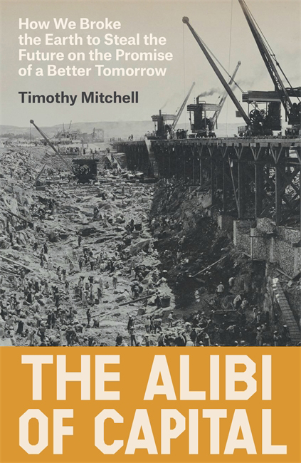
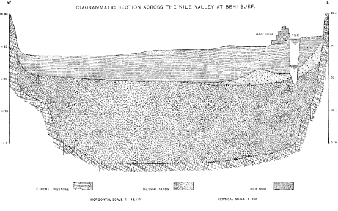
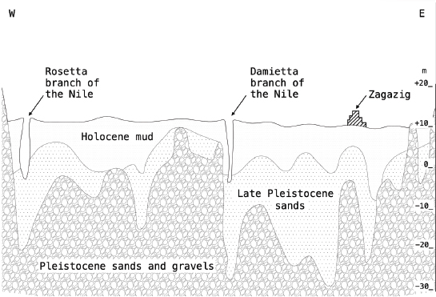
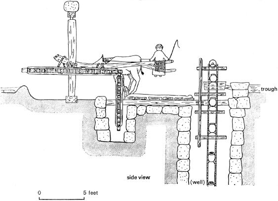
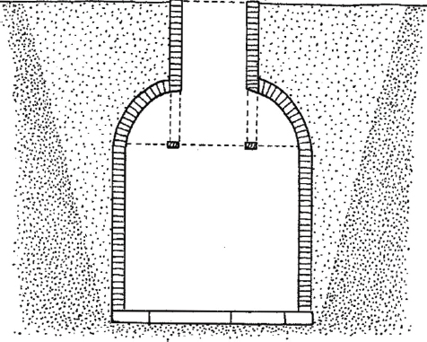

# 资本的托词

校订阅读版；原书页位、853条原注、4幅正文图及英文索引保留。72条校注与原注分列。原著及图像权利归原权利人；非出版社官方译本。

# 原书封面

# 前置材料

〔原书第i页〕

〔原书第i页〕

## 资本的托词

## The Alibi of Capital

〔原书第ii页〕

〔原书第ii页〕

〔原书第iii页〕

〔原书第iii页〕

## 资本的托词：我们如何以“明天会更好”的承诺，毁掉地球，窃取未来

## The Alibi of Capital How We Broke the Earth to Steal the Future on the Promise of a Better Tomorrow

蒂莫西·米切尔（Timothy Mitchell）

Timothy Mitchell

〔原书第iv页〕Verso 于 2026 年首次出版

〔原书第iv页〕First published by Verso 2026

© 蒂莫西·米切尔 2026

© Timothy Mitchell 2026

版权所有，保留一切权利

All rights reserved

面向欧盟的产品安全（GPSR）制造商授权代表为 LOGOS EUROPE，地址：9 rue Nicolas Poussin, 17000, La Rochelle, France

The manufacturer’s authorized representative in the EU for product safety (GPSR) is LOGOS EUROPE, 9 rue Nicolas Poussin, 17000, La Rochelle, France

[Contact@logoseurope.eu](mailto:Contact@logoseurope.eu)

[Contact@logoseurope.eu](mailto:Contact@logoseurope.eu)

作者已声明其精神权利。

The moral rights of the author have been asserted

1 3 5 7 9 10 8 6 4 2

1 3 5 7 9 10 8 6 4 2

**Verso**

**Verso**

英国：6 Meard Street, London W1F 0EG

UK: 6 Meard Street, London W1F 0EG

美国：207 East 32nd Street, New York, NY 10016

US: 207 East 32nd Street, New York, NY 10016

[versobooks.com](http://versobooks.com)

[versobooks.com](http://versobooks.com)

Verso 是新左翼图书（New Left Books）的出版品牌

Verso is the imprint of New Left Books

ISBN-13: 978-1-83674-227-2

ISBN-13: 978-1-83674-227-2

ISBN-13: 978-1-83674-230-2（美国电子版）

ISBN-13: 978-1-83674-230-2 (US EBK)

ISBN-13: 978-1-83674-229-6（英国电子版）

ISBN-13: 978-1-83674-229-6 (UK EBK)

**大英图书馆在版编目数据**

**British Library Cataloguing in Publication Data**

本书的编目记录可从大英图书馆获取

A catalogue record for this book is available from the British Library

**美国国会图书馆在版编目数据**

**Library of Congress Cataloging-in-Publication Data**

本书的编目记录可从美国国会图书馆获取

A catalog record for this book is available from the Library of Congress

〔原书第v页〕献给约翰、克里斯、尼克、安特和玛丽〔原书第vi页〕

〔原书第v页〕To John, Chris, Nick, Ant, and Mary〔原书第vi页〕

〔原书第vii页〕

〔原书第vii页〕

## 目录

## Contents

〔原书第viii页〕

〔原书第viii页〕

# 致谢

〔原书第ix页〕

〔原书第ix页〕

## 致谢

## Acknowledgements

十多年来，我有机会在公开讲座和研讨会上发展本书的想法。我感谢所有邀请和接待我的人，也感谢许多贡献了思考的评论人和参与者。这些场合包括：巴黎政治学院 AIME 工作坊，2014 年；西悉尼大学“知识、文化、经济”会议，2014 年；牛津大学环境变化研究所，2014 年；卢塞恩大学人文与社会科学研究生院，2014 年；哥本哈根大学埃斯特·博塞鲁普奖讲座，2015 年；威廉姆斯学院 Log Luncheon，2015 年；加州大学欧文分校全球和平与冲突研究中心，2015 年；牛津大学全球史中心，2016 年；卫斯理大学人文中心，2017 年；科尔盖特大学里丁讲座（Reading Lecture），2017 年；卡内基梅隆大学“能源文化”会议，2017 年；哈佛大学全球史研讨班，2017 年和 2024 年；威尼斯圣乔治对话，2017 年；新学院罗伯特·L. 海尔布隆纳资本主义研究中心，2017 年；柏林马克斯·普朗克科学史研究所，2017 年；加州大学圣巴巴拉分校梅隆·索耶“全球视野下的能源正义”研讨班，2018 年；卡塔尔多哈研究生院，2018 年；西北大学克洛普斯特格讲座，2018 年；比尔宰特大学易卜拉欣·阿布-卢戈德国际研究所，2018 年；哈佛大学“多重碳”工作坊，2019 年；巴斯大学全球政治研究所，2019 年和 2020 年；坎帕拉马凯雷雷社会研究所，2020 年；埃克塞特大学海湾研究中心，2022 年；伦敦大学亚非学院沃尔特〔原书第x页〕·罗德尼历史研究集体，2022 年；隆德大学人类生态学系，2023 年；奥斯陆大学埃勒特·松特讲座，2024 年；斯德哥尔摩皇家理工学院“群岛讲座”，2024 年。

Over more than a decade, I have had the opportunity to develop the ideas for this book in public lectures and seminars. I am grateful to all those who invited and hosted me and to the many commentators and participants who contributed their thoughts. The occasions include the AIME Workshop, Sciences Po, Paris, 2014; the Knowledge Culture Economy conference, University of Western Sydney, 2014; the Environmental Change Institute, Oxford, 2014; the Graduate School of Humanities and Social Sciences, University of Lucerne, 2014; the Ester Boserup Prize Lecture, University of Copenhagen, 2015; the Log Luncheon, Williams College, 2015; the Center for Global Peace and Conflict Studies, UC Irvine, 2015; the Oxford Centre for Global History, 2016; the Center for the Humanities, Wesleyan University, 2017; the Reading Lecture, Colgate University, 2017; the Cultures of Energy conference, Carnegie Mellon University, 2017; the Harvard Global History Seminar, 2017 and 2024; the Dialogue of San Giorgio, Venice, 2017; the Robert L. Heilbroner Center for Capitalism Studies, the New School, 2017; the Max Planck Institute for the History of Science, Berlin, 2017; the Mellon Sawyer Seminar on Energy Justice in Global Perspective, UC Santa Barbara, 2018; the Doha Institute for Graduate Studies, Qatar, 2018; the Klopsteg Lecture, Northwestern University, 2018; the Ibrahim Abu-Lughod Institute of International Studies, Birzeit University, 2018; the Multiple Carbons workshop, Harvard University, 2019; the Institute for Global Politics, University of Bath, 2019 and 2020; the Makerere Institute of Social Research, Kampala, 2020; the Centre for Gulf Studies, University of Exeter, 2022; the Walter 〔原书第x页〕Rodney Collective for Historical Research, SOAS University of London, 2022; the Human Ecology Division, Lund University, 2023; the Eilert Sundt Lecture, University of Oslo, 2024; and the Archipelago Lecture, KTH Stockholm, 2024.

本书有两章是先前发表的文本的修订版。[第五章](#ch05-0001)的较早版本曾发表于 Leela Gandhi 和 Deborah Nelson 编的‘Around 1948: Interdisciplinary Approaches to Global Transformation’，*Critical Inquiry*，40: 4，2014 年。[第六章](#ch06-0001)最初发表于 Donald MacKenzie、Fabian Muniesa 和 Lucia Siu 编的 *Do Economists Make Markets? On the Performativity of Economics*，Princeton University Press，2008 年。另外三章的片段也曾以印刷或网络形式发表：导论的部分内容发表于 ZKM 艺术与媒体中心 2020 年于卡尔斯鲁厄举办的展览图录 *Critical Zones: The Science and Politics of Landing on Earth*，由 Bruno Latour 和 Peter Weibel 编，MIT Press，2020 年；[第七章](#ch07-0001)的部分内容曾以网络形式发表于 New Silk Roads，*e-flux architecture*，2020 年 1 月；[第八章](#ch08-0001)的部分内容以‘The Great EconoCon: Climate Crisis and the Misconception of Growth’为题发表于 *Critical Times*，9: 1–2（2026）。我感谢各位编辑和出版社允许我重新使用这些材料。

Two of the chapters of this book are revised versions of previous publications. An earlier version of [chapter 5](#ch05-0001) appeared in ‘Around 1948: Interdisciplinary Approaches to Global Transformation’, edited by Leela Gandhi and Deborah Nelson, *Critical Inquiry*, 40: 4, 2014. [Chapter 6](#ch06-0001) was originally published in *Do Economists Make Markets? On the Performativity of Economics*, edited by Donald MacKenzie, Fabian Muniesa, and Lucia Siu, Princeton University Press, 2008. Excerpts from three other chapters have also previously appeared in print or online: parts of the introduction were published in a catalogue for a 2020 exhibition at the ZKM Center for Art and Media, Karlsruhe, *Critical Zones: The Science and Politics of Landing on Earth*, edited by Bruno Latour and Peter Weibel, MIT Press, 2020; sections of [chapter 7](#ch07-0001) appeared previously online in New Silk Roads, *e-flux architecture*, January 2020; and parts of [chapter 8](#ch08-0001) as ‘The Great EconoCon: Climate Crisis and the Misconception of Growth’, *Critical Times*, 9: 1–2 (2026). I thank the editors and publishers for allowing me to reuse this material.

在 Verso 出版社，编辑总监 Sebastian Budgen 多年来一直鼓励这个项目。我感谢他、制作编辑 Nick Walther 以及出版社全体工作人员所做的工作。我还有幸得到几位研究助理的帮助：Rosa Klein-Baer、Dalia Ghaith、Rebecca Glade、Naye Idriss 和 Noam Chen-Zion。他们对本书写作的贡献弥足珍贵。

At Verso Books, the editorial director Sebastian Budgen has encouraged this project for many years. I am grateful to him, the production editor, Nick Walther, and all the staff at the press for their work. I was also fortunate to have the help of a series of research assistants: Rosa Klein-Baer, Dalia Ghaith, Rebecca Glade, Naye Idriss, and Noam Chen-Zion. Their input to the writing of the book was invaluable.

2022—2023 年，我受邀在普林斯顿高等研究院社会科学学院担任访问教授一年。本书的大部分内容是在那里写成或修订的。我感谢 Wendy Brown 邀请我共同主持该学院当年的“气候危机政治”主题研讨班，感谢她在学院的同事 Didier Fassin、Alondra Nelson 和 Joan Scott，感谢工作人员，尤其是 Miriam Harris 和 Munirah Bishop，也感谢参与主题研讨班的成员；他们许多人为我的章节草稿提供了详细意见。

In 2022–3, I was invited to spend the year as Visiting Professor in the School of Social Science at the Institute for Advanced Study, Princeton. Much of this book was written or revised there. I am grateful to Wendy Brown for the invitation to codirect the School’s theme seminar that year on Climate Crisis Politics, to her colleagues at the School, Didier Fassin, Alondra Nelson, and Joan Scott, to the staff, especially Miriam Harris and Munirah Bishop, and to the members who collaborated on the theme seminar, in many cases offering detailed comments on my draft chapters.

在哥伦比亚大学，多年来我受益于与中东、南亚和非洲研究系同事的讨论，尤其是 Wael Hallaq、Gil Hochberg、Sudipta Kaviraj、Mahmood Mamdani、Debashree Mukherjee 和〔原书第xi页〕Jennifer Wenzel，也受益于 Jessica Rechtschaffer 领导的行政工作人员的支持。我在期刊 *Comparative Studies of South Asia, Africa and the Middle East* 的共事编辑，尤其是 Anupama Rao，为我提供了许多想法。纽约及周边地区还有许多朋友和同事与我分享想法和谈话，有些已持续数十年，包括 Gil Anidjar、Talal Asad、Koray Çalışkan、Julia Elyachar、Michael Gilsenan、Robert Vitalis 和已故的 Brinkley Messick。我也感谢其他地方阅读并评论各章草稿的同事，尤其是 Brett Christophers、Jennifer Derr、Jonathan Levy、Zachary Lockman 和 Keith Tribe。

At Columbia University I have benefited over the years from discussions with colleagues in the Department of Middle Eastern, South Asian and African Studies, in particular Wael Hallaq, Gil Hochberg, Sudipta Kaviraj, Mahmood Mamdani, Debashree Mukherjee, and 〔原书第xi页〕Jennifer Wenzel, and from the support of the administrative staff, led by Jessica Rechtschaffer. My coeditors at the journal *Comparative Studies of South Asia, Africa and the Middle East*, in particular Anupama Rao, have been the source of numerous ideas. Many other friends and colleagues in and around New York have shared ideas and conversations, in some cases over decades, including Gil Anidjar, Talal Asad, Koray Çalışkan, Julia Elyachar, Michael Gilsenan, Robert Vitalis, and the late Brinkley Messick. I am also grateful to colleagues elsewhere who read and commented on drafts of various chapters, in particular Brett Christophers, Jennifer Derr, Jonathan Levy, Zachary Lockman, and Keith Tribe.

在写作本书的这些年里，哥伦比亚大学的许多研究生参加了我的殖民主义与技术政治研讨班。他们大多直接或间接地对塑造本书的思考有所贡献。其中几位后来撰写了博士学位论文，我直接从他们的论文中汲取了想法，包括 Casey Primel、Shehab Ismail、Timothy Shenk、Onur Ozgode、Alaa El-Shafei 和 Nadeem Mansour。有三位在本书写作全程都在我身边，与我分享了许多谈话：Rana Baker、Ibrahim Elhoudaiby 和 Hengameh Ziai。我特别感谢他们。

During the years of writing this book, numerous graduate students at Columbia have participated in my seminars on colonialism and technopolitics. Most of them contributed, directly or indirectly, to the thinking that has shaped the book. Several of them went on to write PhD dissertations from which I have directly drawn ideas, including Casey Primel, Shehab Ismail, Timothy Shenk, Onur Ozgode, Alaa El-Shafei, and Nadeem Mansour. Three of them were around throughout the writing of the book and shared many conversations: Rana Baker, Ibrahim Elhoudaiby, and Hengameh Ziai. To them I owe special thanks.

这些年来，在我写作本书的过程中，Adie 和 JJ Mitchell 与 Chloe、Jesse 一起走着自己的人生道路，也与这本书同行。我们共同经历的许多探险，无论在水路已明还是未明之处，都集中体现了这种共同生活的全部挑战与欢乐。Lila Abu-Lughod 分享这些年的每一刻。她的建议、她的智慧和她的爱，对本书的写作以及我们共同生活的每一个部分都不可或缺。最后，我的五个兄弟姐妹始终以怀疑、幽默和支持的恰当混合，支持我的每一项事业。本书献给他们。〔原书第xii页〕

As I worked on this writing over the years, Adie and JJ Mitchell charted their own lives, along with Chloe and Jesse, while also sharing the journey of this book. Our numerous adventures together, on waters charted and uncharted, epitomise all the challenges and joys of that shared life. Lila Abu-Lughod shared every moment of these years. Her counsel, her intellect, and her love have been indispensable to the writing of the book and to every part our life together. Finally, my five siblings have always provided for every undertaking the proper mix of scepticism, humour, and support. The book is dedicated to them.〔原书第xii页〕

# 导论：优步外卖——资本主义如何消费未来

〔原书第1页〕

〔原书第1页〕

## 导论：优步外卖——资本主义如何消费未来

## Introduction Uber Eats – How Capitalism Consumes the Future

我们生活在一个非凡财富似乎来自深不可测之源的时代。2019 年美国公司优步（Uber）上市时，股市对其估值达 820 亿美元；对一家成立十年、不拥有任何车辆、从未盈利的叫车服务公司来说，这是一个天文数字。为解释这类事件，新闻媒体常借用气象学隐喻，把投资者的收益形容为“高入平流层”。例如，高盛 2011 年向优步投资的 500 万美元，如今价值已超过 5 亿美元，八年回报率超过 1,000%，除此之外还能怎样解释？更具批判性的评论者则说，这家公司的价值是从“稀薄的空气”中变出来的东西。[1](#note-int-001)

We live in an age in which extraordinary wealth seems to arrive from unfathomable sources. When the US firm Uber went public in 2019, the stock market set its value at $82 billion, an immense figure for a ten-year-old car service company that owned no cars and had never made a profit. To explain such events, the news media often turn to metaphors from meteorology, describing the investors’ gains as ‘stratospheric’. What other way to explain, for example, how the $5 million that Goldman Sachs had invested in Uber in 2011 was now worth over half a billion dollars, a return in eight years of more than 1,000 per cent? More critical commentators called the firm’s value something conjured out of ‘thin air’.[1](#note-int-001)

这类意外之财的来源与气象无关。要理解这种赚钱方式，我们必须回到地面。优步是一个极端案例，但它获取非劳动财富的方式却司空见惯。这种方式是我们当代生活形式的一个决定性特征，是理解我们称之为资本主义的致富与致贫方法如何以及为何产生的关键，也是理解我们如今为何面临气候崩溃灾难的线索。这家公司通过建造一种消费未来的实用手段，创造了自己的价值。

The source of such windfalls is nothing meteorological. To understand this way of making money we need to come down to earth. While Uber is an extreme case, its mode of acquiring unearned wealth is commonplace. The mode is a defining feature of our contemporary form of life, a key to understanding how and why the methods of enrichment and impoverishment we call capitalism came into being, and a clue to grasping why we now face the catastrophe of climate collapse. The company created its value by constructing a practical means of consuming the future.

本书旨在追问：我们如何开始以未来贫困化为原则来组织集体生活；在河流的毁灭、领土的殖民、城市的扩张、基础设施的建设和碳的燃烧中，这一原则如何发展；今天的生计如何因偿还早先的抽取〔原书第2页〕而背上负担；以及这种使多数人贫乏、少数人富足的机制如何与气候危机相连。本书还旨在考察那些为描述和安排这些生活形式而发展起来的政治与经济语言——资本主义、技术、金融、经济及其增长等术语——并追问它们是否足以解释这种贫乏化如何运作，以及我们为何在气候崩溃面前无力行动。

The aim of this book is to ask how we came to organise collective life on the principle of the impoverishment of the future; explore the development of this principle in the destruction of rivers, the colonising of territories, the expansion of cities, the building of infrastructure, and the burning of carbon; see how lives today are encumbered by the 〔原书第2页〕repayment of earlier extractions; and connect this mode of impoverishing the many and enriching the few to the climate crisis. Its aim is also to examine the political and economic language that developed to describe and order these forms of life – terms like capitalism, technology, finance, the economy and its growth – and ask whether they are adequate for making sense of how the impoverishment operates and of our inability to act in the face of climate breakdown.

从未来抽取收入的方法早已存在。优步所使用的工具——股份公司——以目前的形式已存在一百五十多年。现代投资者所有的企业最早于十九世纪在西方大量涌现，用于建造铁路以及其他绵延的、改造大地的、碳密集的、往往带有帝国主义性质的结构。这些结构规模庞大、经久耐用，通常以巨大的生态和人力代价建成，却向股东许诺了从未来获取非劳动财富的通道。股份公司的历史还要更早，正如我们将看到的，可追溯到欧洲商人在比十九世纪早约三百年的时期开始创建的武装贸易公司；这些公司旨在征服世界贸易，使欧洲人得以殖民土地，并征服或消灭世界各地的人民。

Methods of extracting income from the future have been around for a long time. The device that Uber used, the joint-stock company, has existed in its current form for more than 150 years. Modern investor-owned firms first proliferated in the West in the nineteenth century to construct railways and other extended, terraforming, carbon-intensive, often imperial structures whose scale and durability, usually built at great ecological and human cost, promised their shareholders access to unearned wealth from the future. The history of joint-stock companies goes back even further, as we will see, to the armed trading corporations that European merchants began creating some three centuries earlier to conquer world trade, enabling them to colonise lands and subjugate or eliminate peoples across the Earth.

在过去，这类致富方法通常是例外。股份公司只能通过皇家特许状或议会法案设立，特许状通常在有限的若干年后失效。早期的殖民公司引发了投机泡沫和帝国战争的负担，也容易遭到政治反对、被关闭、获公共救助或崩溃。欧洲殖民试图篡夺的亚洲和非洲更古老的商人网络，尤其是印度—伊斯兰世界的网络，曾对使用商业契约获取未指定、不可见的未来货物加以限制，理由是这类投机安排允许一方从另一方榨取非劳动利润。即便如此，横跨那个世界的长途贸易仍通常以信用进行——距离造成支付延迟，而延迟又为更高价格提供了理由；于是距离和延迟本身成了利润的来源。伊斯兰法律实践也承认一些安排，允许商人通过投机性购买未来资产获利，例如广泛使用远期合约，从那些急需筹钱纳税的人手中提前低价购得农作物。[2](#note-int-002)但从中所抽取剩余的未来，受作物周期长度或跨地区贸易路线范围的限制。随着西方的殖民扩张，尤其是从十九世纪末的帝国时代〔原书第3页〕起，投资者所有的公司成了一种手段，用来控制跨越各大洲的未来，并在巨大尺度上重组生计与景观。

In the past, such methods of enrichment were usually the exception. Joint-stock companies could be established only by royal charter or act of parliament, the charter typically expiring after a limited number of years. The early colonising corporations led to speculative bubbles and the burdens of imperial war, and were liable to political opposition, closure, public rescue, or collapse. The older merchant networks of Asia and Africa that European colonisation sought to usurp, in particular those of the Indo-Islamic world, had placed limits on the use of business contracts for acquiring unspecified, unseen future goods, on the grounds that such speculative schemes allowed one party to extract unearned profit from another. Even so, long-distance trade across that world was routinely conducted on credit, the distance creating a delay in payment that justified a higher price – distance and delay thus operating as the very source of profit. Islamic legal practice also recognised arrangements that allowed merchants to profit from the speculative purchase of future assets, such as the widespread use of forward contracts to acquire agricultural crops cheaply in advance, from those compelled to find funds to pay taxes.[2](#note-int-002) But the futures from which surplus was extracted were limited by the length of the crop cycle or the extent of a trans-regional trade route. With the colonial expansion of the West, and especially from the imperial age of the late nineteenth 〔原书第3页〕century, the investor-owned corporation became a means of controlling futures across continents and reorganising livelihoods and landscapes on an immense scale.

今天，像优步这样的公司采用的方法有所不同，但其扩张野心同样巨大。2019 年上市后，该公司借款 30 亿美元收购总部位于迪拜的 Careem，力图垄断中东和北非的叫车服务业务——这是其主导各大洲交通服务计划的一部分。这类公司无论过去还是现在，其地理扩张既构成了投资者财富的来源，又同时掩盖了这一来源。它们试图控制的，是从未来获取收入。

Today, a firm like Uber works through somewhat different methods but has a similarly expansive ambition. Following its stock market launch in 2019, the company borrowed $3 billion to purchase the Dubai-based firm Careem, in an effort to monopolise the car service business across the Middle East and North Africa – part of a plan to dominate transportation services on every continent. The geographical expansion of such firms, both past and present, serves as, and at the same time conceals, the source of their investors’ wealth. What they seek to control is the acquisition of revenue from the future.

我们有一套日常语言来描述我们与未来的经济关系，例如股价、利率、技术进步和经济增长。但这些术语都不能解释非劳动所得的来源，也不能说明后来者如何为此买单。它们也无法解释，当下的生活如何因先前对未来的抽取而背负负担；也无法解释，这种私有化的未来关系——明天的生活形式在当下成为可买卖的资产——如何促成一个可存续的集体未来的毁灭。事实上，金融的语言使我们看不清这一关系，它让我们相信，未来人类的生计不是收益的来源，而是受益者。

We have an everyday language for describing our economic relation to the future, using terms like stock price, interest rate, the advance of technology, and economic growth. But none of these terms explains the source of unearned income, to show how those coming later pay the bill. Nor do they explain how lives in the present are encumbered by previous extractions from the future, or how such privatised relations to the future, in which tomorrow’s forms of life become assets bought and sold in the present, contribute to the destruction of a viable collective future. In fact, the language of finance blinds us to this relationship, persuading us that future human livelihoods are not the source of the gains, but our beneficiaries.

面对气候危机以及其他人为因素对地球系统平衡的扰乱，包括河流流域的破坏、栖息地的崩溃、物种灭绝的加速，以及合成塑料和农业杀生物剂对土地、海洋、空气和人体造成的毒害——并且认识到不同人类群体对这些扰乱的脆弱性极不平等——我们需要理解这种盲目是如何产生的。人类对地球的改造已经超出了安全且公正的限度，而我们随处可见一种迟来的承认：地球未来的可居住性今天必须被纳入考量。[3](#note-int-003)于是，我们同时以两种相互矛盾的方式在当下把握未来：一种是末日式的，从当前的灾难和扰乱中认出即将到来的灾祸的直接征兆；另一种则是一套使我们盲目、并已将这场灾难带到我们身上的机制：它把未来安排成可计算的巨额财富来源，通过把债务强加给绝大多数人，让最富有者在当下致富。各国政府似乎无法正视这一矛盾，而它们的行动〔原书第4页〕面对那些寻求进一步控制未来资产的势力时，往往显得无能为力，或者像是在为这些人服务。即使有可能克服这些困难，后果似乎仍然难以承受。资本主义无论代价如何，都声称给了我们增长。如果未来不再由经济扩张原则界定，我们还能在另一种时间性下生存吗？

In the face of the climate crisis and other anthropogenic disruptions to the balance of Earth systems, including the destruction of river basins, the collapse of habitats, the accelerating extinction of species, and the poisoning of land, sea, air, and human bodies with synthetic plastics and agricultural biocides – and aware of the very unequal vulnerability of different human communities to these disruptions – we need to understand how this blindness is produced. Having already exceeded safe and just limits to the human modification of the Earth, we are seeing everywhere a belated acknowledgement that the future liveability of the planet must today be taken into account.[3](#note-int-003) So we coexist with two contradictory ways of grasping the future in the present: one apocalyptic, recognising in current disasters and disruptions the immediate signs of a catastrophe to come; the other a mechanism of blindness that has brought the calamity upon us, by arranging the future as a calculable source of extraordinary wealth, enriching the wealthiest in the present by imposing debts on the vast majority. Governments appear unable to take account of this contradiction, while their actions 〔原书第4页〕often seem to be powerless against the agents seeking the further control of future assets, or to be working on their behalf. Even if it were possible to overcome these difficulties, the consequences would still seem unworkable. Capitalism, whatever its costs, claims to have given us growth. How could we survive under a different temporality, in which the future was not defined by a principle of economic expansion?

自从我们开始围绕经济增长原则组织集体生活以来，就一直有人努力指出它的限度：增长不可持续、衡量有误，或者社会与生态代价过高。这些批评都很重要，但还有另一种看待我们与未来关系的方式。增长不是资本主义现代性的逻辑，而是它的托词。

For as long as we have organised collective life around the principle of economic growth, there have been efforts to point out its limits: that growth is unsustainable, is mismeasured, or comes at too great a social and ecological cost. Those are important criticisms, but there is another way to see our relation to the future. Growth is not the logic of capitalist modernity, but its alibi.

过去，我们常以物理扩张来谈论现代性。历史学家把资本主义描述为一个始于欧洲、逐渐扩张至全世界的过程。如今我们知道，这只是对从未孤立于一地的变化的一种片面叙述。贸易与信用格局的重组、对劳动力和土地剥削的加剧，以及人口和生态系统的毁灭，始终在跨大陆尺度上发生。把这一切描述为西方的空间“扩张”，确实反映了这一重组过程的某些方面。但正如大量后殖民研究所示，这种描述本身就是某种分析变化方式的产物：它衡量那些被假定起源于欧洲、向外越过被动地理空间的运动，在报告的同时也遮蔽了同样多的东西。

In the past, we often spoke of modernity in terms of physical expansion. Historians described capitalism as a process that began in Europe and gradually expanded to encompass the world. We now see this as a partial account of changes that were never isolated in one place. The reworking of patterns of trade and credit, the intensifying exploitation of labour and the soil, and the destruction of populations and ecosystems were always occurring on a transcontinental scale. To describe this as the spatial ‘expansion’ of the West reflected some aspects of the reworking. But as so much postcolonial scholarship has shown, it was a product of ways of analysing change that, in measuring movements assumed to originate in Europe and move outwards across a passive geographical space, obscured as much as they reported.

是否有一种类似的方式，可以修正我们对时间的理解？不仅仅像批判“地理即扩张”的观念那样批判“历史即增长”的观念，而且可以说，发展出一种类似的后殖民视角？不仅纳入那些土地和生计被殖民者的视角，也纳入那些未来被夺走者的视角？要做到这一点，我们需要理解在增长的托词之下运作的、各式各样的未来抽取机制。

Is there a similar way to revise our understanding of time? Not just to be as critical towards conceptions of history-as-growth as we are towards geography-as-expansion, but, as it were, to develop a similar kind of postcolonial perspective? To include the perspective, not only of those whose lands and livelihoods have been colonised, but of those whose future has been taken from them? To achieve this, we need to understand the diverse mechanisms of extraction from the future that have operated under the alibi of growth.

### 价值高于一切

### Value Over All

资本不是从过去积攒下来的东西。正如其他人已经表明、本书将进一步探讨的那样，资本是对未来的攫取。[4](#note-int-004)我们可以从现代股东所有的公司如何获得其〔原书第5页〕价值这一简单案例入手，来思考这种与未来的关系。当一家公司在股票市场上市时，出售的股份代表着对公司未来利润所有权的索取。由于收入不能立即到手，每年预期收入的价值都被向下调整，即“折现”，以补偿时间延迟。把未来各年利润的“折现现值”加总，就得出公司的估值。

Capital is not something saved up from the past. As others have shown and this book will further explore, it is a capture from the future.[4](#note-int-004) We can start thinking about this relation to the future through the straightforward case of the way a modern shareholder-owned firm acquires its 〔原书第5页〕value. When a company is floated on the stock market, the shares offered for sale represent a claim on the ownership of its future profits. Since the revenue is not available immediately, the value of each year’s prospective income is adjusted downwards, or ‘discounted’, to compensate for the delay in time until it arrives. Adding up the ‘present discounted value’, as it is called, of the years of future profits, produces the firm’s valuation.

让我们回到优步的例子。尽管本书大部分内容关注更长的历史、更广的案例，以及与美国当代科技公司不同的土地，但优步这个案例在此可用于说明有关资本以及我们如何理解资本的一些更广泛问题。由于优步除欧洲和北美外，还扩张到全球南方许多城市，本书大多数读者都会熟悉它。

Let us return to the example of Uber. Although most of this book is concerned with longer histories, wider cases, and other lands than those of a contemporary US tech firm, the case of Uber can serve here to illustrate some of the broader issues about capital and how we understand it. Thanks to its expansion across many of the cities of the Global South, in addition to Europe and North America, Uber will be familiar to most of the readers of this book.

公司上市时，优步尚未盈利。公司一直把叫车服务价格定在低于实际成本的水平，以把竞争者赶出市场。这些补贴运营每年亏损数十亿美元。为了给公司估值，金融分析师假定优步会继续扩张，直至取得“市场支配地位”。通过消灭替代选择，优步及其唯一的美国竞争对手 Lyft 可以继续从司机赚取的每一笔车费中抽取一部分，平均抽成 20%，同时利用日益增强的支配地位限制付给司机的部分，并提高乘客支付的费用。这些假设意味着，优步将在上市六年后停止亏损，并在十年内实现每年近 50 亿美元的利润。[5](#note-int-005)

At the time the firm went public, Uber had not yet made a profit. The company had been setting the price of car service rides below their actual cost, to drive competitors out of business. These subsidised operations were losing billions of dollars every year. To value the firm, financial analysts assumed that Uber would continue to expand until it achieved ‘market dominance’. By eliminating alternatives, Uber and its one US rival, Lyft, could continue to claim a portion of every fare their drivers earned, taking on average a 20 per cent share, while using their growing dominance to limit the part paid to drivers and increase the cost to passengers. These assumptions suggested that Uber would stop losing money six years after turning public, and, within ten years, would be earning annual profits of almost $5 billion.[5](#note-int-005)

投资者所有的公司提供的不只是对未来利润的索取权。它还是在当下取得那笔被许诺收入的机制。当公司在股票市场出售股份时，拥有公司的投资者出售的是一种财产：今天对从未来获得的资产的所有权。这就是所谓“资本化”未来收入的过程。发起人从出售中获得的意外之财并非凭空而来，而是来自资本化的政治稳固性——一种把对未来的私人索取权货币化并加以出售的方法。[6](#note-int-006)这里的“政治稳固性”指的是使未来索取权具有非凡价值所依赖的一切权威、法律、警务、经济推理，以及对社会正义或地球未来之诉求的漠视。

An investor-owned company provides not just a claim on future profits. It is a mechanism for acquiring that promised income in the present. In offering shares for sale on the stock market, the investors who own a firm are selling a form of property, the ownership today of assets acquired from the future. This is the process known as ‘capitalising’ a future revenue. The windfalls the promoters earn from the sale come not from thin air, but from the political robustness of capitalisation – the method of monetising and marketing a private claim to the future.[6](#note-int-006) The term ‘political robustness’ here refers to all the forms of authority, law, policing, economic reasoning, and disregard of claims for social justice or planetary futures on which the extraordinary value of a future claim depends.

这笔意外之财代表的是强加给公司未来客户和劳动者、以及他们所属社区和〔原书第6页〕生态的负担的价值。公司的利润乃至股东的分红，都取决于维持并确实增加这一负担。股份的价值以及它所依赖的分红，优先于劳动者要求更公平工资、客户要求更低价格、社区要求保护公共物品的任何诉求——这种优先性反映了公司相对于劳动者、客户和社区更强大的力量。这种力量正是“市场支配地位”这一误导性狭窄术语所指的权力。这项负担并非经营企业的必要成本，而是公司支配地位使其能够强加的一项附加费。优步 820 亿美元的估值，代表了这样一种权力安排的现值。公司的司机和乘客，以及因其对公共交通和其他集体物品的影响而受到波及的更广泛人群，将在一段时间内自掏腰包偿还这一价值。[7](#note-int-007)

The windfall represents the value of an encumbrance imposed on the firm’s future customers and workers and on the communities and 〔原书第6页〕ecologies to which they belong. The company’s profits, and thus its shareholders’ dividends, depend on maintaining and indeed increasing this burden. The value of the share, and the dividend on which it depends, takes priority over any demand from workers for fairer wages, from customers for lower prices, or from communities for the protection of common goods – a priority that reflects the greater strength of the company compared to its workers, customers, and communities. This strength is the power indicated by the misleadingly narrow term ‘market dominance’. The encumbrance is not a necessary cost of running a business, but a surcharge that the dominant position of the company allows it to impose. The $82-billion valuation of Uber represented the present value of such a power arrangement. The firm’s drivers and passengers, and the wider populations affected by its impact on public transport and other collective goods, would repay this value, over time, from their pockets.[7](#note-int-007)

因此，股东公司是一套殖民时间的装置。它提供了一种手段，通过向未来数千万用户施加额外收费，在当下让一群企业家和金融家致富。那些设立控制机制、安排信贷额度从而搭建这套装置的人今天获得的意外之财，将由数月、数年或数十年后生活的人——事实上，是攫取装置所能延伸到的最远的未来——用收入来支付。[8](#note-int-008)除了让创始人致富，企业股份还可以为购买和交易股份的散户投资者与投资基金、为收取交易费用的人、为从股价涨跌中投机的人提供收益来源。[9](#note-int-009)事实上，随着强加给未来收入的抽取不断加重，即使中等富裕者也转向这些攫取方式，依靠私人退休基金、房地产投资和其他增值资产来保护自己的生活水平。这进一步加重了未来、特别是那些日益无力购买住房或其他资产的人所承受的负担。[10](#note-int-010)

The shareholder corporation is thus an apparatus for colonising time. It provides a means of enriching a group of entrepreneurs and financiers in the present by imposing an additional charge on tens of millions of users in the future. The windfall acquired today by those who set up the control mechanisms and arrange the credit lines out of which the apparatus is built will be paid from the incomes of those living months, years, or decades from now – in fact, as far into the future as the apparatus of capture can be extended.[8](#note-int-008) Besides enriching its founders, the shares in a business firm can also provide a source of gain to the retail investors and investment funds that purchase and trade them, to those who charge fees for such trades, and to those who speculate in the rise and fall of their price.[9](#note-int-009) Indeed, as the extractions imposed on future incomes increase, even the moderately well off turn to these modes of capture, relying on private retirement funds, property investments, and other appreciating assets to protect their standard of living. This compounds the imposition of costs on the future, in particular upon those increasingly unable to purchase housing or other assets.[10](#note-int-010)

这种对未来攫取并不是科技公司、风险投资和资产管理公司时代的独特现象。在现代企业兴起之前的数百年里，就有让民众陷入债务的手段，通常是通过商人向遭遇突然困境或背负纳税义务的人提供信贷。但商人的利润更多来自利用地理空间上的价格差异，而不是资本化所依赖的时间推迟。使未来背负负担的〔原书第7页〕规模是较晚近的事。在过去一个半世纪中，随着现代企业攫取收入的方法出现，股东公司迅速成为伟大的挪威裔美国经济学家托斯丹·凡勃伦 1923 年所称的“文明生活的主导制度”。[11](#note-int-011)

Nothing about this capture of the future is unique to the contemporary era of tech firms, venture capital, and asset-management companies. For centuries before the rise of modern business firms, there were means of placing populations in debt, typically through merchants providing credit to those experiencing sudden hardship or burdened with tax obligations. But merchants’ profits arose more often from taking advantage of differences in price across geographical space than from the temporal postponement on which capitalisation depends. The 〔原书第7页〕scale of encumbering the future is more recent. When the modern corporate method of capturing revenues emerged over the last century and a half, the shareholder corporation quickly became what the great Norwegian American economist Thorstein Veblen called in 1923 ‘the master institution of civilised life’.[11](#note-int-011)

还有其他从未来抽取支付、承受以往负担之重的生活方式，本书将探讨其中几种。当殖民公司开始引发殖民战争时，给予它们特许状的君主们向同一批大商人借款以支付战争费用，制造了毁灭性的公共债务。战争费用不是像过去统治者那样用当期收入偿还，而是通过抵押未来年份的税收来偿还，由此形成了所谓的国债——并在这一过程中发明了现代“国家”（nation），作为承担这一负担的主体。[12](#note-int-012)政府债券和其他形式的公共债务成为最大的信用创造工具，把征税权变成一套不断扩张的未来抽取装置。军国主义在许多国家仍然是迫使民众陷入长期债务的主要手段，压缩了可用于维持医疗、教育和其他公共福利的公共资源份额。在全球南方许多地区，因依赖国际债权人而膨胀的国债——无论近来还是殖民时期——一再把整个国家变成债务机器，让组织信贷供给的人致富。

There are other methods of extracting payments from the future, and of living under the weight of past encumbrances, several of which this book will explore. When colonising corporations began to provoke colonial warfare, the monarchs who chartered them drew on credit from the same large merchants to fund the costs of war, creating ruinous public debts. The cost of war was repaid not from current revenue, as rulers had done in the past, but by pledging the tax revenue of future years, creating what became known as the national debt – inventing, in the process, the modern ‘nation’ as the body accountable for this imposition.[12](#note-int-012) Government bonds and other kinds of public debt became the largest instruments of credit creation, turning the power of taxation into an expanding apparatus for extraction from the future. Militarism continues to be a principal means in many countries of forcing populations into long-term debt, shrinking the share of public resources available to maintain healthcare, education, and other common benefits. In many parts of the Global South, the forms of national debt, swollen by dependence on international creditors, both recently and in the colonial past, have repeatedly turned countries as a whole into debt machines, enriching those who organise the supply of credit.

军费债务、外国贷款和公司股票市场把成本强加给一般民众，而另有许多工具在特定个人和家庭身上制造负担。凡勃伦论述股东公司约十年后，第二种“主导制度”出现，用于在当下实现未来收入：抵押贷款银行和住房市场。1930 年代以前，住房抵押贷款在美国、英国或其他地方都很少使用，但它把住房变成另一种广泛使用的资本化方式。在南方许多国家，这种贷款至今仍使用有限；然而奇怪的是，近几十年来，把土地和住房变成金融资产一直被吹捧为解决全球贫困的灵丹妙药。住房的投机性开发有更长的历史，尤其是在英格兰这样的国家，城市扩张用地常被大型私人地产垄断。但新住房通常用于出租，建筑物的租金与土地的租金分开计算，且仅以〔原书第8页〕建造成本为基础。[13](#note-int-013)住房抵押贷款（以房产作担保的贷款）并未广泛使用，通常不到房屋价值的一半，且常常在几年后一次性还清。西方在第二次世界大战前后发明了长期抵押贷款，由政府担保补贴，按月分期偿还、为期数十年，把住房变成一套扩展的未来支付攫取装置。投机建筑商现在出售房屋时，价格不再基于实体建造成本，而是基于居住三十年以上所折算的资本化价值。[14](#note-int-014)20 世纪下半叶，随着住房成为北大西洋世界遥遥领先的最大资产化和债务载体，住房价格上涨的 75% 到 90% 以上，都不能归于建造成本，而应归于这种资本化方式。[15](#note-int-015)

While military debt, foreign loans, and corporate stock markets impose costs on a population in general, there are numerous devices for creating encumbrances on specific individuals and households. About a decade after Veblen wrote about the shareholder corporation, a second ‘master institution’ emerged for realising future revenue in the present: the mortgage bank and the housing market. Little used in the United States, Britain, or elsewhere before the 1930s, home mortgages converted housing into another widely used mode of capitalisation. In many countries of the South, they are still used sparingly today, although strangely, turning land and housing into financial assets has been touted in recent decades as a magical solution to global poverty. The speculative development of housing has a much longer history, especially in countries like England where the land for urban expansion was often monopolised by large private estates. But new housing was typically leased or rented, with the lease of the building calculated separately from the lease of the land, and based simply on the cost of 〔原书第8页〕construction.[13](#note-int-013) Housing mortgages (loans secured by the property) were not widely used, typically covered less than half the value of the home, and were usually paid off in a lump sum after a handful of years. The invention of long-term mortgages in the West, in the years before and after the Second World War, subsidised with government guarantees and repaid in monthly instalments over decades, transformed housing into an expanded apparatus for the capture of payments from the future. Speculative builders could now sell homes not at the cost of their material construction, but at the capitalised value of occupying a residence over thirty or more years.[14](#note-int-014) In the second half of the twentieth century, as housing became by far the largest vehicle of assetisation and debt across the North Atlantic world, between 75 and more than 90 per cent of the increased price of housing was attributable not to the cost of construction but to this mode of capitalisation.[15](#note-int-015)

随着住房价格开始大幅超过建造成本，房地产和抵押贷款行业成长为足以与股份公司匹敌的装置，用来使未来负债，并在当下攫取预期收入。这种不劳而获的增值使一位纽约建筑师把一座新建筑描述为“一台让土地付钱的机器”。[16](#note-int-016)土地付费的观念反映出，住房成本的上升表现为开发土地价值的提高，尽管这一价值并非来自土地性质的任何变化，而是来自更强大的机制，能够确保未来数十年的租金和抵押贷款支付，包括分区规划、种族隔离和止赎等机器。即使是一处多年前已付清购地和建造成本的旧房产，也要收取这笔费用。付款并非来自土地，而是来自需要居住或工作场所的人。银行和房地产公司的利润，由此给普通人的收入增添了非凡的财务负担。在后来的几十年里，汽车贷款、信用卡、大学教育、医疗账单以及许多其他工具相继出现，把人生历程转化为还款时间表。[17](#note-int-017)

As the price of housing began exceeding the cost of construction by a large factor, the real estate and mortgage industries grew to rival the joint-stock corporation as apparatuses for indebting the future and capturing a prospective revenue in the present. This unearned increment led a New York architect to describe a new building as ‘a machine that makes the land pay’.[16](#note-int-016) The idea of a payment for land reflected the fact that the increased cost of housing appeared as the higher value of development land, even though the value came not from any change in the nature of land but from the enhanced mechanisms for securing decades of prospective rent and mortgage payments, including the machinery of zoning, racial segregation, and foreclosure. The cost was charged even for a used property whose land purchase and production expense were paid off many years before. The payments came not from the land but from those needing a place to live or work. The profits of banks and property firms thus added an extraordinary financial burden on the incomes of ordinary people. In later decades, the automobile loan, the credit card, the college education, the medical bill, and many other devices emerged for converting the course of human lives into repayment schedules.[17](#note-int-017)

今天，几乎所有预期支付的安排都可以资本化。任何可靠地施加于未来的负担，都会变成一种资产，可以在当下一并打包、推销并折价购得：从公司股票和债券到信用卡债务，从住房租金到基础设施收费，从水电供应到数据流，从交易平台和云服务到音乐和写作版税。[18](#note-int-018)这些支付流以折价卖给〔原书第9页〕投资者，并常常在二级市场交易；此后，它便承担着按全价偿还这笔预付款的负担，产生一种投资者作为“利息”享有的不劳而获的增值。资本化的负担并不只是加在资本成本或资产价值上的一笔费用。资本本身正是通过这一过程产生的——不是像我们通常想象的那样，作为从过去积攒下来的资产，而是作为这些从未来抽取的机制。

Today, almost any arrangement of prospective payment can be capitalised. Any encumbrance reliably placed on the future becomes an asset that is open to being bundled, marketed, and acquired in the present at a discount, from corporate shares and bonds to credit card debt, from housing rents to infrastructure fees, from water and electricity supplies to data streams, from trading platforms and cloud services to musical and writing royalties.[18](#note-int-018) Sold at a discounted price to 〔原书第9页〕investors and often traded in secondary markets, the payment stream then carries the burden of repaying this advance at full price, creating an unearned increment that the investor enjoys as ‘interest’. The burden of capitalisation is not simply a charge added to the cost of capital or to the value of an asset. Capital itself comes into being through this process – not as an asset saved up from the past, as we usually imagine, but as these mechanisms of extraction from the future.

### 驱动利润

### Driving Profits

我们与未来关系令人惊讶之处在于，我们对自身如何使未来贫乏如此盲目，与此同时却在当下承受先前强加的负担。一个世纪前，像凡勃伦这样的经济学家非常清楚这种他称为“蓄意破坏”的方法如何运作。他解释说，企业获利不是通过创新或效率，而是通过扰乱和阻碍的力量。他的年轻同代人中更著名的约瑟夫·熊彼特，我们将在[第一章](#ch01-0001)中第一次见到他——当时他还是开罗的一位年轻经济学家，帮助拯救了一家糖业公司，并发展了一小片甘蔗种植园——他对资本持有一种不同但相关的看法，认为资本具有破坏性，并理解资本依赖于对未来的支配。在本书中，我们将始终关注这种破坏、施加负担、支配和扰乱的历史。今天，经济学家有另一套语言可用。他们把这种靠后来者偿还债务来生活的方法，转换为所谓的“增长”。

The surprising thing about our relationship to the future is that we have become so blind to the way in which we impoverish it, living in the present under the burden of previous impositions. A century ago, it was quite clear to an economist like Thorstein Veblen how this method of sabotage, as he called it, operated. Business made its profits, he explained, not through innovation or efficiency, but through powers of disruption and obstruction. His younger and better-known contemporary, Joseph Schumpeter, whom we will first meet in [chapter 1](#ch01-0001) as a youthful economist in Cairo, where he helped rescue a sugar company and develop a small sugar plantation, had a different but related view of capital as disruptive and an understanding of its dependence on a command of the future. Throughout this book, we will pay attention to histories of such sabotage, encumbrance, command, and disruption. Today, economists have available a different language. They transpose the method of living at the expense of those who will repay the debt into what is called ‘growth’.

把施加负担描绘成增长，用了两种手法。就企业而言，第一种是把企业价值的增长归因于技术进步，而不是其从未来抽取的力量以及所依赖的“支配地位”。第二种是把当下获得的意外之财和未来用来偿还这笔意外之财的收费，都衡量为对更大善——即我们所称的“经济”的增长——的同等贡献。虽然这些论点常被用来解释企业价值增长的来源，但它们反映了一种更广泛的思考方式，涉及资本主义的发展和非劳动收益的来源。

Two moves are made to portray the imposition of encumbrances as growth. In the case of a business firm, the first is to attribute the increasing value of the business not to its power of extraction from the future and the ‘dominance’ on which this depends but to an improvement in technology. The second is to measure both the windfall gained in the present and the charges through which it will be repaid in the future as equivalent contributions to a larger good – the growth of what we call the economy. While these arguments are routinely offered to explain the source of an increase in the value of a business, they reflect a wider way of thinking about the development of capitalism and the sources of unearned gain.

第一种手法把收益归因于技术。成功企业的高估值，不正是由带来效率提升的创新所致吗？投资者享有的意外之财，不正是他们扶持创新的回报吗？企业未来的〔原书第10页〕员工和客户，不正是这些效率和成本节约的受益者吗？技术进步不正是支配各经济体增长以及全球富国与穷国差距的更广泛原则吗？

The first move ascribes the gain to technology. Is not the high valuation of successful companies due to innovation, which produces increased efficiencies? Are not the windfalls enjoyed by investors simply their reward for fostering innovation? Will not a firm’s future 〔原书第10页〕employees and customers be the beneficiaries of these efficiencies and cost savings? Is not the progress of technology a wider principle governing the growth of economies and the difference on a global level between rich nations and poor?

让我们再次回到优步这个简单而有用的例子。正如休伯特·霍兰所解释的，它的成功不能归因于任何技术突破。[19](#note-int-019)它的商业模式——用私家车取代公司自有的出租车或豪华轿车车队，让司机承担燃料、所有权、保险和维修成本——是从对手公司那里借来的。它的智能手机应用，是由外部承包商“拼凑”出来的简单程序。[20](#note-int-020)优步没有发明智能手机、锂离子电池、互联网、GPS、蜂窝网络、电子支付，也没有发明汽车客运服务公司使用的任何其他技术。事实上，这些系统的关键组成部分是由公共资金提供的，包括全球定位卫星（由美国空军维护）、互联网协议（由科学家和业余程序员的同行群体作为共同资源开发），以及支付自动清算所（由联邦储备银行和其他国家的银行服务机构提供）。运行这些系统大部分功能的微型元件——硅基半导体——由埃及裔美国机械工程师穆罕默德·阿塔拉及其同事在 1950 年代发明，据说是历史上制造量最大的器件，而它源自美国军方对足够轻、可用于火箭的部件的需求。[21](#note-int-021)到优步创立时，智能手机、蜂窝网络、GPS、电子支付等系统的协同使用，正扩散到城市生活的几乎每个领域，从点餐、购物到乘坐公交车。它们在私人交通中的使用由优步从更早的初创企业借来，很快又被大多数汽车客运服务公司和出汽车客运服务公司采用。[22](#note-int-022)优步的创新——如果有的话——在于把使用这些设备的成本转嫁给个体司机，并让大量空车在街上巡游等单，使竞争企业难以生存。优步自己也承认，其业务的主要威胁不是新技术的到来，而是每个国家都有以更优惠价格提供同样服务的对手公司。[23](#note-int-023)

Let us return once more to the simple but useful example of Uber. Its success, as Hubert Horan explains, cannot be attributed to any technological breakthrough.[19](#note-int-019) Its business model, replacing company-owned taxi or limousine fleets with private cars whose drivers now carried the costs of fuel, ownership, insurance, and repair, was borrowed from rival companies. Its smartphone app was a rudimentary program ‘hacked together’ by outside contractors.[20](#note-int-020) Uber did not invent the smartphone, the lithium-ion battery, the internet, GPS, cellular networks, electronic payments, or any other technology used by car firms. In fact, vital components of these systems were provided through public funding, including global positioning satellites (maintained by the United States Air Force), internet protocols (developed as a common resource by peer groups of scientist and amateur programmers), and automated clearing houses for payments, provided by the Federal Reserve Banks and other national banking services. The miniature element running most of these systems, the silicon-based semiconductor – invented in the 1950s by an Egyptian American mechanical engineer, Mohamed Atalla, and his colleagues, and said to be the most widely manufactured device in history – emerged from the need of the US military for components light enough to use in rocketry.[21](#note-int-021) By the time Uber was founded, the coordinated use of smartphones, cellular networks, GPS, electronic payments, and other systems was spreading in almost every area of urban life, from ordering food to shopping to catching a city bus. Their use in private transportation, borrowed by Uber from earlier start-ups, was soon adopted by most car service companies and taxi firms.[22](#note-int-022) Uber’s innovation, if any, lay in transferring the cost of using these devices onto individual drivers, and in crowding the streets with so many empty vehicles cruising for rides that competing firms would struggle to survive. Uber itself acknowledged that a main threat to its business was not the arrival of new technologies but the presence of rival companies in every country offering the same service at better prices.[23](#note-int-023)

校注：原文在这里笼统使用“硅基半导体”。与所述研究相关的Dawon Kahng专利US3102230A描述的是一种以硅片、氧化物绝缘层和电场控制构成的特定半导体器件，不宜将此段理解为硅基半导体这一整类器件均由一人发明。正文保留原作措辞。 https://patents.google.com/patent/US3102230A/en

正如大型企业长期历史中常见的那样，优步的扩张并非基于技术创新，而主要基于掠夺性定价和对政治支持的操纵，意在瓦解市政监管，迫使对手和本地公司出局。[24](#note-int-024)它的风险投资者为它〔原书第11页〕提供了 130 亿美元资金，其中包括来自沙特阿拉伯主权财富基金的 35 亿美元，公司用这些钱把车费定得远低于每单成本。最初，公司每赚到 1 美元车费，就要付出 1.50 美元成本。后来它减少了亏损，但只是靠提高每笔车费中的抽成、压低司机收入，把平均“抽成率”从 20% 提高到接近 30%。在某些情况下，优步抽走的车费比例可达 50% 以上。[25](#note-int-025)

As so often in the long history of large business firms, Uber’s expansion was based not on technological innovation but largely on its predatory pricing and the manipulation of political support, intended to break down municipal regulation and to force rival firms and local companies out of business.[24](#note-int-024) Its venture capitalist investors equipped it 〔原书第11页〕with a fund of $13 billion, including $3.5 billion from the Saudi Arabian sovereign wealth fund, which it used to set the price of fares well below the cost of each ride. Initially, the firm was paying $1.50 in costs for every dollar it earned carrying passengers. Later it reduced the loss, but only by increasing the share it claimed from each fare and forcing down the income of its drivers, increasing its average ‘take rate’ from 20 to almost 30 per cent. In some cases, the portion of the fare that Uber took could be 50 per cent or more.[25](#note-int-025)

这不是新技术，而是“旧事物的冲击”。[26](#note-int-026)正如经常发生的那样，新业务的核心是某种出人意料地并不新颖的东西：已有百年历史的私家车机器。在建造二十世纪那些不可持续的世界方面，没有哪种机器比私家汽车更重要。汽车使石油生产成为世界最大产业，对碳排放增长和气候崩溃威胁的贡献超过任何其他装置。私家车对人们的生活方式也产生了类似影响：城市中多达 50% 的土地用于道路和停车，促成了郊区及其碳密集的住房、土地利用和私有化交通方式。而个人拥有汽车——汽车是多数家庭可能购买的物品中远为昂贵的一项——催生了最早、规模最大的企业消费金融形式。汽车工业开创了广泛的个人债务，使日常生活和劳动成为向银行支付费用和利息的不断扩张的系统。

Rather than a new technology, this was the ‘shock of the old’.[26](#note-int-026) As often happens, the core of the new business was something surprisingly unoriginal, the century-old machinery of the private car. No machine was more important than the private automobile for building the unsustainable worlds of the twentieth century. The motorcar made the production of petroleum the world’s largest industry, contributing more than any other device to the growth of carbon emissions and the threat of climate collapse. Private cars had a parallel effect on how people lived, accounting for up to 50 per cent of land use in cities for roads and parking and enabling the creation of suburbia, with its carbon-intensive modes of housing, land use, and privatised transportation. And the individual ownership of cars, by far the most expensive item that most households might purchase, generated the first and largest forms of corporate consumer finance. The car industry pioneered the creation of widespread personal debt, through which everyday lives and labour became an expanding system for funding the payment of fees and interest to banks.

新的交通公司没有开发新技术，而是找到另一种从私人车辆使用中获取收入的方式，与石油公司、房地产开发商、汽车制造商、以石油为基础的主权财富基金和银行业并立。少数全球叫车服务公司如今能够许诺这样一个未来：从每一次车辆出行中抽取垄断租金。

Instead of developing a novel technology, the new transportation firms had found a different way to earn payments from the use of private vehicles, slotting in alongside oil companies, property developers, motorcar manufacturers, petroleum-based sovereign wealth funds, and the banking industry. A handful of global car service corporations could now promise a future in which they would extract monopoly rents from every vehicle journey.

数十年来，经济学家和经济史家一直诉诸“技术”观念来解释巨大财富的创造。[27](#note-int-027)这种解释方式不仅用于说明特定企业或企业家的利润，也用于说明集体生活组织中的巨大转变，例子很多。从欧洲对非欧洲世界的殖民，到英国工业革命；从通过河流治理、筑坝和土地清理对生态进行重新工程化，到铁路、电网、石油〔原书第12页〕管道、数据中心以及其他交通、储存、通信和电力大型基础设施的建设：一次又一次，技术进步的观念为资本扩张的力量提供了解释。几乎同样长久以来，技术史家一直在质疑归于抽象技术力量的那种威力。问题不在于许多装置是否改善了人类境况——尽管未必总是惠及所有人，也并非没有代价，尤其并非没有威胁到一个适宜人类繁荣的星球能否继续存续这一前景。毋宁说，正如优步的案例所示，技术发展即使让生活更宜居，也往往是用旧部件临时拼装而成，而且通常很快被共享。

For many decades, economists and economic historians have been appealing to the idea of ‘technology’ to explain the creation of great wealth.[27](#note-int-027) There are many examples of this way of accounting not just for the profits of particular firms or entrepreneurs but for large transformations in the organisation of collective life. From Europe’s colonisation of the non-European world, to the British industrial revolution; to the re-engineering of ecologies through river control, dam building, and land clearing; to the construction of railways, electrical grids, oil 〔原书第12页〕pipelines, data centres, and other large infrastructures of transportation, storage, communication, and power: again and again, the idea of technological advance offers the explanation for the power of capital to expand. For almost as long, historians of technology have been questioning the power attributed to the abstract force of technology. The question is not whether many devices have improved the human condition – although not always for everyone, and not without costs, not least to the very prospect of the continued viability of a planet hospitable to human flourishing. Rather, as the case of Uber shows, technical developments, even where they make life more liveable, are often jury-rigged from older components and are usually quickly shared.

### 经济学家希望经济长什么样

### What Economists Would Like the Economy to Look Like

技术创新难以解释非劳动的财富增长。把这些意外之财——以及它们所依赖的负担——归因于技术，构成了我所谓资本托词的一个方面：使未来背负负担的阻碍与控制关系，在此被误认或忽视。在这种忽视中，经济学扮演着特殊角色。它是一门没有研究技术物与政治关系如何共同生产的传统的知识领域；更值得注意的是，它不研究技术、政治或经济之间的边界如何不断被协商，也不研究这种协商如何同时确立权力关系和概念含义。相反，经济思想依赖一种简单的技术观念，不仅用来理解当前时代——被“科技”这一意象本身所捕捉——而且用来解释资本主义本身。这一托词没有把资本看作与未来的关系，而是代之以一种旧的资本观：资本是从过去积攒起来、借给企业家的资金，通常用于投资机器或技术以赚取更多钱。在通俗想象和许多经济学家的模型中，这种技术设备成了资本本身的代表。于是，投资者和企业家积累的意外之财与利息支付，可以被描述为对那些表面上的“储蓄”被用于增长更多财富者的回报——而不是投资基金和金融机构凭借国家担保的特权与保护、组织对未来支付的支配而强加的费用。

Technical innovation does not easily account for unearned increases in wealth. Attributing these windfalls – and the encumbrances on which they rely – to technology operates as an aspect of what I call the alibi of capital, in which the relations of obstruction and control that allow the future to be encumbered are misidentified or overlooked. In this overlooking, economics plays a special role. It operates as a field of knowledge with no tradition of studying how technical objects and political relations are coproduced; or, more significantly, how the boundary between what is technical and what is political or economic is continually negotiated; or how this negotiation helps to establish both relations of power and the meanings of concepts. Instead, economic thought depends on a simple idea of technology, not only to understand the current era – captured by the very image of ‘tech’ – but to explain capitalism itself. Rather than seeing capital as a relation to the future, the alibi substitutes an old view of capital as funds that have been saved up from the past, to be loaned to entrepreneurs, typically to invest in the machines or technology required to make more money. In the popular imagination, and many economists’ models, this technical equipment comes to stand for capital itself. The windfalls and interest payments accrued by investors and entrepreneurs can then be described as the reward given to those whose apparent ‘savings’ have been used to grow more wealth – rather than the charge imposed by investment funds and financial institutions that, thanks to their state-guaranteed privileges and protections, organise the command of payments from the future.

〔原书第13页〕在本书其他章节中，我们将引入若干术语，以理解经济学在促成和掩盖未来攫取这两方面所占据的位置。这些术语包括“技术政治”，指一种研究政治和政治经济学的方法，它不把技术和物质过程仅仅当作政治经济分析的对象，而是把它们视为我们的政治得以成形的安排；“资本化”和“经济化”，指商品和活动被攫取并变得可计算的方式；“经济全景装置”（EconoCon），指“经济”的生产，类比米歇尔·福柯对杰里米·边沁全景敞视监狱的解读，把它视为一种安排欲望、管理未来的装置；以及“经济义论”（oikodicy），类比“神义论”这一神学概念，用来理解经济学在辩护人类苦难方面所起的作用。借用宗教研究术语，并非暗示经济学已取代宗教的角色，而是像我们将看到的，提请注意“宗教”与“经济”作为现代概念并行出现，作为相互关联的辩护实践。[28](#note-int-028)

〔原书第13页〕In other chapters of this book, we will introduce a number of terms for understanding the place of economics in both facilitating and obfuscating the capture of the future. These include the idea of ‘technopolitics’, meaning an approach to studying politics and political economy that treats technical and material processes not merely as the object of political and economic analysis but as the arrangements through which our politics takes shape; ‘capitalisation’ and ‘economisation’, referring to the ways in which goods and activities are captured and made calculable; the ‘EconoCon’, referring to the production of ‘the economy’, by analogy with Michel Foucault’s reading of Jeremy Bentham’s Panopticon, as a device for ordering desire and managing the future; and ‘oikodicy’, by analogy with the theological concept of ‘theodicy’, for understanding the role of economics in the justification of human suffering. Adopting a term from the study of religion is intended not to suggest that economics has come to replace the role of religion, but to draw attention, as we will see, to the parallel emergence of ‘religion’ and ‘economy’ as modern concepts, working as connected practices of justification.[28](#note-int-028)

不过，现在让我们暂且停留在优步这个较简单的想法上。尽管有相反证据，经济学家仍把对未来租金的抽取归因于所谓的技术进步。就优步而言，公司雇用自己的经济学家，把对剩余日益增强的支配描述为客户福利。公司的垄断地位提供了提出这类主张所需的私有数据。在设定乘客车费和司机工资时，优步受益于对每次行程所收集信息的排他性控制。这使公司能够根据算法调整收费，算计司机工资能压多低、乘客车费能提多高，以便每一刻都最大化自己的份额。这种被称为“动态加价”的做法规避了车费监管和最低工资支付，却被宣传为新价值的技术来源。数百万私人付费乘客的专有数据被用来构建这一论点。

For now, however, let us stay with the simpler idea of Uber. Despite the evidence to the contrary, economists continue to attribute the extracting of future rents to supposed improvements in technology. In the case of Uber, the firm employed its own economists to describe the increasing command of surplus as a customer benefit. The company’s monopoly provided the private data through which such claims could be made. In setting passenger fares and drivers’ wages, Uber benefited from exclusive control of the information gathered from every ride taken. This enabled the firm to adjust charges according to an algorithm that calculated how low drivers’ wages could be pushed, or how high passenger fares increased, to maximise its own share at every moment. Known as ‘surge pricing’, this evasion of fare regulation and minimum wage payments was promoted as the technological source of new value. The proprietary data from millions of private fare payers was used to construct the argument.

优步的经济学家在 2016 年发表了一篇学术论文，估算这种福利的价值。他们声称，在优步车费上每支付 1 美元，就产生 1.60 美元的价值，由此创造出他们富有想象力地称为“消费者剩余”的每年 68 亿美元。这个数字是优步实际收取的车费与乘客可能愿意支付的最高车费之间的差额，后者根据乘客对动态加价的反应估算。[29](#note-int-029)换句话说，优步未能充分运用其动态加价〔原书第14页〕算法、未能每时每刻都榨取最高价格，反而成了依赖其叫车服务者的福利。商业媒体和经济学家博客宣传这些发现，作为优步技术正在创造新价值形式的证据。优步向大学经济学家支付高达 10 万美元的报酬，请他们撰写学术文章，支持公司关于其车费计算和司机报酬方法对双方都有利的主张。[30](#note-int-030)

Economists at Uber published an academic paper in 2016 estimating the value of the benefit. Every dollar paid for Uber rides, they claimed, produced $1.60 in value, generating what they labelled imaginatively as a ‘consumer surplus’ of $6.8 billion a year. This figure was the difference between the fare Uber charged and the highest fare passengers might have been willing to pay, estimated from their responses to surge pricing.[29](#note-int-029) In other words, Uber’s failure to fully deploy its surge-pricing 〔原书第14页〕algorithm and extract the highest possible price at every instant became a benefit to those dependent on its car services. The business press and the blogs of economists promoted these findings as evidence of the novel forms of value that Uber’s technology was creating. Uber paid university economists fees as high as $100,000 to author academic articles favourable to the company’s claim that its method of calculating fares for riders and payments for drivers produced benefits for both.[30](#note-int-030)

许多经济学家努力使经济体现他们观念中的真理，包括这样一种观念：一种更高效或更具强制性的定价方法可以创造价值。他们的写作常常体现了“傲慢技术”——运用操作上娴熟但概念上狭隘的分析形式，来确认并颂扬某种技术改进。[31](#note-int-031)芝加哥大学一位著名经济学家是那篇关于动态加价的优步论文的合著者，他把这家公司描述为“经济学家心目中经济应有的样子的化身”。[32](#note-int-032)

Many economists work hard to make the economy embody the truth of their ideas, including the idea that a more efficient or coercive pricing method can create value. Their writing often exemplifies the ‘technologies of hubris’ that deploy mechanically proficient but conceptually narrow forms of analysis to confirm and celebrate some technical improvement.[31](#note-int-031) A prominent University of Chicago economist, who co-authored the Uber paper on surge pricing, described the firm as ‘the embodiment of what the economists would like the economy to look like’.[32](#note-int-032)

看似技术突破的东西，反而可能成为新成本和无效率的来源。[33](#note-int-033)优步和 Lyft 与本地汽车客运服务公司有一个重要区别：新公司不拥有车辆。要求司机使用自己的车辆，使车辆的拥有和管理更昂贵，因为车主无法享受批量购车和投保折扣，也无法享受受到监督的维护计划。这些公司设定司机工资和工作条件，却拒绝把他们归类为雇员，使其无法享有最低工资或就业福利。不拥有车辆，使新公司得以规避城市监管汽车客运服务业的法律。市政监管无论多么不完善，至少能够筛查和许可司机，并制定保障公共利益的规则，例如要求接受前往较贫困社区的乘客、容纳残障乘客，以及确保司机最低工资的车费。[34](#note-int-034)

What appears as a technological breakthrough can instead be the source of new costs and inefficiencies.[33](#note-int-033) Uber and Lyft differed from local car service firms in one important way: the new companies did not own the vehicles. Requiring drivers to use their own cars made the vehicles more expensive to own and manage, as owners could not benefit from fleet discounts for buying and insuring them or from supervised maintenance programmes. The companies set drivers’ wages and terms of work but refused to class them as employees, with rights to a minimum wage or employment benefits. Owning no cars allowed the new firms to evade the laws with which cities regulated the car service industry. Municipal regulation, however imperfect, had allowed for the screening and licensing of drivers and for rules ensuring public goods, such as the requirement to accept riders travelling to poorer neighbourhoods or to accommodate those with disabilities, and for fares that assured drivers a minimum wage.[34](#note-int-034)

这种对市政府的削弱带来了更广泛的成本，抵消了任何可能的技术改进的好处。优步的长期目标不只是摧毁城市汽车客运服务公司，还包括摧毁公共交通。[35](#note-int-035)为美国国家科学院所做的一项研究发现，这些公司补贴的车程把乘客从公共交通吸引走，使公共服务失去收入。[36](#note-int-036)该报告的一位作者在另一项研究中发现，在人口稠密的大城市，如果没有新的叫车服务公司，60% 的叫车服务使用者“本会乘坐公共交通、步行、骑车或干脆不出行”，由此使城市街道上的驾驶量〔原书第15页〕增加 160%。为了建立垄断，新公司宣传车辆的即时可用性；这依赖过剩司机在街上巡游等单，让汽车堵塞道路，损害行人和骑行者，并增加空气污染和化石燃料燃烧。报告把影响总结为“更多车流，更少公交，更少公平与环境可持续性”。[37](#note-int-037)另一项研究表明，美国城市引入网约车服务还提高了机动车事故和死亡率，包括行人死亡，帮助逆转了美国交通事故死亡率的长期下降趋势。用美国交通部所称的统计生命价值（VSL）计算，与网约车相关的死亡增加每年造成约 94.8 亿美元成本——这一成本未被计入公司利润或技术改进，对数万名受伤或丧生者而言，则是对其未来的急剧截断。[38](#note-int-038)

There were wider costs to this undermining of municipal government, which offset the benefit of any possible technical improvements. Uber’s long-term goal was to destroy not only urban car service companies but also public transportation.[35](#note-int-035) A study for the National Academy of Sciences found that the companies’ subsidised rides drew passengers away from mass transit, depriving public services of income.[36](#note-int-036) One of the authors of that report found in another study that 60 per cent of car service users in large, dense cities ‘would have taken public transportation, walked, biked or not made the trip’ if the new car service companies had not been available, causing a 160 per cent increase in driving 〔原书第15页〕on city streets. To build their monopoly, the new firms promoted the instant availability of vehicles, which relied on surplus drivers cruising the streets waiting for rides, clogging roadways with cars at the expense of pedestrians and cyclists and increasing air pollution and the burning of fossil fuels. The report summed up the impact as ‘more traffic, less transit, and less equity and environmental sustainability’.[37](#note-int-037) A further study showed that the introduction of ride-sharing services in American cities also increased the rate of vehicle accidents and fatalities, including pedestrian deaths, helping to reverse the long-term decline in American traffic fatalities. Using what the US Department of Transportation calls the Value of a Statistical Life (VSL), the annual cost of the increase in fatalities associated with ride sharing was estimated at $9.48 billion per year – a cost included nowhere in the calculation of company profits or technological improvement and a dramatic curtailing of futures for the tens of thousands who were injured or lost their lives.[38](#note-int-038)

新公司的未来利润并非来自技术效率或集体福利的改善，而是来自建立垄断权力的机会以及保护这种权力的政治运动。优步试图把垄断扩展到一般交通服务，2015 年推出名为“优步外卖”（Uber Eats）的送餐服务。但送餐比载人更难垄断，五年之内，公司便在埃及、海湾和印度等许多市场放弃这项服务。扩张既没有带来技术创新，也没有提供把亏损公司变成未来利润机器的手段，除非公司的政治权力使它能够从未来的司机和顾客身上抽取租金。优步吃掉的，是未来。

The future profits of the new companies would arise not from technical efficiencies or improvements in collective welfare but from the opportunities for building monopoly power and from political campaigns to protect it. Uber attempted to expand its monopoly into general transportation services, launching a food delivery service in 2015 called Uber Eats. But delivering food was harder to monopolise than delivering people, and, within five years, the company was abandoning the service in many markets, including Egypt, the Gulf, and India. Expansion offered no technical innovation and no means of turning a loss-making company into a machine of future profits, except where the firm’s political power enabled it to extract a rent payment from future drivers and customers. What Uber eats is the future.

### 增长

### Growth

第二种误解我们以未来为代价的生活模式的手法呢：把我们与未来的关系描述为增长？在当下攫取预期收入，反映的是对日后利润的期待。随着企业成长，它将创造“经济增长”。收入或许来自未来，但那必定是一个更大、更繁荣的未来。这种观点解释说，当下的意外之财是对企业家的回报，因为他们设计增长，为所有人创造了更大繁荣。

What about the second move for misapprehending our mode of living at the expense of the future: describing our relationship to the future as growth? The capture of prospective revenue in the present reflects the expectation of later profits. As business grows, it will create ‘economic growth’. The income may come from the future, but it is a future that will surely be larger and more prosperous. The windfall in the present is a reward, this view explains, for the entrepreneurs who engineer growth and create greater prosperity for all.

与技术改进一样，经济增长是资本的托词，是一种〔原书第16页〕误认我们与未来关系的方式。我们可以区分这种托词的两个方面：单个企业的成长，以及表面上的人类社会整体增长。我们已习惯用前者来估算后者，把人类集体当作一群企业来计量。我们给这家集体企业起的奇特名字，正如本书后文将探讨的，就是“经济”。

Like technical improvement, economic growth is an alibi of capital, a 〔原书第16页〕mode in which our relation to the future is misrecognised. We can distinguish two aspects of the alibi: the growth of the individual business firm, and what appears as the growth of human society as a whole. We have come to reckon the second in terms of the first, measuring the human collective as if it were a collection of business firms. The unusual name we give this collective firm, as we will explore later in this book, is ‘the economy’.

托词的第一个方面是单个企业及其投资者。最初的创业者把股份卖给其他投资者，后者取得公司未来收入的所有权。他们不太可能享有创始投资者获得的横财，而且如果股市认定创始人对未来收益的估计被夸大了，他们就有亏钱的风险。但为了吸引他们购买，未来租金会以折价提供。

The first aspect of the alibi is the individual firm and its investors. The original entrepreneurs sell shares to other investors, who acquire ownership of the company’s future revenue. They are unlikely to enjoy the windfall gained by the founding investors, and risk losing money if the stock market decides the founders’ estimates of future earnings have been exaggerated. But, to attract them as buyers, they are offered the future rents at a discount.

折价的计算，考虑了股票买家如果购买另一家企业的股份本可赚到多少。按照惯例，这种放弃的收益被假定为银行向企业提供信贷所收取的金额——利率。“利息”概念是描述所谓货币时间价值的一种现代方式，而这种价值如今被我们视为货币的自然属性。正如本书将表明的，它更适合被理解为现代安排的产物：一方面是可靠地推迟收入支付的安排，如股份公司；另一方面是把未来支付打包成当下可用信用货币的银行业。[39](#note-int-039)没有这种可靠推迟和聚合的机制，就不会有货币的时间价值。事实上，鉴于今天大多数货币是通过银行提供信贷创造出来的，若没有这些机制，几乎就不会有货币。

The discount is calculated by considering what the buyers of stock might have earned by purchasing shares in another business. By convention, the value of that foregone earning is assumed to be the amount that banks would charge for extending credit to a firm – the rate of interest. The concept of ‘interest’ is a modern way of describing the so-called time value of money, a value that we now take to be a natural property of money. As this book will show, it is better understood as a product of modern arrangements, such as the joint-stock company, that reliably postpone income payments and a banking industry that bundles the future payments into credit money available in the present.[39](#note-int-039) Without such mechanisms of reliable postponement and aggregation there would be no time value of money. In fact, given the way most money is created today – through the supply of credit by banks – there would be virtually no money.

对未来进行折现，是一种政治技术。它有着悠久的历史，我们将在[第三章](#ch03-0001)再谈。[40](#note-int-040)贬低并购买未来收入的方法，通常被反过来描述。普通投资者不把它理解为折价购买货币，而理解为当下的一种“投资”，其价值不知何故随时间“增长”。“增长”一词暗示某种物质扩张。但这种增长的发生，并不需要任何东西在物理尺寸或复杂度上增加。恰恰相反，它需要某种东西缩水：未来收入仅以其价值的一小部分被购得。这种缩水是通过组织推迟的力量产生的。货币并非天生具有折价购买未来收入的能力。这种能力来自时间可以被控制这一事实——通过建造一套可靠地〔原书第17页〕攫取和殖民未来的政治装置。我们已经生活在一个越来越受这类安排支配的世界。我们通过发展在当下廉价获取未来的机制来贬低未来的价值，然后把通往那个被窃取的未来的道路体验为“增长”。

The practice of discounting the future is a political technology. It has a long history, to which we will return in [chapter 3](#ch03-0001).[40](#note-int-040) The method of devaluing and purchasing a future revenue is usually described in reverse. The ordinary investor understands it not as the purchase of money at a discounted price, but as an ‘investment’ in the present that somehow ‘grows’ in value over time. The term growth suggests some kind of material expansion. But nothing is required to increase in physical size or complexity for such growth to occur. If anything, it requires something to shrink: the future revenue is acquired at a fraction of its value. This shrinkage is produced by organising the power of postponement. Money does not possess this ability to purchase future income at a discount by nature. The ability is derived from the fact that time can be controlled – by the construction of a political apparatus that will reliably 〔原书第17页〕capture and colonise the future. We have come to inhabit a world governed more and more by such arrangements. We diminish the value of the future by developing mechanisms to acquire it cheaply in the present, then experience the path to that purloined future as ‘growth’.

增长观念的另一个问题在于，它不仅被视为单个企业的特征，也被视为社会的集体轨迹。为了管理对时间的控制，一个更大的政治框架被建造出来，帮助稳定企业有时不稳的时间性。这套支撑结构仅于二十世纪中叶被发明，被称为“经济”。我们通常从空间角度理解经济，把它视为特定地理疆域内一切货币交易的总和。但经济也是一台时间机器，一种安排我们与未来关系的方式——实际上是生产未来，把它作为管理我们生活的框架。与企业价值一样，经济的本性就是显得在“增长”——逐年扩张。与企业一样，这种增长掩盖了一个事实：越来越多的未来收入是以折价获得的。随后按全价偿还，又把一种消费未来的方式变成表面上的规模增长。

The other problem with the idea of growth is that it is seen not just as a feature of individual business firms, but as the collective trajectory of society. To manage the control of time, a larger political frame has been constructed that helps stabilise the sometimes unsteady temporality of the business firm. Invented only in the mid-twentieth century, this supporting armature is called ‘the economy’. We usually think of the economy in spatial terms, as the sum of all monetary transactions within a given geographical territory. But the economy is also a kind of time machine, a way of arranging our relation to the future – indeed of producing the future, as a frame inside which our lives are to be managed. Like the value of a business firm, the nature of the economy is to appear to ‘grow’ – to expand year-on-year. As with the firm, such growth hides the fact that more and more future income has been acquired at a discount. Its subsequent repayment, at full price, turns a mode of consuming the future into what appears as an increase in size.

家庭购买和消费物质商品时，这种消费被计为经济的一部分。但当他们支付垄断企业强加的负担、银行和抵押贷款公司收取的利息、为教育和医疗背负的债务，以及为日益私有化和垄断化的服务支付的其他一切费用和收费时，这些不断上升的支付全都被计入“增长”的衡量。事实上，在美国和许多其他国家，所谓增长的相当一部分来自这类租金、费用和附加费，它们如今在商品生产或服务提供成本中占越来越大比重。[41](#note-int-041)

When households purchase and consume material goods, this consumption is measured as part of the economy. But when they pay the encumbrances imposed by monopolistic firms, the interest payments charged by banks and mortgage companies, the debts incurred for education and healthcare, and every other expense and fee imposed for increasingly privatised and monopolised services, those escalating payments all count towards the measurement of ‘growth’. In fact, in the United States and many other countries, a significant part of so-called growth is accounted for by rents, fees, and surcharges of this kind, which are now an increasing part of the cost of creating goods or providing services.[41](#note-int-041)

我们生活的世界，被组织成让未来负债：收入折价给债权人，日后由背负负担或债务的人全额偿还。最初折价与随后全额偿还之间的差额，被计为经济增长，并被误认为集体福祉的改善。

We live in a world organised to place the future in debt, with the income discounted to the creditor and later repaid in full by those encumbered or indebted. The difference between the initial discount and the subsequent full repayment is measured as a growth in the economy and mistaken for an improvement in collective well-being.

这些当代金融和债务形式有时被描述为“金融化”，这个术语把这些成本与“实体”经济的需求和生产性——即实际商品和服务的生产——对立起来。我们在此不使用金融化概念，原因有二。第一，信用货币和债务从不是凭空〔原书第18页〕变出的；它们需要建造一套真实的未来支付攫取装置，对它的控制是一切信用货币的来源。优步试图通过对数百万人在城市中物理移动方式的物质性控制来产生金融利润，在这一点上并无特别之处。第二，金融与实体之间的对立，恰恰是我们必须理解其生产过程的误导性区分。一项重要的金融化研究将其定义为“经济中的盈利越来越多地通过金融渠道而非生产活动实现的趋势”，并补充说“生产性”一词指涉及“商品生产或交易”的活动。例如，福特和其他汽车制造商如今从其提供购车贷款的金融部门获得的利润，超过制造汽车所得，这表明我们可以把贷款上实现的利润与出售汽车获得的利润区分开来。[42](#note-int-042)然而，尽管金融与生产之间的区分是真实的区分，却并非新近才有。正如本书将表明的，资本家一直通过为未来生活形式融资和生产这些形式来获取利润，而他们的产品依赖于这些未来生活形式。在一种未来生活形式与需要它的“产品”之间制造区分，并由此在“产品”与“金融”、实物与单纯的货币之间制造区分，对于殖民非欧洲世界、碳动力工业化或现代股份公司的兴起来说，与对更晚近的发展同样重要。事实上，正如[第三章](#ch03-0001)所提出的，我们所谓的工业革命可以被视为一段绕道。它作为信用创造机制的一次中断而发生，尽管这次中断和绕道把所谓的金融化推上了新的轨道。信用装置总是由真实的生活形式建造而成——包括我们很快将看到的、河流系统重组之类工程，或其他帝国的大地改造与生态破坏工程。

These contemporary forms of finance and debt are sometimes described as ‘financialisation’, a term that contrasts such costs with the needs and productivity of the ‘real’ economy – the production of actual goods and services. The idea of financialisation is not a term we will use here, for two reasons. First, credit money and debt are never conjured 〔原书第18页〕‘out of thin air’; they require building a real apparatus for the capture of future payments, the control of which is the source of all credit money. Uber’s attempt to generate financial profits through a material control over the way millions of people move physically around cities is nothing unusual in this respect. Second, this opposition between the financial and the real is precisely the misleading distinction whose production we have to understand. An important study of financialisation defines it as ‘the tendency for profit-making in the economy to occur increasingly through financial channels rather than through productive activities’, adding that the term productive refers to activities that involve ‘the production or trade of commodities’. As an example, the fact that Ford and other car makers were now making more profit from their financial arms, providing loans for the purchase of vehicles, than from manufacturing them, suggests that we can distinguish profits realised on the loan from profits made on the sale of the vehicle.[42](#note-int-042) However, although the distinction between finance and production is a real distinction, it is nothing new. As this book will show, capitalists have always derived their profits from financing and producing the future forms of life on which their products depend. Creating the distinction between a future form of life and the ‘product’ that requires it, and hence between ‘product’ and ‘finance’, between real things and mere money, was as important to, say, the colonising of the non-European world, carbon-powered industrialisation, or the rise of the modern joint-stock company as it has been to more recent developments. In fact, as [chapter 3](#ch03-0001) proposes, what we call the industrial revolution can be seen as a detour. It happened as a disruption to the mechanisms of credit creation, albeit a disruption and detour that tipped so-called financialisation onto a new trajectory. Credit apparatuses are always constructed out of real forms of life – including, as we will shortly see, such projects as the reorganisation of a river system or other imperial projects of terraforming and ecological destruction.

增长在我们看来是人类轨迹在时间中的展开，由现代化力量驱动。我们用资本主义或全球化之类的术语，来命名推动我们前进的力量。这些术语能让增长观念显得自然且不可避免，也让人难以超越这种增长观念去思考。我们以天真的历史时间感行事，把未来视为过去和现在的向前展开，于是无法把未来理解为一个政治与物质框架——这个框架不是由自然的时间增量构成，而是由〔原书第19页〕攫取技术和计算技术构成，我们正是依靠它、以未来为代价而生活。要摆脱增长问题，似乎需要逆转历史运动本身。

Growth appears to us as the unfolding of a human trajectory through time, driven by the forces of modernisation. We use terms like capitalism or globalisation to name the power of what propels us forwards. These terms can make the idea of growth seem like something natural and inevitable. They also make it difficult to see beyond. Operating with a naive sense of historical time, in which the future is no more than the unfolding forwards of the past and the present, we fail to understand the future as a political and material framework – a framework constructed not from natural increments of time but from the 〔原书第19页〕techniques of capture and technologies of calculation through which we live at its expense. Escaping the problem of growth seems to require reversing the very movement of history.

许多关于气候问题的论述——其起源我们将在[第一章](#ch01-0001)考察，并将在本书接近结尾时再谈——把我们的困境归咎于增长现象。它们正确地指出，大多数旨在减少化石燃料燃烧及其他破坏生物圈行为的努力，都远远不够。但我们常常把这些失败归因于一种与未来的总体关系，并通过资本的托词，错误地把这种关系认定为我们历史的根本逻辑。

Many accounts of the climate question, whose origins we will consider in [chapter 1](#ch01-0001) and to which we will return towards the end of the book, blame our predicament on the phenomenon of growth. They point out, correctly, the inadequacy of most efforts to reduce the burning of fossil fuels and other actions destructive of the biosphere. But we often attribute these failures to a general relationship to the future that we identify, misleadingly, through the alibi of capital, as the very logic of our history.

不可否认，某些过程以加速的速率展开，例如煤炭和石油的开采。但我们也知道，其他东西在减少，例如雨林面积或多数人的闲暇时间。也许现在该以更有限的方式使用“增长”这样的词，只捕捉某些变化而非全部变化，从而不再把它当作描述我们与未来关系的总称。

There is no denying that some processes have unfolded at accelerating rates, such as the extraction of coal and oil. But we also know that other things decrease, such as the extent of rainforests or the amount of most people’s leisure time. Perhaps it is time to use a word like growth in more limited ways, to capture some changes and not others, and therefore not as a general term for our relationship to the future.

如此一来我们就会发现，增长观念在当代政治中最广泛的用法源自金融和经济学，它指的不是社会的集体运动，而是企业会计的晦涩惯例。这些惯例描述的是一种以未来为代价的生活方式。通过托词的转移注意力和错误指向，它们让我们看不见未来被削弱的方式。

In doing so, we would discover that the most widespread use of the idea of growth in contemporary politics, derived from finance and economics, denotes not the collective movement of society but the obscure conventions of business accounting. Those conventions describe a mode of living at the expense of the future. Through the distraction and misdirection of an alibi, they blind us to the way that future is diminished.

资本不是货币或财富，尽管通俗说法常把它描绘成这些；也不是经济学家通常描述的可用于生产财富的资产或机器。资本是使未来背负负担的权力。“资本的托词”指那些转移注意力、引开视线或掩盖这种负担的施加的观念和装置。其中包括本导论探讨的增长和技术改进观念，也包括货币、利息、经济以及本书将考察的其他若干观念。托词是一种（错误的）指向。字面上，它是“别处”，是“在另一个地方”，可以同时具有时间与空间两个方面。正如我们将看到的，这些方面包括对我们如何相对于当下来生产未来的误解，也包括“西方”在地理上的引开视线。无论我们如何把资本的历史全球化，或如何试图把欧洲在这一历史中的位置地方化，这段历史总会重新以欧美世界为中心。[43](#note-int-043)在本书各处，我们将在不同场合考察〔原书第20页〕这个“别处”，包括在关键时刻考察印度—伊斯兰世界的历史。事实上，本书半数以上章节将借助埃及的经验；在那里，资本化过程及其托词的历史可以被鲜明地辨识出来。最后，“资本的托词”也正是这个意思：资本本身就是托词。我们往往不是去把握一个不确定的支配过程——对未来的资本化——而是代之以一个结构：“资本主义”。我们不把资本视为支配未来的各种方式，而把它视为一件东西、一项资产、一种价值。资本使我们无法理解它得以产生的多重方式，从而成了自己的托词。

Capital is not money or wealth, despite the way that popular accounts often portray it, nor is it the assets or machinery that can be deployed to produce wealth, as economists usually describe it. Capital is the power to encumber the future. The term ‘alibi of capital’ refers to ideas and devices that distract, divert attention from, or disguise the encumbering. These include the concepts of growth and technical improvement, explored in this introduction, but also money, interest, economy, and several more that this book will examine. An alibi is a (mis)direction. Literally an ‘elsewhere’, an ‘in another place’, it can have both a temporal and a spatial aspect. These include, as we will see, a misunderstanding of how we produce the future in relation to the present, but also the geographical distraction of ‘the West’. However much we globalise the history of capital or try to provincialise the place of Europe in that history, this history recentres itself in the Euro-American world.[43](#note-int-043) Throughout this book, at different instances, we will consider 〔原书第20页〕this ‘elsewhere’, including at key moments histories of the Indo-Islamic world. In fact, more than half the chapters will draw on the experience of Egypt, a place where histories of the capitalising process and its alibis can be vividly discerned. The ‘alibi of capital’, finally, is also just that: capital itself as an alibi. Instead of grasping an uncertain process of domination, the capitalising of the future, too often we substitute a structure, ‘capitalism’. We treat capital not as the modes of commanding the future, but as a thing, an asset, a value. In distracting us from understanding the multiple ways it comes into being, capital has become its own alibi.

# 第一章　破土

〔原书第21页〕

〔原书第21页〕

## 第一章　破土

## 1 Groundbreaking

在不久前的某个时刻，北大西洋世界的人们失去了时间感。他们开始把未来想象为一种无限资源，并以牺牲后来者为代价组织集体生活。奇怪的是，他们似乎始终意识到自己与未来的关系有缺陷。上个世纪的每一个十年都带来新的警告：资源枯竭、经济增长不可持续、地球遭受不可修复的损害。但他们主要把问题说成是计算失误。他们说，经济制度未能把自然考虑在内。在计算成本与收益时，它大体上排除了对自身之外的客体——自然世界——所造成的损害。如果他们确实在以未来为代价生活，那么这种占有似乎只是对地球的一种无意抽取。

Somewhere in the recent past, the people of the North Atlantic world lost their sense of time. They began to imagine the future as an infinite resource, and to organise collective life at the expense of those who would come later. Strangely, they always seemed aware that their relationship to the future was flawed. Every decade of the last century brought new warnings about the exhaustion of resources, unsustainable rates of economic growth, and irreparable damage to the Earth. But they framed the problem mainly as one of miscalculation. The economic system, they said, failed to take account of nature. In calculating costs and benefits, it largely excluded the damage done to an object outside themselves, the natural world. If they were living at the expense of the future, the appropriation seemed to happen as an inadvertent extraction from the Earth.

还有另一种方式，可以理解未来的生命和生活方式如何被弄得贫乏。未来的丧失并非计算失败的结果。我们生活在一套安排之中，这套安排被组织起来计算未来、确立其价值，并让某些人抽取和享有这种价值——不是在未来的某个时候，而是在当下。我们的生活方式并非忽视未来，而是朝向未来。但我们是以一种特定方式、通过特定的接触条件朝向它。同样，我们并不忽视物理和生物世界，而是通过具体的实践和理解与之发生关系。我们用自然、技术、经济、增长等术语来表达这种关系。这些词主要在二十世纪获得了当前的用法和含义，却使我们看不清自己如何以他人为代价生活。

There is a different way of understanding how future lives and ways of living are impoverished. The loss of the future is not the result of a failure to calculate. We live within a set of arrangements organised to calculate the future, establish its value, and allow some to extract and enjoy that value – not in a time to come, but in the present. Rather than neglecting the future, our mode of life is oriented towards it. But we are oriented in a particular manner, through specific terms of engagement. In the same way, we do not ignore the physical and biological world. But we relate to it through concrete practices and understandings. We express our relationship using terms like nature, technology, economy, and growth. Those words, which acquired their current use and meaning largely in the twentieth century, blind us to the way we live at the expense of others.

〔原书第22页〕我们如何变得无法理解自己正以何种方式使地球变得不适合人类繁荣？我们如何发展出一些安排，使我们误认自己与未来的关系？要寻找答案，可以从回望二十世纪初开始。尽管关于自然世界、技术过程和经济力量的思考方式有更长的历史，但在上个世纪之交，新的政治和技术生活形式赋予这些观念不同的形态。这些生活形式产生于欧洲帝国扩张的顶点。正是在帝国的事件中，人们最清楚地看到它们出现。

〔原书第22页〕How did we become uncomprehending of the ways in which we are rendering the Earth inhospitable to human flourishing? How did we develop arrangements that cause us to misrecognise our relationship to the future? To find answers, we can start by looking back to the beginning of the twentieth century. While ways of thinking about the natural world, technical processes, and economic forces have much longer histories, at the turn of the last century new forms of political and technical life gave such ideas a different shape. Those forms of life were produced at the high-water mark of European imperial expansion. It is in the events of empire that one can most clearly see them appear.

### 文明必须有其牺牲品

### Civilisation Must Have Its Victims

1902 年，英国在埃及的水利工程师完成了毁灭尼罗河的第一阶段工程。埃及当时才被英国入侵和占领二十年。工程师们监督在开罗以南 500 英里的阿斯旺修建一座大坝，意在拦蓄河流夏季的大部分洪水。他们声称，目标是取代一种古老的灌溉方式：在围堤田块中蓄留洪水，每年只能种一季作物；代之以全年蓄水，实现常年灌溉，一年最多种植三季作物。把水蓄在大坝之后，可以消除异常洪水的威胁——洪水小时会导致作物歉收，极大时又会摧毁田地。调节河流不均衡的水流，也会减少因耕作面积不可预测而造成的财务不确定性。再加上把边缘土地纳入生产的新运河，扩大的耕作将能够养活不断增长的人口，同时让国家满足甘蔗和棉花等经济作物的需求。即使在今天，关于尼罗河的史书和埃及现代发展的叙述，仍在重复水利工程师带来的必要改良这一套说法。

In 1902, British hydraulic engineers in Egypt, a country Britain had invaded and occupied only two decades earlier, completed the first stage of the destruction of the River Nile. They supervised the building of a dam at Aswan, 500 miles south of Cairo, intended to hold back most of the river’s summer floodwaters. The aim, the engineers said, was to replace an ancient mode of irrigation based on capturing the flood in field basins, which allowed only a single crop each year, with year-round water storage that would allow perennial irrigation and the growing of up to three crops a year. Storing the water behind the dam would remove the threat of exceptional floods, which caused crops to fail when floods were low and devastated the fields when extremely high. Regulating the uneven flow of the river would also reduce the financial uncertainty caused by the unpredictable extent of cultivation. Combined with new canals bringing marginal lands into productive use, the expanded cultivation would enable the feeding of a growing population, while allowing the country to meet the demand for industrial crops like sugar cane and cotton. Even today, histories of the Nile and accounts of the country’s modern development repeat this narrative of necessary improvement introduced by the hydraulic engineers.

就像许多关于殖民现代性带来益处的叙述一样，这个故事几乎每一个要素都带有误导性或纯属错误。全年灌溉并没有用多季种植取代一年一季的作物，而几乎做了相反的事：用单一作物的大面积种植取代三季农业。灾难性干旱和洪水的风险，并不是新工程解决了的古老问题，而主要是灌溉工程〔原书第23页〕加剧的现代威胁。财务不确定性不是有待消除的不均衡，而是一种有待工程化制造的效果，以创造在当下从未来抽取支付的可能性。新工程没有把不毛之地纳入耕作，反而改变了边缘土地的使用方式，并使全国每一块田越来越不丰产，因为洪水、土壤形成、作物轮作、大型土壤动物和微生物生命之间的共生关系被扰乱和摧毁。大多数作物产量不升反降，因为洪水带来的淤泥不再肥田；只有一种植物例外，那就是水葫芦。这种原产亚马逊、能形成密集浮垫的水生杂草，由殖民时期的欧洲人作为观赏植物引入，它利用大坝造成的异常静水，逐渐用密集的草垫堵塞开罗以北的每条小运河和水道。洪水被消除后，人类本身变成了宿主，哺育不断扩张的寄生虫群体，包括携带钩虫病、疟疾和血吸虫病的寄生虫，而不是为不断增长的人口提供食物——随着粮食作物让位给棉花，人们的饮食已经恶化。但最具误导性的说法是那个主要说法：筑坝拦河通过全年蓄水消除了生态风险。英国人在阿斯旺建造的大坝和水库并未开创尼罗河水的储存。它们以不同方式储水，削弱并最终摧毁了一种规模更大、更为多样、却更不显眼的储水方式，以及管理气候、降雨和洪水不确定性的方式。[1](#note-ch1-001)

Like so many accounts of the benefits brought by colonial modernity, almost every element of that story is misleading or wrong. Year-round irrigation did not replace the growing of a single annual crop with multiple cropping, but accomplished almost the reverse, replacing three-season agriculture with the widespread cultivation of a single crop. The risk of catastrophic droughts and floods was not an ancient problem solved by new engineering but mainly a modern threat 〔原书第23页〕exacerbated by irrigation works. Financial uncertainty was not an unevenness to be removed but an effect to be engineered, to create the possibility of extracting in the present payments from the future. Rather than bringing unproductive lands into cultivation, the new works altered the way marginal lands were used and rendered every field in the country less and less productive, as the symbiosis of flood, soil formation, crop rotation, macrofauna, and microbial life was disrupted and destroyed. Rather than increasing in yield, most crops declined, as the flood-borne silt no longer fertilised the land, with the exception of one plant, water hyacinth, a mat-forming aquatic weed from the Amazon introduced as a garden ornament by colonial Europeans, which took advantage of the unusually still waters created by the dam to gradually clog with dense matting every small canal and waterway north of Cairo. Rather than providing food for a growing human population, whose diet had worsened as food crops gave way to cotton, the elimination of the flood turned humans themselves into hosts, feeding an expanding population of parasites including those carrying hookworm disease, malaria, and bilharzia. But the most misleading claim is the main one, that damming up the river eliminated ecological risk by introducing the year-round storing of its waters. The dam and reservoir that the British built at Aswan did not initiate the storage of the waters of the Nile. They stored them differently, reducing and eventually destroying a much larger, more diverse, but less visible means of storing water and managing the uncertainties of climate, rainfall, and flood.[1](#note-ch1-001)

其中一些负面后果早已被承认，尽管通常被视为不可避免的副作用。“文明，”负责管理英国占领事务、并赞颂金融家与其“强大盟友”水利工程师合作的克罗默勋爵说，“不幸必须有其牺牲品。”[2](#note-ch1-002)然而，没有现代叙述解释先前围堤田块的储水系统——以及我们将发现的、这些田块之下的系统——如何运作，或它如何被摧毁。要了解这一点，必须回到更早的文献，包括中世纪阿拉伯历史学家关于尼罗河农业的著述。现代叙述无法理解这条河的生态毁灭，部分原因在于它们参与了另一种世界观，而这一世界观正是由同样的事件塑造的。这种世界观基于另一种储存实践和另一种不确定性实践，形成与过去和未来不同的关系；这一差异对于建设殖民现代国家和实现现代资本主义致富具有根本意义。对尼罗河的〔原书第24页〕工程改造有助于产生一种与未来发生关系的新方式，这种方式后来被误认为“经济发展”。事实上，在水力工程史与金融史的一次不寻常交汇中，对尼罗河的毁灭在现代经济学及其误认我们以未来为代价的生活方式的有力方法的诞生中，扮演了一个次要却意味深长的角色。

Some of these negative consequences have long been recognised, although usually as unavoidable side effects. ‘Civilisation’, remarked Lord Cromer, the man who managed Britain’s occupation and celebrated the collaboration of the financier and his ‘powerful ally’, the hydraulic engineer, ‘must, unfortunately, have its victims.’[2](#note-ch1-002) However, no modern account has explained the working of the previous system of water storage in field basins – and, as we will discover, beneath them – or how it was destroyed. For that one must turn back to earlier sources, including the writings of medieval Arab historians on the agriculture of the Nile. Part of the reason why modern accounts fail to understand the ecocide of the river is that they participate in another view of the world, a view shaped by the same events. That view is based on an alternative practice of storage, and an alternative practice of uncertainty, forming a different relation to past and future, a difference fundamental to building a colonial-modern state and modern capitalist enrichment. The 〔原书第24页〕engineering of the Nile helped give rise to a novel way of relating to the future, one that came to be misrecognised as ‘economic development’. In fact, in an unusual intersection of the history of hydraulics and the history of finance, the destruction of the Nile played a minor but telling role in the very birth of modern economics and of its powerful method of misidentifying our mode of living at the expense of the future.

为了揭示生态毁灭与经济学之间、灌溉水流与现代金融流动之间的这些联系，让我们从大坝工程的不同之处开始。一个世界如何被组织起来，围绕着对未来的资本化而从中抽取收入——也就是在当下兑现那笔非劳动预期收入的能力？这种抽取，以及它所依赖的对大地的破坏和对生命的毁灭，如何通过经济学的诞生被误认并呈现为“资本主义”的“发展”？

To uncover these connections between ecocide and economics, between the flows of irrigation water and modern financial flows, let us start with what was different about the engineering of the dam. How was a world to be ordered around extraction from the future through its capitalisation, or the ability to realise that unearned prospective income in the present? How was this extraction, and the breaking of the earth and destruction of life on which it rested, misrecognised and presented, through the birth of economics, as the ‘development’ of ‘capitalism’?

### 耐久性

### Durability

一切生命形式都在彼此互动、占用生存所需材料时，改变周围的元素。植物从土壤中吸收养分，同时又通过自身腐烂以及与所赖以为生的微生物互动，帮助创造土壤；线虫等土壤动物能改变根系结构、输送水分，并在土壤中制造隧道和通气孔；较大的动物消耗植物或其他动物，许多还用同样的材料建造住所。[3](#note-ch1-003)收获蚁的巢穴会成为大型谷仓，它们把收集的种子储存在那里，从而为采食的植物传播种子，并因此改变当地生态。有些动物创造新的生态系统，例如河狸筑坝，或珊瑚建造水下礁体。人类也在做同样的事，初看之下尺度完全不同。[4](#note-ch1-004)

All forms of life modify the elements around them as they interact with one another and appropriate the materials they need to survive. Plants take nutrients from the soil, which in turn they help create, both through their own decay and through their interaction with the microbial life on which they feed; soil fauna such as nematodes (roundworms) can alter root structures, transport water, and manufacture tunnels and air passages through the soil; larger animals consume plants or other animals, and in many cases make shelters from the same materials.[3](#note-ch1-003) The nests of harvester ants become large granaries, in which they store the seeds that they gather, providing seed dispersal for the plants from which they harvest, and thereby altering local ecologies. Some animals create new ecosystems, as with beavers constructing dams or corals manufacturing underwater reefs. Humans do the same, on what seems at first to be an altogether different scale.[4](#note-ch1-004)

人类建造和改造世界的物质总量令人震惊。仅大型水坝就重新分配了如此巨量的水，以至于建造它们改变了地球自转的速度和转轴。[5](#note-ch1-005)被筑坝河流曾经输送的泥沙重量，如今与人类为修路、建房和采矿而移走的土石相比已微不足道。为破开地表、获取煤、铁矿石和其他资源而剥离的“覆盖层”，体量远超矿物本身，以〔原书第25页〕煤为例可达二十倍。据估计，这种人为泥沙搬运量是世界主要河流目前入海泥沙重量的二十四倍。[6](#note-ch1-006)地质学家建议，把人类建造和改造生活世界所形成的地貌驱动力量，认定为地球的第五个圈层——与大气圈、水圈、岩石圈和生物圈这四个经典圈层并列——并提议称之为“技术圈”。[7](#note-ch1-007)

The mass of human construction and modification of the world is astonishing. Large dams alone have redistributed the volume of so much water that building them has changed the speed and axis of the Earth’s rotation.[5](#note-ch1-005) The weight of sediment that dammed rivers once transported is now dwarfed by the human removal of earth and rock to construct roads and buildings and extract minerals. The ‘overburden’ removed to break apart the earth and access coal, iron ore, and other resources greatly exceeds the volume of the mineral itself, in the case of 〔原书第25页〕coal by as much as twentyfold. This anthropogenic transport of sediment is estimated to be twenty-four times the weight of sediment the world’s major rivers now carry to the sea.[6](#note-ch1-006) Geologists suggest we recognise the geomorphological driving force of human construction and modification of the lived world as the making of a fifth sphere of the Earth – alongside the four classical spheres of atmosphere, hydrosphere, lithosphere, and biosphere – for which they propose the name ‘technosphere’.[7](#note-ch1-007)

技术圈指技术设备、人类社会性和物质生活的大规模安排，包括让能量、信息和物质流动的装置，涵盖发电站和输电网、道路和房屋、办公室和仓库、工业厂房和机床、煤田和油井、农场和商业渔场、种植园和经营林地，以及被筑坝和改道的大河水道。虽然“技术圈”一词让人想到工业和基础设施，但人类的大地改造主要发生在农业和林业中，二者合计已改造地球陆地面积的 38%，而建筑和基础设施仅占 1%。[8](#note-ch1-008)一项初步估计认为，技术圈的质量可能高达 30 万亿吨。[9](#note-ch1-009)据说人类自身的生物量约为 3 亿吨——这并非小数，约为所有野生陆生哺乳动物生物量的十二倍，尽管人类的总量又不及家畜——但它只占技术圈的极小部分。[10](#note-ch1-010)按这些估计，技术圈的质量比人类生物量大五个数量级。人类建造或改造的城市、道路、房屋、工厂、运河、商业林、水坝、农田和重新工程化的洪泛平原系统，规模可能达到人类自身的十万倍。

The technosphere refers to the large-scale arrangements of technical equipment, human sociality, and material life, including the apparatuses that allow energy, information, and materials to flow, encompassing power stations and transmission grids, roads and houses, offices and warehouses, industrial plant and machine tools, coal fields and oil wells, farms and commercial fishing grounds, plantations and managed woodlands, and the dammed and rerouted channels of great rivers. While the word technosphere suggests industry and infrastructure, human terraforming occurs mainly in farming and forestry, which together have modified 38 per cent of the Earth’s land area, compared to 1 per cent occupied by buildings and infrastructure.[8](#note-ch1-008) A preliminary estimate suggested that the mass of the technosphere might be as much as 30 trillion tonnes.[9](#note-ch1-009) Humans themselves are said to have a biomass of about 300 million tonnes – no small figure, representing about twelve times the biomass of all wild terrestrial mammals, although humans are outweighed in turn by their domestic animals – but representing a miniscule part of the technosphere.[10](#note-ch1-010) The mass of the technosphere, in these estimates, is five orders of magnitude larger than the human biomass. Humans have built or modified a system of cities, roads, houses, factories, canals, commercial forests, dams, farmland, and re-engineered floodplains that might be 100,000 times their own size.

然而更令人惊讶的，是技术圈的规模和质量，与我们最常用以把握其运作的那个极小术语之间——我们这样使用它不过大约七十五年——的差异：“经济”。我们习惯把经济视为一个宏观对象，类似于社会科学所描述的其他看似庞大的对象，如国家、社会、文化，甚至自然。经济自称是一种衡量和理解世界工业过程、基础设施、粮食系统、住房以及其他决定性人类物质生活方面的方式。但那种大规模之物的印象是误导性的。经济的出现，归功于支付、定价和〔原书第26页〕估算方式的传播，这些方式使得在定义和计量我们的物质存在时，可以把大部分技术生活和自然生活排除在考虑之外。正如我们后文将探讨的，经济是通过估算货币支付来衡量的，甚至不问支付机制如何建造，也不定位这些支付的资金在未来的何处被制造出来。与技术圈相比，我们不应把经济视为宏观对象，而应视为某种小得惊人的东西。

Still more astonishing, however, is the difference between the extent and mass of the technosphere and the miniscule term with which – for just the last seventy-five years or so – we most often try to grasp its workings: ‘the economy’. Conventionally we think of the economy as a macro-object, analogous to the other seemingly large objects that the social sciences describe, such as state, society, culture, and even nature. The economy purports to be a way of measuring and understanding the world’s industrial processes, infrastructures, food systems, housing, and other determining aspects of human material life. But the impression of something large-scale is misleading. The economy came into being thanks to the spread of modes of payment, pricing, and 〔原书第26页〕estimating that made it possible to exclude most of technical and natural life from consideration in the definition and measurement of our material existence. The economy, as we will later explore, was measured by estimating monetary payments, without even asking how the mechanisms of payment were built or locating where in the future the funds for those payments were manufactured. In comparison to the technosphere, we should think of the economy not as a macro-object, but as something remarkably small.

其他试图把握人类对地球影响力量的术语，例如环境，也好不了多少。它们暗示一个被人类行动危及或试图管理的自然世界。但人类并非像“人类有机体及其环境”这一形象所暗示的那样，存在于技术圈之外。技术圈是由人类与非人类、生物与非生物、物质与政治要素混合而成的集合。

Other terms that try to capture the force of human impact on the Earth, such as the environment, are not much better. They imply a natural world that human action endangers or seeks to manage. But humans do not exist apart from the technosphere, as the image of a human organism and its environment suggests. The technosphere forms a mixed assembly of elements that are human and nonhuman, biotic and abiotic, material and political.

技术圈观念描绘的过程，远比我们作为“经济”来衡量的价格和交换系统庞大；但即使在此，仅关注其规模也可能误导我们。例如，在殖民时期的埃及，新大坝和灌溉工程主要作用于地表，忽视地表水、储存在土壤中的水，以及土壤和底土本身复杂生命形式之间的相互作用。技术圈质量的计算假定，农业中平均只有表层四到六英寸的土壤应被纳入测量。[11](#note-ch1-011)技术圈只涉及“关键带”的一小部分；关键带是有生命与无生命交换的圈层，它涵盖并支撑各种生命形式，本身只是环绕地球表面的一层薄皮。[12](#note-ch1-012)

While the idea of the technosphere depicts processes that are much larger than the system of prices and exchanges that we measure as ‘the economy’, even here to focus on its scale can mislead us. In colonial Egypt, for example, the new dam and irrigation works operated mainly on the surface, ignoring the interaction between surface water, waters stored beneath the soil, and the complex life forms of the soil and subsoil itself. The calculation of the mass of the technosphere assumes that in agriculture on average only the top four to six inches of soil should be included in its measurement.[11](#note-ch1-011) The technosphere refers only to a small part of the ‘critical zone’, the sphere of animate and inanimate exchanges that encompass and support forms of life, and itself a thin layer forming just a skin around the surface of planet Earth.[12](#note-ch1-012)

对我们理解从未来抽取的方式而言，人类技术圈最重要的不是其规模，而是另一种东西：其独特的耐久形式。其他生物对与之互动的元素所做的改变很少稳定：事物被消耗、腐烂、回归、转化或进一步发展。由此形成的物质循环——一个有机体的废物或腐烂为其他有机体提供养分——创造了自我维持的反馈循环，维持生命形式数百万年或数十亿年。[13](#note-ch1-013)另一方面，技术圈的大部分由更稳定的组合装配而成，旨在减少与其他元素的交换，以抵抗老化、腐烂和物质再循环。它由各种安排和复合材料构成——例如混凝土、钢铁和塑料——往往能在数年或数十年内将〔原书第27页〕退化降至最低。这赋予技术圈一种独特的时间性。[14](#note-ch1-014)

Rather than its scale, what matters most in the human technosphere for our purpose of understanding modes of extraction from the future is something different: its peculiar form of durability. The modifications made by other organisms to the elements with which they interact are seldom stable: things are consumed, undergo decay, revert, transform, or develop further. The resulting recycling of materials, in which one organism’s waste or decay provides nourishment for others, creates self-sustaining feedback loops that have supported forms of life over millions or billions of years.[13](#note-ch1-013) Much of the technosphere, on the other hand, is assembled out of more stable combinations, designed to reduce exchanges with other elements in order to resist ageing, decay, and recycling. It consists of arrangements and composites – concrete, steel, and plastics, for example – that often have the capacity to minimise 〔原书第27页〕degeneration for years or decades. This gives the technosphere a distinctive temporality.[14](#note-ch1-014)

技术圈的很大一部分仅在过去 150 年间被生产或塑造出来，帮助定义了现代性的经验。这一变化在第一次世界大战前约两代人的时期尤为明显。[15](#note-ch1-015)那些年间，钢铁和混凝土等复合材料的生产逐渐转变，其他材料及与之相关的机械也被引入，例如用于开凿运河的蒸汽铲、用于炸石和筑坝的炸药等烈性炸药、用于农业和弹药的合成化学品，以及蒸汽轮机；其钢制叶片使大规模发电成为可能，通过提供照明改变城市，并用电梯、电动有轨电车和轻轨系统使城市向上、向外扩张。[16](#note-ch1-016)

A large part of the technosphere has been produced or shaped in just the last 150 years, helping to define the experience of modernity. The change is particularly apparent in the period of roughly two generations before the First World War.[15](#note-ch1-015) Those years saw a gradual shift in the production of composite materials such as steel and concrete, and the introduction of other materials and machinery associated with their use, such as steam shovels for excavating canals, high explosives like dynamite for rock blasting and dam construction, synthetic chemicals for use in agriculture and munitions, and the steam turbine, whose steel blades allowed the production of electric power at scale, transforming cities through the provision of lighting and expanding them upwards and outwards with electric elevators and electric-powered trams and light-rail systems.[16](#note-ch1-016)

新复合材料在技术圈独特的耐久性中发挥了显著作用。以钢为例。这种铁合金并非新材料，古人已知，数百年来用于制造需要耐久刃口或抗腐蚀的武器和工具。但从 1860 年代起，炼钢工艺的微小变化使其更便宜。直到 1865 年美国内战结束时，美国只有约 1% 的生铁（铸铁锭）被转化为钢；到 1906 年，转化率达到 100%。[17](#note-ch1-017)钢随后在建设化石燃料系统（采矿和钻井设备、石油管道、炼油厂）、发电、化工厂、极高的钢架建筑、跨度空前的桥梁、“马克沁”自动装填机枪等武器、远洋航运和铁路中发挥关键作用。

The new composites played a noticeable role in the peculiar durability of the technosphere. Take the example of steel. This alloy of iron was not a new material, having been known to the ancients and used for centuries in making weapons and tools that required a durable blade or resistance to corrosion. But from the 1860s, minor changes in the steel-making process made it more affordable. As late as the end of the American Civil War, in 1865, only about 1 per cent of pig iron (the ingots of cast iron) in the United States was converted to steel; by 1906, the conversion rate was 100 per cent.[17](#note-ch1-017) Steel then played a key part in building fossil fuel systems (mining and drilling equipment, oil pipelines, refineries), electrical power generation, chemical processing plants, steel-frame buildings of enormous height, bridges of unprecedented span, weaponry such as the Maxim self-loading machine gun, ocean-going shipping, and railways.

铁路线的建设在这一时期消耗的钢最多，也说明了这种耐久性的效果。在 1860 年代以前的早期蒸汽铁路时代，铁轨由熟铁制成；它比马拉铁路使用的易朽木轨能承载更重的交通，但在反复载荷下容易断裂，需要每六到十二个月更换，后来每三十六个月更换。铁轨断裂是火车事故的常见原因，检查和更换铁轨也是一项主要成本。1860 年代后改用钢轨，更换周期增至原来的三倍，钢轨最长可用十年才需更换。铁轨断裂问题还推动了〔原书第28页〕钢材测试设备的研制和测试标准的制定，进一步提高了耐久性。[18](#note-ch1-018)

The building of rail lines, which accounted for the largest use of steel in this period, illustrates the effects of this durability. During the early years of steam railway travel, before the 1860s, rails were made of wrought iron, which carried heavier traffic than the perishable wooden tracks used by horse-drawn railways but was liable to fracture under repeated loads and needed replacing every six to twelve months, and later every thirty-six months. Fractured rails were a frequent cause of train accidents, and their inspection and replacement were a major cost. With the switch to steel after the 1860s, the replacement period increased threefold, the rails lasting as long as a decade before replacement was required. The problem of rail breaks also spurred the 〔原书第28页〕development of machines and standards for testing steels, which further improved durability.[18](#note-ch1-018)

技术形式与合成材料的持久性，使不同时间段之间形成一种不同关系：当下的新计划推动者可以设计安排，以大规模、新颖的方式从未来的生活中获利。这些安排虽非全新，却代表人类致富与致贫方式的显著扩张。多数关于资本主义现代性的叙述未能理解这一变化。

The persistence of technical forms and synthetic materials made possible a different relationship between periods of time, one in which the promoters of new schemes in the present could develop arrangements to profit in large and novel ways from lives in the future. These arrangements, while not entirely new, represented a significant expansion of modes of human enrichment and impoverishment. It is a change that most accounts of capitalist modernity fail to understand.

### 一种向未来征税的装置

### A Device for Taxing the Future

解释技术圈转变如何改变经济生活组织的常规方式，从“需求”增长开始。据说，大型结构和技术系统提供了满足不断扩张的人类*需要*的机会：更快的旅行、远距离通信、更多材料运输、建造更高更大的城市，以及殖民和耕作未开发或开发较少的土地。这些需求又解释了 1860 年代后政治经济组织的深刻变化。据说，宏大的工程和交通项目需要扩大的管理控制来应对其复杂性，也需要大量资本。这些要求催生了一种新装置，它将在此后一个半世纪中成为强大的政治力量：由投资者所有的大型商业公司。[19](#note-ch1-019)

The conventional way to explain how transformations of the technosphere altered the organisation of economic life starts from an increase in ‘demand’. Large structures and technical systems provided the opportunities, it is said, to meet expanding human *needs*: for faster travel, communication over greater distances, the increased transportation of materials, the building of taller and larger cities, and the colonising and farming of undeveloped or less intensively exploited lands. These demands, in turn, provide the explanation for a profound change in political-economic organisation in the period after the 1860s. Grand engineering and transportation projects required an expanded managerial control to handle their complexity, we are told, and great quantities of capital. Those requirements brought forth a novel apparatus, one that was to become a powerful political force over the following century and a half: the large, investor-owned business corporation.[19](#note-ch1-019)

技术圈的扩张以及大企业的兴起，通常由这类计划的推动者从有待满足的需求来解释。他们许诺，铁路、船用运河、能源基础设施、土地开发和其他项目将运送大量新的人员、粮食和制成品。然而事实上，其中许多项目——北美的横贯大陆铁路，甚至初开时的苏伊士运河——常常难以找到使用者，难以收回成本。它们通常超出预算，且往往损害人类社区和更广泛的生命系统。这些项目事实上往往是为另一个目的建造的：主要不是为了运送人和货物，而是——正如一项对美国横贯大陆铁路的研究所示——为了运送纸张。[20](#note-ch1-020)让我们更仔细地考察基础设施如何运送纸张——如何成为〔原书第29页〕制造债务的工具，创造出的不是运载人与货物的载具，而是制造非劳动收入的工具。

Expansion of the technosphere – and the rise of large business – was typically explained by the promoters of such schemes in terms of demands to be met. They promised that railways, ship canals, energy infrastructure, land development, and other projects would allow the movement of great new quantities of people, food supplies, and manufactured goods. In fact, however, many of them – the transcontinental railways of North America, even the Suez Canal when first opened – often struggled to find users and pay their way. They were typically over budget and often detrimental to human communities and to wider systems of life. The projects were in fact often built for a different purpose: not primarily to move people and goods, but, as a study of the American transcontinental railways shows us, to move paper.[20](#note-ch1-020) Let us consider more closely how infrastructure moves paper – by becoming 〔原书第29页〕the instrument for the manufacture of debt, creating vehicles not for the movement of people and goods, but for the making of unearned income.

长距离钢制铁路、密集建设和电气化的城市、重新工程化的河流系统，以及其他大型耐久安排，其意义并不主要在于产生了为支付建设费用而筹集资本的需要。诚然，支付建设费用的资金必须筹措，通常是借助进一步的信用货币体系：例如美国铁路建设不是用储蓄融资，而是通过银行创造的债务，包括以授予的土地作抵押，由未来的土地使用者偿还；在欧洲，建设铁路、矿山和其他碳密集基础设施的人，常常用“供应商股份”支付承包商和供应商，给予他们对预期利润的索取权；在埃及，正如我们将看到的，政府通过允许阿斯旺大坝的主要推动者发行一种新货币来支付大坝建设费用，其价值基于未来的税收收入。[21](#note-ch1-021)这些项目的耐久性和规模，并未要求大量从过去积累的资金，反而创造了来自未来的可靠而丰沛的收入流，形式包括客运票价、货运费、航运通行费、城市租金收入、抵押贷款支付，以及对农业用地增加的地租和税收。拥有适当政治和法律保障的项目推动者，可以在当下出售这些预期收入的股份。在当下出售未来收入索取权的机会，随着蒸汽动力交通和燃煤电力的发展而迅速扩大，代表的不是对资本的*需要*，而是碳密集地*创造*资本的手段。我们关于资本的一切传统观念——那个被想象为从过去积累起来的基金的托词——一旦开始研究资本如何被创造，就会崩塌。[22](#note-ch1-022)

The long-distance, steel-formed railway, the densely built and electrified city, the re-engineered river system, and other large, durable arrangements created not so much a need to raise capital to pay for them, although such payments had to be found, typically through further systems of credit money: the building of US railways, for example, was financed not from savings but through debt created by banks, including via mortgages on land grants, to be repaid by future users of the land; in Europe, those building railways, mines, and other carbonintensive infrastructure often paid their contractors and suppliers in ‘vendor shares’, giving them a claim on prospective profits; and in Egypt, as we will see, the government paid for the Aswan Dam by allowing its chief promoter to issue a new kind of money, whose value was based on future tax receipts.[21](#note-ch1-021) Rather than requiring significant funds accumulated from the past, the durability and scale of such projects created a reliable and plentiful stream of revenue from the future, in the form of passenger fares, freight charges, shipping tolls, urban rental incomes, mortgage payments, and increased rents and taxes on agricultural land. The promoter of the project, armed with the proper political and legal guarantees, could offer to sell shares in that prospective income in the present. The opportunity to sell future claims to income in the present, expanding rapidly with the development of steam-powered transportation and coal-fired electric power, represented not a *need* for capital, but a means for its carbon-heavy *creation*. All our conventional ideas about capital, that alibi imagined as a fund accumulated from the past, collapse once we start to study how capital is created.[22](#note-ch1-022)

十九世纪末，股份公司、商业银行和土地开发公司的数量突然激增——不仅在欧洲和北美，也在开罗、伊斯坦布尔以及北大西洋世界之外的其他地区——代表着一种不断扩张的资本化方法。技术圈的改造已成为一种系统，不仅用于人类对共同世界的殖民，也用于支配来自共同未来的收入。资本的创造，以及资本与劳动的关系，一直作为对未来的索取权运作；如今由于有更多可能性建造更耐久的装置，在当下生成并控制从未来获得的收入流，这种关系得以呈现为一种延展的时间结构。

The sudden explosion in the number of joint-stock firms, commercial banks, and land development companies in the late nineteenth century, in Europe and North America but also in places like Cairo and Istanbul and other areas outside the North Atlantic world, represented an expanding method of capitalisation. The modification of the technosphere had become a system not just for the human colonisation of the common world, but for the command of revenue from the common future. The creation of capital, and the relation between capital and labour, which had always operated as claims upon the future, could take on an extended temporal structure, thanks to the wider possibilities now available to build more durable apparatuses for generating and controlling in the present a stream of revenue obtained from the future.

〔原书第30页〕借用德勒兹与加塔利的术语，我们可以把股份公司视为一种作为“攫取装置”运作的装配体。[23](#note-ch1-023)这一说法提请注意未来攫取所依赖的物质、权力、辩护、测量、计算和强制等多种形式。这套装置既非完全公共，也非完全私人，而是兼有两者；既由物质构成，也由观念构成；既部署法律，也部署暴力；既依赖精细计算，也依赖对预期世界的想象性建构。金融家和铁路经济学家——尤其在美国——发展了计算工具，以及关于铁路里程、煤炭消耗、客运和货运量的统计数据，用来估算预期收入并计算其现值。推动者通过报纸和广告宣传活动宣传和吹嘘一项计划，发现他们能以数倍于建造装置成本的价格出售股份。他们出售的不再只是当下的资产和设备安排。由于拥有对未来收入的索取权，这套装置已成为一台攫取和转移未来收入的技术—法律—政治机器。

〔原书第30页〕Adopting a term from Deleuze and Guattari, we can think of the joint-stock company as an assemblage that operates as an ‘apparatus of capture’.[23](#note-ch1-023) The phrase draws attention to the multiple forms of material, power, justification, measurement, calculation, and coercion on which a capture of the future depends. The apparatus is neither fully public nor private but combines aspects of both; is made up of both materials and ideas; deploys both law and violence; and depends upon both careful calculation and the imaginative construction of prospective worlds. Financiers and railroad economists, especially in the United States, developed the tools of calculation, and the statistical data on miles of track, consumption of coal, and volumes of passengers and freight carried, that were used to estimate the prospective income, and calculate its present value. Publicising and puffing a venture through newspapers and advertising campaigns, promoters discovered they could sell shares at many times the cost of building the apparatus. They were no longer selling just a present arrangement of assets and equipment. Thanks to its claim on later revenues, the apparatus had become a machine – technical, legal, and political – for the capture and transfer of future income.

向股东支付股息，变成企业带入未来的一项收费。这项收费如今是经营成本，在计算——以铁路为例——未来客运和货运费率、未来雇员工资和福利时必须考虑。承担这些成本，成为伟大的德国社会经济学家马克斯·韦伯所诊断的对未来使用者的一种征税。在 1894 年发表的关于汉堡和柏林证券交易所及其他欧洲金融市场的详细调查中，他描述了工人和乘客，以及通过铁路运输货物的购买者，如何因抽取这些当代形式的“贡赋”而被“征税”。[24](#note-ch1-024)作为一种组织对这种收入之索取权的装置，股份公司是一台从未来获取贡赋的机器，把预期收入从一般民众手中转移到当下的企业家和投资者手中。

The payment of a dividend to share owners became a charge carried by the enterprise into the future. The charge was now a cost of doing business, to be considered in calculating – in the case of railways, for example – future rates for transporting passengers and freight and future wages and benefits of employees. The carrying of those costs became what the great German social economist Max Weber diagnosed as a tax on future users. In a detailed investigation of the Hamburg and Berlin stock exchanges and other European financial markets, published in 1894, he described how both workers and passengers, as well as the purchasers of goods shipped via rail, were now ‘taxed’ by the extraction of these contemporary forms of ‘tribute-duties’.[24](#note-ch1-024) As an apparatus that organised claims to this revenue, the joint-stock company operated as a machine for obtaining tribute from the future, moving prospective income from the general population into the hands of entrepreneurs and investors in the present.

### 时间机器

### Time Machines

投资者所有的公司在此前已有其他形式，但它们随着新的燃煤基础设施项目和随之扩张的殖民活动而大量出现，情况〔原书第31页〕有所不同。从十六世纪到十八世纪，欧洲建立了许多大型股份公司，通常通过立法或皇家特许状，作为国家赞助的贸易和殖民工具。[25](#note-ch1-025)与更早的商人冒险家公司或欧洲城市同盟相比——后者为其商人成员在波罗的海和黎凡特等邻近地区建立贸易垄断——或与更古老的商人合伙形式相比，后者曾数百年管理横跨印度—伊斯兰世界的贸易，欧洲特许股份公司建造了一套异常机动、致命的攫取装置，可以在远距离上控制。[26](#note-ch1-026)它们采用阿拉伯航海者的多功能三角帆，以及阿拉伯船舶设计和导航仪器，并将其与武器、纪律和复兴的十字军意识形态结合起来，建造跨洋武装商船，以及船只可以避难、贸易和整修的设防海外港口。[27](#note-ch1-027)在煤炭和钢铁时代之前，远洋船舶是常规生产中最大、最昂贵的技术装置，而暴力、垄断性的殖民贸易则是从未来获利的主要领域：通过出售武装航行的股份、贴现汇票和出售保险合同。跨大西洋贩运非洲奴隶，以及从加勒比种植园（奴隶被强迫在那里劳动）运出糖，为资本化未来收入创造了更多、更长期的机会。

Investor-owned companies had existed in earlier forms, but their proliferation in association with new coal-driven infrastructure projects and the expanding colonisation that accompanied them was something 〔原书第31页〕rather different. From the sixteenth to the eighteenth centuries, numerous large joint-stock companies were established in Europe, usually by legislative or royal charter, as an instrument of state-sponsored trade and colonisation.[25](#note-ch1-025) Compared with earlier companies of merchant adventurers or leagues of European cities, which established for their merchant membership trading monopolies in adjacent regions like the Baltic and the Levant, or the even older forms of merchant partnership that had managed trade across the Indo-Islamic world for centuries, the chartered European joint-stock companies built an unusually mobile and lethal apparatus of capture, controllable over long distances.[26](#note-ch1-026) Adopting the versatile lateen sail from Arab seafarers, along with Arab ship design and navigation instruments, and combining them with weaponry, discipline, and a revived Crusader ideology, they built transoceanic armed trading vessels, along with the fortified overseas harbours where ships could take refuge, trade, and refit.[27](#note-ch1-027) Before the age of coal and steel, ocean-going ships were the largest and most costly technical devices in regular production, while violent, monopolistic colonial trade was a principal field of profiting from the future, through offering shares in armed voyages, discounting bills of exchange, and selling insurance contracts. The shipping of enslaved Africans across the Atlantic and of sugar from the Caribbean plantations in which they were put to work created additional and longer-term opportunities for capitalising future revenues.

这些较早形式的股份公司并未延续下去。[28](#note-ch1-028)它们的强制性和垄断性事业往往代价高昂、不稳定。它们的扩张导致特许它们的欧洲国家之间，以及它们与奥斯曼帝国、莫卧儿帝国和欧洲之外其他强国之间频繁战争。从贸易中获利的机会——同一商品在不同地点之间的价格差——受陆路竞争的制约，也受欧洲缺乏足够有价值、可作为交换而运往海外的商品的限制。公司股份把未来贸易利润的索取权转化为可交易资产，最初只由少数大商人持有，他们主要在公司会议上彼此交易。直到十八世纪之交，更广泛的股份市场才发展起来，危机随即接踵而至。[29](#note-ch1-029)殖民公司靠未来收入承诺出售股份的能力，导致激烈的竞争和惊人的金融崩溃，最著名的是 1720 年英国南海公司和法国密西西比公司同时崩溃。到〔原书第32页〕十八世纪末，尽管数量激增，许多殖民股份事业已经失败，或被改造成更强大的东西：帝国属地的政府，如印度、荷属东印度、南部非洲和西印度群岛；或独立的移民殖民联邦，如美国。与此同时，大多数欧洲国内企业仍以家族企业或合伙企业形式经营。股份公司在新基础设施周围的短暂投机热潮中重新出现，例如收费公路、内河航运运河、铜矿和煤矿以及早期铁路的建设。这些股份事业往往股权集中、寿命短暂。

These earlier forms of joint-stock company did not endure.[28](#note-ch1-028) Their coercive and monopolistic ventures tended to be costly and unstable. Their expansion led to frequent warfare among the European states that chartered them and with the Ottoman and Mughal Empires and other powers outside Europe. The opportunities to profit from trade – from the difference in price of the same good in one location and another – were limited by competition from overland routes and the lack of European goods that were valuable enough to be shipped in return. The shares in the companies, through which the claims on future profits from trade were converted into tradeable assets, were held initially among a limited group of large merchants, who traded the stock mostly among themselves at company meetings. Only at the turn of the eighteenth century did a wider market in shares develop, and crises soon followed.[29](#note-ch1-029) The ability of colonising companies to sell shares on the promise of future revenue led to intensive rivalries and spectacular financial crashes, most famously the collapse in 1720 of both the South Sea Company in England and the Mississippi Company in France. By 〔原书第32页〕the end of the eighteenth century, even as their numbers proliferated, many of the colonising joint-stock ventures had failed, or were being re-engineered as something stronger: the governments of imperial dependencies, as in India, the Dutch East Indies, southern Africa, and the islands of the West Indies; or independent settler-colonial federations such as the United States. Meanwhile, most domestic European businesses continued to operate as family-owned firms or partnerships. Joint-stock companies reappeared in brief frenzies of speculation around a new infrastructure, such as the building of toll roads, inland shipping canals, copper and coal mines, and the early railways. These joint-stock ventures tended to be closely held and short-lived.

现代商业公司并非从这些较早形式自然演化而来。它出人意料地出现在十九世纪后期，最初有一个主要目的：从修建大型铁路中获利。伦敦、巴黎、汉堡和纽约证券交易所交易的大多数股份属于铁路公司，以及与铁路建设相关的企业和投资银行。[30](#note-ch1-030)电报公司、轮船公司、电力和照明公司以及钢铁公司也交易未来利润的股份。大型企业——这个将主导二十世纪政治的政治—法律装置——起源于以碳燃料为动力、以钢铁建造、支配地形的基础设施所开创的未来抽取新模式。

The modern business corporation did not evolve naturally from such earlier forms. It emerged unexpectedly, in the later nineteenth century, initially for one main purpose: to profit from building large railways. The great majority of shares traded on the stock exchanges of London, Paris, Hamburg, and New York were in railway companies, along with businesses and investment banks associated with railway construction.[30](#note-ch1-030) Telegraph firms, steamship lines, electric power and light companies, and iron and steel companies also traded shares in future profits. The large business firm, the politico-legal apparatus that would dominate the politics of the twentieth century, had its origins in the novel mode of extraction from the future inaugurated by carbon-fuelled, steel-built, terrain-commanding infrastructure.

这些企业的独特之处，与其说在于规模或复杂性，不如说在于它们在时间中的持续方式，使它们能够在较长时期内攫取预期收入。这种长寿部分来自用钢铁和混凝土等被赋予新用途的材料建造基础设施，这些材料可望服务数年或数十年。然而，耐久性也来自新的政治力量形式。交通线路和能源网络的规模与延伸，以及城市开发、灌溉项目和其他宏大工程，不仅依赖材料耐久性，也依赖法律、权威、强制和辩护的耐久安排。新装配体的韧性不仅是技术问题，也是技术政治问题。

What distinguished these businesses was not so much their size or complexity but their mode of persistence in time, allowing the capture of prospective revenue over extended periods. The longevity arose in part, as mentioned, from the creation of infrastructure from repurposed materials, such as steel and concrete, which promised years or decades of service. However, the durability also arose from new forms of political strength. The scale and extension of transportation lines and energy networks, along with urban development, irrigation projects, and other immense schemes, depended not just on material durability but upon durable arrangements of law, authority, compulsion, and justification. The resilience of new assemblages was a question not merely of technics but of technopolitics.

伴随股份公司兴起的政治转型有几个组成部分。首先是新法律形式的发展。法律上的两项变化常被提及：设立股份公司须经立法机构法案的要求逐渐取消，以及 1860 年代前后“有限责任原则的〔原书第33页〕非凡扩张”。[31](#note-ch1-031)然而，另外两项法律创新更重要，却常被忽视。第一，股份本身成为一种财产形式。此前，购买公司股票意味着取得一份股份，代表对某一船舶及其货物，或铁路公司的车场、棚屋、机车车辆和线路的部分所有权。股份本身不是法律上的一项财产，而是一种记录对这项物质资产之索取权的方式。到十九世纪后期，股份已变成一种自身独立的、全新类型的财产。它成为拥有公司未来收益一部分的手段，其价值与企业的物质资产没有直接关系。[32](#note-ch1-032)保护它的警务、政治权力、帝国威胁、金融计算、保险和经济辩护形式越强，未来收入的承诺就越大，股份也就越有价值。

The political transformations accompanying the rise of joint-stock companies had several components. There was the development of novel legal forms. Two changes in law are often noted: the gradual removal of the requirement for an act of the legislature to establish a joint-stock company and, around the 1860s, the ‘extraordinary 〔原书第33页〕expansion of the principle of Limited Liability’.[31](#note-ch1-031) Two other legal innovations, however, were more significant but are often overlooked. First, the share itself became a form of property. Previously, to purchase stock in a company had been to acquire a share that represented the part ownership of, say, a vessel and its cargo or a railway company’s yards, sheds, rolling stock, and lines. The share was not itself a piece of property in law, but, rather, a way of recording a claim on this material asset. By the later nineteenth century, the share had changed into a form of property in its own right and of a new kind. It had become a means of owning part of the company’s future earnings, its value bearing no direct relation to the material assets of the business.[32](#note-ch1-032) The stronger the forms of policing, political power, imperial threat, financial calculation, insurance, and economic justification that protected it, the greater the promise of future revenue and thus the more valuable the share.

第二，值得注意的是，这种根本性的新财产形式被永久化了。其他通过类似法律手段建立的“纸面”财产权，例如发明专利权或文学艺术作品的版权，都有期限，只持续固定年数。十九世纪中叶以前，股份公司及其股份也是如此。在多数情况下，注册为公众公司的权利是一种会到期的安排。公司特许状有期限，通常二十或三十年，银行更短。英格兰银行是一家股份公司，其特许状每十一年到期一次。[33](#note-ch1-033)其他特许状在股东收回初始投资后到期。例如在马萨诸塞州，1805 年《收费公路公司法》允许立法机构在从道路使用者收取的通行费收入达到建造成本加 12% 后解散公司，此后收费公路转为公共所有。[34](#note-ch1-034)到十九世纪后期，股份获得了永久存续的可能性。[35](#note-ch1-035)尽管它仍面临贬值甚至因公司崩溃而失效的风险，但作为对未来收益或回报的索取权，它已不再类似于租约、版权、专利或其他有期限的索取权，而类似于永久的财产所有权，在这一点上类似于土地或其他不动产的完全保有产权。

Second, remarkably, this fundamentally new form of property was made perpetual. Other ‘paper’ property rights established through analogous legal means, such as the patent on an invention or the copyright on a literary or artistic work, were limited in duration, lasting a fixed number of years. Before the mid-nineteenth century, the same was true of a joint-stock company and its shares. The right to incorporate as a public company was, in most cases, an arrangement that expired. Corporate charters were awarded for a limited period, typically twenty or thirty years, with a shorter limit in the case of banks. The charter of the Bank of England, a joint-stock company, expired every eleven years.[33](#note-ch1-033) Other charters expired once the shareholders had recouped their initial investment. In Massachusetts, for example, the Turnpike Corporation Act of 1805 allowed the legislature to dissolve the corporation when earnings from the tolls on road users reached the cost of construction plus 12 per cent, after which the turnpike became public.[34](#note-ch1-034) By the late nineteenth century, the share had acquired the possibility of perpetual life.[35](#note-ch1-035) While it carried the risk of losing value or even, with the collapse of a company, expiring, as a right to future earnings or yields it became analogous not to a lease, copyright, patent, or other time-delimited claim, but to a perpetual right of ownership, similar in this way to the freehold of land or other real property.

不断扩张的未来攫取装置帮助产生了另一种新财产形式：风险的所有权。资本化过程的传播创造了衡量风险、管理风险生产并从中获利的新方式——用我们后文将探讨的术语说，就是风险的“经济化”。[36](#note-ch1-036)正如〔原书第34页〕我们将在下一章看到的，对尼罗河的毁灭将通过以新方式生产洪水“风险”并资本化这一威胁来获得辩护。因债务而丧失土地或住房（止赎）的危险，在同一时期广泛出现于埃及和世界各地，为组织物质强制和道德义务提供了新手段。但正如本书将贯穿探讨的，风险同样是从未来获利的新方法之源。这一时期铁路和其他大型工程的建设，助推了事故保险公司的发展；这些公司可以为个人事故风险赋值，并将其转化为可交易资产。保险公司此前只在为远洋帆船及其货物承保的专门领域运作，如今成长为这种新金融资产的大规模交易者。[37](#note-ch1-037)芝加哥（谷物）和开罗（棉花）等城市的商品期货市场，依赖电报、谷物提升设备和其他技术机制的发展，产生了另一种可交易资产：把风险——此处是价格波动风险——与它所依附的对象分离。[38](#note-ch1-038)

The expanding apparatuses for the capture of the future helped produce another novel form of property: the ownership of risk. The spread of capitalisation processes was creating new ways of measuring risk, managing its production, and profiting from (to use a term we will explore later) its ‘economisation’.[36](#note-ch1-036) The destruction of the River Nile, as 〔原书第34页〕we will see in the next chapter, was to be justified by the production in new ways of the ‘risk’ of its flooding and the capitalisation of that threat. The danger of losing one’s land or one’s housing in foreclosure for debt, emerging widely in the same period in Egypt and across the world, provided a novel means of organising material compulsion and moral obligation. But, as we will explore throughout this book, risk was equally the source of new methods of profiting from the future. The building of railways and other large ventures in this period helped trigger the development of accident insurance corporations, which could assign a value to the risk of personal accident and transform it into a tradeable asset. Previously working only in the specialised sphere of insuring longdistance sailing vessels and their cargoes, insurance companies now grew into large-scale traders of this new financial asset.[37](#note-ch1-037) The development of commodity futures markets in cities such as Chicago (for grain) and Cairo (for cotton), dependent on the development of the telegraph, the grain elevator, and other technical mechanisms, generated another tradeable asset derived from separating the risk, in this case of price fluctuations, from the object to which it was attached.[38](#note-ch1-038)

伴随这些法律和技术变化的，是强制力量的发展。警察力量、动员的民兵和军队作为铁路线和其他基础设施的使用者和保护者扩大权力，而基础设施的安全越来越成为部署他们的理由。[39](#note-ch1-039)帝国战争和殖民占领可以被合理化为保障新交通通道的需要，例如苏伊士运河，或这些路线所依赖的加煤站以及后来的石油设施；或者为了殖民一条被重新工程化为灌溉系统的河流上游，例如英国在 1890 年代为其入侵苏丹提出的论点。

Accompanying these legal and technical changes was the development of coercive power. Police forces, mobilised militiamen, and troops extended their powers as both users and protectors of rail lines and other infrastructure, whose security was an increasing justification for their deployment.[39](#note-ch1-039) Imperial warfare and colonial occupation could be rationalised by the need to secure new communication routes, such as the Suez Canal, or the coaling stations and later the oil installations on which those routes depended, or to colonise the upper reaches of a river re-engineered as an irrigation system, as with the British argument in the 1890s for its invasion of Sudan.

大型技术装配体的时代也是“帝国的时代”：在这个时期，少数欧洲强国以及美国和日本，开始把较旧的军事和商业支配模式，转变为对欧洲和美洲以外大部分地区的正式兼并和政治控制。[40](#note-ch1-040)技术圈扩张与帝国权力扩张之间有何联系？我们必须再次谨慎对待解释的方向。人们容易假定，帝国国家总是支持更大型的交通、通信和控制基础设施。但这一解释很少经得起仔细检验，苏伊士运河和巴拿马运河、连接维也纳与伊斯坦布尔的横贯奥斯曼铁路、英国统治下的〔原书第35页〕印度铁路，或北美横贯大陆铁路等项目都表明了这一点。[41](#note-ch1-041)尽管推动者通常声称这些项目服务于西方商业和帝国的需要，但帝国贸易或通信创造需求的情况很少见。相反的情况可能更接近实际：建造超大型结构以攫取未来支付的机会，往往具有殖民性质。对地方和人民的支配，以及对未来的政治攫取，作为帝国工程更容易组织和辩护。

The age of large technical assemblages was also the ‘age of empire’, the period in which a handful of European powers, along with the United States and Japan, began transforming older modes of military and commercial domination into the formal annexation and political control of most areas outside Europe and the Americas.[40](#note-ch1-040) What was the connection between an expanding technosphere and expanding imperial power? Again, we must be careful about the direction of the explanation. It is easy to assume that imperial states always favoured larger infrastructures of transportation, communication, and control. But that explanation for the rapid expansion of the technosphere seldom survives close inspection, as shown by such projects as the Suez and Panama Canals, the trans-Ottoman railway connecting Vienna to Istanbul, the 〔原书第35页〕Indian railways under British rule, or the transcontinental North American railways.[41](#note-ch1-041) Although their promoters usually claimed that these projects were serving the needs of Western commerce and empire, it was seldom the case that imperial trade or communication created the demand for them. The reverse may be closer to what happened: the opportunity to build exceptionally large structures for the capture of payments from the future tended to be colonising in form. The command over places and people, and the political capture of the future, were more easily organised and justified as an imperial project.

### 脆弱性

### Vulnerability

如果这些技术、法律和政治安排形式都促成了资本化新模式的耐久性和规模，那么它们的范围和持续时间也成了脆弱性的来源。它们引入了非凡的不稳定——这些不稳定定义了当前的集体困境。

If these forms of technical, legal, and political arrangement all contributed to the durability and scale of the new modes of capitalisation, their scope and duration was also the source of vulnerability. They introduced extraordinary instabilities – instabilities that define our current collective predicament.

第一，通过发展铁路、河流网络、运河、城市扩张和其他计划来攫取未来，造成了地球系统的大规模改变，引发反复的生态危机，摧毁整个人类和非人类生命形式。我们已经注意到，尼罗河的重新工程化如何导致整个国家生态平衡所依赖的洪水脉冲消失；下一章将详细探讨这场毁灭。印度东部的孟加拉和奥里萨三角洲、次大陆西北部的印度河流域，以及欧洲人扩展殖民统治之处的其他大河，都遭受了类似破坏。[42](#note-ch1-042)铁路也能带来同样严重的扰乱，既有直接的景观改变，也有间接的破坏：草原和原始森林消失、病原体传播，以及伴随生存经济被摧毁和原住民被更快消灭而来的种族灭绝和大规模屠杀，尤其是在美洲。[43](#note-ch1-043)

First, the capture of the future through the development of railways, river networks, canals, urban expansion, and other schemes caused the modification of Earth systems on a scale that caused repeated ecological crises, undermining entire forms of human and nonhuman life. We have already noted how the re-engineering of the River Nile led to the elimination of the flood pulse on which the ecological balance of an entire country had depended, a destruction to be explored in detail in the next chapter. Similar damage was caused to the Bengal and Orissa deltas in eastern India, to the Indus Basin in the northwest of the subcontinent, and to other great rivers wherever Europeans extended their colonial rule.[42](#note-ch1-042) Railways could bring equally significant disruption, both directly, through the modification of the landscape, and indirectly, through the destruction of grasslands and old-growth forests, the spread of pathogens, and the forms of genocide and mass killing that accompanied the elimination of subsistence and the more rapid extermination of native peoples, especially in the Americas.[43](#note-ch1-043)

第二，从长期看，新尺度的大地破坏还带来另一个破坏稳定的后果，其严重程度不亚于栖息地、物种和人口的毁灭。既然耐久结构和合成材料需要让材料抵抗与其他元素的互动，从而抵抗普通腐烂，它们的建造或合成通常需要大量工艺热。〔原书第36页〕通过迫使化学键断裂和重组，高温可以硬化、分裂、提纯或化合元素，例如在窑中加热石灰石制造水泥，在熔炉中加热铁矿石生产铁和钢，在反应器中加热大气氮制造肥料和弹药，或在炼油厂加热原油制造燃料和石化产品。使用新耐久基础设施的承运者和运输工具——铁路交通和远洋航运，以及此后的机械化公路运输——也依赖燃烧热。加热产生了废料。与地球系统的其他部分不同，这些废料大多没有成为其他过程的原料，因而没有被循环利用。

Second, in the longer term, there was another destabilising consequence to the new scale of breaking of the earth, as serious as the destruction of habitats, species, and human populations. Since durable structures and synthetics required making materials resistant to interaction with other elements and thus to ordinary decay, their construction or synthesis typically required the use of great quantities of process heat. 〔原书第36页〕By forcing chemical bonds to break down and re-form, high temperatures could harden, split, purify, or combine elements, as with the heating of limestone in a kiln to make cement, iron ore in a smelter to produce iron and steel, atmospheric nitrogen in a reactor to create fertiliser and munitions, or crude oil in a refinery to manufacture fuels and petrochemicals. The carriers and haulers that used the new durable infrastructures – rail traffic and ocean shipping, followed by mechanised road transport – also depended on combustion heat. The heating created waste products. Unlike other parts of the Earth system, most of this waste did not become the feedstock for other processes and thus was not recycled.

燃烧的主要废料是一种气体——二氧化碳，它简单地在空气中累积，数量逐渐超过其他生物与非生物要素将其重新纳入循环的能力。不到一个世纪后，到 1960 年代，使用红外气体分析仪的测量已经表明，这种累积正在改变大气中的气体平衡。二十年后，人们越来越清楚，由此产生的温室效应正在以数千年未见的速率使地球表面变暖。到二十世纪末，人们已普遍理解，这种未被重新纳入循环的废料的生产和累积将终结相对稳定、自我调节的生命过程平衡——自 12,000 年前末次冰期结束以来，这种平衡一直支撑着人类和非人类生命繁荣的条件。[44](#note-ch1-044)

The principal waste product of combustion was a gas, carbon dioxide, which simply accumulated in the air, in quantities that gradually exceeded the ability of other living and non-living elements to recycle it. Within less than a century, by the 1960s, measurements using an infrared gas analyser were able to show that this accumulation was changing the balance of gases in the atmosphere. Two decades later, it was increasingly clear that the resulting greenhouse effect was warming the surface of the Earth at a rate not seen in millennia. By the end of the twentieth century, it was widely understood that this production and accumulation of unrecycled waste would bring to a close the relatively stable, self-regulating balance of life processes that, since the ending of the last glacial period 12,000 years ago, had supported the conditions for the flourishing of human and nonhuman life.[44](#note-ch1-044)

第三，1860 年代后技术圈的大扩张产生了另一股破坏稳定的力量，当时的作家为此引入了一个新术语。他们称之为“资本主义”。

Third, the great expansion of the technosphere after the 1860s gave rise to a further destabilising force, for which writers of the period introduced a new term. They called it ‘capitalism’.

在后来的几十年里，资本主义一词被用于更广泛的意义，追溯更长的历史发展，其起源在于制造业中劳动的重组，甚至更早的商业变化。[45](#note-ch1-045)那些先前事件很重要，我们将在[第三章](#ch03-0001)进一步探讨。但“资本主义”一词最初是在十九世纪后期使用的，用来描述一个更具体的过程；这个过程在当时的突然扩张，在英国的主要经济思想家阿尔弗雷德·马歇尔和 J. A. 霍布森，以及当时被引用最多的美国经济学家戴维·埃姆斯·韦尔斯看来，比包括第一波工业化在内的更早变化更为重要。[46](#note-ch1-046)这个新术语指资本家的扩张活动；当时所谓资本家，指金融家或投机者，〔原书第37页〕即组织信用创造并从信用货币流动中获利的人。[47](#note-ch1-047)

In later decades, the word capitalism was used in a more general sense, to trace a longer historical development, with its origins in the reorganisation of labour in manufacturing, if not earlier commercial changes.[45](#note-ch1-045) Those previous events were significant; we will explore them further in [chapter 3](#ch03-0001). But the expression ‘capitalism’ was first used in the late nineteenth century to characterise a more specific process, one whose sudden expansion in that period appeared to leading economic thinkers like Alfred Marshall and J. A. Hobson in England and David Ames Wells, the most cited American economist of the period, to be a more significant change than earlier mutations, including the first wave of industrialisation.[46](#note-ch1-046) The new term referred to the expanding activities of the capitalist, meaning, at that time, the financier or speculator, the 〔原书第37页〕person who organised the creation of credit and profited from the flow of credit money.[47](#note-ch1-047)

尽管向现代资本主义的决定性转变常被定位得更早，在工厂制度和工业化中，但股份公司是占有剩余的一种新的、更有效的装置。如果说工厂是一种技术政治时间机器，部分通过延长工作日并加快其中的劳动节奏运作，同时也——正如我们将看到的——通过“雇佣劳动”这一信用装置运作，那么大型技术结构，连同它们所催生的股份公司和股份银行，则代表另一种机器：它不是通过压缩生产时间或通过工资运作个人信用和债务来从劳动中抽取剩余，而是通过更广泛的方法把未来转移到当下。让我们更仔细地考察这个新人物“资本家”及其在这一破坏稳定的过程中的角色。我们可以从某个具体个人的案例开始；此人后来在一些计划中——包括对尼罗河的毁灭——扮演了关键角色。

While the decisive shift to modern capitalism is often located earlier, in the factory system and industrialisation, the joint-stock corporation was a new and more effective device for the appropriation of surplus. If the factory was one kind of technopolitical time machine, operating partly by extending and then speeding up the working day but also – as we will see – through the credit device of ‘wage labour’, then large technical structures, along with the joint-stock companies and joint-stock banks to which they gave rise, represented a different machine, one that extracted surplus from labour not by the compression of production time or the working of individual credit and debt through the wage, but by wider methods for the transfer of the future into the present. Let us look more closely at this new figure, the ‘capitalist’, and his role in this process of destabilisation. We can begin with the case of a particular individual, one who was to have a pivotal part in, among other schemes, the destruction of the River Nile.

### 自动装填

### Self-Loading

出生于德国的英国银行家欧内斯特·卡塞尔爵士，从埃及殖民中获利超过任何其他资本家。[48](#note-ch1-048)这些年间耐久性与不稳定性之间的关系，以及殖民与灾难之间的关系，可以在他的职业生涯中看到。他与同时代的罗斯柴尔德家族和巴林家族一起，成为十九世纪末伦敦三大金融家之一。与同侪不同，他并非出身商人银行世家，也没有创建这样的家族，因此他的名字如今大多被遗忘。然而，许多年来，他都被认为是欧洲最强的金融家。[49](#note-ch1-049)他和合伙人所承担的投资项目不断转移焦点，描绘出大型技术系统形式的变迁——金融公司通过这些系统创造信用并从中获利——以及它们对殖民过程的依赖。

Sir Ernest Cassel, a German-born British banker, was to profit more than any other capitalist from the colonisation of Egypt.[48](#note-ch1-048) The relationship between durability and instability in these years, and thus between the colonial and the catastrophic, can be seen in his career. Alongside his contemporaries the Rothschilds and the Barings, Cassel became one of the three largest London-based financiers of the late nineteenth century. Unlike his peers he did not arise from a merchant banking dynasty, nor did he go on to form one, so his name is now largely forgotten. For many years, however, he was considered the strongest financier in Europe.[49](#note-ch1-049) The shifting focus of investment projects that he and his partners undertook charts the changing forms of large technical systems through which finance houses created and profited from credit – and their dependence on processes of colonisation.

与许多同侪相比，卡塞尔结合了两种角色：资本家和企业家。也就是说，他既是信用资本的装配者，安排大型基础设施计划所产生的债务或支付承诺，也是这些计划的装配者，把工程师、企业、银行家、殖民地总督和其他掌握帝国权力的人聚集在一起。

More than many of his peers, Cassel combined two roles: capitalist and entrepreneur. That is, he was both an assembler of credit capital, arranging the debts or promises to pay that were enabled by large infrastructure schemes, and an assembler of those schemes, bringing together engineers, business firms, bankers, colonial governors, and others wielding imperial power.

〔原书第38页〕卡塞尔 1870 年代在巴黎一家投资公司 Bischoffsheim and Goldschmidt 开始职业生涯。该公司向埃及总督赫迪夫·伊斯梅尔提供信贷，包括 1870 年用于在尼罗河沿岸发展甘蔗种植园的一笔大额贷款。比绍夫斯海姆以王室糖业地产作抵押创设了这笔贷款，卡塞尔后来控制了这些地产。卡塞尔与比绍夫斯海姆的女婿莫里斯·德·希尔施一起，帮助挽救东方铁路的融资并监督其建设；这是一个奥斯曼项目，旨在用铁路把伊斯坦布尔连接到欧洲各国首都。希尔施男爵把建成的铁路股份卖给柏林的德意志银行，并用所得款项建立了犹太殖民协会——它一度成为世界上最大的慈善组织。该协会计划让乌克兰、立陶宛和俄罗斯帝国其他地区的犹太人口大规模移民到阿根廷的定居点。这反映出铁路建设对想象和实施殖民同样重要，希尔施把阿根廷计划称为“一桩像修建和运营铁路线那样的生意”。[50](#note-ch1-050)

〔原书第38页〕Cassel began his career in the 1870s with an investment firm in Paris, Bischoffsheim and Goldschmidt. The firm supplied credit to Khedive Isma‘il, the viceroy of Egypt, including a large loan in 1870 to develop sugar cane plantations on the Nile. Bischoffsheim created the loan via a mortgage on the royal sugar estates, which Cassel was later to control. With Bischoffsheim’s son-in-law, Maurice de Hirsch, Cassel helped to rescue the financing and oversee the construction of the Oriental Railway, an Ottoman project to connect Istanbul by rail to the capital cities of Europe. Baron Hirsch sold his shares in the completed rail line to Deutsche Bank in Berlin and used the proceeds to establish what became for a while the world’s largest charitable organisation, the Jewish Colonisation Association. The association planned for the mass emigration of the Jewish population of Ukraine, Lithuania, and other parts of the Russian Empire to settlements in Argentina. Reflecting the importance of railway building for both imagining and undertaking colonisation, Hirsch called the Argentina scheme a ‘business like that of constructing and operating a railroad line’.[50](#note-ch1-050)

在希尔施的指导下，卡塞尔着手对美国濒临倒闭的铁路公司进行财务拯救，与后来成为终生朋友的德裔美国金融界领袖雅各布·希夫合作。[51](#note-ch1-051)1880 年代，卡塞尔把注意力转向欧洲，通过控制炼钢用铁矿石发了财。他接管了瑞典几家陷入困境的铁路公司，这个国家拥有欧洲最大的铁矿藏之一；在贝塞麦炼钢法经过一项小改动后，使用含磷矿石——多数欧洲铁矿，包括瑞典铁矿，都含有这种有害元素——变得可行，他便把相互竞争的线路连接起来运输矿石。[52](#note-ch1-052)

Mentored by Hirsch, Cassel undertook the financial rescue of failing railroad firms in the United States, working with a leading German American financier, Jacob Schiff, who became a lifelong friend.[51](#note-ch1-051) In the 1880s, Cassel turned his attention to Europe, where he made a fortune through the control of iron ore for steelmaking. He took over the struggling railway companies of Sweden, the country with some of Europe’s largest iron deposits, connecting rival lines to ship the ore, after a minor modification to the new Bessemer process for the mass production of steel made it feasible to use ores containing phosphorous, a deleterious element typical of most European supplies, including those of Sweden.[52](#note-ch1-052)

1890 年代，他重新转向埃及的机会，那里成为他的主要活动领域。埃及未能偿还 1870 年比绍夫斯海姆贷款和其他债务，使欧洲债权人得以控制政府财政；1882 年英国入侵，镇压了一场由军官领导的人民起义，并确立英国的军事占领，进一步强化了这种控制。卡塞尔安排了修建阿斯旺大坝的融资，同时收购了被赫迪夫的欧洲债权人通过止赎取得的糖业地产。大坝成倍放大了这些地产的预期价值，在这些土地被分割并出售给投资者时带来了可观的利润。他还在阿斯旺附近的康翁波村开发了一处甘蔗种植园，安置农户，使之成为一座公司镇。[53](#note-ch1-053)他把灌溉工程和甘蔗种植园与第三个要素结合起来，帮助组建了〔原书第39页〕埃及国民银行——一家私人金融财团，投资于大坝限制尼罗河洪水所带来的新土地开发。国民银行还获得了发行埃及纸币的专有权。随后，卡塞尔与法国和埃及的合伙人一起投资了一家炼糖垄断企业，其资产来自收回的赫迪夫产业。我们将会看到，这家糖业垄断企业在经济思想史上扮演了一个奇特的角色。

In the 1890s, he turned back to opportunities in Egypt, which became his main field of activity. Egypt’s default on the 1870 Bischoffsheim loan and other debts had allowed the European creditors to take control of the government’s finances, reinforced in 1882 by the British invasion to put down an army-led popular revolt and establish Britain’s military occupation. Cassel arranged the financing to construct the Aswan Dam, and at the same time acquired the sugar estates that had been foreclosed by the Khedive’s European creditors. The dam multiplied the prospective value of the estates, producing a significant profit when the lands were divided and sold to investors. He also developed a sugar plantation, near Aswan, at the village of Kom Ombo, which was settled with farmers and became a company town.[53](#note-ch1-053) He combined the irrigation works and sugar plantations with a third element, helping to form the 〔原书第39页〕National Bank of Egypt, a private financial consortium for investment in the new land development made possible by the dam’s restriction of the Nile flood. The National Bank also acquired the exclusive right to issue Egyptian bank notes. With French and Egyptian partners Cassel then invested in a sugar-refining monopoly, built from the repossessed assets of the Khedive. The sugar monopoly, as we will see, was to have a curious role in the history of economic thought.

这些项目依赖英国和其他帝国国家的力量，反过来又帮助扩展了这种力量。其中许多计划依赖铁路和运河为安置和重新安置人口创造的机会。它们还利用了跨领域、跨技术所产生的协同效应，例如铁路建设与铁矿开采，或河流治理与土地投机，或武器制造与帝国战争融资。事实上，这些项目的资本化依赖于这种相互联系、差异和帝国规模；这些特征使信用创造所依赖的风险打包成为可能。卡塞尔对马克沁机枪——世界上第一种自动装填武器——产生兴趣，资助了它的研发，随后帮助组建了一家武器公司——维克斯父子—马克沁公司——从中获利。[54](#note-ch1-054)与此同时，他直接向扩张殖民计划的政府提供信贷，包括在摩洛哥的法国人，以及从阿斯旺向南推进、占领苏丹的英国人。正是在那里，马克沁机枪展示了它的新威力：推翻穆罕默德·艾哈迈德·本·阿卜杜拉——即马赫迪，或救赎者——的政府；此人曾击败奥斯曼—埃及早先对苏丹的殖民。[55](#note-ch1-055)

These projects relied upon the power of Britain and other imperial states, helping in turn to extend that power. Many of the schemes depended on the opportunities that railways and canals created for settling and resettling populations. They also took advantage of the synergies that arose from crossing between different fields and technologies, such as railway building and iron-ore mining, or river control and land speculation, or arms manufacture and the financing of imperial warfare. In fact, the capitalising of these projects depended on such interconnection, difference, and imperial scale; these features allowed the bundling of risk on which credit creation depended. Cassel took an interest in the Maxim machine gun, the world’s first self-loading weapon, and financed its development, then helped form an arms company, Vickers, Sons and Maxim, to profit from it.[54](#note-ch1-054) At the same time, he extended credit directly to governments expanding their colonisation projects, including the French in Morocco and the British moving south from Aswan to occupy Sudan. It was there that the Maxim gun demonstrated its new powers, in the overthrow of the government of Muhammad Ahmad bin Abd Allah, the Mahdi or redeemer, who had defeated the earlier Ottoman-Egyptian colonisation of Sudan.[55](#note-ch1-055)

在金融生涯的末期，即二十世纪第一个十年临近结束时，卡塞尔回到了开启其职业生涯的计划——维也纳至伊斯坦布尔的东方铁路——并着手进行一项更为雄心勃勃的扩张。他试图从奥斯曼政府获得一项特许权，把线路延伸到巴格达；该城位于一个当时被怀疑蕴藏大量石油储量的地区中心。[56](#note-ch1-056)他与朋友雅各布·希夫经常在埃及过冬；两人支持一项计划，利用铁路项目在伊拉克安置来自俄罗斯帝国的犹太殖民者，并结合灌溉和土地开发计划。负责阿斯旺大坝项目和卡塞尔埃及南部糖业种植园的英国工程师被请到巴格达，帮助制订河流开发计划。[57](#note-ch1-057)在伊拉克建立犹太农业定居点的计划，是希尔施男爵阿根廷计划的后续，也类似于希夫〔原书第40页〕在美国西南部支持过的一项殖民计划。伊拉克计划把铁路建设、河流开发和土地定居结合起来，旨在把犹太殖民纳入奥斯曼政治秩序，以此挫败新近成立的犹太复国主义组织的对手计划——在巴勒斯坦，即奥斯曼帝国的另一部分，建立一个按种族隔离的犹太国家（像卡塞尔这样成功的帝国金融家，对反犹主义者的愿景毫无兴趣；反犹主义是欧洲正在兴起的政治运动，它把犹太社群视为一个独特的种族或民族）。[58](#note-ch1-058)在推行这个短命的伊拉克计划的同时，卡塞尔还组建了一个投资者集团，试图获得奥斯曼世界全部石油储备的垄断权，包括埃及和阿拉伯半岛的储备，但未能成功。1921 年去世前不久，卡塞尔最后的行动之一是设立一笔基金，资助新成立的伦敦政治经济学院的经济学教学，并向约翰·梅纳德·凯恩斯提供了 5,000 英镑贷款，把这位年轻经济学家（以及未来经济学的拯救者）从印度卢比和其他外币投机失败中解救出来。[59](#note-ch1-059)

At the end of his career in finance, towards the close of the first decade of the twentieth century, Cassel returned to the scheme that began his career, the Vienna-to-Istanbul Oriental Railway, and worked on a more ambitious expansion. He tried to obtain from the Ottoman government a concession to extend the line to Baghdad, at the centre of a region now suspected to contain significant reserves of petroleum.[56](#note-ch1-056) With his friend Jacob Schiff, with whom he had often wintered in Egypt, he supported a plan to use the railway project to settle colonies of Jews from the Russian Empire in Iraq, in association with irrigation and land development schemes. The British engineer responsible for the Aswan Dam project and for Cassel’s sugar plantations in southern Egypt was brought to Baghdad to help with plans for river development.[57](#note-ch1-057) The project for Jewish rural settlements in Iraq was a successor to Baron Hirsch’s Argentinian scheme and a similar colonisation plan that Schiff 〔原书第40页〕had supported in the southwestern United States. Combining railway building, river development, and land settlement, the Iraq scheme was designed to integrate Jewish colonisation into an Ottoman political order, as a means to thwart the rival plans of the recently established Zionist Organisation for a racially segregated Jewish state in Palestine, another part of the Ottoman Empire (successful imperial financiers like Cassel had no interest in the vision of the antisemites, a rising political movement in Europe that saw Jewish communities as a distinct race or nation).[58](#note-ch1-058) In combination with the short-lived Iraq scheme, Cassel also formed an investor group that attempted unsuccessfully to acquire monopoly rights to all of the Ottoman world’s oil reserves, including those of Egypt and the Arabian Peninsula. One of Cassel’s final acts, shortly before his death in 1921, was to endow a fund that supported the teaching of economics at the new London School of Economics and to provide a loan of £5,000 to John Maynard Keynes, rescuing the young economist (and future rescuer of economics) from a failed speculation in the Indian rupee and other foreign currencies.[59](#note-ch1-059)

### 让我们走进证券交易所

### Let Us Go into the Stock Exchange

当我们回到埃及的历史和尼罗河的毁灭时，我们将再次考察卡塞尔，以及他在为阿斯旺大坝和相关制糖计划融资中所扮演的角色，以便更好地理解这些攫取未来的方法。但首先，让我们思考技术圈这些转变，以及资本化手段之耐久性的另一个方面。交易未来的股份，帮助创造了另一个既具稳定作用又具破坏作用的要素，也是卡塞尔本人在生命末期投资的领域：经济学这门学科。作为一门专业学术领域，经济学大约在 1870 年代出现，与现代股票市场、现代帝国主义和现代“资本家”处于同一时期。这并非巧合。

When we return to the history of Egypt and the destruction of the Nile, we will look again at Cassel and his role in financing the Aswan Dam and associated schemes to produce sugar, to better understand these methods of capturing the future. But, first, let us consider another aspect of these transformations in the technosphere and the durability of means of capitalisation. Trading shares in that future helped create another element that was both stabilising and disruptive, the enterprise in which Cassel himself invested at the end of his life: the discipline of economics. As a professional academic field, economics emerged around the 1870s, in the same period as modern stock markets, modern imperialism, and the modern ‘capitalist’. This was no coincidence.

技术圈的殖民改造与现代经济学的诞生之间，有两个连接点。第一，产生股票市场的技术安排，也为经济学这门科学的出现创造了可能。正如我们所见，股份公司创造了一种新资产——股份，它如今显得独立于赋予其价值的物质结构和过程。股份是一种抽象物，一种真实的抽象物，通过法律实践、定价机制、〔原书第41页〕对劳工抗议的警务镇压以及殖民权力的施加而制造出来。这种抽象化使股份变成一种具有流动性的东西，一种所谓的“金融”资产——它看似不受产生其价值的未来生活形式约束，可以立即与其他金融工具交易。它有一个价格。经济学是同一抽象过程的产物。这门新学科以对不断变动的价格的分析，取代了对殖民、资本和技术圈的研究，而它特殊的抽象方式正是建立在这种价格分析之上。

There are two points of connection between the colonising transformation of the technosphere and the birth of modern economics. First, the technical arrangements that produced the stock market also produced the possibility of the science of economics. The joint-stock company, as we have seen, created a new kind of asset, the share, which now appeared to be separate from the material structures and processes from which it acquired its value. The share was an abstraction, and a real one, manufactured through legal practice, pricing mechanisms, the 〔原书第41页〕policing of labour protest, and the imposition of colonial power. This abstracting made the share into something liquid, a so-called ‘financial’ asset—one that, seemingly unconstrained by the future forms of life that produced its value, could be traded instantly for other financial instruments. It had a price. Economics was a product of the same abstraction. The new discipline substituted for the study of colonisation, capital, and the technosphere the analysis of the constantly moving prices on which it built its particular mode of abstraction.

第二，经济学试图解释，或提供一种托词，来掩盖一种似乎是新“资本主义”特征的非凡现象：非劳动所得。不断扩张的殖民未来的权力，以某种方式在当下产生了空前的意外之财。这种新奇事物需要某种创新的知识体系来解释，并显得能够解决它。什么样的科学，能够通过转移人们对制造财富和不平等的那些机制的注意，来为特殊的财富和不平等形式辩护？经济学的其他历史方面将在后面的某一章讨论，让我们先考察这门新兴学科如何处理非劳动所得问题，即金融现象，并找到它的托词。

Second, economics attempted to explain, or provide an alibi for, an extraordinary phenomenon that seemed characteristic of the new ‘capitalism’: unearned income. The expanding power to colonise the future was somehow generating unprecedented windfalls in the present. This novelty required some innovative system of knowledge to explain and appear to resolve it. What kind of science might serve to justify exceptional forms of wealth and inequality, by finding a way to distract attention from the very mechanisms that created them? While other aspects of the history of economics will be considered in a later chapter, let us examine first how the emerging discipline dealt with the problem of unearned income, or the phenomenon of finance, and found its alibi.

现代金融理论大约在一个多世纪前的同一时期出现，当时正值信用扩张、意外之财和周期性危机频发的时期——这一时期与当下的事件遥相呼应，不仅包括今天的优步和其他科技公司，也包括 2007—8 年全球经济危机。十九世纪末经历了一波股市繁荣，在二十世纪之交达到顶峰，并在 1907 年华尔街大恐慌中崩盘。与一个世纪后的同行一样，当时的经济学家力图理解这些事件。问题在于解释金钱生钱的惊人能力。证券交易所、商业银行、债券交易商和抵押贷款公司成倍增加，不仅出现在北大西洋世界的金融中心，也出现在布宜诺斯艾利斯、开罗、孟买和圣彼得堡等地。[60](#note-ch1-060)大金融家赚取（有时也失去）了巨额财富，但即使是小投资者也能购买债券或股票，并且不必自己付出任何努力，就能受益于货币那种奇特的增长能力。

The modern theory of finance emerged at the same time, just over a century ago, in a period of credit expansion, windfalls, and periodic crises – a period that echoes the events of the present, including not just the Ubers and other tech firms of today but the global economic crisis of 2007–8. The late nineteenth century experienced a wave of stock market booms, which crested at the turn of the twentieth century and crashed in the great Wall Street Panic of 1907. Like their counterparts a century later, the economists of the day struggled to make sense of these events. The problem was to explain the astonishing power of money to make money. Stock exchanges, commercial banks, bond dealers, and mortgage companies had multiplied, not only in the financial capitals of the North Atlantic world but in places like Buenos Aires, Cairo, Bombay, and St Petersburg.[60](#note-ch1-060) Large financiers made (and sometimes lost) fortunes, but even small investors could purchase bonds or shares and, with no effort on their own part, benefit from the strange ability of money to grow.

如何解释货币的这种生殖力？非劳动所得的秘密是什么？对于二十世纪之交的经济学家来说，这个谜题被框定为利息问题——或货币与时间的关系。今天，我们如此习惯于时间流逝使货币增长这一假设，以至于很容易〔原书第42页〕忘记这个观念的奇特之处。一个世纪前，这或许是经济学的中心谜题。较早解释货币繁殖能力的方式似乎不再合适，甚至不再必要。此前，货币似乎是一种不寻常的、有生命的力量，可以消耗自身却不丧失原有的力量，就像人类劳动或可再生的自然资源。两个世纪前，十九世纪初期的政治经济学家解释说，资本和土地、劳动一样，拥有自己的“生产性作用力”。法国伟大的政治经济学家让-巴蒂斯特·萨伊提供了最有说服力的论述；他 1803 年的《政治经济学概论》建立在亚当·斯密的工作之上，影响力超过了后者。[61](#note-ch1-061)斯密本人没有系统论述利息，只是把它理解为那些向生产者——财富的真正来源——提供原料和设备的人对劳动产品施加的一种收费。[62](#note-ch1-062)萨伊提出了一种不同的观点，认为资本本身具有生产性。他写道，当资本被贷出固定期限时，“它的作用力在这段时间内被转移”为一种“物质实体”，例如制造商的“工场、机器、器具、原材料和库存”。在贷款期满时，资本的原始价值“全额返还，并经过生产性使用后仍以完好状态出现”。支付利息类似于使用土地的租金或雇佣劳动的工资。它是资本所有者对货币特殊生产能力之临时使用所收取的租金。[63](#note-ch1-063)

What explained this fecundity of money? What was the secret of unearned income? For economists at the turn of the twentieth century, the puzzle was framed as the problem of interest – or the relationship between money and time. Today, we are so accustomed to the assumption that the passage of time allows money to grow that it is easy to 〔原书第42页〕forget the strangeness of this idea. A century ago, it was perhaps the central puzzle of economics. Older ways of explaining money’s powers of reproduction no longer seemed appropriate, or even necessary. Previously, money had appeared to be one of those unusual living forces that can expend itself and yet not lose its original power, like human labour or a renewable natural resource. Two centuries ago, the political economists of the early nineteenth century had explained that capital, like land and labour, possessed its own ‘productive agency’. Jean-Baptiste Say, the great French political economist whose *Treatise on Political Economy* of 1803 had built upon the work of Adam Smith and surpassed it in influence, offered the most persuasive account.[61](#note-ch1-061) Smith himself had said nothing systematic about interest, understanding it simply as a charge imposed on the product of labour by those who supplied the producers – the actual source of wealth – with materials and equipment.[62](#note-ch1-062) Say developed a different view, in which capital itself was productive. When capital is loaned for a fixed period, he wrote, ‘its agency is transferred for that space of time’ into a ‘material substance’ such as the ‘works, machinery, utensils, provisions, and stock in hand’ of a manufacturer. At the end of the loan period, the original value of the capital ‘is returned to the full amount, and emerges in a perfect state from its productive employment’. The payment of interest was similar to the rent paid for the use of land or the wage for the employment of labour. It was the rent charged by the owner of capital for the temporary use of money’s peculiar productive power.[63](#note-ch1-063)

到十九世纪末，所谓金融资本的大规模扩张使这种解释显得不再合适。一方面，贷款利息的获得与它被用于生产性较高还是较低的用途之间，已没有明确关系。利率已成为由货币市场——证券交易所、债券交易商、商品期货市场以及其他金融工具如今被快速买卖的场所——设定的标准收费。另一方面，这些市场催生了一种新的思想，经济学这门科学，其中产生了对货币生钱能力的另一种解释。

By the late nineteenth century, the large expansion of so-called finance capital had made this explanation seem inappropriate. On the one hand, there was no clear relationship between the earning of interest on a loan and whether it was put to a more productive or less productive use. The rate of interest had become a standard charge set by the money markets – stock exchanges, bond traders, commodity futures markets, and other places where financial instruments were now rapidly bought and sold. On the other hand, those markets had given birth to a new kind of thought, the science of economics, from which there emerged a different explanation of the power of money to earn money.

“让我们走进巴黎或伦敦这样大型投资中心的证券交易所，”法国经济学家莱昂·瓦尔拉斯在他 1874 年的著作中写道；该书后来确立了一般均衡理论作为经济学科学的基础。“我们现在将会看到，竞争在一个组织良好的市场中如何运作。”[64](#note-ch1-064)电报的引入及其价格信息的快速传输，股票行情自动收录机〔原书第43页〕纸带的出现及其对价格持续变动的视觉展示，股份从物质设备和物理结构的代表转变为抽象的货币工具，以及为每股计算并公布每日收盘价的做法：所有这些物质发展，都使股票市场看起来几乎是买卖双方行动的一个完美模型。[65](#note-ch1-065)与所有市场一样，“价格”的创造是技术和政治安排的产物。那些控制市场机制的人——电报、股票行情收录机，以及它们所依赖的电线和电池电力——掌控着获取信息的渠道，甚至交易所的会员资格。[66](#note-ch1-066)但这些物质装置和法律安排产生了一种抽象物，经济理论如今可以围绕它展开。

‘Let us go into the stock exchange of a large investment centre like Paris or London,’ wrote the French economist Léon Walras, in his 1874 text that was to establish general equilibrium theory as the basis of an economic science. ‘We shall see, now, how competition works in a well-organized market.’[64](#note-ch1-064) The introduction of the telegraph with its rapid transmission of price information, the development of the stock ticker 〔原书第43页〕tape with its visual display of the continuous movement of prices, the transformation of the share from a representation of material equipment and physical structures into an abstract monetary instrument, and the practice of calculating and publishing a daily closing price for each share: all these material developments had made the stock market appear an almost perfect model of buyers and sellers in action.[65](#note-ch1-065) As with all markets, the creation of a ‘price’ was a product of technical and political arrangements. Those who controlled the market mechanisms – the telegraph, the ticker, and the electrical wiring and battery power on which they depended – managed access to information and even membership in the exchange.[66](#note-ch1-066) But these material devices and legal arrangements generated an abstraction around which economic theory could now unfold.

货币市场促成了对财富理解的一次突变。“货币市场这一通常说法并不指任何地点，”与瓦尔拉斯共同创立这门新科学的威廉·杰文斯写道，“它指那些贷出或借入货币、并不断交换商业进程信息的银行家、资本家和其他交易者的总和。”[67](#note-ch1-067)这个总和，这个看似没有地点的抽象物，使政治经济学得以放弃研究更广阔世界——国家、人口、产业、资源、交通、基础设施、帝国——的尝试，成为一门价格机制的科学。[68](#note-ch1-068)这种新的思维方式后来被称为“新古典经济学”，它所产生的对资本和利息的理解，在此后一个世纪主导了经济分析。[69](#note-ch1-069)正如我们将在[第八章](#ch08-0001)看到的，正是这个关于货币的故事，如今似乎无法充分理解我们的困境，尤其是气候危机和所谓经济增长的问题。这种无能可以追溯到以下事实：货币市场——似乎货币可以在其中毫不费力地生钱的地方——不仅提供了有待解释的问题，也提供了新科学从中得出答案的实验室。

The money markets facilitated an abrupt change in the understanding of wealth. ‘The common expression Money Market denotes no locality’, wrote William Jevons, a cofounder with Walras of the new science. ‘It is applied to the aggregate of those bankers, capitalists, and other traders who lend or borrow money, and who constantly exchange information concerning the course of business.’[67](#note-ch1-067) This aggregate, this seemingly placeless abstraction, allowed political economy to abandon its attempts to study the wider world – countries, populations, industries, resources, transportation, infrastructure, empire – and become a science of the price mechanism.[68](#note-ch1-068) The novel way of thinking, later referred to as ‘neoclassical economics’, produced the understanding of capital and interest that went on to govern economic analysis for the next century.[69](#note-ch1-069) It is the story of money that today, as we will see in [chapter 8](#ch08-0001), seems unable to make adequate sense of our predicament, in particular the problem of climate crisis and so-called economic growth. This inability can be traced to the fact that money markets – the very place where it seemed that money could effortlessly make money – provided not just the problem to be explained, but the laboratory within which the new science produced an answer.

经济学家试图找到一种替代方案，不再把“生产性作用力”归于资本，而是像新古典经济思想中的其他一切事物一样，把资本何以赚取利息这一问题的答案，主要归于人类偏好的运作。如果人们愿意为现在就拥有货币、而不是在今后某个日期拥有它而支付溢价——换言之，为临时使用资本而支付利息——那么这种意愿必定反映了今天消费而非以后消费的自然倾向。正如美国经济学家欧文·〔原书第44页〕费雪在《利息率》（1908）中所解释的——这部著作确立了对资本的新理解——货币赚取利息的能力，与技术圈中的转变以及帝国权力的扩张毫无关系，尽管正是后者使以前所未有的规模从未来获取收入成为可能。它只是人类缺乏耐心的结果。[70](#note-ch1-070)

Seeking an alternative to attributing a ‘productive agency’ to capital, economists found the solution to the question of how capital could earn interest by attributing this payment, as with everything else in neoclassical economic thought, largely to the operation of a human preference. If people were willing to pay a premium to have money now rather than at a subsequent date – in other words, to pay interest for the temporary use of capital – that willingness must reflect a natural inclination to consume today rather than later. As the American economist Irving 〔原书第44页〕Fisher explained in *The Rate of Interest* (1908), the work that established the new understanding of capital, the power of money to earn interest had nothing to do with the transformations in the technosphere and the expansion of imperial power that had made possible the capture of revenue from the future on an unprecedented scale. It was simply a consequence of human impatience.[70](#note-ch1-070)

校注：本章正文记《利息率》为1908年，原注70记为1907年。1908年《Economic Journal》的同期书评明确列出版年份为1907。本章随后“1911年，问世三年后”的说法沿用正文年代；译文均保留底本。 https://academic.oup.com/ej/article-abstract/18/69/66/5291306

起初，这种从货币的作用力转向人类偏好的变化有其批评者。[71](#note-ch1-071)资本和利息理论怎能完全不关注生产过程？资本赚取收入的能力，必定与其投入的技术过程有关。对这一反对意见的答案很快找到了，办法是引入另一个人物，以及一个更可靠的托词来源：企业家的形象。

At first, this shift from the agency of money to the preferences of humans had its critics.[71](#note-ch1-071) How could the theory of capital and interest pay no attention to the productive process? Surely the earning power of capital must have something to do with the technical processes into which it was put. An answer to this objection was soon found, by introducing another human agent, and a more reliable source of alibi: the figure of the entrepreneur.

### 企业家

### The Entrepreneur

在较早的古典经济学家中，也发生过类似的转向。事实上，正是让-巴蒂斯特·萨伊引入了“企业家”一词，来解释财富的生产——以及利息的赚取——如何依赖这一关键人物。萨伊《概论》1803 年的第一版对此谈得很少。但在接下来的十年里，萨伊因拿破仑·波拿巴夺取政权而被迫退出公共生活，便尝试亲自组织一个生产过程。他利用一位富有的姑姨辈亲属和其他投资者的资金，并在弟弟路易的协助下，把法国东北部奥希村上游的一条小河改造成运河，建立了一座水磨坊，把棉纤维纺成纱线。这家企业面临一个反复出现的技术难题：木制机器中把动力从*moteur hydraulique*（水力驱动装置）传送到缠绕纱线的锭子上的部件，不断断裂。用熟铁部件替换木制部件未能消除断裂，再用更坚固但更脆的铸铁部件替换也失败了。与许多想成为工业家的人一样，萨伊发现引入机械化的尝试过于困难。生产中受损材料的浪费——占原棉的 25%——加剧了困难。由于无法从水力机器中获利，萨伊于 1812 年解散了这家企业，成为食利者，投资于若干其他事业。他尤其帮助弟弟接管了一家炼糖企业。炼糖厂比纺织厂更不容易发生故障，因为煮沸和提纯原糖〔原书第45页〕比把棉纤维纺成细纱的过程更简单。路易·萨伊炼糖公司后来成为法国最成功的制糖企业，也是该国最大的工业企业之一——尽管正如该公司的经理以自己手指的代价所发现的那样，即使在炼糖过程中，工业事故也可能造成后果。

Among the earlier, classical economists, a similar move had been made. In fact, it was Jean-Baptiste Say who introduced the term *entrepreneur* to explain how the production of wealth – and the earning of interest – depends on this pivotal figure. The first edition of Say’s *Treatise*, in 1803, said little on the subject. But, over the following decade, forced out of public life by Napoleon Bonaparte’s seizure of power, Say tried his own hand at organising a productive process. With funds from a wealthy aunt and other investors, and the assistance of his younger brother Louis, he canalised a small river above the village of Auchy in northeast France and set up a water mill for spinning cotton fibre into yarn. The venture faced a recurrent technical difficulty: the parts of the wooden machine that transferred motion from the *moteur hydraulique* to the spindles on which the yarn was wound repeatedly broke. Replacing the wooden parts with wrought iron failed to end the breakages, and replacing those with parts of cast iron, which is stronger but more brittle, also failed. Like many would-be industrialists, Say found the attempt to introduce mechanisation too much of a challenge. The wastage of material damaged in production, which amounted to 25 per cent of the raw cotton, added to the difficulties. Unable to make a profit from his hydraulic machine, Say dissolved the business in 1812 and became a rentier, investing in a number of other ventures. In particular, he helped his brother take over a sugar-refining business. A refinery was less prone to breakdowns than a textile mill, as boiling and purifying raw sugar 〔原书第45页〕was a simpler process than spinning cotton fibres into fine yarns. The Louis Say Refining Company went on to become the most successful sugar business in France and one of the country’s largest industrial enterprises – although, as the firm’s manager was to discover with the fingers of his own hand, even in the refining of sugar industrial accidents could have their consequences.

与此同时，让-巴蒂斯特重新转向政治经济学；1814 年，随着拿破仑战败，他得以出版《概论》的修订版。新版与亚当·斯密和大卫·李嘉图的观点决裂——他们认为商品价值主要由生产它所需的劳动量决定——强调一个新人物企业家的同等重要贡献。这个人协调劳动和机器的使用，改进工作组织，供应或引入资本，而且最重要的是，利用他对供需原理的理解来调节生产的速度和方向——例如，决定生产棉花还是糖更有利可图。换言之，资本的“生产性作用力”之所以有效，是因为企业家身上结合了技术诀窍和经济科学。[72](#note-ch1-072)

Meanwhile, Jean-Baptiste turned back to political economy, and in 1814, with the defeat of Napoleon, he was able to publish a revised edition of the *Treatise*. The new version broke with the view of Adam Smith and David Ricardo that the value of a good is determined principally by the amount of labour required for its production, emphasising the equally important contribution of a new figure, the entrepreneur. This person coordinates the use of labour and machines, improves the organisation of work, supplies or draws in capital, and, above all, uses his understanding of the principles of supply and demand to regulate the pace and direction of production – including, for example, deciding whether it is more profitable to produce cotton or sugar. In other words, the ‘productive agency’ of capital is effective thanks to the combining of technical know-how and economic science in the person of the entrepreneur.[72](#note-ch1-072)

一个世纪后，在二十世纪的最初几年，企业家的形象再次出现。这个人物将再一次提供托词，为资本和利息理论提供一种解释货币生钱能力的方式。随着经济学把关注点收窄为一门价格机制的科学，它发现了一种方式，可以通过企业家这个人物构成的薄弱联系，把赋予货币繁殖力的其他一切机器和生产过程重新纳入对货币本质的解释。然而，这个人物的角色被重新定义了。他不再是一位至关重要的协调者，而是被想象为偶尔的扰乱者——事实上，是一位破土者。

A century later, in the opening years of the twentieth century, the figure of the entrepreneur reappeared. Once again, this character would provide an alibi, offering the theory of capital and interest a way to explain the ability of money to make money. As economics narrowed its focus to become a science of the price mechanism, it would find a means to readmit into the explanation of the nature of money every other piece of machinery and process of production that gave money its reproductive power, via the tenuous human link of the entrepreneur. The role of this figure, however, was redefined. Rather than a vital coordinator, the entrepreneur was now imagined as an occasional disruptor – in fact, as a groundbreaker.

1911 年，在欧文·费雪的《利息率》问世三年后，一位年轻奥地利学者出版了他最重要的著作；此人后来迁往哈佛大学，并逐渐与费雪争夺二十世纪上半叶最有影响美国经济学家的头衔。约瑟夫·熊彼特的《经济发展理论》提出了一种关于资本和利息的论述，其中货币赚取货币的能力在决定性程度上依赖于企业家的角色。然而，对熊彼特而言，企业家不是协调者，而是失序的推动者。[73](#note-ch1-073)企业家启动了创新、动荡和技术重组的过程，〔原书第46页〕他后来称之为“创造性破坏”。[74](#note-ch1-074)一个多世纪后的今天，熊彼特式论述——把资本主义视为由一种独特的破坏性创新力量所驱动的过程——或许仍是对于界定资本主义现代性的那种时间经验最具说服力的解释，无论对资本权力的批评者还是捍卫者都是如此。[75](#note-ch1-075)

In 1911, three years after the appearance of Irving Fisher’s *Rate of Interest*, a young Austrian scholar, who would later move to Harvard University and come to rival Fisher for the title of the most influential American economist of the first half of the twentieth century, published his most important work. Joseph Schumpeter’s *Theory of Economic Development* proposed an account of capital and interest in which the very ability of money to earn money turned decisively on the role of the entrepreneur. For Schumpeter, however, the entrepreneur was not a coordinator but an agent of disorder.[73](#note-ch1-073) The entrepreneur set in motion the processes of innovation, upheaval, and technical reorganisation that 〔原书第46页〕he later termed ‘creative destruction’.[74](#note-ch1-074) Today, more than a century later, the Schumpeterian account of capitalism as a process driven by a unique force of disruptive innovation remains, among critics of the power of capital as much as its defenders, perhaps the most persuasive explanation for the very experience of temporality that defines capitalist modernity.[75](#note-ch1-075)

尽管熊彼特在若干处提到让-巴蒂斯特·萨伊的著作，但把企业家角色置于货币新论述中心这一做法的动力，并非来自萨伊的《概论》，也不是来自他在维也纳求学时读到的其他文本。它来自他完成学业后的第一份工作。那份工作是在开罗。

While Schumpeter referred in places to the writing of Jean-Baptiste Say, the impetus for placing the role of the entrepreneur at the centre of the new account of money did not come from Say’s *Treatise*, nor from other texts he encountered as a student in Vienna. It arose from his first job after completing his education. That employment was in Cairo.

熊彼特的思想是在埃及形成的，但不是通过萨伊的著作，而是通过他在那里接触到的、由让-巴蒂斯特的弟弟创建的实力雄厚的制糖企业——路易·萨伊炼糖公司。正是该公司在埃及靠糖发财的计划破产，塑造了二十世纪关于货币如何生钱的最有影响的论述。

Schumpeter’s ideas were formed in Egypt not by Say’s writings but in his encounter there with the powerful sugar business created by Jean-Baptiste’s brother, the Louis Say Refining Company. It was the collapse of the Company’s scheme to make a fortune from sugar in Egypt that shaped the most influential twentieth-century account of how money is made from money.

没有什么比欧洲人称之为埃及的地方，更能体现二十世纪之交“资本主义”的含义——货币生钱的权力。开罗及其乡村在 1860 年代经历了第一轮金融繁荣。政府修建铁路线，扩大棉花种植园，建立甘蔗种植园，利用美国南方奴隶种植的棉花和糖供应中断的机会，欧洲金融家推动了信用扩张，创造了“尼罗河上的克朗代克”。[76](#note-ch1-076)然而，在美国蓄奴州战败、美国棉花出口恢复之后，棉花价格暴跌。1873 年的国际金融危机造成了进一步压力，导致埃及政府拖欠债务，落入欧洲金融控制之下。随后的一场人民起义被 1882 年英国军事占领镇压。占领为棉花和糖生产的新投资奠定了基础，到世纪之交，又创造了第二轮信用繁荣。土地本身成为投机资产，令当地观察者惊讶的是，其价值随棉花和糖价格的涨落而波动。

Nowhere better exemplified the sense of capitalism at the turn of the twentieth century – the power of money to make money – than the place that Europeans called Egypt. Cairo and its countryside had seen a first financial boom in the 1860s. As the government constructed railway lines, expanded cotton plantations, and established sugar cane estates, taking advantage of the interruption to the supply of slave-grown cotton and sugar from the American South, European financiers drove an expansion of credit that created a ‘Klondike on the Nile’.[76](#note-ch1-076) However, after the defeat of the American slave states and the resumption of US cotton exports, the price paid for cotton collapsed. The international financial crisis of 1873 created further pressure and led the Egyptian government to default on its debt payments and fall under European financial control. A popular uprising that followed was ended by the British military occupation of 1882. The occupation laid the groundwork for renewed investment in cotton and sugar production, which by the turn of the century created a second credit boom. Land itself became a speculative asset, its value fluctuating, to the astonishment of local observers, with the rise and fall of the price of cotton and sugar.

到 1905 年，这个围绕棉花、糖、股票和土地投机组织起来的不断扩张的信用世界，已成为开罗政界持续辩论的话题。那年，一位主要作家雅各布·萨鲁夫在他主编的月刊〔原书第47页〕《穆克塔塔夫》的文学副刊上连载了一部小说。伊丽莎白·霍尔特认为，故事从一期到下一期的悬念，复制了这样一个世界的不确定性：在那里，富人仅仅是“从他人损失中获利的人”，“没人确知自己的明天”。[77](#note-ch1-077)新攫取模式的物质性——其建筑、交易机制和信息系统——在印刷文化和想象生活的新形式中被复制和折射。“在欧洲各国首都，都有一座巨大的建筑，上面写着‘证券交易所’，”埃及统治精英中的一位成员 1905 年对一位法裔美国访客说，并抱怨投机者的“瘟疫”正在消耗这个国家的生命。“在这里，整个国家就是一座巨大的证券交易所。”[78](#note-ch1-078)同年，这场繁荣的崩溃触发了 1907 年大崩盘。

By 1905, this expanding world of credit organised around speculation in cotton, sugar, stocks, and land became a topic of continuous debate in political circles in Cairo. A leading writer, Ya‘qub Sarruf, serialised a novel that year in a literary supplement to the monthly journal 〔原书第47页〕he edited, *al-Muqtataf*. The suspense from the appearance of one instalment of the story to the next replicated, Elizabeth Holt suggests, the uncertainty of a world in which the wealthy were simply ‘those who win from the loss of another’ and where ‘no one is sure of his tomorrow’.[77](#note-ch1-077) The materiality of the new modes of capture – its buildings, exchange mechanisms, and information systems – were duplicated and refracted in new forms of print culture and imaginative life. ‘In all the capitals of Europe there is a huge building on which is written “Stock Exchange”,’ a member of Egypt’s ruling elite remarked to a French American visitor in 1905, complaining about the ‘plague’ of speculators sapping the country’s life. ‘Here the whole country is one vast Stock Exchange.’[78](#note-ch1-078) The collapse of the boom that same year was to trigger the Great Crash of 1907.

约瑟夫·熊彼特在那场崩盘之后来到开罗，而促成此行的一连串事件，起于1905年巴黎的一起自杀。

The events that took Joseph Schumpeter to Cairo, in the wake of that crash, were set in motion by a suicide in Paris in 1905.

### 熊彼特的糖厂

### Schumpeter’s Sugar Mill

1905 年 8 月欧内斯特·克罗尼耶之死，似乎集中体现了那些日子的金融脆弱性。一名仆人发现他的尸体躺在卧室地板上。在相邻浴室进行的尸检表明，克罗尼耶曾试图用氰化钾自杀。由于无法把毒药留在胃里，他随后朝自己的心脏开枪。[79](#note-ch1-079)奇怪的是，他扣动扳机的那只手有两根假指，这是十二年前在他的炼糖厂检查机器维修时发生事故的结果。[80](#note-ch1-080)那些维修，以及那些失去的手指，提供了一条我们稍后将回到的线索。[81](#note-ch1-081)克罗尼耶被称为糖王，*le roi du sucre*，他把所控制的王国——路易·萨伊炼糖公司——建成足以垄断法国食糖市场的大型企业。他最初受聘担任工程师和经理，在路易的孙子亨利·萨伊于 1899 年去世后，接管了这家由让-巴蒂斯特及其弟弟创办的公司。[82](#note-ch1-082)但克罗尼耶在糖期货上进行的一笔大规模投机投资失败了。接着，一封从开罗寄到巴黎的信暗示，他在那里对所控制的制糖业的欺诈性经营——曾为投机提供资金——已被发现。几天之内，他结束了自己的生命。[83](#note-ch1-083)1905 年 8 月 27 日他去世的消息传出后，公司股价暴跌。巴黎股市下挫，造成巨额损失，随后的几天，伦敦、纽约和汉堡交易所的交易商也感受到了这场〔原书第48页〕冲击。[84](#note-ch1-084)

The death of Ernest Cronier in August 1905 seemed to epitomise the financial fragility of those days. A servant found his body on the bedroom floor. The autopsy, carried out in the adjoining bathroom, revealed that Cronier had tried to poison himself with potassium cyanide. Unable to keep the poison down, he then shot himself in the heart.[79](#note-ch1-079) Curiously, the hand with which he pulled the trigger had two prosthetic fingers, the consequence of an accident twelve years earlier inspecting repairs to machinery at his sugar refinery.[80](#note-ch1-080) Those repairs, and the missing fingers, provide a clue to which we will return.[81](#note-ch1-081) Known as the sugar king, *le roi du sucre*, Cronier had built the kingdom he controlled, the Louis Say Refining Company, into a business large enough to corner the French sugar market. Hired first as an engineer and manager, he had taken control of the firm – founded by Jean-Baptiste and his brother Louis – following the death of Louis’s grandson, Henri Say, in 1899.[82](#note-ch1-082) But a large speculative investment Cronier had made in sugar futures had failed. Then a letter reached him in Paris from Cairo suggesting that his fraudulent management of the sugar industry he controlled there, which had funded the speculation, had been uncovered. Within days, he took his life.[83](#note-ch1-083) On the news of his death, on 27 August 1905, the value of the Company’s shares collapsed. The Paris stock market fell, causing huge losses, and traders felt the 〔原书第48页〕shock over the following days in the exchanges of London, New York, and Hamburg.[84](#note-ch1-084)

在亚历山大和开罗——当时那里的货币市场属于世界上最活跃之列——冲击更大。路易·萨伊炼糖公司不久前才与当地投资者以及我们先前遇到的英国金融家欧内斯特·卡塞尔爵士合伙，控制了埃及制糖业，创建了这个国家最大的工业企业。该公司前景一度未卜。世纪之交阿斯旺大坝的完工，导致农民出人意料地减少而非扩大甘蔗种植。这家公司没有从加工甘蔗中获利，反而成了一家生产债务的企业。它的董事们靠发行没有真实销售基础的虚构汇票而兴旺，创造出为克罗尼耶在巴黎进行糖期货投机提供资金的信用货币。经理的自杀迫使这家埃及公司暂停交易其暴跌的股票并进行重组，关闭一半炼糖厂，出售甘蔗种植园和农业铁路。[85](#note-ch1-085)

In Alexandria and Cairo, where the money markets were among the most active in the world at that time, the shock was even greater. The Louis Say Refining Company had only recently taken control of the Egyptian sugar industry, in partnership with local investors and Sir Ernest Cassel, the British financier we met earlier, creating the country’s largest industrial enterprise. The firm had faced an uncertain future. The completion of the Aswan Dam at the turn of the century had led farmers unexpectedly to decrease rather than expand the growing of sugar cane. Instead of profiting from processing the cane, the firm had become a business for producing debt. Its directors had prospered by issuing fictitious bills of exchange, with no underlying sale, creating the credit money that funded Cronier’s speculations in sugar futures in Paris. The manager’s suicide forced the Egyptian company to suspend dealing in its collapsing shares and reorganise, closing half its refineries and selling off its sugar estates and agricultural railways.[85](#note-ch1-085)

反常的是，这场抛售助长了埃及殖民未来的新一轮投机，制造了一场繁荣；十八个月后，即 1907 年 4 月，这场繁荣的崩溃震动了全世界。在这十八个月里，买家抬高农业土地开发公司的价格，房地产公司在开罗和亚历山大推动了一股建设狂热，组织债务创造的银行和抵押贷款公司也是如此。[86](#note-ch1-086)“人们显然疯了，”后来提交给埃及国民银行股东的一份报告说，这家金融机构正是卡塞尔帮助创建的。“他们似乎认为，每一家新成立的公司，甚至在开始营业之前，价值就已经翻倍。”[87](#note-ch1-087)

Perversely, the sell-off fuelled a new round of speculation in Egypt’s colonial future, creating a boom whose collapse eighteen months later, in April 1907, was to reverberate around the world. Over those eighteen months, buyers bid up the price of agrarian land development companies, and property firms promoted a frenzy of construction in Cairo and Alexandria, as did the banks and mortgage companies organising the creation of debt.[86](#note-ch1-086) ‘People were apparently mad,’ according to a later report to the shareholders of the National Bank of Egypt, the financial firm that Cassel had helped create. ‘They seemed to think that every company that came out was worth double its value even before it had started business.’[87](#note-ch1-087)

然而突然间，英国对埃及殖民占领的长期未来——一个与阿斯旺大坝一起造就了那些股票和抵押贷款价值的政治未来——似乎不那么确定了。1906 年夏天，反对英国占领的抗议加剧；此前在开罗以北四十五英里的三角洲村庄丁沙瓦伊，村民反抗英国士兵为取乐射杀他们的家鸽（家鸽养在鸽舍里，用于收集鸽粪作肥料；在新的灌溉方案对土壤肥力造成有害影响后，这些养分变得日益重要），随后四人被绞死，其他人被监禁和鞭打，公众对此予以谴责。为了减少政治反对，次年 4 月，伦敦政府接受了其驻开罗总督〔原书第49页〕克罗默勋爵的辞呈；克罗默自 1883 年起管理殖民政府。[88](#note-ch1-088)

Suddenly, however, the long-term future of Britain’s colonial occupation of Egypt, a political future that had, along with the dam, produced the value of those shares and mortgages, seemed less certain. In the summer of 1906, protests against the British occupation intensified, in public condemnation of the hanging of four men and the imprisonment and flogging of others in the Delta village of Dinshawai, forty-five miles north of Cairo, after they resisted British soldiers shooting their domestic pigeons for sport (housed in dovecotes, pigeons were raised for their droppings, which were used as fertiliser, providing nutrients of increasing importance following the deleterious effect of the new irrigation schemes on soil fertility). Anxious to reduce political opposition, the following April the government in London accepted the resignation 〔原书第49页〕of its proconsul in Cairo, Lord Cromer, who had administered the colonial government since 1883.[88](#note-ch1-088)

随后，一场自 1 月起威胁就已显而易见的金融危机爆发了。从伦敦紧急运送的 60 万英镑黄金未能阻止银行挤兑。“埃及最先倒下，”当时对 1907 年全球金融危机最具说服力的记述报道说。[89](#note-ch1-089)恐慌蔓延到日本、德国和智利，然后在 10 月蔓延到纽约；华尔街的崩溃引发了一场金融收缩，其严重程度在此后一个世纪中只有大萧条超过。

A financial crisis, the threat of which had been clear since January, then broke. An emergency shipment of £600,000 in gold from London failed to stop the run on the banks. ‘Egypt went first’, the most persuasive contemporary account of the worldwide financial crisis of 1907 reported.[89](#note-ch1-089) The panic spread to Japan, Germany, and Chile, and then by October to New York, where the collapse on Wall Street triggered a financial contraction, whose severity was surpassed over the next century only by the Great Depression.

与此同时，埃及法院任命了一组专家来重组这家糖业公司。他们的计划是扩大当地甘蔗的加工，而不是试图从加工进口的受补贴奥地利甜菜糖中获利。为协助重组，负责人聘请了一位年轻的奥地利律师——未来的哈佛经济学家约瑟夫·熊彼特。熊彼特受过经济学训练（当时欧洲大学仍把经济学作为法律的一个分支教授），1908 年大部分时间都在开罗度过，并在业余时间发展了那本书的构思；回到欧洲后不久，他便完成了写作。[90](#note-ch1-090)

Meanwhile, the Egyptian courts had appointed a group of experts to reorganise the sugar company. Their plan was to expand the refining of local sugar cane, rather than trying to profit from processing imports of subsidised Austrian beet sugar. To assist in the reorganisation, those in charge hired a young Austrian lawyer – the future Harvard economist Joseph Schumpeter. Trained in economics (still taught as a branch of law in European universities at that time), Schumpeter spent most of 1908 in Cairo, and in his spare time developed the ideas for the book that he completed writing soon after his return to Europe.[90](#note-ch1-090)

熊彼特的《经济发展理论》探讨了如何解释这个不断扩张的货币生钱世界。这个问题再次被提为资本如何赚取利息的问题。他希望理解他所说的“抽吸装置”；这种装置使资本家——即信用的提供者——能够从利润中抽出“源源不断的商品流”。[91](#note-ch1-091)为解释这套装置，这本书吸收了他重组糖业企业时获得的洞见。他的传记作者指出，在开罗，熊彼特“获得了实际的商业经验，以及商业和贸易在现实世界中如何运作的第一手知识”，他帮助重组糖业公司，实施不同的生产方法。“他对这项创新的参与给熊彼特留下了不可磨灭的印象。他亲眼见证了创新过程及其后果。这后来成为他理论的核心。”[92](#note-ch1-092)正如现代证券交易所为上一代经济学家提供了一个简化场所，使他们得以从中推导价格机制的抽象模型，一次对殖民埃及制糖业的短暂接触，也为熊彼特提供了实验室，让他以企业家的形象生成一整套资本理论。

Schumpeter’s *Theory of Economic Development* addressed the question of how to explain this expanding world of money that makes money. The question was posed, once again, as the issue of how capital earns interest. He wished to understand what he called ‘the suction apparatus’ that enabled the capitalist, meaning the supplier of credit, to draw ‘a permanent stream of goods from profits’.[91](#note-ch1-091) To explain the apparatus, the book drew on insights he obtained while reorganising the sugar business. In Cairo, his biographer notes, Schumpeter ‘acquired practical business experience and firsthand knowledge of how business and commerce worked in the real world’, in helping to reorganise the sugar company and implement different methods of production. ‘His participation in this innovation made an indelible impression on Schumpeter. He had witnessed firsthand the innovation process and its consequences. It would later become a centrepiece for his theory.’[92](#note-ch1-092) Just as the modern stock exchange had provided a previous generation of economists with a simplified site from which to derive an abstract model of the price mechanism, a brief encounter with the business of sugar production in colonial Egypt provided Schumpeter with the laboratory in which to generate, in the figure of the entrepreneur, an entire theory of capital.

这本书具有广泛影响的论点是，货币扩张〔原书第50页〕的力量——换言之，资本家通过创造信用赚取利息的能力——并非来自货币的属性，也非来自提供货币的资本家的权力，而是来自另一个不同人物——企业家——的独特角色。企业家的作用不是像萨伊所主张的那样协调商业，而是扰乱商业。

The widely influential argument of the book was that the power of 〔原书第50页〕money to expand – the ability, in other words, of the capitalist to earn interest from the creation of credit – arose not from the properties of money, nor from the powers of the capitalist who supplied it, but from the distinctive role of a different figure, the entrepreneur. The role of the entrepreneur was not to coordinate business, as Say had argued, but to disrupt it.

### 利息作为对扰乱的回报

### Interest as a Reward for Disruption

瓦尔拉斯和费雪等人设计的经济生活模型基于均衡原理，假定市场价格机制会不断在商品需求与供给之间产生平衡；这些模型没有给蓄意扰乱留出位置。因此，这些经济学家无法解释货币的赚钱能力，除非假定一种普遍的“时间偏好”，即偏好当下商品甚于未来商品。他们推测，这种偏好使那些向急需某种商品的借款人提供信用货币的人，能够索取一笔溢价（利息收费），迫使那些不愿等待的人支付超过商品价值的费用。正如熊彼特所指出的，这种普遍偏好没有证据。大多数企业通过留存利润为其持续或扩张活动提供资金，无需为使用货币支付费用（正如今天，股票市场在为企业提供资本方面作用极小）。[93](#note-ch1-093)只有那些陷入困境的人，例如面临财产被剥夺的债务人或面临意外危机的企业，才被迫以利息借入货币。要解释货币利息支付近来已成为普遍特征这一事实，就必须理解企业家的角色。

The models of economic life that men like Walras and Fisher devised, based on the principle of equilibrium, where the mechanism of a market price is assumed to continually produce a balance between the demand for goods and their supply, had no place for deliberate disruption. These economists were therefore unable to account for the earning power of money, except by positing a universal ‘time preference’ for present over future goods. This preference, they surmised, allowed those supplying credit money to a borrower seeking a good immediately to exact a premium (an interest charge), forcing those unwilling to wait for a good to pay more than its value. As Schumpeter pointed out, there was no evidence for this universal preference. Most businesses funded their continuing or expanding activities through retained profits, with no need to pay a fee for the use of money (just as today, stock markets played very little role in providing capital for business firms).[93](#note-ch1-093) Only those in distress, such as a debtor facing dispossession or a business facing an unexpected crisis, were forced to borrow money at interest. To explain the fact that the payment of interest on money had recently become a general feature, one had to understand the role of the entrepreneur.

熊彼特写道，企业家是引入“新组合”的人，这些组合重组了现有的生产过程。重新安排使一家企业短暂地比竞争对手更有利可图。这种持续的重组在整个工业生活中反复进行，使经济生活的均衡论述所设想的、生产与消费之间的商品循环流动反复受到扰乱。扰乱产生了动态运动。与趋于均衡的经济过程这一形象相对照，熊彼特把这种扰乱性运动称为经济“发展”。他的论述不仅仅是对资本主义制度运作的社会学解释。它是对资本赚取利息、货币累积货币之力量这一解释难题的一种〔原书第51页〕解答。企业家区别于普通企业经营者之处在于，作为创新者，企业家是唯一无法从留存收益或预期收益中为经营提供资金的行动者。看重当下资金之获取甚于未来货币，并不是普遍的人类特征；它源于企业家的特殊需要，企业家必须作为债务人运作。这种需要确立了一个货币市场，其价格就是利率。不同领域企业家对货币的需求，被市场转化为适用于一切资本的普遍利率。

Entrepreneurs are those who introduce ‘new combinations’, Schumpeter wrote, which reorganise an existing productive process. The rearrangement makes a business briefly more profitable than its rivals. Carried out repeatedly across the whole of industrial life, this continual rearranging causes the circular flow of goods between production and consumption, as envisioned in the equilibrium account of economic life, to be repeatedly disrupted. The disruption gives rise to a dynamic movement. As a contrast with the image of economic processes tending towards an equilibrium, Schumpeter termed this disruptive movement economic ‘development’. His account was not just a sociological explanation for the working of a capitalist system. It was a 〔原书第51页〕solution to the problem of explaining the power of capital to earn interest, of money to accumulate money. What distinguished the entrepreneur from the ordinary operator of a business was that, as an innovator, the entrepreneur was the only agent unable to fund operations out of retained or expected earnings. Valuing the access to present funds over future money was not a general human trait; it arose from the special needs of the entrepreneur, who was required to operate as a debtor. This need established a market for money, for which the price was the rate of interest. The demand for money among entrepreneurs in different fields was transformed by the market into the general rate of interest for all capital.

对熊彼特而言，利息不是货币的内在属性，也不是对耐心的回报。它只是企业家赚取的一种特殊利润，作为重组生产过程的临时回报。重新安排使一家企业短暂地比竞争对手更有利可图。一旦其他企业采用同样的方法，竞争就会压低商品价格，企业家的利润也就终结。为说明这个过程，他举了一个直接来自开罗经验的例子。“让我们假设一位先前种植甘蔗的种植者改种棉花，而棉花直到不久前还比现在更有利可图。这是一种新组合；此人因此成为企业家并赚取利润。”接着，竞争压低收入，例如通过增加地租——“正如实际发生的那样”，他写道——到那时，“这个人的企业家职能便消失了”。[94](#note-ch1-094)

For Schumpeter, interest was not an intrinsic property of money, nor a reward for patience. Rather, it was simply the special kind of profit earned by an entrepreneur, as a temporary reward for reorganising a process of production. The rearrangement briefly makes an enterprise more profitable than its rivals. As soon as other businesses adopt the same methods, competition forces down the prices of goods and the entrepreneur’s profit comes to an end. To illustrate this process, he gave an example drawn directly from his own experience in Cairo. ‘Let us assume that a planter who has previously cultivated sugar cane changes over to cotton-growing, which until recently was more lucrative than it is now. This is a new combination; the man thereby becomes an entrepreneur and makes a profit.’ Then, competition forces down receipts, for example through an increase in the rent of the land – ‘as has actually happened’, he notes – and at that point ‘the entrepreneurial function of this man disappears’.[94](#note-ch1-094)

让-巴蒂斯特·萨伊曾尝试棉花制造，失败后与弟弟合作实施一项更简单的炼糖计划，从而偶然发现了企业家的重要性。熊彼特也通过描述一位种植者把种植从棉花转向甘蔗，以同样的材料获得了类似的启示。而且他是在拯救同一家法国糖业公司时做到这一点的。

Jean-Baptiste Say had chanced upon the importance of the entrepreneur by trying his hand at cotton manufacturing, failing, and then collaborating with his brother on a simpler scheme for refining sugar. Schumpeter had had a similar revelation, with the same materials, by describing a plantation owner who shifts their cultivation from cotton to sugar cane. And he did it while rescuing the same French sugar company.

校注：上一段所引熊彼特例子是从甘蔗改种棉花，本段原文却写从棉花改种甘蔗，改种方向前后不一。译文保留原作差异。 

在开罗期间，熊彼特可能亲身经历了种植甘蔗还是改种棉花这一选择。除了拯救糖业公司，他还参与组织了一座新的农业庄园，它属于埃及统治家族的一位公主。资料没有告诉我们这个人的名字。然而，这很可能是与赫迪夫分居的妻子；她像熊彼特一样是奥地利人，最近在开罗北郊获得了自己的宫殿和庄园。她通过〔原书第52页〕她的兄弟结识了赫迪夫；她的兄弟曾是赫迪夫在维也纳特蕾西亚学院的同班同学，哈布斯堡帝国的政治精英在那里接受教育，几位奥斯曼—埃及王子也被送到那里学习。熊彼特是同一所学校的毕业生。熊彼特喜欢回忆商业成功之外的其他成就，并习惯于“凭魅力与年轻女性亲近”；他后来吹嘘自己与这位公主有染。[95](#note-ch1-095)与任何私人关系相比，有趣却从未被提及的是熊彼特所参与的那家企业的性质。这座庄园位于开罗北郊的穆斯塔鲁德（今天是埃及最大炼油厂的所在地），对于当时在那里涌现的企业家形式而言，既典型又不寻常。它建在五年前阿斯旺大坝完工后才得以开放、可进行夏季棉花种植的土地上。它属于赫迪夫最近购置的一组示范农场，包括邻近的一座他自己的庄园，用于试验扩大棉花种植。一位英国作家刚在一本书中详细描述了这一模式，该书旨在鼓励“有意在这个受眷顾的国度从事商业生涯”的英国定居者迁往埃及，购地开发为棉花种植园。[96](#note-ch1-096)

While in Cairo, Schumpeter may have experienced exactly this choice between planting sugar cane or switching to the cultivation of cotton. Besides rescuing the sugar company, he also had a hand in the organisation of a new agricultural estate, belonging to a princess of the Egyptian ruling family. The sources do not tell us the name of the person. However, this was likely the estranged wife of the Khedive, an Austrian like Schumpeter, who had recently acquired her own palace and estate on the northern outskirts of Cairo. She had met the Khedive 〔原书第52页〕through her brother, who had been his classmate at the Theresianum in Vienna, where the political elite of the Habsburg Empire was educated and where several Ottoman-Egyptian princes were sent to study. Schumpeter was a graduate of the same school. Fond of recalling other achievements besides his business success, and in the habit of ‘charm[ing] his way into intimacies with young women’, Schumpeter later boasted of having an affair with the princess.[95](#note-ch1-095) Rather than any personal liaison, what is interesting but never mentioned is the nature of the enterprise in which Schumpeter had a hand. Located at Mostorod, on the northern outskirts of Cairo (today the site of Egypt’s largest oil refinery), the estate was both typical and unusual for the forms of entrepreneurship emerging there at that moment. It was built on lands made open to the summer cultivation of cotton by the completion five years earlier of the Aswan Dam. It formed part of a group of model farms that the Khedive had recently acquired, including a neighbouring estate of his own, to experiment in the expansion of cotton cultivation. An English writer had just described the model in detail, in a book aimed at encouraging English settlers ‘disposed to enter upon a business career in this favoured country’ to move to Egypt and buy up land to develop as cotton plantations.[96](#note-ch1-096)

在繁荣的开罗城短暂而多事的逗留期间，熊彼特相信，他通过自己对企业家的短暂体验，发现了资本主义与未来独特关系的秘密。[97](#note-ch1-097)然而，企业家在此出现，并不是作为资本主义的动力之钥，而是作为帮助召唤出其托词的人。

In his short and eventful stay in the booming city of Cairo, Schumpeter believed he had discovered, through his own brief experience of the role of the entrepreneur, the secret of capitalism’s distinctive relationship to the future.[97](#note-ch1-097) The entrepreneur makes his appearance here, however, not as the key to the dynamic of capitalism, but as the one who helps to conjure into being its alibi.

资本的托词出现在这种既显得具有开创性、又显得是增长来源的组合之中。如果资本获得了它那种神秘的扩张能力，使货币能够生钱，那么就要在一种被误认为创新的破坏性力量中提供解释。为了命名他对资本主义的理解——一个以这种新的货币力量为特征的体系——熊彼特在书名中提出了一个新词：“经济发展”（*wirtschaftliche Entwicklung*）。发展，即引入新组合，是由企业家触发的过程。把所谓新古典经济理论所研究的静态循环交换过程，与动态的商业过程、或货币具有扩张性赚钱能力的资本主义体系区分开来，正取决于这个新出现的“发展”概念。

The alibi of capital emerges in this combination of what appears as both groundbreaking and the source of growth. If capital has acquired its mysterious ability to expand, enabling money to make money, an explanation is to be offered in the disruptive force misrecognised as innovation. To name his understanding of capitalism, as a system characterised by this new power of money, Schumpeter presented in the title of his book a novel term: ‘economic development’ (*wirtschaftliche Entwicklung*). Development, or the introduction of new combinations, was the process triggered by the entrepreneur. Distinguishing the static, circular process of exchange studied by so-called neoclassical economic theory from the dynamic process of business, or the capitalist system in which money had an expanding power to make money, depended on this emergent concept of development.

熊彼特书名中的“经济发展”一词，尚未〔原书第53页〕具有它在此后几十年将获得的更广泛含义。到二十世纪中叶，正如我们将在[第五章](#ch05-0001)看到的，经济的发明——一个以其“增长”来构想和衡量的对象——将改变发展的含义。在世纪之交的开罗，英国殖民政权还没有经济发展的概念。这不是他们使用的术语。他们专注于发展，但他们使用这个词时有更早、更具体的含义——它不指经济的发展，甚至也不指更含糊的经济发展（他们不使用这个术语），而是指“土地开发”。[98](#note-ch1-098)它描述了当时英国政策的重点：尼罗河的重组、灌溉工程的扩张，以及把农业转变为大规模私人和公司债务创造的领域。这正是熊彼特从中抽象出其资本理论的过程：把土地转为更有利可图的用途，或者说，由于灌溉方案以及棉花和甘蔗等工业作物的传播，转为更容易被资本化的用途。土地被重塑为一台更强大的装置，用于从未来“抽吸”收入。

The term ‘economic development’ in Schumpeter’s title did not yet 〔原书第53页〕have the wider meaning it would acquire in subsequent decades. By the mid-twentieth century, as we will see in [chapter 5](#ch05-0001), the invention of the economy, an object conceived and measured in terms of its ‘growth’, would transform the meaning of development. In turn-of-the-century Cairo, the British colonial regime had as yet no conception of economic development. It was not a term they used. They were preoccupied with development, but their use of the word had an earlier and more specific sense – it referred not to the development of an economy, nor even to a vaguer economic development, a term they did not use, but to ‘land development’.[98](#note-ch1-098) It described the focus of British policy at that time, the reorganisation of the Nile, the expansion of irrigation works, and the transformation of agriculture into a field of extensive private and corporate debt creation. This was precisely the process from which Schumpeter abstracted his theory of capital: converting land to more profitable purposes, or rather to purposes more easily capitalised, thanks to irrigation schemes and the spread of industrial crops such as cotton and sugar cane. Land was remade as a more powerful apparatus for the ‘suction’ of income from the future.

种植棉花或甘蔗，以及决定从一种改种另一种，并没有什么创新之处。正如我们很快将会看到，两者在尼罗河谷的种植都已超过一千年。它们与增长也没有任何简单关系，因为这两种作物的产量都将下降。[99](#note-ch1-099)我们在此引入这些农业计划，是为了追问它们所设计的新未来关系，同时避免暗示这代表了“改良”，或“增长”或“发展”的普遍过程。要把握对资本主义条件下未来工程的一种不同理解，出发点是用以下问题取代把历史构想为经济发展的做法：对未来收入的控制是如何被工程化的，未来本身又是如何通过组织耐久性与流动性的组合，被生产为集体生活的框架的。

There was nothing innovative about the cultivating of cotton or sugar cane, or the decision to switch from one to another. Both had been cultivated in the Nile Valley, as we shall shortly see, for more than a millennium. Nor did they have any simple relationship to growth, since the yields of both crops were set to decline.[99](#note-ch1-099) In introducing here these agricultural schemes, our aim has been to ask about the new relationship to the future that they engineered, while avoiding the implication that this represented ‘improvement’ or a general process of ‘growth’ or ‘development’. To grasp a different understanding of the engineering of the future under capitalism, the starting point is to replace a history conceived as economic development with the question of how the control of future revenues is engineered, and how the future itself is produced as a frame of collective life, through organising combinations of the durable and the liquid.

熊彼特的埃及糖厂使我们能够把本书已开始追问的几个问题连接起来。在帝国时代——大致指第一次世界大战之前帝国迅速扩张的五十年——同时发生了两件事：技术圈的迅速扩张加速了对大地的破坏；经济学家和其他人用来解释非凡财富攫取——这种攫取〔原书第54页〕伴随着这场对大地的攻击——的观点和思想，也同时呈现出轻盈或转瞬即逝的性质。破土活动在尘世间的物质破坏性，似乎与企业家的非物质性、观念性、想象性工作截然相反——尽管在实践中两者不可分割。破土使大规模从未来抽取成为可能，并在此过程中产生了不稳定性和不确定性；这些不稳定性和不确定性集中体现在新人物“破土者”——即“资本家”——身上。

Schumpeter’s Egyptian sugar mill allows us to connect together several questions that this book has begun to ask. In the age of empire, meaning roughly the five decades of rapid imperial expansion prior to the First World War, there occurred both an accelerated breaking of the Earth, in the rapid expansion of the technosphere, and a simultaneous lightness or evanescence of the arguments and ideas with which economists and others tried to explain the extraordinary capture of wealth that 〔原书第54页〕accompanied this ground assault. The earthly, material destructiveness of the groundbreaking appeared as the very opposite of the immaterial, ideational, imaginative work of the entrepreneur – although in practice the two were inseparable. Groundbreaking made it possible to extract from the future on a large scale, and in the process to generate instabilities and uncertainties personified in the new figure of the ground-breaker, the ‘capitalist’.

熊彼特和妻子在开罗都染上了一种严重的发热病，导致他们在不到一年后便缩短了在该国的逗留。下一章，我们将在埃及多停留一段时间。离开糖厂大门和示范农场之后，是时候展开更广泛的问题：资本主义与未来的关系，以及现代货币的力量，是如何被组织起来的。我们将看到，种植棉花还是甘蔗的选择，并不仅仅是企业家的进取决定。为了产生企业家及其决定，整个国家必须被重塑，其生态必须被重新工程化，其人民必须被贫困化，其河流必须被毁灭。

Schumpeter and his wife both contracted a serious fever while in Cairo, causing them to cut short their stay in the country after less than a year. In the next chapter, we will linger in Egypt a little longer. Leaving the gates of the sugar factory and the model farm, it is time to open up wider questions about how the capitalist relationship to the future, and the modern power of money, were organised. As we will see, the choice between growing cotton and sugar cane was not simply the enterprising decision of an entrepreneur. To produce the entrepreneur and his decision, an entire country had to be remade, its ecology re-engineered, its people impoverished, and its river destroyed.

# 第二章　论弑河

〔原书第55页〕

〔原书第55页〕

## 第二章　论弑河

## 2 On Rivercide

十九世纪的埃及为了信用货币的生产和偿还，经历了一场地理与生态的灾难性重排。这场灾难使我们得以更仔细地考察殖民占领、生态破坏与对未来进行资本化攫取之间的联系。埃及或许比世界上任何其他地方都更能体现货币生钱的力量。约瑟夫·熊彼特利用他在开罗的短暂经历，发展出把资本主义解释为“创造性破坏”的理论；这种对资本主义现代性的理解至今仍塑造着人们的想象方式。熊彼特为这种破坏性创造力提供的少数具体例子之一，就来自他对埃及农业转型的短暂参与。但那场破坏究竟包括什么？需要怎样重排技术圈？它又建立在怎样的未来生产、过去重想、技术诀窍重组、托词安排和无知扩张之上？

Egypt in the nineteenth century endured a catastrophic reordering of its geography and ecology in the service of the production and repayment of credit. The catastrophe allows us to look more closely at the connection between colonial occupation, ecological destruction, and the capitalising capture of the future. Egypt became a place, perhaps more than any other site in the world, that exemplified the power of money to make money. Joseph Schumpeter used his brief experience in Cairo to develop an explanation of capitalism as ‘creative destruction’, an understanding of capitalist modernity that still shapes the way it is imagined today. One of the few concrete examples that Schumpeter offered of this destructive creativity was drawn from his brief involvement in the agricultural transformation of Egypt. But what exactly did that destruction involve? What reordering of the technosphere was required? And on what producing of the future, reimagining of the past, reorganisation of know-how, arranging of alibis, and expansion of ignorance would it be based?

“每位水利工程师都自认为是金融家，”威廉·威尔科克斯在回顾自己在埃及的职业生涯时写道，“而每位金融家都自认为是水利工程师。”[1](#note-ch2-001)威尔科克斯制定了阿斯旺大坝——建于 1899—1902 年——的第一批设计方案，后来管理了建坝出资人——英国资本家和企业家欧内斯特·卡塞尔爵士——的糖业地产。正如我们所见，正是卡塞尔糖业投资的崩溃把熊彼特带到了开罗。在埃及，水利工程是一种新金融秩序的基础，而这一秩序又得益于新程度的创造性破坏。信用创造、从未来〔原书第56页〕抽吸支付的装置，不仅由欧内斯特·卡塞尔及其合伙人欧内斯特·克罗尼耶这样的企业家建造，也由运河、水闸、大坝、拦河堰和蒸汽泵构成。从未来获取，反过来又需要重写过去。

‘Every hydraulic engineer considered himself a financier’, wrote William Willcocks, reflecting on his career in Egypt, ‘and every financier considered himself a hydraulic engineer.’[1](#note-ch2-001) Willcocks produced the first designs for the Aswan Dam, built in 1899–1902, and later managed the sugar estates of the man who financed it, the English capitalist and entrepreneur Sir Ernest Cassel. It was the collapse of Cassel’s sugar investments, as we saw, that had brought Schumpeter to Cairo. In Egypt, hydraulic engineering was the basis of a new financial order, enabled by a new degree of creative destruction. The apparatus of credit creation, of 〔原书第56页〕the suction of payments from the future, was being built not just by entrepreneurs like Ernest Cassel and his partner Ernest Cronier, but out of canals, sluices, dams, barrages, and steam pumps. The acquisition from the future would require, in turn, a rewriting of the past.

1882 年，英国为应对一场政治—金融危机而占领埃及。欧洲银行家运用其扩张的信用创造工具，相继发行政府贷款，每一笔贷款都确立了对不同未来收入来源的控制。各省税收、国家铁路、盐税、关税，以及最终统治者私人种植园，依次被抵押给银行家。每笔新贷款中越来越大的部分，用于偿还先前债务的利息和费用。[2](#note-ch2-002)每一笔贷款都把未来收入流的耐久性，与把那些预期收入之控制权转化为当下信用支付的安排的流动性结合起来。1873 年的国际金融危机由欧洲和美国铁路股票投机崩溃引发，并导致全球性萧条；加上再没有公共收入可供抵押，埃及政府被迫破产。一场反对政权及其债权人的民众起义导致了民族主义政府的建立，并使该国最大的地主和金融家寻求外部支持以恢复旧秩序，从而促成了英国的军事占领。1884 年，另一场民众起义的成功——马赫迪派推翻苏丹的埃及统治——以及开罗的又一轮金融危机，说服英国把临时的“干预”变成一种不设期限的帝国行政。[3](#note-ch2-003)

The British had occupied Egypt in 1882 in response to a political-financial crisis. European bankers had deployed their expanded tools of credit creation to float successive government loans, each establishing a hold over a different source of future revenue. The taxes of individual provinces, the state railways, the salt tax, customs duties, and eventually the ruler’s private plantations were each mortgaged in turn to the bankers. An increasing part of every new loan was devoted to repaying interest and fees on the previous debts.[2](#note-ch2-002) Each loan combined the durability of a future flow of income with the liquidity of the arrangement that converted the control of those prospective revenues into a credit payment in the present. The international financial crisis of 1873, precipitated by the collapse of speculation in railway shares in Europe and the United States and leading to a worldwide depression, along with the lack of any further public revenues to mortgage, forced the Egyptian government into bankruptcy. A popular revolt against the regime and its creditors led to the creation of a nationalist government and caused the country’s largest landowners and financiers to seek external support to restore the old order, precipitating Britain’s military occupation. In 1884, the success of another popular revolt – the Mahdist overthrow of Egyptian rule in Sudan – and another round of financial crisis in Cairo persuaded Britain to turn its temporary ‘intervention’ into an open-ended imperial administration.[3](#note-ch2-003)

### 反复无常的自然

### A Volatile Nature

随后是长达五十年、把一个国家改造成偿债机器的实验。建造这台机器既需要水利工程师调节世界最长河流的水流，也需要历史学家重写世界上有记载的最长历史之一。要理解这台机器的运作，必须重新考虑英国如何通过重新工程化尼罗河建立殖民政权的标准叙述。[4](#note-ch2-004)

There followed a five-decade experiment in remaking a country as a repayment machine. The building of this machine required both the work of irrigation engineers to alter the flow of the world’s longest river and the work of historians to rewrite one of the world’s longest recorded histories. To understand the working of this machine, the standard account of how Britain built a colonial regime through the re-engineering of the Nile needs to be reconsidered.[4](#note-ch2-004)

这种标准叙述几乎立即开始被书写。1890 年，我们〔原书第57页〕在上一章匆匆提到过的美国工程师戴维·埃姆斯·韦尔斯，出版了后来成为该时期美国最有影响的经济学文本的著作。他把埃及的转型置于他对 1870 年代以来技术创新所引发的革命性“扰动”的论述中心，预见了二十年后熊彼特的思想。他从苏伊士运河的例子开始，以英国工程师对尼罗河的改造结束。

The standard account began to be written almost immediately. In 1890 the American engineer David Ames Wells, whom we met in 〔原书第57页〕passing in the previous chapter, published what was to become the most influential US economic text of the period. He placed the transformation of Egypt at the centre of his account of the revolutionary ‘disturbances’ brought on by technical innovation since the 1870s, anticipating the ideas of Schumpeter two decades later. He started with the example of the Suez Canal and ended with the transformation of the Nile by the work of British engineers.

> 1884 年，英国实际上占有了埃及；从那一刻起，在一群熟练工程师和实干者的管理下，这个国家赖以维持人民生命与繁荣的供水和灌溉系统开始了一场革新，并且已经带来了极其仁慈的结果。在下埃及，土地开垦正以每年五万英亩的速度进行，在尼罗河谷其他地区则达到这一数字的两倍；这为一个备受压迫、贫穷困苦的种族提供了数百年未有的更好机会，使他们能用自己的劳动养活自己。[5](#note-ch2-005)

> In 1884 Britain virtually took possession of Egypt, and from that moment there was initiated, under the management of a body of skilled engineers and practical men, a renovation of the water-supply and irrigation system of the country upon which the life and prosperity of its people depend, and which has already been attended with results of extraordinary beneficence. In Lower Egypt land reclamation is going on at the rate of fifty thousand acres per annum, and in other sections of the Nile Valley at double that amount; giving to a down-trodden and impoverished race better opportunities than they have had for centuries of supporting themselves by their own labor.[5](#note-ch2-005)

按照传统叙述，英国最早采取的步骤之一，是废除旧农业制度所依赖的所谓“传统”强制劳动制度——*corvée*（徭役）。[6](#note-ch2-006)接着，占领当局处理埃及农业发展长期面临的问题——反复无常的自然力量。“埃及的历史就是人类利用尼罗河的故事，”后来成为现代埃及主要经济史著作的作者写道，“如果放任不管，这条河将是一位反复无常、变化多端的女主人，今年带来繁荣，明年带来饥荒。自从人类在尼罗河谷定居以来，就一直在以不同程度的成功努力驯服这条河，使它为自己服务。”[7](#note-ch2-007)我们将会发现，这段关于反复无常、不确定性和饥荒的历史是编造出来的。

One of Britain’s first steps, the conventional story goes, was to abolish the so-called ‘traditional’ system of forced labour, the *corvée*, on which the old agrarian system was based.[6](#note-ch2-006) Next, the occupying authorities addressed the persistent problem facing the development of agriculture in Egypt – the volatile forces of nature. ‘The history of Egypt is the story of the use man has made of the Nile’, wrote the author of what became the leading economic history of modern Egypt. ‘Left to herself, the river would be a capricious and changeful mistress, bringing prosperity one year, famine the next. Ever since man settled down in the Nile Valley, he has endeavoured, with the varying degrees of success, to tame the river and turn it to his service.’[7](#note-ch2-007) This history of volatility, uncertainty, and famine, as we will discover, was a fabrication.

一切耕作都依赖河流每年的泛滥，而历史学家声称，泛滥的范围无法预测。为了矫正这一点，英国人设计了一套他们称为“洪水控制”的新系统，以调节河流的水流。[8](#note-ch2-008)首先，他们监督修复开罗以北的一座拦河堰，提高河流向尼罗河三角洲主要运河供水处的水位。随后，他们在南方的阿斯旺修建了一座大得多的水坝，并在前两者中间、艾斯尤特修建了第三座拦河堰。这些工程使尼罗河水能够储存在坝后水库中，调节〔原书第58页〕夏季每年的泛滥，并把大部分灌溉系统从围堤田块改造为永久运河。据说，新的蓄水机制提高了农业生产力，办法是把全国大部分农业从每年一季、在洪水退去后的围堤田块播种的制度，转变为常年种植制度，同一块田每年可种两三季作物。尼罗河三角洲许多地区和中埃及的小块地区已经引入常年种植，通过畜力灌溉机械，以及日益增多的蒸汽泵，从河流或本世纪早些时候修建的深运河中提水。新的拦河堰运作方式不同：它们不是加深运河以便在河流水位低时输水，而是在全年提高河流和运河的水位，使该国四分之三以上的农田得以从围堤田块的季节性利用转变为全年种植。这反过来又使棉花和甘蔗这两种主要工业作物的生产大规模扩张。用于出口的棉花种植面积，在 1820 年代和 1830 年代有限水平的基础上，到 1860 年代和 1870 年代已增至十倍，1882 年后的二十年里又翻了一倍多。[9](#note-ch2-009)据标准叙述，棉花种植成为该国经济增长的支柱，并把它整合进所谓的世界市场。

All cultivation depended on the annual inundation of the river, whose extent, historians claimed, was unpredictable. To remedy this, the British engineered a new system of what they termed ‘flood control’ to alter the flow of the river.[8](#note-ch2-008) First, they supervised repairs to a barrage north of Cairo, raising the level of the river where it supplied the main canals of the Nile Delta. They then built the much larger dam in the south at Aswan, together with a third barrage midway between the other two, at Asyut. These made it possible to store the water of the Nile in the reservoir behind the dam, regulate the annual inundation in the 〔原书第58页〕summer, and convert most of the irrigation system from flood basins to permanent canals. The new storage mechanisms allowed an increase in agricultural productivity, it was said, by switching most of the country’s agriculture from a system based on a single annual crop, sown in the catch basins after the flood waters receded, to a system of perennial cultivation, in which two or three crops a year could be grown in the same field. Many parts of the Nile Delta and small areas of Middle Egypt had already introduced perennial cropping, lifting water from the river or deep-lying canals constructed earlier in the century, via animalpowered irrigation machines and, increasingly, steam pumps. The new barrages worked differently: rather than deepening the canals to carry water when the river was low, they raised the water level in the river and the canals throughout the year, allowing the conversion of more than three-quarters of the country’s fields from the seasonal use of flood basins to year-round cultivation. This in turn enabled a large expansion in the production of the two main industrial crops, cotton and sugar cane. The area devoted to growing cotton for export, which had already increased tenfold by the 1860s and 1870s from its modest levels in the 1820s and 1830s, more than doubled again in the two decades after 1882.[9](#note-ch2-009) Its cultivation became the mainstay of the country’s economic growth, according to standard accounts, and integrated it into so-called world markets.

因此，埃及的历史被讲述为与自然的遭遇，其形式是一条河流，而这条河流不可预测的洪水使她成为一位需要被“驯服”的“反复无常、变化多端的女主人”。负责驯服她的人掌握了调节和管理她反复无常的技术手段。关于如何管理未驯服的社会力量，也有一种平行的论述。*corvée*，连同*courbage*——用埃及河马的皮制成、用来强制执行强制劳动制度的鞭子（甚至当河马正被其皮所强制推行的灌溉工程逼向灭绝时也是如此）——集中体现了一个腐败专制的政府，而它将被改造为法治而人道的政府。[10](#note-ch2-010)正如自然力量将被控制，东方天然的专制将被一种更理性、更人道的行政所取代。在这种叙述中，技术重组的作用是改善、推进、合理化并提高生产力。

Thus, the history of Egypt is told as the encounter with nature, in the form of a river whose unpredictable flood made her a ‘capricious and changeful mistress’ in need of being ‘tamed’. The men taking charge of her taming had mastered the technical means to regulate and manage her capriciousness. A parallel argument was made about the administering of untamed social forces. The *corvée*, together with the *courbage*, the whip made from the hide of the Egyptian hippo and used to enforce the compulsory labour regime (even as the hippo was being driven extinct by the very irrigation works its hide enforced), epitomised a corrupt and despotic government that was to be rendered juridical and humane.[10](#note-ch2-010) Just as the forces of nature were to be controlled, the natural despotism of the East was to be replaced with a more rational, more humane, administration. The role of technical reorganisation, in this account, was to improve, to advance, to rationalise, and to make more productive.

当焦点不在于从未驯服的自然（无论是物理的还是人类的）中安排、改良和榨取剩余的问题，而在于如何通过灌溉工程〔原书第59页〕建造技术圈，把它变成攫取未来的新装置时，这段历史就呈现为不同的样子。[11](#note-ch2-011)我们不应假定技术变化就是改良，而应追问问题是怎样被定义的，解决方案又服务于什么。十九世纪埃及农民面临的主要威胁，不是尼罗河洪水过高或过低的问题。那种“风险”很容易被夸大，而工程本身又使它更加严重。农民面临一种不同的、反复出现的生态威胁，它正是近来毁灭性作物歉收和经济灾难的原因。它还可能增加了过度泛滥的概率。这种新威胁影响了现有的安排：把多余的尼罗河水储存起来，供泛滥退去、洪泛平原排干之后使用；这种安排使耕作者能够应对洪水过高过低的问题，但如今却要被摧毁。

This history appears differently when the focus is placed not on the problems of ordering, improving, and extracting a surplus from an untamed nature (whether physical or human), but on how the making 〔原书第59页〕of a technosphere built out of irrigation works a new apparatus for the capture of the future.[11](#note-ch2-011) We should not assume that technical changes were improvements, but ask how the problems were defined and for what the solutions were useful. The main threat faced by Egyptian farmers in the nineteenth century was not the problem of high and low Nile floods. That ‘risk’ was easily exaggerated and the engineering works themselves made it worse. Farmers faced a different, recurrent ecological threat, one that was the cause of recent, devastating crop failures and economic calamity. It may also have increased the likelihood of excessive inundation. The new threat affected an existing arrangement for storing surplus Nile waters for use after the inundation and draining of the floodplain, an arrangement that allowed cultivators to manage the problem of high and low floods, but which was now to be destroyed.

与本世纪早些时候进行的灌溉工程不同，英国建造的蓄水系统没有承认现有机制，没有考虑其长处，也没有处理这些其他脆弱性。新安排处理的不是那些问题，而是资本化问题：如何把田地从产生和储存财富、只允许有限形式信用创造的安排，转变为一种从未来产生预期收入流的装置，这些收入流可以在当下变现，成为那些在空间和时间上都与田地分离者的非劳动所得。这一切都不是由对棉花或糖等原料的特定*需要*所驱动，也不是由欧洲“剩余”资本的流动所驱动，也不是由把埃及在空间上整合进世界市场的需求所驱动。那些都是常见的故事。它也不代表十九世纪晚期金融化的新阶段，因为至少从本世纪中叶起，创造信用并从信用建设中获利，一直是欧洲参与灌溉和农业计划的目的，而在此前很久，参与贸易计划也是如此。

Unlike the irrigation works carried out earlier in the century, the storage system built by the British did not recognise the existing mechanism, did not consider its strengths, and did not deal with these other vulnerabilities. The new arrangement addressed not those issues, but the problem of capitalisation: how to convert the fields from arrangements that produced and stored wealth, allowing only limited forms of credit creation, into an apparatus producing flows of prospective revenue from the future, which could be realised in the present and made into unearned income for those separated from the fields in both space and time. None of this was driven by a particular *need* for raw materials, such as cotton or sugar, nor by a flow of ‘surplus’ capital from Europe, nor by a demand to integrate Egypt spatially into a world market. Those are the usual stories. Nor did it represent a new, late-nineteenth-century stage of financialisation, for the creating and profiting from credit construction had been the purpose of European involvement in irrigation and agricultural schemes since at least the middle of the century, and in trading schemes long before that.

### 水车会吱呀作响吗？

### Can the Waterwheel Squeak?

1990 年代及其后二十年，我曾多次在埃及南部一个村庄生活，了解人们如何耕种土地、维持生计。我们住的房子旁边，靠着一堵畜棚的土坯墙，立着一台拆散的木质灌溉机械——一个巨大的带齿木轮，属于〔原书第60页〕*saqiya*，即畜力水车。我得知，这台机器曾被用来从一口井里提水，灌溉周围的田地；那口井就挖在我们现在房子所在地的旁边。与我同龄的男人记得年轻时在 1960 年代末阿斯旺高坝完工之前帮忙操作水车。我从年长的男人那里了解到一件不同寻常的事。在大坝建成前的旧日里，每年洪水退去后，这样的水车会被架设在田野各处，每一台都安放在一个砖砌的大型地下蓄水池或水井上。这些水井和水车构成了一个广泛的蓄水和灌溉农业系统，而我从未读到过。[12](#note-ch2-012)甚至三十年后，这种蓄水方式以及它所组织的世界，仍从未被描述过。

During the 1990s and over the following two decades, I lived for several periods in a village in the south of Egypt, learning how people farmed the land and made their livelihoods. Next to the house where we lived, against the mudbrick wall of an animal shelter, stood the disassembled parts of a wooden irrigation machine – the large, toothed wheel of a 〔原书第60页〕*saqiya*, or animal-driven waterwheel. The machine, I learned, was once used to raise water from a well that had been dug adjacent to where our house now stood, to irrigate the surrounding field. The men of my age remembered helping with the wheel in their youth, before the completion of the High Dam at Aswan in the late 1960s. From older men I learned something remarkable. In the old days before the dam, once the flood waters receded each year, waterwheels like this would be assembled across the fields, each one placed over a large, brick-built underground cistern or well. The wells and waterwheels constituted an extensive system of water storage and irrigated farming about which I had never read.[12](#note-ch2-012) Even today, thirty years later, this method of storage, and the world it organised, has never been described.

储存问题对我们思考资本主义的方式很重要。在许多论述中，前现代国家通过控制储存来治理。开罗等城市的大型粮仓可以充当政府税收支付的接收者、信用机制和价格控制工具。它还可以在短缺时期供应粮食，以防混乱。据说，在资本主义下，储存被转变为一种组织流动和人口控制的不同方法。大多数商品可以通过市场交换按需获得，因此现在只有某些战略物品被储存，主要是那些具有液态或流动形式的东西——水、石油，尤其是货币。[13](#note-ch2-013)其中最大的货币资本，被想象为从过去积累起来的储备，但储存起来就会贬值。它必须被迅速投入运转并分散开来，以补充储备，实际上扩大储备。因此，大多数关于资本主义的论述实际上保留了一种简单的储存模式：从过去堆积起来的东西支配未来。我们在此探索一种不同的理解：资本是攫取或资产化未来的装置，使少数人能够在当下享用那种未来收入，并把随后偿还的负担强加给多数人。从未来获取不仅通过金融工程运作，也通过工业生活、人类生计和生态系统的工程运作。埃及的蓄水和水利工程史可以提供一种关于资本主义现代性的不同叙述。储存既没有消失，也没有增加。它被重组到新的手中，转移到新的地点，在运作上被大幅简化。这场改变地球的转型，摧毁了河流本身的生命，其目的不是储存储备，而是构造对未来的新支配。

The question of storage is important to how we think about capitalism. In many accounts, pre-modern states governed through the control of storage. A large grain store in a city such as Cairo could serve as the recipient of government tax payments, a machinery of credit, and an instrument of price control. It could also be used to prevent disorder, by supplying grain in periods of shortage. Under capitalism, it is said, storage was transformed into a different method of organising the control of flows and populations. Most goods could be acquired on demand through market exchange, so now only certain strategic items were stored, mainly those available in liquid form – water, petroleum, and above all money.[13](#note-ch2-013) The largest of these, money capital, is imagined as a reserve accumulated from the past, but one that loses value if stored. It must be quickly put in motion and dispersed, to replenish the store and indeed expand it. So, most accounts of capitalism in fact retain a simple storage model: what is piled up from the past governs the future. Here we are exploring a different understanding: capital as apparatuses that capture, or assetise, the future, allowing a few to enjoy that future income in the present and imposing on the majority the burden of its subsequent repayment. The acquisition from the future operates not only through financial engineering, but through the engineering of industrial life, human livelihoods, and ecological systems. The history of water storage and hydraulic engineering in Egypt can offer a different account of capitalist modernity. Storage neither disappeared nor increased. It was reorganised into new hands, relocated in new locations, and vastly simplified in operation. This terraforming transformation, in which the very life of the river was destroyed, was to serve not the storing up of a reserve but the constructing of a new command of the future.

〔原书第61页〕对英国人而言，灌溉工程处理的是可见、可测量之物。它忽视无法直接看到和计算的东西。殖民工程师运用水文学——即关于地表水流的科学——来处理尼罗河。他们很少关注后来所谓的水文地质学，即处理不可见、不可测量的地下水。[14](#note-ch2-014)这种忽视源于无知的制造（agnotology），而非单纯的不知情。他们知道地下水存在，而且正如我们将看到的，它被广泛使用，但他们选择忽视它。[15](#note-ch2-015)通过估算可见、易于测量和控制的东西——河流或运河横截面的面积及其水流速度——他们能够计算流量，即单位时间内的水量。流量使他们能够估算“单位供水的灌溉面积”（duty of water）；这个术语源于英国用水力驱动机器进行工业生产的用法，后来被印度和埃及的灌溉工程师采用，用以计算给定地表水供应可灌溉的作物面积。[16](#note-ch2-016)目标是让“尼罗河供水……发挥其能提供的最大功效”。[17](#note-ch2-017)

〔原书第61页〕For the British, irrigation engineering dealt with what was visible and measurable. It ignored what could not be directly seen and calculated. Colonial engineers addressed the Nile using the science of hydrology: in terms of the flow of surface water. They paid little attention to what would later be known as hydrogeology, dealing with water that was not visible or measurable, stored beneath the surface.[14](#note-ch2-014) This inattention was the product of agnotology, not ignorance. They knew that water was present beneath the ground and, as we will see, widely used, but chose to ignore it.[15](#note-ch2-015) By estimating what could be seen and easily measured and controlled – the area of a cross-section of a river channel or canal and the velocity at which its water moved – they were able to calculate the flow rate, or the volume per unit of time. The flow rate allowed them to estimate the ‘duty of water’, a term coined in the use of water power to run industrial machinery in Britain but taken up by irrigation engineers in India and then Egypt to calculate the area of each crop that a given supply of surface water could irrigate.[16](#note-ch2-016) The aim was to make ‘the Nile supply . . . do the maximum work that could be got out of it’.[17](#note-ch2-017)

要理解发生的转变，我们需要以不同方式思考尼罗河，同时考虑可见和不可见的水，从而看到另一种生态。历史学家把先前的安排称为围堤蓄水灌溉，但只提到这个系统的一半。没有任何现代学术研究描述过农民如何把河流用作全年蓄水系统，支撑常年灌溉和多季作物。[18](#note-ch2-018)英国为拦蓄尼罗河水而修建的大坝，并未引入河水储存，也没有开创常年灌溉和全年农业。相反，它们以不同的、效率更低的方式，把水储存在地表的狭窄河道中。工程师们启动的不是常年灌溉，而是把水截留在地表，而此前水是分散储存于地下的。

To understand the transformation that occurred, we need to consider the Nile differently, in terms of both visible and invisible water, bringing into view a different ecology. Historians refer to the previous arrangement as basin irrigation but mention only one-half of the system. No modern scholarship has described how farmers used the river as a year-round storage system, supporting perennial irrigation and multiple crop seasons.[18](#note-ch2-018) The dams built by the British to impound the Nile did not introduce the storing of its waters and did not initiate perennial irrigation and year-round agriculture. Rather, they stored the waters differently, and less effectively, in a narrow channel on the surface. The engineers instigated, not perennial irrigation, but a trapping of waters on the surface of the land, where they had previously been dispersed and stored beneath it.

尼罗河谷呈下坡走向，既有纵向的（像所有河流一样），在这里是向北流向地中海，也有横向的：河流的洪泛平原在离河最近处最高，即紧邻主河道的天然堤上。几千年来，河流在夏末因埃塞俄比亚季风雨而上涨，溢出河岸，沉积一层淤泥，它先把最重的淤泥颗粒丢在离河道最近处，形成一道高于洪泛平原其余部分的河岸高台，如图一所示。天然堤之外，土地向外侧倾斜，直到可耕种河谷边缘，止于沙漠的石灰岩陡崖。[19](#note-ch2-019)〔原书第62页〕

The Nile Valley runs downhill, both longitudinally (like all rivers), in this case northwards towards the Mediterranean Sea, but also laterally: the floodplain of the river is highest at the point closest to the river, on the levees adjacent to the main channel. Over millennia, as the river, swollen in late summer by the monsoon rains of Ethiopia, overflowed its banks and deposited a layer of silt, it dropped the heaviest particles of silt first, closest to the channel, creating a berm higher than the rest of the floodplain, as shown in figure one. Beyond the levees the land slopes downwards towards the outer edges of the cultivable valley, which ends at the limestone escarpment of the desert.[19](#note-ch2-019)〔原书第62页〕

图1　贝尼苏韦夫附近尼罗河谷横剖面。[20](#note-ch2-020)

Figure 1. Cross-section across the Nile Valley at Beni Suef.[20](#note-ch2-020)

围堤蓄水灌溉方法已使用了数千年，经历了发展、废弃和恢复的时期。[21](#note-ch2-021)在这种制度下，主要灌溉渠道穿过河岸高台，把夏季泛滥的水引到远处的田地。土堤把洪泛平原分成大型蓄水田区，每块一千到数万英亩，又由较小的坝分成便于管理的区块。水闸门或堤坝上的临时开口，使每个田区能够依次蓄水到一到三米深，把富含养分的洪水储存约四十五天，然后把多余的水排入下游较低的田区，最终回到河中。[22](#note-ch2-022)在 1805 年至 1848 年统治的穆罕默德·阿里治下，工程师改进了蓄水田区的布局，改进了较高与较低田区之间的依次衔接，并增建运河，从更上游引来洪水，供应靠近河流的河岸高地上的田地。[23](#note-ch2-023)排干洪水后，随着地面开始干燥开裂，农民播种两种主要谷类作物：小麦供富裕者制作面包，大麦用于制作普通面包、喂养马匹和酿造啤酒（尼罗河洪水较弱时，人们更偏好大麦，因为它所需生长季更短、用水更少）。[24](#note-ch2-024)他们用同样的方法种植豆科作物，主要是喂养牛和水牛的三叶草，以及小扁豆、鹰嘴豆、葫芦巴、羽扇豆和蚕豆。与谷类作物不同，豆科作物为土壤增添更多养分，与〔原书第63页〕根区吸收空气中氮气并将其转化为可用形态的细菌共生。水、空气、淤泥、土壤、细菌和人类劳动相互作用，生产出这些作物，既不需要人造肥料或额外灌溉，甚至不需要犁地、清除石块、防治害虫或除草的劳动。[25](#note-ch2-025)

The method of basin irrigation had been in use for millennia, through periods of development, disuse, and restoration.[21](#note-ch2-021) Under this system, the main irrigation channels were cut through the berm to carry the summer inundation to the fields beyond. Earthen dykes divided the floodplain into large catch basins, each of a thousand to tens of thousands of acres, subdivided by smaller dams into manageable sections. Sluice gates or temporary openings in the dykes and dams made it possible to fill each basin in turn to a depth of one to three metres, store the nutrient-rich inundation for about forty-five days, and then release the surplus into a lower basin downstream and eventually back into the river.[22](#note-ch2-022) Under Muhammad Ali, who ruled from 1805 to 1848, engineers had improved the arrangement of catch basins, enhancing the sequence of upper and lower basins and adding canals drawing flood water from further upstream to supply the elevated fields on the berm close to the river.[23](#note-ch2-023) After draining the flood waters, as the ground began to dry and crack, farmers sowed the two main cereal crops, wheat for the bread of the well-to-do and barley to make ordinary bread and to feed horses and make beer (barley was preferred to wheat when the Nile flood was weak, as it required a shorter growing season and less water).[24](#note-ch2-024) They used the same method for the leguminous crops, principally clover to feed cattle and water buffalo, alongside lentils, chickpeas, fenugreek, lupins, and broad beans. Unlike the cereal crops, the legumes added further nutrients to the soil, working symbiotically with bacteria in the 〔原书第63页〕root zone that absorb nitrogen from the air and process it into useable form. The interaction of water, air, silt, soil, bacteria, and human labour produced these crops without need for artificial fertiliser or further irrigation, nor even for the labour of ploughing, stone removal, pest control, or weeding.[25](#note-ch2-025)

每一部埃及农业史都描述这个系统。但还有第二种蓄水方法，用来在冬季主收成之后的初夏生产第二季作物——甚至在秋季生产第三季作物。[26](#note-ch2-026)穆罕默德·阿里治下引入的改良，部分就是为了加强这种安排。[27](#note-ch2-027)水不是储存在围堤田块中，而是储存在它们之下的地层中。现代历史学家被殖民灌溉工程师说服，认为旧制度每年只允许种植一季主要作物，“一年其余时间因缺乏灌溉用水而休耕”，因此从未描述过十九世纪后期灌溉方案所摧毁的旧制度。[28](#note-ch2-028)

Every account of Egypt’s agrarian history describes this system. But there was a second method for storing water, which was used to produce a second crop, in early summer, after the main winter harvest – and even a third crop, in the autumn.[26](#note-ch2-026) The improvements introduced under Muhammad Ali were designed in part to enhance this arrangement.[27](#note-ch2-027) The water was stored not in the field basins but in a substrate beneath them. Convinced by the colonial irrigation engineers that the old system allowed only one main crop a year, ‘the land lying fallow during the rest of the year for want of irrigation water’, modern historians have never described the old system that later-nineteenth-century irrigation schemes destroyed.[28](#note-ch2-028)

图2　扎加齐格附近尼罗河三角洲横剖面。[29](#note-ch2-029)

该横剖面展示扎加齐格附近的尼罗河三角洲，深度从正 20 米标至负 30 米。图左标注尼罗河罗塞塔支流，中部附近标注达米埃塔支流，右侧标出扎加齐格。表层标注全新世淤泥。其下区域标注晚更新世砂层。更深处标注更新世砂砾层。图中显示不平整的沉积边界以及切穿各层的垂直河道，所有单元均清楚标注。

Figure 2. Cross-section across the Nile Delta at Zagazig.[29](#note-ch2-029)

The cross section presents the Nile Delta at Zagazig with depth marked from plus 20 metres to negative 30 metres. Labels identify the Rosetta branch of the Nile on the left and the Damietta branch of the Nile near the centre, with Zagazig marked on the right. Surface layers are labelled Holocene mud. Beneath this, areas are labelled Late Pleistocene sands. Deeper layers are labelled Pleistocene sands and gravels. The diagram shows uneven sediment boundaries and vertical channels cutting through layers, with all units clearly named.

尼罗河洪泛平原的土壤由两层组成，如[图二](#ch02-fig02)剖面所示：上层是冲积砂土和黏土，其相对不透水的物质构成围堤田区的底部，储存并缓慢吸收部分洪水；下层是砾石和砂的基质。这种更粗糙、颗粒状的物质可以蓄存大量〔原书第64页〕水分，水被截留在上覆黏土层之下。当洪水通过堤坝和运河的开口淹没田地表层时，也补给了下方的砾石层，水向下渗过黏土，或在河流上涨时从河床两侧直接渗入，或通过淹没田间挖的灌溉坑而进入。[30](#note-ch2-030)即使在今天，尽管上游地表水库造成地下水减少、下游因此发生海水入侵（全球海平面上升又加剧了这一点），这种地下储存仍是世界上最大的地下水储层之一。[31](#note-ch2-031)

The soils of the Nile floodplain consist of two layers, as shown in crosssection in [figure 2](#ch02-fig02): an upper level of alluvial sands and clays, whose relatively impermeable material forms the basins that stored and slowly absorbed some of the flood waters; and a substrate of gravel and sand. This more coarse and granular material could hold large amounts of 〔原书第64页〕water trapped beneath the clayey soils above. As the flood waters inundated the surface of the fields via openings in the dykes and canals, they also recharged the gravel layer below, seeping down through the clays, or percolating directly from the sides of the riverbed as the river rose, or via the flooding of irrigation pits dug in the fields.[30](#note-ch2-030) Even today, despite depletion by surface reservoirs upstream and consequent seawater intrusion downstream (exacerbated by rising global sea levels), this underground storage forms one of the largest groundwater reservoirs in the world.[31](#note-ch2-031)

图3　*萨基亚*水车从井中提水。[32](#note-ch2-032)

侧视图显示用于从井中提水的萨基亚装置。一头牲畜绕圈行走，拉动一根连接垂直旋转轴的水平横梁。旋转驱动一条装有等距容器的垂直链条，链条下行入井，从另一侧上升。装满的容器向上移动，在地面水槽处倒空。石墙勾勒出井筒及周围结构。底部标尺显示 0 至 5 英尺。

Figure 3. *Saqiya* raising water from a well.[32](#note-ch2-032)

The side view shows a saqiya mechanism used to raise water from a well. An animal walks in a circle, pulling a horizontal beam attached to a vertical rotating shaft. The rotation drives a vertical chain fitted with evenly spaced containers that descend into the well and rise on the opposite side. The filled containers move upward and empty into a trough at ground level. Stone walls outline the well shaft and surrounding structure. A scale at the bottom shows 0 to 5 feet.

第二季作物用水来自这个地下储层，使用的是置于大型砖砌水井之上的*saqiya*，即畜力水车。[33](#note-ch2-033)每一位埃及历史读者都熟悉*saqiya*，但通常假定它是从尼罗河或运河中提水。然而，在二十世纪之前，耕作者主要用它从井中提水。它由一个由牛驱动的水平轮组成，带动两个由轴连接的竖直轮（见[图三](#ch02-fig03)）。较大的竖直轮通过一长串水罐从井中提水。安置*saqiya*的那口井则不那么为人熟悉。它是一个大型腔体，通过挖一个直径约十米、深三米到十或十五米的坑建成，〔原书第65页〕深度取决于地下水位。坑壁用黏土砖砌成圆形墙体，砖在工地制作并烧制，以获得强度和抗水性（见[图四](#ch02-fig04)）。正如一份中世纪文献所述，为下沉这口井，地面的砌砖工在由金合欢木制成的环形木基上砌筑一层层砖石，其他人则用桶从坑底挖出淤泥和水，在框架下方挖掘。

The second crop was irrigated from this subterranean reservoir, using *saqiyas*, or animal-driven waterwheels, placed over large, brick-built wells.[33](#note-ch2-033) The *saqiya* is familiar to every reader of Egyptian history, but is usually assumed to have lifted water from the Nile or from a canal. Before the twentieth century, however, cultivators used it to raise water mainly from wells. It consisted of a horizontal wheel driven by an ox, turning two vertical wheels connected by an axle (see [figure 3](#ch02-fig03)). The larger of the vertical wheels lifted the water from the well in a chain of pots. The well over which the *saqiya* was placed is less familiar. It was a large chamber, constructed by excavating a pit about ten metres in diameter, to a depth ranging from three metres to ten or fifteen metres, 〔原书第65页〕depending on the level of the ground water. The sides were lined with a circular wall of clay bricks, produced on site and fired to impart strength and resistance to water (see [figure 4](#ch02-fig04)). To sink the well, as a medieval text relates, bricklayers at the surface laid courses of masonry on a ringshaped wooden base made of acacia, while other men used buckets to excavate silt and water from the bottom of the pit, digging beneath the frame.

“随着它下面的土壤松动，”文献解释说，“又随着它自身的重量加上砌在其上的砖层而增加，它便沉入地下。”[34](#note-ch2-034)当井达到所需深度后，砖块向内砌成拱形，形成一个支撑上方机械的拱顶，屋顶中央留出一个矩形开口，让*saqiya*的竖直轮及其水桶链能够降入其中。[35](#note-ch2-035)这些砖砌水井是景观中的永久特征，尽管除了地表的开口外，大部分都看不见。水车通常每年秋天在洪水到来前拆开，到下一个季节再重新组装。

‘As the soil under it loosens’, the text explains, ‘and as its own weight increases with the brick courses laid upon it, it goes down into the ground.’[34](#note-ch2-034) When the well reached its required depth, the bricks were arched inwards to form a vault to support the machinery above, leaving a rectangular slot at the centre of the roof through which the vertical wheel of the *saqiya* and its chain of buckets could descend.[35](#note-ch2-035) The brick-built wells were a permanent feature of the landscape, although except for the slot on the surface largely invisible. The waterwheels were typically disassembled each autumn before the flood waters arrived, then reassembled the following season.

图4　*萨基亚*井横剖面，显示环形木基座、砖墙、拱顶和矩形开口。[36](#note-ch2-036)

Figure 4. Cross-section of a *saqiya* well, showing annular wooden base, brick walls, vaulted roof, and rectangular opening.[36](#note-ch2-036)

春夏两季，*saqiya*日夜转动，木制齿轮呻吟、吱呀作响。对任何访客来说，这都是乡村的一种独特声音。1845 年 3 月，按照〔原书第66页〕穆罕默德·阿里帕夏的命令，埃及工程师约瑟夫·赫克基扬在一个村庄住了几夜，调查大麻种植。在“埃及村庄夜间最安静地段的噪音与不便”中——这些曾令他十分烦恼——他列出了“沉重水车的吱呀声”。[37](#note-ch2-037)外国访客通常乘船沿河旅行，很少在村庄和田野停留。他们通过乡村的声音景观来领会乡村生活，常常把埃及乡村夏季特有的声音描述为水车哀怨的吱呀声。“沿着这里，也就是阿斯旺下游七八英里的地方，从船上望去看不到任何植被，除了一片片生长茂盛的棕榈树，”最受欢迎的游记之一记载道，“但远处一定有土壤，因为萨基亚水车总在吱呀作响。”[38](#note-ch2-038)这种声音景观的大部分很快就消失了。

As the *saqiya* rotated, day and night through spring and summer, its wooden gear wheels groaned and squeaked. For any visitor, this was a distinctive sound of the countryside. In March 1845, at the order of 〔原书第66页〕Muhammad Ali Pasha, the Egyptian engineer Joseph Hekekyan spent several nights in a village, investigating hemp cultivation. Among ‘the noises and inconveniences of the quietest part of an Egyptian village night’, which had greatly annoyed him, he listed ‘the creaking of the heavy waterwheels’.[37](#note-ch2-037) Foreign visitors usually travelled through the country by boat on the river, seldom spending time in the villages and fields. They apprehended rural life through its soundscape, often describing the characteristic noise of the Egyptian countryside in summer as the doleful squeaking of the waterwheel. ‘Along here, seven or eight miles below Assouan, there is no vegetation in sight from the boat, except strips of thrifty palm-trees,’ recorded one of the most popular accounts, ‘but there must be soil beyond, for the sakiyas are always creaking.’[38](#note-ch2-038) Much of this soundscape was soon to disappear.

根据中世纪农业历书——例如重印在马格里齐《赫塔特》中的那一部——在科普特历第五个月图巴月（1 月 9 日至 2 月 7 日），主要作物成熟时，农民会修复围堤田块中央的水井，然后取出并组装水车。[39](#note-ch2-039)水井可能有数米深，但在许多情况下，砾石层在洪泛平原边缘——沿河床以及外缘——升得更高。边缘处抬高的地下水位所产生的压力，形成了人工水头，把水推向井口。[40](#note-ch2-040)马格里齐告诉我们，每口井可灌溉四到六英亩；如果土地就在附近，伊本·马马提的历书具体指出，可多达十英亩。[41](#note-ch2-041)根据这些历书，井中储水在生长季节逐渐减少，到阿比布月第十五天（7 月 9 日）达到最低水位，届时上涨的尼罗河会开始补给它们。[42](#note-ch2-042)水井和水车对中世纪农业如此重要，尤其是对大型庄园上种植甘蔗和其他夏季作物而言，以至于文献常常把这类庄园称为“水车”（*sawaqi*）。[43](#note-ch2-043)

According to the medieval agrarian almanacs, such as the one reproduced in the *Khitat* of Maqrizi, in the month of Tuba (9 January to 7 February), the fifth month of the Coptic calendar, as the main crops were maturing, farmers would restore the wells in the middle of the field basins, then bring out and assemble the waterwheels.[39](#note-ch2-039) While the wells might be several metres deep, in many cases the gravel layer rose higher at the edges of the floodplain, both along the riverbed and at the outer margin. The pressure of the raised water table at the edges created an artificial head, forcing the supply up towards the top of the well.[40](#note-ch2-040) Each well, Maqrizi tells us, could irrigate four to six acres; or up to ten acres, the almanac of Ibn Mammati specifies, if the land was close by.[41](#note-ch2-041) The wells were gradually depleted during the growing season, reaching their lowest level on the fifteenth day of Abib (9 July), according to the almanacs, at which point the rising Nile would begin to replenish them.[42](#note-ch2-042) The wells and waterwheels were so important to medieval agriculture, especially for producing sugar cane and other summer crops on large estates, that the sources often refer to such estates as ‘waterwheels’ (*sawaqi*).[43](#note-ch2-043)

二十世纪之交，当欧洲土地投机者发现这些水井时，他们以为压力必定来自深处的地下储层，于是成立了几家自流井公司，投资开发这种新资源。没有发现任何自流泉，这些公司都失败了。[44](#note-ch2-044)灌溉工程师后来承认，水井被洪水补给“令我们惊讶”。[45](#note-ch2-045)他们请来牛津培养的地质学家哈特利·特拉弗斯·费拉尔——斯科特船长首次南极探险的老队员——到埃及调查。他的报告记载，在上埃及卢克索以北约二十五英里的基夫特镇，“可以看到一股洪水〔原书第67页〕流入一个萨基亚井坑，却没有抬高其中的水位”。他指出，围堤田块中估计仍有 40,600 台*saqiya*，并补充说，“如果每台在洪水期被淹没的萨基亚水车都发生这种情况，那么通过这种方式进入洪积层的水量必定非常巨大”。[46](#note-ch2-046)

When European land speculators discovered these wells around the turn of the twentieth century, they assumed the pressure must come from reservoirs deep below and set up several artesian water companies to invest in exploiting this new resource. No artesian springs were found and the companies failed.[44](#note-ch2-044) The recharging of the wells by the flood ‘came as a surprise to us’, the irrigation engineers later acknowledged.[45](#note-ch2-045) They brought to Egypt an Oxford-trained geologist, Hartley Travers Ferrar, a veteran of Captain Scott’s first Antarctic expedition, to investigate. His report recorded that at Qift, a town in Upper Egypt about twenty-five miles north of Luxor, ‘a stream of flood water was seen 〔原书第67页〕flowing into a sakia-pit without raising the level of the water in it’. Noting that there were still an estimated 40,600 *saqiyas* in field basins, he added that ‘if this takes place at every sakia which is submerged during flood time, the quantity of water which passes into the diluvial beds by this means must be very great’.[46](#note-ch2-046)

砾石层延伸到整个洪泛平原之下。然而在洪水较强的年份，这种地下储存还可以由另一种储备来补充：让水积聚在低洼地，包括洪泛平原外缘的土地，甚至周围沙漠中相邻的干谷。低洼、积水的土地排水最慢，因此被种上亚麻——一种偏好较湿土壤的贵重作物，加工成亚麻布后，正如我们将看到的，又提供了另一种储存选择。[47](#note-ch2-047)或者，低地可以被挖深，形成池塘，储存来年春季和夏季的灌溉水。许多这样的*khaznas*，即蓄水池，在十九世纪仍在使用。[48](#note-ch2-048)事实上，在十九世纪灌溉工程之前，沿着尼罗河洪泛平原的大片地区，这类池塘沿沙漠边缘形成了第二条河道。它们由地下水和多余的洪水补给，并在主要蓄水田区排空时蓄满，这个地表网络补充了水井，成为储存水的来源。[49](#note-ch2-049)（事实上，穆罕默德·阿里及其继任者修建的深层“夏季运河”，在某些方面是这一系统的延伸，因为它们不仅由上涨的尼罗河供水，也由地下水渗流供水。）[50](#note-ch2-050)在中埃及，一条古老的运河——优素福运河，像大多数古老运河一样，由这些河流次级河道之一形成——让多余的洪水排入一个更大的洼地，即位于开罗以北约五十英里的法尤姆盆地。在古代和中世纪，法尤姆成为该国最富生产力的农业区之一，也是其亚麻工业的中心。管理这些泄洪通道的使用，进一步降低了下游洪水过量的风险。[51](#note-ch2-051)

The gravel beds extended beneath the entire area of the floodplain. However, in years of stronger floods, this underground storage could be supplemented with another reserve by allowing water to collect in low-lying ground, including land at the outer edges of the floodplain, or even adjacent wadis in the surrounding desert. Being the slowest to drain, low-lying, waterlogged lands were planted with flax, a valuable crop that prefers wetter soil and provides, when processed into linen, as we will see, another storage option.[47](#note-ch2-047) Or the lowlands could be deepened by excavation to form pools that stored irrigation water for the following spring and summer. Numerous such *khaznas*, or storage ponds, were still in use in the nineteenth century.[48](#note-ch2-048) In fact, along great stretches of the Nile floodplain, prior to the irrigation works of the nineteenth century, such pools formed a second river channel along the desert edge. Fed from ground water and surplus flood water, and filling as the main catch basins were emptying, this surface network supplemented the wells as a source of stored water.[49](#note-ch2-049) (In fact, the deep ‘summer canals’ built by Muhammad Ali and his successors were, in some ways, an extension of this system, for they filled not only from the rising Nile but from the seepage of groundwater.)[50](#note-ch2-050) In Middle Egypt, an ancient canal, the Bahr Yusif – formed, like most older canals, from one of these secondary channels of the river – allowed surplus flood water to escape to a much larger depression, the Fayyum basin, lying about fifty miles north of Cairo. In the ancient and medieval periods, Fayyum became one of the country’s most productive agricultural regions and a centre of its linen industry. Managing the use of these escapes further reduced the risk of excess floods downstream.[51](#note-ch2-051)

校注：底本此处写法尤姆位于开罗以北；埃及国家新闻署的法尤姆介绍列其位置为开罗西南。正文方位照录。 https://sis.gov.eg/en/egypt/system-of-government/executive-authority/fayyoum/

水井灌溉的主要作物是*dhurra*，即高粱。这种夏季作物的种植如此广泛，以至于在围堤蓄水农业被消除之前，高粱一直是埃及的主食。[52](#note-ch2-052)高粱原产于非洲半干旱地区，是一种适应供水不足或不稳定问题的谷物，这正是苏丹地带——尼罗河、尼日尔河和塞内加尔河——大型河流流域数千年来所实行的洪水退去后耕作制的典型特征。[53](#note-ch2-053)与小麦等谷类相比，它的根要深得多，叶片能够在干旱期间暂停光合作用，〔原书第68页〕进入一种类似休眠的状态。[54](#note-ch2-054)高粱还能耐受积水土壤和洪水，部分原因是它具有中等耐盐性，能够承受过饱和土壤中较高的盐度。[55](#note-ch2-055)它是一种多用途作物，叶片和茎秆可为牲畜提供饲料，为面包烤炉提供燃料，为住房提供茅草。在洪水小的年份，如果冬季收成不好，农民会利用额外的井灌扩大高粱的夏季种植。为了进一步弥补冬季收成不佳，在第三个生长季，即秋季，种植高粱的面积会“大幅增加”，使小农“能够重新装满谷仓”。[56](#note-ch2-056)穆罕默德·阿里治下对围堤蓄水系统的改良，促进了第三季高粱的种植。[57](#note-ch2-057)因此，高粱既适应使用地下储水的挑战，也适应供水的变化。与此同时，它又是一种能够弥补这种变化所可能导致之短缺的资源。

The principal crop produced from the well irrigation was *dhurra*, or sorghum. The cultivation of this summer-season crop was so extensive that sorghum served as the staple food of Egypt prior to the elimination of flood-basin agriculture.[52](#note-ch2-052) Native to the semi-arid regions of Africa, sorghum is a grain adapted to the problems of light or variable water supply, typical of the flood-recession farming practised for millennia in the large river basins of the Sudanic belt – the Nile, Niger, and Senegal rivers.[53](#note-ch2-053) Compared with cereals like wheat, it has much deeper roots, and its leaves are able to suspend photosynthesis during drought, 〔原书第68页〕entering a kind of hibernation.[54](#note-ch2-054) Sorghum also tolerates waterlogged soils and flooding, in part because it is moderately salt-tolerant, withstanding the higher salinity of over-saturated soils.[55](#note-ch2-055) It is a multipurpose crop, its leaves and stalk supplying forage for livestock, fuel for bread ovens, and thatch for housing. In years of low floods, if the winter harvest was poor, farmers expanded the summer cultivation of sorghum using additional well irrigation. To further compensate for a poor winter harvest, in the third growing season, the autumn, the area planted with sorghum would be ‘very considerably increased’, enabling small farmers ‘to refill their granaries’.[56](#note-ch2-056) The improvements to the basin system under Muhammad Ali facilitated this cultivation of sorghum in the third season.[57](#note-ch2-057) Thus sorghum was suited to the challenges of using stored subterranean water and to variations in water supply. At the same time, it was a resource that could remedy the shortages to which such variability might lead.

水井还被用来种植小块果园水果和其他有价值的夏季作物，包括靛蓝作物、芝麻、棉花和甘蔗，以及种植富含养分的芋头（*qulqas*）。这是一种根茎类作物，在湿润土壤中生长旺盛，实际上浸在水中长得更好，因此可以留在地里一直到秋季下一季洪水开始上涨之时。芋头被该国奥斯曼—土耳其精英视为美味，每英亩收入是棉花或甘蔗的两倍，生长时间却只有一半。一份资料告诉我们，一个土地很少的大家庭可能靠一英亩芋头生活。[58](#note-ch2-058)

The wells were also used to cultivate smaller areas of orchard fruits and other valuable summer crops, including indigo, sesame, cotton, and sugar cane, and to grow the nutrient-rich Colocasia (*qulqas*), or taro, a root crop that flourishes in moist soil and in fact grows better when submerged in water, allowing it to remain in the ground even into autumn when the next season’s flood began to rise. Prized as a delicacy by the country’s Ottoman-Turkish elite, taro produced twice the income per acre of cotton or sugar cane in half the growing time. A large household with little land, one source tells us, might live off an acre of taro.[58](#note-ch2-058)

### 公共储存

### Public Storage

与英国人要用来取代它的河流拦河堰、永久地表水库和所谓常年灌溉系统相比，在地表之下储水有几个优势。第一，旧系统让田地得以被淹没，并沉积富含养分的淤泥。土壤既因淤泥中的硝酸盐、磷酸盐和微量金属而肥沃，也因淹没期间土地被迫休养而肥沃。新的拦河堰和水库将摧毁这一自行运转的泛滥与增肥过程，使全年从运河提水和机械施肥都需要繁重劳动和高昂费用。每一部历史叙述都顺带提到新系统的这一后果和旧系统的优势。更多的好处则很少被提及。

Storing water beneath the surface had several advantages compared to the system of river barrages, permanent surface reservoirs, and so-called perennial irrigation with which the British were to replace it. First, the old system allowed the inundation of the fields and depositing of nutrient-rich sediment. Soils were enriched both by the nitrates, phosphates, and trace metals in the sediment and by the enforced resting of the land during inundation. The new barrages and reservoirs were to destroy this self-moving process of flooding and fertilisation, creating a need for the heavy labour and expense of year-round water lifting from canals and mechanical fertilisation. Every historical account notes in passing this consequence of the new system and the advantage of the old. The further benefits are seldom noted.

〔原书第69页〕第二个优势是，这种自然发生的肥力补充在两个方向上横向流动：先是洪水，然后是退水。河流每年的扩张和收缩，使营养物质和生物在河道与洪泛平原之间双向交换，维持着陆地、鸟类和水生生命。[59](#note-ch2-059)摧毁季节性的“洪水脉冲”——水文学家现在这样称呼它——消除了维系陆地与水中生命繁衍的相互作用，包括鸟类和水禽，以及大量鱼类及其食物来源，它们的筑巢、产卵和迁徙周期依赖于洪水周期及其提供的养分。[60](#note-ch2-060)洪水退去时，把网放在把水送回河流的渠道口，就能获得丰收。[61](#note-ch2-061)人们还在田里用手捉鱼，使用芦苇陷阱，或从水排入的水井中捕鱼——这使地下蓄水池发挥了第二种作用，即鱼塘。[62](#note-ch2-062)据报道，可放在陶罐中储存数月之久的腌鱼，是普通人最常食用的动物性食物。[63](#note-ch2-063)幼鱼还捕食蚊幼虫，防止疟疾传播，而疟疾在更南方的尼罗河流域国家为地方性流行病。

〔原书第69页〕The second advantage was that this self-moving enrichment flowed laterally in both directions, first the flood and then the ebb. The annual expansion and contraction of the stream allowed the two-way exchange of nutrients and biota between the river channel and the floodplain, sustaining terrestrial, avian, and aquatic life.[59](#note-ch2-059) Destroying the seasonal ‘flood pulse’, as hydrologists now call it, eliminated interactions that reproduced life on both land and water, including birds and waterfowl and an abundance of fish and their food sources, whose cycles of nesting, spawning, and migration depended on the flood cycle and the nutrients it supplied.[60](#note-ch2-060) When the flood receded, fishing nets placed at the mouth of the channels that carried the waters back to the river yielded an abundant catch.[61](#note-ch2-061) Fish were also caught by hand in the fields, using reed traps, or from the wells into which the waters drained – allowing the underground cisterns to serve a second role, as fish tanks.[62](#note-ch2-062) Cured fish, which could be stored in earthenware pots for months, was reportedly the animal food that ordinary people consumed most often.[63](#note-ch2-063) Young fish also preyed on mosquito larvae, preventing the spread of malaria, which was endemic in Nile Basin countries farther south.

第三，采用底土储水时，储存的水很少因蒸发而损失。在常年灌溉下，大量水从新水库和扩大的河流表面积蒸发。与此同时，每年淹没田地，然后把洪水储存在地表之下，再随着河流回到最低水位而缓慢释放回河道，会自然地排干土地，把有害盐分冲洗到根区以下。河流的涨落还冲洗并晾干了往返田间的支渠，清除了杂草和害虫。使用拦河堰和大坝的常年灌溉把平均河流水位和地下水位抬高了几米，导致土壤积水和日益盐碱化、作物产量下降，并需要大量排水沟和泵。支渠变成了静止的永久沟渠，成了水葫芦的人造避风港——这种浮水植物由欧洲人作为观赏植物引入——它那为抵抗亚马逊河急流而演化出的纤维根垫，开始堵塞下埃及的水道和湖泊（在殖民地印度、美国南部以及后来整个尼罗河流域的主要河流中也是如此），使蒸发造成的水损失翻倍，并杀死其他生命形式。[64](#note-ch2-064)

Third, with subsoil storage, little of the stored water was lost by evaporation. Under perennial irrigation, large volumes of water evaporated from the new reservoirs and from the expanded surface area of the river. At the same time, inundating the fields each year, then storing the flood waters below the surface, from where they were slowly released back into the river channel as it returned to its minimum level, automatically drained the land and flushed harmful salts to below the root zone. The flood and ebb of the river also flushed and dried the branch canals that carried waters to and from the fields, cleaning them of weeds and pests. Perennial irrigation using barrages and dams raised the average river level and water table by several metres, leading to waterlogged and increasingly saline soils, declining crop yields, and the need for extensive drains and pumps. Transformed into still, permanent ditches, the branch canals became a manufactured haven for water hyacinth – the floating plant introduced as an ornamental by Europeans – whose fibrous root mats, developed to resist the fast-flowing rivers of Amazonia, began to clog the waterways and lakes of Lower Egypt (as it did the major rivers of colonial India, the southern United States, and later the entire Nile Basin), doubling the loss of water by evaporation and killing off other forms of life.[64](#note-ch2-064)

第四，永久运河及其河岸也成为携带埃及血吸虫病和钩虫病的螺类和线虫的滋生地。正如珍妮弗·德尔所解释的，这两种〔原书第70页〕使人衰弱的寄生虫感染成为埃及乡村的地方病，缓慢地殖民了相当一部分人口的身体。[65](#note-ch2-065)在新灌溉制度下，这些身体还因日益严重的营养不良而衰弱，特别是糙皮病的传播。运河系统促进了棉花的广泛种植，这又鼓励人们改吃玉米（美洲玉米）；玉米夏季生长期短，与棉花的两年轮作相吻合，其秸秆还可在从南威尔士进口煤炭之外充当燃料，用于蒸汽灌溉泵的锅炉。[66](#note-ch2-066)大量工人从上埃及种植高粱的地区转移到下三角洲劳动密集的棉花种植园，促成了饮食的这一变化。与其他谷物不同，玉米不提供烟酸（维生素 B3），除非在碱性溶液中煮沸，这正是其原产地墨西哥制作玉米饼粉的方法。糙皮病由缺乏烟酸引起，会造成皮肤和消化系统的疼痛性损伤，以及痴呆，有时甚至死亡。英国人对痴呆率上升感到惊恐。[67](#note-ch2-067)洪水的消除以及棉花和甘蔗种植的指数级增长，还使其他感染、寄生虫和害虫得以大量繁殖。[68](#note-ch2-068)老鼠被甘蔗汁吸引，而甘蔗高大的茎秆保护它们免受猛禽捕食，于是大量侵扰甘蔗田。它们啃咬甘蔗基部，可毁掉多达四分之一的收成。[69](#note-ch2-069)最具破坏性的害虫是棉叶虫——一种蛾（*Spodoptera littoralis*），其幼虫因棉花种植扩大而大量繁殖。如果不逐片摘除受虫害的叶子，它们能毁掉整片棉花田。[70](#note-ch2-070)

Fourth, the permanent canals and their banks also became breeding grounds for the snails and nematodes that carried bilharzia (schistosomiasis) and hookworm disease. As Jennifer Derr explains, these two 〔原书第70页〕debilitating parasitic infections became endemic to rural Egypt, slowly colonising the bodies of a significant part of the population.[65](#note-ch2-065) Those bodies were also weakened under the new irrigation regime by increasing malnutrition, in particular the spread of pellagra. The canal system facilitated the widespread cultivation of cotton, which encouraged a switch to the consumption of maize (American corn), whose short summer growing season synchronised with the two-year rotation of cotton, and whose straw supplemented imports of coal from south Wales as fuel for the boilers of the steam-driven irrigation pumps.[66](#note-ch2-066) A great transfer of workers from the sorghum-growing regions of Upper Egypt to the labour-intensive cotton plantations of the lower Delta contributed to this change in diet. Unlike other grains, maize does not supply niacin (vitamin B3), unless boiled in an alkaline solution, the method used in making tortilla flour in its native Mexico. Caused by lack of niacin, pellagra results in painful damage to the skin and digestive system, and in dementia and sometimes death. The British became alarmed at increasing rates of dementia.[67](#note-ch2-067) The elimination of the flood and the exponential increase in cotton and cane cultivation also allowed other infections, parasites, and pests to flourish.[68](#note-ch2-068) Rats, attracted to the juice of sugar cane, whose tall stalks protect them from birds of prey, infested cane fields. By gnawing the base of the canes, they could destroy up to a quarter of the crop.[69](#note-ch2-069) The most destructive pest was the cotton worm, a moth (*Spodoptera littoralis*) whose larvae thrived on the increased cultivation of cotton. They could destroy entire fields of cotton if not checked by picking off the infected leaves one by one.[70](#note-ch2-070)

与水库和运河中的新储水方式相比，储存在土壤下的水还有一个优势。与地表水不同，它不受强大的种植园主——他们可能垄断新运河的使用权——以及为他们服务的灌溉工程师的控制。“在这里，我们看到围堤蓄水灌溉达到了最佳状态，”一份对索哈杰省的调查指出；这个南部地区尚未遭受邻省那种破坏性工程，尤其是更北边建立的大片甘蔗种植园。“土地肥沃，作物繁茂，人民富裕而独立，底土水得到充分利用。”这些农民享有显著的独立与繁荣：“没有任何工程师能够截断他们的洪水，而水位便于利用的充沛地下水则是他们自己的财产。”[71](#note-ch2-071)

Water stored beneath the soil had one further advantage over the new storage in reservoirs and canals. Unlike water held on the surface, it was beyond the control of powerful plantation owners, who might monopolise access to the new canals, and of the irrigation engineers who served their needs. ‘Here we see basin irrigation at its best’, noted a survey of the province of Sohaj, a region in the south that had not yet suffered the damaging engineering work of neighbouring provinces, in particular the extensive sugar plantations created further north. ‘The land is rich, the crops luxuriant, the people well off and independent, and the subsoil water well utilised.’ Farmers ‘whose flood waters no engineer can cut off, and whose plentiful subsoil water at a convenient level is their own property’, enjoyed a notable independence and prosperity.[71](#note-ch2-071)

水车本身是人、动物、土壤和作物之间复杂互动的焦点。它们通常由牛拉动，牛的饲料——主要是埃及三叶草——可以种在〔原书第71页〕同一片田里，一次种植可收割三次以上，还能改善土壤。牛会繁殖自己的后代，从而延续这个国家的主要动力来源。正如在大多数农业社会（包括欧洲的农业社会）中一样，饲养它们是储存和增加家庭财富的主要手段（英语中 cattle 一词源自 chattel 或 capital，意为“存货”；其含义到十六世纪才收窄为*活*畜）。[72](#note-ch2-072)用牛作为灌溉劳力，使公犊有了价值；后来用机械泵取代它们，使公犊在很大程度上变得无用，迫使它们被宰杀作肉食，并导致以肉为基础的饮食增加。牛粪被做成扁饼，在阳光下晒干，储存在屋顶上，用作烘焙和烹饪的燃料。[73](#note-ch2-073)水井对国家的丝绸生产也变得重要。埃及以前依赖进口丝线，在十九世纪之交发展了自己的养蚕业。到 1820 年代，提供蚕蛾幼虫食物的桑树数量估计达到三百万棵。蚕蛾是一种家养昆虫（事实上是除蜜蜂之外唯一被家养的昆虫），它产下的卵需要凉爽处孵化，因此被储存在灌溉井中。[74](#note-ch2-074)

The waterwheels themselves were the focus of a complex interaction among humans, animals, soils, and crops. They were usually turned by oxen, whose fodder – mostly Egyptian clover – could be grown in the 〔原书第71页〕same fields, supplying three or more cuttings from a single planting and improving the soil. Cattle produced their own young, thus reproducing the country’s main source of motive power. As in most agrarian societies, including those of Europe, rearing them was a principal means of storing and increasing household wealth (in English, the word cattle derives from chattel or capital, meaning stock; its sense narrowed to *live*stock only in the sixteenth century).[72](#note-ch2-072) Using oxen as irrigation labour gave value to male calves; their replacement with mechanical pumps would later render the males largely useless, forcing their slaughter for meat and an increase in meat-based diets. Cattle dung, formed into flat cakes, dried in the sun, and stored on rooftops, provided fuel for baking and cooking.[73](#note-ch2-073) The wells also became important to the country’s silk production. Previously reliant on imported thread, Egypt developed a domestic silkworm industry at the turn of the nineteenth century. By the 1820s, the number of mulberry trees, whose leaves provide the food for the larvae of the silk moth, reached an estimated three million. The silk moth, a domesticated insect (the only one, in fact, besides the honeybee), produces eggs that require a cool place to incubate; they were therefore stored in the irrigation wells.[74](#note-ch2-074)

建造一口井需要砖匠制作烧砖，也需要砌砖工施工。水井机械需要木匠制造水轮，并每季拆装，这维持了村庄中最大的非农业生计。[75](#note-ch2-075)为了转动机械，最多有八头牛轮班工作，因此通常会有多户人家共用一台水轮，通过一个浅田沟网络把水分配给各个地块。[76](#note-ch2-076)这种合作使水轮日夜转动，也包括挖掘和维护沟渠、种植供养人和动物的作物等劳动。[77](#note-ch2-077)合作并不意味着和谐或没有强制；与任何共同体一样，家庭内部和家庭之间的等级关系会塑造任务的分配。[78](#note-ch2-078)二十世纪的记述把这种合作安排的残存实例称为“*saqiya*合作圈”。农民往往通过亲属关系联系在一起，每人提供自己的役畜，有时参加不止一个合作圈。[79](#note-ch2-079)在苏丹北部和努比亚，上涨的尼罗河通常留在河道内，很少淹没更广阔的洪泛平原，因此使用*saqiya*如此普遍，以至于这个词被用来指村庄本身，即围绕水车合作形成的共同体。[80](#note-ch2-080)在上埃及，主要的夏收节不是在收割高粱时庆祝，而是在〔原书第72页〕*saqiya*完成对作物的第十次、也是最后一次灌溉时庆祝。人们把*kunafa*或其他甜食带到田里的水车旁分享，然后把吃空的盘子装满高粱穗送回；主人会再割下四穗，系在转动水轮的两头牛额头上，然后心怀感激与喜悦地把它们赶回家。[81](#note-ch2-081)

Building a well required brickmakers to make fired bricks and bricklayers to construct it. The well machinery needed carpenters to fabricate the wheel and assemble and disassemble it each season, sustaining the largest non-farming livelihood in the villages.[75](#note-ch2-075) To turn the machine, up to eight oxen worked in shifts, so a number of houses would typically share in each wheel, which distributed the water to individual plots via a network of shallow field ditches.[76](#note-ch2-076) The collaboration kept the wheel turning day and night, and included the labour of those who dug and maintained the ditches and grew the crops that fed humans and animals alike.[77](#note-ch2-077) Collaboration does not imply harmony or the absence of compulsion; as in any community, hierarchies within and among households would shape the allocation of tasks.[78](#note-ch2-078) Twentieth-century accounts describe surviving instances of this cooperative arrangement as a ‘*saqiya* ring’. Often linked by kinship, the farmers each provided their own draft animal, sometimes participating in more than one ring.[79](#note-ch2-079) In northern Sudan and Nubia, where the rising Nile usually remained within its channel and seldom inundated the wider floodplain, using the *saqiya* was so universal that the word came to refer to the village itself, a community formed through the collaboration around the wheel.[80](#note-ch2-080) In Upper Egypt, the main summer harvest feast was celebrated not when the sorghum was cut but when the 〔原书第72页〕*saqiya* completed the tenth and final watering of the crop. After sharing *kunafa* or other sweetmeats brought out to the waterwheel in the field, then returning the empty plates piled with heads of sorghum, the owner would cut four more heads and fasten them to the foreheads of the two oxen that had turned the wheel, before driving them home in gratitude and celebration.[81](#note-ch2-081)

在那些由包税人或其他收入权利持有者索取一部分收成的土地上——这种安排在个人土地所有权于十九世纪后期重新出现之前，广泛用于马穆鲁克和奥斯曼时期——围绕水车的合作会包括所谓的“协助”（*‘auna*），即强制性劳动，为主张这些权利的人经营水井。[82](#note-ch2-082)在前现代时期，萨基亚水车系统的周期性扩张可能与甘蔗种植园的发展有关，这些种植园需要在更大规模上使用人力和畜力的强制劳动。[83](#note-ch2-083)从 1820 年代起，随着开罗政权开始重新殖民该国南部，发给负责建立大型农业庄园的官员的首批命令就是取得牛只并“架设水车”。[84](#note-ch2-084)到该世纪后期，尤其在 1863—4 年大牛瘟之后，统治家族和其他大庄园主开始用英国制造的蒸汽泵取代*saqiyas*；这些泵最初太重，无法在年度泛滥前拆卸移走，但又足够坚固，能在“每次洪水时被完全淹没”后幸存。[85](#note-ch2-085)工程师随后改装了*locomobile*——一种蒸汽动力犁——作为移动泵，在洪水退去后可以推到田间架在水井上。[86](#note-ch2-086)与此同时，大多数农民继续依赖*saqiya*，不过在二十世纪，他们逐渐先用柴油泵、后用小型电动泵取代了它（如今可以用太阳能供电）。[87](#note-ch2-087)然而，这些提水装置的使用越来越局限于从新灌溉运河中提水。水如今被远程储存在上游拦河堰和大坝之后，尤其是在阿斯旺大坝于 1912 年和 1933 年两次加高、1937 年在喀土穆上游白尼罗河的杰贝勒奥利亚修建第二座大坝之后；1960 年代建成规模大得多的阿斯旺高坝，以及 2020 年埃塞俄比亚在青尼罗河上建成第二座巨型拦河坝——埃塞俄比亚复兴大坝之后，这种情况更加明显。随着尼罗河洪水及其益处被消除，灌溉水如今可以全年从运河抽水获得，地下蓄水系统在很大程度上被废弃了。

On lands where a share of the produce was claimed by a tax farmer or other holder of rights to revenue, an arrangement widely used in the Mamluk and Ottoman periods, prior to the re-emergence of individual proprietorship in the late nineteenth century, the collaboration around the waterwheel would include the ‘assistance’ (*‘auna*), meaning obligatory labour, required to run the wells of the person claiming those rights.[82](#note-ch2-082) The periodic expansion of the *saqiya* system in pre-modern times may have been associated with the development of sugar plantations, requiring compulsory labour, both human and animal, on a larger scale.[83](#note-ch2-083) From the 1820s, as the regime in Cairo began to recolonise the south of the country, the first orders to officials creating large agricultural estates were to secure cattle and ‘erect waterwheels’.[84](#note-ch2-084) Later in the century, especially after the great cattle plague of 1863–4, the ruling household and other owners of large estates began to replace *saqiyas* with British-built steam pumps, which initially were too heavy to disassemble and remove before the annual inundation but were robust enough to survive being ‘completely buried under water every flood’.[85](#note-ch2-085) Engineers then adapted the locomobile, a steam-powered plough, to serve as a mobile pump that could be wheeled into the fields and placed over wells when the flood receded.[86](#note-ch2-086) Meanwhile, most farmers continued to rely on *saqiyas*, although, in the twentieth century, they gradually replaced them first with diesel pumps and later with small electric pumps (which today can be solar-powered).[87](#note-ch2-087) However, their use was increasingly restricted to lifting water from the new irrigation canals. The water was now stored remotely, behind barrages and large dams upstream, especially after the height of the Aswan Dam was raised, in 1912 and again in 1933, and a second dam was built in 1937, at Gebel Aulia, on the White Nile just above Khartoum, and more so after the completion of a much larger structure, the Aswan High Dam, in the 1960s, and of a second giant barrage, the Grand Ethiopian Renaissance Dam, on the Blue Nile in Ethiopia, in 2020. With the elimination of the Nile flood and its benefits and with irrigation water now available by pumping it year-round from canals, the subterranean storage system was largely abandoned.

校注：底本将埃塞俄比亚复兴大坝的建成与2020年相联系。美国地质调查局的卫星观测说明记载，2020年夏开始的是水库第一阶段蓄水；蓄水开始不等于大坝全面建成。正文保留原作年代及措辞。 https://eros.usgs.gov/earthshots/grand-ethiopian-renaissance-dam-ethiopia

〔原书第73页〕

〔原书第73页〕

### 让萨基亚水车沉默

### Silencing the Saqiya

水车和水井已经消失。它们既从河流的使用方式中被消除，也从埃及殖民过程的描述中被消除。它们从河流历史中消失，可以为我们提供线索，说明它们为何从景观中被移除。随着它们一起从视野中消失的，是河流本身的生态、储存的经济，以及它们所促成的生活方式。这促使我们提出刚刚那个问题：水车会吱呀作响吗？如果我们永远无法充分还原殖民主义所沉默的庶民声音，那么还有其他沉默、其他声音和其他能动性——人类的与非人类的——同样难以恢复，但关于攫取装置的叙述仍然可以尝试承认它们。[88](#note-ch2-088)

The waterwheel and the well have disappeared. They have been eliminated both from the way the river is used and the way the colonising of Egypt is described. Their elimination from the history of the river can offer us clues as to why they were removed from the landscape. With them have vanished from sight the very ecology of the river and the economy of storage and modes of life they enabled. This motivates the question we have just posed: Can the waterwheel squeak? If we can never adequately recapture the subaltern voices that colonialism silences, there are other silences, other sounds, and other agencies, human and nonhuman, that are equally difficult to recover, but that an account of apparatuses of capture can nevertheless try to acknowledge.[88](#note-ch2-088)

*saqiya*消失有三个原因。每一个原因都告诉我们一些关于剩余如何被攫取、以及这种攫取如何被重组的情况。第一，关于欧洲殖民之前尼罗河历史的最佳叙述，大多基于关注某种特定河流治理方式的资料。它们的焦点是实施权威和抽取收入的大型工程。[89](#note-ch2-089)一个主要来源是一份名为*al-Jusur al-sultaniyya*（苏丹堤堰登记册）的政府登记簿。奥斯曼人在十六世纪征服埃及后编纂了这份登记簿，它以更早的记录为基础，是一部描述管理河流流量的地表渠道的汇编。[90](#note-ch2-090)*jusur*一词指堤岸或土堤，其维护确保洪水被妥善控制，既包括河岸，也包括把河水送往围堤田块和泄洪道的运河。这些登记簿在十九世纪后期仍然可用，当时它们似乎是该国灌溉网络最全面记述的来源，即阿里帕夏·穆巴拉克的《赫塔特》。穆巴拉克是一位主要工程师和公职人员，他把该著作的第 18、19 卷用于逐村描述灌溉基础设施。[91](#note-ch2-091)

There are three reasons for the disappearance of the *saqiya*. Each tells us something about the way surplus was captured and how its capturing was to be reorganised. First, the best accounts of the history of the Nile prior to European colonisation are based largely upon sources that were concerned with a specific mode of governing the river. Their focus is the large-scale works through which authority was exercised and revenue extracted.[89](#note-ch2-089) A principal source is a government register known as *al-Jusur al-sultaniyya*. Compiled by the Ottomans after they conquered Egypt in the sixteenth century, and based on older records, the register is a compendium describing the channels on the surface through which the flow of the river was managed.[90](#note-ch2-090) The term *jusur* refers to the embankments or dykes whose upkeep ensured that the flood waters were properly contained, encompassing both the banks of the river and the canals that carried its water to field basins and escapes. The registers were still available in the late nineteenth century, when they appear to have been a source for the most comprehensive account of the country’s irrigation network, Ali Pasha Mubarak’s *Khitat*. A leading engineer and public official, Mubarak devoted volumes 18 and 19 of that work to describing village by village the infrastructure of irrigation.[91](#note-ch2-091)

直接或间接利用这些登记簿来描述灌溉系统的著作，只是偶尔提到水井和操作水井的*saqiyas*。人们可以为此提出一个直接的理由。作为大型基础设施，运河和堤岸要求并促成了更广泛的权威结构的发展，这反映在登记簿的维护上。而水车和水井是分散的本地设备，并未产生这种效果。水车是一种临时装置，〔原书第74页〕每季组装和拆卸，由家庭拥有和维护，不为建立政府的权力或主张提供基础设施。因此，它们没有被“登记”。

Writings that draw on these registers, directly or indirectly, to describe the irrigation system make only occasional mention of wells and the *saqiyas* that worked them. One could suggest a straightforward reason for this. As large-scale infrastructures, the canals and embankments required and enabled the development of a wider structure of authority, reflected in the maintaining of registers. As discrete, local equipment, the waterwheels and wells did not. A temporary apparatus 〔原书第74页〕assembled and disassembled each season, owned and maintained by households, the waterwheel provided no infrastructure for building the powers or claims of government. They were not, therefore, ‘registered’.

技术装置与权威行使之间的同样关系，也见于尼罗河历史的第二个主要来源——法律制度的记录。法庭处理的案件中，陌生人之间的纠纷占了不成比例的高份额；它们或许更关注同样的大型基础设施所产生的问题。运河以水车所没有的方式制造冲突，因为它们穿越多处地产和社区，容易受到阻断和争议。驱动水轮的牛可能在陌生人之间交易，或挣脱束缚损坏他人财产，因此，如果*saqiya*出现在文献中，往往与动物纠纷有关。[92](#note-ch2-092)法律制度围绕这些问题扩展，而这些问题正是书写河流历史的主要题材。

The same relation between a technical apparatus and the exercise of authority is seen in a second major source for histories of the Nile, the records of the legal system. Court cases dealt disproportionately with disputes among strangers; they were perhaps more concerned with the problems produced by the same large-scale infrastructure. Canals created conflict in ways that waterwheels did not, for they traversed multiple properties and communities and were easily subject to interruption and dispute. The oxen that drove the wheels might be traded among strangers, or break loose and damage another property, so, if the *saqiya* appears in the sources, it is often in relation to disputes over animals.[92](#note-ch2-092) The legal system expanded around such issues, and these were the main topics around which the history of the river could be written.

相比之下，反映社区内部纠纷解决的资料，例如地方法学家（*muftis*，穆夫提）用来不诉诸法院而解决冲突的法律手册，可以更多地揭示*saqiya*的社会世界。“如果一个人借用他人的牛来配自己的*saqiya*使用，而牛掉进井里，”一部最广泛使用的手册解释说，“那么他应承担责任。”[93](#note-ch2-093)用运河和水库系统取代*saqiya*，与地方法学意见被法院系统和政府登记簿体系取代是同步发生的；扩展的基础设施促成并依赖后者。换言之，水轮在历史资料中的出现或缺失，可能不仅反映不同的灌溉手段，也反映正义与权力形式的扩张或消退。

By contrast, sources that reflect the resolution of disputes within the community, such as the legal manuals used by local jurists (*muftis*) to settle conflicts without resort to the court system, can reveal more about the social world of the *saqiya*. ‘If a person borrows another’s ox to use with his *saqiya* and it falls into the well’, one of the most widely used manuals explains, ‘then he is liable for it’.[93](#note-ch2-093) The replacement of the *saqiya* by a system of canals and reservoirs went hand in hand with the displacement of local juridical opinion by the system of courts and government registers that an expanded infrastructure enabled and depended upon. In other words, the presence or absence of the water-wheel in historical sources may reflect not just alternative means of irrigation but expanding or receding forms of justice and power.

*saqiya*的消失，还因为许多现代论述依赖欧洲资料，尤其是那些在穆罕默德·阿里及其继任者治下帮助发展尼罗河灌溉工程的法国工程师。工程师的关注点——被后来历史学家复制——是那些工程。许多当代学者依赖罗杰·欧文的经典叙述，而欧文依赖让·马聚埃尔 1937 年的著作，马聚埃尔又借鉴利南·德·贝勒丰 1874 年的研究，据此提出下埃及只有大约八分之一的农田用于种植夏季作物，上埃及更少。这个数字是那个错误观念的主要来源：全国大部分土地每年只生产一季作物。但利南只提到由新夏季运河供水的面积。他指出，有权势的地主垄断了运河，而普通农民，〔原书第75页〕“那些挖了运河的人，却不得不用井水供应夏季种植园，靠萨基亚水车提水”。他表示，*saqiyas*灌溉的面积要大得多——但没有记录在夏季种植面积的估算中。[94](#note-ch2-094)

The disappearance of the *saqiya* was further caused by the reliance of many modern accounts on European sources, especially the French engineers who helped develop Nile irrigation works under Muhammad Ali and his successors. The focus of the engineers, reproduced by more recent historians, was those schemes. Many contemporary scholars depend on the classic account by Roger Owen, who relies on Jean Mazuel’s work of 1937, who drew on Linant de Bellefonds’s 1874 study, to suggest that only about an eighth of the agricultural land in Lower Egypt was used to grow summer crops, and even less in Upper Egypt. This figure was a principal source for the erroneous idea that most of the country’s land produced only a single crop each year. But Linant was referring only to the area fed by the new summer canals. He noted that powerful proprietors monopolised the canals, while ordinary farmers, 〔原书第75页〕‘who have dug the canals, are obliged to supply their summer plantations with water from wells, raised by means of sakiehs’. The *saqiyas*, he indicated, irrigated a far larger area – but were not recorded in the estimates of land devoted to summer cultivation.[94](#note-ch2-094)

校注：底本正文记利南著作为1874年，原注94记1872—1873年；法国国家劳动世界档案馆书目列出版年为1872—1873。原注48的Louis与原注94的Maurice均为书目所列全名Louis Maurice Adolphe Linant de Bellefonds的一部分。原文各处写法照录。 https://pmb.culture.fr/opac_anmt/index.php?id=19106&lvl=author_see

然而，水井灌溉系统消失的主要原因是英国人努力消除它，既从河流的管理方式中，也从其历史的书写方式中消除。英国占领后被迫靠边的埃及工程师了解大型夏季运河的有害影响，尤其是 1870 年代为该国统治者赫迪夫·伊斯梅尔的甘蔗种植园而建的易卜拉希米亚运河；他们主张保留围堤蓄水田区和水井灌溉系统。工程师阿里·穆巴拉克在赫迪夫·伊斯梅尔最后一届政府中担任公共工程大臣（1878—9），就在英国和法国施压奥斯曼苏丹解除赫迪夫职务之前。1879 年，穆巴拉克在离任期间出版了一本关于尼罗河管理的书，*Nukhbat al-fikr fi tadbir nil Misr*（《尼罗河治理精要》），提出了一系列建议，以改善现有的混合种植制度和以河谷为基础（而非完全以河流为基础）的蓄水：延长水在围堤田块中的储存时间，并更缓慢地排放；在侧谷和洼地建设额外储水；增加小型拦河堰，以提高三角洲部分地区的河流水位。他反对扩大棉花和甘蔗种植，部分原因是种植这些作物在犁地、播种、田间管理和收获，以及挖掘和清理夏季灌溉运河方面需要大量强制劳动。他编制数字表格，表明埃及在 1800 年围堤蓄水农业下种植的粮食和纤维作物组合，比 1860 年代广泛种植的棉花和甘蔗更有价值。他还主张，更丰富的作物多样性支持畜牧业，以及一系列以羊毛、亚麻和其他纤维加工为基础的本地工业。[95](#note-ch2-095)

The main reason for the disappearance of the system of well irrigation, however, is that the British worked to eliminate it, both from how the river was managed and how its history was written. Egyptian engineers, forced aside after the British occupation, and aware of the deleterious effects of the large summer canals, especially the Ibrahimiya Canal built in the 1870s to serve the sugar plantations of Khedive Isma‘il, the country’s ruler, had argued in favour of retaining the system of catch basins and well irrigation. The engineer Ali Mubarak served as Minister of Public Works in Khedive Isma‘il’s final government in 1878–9, just before Britain and France pressured the Ottoman sultan to remove the Khedive from power. In 1879, while out of office, Mubarak published a book on the management of the Nile, *Nukhbat al-fikr fi tadbir nil Misr*, which made a series of proposals for improving the existing mixed-crop system and valley-based (rather than exclusively river-based) water storage: increasing the length of time water was stored in field basins, and releasing it more slowly; building additional storage in side valleys and depressions; and adding small barrages to raise the level of the river in parts of the Delta. He opposed the increased cultivation of cotton and sugar cane, in part because of the quantity of forced labour they required for ploughing, planting, tending, and harvesting and for digging and clearing the summer irrigation canals. He produced tables of figures to demonstrate that the mix of food and fibre crops Egypt cultivated under flood-basin farming in 1800 was more valuable than the extensively grown cotton and cane of the 1860s. He also argued that the greater diversity of crops supported animal husbandry and a range of local industries based on the processing of wool, flax, and other fibres.[95](#note-ch2-095)

英国官员不得不努力贬低这些观点，尤其因为这些观点起初得到最有见识的殖民灌溉专家威廉·威尔科克斯本人的支持。威尔科克斯后来成为埃及政府的蓄水系统主管和第一座阿斯旺大坝的设计者，也是《埃及灌溉》的作者；这部综合性研究在 1913 年出版、长达 900 页的第三版，是后来这一领域每一位历史学家所依赖的。然而，在该报告 1889 年出版、仅 350 页的第一版中，即英国〔原书第76页〕占领仅七年之后，威尔科克斯主张保留甚至重新扩大围堤蓄水田区和水井灌溉系统。他收集的数据表明，围堤蓄水系统比把土地改为运河灌溉更具生产力和利润，部分原因是“在围堤田区中种植一英亩作物的成本微不足道”。[96](#note-ch2-096)虽然三角洲拦河堰的完工使低洼土地能够通过永久运河灌溉，但即使在下埃及，“在 8 米等高线以上（海拔），水井被大量用于灌溉”，而在上埃及的围堤田区中，“到处都挖井进行夏季灌溉”，从而实现第二、第三个生长季。[97](#note-ch2-097)英国占领后出版的其他记述也提出了类似论点。[98](#note-ch2-098)与阿里·穆巴拉克一样，威尔科克斯和其他工程师更倾向于把多余的洪水储存在河谷一侧的泄水区，而不是在河流本身筑坝，并希望有一天，当人们对新运河系统和拦河堰的后果“感到绝望”时，三角洲能恢复整个南部仍在使用的泛滥过程，重新引入“旧的健康制度：土地每年由尼罗河本身冲洗、熟化和施钙，无需任何其他媒介”。[99](#note-ch2-099)

British officials had to work hard to discredit these views, especially when they were supported at first by the most knowledgeable of the colonial irrigation experts, William Willcocks himself. The man who would become director of reservoirs in the Egyptian government and the architect of the first Aswan Dam, Willcocks was the author of *Egyptian Irrigation*, a compendious study on whose third edition, published in 1913 and 900 pages long, every later historian in this area relies. In the first edition of that report, however, only 350 pages in length and published in 1889, just seven years after the British 〔原书第76页〕occupation, Willcocks argued for retaining and even re-expanding the system of catch basins and irrigation from wells. He compiled figures showing that the flood-basin system was more productive and profitable than converting land to canal irrigation, in part because ‘the cost of raising crops on an acre of land in the basins is insignificant’.[96](#note-ch2-096) While completing the Delta Barrage had allowed the irrigation of lower-lying lands by permanent canals, it was still the case even in Lower Egypt that ‘above an 8-meter contour [above sea level], wells are freely used for irrigation’, while in the basins of Upper Egypt ‘wells are dug everywhere for summer irrigation’, allowing a second and third growing season.[97](#note-ch2-097) Other accounts published after the British occupation made similar arguments.[98](#note-ch2-098) Like Ali Mubarak, Willcocks and other engineers preferred schemes for storing surplus flood waters in escapes at the side of the valley, rather than the damming of the river itself, and hoped that one day, when people were ‘in despair’ at the consequences of the new canal system and barrages, the Delta would be restored to the process of inundation still used throughout the south, reintroducing ‘the old healthy system, by which the land is washed, matured, and limed annually by the Nile itself without any other agency’.[99](#note-ch2-099)

*Egyptian Irrigation*在伦敦和纽约两地出版，部分面向“有意投资土地开垦计划的人”。[100](#note-ch2-100)然而，威尔科克斯的上司贾斯廷·罗斯中校在第一版中加上了自己的导言，说作者支持围堤蓄水田区和水井灌溉的论点是错误的。罗斯是英国带到埃及的八名在印度受训的灌溉工程师之一（威尔科克斯也在其中），不久前被提升为灌溉总监，地位超过威尔科克斯。他上任后的最初行动之一，就是改写威尔科克斯的计算，声称水井灌溉只允许在 10% 的土地上种植夏季高粱。其余 90% 在夏季将闲置，“因为劳动力稀缺”。[101](#note-ch2-101)这一计算使旧制度显得生产力较低。且不说蒸汽泵可以取代人力和畜力在围堤蓄水田区提井水——这一发展已在进行中——劳动力稀缺有两个原因，其中之一我们将在下文讨论。[102](#note-ch2-102)但正如威尔科克斯本人所解释的，直接原因是南部村庄的男丁被抽空，为北方提供劳动力，去挖掘和维护棉花种植如今所依赖的运河系统；他们要么被强制劳动驱使，要么按合同受雇，工资由公共资金支付。[103](#note-ch2-103)换言之，〔原书第77页〕使北方新运河系统如此昂贵的非凡劳动力需求，被反常地用来使*saqiya*系统显得不切实际。

*Egyptian Irrigation* was published in New York as well as London, intended in part for ‘persons desirous of investing money in land reclamation schemes’.[100](#note-ch2-100) However, Willcocks’s superior, Lieutenant Colonel Justin Ross, added his own introduction to the first edition, saying that the author’s argument in favour of flood basins and well irrigation was wrong. One of eight Indian-trained irrigation engineers, including Willcocks, whom the British had brought to Egypt, Ross had recently been promoted over him as inspector general of irrigation. In one of his first acts on becoming his supervisor, he reworked Willcocks’s calculations to claim that well irrigation allowed the summer sorghum crop to be grown on only 10 per cent of the land. The other 90 per cent would be unused in summer, ‘owing to the scarcity of labour’.[101](#note-ch2-101) This calculation made the old system appear less productive. Leaving aside the fact that steam pumps could replace human and animal labour to lift well water in flood basins, a development already under way, labour was scarce for two reasons, one of which we will come to below.[102](#note-ch2-102) But the immediate cause, as Willcocks himself explained, was the emptying of men from villages in the south to provide labour in the north, to excavate and maintain the system of canals on which cotton cultivation now depended, driven there by the imposition of forced labour or hired on contracts paid from public funds.[103](#note-ch2-103) In other words, the 〔原书第77页〕extraordinary need for labour that made the new canal system in the north so expensive was used perversely to make the *saqiya* system appear impractical.

四年后，在苏格兰地理学会的一次演讲中，罗斯承认水井灌溉是合适的，但只适合小耕作者：“要引入甘蔗、棉花或水稻等夏季作物，”他承认，“我们首先只需挖井，用机器把水提上来。”然而他坚持认为，这种方法“适合拥有小块土地、以自给自足方式生活的耕作者。它不经济，也不能以最少劳动获得最大产量。”他或许是在暗指苏丹——如前所述，那里水车仍被广泛使用，马赫迪国家曾击败埃及占领——补充说：“对于半野蛮国家，容易因战争和半野蛮敌人的入侵而动荡，这种方法极好。”他甚至承认：“上埃及仍有许多地区以这种方式耕作，井水实际上取之不尽，因为即使在夏季，尼罗河水面距地表也从不超过 35 英尺。”然而，他认为，要大规模进行夏季种植，必须用由地表运河和蒸汽泵组成的系统取代地下水的使用。

Four years later, in a lecture to the Scottish Geographical Society, Ross conceded that irrigation using wells was suitable, but only for small cultivators: ‘To introduce summer crops, such as sugar, cotton, or rice,’ he acknowledged, ‘we have only, in the first instance, to dig wells and lift up the water by machines.’ He insisted, however, that this method ‘is suitable to cultivators who have small holdings, and who live in a self-supporting fashion. It is not economical, nor is there a maximum of produce for a minimum of labour expended.’ Alluding, perhaps, to Sudan, where waterwheels (as noted) were still widely used and the Mahdist state had defeated the Egyptian occupation, he added, ‘For semi-barbaric countries, liable to be upset by war and incursions of semi-savage enemies, it is excellent.’ He even admitted that ‘There are still many tracts of Upper Egypt cultivated thus, and the well-water is practically inexhaustible, as the Nile-water is never more than 35 feet below the surface even in summer.’ However, for summer cultivation on a large scale, he argued, the use of groundwater must be replaced by a system of surface canals and steam pumps.

> 我们必须把尼罗河水引到地表，办法要么是修建运河，要么是在尼罗河上游很远的地方开凿一条坡度平缓的引水渠，要么用蒸汽动力把水抽到田地高度或抽入一条大运河，要么在尼罗河中筑坝，抬高其夏季水位，使开挖运河的成本不至于过高。[104](#note-ch2-104)

> We must bring the water of the Nile to the surface, either by a canal or a low-grade slope taking off far up the Nile, or by pumping water by steam power up to the field level or into a large canal, or we must make a dam in the Nile to raise its summer level, so that the cost of excavating the canal may not be excessive.[104](#note-ch2-104)

《埃及灌溉》后来的版本降低了对*saqiya*系统的强调，把关于水井使用的论述主要限制在“埃及土壤”的初步观察中。当报告转入灌溉的详细讨论时，焦点是洪水控制以及运河和拦河堰的建设。[105](#note-ch2-105)到 1908 年，福阿登和弗莱彻的《埃及农业教科书》——由教育部在国立大学创立之年在开罗出版——直截了当地指出：“在围堤蓄水制度下，只能种植冬季作物……在收获与洪水之间没有农活可做。”[106](#note-ch2-106)使用地下水的井灌系统被弄得不可见。埃及的农业史和经济史如今可以书写了，只是缺少了一半图景。

The later editions of *Egyptian Irrigation* reduced the emphasis on the *saqiya* system, confining remarks on the use of wells mainly to preliminary observations on ‘The Soil of Egypt’. When the report moved on to the detailed discussion of irrigation, the focus was on flood control and the construction of canals and barrages.[105](#note-ch2-105) By 1908, Foaden and Fletcher’s *Text-Book of Egyptian Agriculture*, published in Cairo by the Ministry of Education in the year of the founding of a national university, stated flatly that ‘under the basin system, only winter crops can be grown . . . There is no agricultural work to be done between harvest and flood.’[106](#note-ch2-106) The system of well irrigation using subterranean water was rendered invisible. Egypt’s agrarian and economic history could now be written, with half the picture missing.

〔原书第78页〕

〔原书第78页〕

### 畜力

### Animal Power

除了在政府登记簿中缺席以及英国人想消除它之外，历史叙述忽视这个系统的第三个原因，可能在于大多数欧洲作家只看到了它的残迹。[107](#note-ch2-107)就像十六世纪登陆秘鲁的西班牙征服者，发现印加世界已因先期抵达的天花而陷入崩溃一样，穆罕默德·阿里治下的法国工程师以及后来取代他们的英国人，遇到的是一个遭受一系列流行病和大流行病袭击的国家，这些疾病在欧洲军队之前就已传到埃及。尽管没有可靠数字，1800 年埃及人口可能处于几个世纪以来的最低点，饱受周期性鼠疫爆发和新出现的霍乱威胁之苦。俄罗斯向北方的奥斯曼领土扩张，英国和法国在东地中海及南亚扩张军事势力，由此带来的战争增多，以及贸易和朝圣往来的日益频繁，都促使这两种疾病传播。[108](#note-ch2-108)穆罕默德·阿里及其继任者在奥斯曼早先公共卫生政策的基础上，实行隔离和其他措施，使人口水平得以恢复，但霍乱和鼠疫在 1830 年代再次袭击，霍乱也频繁重现，包括 1881 年英国占领前夕。[109](#note-ch2-109)欧洲人倾向于把鼠疫和其他疾病视为病态东方的自然特征，视为界定其与西方差异的一部分，而不是视为暴力、动荡和交换加剧的产物，尽管他们自己在其中扮演了主导角色。[110](#note-ch2-110)因此，在他们看来使现有耕作方法无利可图的“劳动力稀缺”，不仅是由于劳动密集型的运河灌溉棉花生产增加，也是帝国扩张和战争的长期影响所致。

A third reason why historical accounts have ignored this system, besides its absence from government registers and the British desire to eliminate it, may be that most European writers saw only its vestiges.[107](#note-ch2-107) Like the Spanish conquistadores landing in sixteenth-century Peru and finding an Inca world already collapsing from the smallpox that had reached there ahead of them, the French engineers under Muhammad Ali and the British who later replaced them encountered a country attacked by a series of epidemic and pandemic diseases that had travelled to Egypt in advance of the European forces. Although we have no reliable figures, in 1800 the population of Egypt may have been at its lowest point in centuries, afflicted by periodic outbreaks of plague and by the new threat of cholera. Both diseases spread with the increased warfare that came with Russian expansion into Ottoman lands to the north and British and French military expansion in the Eastern Mediterranean and South Asia, as well as the increasing movement of trade and pilgrimage traffic.[108](#note-ch2-108) Building on earlier Ottoman public health policy, Muhammad Ali and his successors introduced quarantines and other measures that allowed population levels to recover, but epidemics of cholera and plague struck again in the 1830s, and cholera reappeared frequently, including in 1881, on the eve of the British occupation.[109](#note-ch2-109) Europeans tended to see plague and other diseases as a natural aspect of a sickly Orient, part of what defined its difference from the West, rather than as the product of forms of violence, upheaval, and intensification of exchange in which they themselves played a leading role.[110](#note-ch2-110) So the ‘scarcity of labour’ that, in their view, rendered existing methods of cultivation unprofitable was caused not only by an increase in the more labour-intensive method of canal-irrigated cotton production, but by longer-term effects of imperial expansion and warfare.

校注：底本写1881年英国占领前夕霍乱再次出现，原注109所引论文题名则为1883年疫情。该注另引Kuhnke的Lives at Risk区分了1881年汉志霍乱及埃及检疫措施，与1883年埃及疫情。正文照录，不将两地与两年混同。 https://publishing.cdlib.org/ucpressebooks/public/book/lives-at-risk-public-health-in-nineteenth-century-egypt.html

即使防治鼠疫和霍乱的措施降低了发病率，另一种疾病更直接地影响了使用*saqiyas*的井灌。它攻击这个系统的主要动力——该国的牛群。这就是牛瘟，一种针对消化道的传染病，引起发烧和大面积胃肠炎，产生“令人作呕的恶臭”，在多数情况下导致死亡。在最严重的形式中，它可以杀死所感染动物的 95% 以上。[111](#note-ch2-111)

Even as measures to combat plague and cholera reduced their incidence, another disease affected more directly the employment of well irrigation using *saqiyas*. It attacked the main motor of the system, the country’s cattle population. This was rinderpest, the cattle plague, a contagious disease that targets the digestive tract causing fever and extensive gastroenteritis, producing a ‘loathsome stench’ and, in most cases, death. In its severest form, it can kill more than 95 per cent of the animals it afflicts.[111](#note-ch2-111)

现代时期第一次大动物流行病暴发于 1784—5 年，使埃及南部的牲畜大批死亡。在接下来的四年里，它又三次袭击开罗和〔原书第79页〕北方。政府敦促农民改用水牛而不是黄牛来转动水车。[112](#note-ch2-112)在许多情况下，人们不得不代替死去的动物，用自己的身体转动水车。[113](#note-ch2-113)1820 年代，政府组织从苏丹中部的科尔多凡进口黄牛，以应对持续的短缺。[114](#note-ch2-114)没有动物，水井便被废弃。1826 年，穆罕默德·阿里帕夏向他负责尼罗河三角洲西部米努夫和阿什蒙两个区的官员抱怨，该区的“水井和水车结构失修”。[115](#note-ch2-115)1833 年，帕夏设立了一个政府办事处，从苏丹进口替换牲畜，在尼罗河畔的基纳修建大型牲口棚，牛只从南方运到那里。[116](#note-ch2-116)病毒在 1841—2 年再次袭击，从俄罗斯草原经多瑙河和的里雅斯特传来，摧毁了该国多达 90% 的牛群。[117](#note-ch2-117)1861 年和 1863—4 年，南方又爆发了疫情。当地报告说，一些地方每天损失三四百头牛，农民“因缺少牛而无法浇地”，社区虚弱得无法搬走和掩埋所有尸体，成千上万头死牛顺河漂流。人们再一次“用自己的身体转动萨基亚水车”。[118](#note-ch2-118)据记载，1872—6 年和 1881 年英国占领前夕又发生了疫情。最后，1889 年爆发了牛瘟大流行，它始于埃塞俄比亚，当时意大利军队正从厄立特里亚海岸扩大殖民占领。[119](#note-ch2-119)这场瘟疫沿非洲大陆南北蔓延近十年，在埃及及其南方国家造成毁灭性后果。

The first major epizootic of the modern period struck in 1784–5, decimating the livestock of southern Egypt. It returned in Cairo and the 〔原书第79页〕north three times in the next four years. The government urged farmers to respond by using water buffalo instead of oxen to turn the water-wheels.[112](#note-ch2-112) In many cases humans had to replace the dead animals, turning the waterwheels with their own bodies.[113](#note-ch2-113) In the 1820s, the government organised the importing of oxen from Kordofan in central Sudan to deal with the continuing shortage.[114](#note-ch2-114) Without animals, the wells fell into disuse. In 1826, Muhammad Ali Pasha complained to his official in charge of Minuf and Ashmoun, two western districts of the Nile Delta, that the district’s ‘wells and waterwheel structures are in disrepair’.[115](#note-ch2-115) In 1833 the Pasha set up a government office for importing replacement cattle from Sudan, building large barns on the Nile at Qina, where the animals arrived from the south.[116](#note-ch2-116) The virus struck again in 1841–2, arriving from the Russian steppes via the Danube and Trieste, and destroying as much as 90 per cent of the country’s herds.[117](#note-ch2-117) In 1861 and 1863–4, there were outbreaks in the south. Local reports speak of some localities losing three or four hundred head of cattle a day, farmers ‘unable to water the land for want of oxen’, communities too weak to carry off and bury all the carcasses, and dead cattle flowing down the river in their thousands. Once again, ‘men [we]re turning the sakiahs’ with their own bodies.[118](#note-ch2-118) Further outbreaks were recorded in 1872–6 and in 1881 on the eve of the British occupation. Finally, there arrived the great rinderpest panzootic of 1889, which started in Ethiopia as Italian forces expanded their colonial occupation from the coast of Eritrea.[119](#note-ch2-119) The plague spread north and south along the length of the continent for almost a decade, with devastating consequences in Egypt and the countries to its south.

在埃塞俄比亚，由此引发的饥荒——因连续三年厄尔尼诺相关干旱而加剧——是有记忆以来最严重的一次。[120](#note-ch2-120)牛的损失消除了主要的热能来源——干牛粪，给本已稀少的木材供应带来压力。到该世纪最后十年，埃塞俄比亚高原的树木覆盖——已因农业扩张而减少，又因奥斯曼—埃及、英国和意大利军队的入侵而进一步受损——降至最低点。[121](#note-ch2-121)土地失去树木，促成了降雨量、降雨强度以及河流径流的变化。径流成为尼罗河的洪水，而洪水又因此变得更加极端，时而过高，时而过低。因此，牛瘟可能在埃及产生了第二重影响：它不仅反复摧毁畜力系统，同时也使这些动物用水车提取的洪水变得更加多变和不可预测。

In Ethiopia, the resulting famine, exacerbated by three years of El Niño–related droughts, was the worst in memory.[120](#note-ch2-120) The loss of cattle removed the main source of heat energy, dried cow dung, putting pressure on scarce supplies of timber. By the last decade of the century, tree cover across the Ethiopian highlands, already reduced by agricultural expansion and further damaged by the invasion of Ottoman-Egyptian, British, and Italian armies, was at its lowest.[121](#note-ch2-121) Denuding the land of its trees contributed to changes in the level and intensity of rainfall and runoff into rivers. The runoff becomes the flood waters of the Nile, which, in turn, saw more extreme high and low floods. So, the cattle plague may have had a second impact in Egypt: as well as repeatedly destroying the system of animal power, it simultaneously made the flood waters that those animals lifted using waterwheels more variable and unpredictable.

〔原书第80页〕当英国工程师在 1880 年代和 1890 年代调查并记述他们所看到的灌溉系统时，以及此前几十年的法国工程师也是如此，他们目睹的是一套机制，其关键部件和主要能源已被反复攻击和摧毁。[122](#note-ch2-122)

〔原书第80页〕When British engineers surveyed and wrote about the irrigation system as they found it in the 1880s and 1890s, and French engineers in the decades before them, they were witnessing a mechanism whose vital parts and main source of energy had been repeatedly attacked and destroyed.[122](#note-ch2-122)

### 所谓饥荒史

### The So-Called History of Famines

英国当局急于为殖民重新工程化河流和对河流的生态破坏辩护，忽视了最近的流行病和动物流行病史——他们自己的帝国行动和其他欧洲强国的行动对这种历史负有责任——也忽视了地下蓄水系统，而这个系统曾调节供水，并创造了肥沃而适应性强的耕作制度。他们忽视了边缘土地作为泄水区的用途，那里可以储存多余的水，供洪水大的年份使用。他们排除了埃及主要工程师阿里·穆巴拉克的建议，即更多地利用这类水库，作为在河流筑坝的替代方案。[123](#note-ch2-123)他们还拒绝了瓦迪拉扬计划——一位美国考古学家提出的项目，旨在恢复法尤姆附近一个古老湖泊，以储存多余的灌溉水，作为三角洲拦河堰的替代方案。[124](#note-ch2-124)

Anxious to justify the colonial re-engineering and ecological destruction of the river, the British authorities overlooked the recent history of epidemics and epizootics to which their own imperial actions and those of other European powers had contributed and ignored the system of subterranean water storage that had regulated the supply of water and created a fertile and adaptable system of farming. They ignored the use of marginal lands as an escape, in which excess water could be stored and used in years of high floods. They ruled out the proposals of the leading Egyptian engineer, Ali Mubarak, to increase the use of such reservoirs as an alternative to the damming of the river.[123](#note-ch2-123) They also rejected the Wadi Rayan scheme, the project of an American archaeologist to restore an ancient lake adjacent to Fayyum to store excess irrigation waters, as an alternative to the Delta Barrage.[124](#note-ch2-124)

此外，随着殖民政权以永久运河和拦河堰为基础，巩固对河流更集中的控制，一个新的无知空间打开了。电报的使用使官员能够从开罗监测洪水威胁，开始害怕这种“风险”。以前在当地处理的计算与决策，如今要在远处作出。[125](#note-ch2-125)过去在洪水高涨时，当上涨的尼罗河接近峰值，巡堤人会被部署在堤岸的脆弱地段，并由一群准备处理任何决口的人协助；河面上布满装载石头和木桩的小船，供修复之用，所有船上都挂着灯笼。灯光倒映在水中，“场景充满欢快与生气，”一位英国地区工程师在这样一个地点报道说，“陌生人会以为正在举行盛大的集市。”这位工程师赞赏处理任何威胁时“沉稳而务实的作风”，并“觉得几乎不可能发生决口，而开罗的官员坐在办公室里读着电报副本，总是紧张胆怯”。[126](#note-ch2-126)

In addition, as the colonial regime consolidated a more centralised control of the river, based on permanent canals and barrages, a new space of ignorance opened up. The use of the telegraph allowed officials to monitor the threat of flooding from Cairo, becoming fearful of the ‘risk’. Calculations and decisions that were previously handled locally were now to be made at a distance.[125](#note-ch2-125) In the past, during high floods, when the rising Nile approached its peak, watchmen would be stationed along vulnerable stretches of the embankment, assisted by gangs of men ready to deal with any breach, while the river was covered with small boats laden with stones and stakes for making repairs, all carrying lanterns. With the lamps reflected in the water, ‘the scene is full of gaiety and animation’, reported a British district engineer at one such site. ‘A stranger might imagine a great fair was on.’ Admiring the ‘steady business-like manner’ in which any threat was addressed, the engineer ‘felt that it was almost impossible for a breach to occur, while the officials in Cairo, seated in their offices reading the duplicates of telegrams, were always nervous and timid’.[126](#note-ch2-126)

所谓旧制度的脆弱性，部分正是消除它的措施所制造的无知的产物。从开罗的〔原书第81页〕办公室，英国高级官员把过去几个世纪的尼罗河灌溉描绘成一个人类极不安全的系统，国家的生存始终面临河流不可预测性以及生态破坏和饥荒威胁的风险。官员们还把这种不可预测性归咎于对殖民统治的抵抗，包括 1881 年在马赫迪穆罕默德·艾哈迈德·本·阿卜杜拉领导下在苏丹建立独立国家。“德尔维希（苦行僧派）阻止对尼罗河流量的任何科学考察，”他们抱怨道。[127](#note-ch2-127)河流控制将成为消除这种独立的论据。一条不驯之河的生态和政治“风险”，被一群不驯的民众放大，成为进一步摧毁这条河的理由。

The alleged vulnerability of the old system was partly a product of the very ignorance produced by the measures to eliminate it. From their 〔原书第81页〕offices in Cairo, senior British officials pictured Nile irrigation over the preceding centuries as a system of great human precarity, in which the very survival of the country was permanently at risk from the river’s unpredictability and the ever-present threat of ecological devastation and famine. The officials also blamed this unpredictability on resistance to colonial rule, including the establishing of an independent state in Sudan in 1881 under the Mahdi, Muhammad Ahmad bin Abd Allah. ‘The Dervishes’, they complained, ‘prevent any scientific examination’ of the flow of the Nile.[127](#note-ch2-127) River control would become an argument for the elimination of such independence. The ecological and political ‘risk’ of an unruly river, magnified by an unruly population, was a further justification for the river’s destruction.

这种关于不稳定的观点在大多数现代历史叙述中被复制，为弑河行为提供了托词。它又因对早期阿拉伯作家的误读而得到强化。[128](#note-ch2-128)基于同时代资料的中世纪埃及史提供了不同的图景。由于尼罗河在赤道东非有众多源头，埃塞俄比亚季风又十分规律，它的洪水节律比世界上任何其他河流都更可预测、更可靠。[129](#note-ch2-129)虽然洪水峰顶的高度和时间逐年变化，但一旦水位开始上涨，这种变化就可以预测——例如，记录洪峰之间的间隔以及尼罗河沿岸测量站冲积沉积物的密度。[130](#note-ch2-130)根据这些预测，可以扩大或缩小耕种面积，还可以像前面提到的那样，把多余的水储存在泄水区，或通过井灌在第二季甚至第三季种植额外作物，以应对低水位洪水。如果到第三季水井水位下降，次年夏天上涨的尼罗河会补给它们。[131](#note-ch2-131)有丰年也有荒年，但极端情况因以下能力而得到缓和：把谷物和豆类从一个季节储存到下一个季节，无论是存放在住宅内，还是储存在大商人和统治家族的粮仓中，后者可能拥有数千甚至数万吨粮食。[132](#note-ch2-132)慈善基金会（阿拉伯语*awqaf*，单数*waqf*）拥有大片土地，这些土地发展成一种保护城乡财产免受政府征税要求的工具；它们利用粮食储备和厨房，在短缺时期支持弱势者。[133](#note-ch2-133)该国的纺织品生产——主要建立在种植亚麻、织成亚麻布的基础上，这一行业在中世纪繁荣，并在十七和〔原书第82页〕十八世纪复兴——提供了又一种储存系统。[134](#note-ch2-134)亚麻在低洼地带的湿润土壤中茁壮生长，使人们能够利用大洪水留下的多余土地，并把剩余物储存起来。[135](#note-ch2-135)亚麻工业的扩张可能部分出于这个目的，同时商人也从为其生产提供预付信贷中获利。把田地作物变成一匹匹布，提供了比谷物更安全、更有价值、更耐久、也更具可互换性的财富储存手段。事实上，成卷的布匹比粮仓更容易被用来隐匿财富以逃税，甚至可能被用来缴税。[136](#note-ch2-136)由于能够储存谷物、豆类、织物和洪水，在中世纪埃及，洪水脉冲的波动从未导致饥荒。[137](#note-ch2-137)

This view of precarity is reproduced in most modern historical accounts, providing an alibi for the act of rivercide. It has been reinforced by a misreading of earlier Arab writers.[128](#note-ch2-128) Histories of medieval Egypt, based on contemporaneous sources, offer a different picture. The flood regime of the Nile was more predictable and more dependable than that of any other world river, thanks to the multiplicity of its sources in equatorial East Africa and the regularity of the Ethiopian monsoon.[129](#note-ch2-129) While the height and timing of the crest of the flood varied from year to year, the variation could be predicted once the water levels began to rise – for example, by recording the interval between surges and the density of the alluvium deposit at measuring stations along the Nile.[130](#note-ch2-130) The area to be cultivated could be extended or restricted based on these predictions, with the further options, as mentioned, of storing excess water in escapes or dealing with low floods by planting additional crops using well-water irrigation in a second and even a third season. If by the third season the wells were running low, the rising Nile of the following summer replenished them.[131](#note-ch2-131) There were years of abundance and years of scarcity, but the extremes were moderated by the ability to store grains and pulses from one season to the next, whether within the domestic dwelling or in the granaries of large merchants and the ruling households, who might hold thousands or in some cases tens of thousands of tons.[132](#note-ch2-132) Charitable foundations (in Arabic, *awqaf*, or *waqf*, singular), whose extensive landholdings developed as a means of shielding rural and urban property from the government’s revenue claims, used their food stores and kitchens to support the disadvantaged in periods of shortage.[133](#note-ch2-133) The country’s textile production, based mainly on growing flax to weave into linen, an industry that flourished in the medieval period and was revived again in the seventeenth and 〔原书第82页〕eighteenth centuries, provided a further storage system.[134](#note-ch2-134) Thriving in the moist soil of low-lying tracts, flax allowed the utilisation of surplus land from a heavy flood, and the storing of the surplus.[135](#note-ch2-135) The flax industry may have expanded partly for this purpose, alongside the profit that merchants made from advancing credit for its production. Transforming a field crop into bolts of cloth provided a means of storing wealth that was more secure, valuable, durable, and fungible even than grain. In fact, rolls of cloth could be used more easily than granaries to secrete wealth to avoid the payment of taxes, and may even have been used to pay those taxes.[136](#note-ch2-136) Thanks to the ability to store grain, pulses, fabrics, and flood water, in medieval Egypt the fluctuation in the flood pulse was never a cause of famine.[137](#note-ch2-137)

前现代时期生计的主要威胁不是河流的多变，而是偶尔发生的政治动荡，例如 1062—73 年的“大灾难”（*al-shidda al-‘uzma*），或十二世纪末和十三世纪末的政治危机。[138](#note-ch2-138)更常见的是来自大商人的威胁，他们受诱在预期短缺时囤积粮食，以抬高价格。他们有时夸大洪水峰顶偏低的威胁，使民众恐慌购买，从而为其涨价提供理由。[139](#note-ch2-139)马穆鲁克时期关于这些问题的主要史料是马格里齐约 1405 年写的*Ighathat al-umma bi-kashf al-ghumma*，它按时间顺序记载了此前几个世纪每一次已知的粮食短缺和困苦。它承认气候因素在洪水变化和粮食生产中的作用。它顺带提到两个世纪前一个离奇的记载：干旱极端严重，以至于富人开始食用儿童的血肉，并“对此习以为常”。[140](#note-ch2-140)但这本书主要论述政府当局和市场监督官（*muhtasib*）控制价格、惩罚欺诈的责任；马格里齐本人曾三次为开罗城担任这一职务。他把近期的匮乏归因于当局决定停止铸造银币，转而依靠账面信用（记账货币），辅以作为辅币的铜币；马格里齐指责这种做法贬低货币价值，使农民贫困。[141](#note-ch2-141)

The main threat to livelihoods in the pre-modern period came not from the variability of the river but from occasional episodes of political strife, as with the ‘great calamity’ (*al-shidda al-‘uzma*) of 1062–73, or the political crises at the end of the twelfth century and again at the end of the thirteenth.[138](#note-ch2-138) More frequently, the threat came from large merchants, who were tempted to hoard supplies of grain in anticipation of shortages in order to drive up the price. They would sometimes exaggerate the threat of a low crest to the flood, to panic the population into purchases that would justify their raising of prices.[139](#note-ch2-139) The principal historical source on these matters from the Mamluk period, Maqrizi’s *Ighathat al-umma bi-kashf al-ghumma*, written around 1405, chronicles every known episode over the preceding centuries of food shortage and distress. It acknowledges the role of climatic factors in the variation of the flood and grain production. It mentions in passing a fantastical account from two centuries earlier of a drought so extreme that the well-to-do began to consume the flesh of children, a taste ‘to which they became accustomed’.[140](#note-ch2-140) But the text addresses mainly the responsibility of government authorities and the market supervisor, or *muhtasib*, an office in which Maqrizi himself served for the city of Cairo on three occasions, to control prices and punish fraud. He attributes recent episodes of dearth to the decision of the authorities to cease coining money in silver and rely instead on book credit (money of account) supplemented with token copper coins, a practice Maqrizi blames for debasing the value of money and impoverishing the peasantry.[141](#note-ch2-141)

马格里齐这本书的押韵书名很难译成英文，但可以译为《考察困苦以救助民众》。最早注意到这部著作的法国东方学家给它起了另一个书名：*Le Traité des Famines*（《饥荒论》）。[142](#note-ch2-142)把这本书称为“关于〔原书第83页〕饥荒的论著”，并未抓住马格里齐文本的含义及其对货币和信用的关切（这个主题我们将在下一章讨论），反而抓住了殖民者对农业危机的执念。所谓的饥荒“风险”确立了旧秩序的不足和脆弱，为有计划地摧毁河流提供了又一个托词。

The rhymed title of Maqrizi’s book is difficult to render in English but can be translated as ‘Aiding the Community by Examining Its Distress’. The French Orientalists who first noted the work’s existence gave it a different title: *Le Traité des Famines*.[142](#note-ch2-142) Calling the book a ‘treatise on 〔原书第83页〕famines’ captured not the meaning of Maqrizi’s text and its concern with money and credit (a topic to which we turn in the next chapter) but the colonial preoccupation with agrarian crisis. The supposed ‘risk’ of famine established the inadequacy and precarity of the old order and provided a further alibi for the planned destruction of the river.

### 资本化

### Capitalisation

关注地表水而忽视灌溉水的储存和提取方法，还有另一个原因。建立在地表水和地下水储存基础上的旧方法——畜力、多季种植——对于农业如今要服务的新目的来说适应性过强、过于复杂。尼罗河的殖民化和资本化无法轻易与洪水退去后的农业制度共存，不是因为土地需要生产更多——正如我们将看到的，土地生产力即将迅速下降——而是因为它需要以不同方式生产，这种方式把泛滥从资源变成威胁。殖民主义如今将设计出一个“易受洪水侵害的景观”，其风险更适合于从未来抽取，而不是对自然的开发。[143](#note-ch2-143)

Focusing on surface water and ignoring the methods of storing and lifting irrigation water had an additional reason. The old methods of animal-powered, multiple cropping, based on both surface and subterranean storage, were too adaptable and too complex for the novel purpose that agriculture was now to serve. The colonising and capitalising of the Nile could not easily coexist with the regime of flood-recession farming, not because the land needed to produce more – as we will see, the productivity of the land was set to rapidly decline – but because it needed to produce differently, in ways that turned inundation from a resource into a threat. Colonialism would now engineer a ‘flood-vulnerable landscape’, one whose risks were better suited, not to the exploitation of nature, but to extraction from the future.[143](#note-ch2-143)

在英国殖民主义下，尼罗河将作为从未来获利——通过征税——的手段运作。从未来抽取支付的机制本身并不新鲜。几个世纪以来，开罗的大商人依靠向耕作者提供信贷而兴旺，办法是签订预购作物合同，待交货时以更高价格出售。定期缴税的要求帮助迫使耕地者预售产品并负债。征税的当局和为缴税预付信贷的商人相互依赖，以充实自身。近几个世纪，在马穆鲁克和奥斯曼统治下，特定村庄及其土地税收份额的权利被作为薪饷分配给军官，后来又拍卖给包税人。这些收入权利演变为乡村庄园，使其持有者成为商人和耕作者之间抽取机制的中介。十九世纪初，穆罕默德·阿里用直接征税取代包税制，试图通过命令把作物直接运到政府仓库来排挤大商人，随后开始把未来收成、并逐渐把整个庄园〔原书第84页〕作为信用支付分配给外国商人，作为对扩张中的军队和农村行政的军官和官员的补偿。控制这些庄园——其中许多从旧马穆鲁克统治家族手中没收——的人，被指定为“负责者”（*muta’ahhid*），负责向政府缴纳所欠税款，而政府逐渐提高并简化了税率。[144](#note-ch2-144)

The Nile under British colonialism was to operate as a means of profiting from – by taxing – the future. Mechanisms for extracting payments from the future were not in themselves something new. For centuries, the large merchants of Cairo had prospered from the ability to extend credit to cultivators, through contracts for the advance purchase of crops that they could sell for a higher price when delivered. The requirement to pay taxes at regular intervals helped compel those who farmed the land to sell their produce in advance and become indebted. The authorities imposing taxes and the merchants advancing credit for their payment depended on one another for their own enrichment. In recent centuries, under Mamluk and Ottoman rule, the right to a share in the tax revenues of specific villages and their lands had been assigned as salaries to military officers and later auctioned to tax farmers. These rights to revenue evolved into rural estates, inserting the holders as middlemen between merchants and cultivators in the mechanism of extraction. In the early nineteenth century, Muhammad Ali replaced tax farming with direct taxation, tried to cut out the large merchants by commanding the delivery of crops directly to government warehouses, and then began allocating future harvests, and gradually entire estates, 〔原书第84页〕as credit payments to foreign merchants and as recompense for the military officers and officials of an expanding army and rural administration. Those controlling the estates, many of which were confiscated from the former Mamluk ruling households, were made ‘responsible’ (*muta’ahhid*) for the taxes owed to the government, which gradually raised and simplified the tax rate.[144](#note-ch2-144)

正如阿姆尔·海勒·艾哈迈德（Amr Khairy Ahmed）所解释的，在该世纪下半叶，两场危机帮助产生了新规模的资本化。第一，一波接一波的牛瘟消灭了驱动该国灌溉机械的畜力，为引入大量以赊购方式供应的蒸汽泵创造了机会。牛是通过合作安排或合伙关系饲养、喂养和繁殖的，这些安排很少提供抽取信用支付的机会；而蒸汽泵成本高得多、寿命长得多，使贷款得以激增，包括为购买进口煤炭而提供的贷款。第二，美国以奴隶制为基础的棉花生产的持续，引发了另一场危机：美国内战和 1861—5 年的全球棉花饥荒。它与埃及 1863—4 年的牛瘟同时发生，棉价的跳升为该国的欧洲和黎凡特金融家提供了以新规模创造信用的手段。[145](#note-ch2-145)蒸汽动力轧棉机与灌溉泵一起，成为资本化的机器。当棉花饥荒突然结束时，赫迪夫·伊斯梅尔转向糖业生产；他从 1863 年统治到 1879 年在欧洲债权人及其政府的要求下被废黜。他下令开挖该国最长的运河——中埃及的易卜拉希米亚运河——为其配备大型蒸汽泵站以灌溉广阔的甘蔗种植园，并建造“由蒸汽驱动的大型制糖厂，在厂中碾磨甘蔗并完成煮沸和精炼”。[146](#note-ch2-146)机械、基础设施和种植园的规模，促成了甚至更大规模的信用创造。伊斯梅尔所借贷款的一半到四分之三，用于购买蒸汽泵并为新种植园建造工厂、轻便铁路、运河和其他基础设施。[147](#note-ch2-147)伊斯梅尔日益独立于伊斯坦布尔，使金融家能够通过抵押政府收入，最终抵押整个政府和王室地产来获得信用保障。到 1870 年代末，这些国家和王室领地——如今已被宣布伊斯梅尔破产的欧洲债权人夺取和管理——占该国耕地面积的 10%。[148](#note-ch2-148)种植园和机械、它们所设计的债务水平，以及它们促成的生态、〔原书第85页〕金融和政治危机，触发了英国占领。伊斯梅尔及其债权人在该国糖业和棉花种植园中开创的做法，如今要在全国范围内尝试。

In the second half of the century, as Amr Khairy Ahmed explains, two crises helped generate a new scale of capitalisation. First, waves of cattle plague, wiping out the animal power that drove the country’s irrigation machinery, created the opportunity to introduce large numbers of steam-driven pumps, supplied on credit. While cattle were raised, nourished, and reproduced through collaborative arrangements or partnerships that seldom provided openings for extracting credit payments, the much greater cost and longevity of a steam pump allowed a proliferation of loans, including those provided to purchase imports of coal. Second, the perpetuation of slave-based cotton production in the United States triggered another crisis, the American Civil War and the worldwide cotton famine of 1861–5. Coinciding with the 1863–4 cattle plague in Egypt, the jump in cotton prices offered the country’s European and Levantine financiers the means to create credit on a new scale.[145](#note-ch2-145) Steam-powered cotton gins joined the irrigation pumps as machineries of capitalisation. When the cotton famine abruptly ended, Khedive Isma‘il, who ruled from 1863 until his deposition at the behest of his European creditors and their governments in 1879, switched to sugar production. He commissioned the digging of the country’s longest canal, the Ibrahimiya Canal in Middle Egypt, equipped it with large steam-powered pumping stations to feed extensive cane plantations, and built ‘immense sugar manufactories worked by steam, in which the cane is ground and the boiling and refining done’.[146](#note-ch2-146) The size of the machinery, infrastructure, and plantations facilitated an even larger creation of credit. Between half and three-quarters of the loans that Isma‘il took on were used to purchase steam pumps and build factories, light railways, canals, and other infrastructure for the new plantations.[147](#note-ch2-147) The increasing independence of Isma‘il from Istanbul allowed the financiers to secure the credit through mortgages on government revenues and eventually on entire government and royal estates. By the end of the 1870s these state and royal domains, now seized and administered by the European creditors who had declared Isma‘il bankrupt, occupied 10 per cent of the country’s cultivated area.[148](#note-ch2-148) The plantations and machinery, the levels of debt they engineered, and the ecological, 〔原书第85页〕financial, and political crises to which they contributed triggered the British occupation. What Isma‘il and his creditors had pioneered on the country’s sugar and cotton plantations was now to be attempted across the country as a whole.

要进一步扩大从未来抽取的系统，就需要以不同方式储水：不再使用围堤田块及其下方的地层，也不使用少数几条深挖的夏季运河（它们依赖同一地下水的渗流），而是把水储存在一个大型地表水库中、河流本身因水位抬高而增大的水体中，以及工业作物的纤维素壁中。

Expanding further the system of extraction from the future required water to be stored differently: rather than using field basins and the substrate beneath them, and the handful of deeply excavated summer canals, which depended on seepage from the same groundwater, storage was to be located in a large surface reservoir, in the raised volume of the river itself, and within the cellulose walls of industrial crops.

为了以新规模使埃及农业资本化，把尼罗河本身变成一台信用和时间转移的机器，金融家力图扩大棉花和甘蔗这两种工业作物的种植，而这两者都不受小农欢迎。工业作物不在当地消费，也不能留待将来使用。农户和商人可以把谷物、豆类、稻米和当地加工的纺织纤维储存数年，却难以储存棉花或甘蔗。收获时，整批作物迅速离开本地人手中，运往糖厂或轧棉厂。[149](#note-ch2-149)作物种植与其产品的加工、制造之间的分离，使种植者保留的作物价值份额更容易被削减。传统上保留大部分主食作物的农民，从经济作物中获得的收入可能不到其价值的一半。不归耕作者的那部分价值如今可以通过出售土地所有权提供给投资者，成为一种可被资本化的长期未来收入。

To capitalise Egyptian agriculture on a new scale, turning the Nile itself into a machine of credit and time transfer, financiers sought to expand the growing of the two industrial crops, cotton and sugar cane, neither of which was popular among small farmers. Industrial crops are not consumed locally and cannot be set aside for future use. While farming households and merchants can store cereal grains, pulses, rice, and locally processed textile fibres for years, they cannot easily store cotton or sugar cane. At harvest, the entire crop moves quickly out of local hands and is carried to sugar mills or cotton gins.[149](#note-ch2-149) The interruption between the growing of the crop and the processing and manufacturing of its product made it easier to reduce the share of the crop’s value retained by the grower. Farmers who conventionally kept a large part of a staple food crop might receive less than half the value of crops grown for manufacturing. The non-farming share could now be made available to investors, via the sale of title to the land, becoming a longterm future income to be capitalised.

由于与工业用途相关的种种原因，大规模种植的工业作物与现有的蓄水系统不相容，因而也与尼罗河的生命周期不相容。它们需要不同的种植期，基于获取灌溉水的不同时间表。大多数基本粮食作物生长很快——食物通常储存在果实或种子中，播种后几周内即可收获。[150](#note-ch2-150)在全年日照和灌溉水（来自洪水和井水）的环境中，正如我们所见，这使一年种植多季作物成为可能。相比之下，这两种工业作物的价值不在于快速生长的果实或种子，而在于其支撑结构的纤维素组织——储存甘蔗汁液的茎秆，或容纳棉株棉纤维的棉铃。[151](#note-ch2-151)这种纤维素储存容器的成熟需要长得多的时间。长绒棉占地九〔原书第86页〕个月，甘蔗长达十二个月，还要加上犁地和整地所需的数周，因此每年只能种一季。旧的双层灌溉水储存系统要求在夏末让大部分田地被淹长达六周。工业作物需要长达一年时间来构建自己的储存系统，无法与洪水周期同步。

For reasons related to their industrial purpose, industrial crops grown on an extensive scale were incompatible with the existing system of water storage, and thus incompatible with the life cycle of the Nile. They required a different period of cultivation, based on a different timetable of access to irrigation water. Most basic food crops grow quickly – the food is typically stored in the fruit or seed, which can be ready to harvest within a few weeks of sowing.[150](#note-ch2-150) In an environment with year-round sunshine and irrigation water, from flood water and well water, this allowed, as we have seen, the growing of multiple crops in a year. The value of the two industrial crops, in contrast, lies not in a fast-growing fruit or seed, but in the cellulosic structure of its support – the stalk that stores the juices of the sugar cane or the boll that contains the lint of the cotton plant.[151](#note-ch2-151) This cellulose storage vessel takes much longer to mature. Long-staple cotton occupies the ground for nine 〔原书第86页〕months and sugar cane for up to twelve, in addition to the weeks needed for ploughing and preparing the soil, allowing for only one crop per year. The old double-layered system for storing irrigation water required the flooding of most fields for up to six weeks in late summer. The industrial crops, needing up to a year to build their own storage system, could not be synchronised with the flood cycle.

始终可以留出小块土地种植甘蔗和棉花，以及第三种夏季工业作物靛蓝植物，用水车从井中或上涨的河水中灌溉。[152](#note-ch2-152)在中世纪和近代早期，对大商人来说，这些作物较长的生长期不是障碍，而是其利润的来源。棉花通常限于一英亩或一英亩半的小块地，而乡间的围堤田区延伸数百或数千英亩。[153](#note-ch2-153)甘蔗的种植更为广泛。大约从十一世纪起，埃及利用水车灌溉小块土地，发展出重要的制糖业。糖被视为药物，早期榨糖厂的投资者往往是医生。[154](#note-ch2-154)据内莉·汉纳所述，十七世纪对甘蔗种植有了新的投资，到该世纪末，糖的精炼和贸易已成为开罗最赚钱的生意之一。[155](#note-ch2-155)对大商人来说，甘蔗的优势恰恰在于其生长季的长度。从种植到收获之间长达一年的延迟，迫使农民预售作物以借债，为缴税和其他需求提供资金。对于很大一部分利润来自提供信贷的商人来说（我们将在下一章进一步探讨），生长季越长，潜在利润就越大。[156](#note-ch2-156)出于同样的原因，大多数农民避免种植甘蔗，因为“种植它需要预付资金”。[157](#note-ch2-157)

It was always feasible to reserve small sections of land for cane and cotton, along with the third industrial summer crop, indigo, to be irrigated from wells or from the rising river using waterwheels.[152](#note-ch2-152) In the medieval and early modern period, for large merchants, the extended growing season of these crops was not a handicap but a source of their profitability. Cotton was generally restricted to small plots of an acre or an acre and a half, in a countryside where field basins extended for hundreds or thousands of acres.[153](#note-ch2-153) Sugar cane was more extensively cultivated. From around the eleventh century, Egypt developed an important sugar industry using irrigation of small tracts by waterwheel. The sugar was valued as a medicine, and the investors in early cane-pressing factories were often physicians.[154](#note-ch2-154) In the seventeenth century, according to Nelly Hanna, there was a renewed investment in sugar cultivation and, by the end of that century, the refining and trading of sugar was one of Cairo’s most profitable businesses.[155](#note-ch2-155) For large merchants, the advantage of cane lay precisely in the length of its growing season. The year-long delay between planting and harvesting forced farmers to enter into debt by selling the crop in advance, to provide funds for tax payments and other needs. For merchants, a significant part of whose profit came from the supply of credit (as we will explore further in the next chapter), the longer the growing season, the greater the potential profit.[156](#note-ch2-156) For the same reason, most farmers avoided planting sugar, due to ‘the advances that its cultivation requires’.[157](#note-ch2-157)

扩大棉花和甘蔗种植，与尼罗河洪水退去后的生态不相容。要扩大到 1820 年代三角洲部分地区首次尝试、1860—70 年代在三角洲和中埃及扩大、并被英国殖民行政官员以及欧内斯特·卡塞尔及其合伙人等金融家设想推广到全国的范围，河流的生命如今必须被摧毁。

Expanding the cultivation of cotton and sugar was inconsonant with the flood-recession ecology of the Nile. To extend their production on the scale first attempted in parts of the Delta in the 1820s, expanded in the Delta and Middle Egypt in the 1860s and 1870s, and envisioned for the entire country by the British colonial administrators, and by financiers like Ernest Cassel and his partners, the life of the river now had to be destroyed.

事实上，从十九世纪早些时候起就在进行的工业作物扩张，已经开始扰乱河流的洪水脉冲。这些作物不仅与个别田地的淹没不相容，也与尼罗河整个涨落过程不相容。由于被改种棉花和甘蔗的田地〔原书第87页〕不再能在夏季储存大量洪水，这些作物种植的扩大使可供应对多余洪水的围堤田区减少。越来越多的洪水不得不在危险状态下被限制在河岸和运河之内。这一变化增加了尼罗河洪峰高的年份发生灾难的风险。此外，在围堤田区中，水位上涨时土地通常处于休耕状态，因此意外的淹没对作物损害不大；而河岸高地的任何淹没，通常也会因多一层淤泥而使下一季产量增加作为补偿。但当强洪水或削弱的堤坝导致棉田或甘蔗田意外被淹时，耕作者会失去整整一年的收成。[158](#note-ch2-158)反过来，与高粱不同，工业作物不适应缺水或干旱，因此尼罗河水位低造成损失的风险要大得多。尼罗河洪水水位的周期性极端变化，以及偶尔发生意外淹没的风险，成为一种无法驾驭的威胁。英国人力图克服的所谓自然不可预测性和饥荒风险，其实是放弃更复杂的蓄水系统、引入资本化所需的脆弱控制和耐久形式的产物。

In fact, the expansion of industrial crops, under way from earlier in the nineteenth century, had already begun to disrupt the river’s flood pulse. The crops were incompatible not just with the flooding of individual fields, but with the entire ebb and flow of the Nile. Since the fields 〔原书第87页〕that were being converted to cotton and cane were no longer able to store significant flood waters in the summer, the expanding cultivation of these crops left fewer basins available to cope with excess water. More and more of the flood had to be contained dangerously within the banks of the river and its canals. This change increased the risk of devastation in years of a high Nile crest. Moreover, with flood basins the land was usually lying fallow as the waters rose, so an unexpected inundation did little damage to crops, and any flooding of the berms was usually compensated by an increased yield in the following season thanks to the additional layer of silt. But when strong floods or weakened dykes led to the accidental flooding of a field of cotton or sugar cane, the cultivator lost an entire year’s production.[158](#note-ch2-158) Conversely, unlike sorghum, the industrial crops were not adapted to deal with water scarcity or drought, so the risk of losses from a low Nile was much greater. The periodic extremes in the level of the Nile flood, and the occasional risk of accidental flooding, became an unmanageable threat. The apparent unpredictability of nature and risk of famine that the British sought to overcome was a product of abandoning a more complex system of water storage and of introducing the vulnerable form of control and durability required for capitalisation.

工业作物的传播也是英国人力图解决的另一个问题的原因：*corvée*即强制劳动的广泛使用和日益苛刻。十九世纪后期的*corvée*并不是欧洲人常描绘的那种专制政府部署劳动力的古老方法。[159](#note-ch2-159)长期以来一直存在要求集体劳动维护堤岸、运河和其他灌溉工程的做法，而在帝国扩张时期，会动员规模大得多的劳动力来修建新的围堤田区和运河（通常从河流废弃的河道挖成）。[160](#note-ch2-160)控制大庄园的包税人，以及穆罕默德·阿里治下取代他们的“税收担保人”，可以强迫他们所征税的人劳动。[161](#note-ch2-161)但在仲夏洪水上涨时维护河岸，让水依次流入田地，然后在冬季运河干涸时清理运河，与围绕棉田和甘蔗田保持堤岸完好、把运河当作长期水库并必须不惜一切代价防止其崩溃和淹没邻近田地的工作相比，是一项易于管理的任务。

The spread of industrial crops was also the cause of the other problem the British sought to solve: the widespread and increasingly exacting use of the *corvée* or forced labour. The *corvée* of the later nineteenth century was not an ancient method of deploying labour by a despotic government, as the Europeans often portrayed it.[159](#note-ch2-159) There was a longstanding practice of requiring collective labour to maintain embankments, canals, and other irrigation works, and much larger workforces were mobilised in periods of imperial expansion to construct new basins and canals (usually dug from abandoned channels of the river).[160](#note-ch2-160) Tax farmers who controlled large estates, and the ‘tax guarantors’ who replaced them under Muhammad Ali, could compel labour from those they taxed.[161](#note-ch2-161) But maintaining the banks as the flood water rose in midsummer and allowing it to flow into the fields in sequence, then cleaning the canals when dry in the winter, was a manageable task compared with the work of keeping the embankments intact around fields of cotton and sugar, using the canals as long-term reservoirs that had to be prevented at all costs from collapsing and flooding the adjacent fields.

英国人在把大片土地改种棉花和甘蔗时遇到的更大问题是，随着拦河堰和永久运河的发展，过去由洪水〔原书第88页〕携带并沉积在田地各处的肥沃淤泥——估计每年 1.25 亿吨——如今沉积在灌溉运河中。[162](#note-ch2-162)田地肥力的古老来源变成了一种废物。英国占领埃及时，此时大部分*corvée*劳动力都需要用于每年挖掘这种不受欢迎的淤泥（此外还在劳动密集的棉花收获季在大庄园从事无偿劳动）。由于不可能清除这么多淤泥，主要运河的河床升高，抬高了它们从河中取水的水位，使运河在洪水低的年份更难使用，从而大大增加了这些年份耕作的风险。

A larger problem that the British encountered with the conversion of large tracts to cotton and sugar cane was that with the development of barrages and permanent canals the fertilising silt that used to be carried 〔原书第88页〕by the flood waters and deposited across the fields – estimated at 125 million tons per year – was now deposited in the irrigation canals.[162](#note-ch2-162) The ancient source of the fecundity of the fields had been transformed into a waste product. When the British occupied Egypt, the bulk of the *corvée* labour by that point was required for the annual excavation of this unwanted silt (and in addition as unpaid work on large estates in the labour-intensive cotton harvest). Since it was impossible to remove so much silt, the floor level of the main canals rose, raising the level at which they took water from the river and making it more difficult to use the canals in years of low floods and thus rendering the risks to cultivation in such years much greater.

### 横跨尼罗河的水坝

### Dams Across the Nile

解决“废物”问题的办法，是通过在阿斯旺修建大坝、在下游以及后来在阿斯旺上游修建更多拦河堰来阻断水流，从而完成对河流的摧毁。洪水脉冲被取代：在旧河床中工程化出一条全年有水的河道，它变成一条受调控的、渠道化的水流，其中大部分甚至从未到达海洋。虽然第一座阿斯旺大坝设计了底部泄水闸，以便夏季让一些含沙水流向下游，但大部分“废物”如今会被截留在坝后水库中。拦河堰会抬高河流水位，消除每年挖运河的大部分需要。河流及其运河取代了田地和地下水库，成为本地的蓄水场所。

The solution to the problem of ‘waste’ was to complete the destruction of the river by building the dam at Aswan and additional barrages downstream and later upstream of Aswan to block its flow. The flood pulse was replaced by engineering a year-round channel of water in the old riverbed, which became a regulated, canalised stream, most of it never even reaching the sea. Although the first Aswan Dam was designed with under-sluices to allow some of the silt-laden water to flow downstream in the summer, much of the ‘waste’ would now be trapped in the reservoirs behind the dams. The barrages would raise the level of the river, eliminating most of the annual need to dig out the canals. The river and its canals replaced the fields and underground reservoirs as local sites of water storage.

这带来了始料未及的后果，其中几项已在描述旧地下蓄水系统优势时提到：全年抬高河流和运河水位造成盐碱化和渍水问题；常年有水的运河为寄生虫提供了栖息地，这些寄生虫引起地方性、使人衰弱的疾病；最重要的是，减少并最终消除洪水，摧毁了田地肥力和河流生物丰度所依赖的洪水脉冲。此外，在围堤田区播种的作物不需要犁地或耙地，而如今土地要接受大量机械处理——以棉花为例，至少犁三遍，把未耗尽养分的土壤翻到表面并清除杂草。[163](#note-ch2-163)正如我们现在所知，犁地破坏土壤结构和微生物生命，逐渐降低其〔原书第89页〕肥力（也会释放植物固存的大气碳）。[164](#note-ch2-164)所有这些因素都促成了 1900 年至 1920 年间农业产量下降 20%。农民被迫以越来越高的成本从其他来源补充流失的养分，主要是进口硝酸盐和后来的合成肥料，但未能遏止产量下降。

This had unforeseen consequences, several of which have already been mentioned in describing the advantages of the old system of underground water storage: raising the water level of the river and canals year-round caused problems of salination and water logging; perennial canals provided a home for parasites that caused endemic and debilitating diseases; and, above all, reducing and eventually eliminating the flood destroyed the flood pulse on which both the fertility of the fields and the richness of the river’s biota depended. In addition, while crops sown in flood basins required no ploughing or harrowing, the land now received extensive mechanical treatment – a minimum of three ploughings in the case of cotton, to bring unexhausted soil to the surface and eliminate weeds.[163](#note-ch2-163) Ploughing, as we now know, destroys the structure and microbial life of the soil, gradually reducing its 〔原书第89页〕fertility (and also releases the atmospheric carbon sequestered by plants).[164](#note-ch2-164) All of these factors contributed to the 20 per cent decline in agricultural yields between 1900 and 1920. Farmers were forced to replace the lost nutrients from other sources, mainly imports of nitrates and later of synthetic fertiliser, at an increasing cost, but failed to stem the decline in yields.

河流被毁的又一个代价——对资本化而言则是好处——是它的洪泛平原不仅变得更不肥沃，而且可以改作道路和住房用地。此前，人类定居主要局限于今河道及古代废弃河道两岸抬高的天然堤；河谷边缘未开垦的陡崖；以及众多高出洪泛平原的“土丘”（tell），即人类聚居形成的土墩，是在同一地点建造和重建数百年甚至数千年的结果。随着洪水被消除，富裕者如今可以把住房扩展到村镇下方的田地中，或在乡间建造豪华的*‘izbas*（庄园），包括约瑟夫·熊彼特参与规划的开罗以北那座庄园。[165](#note-ch2-165)此外，在开罗和其他城市周围，土地开发公司开始把现有和潜在的农田改造成投机性住房项目，以及制砖厂和其他工业设施。因此，农田不仅变得更不肥沃，也变得更不可得，尽管有人许诺洪水控制会扩大耕种面积。相反，在大坝建成后的几年里，耕地面积实际上减少了。[166](#note-ch2-166)甚至 1960 年代规模大得多的阿斯旺高坝，在建成后的十年里也没有带来耕地面积的增加，主要原因是城市侵占。[167](#note-ch2-167)然而，所有这些土地损失都无法与努比亚人所遭受的损失相比；努比亚是阿斯旺以南尼罗河瀑布群之间的地区。第一座阿斯旺大坝的修建淹没了他们土地的最北一百英里，而 1933 年大坝加高又淹没了整个上努比亚。后来的高坝形成了水库，把这个地区——田地和村庄——整个抹去了。[168](#note-ch2-168)

A further cost of the river’s destruction, and benefit for capitalisation, was that its floodplain was rendered not only less fertile, but available for conversion to roadways and housing. Human settlement had previously been confined mainly to the raised berms along the banks of the current river channel and of ancient, abandoned channels; to the uncultivated escarpment at the valley’s edge; and to the numerous ‘tells’ or human-formed settlement mounds rising above the floodplain, the result of building and rebuilding for centuries or millennia on the same site. With the elimination of the flood, the well-to-do could now expand their housing into the fields below the villages and towns, or build lavish *‘izbas*, or estates, in the countryside, including the estate that Joseph Schumpeter took a hand in planning, north of Cairo.[165](#note-ch2-165) In addition, around Cairo and other cities, land development companies began converting both existing and potential farmland into speculative housing schemes, and into factories for brick-making and other industries. So agricultural land became not only less fertile but less available, despite the promise that flood control would extend the area of cultivation. Instead, the cultivated area actually decreased in the years after the building of the dam.[166](#note-ch2-166) Even the much larger High Dam, in the 1960s, produced no increase in cultivated area in the decade after it was built, due largely to urban encroachment.[167](#note-ch2-167) None of that loss of land, however, compared with the loss suffered by the people of Nubia, the country lying between the Nile cataracts south of Aswan. The building of the first Aswan Dam flooded the northernmost hundred miles of their land, while the raising of the dam in 1933 submerged all of Upper Nubia. The High Dam was later to form a reservoir that obliterated the entire country – fields and villages alike.[168](#note-ch2-168)

校注：底本把1933年大坝加高的淹没区域写为“上努比亚”，并笼统称后来的水库抹去整个地区。密歇根大学凯尔西博物馆对阿斯旺坝及淹没遗址的介绍使用“下努比亚”。此处应注意上下努比亚及实际淹没范围的区别；正文保留原作表述。 https://exhibitions.kelsey.lsa.umich.edu/galleries/Exhibits/AncientNubia/PhotoIntro.html

最后，终止洪水不仅终结了一种耕作制度，也终结了塑造埃及本身的地质过程。每年冲积物的沉积形成了三角洲——如今大多数埃及人在那里生活和耕作——并把海岸线作为宽阔的扇形向地中海延伸。几千年来，每年增加几毫米的尼罗河沉积物挡住了大海，并抵消了三角洲的逐渐下沉；这种下沉〔原书第90页〕是由下方地层的压实造成的。失去洪水之后，土地继续下沉，而二十世纪后期以来的全球变暖又使海平面稳步上升，这一改造地球的过程被推向反面。到二十一世纪初，每年有数十米海岸线被大海夺去。混凝土海防设施可以限制部分地表损失，却无法阻止海水渗入下方地下水。三角洲北三分之一的地下水变成咸水，越来越无法支撑农业；中间三分之一的地下水变成半咸水，对大多数作物有害。尼罗河变成一个大半封闭的水库，只有不到 10% 的水到达地中海，大海如今正在使土地盐碱化。所有这一切，甚至发生在全球持续变暖将带来的更大海平面上升之前。[169](#note-ch2-169)

Finally, ending the flood brought to an end not just a system of farming but the geological process through which Egypt itself had been formed. The annual deposit of alluvium had formed the Delta where the majority of Egyptians now lived and farmed, building out its shoreline as a wide fan into the Mediterranean. Over millennia, the annual increment of a few millimetres of Nile sediment had kept the sea at bay and counteracted the gradual sinking of the Delta, a phenomenon 〔原书第90页〕caused by the compaction of the strata beneath. Deprived of the flood, with the land continuing to sink, and with global warming from the late twentieth century causing the sea level steadily to rise, this terraforming process was pushed into reverse. By the early twenty-first century, dozens of metres of coastline were being lost to the sea each year. Concrete sea defences could limit some of the surface loss but could not prevent the sea’s infiltration of the groundwaters below. The groundwater of the northern third of the Delta turned saline, increasingly unable to support agriculture, and that of the middle third became brackish, rendering it harmful to most crops. With the Nile turned into a largely enclosed reservoir, less than 10 per cent of its water reaching the Mediterranean, the sea was now salting the earth. All this was occurring even before the much larger rise in sea levels that continued global warming would bring.[169](#note-ch2-169)

洪水脉冲的逐渐消除，伴随着产权和土地税的转变。在十九世纪重新工程化尼罗河之前，开罗政府征收农业税，每年根据哪些土地被淹、种植什么作物进行调整。在中世纪，种植小麦、亚麻等的土地有不同的税类，而前一年种植过这些作物或其他耗尽土壤肥力的作物的土地也有不同税类。这些土地会以不同方式评估，以允许休耕期，或种植能恢复土地肥力的作物。虽然税收不是按产量的百分比征收，但仍根据肥力、洪水脉冲和作物性质的变化进行校准。十九世纪，政府在包税制时期之后恢复直接征税时，取消了税收、作物与土壤肥力之间的这种关系。

The gradual elimination of the flood pulse was accompanied by a transformation in property rights and land taxes. Prior to the re-engineering of the Nile in the nineteenth century, governments in Cairo imposed taxes on agriculture that were adjusted each year according to variations in which lands were flooded and what crops were planted. In the medieval period, there were different tax categories for land planted with wheat, flax, and so on, but also for land planted the previous year with those or other crops that exhausted the soil. These would be assessed differently to allow periods of fallowing, or planting with crops that restored the land’s fertility. While the tax was not charged as a percentage of the yield, it was calibrated nevertheless to the variation in fertility, flood pulse, and the nature of the crop. In the nineteenth century, when the government restored direct taxation after the period of subcontracted tax farming, it eliminated this relation between tax payments, crops and soil fertility.

与上一代人修建的苏伊士运河一样，大坝本身也是一个具有耐久性——延展的时间和工程尺度——的项目，这使它可供资本化。尺度之所以重要，不是因为它产生更高效或更有效的灌溉机制，而是因为它创造一台耐久的信用机器。它建造了信用创造所需的未来。

Like the Suez Canal a generation earlier, the dam itself was a project with a durability – an extended temporal and technical scale – that made it available to capitalisation. Scale matters, not because it produces a more efficient or effective irrigation mechanism, but because it creates a durable credit machine. It builds the future that the creation of credit requires.

自 1876 年债务危机以来，埃及的公共财政一直处于一名英国和一名法国控制者的监督之下。代表私人欧洲债权人的机构公共债务基金（Caisse de la Dette publique）直接接收政府收入，包括关税、铁路和电报收入，以及其他指定用于偿债的来源。该基金实际上作为一家私人经营的国库运作。这一安排限制政府未经该基金批准〔原书第91页〕借款。尤其是法国债券持有人，拒绝批准大规模新贷款，包括为修建主要灌溉工程提供资金的贷款。

Since the debt crisis in 1876, Egypt’s public finances were under the supervision of a British and French controller. An agency representing private European creditors, the Caisse de la Dette publique (Fund for the Public Debt), received government revenues directly, including customs duties and railway and telegraph revenues, and other sources allocated to debt service. The Caisse operated in effect as a privately run treasury. The arrangement restricted the government from borrowing 〔原书第91页〕funds without the approval of the Caisse. The French bondholders, in particular, refused to approve large new loans, including a loan to finance the building of major irrigation works.

阿斯旺大坝的融资不是通过政府直接借款，而是通过在伦敦货币市场创造货币。英国金融家欧内斯特·卡塞尔设计了一个不同寻常的投资方案来支付大坝费用。这不仅是关于大坝如何获得融资、一项大型工程如何找到信用供给的问题，更是关于金融*本身如何被工程化*、大规模信用的创造如何找到一种使其得以产生的物质结构的问题。

The Aswan Dam was financed, not by direct government borrowing, but by creating money on the London money markets. Ernest Cassel, the British financier, created an unusual investment scheme to pay for the dam. This is not just a question of how the dam was financed, how a large engineering work found a supply of credit, but more, how finance *was engineered*, how the creation of large-scale credit found a material structure through which it could come into being.

大坝施工合同授予一家英国工程公司。工程款不是以现金支付，而是以“灌溉凭证”支付。这是一种由卡塞尔及其合伙人创造的货币形式；他们在伦敦成立了灌溉投资公司，并通过英格兰银行发行这些凭证。投资者分期购买面值 100 英镑的凭证，从其银行账户开出支票，先支付 5 英镑的初始支票，再加上 3 英镑的费用，使凭证总成本达到 103 英镑。这一切都不涉及支付过去储蓄的资金：它由埃及农民未来的税款提供资金。购买股份的投资者的银行通过把每笔支票付款记作投资者的借方、并把相同金额记入英格兰银行贷方，创造出信用货币。后者反过来在施工各阶段完成后，用三年时间把资金记入承包商账户的贷方。与此同时，埃及政府本应对通过新蓄水系统获得灌溉水的土地增税；然而，如前所述，获得灌溉的土地面积——因而税收的增加——远低于大坝支持者的预期，而且土地产量开始急剧下降。三年后，埃及政府开始每半年从这些税收中向凭证持有人的银行账户付款，通过卡塞尔转交，并附加相当于约 6% 利率的额外金额。利息的三分之二归凭证持有人，三分之一归卡塞尔及其合伙人。为了组织一笔 270 万英镑的贷款——其中没有他本人的任何资本——作为项目企业家的卡塞尔赚取了估计 50 万至 100 万英镑的费用。大坝是一台攫取远不止灌溉水的机器。

The contract for the construction of the dam was awarded to a British engineering firm. The work was paid not in cash but in ‘irrigation certificates’. This was a form of money created by Cassel and his partners, who set up the Irrigation Investment Corporation in London and issued the certificates through the Bank of England. Investors purchased £100 certificates in instalments, by writing cheques on their bank accounts, starting with an initial cheque for £5, with a £3 fee bringing the total cost of the certificate to £103. None of this involved the payment of funds saved from the past: it was funded by the future tax payments of Egyptian farmers. The banks of the investors buying shares created credit money, by marking each cheque payment as a debit against the name of the investor and crediting the same amount to the Bank of England. The latter, in turn, credited the funds to the contractor’s account, over three years, as the stages of construction were completed. Meanwhile, the Egyptian government was supposed to increase the tax on lands that received irrigation waters via the new storage system, although, as noted, the areas of land irrigated, and thus the increase in taxes, were much less than the dam’s proponents had anticipated, and yields from the land began a sharp decline. After three years, the Egyptian government began making payments every six months from these tax revenues to bank accounts of the holders of the certificates, through Cassel, with an additional amount equivalent to an interest rate of about 6 per cent. Two-thirds of the interest went to the certificate holders, and one-third to Cassel and his partners. For organising a loan of £2.7 million, in which none of his own capital was involved, Cassel, the entrepreneur of the project, earned a fee estimated at £500,000 to £1 million. The dam was a machine for capturing much more than irrigation waters.

这笔惊人的交易只是开始。卡塞尔及其合伙人在〔原书第92页〕阿斯旺大坝下游不远的康翁波平原投资建立了甘蔗种植园。该方案吸引数百名小投资者和佃农，他们难以获得回报或维持生计。卡塞尔还成立了一个银行财团，命名为埃及国民银行，以向埃及政府提供更多信贷。在大坝修建宣布之前，卡塞尔设计了一套同样复杂的安排，以收购前赫迪夫的那些被称为达伊拉·萨尼亚（Daira Saniya）或王室领地的大片糖业种植园——拥有二十二座榨糖厂——以及棉花庄园，它们已被抵押给他的欧洲债权人。大坝的修建急剧提高了这些地产的价值。其中一些以巨额利润转手，而购买它们的初始信用同样是由相关金融家创造的。工业设备以及部分糖业地产由卡塞尔保留，他与欧内斯特·克罗尼耶和当地投资者合伙，创建了埃及糖业公司——正如我们在上一章所见，约瑟夫·熊彼特的企业家理论正是在那里诞生的。

This astounding deal was just the start. Cassel and his partners invested in the creation of a sugar plantation on the Plain of Kom Ombo, 〔原书第92页〕just downstream from the dam at Aswan. The scheme drew in hundreds of small investors and tenant farmers, who struggled to make a return or a living. Cassel also set up a banking consortium, which he named the National Bank of Egypt, to extend further credit to the Egyptian government. Before the building of the dam was announced, Cassel engineered an equally intricate arrangement to acquire the former Khedive’s sugar plantations, the vast landholdings known as the Daira Saniya, or royal domain, with twenty-two cane-pressing mills, and cotton estates, which had been mortgaged to his European creditors. The construction of the dam sharply increased the value of the estates. Some of these were turned over at large profit, again with the credit for their initial purchase created by the financiers involved. The industrial plant and some of the sugar estates were retained by Cassel, in partnership with Ernest Cronier and local investors, who created the Egyptian Sugar Company – the place, as we saw in the last chapter, where Joseph Schumpeter’s theory of the entrepreneur was born.

此后，几十名、最终几百名企业家开始意识到糖业和棉花庄园的资本化机会。欧洲人有时与开罗当地合伙人一起，成立土地投资公司。这些公司会取得边缘土地的所有权，这些土地如今可以被平整、灌溉，并出租给耕作者。资本化按十四年计算：土地如今可以出售，但不是按过去地块易手的旧价格（与土地税水平相关），而是（如同给公司股份估值的新方法一样）按照一种新颖的计算机制：其价值基于预期未来收益，为年净利的十四倍。[170](#note-ch2-170)地价和地租几乎一夜之间翻了一番。但为了得到这个价格，一半土地必须种上棉花。棉花需要三年轮作，以防土壤迅速枯竭。由于资本化建立在让一半而非三分之一的土地种棉花的基础上，土壤枯竭加速，产量开始急剧下降。

Following this, dozens and eventually hundreds of other entrepreneurs began to realise the opportunities for the capitalisation of sugar and cotton estates. Europeans, sometimes with local Cairo partners, set up land investment companies. These would acquire title to marginal lands that could now be levelled, irrigated, and leased to cultivators. Capitalisation was calculated over fourteen years: land could now be sold, not at the old rates at which parcels changed hand, related to levels of land tax, but (as with the new method of valuing company shares) according to a novel mechanism of calculation: its value was based on estimated future earnings, at fourteen times the annual net profit.[170](#note-ch2-170) Land prices and rents doubled almost overnight. But, to obtain this price, half the land had to be planted in cotton. Cotton requires a three-year rotation, to prevent rapid depletion of the soil. With capitalisation based on keeping half rather than one-third of the land in cotton, soil depletion accelerated and yields began their sharp decline.

### 土地开发

### Land Development

与此同时，更大规模的未来可以建立在尼罗河大坝所许诺的未来之上。这个结构不仅工程化了资本化农业的新可能性；它还第一次暗示，英国占领有着长期的未来，而正是这一占领批准并促成了大坝的建设。这个预期的政治未来，为〔原书第93页〕其他长期结构提供了框架。随着房地产开发公司成立，在开罗建设新街区，以及像马阿迪和赫利奥波利斯这样的整个郊区——通常与给开发商的垄断特许权相结合，以经营电车和公用事业——出现了城市土地繁荣。“根据 1914 年的数字，在 2.1 亿埃及镑（埃及外国资本投资总额）中，1.663 亿镑，即 79%，属于非生产性投资（公共债务、抵押贷款和银行）；2,650 万镑，即 12.6%，属于运输和贸易；只有 1,050 万镑，即仅仅 5%，属于工业和建筑。”[171](#note-ch2-171)

Meanwhile, much larger futures could be built on the future promised by the dam. The structure engineered not just new possibilities for capitalised agriculture; it implied, for the first time, a long-term future for the British occupation that sanctioned and facilitated the dam’s construction. The projected political future provided the frame for 〔原书第93页〕other long-term structures. There was an urban land boom, as property development companies were formed to build new neighbourhoods in Cairo, and entire suburbs like Maadi and Heliopolis, typically built in association with monopoly concessions to developers to run tramways and utilities. ‘According to the figures given for 1914, out of £E210,000,000 (the total sum of foreign capital investments in Egypt), 166,300,000 or 79 per cent was accounted for by non-productive investments (public debt, mortgage and banks), 26,500,000, or 12.6 per cent, by transport and trade and only 10,500,000 or a mere 5 per cent by industry and construction.’[171](#note-ch2-171)

请注意，资本化的权力不必掌握在私人手中。完全可以把未来支付的非凡意外之财转化为公共收入，用于社会目的。最初在某些情况下，事情就是这样发生的。例如，埃及干线铁路从 1850 年代开始由政府修建。统治政权拒绝把权利授予私人公司。到 1904 年，铁路占政府收入的 20%——尽管政府因 1870 年代的债务危机不得不把这些收入用于偿债。[172](#note-ch2-172)

Note that the powers of capitalisation did not have to be placed in private hands. It would have been perfectly possible to convert the extraordinary windfalls from future payments into public revenue and use them for social ends. Initially, in some cases, this happened. For example, the mainline Egyptian railways, starting in the 1850s, were built by the government. The ruling regime refused to grant the rights to private companies. By 1904, the railways were responsible for 20 per cent of government revenue – although it had been forced by the 1870s debt crisis to commit those revenues to the repayment of debt.[172](#note-ch2-172)

资本如何消费未来？我们又如何对此视而不见？对未来的消费看起来是投机性的、脆弱的、人造的。但事实上，它通过一套必须被工程化的攫取技术装置运作。这种工程化使资本家和殖民者——正如我们在埃及案例中所探讨的——能够把从未来攫取的收入描绘成技术进步的产物，而不是那些日后以自己的生活偿还这笔收入的人所创造的产物。我们已在运河、蓄水系统、动物和作物的层面上仔细研究了这种工程化，因为技术进步和经济进步的主张对我们的想象力有如此强大的控制力——强大到我们甚至不再听见水车曾经如何吱呀作响。这种工程化不一定带来财富或福祉的改善——事实上，它可能使两者恶化。它的设计主要是为了改善对未来的攫取。

How does capital consume the future? And how are we made blind to this? The consumption of the future appears speculative, flimsy, and artificial. But, in fact, it works through a technical apparatus of capture, which must be engineered. This engineering allows the capitalist, and the coloniser, as we have explored in the case of Egypt, to portray the revenue captured from the future as the product, not of those whose lives later on repay it, but of technical improvements. We have studied the engineering closely, at the level of canals, storage systems, animals, and crops, for the claim of technical improvement and economic progress has such a hold on our imagination – a hold so powerful that we no longer even hear how the waterwheel used to squeak. The engineering does not necessarily produce any improvement in wealth or well-being – in fact, it can make those worse. It was designed mainly to improve the capture of the future.

# 第三章　作为绕道的资本主义

〔原书第94页〕

〔原书第94页〕

## 第三章　作为绕道的资本主义

## 3 Capitalism as a Detour

在新冠疫情的众多受害者中，有一个不太引人注意的意外伤亡。2020 年的大封锁把世界推入大萧条以来最严重的经济衰退。数百万人因新冠病毒丧生，与此同时，更广泛的人失去了生计和经济前途。然而，在这场苦难之中，世界各地的股市在经历一次急剧下挫后，却经历了非凡增长的一年。股市的扩张紧随主要央行决定创造数万亿美元的新资产、几乎使资产负债表规模翻倍之后；它们使用的是被称为量化宽松的创造货币的方法，这种方法最早在应对 2008 年全球金融危机时被广泛部署。[1](#note-ch3-001)银行资产的倍增拯救了金融市场。而伤亡的，是任何仍然认为我们的常识或经济学教科书懂得货币如何运作的残留信念。

Among the many victims of the Covid-19 pandemic, there was a minor, unexpected casualty. The Great Lockdown of 2020 pushed the world into the worst economic recession since the Great Depression. The loss of millions of lives to the coronavirus was accompanied by an even wider loss of livelihoods and economic futures. Yet, amid this hardship, stock markets around the world, after a sharp setback, experienced a year of extraordinary growth. Their expansion followed the decision of leading central banks to create trillions of dollars of new assets, almost doubling the size of their balance sheets, using the method of manufacturing money known as quantitative easing, first widely deployed in response to the global financial crisis of 2008.[1](#note-ch3-001) The multiplying of banking assets saved the financial markets. The casualty was any lingering claim that our common sense, or the textbooks of economics, understood how money works.

为什么理解货币如此困难？这种困难又告诉了我们什么关于资本主义的事情？商业银行、利率、股票和债券交易、衍生品合约、量化宽松，以及创造信用和债务的各种机制的其他部分，似乎都处于我们日常理解和经济生活标准模型之外。[2](#note-ch3-002)为什么金融业——它不知怎地制造了所有这些货币——比其他制造业分支更不透明？金融业更技术化、更抽象吗？货币工具的设计和生产，肯定不可能比微处理器或新冠疫苗的制造更复杂吧？答案不在于货币作为一个过程的〔原书第95页〕复杂性，而在于这个过程与我们用来理解它的观念之间的关系。[3](#note-ch3-003)

Why is it so hard to make sense of money? And what does this difficulty tell us about capitalism? The apparatus of commercial banking, interest rates, equity and bond trading, derivative contracts, quantitative easing, and other parts of the various mechanisms that create credit and debt seem to lie outside both our everyday comprehension and standard models of economic life.[2](#note-ch3-002) Why is the industry of finance, which somehow manufactures all this money, rendered so much more opaque than other branches of manufacturing? Is the financial industry more technical, or more abstract? Surely the design and production of monetary instruments cannot be more complex than the making of a microprocessor, say, or a Covid-19 vaccine? The answer lies not in the 〔原书第95页〕complexity of money as a process, but in the relation between the process and the ideas with which we make sense of it.[3](#note-ch3-003)

理解货币的困难，源于它的制造方式塑造了解释它的科学。像货币本身一样，经济学这门学科通过把其生产装置的大部分置于视野之外来运作。经济学是一种知识形式，它也像货币一样，通过假定一个极其简单的区分来运作：对象与其价格之间的差别，物质与货币之间的差别，金融与社会之间的差别，真实世界与其表象之间的差别。[4](#note-ch3-004)这些问题不仅关乎理解货币。资本的托词正是通过这些看似自明的区分生产出来的。它们背后是我们对现代生活形式如何产生、如今又如何被治理的理解。要处理这些问题，除其他事项外，需要考察殖民和奴役在创造现代货币体系中的位置；所谓工业革命中进入制造业和雇佣劳动的*绕道*，这次绕道使货币显得仅仅是支付手段或价值的代表；以及十九世纪后期现代公司和现代银行作为新的货币创造机器的兴起。那些十九世纪后期的安排，部分正是在上一章埃及所探讨的那类帝国计划中出现的。这类计划既促成又掩盖了货币的制造，以及世界似乎被划分为金融与实体、虚构与物质——以及殖民者与被殖民者——这一更广泛效果的产生。

The difficulty in understanding money arises from the way its manufacturing has shaped the science that explains it. Like money itself, the discipline of economics works by placing out of sight much of the apparatus of its production. Economics is a form of knowledge that operates, again like money, by assuming a remarkably simple distinction: the difference between an object and its price, between the material and the monetary, between finance and society, and between the real world and its representation.[4](#note-ch3-004) These issues concern not just making sense of money. The alibi of capital is produced through these apparently self-evident distinctions. Behind them lies our understanding of how modern forms of life came into being, and how they are governed today. Addressing them requires, among other things, considering the place of colonisation and enslavement in creating modern systems of money, the *detour* into manufacturing and wage labour in the so-called industrial revolution that made money appear to be merely a means of payment or representation of value, and then the rise of the modern corporation and the modern bank in the later nineteenth century as new machines of money creation. Those late-nineteenth-century arrangements emerged in part in the kinds of imperial schemes explored in Egypt in the previous chapter. Such schemes facilitated and disguised both the making of money and the creating of the wider effect of a world that seemed divided into the financial and the real, the fictitious and the material – and the colonising and the colonised.

### 货币不是实物

### Money Is No Object

什么是货币？直到最近，答案似乎显而易见。我们把它视为一种物品，形状是纸币和硬币，是它在手中呈现的日常样貌。我们主要把它的生产与现代国家的权力联系起来，因为政府授权铸造和印刷货币，并确立缴税和其他债务必须使用的法定货币。经济学家传统上用三种功能来定义它的用途。它是交换媒介，使人们能够在不诉诸物物交换的情况下交易商品和服务；它是记账单位，使企业能够记录商品价格并计算利润；它还是储存财富的手段，形式便于囤积、取用和交换。这些关于货币〔原书第96页〕创造和使用的描述，几乎仍见于每一本经济学教科书，与我们的日常经验相符。

What is money? The answer until recently seemed obvious. We thought of it as an object, in the shape of banknotes and coins, the everyday appearance it took in our hands. We associated its production largely with the powers of the modern state, since governments authorise the coining and printing of currency and establish the legal tender in which taxes and other debts must be paid. Economists conventionally defined its use in terms of three functions. It is a medium of exchange, enabling people to trade goods and services without resorting to barter; it is a unit of account, allowing business firms to record the prices of goods and calculate their profits; and it is a means of storing wealth, in a form that is easy to stockpile, retrieve, and exchange. These descriptions of 〔原书第96页〕the creation and use of money, still found in almost every textbook of economics, corresponded to our ordinary experience.

然而今天，关于货币的正统和常识观点已被认为是不充分的。二十一世纪最初几十年的金融动荡，揭示出需要一种不同的理解。金融繁荣和房地产泡沫是由担保债务凭证和其他复杂货币产品的创造所推动的。[5](#note-ch3-005)这些产品在 2007—8 年崩溃后引发的银行业危机，需要通过量化宽松的做法前所未有地创造银行信用。2020 年 3 月新冠疫情引发的流动性危机，导致信用货币更大幅度的扩张。在这些事件中，货币不仅是为了促进贸易或记账而被创造。它以新颖的方式、在新的尺度上被工程化。货币是一种装置，在其制造过程中，非凡形式的财富、不稳定和负债被创造出来。

Today, however, the orthodox and common-sense view of money is recognised as inadequate. The financial turbulence of the opening decades of the twenty-first century revealed the need for a different understanding. Financial booms and real estate bubbles were driven by the creation of collateralised debt obligations and other complex monetary products.[5](#note-ch3-005) The banking crisis that followed the collapse of those products in 2007–8 required an unprecedented creation of bank credit, through the practice of quantitative easing. The liquidity crisis triggered by the Covid-19 pandemic in March 2020 led to an even larger expansion of credit money. In these events, money was not just created to facilitate trade or accounting. It was engineered in novel ways on a new scale. Money was a device in whose manufacture extraordinary forms of wealth, instability, and indebtedness were being created.

鉴于这些事件，一种对货币的不同理解出现了——或者更确切地说，被重新发现了。就其生产而言，政府创造的货币极少。尽管货币与国家货币和现代国家的权威相关联，但几乎所有货币的生产都不是政府财政部或中央银行的工作，而是公司利益集团的工作。在现代，商业银行获得了一种被经济学教科书大多忽视的巨大权力，可以大规模生产货币。就其用途而言，货币不仅是促进交换或提供财富储存手段的物品，而且是一种与未来的关系。它作为信用而产生，即对延期支付或未来商品的当下权利。无论其进一步用途如何，货币的起源和主要重要性在于索取未来收入，并且——这对我们所谓的资本主义至关重要——把这种未来索取权资本化，使其在当下以折价形式可得。[6](#note-ch3-006)

In light of these events, a different understanding of money has emerged – or, rather, has been rediscovered. In terms of its production, very little money is created by the government. Despite its association with national currencies and the authority of modern states, the production of almost all money is the work not of government treasuries or central banks but of corporate interests. In modern times, commercial banks have acquired an immense power, largely ignored by the textbooks of economics, to mass produce money. In terms of its use, money is not just an object that facilitates exchange or provides a means of storing wealth, but a relation to the future. It comes into being as credit, or the present right to a deferred payment or good. Whatever its further uses, the origin and main importance of money lies in claiming a future income and, crucial to what we call capitalism, capitalising that future claim and making it available at a discount in the present.[6](#note-ch3-006)

然而，正如我们将看到的，银行并非单独行动创造货币。如果未来没有被组织成可靠的支付来源，对未来支付的索取权就不会有效。银行只有在更广泛的未来攫取机制中，才获得制造货币的权力。这些机制包括贸易、基础设施和制造业的形式，法律及其执行系统，以及衡量、预测和简化当下与未来关系的装置。金融常与未来的另一个方面相关，即其不确定性。[7](#note-ch3-007)然而，不确定性只有在作为从对未来的有效支配力内部产生并调节这种支配力的要素时，才具有重要意义。

As we will see, however, banks do not create money by acting alone. A claim on a future payment would be ineffective if that future was not organised as a reliable source of payment. Banks acquire the power to manufacture money only as part of wider mechanisms for the capture of the future. Those mechanisms include forms of trade, infrastructure, and manufacturing, systems of law and its enforcement, and devices that measure, forecast, and simplify the relation between the present and the future. Finance is often associated with a different aspect of the future, its uncertainty.[7](#note-ch3-007) However, uncertainty is significant only as an element that arises from within, and modulates, an effective power over the future.

〔原书第97页〕尽管新近才可见，这种把货币理解为对未来商品或支付的有效索取权、因而是一种支配未来的权力关系的观点并不新鲜。我们可以回到一百多年前的二十世纪初，当时货币的现代权力首次被清晰阐述，并克服经济学中因遗忘这项工作而来的“失去的世纪”。[8](#note-ch3-008)被遗忘的关键文本之一，是 1913 年一篇题为“什么是货币？”的短文。[9](#note-ch3-009)其作者阿尔弗雷德·米切尔—英尼斯最初不是在纽约或伦敦，而是在开罗了解现代金融的。他在英国占领时期于那里度过了职业生涯的形成期，担任埃及财政部副部长。[10](#note-ch3-010)正如我们在前几章所见，那些年的埃及是新形式信用货币发展的重要场所。

〔原书第97页〕Although newly visible, this understanding of money as an effective claim on future goods or payments, and thus a relation of power over the future, is not new. We can turn back more than a hundred years to the early twentieth century, when the modern powers of money were first clearly articulated, and overcome the ‘lost century’ in economics that followed the forgetting of this work.[8](#note-ch3-008) One of the key forgotten texts is a short essay of 1913 entitled ‘What Is Money?’[9](#note-ch3-009) Its author, Alfred Mitchell-Innes, had first learned about modern finance not in New York or London, but in Cairo. He spent the formative years of his career there during the British occupation, serving as under-secretary at the Egyptian Ministry of Finance.[10](#note-ch3-010) As we saw in the previous chapters, Egypt in those years was an important site for the development of new forms of credit money.

1908 年，米切尔—英尼斯结束在开罗的任务后，被派往华盛顿。[11](#note-ch3-011)五年后，他在《银行法杂志》上发表了“什么是货币？”。次年，在“许多经济学家和大学教授”反对他的观点后，该杂志编辑邀请他发表第二篇文章，更详细地阐述他所说的“货币信用理论”。[12](#note-ch3-012)约翰·梅纳德·凯恩斯刚刚完成他自己第一项关于货币的研究《印度货币与财政》，他称赞米切尔—英尼斯的工作表明，传统的货币史“纯属神话”。[13](#note-ch3-013)约瑟夫·熊彼特——我们知道他也曾与米切尔—英尼斯在同一时期短暂在开罗工作——已于 1911 年用德文发表了自己版本的货币信用理论，尽管其英译本《经济发展理论》直到 1934 年才问世。[14](#note-ch3-014)

After ending his assignment in Cairo, in 1908 Mitchell-Innes was posted to Washington.[11](#note-ch3-011) He published ‘What Is Money?’ in *The Banking Law Journal* five years later. The following year, after ‘many economists and college professors’ objected to his views, the journal’s editor invited him to publish a second article, spelling out in more detail what he termed ‘The Credit Theory of Money’.[12](#note-ch3-012) John Maynard Keynes, who had just completed his own first study of money, *Indian Currency and Finance*, praised the work of Mitchell-Innes for showing that the conventional history of money ‘is quite mythical’.[13](#note-ch3-013) Joseph Schumpeter, who as we know had also worked briefly in Cairo in the same period as Mitchell-Innes, had published his own version of the credit theory of money in German in 1911, although its English translation, *The Theory of Economic Development*, did not appear until 1934.[14](#note-ch3-014)

“什么是货币？”揭示了两大谬误。第一种认为货币的价值来自黄金或白银。尽管纸币的使用远比硬币和金银条广泛，但据称货币所基于的黄金或白银“本位”被认为决定了它的价值，并使一种货币的数量能够用另一种货币来衡量。这种观念主导了十九世纪的经济思想，但在二十世纪中叶后基本被放弃。[15](#note-ch3-015)第二种谬误常被错误地归于亚当·斯密，在米切尔—英尼斯揭穿它之后又盛行了百年，它把货币的起源和目的解释为提供促进交换的手段。早期社会通过物物交换交易商品。随着商业扩张，人们通过发展货币作为交换媒介，克服了用一种商品交换另一种商品的不便。[16](#note-ch3-016)

‘What Is Money?’ exposed two fallacies. The first held that money derived its value from gold or silver. Even though paper notes were used far more widely than coins and bullion, the gold or silver ‘standard’ on which money was said to be based was thought to determine its worth, and to allow a quantity of one currency to be measured against another. This idea had governed economic thinking in the nineteenth century but was to be largely abandoned after the mid-twentieth.[15](#note-ch3-015) The second fallacy, often attributed falsely to Adam Smith and prevailing for another hundred years after Mitchell-Innes debunked it, explained the origin and purpose of money as providing a means to facilitate exchange. Early societies traded goods by barter. As commerce expanded, people overcame the inconvenience of bartering one good for another by developing the use of money as a medium of exchange.[16](#note-ch3-016)

〔原书第98页〕米切尔—英尼斯表明，现有历史证据不支持这两种观点。第一，直到现代，人们从未试图用金属本位来定义“镑”“第纳尔”“美元”或任何其他货币的价值。这些名称表示记账单位。它们不是具有确定大小和重量的固定物体。统治者可能定期发行的金属硬币——通常用于支付士兵或其他服务，并作为税款收回——是其价值会变化的代币。金属货币在任何货币安排中都只占很小部分。它并不决定商人账目中记录的金额价值，而这些账目通常代表着最大、最稳定的货币体系。[17](#note-ch3-017)

〔原书第98页〕The available historical evidence, Mitchell-Innes showed, supported neither of these views. First, until modern times, no attempt was made to define the value of a ‘pound’, a ‘dinar’, a ‘dollar’, or any other money in terms of a metallic standard. These names denoted units of account. They were not fixed objects of a determined size and weight. The metal coins that rulers might periodically issue, typically to pay for soldiers or other services, and to reclaim as tax payments, were tokens whose worth varied. Metal-based money was a minor part of any monetary arrangement. It did not determine the value of the sums recorded in the accounts of merchants, which usually represented the largest and most stable system of money.[17](#note-ch3-017)

第二，货币并非作为物物交换的便利替代品出现，而是作为信用机制出现。信用的使用见于最早文明的记录。在农业社会，信用与作物周期相关。商人和有权势的家庭向农民提供以田间作物为担保的信贷，收获后偿还。[18](#note-ch3-018)每当商业关系和商人权力增强，信用就发挥更大的作用。在中世纪伊斯兰世界，商人使用*bay‘ bi-salam*（预购）的做法，以折扣价购买未来作物，或为应付政府的税款提供资金，作为创造信用货币并从中获利的手段。[19](#note-ch3-019)同样，零售和批发业务通常也以信用进行。[20](#note-ch3-020)“在大多数情况下，”一位十一世纪的主要穆斯林法学家写道，“只有赊销才能获得利润。”[21](#note-ch3-021)印度—伊斯兰世界的商人发展出为长途贸易延期支付的做法，广泛用于印度洋和阿拉伯地区的商业，后来传播到意大利，再传到欧洲其他地区。[22](#note-ch3-022)这种方法通过一种在埃及和更广阔的阿拉伯世界被称为波斯术语*suftaja*的装置创造货币。它在英语中被称为汇票。

Second, money emerges not as a convenient substitute for exchange by barter but as a mechanism of credit. The use of credit is found in the records of the earliest civilisations. In agrarian societies it was associated with the crop cycle. Merchants and other powerful households extended credit to farmers against the crop in the field, to be repaid with the harvest.[18](#note-ch3-018) Credit assumed a greater role whenever commercial relations and the power of merchants intensified. In the medieval Islamic world, merchants used the device of *bay*‘ *bi-salam* (forward buying) to purchase a future crop at a discount, or to cover a tax payment owed to the government, as a means of creating and profiting from credit money.[19](#note-ch3-019) Likewise, both retail and wholesale business were routinely conducted on credit.[20](#note-ch3-020) ‘In most cases’, wrote a leading Muslim jurist of the eleventh century, ‘profit can only be achieved by selling for credit.’[21](#note-ch3-021) The practice of deferred payment for long-distance trade, developed by merchants of the Indo-Islamic world and widely used in the commerce of the Indian Ocean and the Arab lands, spread to Italy and then the rest of Europe.[22](#note-ch3-022) The method allowed the creation of money through a device that in Egypt and the wider Arab world was known by the Persian term *suftaja*. It came to be known in English as a bill of exchange.

就最简单形式而言，汇票的运作如下。货物供应商需要预先得到付款，以生产或获取商品并安排运输。购买货物的商人通过开具一张作为欠条的汇票来创造一种信用——这个过程被称为“开立汇票”。汇票是承诺在未来某个日期付款的票据，名义上是货物应交付的日期；按照惯例，这段期限是标准的天数、周数或月数，取决于货物类型和运输距离。[23](#note-ch3-023)承诺的可靠性——即汇票的可靠性——取决于〔原书第99页〕商人的声誉和实力。[24](#note-ch3-024)这种实力通过诉诸法院和法律救济而延伸。在伊斯兰世界，法官及其法院在使商人能够发放信贷和收回欠款方面发挥了重要作用。[25](#note-ch3-025)在欧洲，诉诸法官和法律调解的机会可能更为有限，早期现代国家的形成可以追溯到对更强有力的收债机制的需求。[26](#note-ch3-026)

In its simplest form, a bill of exchange works as follows. A supplier of goods requires to be paid in advance, to produce or acquire the merchandise and arrange its shipment. The merchant purchasing the goods creates a form of credit, by writing a bill of exchange as an IOU – the process known as ‘drawing a bill’. The bill is a promise to make the payment on a future date, nominally the date by which the goods are to be delivered and, by convention, a standard period of days, weeks, or months depending on the type of good and the distance it will travel.[23](#note-ch3-023) The reliability of the promise – the soundness of the bill – rests on the 〔原书第99页〕reputation and strength of the merchant.[24](#note-ch3-024) This strength was extended through access to courts and legal remedies. In the Islamic world, judges and their courts played an important role in enabling merchants to extend and reclaim debts.[25](#note-ch3-025) In Europe, where access to judges and the mediation of the law may have been more restricted, the formation of early modern states can be traced to the demand for stronger mechanisms for collecting debts.[26](#note-ch3-026)

未来付款的承诺变成一种可以立即交易的金融工具。如果汇票的持票人急需资金来偿还先前债务或购买更多货物，他可以把汇票签给另一个商人，作为支付手段。一旦同一张汇票可以多次由商人签转或背书，它就发挥支付系统的作用。[27](#note-ch3-027)这种实践越是扩大——部分得益于索偿权的法律可执行性增强——它就变得越非个人化，越来越脱离特定的商人。这种脱离越深，支付装置的“货币性”就越强。尽管汇票与长途贸易有关，一种被称为“融通汇票”的变体提供了另一种创造信用的手段，其基础的商品销售是虚构的。[28](#note-ch3-028)

The promise of future payment becomes a financial instrument that can be immediately traded. A recipient of a bill who requires the funds right away, to settle an earlier debt or purchase further goods, can sign it over to another merchant as a means of payment. Once the same bill can be signed over, or endorsed, from merchant to merchant multiple times, it functions as a payment system.[27](#note-ch3-027) The more the practice expands, thanks in part to the increasing legal enforceability of claims, the more impersonal it becomes, increasingly detached from specific merchants. The greater the detachment, the greater the ‘moneyness’ of the payment device. Although bills were associated with long-distance trade, a variant known as a ‘bill of accommodation’, where the underlying sale of goods was fictitious, provided a further means of creating credit.[28](#note-ch3-028)

并非所有信用都需要汇票。金融信用常常可能是非货币化信用和债务关系的延伸，在平常时期，这些关系构成了相互义务的结构，社会共同体正是通过它形成的。[29](#note-ch3-029)当地货物供应商通常只需把债务记录在商人账簿中，或通过口头协议，就向零售客户或其他企业提供信用。[30](#note-ch3-030)这种日常信用使用在欧洲资料中有广泛记载，在对中世纪和近代早期伊斯兰世界的研究中也同样明显。[31](#note-ch3-031)与汇票不同，商人的账面信用不作为支付装置流通，也不总是与费用、折扣或利息支付相关。然而，信用余额可以通过开具本票来结清，本票作为信用货币在人们手中流转。[32](#note-ch3-032)在欧洲，小企业也可能把账簿上的债务转换为汇票，尤其是那些长期未付的债务，或者它们也可能接受另一张汇票作为支付。[33](#note-ch3-033)

Not all credit required bills. Financial credit may often have functioned as an extension of non-monetised relations of credit and debt, which, in ordinary times, created the fabric of reciprocal obligation through which social community was forged.[29](#note-ch3-029) Local suppliers of goods would typically extend credit to retail customers or other businesses by simply recording a debt in the merchant’s books, or by oral agreement.[30](#note-ch3-030) Widely documented in European sources, this everyday use of credit is equally evident in studies of the medieval and early modern Islamic world.[31](#note-ch3-031) Unlike bills of exchange, merchants’ book credit did not circulate as a payment device and was not always associated with a fee, discount, or interest payment. However, credit balances could be settled by writing promissory notes, which circulated from hand to hand as credit money.[32](#note-ch3-032) In Europe, small businesses might also convert the debts on their books into bills of exchange, especially those obligations that went unpaid for long periods, or they might accept another bill in payment.[33](#note-ch3-033)

商人会在彼此之间结清汇票，许多债务和债权相互抵消，任何未结余额都转换为本票。铸币很少使用。[34](#note-ch3-034)对于当地贸易，这种“结算”会偶尔进行，或者仅仅在账簿记满时进行。[35](#note-ch3-035)历史上，定期集市〔原书第100页〕为来自不同地区的商人结算账目提供了场合。在东地中海，这种做法延续到现代。“不多年前，在埃及的集市上，”米切尔—英尼斯评论道，人们仍能看到大型集市——通常与宗教节日相关——如何充当商人的票据交换所。除了活跃的零售贸易，大多数商人在集市上的主要业务——例如在埃及三角洲坦塔举行的与赛义德·巴达维节相关的集市——是“债务与债权的结算”。[36](#note-ch3-036)在近代早期欧洲，中世纪长途贸易的集市转变为“汇兑集市”，专门用于清算汇票。[37](#note-ch3-037)据费尔南·布罗代尔所述，在最重要的集市、热那亚附近的皮亚琴察，每季度一次的票据交换和债务结算“支配了西方物质生活的节奏”。[38](#note-ch3-038)

Merchants would settle their bills among themselves, with many of the debts and credits cancelling one another out and any outstanding balance converted to a promissory note. Coinage was used only rarely.[34](#note-ch3-034) For local trade, this ‘reckoning’ would happen on an occasional basis, or simply whenever an account book was full.[35](#note-ch3-035) Historically, periodic fairs 〔原书第100页〕provided the occasion for the settling of accounts between merchants from different regions. In the Eastern Mediterranean, this practice continued into modern times. ‘Not many years ago at the fairs of Egypt,’ Mitchell-Innes remarked, one could still see how large fairs, often associated with religious festivals, served as clearing houses for merchants. Alongside a brisk retail trade, the main business for most merchants at the fair – such as that associated with the feast of Sayyid Badawi held at Tanta in the Egyptian Delta – was ‘the settlement of debts and credits’.[36](#note-ch3-036) In early modern Europe, the trade fairs of medieval long-distance trade were transformed into ‘exchange fairs’, dedicated to the clearing of bills.[37](#note-ch3-037) According to Fernand Braudel, the quarterly exchange of paper and settling of debts at the most important of the fairs, at Piacenza, near Genoa, ‘dictated the rhythm of the material life of the West’.[38](#note-ch3-038)

这里的“西方”指位于印度—伊斯兰世界伟大贸易路线和商业中心边缘的一组城邦和王国。这种边缘位置使欧洲商人，尤其是热那亚的汇兑银行家，与货币形成了一种不同寻常的关系，并获得了从其创造中获利的机会。与其他地方一样，商人银行家与王公们共存，后者试图通过垄断铸造金银币的权利来巩固对城市和领地的控制。尽管铸币在货币体系中通常只起很小作用，但从十六世纪起，拉丁欧洲的贵金属承担了不同角色。商人冒险家开始把黄金和白银不作为货币，而作为主要贸易品，这几乎是他们可以用来交换亚洲织物、香料和其他奢侈品的唯一商品。与此同时，争相控制这种贸易并武装其参与者的王公们，需要越来越多的金银币来支付官员和雇佣兵。票据汇兑的做法与贵金属贸易交织在一起，使控制汇兑集市的人能够从日益复杂的汇兑关系中获利——往往通过腐败手段。到十七世纪初，这种复杂性和腐败促成了热那亚体系的崩溃。[39](#note-ch3-039)欧洲对亚洲贸易路线的武装篡夺，使信用创造走上了一条不同的道路。但它很快又会再次转变。

‘The West’ refers here to a collection of city-states and kingdoms located at the periphery of the great trade routes and commercial hubs of the Indo-Islamic world. The peripheral location gave European merchants, and especially the exchange bankers of Genoa, an unusual relation to money and the opportunities to profit from its creation. As elsewhere, merchant bankers coexisted with princes attempting to consolidate control over their cities and territories by monopolising the right to mint gold or silver coins. Although coinage typically played a small part in monetary systems, in Latin Europe from the sixteenth century, precious metals took on a different role. Merchant adventurers began to use gold and silver not as money but as a principal item of trade, almost the only commodity available to them to exchange for the fabrics, spices, and other luxury goods of Asia. At the same time, princes competing to control this trade and arm its protagonists required increasing access to gold and silver coinage, to pay their administrators and mercenaries. The practice of exchange by bills became entwined with trade in precious metals, allowing those who controlled the exchange fairs to profit – often corruptly – from the proliferating complexity of exchange relations. By the early seventeenth century, the complexity and the corruption helped bring about the collapse of the Genoese system.[39](#note-ch3-039) Europe’s armed usurpation of Asian trade routes had set credit creation on a different path. But it would soon be transformed again.

〔原书第101页〕

〔原书第101页〕

### 货币成为折现的未来

### Money Becomes the Discounted Future

随着欧洲长途贸易的主要路线及其日益增长的财富来源从地中海世界、黎凡特和红海转向大西洋和印度洋，欧洲货币创造的中心也从意大利转移到北方，先是十七和十八世纪的德国、安特卫普和阿姆斯特丹，然后到十九世纪的伦敦。[40](#note-ch3-040)最大的英国商行——例如巴林家族，他们是来自英格兰西部的德国—荷兰裔棉花商人，以及罗斯柴尔德家族，他们先是在汉堡、后在曼彻斯特以布商身份发展业务——演变为商人银行家，专门交易和清算汇票，并承销和出售政府债务。[41](#note-ch3-041)在十八和十九世纪，政府开始管制纸币发行，并指定一家国家银行或货币当局作为纸币的唯一发行者，把这些付款承诺转变为国家货币。英格兰作为该时期最成功的战争和殖民强国，开创了一种新颖的公私安排，由政府未来的税收收入保障纸币的价值。[42](#note-ch3-042)然而，尽管集中印制的纸币成为一国法定货币的标志，它们在日常货币创造和供给中只起次要作用。随着私人银行从商人手中接管提供信用的主要角色，它们通过汇票、贷款和账簿余额创造货币——这些债务形式为购买未来商品和其他资产提供资金。这成为几乎所有货币的来源。

As the main routes of Europe’s long-distance trade and the source of its increasing wealth shifted from the Mediterranean world, the Levant, and the Red Sea to the Atlantic and Indian oceans, the hub of European money creation shifted from Italy to the north, first to Germany, Antwerp, and Amsterdam in the seventeenth and eighteenth centuries and then in the nineteenth century to London.[40](#note-ch3-040) The largest English merchant houses – firms such as the Barings, who were cotton traders of German-Dutch origin from the English West Country, and the Rothschilds, who grew their business as cloth merchants first in Hamburg and then in Manchester – evolved into merchant bankers, specialising in trading and clearing bills of exchange and underwriting and selling government debt.[41](#note-ch3-041) In the eighteenth and nineteenth centuries, governments began to regulate the issuing of notes, and to designate a national bank or monetary authority as the sole issuer of banknotes, transforming these promises to pay into national currencies. England, emerging as the most successful war-making and colonising power of that period, had pioneered a novel public–private arrangement, in which the government’s future tax revenues secured the value of paper money.[42](#note-ch3-042) However, while centrally printed bank notes came to designate a country’s legal tender, they were to play only a minor role in the daily creation and supply of money. As private banks took over from merchants the main role in supplying credit, they created money through bills, loans, and ledger balances – forms of debt produced to fund the purchase of future goods and other assets. This became the source of almost all money.

以英国为例，随着工厂雇佣劳动的发展，大部分货币仍采取私人创造的信用形式。大雇主很少用现金支付工资，况且现金也很难找到。正如我们将看到的，他们用代金券、商店赊账或其他实物工资形式支付工人，但也用越来越多的私人“乡村”或地方银行发行的信用票据支付。[43](#note-ch3-043)当政府限制地方银行发行票据时，个人支票支付成为纸币的主要形式。直到 1913 年，约翰·梅纳德·凯恩斯还评论说，在英国，支票是货币的主要形式，除了“某些自掏腰包的开支，例如铁路旅行，因为习俗要求现金支付”。[44](#note-ch3-044)但在十九世纪下半叶现代银行业巩固之前，英国——如同欧洲其他地方——的多数〔原书第102页〕可即时使用的货币采取商店赊账、本票、地方私人银行票据和汇票的形式。[45](#note-ch3-045)

With the development of wage labour in factories, to remain with the case of Britain, most money continued to take the form of privately created credit. Large employers seldom paid wages in cash, which in any case was difficult to find. As we will see, they would pay workers in scrip, shop credit, or other forms of truck, but also with credit notes issued by the growing number of private ‘country’ or provincial banks.[43](#note-ch3-043) When the government restricted the creation of notes by provincial banks, payment by personal cheque emerged as the main form of paper money. As late as 1913, John Maynard Keynes remarked that in Britain cheques were the principal form of money, except for ‘certain kinds of out-of-pocket expenditure, such as that on railway travelling, for which custom requires cash payment’.[44](#note-ch3-044) But, before the consolidation of modern banking in the second half of the nineteenth century, most 〔原书第102页〕ready money in Britain, as elsewhere in Europe, took the form of shop credit, promissory notes, local private bank notes, and bills of exchange.[45](#note-ch3-045)

理解货币作为信用而产生，不仅对金融史重要。信用货币是一种社会和技术关系，建立在当下确立并向前延伸的权力之上，以控制未来应偿还的债务。虽然货币体系也可以提供记账手段，但其主要目的源于创造一种以可靠的强制执行手段确保在未来偿付的债务。那个被强制执行的未来，是一个通过技术政治过程构建和控制的世界，它塑造生活方式和繁荣形式。货币不仅是代表价值或润滑某种更真实过程的物品。它是一种攫取的技术装置。然而，这种装置的力量部分在于它显得仅仅是一种抽象物，是更真实对象或过程的单纯符号或代表。

Understanding that money comes into being as credit matters not just for the history of finance. Credit money is a social and technical relation, built upon a power established in the present and extending forwards, to control a debt to be paid in the future. While a monetary system may also provide a means of keeping accounts, its main purpose derives from creating a debt that is paid forwards through a means of reliable enforcement. That enforced future is a world that is constructed and controlled through a technopolitical process, in ways that shape patterns of living and forms of prosperity. Money is not simply an object representing value or lubricating some more real process. It is a technical apparatus of capture. However, the strength of the apparatus rests in part on appearing as only an abstraction, the mere token or representation of a more real object or process.

当这种跨时间关系规模化组织时，它成为债权人重要收入的来源。收益来自所谓的“贴现”实践。[46](#note-ch3-046)货币是对未来资产或债务的当下索取权。由于获取该资产或债务支付的机会在未来，愿意接受汇票作为当前债务清偿的商人或金融商行，可以通过支付低于面值的价格来获得它。以较低价格购买汇票或未来付款承诺，被称为对汇票“贴现”。[47](#note-ch3-047)

When organised at scale, this relation across time becomes the source of significant income to the creditor. The gain arises from the practice known as ‘discounting’.[46](#note-ch3-046) Money is a present claim on a future asset or debt. Since access to that asset or debt payment lies in the future, the merchant or finance house willing to take a bill of exchange as settlement for a current debt can acquire it by offering less than its face value. The purchase of a bill, or promise of future payment, at a lower price is known as ‘discounting’ the bill.[47](#note-ch3-047)

其运作如下。一位商人接受一张承诺——比方说——六个月后支付 100 英镑的汇票时，可能会把其价值贴现 5%。当下的贴现值反映了延期付款发生前的时间延迟，以及这笔款项可能永远无法兑现的小风险。（那些后来被称为“贴现商行”的大型商人银行，可以通过持有庞大而多样化的票据组合，把接受汇票的风险降到最低。）持有 100 英镑汇票、急需用钱的人，只能从愿意接受汇票的商人那里得到 95 英镑。卖方满足了立即偿还先前债务或进行进一步采购的需要，代价是损失应得收入的 5%。此人以损失未来收入的形式付出代价。另一方面，以折扣价获得汇票的商人赚取了损失的那部分金额，用 95 英镑购买 100 英镑的收入。几乎不费力气，95 英镑的付款经过几个月就变成 100 英镑。汇票贴现大规模反复进行，成为重要且几乎无成本利润的来源。

This works as follows. A merchant accepting a bill that promises, say, a payment of £100 at a date six months in the future might discount its value by 5 per cent. The discounted value in the present reflects the delay in time until the deferred payment occurs, and the small risk that the payment might never materialise. (The large merchant banking houses, which came to be known as ‘discount houses’, could minimise the risk in accepting bills by maintaining a large and diverse portfolio.) The owner of the £100 bill who needs to spend the funds right away receives only £95 from the merchant willing to take it. The seller satisfies a need to pay off an earlier debt or make a further purchase immediately, at the cost of losing 5 per cent of the income due. That person pays a penalty in the form of a loss of future earnings. The merchant who acquires the bill at a discount, on the other hand, gains that lost amount, purchasing £100 of income for £95. For the expenditure of little or no effort, a payment of £95 is transformed by the passage of a few months into £100. Repeated on a wide scale, the discounting of bills became the source of significant and almost costless profits.

〔原书第103页〕正如我们在[第一章](#ch01-0001)所见，二十世纪的经济学家，尤其是美国的经济学家，逐渐把这种收益视为对“货币的时间价值”的回报，仿佛时间是货币的自然属性。但创造获利机会的推迟或延迟，并非简单的自然现象。延迟机制必须被工程化。

〔原书第103页〕As we saw in [chapter 1](#ch01-0001), economists in the twentieth century, especially in the United States, came to see this gain as a reward for ‘the time value of money’, as if time were a natural property of money. But the postponement or delay that creates the opportunity for gain is not a simple phenomenon of nature. The mechanism of delay had to be engineered.

长途贸易的进行，为创造信用货币提供了不断扩大的机会。通过在购买与交货之间打开显著的时间缺口，异地交换产生了推迟或中断，汇票贴现者可以从中获利。随着延迟和贴现机会的激增，创造信用货币成为贸易的目的。[48](#note-ch3-048)大商人或商人银行的目标越来越不是获取商品并从异地的转售中获利，而是组织商品流动，以创造信用创造的机会，并从开立（创造）汇票与其付款之间的时间延迟中获利。距离和延迟迫使供应商接受汇票的折价，而商人或银行商行则从以折扣价获得未来付款中获利。大商人不是组织信用来促进贸易流动，而是组织贸易来促进信用创造。

The conduct of long-distance trade provided an expanding opportunity to create credit money. By opening a significant gap in time between a purchase and its delivery, non-local exchange generated the deferral or interruption from which a discounter of bills could make a gain. As the opportunities for delay and discounting proliferated, the creation of credit money became the purpose of trade.[48](#note-ch3-048) The goal of the large merchant or merchant bank was increasingly not to acquire goods and profit from their resale in a different location. It was to organise the movement of goods in order to create opportunities for the creation of credit, and to profit from the delay in time between the drawing (creating) of a bill and its payment. The distance and delay forced the supplier to accept a discounted price for the bill, and the merchant or banking house profited from acquiring future payments at a discount. Rather than organising credit to facilitate the flow of trade, large merchants organised trade to facilitate the creation of credit.

货币不仅仅是某种更真实事物的代表。它构成一种从未来获取收入的机制；在这个日益被组织起来——正如我们将看到的——以创造延迟和推迟形式的世界里，这些形式把未来设定为有利可图的抽取场所。

Money is not the mere representation of something more real. It forms a mechanism for acquiring income from the future, in a world increasingly organised, as we will see, to create forms of delay and postponement that set up the future as a place for profitable extraction.

### 制造

### Fabrication

正如前几章所示，我们不应把资本视为从过去积累起来的东西，而应视为从未来索取的东西。它代表的不是财富储备的积累，而是对预期付款的控制。[49](#note-ch3-049)这种视角转变乍看意味着我们放弃了具体、物质关系的研究。它意味着把注意力从物质转向投机，从真实转向虚构。如果资本是一种与未来的关系，与尚未发生的事情的关系，那么它似乎建立在猜测和虚构之上，而不是建立在活生生的人类之间物质生活的实际生产之上。这种关于我们〔原书第104页〕与时间关系的思想——未来是虚构的，只有过去是真实的——难以理解组织集体世界的当代方式。它反映了一种幼稚的历史思维模式：过去是已知事件和安排的事实序列，而未来主要作为预测存在——根据对过去的了解可能推测出的一系列“结果”。[50](#note-ch3-050)这种简单的历史主义不会让我们走得很远。我们已经知道，过去是被建构出来的——这里取fabrication一词积极的、制作与构建的含义。它是一组当下的指涉、记忆、报告、档案、遗产、痕迹和效果，我们试图组织、缓和并领会其力量。未来同样具有当下性。如果它是一种投射或建构，那它也是以具体方式被构建和投射的：人们在当下组织它、计算它、据此行动，并使它成为可供利用的东西。因此，目标不是放弃物质叙述——或者更好的说法，技术政治叙述——而是像关注过去的效果那样，关注未来被建构出来的效果。

We should think of capital, as previous chapters have shown, not as something accumulated from the past but as what is claimed from the future. It represents not the building up of a store of wealth, but the controlling of prospective payments.[49](#note-ch3-049) This change in perspective suggests, at first, that we are abandoning the study of concrete, material relations. It implies refocusing attention from the material to the speculative, from the real to the fictitious. If capital is a relationship to the future, to something that has not yet happened, it seems to be built on conjectures and fabrications, rather than on the actual production of material life among living humans. Such thinking about our 〔原书第104页〕relationship to time, where the future is fictitious and only the past is real, has difficulty making sense of contemporary ways of organising the collective world. It reflects a naive historical mode of thought, in which the past is a factual sequence of known events and arrangements, while the future exists mainly as prognosis – the range of possible ‘outcomes’ that might be conjectured from a knowledge of the past.[50](#note-ch3-050) This simple historicism will not get us far. We already know that the past is a fabrication, in the positive sense of that word. It is a present set of references, memories, reports, archives, legacies, traces, and effects whose force we attempt to organise, mitigate, and apprehend. The future is no less present. If it is a projection or fabrication, it is fabricated and projected in concrete ways that are organised, calculated, acted upon, and made available in the current moment. The aim, then, is not to abandon a material account – or better, a technopolitical one. It is to be as attentive to the fabricated effects of the future as we have been to the effects of the past.

技术政治叙述可以区别于以物质生活生产为中心的历史叙述。理解资本的生产主义路径实际上也从未来开始，正如我们已经指出的，但那只是人类需求的未来。那些被假定的需求创造了一种需求，即提供维持人类生命所需之物的需求。物质需求通过组织生产过程得到满足。资本主义产生于这些生产过程的发展。在这种生产主义历史的核心，人们发现的不是通过在当下攫取预期收入而使未来负债的方法，而是改变当下生产物质商品以满足未来需求的方法。它的典型制度是生产商品的大型场所——现代工厂。它的典型支配形式是雇佣劳动，或由此产生的各种抽象。它的决定性事件是工业革命。

A technopolitical account can be distinguished from an account centred in the mere production of material life. The productivist approach to understanding capital actually starts in the future, as we already noted, but only a future of human needs. Those assumed needs create a demand, the demand to provide what is required to sustain human life. The material demand is met by organising processes of production. Capitalism arises from the development of those productive processes. At the centre of this productivist history, one finds not the methods of indebting the future by capturing prospective income in the present, but the transformation of present methods of producing material goods to meet the needs of the future. Its characteristic institution is the large-scale site of the production of goods, the modern factory. Its archetypal form of domination is wage labour, or the abstractions to which this gives rise. And its defining event is the industrial revolution.

然而，如果我们把这一事件视为攫取未来方式的转变，它就具有不同的意义。这种转变使英国和欧洲在那些转型中的角色去中心化，有助于更好地理解殖民、战争和奴隶制在现代形成中的位置。它也使我们能够重新定位雇佣劳动——正如我们将看到的——不是作为支配借以发生的抽象之来源，而是作为另一种生产债务关系的装置，未来正是通过这些关系被施加负担，并在当下被攫取。

That event, however, takes on a different import if we approach it as a shift in modes of capturing the future. The shift decentres the role of Britain and Europe in those transformations, contributing to a better understanding of the place of colonisation, war-making, and slavery in the shaping of the modern era. And it allows us to resituate wage labour, as we will see, not as the source of the abstraction through which domination occurs, but as another apparatus for the production of debt relations through which the future is encumbered and captured in the present.

〔原书第105页〕英国工业革命的故事广为人知——其重要性也仍然常常被夸大。从 1780 年代到 1830 年的五十年间，英格兰西北部的纺织商人先重组了棉纱的纺制，最终重组了布匹的织造。他们摆脱了亚麻和羊毛行业以及加工来自奥斯曼帝国和印度的进口棉布时所使用的外放制，直接控制了大批工人，把他们聚集在水力“工厂”中（通常由其他用途改造而来），操作纺纱机和织布机，利用曼彻斯特周围山丘中湍急的溪流。乡村位置保证了低成本强制劳动力的供应，其中大多是儿童，由急于把贫民从账簿上划掉、把他们运往乡村教区的不断扩张的城市贫民习艺所提供。这些工厂生产的棉纱和后来的棉纺织品数量迅速增加。原棉没有一磅是当地种植的，成品布料也很少在本土消费，当地人仍偏好质量更好的羊毛和亚麻织物，或更精细的印度和波斯织物。较不耐用、质量较低的机器织棉布大多运往国外，最初是欧洲、西非以及加勒比和美国南方的奴隶种植园，后来是中东、南亚和世界其他地区。

〔原书第105页〕The story of the industrial revolution in Britain is widely known – and its significance still often exaggerated. Within a span of fifty years, from the 1780s to 1830, textile merchants in northwest England reorganised first the spinning of cotton yarn and eventually the weaving of cloth. Moving away from the putting-out system used in the linen and woollen trades and in finishing imported cottons from the Ottoman Empire and India, they took direct control of large groups of workers, who were assembled in water-powered ‘mills’ (often repurposed from other uses) to operate spinners and looms that took advantage of fast-flowing streams in the hills around Manchester. The rural location guaranteed a supply of low-cost, forced labour, mostly children, provided by expanding urban poorhouses anxious to move paupers off their books by shipping them to rural parishes. The mills produced rapidly increasing quantities of cotton yarn and later cotton textiles. None of the raw cotton was grown locally, and little of the finished fabric was consumed at home, where the preference continued for better-quality woollens and linens, or the finer Indian and Persian fabrics. The less durable, low-quality machine-woven cotton fabric was mostly shipped abroad, initially to Europe, West Africa, and the slave plantations of the Caribbean and the American South, and later to the Middle East, South Asia, and the rest of the world.

对这种不同寻常安排的传统叙述，关键在于技术的作用，而技术常常充当资本的托词。它们把工业化（在某些解释中，还有先行的农业革命）视为由迅速而持续的技术创新所驱动的转变。这些叙述的不同之处主要在于这种驱动力的原因。相互竞争的解释将它分别归于：剩余资本的积累；自由或无财产的劳动力的获得所引起的生产者竞争；主要由儿童和妇女组成的大量贫困劳动力；创造勤奋精神的新消费文化；执行产权的有效法律制度的兴起；人口增长和土地可用性限制造成的生态压力；以及对殖民地和奴隶种植园的特权性准入——这些地方既生产原棉，又消费制成品。[51](#note-ch3-051)

Traditional accounts of this unusual arrangement turn on the role of technology, which functions so often as an alibi of capital. They see industrialisation (and, in some explanations, an antecedent agricultural revolution) as a transformation driven by rapid and continuous technical innovation. The accounts differ mainly in the reasons for this drive. Rival explanations attribute it variously to an accumulation of surplus capital, the competition among producers caused by access to free or propertyless labour, an abundant pauperised workforce of mainly children and women, a new culture of consumption creating a spirit of industriousness, the rise of an effective legal regime enforcing property rights, ecological pressures caused by a rising population and limits to the availability of land, and privileged access to colonies and slave plantations that both produced the raw cotton and consumed the manufactured textiles.[51](#note-ch3-051)

这些叙述把焦点放在棉纺厂及其机械上，并不令人意外。随着生产规模扩大，专门建造的工厂变成巨大而壮观的结构，成为景观中的新特征，其中一些甚至保留至今。曼彻斯特地区最著名的工厂之一，是〔原书第106页〕柴郡威尔姆斯洛附近的奎里班克纱厂（Quarry Bank Mill），如今是英国最大保护组织英国国民信托拥有的工业遗产地。[52](#note-ch3-052)它建于 1784 年，后来发展成为世界上最大的棉纺织厂之一。今天它是一座关于工业革命的博物馆和档案馆，甚至是一部阴郁的英国电视剧的场景，编剧根据该遗址档案中的文件发展了故事。[53](#note-ch3-053)来自该档案馆的史料出现在几乎所有关于英国工业革命的学术史中。用于构建那段历史的其他广泛使用的史料，包括工厂检查员的报告和机械发明的专利，都把故事聚焦于技术创新和工厂生产组织。[54](#note-ch3-054)像奎里班克纱厂这样的大型纱厂实际上并不代表制造业；制造业在大多数情况下是在较小的场所发展起来的，但这些大厂给访客留下了印象，并受益于“维多利亚时代把‘资本’的力量物化并放大的倾向”，也受益于恩格斯、马克思和桑巴特等德国作家“执迷于把*Grossbetreib*（大企业）与高度资本主义时代联系起来”的做法。[55](#note-ch3-055)纱厂加工的原棉以及生产的纱线和布匹，为编写一部聚焦于物质商品生产转变的历史提供了更多有形的材料。棉花的故事把更广阔的世界带入这部物质史。加勒比、美国南方、印度和埃及被组织起来生产棉花，按照标准叙述的说法，被纳入一个以工业生产为中心的世界经济。

The focus of accounts on the cotton mill and its machinery is no surprise. As the scale of production expanded, the purpose-built mills became large, imposing structures, forming new features in the landscape, some of which survive even today. One of the most well known of the Manchester-area factories, Quarry Bank Mill near Wilmslow in 〔原书第106页〕Cheshire, is now an industrial heritage site owned by Britain’s biggest conservation organisation, the National Trust.[52](#note-ch3-052) Built in 1784, it grew into one of the largest cotton-manufacturing plants in the world. Today it is a museum and archive of the industrial revolution, and even the setting of a grim British television drama series whose writers developed the story from documents in the site’s archive.[53](#note-ch3-053) Sources from that archive figure in almost every scholarly history of the British industrial revolution. Other sources widely used to construct that history, including the reports of factory inspectors and patents for mechanical inventions, focus the story on technical innovation and the organisation of factory production.[54](#note-ch3-054) Large mills like Quarry Bank were not actually representative of manufacturing, which, in most cases, developed in smaller establishments, but they made an impression on visitors, and benefited from ‘the Victorian disposition to reify and magnify the power of “capital”’, and from ‘the obsessive association of the *Grossbetreib*’, or large enterprise, with the age of high capitalism by German writers like Engels, Marx, and Sombart.[55](#note-ch3-055) The raw cotton that the mill processed and the yarn and cloth it produced provide further tangible matter for composing a history focused on the transformation in the production of material goods. The story of cotton brings the wider world into this material history. The Caribbean, the southern United States, India, and Egypt were organised to produce the cotton, becoming incorporated, as the standard accounts put it, into a world-economy centred on industrial production.

校注：底本德语拼作Grossbetreib；《杜登》所列“大企业”一词为Großbetrieb，词尾应为betrieb而非betreib。正文底本拼写照录。 https://www.duden.de/rechtschreibung/Groszbetrieb

这种以机器为焦点、以生产为中心、以英国为基础的现代资本主义起源叙述，已经受到一段时间的质疑。它有几个弱点。棉花的故事指的是一个小飞地，即便在英国也不代表大多数工业的组织方式或工人受雇方式。即使在纺织业中，对于大多数织物而言，外放制在很长时间内仍更有利可图，非机械化生产也大幅增加；许多企业领域继续使用手工劳动而没有大规模机械化，包括造船、酿造、吹玻璃、造纸、皮革加工、建筑业，以及大多数煤矿和炼铁。[56](#note-ch3-056)棉花生产在另一种意义上也是一个飞地。与这一时期大多数英国和欧洲工业不同，其原料和大部分成品都不是本地的。正如我们刚才指出的，英国不种植棉花，而多达四分之三的纱线和制成布料——在其生产国是一种“薄得无法单独穿着”的织物——被出口。[57](#note-ch3-057)正如一家曼彻斯特商行所描述的，这个行业以这种反常方式作为世界〔原书第107页〕商业的“怪胎”运作，与当地生活的其他领域联系薄弱，包括用当地羊毛和亚麻制成的更受欢迎、质量更好的织物。[58](#note-ch3-058)事实上，正如贝克特所指出的，棉花作为一种既在欧洲之外生产（作为原料）又在欧洲之外消费的商品，其反常性恰恰意味着它特别适合全球资本化过程；具体而言，正如我们将看到的，适合大规模制造信用所需的错位。[59](#note-ch3-059)

This machine-focused, production-centred, British-based account of the genesis of modern capitalism has been questioned for some time. It has several weaknesses. The story of cotton refers to a small enclave, not representative, even in Britain, of how most industry was organised or workers were employed. Even in textiles, the putting-out system long remained more profitable for most fabrics, and non-mechanised production increased vastly; many areas of enterprise continued to use hand labour without large-scale mechanisation, including ship building, brewing, glass-blowing, paper making, leather work, the building trades, and most coal mining and iron smelting.[56](#note-ch3-056) Cotton production was an enclave in another sense. Unlike most British and European industry in this period, the raw material and most of the final product were non-local. As we just noted, no cotton was grown in Britain, while up to three-quarters of the spun yarn and manufactured cloth, a fabric ‘too flimsy to be worn by itself’ in its country of fabrication, was exported.[57](#note-ch3-057) Operating abnormally in this way as a ‘freak’ of world 〔原书第107页〕commerce, as a Manchester firm described it, the industry had weak linkages with other areas of local life, including the more popular and better-quality textiles made from local wool and linen.[58](#note-ch3-058) Indeed, as Beckert notes, the very abnormality of cotton, as a commodity that was both produced (as raw material) and consumed outside Europe, meant it was suited uniquely to the global process of capitalisation; and specifically, as we will see, to the dislocation required for the large-scale manufacture of credit.[59](#note-ch3-059)

关于以技术进步解释资本主义的传统，人们还指出了许多其他问题。正如我们在[第一章](#ch01-0001)和[第二章](#ch02-0001)所见，这类叙述常常忽视资本化对废物生产的偏好。棉花就是一个例子。它所取代的当地织物更耐久、更易修补；尤其是羊毛，不需要那么频繁地洗涤，因为它能吸收而不是困住身体的水分，而且与棉花不同，它天然抗菌。[60](#note-ch3-060)相比之下，棉花的单薄及其产品的一次性，有利于频繁更换，因而有利于资本化所依赖的收入耐久性。更一般地说，与所谓工业革命相关的生产和财富的迅速增长，大部分并不是技术转型的结果。事实上，其中大部分可以归因于人口增长。机械化并没有产生物质增长。[61](#note-ch3-061)这一时期的一项关键转型——从水力工厂到燃煤蒸汽机——的驱动力不是寻求技术改良，正如安德烈亚斯·马尔姆所示，而是因为更具成本效益的水力需要一群协调一致的使用者共同开发公共资源，而煤炭供应可以由私人确保（并被资本化）。蒸汽机还使生产能够从乡村转移到城市，提供更大、更脆弱的劳动力池，而机器过程扩大了控制劳动力的机会；劳动力集中在工厂中，使其拥有越来越大的权力来扰乱生产，从而要求改善条件。[62](#note-ch3-062)最后，其他地区——例如中国——面临类似的人口压力和改良机会，却走上了与生产机械化不同的道路。如果说有什么不同，欧洲的发展不是由物质或技术优势塑造的，而是由缺乏禀赋塑造的——只有对亚热带奴隶殖民地的占有除外，这些殖民地既提供了机械化所围绕的原料，也提供了相关产品的市场。[63](#note-ch3-063)

Many other issues have been noted regarding the tradition of explaining capitalism in terms of technical progress. As we saw in [chapters 1](#ch01-0001) and [2](#ch02-0001), such accounts often overlook the preference of capitalisation for the production of waste. Cotton exemplifies this. The local fabrics it replaced were more durable and mendable; wool in particular required less frequent laundering, since it is able to absorb rather than trap moisture from the body, and unlike cotton it is naturally anti-bacterial.[60](#note-ch3-060) In contrast, the flimsiness of cotton and the disposability of its products favoured frequent replacement and thus the durability of revenue on which capitalisation depends. More generally, the rapid increase in production and wealth associated with the so-called industrial revolution was for the most part not the result of technical transformation. Most of it, in fact, can be attributed to increases in population. Mechanisation did not produce material growth.[61](#note-ch3-061) A key transformation of the period, from water-powered mills to coal-powered steam engines, was driven not by a search for technical improvement, as Andreas Malm has shown, but by the fact that the more cost-effective water power required the shared development of a public resource among a coordinated group of users, whereas the supply of coal could be secured (and capitalised) privately. Steam engines also allowed production to move from rural to urban locations, providing a larger, more vulnerable pool of labour, while the machine process expanded the opportunities for control of a workforce whose concentration in factories had given it an increasing power to disrupt production and thus demand improved conditions.[62](#note-ch3-062) Finally, other regions, such as China, faced similar demographic pressures and opportunities for improvement but took a different path from the mechanisation of production. If anything, developments in Europe were shaped not by material or technical advantages but by a lack of endowments – except for the possession of sub-tropical slave colonies, which provided both a source and a market for the material around which mechanisation was organised.[63](#note-ch3-063)

〔原书第108页〕这些问题早已使一种较少欧洲中心主义的工业化叙述成为可能；这种叙述不从非凡的技术改良、英国人的独特勤奋或对日益增多商品的简单需求中寻找对已发生之事的解释，并且更意识到偶然性因素。[64](#note-ch3-064)如今有一种强有力的反叙述，用更具全球性的术语解释工业革命，将其与更早的长途贸易、殖民和种植园奴隶制的发展联系起来。在这些解释中，有一场关于工业革命融资所需信用或资本来源的重要辩论，包括大西洋奴隶制与夺取莫卧儿帝国资源的相对重要性。[65](#note-ch3-065)然而，要恰当地使欧洲及其工业化去中心化，就需要改变这些辩论的术语。即使在最好的叙述中，商业或商人资本也仅仅为工业化铺路。它提供的金融仅仅“润滑”了向工业生产的过渡。[66](#note-ch3-066)

〔原书第108页〕These issues have already allowed for some time a less Eurocentric account of industrialisation, one that does not seek explanations for what happened in exceptional technical improvement, the peculiar industriousness of the British, or a simple demand for increasing numbers of goods, and one that is more aware of the element of contingency.[64](#note-ch3-064) There is now a strong counter-narrative explaining the industrial revolution in more global terms, in relation to the earlier development of long-distance trade, colonisation, and plantation slavery. Within those explanations, there is an important debate on the sources of credit or capital for financing the industrial revolution, including the relative importance of Atlantic slavery versus the capture of resources of the Mughal Empire.[65](#note-ch3-065) However, to properly decentre Europe and its industrialisation, the terms of those debates need to be altered. Even in the best accounts, commercial or mercantile capital merely prepares the way for industrialisation. The finance it supplies simply ‘lubricates’ the transition to industrial production.[66](#note-ch3-066)

应该使我们关切的问题，不是工业化如何获得融资。如果沿用这些术语，问题就会是*金融如何以及为何被工业化*。然而这些术语并不充分，因为它们似乎假定了“金融”与“工业”之间的区别，假定了仅仅是润滑剂的货币与它所润滑的真实“机器”之间的区别，因而假定了货币经济与“实体经济”之间的区别。在接下来两章中，我们将从“实体”一侧接近这些问题，考察经济的谱系。我们将通过我们称之为“经济化”的过程，考察先是“经济的”事物、然后是“经济”这一对象的出现。然而目前，从理解货币这一侧出发，我们将继续使用更具包容性的术语“资本化”，正是因为它不从金融与实体之间的对立出发，而是探讨这种区分如何被发明、部署和掩盖。

The question that should concern us is not how industrialisation was financed. If we were to keep with these terms, the question would be how and why *finance was industrialised*. These terms are inadequate, however, for they appear to assume the difference between ‘finance’ and ‘industry’, between money that is merely a lubricant and the real ‘machine’ that it lubricates, and thus between the monetary economy and the ‘real economy’. In the following two chapters we will approach these questions from the side of the ‘real’ and consider the genealogy of the economy. We will examine the emergence of first ‘the economic’ and then ‘the economy’ through processes we will identify as ‘economisation’. For now, however, working from the side of understanding money, we will continue with the more capacious term ‘capitalisation’, precisely because it does not start from an opposition between the financial and the real, but explores how that distinction has been invented, deployed, and disguised.

因此，我们在此关注的不是商业和“商业资本主义”，而是资本化，商业只是资本化和攫取未来收入的一种方式。由此我们可以进一步提出两个论点。这两个论点将把工厂制度的发展不是置于早期商业发展的顶点，而是置于一次*绕道*的后果之中；这次绕道是一种扰动，打乱了更广泛、较少以欧洲为中心的当下获取未来付款的方式。绕道的观念不仅暗示一种偶然性因素——多种发展相结合产生一个结果——而且暗示一个较少〔原书第109页〕线性的过程，其特征是延迟、中断和不连续。我们还将看到，工厂生产的一个显著特征如何使它出人意料地产生一种从未来抽取的新方式——一种更地方化的信用创造方法，它作为雇佣劳动运作，并被误认为雇佣劳动。在工资这一装置中，我们将发现，一种现代而极其简单的货币概念出现了。

By focusing here, then, not on commerce and ‘commercial capitalism’ but on capitalisation, where commerce is one mode of capitalising and capturing a future revenue, we can go on to propose two additional arguments. These will place the development of the factory system not as the culmination of earlier commercial developments but as the consequence of a *detour*, a disturbance that unsettled the wider, less-European-centred modes of acquiring future payments in the present. The idea of a detour suggests not just an element of contingency, in which multiple developments combine to create an outcome, but a less 〔原书第109页〕linear process characterised by delay, interruption, and discontinuity. And we will see how one notable feature of factory production allowed it to give rise, unexpectedly, to a new mode of extraction from the future – the more localised method of credit creation that operated and was misrecognised as wage labour. In the device of the wage, we will discover, there emerged a modern and very simple conception of money.

### 工业革命作为一次绕道

### Industrial Revolution as a Detour

首先是绕道。英国商人早已习惯于从资助殖民贸易、战争和动产奴隶制中获得巨额利润，他们为何会选择不同寻常而艰辛的道路，在离家很近的地方把工人大规模组织进工厂？通过新的制造业控制来提高剩余，与从未来攫取收入有何联系？与其诉诸“技术改良”或“需求”增加的论点，不如从 1770 年代到 1820 年代发生的一场全球性资本化过程危机中寻找另一种答案；这一过程依赖于军事化贸易垄断、殖民和奴役。转向棉纺织，是为了挽救被全球战争、殖民扩张、抵抗和革命打乱的信用制造体系而采取的一次绕道。这场危机的一部分——发生在欧洲内部的发展——广为人知，尽管人们较少把它与其所联系的更广泛事件联系起来。但让我们从那里开始。

First, the detour. Why did British merchants, long accustomed to the large profits from financing colonial trade, warfare, and chattel slavery, take the unusual and laborious path of organising workers close to home on a large scale into factories? How was the raising of surplus through a new control over manufacturing connected with the capture of revenue from the future? Instead of resorting to arguments about ‘technical improvement’ or increasing ‘demand’, an alternative answer can be found in the worldwide crisis in the processes of capitalisation, dependent on militarised trading monopolies, colonisation, and enslavement, that occurred in the period from the 1770s to the 1820s. Cotton manufacture was the diversion taken to salvage a system of credit manufacture disrupted by global warfare, colonial expansion, resistance, and revolution. One part of this crisis is well-known, the developments occurring within Europe, although it is less often associated with the wider events to which it was connected. But let us start there.

1789 年凡尔赛三级会议召开后的几年里，革命席卷欧洲，伦敦的商人—金融家及其在欧洲的商业伙伴被迫把信用转用于纺织生产的扩张。这种转用既不能用消费者对更多布匹的突然需求来解释，也不能用寻找新投资的资本“剩余”来解释。它是商人金融发生错位的结果，需要一个新的过程来完成信用创造和获利所依赖的循环。

When revolution engulfed Europe in the years after the summoning of the Estates-General at Versailles in 1789, merchant-financiers in London and their business partners in Europe were forced to divert credit into the expansion of textile production. This diversion is explained neither by a sudden consumer demand for more cloth, nor by a ‘surplus’ of capital looking for new investments. It was the result of a dislocation of merchant finance, requiring a new process through which to complete the circulation that allowed the creation of and profit from credit.

1790 年代，法国革命战争蔓延欧洲，伦敦的商人债权人资助了欧洲大陆的战争。英国政府为德国各邦统治者提供的雇佣兵付费，扩展了美国独立战争期间发展起来的雇佣兵制度。这些战争付款的规模〔原书第110页〕前所未有。到拿破仑战争结束时，军费开支占英国政府收入的 58%。[67](#note-ch3-067)政府以未来税收作抵押借款，付款不是用现金，而是通过以伦敦商人为付款人的信用证转移；这些商人在德国的代理或合伙人把资金用于招募和供应士兵。于是欧洲大陆的商人在伦敦积累了贷方余额。这些纸面财富只有通过找到把信用反向转移的办法才能变现，即用德国人在伦敦持有的票据购买英国货物，供应欧洲。（票据本身不移动：相反，为了平衡贷方和借方，并从其创造中获利，货物必须运回德国。）用于这种互补的信用流动和利润实现的主要载体，是纺织品的转移。虽然现有的英格兰毛织品和亚麻织品贸易可以提供部分信用转移机制，但疏通和扩大金融的主要手段，是让这些票据发挥作用，在英格兰发展另一种织物——棉布——的生产，而棉布此前主要从东方进口。用于资助欧洲大陆战争的伦敦票据，需要换上一身新衣才能回流。正如一位伦敦金融家 1811 年所言，被冻结的战时票据信用相当于“如此多的外国资本投资于英国工业”。[68](#note-ch3-068)

As the French revolutionary wars spread across Europe in the 1790s, London merchant creditors financed war on the continent. The British government paid for mercenaries supplied by the rulers of German states, extending a system of hired soldiery developed during the American Revolutionary War. The scale of these payments for warfare 〔原书第110页〕was unprecedented. By the end of the Napoleonic wars, military spending was accounting for 58 per cent of the British government’s revenue.[67](#note-ch3-067) Borrowing against future tax revenues, the government transferred the payments not in cash but via letters of credit drawn on London merchants, whose agents or partners in Germany made the funds available to recruit and supply the soldiers. The merchants on the continent thus accumulated credits in London. These paper fortunes could be realised only by finding ways to move credit in the reverse direction, by using the German-owned bills in London to purchase British goods to supply to Europe. (The bills themselves did not move: rather, to balance the credits and debts, and to profit from their creation, goods had to move back to Germany.) The main vehicle used for this complementary movement of credit and the realisation of profit was the transfer of textiles. While the existing trade in English woollens and linens could provide some of the machinery of credit transfer, the principal means of unblocking and expanding finance was to put the bills to work in developing the production in England of a different fabric, cotton, which until then had been largely imported from the East. The London bills used to fund the war on the continent required a new clothing to return. As a London financier remarked in 1811, the blocked credit of wartime bills amounted to ‘so much foreign capital invested in British industry’.[68](#note-ch3-068)

这一过程得益于商人从巴黎、阿姆斯特丹、汉堡和其他欧洲大陆贸易中心迁往伦敦。他们逃离革命势力，在其触及不到的地方建立商行，从资助货物运输的战时机会中获利。拿破仑在埃及战败后，法国实施大陆封锁体系，试图阻断与英国的贸易，这为有能力走私货物、突破封锁的人带来了额外利润。[69](#note-ch3-069)据关于金融资本主义兴起的主要历史著作所述，这些由战争驱动的信用流动，以及创造和调动信用所需的货物流动，“简明地解释了”“英国工业革命为何发生在那个时期”。[70](#note-ch3-070)

The process was aided by the relocation of merchants from Paris, Amsterdam, Hamburg, and other trading centres on the continent to London. Fleeing the revolutionary forces and establishing trading houses outside their reach, the merchants profited from the wartime opportunities to finance the movement of goods. After Napoleon was defeated in Egypt, France imposed the Continental System in an attempt to block commerce with Britain, allowing additional profits for those with means to smuggle goods through the blockade.[69](#note-ch3-069) These movements of credit driven by war, and of the goods required to create and mobilise credit, ‘explain succinctly’, according to the leading history of the rise of finance capitalism, ‘why the British industrial revolution took place during that period’.[70](#note-ch3-070)

内森·罗斯柴尔德的职业生涯说明了这种借助机器的绕道如何运作；他是这些流离失所的布商和金融家中最著名的一位。[71](#note-ch3-071)他的父亲是法兰克福一位成功的商人，曾担任黑森—卡塞尔统治者的金融代理人，后者是英国雇佣兵的主要供应者。父亲通过经营该统治者的英国汇票发家，后来又为向奥地利皇室〔原书第111页〕供应战争物资提供融资。他的儿子内森在 1799 年左右被派往曼彻斯特，当时他二十出头，开始做棉布生意，把布匹运回法兰克福和欧洲其他城市。当时至少有八名德国商人定居曼彻斯特，他是其中之一，这个数字还在继续增加。[72](#note-ch3-072)内森可以从处理他父亲票据生意英国一端的伦敦商行获得汇票——换言之，利用他父亲在伦敦积累的剩余欠条作为可即时使用的货币。这种获得充足信用货币的渠道，使他能够以低于其他曼彻斯特棉布商人的价格出售，后者通常用两到六个月到期的票据从当地织工那里购买布匹。内森通过“按即期票据条件”预付，可以找到“急需用钱”并愿意降价 15% 或 20% 的织工。[73](#note-ch3-073)

The career of Nathan Rothschild, one of the best known of these displaced cloth traders and financiers, illustrates this machinic diversion at work.[71](#note-ch3-071) His father was a successful Frankfurt merchant who served as a financial agent for the ruler of Hesse-Kassel, the main supplier of mercenary troops to the British. The father built a fortune dealing in the ruler’s English bills of exchange, and later in financing the 〔原书第111页〕supply of war matériel to the Austrian imperial court. His son Nathan was sent to Manchester around 1799, while still in his early twenties, to begin trading in cotton goods, shipping cloth back to Frankfurt and other cities in Europe. He was one of at least eight German traders to settle in Manchester around then, a number that continued to increase.[72](#note-ch3-072) Nathan could obtain bills from the merchant houses in London that handled the British side of his father’s bill dealing – using, in other words, the surplus IOUs his father had built up in London as ready money. This access to plentiful credit money allowed him to undercut other Manchester cotton traders, who typically purchased cloth from local weavers with bills payable in two to six months. By paying upfront ‘on present bill terms’, Nathan could find weavers ‘in want of money’ and willing to lower their prices by 15 or 20 per cent.[73](#note-ch3-073)

罗斯柴尔德通过疏通需要伦敦对应票据的德国票据来采购布匹，这一成功意味着他很快就难以找到足够的供应。大约一年内，他与博尔顿—瓦特公司达成安排，购买一台绕纱机——一种木制装置，可以把供织机梭子使用的纱线同时卷绕到几根锭子上。通过向织工提供已经绕在锭子上的纱线，罗斯柴尔德提高了织工向他供应布匹的速度。绕纱机在充当加速布匹生产装置的同时，还有更多作用——它是一种改善信用货币流通的机制。积累在他位于法兰克福的父亲手中的汇票，如今可以投入使用了。

Rothschild’s success in buying via the unblocking of German bills in need of London counterparts meant he soon struggled to find sufficient supplies. Within about a year, he arranged with the firm of Boulton& Watt to purchase a copping machine, a wooden contraption that allowed the yarn for the weavers’ shuttles to be ‘copped’, or wound, onto several spindles at once. By supplying weavers with yarn already wound on the spindle, Rothschild increased the rate at which the weavers could supply him with cloth. While serving as a device to speed up the production of cloth, the copping machine was something more – a mechanism to improve the circulation of credit money. The bills of exchange accumulating in the hands of his father in Frankfurt could now be put to work.

几年之内，内森·罗斯柴尔德搬到伦敦，专注于贸易融资、汇票贴现，以及充当统治者的投资经纪人。通往曼彻斯特的绕道在疏通了信用流动之后，如今可以留给别人。曼彻斯特成为商人—金融家的中心，他们与周围乡村的纺织厂合作并投资，但“最重要的是……为贸易融资，充当制造供应商的付款人，并向海外客户提供长期信贷”。[74](#note-ch3-074)在海外贸易中发挥主导作用的是定居曼彻斯特的外国人，尤其是德国商人，例如埃尔门—恩格斯公司；创始人之一的儿子弗里德里希·恩格斯在那里管理公司的商业交易、会计和情报收集。[75](#note-ch3-075)这些情报有助于他朋友卡尔·马克思的写作，塑造了一种以曼彻斯特为中心的资本化过程论述。

Within a few years, Nathan Rothschild had moved to London, to focus on the financing of trade, the discounting of bills, and acting as investment broker to rulers. The detour to Manchester, having unblocked the flow of credit, could now be left to others. The city became the centre of merchant-financiers, who worked with and invested in the textile mills in the surrounding countryside but ‘above all . . . financed the trade, serving as paymasters to their manufacturing suppliers and extending long credits to their overseas customers’.[74](#note-ch3-074) A dominant role in the overseas trade was played by foreigners settled in Manchester, especially German merchants, such as the firm of Ermen& Engels, where Friedrich Engels, the son of one of the founders, managed the firm’s commercial dealing, accounting, and intelligence gathering.[75](#note-ch3-075) This intelligence helped inform the writing of his friend Karl Marx, shaping a Manchester-centred account of the capitalisation process.

随着德国商行的发展，来自奥斯曼世界的商人后来也日益增多——希腊人、〔原书第112页〕亚美尼亚人、阿拉伯人和土耳其人，他们在英国都被称为“希腊人”，为与伊兹密尔、阿勒颇、开罗和亚历山大等城市的贸易融资，后来又为与西非和大多数其他地区的贸易融资。在许多情况下，他们在海外城市建立了自己的分号。例如，由来自伊斯坦布尔的希腊商人家庭创办的曼彻斯特卡瓦菲公司（Cavafy and Co.），于 1840 年代在亚历山大开设了一家分号，由创办人的儿子之一彼得罗斯经营。（彼得罗斯去世、1870 年代的金融危机迫使家族关闭亚历山大分号后，家族回到了曼彻斯特。一位孙子又搬回亚历山大，兼职做股票交易所经纪人来赚钱，但作为时代变迁的标志，他在英国统治下的灌溉部工作了三十年，以此谋生——这份任职倒也恰如其分。从这个希腊商人世界的角落，“与宇宙成一个微小的角度”站立，他成为著名诗人 C. P. 卡瓦菲。）[76](#note-ch3-076)来自奥斯曼世界的商人数量继续增长，到 1870 年，他们在主导曼彻斯特长途贸易的 400 名常驻外国商人中超过了德国人，成为最大的群体。[77](#note-ch3-077)据一份当时的报道，曼彻斯特“被殖民化”了，殖民者正是这些外国商人。凭借他们的信用网络、贸易经验、对海外商法的理解以及多种语言知识，奥斯曼和其他商人群体是棉纺织业发展的“主要推动者”。[78](#note-ch3-078)

The growth of German merchant houses was later matched by the increasing number of traders from the Ottoman world – Greeks, 〔原书第112页〕Armenians, Arabs, and Turks, all referred to in Britain as ‘Greeks’, who financed trade with cities like Izmir, Aleppo, Cairo, and Alexandria, and later with West Africa and most other regions. In many cases, they established their own branches in overseas cities. The Manchester firm of Cavafy and Co., for example, founded by a Greek merchant family from Istanbul, opened an Alexandria office in the 1840s, run by one of the founder’s sons, Petros. (The family returned to Manchester after the death of Petros and the financial crisis of the 1870s had forced the family to close the Alexandria office. A grandson moved back to Alexandria and made money on the side as a broker on the stock exchange, but, as a sign of the changing times, supported himself under the British by working for thirty years, appropriately enough, at the Ministry of Irrigation. From this corner of the Greek merchant world, standing ‘at a slight angle to the universe’, he became the noted poet C. P. Cavafy.)[76](#note-ch3-076) The merchants from the Ottoman world continued to grow in number, and, by 1870, surpassed the Germans as the largest group among the 400 resident foreign merchants who dominated Manchester’s long-distance trade.[77](#note-ch3-077) Manchester, according to a contemporary report, ‘came to be colonised’ by these foreign merchants. With their credit networks, trading experience, understanding of overseas commercial law, and knowledge of multiple languages, the Ottoman and other merchant communities were the ‘prime movers’ in the development of cotton manufacturing.[78](#note-ch3-078)

校注：底本称彼得罗斯去世后家族回到曼彻斯特。奥纳西斯卡瓦菲档案馆的传记记述，诗人的母亲在1870年丈夫去世后携子女赴英，1872—1877年先住利物浦、后住伦敦，随后返回亚历山大。正文地名照录。 https://cavafy.onassis.org/creator/cavafy-c-p/

### 使曼彻斯特地方化

### Provincialising Manchester

如果说曼彻斯特的外国商人为贸易提供融资，推动了向棉纺织业的绕道，那么其中的“希腊人”把这次绕道与奥斯曼世界，尤其是埃及和阿拉伯正在进行的转变联系起来。在离开欧洲—地中海世界之前，让我们简要追踪这一联系。拿破仑·波拿巴对埃及的短暂占领（1798—1801）本意是把该国变成法国殖民地，以弥补最近失去印度和北美殖民地，以及加勒比被奴役者起义可能带来进一步损失的威胁，尤其是法国最有价值的海外领地、也可能是世界上生产力最高的殖民地领土——圣多明各（海地）的糖业种植园殖民地。[79](#note-ch3-079)马赛的法国航运利益集团〔原书第113页〕热切支持埃及冒险。他们的利润在于为东地中海贸易融资，这种商业在十八世纪上半叶曾短暂被他们主导（尽管他们对更富裕的奥斯曼内部贸易仍处于边缘），但如今正输给希腊、亚美尼亚和其他奥斯曼商行。[80](#note-ch3-080)然而结果却截然不同：法国在尼罗河上建立一个海地的计划失败了，埃及则作为一个有别于其他地区的权力中心得到加强，相对于伊斯坦布尔的奥斯曼当局获得了越来越大的自主性。

If the foreign merchants of Manchester financed the trade that helped drive the detour into cotton manufacturing, the ‘Greeks’ among them connected that detour to transformations under way in the Ottoman world, especially Egypt and Arabia. Before leaving the European-Mediterranean world, let us briefly follow this connection. Napoleon Bonaparte’s short-lived occupation of Egypt (1798–1801) had been intended to make the country into a French colony, to compensate for the recent loss of colonies in India and North America and the threat of further losses from uprisings by enslaved people in the Caribbean, notably in France’s most valuable overseas possession, and possibly the most productive colonial territory anywhere in the world, the sugar plantation colony of Saint-Domingue (Haiti).[79](#note-ch3-079) French shipping interests in Marseilles were 〔原书第113页〕keen to support the Egyptian venture. Their profits lay in financing trade with the Eastern Mediterranean, a commerce they had briefly dominated in the first half of the eighteenth century (although they remained peripheral to the richer internal Ottoman trade), but were now losing to the Greek, Armenian, and other Ottoman merchant houses.[80](#note-ch3-080) The result, however, was something very different: the defeat of the French plan for a Haiti-on-the-Nile and the strengthening of Egypt as a distinct centre of power, increasingly autonomous from the Ottoman authorities in Istanbul.

开罗的自主性在十八世纪后期已经增强，得益于奥斯曼日益分权化的治理政策。[81](#note-ch3-081)像阿里贝伊·卡比尔这样的地方统治者开始压过对手执政家族，着手军事扩张，并鼓励商业增长、从中获利；埃及历史学家贾巴尔提注意到了这一发展，其标志是在布拉克——服务于开罗的河港——和坦塔等地建造大型商业综合体，后者盛大的季节性集市我们已经提到过。[82](#note-ch3-082)对奥斯曼统治的另一个商业和政治挑战出现在阿拉伯半岛，穆罕默德·本·沙特治下的迪里耶酋长国与从事长途贸易的富有阿拉伯商人以及穆罕默德·伊本·阿卜杜勒·瓦哈卜的宗教改革运动结盟，将其权力从波斯湾扩展到红海，横跨整个半岛，控制了圣城麦加；麦加每年的布匹集市是印度洋世界最大的商业活动之一。[83](#note-ch3-083)在拿破仑的干预之后，开罗在 1805 年至 1848 年统治的穆罕默德·阿里帕夏治下继续扩张。他建立了一支庞大的陆军和海军，镇压了阿拉伯半岛的瓦哈比运动，并进一步扩大统治，先征服苏丹诸王国，然后进军巴勒斯坦和叙利亚。为了获得新帝国，他从欧洲寻求武器和海军舰艇，这给了英国、希腊和其他商人——他们从阿勒颇和其他奥斯曼贸易中心被吸引到亚历山大——为供应主要进口品提供融资的机会，即埃及不断增强的战争能力所需的“军需品、木材和其他商品”。[84](#note-ch3-084)

Cairo’s autonomy had already been growing in the later eighteenth century, benefiting from an Ottoman policy of increasingly decentralised governance.[81](#note-ch3-081) Local rulers like Ali Bey al-Kabir began to dominate rival governing households, embark on military expansion, and encourage and profit from increasing commerce, a development noted by the Egyptian historian al-Jabarti and marked by the building of large commercial complexes at sites like Bulaq, the river port serving Cairo, and Tanta, whose great seasonal fair has already been mentioned.[82](#note-ch3-082) Another commercial and political challenge to Ottoman rule emerged in Arabia, where the Emirate of Dir’iya, under Muhammad bin Sa’ud, in alliance with wealthy long-distance Arab merchants and with the reformist religious movement of Muhammad ibn Abd al-Wahhab, extended its power across the entire peninsula from the Persian Gulf to the Red Sea, taking control of the holy city of Mecca, whose annual cloth fair was among the largest commercial events of the Indian Ocean world.[83](#note-ch3-083) After the interruption by Napoleon, Cairo continued its expansion under Muhammad Ali Pasha, who ruled from 1805 to 1848. He built a large army and navy, crushed the Wahhabi movement in Arabia, and further expanded his rule, first over the kingdoms of Sudan and then to Palestine and Syria. To acquire the new empire, he sought arms and naval vessels from Europe, giving British, Greek, and other merchants, drawn to Alexandria from Aleppo and other Ottoman trading centres, the opportunity to finance the supply of the main imports, namely ‘warlike stores, timber, and other commodities’ required for the expanding Egyptian powers of war-making.[84](#note-ch3-084)

校注：本段将迪里耶政权的扩张合并叙述在穆罕默德·本·沙特治下。Saudipedia记其统治止于1765年，并将此后跨半岛扩张分别置于继任者阿卜杜勒阿齐兹及沙特治下，故此处不宜理解为所列扩张均由创立者在世时完成。正文保留原作概述。 https://saudipedia.com/en/first-saudi-state

为一个尼罗河上的新强国扩张提供融资，又造就了另一股需要取道兰开夏棉纺厂的力量。穆罕默德·阿里以信用购买武器和其他战争物资，信用由这些商人垫付，尤其是英国布里格斯公司（Briggs & Co.）。为了获得信用，帕夏也以自己的信用支付，形式是未来〔原书第114页〕交付作物的合同。[85](#note-ch3-085)但哪些作物？为了从资助军需供应中获利，布里格斯和其他商人银行家需要一种可以运回欧洲的商品。起初，他们可以依赖埃及的主要出口作物小麦，拿破仑战争期间及之后，马耳他和伊比利亚半岛需要小麦供应英国军队。[86](#note-ch3-086)然而到 1820 年代，他们需要一种不同的材料来维持商人金融的流动。备选品包括靛蓝、鸦片、丝绸、亚麻籽油（亚麻工业的副产品），以及从苏丹和更南地区运来的阿拉伯胶和象牙等物品。然而这些都不足以资助不断扩大的军火贸易。

Financing the expansion of a new power on the Nile created another force needing a diversion through the cotton mills of Lancashire. Muhammad Ali funded the purchase of arms and other warlike materials on credit, which was advanced by these merchants, especially the English firm of Briggs& Co. To obtain the credit, the Pasha offered credit payments of his own, in the form of contracts for the future 〔原书第114页〕delivery of crops.[85](#note-ch3-085) But which crops? To profit from financing military supplies, Briggs and other merchant bankers needed a commodity they might ship back to Europe. At first, they could rely on Egypt’s main export crop, wheat, which was in demand in Malta and the Iberian Peninsula to supply British forces during and after the Napoleonic wars.[86](#note-ch3-086) By the 1820s, however, they needed a different material through which to sustain the movement of merchant finance. Alternatives included indigo, opium, silk, linseed oil (a by-product of the linen industry), and items brought from Sudan and further south, such as gum arabic and ivory. None of these, however, was sufficient to finance the expanding trade in arms.

解决办法由棉花提供。每一部关于埃及及其棉花业的历史都会重复一个故事：一位来自里昂的法国纺织工程师路易·朱梅尔在纽约逗留后抵达埃及，碰巧在开罗一位贵族的花园里“发现”了一种新的长绒棉（即纤维长度较长的棉种），随后说服穆罕默德·阿里广泛种植这种作物，发展出口产业，以满足欧洲纺织制造业的需要。这个故事几乎每一个要素都是神话，由十九世纪法国历史学家和美国外交官编造，他们急于把穆罕默德·阿里治下埃及转型的功劳归于法国或美国。朱梅尔不是里昂人，从未访问美国，受雇于埃及政府是为了发展毛纺厂，而不是棉花产业。他抵达后不到五年就在开罗病逝。[87](#note-ch3-087)历史学家夸大了他的作用，却忽视了埃及试图从小麦出口国转向棉花出口国的更可能原因。这些原因在于奥斯曼—埃及的扩张，尤其是对苏丹的殖民。

The solution was provided by cotton. Every history of Egypt and its cotton industry repeats the story of a French textile engineer from Lyon, Louis Jumel, arriving in Egypt after a stay in New York, who happened to ‘discover’ a new strain of cotton with a long staple, or length of fibre, growing in the garden of a nobleman in Cairo, and who then persuaded Muhammad Ali to plant the crop widely and develop an export industry to serve the needs of European textile manufacturing. Almost every element of this story is a myth, elaborated by nineteenth-century French historians and American diplomats anxious to give France or the United States the credit for the transformation of Egypt under Muhammad Ali. Jumel was not from Lyon, had never visited the United States, and accepted employment from the Egyptian government to develop a woollen factory, not a cotton industry. He became ill and died in Cairo within five years of his arrival.[87](#note-ch3-087) In exaggerating his role, the historians overlooked the more likely reasons for Egypt’s attempted transformation from an exporter of wheat to an exporter of cotton. Those reasons lay in Ottoman-Egyptian expansion, in particular the colonisation of Sudan.

如果征服苏丹产生了对武器的需求，它也提供了支付武器的办法。在开罗附近“花园”里种植长绒棉的“贵族”——那无疑是城郊一处有围墙的果园；每个大城镇的富人都会在这样的地方用井水灌溉树木类作物，使其免受尼罗河洪水侵袭——是马胡贝伊·乌尔法利，一位库尔德马穆鲁克，他站在穆罕默德·阿里一边，帮助完成对苏丹的征服，在帕夏的军队中担任高级骑兵军官，后来担任苏丹北部柏柏尔省省长。[88](#note-ch3-088)通过马胡贝伊，很可能是苏丹——而不是一个法国人——提供了在埃及发展这种作物的模式、动机和棉花品种。

If conquering Sudan was the source of a need for arms, it also offered a solution to pay for them. The ‘nobleman’ cultivating long-staple cotton in his ‘garden’ near Cairo – no doubt a walled orchard on the outskirts of the city, a place where the wealthy of every large town used irrigation from wells to grow tree crops protected from the Nile flood – was Mahu Bey al-Urfali, a Kurdish Mamluk who had sided with Muhammad Ali and helped carry out the conquest of Sudan, serving as a senior cavalry officer in the Pasha’s army and then as governor of Berber Province in northern Sudan.[88](#note-ch3-088) Through Mahu Bey, it was quite probably Sudan, not a Frenchman, that provided the model, the motive, and the cotton variety for the development of the crop in Egypt.

〔原书第115页〕尼罗河地区发现两种棉花：一种多年生棉花长成小树，短纤维适合粗纱以及床垫和长沙发的填充物；另一种较小，长成灌木，每年用种子重新种植，长绒纤维可纺出用于奢华布料的细线。在埃及，棉花种植很少，因为作为夏季作物，正如我们在[第二章](#ch02-0001)所见，它与田地的夏季泛滥不相容。在南部，棉花仅种在尼罗河沿岸高地；在其他地方，则仅种在有围墙的果园里，那里的灌溉井在夏季供水。[89](#note-ch3-089)另一方面，在苏丹，尤其是尼罗河的栋古拉和申迪河段，大多数田地高于洪水水位，用水车灌溉，夏季种植十分普遍。[90](#note-ch3-090)该地区几个世纪以来专门生产棉花，既在河边使用水车，也——至少在近几十年包括破坏性的奥斯曼—埃及征服带来的灾难之前——在井上使用水车，获取由尼罗河补给的地下水。据报道，苏丹的棉纺织厂“为东北非大部分地区提供衣物”。[91](#note-ch3-091)水车，即萨基亚（*saqiya*），使用如此广泛，以至于政府收入以对水车的征税而非土地为基础；正如我们在[第二章](#ch02-0001)所指出的，*saqiya*一词不仅指水车，还指围绕维持每台水车运转所需的家庭、动物和田地组织起来的整个共同体。[92](#note-ch3-092)

〔原书第115页〕Two kinds of cotton were found on the Nile, a perennial grown as a small tree, whose short staple was suitable for coarse yarns and as stuffing for mattresses and divans, and a smaller variety, grown as a bush and replanted each year from seed, whose long-staple fibres produced fine threads for luxury cloths. In Egypt, cotton was only sparsely cultivated, since, as a summer crop, it was incompatible, as we saw in [chapter 2](#ch02-0001), with the summer inundation of the fields. In the south it was confined to Nile berms and elsewhere to walled orchards, where irrigation wells made water available in summer.[89](#note-ch3-089) In Sudan, on the other hand, especially on the Dongola and Shendi reaches of the Nile, where most of the fields lay above the flood level and were irrigated with waterwheels, summer cultivation was widely practised.[90](#note-ch3-090) The region had specialised in cotton production for centuries, using waterwheels both at the river’s edge and, at least before the devastation of recent decades including the destructive Ottoman-Egyptian conquest, on wells accessing groundwater replenished by the Nile. The cotton manufactories of Sudan, it was reported, ‘furnish the greater part of north-eastern Africa with articles of dress’.[91](#note-ch3-091) The water-wheel, or *saqiya*, was used so widely that government revenue was based on the taxation of wheels, not land, and the term *saqiya* referred not just to the wheel, as we noted in [chapter 2](#ch02-0001), but to the entire community organised around the households, animals, and fields required to keep each wheel running.[92](#note-ch3-092)

在殖民苏丹时，穆罕默德·阿里最初的目标是接管这些富裕的农业地区，利用奴隶劳动发展棉花、靛蓝和糖的生产——这种方法在美国南方正被证明是成功的。然而，1822 年苏丹北部的努比亚和阿拉伯语社群反抗占领，杀死了入侵部队的指挥官、穆罕默德·阿里的儿子伊斯梅尔帕夏。土耳其—埃及军队在试图控制上埃及时也遇到了类似的抵抗。[93](#note-ch3-093)占领者最终镇压了抵抗，并努力发展棉花和靛蓝产业，但他们的主要精力转回了北方。在儿子死去的同一年，穆罕默德·阿里下令在开罗以北的尼罗河三角洲挖掘数千口井并建造水车，大概效仿苏丹模式，以便把种植从灌溉果园扩展到大型田地，实现广泛的夏季种植。[94](#note-ch3-094)另一家当地商行——布里格斯公司的对手吉巴拉兄弟——为三角洲的新种植园提供信贷。[95](#note-ch3-095)兰开夏〔原书第116页〕机械化纺纱的引入，使英国纱厂依赖这些奢侈品种；这不是为了生产更精细的布料，而是因为用较长纤维纺出的纱线在机器过程的粗暴处理中不易被拉断。因此，在利物浦，长绒棉的价格远高于“黎凡特”棉或短绒棉。

In colonising Sudan, Muhammad Ali’s initial aim had been to take over these rich agricultural regions and develop cotton, indigo, and sugar production using slave labour – the method that was proving successful in the American South. However, in 1822 the Nubian and Arabic-speaking communities of northern Sudan rebelled against the occupation and killed the commander of the invading forces, Muhammad Ali’s son Isma‘il Pasha. The Turco-Egyptian forces encountered similar opposition to their attempts to control Upper Egypt.[93](#note-ch3-093) While the occupiers eventually suppressed the resistance and made efforts to develop a cotton and indigo industry, their main efforts moved back to the north. In the same year as the death of his son, Muhammad Ali ordered the digging of thousands of wells and the construction of waterwheels in the Nile Delta north of Cairo, presumably following the Sudanese model, in order to expand cultivation from irrigated gardens into large fields and allow widespread summer cultivation.[94](#note-ch3-094) Another local merchant firm, the Jibara brothers, rivals of Briggs& Co, supplied credit for a new plantation in the Delta.[95](#note-ch3-095) The introduction of 〔原书第116页〕mechanised spinning in Lancashire had made British mills dependent on these luxury varieties, not to produce finer cloth but because threads spun from the longer fibres were less liable to pull apart in the rough handling of the machine process. For this reason, in Liverpool long-staple cotton achieved a much higher price than the ‘Levant’ or short-staple variety.

棉花如今可以为向埃及供应武器提供资金。马胡贝伊把棉花用作获取“优质武器”的手段。[96](#note-ch3-096)已经为埃及海军供应过船只的塞缪尔·布里格斯，代表穆罕默德·阿里派一艘护卫舰到英格兰，进行包铜处理并安装火炮和其他装备。当费用远远超过该船运去的亚麻籽油货物价值时，布里格斯赊购了工程和武器，然后向利物浦运送了 270 包长绒棉，作为偿还债务的第一期款项。[97](#note-ch3-097)这批货开启了与兰开夏之间利润丰厚的埃及棉花贸易。在东地中海建造并武装一个强大的新国家，为亚历山大的商人银行家提供了通过曼彻斯特棉纺厂重新引导信用创造的新机会。

The cotton could now finance the supply weapons to Egypt. Mahu Bey used the cotton as a means of acquiring ‘weapons of superior quality’.[96](#note-ch3-096) Samuel Briggs, who had already supplied vessels for the Egyptian navy, sent a frigate to England on behalf of Muhammad Ali, to be coppered and fitted with guns and other equipment. When the expense far exceeded the value of the cargo of linseed oil the ship had carried there, Briggs had the work and the weaponry supplied on credit, then sent a shipment of 270 bales of long-staple cotton to Liverpool, as a first instalment of the repayment of the debt.[97](#note-ch3-097) This shipment inaugurated a lucrative trade in Egyptian cotton with Lancashire. Building and arming a powerful new state in the Eastern Mediterranean provided the merchant bankers of Alexandria with a new opportunity to reroute credit creation via the cotton mills of Manchester.

### 包装贡赋

### Packaging Tribute

欧洲的革命战争和奥斯曼帝国的转变，为信用创造突然转向艰难的工厂生产绕道提供了一种解释。这次绕道不是由对商品的简单需求驱动的，而是由对新的信用机制的需要驱动的：战争破坏了旧的商业路线，创造了转移金融票据的迫切需求。然而，欧洲经历的革命和战争——尽管其破坏性超过该大陆近期历史上的任何其他事件——以及尼罗河上新地区强国的建立，都只是更大范围内信用流动及依赖这种流动的利润遭到扰乱的一部分。更广泛的中断不是以欧洲和奥斯曼世界为中心，而是以亚洲殖民政权的转变和美洲以奴隶制为基础的生产体系为中心。

The revolutionary wars in Europe and the transformations in the Ottoman Empire offer one explanation for the sudden diversion of credit creation into the difficult detour of factory production. The detour was driven not by a simple demand for goods, but by the need for a new mechanism of credit, when warfare broke up old routes of commerce and created an urgent need for mechanisms to move financial paper. However, the European experience of revolution and war, although more disruptive than any other events in the continent’s recent past, and the building of a new regional power on the Nile were only part of a much wider interruption to the flow of credit, and the profits that depended on it. The broader interruption centred not on Europe and the Ottoman world, but on the transformation of colonial regimes in Asia and the system of slave-based production in the Americas.

在印度，孟加拉强大商人和信用网络的兴起——这一发展与开罗正在发生的变化相似——削弱了莫卧儿统治，并把英国东印度公司的代理人吸引到从这些商业〔原书第117页〕网络中获利、在权力斗争中选边站的机会中。[98](#note-ch3-098)结果，莫卧儿帝国把最富有的领土控制权丢给了公司。1765 年，它被迫授予公司对孟加拉及邻近省份税收的权利。公司从一家军事化贸易公司转变为领土强权。在接下来的几年里，它通过进一步击败欧洲和印度对手扩大了这种权力。因此，正如埃德蒙·伯克所报道的，“商业和统治领域都发生了一场非常重大的革命”。[99](#note-ch3-099)这一转变虽然确保了公司在印度的财富，却带来了如何把这些收入运回英国的新问题。作为一家贸易公司，其股东和公司职员曾通过为欧洲和印度之间的货物运输融资而致富：运往欧洲的主要是精细纺织品、香料和其他奢侈品。为了通过汇票贴现从贸易融资中获利，公司需要一些东西从欧洲运回印度。由于十七和十八世纪的欧洲几乎不生产任何值得运回亚洲的东西，这种贸易依赖于运送从另一个殖民统治地获取的商品——墨西哥和秘鲁矿山的白银。到 1750 年，白银变得稀缺，于是补充以军需品和海军物资，供针对亚洲和欧洲对手的日益扩大的殖民战争使用，此外还有数量不多的毛织品（通常免运费运输）以及铜和其他金属。[100](#note-ch3-100)到 1780 年代，船只有时空载驶往印度，运回货物的目的不是互惠贸易，而是包装贡赋，尤其是公司职员作为私人财富获取的那部分。“以货物汇寄贡赋的想法自然使他们对其价格和质量漠不关心——货物本身似乎只是贡赋的一种包装，”伯克解释说，“作为贡赋取得或代替贡赋购买的货物，永远不可能在种类和价格上长期适合一个仅靠商业信誉支撑的市场。”[101](#note-ch3-101)这种单方面转移贡赋的结果是孟加拉的贫困。但它也导致了伦敦建立在早期互惠商业基础上的票据体系的崩溃。这里谈到的第二种、发生时间更早的中断，是转向制造业的又一个来源。[102](#note-ch3-102)

In India, the rise of powerful merchants and credit networks in Bengal, a development similar to the changes under way in Cairo, had weakened Mughal rule and drawn agents of the British East India Company into the opportunities to profit from these commercial 〔原书第117页〕networks and to take sides in the power struggle.[98](#note-ch3-098) As a result, the Mughal Empire lost control of its richest territories to the Company. In 1765, it had been forced to grant the Company the right to the tax revenues of Bengal and neighbouring provinces. The Company was transformed from a militarised trading corporation into a territorial power. It extended that power over the following years with further defeats of both European and Indian rivals. Consequently, as Edmund Burke reported, ‘a very great revolution took place in commerce as well as in dominion’.[99](#note-ch3-099) While the transformation secured the riches of the Company in India, it presented the novel problem of how to ship those revenues back to Britain. As a trading firm, its shareholders and company servants had grown rich from financing the movement of goods between Europe and India: mostly fine textiles, spices, and other luxuries to Europe. To profit from the financing of trade, through the discounting of bills of exchange, the Company needed something to ship in the other direction, from Europe back to India. Since Europe in the seventeenth and eighteenth centuries produced almost nothing worth carrying back to Asia, the trade had depended on shipping a commodity sourced in another place of colonial rule, silver from the mines of Mexico and Peru. By 1750, silver was becoming scarce and was supplemented with the shipment of military and naval supplies for the expanding colonial warfare against both Asian and European rivals, along with modest supplies of woollen goods, usually shipped freight-free, and copper and other metals.[100](#note-ch3-100) By the 1780s, ships were sometimes travelling empty to India, returning with goods whose purpose was not reciprocal trade but a means of packaging tribute, especially the part acquired as private wealth by company servants. ‘The idea of remitting tribute in goods naturally produced an indifference to their price and quality, – the goods themselves appearing little else than a sort of package to the tribute,’ Burke explained. ‘Merchandise taken as tribute, or bought in lieu of it, can never long be of a kind or of a price fitted to a market which stands solely on its commercial reputation.’[101](#note-ch3-101) The result of this one-way transfer of tribute was the impoverishment of Bengal. But it also caused the collapse of the paper system in London built on earlier reciprocal commerce. This second and earlier disruption was a further source of the detour into manufacturing.[102](#note-ch3-102)

第三种扰乱的来源——可以说对信用创造转向制造业最为重要——是由 1775—83 年美国独立战争造成的奴隶贸易和奴隶种植园利润中断，以及大西洋奴隶战争和结束人口贸易的压力对这些〔原书第118页〕利润构成的更广泛威胁。[103](#note-ch3-103)美国革命的爆发部分受到印度事件的影响。英国政府曾试图通过授予东印度公司向其北美殖民地运输茶叶的垄断权，来解决印度贸易危机，导致波士顿茶叶商人发起叛乱。北美殖民者试图效仿英国商人移民在印度享有的自由，“强调帝国不同部分——尤其是孟加拉和十三个殖民地——之间的宪制相似性”。[104](#note-ch3-104)美国人甚至似乎仿用了东印度公司旗帜上的十三道红白条纹，作为新共和国的国旗。[105](#note-ch3-105)

The third source of disruption, and, arguably, the most important for the diversion of credit creation into manufacturing, was the interruption to profits from slave trading and slave plantations, caused by the American Revolutionary War of 1775–83 and by wider threats to those 〔原书第118页〕profits from the Atlantic slave war and the pressures to end the trade in humans.[103](#note-ch3-103) The outbreak of the American Revolution was partly influenced by events in India. The British government had tried to address the crisis in the India trade by awarding the East India Company a monopoly on shipping tea to its North American colonies, causing Boston tea merchants to initiate their rebellion. The North American colonists sought to emulate the freedom enjoyed by British merchant-settlers in India, ‘emphasizing constitutional similarities among the different parts of the empire, especially Bengal and the thirteen colonies’.[104](#note-ch3-104) The Americans even appear to have copied the thirteen red-and-white stripes of the East India Company ensign for the flag of the new republic.[105](#note-ch3-105)

但这场叛乱是一场更广泛危机的一部分。奴役非洲人在西印度群岛生产糖、在北美殖民地生产烟草，推动了一个庞大的信用循环。被奴役者在数年或数十年间为其所有者带来回报，因此对他们的奴役不仅产生了人口贸易，还产生了一个不断扩张的信用体系。一个奴隶的价格代表了那些未来劳动年限的资本化价值。[106](#note-ch3-106)这笔钱通常不是在购买时以现金支付，而是作为债务在数年内偿还给利物浦商人和伦敦代理商人，他们以信用方式为被奴役劳动力的供应提供融资，“主要通过汇票贴现机制”。[107](#note-ch3-107)汇票贴现也是建立在奴役之上的更广泛三角贸易的主要利润来源。以非洲贸易为例，虽然可以通过商品销售产生收入，但对主导贸易的人来说，主要业务和利润来源是通过汇票贴现组织信用所产生的收入。[108](#note-ch3-108)大西洋奴隶贸易对整个信用体系的重要性，使它处于“英国政治和经济生活的正中心”。[109](#note-ch3-109)

But this rebellion was part of a wider crisis. The enslavement of Africans to work in the production of sugar in the West Indies and tobacco in the North American colonies had given movement to a vast circulation of credit. Enslaved humans generated a return to their owners over years or decades, so their enslavement produced not just a trade in human lives but an expanding system of credit. The price of a slave represented the capitalised value of those prospective years of labour.[106](#note-ch3-106) It was typically paid not in cash at the moment of purchase, but as a debt repaid over the years to the Liverpool merchants and London commission agents who financed the supply of enslaved labour on credit, ‘mostly through the mechanism of bill discounting’.[107](#note-ch3-107) The discounting of bills was also a main source of profit in the wider triangular trade built upon enslavement. In the case of the Africa trade, for example, while an income could be generated from merchandise sales, the primary business and source of profit for those who dominated the trade was the income generated from the organising of credit through the discounting of bills.[108](#note-ch3-108) The importance of the Atlantic slave trade to the entire system of credit positioned it ‘at the very center of English political and economic life’.[109](#note-ch3-109)

美国革命对这一奴隶金融体系的中断，刺激了棉纺织业的发展。[110](#note-ch3-110)美国战争使四分之三的伦敦商行破产。在曼彻斯特，五分之四的制造商——其中大多数人既是制造商也是商人——在二十年的战争期间消失了。[111](#note-ch3-111)前文提到的最早大型棉纺厂之一奎里班克纱厂，就是在奴隶贸易受扰、北美贸易中断之后建立的，而拥有该厂的格雷格家族主要从事的正是这些贸易，他们拥有奴隶种植园和商船〔原书第119页〕运输业务。[112](#note-ch3-112)与受法国战争打乱的德国商人一样，活跃于大西洋贸易的人积累了大量汇票，以及通过赊售被奴役者、或从因战争被迫破产的所有者手中收购加勒比奴隶种植园而获得的债券。兰开夏与加勒比奴隶制的密切联系，使英格兰这个地区在货币意义上独一无二。作为大西洋体系的一部分，它是全国唯一一个汇票而非硬币、地方银行券或其他信用形式充当主要货币来源的地区。[113](#note-ch3-113)大西洋体系形成了密集的信用货币网络，却被战时封锁和中断打乱。棉花生产提供了一种疏通这些流动的手段，尤其是因为它促进了“第二次奴隶制”的发展，即把被奴役者大规模重新部署到美国南方的新种植区，而种族灭绝和生态毁灭为扩张清除了道路。[114](#note-ch3-114)作为另一个半球的收成，棉花受到长途运输不确定性和遥远气候不可预测性的影响，为投机性贸易和保险合同创造了更多获利机会。[115](#note-ch3-115)棉花还具有一种不同寻常的商品特性：它可以双向运输，先作为原棉运往兰开夏，然后作为制成品返回美洲。在其他时候，原料生产者会避免这种迂回过程，把制造过程搬到棉花原本的产地——那里同时也是制成品后来的销售地。但在这个案例中，生产者是被奴役的，种植园主可以阻止他们自己织布，因为种植园主的利润需要这种运输绕道。[116](#note-ch3-116)从汇票中获利，依赖于这种组织绕道、创造信用货币双向流动的能力。

The interruption to this system of slave finance from the American Revolution was a spur to the development of cotton manufacturing.[110](#note-ch3-110) The American war bankrupted three-quarters of the London merchant houses. In Manchester, four out of five manufacturers, most of them merchants as much as manufacturers, disappeared during the two decades of war.[111](#note-ch3-111) Quarry Bank Mill, already mentioned as one of the first large cotton mills, was set up after disruptions to the slave trade and interruptions to the North American trade in which the proprietors, the Greg family, owners of slave plantations and merchant 〔原书第119页〕shipping, were mainly involved.[112](#note-ch3-112) Like the German merchants disrupted by the French wars, those active in the Atlantic trade accumulated large numbers of bills of exchange, as well as the bonds acquired in the credit sale of enslaved people or in the acquisition of Caribbean slave plantations from owners forced into bankruptcy by the war. The close connections between Lancashire and Caribbean slavery made that region of England unique in monetary terms. As an element of the Atlantic system, it was the one part of the country in which bills of exchange, rather than specie, local banknotes, or other forms of credit, functioned as the main source of money.[113](#note-ch3-113) Forming a dense network of credit money, the Atlantic system was thrown into disarray by the wartime blockages and interruption. Cotton production provided a means to unblock these flows, not least because it facilitated the development of ‘the second slavery’, the vast redeployment of enslaved people to the new plantation zones of the American South, where genocide and ecocide cleared the path of expansion.[114](#note-ch3-114) As the harvest of another hemisphere, cotton was subject to the uncertainty of longdistance shipping and the unpredictability of a distant climate, creating additional opportunities for profit from both speculative trading and insurance contracts.[115](#note-ch3-115) Cotton also had the unusual character of a commodity that could be shipped in both directions, first as raw cotton to Lancashire and then as manufactured products crossing back to the Americas. In other times, the producers of the raw material would have avoided this circuitous process by bringing the manufacturing process to where the cotton was first produced and later sold as a finished product. But, in this case, the producers, being enslaved, could be prevented from making their own cloth by the owners of the plantations, whose profit required the detour of shipping.[116](#note-ch3-116) Profiting from bills of exchange depended on this ability to organise a detour, creating reciprocal movements of credit money.

把现代工业生活的兴起视为一次历史绕道，有几个好处。第一，它有助于避开技术决定论问题——这一问题在殖民灌溉史、优步的故事以及许多其他领域中已经遇到过，在这些领域中，技术被视为一种自行推动改进的力量。第二，它避免把西北欧一小块地方、以及该地域内一个更小地区兰开夏历史上的“例外性断裂”变成一种范式，用来解释世界每个角落工业化的成败或“发展”的成败。[117](#note-ch3-117)第三，它用一种从未来攫取方式、即资本化来理解资本的路径，取代生产主义的资本主义理解，后者不可避免地〔原书第120页〕以工业生产的故事为中心。

To approach the rise of modern industrial life as a historical detour has several advantages. First, it helps avoid the issue of technical determinism, a problem already encountered in the history of colonial irrigation, the story of Uber, and many other areas, where technology is taken to be a self-moving force of improvement. Second, it avoids turning an ‘exceptional discontinuity’ in the history of a small corner of northwest Europe, and of an even smaller region within that territory, Lancashire, into a paradigm that can explain the success and failure of industrialisation or ‘development’ in every corner of the world.[117](#note-ch3-117) Third, it replaces a productivist understanding of capitalism, which inevitably 〔原书第120页〕centres on the story of industrial production, with an approach that understands capital in terms of modes of capture of the future, or capitalisation.

这种路径并不要求低估英国所发生之事后来的重要性。但它可以从临界点的角度来界定这种重要性。绕道和中断可能偶然启动新的过程，产生广泛影响。[118](#note-ch3-118)其中之一就是雇佣劳动所促成的信用生产转变，我们现在就来讨论这一点。

This approach does not require minimising the subsequent significance of what happened in Britain. But it can frame that significance in terms of tipping points. Detours and disruptions can accidentally set in motion new processes, with wide repercussions.[118](#note-ch3-118) One of those is the transformation in credit production enabled by wage labour, to which we now turn.

### 恶是小额货币之根

### Evil Is the Root of Small Money

我们现在可以讨论对生产主义、技术驱动、欧洲中心的资本史或资本化史论的第二个修正。工业革命是一次绕道。它提供了一条新的循环回路，一种把从债务创造中获利的机会折向不同路径、扩大攫取装置的办法。但它做到这一点，不仅是通过建立需要融资的新路线和新商品。它还附带创造了一套庞大的新信用机器：大批工人被组织进工厂和煤矿，领取货币工资。

We can now consider the second modification to productivist, technology-driven, European-centred arguments about the history of capital, or capitalisation. The industrial revolution was a detour. It offered a new circuit, a way of bending onto a different path the opportunities for profiting from the creation of debt, amplifying the apparatuses of capture. But it did this not only through establishing new routes and goods to be financed. It incidentally created an extensive new machinery of credit: large bodies of workers, organised into factories and coal mines, who were to be paid a monetary wage.

雇佣劳动常被视为现代工业资本主义的一个决定性特征，尤其是工厂生产中受纪律约束、受时间管理的劳动。工资把人类行动者分为提供劳动者和拥有资本者，把制造业及其他生产的产品分为付给雇员的工资和资本所有者索取的利息与利润。一方面是小时工资或月工资，另一方面是利息和利润，这种对比似乎使工人劳动所得与资本非劳动所得之间非同寻常的差异显得正常。对于莫伊舍·波斯通——上一代最有影响力的马克思理论重新阐释者之一——来说，工资对于“价值”效果至关重要，资本主义下的社会支配正是通过这种效果组织起来的。波斯通认为，即使承认生产过程产生的剩余并非全都是劳动的产物——这不同于较早的马克思主义研究，而恰恰在承认这一点时尤其如此——工资仍然发挥着强大的功能。它以统一的时间增量衡量劳动价值，从而使一切劳动变得可比。这种*估值*过程把所有生产性工作转化为同一种〔原书第121页〕看似抽象的活动的单位。小时和分钟的同质、空洞的统一性——按既定费率支付，并表现为该劳动的“价格”——作为一种支配性抽象运作，创造出一种支配模式：把越来越大份额的收益分配给不为此工作的人。[119](#note-ch3-119)

Wage labour is often seen as a defining feature of modern, industrial capitalism, especially the disciplined, time-managed labour of factory production. The wage separates human agents into those who provide labour and those who own capital, dividing the product of manufacturing and other production into wages paid to employees and the interest and profit claimed by owners of capital. The contrast between an hourly or monthly wage, on the one hand, and interest and profit, on the other, appears to normalise the extraordinary difference between the earned income of the worker and the unearned income of capital. For Moishe Postone – among the most influential reinterpreters of Marxian theory of the last generation – the wage is central to the effect of ‘value’ through which social domination under capitalism is organised. Even if one acknowledges, unlike older Marxian scholarship, that not all of the surplus generated by processes of production is a product of labour, indeed especially with that acknowledgement, Postone argues, the wage still performs a powerful function. It makes all labour comparable, by measuring its value in uniform increments of time. This process of *valuation* transforms all productive work into units of the same 〔原书第121页〕seemingly abstract activity. The homogeneous, empty uniformity of hours and minutes of labour, paid at a given rate and appearing as the ‘price’ of that labour, operates as a governing abstraction, creating the mode of domination that allocates a larger and increasing share of earnings to those who do not work for them.[119](#note-ch3-119)

这一分析虽然有说服力，却忽略了一点。工资作为一种抽象而运作，不仅在于：对许多工人而言，工资的“价值”是用抽象的小时和分钟来表示的。它以另一种或许更有效的方式抽象。与以小时和分钟计算价值的装置一样，这种效果依赖于对时间的部署。然而，它不是工厂雇佣那种一丝不苟的“时间纪律”，尽管那可能很重要。它是那种不精确、未经计量、由来已久的推迟和延迟机制——只是以新的规模实行。与从生产性劳动中获利的较早形式一样，延迟采取的形式是工作履行与工资支付之间的时间间隔，尤其是工资支付与其用于消费支出之间的间隔。这样看待工资，不是把焦点从生产领域转向交换和消费领域——这些区分在今天越来越没有意义——而是理解工资作为信用生产装置的意义。[120](#note-ch3-120)我们将看到，工资以信用货币支付。从中获得的利润是*绕道*进入制造业的意外后果。这一后果的表现和持续时间都将超过制造业本身的优势。

This analysis, for all its persuasiveness, overlooks something. The wage operates as an abstraction not only through the abstractness of the hours and minutes in which, for many workers, its ‘value’ is presented. It abstracts in another, perhaps more effective way. Like the device of calculating value in hours and minutes, this effect rests on the deployment of time. However, it is not the meticulous ‘time discipline’ of factory employment, significant as that may be. It is the inexact, unmeasured, age-old mechanism of postponement and delay – practised on a new scale. As with older forms of profiting from productive labour, the delay takes the form of the gap in time between the performance of work and its payment, and, even more so, between the paying of the wage and its spending on consumption. To see the wage in this way is not to shift focus from the sphere of production to that of exchange and consumption – distinctions that make less and less sense today – but, rather, to understand the significance of the wage as a device for the production of credit.[120](#note-ch3-120) The wage was paid in credit money, as we will see. The profit to be made from it was an unanticipated consequence of the *detour* into manufacturing. It was a consequence that would outperform and outlast the advantages of manufacturing itself.

什么是工资，又如何支付？工厂的不同寻常之处，在于把几十名、有时几百名工人置于一家企业的控制之下。这产生了一个问题：在一个主要依靠账面信用组织起来、家庭仆人和许多其他工作人员大多以食物和衣物支付报酬的世界里，如何找到给他们发钱的手段？[121](#note-ch3-121)习惯于只在特殊情况下使用硬币、或只在账簿无法“结算”或无法用更多信用来对账时结清年度账目的商人，突然需要一种每周或每月末进行大量小额支付的手段。许多货币史研究把这描述为一场危机，导致人们反复努力寻找某种得到广泛使用的“小额货币”形式。[122](#note-ch3-122)然而，我们可以不把这视为工业扩张的障碍，而视为工业扩张所创造的机会。事实上，它可能是理解这种扩张的关键。当代经济〔原书第122页〕理论中一个有影响的论点提出，对货币的需要源于交换行为参与者之间缺乏信任，因此“恶是一切货币之根”。[123](#note-ch3-123)或许更好的看法是，以工厂劳动剥削条件为形态的恶，是*小额*货币之根：如今突然需要用来支付工资的硬币、代金券和纸币。这些轻小的象征物——以*物品*形式存在的货币——很快就会被人误认为货币的一般本质。

What was a wage, and how was it paid? The factory was unusual in bringing under the control of one firm dozens and, in some cases, hundreds of workers. This produced a problem: how to find the money to pay them, in communities organised largely on the use of book credit, in a world where domestic servants and many other kinds of staff were paid mostly in food and clothing.[121](#note-ch3-121) Merchants accustomed to using coinage only in exceptional circumstances, or to settle yearly accounts when the books could not be ‘reckoned’, or reconciled, with further credits, suddenly needed a means of making large numbers of small payments at the end of every week or month. Many studies of monetary history portray this as a crisis, leading to repeated efforts to find a means of introducing some widely used form of ‘small money’.[122](#note-ch3-122) However, we can see this not as an obstacle to the expansion of industrial production but as the opportunity it created. In fact, it may be a key to understanding that expansion. An influential argument in contemporary economic 〔原书第122页〕theory proposes that the need for money arises from the lack of trust between those involved in an act of exchange, and thus that ‘evil is the root of all money’.[123](#note-ch3-123) It may be better to see evil, in the shape of the exploitative conditions of factory labour, as the root of *small* money: the coins, chits, and banknotes now suddenly required for paying wages. These slight, token things – money in the form of *objects* – would soon come to be mistaken for the nature of money in general.

以前，大商人往往不仅参与获取货物，还参与为货物生产融资，办法是一种被称为外放制的信用操作：商人把材料借贷给农民、织工或布商。[124](#note-ch3-124)以支付工资为基础的工厂生产强化了这种控制，但也代表了一种从信用创造中获利的新方法。在外放制中，无论农业还是手工业，商人通常借出种子、羊毛、亚麻或其他必需品，而耕作者或织工借出自己的劳动。商人以折扣价提前“购买”成品，生产者则用产品全额偿还预付款。由此产生的产品为这些贷款带来利润。商人和工人之间的利润分配反映了他们力量的不平等。在工厂生产中，工人如今向厂主提供信用。他们工作一整天或一整周，把自己的劳动借给雇主。这笔贷款产生剩余，即所付劳动工资与该劳动产品价值之间的差额，这笔剩余由雇主获得。

Previously, large merchants had often been involved not only in procuring goods but in financing their production, through the credit operation known as the putting-out system, where merchants loaned materials to a farmer, weaver, or clothier.[124](#note-ch3-124) Factory production, based on the payment of a wage, intensified this control, but also represented a new method to profit from credit creation. In putting out, both in farming and in handicraft, the merchant typically loaned the seed, wool, flax, or other requirements, while the cultivators or weavers loaned their labour. The merchant paid a discounted price to ‘purchase’ in advance the finished product, while the producer repaid the advance in full with the product. The resulting product yielded a profit on these loans. The share of profit going to merchant and worker reflected their unequal strength. With factory production, the workers now advanced credit to the mill owner. They worked an entire day or week, loaning their labour to the employer. This loan yielded a surplus, the difference between the wage paid for the labour and the value of the product of that labour, a surplus that was acquired by the employer.

商品和服务生产中大规模组织劳动，如何成为另一种攫取装置？[125](#note-ch3-125)现代商业银行的货币创造能力，最初是通过为对外贸易、战争和奴役提供融资发展起来的。正是通过那些特殊的装置，货币被“物质化”，从单纯的记账单位转变为对未来付款的具体索取权——变成“真正的”货币。然而，当工业生产把一种国内的工资支付制度普遍化时，货币可以通过第二种方式物质化，即通过国内的劳动过程。就连日常的商品制造过程，也可以成为攫取未来的装置。棉纺织业特别适合这一角色：作为世界商业的“怪胎”，它以奴隶种植园和工厂中的劳动资本化为基础，使通过信用攫取剩余的机会翻倍。

How does the large-scale organisation of labour in the production of goods and services become another apparatus of capture?[125](#note-ch3-125) Modern commercial banking developed its powers of money creation initially through the financing of foreign trade, warfare, and enslavement. It was through those exceptional apparatuses that money was ‘materialised’, transformed from a mere unit of account into a concrete claim on future payments – into ‘real’ money. However, when industrial production generalised a domestic regime of wage payment, money could be materialised in a second way, through the labour process at home. Even the daily process of making goods could become an apparatus for the capture of the future. Cotton manufacturing was particularly suited to this role: as a ‘freak’ of world commerce, based on the capitalisation of labour both on slave plantations and in factories, it doubled the opportunities for the capture of surplus through credit.

大规模雇佣的组织通常被理解为通过支付工资“购买”劳动。但这种〔原书第123页〕市场交换的形象是一种虚构——尽管不是通常所解释的那种虚构方式。雇主或企业通常不用过去积累的资金支付工人。工人以信用货币获得报酬：他们的工资是一笔贷款。起初，信用体系的运作相当明显。例如，1820 年代的英格兰，约克郡纺织织造商约翰·福斯特父子公司在工人劳动一个月后才“支付”工资，而且不是用现金，而是给每个织工的账户记一笔信用。与此同时，公司向雇员供应货物，包括“煤、蜡烛、布匹、面粉、麦芽、牛奶、糖、糖浆和奶酪”，使他们持续负债。工资只是从这些长期债务中扣除。其他公司直接用“实物”或物质商品支付工人。truck（实物支付）一词最初意味着用一种物品交换另一种物品，但实物支付并不是物物交换安排。工资被记为账面信用，预支给工人，用于购买雇主供应的货物。这些货物通常定价过高，有时只是未售出的纺织品或企业的其他产品。或者，工人得到代金券、代币或纸币，只能在公司自营商店兑现。[126](#note-ch3-126)

The organisation of large-scale employment is usually understood as the ‘purchase’ of labour, via the payment of a wage. But that image of a 〔原书第123页〕market exchange is a fiction – although not in the way the fiction is usually explained. The employer or firm does not typically pay workers with funds accumulated from the past. The workers are paid in credit money: their wage is a loan. Initially, the working of the credit system was quite visible. In England in the 1820s, for example, the Yorkshire textile-weaving firm of John Foster and Sons ‘paid’ its workers one month in arrears, and not in cash but by assigning a credit to each weaver’s account. Meanwhile, the firm supplied its employees with goods, including ‘coal, candles, cloth, flour, malt, milk, sugar, treacle and cheese’, leaving them continuously in debt. The wage was simply a deduction from these standing debts. Other firms paid their workers directly in ‘truck’, or material goods. The term trucking originally implied giving or trafficking one item in exchange for another, but payments in truck were not barter arrangements. The wage was recorded as book credit, advanced to the worker, to be spent on goods supplied by the employer. The goods were typically overpriced, and sometimes consisted of just unsold textiles or other produce of the business. Or the workers were paid in vouchers, tokens, or notes that were redeemable only at the company-owned shop.[126](#note-ch3-126)

1806 年，曼彻斯特商人塞缪尔·希伯特匿名出版了一本小册子，论述使用“小面额纸币”的弊端。这种做法的出现，源于制造商发行期票

In 1806, Samuel Hibbert, a Manchester merchant, published anonymously a pamphlet on the evil of the use of ‘small notes’. Their use had arisen from the practice of manufacturers issuing promissory notes

> 以支付其雇工；本来每周都必须筹措一笔现金来支付这些雇工；如果用这种方便的纸片就能满足他们，那么应付给他们的工资——随着时间推移必然达到相当可观的数额——就可以由雇主用于贸易。这种流通还因如下想法而受到进一步鼓励：对于由此获得的信用，他们不必支付任何利息。[127](#note-ch3-127)

> to pay persons in their service, for whom a quantity of cash must be procured each week; and if they can be satisfied with such convenient paper, the wages due to them, which in the course of time, must amount to a very considerable sum, can be used by their employers in trade. Such a circulation is still farther encouraged, by the reflection, that for credit thus obtained, they pay no interest.[127](#note-ch3-127)

换言之，正如殖民商人与其说从货物供应中获利，不如说从信用创造中获利，而种植园奴隶制和货物供应是这种信用创造的机制；同样，新兴的大型纺织制造商——其中多数人起家于长途贸易商人——发现制造业的剩余不必来自机械化生产日益提高的效率。技术效率永远不可能成为长期差别利润的来源，即使像让—巴蒂斯特·萨伊或他兄弟糖业公司所经历的那种故障、挫折和事故被克服，因为竞争对手公司很快就会达到〔原书第124页〕同样的效率。[128](#note-ch3-128)更可靠的剩余来源，可以是新信用体系的规模——在这个体系中，工人的工资不是以现金支付，而是以雇主的期票或账面信用支付。

In other words, just as colonial merchants made their profit not so much from the supply of goods, but from the creation of credit for which plantation slavery and the supply of goods was the mechanism, in the same way the emergent large textile manufacturers, most of whom began as long-distance merchants, discovered that the surplus from manufacturing did not have to arise from the increasing efficiency of mechanised production. Technical efficiency could never be a longterm source of differential profit, even once the breakdowns, setbacks, and accidents experienced by men like Jean-Baptiste Say or his brother’s sugar company were overcome, as rival firms would soon adopt the 〔原书第124页〕same efficiencies.[128](#note-ch3-128) Surplus could arise more reliably from the scale of the new system of credit, in which the wages of workers were paid not in cash, but in the employer’s promissory notes or book credit.

议会曾多次试图取缔实物支付的做法，1831 年的《实物工资法》在许多行业中禁止这种做法，1887 年又将禁令扩大到更多领域。1831 年的立法是《工厂法》的前身；《工厂法》代表着规范工资及其与工时关系的更广泛尝试，帮助确立了一种印象：工资是时间与劳动的直接交换，而不是信用体系的一个方面——在这个体系中，雇主实际上攫取了贷款利息。但甚至在实物支付被取缔之前，用来支付工资的信用货币创造就已经变得如此普遍，以至于它不再表现为贷款，也不再依赖个别雇主发行自己的票据或代币。

Parliament attempted repeatedly to outlaw the practice of truck payment, banning it in many trades in the Truck Act of 1831, and extending the ban more widely in 1887. The 1831 legislation was a precursor to the Factory Acts, which represented a wider attempt to regulate wages and their relation to hours of work, helping to establish the impression that the wage was a direct exchange of time for labour rather than the aspect of a credit system in which the employer in effect captured the interest on a loan. But even before truck payments were outlawed, the creation of credit money to pay wages had become so general that it no longer appeared as a loan, and no longer depended on individual employers issuing their own notes or tokens.

校注：底本此处确作“时间与劳动的直接交换”（a direct exchange of time for labour），与本章其他地方的工资与劳动交换表述有异。译文照录，未擅自将time改为money。 

在英格兰，随着十八世纪末和十九世纪初制造业的发展，涌现出数百家小银行，通常由当地商人和商人兼制造商创办。[129](#note-ch3-129)它们的信用创造能力最初是通过为贸易融资发展起来的，如今可以在雇佣劳动这一新领域扩展，这需要银行发行面额更小但数量更大的纸币。“在地方上，小面额纸币成为支付工资的常见方式，到 1825 年，许多地区银行家发行量的一半或更多是面额低于 5 英镑的纸币。”[130](#note-ch3-130)随着催生现代工业的更广泛商人信用和银行体系的发展，商人或银行会通过创造信用货币来预支支付工资的钱。工人用这些信用购买自己和他人生产的商品。这些购买是把资金返还银行体系、偿还信用创造所依凭之贷款的手段。这些购买代表了工人所生产之物的全部价值，因为信用货币只能相对于它将据以收回的未来产品和服务而被创造出来。[131](#note-ch3-131)与实物工资制一样，利润是通过这个信用装置“攫取”的：制造商和零售商对货物的定价高于其生产成本。

In England, hundreds of small banks emerged with the development of manufacturing in the late eighteenth and early nineteenth century, typically formed by local merchants or merchant manufacturers.[129](#note-ch3-129) Their power of credit creation, initially developed through financing trade, could be expanded in the new field of wage labour, requiring the issuing of paper notes by the banks in smaller denominations, but in larger quantities. ‘In the provinces small notes became the common method of paying wages, and by 1825 one-half or more of the issues of the bankers in many districts were notes of less than £5.’[130](#note-ch3-130) As the wider system of merchant credit and banking that spawned modern industry developed, merchants or banks would advance the money for wages, by the creation of credit money. Workers spent these credits on the goods that they and others produced. These purchases were the means of returning the funds to the banking system, in repayment of the loan through which the credit had been created. The purchases represented the entire value of what the workers produced, for credit money can be created only in relation to the future products and services through which it will be recaptured.[131](#note-ch3-131) As with the system of truck, profit was ‘captured’ through this credit apparatus, by the manufacturer and retailer charging more for the goods than the cost of their production.

为了使这套体系普遍化，信用创造逐渐由一个独特的实体——银行——来管理，银行逐渐从最初兼营贸易、信用创造和生产安排的商人商行中分离出来。银行发行的信用货币被标准化为支付工人“工资”的手段。银行发行纸币的做法逐渐统一。最终，只有〔原书第125页〕一种纸币，即中央银行或财政部的纸币——在此即英格兰银行的纸币——被使用。货币取代了商人、雇主和地方银行发行的多种货币，呈现出统一的全国性制度的外观。[132](#note-ch3-132)然而，尽管政府逐渐垄断了纸币印刷，正如它们先前垄断了硬币铸造，私人商业银行仍保留着创造货币的权力。几乎所有货币仍然是通过私人创造的：银行为企业和个人客户开立账户，客户开具支票或安排付款，使这种信用货币在企业之间或从雇主向工人转移。大型企业——尤其在美国——也在货币创造中发挥作用，不仅通过发行股票和债券，还通过创造商业票据；美国大型企业广泛使用商业票据支付工资。

To generalise this system, the creation of credit came to be managed by a distinct entity, the banking house, which gradually separated itself from the merchant houses that had originally combined trade, credit creation, and the arranging of production. The credit money issued by banks was standardised as a means of payment of a worker’s ‘wage’. The issuing of notes by banks was gradually made uniform. Eventually, only 〔原书第125页〕one note, that of the central bank or treasury – in this case, the Bank of England – was used. In place of multiple kinds of money issued by merchants, employers, and local banks, money took on the appearance of a uniform, national institution.[132](#note-ch3-132) However, while governments came to monopolise the printing of paper money, just as they had earlier monopolised the minting of coins, private commercial banks retained their power to create money. Almost all money continued to be privately created, through banks opening accounts for business and individual customers, who wrote cheques or arranged payments that transferred this credit money between firms or from employers to workers. Large enterprises, especially in the United States, also played a role in money creation, not only through issuing shares and bonds, but through the creation of commercial paper, widely used by large firms in the United States to pay wages.

这种创造信用货币以支付工资的安排，确认了“抽象劳动”的效果，即一种印象：工人只是在参与交换行为，用其劳动的使用权换取标准化的“货币”支付。从这个角度看，工业革命代表着信用关系的扩展和重组，而不是从商业资本向产业资本的转变。

This arrangement of creating credit money to pay wages confirmed the effect of ‘abstract labour’, the impression that workers were simply involved in an act of exchange, trading the use of their labour for a standardised payment in ‘money’. From this perspective, the industrial revolution represented an extension and reorganisation of credit relations, rather than a shift from commercial capital to industrial capital.

### 城市与商业

### City Business

还有另一种方式可以让我们把工业化视为某种绕道。另外两种机制很快就将超越并取代工厂，成为组织未来资本化的主要场所。与工厂一样，它们各自提供了一种攫取装置，把未来收入转化为当下可以折扣价获得的资产；它们也各自提供了一种安排或场所，用来组织关于货币和物质生活的知识。其中之一后来被称为“商业”，另一种被称为城市生活或“城市”。商业和城市都不是用来理解物质过程的新对象。但在十九世纪后期和二十世纪初，无论是在欧洲还是在殖民世界的许多地方，二者都成为值得关注的事项，很像几十年前的“工业”，因为它们各自成为扩张性新攫取权力的焦点。考察它们的出现，将有助于我们重新定位工业生产的地位——并理解后来向“经济”观念的转向，这个问题将在接下来的章节中探讨。

There is a further way in which we can see industrialisation as something of a detour. Two other mechanisms were soon to overtake and displace the factory as principal sites of organising the capitalisation of the future. Like the factory, each of these provided an apparatus of capture that transformed future revenue into assets that could be acquired at a discount in the present; each also provided an arrangement or site for organising knowledge about money and material life. One of these came to be known as ‘business’, the other as urban life or ‘the city’. Neither business nor the city was a new object for making sense of material processes. But, in the later nineteenth and early twentieth century, both in Europe and in many parts of the colonised world, each emerged as a matter of concern, much like ‘industry’ in earlier decades, as each became the focus of expansive new powers of capture. Looking at their emergence will help us resituate the significance of industrial production – and to understand the later turn to the idea of ‘the economy’, a question to be explored in the chapters that follow.

〔原书第126页〕十九世纪的资本家似乎很少乐意通过工业过程来攫取收入。制造业既费力又常常危险，即使对厂主来说也是如此。让—巴蒂斯特·萨伊因为机器故障造成的困难而放弃制造业，这并不例外。欧内斯特·克罗尼耶在一次工业事故中失去一根手指——此人后来把萨伊家族的炼糖帝国变成投机贸易生意，并使其破产——则是又一个提醒。[133](#note-ch3-133)约克郡的商人兼制造商威廉·布鲁克被热靛蓝染料溅到而失明后，把纱厂的管理权交给儿子们，自己转而投资铁路股票。[134](#note-ch3-134)格雷格家族的纱厂已经成为英国最大的纺织制造商，却发现自己几乎无利可图，部分原因是父亲把公司传给四个儿子后，仍就建筑和机器的最初成本收取租金，从不折旧。儿子们很快厌倦了这种辛苦，甚至连罗伯特也是如此，他经营的是贸易和融资业务，而不是纱厂本身。“我会发现我在买好棉花、卖好价和融好资上花费的时间、注意力和焦虑都毫无回报，”他向父亲抱怨道。另一个儿子则想知道还要过多久“在这里过这种狗一样的生活。我从不打开一本书……早上五点半起床，晚上十点上床，整天像划桨奴隶一样劳作”。[135](#note-ch3-135)和父亲一样，也像大多数商人一样，儿子们对成为食租者的兴趣，甚至超过了对没有回报的制造业的兴趣。[136](#note-ch3-136)公司通过收购其他纱厂而扩张，部分是以接收纱厂来抵偿别人因利润更高的棉花贸易业务而欠他们的债务，但也因为他们能以 3.25% 的利率抵押纱厂借入资金，然后用借来的资金投机，赚取 5% 的收益。最终，无论是奎里班克纱厂还是他们拥有的其他任何纱厂——那些气势恢宏、标志性的工业革命场所——都不再靠制造业赚钱。[137](#note-ch3-137)

〔原书第126页〕Nineteenth-century capitalists seldom seemed to enjoy having to capture revenue through the industrial process. Manufacturing was laborious and often dangerous, even for the mill owners. Jean-Baptiste Say was not exceptional in abandoning manufacturing due to the difficulties caused by the breakdown of machinery. The finger lost in an industrial accident by Ernest Cronier, the man who then turned the Say family’s sugar-refining empire into a speculative trading business, and bankrupted it, was another reminder.[133](#note-ch3-133) William Brooke, a merchant-manufacturer in Yorkshire, handed the management of his yarn-making mill to his sons after becoming blind from being splashed with hot indigo, and invested instead in railway shares.[134](#note-ch3-134) The Greg family, whose mills had become the largest textile manufacturer in Britain, found themselves making little or no profit, in part because the father, having passed the firm onto his four sons, continued to claim a rent on the initial cost of the buildings and machinery, never depreciating their value. The sons soon tired of the effort, even Robert, who ran the trading and financing operations rather than the mills themselves. ‘I shall find I have given my time, attention and anxiety in buying cotton well, selling well and financing well, for nothing,’ he complained to his father. Another son wondered how long ‘to continue the dog’s life I am leading here. I never open a book . . . rise at 5:30 a.m., go to bed at 10 p.m. and toil like a galley-slave all day’.[135](#note-ch3-135) Like the father, and like most business people, even the sons were more interested in becoming rentiers than the unrewarding work of manufacturing.[136](#note-ch3-136) The company expanded through acquiring other mills, partly in settlement of debts owed from the more lucrative cotton-trading operations, but also because they could borrow funds at 3.25 per cent mortgaged on the mills, then earn 5 per cent by speculating with the borrowed funds. Eventually, neither Quarry Bank nor any of their other mills, those imposing, iconic sites of the industrial revolution, was making money from manufacturing.[137](#note-ch3-137)

格雷格家族、萨伊炼糖公司以及许多其他人的经历，代表了一种更大的变化。几十年内，制造业已被另一种转变超越，即“商业”的兴起。这是十九世纪后期出现的一个术语，用来命名一种新现象：现代股份公司和它的新伙伴机构投资银行同时发展起来。

The experience of the Greg family, the Say refinery company, and many others typifies a larger change. Within a few decades, manufacturing had been overtaken by another transformation, the rise of ‘business’. This was the term that emerged in the later nineteenth century to name a new phenomenon, the simultaneous development of the modern joint-stock company and its new partner institution, the investment bank.

正如[第一章](#ch01-0001)所指出的，从 1860 年代到 1914 年的半个世纪，以两项相互关联的发展为标志。在第一次世界大战前的两〔原书第127页〕代人的时间里，北半球少数几个强国巩固了对全球南方大多数国家以及北美现存原住民的帝国统治。[138](#note-ch3-138)与此同时，这个时代以新规模的改造地球工程为特征：长途铁路、大型船运运河和海港、跨洋电报、城市照明和电力发展，以及河流系统的重新工程化。同样，它也以帝国权力和技术项目的新规模所促成的债务创造新形式为特征。

As noted in [chapter 1](#ch01-0001), the half-century from the 1860s to 1914 was marked by two interconnected developments. Within the space of two 〔原书第127页〕generations before the First World War, a handful of powers in the northern hemisphere consolidated imperial rule over most countries of the Global South, as well as the surviving native peoples of North America.[138](#note-ch3-138) At the same time, it was an era defined by terraforming projects on a new scale: long-distance railways, large ship canals and sea ports, trans-oceanic telegraphs, the development of municipal lighting and electric power, and the re-engineering of river systems. Equally, it was defined by the novel forms of debt creation that the new scale of imperial power and technical projects enabled.

帝国的批评者用新术语“帝国主义”来描述由金融驱动的支配扩张。[139](#note-ch3-139)许多批评者逐渐把这种金融扩张及其输出海外视为一种“过剩”资本的流动，这种剩余是由“资本在已进入机器经济的制造业中拥塞”以及低工资造成的剩余“储蓄”所创造的。[140](#note-ch3-140)这种观点反映了我们在此考察过的对货币的同样误解。金融资本在很大程度上，并不是由现有企业的剩余或储蓄经银行或私人投资者转投新项目而形成的。它是金融业制造的信用货币，是一种把未来收入在当下资本化的手段。它的创造不取决于是否有过去积累的剩余可供吸收，而取决于能否把未来建构为一种对尚待获取的剩余的可靠索取权，使这种索取权能够在当下变现和交易。

Critics of empire described the finance-driven expansion of domination with the new term ‘imperialism’.[139](#note-ch3-139) Many of the critics came to see this expansion of finance and its export abroad as the flow of an ‘excess’ of capital, a surplus created by the ‘congestion of capital in the manufacturing industries which have entered the machine economy’ and the ‘saving up’ of surplus because of low wages.[140](#note-ch3-140) This view reflects the same misunderstanding of money we have examined here. Finance capital, for the most part, does not come into being as the surplus or savings from existing business, redirected through banks or private investors into new ventures. It is credit money, manufactured by the industry of finance, as a means of capitalising in the present a future revenue. Its creation depends not on the availability of a surplus to absorb from the past, but on the construction of a future in the form of a reliable claim on a surplus to be acquired, in a manner that can be realised and traded in the present.

因此，十九世纪后期信用机制的这次扩张不应被理解为一种与先前工业扩张相对的“金融”扩张，而应理解为一种技术政治扩张。信用的创造不仅需要日益增多的金融家、投资银行家和股票推销商的努力。它需要技术设备和改造地球，从而通过一种机制制造和控制未来收入流；这种机制在可靠性、产权、帝国扩张和暴力执行方面的形式，使这些收入流在当下可得。这些安排补充了管理未来收入的较早装置——无论是通过殖民贸易、奴隶种植园和政府发动战争，还是甚至通过煤矿开采和制造业的绕道——在大多数情况下最终超越了它们。

This later-nineteenth-century expansion of credit mechanisms should therefore be understood not as a ‘financial’ expansion, in contrast to the industrial expansion that preceded it, but as a technopolitical one. The creation of credit required not just the efforts of a proliferating class of financiers, investment bankers, and stock promoters. It required the technical equipment and terraforming through which future flows of revenue could be manufactured and controlled via a mechanism whose forms of reliability, property, imperial expansion, and violent enforcement made them available in the present. These arrangements supplemented the older apparatuses for governing future revenue, whether through colonial trade, slave plantations, and government war-making, or even the detour of coal mining and manufacturing, in most cases eventually overtaking them.

正如我们所见，1860 年代至 1914 年期间的技术和科学发展具有一组相互关联的特征，它们促进了这种新的收入攫取，同时又〔原书第128页〕受到这种攫取的鼓励——技术与物质耐久性的新形式，伴随着法律和经济学的变化，为建造收入攫取装置提供了新方法。这些还涉及货币创造的新方法。

As we saw, the technical and scientific developments of the period from the 1860s to 1914 had a set of interrelated characteristics that facilitated this new capture of revenue and were simultaneously 〔原书第128页〕encouraged by it – the new forms of technical and material durability, accompanied by changes in law and economics, allowing new ways to build apparatuses for the capture of revenue. These also involved new methods of money creation.

作为一台代际财富转移的机器，股份公司需要另一个组织——投资银行——的协助。投资银行不同于较早的商人银行，后者为殖民贸易和动产奴隶制提供融资，并创造那些活动所依赖的新规模战争所需的政府债务。它们也不同于伴随制造业发展和货币工资支付而出现的地区性和地方银行。投资银行服务于不同的目的，提供一种新的货币创造形式。它们的出现既不是为了服务贸易，也不是为了服务工业，而是为了承销股份公司的创建并从中获利，主要是为修建铁路和其他基础设施，往往还是帝国规模的基础设施。它们管理公司债券和股票的发行，处理失败企业的重组，并安排合并和收购。与通常以合伙形式经营的较早银行不同，投资银行本身常常就是股份公司，出售从股票营销业务中获取的未来利润的索取权。[141](#note-ch3-141)它们获得了惊人的货币创造权力。新的大型基础设施所许诺的未来收入的耐久性，以及帝国权力不断扩大的规模，使信用货币创造的装置得以大幅扩展。

As a machine for the intergenerational transfer of wealth, the joint-stock corporation needed the assistance of another organisation, investment banking. Investment banks differed from the older merchant banks, which financed colonial trade and chattel slavery and created the government debt required for the new scale of warfare on which those depended. They also differed from the provincial and local banks that accompanied the development of manufacturing and the payment of money wages. Investment banking served a different purpose, providing a new form of money creation. They emerged to serve neither trade nor industry, but to underwrite and profit from the creation of joint-stock companies, principally for the building of railways and other infrastructure, often on an imperial scale. They managed the issuing of corporate bonds and shares, handled the reorganisation of failed ventures, and arranged mergers and acquisitions. Unlike older banks, which were usually run as partnerships, they were frequently themselves joint-stock companies, selling claims on the future profits to be made from the business of marketing shares.[141](#note-ch3-141) They acquired an astonishing power to create money. The durability of the future revenue promised by new, large-scale infrastructure and the growing scale of imperial power allowed a vastly expanded apparatus for the creation of credit money.

除了商业这一新领域，还出现了第二种构造这种扩大了的未来关系的机制：现代城市。从十九世纪后期起，大都市经历了一系列类似的技术变革，这些变革之所以可能，是因为用钢铁和混凝土建造，燃煤发电站的发展，电动安全电梯、电动有轨电车和电气轻轨的发明，以及利用法律安排和种族歧视来规划和管理空间的使用。[142](#note-ch3-142)城市房地产开发商如今可以做与铁路企业家相同的事（他们常常就是同一批人）：竖起一座建筑，其价值从建成之日起就与建造成本关系不大。在靠碳燃料驱动的现代化城市里，房地产的价格对应于投机者出售未来几十年在该地块居住权的资本化价值。

Alongside the new sphere of business, there was a second object that emerged as a mechanism for constructing this expanded relationship to the future: the modern city. From the late nineteenth century, the metropolis was undergoing a similar set of technical changes, made possible by building with iron and steel and concrete, by the development of coal-fuelled electric power stations, by the invention of the electric safety elevator, the electric-powered tram, and electric light railways, and by employing legal arrangements along with race discrimination to plan and regulate the use of space.[142](#note-ch3-142) Developers of urban property could now do the same thing as railway entrepreneurs (they were frequently the same persons): erect a structure whose value, from the day it was built, had little to do with the cost of its construction. The price of real estate, in the carbon-fuelled modernising city, corresponded to the capitalised value at which the speculator could sell the right to live for the next several decades on that spot of land.

〔原书第129页〕大多数作家未能把城市理解为一种装置，一种像大型商业公司那样从未来攫取付款的装置。当政治经济学家和开发商不得不向人们解释，为什么住房价格可以远高于建造建筑的成本时，他们并没有从建筑物作为一种从未来抽取收入的机器所具有的扩大能力来解释这种差异；他们把在起作用的机制伪装起来，把剩余归因于自然不断变化的价值。他们说，城市开发把自然的或“未改良的”土地变成房地产。建造成本与建筑可售价格之间的差异，被归因于“土地”不断上涨的“价值”。1900 年，正如我们在导论中指出的，一位纽约建筑师把一座快速建成的商业建筑简单描述为“一台让土地付钱的机器”。[143](#note-ch3-143)但付款并不来自土地，而来自空间未来的租户或购买者。土地只是托词。亨利·乔治和其他大多已被遗忘的政治经济学家等论者，曾反对用这种过于简单的方式，来解释投机者凭借房地产开发这一装置攫取未来收入的奇特能力。[144](#note-ch3-144)然而，价格体系的新理论家把价值解释为一种产物，不是攫取装置的产物，而是一种被描绘为供求相互作用的简单机制的产物。这种耐久装置在技术上的新颖性很快就从视野中消失了，而价格机制在该装置中仅起次要作用。

〔原书第129页〕Most writers failed to understand the city as an apparatus, like the large business corporation, for capturing payments from the future. When political economists and developers had to explain to people why the price of housing could become so much higher than the cost of erecting the building, they did not explain the difference in terms of the expanded ability of buildings to work as machines that extract revenue from the future; they disguised the mechanism at work by attributing the surplus to the changing value of nature. Urban development, they said, transformed natural or ‘unimproved’ land into real estate. The difference between the cost of construction and the price at which a building could be sold was ascribed to the rising ‘value’ of the ‘land’. In 1900, as we noted in the introduction, a New York architect described a rapidly built commercial building as simply ‘a machine that makes the land pay’.[143](#note-ch3-143) But the payment came not from the land, but from the future renters or purchasers of the space. Land was merely the alibi. Writers like Henry George and other mostly forgotten political economists fought against this simplistic way of explaining the strange ability of speculators to capture future revenue through the device of property development.[144](#note-ch3-144) However, the new theorists of the price system explained value as the product, not of an apparatus of capture, but of the simple mechanism pictured as an interaction of supply and demand. The technical novelty of the durable apparatus, in which the price mechanism played a minor part, soon disappeared from view.

人们可以把经济学家与一门新城市科学——城市规划领域——的创始人加以对比。苏格兰规划师和社会理论家帕特里克·格迪斯受到托斯丹·凡勃伦的影响，并像凡勃伦一样受到亨利·乔治的影响；他属于那些理解城市房地产非劳动价值如今代表的并非市场力量的作用、而是这种对未来、并因而对那些将通过住房成本上涨来偿还它的人之劳动的索取权的作家。格迪斯写道，现代城市“破败街道”和“破败房屋”中积累的财富，主要在于“对其他地区他人破败街道的文书索取权，以及对其*未来*劳动的索取权”。[145](#note-ch3-145)他和其他人提出的补救办法，是一种新实践——城市规划，用公民财富的创造和分配来平衡私人对未来劳动索取权的积累，尤其是通过建设花园城市——一种混合形式，用“城市与乡村生活健康、自然和经济的结合”取代工业城市的“破败街道”。[146](#note-ch3-146)花园城市的先驱埃比尼泽·霍华德解释说，这种新型城乡形式的〔原书第130页〕目的，是通过收取全部地租并将其存入社区信托来获取房地产开发所创造的非劳动所得剩余。信托反过来支付公共工程、公园和其他设施的费用，并提供退休养老金以及事故和疾病保险。[147](#note-ch3-147)在霍华德影响下，“红色维也纳”的规划师和建筑师——这座把公共住房作为两次世界大战之间欧洲城市生活社会民主愿景基础的城市——创造了共同攫取城市生活所创造价值的最戏剧性范例。[148](#note-ch3-148)然而在实践中，这些优托邦式方案最容易在欧洲的海外殖民地推广，例如开罗周边赫利奥波利斯、马阿迪和花园城等街区的开发；把新德里建成殖民印度新首都；以及大雅法计划——巴勒斯坦城市雅法与其郊外不断扩张的犹太复国主义定居点特拉维夫组成的集合城市，由帕特里克·格迪斯本人绘制总体规划。[149](#note-ch3-149)然而在大多数地方，规划者缺乏推行这种集体方案的权力；而殖民版本依靠种族排斥来管理空间使用，没有实施任何集体攫取和重新分配剩余的计划。由于建筑和产权具有新的耐久性和规模，城市生活成为另一种装置——与现代商业公司并列——企业家可以在其中把从后来者那里攫取的收入提前变现于当下。对空间的殖民化依赖于对时间的殖民化力量。

One can contrast the economists with the founders of a new science of the city, the field of urban planning. The Scottish planner and social theorist Patrick Geddes, influenced by Thorstein Veblen and, like Veblen, by Henry George, was among the writers who understood that the unearned value of urban property now represented not the working of market forces but this claim on the future, and thus on the labour of those who would repay it through the increased cost of their housing. The wealth accumulated in the ‘mean streets’ and ‘mean houses’ of the modern city, Geddes wrote, consists chiefly in ‘documentary claims upon other people’s mean streets elsewhere, and upon their labour *in the future*’.[145](#note-ch3-145) The remedy that he and others proposed was the new practice of town planning, to balance the accumulation of private claims upon future labour with the creation and distribution of civic wealth, in particular through the building of garden cities – a hybrid form in which the ‘mean streets’ of the industrial city would be replaced with ‘a healthy, natural, and economic combination of town and country life’.[146](#note-ch3-146) The pioneer of the garden city, Ebenezer Howard, explained that the 〔原书第130页〕purpose of this new urban-rural form was to capture the unearned surplus created by the development of property by collecting all ground rent and holding it in a community trust. The trust, in turn, would pay for public works, parks, and other amenities and for the provision of retirement pensions and insurance against accident and sickness.[147](#note-ch3-147) Influenced by Howard, the planners and architects of Red Vienna, the city that made public housing the basis of a social democratic vision for urban life in interwar Europe, produced the most dramatic example of the shared capture of the value that urban living creates.[148](#note-ch3-148) In practice, however, it was in Europe’s overseas colonies that these eutopic schemes were most easily promoted, with the development of districts such as Heliopolis, Maadi, and Garden City around Cairo; the building of New Delhi as a new capital for colonial India; and the plan for Greater Jaffa, the conurbation of the Palestinian city of Jaffa and the expanding Zionist settlement on its outskirts, Tel Aviv, for which Patrick Geddes himself drew up the master plan.[149](#note-ch3-149) In most places, however, planners lacked the power to impose such collective schemes, while the colonial versions, relying on racial exclusion to manage the use of space, implemented none of the plans for the collective capture and redistribution of surplus. Thanks to the new durability and scale of buildings and property rights, urban living became another apparatus, alongside the modern business corporation, in which entrepreneurs could realise revenues in the present captured from those who would come later. The colonisation of space relied upon the powers of colonising time.

### 金融与实体

### The Financial and the Real

让我们回到货币及其作为信用的制造这一问题，以及这种对货币的理解如何被遗忘。随着现代投资银行与现代商业公司和现代城市一同出现，那些论述新货币体系如何运作的人，可以毫无困难地说明货币是银行创造的东西。苏格兰政治经济学家亨利·邓宁·麦克劳德出版了最有影响的论述。[150](#note-ch3-150)本章开篇提到的常驻开罗金融专家米切尔—英尼斯承认自己得益于麦克劳德的著作。麦克劳德写道，银行“不是‘借入’和‘贷出’货币的机构，而是一家信用的制造厂”。[151](#note-ch3-151)

Let us return to the question of money and its manufacture as credit, and how this understanding of money was forgotten. As modern investment banking emerged alongside the modern business corporation and the modern city, those who wrote about how the new monetary system worked had no problem in explaining that money was something created by banks. A Scottish political economist, Henry Dunning Macleod, published the most influential account.[150](#note-ch3-150) Mitchell-Innes, the Cairo-based financial expert with whom this chapter began, acknowledged his debt to Macleod’s work. A bank, Macleod wrote, ‘is not an office for “borrowing” and “lending” money, but it is a Manufactory of credit’.[151](#note-ch3-151)

到二十世纪中叶，这种理解已在很大程度上消失。1960 年出版的一部经典著作*《金融理论中的*〔原书第131页〕*货币》*的作者们知道，大部分货币是由私人银行创造的。但他们把这视为一种残余现象。正如书名所示，他们的目的不是解释货币在银行中如何运作——他们没有研究实际的银行业务——而是说明如何让货币在“一种理论”中发挥作用。他们所说的理论，是指新古典经济学的假设。正统经济科学假定，所有经济现象都可以被理解为仿佛像价格机制那样组织起来：买卖双方交易商品和服务的安排。在这个理想化的世界里，贸易没有障碍。由于一种被称为“市场”的无摩擦金融平衡机制的运作，一种商品的供给总会自我调整到与需求相等。因此，货币是不需要的。在构成现代新古典经济学科学基础的经典阿罗—德布鲁模型中，货币并不存在。因此，货币和银行理论的目标不是弄清货币实际如何运作，而是在这个无摩擦的世界里为它安排一个人为的位置。[152](#note-ch3-152)

By the mid-twentieth century, this understanding had largely disappeared. The authors of a classic text published in 1960, *Money in a* 〔原书第131页〕*Theory of Finance*, were aware that most money was created by private banks. But they treated this as a residual phenomenon. As the book’s title indicated, their aim was not to explain how money works in banks – they made no study of actual banking – but how money can be made to work within ‘a theory’. By theory, they meant the assumptions of neoclassical economics. Orthodox economic science assumes that all economic phenomena can be understood as if they were organised as a price mechanism, an arrangement of buyers and sellers trading goods and services. In this idealised world there are no impediments to trade. The supply of a good always self-adjusts, thanks to the operations of a frictionless financial balancing mechanism called ‘the market’, to equal demand. As a result, there is no need for money. In the classic Arrow–Debreu model that formed the scientific basis of modern neoclassical economics, money does not exist. So, the goal of a theory of money and banking was not to find out how money actually worked. It was to make an artificial place for it in this frictionless world.[152](#note-ch3-152)

随着现代银行业的发展，私人创造信用货币的权力变得越来越不透明。日常实践掩盖了货币创造过程。人们变得对从未来攫取的方式浑然不觉。如果说工业化实现了“银行”与工厂的分离、以及“生产”时刻与信用供给的分离，那么公司、后来被称为“商业”的现象以及现代房地产的兴起，进一步加深了这种分离效果。

With the development of modern banking, the private power to create credit money became increasingly opaque. Everyday practices concealed the process of money creation. People became oblivious to the modes of extraction from the future. If industrialisation effected the separation of the ‘bank’ from the factory, and the moment of ‘production’ from the supply of credit, then the rise of the corporation, of the phenomenon that came to be called ‘business’, and of modern real estate, furthered this effect of separation.

与货币的本质一样，银行业的作用也一直被误解。在通俗看法中，银行是存放和贷出货币的地方，而不是制造货币的行业。银行似乎从客户那里吸收存款，然后把同样的资金贷给其他客户。正统经济理论采纳并强化了这种常识观点。[153](#note-ch3-153)银行业提供一种教科书称之为“金融中介”的服务，把买者与卖者、借款人与储蓄者配对，并促进他们之间的互动。在这种观点中，银行可能还有进一步的作用，但只在银行彼此之间的关系中，即作为一种支付机制，执行国家的金融记账。

As with the nature of money, the role of banking has been misunderstood. In the popular view, a bank is a place that stores and lends out money, not an industry that manufactures it. Banks appear to take in deposits from their customers, then loan out those same funds to other customers. Orthodox economic theory adopts and reinforces this common-sense view.[153](#note-ch3-153) Banking provides a service that textbooks describe as ‘financial intermediation’, aligning those who purchase with those who sell, and those who borrow with those who save, and facilitating their interaction. Banks may have a further role, in this view, but only in their relations with one another, operating as a payments mechanism that carries out the nation’s financial bookkeeping.

这种关于货币体系如何运作的通俗理解，被经济理论所复制，最近逐渐被认为在很大程度上是一种虚构。当银行向借款人提供资金时，它们并不是把吸收的存款贷出去。它们是在创造新货币。[154](#note-ch3-154)制造过程如下。〔原书第132页〕一位个人客户或企业向银行申请贷款，比方说金额为 10 万美元。如果银行同意，它为借款人设立一个账户，并在账簿中记录该账户有这一数额的正余额。这笔钱并不是从其他资金——例如其他客户的储蓄——转移过来的。它是凭空创造的，仅仅通过记录一个 10 万美元的余额这一简单行为。银行可以无中生有地创造货币，因为这些资金虽然记入客户名下的账户，却从未离开银行。借款人不会提着一个装有现金的公文包走出银行（除非在极少数情况下，而且金额很小），也不会在结束网上交易时拿到现金。相反，借款人收到的是一份纸质对账单或电子记录，表明新资金可以使用。当客户决定花掉这些资金时，钱离开客户的账户——但仍留在银行体系的账簿中。例如，如果这笔钱作为购买房地产的首付花出去，银行会把资金记为从借款人账户中扣除，并贷记到出售房地产者的账户。如果卖方是同一家银行的客户，资金就留在该银行的账簿中。如果卖方使用不同的银行，两家机构就在银行之间的每日账目结算中，记录一笔从一家银行账簿到另一家银行账簿的转移。

This popular understanding of how the monetary system works, reproduced in economic theory, has recently come to be understood as largely a fiction. When banks make funds available to borrowers, they are not lending out the money they have taken in as deposits. They are creating new money.[154](#note-ch3-154) The manufacturing works as follows. 〔原书第132页〕An individual customer or firm requests a loan from the bank, say in the amount of $100,000. If the bank agrees, it sets up an account for the borrower and records in its books that the account has a positive balance of that amount. This money is not transferred from some other fund, such as the savings of other customers. It is created from scratch, by the simple act of recording a $100,000 balance. The bank can create money out of nothing because the funds, although credited to an account in the customer’s name, do not leave the bank. The borrower does not walk out of the bank’s premises, or terminate an online transaction, with actual cash in a briefcase (except in rare cases, and only in small amounts). Rather, the borrower receives a paper statement or an electronic record indicating the availability of the new funds. When the customer decides to spend the funds, the money leaves the customer’s account – but stays within the books of the banking system. If the money is spent as the deposit on the purchase of a property, for example, the bank marks the funds as debited from the account of the borrower, and credits them to the account of the person selling the property. If the seller is a customer of the same bank, the funds remain in the books of that bank. If the seller uses a different bank, the two institutions record a transfer from the ledger of one bank to the other, as part of the daily settlement of accounts between banks.

虽然上例中的银行创造了新的信用货币，但这些资金是通过相应的未来债务产生的。银行体系内创造的这些资金是对未来的索取权；其创造取决于对偿还这笔债务的未来付款的可靠支配。在接下来的数月或数年里，借款人将从未来收入中支付贷款金额，再加上银行收取的额外费用，作为使这笔未来债务付款今天可以由卖方即期获得的成本。这笔额外费用被称为贷款的“利息”。最好反过来看。未来债务将被全额偿还——其全部价值是本金加上“利息”。银行今天以折扣价把它提供给卖方——即未来向银行付款的贴现值。这个折扣（今天的较低价值）代表卖方为即期获得资金而支付的溢价。银行之所以能够今天即期提供未来资金，不是因为它向其他客户借入资金，而是因为它不断汇集其他客户的债务偿还。对未来债务的贴现正是货币的来源。[155](#note-ch3-155)

While the bank in this example has created new credit money, the funds have been brought into being through a corresponding future debt. The funds created within the banking system are a claim on the future; their creation depends on this reliable command of the future payment of the debt. Over the following months and years, the borrower will pay from future income the amount of the loan, plus the surplus charged by the bank as the cost of making that future debt payment available on demand to the seller today. This surcharge is described as the ‘interest’ on the loan. It is better to see it in reverse. The future debt will be repaid in full – its full value being the principal plus the ‘interest’. The bank makes it available to the seller today at a discount – the discounted present value of the future payment to the bank. The discount (the lower value today) represents a premium the seller pays in exchange for immediate access to the funds, on demand. The bank is able to offer the future funds on demand today, not because it takes in loans from other customers, but because it continuously pools the debt repayments of other customers. The discounting of future debts is the very source of money.[155](#note-ch3-155)

〔原书第133页〕根据贷款期限和贴现率（被描绘为利率）以及任何相关费用，从未来收入中支付的金额可能达到所创造原始金额的两倍或更多。这样一来，银行体系对货币的创造本身就发挥着把未来收入转移到当下、并从这种对未来榨取中获利的作用。

〔原书第133页〕Depending on the duration of the loan and the discount rate (portrayed as the rate of interest) along with any associated fees, the money paid from future income may amount to double the original sum created, or more. In this way, the very creation of money by the banking system operates to transfer future income to the present, and to profit from this extraction from the future.

随着现代银行业的出现，从未来攫取的方式不仅支配我们已经考察的具体领域——进行长途贸易、支付工资、建设基础设施、提供住房或创建股份公司。它支配着所有这些领域以及其他领域，而所有这些都使货币的制造成为一种使未来负债的方式。所有这一切反过来又取决于国家的作用；国家并不像通俗想象的那样是货币的来源，而是承认银行创造的信用为货币的机构，特别是通过接受它以缴纳税款。[156](#note-ch3-156)

With modern banking, the mode of extraction from the future comes to govern not only the specific fields we have already considered – the conduct of long-distance trade, the payment of wages, the building of infrastructure, the provision of housing, or the creation of joint-stock companies. It governs all these and more, all of which enable the manufacture of money as a mode of indebting the future. All of them depend, in turn, on the role of the state, which operates not as the source of money, as is popularly imagined, but as the agency that recognises bank-created credit as money, in particular via its acceptance of this for the payment of taxes.[156](#note-ch3-156)

我们现在可以理解，为什么我们通常看不到货币如何运作。这里有三个问题。第一，可以称之为国家效应：只有极少量货币——估计约为 3%——采取硬币和纸币这种现成、可见的形式。这一小部分有形货币由公共造币厂或货币机构发行，并印有权威标志。我们把这个可见对象误认为整体，并假定所有货币都源自政府，通过公共手段生产。第二，日常经验效应：当个人或企业确实遇到银行创造货币的权力时——例如借款购买一辆车或一处房产，或取得公司贷款——他们得到一个自己名下的账户，列明新增资金。由于这如今是客户的钱，它似乎不再属于银行。然而，正如我们现在所知，尽管账户上写着客户的名字，这笔钱从未离开银行。

We can now understand why we do not normally see how money works. There are three issues. First, what one could call the state effect: only a very small amount of money, estimated at around 3 per cent, takes the ready, visible form of coins and banknotes. That small, tangible part is issued by a public mint or monetary agency and printed with symbols of authority. We mistake this visible object for the whole and assume that all money originates in government and is produced through public means. Second, the effect of everyday experience: when individuals or firms do encounter the power of banks to create money – for example, when borrowing funds to purchase, say, a vehicle or a property, or when taking out a company loan – they are given an account in their own name listing the new funds. Since this is now the customer’s money, it seems no longer to belong to the bank. Yet, as we now know, despite the name on the account, that money never leaves the bank.

第三，也是最重要的，是我们不妨称之为经济效应的东西。正如我们将在[第五章](#ch05-0001)中看到、并在最后一章进一步探讨的，在二十世纪，把经济建构为政治和科学对象，只给金融留下一个次要位置。经济是一种衡量和描绘真实商品与服务流动的方式，以价格为代表。这种流动主要发生在两个部门之间，即企业和家庭，它们被表现为整体的互补部分。企业生产商品和服务，而家庭在同一时间点购买这些〔原书第134页〕商品和服务，以其劳动作为交换。货币只被认为是促进这种即时交换的手段，而不是一种组织起来从这一过程和其他过程的时间运作中攫取剩余的信用装置。经济理论反映了这种简单的安排。经济在促成物质与货币、实体与表象、商业与银行之间表面上的分离方面的这一作用，是接下来各章要探讨的特征。

Third, and most important, there is what we might call the economy effect. As we will see in [chapter 5](#ch05-0001) and explore further in the final chapter, in the twentieth century, the construction of the economy as an object of politics and science allowed only a secondary place for finance. The economy was a way of measuring and picturing the movement of real goods and services, represented by prices. This movement happened largely between two sectors, business firms and households, represented as complementary parts of a whole. Firms produced goods and services, while households in the same temporal moment purchased those goods 〔原书第134页〕and services in exchange for their labour. Money was considered only a means of facilitating this instantaneous exchange, not as an apparatus of credit organised to extract a surplus from the temporal operation of this and other processes. Economic theory reflected this simple arrangement. This role of the economy in effecting the apparent separation of the material and the monetary, the real and the represented, the business and the bank, is a feature to be explored in the coming chapters.

我们如今全神贯注于我们与未来的关系，却在很大程度上对其最日常的机制浑然不觉。货币，我们以为只是一种便利的简单物品，或一种记录实际事物价值的表象体系，结果却是一种从未来抽取收入的无所不在的机制。然而，它无法独自做到这一点。

We are preoccupied today with our relationship to the future, but largely oblivious of its most everyday mechanism. Money, which we think of as just a simple object of convenience or a system of representation for recording the values of actual things, turns out to be a ubiquitous mechanism for the extraction of future income. However, it cannot do this alone.

大多数关于我们与未来关系的论述都是倒着写的。问题不仅在于时间顺序的颠倒，还在于解释与被解释现象之间的颠倒。习惯做法是从一种简单的唯物主义出发，把生活视为一系列需要满足的未来需求。为了满足这些需求，必须生产和分配商品。生产需要土地、设备、能源供应和分配基础设施。这些又需要信用供给，信用还可以为原料供应和成品购买提供资金。简单的唯物主义始于一个简单的未来，即由这样一种决定所召唤的未来：从必须满足的预期需求出发开始解释。这些需求把未来与当下连接起来。信用供给被描绘成对一系列似乎源于物质生活条件之要求的回应。在这种本末倒置的叙述中，信用随后才出现，作为一种补充。它为当下提供了一条回到那个未来的路径。

Most accounts of our relationship to the future are written backwards. The problem is a reversal not just of the temporal sequence, but of the explanation and the phenomenon to be explained. The habit is to begin from a simple materialism, where life is thought of as a set of future needs to be met. To satisfy those needs, goods must be produced and distributed. Their production requires land, equipment, the supply of energy, and an infrastructure of distribution. These, in turn, require the provision of credit, which can also finance the supply of raw materials and the purchase of finished goods. Simple materialism starts in a simple future, the future conjured by the decision to begin the explanation from the standpoint of prospective needs that must be satisfied. Those needs connect the future back to the present. The supply of credit is portrayed as a response to a set of requirements that appear to arise from the material conditions of life. Credit comes afterwards, in this back-to-front account, as a supplement. It supplies the present with a path back to that future.

我们现在已经颠倒了这一顺序，避开了它简单的唯物主义。我们已经知道，随着大规模商业关系的扩展，信用并不是为服务贸易需要而创造的次要事物。恰恰相反，贸易是为了服务于信用创造而被组织起来的。同样，银行业也不只是一个“中介”，通过匹配借款人的需求与贷方可提供的资金来服务家庭和企业的需要。它变成了一家“制造厂”，一座制造信用货币的大型工场。

We have now reversed this sequence, avoiding its simple materialism. We already know that, with the spread of large-scale commercial relations, credit was not something secondary, created to serve the needs of trade. If anything, trade was organised to serve the creation of credit. Likewise, banking was not just an ‘intermediary’ that served the needs of households and businesses, by matching the demands of borrowers to the availability of lenders. It became a ‘Manufactory’, a large workshop for the manufacturing of credit money.

这种颠倒并不要求我们放弃对物质过程的分析，转而研究金融的非物质形式。它要求一种不同的唯物主义：在这种唯物主义中，金融不是〔原书第135页〕实体的对立面；相反，这种对立的生产——金融似乎与实体分离——本身就是一种需要研究和解释的效果。它还要求一种不同的未来观：不把未来视为由物质需求投射所召唤的想象世界，而视为为了从后来者那里、以牺牲共同未来为代价，占有财富和生计而建造的具体装置。

This reversal does not require us to abandon the analysis of material processes in favour of studying the immaterial forms of finance. It requires a different materialism, one in which the financial is not the 〔原书第135页〕opposite of the real, but, rather, one in which the production of this opposition, in which finance appears to stand apart from the real, is an effect to be studied and explained. And it requires a different approach to the future, seeing it not as the imaginary world conjured by the projection of material needs, but as the concrete apparatus built for the appropriation of wealth and livelihoods from those who come later, and at the expense of the common future.

# 第四章　解读未来之书

〔原书第136页〕

〔原书第136页〕

## 第四章　解读未来之书

## 4 Reading the Book of the Future

我们已经进入这样一个世界：非凡的财富从未来索取，然后由后来者的生计来偿还。与此同时，当下大多数人的收入背负着偿还先前索取之成本的负担。这种跨时间获取收入的方式，并不是我们社会和经济生活标准图景的一部分。那幅图景围绕着一个不同的对象组织起来。我们想象自己当下通过一种我们称之为“经济”的安排相互联系。经济并不只是一种虚构，因为它对我们的生活方式产生真实影响。事实上，经济观念是资本托词的拱心石，它产生了对与未来关系的另一种理解。它掩盖了以未来为代价的生活方式。

We have come to inhabit a world in which extraordinary wealth is claimed from the future, then repaid from the livelihoods of those who come later. Meanwhile, the earnings of most people in the present carry the burden of repaying the cost of previous claims. This mode of capturing income across time is not part of the standard picture of our social and economic lives. That picture is organised around a different object. We imagine ourselves to be connected in the present by an arrangement that we name ‘the economy’. The economy is not a mere fiction, for it has real effects on the way we live. In fact, the idea of the economy is a keystone of the alibi of capital, producing a different understanding of relations to the future. It obscures the mode of living at the future’s expense.

我们在过去三章中探索的那些世界，早于“这个经济整体”（the economy）这一观念的出现。当代的经济观念只能追溯到二十世纪中叶。虽然这个词本身古老得多，但直到第二次世界大战爆发前的几年，经济学家才开始把“*这个*经济整体”（the economy）本身视为一个对象。在两次世界大战之间，统计学家已经发展出估算价格、收入、购买和储蓄总量的方法。与此同时，经济学家设计出一种图式，把这些总量描绘成一个整体的各个部分。为了使这些数字显得构成一个对象——一个由相互作用的部分组成的独立结构——该图式必须估算各种总量，包括产品、企业、家庭、收入等等。但它也必须确定——正如我们将看到的——如何掩盖以未来为代价的生活成本，为我们的贫困化方式提供托词。到 1950 年代，这个整体开始被习惯性地描述为“〔原书第137页〕经济”。在接下来的几十年里，在西方工业化国家（但不一定在其他地方），经济成为政治的中心对象。[1](#note-ch4-001)

The worlds we have been exploring in the last three chapters precede the emergence of ‘the economy’. The contemporary idea of the economy dates only from the mid-twentieth century. While the term itself is much older, only in the years just before the Second World War did economists begin to refer to ‘*the* economy’ as an object in itself. In the interwar period, statisticians had developed methods of estimating aggregate levels of prices, incomes, purchasing, and savings. Meanwhile, economists devised a schema that pictured these aggregates as parts of a whole. To make the numbers appear to form an object – a freestanding structure of interacting parts – the schema had to estimate various totals, for products, firms, households, incomes, and more. But it also had to determine, as we will see, how to disguise the cost of living at the expense of the future, providing an alibi for our modes of impoverishment. By the 1950s, this whole came to be described routinely as ‘the 〔原书第137页〕economy’. Over the following decades, in the industrialised countries of the West but not necessarily elsewhere, the economy became the central object of politics.[1](#note-ch4-001)

在了解到经济作为独立对象的出现是多么晚近之后，大多数学者忽视了其发明的意义，继续把经济概念投射到更早的时期。这个词被非历史地使用，尤其是在历史学家当中，作为一个可以适用于任何时期的抽象概念，例如在讨论中世纪经济或古埃及经济时。既然更早的社会从事农业、制造商品、发展商业关系、创造信用并征收赋税，那么可以肯定地说它们拥有经济吧？[2](#note-ch4-002)

On learning how recently the economy emerged as an object in itself, most scholars ignore the significance of its invention and continue to project the concept of the economy onto earlier periods. The term is used ahistorically, especially among historians, as an abstraction that can apply to any period, as in discussions of the medieval economy or the economy of Ancient Egypt. Since older societies engaged in agriculture, manufactured goods, developed commercial relations, created credit, and levied taxes, surely, they can be said to have had an economy?[2](#note-ch4-002)

人们可以对这一观念采取那种态度，但没有必要这么做。前面几章探讨了几个世纪的货币、商业和物质生活史，却从未提到一种叫做“经济”的东西。这些章节避免使用这个词，因为它的非历史使用是有代价的。

One can take that approach to the idea, but there is no need to do so. The previous chapters have explored several centuries of the history of money, commerce, and material life without once referring to something called ‘the economy’. The chapters avoided the term because its ahistorical use comes at a cost.

气候崩溃以及对地球系统和共同未来的其他威胁，要求我们放松“经济”对我们思想和行动方式的控制。近几十年来，经济推理和经济的需要，为未能充分应对这些威胁提供了最有力的理由。要对抗关于经济的论点和假设的力量，我们必须追问：这个二十世纪的实体是如何组织起来的，它如今如何支配我们，又如何塑造我们与未来的关系。这些问题将在下一章更充分地讨论，并在本书结尾再次讨论。但如果我们不先追问——正如本章所要做的——在经济被发明之前，财富、改善、对他人的义务和福祉是如何被治理和理解的，那么回答这些问题将更加困难。

Climate breakdown and other threats to Earth systems and collective futures require us to loosen the hold of ‘the economy’ over the way we think and act. In recent decades, economic reasoning and the needs of the economy have provided the most powerful justifications for failing to adequately address those threats. To counter the force of arguments and assumptions about the economy, we must ask how this twentieth-century entity was organised, how it governs us in the present, and how it shapes our relationship to the future. Those questions will be taken up more fully in the next chapter and again at the end of the book. But answering them will be more difficult if we do not first ask, as this chapter sets out to do, how wealth, improvement, obligation to others, and well-being were governed and understood prior to the invention of the economy.

任何人类集体用来安排其生活形式、确立责任和义务的语言，都是构成这些生活形式的一部分——即使语言从未完全把握它所指称的世界。忽视一个集体生活赖以被理解的关键词，把另一个时代的术语当作普遍概念或普遍现代概念强加进来，就无法恰当理解那种生活。虽然这对所有语言和所有人类社会性形式都适用，但对经济学的语言尤其切题。正如最近几项研究所表明的，经济科学的方法是述行性的。也就是说，它力图使自己所描述的图式成为现实，并优化它们或〔原书第138页〕使它们更有效。[3](#note-ch4-003)虽然几乎任何科学都可以被证明与其对象有这种双向关系——力图把世界变成一个其模型或解释能够繁盛的地方——经济学在试图格式化其对象即经济方面发挥着显著作用。其原因部分在于经济学的计算性质，作为一门旨在为行动者和机构提供更好确定行动方针之手段的科学。原因还在于经济学与其他科学相比在辩护中的特殊作用——解释集体世界*为何*如此存在。

The language that any human collective employs to order its forms of life and establish duties and obligations is part of what constitutes those forms – even if language never fully apprehends the worlds it designates. Ignoring the key words in which a collective life is grasped and imposing terms from another age, treated as universal concepts, or universally modern concepts, fails to properly understand that life. While this is true of all language and all forms of human sociality, it acquires a special pertinence with the language of economics. The method of economic science, as several recent studies have shown, is performative. That is, it seeks to bring into being, and to optimise or 〔原书第138页〕make more effective, the schemas that it describes.[3](#note-ch4-003) While almost any science can be shown to have this two-way relation with its object, seeking to make of the world a place where its models or explanations can thrive, economics plays a marked role in attempting to format its object, the economy. The reasons for this lie partly in the calculative nature of economics, as a science oriented towards equipping agents and agencies with the means to better determine courses of action. They also lie in the special role that economics plays, compared with other sciences, in justification – in explaining *why* the collective world exists as it does.

辩护的运作不仅通过为事物现状提供具体理由，还通过确立一种自然秩序。经济学把经济自然化为其对象，并假定自利是天赋的、通过经济作为一种根本秩序原则发挥作用，其运作方式类似于宗教实践在近代早期的角色。宗教哲学家使用“神义论”一词，指宗教话语在使世界上存在苦难和恶合理化方面的作用，尽管存在着全能和仁慈的神。可以说，经济话语执行着类似的操作，预设一种自然秩序即经济的存在，其交换过程趋向和谐。约瑟夫·福格尔借用希腊词*oikos*（经济一词*oikonomia*最初由此派生）提议，把经济学的这种操作称为“经济义论”（oikodicy）。[4](#note-ch4-004)这里的类比并非意在暗示经济学今天取代了宗教。事实上，“宗教”概念在西方出现的时间，与本章将要探讨的关于“经济”的观念相同，而且确实属于对辩护模式的同一重组过程。[5](#note-ch4-005)相反，它意在提示，“宗教”和“经济”的共同生产促成了经济学在辩护苦难方面未被承认的作用。

Justification operates not only by offering specific reasons for the way things are, but by establishing a natural order. In naturalising the economy as its object, and assuming that self-interest is innate and works through the economy as a fundamental principle of order, economics operates in a manner analogous to the early modern role of religious practice. Philosophers of religion use the term ‘theodicy’ to refer to the role of religious discourse in rationalising the presence of suffering and evil in the world, despite the existence of an allpowerful and benevolent deity. Economic discourse can be said to perform an analogous operation, positing the existence of a natural order, the economy, whose processes of exchange tend towards harmonisation. Drawing on the Greek term *oikos*, from which the word economy (*oikonomia*) was originally derived, Joseph Vogl suggests we refer to this operation of economics as ‘oikodicy’.[4](#note-ch4-004) The analogy is not intended to imply here that economics operates today as a replacement for religion. In fact, the concept of ‘religion’ emerged in the West in the same period as the ideas about ‘economy’ to be explored in this chapter, and, indeed, as part of the same reordering of modes of justification.[5](#note-ch4-005) Rather, it is to suggest that the coproduction of ‘religion’ and ‘economy’ facilitated the unacknowledged role of economics in the justification of suffering.

使用经济概念来理解这个词在二十世纪中叶被发明之前的世界，还有另一种代价。正如我们将看到的，经济学的语言似乎通过未来来论述当下。它诊断当前状况，以提供关于事物走向的预测。撇开它做这件事有多成功、以及它如何导致我们误解自己与未来的关系这一问题，这种预测性、面向未来、非历史的经济推理方式还掩盖了这种思维模式的另一个后果：它帮助生产了过去。也就是说，它把当下框定为一般原则的结果——例如物质需求、〔原书第139页〕自利、技术发展和增长动力——而这些原则始终具有决定作用。

There is another cost to using the concept of the economy to understand worlds prior to the invention of the term in the mid-twentieth century. As we will see, the language of economics appears to address the present in relation to the future. It diagnoses current conditions to offer predictions about where things are headed. Leaving aside the issue of how successfully it does this, and, indeed, how it causes us to misapprehend our relation to the future, the predictive, future-oriented, ahistorical mode of economic reasoning conceals another consequence of this mode of thought: it helps produce the past. That is, it frames the present as the outcome of general principles, such as material needs, 〔原书第139页〕self-interest, the development of technology, and the dynamic of growth, that are always determining.

把经济这样的概念当作适用于所有时代、甚至只适用于被称为资本主义现代性的时代，会制造一种虚假的连续性。关于富足与苦难、改善与衰落、美德与自利、自然与社会、法律与政府的思想史，其令人惊讶之处之一，就是突然断裂出现得如此频繁——即使只在过去两个世纪里——早先的理解形式被抛弃。

Taking a concept like the economy as applicable to all times, or even just to the era known as capitalist modernity, creates a false continuity. One of the surprising things about the history of ideas about opulence and suffering, improvement and decline, virtue and self-interest, nature and society, and law and government is the frequency of sudden breaks, even over just the last two centuries, in which earlier forms of understanding were abandoned.

这种不连续性具有特殊意义。突然的转变和中断——新的知识对象和辩护语言在其中出现——告诉我们一些关于以未来为代价生活的过程。攫取未来总是伴随着不确定性和脱位、危机的时刻。这些脱位可以部分地通过集体生活赖以被理解、组织和辩护的知识形式之突然变化来追踪。在过去一个世纪里，人们采用一套统一的“经济”和“经济的”概念语言，以及关于其治理和“增长”的语言，并把它投射回十九世纪及更早时期；这样一来，从未来抽取所固有的政治不确定性和不稳定性，就被一种观念的连续性遮掩了。

This discontinuity has a special significance. The sudden shifts and interruptions, in which a new object of knowledge and language of justification emerge, tell us something about the process of living at the expense of the future. Capturing the future is always open to uncertainty and moments of dislocation and crisis. These dislocations can be tracked, in part, in the abruptly changing forms of knowledge through which collective life is comprehended, organised, and justified. By adopting over the last century a uniform conceptual language of ‘the economy’ and ‘the economic’, and of its government and its ‘growth’, projected back onto the nineteenth century and earlier, the very political uncertainty and instability of extracting from the future is papered over in a continuity of conceptions.

不仅如此，十九世纪政治经济学的写作和二十世纪经济学的写作，在力图管理这种不连续性方面发挥了决定性作用。从 1824 年 J. R. 麦克库洛赫的*《论政治经济学的兴起、进步、特殊对象与重要性》*开始，每一部关于财富、改善和物质进步问题的重要著作，都把自己呈现为对先前著作的发展、澄清和批判。先前著作被描绘成同一种关于世界的知识形式的不成熟、不完善的版本。政治经济学和经济学的教学与写作，在遮蔽思想的不连续性和生活形式的脱位方面发挥了作用。

More than that, the writing of political economy in the nineteenth century, and of economics in the twentieth century, played a decisive role in attempting to manage this discontinuity. Starting in 1824 with J. R. McCulloch’s *Discourse on the Rise, Progress, Peculiar Objects and Importance of Political Economy*, every significant text on questions of wealth, improvement, and material progress presented itself as the development, clarification, and critique of earlier writings. Earlier writings were portrayed as simply immature and imperfect versions of the same form of knowledge about the world. The teaching and writing of political economy and economics played a role in occluding the discontinuities in thought and dislocations in forms of life.

需要考虑四个问题，才能把这些不连续性纳入视野，并把它们与本书其他章节所探讨的更广泛脱位联系起来。第一，在economy一词指称*这个*经济整体之前，它是如何被使用的？那些用法又如何反复变化？答案将依赖于不把过程与事物混为一谈。第二，即使可以表明经济只是在二十世纪中叶才被发明，为什么不把它的发明主要视为词汇的变化？十九世纪——如果不是更早的话——〔原书第140页〕难道不是已经出现了一个独特的“经济”领域吗？这个新领域难道不是一门新科学即政治经济学的对象吗？事实上，有人会声称，“经济的”与“政治的”的分离本身，正是现代资本主义社会获取财富和安排集体生活的方式区别于较早模式之处——“经济的”标示了一种独特的资本主义权力行使方式。这里的答案将取决于不把重组世界的不完整过程与已完成的结构混淆——事实上，取决于把一种结构化效果理解为一种由其无法完成来定义的过程，而且确实由对其任何描述的不完整性来定义。第三，如果我们承认经济可能只是在二十世纪中叶才被发明，那么是什么导致了它的发明？在它被创造之前，十九世纪末和二十世纪初发生了哪些动荡？既然这一时期恰逢现代经济学学科的形成，那么该学科的对象是什么？为什么到两次世界大战之间它似乎失败了？最后，进入两次世界大战之间的岁月，经济概念最初是作为对哪些紧迫问题的回答而出现的？

There are four questions to consider to bring these discontinuities into view and connect them with wider dislocations explored in other chapters of this book. First, how was the term economy used before it referred to *the* economy and how did those uses repeatedly change? The answer will rely on not confusing a process with a thing. Second, even if it can be shown that the economy was invented only in the midtwentieth century, why not see its invention as mainly a change in vocabulary? Surely there had already emerged in the nineteenth century, 〔原书第140页〕if not earlier, a distinct sphere of ‘the economic’? Was this new sphere not the object of a new science, political economy? In fact, some would claim that the very separation of ‘the economic’ from ‘the political’ is what distinguishes the organisation of modern capitalist societies from earlier modes of acquiring wealth and ordering collective life – that ‘the economic’ designated a distinctively capitalist mode of exercising power. The answer here will depend on not confusing an incomplete process of restructuring the world with an accomplished structure – in fact on understanding a structuring effect as a process defined by the impossibility of its completion; and, indeed, by the incompleteness of any description of it. Third, if we acknowledge that the economy may have been invented only in the mid-twentieth century, what led to its invention? What upheavals in the late nineteenth and early twentieth century preceded its creation? Since that period coincides with the formation of the modern academic discipline of economics, what was the object of that discipline and why by the interwar period did it appear to have failed? Finally, moving into the interwar years, to what immediate problems did the concept of the economy first emerge as an answer?

### 政治经济学已死

### Political Economy Lies Dead

在*这个*经济整体被发明之前，economy一词是如何使用的？较早的政治经济学科学指的是什么？当经济学研究在十九世纪后期作为学术领域出现时，它的对象是什么？

How was the word ‘economy’ used prior to the invention of *the* economy? To what did the older science of political economy refer? And when the study of economics emerged as an academic field, in the later nineteenth century, what was its object?

在二十世纪中叶之前，经济一词指的是一个过程，而不是一个事物。该词在英语中的较早用法意味着持家、家务管理或资源管理。它可以用于任何有待管理事务的实体，从人体到家庭再到大型农业庄园。正如基思·特赖布指出的，这个词暗示的是管理和保存，而不是获取和贸易。其他语言中也有同源词。例如在奥斯曼世界，从十六世纪起，土耳其语和阿拉伯语中都发展出一种关于家务管理或庄园管理的论述（*‘ilm tadbir al-manzil*，即管理家务的科学）。这门科学借鉴古典阿拉伯作家，是实践哲学的一个分支，提供“维持上层和下层阶级生计的准则”。[6](#note-ch4-006)到十八世纪中叶，随着法国、英格兰和〔原书第141页〕普鲁士等中央集权国家发展出增强的暴力手段，得以取代西班牙、葡萄牙、荷兰和奥斯曼的较早帝国，经济一词被赋予新用途。法国、苏格兰和英格兰的作家用它来指支持和反对扩大君主在改善贸易、人口和福利方面作用的论点。最初保留了一些较早的管理含义，新的*政治*经济学话语论述君主追求人民和国家其他生产资源的“经济”或良好治理的义务。大量辩论涉及君主权利或“国家理由”是否应当优先——例如在商业治理中——还是应当受自然正义原则限制的问题。在一个相互竞争的商业国家组成的欧洲，这些国家试图为国家支持的殖民贸易垄断辩护，或扩大这种垄断，政治经济学一词被用来指十七和十八世纪关于商业问题的一组较早文本。这些文本主要关注政府在保护和改善殖民贸易方面的作用，以及这种扩大了的军事化权力所依赖的国内财政制度。[7](#note-ch4-007)

Before the mid-twentieth century, the term economy referred to a process, not a thing. Earlier uses of the word in English connoted husbandry, household management, or the administering of resources. It could be used in reference to any entity with affairs to be managed, from the human body to the household and the large agrarian estate. As Keith Tribe notes, the word suggested stewardship and preservation rather than acquisition and trade. Cognate terms were found in other languages. In the Ottoman world, for example, a discourse concerned with household management or the stewardship of an estate (*‘ilm tadbir al-manzil*, or the science of managing the household) developed from the sixteenth century in both Turkish and Arabic. Drawing on classical Arabic authors, the science was a branch of practical philosophy offering ‘guidelines for the sustenance of the upper and lower classes’.[6](#note-ch4-006) By the mid-eighteenth century, as centralising states like France, England, and 〔原书第141页〕Prussia developed enhanced means of violence that allowed them to displace the older empires of the Spanish, Portuguese, Dutch, and Ottomans, the term economy was repurposed. French, Scottish, and English writers used it to refer to arguments for and against expanding the role of the sovereign in the improvement of trade, population, and welfare. Retaining, at first, some of the older sense of stewardship, the new discourse of *political* economy addressed the duty of the sovereign to pursue the ‘economy’ or good government of the people and of other productive resources of the country. Much of the debate concerned the question of whether sovereign rights, or ‘reasons of state’, should prevail, for example in the government of commerce, or should be limited by principles of natural justice. In a Europe of competing commercial states attempting to justify or expand state-sponsored colonial trading monopolies, the term political economy was adopted to refer to an older set of texts from the seventeenth and eighteenth centuries on the topic of commerce. Their main concern was the role of government in the protection and improvement of colonial trade and the fiscal regime at home on which this expanded, militarised power depended.[7](#note-ch4-007)

“经济”的这一部署不仅可以借助较早的持家和妥善管理观念，还可以借助中世纪和近代早期该概念在神学辩论中的用法。在基督教神学中，“神圣经济”指天意在规范尘世事务中的作用。乔治·阿甘本认为，这种神学遗产在援引天意般的“看不见的手”来规范人类商业时、或在更一般地诉诸自然法时，重新浮现。[8](#note-ch4-008)一个被称为*la secte économiste*（经济学派）的法国作家学派坚持认为，自然或自然法是良好治理原则的来源，并倡导“重农主义”。这个词援引了这种天意自然的统治。

This deployment of ‘economy’ could draw upon not only earlier notions of husbandry and proper management, but also medieval and early modern uses of the concept in theological debate. In Christian theology, the ‘divine economy’ referred to the role of providence in regulating earthly affairs. This theological heritage resurfaces, Giorgio Agamben suggests, in the invocation of a providential ‘hidden hand’ in the regulation of human commerce, or in the more general appeal to laws of nature.[8](#note-ch4-008) One school of French writers, the group known as *la secte économiste*, insisted that nature or natural law was the source of the principles of good government and advocated ‘physiocracy’. The term invoked the rule of this providential nature.

十八世纪关于这些问题最有影响的作家亚当·斯密，是政治经济学的反对者。在*《国富论》*（1776）中，他攻击政治经济学这一观念本身，即认为政治体需要某种经济或“养生法”来改善自身。与法国重农学派一样，他主张自然法而非国家理由应当指导立法者和君主。与他们不同，他拒绝这样一种论点：立法者需要一套政治经济学“体系”，即一套应遵循的规定，以弥补自然法或自然法理学原则在纠正坏政府不良影响方面的失败。他写道，正如人体“自身包含某种未知的〔原书第142页〕保存原则”，政治体中也一样，“每个人不断为改善自身境况而作出的自然努力，是一种保存原则，能够在许多方面防止和纠正政治经济学的不良影响”。[9](#note-ch4-009)

The most influential eighteenth-century writer on these questions, Adam Smith, was an opponent of political economy. In *The Wealth of Nations* (1776), he attacked the very idea of political economy, or the view that the political body needs some economy or ‘regimen’ for its improvement. Like the French Physiocrats, he argued that natural law rather than reasons of state should guide legislators and sovereigns. Unlike them, he rejected the argument that legislators needed a ‘system’ of political economy, meaning a set of prescriptions to follow, to compensate for the failure of natural laws, or the principles of natural jurisprudence, to correct for the ill-effects of bad government. Just as the human body ‘contains in itself some unknown principle of 〔原书第142页〕preservation’, he wrote, so in the political body ‘the natural effort which every man is continually making to better his own condition, is a principle of preservation capable of preventing and correcting, in many respects, the bad effects of a political economy’.[9](#note-ch4-009)

在*《国富论》*问世同一年，英国的一批北美殖民地宣布反抗欧洲商业垄断和殖民统治体系——这一体系正是支持和反对政治经济学辩论的焦点。到十九世纪初，正如我们在上一章所见，大西洋世界、南亚、奥斯曼帝国和欧洲的革命性变化，迫使英国、法国和其他强国开始用扩展了的国内未来攫取方式来补充通过帝国商业进行的资本化。为了应对这个变化了的世界及其所要求的新的辩护方式，政治经济学一词的含义被重新发明。政治经济学成为这样一种话语：它确立的不再是天意规定的良好治理原则，而是人类社会的世俗法则。

In the same year that *The Wealth of Nations* appeared, a group of Britain’s North American colonies declared a revolt against the system of European commercial monopolies and colonial rule that had been the focus of debates for and against political economy. By the early nineteenth century, as we saw in the last chapter, revolutionary change in the Atlantic world, in South Asia, and in the Ottoman Empire and Europe had forced Britain, France, and other powers to begin supplementing capitalisation through imperial commerce with expanded domestic modes of capturing the future. To address this changed world, and the new modes of justification it demanded, the meaning of the term political economy was reinvented. Political economy became a discourse for establishing not the providentially ordained principles of proper government but the secular laws of human society.

一门世俗的社会科学似乎需要与“神圣经济”规范人类事务的观念决裂。在英格兰，盘踞于牛津和其他学术中心的圣公会建制派反对教授这样一些学说：它们不从经文、而从科学推导人的行为规则——尤其是一门把自利之恶变成公共美德、把贫穷这一基督教美德变成集体之恶的科学。为了克服这些反对意见，1825 年，富有的伦敦银行家和新教福音派传教士亨利·德拉蒙德在牛津捐资设立了英格兰第一个政治经济学教席。[10](#note-ch4-010)同为福音派的理查德·惠特利在 1831 年当选该教席，提议放弃“选择得最不幸的”政治经济学一词，因为它不敬神地专注于获取财富，改而使用新名称“交换学”（catallactics），即“交换的科学”。[11](#note-ch4-011)

A secular science of society appeared to require a break with the idea of a ‘divine economy’ regulating human affairs. In England, the Anglican establishment, entrenched at Oxford and other centres of learning, opposed the teaching of doctrines that derived rules of human conduct not from scripture but from science – especially a science that turned the vice of self-interest into a public virtue, and the Christian virtue of poverty into a collective vice. To overcome these objections, in 1825, Henry Drummond, a wealthy London banker and Protestant evangelist, endowed the first chair in political economy in England, at Oxford.[10](#note-ch4-010) A fellow evangelical, Richard Whately, elected to the new chair in 1831, proposed abandoning the ‘most unfortunately chosen’ term political economy, with its ungodly preoccupation with the acquisition of wealth, replacing it with the new name ‘catallactics’, or the ‘science of exchanges’.[11](#note-ch4-011)

校注：底本记惠特利于1831年当选牛津政治经济学教席。埃默里大学Pitts神学图书馆所藏惠特利书信的传记说明记为1829年当选、1831年离任。正文年份照录。 https://dia.pitts.emory.edu/archives/text/mss102.html

然而，该领域的领军人物——法国作家让—巴蒂斯特·萨伊及其英国追随者约翰·斯图亚特·密尔——决定恢复政治经济学一词，作为这门新科学的名称，将其理解为社会经济科学的一个子领域。（在普鲁士，萨伊的德语译者创造了对应的术语*Nationalökonomie*（国民经济学），它开始取代十八世纪被称为官房学派的德国科学，后者曾指导财政和福利的公共管理。[12](#note-ch4-012)）这些作家赞同亚当·斯密对旧政治经济学的拒绝，但在很大程度上也拒绝亚当·斯密本人。他们重新使用政治经济学这个名称，不是用来描述君主的义务，也不是〔原书第143页〕自然法的原则，而是某些“社会法则”。正如密尔所写，这个词指称涉及人“作为渴望占有财富、并能够判断获取该目的之手段相对效力的存在”的法则。[13](#note-ch4-013)密尔主张，这些社会法则应当取代主权权力。政治经济学被重新定义，指的是不通过君主或立法机构、而通过调节密尔所谓“社会致富”的不变规则来治理。[14](#note-ch4-014)

However, the leading figures in the field, the French writer Jean-Baptiste Say and his English follower John Stuart Mill, decided to revive the term political economy as the name of the new science, understood as a subfield of the science of social economy. (In Prussia, Say’s German translator coined the parallel term *Nationalökonomie*, which began to replace the eighteenth-century German science known as cameralism, which had guided the public administration of finance and welfare.[12](#note-ch4-012)) These writers agreed with Adam Smith’s rejection of the old political economy, but also largely rejected Adam Smith. They repurposed the name political economy to describe not the duties of the sovereign, nor 〔原书第143页〕the principles of natural law, but certain ‘laws of society’. The term designated the laws, as Mill wrote, that concern man ‘as a being who desires to possess wealth, and who is capable of judging of the comparative efficacy of means for obtaining that end’.[13](#note-ch4-013) These social laws, Mill argued, should take the place of sovereign powers. Political economy was redefined to refer to governing not through the sovereign or legislature but through the unchanging rules that regulated what Mill called ‘the enrichment of society’.[14](#note-ch4-014)

坚持认为政治经济学的规则如今构成一门世俗科学，实际上并没有消除天意秩序的问题。假定人在追求财富时按照自利原则行动——这是一条科学原则，其运作被视为社会秩序和集体致富的来源——也许消除了对神圣之手的指称；但这种假定仍然作为一种先验真理发挥作用——也许在神的指称被省略后，其作用更加强大。对苦难和恶的辩护仍然建立于一种看不见的原则的运作之上，只不过这种原则如今用世俗科学的语言、而非神圣经文的语言来表达。[15](#note-ch4-015)

The insistence that the rules of political economy now formed a secular science did not, in fact, remove the question of a providential order. The assumption that man acted on a principle of self-interest in the pursuit of wealth, a scientific principle whose operation was the source of social order and collective enrichment, may have eliminated the reference to a divine hand; but the assumption still operated as a transcendental truth – perhaps more powerfully so with the reference to the deity elided. The justification of suffering and evil still rested on the work of an unseen principle, albeit one now expressed in the language of secular science rather than sacred scripture.[15](#note-ch4-015)

与此同时，这种“世俗的形成”本身并不只是世俗化。[16](#note-ch4-016)确立“经济”的法则，同样也是确立一种新的基督教“宗教”概念，作为政治和社会经济——理性、自利的致富——领域之外的事物的容器。经济与宗教这两个术语相互依赖，各自通过指涉对方获得新的意义和重要性。而通过宗教视角去把握的那个“领域之外”，如今同时是一个私人空间和一个地理—殖民空间。在欧洲，宗教逐渐指一个私人信仰的残余领域。在欧洲之外，随着商人和传教士把注意力从失去的北美殖民地转向北非、埃及和黎凡特的新致富机会，“宗教”概念获得了扩大了的、殖民化的力量。在伊斯兰的土地上——人们认为理性自利尚未在那里支配一切——宗教取代了世俗社会科学的位置。事实上，东方学把宗教观念发展为一个主导概念，它对于理解伊斯兰世界的重要性，正像经济正逐渐对欧洲世界具有的重要性一样。

At the same time, this ‘formation of the secular’ was not itself simply secularising.[16](#note-ch4-016) Establishing the laws of ‘economy’ was equally the establishing of a new Christian concept of ‘religion’, as the container for what lay beyond the realm of political and social economy – of rational, selfinterested enrichment. The terms economy and religion were codependent, each acquiring a novel meaning and import through reference to one another. And the ‘beyond’ to be grasped through the lens of religion was now simultaneously a private and a geographical-colonial space. In Europe, religion was coming to designate a residual realm of private belief. Beyond Europe, as its merchants and missionaries turned their attention from the lost colonies of North America to the new opportunities for enrichment in North Africa, Egypt, and the Levant, the concept of ‘religion’ took on an expanded, colonising force. In the lands of Islam, where rational self-interest, it was thought, did not yet govern, religion took the place of a secular science of society. Indeed, the science of Orientalism elaborated the idea of religion into a master concept, as central to understanding the Islamic world as economy was becoming for the world of Europe.

正如吉尔·阿尼贾尔所指出的，在这种基督教对东方的关切中心，矗立着“一座特定的东方城市、一片特定的东方土地，以及一种（或两种）特定的宗教”。[17](#note-ch4-017)在这方面值得指出的是，银行家和福音派传教士亨利·德拉蒙德在〔原书第144页〕捐资设立牛津政治经济学新领域教席的同时，还创立了一个预言运动，警告基督即将第二次降临。他资助瑞士东方学家约翰·伯克哈特前往埃及和黎凡特旅行，希望让穆斯林皈依基督教。传教努力失败了——伯克哈特皈依了伊斯兰教，并按照自己的要求以穆斯林身份下葬。[18](#note-ch4-018)更有希望的是，德拉蒙德的运动主张让欧洲犹太人定居巴勒斯坦，为末日做准备。[19](#note-ch4-019)

At the centre of this Christian preoccupation with the Orient, as Gil Anidjar notes, there stood ‘one particular Oriental city, one particular Oriental land, and one (or two) particular religion(s)’.[17](#note-ch4-017) It is useful in this regard to note that the banker and evangelist Henry Drummond, 〔原书第144页〕while endowing the teaching of the new field of political economy at Oxford, simultaneously founded a prophetic movement warning of the imminent Second Coming of Christ. He funded the Swiss Orientalist Johann Burckhardt’s travels to Egypt and the Levant in the hope of converting Muslims to Christianity. The proselytizing effort failed – Burckhardt converted to Islam and was buried at his own request as a Muslim.[18](#note-ch4-018) More promisingly, Drummond’s movement advocated the settlement of European Jews in Palestine, in preparation for the apocalypse.[19](#note-ch4-019)

如同它在十八世纪的前身，十九世纪的政治经济学科学寿命短暂——其原因部分与它和东方之间未解决的关系有关。“我们的政治经济学，”英国散文家、银行家沃尔特·白芝浩在 1876 年写道，“在公众心中已死。”[20](#note-ch4-020)其批评者抱怨，经济法则只是假设性的，以假定人类仅凭自私本能行动为基础，忽视了“作为负责任道德存在的人”。这门科学描述的是一个由自利支配的社会，而自利只在“欧洲某些地区，而且只是在最近”才成为至高力量，即使在那里也不是唯一的人类动机。[21](#note-ch4-021)因此，它只处理“一个非常有限而独特的世界”。[22](#note-ch4-022)即使在欧洲，这门科学也无法充分解释工会主义、合作主义等集体安排的兴起，以及日益强大的私有土地所有权和大企业制度。“工资、利润、积累、消费、人口、济贫法、土地制度、合伙、租佃、工会、合作——这些事物涉及伟大的人类本能、需求和制度；而在大多数情况下，它们超出了单纯经济学家的能力范围。”[23](#note-ch4-023)

Like its eighteenth-century predecessor, the nineteenth-century science of political economy had a short life – for reasons connected in part with its unresolved relation to the Orient. ‘Our Political Economy’, wrote the English essayist and banker Walter Bagehot in 1876, ‘lies rather dead in the public mind’.[20](#note-ch4-020) Its critics complained that the laws of economy were hypothetical, based on assuming humans to act only on selfish instincts, ignoring ‘man as a responsible moral being’. The science described a society governed by self-interest, a paramount force ‘only in certain parts of Europe in very recent times’, and not the only human motive even there.[21](#note-ch4-021) So it dealt only with ‘a very limited and peculiar world’.[22](#note-ch4-022) Even in Europe, the science could not adequately explain the rise of collective arrangements such as trade unionism and co-operativism, and the increasingly powerful institutions of private land ownership and large business. ‘Wages, profits, accumulation, consumption, population, poor-laws, land-systems, partnership, tenancy, trade-unions, co-operation, these are things which involve the great human instincts, wants, and institutions; and they are for the most part beyond the reach of a mere economist.’[23](#note-ch4-023)

批评者承认，在特殊情况下，经济法则可能适用。这些例外值得注意。它们往往是“独立于一般制度和习惯”的情境，建立在“临时性”人际关系或努力以及“特殊且高度人为的过程”之上。一位作家列举了以下例子：“公开市场中的价格、通货、汇票、货币惯例、保险、贸易限制以及税收”。[24](#note-ch4-024)所以，这些法则可能适用于金融市场以及货币兑换、税收和保险等相关领域，也适用于“公开市场”（market overt）。后者是一个法律术语，指经授权的公共市场，一个特殊空间，商品价格在其中公开协商，因而变得可见。[25](#note-ch4-025)换言之，经济规则似乎与大多数〔原书第145页〕人的物质生活关系不大——与手艺、专业和大多数其他雇佣关系（其中许多受新的主仆法管辖，这些法律把违反雇佣合同和其他工人“不服从”行为定为犯罪）关系不大，与土地所有权和租佃关系不大，与企业及其客户之间的货物供应关系不大，几乎与每一种物质关系都关系不大。[26](#note-ch4-026)但是，在专业化且不断扩张的金融世界，以及某些其他不寻常的交换场所中，经济原则可能适用。

The critics acknowledged that there could be exceptional circumstances where the laws of economy might apply. These exceptions are interesting to note. They were situations that tended to be ‘independent of general institutions and habits’, resting on ‘temporary’ human relations or efforts and on ‘special and highly artificial processes’. One writer gave the following list of examples: ‘Prices in market overt, currency, bills of exchange, monetary practices, insurance, restrictions on trade, [and] taxation’.[24](#note-ch4-024) So the laws might apply in financial markets and such related areas as currency exchange, taxation, and insurance, and in ‘market overt’, or open market. The last of these was a legal term for an authorised public market, an exceptional space in which prices for goods are openly negotiated and thus made visible.[25](#note-ch4-025) In other words, the rules of economy appeared to have little relevance to the majority of 〔原书第145页〕human material life – to crafts, the professions, and most other employment relations (many of which were governed by new master and servant laws, which criminalised the breaking of employment contracts and other worker ‘disobedience’), to land ownership and tenancy, to the supply of goods among businesses and their customers, to almost every kind of material relationship.[26](#note-ch4-026) But, in the specialised and expanding world of finance, along with certain other uncommon sites of exchange, the principles of economy might apply.

为什么这些特殊场所和实践似乎适合经济学家的理论化？[27](#note-ch4-027)英国货币市场的主要作家白芝浩这样解释：它们之所以特殊，是因为它们交易一种标准化的商品，产生可知的价格。例如，证券交易所在一个关键方面“是最简单的市场”，因为“在其中不存在商品物理品质的问题：一张 1858 年的土耳其债券与另一张一样好或一样坏；一张铁路普通股与任何其他普通股完全相同”。相比之下，在其他情况下，“每个样本的品质都不同，每个市场都需要学习判断品质，品质如此之多，等级又如此细微”。经济学家曾试图通过编制统计表来解决确定谷物（此处指小麦）等普通商品“价格”的困难。但统计表无法告诉你价格：“在一百个案例中，你可能会看到‘价格’被相互比较，仿佛它们是同一事物的价格，而事实上它们是不同事物的价格。*《公报》*的小麦均价就这样不断被比较，但它几乎从来不是任何两年中品质完全相同的小麦的价格。”[28](#note-ch4-028)

Why did these exceptional sites and practices seem to lend themselves to the theorising of the economists?[27](#note-ch4-027) Bagehot, the leading English writer on the money markets, explained it as follows: they are exceptional because they trade a standardised good that generates knowable prices. The stock exchange, for example, in one key respect, ‘is the simplest of markets’, because ‘there is no question in it of the physical quality of commodities: one Turkish bond of 1858 is as good or bad as another; one ordinary share in a railway exactly the same as any other ordinary share’. In other situations, by contrast, ‘each sample differs in quality, and it is a learning in each market to judge of qualities, so many are they, and so fine their gradations’. Economists had tried to solve this difficulty in determining ‘the price’ of an ordinary commodity, such as corn (wheat), by compiling tables of statistics. But tables cannot tell you the price: ‘in a hundred cases you may see “prices” compared as if they were prices of the same thing, when in fact they are prices of different things. The *Gazette* average of corn is thus compared incessantly, yet it is hardly the price of the same exact quality of corn in any two years.’[28](#note-ch4-028)

这就是摆脱 1870 年代开始的政治经济学失败的线索，这种失败促成了一门新学科的诞生，它后来被称为“经济学”。这门学科并没有用“经济”这个宽泛术语来界定自己的对象。相反，它作为一个领域产生，放弃了把人作为“渴望占有财富的社会存在”来研究，而把焦点放在这些“特殊且高度人为的过程”上。正如我们在[第一章](#ch01-0001)所指出的，也如白芝浩所确认的，一个关键现象是某一种特定过程的发展：股市。

This is the clue to the way out of the failure of political economy that began in the 1870s, leading to the birth of a new discipline, which came to be called ‘economics’. The discipline did not define its object with the broad term ‘the economy’. Rather, it came into being as a field that abandoned the study of man ‘as a social being who desires to possess wealth’ and took as its focus these ‘special and highly artificial processes’. A critical phenomenon, as we noted in [chapter 1](#ch01-0001) and as Bagehot confirms, was the development of one particular process, the stock market.

### 经济学的诞生

### The Birth of Economics

虽然股市的特殊作用是新现象，但这并不是知识对象第一次随着一个新的、有界的、有详细记录的场所出现而转移。政治〔原书第146页〕经济学家及其批评者长期以来一直依赖“有限而独特的世界”，作为他们可以描述“人为”过程、并将其转化为模型的场所，以解释人类不平等和福祉的安排，以及支配和辩护这些安排的自然法或社会法则。[29](#note-ch4-029)亚当·斯密曾提出，一国财富的增长源于劳动分工的扩大。为了论证这一点，他给出的著名例子很不寻常：一家制造裁缝用大头针的工场中各道独立工序的增加。他从一系列法国记述中借用了这个例证，这些记述主要由法国科学院委托撰写，并收录于狄德罗的*《百科全书》*；每篇文本大多基于较早版本，源于当地贸易检查员的报告，回应法国君主记录和规范专门手艺知识的愿望，而制针正是其中的典型例子。[30](#note-ch4-030)斯密关于操作多样性的论证，部分建立在连续报告中累积的误读之上。然而更值得注意的是，它依赖于一个范例案例的可得性。有详细记录的制针过程形成了一个人为的微观过程，斯密可以从中读出人类物质进步的全部历史。

While the unusual role of stock markets was new, this was not the first time that a shift in the object of knowledge had followed the emergence of a novel, circumscribed, and closely documented site. Political 〔原书第146页〕economists and their critics had for a long time relied upon ‘limited and peculiar worlds’ as the places where they might describe ‘artificial’ processes and translate them into models for explaining arrangements of human inequality and well-being and the laws of nature or society that governed and justified them.[29](#note-ch4-029) Adam Smith had proposed that the increase in a nation’s wealth arose from the increasing division of labour. To make his argument, he famously offered the unusual example of the multiplication of discrete operations in a workshop for the manufacture of dressmakers’ pins. He borrowed the illustration from a series of French accounts, commissioned mainly by the French Academy of Sciences and reproduced in Diderot’s *Encyclopédie*, each text based largely on earlier versions, originating in reports of local trade inspectors and responding to the desire of the French monarchy to document and regulate specialised craft knowledge, for which pin making served as a paradigmatic example.[30](#note-ch4-030) Smith’s argument about the multiplicity of operations rested in part on an accumulation of misreadings in successive reports. However, the more interesting fact is that it relied on the availability of an exemplary case. The closely documented making of the pin formed an artificial microprocess in which Smith could read the entire history of human material progress.

不如制针工场著名，但在塑造*《国富论》*论证方面更重要的，是斯密为其年轻赞助人巴克卢公爵——英国最大的地主之一——提供建议的经历，内容涉及如何“改良”其苏格兰庄园上的 434 个农场。改良的形式包括圈地、修路、排干湿地和清理高地荒原，以便通过拍卖把农场以商业方式出租。这类“改良”案例证明了斯密的一个观点——它比劳动分工对古典政治经济学的论证更为关键——即人类的改善取决于商业关系或和平交换的扩大，以及“土地应当像任何其他商品一样进入商业”。[31](#note-ch4-031)同样，为了证明支配和辩护劳动、投入资本与地主地租之间收益分配的法则，大卫·李嘉图借鉴了当时关于农场改良实践试验的记述——轮作、排水、施肥、畜牧——这些记述发表在手册和期刊上，其中许多被收录在 1814 年上议院关于《谷物法》的一份报告中。这些关于试验农业的报告是对拿破仑战争引发的粮食危机的回应；正如玛丽·摩根所提示的，它们形成了一个实验室，产生〔原书第147页〕数字和例子，李嘉图从中构建了一个模型，通过这种新兴的“经济义论”来解释社会各阶级之间财富的不平等分配。[32](#note-ch4-032)

Less famous than the pin factory, but more important in shaping the argument of *The Wealth of Nations*, was Smith’s experience in advising his young benefactor, the Duke of Buccleuch, one of the largest landowners in Britain, on measures to ‘improve’ the 434 farms on his Scottish estates. Improvement took the form of enclosure, road building, the draining of wetlands, and the clearing of upland heaths, in order to lease the farms commercially by auction. Such cases of ‘improvement’ demonstrated Smith’s point, more critical to the arguments of classical political economy than the division of labour, that human improvement depended on the increase in relations of commerce, or peaceful exchange, and that ‘land should be as much in commerce as any other goods’.[31](#note-ch4-031) In a similar way, to demonstrate the laws governing and justifying the distribution of gains between labour, invested capital, and landowners’ rent, David Ricardo drew on contemporary accounts of practical experiments in farm improvement – crop rotation, drainage, manuring, animal husbandry – published in pamphlets and journals, many of which were collected in a House of Lords report in 1814 on the Corn Laws. A response to the food crisis brought on by the Napoleonic wars, these reports on experimental farming, as Mary Morgan suggests, formed a laboratory generating 〔原书第147页〕numbers and examples from which Ricardo produced a model explaining, through this emergent ‘oikodicy’, the unequal distribution of wealth among the different classes of society.[32](#note-ch4-032)

马克思的著作提供了第三个例子，说明这种关系：关于范例场所的报告和试验的流通——往往与对当前威胁和危机的官方调查有关——与政治经济学不断变化的范式的生产之间的关系。在*《资本论》*第一卷中，马克思著名地区分了两种劳动形式，他声称这一区分是他自己的价值理解与较早政治经济学家著作之间的关键差异。尽管他的前辈把一般劳动理解为剩余价值的来源，马克思却主张，劳动如今已被转化为两种类型：特定生产任务的“具体”劳动和“抽象”劳动。蒸汽驱动的工业机器控制了人的身体，使工厂主能够细致控制每个操作的时间，并不断加速商品制造。对加速生产时间的控制提高了雇主所获剩余的相对份额，因为劳动份额被限制在工资支付之内，而工资由维持和再生产劳动者的成本决定。然而更重要的是，这种剩余如今不再以不同种类的具体劳动来衡量，而是以同质的劳动时间单位来衡量。这些单位排除了实际人类劳动的特殊性，显得不是特定个人生产活动的结果，而是一种抽象——一种由“价值”的普遍单位构成的结构。马克思把这种抽象结构或社会生活“形式”命名为“价值形式”。在资本主义生产组织下，资本对劳动的支配通过这种抽象的异己力量运作。

The work of Marx provides a third example of this relationship between the circulation of reports and experiments on exemplary sites, often in connection with official investigations into current threats and crises, and the production of the changing paradigms of political economy. In Volume 1 of *Capital*, Marx famously made a distinction between two forms of labour, the distinction that he claimed to be the key difference between his own understanding of value and the writing of earlier political economists. Although his predecessors understood labour in general to be a source of surplus value, Marx argued that labour had now been transformed into two kinds, the ‘concrete’ labour of particular productive tasks and ‘abstract’ labour. Industrial machinery, driven by steam power, had taken control of human bodies, allowing factory owners to control minutely the time of each operation and to continuously speed up the making of goods. The control of accelerating production time increased the relative share of the surplus going to employers, as labour’s share was limited to the payment of a wage, determined by the cost of sustaining and reproducing the labourer. More importantly, however, that surplus was now measured not in different kinds of concrete labour, but in homogeneous units of labour time. These units, emptied of the particularity of actual human labour, appeared not as the result of the productive activity of specific individuals but as an abstraction – a structure of universal units of ‘value’. Marx named this abstract structure, or ‘form’ of social life, the ‘value-form’. Under the capitalist organisation of production, the domination of capital over labour operated through the alien power of this abstraction.

马克思关于劳动“价值”如今如何以同质时间单位衡量、并表现为一种抽象中介或结构的论述，并不是基于他自己对工厂中发生之事的观察。他从阅读大量工厂检查员和医学检查员的报告中得出这一论述，这些人的工作是旨在减轻工业劳动中虐待现象的自由主义改革的成果。改革者急于强调对时间和劳动控制的系统化、无情的增长。因此，“抽象性”部分来自对工厂生活的规范、记录、再现和复制性记述。只有极少数人口在工厂工作。并非所有人都遵循报告以及马克思所依赖的其他资料来源——例如查尔斯·巴贝奇关于〔原书第148页〕机械化生产组织的研究*《论机器和制造业的经济》*（1832），以及安德鲁·尤尔的*《制造业哲学》*（副标题为*《工厂制度的科学、道德和商业经济阐述》*）——所描述的逻辑。[33](#note-ch4-033)我们从当时的记述中知道，工厂劳动往往与这些关于“制造业经济”或“工厂制度经济”的描述大不相同（同样，“经济”在这里指有效率的组织）。[34](#note-ch4-034)但测量、记录、报告和引用工作促成了抽象性的生产。像斯密的模范制针工场以及他和李嘉图的试验农场一样，工厂提供了一个特殊而不寻常的场所，一门科学可以从中发展出来——在这个例子中，抽象化本身不仅成为一种脑力练习，而且成为真实过程，成为社会支配日常机制的一部分。

Marx’s account of how the ‘value’ of labour was now measured in homogeneous units of time, appearing as an abstract mediation or structure, was not based on his own observations of what happened in factories. He drew it from reading the proliferating reports of factory inspectors and medical examiners, whose work was the result of liberal reforms intended to ameliorate the abuse of industrial labour. The reformers were keen to emphasise the systematic and relentless increase in the control of time and labour. So, the ‘abstractness’ was partly a result of the regulating, recording, representing, and replicating accounts of factory life. Only a very small part of the population worked in factories. Not all followed the logic described by the reports and by other sources on which Marx relied, such as Charles Babbage’s study of 〔原书第148页〕the organisation of mechanised production, *On the Economy of Machinery and Manufactures* (1832), and Andrew Ure’s *The Philosophy of Manufactures* (subtitled *An Exposition of the Scientific, Moral and Commercial Economy of the Factory System*).[33](#note-ch4-033) We know from contemporary accounts that factory labour was often very different from these descriptions of the ‘economy of manufactures’ or the ‘economy of the factory system’ (again, ‘economy’ refers here to efficient organisation).[34](#note-ch4-034) But the work of measuring, recording, reporting, and referencing contributed to the production of abstractness. Like Smith’s model pin workshop and his and Ricardo’s experimental farms, the factory provided an exceptional and unusual site from which a science could be developed – in this case, one in which abstracting itself became not just a mental exercise but a real process, part of the daily mechanism of social domination.

此后政治经济学的消亡和经济学的诞生，也可以置于这种试验和抽象场所不断转移的序列中。正如我们不久将看到的，这一转变使马克思本人在只出版了*《资本论》*第一卷——重点论述工厂生产——之后，在很大程度上放弃了写作政治经济学批判的计划。在十九世纪的最后三分之一时段，另一个范例场所成为观察和关注的焦点，也成为新解释范式的来源。证券交易所和其他货币市场——投资者和投机者在那里以越来越大的数量和频率交易股票、货币和汇票——以类似但更集中的方式运作，创造了另一种抽象形式，或许还可以说，另一种支配方式。它们也允许另一种科学的可能：新兴经济学学术学科的边际效用理论。新学科放弃了研究人类的伟大“需求和制度”，转而研究“价格”，认为价格代表人类需求的规模以及相应供应的商品数量。正如白芝浩所指出的，金融市场的安排产生了商品的统一“品质”、可知价格的同步运动，以及买卖双方的简单识别，每一方都等同于所有其他方。正是股市，而不是工厂受管制的劳动过程，产生了经济学如今可以据以建立的简化、数字化组织的世界。[35](#note-ch4-035)

The subsequent demise of political economy and the birth of economics can also be situated in this sequence of shifting locations of experimentation and abstraction. As we will see shortly, the shift caused Marx himself to largely abandon the project of writing a critique of political economy, after publishing just the first volume of *Capital*, with its focus on factory production. In the last third of the nineteenth century, another exemplary site became the focus of observation and concern, and the source of a new paradigm of explanation. The stock exchanges and other money markets, where investors and speculators traded in shares, currencies, and bills of exchange at an increasing volume and frequency, operated in a similar yet more focused way, creating another form of abstraction – and, we might add, another mode of domination. They too allowed the possibility of a different science: the marginal utility theory of the emergent academic discipline of economics. Abandoning the study of the great human ‘wants and institutions’, the new discipline substituted the study of ‘prices’, taking them to represent the scale of human wants and the volume of commodities supplied in response. A financial market was arranged to produce, as Bagehot noted, the uniform ‘quality’ of the commodity, a synchronised movement of knowable prices, and the simple identification of buyers and sellers, each one equivalent to all the others. It was the stock market, rather than the regulated labour process of the factory, that generated the simplified, numerically organised world on which economics could now be built.[35](#note-ch4-035)

科学知识的新微观场所也产生了确立这种知识的更大需要。这种需要源于一个事实：〔原书第149页〕股票和商品交易所不仅产生了可计量的价格体系，作为一种“实在抽象”，而且产生了反复危机的模式。这些危机与价格体系所建立于其上的过程有关——欧洲日益加紧地试图从非欧洲世界获利并重组它。那个世界开始像幽灵一样出现：一个新科学几乎无法把握的形象，一个既要求又逃避其理解的未知者。

The new microsite of scientific knowledge also created an increased need to establish such knowledge. The need arose from the fact that 〔原书第149页〕stock and commodity exchanges produced not just a measurable price system, as a ‘real abstraction’, but a pattern of repeated crisis. The crises were connected with the process on which the price system was constructed – Europe’s intensifying attempt to profit from and reorganise the non-European world. That world began to appear as a spectre: a figure just beyond the grasp of the new science, the unknown that both demanded and escaped its understanding.

### 半成形与半文明

### Half-Finished and Half-Civilised

因此，还有另一个原因，使股市突然似乎成为理想场所，不仅可以理解通过价格形成而运作的致富机制，还可以理解影响这一过程的危机。货币市场是把价格现象与似乎最应对其不稳定性负责的环境联系起来的场所：正如前几章所指出的，“帝国主义”的新权力。

There was thus a further reason why the stock markets suddenly seemed an ideal place to understand, not just the working of mechanisms of enrichment, through the formation of prices, but the crises affecting this process. The money markets were the site that connected the phenomenon of prices to the circumstances that seemed most responsible for their instability: the new powers, as noted in previous chapters, of ‘imperialism’.

到 1870 年代中期，货币市场陷入动荡。1873 年恐慌是一系列似乎几乎每十年发生一次的金融危机中最严重的一次。[36](#note-ch4-036)这场危机由北美铁路项目失败以及芝加哥、柏林和维也纳投机性城市开发的崩溃触发（在维也纳，1873 年世界博览会未能迎来预期人潮，导致房地产价值暴跌），摧毁了北美和欧洲的贸易和企业，导致印度卢比价值暴跌，导致伊斯坦布尔和开罗的奥斯曼政府破产（使白芝浩所说的“1858 年土耳其债券”以及为支持它而创造的所有后续贷款价值尽失），并导致英国征服和占领埃及。

By the mid-1870s, the money markets were in turmoil. The Panic of 1873 was the worst in a series of financial crises that seemed to occur almost every decade.[36](#note-ch4-036) Triggered by the failure of North American railway ventures and the collapse of speculative urban development in Chicago, Berlin, and Vienna (where the absence of anticipated crowds at the 1873 World Exhibition caused property values to crash), the crisis destroyed trade and businesses across North America and Europe, caused the value of the Indian rupee to collapse, and led to the bankruptcy of the Ottoman governments in Istanbul and Cairo (destroying the value of Bagehot’s ‘Turkish bond of 1858’ and all the subsequent loans created in its support) and to the British conquest and occupation of Egypt.

经济学与帝国危机之间的联系，可以在沃尔特·白芝浩的著作中看到。白芝浩写道，有必要更好地理解“商业的事实”，还要理解“大商业”的事实，尤其是与当时“新问题”相关的事实。他集中讨论了两个这样的问题。一是如何理解反复出现的全球金融衰退——似乎以周期性方式折磨货币市场的恐慌和危机。一些作家曾提出对周期性的气象学解释。似乎“太阳状态的变化”遵循规律周期，可以与“地球的总体生产力”联系起来。白芝浩〔原书第150页〕问道，由此产生的“产业效率的周期性变化”会对商业产生什么影响？那么，太阳变化影响整个地球，因而与“货币市场困难时期的规律性重现有很大关系”，这似乎是可能的，是否属实？[37](#note-ch4-037)另一个问题是如何理解英国首次向欧洲以外政府提供的大额贷款的影响。正当奥斯曼和埃及政府在向其提供信用的欧洲银行家面前宣告破产时，他使用了这种帝国金融所依赖的种族优越论语言，指出“我们向半成形和半文明的共同体强加不可估量的巨款”。这些共同体几乎可以获得任何数额的信用货币。他补充说，“从来没有初生的文明，也从来没有停滞的文明，曾经拥有这种便利”。[38](#note-ch4-038)

The connection between economics and imperial crisis can be seen in the writings of Walter Bagehot. There was a need, Bagehot wrote, to better understand not just ‘the facts of commerce’, but those of ‘the great commerce’, especially in relation to the ‘new problems’ of the time. He focused on two such problems. One was how to understand the repeated, worldwide financial downturns – the panics and crises that seemed to afflict the money markets in cyclical fashion. Some writers had proposed a meteorological explanation for the cycles. It appeared that ‘changes in the state of the sun’ followed regular cycles that could be linked to ‘the general productiveness of the earth’. What effect, Bagehot 〔原书第150页〕asked, would the resulting ‘cyclical variation in the efficiency of industry’ have upon commerce? Was it therefore true, as seemed likely, that the solar variations, affecting the whole Earth, ‘have much to do with the regular recurrence of difficult times in the money market’?[37](#note-ch4-037) The other problem was how to understand the effect of the large loans England had been making for the first time to governments outside Europe. At the moment when the Ottoman and Egyptian governments were declared bankrupt before the European bankers who had extended credit to them, using the language of racial superiority on which such imperial finance relied, he noted how ‘we press upon half-finished and half-civilised communities incalculable sums’. These communities had been offered credit money in almost any amount. ‘No incipient and no arrested civilisations’, he added, ‘ever had this facility before.’[38](#note-ch4-038)

这两个需要经济科学来解答的新问题，都源于金融市场。[39](#note-ch4-039)两者都涉及欧洲与其正在殖民的世界之间的新金融关系。虽然金融不稳定性与帝国主义不稳定性之间的这种联系，在向所谓“半文明”共同体提供银行贷款的案例中十分明显，但如今看来，这种联系也可以解释信用周期。对信用周期性充裕和稀缺最有希望的解释，基于农业——财富的主要来源——与气候之间的关系。气象周期或许可以解释金融危机重现的想法，从十九世纪初起就有人讨论。有人提出，天气变化——也许与太阳活动周期有关——会引起谷物和其他作物价格波动，导致信用可得性和成本的周期。但人们没有发现任何决定性关系。然而在 1870 年代，经济学家威廉·斯坦利·杰文斯提出了可能解释这种关系的统计证据。确实，太阳黑子与欧洲谷物和其他主粮作物价格之间没有相关性。杰文斯提出，这是因为“我们气候的条件太复杂了”。[40](#note-ch4-040)但信用市场的巨大扰动，可能是欧洲与热带地区贸易扩大所造成的问题。在热带国家，天气逐季变化较小，因此气候不那么复杂。这种稳定性一方面促进了长期信用的创造，另一方面也使这种信用容易受到长期周期性变化的影响，例如与太阳黑子有关的变化。印度贸易大概就是这种情况，“热带非洲、美洲、〔原书第151页〕西印度群岛，甚至黎凡特，都很可能受到同一种气象影响”。杰文斯声称，太阳黑子导致热带每十年一次的饥荒，因此“正是那些对世界这些地区贸易规模最大、*并向其客户提供长期信用*的国家，受这些危机之害最深”。[41](#note-ch4-041)

Both examples of the new problems for which economic science was needed arose from financial markets.[39](#note-ch4-039) And both concerned the new financial relations between Europe and the world it was colonising. While this connection between the instability of finance and the instability of imperialism was clear in the case of bank loans extended to so-called ‘half-civilised’ communities, the connection could also, it now seemed, account for credit cycles. The most promising explanation for the cyclical abundance and scarcity of credit was based on the relationship between agriculture – the main source of wealth – and climate. The idea that meteorological cycles might explain the recurrence of financial crises had been discussed since the early nineteenth century. Variations in weather, perhaps associated with cycles of solar activity, it had been proposed, would cause fluctuations in the price of grain and other crops, leading to cycles in the availability and cost of credit. But no conclusive relation had been found. In the 1870s, however, the economist William Stanley Jevons developed statistical evidence that might explain this relationship. It was true that there was no correlation between sunspots and the price of grain and other staple crops in Europe. This was because, Jevons suggested, ‘the conditions of our climate are too complicated’.[40](#note-ch4-040) But large disturbances in the credit market might be a problem caused by Europe’s expanded trade with the tropics. In tropical countries the weather was less variable from season to season and the climate therefore less complicated. This stability on the one hand facilitated the creation of long-term credit. On the other, it made that credit vulnerable to long-term cyclical variations, such as those associated with sunspots. This was probably the case with the Indian trade, and ‘it is quite possible that tropical Africa, America, the 〔原书第151页〕West Indies, and even the Levant are affected by the same meteorological influence’. Jevons claimed that sunspots caused decennial famines in the tropics, so ‘it is the nations which trade most largely to those parts of the world, *and which give long credits to their customers*, which suffer most from these crises’.[41](#note-ch4-041)

如果股市把金融不稳定与帝国主义联系起来，那么会产生一个奇怪的后果。当政治经济学在欧洲似乎已经死去时，它在非欧洲世界却突然复活，并被赋予新用途。这种重新利用促成了资本的另一种托词，即“帝国的托词”。[42](#note-ch4-042)如果经济学新科学诞生于货币市场的模型空间，那么政治经济学的旧科学也在同一时期带着新目的获得重生。它正成为一种治理这些金融过程受害者的手段，即那些被白芝浩贬称为半成形和半文明的人。到 1880 年代，政治经济学说正被克罗默勋爵等人物复兴为殖民治理的工具；克罗默是英国驻埃及总督，而英国在金融危机把该国统治者推向破产之后占领了埃及。随后发生的事可以被称为“殖民唯物主义”。[43](#note-ch4-043)殖民统治中的操作性区分不是经济与政治之间的区分，而是物质与道德之间的区分；这两个词不是指社会世界的不同领域，而是指对人类行动的治理。在克罗默看来，埃及农民和所有人一样，天生自利，因此有能力支配自己的*物质*改善。但在其*道德*生活中，他落后了，无法为更高层次的共同善而努力。个人自利与道德落后之间的这一区分，为殖民支配的巨大不公提供了辩护，即经济义论。克罗默在两卷本埃及殖民行政记述中，只以节俭这一常规含义使用 economy 一词。他写道，在英国占领该国的早期，“必须实行最大程度的节俭”。[44](#note-ch4-044)他只用过几次 economic 一词，而且不是指社会世界的一个领域，而是指治理的规则和问题。他长达 1,200 页的文本触及殖民统治声称带来的物质和道德改善的方方面面，但使用 economy 一词时除了节俭外没有其他含义，使用 economic 时则不是描述物质生活，而是描述政策的道德法则或原则。殖民埃及从来与一个叫做“经济”的对象或“〔原书第152页〕经济的”领域无关。这种特定的辩护语言，只有在殖民秩序崩溃时才会出现。

If the stock markets connected financial instability to imperialism, there was a curious consequence. While, in Europe, political economy seemed to lie dead, in the non-European world, it was suddenly brought back to life and repurposed. The repurposing served the creation of another of the alibis of capital: the ‘alibi of empire’.[42](#note-ch4-042) If the new science of economics was born out of the model space of the money markets, the old science of political economy was reborn at the same time with a new purpose. It was becoming a means to govern the victims of these financial processes, those disparaged by Bagehot as half-finished and half-civilised. By the 1880s, the doctrines of political economy were being revived as an instrument of colonial government by men like Lord Cromer, the British viceroy in Egypt, the country Britain had occupied after the crisis in the financial markets pushed its ruler into bankruptcy. What followed might be labelled ‘colonial materialism’.[43](#note-ch4-043) The operative distinction in colonial rule was not between the economic and the political, but between the material and the moral, words that refer not to discrete domains of the social world but to the government of human action. The Egyptian peasant, in Cromer’s view, like all human beings, was naturally self-interested, and therefore capable of governing his own *material* improvement. But in his *moral* life he was backwards, incapable of working towards a higher, common good. This distinction between individual self-interest and moral backwardness provided the justification, the oikodicy, for the great injustice of colonial domination. In the two-volume account of his colonial administration of Egypt, Cromer used the word economy only with the conventional meaning of parsimony. In the early years of the British occupation of the country, he wrote, ‘the utmost economy had to be practised’.[44](#note-ch4-044) He used the word ‘economic’ only a handful of times, and in reference not to a realm of the social world but to rules and questions of government. His 1,200-page text touched on every aspect of the material and moral improvement that colonial rule claimed to bring but used the word economy with no meaning other than frugality, and the word economic to characterise not material life but the moral laws or principles of policy. Colonising Egypt was never concerned with an object called ‘the economy’ or a realm of ‘the 〔原书第152页〕economic’. That particular language of justification would emerge only when the colonial order was collapsing.

在随后考察一个世纪后新自由主义经济思想的章节中，我们将看到新自由主义学说如何在全球南方获得第二重幽灵般的生命，在北方已在很大程度上失去信誉之后，仍作为一种僵尸思想徘徊许久。同样，古老、古典的政治经济学也获得了幽灵般的来世——在埃及，用来治理当地人。在这种情况下，殖民地不是新科学的实验室，而是一门垂死科学的幽灵家园。

In a subsequent chapter examining neoliberal economic thought a century later, we will see how the doctrines of neoliberalism acquired a second, spectral life in the Global South, lingering as a kind of zombie thought long after they had been largely discredited in the north. So too the old, classical political economy acquired a ghostly afterlife – in Egypt, to govern natives. The colonies were not in this case a laboratory for a new science, but a spectral home for a dying science.

与此同时，除了用于日益无关紧要的政治经济学科学名称之外，“经济”一词在英语中继续主要在一种更狭窄的意义上使用。它仍与持家或家务的原始含义相关，但范围更窄，指审慎使用资源或有效率地管理一项事业。马克思*《资本论》*中少数使用“经济”一词的地方之一，出现在一段关于木材生长的文字中，引用了德国一本关于土地经济的便览。该便览作者指出，林业“为了实现其常规经营，需要比谷物种植更大的面积”。[45](#note-ch4-045)更常见的是，这个词不仅指有效管理，还指节省成本或节俭，例如马克思在后来成为*《资本论》*第三卷的手稿中所说，“在空间，因而也在建筑物等方面作出的大量*节省*，结果把工人挤在狭小的环境中”。[46](#note-ch4-046)

Meanwhile, apart from its use in the title of the increasingly irrelevant science of political economy, the word ‘economy’ continued to be used in English mainly in a more restricted sense. Still associated with the original meaning of husbandry or householding, but narrower in scope, the word denoted the prudent use of resources, or the efficient management of an undertaking. One of the rare uses of the term ‘economy’ in Marx’s *Capital* occurs in a passage on the growing of timber, quoting from a German handbook on land economy. Forestry, the author of the handbook notes, ‘requires for its regular economy a larger area than grain culture’.[45](#note-ch4-045) More frequently, the word referred not just to efficient administration but to cost-saving or frugality, as when Marx remarked in the manuscript that later became volume three of *Capital* ‘how much *economy* on space and therefore on buildings, etc., results in crowding workers together in cramped conditions’.[46](#note-ch4-046)

正如经济一词持家意义上的原始含义先前曾被借用来指更广泛意义上的良好治理，节俭意义上的经济不仅可以用于具体的审慎和效率行为，还可以用来描述一般政府政策。它指一种更高效、更审慎地使用资源的纲领。

Just as the original meaning of the word economy in the sense of husbandry had previously been borrowed to denote the wider idea of good government, economy in the sense of frugality could be used not just for specific acts of prudence and efficiency but to describe government policy in general. It designated a programme of more efficient and prudent use of resources.

当这种政策在国内被倡导为帝国主义的替代方案时，它可能被称为“*国民*经济”。英国批评克罗默等帝国主义者的主要论者、社会主义作家 J. A. 霍布森这样使用该短语，以推动国内改善纲领。在 1902 年出版的经典论著*《帝国主义》*中，霍布森主张，帝国强国外部获取海外领土和资源的驱动力——通常涉及战争——可以用国内更有效地使用资源来取代，办法是“用对国民资源的集约经营替代粗放经营”。他总结说，“这样一种国民经济不仅会摧毁战争的主要动机，还会深刻改变〔原书第153页〕各国政府从事的工业斗争”。[47](#note-ch4-047)在这类著作中，经济一词和“国民经济”短语指的是对物质资源的有效管理，而不是被管理的对象。[48](#note-ch4-048)这种用法不应与二十世纪中叶以后用“*这个*国民经济整体”（the national economy）指称这样一种对象的做法相混淆。[49](#note-ch4-049)前一种用法指一个过程，而不是一个事物。

When advocated at home as an alternative to imperialism, such a policy might now be called ‘*national* economy’. The leading English critic of imperialists like Cromer, the socialist writer J. A. Hobson, used the phrase in this way to promote a programme of domestic improvement. In his classic essay *Imperialism*, published in 1902, Hobson argued that the external drive by imperial powers to acquire territory and resources overseas, usually involving warfare, could be replaced with the more efficient use of resources at home, by ‘substituting an intensive for an extensive economy of national resources’. He concluded that ‘such a national economy would not only destroy the chief motives of war, it would profoundly modify the industrial struggle in which 〔原书第153页〕governments engage’.[47](#note-ch4-047) The word economy, and the phrase national economy, refer in such writings to an efficient administering of material resources, not to the object being administered.[48](#note-ch4-048) This usage should not be confused with the later deployment of the phrase ‘*the* national economy’, from the mid-twentieth century, to denote such an object.[49](#note-ch4-049) The wording refers to a process, not a thing.

### 经济化

### Economisation

这类论点忽视了二十世纪经济发明的意义，后面各章将对此进行探讨。[50](#note-ch4-050)正如我们将看到的，经济“不只是”一种再现，而是一种复杂装置，用来通过其未来治理人口（[第五章](#ch05-0001)），并管理那种未来占有借以进行的种种托词（[第八章](#ch08-0001)）。然而，这些论点也误解了先前发生的事情。这类论点背后是一种关于资本主义社会或资本化社会如何运作的更大观点。正如我们在[第三章](#ch03-0001)所指出的，大多数关于资本主义的历史叙述是演化论的：它们把资本主义的出现归因于商业关系、生产方式、军事力量或人类占有欲的逐渐发展。但另一条源自马克思的思想线索，把资本主义的诞生定位于一种更具断裂性的变化：一个剥夺过程，最早见于近代早期英国，它创造了一个庞大的无土地、无财产人口，这些人依赖向如今控制其生存所需手段的人出卖劳动力。在这种分析中，一旦大多数人依靠向他人出卖劳动力为生，一种新的政治秩序就出现了，它建立在不同的强制安排之上。大多数人别无选择，只能把劳动力卖给有手段购买劳动力的人，后者不仅获得劳动的使用和控制权，还获得劳动产品的所有权。这种重组创造了一种不同的治理人口的方法。以前，有权势者只有在商品生产出来*之后*才能获得对剩余财富的控制。这种获取依赖于建立人身依附关系，而这种关系需要社会辩护、宗教和司法特权以及强制权力。如今，他们通过商品生产的方式本身获取剩余。生产装置——无论是煤矿、麦田还是棉纺厂——成为私有化场所，有权势者在那里组织控制并攫取剩余。

Such arguments overlook the significance, to be explored in subsequent chapters, of the twentieth-century invention of the economy.[50](#note-ch4-050) The economy, as we will see, was not ‘just’ a representation, but a complex device for governing a population through its future ([chapter 5](#ch05-0001)), and for managing the alibis under which the appropriation of that future proceeded ([chapter 8](#ch08-0001)). However, they also misunderstand what came before. Underlying such arguments is a larger view of the way a capitalist, or capitalising, society works. As we noted in [chapter 3](#ch03-0001), most historical accounts of capitalism are evolutionary: they attribute its emergence to the gradual development of commercial relations, methods of production, military power, or human acquisitiveness. But a different line of thought, drawn from Marx, locates the birth of capitalism in a more disjunctive change: a process of dispossession, first seen in early modern Britain, that created a large landless and propertyless population dependent on selling its labour to those who now controlled the means they required to survive. Once the majority of people depended for their existence on the sale of their labour to others, in this analysis, a new political order emerged, based on a different arrangement of coercion. The majority had no choice but to sell their labour to those with the means to buy it, and the latter acquired not only the use and control of the labour but ownership of what it produced. This reorganisation created a different method of governing populations. Previously, the powerful acquired control of surplus wealth only *after* goods had been produced. Its acquisition relied upon creating relations of personal dependence that required social justifications, religious and judicial prerogatives, and coercive powers. Now they acquired the surplus through the very way goods were produced. The apparatus of production, whether a coalmine, a corn field, or a cotton mill, became the privatised site where the powerful organised control and captured the surplus.

〔原书第154页〕让我们暂且搁置这样一个事实：较早形式的商业社会往往允许商人和统治者通过债务和税收义务工具来安排和治理生产。[51](#note-ch4-051)也让我们暂且搁置另一个事实：今天的大多数人并不受雇于物质生产，而消费、债务、治安和政治强制等形式是剩余攫取装置的重要方面（马克思本人也意识到这一点）。让我们把关于经济及其增长如何成为治理许多人口的最有力抽象之一的解释，推迟到下一章。相反，我们继续关注与工业生产兴起相关的剥夺和强制形式；对这一变化有时会作这样一种简单描述：攫取装置已从政治领域转移到经济领域。这种表述往往意味着政治和经济是超历史范畴，描述所有社会的功能划分。更好的说法或许是：这种安排剩余攫取的方法采取了经济与政治分离这一历史特定形式。[52](#note-ch4-052)这就是如下论点所指的意思：在资本主义现代性中，经济成为一种*实在*抽象。它不仅是思想中新兴的范畴，而且是一种在集体世界组织中得到实现的抽象。它如何实现？关键要素在于人的劳动成为一种可以买卖的商品。用格奥尔格·卢卡奇的话说，资本主义下的劳动“成为社会的一个范畴，决定性地影响着由此出现的社会中事物和人的客观形式”。[53](#note-ch4-053)这种劳动生产的产品不是生产者的财产，而是购买劳动使用权者所拥有的商品。一系列私法安排和市场机制——买卖劳动的合同，以及授予个人对土地、劳动力或商品绝对控制权而不论由谁耕种、培育或创造的产权规则——使剩余攫取成为受财产法和市场交换规则管辖的私人安排。

〔原书第154页〕Let us leave aside for now the fact that older forms of commercial society often allowed merchants and rulers, through the instruments of debt and tax obligation, to arrange and govern production.[51](#note-ch4-051) Let us also leave aside for now the fact that most people today are not employed in material production, and that forms of consumption, debt, policing, and political coercion are significant aspects of the apparatuses for the capture of surplus (as Marx himself was aware). Let us hold off, until the next chapter, an explanation of how the economy and its growth became among the most powerful abstractions through which many populations are governed. Staying, instead, with the forms of dispossession and coercion associated with the rise of industrial production, a simple way this change is sometimes described is to say that the apparatus of capture had been relocated from the political realm to the economic. That formulation often implies that the political and the economic are trans-historical categories describing the functional divisions of all societies. A better approach might be to say that this method of arranging the capture of surplus took the historically specific form of a separation of the economic from the political.[52](#note-ch4-052) This is what is meant by the argument that, in capitalist modernity, the economic becomes a *real* abstraction. It is not just an emergent category of thought, but an abstraction that is realised in the organising of the collective world. How is it realised? The key element is that human labour becomes a commodity that can be bought and sold. Labour under capitalism, in the words of Georg Lukács, ‘becomes a category of society influencing decisively the objective form of things and people in the society thus emerging’.[53](#note-ch4-053) The goods produced by that labour are not the property of the producer, but commodities owned by whoever purchases the use of the labour. A series of private legal arrangements and market mechanisms – contracts to buy and sell labour and rules of ownership that award an individual absolute control over land, labour power, or goods irrespective of who cultivates, nurtures, or creates them – render the capture of surplus a private arrangement governed by laws of property and rules of market exchange.

然而，把这个过程简单描述为“经济的”（以及“劳动”）作为一个实在抽象的创造，似乎简化了实际发生的事。这种抽象化并不是轻易、瞬间或孤立于它所依赖的其他过程而发生的。[54](#note-ch4-054)我们可以再次提到莫伊舍·波斯通的著作（见[第三章](#ch03-0001)）。波斯通超越卢卡奇，对实在抽象作出了有力分析。如果以时间纪律为基础的工厂生产把劳动变成一种实在抽象，其意义就在于产生“价值”的效果，即按〔原书第155页〕统一的劳动时间单位来计算。“价值”，波斯通认为，成为似乎决定财富如何分配的抽象尺度。这种尺度、这种抽象使我们误解不平等的来源，并作为一种支配结构运作。[55](#note-ch4-055)与政治支配的公开制度不同，“经济的”范畴即价值，通过物质生活的日常组织运作。在这个意义上，资本主义依赖于政治与经济的“实在”分离。

However, to describe this process simply as the creation of ‘the economic’ (and of ‘labour’) as a real abstraction seems to simplify what occurs. Such abstracting does not happen easily, instantly, or in isolation from other processes on which it depends.[54](#note-ch4-054) We can refer again to the work of Moishe Postone (see [chapter 3](#ch03-0001)). Moving beyond Lukács, Postone develops a powerful analysis of real abstraction. If factory production, based on time discipline, turns labour into a real abstraction, its significance lies in producing the effect of ‘value’, counted in 〔原书第155页〕uniform units of labour time. ‘Value’, Postone argues, becomes the abstract measure that appears to determine how wealth is distributed. Causing us to misapprehend the source of inequality, this measure, this abstraction, operates as a structure of domination.[55](#note-ch4-055) Unlike the overt institutions of political domination, an ‘economic’ category, value, operates through the mundane organisation of material life. In this sense, capitalism depends upon the ‘real’ separation of the political from the economic.

我们可以接受这一分析，但仍然存在分歧。波斯通描述的是一种抽象，而不是抽象化的过程。生产这种抽象与其说是一次性的历史转变，不如说是每日的重演。要使某种劳动用途或某件商品获得“价值”，并作为“商业”或“市场”现象运作，它必须与其他关系和纠葛分离，例如持家、相互义务、人身依附、国家权力和身体强制。此外，正如卡罗琳·哈丁所提示的，产生支配性抽象的攫取装置，不仅通过工资支付、也通过其他领域运作，例如通过债务关系以及管理自身未来“风险”的强制。虽然这种“通过债务支配”今天可能显得更加普遍，但正如我们在[第三章](#ch03-0001)所论证的，负债的力量内在于工资的运作之中。[56](#note-ch4-056)

We can follow this analysis but still be left with a disagreement. Postone describes an abstraction, but not the process of abstracting. Producing the abstraction is not so much a singular historical transformation as a daily reoccurrence. For a particular use of labour or item of merchandise to acquire ‘value’ and operate as a ‘commercial’ or ‘market’ phenomenon, it must be separated from other ties and entanglements, such as those of householding, mutual obligation, personal dependence, state power, and physical coercion. Furthermore, as Carolyn Hardin suggests, the apparatuses of capture producing governing abstractions operate through spheres other than the payment of the wage, for example through relations of debt and the compulsion to manage ‘risks’ to one’s future. While such ‘governing by debt’ may appear more prevalent today, the force of indebtedness was, as we argued in [chapter 3](#ch03-0001), internal to the operation of the wage.[56](#note-ch4-056)

我们可以在另一位学者的著作中看到把握“经济的”这一困难；这位学者更多地与“经济的”在十九世纪作为一个独立领域出现的观念联系在一起，即卡尔·波兰尼。很长一段时间里，波兰尼的经典著作*《大转型》*（1944）被误读为一部关于十九世纪“经济”从社会中脱嵌的记述。这本书并没有这样说；它的论证构思于 1930 年代，当时“经济”观念尚未真正出现。它或许促成了这种观念的出现，尤其是在 1950 年代以后，波兰尼及其追随者用那个十年新颖的语言重述其论证，把它变成了一部关于十九世纪“经济”脱嵌的记述。[57](#note-ch4-057)这本书本身是一个关于“市场关系”或“市场社会”的论证，描述十九世纪的“市场”如何被构造成一种从互惠、义务和道德论证的纽带中脱嵌的制度——这些纽带先前曾约束市场。（这是针对弗里德里希·哈耶克等新自由主义先驱奥地利人的论证，我们将在本章结尾回到他们。）然而，脱嵌是一个误导性的术语。

We can see this difficulty of grasping ‘the economic’ in the work of another scholar, one more widely associated with the idea of the emergence of the ‘economic’ as a separate sphere in the nineteenth century, Karl Polanyi. For a long while, Polanyi’s classic work *The Great Transformation* (1944) was misread as an account of the nineteenth-century disembedding of ‘the economy’ from society. This was not what the book said; its argument was conceived in the 1930s, before the idea of ‘the economy’ had properly emerged. It perhaps contributed towards its emergence, especially after Polanyi and his followers, from the 1950s, restated its argument in the novel language of that decade as an account of the nineteenth-century disembedding of ‘the economy’.[57](#note-ch4-057) The book itself was an argument about ‘market relations’ or ‘market society’, describing how ‘the market’ in the nineteenth century was formulated as an institution disembedded from the ties of reciprocity, obligation, and moral argument that had previously contained it. (It was an argument against men like Friedrich Hayek and other Austrians, the pioneers of neoliberalism, to whom we will turn at the end of this chapter.) However, disembedding is a misleading term.

〔原书第156页〕一方面，正如波兰尼本人所阐明的，“市场社会”从未成功摆脱那些纠葛。家庭住户、政治权威、身体强制和社会义务都被重组，以支持、执行或补偿新财产法和合同法的运作。另一方面，经济脱嵌的观念假定经济市场作为一种抽象空间存在，其中已经充满买者、卖者和商品。正如米歇尔·卡隆所指出的，这一概念往往忽视为了把劳动、资本或商品“嵌入”市场交换关系而必须进行的持续工作。事实上，要把某个行动主体构成为买者、把另一个构成为卖者，要把对未来付款的索取权认定为“资本”，要把某些安排认定为商品、把另一些认定为经济行动者，每一项都取决于将某些财产界定为资产的规则、价格形成机制、对商品进行协商性描述和分类的方式、安排工作过程的方法，以及组装行动能力的技术。[58](#note-ch4-058)每一次经济交换行为，都只有通过援引、确立和重新实施这些规则、机制和分类才能发生。像“市场”或“经济的”这样的抽象，指的不是某种独立的社会现实领域，而是一种处于持续建构和争夺之中的安排。

〔原书第156页〕On the one hand, as Polanyi himself makes clear, ‘market society’ never successfully frees itself from those entanglements. The domestic household, political authority, physical compulsion, and social obligation are all reorganised to support, enforce, or compensate for the operation of new laws of property and contract. On the other, the idea of the disembedding of the economic assumes that the economic market exists as a kind of abstract space, already populated with its buyers, sellers, and commodities. As Michel Callon points out, the concept tends to overlook all the continuing work that must be done to ‘embed’ labour, capital, or merchandise in relations of market exchange. In fact, to constitute some agency as a buyer and another as a seller, to recognise a claim on future payments as ‘capital’, and to identify some arrangements as items of merchandise and others as economic agents, in each case depends upon rules for defining certain property as assets, mechanisms of price formation, negotiated descriptions and categorisations of goods, ways of arranging work processes, and techniques of assembling agency.[58](#note-ch4-058) Every act of economic exchange occurs only by invoking, establishing, and re-enacting these rules, mechanisms, and categorisations. An abstraction such as ‘the market’ or ‘the economic’ designates not some freestanding sphere of social reality but an arrangement under continual construction and contestation.

换句话说，不是在十八世纪、而是在十九世纪末出现的“经济的”概念，不应被理解为集体生活中一个独立领域的创造——即在“经济”一词本身尚未如此使用之前就制造出“经济”——而应被理解为对一个过程的指称。形成和指定何为经济的过程——以独特方式使世界可计算——可以被称为“经济化”。在资本主义发展的图示性叙述中，这一转变被描述为“经济的”作为实在抽象的创造；更好的理解是，“经济化”是一项持续不断、从未完成的工作。[59](#note-ch4-059)

Another way to say this is that the concept of ‘the economic’ that emerged, not in the eighteenth century but towards the end of the nineteenth, should be grasped not as the creation of a distinct sphere of collective life, the making of ‘the economy’ before the word itself was used in this way, but the designation of a process. The process of forming and designating what is economic – of rendering the world calculable in distinctive ways – can be described as ‘economising’. The transformation characterised in schematic accounts of the development of capitalism as the creation of ‘the economic’ as a real abstraction is better understood as the continual, never-completed work of ‘economisation’.[59](#note-ch4-059)

虽然本书关注的是资产化或资本化过程，即把未来商品转化为当下可以控制、贴现和交易的资产，但资本化始终依赖于经济化的行为。

While our focus in this book is on the process of assetisation or capitalisation, by which future goods are converted into assets that can be controlled, discounted, and traded in the present, capitalisation always depends on acts of economisation.

我们将在本章后面回到经济化问题，以理解马克斯·韦伯著作中对经济化过程的分析——其部分动机来自资本化的挑战——如何无意中促成了把它转化为一个对象，即“这个经济整体”（the economy）。目前，经济化有两个特征值得注意。第一，〔原书第157页〕使事物变得可计算的过程的一个重要方面是经济学文本的写作。在十九世纪确立政治经济学作为科学领域时，这些著作与其说是在描述“经济的”，不如说是在力图把获取和保护财富确立为社会生活的一个独立领域，服从于自身的计算和法则。以英语世界最有影响的著作为例，约翰·斯图亚特·密尔的*《政治经济学原理》*。它的主题不是“经济的”（密尔没有把这个词用作名词），而是财富，更具体地说，“人类……从事获取和保存财富”的活动。[60](#note-ch4-060)在他有影响的文章《论政治经济学的定义及其研究方法》中，密尔坚持认为，政治经济学是更广泛领域“社会经济学”（或“政治科学”）的一个分支，是其中仅把人作为“渴望占有财富的存在”来关心的部分。[61](#note-ch4-061)这种存在方式，即人作为财富的渴望者，在经济科学的*规则*中被表述和促成。（十九世纪政治经济学中的“经济的”一词不仅是形容词而非名词；它还从不描述物质世界的一个方面，而是——正如我们刚才在讨论克罗默勋爵治理埃及的记述时所指出的——描述道德世界的一个方面，即一组期望中的规则、原则、社会法则或心理习惯。）因此，政治经济学执行了抽象化、经济化的一部分工作。关于这一主题的著作持续运作，以分离其论题、区分它所适用的物质过程，并建构其行动者应当遵循的原则。据说实在抽象所对应的“真实世界”，是一个包含政治经济学工作的世界。

We will come back to economisation later in the chapter, to understand how the analysis of the process of economising in the work of Max Weber, motivated, in part, by the challenges of capitalisation, inadvertently contributed to its transposition into an object, ‘the economy’. For now, there are two features of economisation to note. First, a 〔原书第157页〕significant aspect of the process of rendering things calculable was the writing of texts on economics. In establishing political economy in the nineteenth century as a scientific field, such works were not so much describing ‘the economic’ as attempting to secure the acquisition and protection of wealth as a distinct realm of social life, subject to its own calculations and laws. Take the most influential work in English, John Stuart Mill’s *Principles of Political Economy*. Its subject is not ‘the economic’ (a term Mill does not use as a noun) but wealth, and more specifically ‘mankind as occupied . . . in acquiring and conserving wealth’.[60](#note-ch4-060) In his influential essay ‘On the Definition of Political Economy; and on the Method of Investigation Proper to It’, Mill insists that political economy is a branch of the wider field of ‘social economy’ (or the ‘science of politics’), being the part concerned with man ‘solely as a being who desires to possess wealth’.[61](#note-ch4-061) This mode of being, man as desirer of wealth, is formulated and facilitated in the *rules* of economic science. (The term ‘economic’ in nineteenth-century political economy is not only an adjective, rather than a noun; it is also one that never describes an aspect of the material world but rather, as we noted just now in discussing Lord Cromer’s account of governing Egypt, an aspect of the moral world – a set of desired rules, principles, social laws, or mental habits.) Thus, political economy performs part of the work of abstracting, of economisation. Writings on the subject operate continually to separate its topic, distinguish those material processes to which it applies, and construct the principles on which its agents should act. The ‘real world’ to which a real abstraction is said to correspond is a world that includes the work of political economy.

校注：正文此处以《政治经济学原理》为例，但紧随引句的原注060所列出处为〈论政治经济学的定义〉第138页。书名与注中出处不一致，均保留原作。 

第二，这种区分和具体化的过程——无论是通过政治经济学、法律、治理还是生产组织的工作——不断受到削弱。这是一项差异化的工作，只能通过重复、通过反复排除不属于“经济的”计算的东西来运作。但在这一过程中，被排除者不断施加压力，通过其被排除而塑造那个将它排除在外的范畴本身。[62](#note-ch4-062)因此，“政治的”“家庭的”以及外部的或“殖民的”等范畴，都作为被内化的外部而运作。分离的不完整性不只是历史过程的症状，也不是随时间推移、随着过程趋于完成而得到弥补的东西。它是“经济的”这类抽象效果得以产生的方式中一个必要且永无止境的特征。

Second, this process of differentiation and specification, whether through the work of political economy, law, government, or productive organisation, is continually undermined. It is a work of difference that can operate only by repetition, by repeatedly excluding what does not belong to the calculation of ‘the economic’. But, in the process, what is excluded continually exerts pressure upon, shaping by its exclusion, the very category from which it is excluded.[62](#note-ch4-062) Thus categories such as ‘the political’, ‘the domestic’, and the external or ‘colonial’ all operate as the internalised outside. The incompleteness of the separation is not just a symptom of a historical process, remedied over time as the process tends towards completion. It is a necessary and never-ending feature of the way an abstract effect like ‘the economic’ is produced.

〔原书第158页〕

〔原书第158页〕

### 信用的代言人

### Spokesmen of Credit

一位十九世纪思想家理解了政治经济学的经济化工作，然后认识到这种工作如何从内部受到削弱、如何改变，并创造出新的对象。卡尔·马克思在 1844 年开始研究他所谓的亚当·斯密、让—巴蒂斯特·萨伊和大卫·李嘉图的“经典著作”，当时他才二十五岁上下。三年后，他指出这些著作与真理有一种特殊关系。它们所发展的法则，只有在如下假设下才是真实的：

One nineteenth-century thinker understood the economising work of political economy, and then learned how it was undermined from within, was altered, and created new objects. Karl Marx began his study of what he called ‘the classical works’ of Adam Smith, Jean-Baptiste Say, and David Ricardo in 1844, when still in his mid-twenties. Three years later, he remarked that these writings had a particular relationship to the truth. The laws they developed were true only under the supposition that

> 竞争完全自由，不仅在一个国家之内，而且在全世界范围内。A. 斯密、萨伊和李嘉图所发展的这些法则，即财富据以生产和分配的法则——这些法则随着自由贸易的实现而变得更加真实、更加精确，然后不再只是抽象。

> competition be perfectly free, not only within a single country, but upon the whole face of the earth. These laws, which A. Smith, Say, and Ricardo, have developed, the laws under which wealth is produced and distributed – these laws grow more true, more exact, then cease to be mere abstractions, in the same measure in which Free Trade is carried out.

因此，他总结说，经济学家“对未来社会的了解，比对当下社会的了解更多。如果你想读一读未来之书，就翻开斯密、萨伊、李嘉图的著作。”[63](#note-ch4-063)政治经济学是一门随时间推移会变得更加准确的科学，因为社会关系和物质关系会逐渐按照其原则组织起来——或者说经济化。

As a consequence, he concluded, the economists ‘know more about society as it will be, than about society as it is. If you wish to read in the book of the future, open Smith, Say, Ricardo.’[63](#note-ch4-063) Political economy was a science that would become more accurate with time, as social and material relations were gradually organised – or economised – according to its principles.

然而，未来的发展并非如此。马克思后来发现，经济化的过程——经济法则借以“变得更加真实”的过程——总是不完整的。这个过程周期性地被逼上另一条道路。他曾着手写作一部政治经济学“批判”，这个项目持续写作和重写了随后二十年。1867 年，他终于出版了成果，即*《资本论》*第一卷；正如我们指出的，该卷主要论述十九世纪中叶的英国工厂制度。但那时，正如沃尔特·白芝浩不久后所指出的，政治经济学已经在失去对公众头脑的掌控。马克思本人显然已经放弃了撰写这部政治经济学批判的计划。他最初计划再写几卷*《资本论》*，但从未完成。另外两卷由弗里德里希·恩格斯在马克思去世后根据其早期笔记和片段整理而成。[64](#note-ch4-064)这种放弃似乎反映了这样一个事实：政治经济学著作所设想的建立在自由竞争基础上的“商业社会”或“资产阶级社会”并未出现。然而，那种未来愿景并非败于马克思试图展开的〔原书第159页〕揭露其内部矛盾的“批判”，也并非败于那些矛盾螺旋式扩张所预示的革命性自我毁灭。它正让位于新的财产所有权定义、新的集体实验和新的攫取未来的方式。[65](#note-ch4-065)

Yet the future did not unfold that way. The process of economising, by which the laws of economics ‘grow more true’, Marx was to discover, was always incomplete. Periodically, the process was forced onto a different path. He had set to work on a ‘critique’ of political economy, a project whose writing and rewriting consumed the following two decades. In 1867, he finally published the result, volume one of *Capital*, which, as we noted, dealt mainly with the English factory system of the mid-nineteenth century. But, by then, as Walter Bagehot was soon to point out, political economy was already losing its hold on the public mind. Marx himself had evidently given up on the project of its critique. He had originally planned several further volumes of *Capital* but never completed them. Two further volumes were pieced together posthumously by Friedrich Engels from Marx’s earlier notebooks and fragments.[64](#note-ch4-064) The abandonment seems to reflect the fact that the ‘commercial society’ or ‘bourgeois society’ built on free competition that the works of political economy envisioned had not come about. That vision of the future had succumbed, however, not to the ‘critique’ 〔原书第159页〕exposing its internal contradictions that Marx had attempted to develop, nor to the revolutionary self-destruction predicted to follow from the spiralling expansion of those contradictions. It was giving way to new definitions of property ownership, new collective experiments, and new modes of capturing the future.[65](#note-ch4-065)

政治经济学曾预见的未来，其部分替代方案正在别处得到巩固，例如废除农奴制后俄罗斯村社中重新出现的共同所有制形式，马克思对此产生了兴趣。[66](#note-ch4-066)然而，另一些替代方案则从英国工厂制度本身发展出来。一个例子是企业合作所有制，马克思称赞它“不仅是一个伟大的实践成功”，而且是“劳动的政治经济学对财产的政治经济学的一场胜利”。[67](#note-ch4-067)一个更重大的发展是现代股份公司，以及促成它的信用创造能力的扩展。马克思著名地把生产私人所有权向股东所有权的过渡，视为“资本主义生产方式内部的资本主义生产方式的废除”——尤其是因为资本如今可以像他所说的那样“虚构地”创造出来，作为对未来生产的索取权。[68](#note-ch4-068)他从古典政治经济学家那里借用了虚拟资本的概念，后者曾用这个短语描述融通汇票（上一章已提到），即在没有底层商品销售的情况下作为信用货币创造的汇票。[69](#note-ch4-069)然而，到马克思出版*《资本论》*第一卷时，所谓“虚拟”信用已不只是商人银行家用来创造汇票的工具。在推动修建铁路、港口和城市地产的股份公司大量涌现的过程中，大部分资本是通过“虚构”创造并出售对一项将由未来支付的收入的股份而产生的。这种虚构如今相当真实。

Some of these alternatives to the future that political economy had once anticipated were being consolidated elsewhere, such as forms of communal ownership re-emerging in the village communities of Russia following the abolition of serfdom, in which Marx developed an interest.[66](#note-ch4-066) Others, however, grew out of the English factory system itself. One example was the cooperative owning of enterprises, which Marx celebrated as ‘not only a great practical success’, but a ‘victory of the political economy of labour over the political economy of property’.[67](#note-ch4-067) A more significant development was the modern joint-stock company, together with the expanded powers of credit creation that enabled it. Marx famously saw the transition from the private ownership of production to its ownership by shareholders as ‘the abolition of the capitalist mode of production within the capitalist mode of production itself’ – not least because capital could now be created ‘fictitiously’, as he put it, as a claim on future production.[68](#note-ch4-068) He borrowed the notion of fictitious capital from the classical political economists, who had used the phrase to describe bills of accommodation (mentioned in the previous chapter), meaning bills of exchange created as credit money where there was no underlying sale of goods.[69](#note-ch4-069) By the time Marx published volume one of *Capital*, however, so-called ‘fictitious’ credit was not just a device used by merchant bankers to create bills. In the proliferation of joint-stock companies promoting the construction of railways, ports, and urban property, most capital was coming into being through the ‘fiction’ of creating and selling shares in a revenue to be paid from the future. The fiction was now quite real.

校注：正文把两段赞语连用于合作所有制，但原注067所引全文中，“不仅是一个伟大的实践成就”指十小时法案；后面的劳动政治经济学对财产政治经济学的胜利才转指合作运动。正文保留原作引述方式，请与原注合读。 

马克思意识到，塑造和预测社会未来进程的已不再是古典政治经济学家，而是扩大信用创造的先驱。他举了两个例子。一个是约翰·劳，这位声名狼藉的十八世纪苏格兰裔法国金融家，他曾任法国财政总监，接管了一个失败的殖民项目——密西西比公司，并授予其法国在北美和西印度群岛全部贸易的垄断权。该计划与建立一家有权发行纸币信用的私人国家银行相结合，制造了一个投机泡沫，于 1720 年破灭。另一个例子是马克思的同时代人伊萨克·佩雷尔，一位法国〔原书第160页〕铁路企业家，他与兄弟埃米尔共同创办了金融公司动产信贷银行。该公司开创了一种新颖的股份融资模式，用“投资银行”的新业务取代私人、绅士式的商人银行，向公众出售金融项目以及银行本身的股份。[70](#note-ch4-070)该项目通过推销铁路股票、政府战争贷款、房地产开发和其他债务，创造了数亿法郎的信用货币，包括向奥斯曼政府提供贷款，以及在马赛开发港口和铁路连接；人们曾预计，苏伊士运河建成后，马赛将成为可与利物浦匹敌的国际航运枢纽。[71](#note-ch4-071)1867 年 9 月，也就是*《资本论》*第一卷终于问世的那个月，这家银行及其房地产帝国在债务中崩溃。原因包括马赛未能成为新的利物浦，以及当年巴黎世界博览会未能吸引预期的数百万游客，削弱了巴黎的房地产投机——这是六年后维也纳世界博览会失败、进而引发 1870 年代全球金融危机的先兆。[72](#note-ch4-072)马克思后来评论说，约翰·劳、伊萨克·佩雷尔和其他这类“信用的代言人”，具有“骗子和先知令人愉快的混合性格”。[73](#note-ch4-073)

Marx realised that it was no longer the classical political economists whose work shaped and predicted the future course of society. It was the pioneers of expanded credit creation. He offered two examples. One was John Law, the infamous eighteenth-century Scottish French financier who as Controller General of Finances in France took over a failing colonisation project, the Mississippi Company, and granted it a monopoly of all French trade in North America and the West Indies. Combined with establishing a private national bank with the power to issue paper credit, the scheme created a speculative bubble that burst in 1720. The other example was a contemporary of Marx, Isaac Pereire, a French 〔原书第160页〕railway entrepreneur who with his brother Émile founded the finance company Crédit Mobilier. Pioneering a novel model of joint-stock finance, the Company replaced private, gentlemanly merchant banking with the new business of ‘investment banking’, selling shares in financial ventures, and in the bank itself, to the public.[70](#note-ch4-070) The venture created hundreds of millions of francs in credit money by marketing railway shares, government war loans, property development, and other debt, including the supply of loans to the Ottoman government and the development of port and rail connections at Marseilles, a city that was expected to rival Liverpool as a node of international shipping following the building of the Suez Canal.[71](#note-ch4-071) In September 1867, the same month in which volume one of *Capital* had finally appeared, the bank and its property empire collapsed in debt. The causes included the failure of Marseilles to become a new Liverpool and the weakening of Paris property speculations when the Exposition Universelle that year failed to attract the millions of expected visitors – a precursor to the failure of the Vienna world exhibition six years later that was to trigger the global financial crisis of the 1870s.[72](#note-ch4-072) John Law, Isaac Pereire, and other such ‘spokesmen of credit’, Marx later observed, were endowed ‘with the pleasant character mixture of swindler and prophet’.[73](#note-ch4-073)

马克思退回到这样一种观念：这些骗子创造的资本是“虚拟的”，理由是他们以公司股份和其他资产形式出售的未来剩余尚未被创造出来。这种观点源于他较早的理解，即资本是从过去积累起来、然后通过物质生产劳动转化为更大数额的资金。但正如我们所见，资本本身是作为对未来的有效索取权而产生的。工业劳动及其工资——工资以未来消费为依据、作为信用预支——只是日益增多的从未来索取的方法中的一个方面。未来并非只由骗子和先知召唤的虚构，而是一套精心建造的攫取装置，其组织方式使控制它的人能够在当下以折扣价实现未来收入，然后把偿还作为负担强加给未来。

Marx fell back on the idea that capital created by such swindlers was ‘fictitious’, on the grounds that the future surplus they were selling in the form of company shares and other assets had not yet been created. This view followed from his earlier understanding of capital as a fund accumulated from the past and then transformed through the labour of material production into a larger amount. But, as we have seen, capital itself comes into being as an effective claim on the future. Industrial labour and its wage, advanced as credit against future consumption, is only one aspect of the proliferating methods of claiming from the future. The future is not a fiction conjured up only by swindlers and prophets, but an elaborate apparatus of capture organised to allow those who control it to realise future revenues at a discount in the present and then impose repayment as a burden on the future.

由此可知，经济化工作从来不像在经济与政治之间建构一道分界那样简单。它需要新财产形式的大量涌现，尤其是那些作为未来索取权存在的财产形式，例如公司股份。而且它容易受到一切未来关系不稳定性的影响。

The work of economising, it follows, is never as simple as constructing a divide between the economic and the political. It requires the proliferation of new forms of property, in particular those forms of property that exist as claims on the future, such as the company share. And it is open to the instability of all relations to the future.

〔原书第161页〕

〔原书第161页〕

### 商业问题

### The Business Problem

股市帮助创造了独特化商品的现象——这种商品召唤出买者、卖者和可知的价格——新兴的、更狭窄的经济学学科可以围绕它组织起来。然而，这种价格机制的科学难以确立自身。在十九世纪后期的早年，其实践者仍然觉得需要谈论价格体系之外的某些东西；几十年过去后，大多数经济学家才同意把其知识领域缩小到价格机制的研究。这种缩小伴随着其他概念的出现，用以指称经济学家当时已在很大程度上排除在其研究之外的价格体系以外的物质过程。正如我们在前面几章所指出的，其中最重要的概念将是“技术”一词，它最终成为一个包罗万象的术语——实际上也是一种托词——用来描述那些反复扰乱价格形成之稳定钟摆的所谓非经济力量。[74](#note-ch4-074)但在十九世纪末，许多经济学家仍然觉得需要在解释中纳入价格机制之外技术政治世界的某些东西。

The stock market helped create the phenomenon of the singularised commodity that summons into being a buyer, a seller, and a knowable price, in association with which the new and narrower discipline of economics could be organised. Yet the science of this price mechanism struggled to establish itself. In these early years, during the late nineteenth century, its practitioners still felt the need to speak about something more than the system of prices; several decades passed before most economists agreed to narrow their field of knowledge to the study of the price mechanism. That narrowing would be accompanied by the emergence of other concepts, to reference the material processes outside the price system that economists by then had largely excluded from their study. The most significant of these, as we have suggested in earlier chapters, was to be the word ‘technology’, which eventually operated as a catchall term – and indeed an alibi – to describe so-called noneconomic forces that repeatedly disturbed the stabilising pendulum of price formation.[74](#note-ch4-074) But, in the late nineteenth century, many economists still felt the need to incorporate into their explanations something of the technopolitical world beyond the price mechanism.

剑桥大学经济学家阿尔弗雷德·马歇尔的著作可以说明这些困难。在剑桥，马歇尔把政治经济学研究从道德科学领域的原有位置移出，建立了一个独立的经济学系。[75](#note-ch4-075)他的*《经济学原理》*第一版于 1890 年问世，最初打算作为两卷本教科书的一半，它在四十多年里帮助界定了这门新学科的范围和方法。马歇尔推广了一种把商品或货物表示为机制的图表，形式是一张曲线图，横轴表示商品数量递增，纵轴表示价格上升。一条向右上方上升的曲线描绘“供给”，假定它随价格上升而增长；一条向右下方下降的曲线描绘“需求”，假定它随价格上升而减少。这创造了一种竞争体系的抽象再现，其中供给和需求形成相互抵消的“力量”，其交点是一个平衡点或“均衡”点。教科书第二卷原本打算用价格体系之外其他过程的“现实”记述，来补充这种把市场描绘为自动机制的抽象图景。马歇尔最终放弃了这一尝试。“我把计划定得太大了，”他指出，“随着当前这一代工业革命的每一次脉动，它的范围都扩大了，〔原书第162页〕尤其是在现实方面；这场工业革命在速度和运动广度上都远远超过了一个世纪前的变革。”他提出，“完成这项任务需要四卷厚书”。[76](#note-ch4-076)

The work of Alfred Marshall, the leading Cambridge economist, can illustrate these difficulties. At Cambridge, Marshall removed the study of political economy from its existing home as part of the field of moral sciences and established a separate faculty of economics.[75](#note-ch4-075) His *Principles of Economics*, whose first edition appeared in 1890 and was initially intended as one-half of a two-volume textbook, helped define the scope and method of the new discipline for more than four decades. Marshall popularised a diagram representing a commodity or good as a mechanism, in the form of a graph with the quantity of the good increasing along the x-axis and its price rising up the y-axis. A curve ascending towards the right depicted ‘supply’, assumed to grow as the price rose, while one descending towards the right pictured the ‘demand’ for it, assumed to decline as its price increased. This created an abstract representation of a competitive system in which supply and demand formed counteracting ‘forces’ whose intersection was a point of balance or ‘equilibrium’. The second volume of the textbook was intended to complement this abstract portrayal of the market as an automatic mechanism with a ‘realistic’ account of other processes, beyond those of the price system. Marshall eventually abandoned the attempt. ‘I had laid my plan on too large a scale’, he noted, ‘and its scope widened, especially 〔原书第162页〕on the realistic side, with every pulse of that Industrial Revolution of the present generation, which has far outdone the changes of a century ago, in both rapidity and breadth of movement.’ He suggested that ‘four thick volumes would be needed for the task’.[76](#note-ch4-076)

马歇尔曾希望借助一个新颖观念——*组织*过程——来理解正在发生的更广泛运动。他抛开价格机制的物理学，转向生物学的隐喻。他提出，组织概念表达了一种复杂性不断增加的历史过程，其特征是相互依赖和各种力量的相互作用。关注点集中在“工业斗争”——J. A. 霍布森的*《帝国主义》*曾提到这一点——以及马歇尔等人开始称之为“工业*体系*”的东西。体系和组织的概念指的是一个相互锁合的世界：铁路网络、钢铁制造、煤炭和石油生产、发电、工业化学和大规模机器过程，连同发展起来控制这些过程的大型新股份公司和金融企业；霍布森将这一切称为“一个单一的有机整体”。[77](#note-ch4-077)

Marshall had hoped to make sense of the wider movements at work by means of a novel idea, the process of *organisation*. Leaving aside the physics of the price mechanism, he turned to metaphors from biology. He proposed that the concept of organisation expressed a historical process of increasing complexity, characterised by interdependence and the interaction of forces. The concern focused on the ‘industrial struggle’, to which J. A. Hobson’s *Imperialism* referred, and on what Marshall and others began to call the ‘industrial *system*’. The concepts of system and organisation referred to the interlocking world of railway networks, iron- and steelmaking, coal and oil production, electrical power generation, industrial chemistry, and large-scale machine processes, together with the sizeable new joint-stock companies and financial firms that grew to control these processes and made them what Hobson termed ‘a single organic whole’.[77](#note-ch4-077)

股市、商品交易所、货币交易商和其他金融机制制造了一个可以记录和绘制的价格世界，但它们是这场大得多的重组中可见的、简化的部分。使这种价格生产成为可能的更广泛安排，正如我们所见，包括为了供应大宗商品而对地区进行的生态改造，从被改造成整齐划一麦田的美国中西部草原，到被排干以建立棉花和甘蔗种植园的尼罗河围堤蓄水田区；运送军队、病原体、金融票据和作物的铁路计划——铁路公司在可交易股票的公司中占据多数；安排和担保信用供给的银行和保险公司；以及许多其他相互锁合的过程。“体系”和“组织”等术语试图把这些相互依赖和不稳定的形式，与较早政治经济学家所研究的那种离散的“工业”形式区分开来。但正如马歇尔未能完成其后续卷册所证明的，价格抽象科学无法与对这个生态、帝国和工业过程广阔空间及其展开斗争的理解相协调。

While stock markets, commodity exchanges, currency dealers, and other financial mechanisms manufactured a world of prices that could be recorded and charted, they were the visible, simplified part of this much larger reorganisation. The wider arrangements that made possible the production of such prices included, as we have seen, the ecological remaking of regions to supply bulk commodities, from the prairies of the American Midwest homogenised into wheat fields, to the flood basins of the Nile dried out to create cotton and sugar plantations; the railway schemes that moved armies, pathogens, financial paper, and crops and accounted for the majority of firms whose shares could be traded; the banks and insurance companies that arranged and guaranteed the supply of credit; and many other interlocking processes. Terms like ‘system’ and ‘organisation’ attempted to distinguish these forms of interdependence and instability from the discrete forms of ‘industry’ that earlier political economists had studied. But as Marshall’s failed attempt to produce the subsequent volumes of his textbook testified, the abstract science of prices proved impossible to reconcile with understanding this wide space of ecological, imperial, and industrial processes and the struggles unfolding there.

摆脱这一僵局、并为经济诞生准备基础的办法，同样可以理解为一种经济化过程。研究对象本身产生了〔原书第163页〕科学反过来帮助抽象、形式化和计算的推理、理性和可计算性模式。我们可以通过考察另一个观念的发展来审视这是如何发生的；这个观念在“经济”被发明之前的几十年里开始在英语中通用——我们在上一章结尾注意到其出现的对象，即“商业”领域。经济学家提到一个由“商人”或“金融城人士”（city men）组成的世界。他们甚至承认，自己的著作主要适用于这些人的计算，并将改进他们的核算。[78](#note-ch4-078)在美国经济学家中，对这些过程更宽泛的说法是“商业企业”，例如托斯丹·凡勃伦 1905 年的批判性著作*《商业企业理论》*。[79](#note-ch4-079)这个说法越来越多地被简称为“商业”。这个有机体系波动的命运成为一个重要的调查主题。尤其是它反复出现的扩张和衰退，如今被作为“商业周期”问题来研究。1913 年，凡勃伦最著名的学生韦斯利·克莱尔·米切尔出版了一部 600 页的研究*《商业周期》*，主张萧条和金融危机不是由战争、作物歉收或技术发明等“异常现象”引起的，而是由“商业企业之间的相互依赖”本身引起的，由于这种相互依赖，它们如今“构成一个体系”。[80](#note-ch4-080)正如我们将看到的，思考随后经济诞生的一种方式，是认为后一个术语把“商业”作为有机体系的观念翻译成一个扩大了的、带有更受规整的时间性的概念。

The solution that emerged to this impasse, and that was to prepare the ground for the birth of the economy, can be grasped, again, as a process of economisation. The object of study itself produced the 〔原书第163页〕modes of reason, rationality, and calculability that the science in turn helped to abstract, formalise, and calculate upon. We can examine how this happened by considering the development of another idea that came into common use in English, in the decades prior to the invention of ‘the economy’ – the object whose emergence we noted at the end of the previous chapter, the realm of ‘business’. Economists referred to a world populated by ‘men of business’, or ‘city men’. They even acknowledged that it was to the calculations of these men that they thought their work mainly applied, and whose reckonings it would improve.[78](#note-ch4-078) Among American economists a wider term for these processes was ‘business enterprise’, as portrayed in books such as Thorstein Veblen’s critical 1905 work, *The Theory of Business Enterprise*.[79](#note-ch4-079) Increasingly the phrase was shortened to just ‘business’. The fluctuating fortunes of this organic system became an important subject of investigation. In particular, its repeated episodes of expansion and decline were now studied as the problem of ‘business cycles’. In 1913, Veblen’s most famous student, Wesley Clair Mitchell, published a 600-page study, *Business Cycles*, arguing that episodes of depression and financial crisis were caused not by ‘abnormal phenomena’ such as war, crop failure, or technical inventions, but by the very ‘interdependence of business enterprises’, as a consequence of which they now ‘constitute a system’.[80](#note-ch4-080) One way to think of the subsequent birth of the economy, as we will see, is that the latter term provided a translation of the idea of ‘business’ as an organic system into an expanded concept, equipped with a more regulated temporality.

铁路公司，尤其是美国的铁路公司，是这种不断扩张的攫取装置的主要例子——即使在当时，它看起来也是一种向未来征税的方式。

The railroad companies, especially those of the United States, were the main example of this expanding apparatus of capture – a mode of taxing the future, as it appeared even at the time.

十九世纪末出现了一波突然的合并和收购浪潮——1894 年后十年间的“大合并运动”，食品制造、石油、煤炭、金属和运输行业的公司合并或被接管，形成许多二十世纪最大的公司。到二十世纪中叶，这些公司的股市价值指数——尤其是标普 500 指数，代表从每个产业部门中选出的最大公司——与国内生产总值（GDP）一起，成为衡量经济健康以及政府成败的主要指标之一。

A sudden wave of mergers and acquisitions took place at the end of the nineteenth century – the ‘great merger movement’ of the decade after 1894, in which companies in food manufacturing, petroleum, coal, metals, and transport merged or were taken over to form many of the largest corporations of the twentieth century. By the mid-twentieth century, indices of the stock market value of these companies – notably the S&P 500, representing the largest firms selected to represent every sector of industry – became, alongside the gross domestic product, or GDP, one of the principal measures of the health of the economy and the success and failure of government.

在这里，人们可以简洁地看到经济化过程在起作用。商业研究中有一个关于〔原书第164页〕大型企业兴起的标准故事。这一故事在阿尔弗雷德·D. 钱德勒 1977 年的经典著作*《看得见的手》*中得到阐述。钱德勒反驳凡勃伦的观点——凡勃伦把商业企业解释为一种基于扰乱工业体系能力的剩余攫取方式——主张大型一体化企业是对协调问题的自然回应。随着民族国家规模扩大、人口增长、交通基础设施扩展，市场关系不再是协调供应者、制造商、分销商和消费者之间交换的最有效方式。职能协调和材料分配由专业管理者处理更为有效。这些管理者位于大公司的各个部门内部。管理型企业的成长，是对现代工业生活日益增长的技术复杂性的回应。

Here, one can see succinctly the processes of economisation at work. There is a standard story in business studies about the rise of the 〔原书第164页〕large business firm. It was laid out in Alfred D. Chandler’s classic work of 1977, *The Visible Hand*. Countering the views of Veblen, who had explained business enterprise as a mode of capturing surplus based on the ability to disrupt the industrial system, Chandler argued that the large, integrated firm was a natural response to the problem of coordination. As nation-states expanded in size, as their populations grew, and as transportation infrastructures spread, market relations were no longer the most efficient way to coordinate exchanges among suppliers, manufacturers, distributors, and consumers. The coordination of functions and allocation of materials was more efficiently handled by professional managers. These were located within the different divisions of the large corporation. The growth of the managerial firm was a response to the growing technical complexity of modern industrial life.

钱德勒的叙述主要基于铁路公司的历史。这并不奇怪。1880 年代，在纽约证券交易所交易的百余家公司中，约九十家是铁路公司，其余大多是相关企业——电报公司、快递公司和类似企业。钱德勒认为，铁路运营带来的巨大挑战和机遇——制定时刻表、计算运费、协调机车和车厢的移动等等——促成并推动了新管理技能的发展，大型公司正是由这些技能塑造而成。

Chandler’s account was based largely on the history of railroad firms. This is no surprise. In the 1880s, some ninety of the hundred-plus firms traded on the New York stock exchange were railway companies, and most of the rest were related businesses – telegraph companies, express mail firms, and similar enterprises. Chandler argued that the great challenges and opportunities presented by the running of railways – setting timetables, calculating freight prices, coordinating the movement of locomotives and rail cars, and so on – enabled and spurred the development of the new managerial skills out of which the large corporation was formed.

让我们以另一种方式考虑这个故事，不是由技术复杂性日益增加这一简单逻辑——由“技术”的力量——驱动，而是以它例示经济化运作的方式。铁路的建设和运营需要新型工程知识和计算知识。*《美国铁路杂志》*早在 1832 年就已创刊，通过汇集关于桥梁、转车台、机车和其他机械及技术结构工程的技术知识，来教育年轻工程师。但铁路不仅、或许甚至主要不是一种提高运输和通信速度与规模的技术系统。正如我们所知，它们还是吸引股东投资、从土地价格投机以及铁路建设所产生的其他机会中获利的手段。因此，铁路不仅要求并鼓励工程知识的发展，也要求并鼓励新形式金融信息和计算的发展。它们自己公布的运费、票价、轨道里程、股价和其他运营数据，正是这个金融世界的〔原书第165页〕构建材料。它们是经济化过程的重要部分。

Let us consider this story differently, in a way that is not driven by a simple logic of increasing technical complexity – by the force of ‘technology’ – but in the way it exemplifies economisation at work. The building and running of railways required new kinds of engineering and calculative knowledge. The *American Railroad Journal* was a publication that had been launched as early as 1832 to educate young engineers by gathering know-how about the engineering of bridges, turntables, locomotives, and other machinery and technical structures. But railways were not only, or perhaps even primarily, a technical system for improving the speed and scale of transport and communication. As we know, they were also a means of attracting shareholder investment and profiting from speculation in land prices and other opportunities to which railway construction gave rise. So, the railways required and encouraged the growth not only of engineering know-how, but of new forms of financial information and calculation. Their own published freight rates, ticket prices, track mileage, share prices, and other operational data were the building blocks 〔原书第165页〕of this financial world. They were a vital part of the process of economisation.

工业装置与经济及金融信息格式化之间的这种关系，可以从*《美国铁路杂志》*的演变中看出来。1849 年，新英格兰铁路大亨约翰·普尔买下该杂志，并让其兄弟亨利·瓦纳姆·普尔担任编辑。随着铁路组建公司并发行债券和股票，亨利·普尔开始在刊载工程知识之外发布金融信息。该杂志发展出再现和传播铁路正在产生并赖以生存的金融数据的方式。从 1868 年起，瓦纳姆·普尔每年以*《美国铁路便览》*这一新形式系统列表整理这些信息，详细列出每条铁路的债券、股票、里程、收益和开支，以及每家公司的历史。最终，*《便览》*每年发布 128 家铁路公司的数据。

This relation between an industrial apparatus and the formatting of economic and financial information can be seen in what happened to the *American Railroad Journal*. In 1849, a New England railway magnate, John Poor, purchased the journal and gave its editorship to his brother, Henry Varnum Poor. Alongside engineering knowledge, Henry Poor began to publish financial information, as railways were incorporated and issued bonds and stocks. The journal developed ways of representing and circulating the financial data that railroads were generating and depending upon. From 1868, Varnum Poor tabulated this information systematically each year in a new form called the *Manual of the Railroads of the United States*, detailing for each railroad their bonds, stocks, mileage, earnings, and expenses, along with a history of each corporation. Eventually the *Manual* was publishing annual data on 128 railroad companies.

这种经济化工作是由资本化的困难驱动的。*《便览》*第一卷的导言提请注意“铁路名义*资本*不断增加、而其获利能力没有任何增加”这一“大恶”。瓦纳姆·普尔举例说，一条造价 4,868,428 美元的铁路，通过连续发行股票和债券，创造了 11,250,000 美元的资本账户。铁路没有降低运价，而是“把沿线商业和旅行课税到最大限度”，以支付这些资本的利息和股息。“一项本应按 4,868,428 美元成本收费的运输，如今却要按这一数额的两倍半收费。”普尔写道，这是众多此类侵害之一，“不仅侵害了铁路经济的真正原则，也侵害了公众权利”。[81](#note-ch4-081)*《便览》*意在制衡这些“侵害”，希望监督和规范把此类未来索取权推向市场的过程，以及它们借此把未来商业和旅行“课税到最大限度”的做法。资本化未来的实践本身，开始反过来产生统计知识形式，“经济的”或许可以通过这些形式被认识和规范。

This economising work was driven by the difficulties of capitalisation. The introduction to the first volume of the *Manual* drew attention to the ‘great evil’ of the ‘constant increase in the nominal *capitals* of railroads, without any addition to their capacity to earn’. Varnum Poor gave the example of a railroad built at a cost of $4,868,428, which had made successive issues of stocks and bonds to create a capital account of $11,250,000. Instead of reducing rates, ‘the commerce and travel of the route is taxed to the utmost extent’, to pay the interest and dividends on this capital. ‘A traffic which should have paid on a cost of $4,868,428, is made to pay on two and a half times this sum.’ This was one of many such violations, Poor wrote, ‘not only of the true principles of railway economy but of popular right’.[81](#note-ch4-081) The *Manual* was intended as a check on these ‘violations’, hoping to monitor and regulate the very process of marketing such claims to the future and their practice of thereby taxing future commerce and travel ‘to the utmost extent’. The very practice of capitalising the future began to generate in reaction the forms of statistical knowledge through which ‘the economic’ might be known and regulated.

校注：按本段所列数额计算，11,250,000÷4,868,428约为2.31，与引文的“两倍半”不符。数额与引文均按底本保留。 

1916 年，普尔的出版公司开始编制并出售它收集信息的那些公司所发行债务的信用评级。[82](#note-ch4-082)另一家公司标准统计公司早十年前成立，为非铁路公司编制同样的信息（以易于更新的 5×7 英寸索引卡形式出版），并于 1922 年开始出售自己的评级。1941 年，两家公司合并组成标准普尔，这家信用评级和金融〔原书第166页〕信息机构建立了世界上第一个按市值加权的股市指数，也创设了今天所称的标普 500 指数。[83](#note-ch4-083)

In 1916, Poor’s publishing firm began to compile and sell ratings of the creditworthiness of the debt issued by the firms on which it collected information.[82](#note-ch4-082) Another company, the Standard Statistics Bureau, founded a decade earlier to compile the same information for non-railroad companies (published in the form of 5 x 7–inch index cards that could be easily updated), began to sell its own ratings in 1922. In 1941, the two firms merged to form Standard and Poor’s, the credit rating and financial 〔原书第166页〕information agency that established the world’s first value-weighted Stock Market Index, and what is today known as the S&P 500.[83](#note-ch4-083)

这说明经济化如何运作：它不是绘制一张预先存在的地形图，而是铺设轨道和连接，这些轨道和连接同时是运送货物和人员、创造对未来的商业和旅行“征税”的资本、以及构成和流通使这种对未来征税得以进行的数量、价格、指数和期货的手段。经济正是从这些相同的相互关联过程中产生，成为知识与规制的对象。

This illustrates how economisation works: not as the mapping of a pre-existing terrain, but as the laying out of tracks and connections that are simultaneously a means of moving goods and people, of creating the capital that ‘taxes’ future commerce and travel, and of constituting and circulating quantities, prices, indices, and futures that enables this taxation of the future to proceed. It was out of these same interconnected processes that the economy would emerge, as an object of knowledge and regulation.

经济化也通过学术知识的生产来运作。事实上，通过同样的连接和流通，产生了“商业”现象的*历史*，这种历史可以用来为这种攫取未来的方式辩护，并成为其进一步的托词。亨利·瓦纳姆·普尔的私人文件由他的女儿露西·普尔保存。后来，这些文件在她位于马萨诸塞州剑桥附近布鲁克莱恩的房子的储藏室里，被她的一位侄孙发现，后者在她去世后搬进了这所房子。这位侄孙是瓦纳姆·普尔的曾孙，他利用这些文件在哈佛大学撰写了博士论文，内容包括对瓦纳姆·普尔的研究、美国铁路史，以及公司金融和管理的发展。[84](#note-ch4-084)这篇博士论文的作者是阿尔弗雷德·杜邦·钱德勒。作为哈佛研究生，他受到塔尔科特·帕森斯以及帕森斯对韦伯组织理论解释的影响——我们很快将讨论这一点——并间接受到已故约瑟夫·熊彼特的影响。[85](#note-ch4-085)他后来写了*《看得见的手》*，这本书确立了他作为美国商业史学界领袖的地位。钱德勒仔细研读其曾祖父汇编的统计和组织数据，为他那一代人做了“普尔曾做过的事”，从铁路的账簿和组织图中推导出对美国资本主义的理解——实际上是一种关于其独特形式即大型投资者所有公司的理论。[86](#note-ch4-086)

Economisation also works through the production of academic knowledge. In fact, through the same connections and circulations, a *history* of the phenomenon of ‘business’ was generated, one that could serve to justify and become a further alibi for this mode of capture of the future. Henry Varnum Poor’s personal papers were kept by his daughter, Lucy Poor. They were later discovered in a storeroom of her house in Brookline, near Cambridge, Massachusetts, by her great nephew, who moved into the house after her death. The nephew, a great grandson of Varnum Poor, used the papers to write his PhD thesis at Harvard, comprised of a study of Varnum Poor, the history of the American railways, and the development of corporate finance and management.[84](#note-ch4-084) The author of the PhD was Alfred DuPont Chandler. As a graduate student at Harvard, he worked under the influence of Talcott Parsons and the Parsonian interpretation of Weberian organisation theory, to which we will shortly turn, and indirectly under the influence of the late Joseph Schumpeter.[85](#note-ch4-085) He went on to write *The Visible Hand*, the book that established him as the dean of American business historians. Poring over the statistical and organisational data that his greatgrandfather had compiled, Chandler did for his own generation ‘just what Poor had done’, deriving from the account books and organisational charts of the railways an understanding of American capitalism – indeed a theory of its distinctive form, the large investor-owned corporation.[86](#note-ch4-086)

钱德勒的论文帮助推翻了托斯丹·凡勃伦关于大企业兴起的叙述，后者认为商人追求金钱利益会导致低效率和蓄意破坏。[87](#note-ch4-087)*《看得见的手》*则主张，在 1880 年代至 1920 年代期间，在美国铁路开创先河之后，公司*组织*——组织图——取代了市场机制，并作为一种更有效地管理大型技术过程的方式做到了这一点。[88](#note-ch4-088)经济化借以进行的图表、〔原书第167页〕账簿、商业记录和预测世界，帮助产生了商业世界日益依赖的辩护，即经济义论。

Chandler’s thesis helped overturn Thorstein Veblen’s account of the rise of big business, in which the pecuniary advantage pursued by businessmen led to inefficiency and sabotage.[87](#note-ch4-087) *The Visible Hand* argued instead that in the period from the 1880s to the 1920s, after pioneering by American railroads, corporate *organisation* – the organisational chart – took the place of market mechanisms, and did so as a more efficient way to manage large, technical processes.[88](#note-ch4-088) The world of charts, 〔原书第167页〕account books, business records, and projections through which economisation proceeds helped generate the justification – the oikodicy – on which the world of business increasingly depended.

### 经济将（不再）意味着经济化（economising）

### Economy Shall (No Longer) Mean Economising

关于“经济”（economy）在“这个经济整体”（the economy）诞生之前的历史，让我们转向最后一个问题。是什么脱位或中断，导致了从把经济理解为过程到把经济理解为对象的转变？这种转变如何与“商业”的兴起、以及理解大型公司企业世界似乎所属的信用危机和“商业周期”的紧迫努力联系在一起？答案是，到两次世界大战之间，这些危机开始威胁未来本身，而资本化过程正有赖于这种未来的生产。资本主义——这个体系如今将被如此命名——被资本化危机削弱，似乎即将崩溃。回应就是发明“*这个*经济整体”（the economy）。

Let us turn to a final question about the history of ‘economy’ before the birth of ‘the economy’. What dislocations or disruptions led to the change from understanding economy as process to economy as object? In what way was the shift connected to the rise of ‘business’, and to urgent attempts to understand the credit crises and ‘business cycles’ to which the world of large corporate firms seemed to belong? The answer is that by the interwar period these crises were beginning to threaten the very future on whose production the capitalising process depended. Weakened by the crises of capitalisation, capitalism itself, as the system would now be named, appeared about to collapse. The response was the invention of *the* economy.

这种转变似乎先出现在德国作家的著作中，然后才出现在英语中。这或许反映了德国学者对将其研究领域界定为“社会经济学”（*Sozialökonomik*）的关切。约翰·斯图亚特·密尔曾呼应让—巴蒂斯特·萨伊，把政治经济学置于这一更广泛领域的一个分支，而正如我们刚看到的，阿尔弗雷德·马歇尔等人却难以把分析扩展到价格机制这一狭窄主题之外。正是在十九世纪末和二十世纪初的德国，马克斯·韦伯等领军学者坚持把经济与社会作为相互关联的过程来研究。[89](#note-ch4-089)也正是在那里，经济过程管理的现代观念得到最清晰的发展。德国政治的危机——包括该国在第一次世界大战中被北大西洋世界帝国强权击败，以及战败后社会主义革命的可能性——呼唤新的观念。[90](#note-ch4-090)

The shift appears to have occurred among the works of German writers before it appeared in English. This reflects perhaps the concern of German scholars to define their field of research as ‘social economy’ (*Sozialökonomik*). While John Stuart Mill, echoing Jean-Baptiste Say, had situated political economy as a branch of this wider field, men like Alfred Marshall, as we just saw, struggled to expand their analysis beyond the narrow topic of the price mechanism. It was in Germany in the late nineteenth and early twentieth century that leading scholars such as Max Weber insisted on studying economy and society as connected processes.[89](#note-ch4-089) It was there that modern conceptions of the management of economic processes were most clearly developed. The crises of German politics, including the country’s defeat in the First World War by the imperial powers of the North Atlantic world, and the possibility of socialist revolution in the wake of that defeat, called for new conceptions.[90](#note-ch4-090)

英美思想接受这些观念较慢，它们往往通过翻译德国和奥地利社会理论家的著作进入英语。把关键的德语术语译成英语的困难，从*Wirtschaft*（经济）一词开始，有助于说明这些挑战。我们可以通过详细考察社会经济学家马克斯·韦伯的案例来结束本章。他的代表作*《经济与社会》*1922 年以德文出版，二十五年后英译本问世时被〔原书第168页〕误译了。[91](#note-ch4-091)这些误译揭示了一些东西。问题始于书名中的两个词。在第二次世界大战后的时期，即英译本终于问世之时，经济与社会正逐渐被理解为自身存在的对象，各自形成一个由可识别、可衡量的关系构成的稳定领域。另一方面，正如基思·特赖布在其具有里程碑意义的文本重译中所指出的，韦伯仍然较少关注结构，更多关注过程。就社会一词而言，他关注的不是书名中使用的*Gesellschaft*，而是形成社会和其他联合体的过程，即*Vergesellschaftung*，字面意思是“社会化”。[92](#note-ch4-092)但另一个术语“经济”呢？鉴于这个词到二十世纪中叶将在英语中获得的新含义的分量，要避免后来经济作为对象的含义来进行翻译就更加困难。在韦伯文本中阐述理解经济生活范畴的第二章里，他明确指出该词指一个过程：“在实践中，经济［*Wirtschaft*］意味着在目的之间仔细选择”，同时考虑可得手段的稀缺性。[93](#note-ch4-093)在同一章开头的概念正式定义中，他通过用该词自己的动名词来界定自己的用法，确认了这一含义：他写道，经济应指“*Wirtschaften*”——字面意思是经济化。后者指对资源“和平行使处置权”，这种权力“有计划地”（理性地）指向经济目的。[94](#note-ch4-094)

Anglo-American thought was slower to adopt these ideas, which often arrived in English through the translation of the work of German and Austrian social theorists. The difficulty in translating key German terms into English, starting with the word *Wirtschaft*, or economy, helps illuminate these challenges. We can close this chapter by looking in detail at the case of the social economist Max Weber. His masterwork, *Economy and Society*, published in German in 1922, was 〔原书第168页〕mistranslated when it appeared in English twenty-five years later.[91](#note-ch4-091) The mistranslations reveal something. The problem begins with the two words of the book’s title. In the period after the Second World War, when the English version finally appeared, economy and society were coming to be understood as objects in themselves, each forming a stable domain composed of relations that can be identified and measured. Weber, on the other hand, as Keith Tribe points out in his landmark retranslation of the text, was still interested less in structures than in processes. For the term society, he focused not on the word used in the title, *Gesellschaft*, but on the process of forming society – and other associations – or *Vergesellschaftung*, meaning literally ‘societisation’.[92](#note-ch4-092) But what about the other term, ‘economy’? Given the weight of the new meaning the word was to acquire in English by the mid-twentieth century, it is more difficult to translate in a way that avoids the later sense of economy as an object. In chapter 2 of his text, where he lays out the categories for understanding economic life, Weber makes clear that the term refers to a process: ‘in practice economy [*Wirtschaft*] means the careful choice between ends’, taking into account the scarcity of available means.[93](#note-ch4-093) In the formal definition of the concept with which the same chapter opens, he confirms this meaning by defining his use of the word in terms of its own verbal noun: economy, he writes, shall mean ‘*Wirtschaften*’ – literally, economising. The latter term refers to ‘a peaceful exercise of a power of disposition’ over resources, a power that is ‘planfully’ (rationally) oriented to economic ends.[94](#note-ch4-094)

正如我们所见，“经济化”（economising）一词需要在一种不寻常的意义上使用，才能捕捉*Wirtschaften*的含义。在韦伯时代，英语经济一词被用来表示资源的有效处置，而 economising 通常传达更狭窄的节俭行事含义。这个词已失去其更广泛的意义，即指使某些商品或行动成为经济的那些过程和推理。威廉·斯马特在世纪之交前后把一些关键德文文本译成英文，他在翻译奥地利经济学派领军人物欧根·冯·庞巴维克的*《资本实证论》*时，试图在这一更广泛意义上使用该词：

As we have seen, the word ‘economising’ needs to be used in an unusual sense to capture the meaning of *Wirtschaften*. While the English term economy was used in Weber’s time to indicate the efficient disposition of resources, economising usually conveyed the narrower idea of acting with frugality. The word had lost its wider meaning referring to the processes and reasonings that render certain goods or actions economic. William Smart, who translated key texts from German into English around the turn of the century, tried using the term in this broader sense in translating *The Positive Theory of Capital* by Eugen von Bohm-Bawerk, a leading member of the Austrian school of economics:

> 在作为人类生产组合基础的大量自然禀赋中，有一部分特别引起经济学的兴趣，那就是自然仅以〔原书第169页〕有限数量提供的那些有用之物……自然世界的这些有限赠予和能量，对我们具有一种特殊的*经济*重要性。不节约它们将是愚蠢的。[95](#note-ch4-095)

> Of the vast natural endowment which serves as foundation for man’s productive combinations, one portion particularly claims the interest of economics, and that is, those useful things offered by nature only in 〔原书第169页〕limited amount . . . These limited gifts and energies of the natural world obtain for us a peculiar *economic* importance. It would be foolish not to economise them.[95](#note-ch4-095)

然而，即使在当时，更不用说今天，“economising”一词也使人想到节俭或吝啬，而不是使事物成为经济的。

However, even then, and more so today, ‘economising’ suggests thrift or parsimony, rather than rendering things economic.

绕过这一困难的一条途径，或许是把*Wirtschaften*译为“经济化”（economisation）；正如上文所指出的，米歇尔·卡隆用这个术语指把特定安排和行动定性为经济的过程，经济行动者和理论家都参与其中。用当代词汇来说，这一含义似乎呼应了韦伯方法的某些方面。[96](#note-ch4-096)在 economisation（经济化）的意义上，economising 一词把韦伯与奥地利经济学派联系起来，正如我们将看到的，他与该学派关系密切。[97](#note-ch4-097)这种联系使我们能够理解，韦伯的著作如何反常地促成了后来把经济理解为经济化的观念消失，并促使其转变为作为对象的“*这个*经济整体”（the economy）。

One route around the difficulty might be to translate *Wirtschaften* as ‘economisation’, the term, as noted above, that Michel Callon proposes for the process of qualifying specific arrangements and actions as economic, in which both economic agents and theorists engage. Using a contemporary vocabulary, this meaning seems to echo aspects of Weber’s approach.[96](#note-ch4-096) In the sense of economisation, the term ‘economising’ connects Weber to the Austrian school of economics, with which, as we will see, he was closely associated.[97](#note-ch4-097) The connection allows us to understand how Weber’s work contributed, perversely, to the future disappearance of the understanding of economy as economising and its transformation into *the* economy as an object.

对韦伯以及十九世纪和二十世纪初的其他作家来说，经济过程可以在不同尺度上被识别。它并不以“*国民*经济”为前提；国家尺度只是在把“经济”变成一个独立对象的过程中才成为默认尺度。[98](#note-ch4-098)人们可以指家庭经济、村庄经济、城市经济和国民经济（*Volkswirtschaft*）的过程。[99](#note-ch4-099)韦伯的同时代人把这种尺度差异理解为从较简单形式到较复杂形式的历史进步。然而在*《经济与社会》*中，韦伯对写作发展论叙述不感兴趣。他的目标是为理解当下澄清概念。

For Weber, as for other writers of the nineteenth and early twentieth century, the process of economy could be identified at different scales. It did not presuppose ‘*national* economy’, which became the default scale only as part of the way in which ‘economy’ was made into an object in itself.[98](#note-ch4-098) One could refer to the processes of household economy, village economy, urban economy, and national economy (*Volkswirtschaft*).[99](#note-ch4-099) Contemporaries of Weber read this difference in scale as a historical progression, from simpler to more complex forms. In *Economy and Society*, however, Weber was not interested in writing a developmentalist account. His goal was to clarify concepts for understanding the present.

就我们的目的而言，在把经济化与资本化联系起来时，有趣的一点不是韦伯像其同时代人一样把经济理解为一个过程——经济化——而是他在定义这个词时，设定了两种经济化之间的区分。这一区分指向对商业或商业企业问题及其在资本化中作用的理解。韦伯引入这一区分，正是为了确立经济的定义：“‘Wirtschaft’ soll ein autokephal, ‘Wirtschaftsbetrieb’ ein betriebsmäßig geordnetes kontinuierliches Wirtschaften heißen. [100](#note-ch4-100)（“经济”应指一种自主的经济化，“企业经济”应指一种按企业经营方式有序组织的持续经济化。）”

The interesting point for our purpose, in connecting economisation to capitalisation, is not that Weber, like his contemporaries, understands economy as a process – economisation – but that, in defining the term, he sets up a distinction between two kinds of economising. The distinction points towards understanding the problem of business or business enterprise and its role in capitalisation. Weber introduces the distinction to establish the very definition of economy: ‘“Wirtschaft” soll ein autokephal, “Wirtschaftsbetrieb” ein betriebsmäßig geordnetes kontinuierliches Wirtschaften heißen.[100](#note-ch4-100) (“Economy” shall mean an autocephalous, “enterprise-economy” a continuously ordered economising.)’

韦伯不是孤立地定义经济，而是通过〔原书第170页〕*Wirtschaft*（经济）与*Wirtschaftsbetrieb*（字面意思是企业经济）之间的对比来定义。他说，第一个术语应指“自主的”（自我治理的）经济化，第二个则应指企业规模的“持续有序”的经济化。

Weber defines economy not in isolation, but via a contrast between 〔原书第170页〕*Wirtschaft* (economy) and *Wirtschaftsbetrieb* – literally, enterpriseeconomy. The first term, he says, shall mean an ‘autocephalous’ (self-governing) economisation, whereas the second shall mean an enterprise-scale ‘continuously ordered’ economising.

用于构成复合词*Wirtschaftsbetrieb*的*Betrieb*一词，可以译为“企业”。[101](#note-ch4-101)因此，这一措辞可能暗示自主经济（例如以家庭为基础的经济化）与企业经济之间的区分。然而，这里的“企业”具有误导性，因为它通常指一个离散的经营单位——单个公司或工厂。韦伯明确指出，他的意思指的不是一个单位，而再次是一个过程。事实上，这种更大尺度上经济化的目的，恰恰在于它是一种计算活动——正如我们将看到的——使彼此分离的经济单位和过程得以连接起来。它使跨产品、地点、或关键的时间周期差异来安排和处置经营活动成为可能。这种可计算性使自主形式的经济生活得以转化为一个持久、相互关联、持续有序的过程的组成部分。[102](#note-ch4-102)

The term *Betrieb*, used to form the compound word *Wirtschaftsbetrieb*, can be translated as ‘enterprise’.[101](#note-ch4-101) So the wording might suggest the distinction between autocephalous economy, such as household-based economisation, and enterprise-based economy. However, ‘enterprise’ here is misleading, as it usually designates a discrete business unit – an individual firm or factory. Weber makes clear that his meaning refers not to a unit but, once again, to a process. In fact, the purpose of economisation at this larger scale is precisely that it is the calculative activity, as we will see, that allows separate economic units and processes to be connected. It enables the arranging and disposing of operations across differences in product, location, or, critically, period of time. Such calculability allows the transformation of self-governing forms of economic life into parts of an enduring, interconnected, continuously ordered process.[102](#note-ch4-102)

因此，经济化采取两种形式：不连续的（或自主的）与持续相互关联的。为什么用不连续与“持续有序”之间的差异、而不是家庭与企业之间的差异来定义经济概念本身？原因是，对韦伯来说，耐久性和连续性——在空间和*时间*两个维度上的延伸——是由一种特定计算形式的经济化力量促成的，这种计算既可复制，又能不断自我复制。该书对当时资本主义生活的解释就建立在这一差异之上。这种解释把资本化所依赖的*未来可计算性*形式置于经济化的中心。

Economisation, then, takes two forms, discontinuous (or autonomous) versus continuously interconnected. Why define the very concept of economy in terms of the difference not between household and business enterprise, but between the discontinuous and the ‘continuously ordered’? The reason is that, for Weber, durability and continuity – extension in both space and *time* – are made possible by the economising power of a specific form of calculation, one that is both replicable and continuously replicating. The text’s explanation of contemporary capitalist life rests on this difference. It is an explanation that places at the centre of economisation the forms of *calculability of the future* on which capitalisation depends.

韦伯区分了两种经济计算形式：实物核算和货币核算。[103](#note-ch4-103)简言之，实物核算（*in natura*）比较性质相似但在数量或产出上不同的材料或过程。另一方面，货币核算指一种计算形式，其中完全不同的过程或材料可以通过用共同的记账单位（通常是货币单位）来表示而变得可比。

Weber distinguishes between two forms of economic calculation, accounting in kind and accounting in money.[103](#note-ch4-103) Put simply, accounting in kind, or *in natura*, compares materials or processes that are similar in nature, but differ in quantity or in output. Accounting in money, on the other hand, refers to a form of calculation in which entirely different processes or materials can be made comparable, by expressing all of them in a common unit of account, typically a monetary unit.

两种核算形式之间的区分与资本化未来直接相关。任何规模的企业都可以采用*in natura*核算，通过以其他物品或过程来估算某一物品或过程的成本，从而计算某一过程的成本或盈利能力。例如，〔原书第171页〕一台特定类型的机器可以使用能源、劳动和材料的不同组合来生产某种产品。然而，正如韦伯所解释的，要用*in natura*估价来扩大和复制这种计算，很快就会变得笨重难行。如果企业多元化生产另一种产品，就难以跨不同生产过程计算成本和收入；如果它考虑在第二个地点增加一项业务，或希望把当前成本与稍后某一时刻的成本相比较，*以便对未来收入进行贴现*，那就更加困难。这种跨过程、地点、尤其是时间跨度差异的企业扩张，依赖于第二种计算形式，即货币核算。

The distinction between the two forms of accounting relates directly to capitalising the future. Any business at any scale can employ accounting *in natura* to calculate the costs or profitability of a process, by estimating the cost of one item or process in terms of others. For example, 〔原书第171页〕a machine of a given type can produce a certain product using various combinations of energy, labour, and materials. However, as Weber explains, to scale up and replicate such calculations using evaluations *in natura* soon becomes unwieldy. If the firm diversifies into another kind of product, it becomes difficult to calculate cost and income across different production processes, and even more so if it considers adding an operation at a second location or wishes to compare present costs with those at a subsequent moment in time, *for the purpose of discounting future revenue*. Such business expansion across differences in process, location, and, above all, duration of time depends upon the second form of calculation, money accounting.

在把“货币核算”描述为两种经济化模式之一的基础时，韦伯关心的不只是计算盈利能力的某种特定技术，例如复式记账（尽管那可能起作用）。相反，他是在阐述经济化在建造一个持久、面向未来、大规模企业世界中所发挥的具体作用：把差异转化为单一的比较标准，其基础是作为记账单位的货币。换言之，这种经济化是资本化扩张所必需的。这种转化不一定需要实际使用货币支付或市场交易。货币价格可以用来创造交换过程的“虚构”，或确定未来获利的机会。[104](#note-ch4-104)事实上，它们的主要用处可能在企业内部：企业扩张和跨时间“持续”经济化的机会，包括对未来成本的预测，都依赖于货币核算的使用。当然，这种核算也会延伸到企业之外的交易，并可以为关于是在内部还是从外部供应商获得某种产品或服务的决策提供依据。这种与其他企业或消费者的商业互动，确立并推广了货币核算过程。虽然经济化主要在企业内部组织，但如果没有商业交换的可能性，企业活动的扩张和协调就会失败。这个不断扩展的可计算性网络——其核心是货币核算所促成的未来可计算性——正是韦伯区分“持续有序”的经济化与单纯的自主“经济”时所想到的东西。

In describing ‘accounting in money’ as the basis of one of the two modes of economisation, Weber is not concerned simply with a particular technique for calculating profitability, such as double-entry bookkeeping (although that may play a part). Rather, he is laying out the specific role that economisation plays in building a world of durable, future-oriented, large-scale enterprise: the conversion of difference into a single standard of comparison, based on money as a unit of account. In other words, economisation of this kind is required for the expansion of capitalisation. The conversion does not necessarily require the actual use of monetary payments, or market transactions. The money prices can be deployed to create ‘the fiction’ of exchange processes or to determine the opportunities for future gain.[104](#note-ch4-104) In fact, their main usefulness may lie within the firm, whose opportunities for expansion and for ‘continuous’ economisation across time, including the projection of future costs, rest on the use of money accounting. Of course, such accounting will also extend to transactions outside the business and can inform decisions about whether to obtain a certain product or service in-house or from an outside vendor. Such commercial interaction with other firms, or with consumers, establishes and generalises the process of monetary accounting. Although economisation is largely organised within business enterprise, without the possibility of commercial exchange the expansion and coordination of business activity would fail. This expanding network of calculability, and centrally the calculability of the future, made possible by money accounting, is what Weber has in mind in distinguishing ‘continuously ordered’ economisation from mere self-governing (autocephalous) ‘economy’.

〔原书第172页〕

〔原书第172页〕

### 没有经济计算就没有经济

### Without Economic Calculation There Is No Economy

为什么韦伯把这种核算过程、而不是市场扩张、劳动剥削、垄断权力的扩散或他叙述中同样出现的其他历史发展，置于其对当时资本主义经济化理解的中心？结果发现，韦伯对核算的兴趣并非源于理解资本主义历史发展的关切，而是源于某种更紧迫之事：资本主义即将灭亡的可能性。

Why does Weber place at the centre of his understanding of contemporary capitalist economisation this process of accounting – rather than, say, the expansion of markets, the exploitation of labour, the spread of monopoly power, or other historical developments that also figure in his account? Weber’s interest in accounting, it turns out, arises not from a concern with understanding the historical development of capitalism, but from something more urgent: the imminent possibility of its demise.

在韦伯写作此书时，社会党正在俄罗斯、德国、巴伐利亚共和国、奥地利和欧洲其他地区掌权或威胁掌权。在韦伯看来，国家或共同体接管工业和金融的所有权与管理，其问题不仅在于取消产权、废除市场或消除竞争。问题在于瓦解以货币核算为基础的协调机制，即允许扩展的、持续的、不断扩张的经济化——因而也是资本化——的计算原则。在社会主义“计划经济”下，关于资源的集中决策取代了商业交换，经济化过程无法产生一套价格。这种价格可能来自交换，但也可能来自卡特尔安排、劳动协议、企业内部核算或其他来源。消失的不只是“市场”，而是整个“有效”价格的过程——无论它们如何产生——大企业正是通过这一过程配置资源、持续扩张并计算和贴现未来收入。[105](#note-ch4-105)

As Weber was writing his text, socialist parties were coming to power, or threatening to do so, in Russia, Germany, the Bavarian Republic, Austria, and other parts of Europe. As Weber saw it, the problem with the state or community taking over the ownership and management of industry and finance lay not simply in the elimination of property rights, the abolition of markets, or the removal of competition. It lay in undoing the coordination mechanism based on money accounting, the principle of calculation that allows extended, continuous, and expanding economisation – and thus capitalisation. Under socialist ‘planned economy’, where centralised decisions about resources replace commercial exchange, the process of economisation fails to generate a set of prices. Such prices may arise from exchange, but also from cartel arrangements, labour agreements, internal business accounting, or other sources. What disappears is not simply ‘the market’, but the entire process of ‘effective’ prices, however they arise, through which large enterprises allocate resources, continuously expand, and calculate and discount future revenue.[105](#note-ch4-105)

韦伯发展*in natura*计算与货币核算之间的区分，不仅是为了理解资本主义的生活形式，而且是为了论证大规模“计划经济”在技术上的不可能性。结果，该书的大部分内容归结为仅仅两种经济化模式之间的对比：“计划经济”与“货币经济”。在作出这一对比时，经济一词开始失去其与计算方法的联系——计算方法可以发生在多个尺度上——并似乎指把经济过程的整体作为自身对象来把握的一种方式。为了证明社会主义项目的不可能性——该项目旨在把经济化作为一个整体来治理——韦伯无意中促成了把这一整体当作一个对象来思考的可能性。

Weber develops the distinction between calculation *in natura* and money accounting not just to understand capitalist forms of life, but to argue for the technical impossibility of large-scale ‘planned economy’. As a result, much of the text resolves into a contrast between just two modes of economisation, ‘planned economy’ and ‘money economy’. In making this contrast, the term economy begins to lose its association with calculative methods, which can occur at multiple scales, and appears to designate a way of grasping the totality of economic processes as an object in itself. To demonstrate the impossibility of the socialist project, which aims to govern economisation as a whole, Weber has inadvertently contributed to the possibility of thinking of that whole as an object.

因此，韦伯偏爱研究过程而不是结构，可以看作不仅是方法论上的选择。它记录了其写作所处的政治〔原书第173页〕语境。中央经济计划提出了如何把握经济生活之整体的问题，这既是经济计划者的问题，因而也是社会经济解释的问题。韦伯的答案是，它只能作为一个分散但相互关联的过程的结果来把握。然而，在韦伯著作之后的岁月里，由于一种根本不同的集体生活治理方式即社会主义的出现，计划经济和货币经济将被解读为治理共同对象的两种模式：“*这个*经济整体”（the economy）。

Thus, Weber’s preference for the study of processes rather than structures can be seen as not merely methodological. It registers the political 〔原书第173页〕context in which he is writing. Central economic planning presents the problem of how the entirety of economic life can be grasped, both by economic planners and, as a consequence, by social-economic explanation. Weber’s answer is that it can be grasped only as the outcome of a dispersed, but interconnected, process. However, in the years after Weber’s work, thanks to the appearance of a fundamentally different mode of governing collective life, in socialism, planned economy and money economy will come to be read as two modes of governing a common object: *the* economy.

韦伯今天被认为是二十世纪或许最有影响的经济生活社会理论家。但他的影响并非来自他关于经济的著作，而是来自他反对这一观念的努力。他于 1920 年 6 月去世。与此同时，在战后的维也纳，一群被称为米塞斯圈子的知识分子——他们与韦伯有联系并受其影响——已经开始发展关于经济计算的类似论点。这些论点后来成为被称为新自由主义的智识运动的核心（我们将在[第六章](#ch06-0001)讨论这一运动后来的重要性）。[106](#note-ch4-106)路德维希·冯·米塞斯的文章《社会主义共同体中的经济计算》（1920）在韦伯自己的著作仍在校对时引起了他的注意。韦伯此后不久去世，当时他的出版商正在排版*《经济与社会》*的第一部分。该书的其他部分后来根据韦伯较早著作的草稿汇编而成，形成一部笨重、不连贯、艰深的巨著。然而，由于米塞斯圈子，这本书从相对默默无闻中被抢救出来，最终得以出版英译本。这项抢救工作始于十五年之后，是当时以英语世界为中心、反对“*这个*经济整体”（the economy）作为对象出现的新一轮努力的一部分。

Weber is known today as perhaps the most influential twentieth-century social theorist of economic life. But he owes his influence not to his writings on the economy, but to his efforts to oppose the idea. He died in June 1920. Meanwhile, in postwar Vienna, the group of intellectuals known as the Mises Circle, who were associated with and influenced by Weber, had begun developing similar arguments about economic calculation. The arguments were to become the core of the intellectual movement later named neoliberalism (a movement to whose later significance we will turn in [chapter 6](#ch06-0001)).[106](#note-ch4-106) An essay by Ludwig von Mises, ‘Economic Calculation in the Socialist Commonwealth’ (1920), came to Weber’s attention while his own work was in proof. Weber died shortly thereafter, just as his publisher was typesetting part one of *Wirtschaft und Gesellschaft*. The other parts of the book were assembled later from drafts of Weber’s earlier writings, creating an unwieldy, disconnected, and difficult tome. Thanks to the Mises Circle, however, the book was rescued from relative obscurity and eventually made available in English. Begun a decade and a half later, the rescuing was part of a renewed effort, now centred in the English-speaking world, to oppose the emergence of *the* economy as an object.

1935 年，米塞斯圈子成员、新兴新自由主义运动的关键人物弗里德里希·哈耶克出版了米塞斯那篇关于经济计算文章的英文译本。他将其收入一本旨在提醒英语读者注意反对经济计划可行性的论点的文集，此时这种计划即使在英国和美国也正成为一种威胁。[107](#note-ch4-107)在该书导言中，哈耶克把韦伯与米塞斯并列为最早发展这一论点的人。

In 1935, Friedrich Hayek, a member of the Mises Circle and lynchpin of the emerging neoliberal movement, published an English translation of the Mises essay on economic calculation. He included it in a collection intended to alert English readers to the argument against the feasibility of economic planning, which was now emerging as a threat even in Britain and the United States.[107](#note-ch4-107) In his introduction to the book, Hayek names Weber alongside Mises as those who had first developed this argument.

然而，哈耶克本人不再以旧方式使用“经济”一词。对米塞斯和对韦伯来说一样，经济是一个计算过程。事实上，对米塞斯而言，社会主义下货币核算的消除标志着经济本身的缺席：“Ohne Wirtschaftsrechnung keine 〔原书第174页〕Wirtschaft”，他写道（没有经济计算就没有经济）。[108](#note-ch4-108)十五年后，哈耶克在新的政治语境中向英语读者介绍这篇文章时，颠倒了这个词的用法。

Hayek himself, however, no longer used ‘economy’ in the old way. For Mises, as for Weber, economy was a process of calculation. Indeed, the elimination of money accounting under socialism signalled for Mises the very absence of economy: ‘Ohne Wirtschaftsrechnung keine 〔原书第174页〕Wirtschaft’, he wrote (without economic calculation there is no economy).[108](#note-ch4-108) Introducing this essay to English readers fifteen years later, in a new political context, Hayek reverses the use of the word.

在总结反对计划的论点时，他只是把“经济”用作贬义词，指当时作为两次世界大战之间危机四伏的资本主义替代方案而出现的凯恩斯主义或新政方案。他在“计划经济”“中央指导的经济”或干脆“社会主义经济”等短语中使用这个词。为了描述其对立面，即一种由个人或企业自利计算支配的生活方式，他一次也没有使用经济一词，而宁愿使用“自由社会的制度”“基于交换的体系”或“纯粹竞争的社会”等短语。[109](#note-ch4-109)四十年后，哈耶克仍反对使用“经济”一词，转而提出“交换秩序”（catallaxy）一词（经由米塞斯从上面提到的理查德·惠特利 1831 年牛津讲座中借用）。[110](#note-ch4-110)然而到那时，正如我们将在[第六章](#ch06-0001)看到的，哈耶克的追随者正用更简单的抽象取代“自由社会的制度”等短语，这一抽象后来作为经济观念的替代品被广泛采用：“市场”。然而，即使在 1930 年代，对哈耶克来说，“经济”如今所指的整体也只是集中计划的不可能对象，是“资本主义社会”的对立面。[111](#note-ch4-111)

In summarising the argument against planning, he uses ‘economy’ only as a negative term, to designate what was now emerging as a Keynesian or New Deal alternative to the crisis-ridden capitalism of the interwar period. He employs the word in phrases such as ‘a planned economy’, ‘a centrally directed economy’, or simply ‘a socialist economy’. To describe its opposite, a mode of life governed by the calculation of individual or corporate self-interest, he never once uses the term economy, preferring phrases such as ‘the institutions of a free society’, ‘a system based on exchange’, or a ‘purely competitive society’.[109](#note-ch4-109) Four decades later, Hayek was still objecting to the use of the term ‘economy’, proposing instead the word ‘catallaxy’ (borrowed – through Mises – from Richard Whately’s Oxford lectures of 1831, mentioned above).[110](#note-ch4-110) By then, however, as we will see in [chapter 6](#ch06-0001), Hayek’s followers were replacing phrases like ‘the institutions of a free society’ with a simpler abstraction, later to be widely adopted as an alternative to the idea of the economy: ‘the market’. Even in the 1930s, however, for Hayek the totality to which ‘the economy’ now referred designated only the impossible object of centralised planning, the antithesis of ‘a capitalistic society’.[111](#note-ch4-111)

大约同一时期，正如特赖布告诉我们的，哈耶克帮助招募了一位年轻的苏格兰经济学家，开始把韦伯*《经济与社会》*的第一部分译成英文。这项翻译工作后来由美国社会学家塔尔科特·帕森斯（阿尔弗雷德·钱德勒的老师）接手并重新加工。[112](#note-ch4-112)由于战争而推迟，译本直到 1947 年才问世。到那时，正如我们将在下一章看到的，经济已经成为一个对象，而且在帕森斯手中确实成为一个“系统”。韦伯对这个词的定义——“经济应指……经济化”——如今被相应改写为：帕森斯在其误译中让韦伯说，一个“经济*系统*”（*Wirtschaft*）是一个“经济行动的*系统*”。[113](#note-ch4-113)“系统”一词在韦伯文本中从未出现。原文也不含不定冠词 an（“一个”），而英文译本中的这个冠词起着把作为过程的经济转化为作为对象的经济的作用。二十年后，韦伯文本的修订英译本出版。这个版本删去了“系统”一词，但保留了不定冠词。[114](#note-ch4-114)到 1960 年代，“一个经济”这一概念本身已经指帕森斯试图指认的结构性系统。

Around the same time, as Tribe tells us, Hayek helped recruit a young Scottish economist to start translating part one of Weber’s *Wirtschaft und Gesellschaft* into English. The translation was taken over and reworked by the American sociologist Talcott Parsons (the teacher of Alfred Chandler).[112](#note-ch4-112) Delayed by the war, it appeared only in 1947. By then, as we will see in the next chapter, economy had become an object, and indeed in the hands of Parsons, ‘a system’. Weber’s definition of the term – ‘economy shall mean . . . economisation’ – was now rewritten accordingly: ‘An “economic *system”* (*Wirtschaft*)’, Parsons makes Weber say in his mistranslation of the text, is a ‘*system* of economic action’.[113](#note-ch4-113) The word ‘system’ occurs nowhere in Weber’s text. Nor does the original contain the indefinite article ‘an’, which in the English translation operates to transform economy as process into economy as an object. Twenty years later, a revised English translation of Weber’s text was published. This version removed the word ‘system’, while retaining the indefinite article.[114](#note-ch4-114) By the 1960s the concept of ‘an economy’ signified by itself the structural system that Parsons had tried to identify.

基思·特赖布对*《经济与社会》*的重译，使我们能够把书名中的两个关键术语读作社会化和经济化：也就是说，读作〔原书第175页〕过程，而不是对象。但它也使我们能够在文本本身中读出，韦伯对其时代政治的紧迫智识回应，如何促成了那些使经济不再被理解为经济化的发展。

Keith Tribe’s retranslation of *Economy and Society* allows us to read the two key terms of its title as sociation and economisation: that is, as 〔原书第175页〕processes, not objects. But it also allows us to read, in the text itself, the way Weber’s urgent intellectual response to the politics of his times contributed to the developments through which economy would no longer be understood as economisation.

关注韦伯对经济一词的使用，使我们能够恢复“这个经济整体”（the economy）被发明之前思考经济的一种方式。这不仅是一个历史兴趣问题。在过去二十年里，一些关于如何思考经济的最重要著作建议我们用经济化概念取代经济一词。这个概念可以用来指使过程和材料成为经济的安排、计算、定性和推理。[115](#note-ch4-115)这个术语使我们认识到，“这个经济整体”不是人类社会生活的普遍领域，而是特定计算、装置和行动的产物。这引起人们对本章所探讨问题的注意，而这个问题被我们日常使用经济一词所掩盖：为了资本化过程，必须持续进行学术和实践工作，使事物成为经济的；这种工作总是不完整的，并容易受到扰乱。

Paying attention to Weber’s use of the term economy enables us to recover a way of thinking about economy before the invention of ‘the economy’. This is not only a matter of historical interest. Over the last two decades, some of the most important writing addressing how to think about the economic has proposed that we replace the term economy with the concept of economisation. The concept can be used to denote the arranging, calculating, qualifying, and reasoning through which processes and materials are rendered economic.[115](#note-ch4-115) The term brings into view the realisation that ‘the economy’ is not a universal realm of human social life but the product of particular calculations, devices, and actions. This draws attention to the issue explored in this chapter, obscured by our everyday use of the word economy: the continuous academic and practical work that must be done, in service of the process of capitalisation, always incomplete and open to disruption, to render things economic.

# 第五章　经济治理术：未来如何进入治理

〔原书第176页〕

〔原书第176页〕

## 第五章　经济治理术：未来如何进入治理

## 5 Economentality: How the Future Entered Government

1947 年，一位名叫阿德里亚诺·达尼诺斯的埃及企业家在开罗一份科学期刊上发表提案，建议在尼罗河上修建一座新水坝。新坝位于五十年前英国人在阿斯旺修建的较小砌石拦河堰上游——本书开头几章曾讨论过后者——这座新的堆石结构将极其巨大，其形成的水库将向南延伸五百多公里。[1](#note-ch5-001)“达尼诺斯是一个身负使命的人，”华盛顿世界银行的一位官员在达尼诺斯后来前往推销其计划时报告说。这位官员指出，该计划不仅涉及建坝，还涉及“与之相关的土地开垦和灌溉、发电，以及建设工厂，利用电力进行采矿、制造肥料、其他制造业，可能还有钢铁生产”。[2](#note-ch5-002)在发表计划之前，达尼诺斯曾参观美国田纳西河流域管理局，以及法国西南部利穆赞地区类似的综合水电、河流控制、灌溉和工业化项目。这些重新组织自然力量、农业系统、能源流动、劳动力能力和物质生产的庞大计划，被称为“总体开发”。[3](#note-ch5-003)

In 1947, an Egyptian entrepreneur named Adriano Daninos published a proposal in a scientific journal in Cairo to build a new dam across the Nile. Placed upstream of the smaller masonry barrage built fifty years earlier by the British at Aswan, discussed in the opening chapters of this book, the new rock-filled structure would be so large that the reservoir it created would stretch more than 500 kilometres to the south.[1](#note-ch5-001) ‘Daninos is a man with a mission’, reported an official at the World Bank in Washington, where he later went to pitch his plan. The official noted that the scheme concerned not just building the dam but ‘land reclamation and irrigation connected therewith, production of power, and construction of plants to use that power in mining, making fertilizers, other manufacturing, and possibly iron and steel’.[2](#note-ch5-002) Before publishing his plan, Daninos had visited the Tennessee Valley Authority in the United States and similar integrated hydro-electric, river control, irrigation, and industrialisation projects in the Limousin in southwest France. These gargantuan schemes for reorganising forces of nature, systems of agriculture, flows of energy, powers of labour, and material production were known as ‘total development’.[3](#note-ch5-003)

尽管项目规模巨大，达尼诺斯并没有向世界银行要钱。他只寻求帮助协调美国和欧洲工程公司的参与。资金将来自伦敦或巴黎——或者来自埃及政府在战争期间于英格兰银行积累的大额英镑债权余额，或者来自英法所有的苏伊士运河公司；该公司在水坝建成后不久就应归还埃及所有。随着战后经苏伊士运河运输的石油增长，〔原书第177页〕该公司的收入和利润正在激增。[4](#note-ch5-004)正如苏伊士运河公司的一位董事私下向世界银行官员指出的，航运公司未来支付的运河通行费可以覆盖偿还建设贷款的成本。[5](#note-ch5-005)这座水坝是把战时债务和战后石油收入——预期中的石油繁荣将带来这些收入——加以资本化的手段。

Despite the scale of the venture, Daninos was not asking the World Bank for money. He merely sought help coordinating the involvement of US and European engineering firms. The capital would come from London or Paris – either from the large credits in sterling built up by the Egyptian government at the Bank of England during the war or from the Anglo-French-owned Suez Canal Company, which was due to revert to Egyptian ownership soon after the building of the dam. The 〔原书第177页〕company’s income and profits were surging with the postwar growth of oil shipments through the Canal.[4](#note-ch5-004) As a director of the Suez Canal Company pointed out in private to officials at the World Bank, the future canal tolls paid by shipping companies could cover the cost of repaying the construction loans.[5](#note-ch5-005) The dam was a means of capitalising the wartime debts and postwar oil revenues that the prospective petroleum boom would bring.

但世界银行不愿只扮演边缘角色。它被排除在欧洲战后重建之外，急于把自己重新塑造为向全球南方国家提供经济建议和推销华尔街贷款的渠道。[6](#note-ch5-006)因此它主动提出协调政府和私人对水坝的融资。世界银行的参与并没有使该项目变得更便宜。相反，欧洲工程公司曾估计水坝成本约为 2 亿英镑，但当世界银行完成计算后，估计数字增加了一倍多，达到 5 亿英镑。[7](#note-ch5-007)世界银行在方案中加上了开挖灌溉运河的成本，这些运河将使埃及农民能够减少快速生长的粮食作物，扩大生长较慢的工业作物——棉花和甘蔗——的种植面积，而这些工业作物是偿还世行将在华尔街发行的债券所必需的。但世界银行还添加了别的东西：一整套关于未来的新计算。表述这种被计算的未来的新颖方式，就是把它称为“经济”（the economy）。

But the Bank was unwilling to play only a marginal role. Excluded from postwar reconstruction in Europe, it was keen to reinvent itself as the conduit for the supply of economic advice and the selling of Wall Street loans to countries of the South.[6](#note-ch5-006) So it put itself forward to coordinate government and private financing of the dam. The Bank’s involvement did not make the project any cheaper. On the contrary, European engineering firms had estimated the cost of the dam at about £200 million sterling, but when the Bank finished its calculations the estimate had more than doubled, to £500 million.[7](#note-ch5-007) The Bank had added to the scheme the cost of digging irrigation canals that would allow Egyptian farmers to replace fast-growing food crops with more hectares of the slower-growing industrial crops – cotton and sugar cane – needed to pay off the bonds the Bank would raise on Wall Street. But the Bank had added something more: a new set of calculations about the future. The novel way to represent this calculated future was to refer to it as ‘the economy’.

### 错置的确定性

### Misplaced Definiteness

大约在 1948 年，谈论经济在美国政治辩论中变得普遍。政府和报纸对这个对象的提及开始以例行、重复的方式出现，使经济第一次显得像一件既成事实。人们不再总是需要解释这个词的含义，或以某种方式对它加以限定。

Around 1948, it became common in American political debate to talk about the economy. References to this object in government and newspapers were starting to appear in a routine, repetitive way that made the economy appear for the first time as a matter of fact. It was no longer always necessary to explain what the term meant or to qualify it in some way.

“经济整体”（the economy）这一观念本身已经存在了至少十多年。但在第二次世界大战之前的时期，这个词仍常常带有上一章所探讨的较早含义的余韵，当时“经济”描述的是一种过程，而不是一个事物。[8](#note-ch5-008)在日常用法中，这个词仍指经济化的行为，或审慎使用有限资源的行为。例如，1933 年美国《节约法》（Economy Act）不是规制经济整体的法律。它是一项实行节约、〔原书第178页〕节省开支的法案，旨在通过削减政府工作人员薪资来减少联邦赤字。在更广泛的意义上，正如我们所见，经济一词常常指治理模式本身。如同较早的“政治经济学”短语，它仍指与有效管理人的生活和物质资源有关的行政形式和技术知识。即使在 1930 年代后期，随着这个词的新含义出现，这种较早的治理含义通常仍然存在。这个词频繁出现在报纸讨论中，话题包括计划经济与市场经济、日本的战争经济，以及德国控制经济的实验。[9](#note-ch5-009)

The idea of ‘the economy’ itself had been around for at least a dozen years. But in the period before the Second World War the word still often carried echoes of the older sense explored in the previous chapter, when ‘economy’ described a process, not a thing.[8](#note-ch5-008) In everyday usage, the term still referred to the act of economising, or making prudent use of limited resources. The US Economy Act of 1933, for example, was not a law to regulate the economy. It was an act of economy, or 〔原书第178页〕economising, intended to cut the federal deficit by reducing the pay of government workers. In a wider sense, as we saw, the word economy had often meant modes of government itself. As in the older phrase ‘political economy’, it still referred to forms of administration and know-how concerned with the efficient management of human lives and material resources. Even in the late 1930s, as a new meaning of the term emerged, this older sense of governing was usually still present. The word occurred frequently in newspaper discussion of topics such as planned economy versus market economy, the war economy in Japan, and the German experiment in controlled economy.[9](#note-ch5-009)

在战前几年，这个词的新含义偶尔明确出现，指作为一个独特空间或对象的“*这个*经济整体”（the economy）。1938 年 1 月，*《纽约时报》*报道了社会研究新学院两位经济学家出版的一部专著。[10](#note-ch5-010)该研究使用罗斯福新政所得税的新数据，主张对较富裕者征税造成了“美国经济中”投资资本的稀缺。[11](#note-ch5-011)正如*《纽约时报》*所指出的，作者们“属于这样一个经济思想学派：它把政府干预经济视为现代危机政策的必要既定条件，英国的约翰·梅纳德·凯恩斯是该学派的一位著名代言人”，这或许并非巧合。同样重要的是，新政的各项税收法案通过纳税申报表，使大量公民成为数据的生产者，从而使讨论“经济”成为可能。[12](#note-ch5-012)雷曼兄弟为这两位经济学家提供了资金，让他们聘请一个统计学家团队，从纳税申报表中转录数字，并将其转化为对经济的衡量。[13](#note-ch5-013)

Occasionally, in the years before the war, the new meaning of the term appeared explicitly, referring to *the* economy, as a distinct space or object. In January 1938, the *New York Times* reported on a monograph published by two economists at the New School for Social Research.[10](#note-ch5-010) Using data from the new Roosevelt income taxes, the study argued that taxing the better-off had created a scarcity of investment capital ‘in the American economy’.[11](#note-ch5-011) It was perhaps no coincidence that the authors were, as the *New York Times* noted, ‘members of the school of economic thought that holds governmental intervention in the economy to be a necessary datum of modern crisis policy, of which John Maynard Keynes of England is a prominent spokesman’. Equally significant was the fact that the revenue acts of the New Deal had turned a large number of citizens, through their tax returns, into producers of the data that made it possible to discuss ‘the economy’.[12](#note-ch5-012) Lehman Brothers had provided funds for the two economists to hire a team of statisticians to transcribe figures from the tax returns and translate them into measurements of the economy.[13](#note-ch5-013)

尽管对一家关注所得税减少投资之证据的银行来说，这种计算很有用，但它使许多经济学家感到警觉。一位书评人报告说，这本书有“严重缺陷”，尤其是其“错置的确定性”，以及“在未向读者充分警示的情况下使用高度试探性的储蓄统计数据”。“鉴于这些缺陷，”评论总结道，“希望这本书不会得到广泛追捧，尽管若无这些缺陷，凭其吸引人的形式、清晰的文风和作者显而易见的才干与诚实，它本应获得这样的反响。”[14](#note-ch5-014)评论作者阿尔伯特·盖洛德·哈特是凯恩斯思想的皈依者，但正在研究不确定性。

Although useful to a bank interested in the evidence that income taxes reduced investment, this kind of calculation alarmed many economists. One reviewer reported that the book had ‘grave defects’, in particular its ‘misplaced definiteness’ and its use of ‘highly tentative savings statistics without adequate warnings to the reader’. ‘In view of these defects’, the review concluded, ‘it is to be hoped that the book will not have the popular following which its attractive form and lucid style and the manifest competence and honesty of its authors would otherwise deserve.’[14](#note-ch5-014) The review’s author, Albert Gailord Hart, was a convert to Keynes’s ideas but was working on a study of uncertainty.

这种“错置的确定性”不受学术经济学家欢迎，却找到了更有效的塑造舆论方式。次年，即 1939 年，美国预算局从〔原书第179页〕商务部转移到新设立的总统行政办公室。那本“有缺陷”书的主要作者格哈德·科尔姆被任命为预算局新设财政处首席经济学家。在那里，他把统计学家西蒙·库兹涅茨设计的国民收入账户估算新方法引入联邦预算编制。战后，科尔姆加入杜鲁门总统新设的经济顾问委员会。在委员会，他把用于联邦预算的核算方法转用于估算所谓的“国家经济预算”。在委员会旨在教育总统和公众进行经济预测和计算的年度报告中，格式化经济的工作继续进行。经济的“错置的确定性”获得了范围更广的界定。[15](#note-ch5-015)

Unpopular with academic economists, this kind of ‘misplaced definiteness’ found a more effective way to shape opinion. The following year, in 1939, the US Bureau of the Budget was moved from the 〔原书第179页〕Commerce Department to the new Executive Office of the President. The lead author of the ‘defective’ book, Gerhard Colm, was appointed as a chief economist in the Bureau’s new Fiscal Division. There, he introduced into federal budget making the novel methods of estimating national income accounts devised by the statistician Simon Kuznets. After the war, Colm joined the staff of President Truman’s new Council of Economic Advisers. At the Council, he transferred the accounting methods used for the federal budget to the estimating of something called ‘the nation’s economic budget’. In the annual reports of the Council, intended to educate the president and the public in economic forecasting and calculation, the work of formatting the economy proceeded. The ‘misplaced definiteness’ of the economy acquired a larger definition.[15](#note-ch5-015)

校注：底本称预算局1939年从商务部转入总统行政办公室。美国财政部的机构史说明，预算局1921年设于财政部，1939年转入总统行政办公室；原文部门名有误，正文照录。 https://home.treasury.gov/about/history/history-overview/history-of-the-treasury

在国民收入核算被引入联邦预算计算十年后，提及“经济”变得越来越平常。我们应如何理解这种指称集体生活的新方式的出现？经济是一个新对象，还是已经存在之物的旧名称？正如我们在上一章所见，两种选择都不令人满意。

A decade after the introduction of national income accounting into the calculations of the federal budget, it was becoming more commonplace to refer to ‘the economy’. How should we understand the emergence of this new way of referring to collective life? Was the economy a new object, or just an old name for things that already existed? As we saw in the previous chapter, neither option is satisfactory.

我们可以说明经济如何显得是一个新对象：一个由价格总水平、工资、消费者支出、货币供应、购买力和储蓄组成的事物，由于新的商业程序、银行报告、家庭纳税申报表和其他核算形式，所有这些如今都可以估算。但经济不仅仅是一组总量。这些账户可以用来把集体世界划分为一系列单位：企业、家庭和政府部门。这些核算单位之间的货币互动可以被估算，估算值随后可以被调整，使一个账户的增加等于另一个账户的减少。账户不必只估算年度增减，还可以细分为月度报告，使资金在单位之间的流动可以被描绘为一个动态过程。[16](#note-ch5-016)这些逐单位、逐月的流动，如今不仅表现为总量，而且表现为一个相互作用体系的各个部分。

We can show how the economy appeared to be a new object: a thing made up of aggregate price levels, wages, consumer spending, money supply, purchasing power, and savings, all of which could now be estimated, thanks to new business procedures, banking reports, household tax returns, and other forms of accounting. But the economy was more than just a set of aggregates. These accounts could be used to divide the collective world into a series of units: firms, households, and government departments. The monetary interactions among these accounting units could be estimated and the estimates then adjusted, so that additions to one account equalled the subtractions from another. Instead of attempting to estimate only annual additions and subtractions, the accounts could be broken down into monthly reports, so that the movement of funds between units could be depicted as a dynamic process.[16](#note-ch5-016) These movements, from unit to unit, month by month, now appeared not just as aggregates but as parts of an interacting system.

使这个体系可见和可衡量的核算程序不仅仅是再现形式。它们是向民众征收财政收入、管理国家财政、营销和消费商品以及谋生的新方式。经济不仅提供了政府政策的新对象，就像政府也曾经关注公共〔原书第180页〕卫生、城市更新或社会福利那样。经济提供了一种更普遍的效果，这种效果此后一直未受注意：一种*把未来带入治理*的方式。

The accounting procedures that made this system visible and measurable were more than just forms of representation. They were new ways of raising revenue from a population, managing national finance, marketing and consuming goods, and earning livings. The economy provided not just a new object of government policy, in the way that governments had also become concerned with, for example, public 〔原书第180页〕health, or urban renewal, or social welfare. The economy provided a more pervasive effect, one that has since then escaped attention: a way to *bring the future into government*.

经济的制造确立了一种新的时间图式，过去、现在和未来在其中被重新定位。我们可以把这一转变作为一种新的预测结构来研究：在这种结构中，未来被动员为裁断和管理当下索取权的一种方式，并在一段危机时期之后，为资本化的目的而被稳定下来。

The making of the economy established a new temporal scheme in which past, present, and future were relocated. We can study this shift as a new prognostic structure, one in which the future was mobilised as a mode of adjudicating and managing claims in the present, and stabilised – after a period of crisis – for the purposes of capitalisation.

正如我们在上一章结尾简要指出的，两次世界大战之间时期在资本化过程中造成了深刻危机。第一次世界大战、社会主义政府上台、1929 年股灾、随后的大萧条以及法西斯主义和总体战争的兴起，不仅对最近被称为“资本主义”的体系构成深刻挫折，更具体地说，也对资本化过程所依赖的那种稳定、可预测的未来感构成深刻挫折。这也是作为同一过程一部分而出现的帝国主义秩序的危机时代，在中东尤为严重。第一次世界大战后奥斯曼帝国崩溃，英国和法国试图通过保护国和委任统治制度控制从埃及到伊拉克的整个地区，但在很大程度上失败了。最大的失败在巴勒斯坦，1936—9 年大起义——巴勒斯坦人反对英国对巴勒斯坦的占领及其推动的犹太复国主义殖民——需要十万英军才能暴力镇压。[17](#note-ch5-017)我们将在下文回到这场暴力在巴勒斯坦和该地区其他地方造成的后果，把它与经济制造以及发现“经济”似乎许诺的、通过战后“发展”方案实现的未来联系起来。与此同时，本章旨在把发展的诞生——中东是其首要试验场——与新兴帝国中心美国政治中平行的未来生产联系起来。

As we noted briefly at the end of the previous chapter, the interwar period produced a deep crisis in the processes of capitalisation. The Great War, the coming to power of socialist governments, the Crash of 1929, the Great Depression that followed, and the rise of fascism and total war marked profound setbacks not only for the system that had recently come to be known as ‘capitalism’, but more specifically for the sense of a stable, predictable future on which the capitalising process depended. This was also an era of crisis in the order of imperialism that had emerged as part of the same process, nowhere more than in the Middle East. Following the collapse of the Ottoman Empire after the First World War, Britain and France had attempted to control the entire region from Egypt to Iraq through a system of protectorates and mandates, and largely failed. The greatest failure was in Palestine, where the Great Revolt of 1936–9, the Palestinian uprising against Britain’s occupation of the country and the Zionist colonisation it promoted, required 100,000 British troops for its violent suppression.[17](#note-ch5-017) We will return below to the aftermath of this violence, in Palestine and other parts of the region, to connect it to the making of the economy and the kinds of future, through schemes of postwar ‘development’, that the discovery of ‘the economy’ appeared to promise. At the same time, this chapter aims to connect the birth of development, for which the Middle East formed a prime testing ground, with a parallel production of the future in the politics of the emergent imperial centre, the United States.

通过未来新形式所想象的当下治理，将在一种新的时间变化度量即“增长”的衡量中运作。这种度量可以追溯到新的经济计算方法。然而，确立衡量过程不仅涉及设计计算技术。它还需要确保和稳定若干支持这种新计量学的场所。本章通过追溯对资本化工作日益关键的一个方面来说明这是如何发生的：〔原书第181页〕能源供应的流动和监管。

The government of the present, as it was imagined through new forms of the future, would come to operate within a new metric of temporal change, the measurement of ‘growth’. This metric can be traced in novel methods of economic calculation. However, establishing the process of measurement involved more than just devising calculative techniques. It required securing and stabilising a number of sites that would support the new metrology. This chapter illustrates how this happened by tracing one aspect of the process that was 〔原书第181页〕increasingly vital to the work of capitalisation: the flow and regulation of energy supplies.

### 1948 年：民主的基础设施

### 1948: An Infrastructure of Democracy

有时人们认为，现代以化石燃料为基础的新能源体制，使工业化社会中可获得的能源数量呈指数增长，是时间突然加速和未来不可预测性的重要来源。虽然能源消费、尤其是石油消费从二十世纪中叶前后迅速攀升，但这种消费矛盾地促成了一个时代，在其中未来一度成为治理人口的稳定工具的一部分。

It is sometimes argued that the new energy regime of the modern era, based on fossil fuels, which allowed the quantity of energy available in industrialising societies to increase exponentially, was an important source of the sudden acceleration of time and the unpredictability of futures. While the consumption of energy, in particular from oil, climbed rapidly from around the middle of the twentieth century, this consumption, paradoxically, contributed to an era in which the future became, for a while, part of a stable instrument for governing populations.

据说现代的权力通过我们有时称为治理术的理性形式、计算模式和控制策略来运作：以人口为对象、通过改善其健康、财富和福祉来治理的权力方法。米歇尔·福柯认为，这些方法的传播导致“国家的治理化”。[18](#note-ch5-018)如果二十世纪中叶出现的新政治理性形式和计算实践把经济构成为其对象，并把未来引入治理，或许我们可以把这种治理术称为“经济治理术”（economentality）。

Power in the modern era is said to work through forms of reason, modes of calculation, and tactics of control that we sometimes refer to as governmentality: methods of power that take the population as their object and govern through the improvement of its health, wealth, and well-being. Michel Foucault argued that the spread of these methods leads to the ‘the governmentalization of the state’.[18](#note-ch5-018) If new forms of political reason and calculative practice emerging in the mid-twentieth century formed the economy as their object and introduced the future into government, perhaps we can refer to this mode of governmentality as ‘economentality’.

经济治理术依托于我们在上一章称为“经济化”的那些过程：把行动、装置和领域集合起来，由经济学家和其他人定性并格式化为经济性的。[19](#note-ch5-019)目的不是把注意力从经济转向经济化，而是把经济的制造理解为一种经济化参与其中的效果。经济学从不只是再现经济，但我们只有在经济学与其他治理模式——那些利用经济治理术之可能性的治理模式——的关系中，才能理解经济学的工作。[20](#note-ch5-020)

Economentality draws upon those processes that, in the previous chapter, we identified as ‘economisation’: the assembling of actions, devices, and fields that are characterised and formatted by economists and others as being economic.[19](#note-ch5-019) The aim is not to shift attention from the economy to economisation but to understand the making of the economy as an effect in which economisation plays a part. Economics never merely represents the economic, but we can understand the work of economics only in its relation to other modes of government that draw upon the possibilities of economentality.[20](#note-ch5-020)

经济治理术，以及由此形成的经济整体，是作为围绕资本化的斗争的一部分而出现的。两次世界大战之间的危机代表着全世界整个通过企业利润资本化从未来攫取收入体系的近乎崩溃。战后，在北美、欧洲和世界许多其他地区，有组织的工人和社会主义政府努力发展企业资本化的替代方案，其基础是工业的〔原书第182页〕国家所有制、工会的加强、工人在企业利润分配中的权利，以及在埃及和全球南方许多地区对工商业外资所有权的限制。这些努力引发了一个前所未有的劳工斗争时期——参与工人人数之众、世界各地斗争场所范围之广，都前所未有。

Economentality, and thus the economy, emerged as part of a struggle over capitalisation. The crises of the interwar period represented the near collapse, around the world, of the entire system of capturing income from the future through the capitalising of corporate profit. After the war, in North America, Europe, and many other parts of the world, organised workers and socialist governments made efforts to develop alternatives to corporate capitalisation, based on the state 〔原书第182页〕ownership of industry, the strengthening of labour unions, worker rights in the allocation of corporate profits, and – in Egypt and many parts of the South – limits on the foreign ownership of businesses. These efforts provoked a period of unprecedented labour struggle – unprecedented in the number of workers involved and the range of sites around the world where the battles occurred.

人们可以通过追踪单一年份的冲突，追溯政府如何回应这些斗争，以及美国、欧洲和中东之间如何形成新联系。1948 年 5 月 10 日，杜鲁门总统命令美国军队接管全国铁路，置于军事运营之下。与此同时，一位联邦地区法官对铁路工会领袖发出禁令。接管和禁令阻止了原定次日早晨举行的全国铁路罢工。一个月前，法院曾被类似地用来结束 40 万煤矿工人要求公司退休养老金的为期四周的罢工。[21](#note-ch5-021)前一年通过的《塔夫脱—哈特利法》赋予法院阻止罢工的新权力，撤销了新政期间赢得的一些劳工权利。该法案是对美国历史上最大规模劳工行动浪潮的回应。1945—6 年的罢工从已被置于军队控制下的美国炼油厂开始，蔓延到铁路、电气工人、电力公司、钢铁业和汽车制造业。联邦政府曾部署武装部队接管炼油厂，随后又（两次）接管煤矿，并且至少在此前一次接管过铁路。[22](#note-ch5-022)

One can trace the way in which governments responded to these struggles by following in a single year of strife the making of new connections among America, Europe, and the Middle East. On 10 May 1948, President Truman ordered the US army to seize control of the country’s railways and place them under military operation. At the same time, a federal district judge issued an injunction against the leaders of the railroad unions. The seizure and injunction prevented a national railway strike planned for the following morning. A month before, the courts had been used in a similar way to end a four-week strike by 400,000 coal miners seeking company retirement pensions.[21](#note-ch5-021) The Taft–Hartley Act of the previous year gave courts a new power to prevent strikes, undoing some of the labour rights won during the New Deal. The act was a response to the largest wave of industrial action in US history. Starting in the country’s oil refineries, which had been placed under army control, the 1945–6 strikes had spread to railways, electrical workers, power companies, the steel industry, and automobile manufacturing. The federal government had deployed the armed forces to seize control of the oil refineries, then the coal mines (twice), and, on at least one previous occasion, the railways.[22](#note-ch5-022)

新的《塔夫脱—哈特利法》权力不能用于铁路工会，后者受单独法律制度《铁路劳动法》管辖。为了绕开这个问题并阻止 1948 年 5 月的新罢工，法院声称拥有阻止铁路罢工的一般权力。它为这种扩大了的权力辩护，理由是全国铁路停运将“危害国民健康与安全”，并妨碍“至关重要且必要的政府职能”。法院主张，它有权采取行动防止国家遭受这种“不可弥补的伤害”。[23](#note-ch5-023)通过援引对国民安全的威胁来为和平时期使用军事力量辩护，把政府在国内对有组织工人要求的打击与新的国家安全话语联系起来。1947 年 7 月的《国家安全法》开启了政府的重新军事化，设立了国防部、中央情报局和国家安全委员会。杜鲁门总统在总统〔原书第183页〕专机——一架绰号*“圣牛”*的道格拉斯 C-54“空中霸王”——上签署该法案成为法律，这似乎再合适不过。和平时期的军国主义将成为美国的神圣不可侵犯之物，越来越不受批评。有人声称，如今需要和平时期的军国主义来保护欧洲，并越来越多地用来保卫中东油田。波斯湾能源资源对美国“安全”至关重要这一新观念，与国内的劳工斗争联系在一起。

The new Taft–Hartley powers could not be used against rail unions, which were governed under a separate legal regime, the Railway Labor Act. To get around this problem and prevent the new strike in May 1948, the court claimed a general power to prevent rail strikes. It justified this expanded power on the grounds that a nationwide rail stoppage would ‘imperil national health and safety’ and obstruct ‘vital and necessary Government functions’. The court was empowered to act, it argued, to prevent this ‘irreparable injury’ to the country.[23](#note-ch5-023) Justifying the peacetime use of military power by invoking the threat to national safety linked the government’s domestic fight against the claims of organised workers to a new idiom of national security. The National Security Act of July 1947 inaugurated the remilitarisation of government, setting up the Department of Defense, the Central Intelligence Agency, and the National Security Council. It seems only appropriate that President Truman signed the act into law aboard his presidential 〔原书第183页〕aircraft, a Douglas C-54 Skymaster nicknamed *The Sacred Cow*. Peacetime militarism was to be America’s sacred cow, acquiring an increasing immunity from criticism. Peacetime militarism was now required, it was claimed, for the protection of Europe and, increasingly, to defend the oil fields of the Middle East. The novel idea that the energy resources of the Persian Gulf were important to the ‘security’ of the United States was connected to the labour struggles at home.

校注：底本把1947年设立的机构直接称为国防部。美国国会访客中心对档案的说明区分1947年的National Military Establishment与1949年修法后采用的Department of Defense名称。正文保留原作概述。 https://www.visitthecapitol.gov/artifact/new-organization-national-defense-chart-accompanying-statement-secretary-war-robert-p

为回应战后煤炭和铁路罢工，电力公司和铁路公司开始加强自身以对抗劳工要求，办法是开发替代能源，从使用煤炭转向燃烧石油，从而削弱大众民主扩大了的诉求。部分因此，1948 年美国历史上首次成为石油净进口国，尽管当时它正生产世界供应的 60%。[24](#note-ch5-024)

In response to the postwar coal and railway strikes, electric power companies and railroad firms began to strengthen themselves against labour demands, thus weakening the expanded claims of popular democracy by developing an alternative source of energy, switching from using coal to burning oil. Partly as a result, in 1948 the United States became, for the first time in its history, a net importer of oil, even though it was then producing 60 per cent of the world’s supply.[24](#note-ch5-024)

美国希望在欧洲策划类似的劳工运动削弱。就在全国铁路罢工被击败的同一天，大西洋彼岸的波尔多，第一艘运载马歇尔计划援助的船只开始卸货，船上载有 8,800 吨美国小麦。[25](#note-ch5-025)美国援助不仅旨在重建欧洲，还旨在加强其商业阶级，以对抗比美国更强大的矿工、铁路工人和其他有工会组织的力量。在英国、法国和欧洲大陆其他地区，由煤矿工人及其在其他工会的盟友领导的罢工，要求扩大第一次世界大战之前及此后赢得的社会和民主权利，包括在工业管理或所有权中发挥作用的集体权利。对于管理欧洲复兴计划（马歇尔计划的正式名称）的美国商人来说，美国援助将被用来削弱这种左翼对企业所有权和工业控制的威胁。部分出于这个原因，马歇尔计划资金的最大支出不是用于美国谷物，而是用于中东石油。美国补贴了欧洲主要化石燃料来源从煤炭向石油的转换。这种转换部分旨在削弱欧洲煤矿工人，从而破坏左翼的力量。[26](#note-ch5-026)

The United States hoped to engineer a similar weakening of the labour movements in Europe. On the same day that the national railroad strike was defeated, across the Atlantic in Bordeaux, the first ship carrying Marshall Plan aid began unloading its cargo, 8,800 tons of American wheat.[25](#note-ch5-025) US aid was intended not just to rebuild Europe but to strengthen its business class against miners, railway workers, and other unionised forces even more powerful than those in the United States. In Britain, France, and other parts of the continent, strikes led by coal miners and their allies in other unions were demanding an extension of the social and democratic rights won before and since the First World War, including a collective right to a role in the management or ownership of industry. For the American businessmen who ran the European Recovery Plan, as the Marshall Plan was formally known, US aid was to be used to weaken this left-wing threat to the corporate ownership and control of industry. Partly for this reason, the largest expenditure of Marshall Plan funds was not on US grain but on oil from the Middle East. The United States subsidised the conversion of Europe’s principal source of fossil fuel from coal to oil. The conversion was intended, in part, to weaken the coal miners of Europe and thus undermine the power of the left.[26](#note-ch5-026)

作为一种能源，石油具有若干优势，使其较不容易受到劳工要求的影响，因而也较不容易受到对资本化的威胁。仅仅通过补充煤炭供应，它就削弱了煤矿工人在铁路工人和码头工人协同下关闭一国碳能源系统的能力。总罢工的武器——随着 1880 年代煤炭、铁路和电力网络的〔原书第184页〕建设而组装起来，此后在工业化世界迅速用来赢得争取更民主、更平等的集体生活形式的斗争——如今被拆除了。石油可以用泵和管道开采到地表并分配，因此其生产和分配所需工人更少，也更难以用罢工行动中断。与煤炭不同，石油足够轻，容易跨洋运输。因此，以前使用煤炭实现工业化的地区——把工业建在能源来源附近，因而容易受到当地能源供应中断的影响——如今可以开始把能源供应外包出去。

Oil had a number of advantages as a source of energy that made it less vulnerable to the demands of labour and thus to threats against capitalisation. Simply by supplementing coal supplies, it weakened the ability of coal miners, in alliance with railwaymen and dockworkers, to shut down a country’s carbon energy system. The weapon of the general strike – assembled with the building of coal, rail, and electric networks 〔原书第184页〕in the 1880s, and used rapidly thereafter across the industrialising world to win battles for more democratic and egalitarian forms of collective life – was now dismantled. Oil could be raised to the surface and distributed using pumps and pipelines, so its production and distribution required fewer workers and was more difficult to interrupt with strike actions. Unlike coal, it was light enough to be moved easily across oceans. So, regions that had previously industrialised using coal, building industries close to the source of energy and thus vulnerable to the interruption of local energy supplies, could now begin to outsource the supply of energy.

战后中东石油的开发可以视为欧洲工业生产的外包。制造业外包再过二三十年才变得重要，那是在集装箱航运发展之后；集装箱航运使发达工业化国家能够开始从东亚进口大量制成品。另一方面，能源可以说在远洋油轮和长途管道发展之后就已被“集装箱化”了。

The postwar development of Middle Eastern oil can be viewed as an outsourcing of European industrial production. The outsourcing of manufacturing did not become significant for another two or three decades, following the development of containerised shipping, which allowed the advanced industrialised countries to begin importing large quantities of manufactured goods from East Asia. Energy, on the other hand, had already been containerised, as it were, ever since the development of the ocean-going oil tanker and the long-distance pipeline.

1947 年，沙特阿拉伯的工人开始修建跨阿拉伯输油管道，这是当时世界上最大的管道。购买了沙特阿拉伯石油生产权的美国公司计划把石油从该国东海岸经陆路输送到巴勒斯坦海法港的一个储油库；海法是一条由英国修建、从伊拉克出发的既有输油管道的终点。这些管道及相关油轮航线提供了把西方能源生产转移到海外的设施。在这个过程中，它们也在建设一种新的民主基础设施，争取更有保障的集体生活的斗争将在这一更广阔的网络中展开。

In 1947, workers in Saudi Arabia had begun constructing the Trans-Arabian Pipeline, the world’s largest pipeline at that time. The US companies that had purchased rights to produce oil in Saudi Arabia planned to pump the oil overland from the eastern shore of the country to an oil depot at the port of Haifa in Palestine, the terminus of an existing British-built pipeline from Iraq. Such pipelines and the associated tanker routes provided the infrastructure for moving the West’s energy production offshore. In the process, they were also building a new infrastructure of democracy, in which struggles for a less precarious collective life would be waged over a more extended network.

在杜鲁门宣布对美国铁路实施军事控制的 1948 年 5 月同一周，另一场军事对抗在巴格达以西四十英里、幼发拉底河畔的伊拉克城镇费卢杰以失败告终。

In the same week of May 1948 that Truman was declaring military control of American railways, another military confrontation was culminating in a defeat at the Iraqi town of Falluja, on the Euphrates River, forty miles west of Baghdad.

费卢杰的失败是一场酝酿了两年的斗争的最后一步。1946 年 6 月，基尔库克英美合资伊拉克石油公司油田——石油从那里经管道输往海法——的一次罢工被镇压；石油工人当时要求组建工会的权利、疾病和伤残保险以及养老金。[27](#note-ch5-027)一队骑警冲进数百名工人聚集在城外加乌帕吉花园的集会，杀死十名工人，打伤另外二十七人。1948 年初，一系列学生〔原书第185页〕和工人罢工引发了反对英国支持的君主制和英国经营的石油公司的全国抗议。这一次，石油工人没有把行动集中在油田，而是在“基尔库克—海法和基尔库克—的黎波里两条管道的分岔点，即哈迪萨附近的 K3 泵站”，并使其停运。[28](#note-ch5-028)停运持续了两周，直到公司用机枪和装甲车包围现场并切断食物供应。罢工者无法冒着重演加乌帕吉屠杀的风险，决定向一百五十多英里外的巴格达进军。他们于 5 月 12 日出发，即美国铁路罢工失败后的第二天。经过三天行军，沿途支持不断增加，他们进入费卢杰，“落入……警察的陷阱”。[29](#note-ch5-029)石油工人被送回 K3，罢工领袖被送进监狱。

The Falluja defeat was the last step in a struggle that had been building for two years. In June 1946, a strike at the Anglo-American-owned Iraq Petroleum Company fields in Kirkuk, the site from which oil was piped to Haifa – by oil workers demanding the right to a union, sickness and disability insurance, and a pension – had been crushed.[27](#note-ch5-027) A force of mounted policemen charged the meeting of several hundred workers gathered in the Gawupaghi Gardens outside the town, killing ten workers and injuring another twenty-seven. In early 1948 a series of student 〔原书第185页〕and worker strikes led to nationwide protests against the British-backed monarchy and the British-run oil company. This time, the oil workers focused their action not on the oil fields but at ‘the point of bifurcation of the Kirkūk–Haifa and the Kirkūk–Tripoli pipelines, the K3 pumping station near Hadīthah’, which they shut down.[28](#note-ch5-028) The stoppage lasted two weeks, until the Company surrounded the site with machine guns and armoured cars and cut off supplies of food. Unable to risk a repeat of the massacre at Gawupaghi, the strikers decided to march on Baghdad, more than 150 miles away. They set out on 12 May, the day after the defeat of the railroad strike in the United States. After three days of marching, with increasing support along the way, they entered Falluja and ‘fell into . . . a police trap’.[29](#note-ch5-029) The oil workers were sent back to K3, and the strike leaders to prison.

伊拉克石油工人的失败，在同一时期伊朗以及后来巴林和沙特阿拉伯的石油罢工被打破时重演。沙特石油工人要求美国石油公司阿美公司提高工资和改善生活条件，要求组建工会的权利，要求政府制定政治宪法，并要求取消美国石油公司的治外法权。在埃及，正如我们即将看到的，一波罢工在与伊拉克石油工人抗议同一周被终结。[30](#note-ch5-030)

Defeat for Iraqi oil workers was repeated in the breaking of oil strikes in Iran in the same period, and later in Bahrain and Saudi Arabia. The Saudi oil workers demanded better pay and living conditions from the American oil company Aramco, the right to form a union, a political constitution from the government, and the removal of extra-territorial privileges for the American oil company. In Egypt, as we will shortly see, a wave of strikes was brought to an end in the same week as the oil workers’ protests in Iraq.[30](#note-ch5-030)

1948 年以两次将塑造战后中东的挫折为标志。一是伊拉克石油工人在费卢杰的失败，这对以石油开采为基础的工人运动是一次逆转——这些运动分散在地区各处、远离欧洲，因而无法像欧洲煤矿工人那样享有相互联动、能够中断生产和供应的民主集体行动的可能性，因为欧洲煤矿工人与能源使用场所紧密相连。二是殖民权力的重组，其中心是同年发生在巴勒斯坦的灾难。战前，殖民列强通常通过声称有权“保护”某些人口——特别是欧洲定居者殖民地和宗教少数群体社区——来为他们在该地区的存在辩护。随着美国开始取代英国和法国成为该地区主要帝国强权，它开始围绕一种新学说即“安全”学说来重塑其权力辩护——首先是石油安全，后来是刚刚采用“以色列”名称的新定居者国家的安全。[31](#note-ch5-031)第一次挫折，如前所述，发生在伊拉克费卢杰；第二次挫折发生在巴勒斯坦，恰好在一个同名之地以失败告终。[32](#note-ch5-032)

The year 1948 was marked by two setbacks that would shape the postwar Middle East. One was the defeat of the Iraqi oil workers at Falluja, a reversal for worker movements based in oil extraction – movements whose dispersion across the region and distance from Europe deprived them of the possibilities for interconnected, disruptive, democratic collective action that coal workers in Europe, tied closely to the sites of energy use, had enjoyed. The second was a reconfiguring of colonial power, centred in the calamity that same year in Palestine. Before the war, colonial powers had typically justified their presence in the region by claiming the right to ‘protect’ certain populations, specifically colonies of European settlers and communities of religious minorities. As the United States began to replace Britain and France as the principal imperial power in the region, it started to recast the justification for its power around a new doctrine, the doctrine of ‘security’ – first of oil and later of the new settler state that had just adopted the name ‘Israel’.[31](#note-ch5-031) The first of these setbacks, as already mentioned, took place in Falluja, Iraq; the second, in Palestine, happened to culminate in defeat at a place that shared the same name.[32](#note-ch5-032)

〔原书第186页〕

〔原书第186页〕

### 经济的诞生

### The Birth of the Economy

1948 年，华盛顿新成立的经济顾问委员会（CEA）发表了第二份“总统向国会提交的年度报告”。上一年的首份报告包含了美国经济的第一批官方统计再现。但那份报告没有把其对象命名为经济，也很少使用这个新词，更愿意讨论“国家经济预算”。然而仅仅一年后，在 1948 年报告中，人们可以看到经济观念的熟悉化，这个词开始越来越频繁地被使用。五年后，即 1953 年，报告删去了“国家经济预算”一词。年度账户的导言解释说，它们阐明了“经济内部的变革和调整过程”。与此同时，报告警告说，年度账户无法捕捉这个对象的动态运动。这些账户更像是“间隔拍摄的快照，而不是展示变化过程的电影”。[33](#note-ch5-033)

In 1948, the new Council of Economic Advisors (CEA) in Washington published its second ‘Annual Report of the President to Congress’. Its inaugural report the previous year had contained the first official statistical representations of the American economy. But that report did not name its object as the economy and contained few uses of the new term, preferring to discuss ‘the nation’s economic budget’. But, only a year later, in the 1948 report, one can see the familiarisation of the idea of the economy, which begins to be used with increasing frequency. Five years later, in 1953, the report dropped the term ‘nation’s economic budget’. The introduction to the annual accounts explains that they illuminate ‘the process of change and adjustment within the economy’. The report warned, at the same time, that annual accounts could not capture the dynamic movement of this object. The accounts were more like ‘snapshots taken at intervals than like a moving picture which shows the process of change’.[33](#note-ch5-033)

历史学家强调经济顾问委员会设立过程中的两点。第一，它的创建标志着学术专业知识在行政部门中前所未有地发挥影响。对经济学家来说，经济顾问委员会是他们为国家服务的“制度顶峰”。[34](#note-ch5-034)第二，这种专业知识代表着“经济增长术”的出现和胜利。[35](#note-ch5-035)为了理解通过治理未来来确保资本化的新方式的出现，我们可以对这段叙述提出两点修改。

Historians have emphasised two points about the setting up of the CEA. First, its creation marks an unprecedented influence of academic expertise within executive office. For economists, the CEA was ‘the institutional zenith’ for their service to the state.[34](#note-ch5-034) Second, this expertise represents the emergence and triumph of ‘economic growthmanship’.[35](#note-ch5-035) We can propose two modifications to this story for understanding the emergence of new modes of securing capitalisation through governing the future.

第一，经济顾问委员会的设立不是为了让经济学家进入政府，而是为了把他们排除在外。[36](#note-ch5-036)更准确地说，它旨在实现权力分立，创造一种类似于联邦储备委员会、最高法院或新参谋长联席会议准独立地位的安排，或者从另一种意义上说，类似于“国家安全”新领域——中东是这一领域的重要参照点。经济顾问委员会将在政治辩论的日常争夺之外生产公开的经济知识，促成经济作为独立于国家的对象的平行效果，使它作为一种独立于治理过程的可见机制运作。

First, the CEA was set up not to allow economists into government but to keep them out.[36](#note-ch5-036) More precisely, it was intended to effect a separation of the powers, creating an arrangement analogous to the quasiindependence of the Federal Reserve, the Supreme Court, or the new Joint Chiefs of Staff, or analogous in another sense to the new realm of ‘national security’ for which the Middle East served as an important reference point. The CEA would produce public economic knowledge outside the day-to-day contestations of political debate, contributing to the parallel effect of the economy as an object separate from the state that operated as a visible mechanism independent of the process of government.

国会设立经济顾问委员会，是对战后《充分就业法案》提案的反应，该提案本会把充分就业确立为一项集体权利。就业权的反对者把设立委员会的计划插入《就业法案》，以削弱〔原书第187页〕战时经济学家在政府中的影响，以及他们在战争期间为最大化就业和控制价格而发展出的机制。反对者希望通过让学术经济学家在华盛顿发声，来削弱这些政府经济学家：经济顾问委员会将表达决策过程之外专家的观点。与隐藏在政府部门内部的经济学家不同，这些“借调学者”将被迫通过向国会新设联合委员会提交年度报告，公开他们的建议及其依据的证据。通过使经济计算公开化，右翼势力希望揭露其不确定性并限制其影响。经济顾问委员会将成为这种公开化的装置，用于“经济教育”（从教育总统开始）。它的定期报告将有助于使经济这一对象得以形成。

Congress created the CEA in reaction against postwar proposals for a Full Employment Act, which would have established full employment as a collective right. Opponents of the right to employment inserted the plan for the Council into the Employment Bill, to weaken the influence 〔原书第187页〕of wartime economists in government and the mechanisms they had developed during the war for maximising employment and controlling prices. The opponents hoped to undermine these government economists by giving a voice in Washington to academic economists: the CEA would express the views of specialists from outside the decision-making process. In contrast to economists hidden from view inside government departments, these academics-on-loan would be forced to make public their advice and the evidence on which it was based, through an annual report to a new joint committee of Congress. By making economic calculation public, right-wing forces hoped to be able to expose its uncertainties and limit its influence. The CEA was to be a device for this making of things public, for an ‘economic education’ (starting with the education of the president). Its regular reports would help bring the economy into effect.

第二，经济专业知识往往关注增长问题：人口增加、贸易扩大、自然资源过剩或短缺，或货币供应膨胀。[37](#note-ch5-037)在这个历史节点上，新的不是增长术，而是将要增长的对象：不是人口、贸易、资源或财富，而是某种更少物质性、因而更有效的东西：经济。经济的增长不是资源治理或国家财政管理的问题。它是一种把未来带入治理的方式——通过其未来来治理人口。

Second, economic expertise had often been concerned with problems of growth: the increase in population, the expansion of trade, a surfeit or shortage of natural resources, or inflation in the supply of money.[37](#note-ch5-037) What was new in this historical juncture was not growth-manship but the object that would grow: not population, trade, resources, or wealth, but something less material and therefore more effective: the economy. The growth of the economy was not a question of the government of resources or the management of national finance. It was a means of bringing the future into government – of governing populations through their futures.

经济这一效果有什么用处？部分答案是，它允许一种既代表对立社会力量、又指出使这些对立面达到平衡之手段的治理模式。这是经济顾问委员会报告的主要方法和目的：代表并平衡“商业”和“劳工”的诉求。[38](#note-ch5-038)面对经济不断变化的指标，商人将被迫考虑过度涨价的影响，而工人则被迫节制工资要求。第三方即银行家将看到把信用创造引向消费或投资这两种选择各自的效果。

What was the effect of the economy good for? Part of the answer is that it allowed a mode of government that both represented opposing social forces and indicated the means of bringing these opposites into balance. This was the chief method and purpose of the CEA reports: to represent and balance the claims of ‘business’ and ‘labor’.[38](#note-ch5-038) Exposed to the changing metrics of the economy, businessmen would be pressured to consider the impact of excessive price increases, while workers would be forced to moderate wage demands. A third party, the bankers, would see the effect of directing credit creation towards consumption versus investment.

经济是一种通过部署未来——以经济单位之间资金不断变化的流动来计算——来实现这种平衡的装置。相互竞争的政治力量如今将看到不同要求和选择如何影响未来的平衡。经济将把人们的政治生活嵌入未来，引导他们按照其再现来计算。它将把人们定位在〔原书第188页〕与以一种特定方式形成的未来的关系中，即作为不同力量之间的平衡或权衡；这些力量如今被作为等值物铭刻进国民账户结构，一边是工资劳动者/消费者，另一边是商业和银行业。

The economy was a device for achieving this balance by deploying the future, calculated in terms of the changing movements of funds among economic units. Rival political forces would now see how different demands and choices affected the future balance. The economy would embed people’s political lives in the future, by leading them to calculate according to its representation. It would locate them in 〔原书第188页〕relation to a future formed in a particular way, as a balance, or trade-off, between forces now inscribed as equivalents in the structure of national accounts, with wage earners/consumers on one side, and business and banking on the other.

在此之前，经济学家通常对预测工作持怀疑态度。预测是一种不可预测、因而危险的艺术，据说其过度和失败在苏联式计划的事例中显而易见。约翰·梅纳德·凯恩斯在论述“困扰现代世界经济生活的信心危机”时指出，“我们据以估算十年后一条铁路、一座铜矿、一家纺织厂、一种专利药品的商誉、一艘大西洋客轮、伦敦金融城一座建筑之收益的知识基础，微不足道，有时甚至等于零”。他不相信经济计算能够克服“包裹着我们未来的时间和无知的黑暗力量”。[39](#note-ch5-039)这种对不可知时间力量的恐惧，如今可以让位于一种被计算的未来；这种未来越来越自信地被投射到当下的政治上。

Until this point, economists had typically been suspicious of the work of forecasting. It was an unpredictable and therefore dangerous art, whose excesses and failures were said to be visible in the example of Soviet-style planning. Writing about ‘the crises of confidence which afflict the economic life of the modern world’, John Maynard Keynes had pointed out that ‘our basis of knowledge for estimating the yield ten years hence of a railway, a copper mine, a textile factory, the goodwill of a patent medicine, an Atlantic liner, a building in the City of London amounts to little and sometimes to nothing’. He did not believe that economic calculation could overcome ‘the dark forces of time and ignorance which envelop our future’.[39](#note-ch5-039) This fear of unknowable temporal forces could now give way to a calculated future, projected with increasing confidence onto the politics of the present.

通过未来来治理，不仅是一个计算后来被称为国民生产总值（GNP）（后来是国内生产总值，GDP）的新资金流通的问题，或把经济当作政治对象来讨论的问题。我们可以追溯另外两项更具体的创新，它们说明生产和支配未来所需的是何种工作。

To govern through the future was not just a question of calculating the new circulations of funds that were to be known as the gross national product (GNP) (and later the gross domestic product, or GDP) or discussing the economy as a political object. We can trace two more specific innovations which illustrate the kind of work required to produce and command the future.

第一个例子是价格平减指数，即调整数字以计入通货膨胀、从而可以在较长年份跨度内进行比较的方法。GNP 是一个年度数字。像公司的账簿一样，它需要一个任意的起点和终点，创造出一个时间单位，其中一切必须平衡，从而产生一个总量——一个由经济实体之间无穷无尽的支付流通制造出来的固定数量。然后可以把一个时间单位内产生的总量与下一个时间单位的总量相比较，就像公司比较其季度或年度利润一样。但与报告公司利润的人不同，计算 GDP 的人希望使总量不仅可以与前一年或后一年比较，而且可以在数年甚至数十年间比较。这种延长的时间序列需要一种调整数字的方法，以计入货币购买力下降或价格通胀现象。

The first example is the price deflator, or the method of adjusting figures to account for inflation so that comparisons could be made over a wide span of years. The GNP was an annual figure. Like a company’s books, it required an arbitrary starting and ending point, creating a unit of time within which everything had to balance, generating a total – a fixed quantity manufactured out of the endless circulation of payments between economic entities. The total produced from within one unit of time could then be compared to the next, just as a firm compares its quarterly or annual profits. But, unlike those reporting company profits, those calculating GDP wished to make it possible to compare the total from one year not just to the preceding or following year but across several years or even decades. This extended temporal sequence required a method of adjusting the numbers to allow for the declining purchasing power of money or the phenomenon of price inflation.

通货膨胀是经济学家从十九世纪物理学借用的词语之一。[40](#note-ch5-040)它以前指把额外信用货币供应泵入货币〔原书第189页〕体系的机械行为。如今它成为一个术语，可以指新的国家层面总量；对这些总量的计量，正在形成经济这一对象。政府预算办公室的工作人员最初拒绝计算价格通胀率的要求，认为定期收集大量商品代表性价格数据，并处理这些数字来计算总体年度通胀率，是一项过于复杂和昂贵的操作。然而最终，平减指数在建构经济方面的有用性克服了这些反对意见。

Inflation was one of those words borrowed by economists from nineteenth-century physics.[40](#note-ch5-040) It was previously used to refer to the mechanical act of pumping additional supplies of credit money into the currency 〔原书第189页〕system. It was now a term that could refer to the new national-level aggregates whose measurement was taking shape as the economy. The staff of the government budget office initially refused the request to calculate the rate of inflation in prices, arguing that gathering representative data on the prices of numerous commodities at regular intervals and manipulating the figures to calculate an aggregate annual inflation rate was far too complex and costly an operation. Eventually, however, the usefulness of the deflator in constructing the economy overcame these objections.

平减指数使衡量 GDP 的变化不仅可以从一年到另一年进行，而且可以跨越一系列年份或数十年。这种延长的衡量使一个动态过程——经济的增长——变得可见。通过通货膨胀调整，如今可以估算美国自 1875 年以来每一年的国民生产总值总量。估算表明，美国经济一直在以每年 3.75% 的速度增长，其间有起有落。

The deflator made it possible to measure the change in GDP not just from one year to the next but over a sequence of years or decades. This extended measurement made visible a dynamic process – the growth of the economy. With adjustments for inflation, it was now possible to estimate totals for the gross national product of the United States for every year back to 1875. The estimates suggested that the American economy had been growing, with ups and downs, at a rate of 3.75 per cent per year.

第二项创新在于经济学家描绘增长的方式。经济顾问委员会在其年度报告中开始用图表描绘国家“经济预算”、后来是其经济的变化。纵轴表示 GDP 水平，横轴标记年份的连续。增长现象被描绘为 GDP 的增加，如今可以在图表表面上形成一条从左向右上升的线。这条线始于过去，穿过现在，并被投射到未来。这种可视化意在教育公众，鼓励工人、雇主和金融家依据这个被投射的未来行动。它可以表明，不合理的政治要求——尤其是工人要求基于收入份额增加、而非基于自身生产率提高的更高工资——有可能使这条线偏离轨道。同样，金融业过度创造信用将危及未来的稳定。

A second innovation came in the way economists pictured growth. In its annual reports, the CEA began portraying changes in the nation’s ‘economic budget’, and later its economy, with a chart. The vertical axis indicated the level of GDP, while the horizontal axis marked the succession of years. The phenomenon of growth, portrayed as the increase in GDP, could now form a line ascending from left to right across the surface of the chart. The line started in the past, moved through the present, and was projected forwards into the future. The visualisation was intended to educate the public, encouraging workers, employers, and financiers to act in relation to this projected future. Unreasonable political demands, it could be shown, especially the demand of workers for higher wages based on an increased share of revenues, rather than on increases in their own productivity, would threaten to throw the line off its path. Similarly, excessive creation of credit by the financial industry would risk the stability of the future.

然而，在产量以每年接近 4% 的速度增长的情况下，这条将要支配人们生活的线并不是直线。画在图表上，它形成一条指数曲线。它起初是一个平缓上升的斜坡，但迅速升高，不久就会达到几乎垂直的角度，数值趋近无穷大。

However, with production growing at close to 4 per cent a year, this line that was to rule people’s lives was not straight. Drawn on a chart, it formed an exponential curve. It started as a gently rising slope but gathered height rapidly and before long would reach an angle that was almost vertical, with values approaching infinity.

指数曲线的问题有两方面。第一，当这条线接近垂直时，不同政治力量诉求的微小调整所带来的有益效果无法轻易在图表上〔原书第190页〕显现。第二，如果未来是一条加速曲线——一条指数增长线——它如何能成为规训和控制的工具？它看起来已经失控。

The problem of the exponential curve was twofold. First, with the line moving close to vertical, the beneficial effect of minor adjustments in the demands of different political forces could not easily be made 〔原书第190页〕visible on the graph. Second, if the future was an accelerating curve – a line of exponential growth – how could it be made an instrument of discipline and control? It appeared out of control.

到目前为止，这不仅是绘制图表的问题，也是未来本身的问题。现代的增长经验以前从未提供稳定点或控制焦点。几何变化率总是显得不可持续。托马斯·马尔萨斯 1798 年首次出版的*《人口原理》*是这一问题最著名的表述。但许多其他十九世纪政治经济学家也进行了类似计算，并对未来产生了同样的恐慌。我们在[第四章](#ch04-0001)遇到的威廉·杰文斯是 1870 年代边际效用理论的建构者之一；他在完成一份 1865 年出版的英国煤炭储量报告后，放弃了增长问题。该研究预测，英国煤炭开采和消费的指数增长将在大约五十年内达到煤炭产量峰值，然后加速下降。这一预测被证明是准确的，峰值出现在 1913 年。到二十世纪初，经济学家普遍关注几何增长的后果，包括自然资源枯竭。

Until now, this had been the problem not just with the drawing of graphs but with the future itself. The modern experience of growth had not previously offered a point of stability or a focus of control. Geometric rates of change always appeared unsustainable. Thomas Malthus’s *Essay on the Principle of Population*, first published in 1798, was the best-known expression of this problem. But many other nineteenth-century political economists carried out similar calculations with the same resulting alarm about the future. William Jevons, whom we met in [chapter 4](#ch04-0001) as one of the architects of marginal utility theory in the 1870s, had abandoned the question of growth after completing a report on Britain’s coal reserves, published in 1865. The study predicted that the exponential growth in Britain’s mining and consumption of coal would lead to a peak in coal production within about fifty years, and then an accelerating decline. The prediction proved accurate, with the peak arriving in 1913. By the early twentieth century, there was a widespread preoccupation among economists with the consequences of geometric growth, including the exhaustion of natural resources.

这种关切不只出现在政治经济学家中间。莱因哈特·科泽勒克认为，在现代，几何变化率界定了现代性的体验本身。他提出，现代性是通过“一个超越了此前可预测之物的未来”被体验到的，因为变化速度不断加快。[41](#note-ch5-041)换言之，未来在当下被体验为这种活生生的加速感。这种体验与过去造成断裂，过去如今必须被重新配置为一种不可企及的“传统”，因为较早的历史“未必能用来否定未来可能呈现的他异性”。[42](#note-ch5-042)新的期待视野导致了过去与未来相对位置的重新定位。

This concern was found not just among political economists. Reinhart Koselleck argues that in the modern era geometric rates of change defined the very experience of modernity. Modernity was encountered, he suggests, in terms of ‘a future that transcended the hitherto predictable’ because of the phenomenon of the ever-increasing speed of change.[41](#note-ch5-041) The future, in other words, was experienced in the present as this lived sensation of acceleration. The experience created a rupture with the past, which now had to be refigured as an inaccessible ‘tradition’ because earlier history ‘might not count against the possible otherness of the future’.[42](#note-ch5-042) The new horizons of expectation caused a repositioning, as it were, of the relative locations of past and future.

在二十世纪初的几十年里，作家们继续把现代性体验与加速变化、因而不可预测的未来联系起来。这种体验常常与人类如今可以利用的“自然能量”有关。“技术时代运作的一个方面，以其对自然能量前所未有的支配……需要明确关注，”约翰·杜威在*《公众及其问题》*（1927）中写道。“较早的公众作为地方共同体，彼此之间在很大程度上同质，而且正如俗话所说，也是静止的。”杜威认为，“对运动和速度的狂热〔原书第191页〕是社会生活动荡不安的症状，它反过来加剧了它所由产生的那些原因。钢铁取代木材和砖石用于建筑；钢筋混凝土改造钢铁，某种发明可能带来进一步的革命。”[43](#note-ch5-043)

In the early decades of the twentieth century, writers continued to associate the experience of modernity with accelerating change and thus unpredictable futures. Very often the experience was related to the ‘natural energies’ that humans could now exploit. ‘One phase of the workings of a technological age, with its unprecedented command of natural energies, . . . needs explicit attention’, John Dewey wrote in *The Public and Its Problems* (1927). ‘The older publics, in being local communities, largely homogeneous with one another, were also, as the phrase goes, static.’ Dewey argued that ‘the mania for motion and speed 〔原书第191页〕is a symptom of the restless instability of social life, and it operates to intensify the causes from which it springs. Steel replaces wood and masonry for buildings; ferroconcrete modifies steel, and some invention may work a further revolution.’[43](#note-ch5-043)

像阿德里亚诺·达尼诺斯——阿斯旺大坝计划推动者——这样的人后来提出的战后发展愿景，当时尚未成形。相反，在两次世界大战之间，巨大基础设施项目可以例示变化的速度，正是这种速度使可靠的未来计算无法进行。美国国会花了十多年时间辩论如何处理在阿拉巴马州马斯尔肖尔斯田纳西河上修建巨型水坝的停滞项目，之后才设计出田纳西河流域管理局方案；该方案启发了达尼诺斯等人，成为战后综合发展愿景的典范。十多年来，水坝问题在美国国会占用的时间比任何其他问题都多。[44](#note-ch5-044)对杜威来说，马斯尔肖尔斯的失败——连同其生产弹药和化肥的相关硝酸盐工厂——所体现的不是把未来作为经济和物质增长纲领来掌握，而是不断增多的能源来源如何使新项目几乎立即过时。“新方法，”他写道，“已经使所谓大量积累水力的需要变得过时。”[45](#note-ch5-045)

The later, postwar visions of development presented by men like Adriano Daninos, the promoter of the scheme to build the Aswan Dam, had not yet taken shape. On the contrary, in the interwar period mammoth infrastructure projects could exemplify the speed of change that made reliable calculations of the future impossible to carry out. The US Congress spent more than a dozen years debating what to do with the stalled project to build a giant dam on the Tennessee River at Muscle Shoals, Alabama, before devising the scheme for the Tennessee Valley Authority that was to inspire Daninos and others as a model for postwar visions of integrated development. For more than a decade, the problem of the dam occupied more time in the US Congress than any other issue.[44](#note-ch5-044) For Dewey, the failure at Muscle Shoals, with its associated nitrate plants built to produce munitions and fertiliser, epitomised not a mastery of the future as a programme of economic and material growth but the way in which proliferating sources of energy made new projects almost immediately redundant. ‘New methods’, he wrote, ‘have already made antiquated the supposed need of great accumulation of water power.’[45](#note-ch5-045)

对其他作家来说，加速的动力被认定为货币。二十世纪早期，格奥尔格·齐美尔在论述他所谓“货币经济”的心理体验时，探讨了“货币供应增加对经济—心理过程发展的加速效应”。[46](#note-ch5-046)难怪人们怀疑金融预测不可靠且危险。齐美尔所回应的信用创造新力量，制造了未来的不稳定性。

For other writers, the motor of acceleration was identified as money. Writing earlier in the century about the mental experience of what he called ‘money economy’, Georg Simmel explored ‘the accelerating effects of an increase in the supply of money on the development of the economic–psychic process’.[46](#note-ch5-046) No wonder there was a suspicion of financial forecasting as unreliable and dangerous. The new powers of credit creation, to which Simmel was responding, generated the instability of the future.

苏联中央计划的例子或许提供了一种控制未来的替代方式，但它看起来并不更好。作为 1929 年“国民经济发展五年计划”的核心项目，苏联政府聘请芝加哥工程公司亨利·弗赖恩公司设计马格尼托哥尔斯克综合钢铁厂，这是苏联计划中最大的单一项目。[47](#note-ch5-047)该设计以巨大规模复制了弗赖恩的工程师为印第安纳州加里的美国钢铁公司设计的工厂。这是德国军事模式的突击动员，创造了“一个技术完善的未来的集结地”。[48](#note-ch5-048)〔原书第192页〕计划意味着工厂混乱地倍增、反复的临时应付、一个数量不断增殖且年度目标不可能完成的未来。苏联中央计划以其雄心和速度启发了世界各国政府，但它把未来计算为实体工厂和物质产出的迅速倍增，使当下变得更加而非更少混乱。

The example of Soviet central planning might have offered an alternative way to control the future, but it appeared no better. As a centrepiece of the 1929 ‘Five Year Plan for the Development of the National Economy’, the Soviet government hired the Chicago engineering firm of Henry Freyn and Company to design an integrated iron and steel complex at Magnitogorsk, the largest single venture in Soviet planning.[47](#note-ch5-047) The design reproduced on a gargantuan scale the plant that Freyn’s engineers had designed for the US Steel Company at Gary, Indiana. This was crash mobilisation, on the German military model, creating ‘a rallying point for a technologically perfected future’.[48](#note-ch5-048) 〔原书第192页〕Planning meant the chaotic multiplication of factories, repeated improvisation, a future of proliferating numerical quantities and impossible annual targets. Soviet central planning inspired governments around the world with its ambition and speed, but its deployment of the future calculated as the rapid multiplication of physical plant and material output rendered the present more rather than less chaotic.

值得一提的是，凯恩斯——关注苏联实验的人之一——并不是经济增长的理论家。他把摆脱经济萧条下行螺旋所需的扩张时期，想象为有限的暂时加速时期，通向未来的稳定状态。对凯恩斯来说，增长不是成功的指标，而是一种潜在的不稳定力量。[49](#note-ch5-049)

Keynes, it is worth remembering – one of those who followed the Soviet experiment – was not a theorist of economic growth. He imagined the period of expansion required to escape from the downward spiral of economic depression as a limited period of temporary acceleration, leading to a future steady state. For Keynes, growth was not a metric of success but a potentially destabilising force.[49](#note-ch5-049)

在 1940 年代后期之前，经济学家把增长作为周期性实体扩张问题来讨论。在新政、战争和战后生产重组的背景下，他们把增长视为让闲置工厂重新投入运营、为失业者创造就业的问题。这种“扩张”被设想为生产活动增长和收缩的周期性过程——商业周期——的一部分。扩张本身不是目的。相反，目标是熨平高峰和低谷，必要时限制扩张以减轻衰退的严重程度，并努力减少可能妨碍从停滞中复苏的商品或劳动力供应瓶颈。[50](#note-ch5-050)

Before the late 1940s, economists discussed growth as a question of periodic physical expansion. In the context of the New Deal, the war, and postwar restructuring of production, they saw growth as a question of putting idle plants back into service and creating jobs for those out of work. Such ‘expansion’ was envisioned as part of a cyclical process of the growth and contraction of productive activity – the business cycle. Expansion was not an end in itself. Instead, the goal was to smooth out peaks and troughs, restricting expansions where necessary to decrease the severity of downturns, and attempting to reduce bottlenecks in the supply of goods or labour that might hamper recovery from stagnation.[50](#note-ch5-050)

到 1930 年代，早先对物质生活长期扩张的期望，已经让位于关于达到实体增长极限所导致的停滞的论点。在 1932 年的一次总统竞选演讲中，富兰克林·D. 罗斯福警告说：

By the 1930s, earlier prospects of a long-term expansion of material life had given way to arguments about a stagnation brought on by reaching the limits of physical growth. In a presidential campaign speech in 1932, Franklin D. Roosevelt warned:

> 我们的工业设施已经建成；眼下的问题是，在现有条件下，它是否已经过度建设。我们最后的边疆早已到达，实际上不再有可自由取得的土地……我们无法邀请欧洲移民来分享我们无尽的富足。我们如今正在为本国人民提供单调乏味的生活……显然，这一切都要求重新评估价值。一个只会建造更多工业设施、创建更多铁路系统、组织更多公司的人，既可能带来帮助，也同样可能带来危险……我们现在的任务不是发现或开发自然资源，也不一定是生产更多商品。我们现在的任务是更冷静、更不戏剧化的事务：管理已有的资源和工厂……使现有经济组织服务于人民。[51](#note-ch5-051)

> Our industrial plant is built; the problem just now is whether under existing conditions it is not overbuilt. Our last frontier has long since been reached, and there is practically no more free land . . . We are not able to invite the immigration from Europe to share our endless plenty. We are now providing a drab living for our own people . . . Clearly, all this calls for a re-appraisal of values. A mere builder of more industrial plants, a creator of more railroad systems, an organizer of more corporations, is as likely to be a danger as a help . . . Our task now is not discovery or exploitation of natural resources, or necessarily producing more goods. It is the soberer, less dramatic business of administering resources and plants already in hand . . . of adapting existing economic organizations to the service of the people.[51](#note-ch5-051)

〔原书第193页〕1938 年，阿尔文·汉森在美国经济学会主席演讲中表达了同样的观点，即“长期停滞”学说。十年后，战后经济及其增长的效果，用围绕一个新对象——这个对象似乎具有无限增长的能力——的政治，取代了这种商业生活长期扩张和停滞的过程。

〔原书第193页〕In 1938, the same views were expressed by Alvin Hansen in his address as President of the American Economic Association, as the doctrine of ‘secular stagnation’. A decade later, the postwar effect of the economy and its growth replaced this process of secular expansion and stagnation of commercial life with a politics oriented around a new object that was somehow capable, it seemed, of perpetual growth.

### 技术知识中不可估量的资源

### Imponderable Resources in Technical Knowledge

鉴于此前所有这些经验，如何才可能把一种指数增长模式转化为稳定效果？一个微小但重要的解决办法是一种新的再现方法：对数图。在绘制这个新对象即经济的增长图表时，人们可以不按线性纵轴、而按调整过以显示变化率的纵轴来标绘 GDP 随时间的增长；换言之，使用对数尺度，纵轴上的间隔代表比率。这一技巧把指数曲线变成一条直线。以每年 3.75% 增长的经济，于是可以表现为一条平稳的线，平缓而均匀地向上延伸，横贯页面。稳定的不是增长过程，而是其增长率。政治要求或经济决策的微小变化所产生的效果，如今可以清晰地投射在纸上——未来不再显得是一种无法阻挡的加速。

How, given all this previous experience, was it possible to turn a pattern of exponential growth into a stabilising effect? One small but significant solution to the problem was a new method of representation, the log plot. In drawing charts of the growth of this new object, the economy, one could plot the growth of GDP over time not against a linear vertical scale but with the scale adjusted to show the rate of change; in other words, by using a logarithmic scale, in which the intervals on the vertical axis represent ratios. This trick turns an exponential curve into a straight line. An economy growing at 3.75 per cent per year can then be represented as a steady line, rising gently and uniformly across the page. What is steady is not the process of increase, but its rate. The effect of small changes in political demands or economic decisions could now be clearly projected on paper – and the future no longer appeared as an unstoppable acceleration.

通过这类物质性铭写，经济作为一个非物质对象出现了，一组计算把现代性的加速增长转化为一个看似稳定的未来。以这种方式以及许多其他方式，经济——也许仅仅持续了二三十年——使未来成为一种治理工具。

Through such material inscriptions, the economy emerged as a nonmaterial object, a set of calculations that converted the accelerating growth of modernity into an apparently stable future. In ways like this and many others, the economy, perhaps just for two or three decades, made the future an instrument of government.

对数图虽然有用，但远不是使未来显得可治理的唯一装置。GDP 的计算——以及它排除了什么——本身也很重要。但伊拉克和其他中东国家那些工人同样重要。他们以两种方式提供了帮助。

The log plot, although useful, was far from the only device to make the future appear governable. The calculation of GDP – and what that excluded – was itself important. But so too were those workers in Iraq and other countries of the Middle East. They helped in two ways.

第一，把能源生产外包到中东，帮助打破了战后北美、尤其是欧洲的劳工抗议浪潮；在这些抗议中，有组织的工人要求对集体财富的索取权进行更彻底的重新配置。煤矿工人与码头工人和铁路工人结盟，在把大众民主和更平等的生活形式带给西方方面发挥了关键作用。他们对抗资本化力量，在两次世界大战之间和战争年代促成了〔原书第194页〕一次前所未有的财富再分配。[52](#note-ch5-052)然而从现在起，工人收入的增加将不是来自利润再分配，而是来自那条稳定上升的线。输油管线和图表线条将协同运作。当然，如果增长率走平或回落，大多数人的收入将“自然地”停滞或下降。

First, the outsourcing of energy production to the Middle East helped break the postwar wave of labour protests, in North America and even more so in Europe, in which organised workers were demanding a more far-reaching reconfiguration of claims to collective wealth. Coal miners had played a critical role, in alliance with dockers and railway workers, in bringing popular democracy and more egalitarian forms of life to the West. Working against the forces of capitalisation, they had engineered 〔原书第194页〕an unprecedented redistribution of wealth in the interwar and wartime decades.[52](#note-ch5-052) From now on, however, increases in the income of workers were to come not from a redistribution of profits but from the steadily rising line. Pipelines and graph lines would work together. If the rate of growth levelled off or dropped back, of course, the income of most people would ‘naturally’ stagnate or decline.

第二，由于石油，生产率得以增长，从而收入得以增加；1945 年后的四分之一世纪里，石油供应增加，价格逐渐下降。石油公司竭力限制供应，并力图把供应欧洲的中东石油价格固定在美国石油高得多的水平上——这一价格由美国各州层面的生产配额设定，旨在维持石油稀缺，从而维持非同寻常的企业利润水平。但这些限制从来不够充分，产油国政府不断施压要求增加产量或提高收入份额，石油公司越来越难以应对这种压力。结果，石油价格逐渐下降。到 1970 年，石油实际价格自 1920 年以来每个十年都在下降。因此，几十年来，能源供应似乎无限，其成本对许多用途来说微不足道。如果说经济显得能够无限增长，那是由于二十世纪中叶能源体制的实际原因。

Second, productivity could grow, and thus incomes increase, thanks to oil, which for a quarter century after 1945 increased in supply and gradually declined in price. Oil companies tried hard to restrict supply and fix the price of Middle Eastern oil supplied to Europe at the much higher level of oil produced in the United States – a price set by state-level production quotas designed to maintain the scarcity of oil and thus extraordinary levels of corporate profit. But these restrictions were never adequate, and there was a constant pressure from the governments in oil-producing countries for increased output or an increased share of revenues, a pressure the oil companies found it increasingly difficult to manage. As a result, the price of oil gradually declined. By 1970, oil’s price in real terms had been declining in every decade since 1920. Thus, for several decades, the supply of energy seemed unlimited and its costs, for many purposes, negligible. If the economy appeared capable of unlimited growth, this was for practical reasons of the mid-twentieth-century energy regime.

人们还可以探讨，经济中新的增长计算如何解决了和平时期军费开支的问题。在经济被制造出来之前，很难想象 1947—8 年之后建立永久军事化社会的决定，如何不以牺牲大多数人的福利和工资改善为代价。中东那些脆弱点——美国“国家安全”很快被认为在那里尤其面临风险——构成了这种新政治经济效果的一部分。

One could also explore how the new calculation of growth in an economy solved the problem of peacetime military spending. Before the making of the economy, it was difficult to imagine how the decision to build a permanently militarised society after 1947–8 was not somehow at the expense of improvements in welfare and wages for the majority. Those points of vulnerability in the Middle East, where US ‘national security’ was soon deemed to be especially at risk, formed part of this new political-economic effect.

通过未来来治理人民，也成为管理前殖民地世界人口的一种装置。1940 年，经济统计学家科林·克拉克——他曾发展英国用于计算国民收入的方法——公布了各地国民收入的第一批估算。他对富国与穷国之间不平等程度的计算引起了震动。[53](#note-ch5-053)但经济效果的这种普遍化和重复也引发了问题。例如，西蒙·库兹涅茨没有预料到他的 GDP 估算方法会被用来进行简单的跨国比较。这些统计暗示每个国家都有一个〔原书第195页〕对等的经济，一种相似的货币化关系安排，可以进行比较和排序。然而，即使据说每个国家都有一个经济，在如今将被称为欠发达地区的地方产生这种效果，也需要不同的方法，并提供不同的政治可能性。其中最重要的可能性之一是，工业化国家可以试图不仅治理本国人口，还通过其余世界的未来来治理与它们的关系。

Governing people through their future also became a device for managing populations in the formerly colonised world. In 1940 the economic statistician Colin Clark, who had developed the methods used in Britain for the calculation of national income, published the first estimates of national incomes everywhere. His calculations of the degree of inequality between rich and poor countries caused a shock.[53](#note-ch5-053) But this generalisation and repetition of the effect of the economy also raised questions. Simon Kuznets, for example, had not expected his methods of estimating GDP to be used to produce simple inter-country comparisons. The statistics implied that every country had an 〔原书第195页〕equivalent economy, a similar arrangement of monetarised relations, which could be compared and ranked. However, even if every country was said to have an economy, producing this effect in what were now to be called underdeveloped areas required different methods and offered different political possibilities. One of the most significant of these possibilities was that industrialised states could attempt to govern not only their own populations but also relations with the rest of the world through their futures.

在国际关系中，未来出人意料地进入了治理。哈里·杜鲁门在 1949 年 1 月的总统就职演说中宣布了“发展”时代的到来。[54](#note-ch5-054)这一宣布是一个事后补充。当被要求提出一幅指导总统第二任期的未来愿景时，国务院官员提出了三点：支持联合国、马歇尔计划和北大西洋公约组织。但这些是总统在 1948 年秋整个竞选期间一直在讨论的现有政策。杜鲁门的一位助手告诉国务院，他需要第四点，某种“稍微有点原创性的东西”。国务院的人发现很难想象未来。“那些日子里，人们听到许多关于需要长远思考和长远规划的话，国务院的人也试图为此组织起来，”其中一人后来解释说。但“他们的规划努力通常陷入时事问题，例如如何处理大西洋下的意大利电缆，或购买锡应支付什么价格”。[55](#note-ch5-055)

In international relations, the future entered government unexpectedly. Harry Truman announced the arrival of the era of ‘development’ in his January 1949 inaugural presidential address.[54](#note-ch5-054) The announcement was an afterthought. Asked to formulate a vision of the future to guide the president’s second term, officials in the State Department came up with three points: support for the United Nations (UN), the Marshall Plan, and the North Atlantic Treaty Organization (NATO). But these were existing policies that the president had been discussing throughout the election campaign in the fall of 1948. An assistant for Truman told the State Department that he needed a fourth point, something ‘that’s just a bit original’. The men at State found it difficult to imagine the future. ‘One heard a great deal of the need for long-range thinking and long-range planning in those days, and the State Department men tried to organise themselves for it’, one of them later explained. But ‘their efforts at planning generally bogged down in topical questions, such as what to do with the Italian cable under the Atlantic, or what price to pay for tin’.[55](#note-ch5-055)

校注：本段用北约名称概述1948年竞选期间的政策。北约官方历史记载，正式公开条约谈判于1948年12月开始，北大西洋公约于1949年4月4日签署。这里应区分此前的联盟构想与已经成立的组织。正文保留原作追述。 https://nato.int/en/about-us/organization/founding-treaty

一位一直协助拉丁美洲技术援助项目的官员建议，这类援助也可以提供给世界其他地区。这个想法被匆忙插入演讲。杜鲁门宣布了后来被称为“第四点”的内容（当时没有时间给这个想法命名）：“一项大胆的新计划，使我们科学进步和工业发展的益处可用于欠发达地区的改善和增长”。[56](#note-ch5-056)战后美国的发展政治并非作为帝国愿景、而是作为事后的补充而出现。

An official who had been helping with technical assistance programmes in Latin America suggested that such aid could also be offered to other parts of the world. The idea was hastily inserted in the speech. Truman announced what became known as Point Four (there had been no time to name the idea): ‘A bold new program for making the benefits of our scientific advances and industrial progress available for the improvement and growth of underdeveloped areas’.[56](#note-ch5-056) The postwar US politics of development emerged not as an imperial vision but as an afterthought.

与国内国民经济这一装置一样，新的发展政治代表了一种把未来带入治理的新方式。[57](#note-ch5-057)这种愿景不是关于美国如何与世界分享其财富，或支持中东石油工人争取获得石油公司利润更大份额、创造更公平生活形式的权利。1948 年 3 月，在古巴哈瓦那举行的联合国〔原书第196页〕贸易与就业会议通过了《国际贸易组织宪章》。该组织与国际货币基金组织和世界银行并列，构成第三个机构，旨在治理国际贸易，包括石油和其他商品贸易。根据该协定，石油公司卡特尔和其他私人贸易安排将被公共监管的协定取代。国际投资和贸易将受劳工权利原则和充分就业权治理。印度和其他全球南方国家希望利用这一新组织，把更大份额的商品生产和贸易利润转给生产国。同时还有要求为这些国家制定马歇尔计划的呼声，以物质援助形式返还部分利润。美国反对这些提案。在美国国会拒绝批准《国际贸易组织宪章》后，建立该组织的协议破裂了。[58](#note-ch5-058)

As with the device of the national economy at home, the new politics of development represented a novel way of bringing the future into government.[57](#note-ch5-057) The vision was not one of how America would share its wealth with the world or support the rights of oil workers in the Middle East trying to access a better share of oil company profits and create more equitable forms of life. In March 1948, the UN Conference on 〔原书第196页〕Trade and Employment in Havana, Cuba, had adopted the charter of an International Trade Organization. Forming a third body alongside the International Monetary Fund and the World Bank, the organisation was intended to govern international trade, including trade in oil and other commodities. Under the agreement, oil company cartels and other private trade arrangements would be replaced with publicly regulated agreements. International investment and trade would be governed by principles of labour rights and the right to full employment. India and other countries from the South hoped to use the new organisation to redirect a greater share of the profits from production and trade in goods to the producer countries. There were concurrent demands for a Marshall Plan for such countries, to return some of those profits in the form of material assistance. The United States opposed such proposals. The agreement to create the International Trade Organization collapsed after the US Congress refused to ratify its charter.[58](#note-ch5-058)

校注：底本概括为美国国会拒绝批准宪章。世界贸易组织的历史说明具体记为：国会反对强烈，美国政府于1950年宣布不再寻求国会批准《哈瓦那宪章》。原作概述不宜据此理解为一次明确的否决表决。 https://www.wto.org/English/thewto_e/whatis_e/tif_e/fact4_e.htm

作为对国际贸易监管和把劳工权利扩展至伊拉克石油工人等群体的替代方案，杜鲁门的演讲动员了未来，如今被理解为各国经济的发展或增长。美国将作出的贡献不是物质援助，也不是对劳工权利的支持，而是某种无限的东西：技术知识。“我们能够用于援助其他民族的物质资源是有限的，”杜鲁门解释说。此外，“其资源和劳动力投入这些发展的人民的利益”，必须通过“对投资者的保障”来“平衡”。与这些必要的限制相反，“我们在技术知识方面不可估量的资源不断增长，取之不尽”。[59](#note-ch5-059)没有多余资本，不会有针对伊朗、埃及或印度等国的马歇尔计划，也不会支持组织工会或集体行动以改善就业和交换条件的权利。美国将用技术知识和建议的托词，取代物质资源和曾在西方创造广泛富裕的劳工权利。这些技术知识将在各个领域提供，但越来越多地采取一种主要形式：经济计算。这是一种与有限物质资源相反的、取之不尽的专门知识。

As a substitute for the international regulation of trade and the extension of labour rights to people like the oil workers of Iraq, Truman’s speech mobilised the future, now understood as the development or growth of national economies. The contribution the United States would make was not material assistance, or support for labour rights, but something unlimited: technical know-how. ‘The material resources which we can afford to use for assistance of other peoples are limited’, Truman explained. The ‘interest of the people whose resources and whose labor go into these developments’, moreover, had to be ‘balanced’ by ‘guarantees to the investor’. In contrast to these necessary limitations, ‘our imponderable resources in technical knowledge are constantly growing and are inexhaustible’.[59](#note-ch5-059) There was no capital to spare, and there would be no Marshall Plan for countries such as Iran, Egypt, or India, and no support for the right to unionise or act collectively to improve terms of employment and exchange. In place of material resources and the labour rights that had created widespread affluence in the West, the United States would offer the alibi of know-how and technical advice. The know-how would be offered in various fields, but, increasingly, in one main form: economic calculation. A know-how that, in contrast to limited material resources, was inexhaustible.

〔原书第197页〕

〔原书第197页〕

### 讲求物质的埃及人

### The Materially Minded Egyptian

让我们回到 1948 年 5 月的阿拉伯世界，当时伊拉克石油工人的抗议在费卢杰以失败告终。碰巧的是，这座城镇把自己的名字给了那年夏天另一次挫折，即巴勒斯坦法卢贾发生的事件。法卢贾是加沙地区的一个村庄，大约位于沿海加沙城和山城哈利勒（希伯伦）之间；它得名于村民为一位来自伊拉克的十四世纪苏菲导师沙哈卜丁·法卢吉修建的圣陵，因而间接得名于那座伊拉克城镇。[60](#note-ch5-060)1948 年 5 月的同一周对巴勒斯坦来说是命运攸关的一周。

Let us return to the Arab world in May 1948, where the protests of Iraqi oil workers had ended in defeat at Falluja. As it happens, the town gave its name to a second setback that summer, an event in Faluja, Palestine. A village in the District of Gaza, lying about halfway between the town of Gaza on the coast and the hill town of al-Khalil, or Hebron, Faluja was named after a shrine the villagers had built to a fourteenth-century Sufi master from Iraq, Shahab al-Din al-Faluji, and thus indirectly after the Iraqi town.[60](#note-ch5-060) The same week of May 1948 was a fateful one for Palestine.

英国曾宣布 5 月 14 日星期五将是其占领巴勒斯坦的最后一天。联合国曾提出一项方案，把该国在犹太复国主义定居者——他们集中在最大的城镇中的六个以及一些农业定居点——与土著人口——他们居住在该国各个地区，人数约为犹太移民的两倍——之间进行分治。但没有人同意实施分治，或组织把巴勒斯坦人从他们的城镇和村庄迁走，而族群分离的计划似乎要求这样做。当美国铁路工人被杜鲁门政府强迫复工、伊拉克大规模石油罢工遭到失败时，巴勒斯坦人面临一场更大的灾难。

Britain had announced that Friday, 14 May, would be the final day of its occupation of Palestine. The UN had proposed a scheme to partition the country between the Zionist settlers, who were concentrated in half a dozen of the largest towns and a number of agricultural settlements, and the indigenous population, who inhabited every region of the country and outnumbered the immigrant Jewish population by about two to one. But no one had agreed to implement the partition or organise the removal of the Palestinian people from their towns and villages, as the plan for ethnic separation apparently required. While railway workers in the United States were forced back to work by the Truman government, and the mass oil strike in Iraq met defeat, Palestinians faced a larger calamity.

到英国人撤离时，组织良好的犹太复国主义部队的军事行动和恐怖行动已经使多达 40 万巴勒斯坦人逃离家园。[61](#note-ch5-061)次日，5 月 15 日，埃及士兵从南方进入巴勒斯坦，而来自外约旦的一支与埃及方面竞争的军队（在与犹太复国主义领导层秘密谈判后）控制了约旦河西岸。埃及人最初控制了该国南部，但当犹太复国主义部队后来突破防线进入南部时，埃及军队的一个旅被困在法卢贾的一小块领土上——这个村庄连接着后来的西岸和加沙地区残余部分（后来称为加沙地带）。在四个月后的停战谈判中，埃及被迫放弃后来被称为“法卢贾口袋”的地区，尽管 1947 年的分治提案和 1948 年夏天联合国修订计划都曾要求保留该地区，作为残余巴勒斯坦国的一部分。作为埃及撤出被围部队的交换，新的犹太复国主义国家政府——其领导人经过一番辩论后决定把它称为“以色列”国而不是锡安——〔原书第198页〕同意让该地区的巴勒斯坦人口留在原地。协议达成后几周内，法卢贾村民就在枪击、殴打、强奸未遂和其他恐怖行动中被赶走，这些行动由南巴勒斯坦犹太复国主义种族清洗行动指挥官伊扎克·拉宾“策划”。[62](#note-ch5-062)沿海地带与山地之间的人口联系和领土连续性被切断，为包围加沙地带和在南巴勒斯坦建立犹太复国主义定居点扫清了道路。

By the time the British departed, military actions and terror campaigns carried out by the well-organised Zionist forces had already driven as many as 400,000 Palestinians from their homes.[61](#note-ch5-061) On the following day, 15 May, Egyptian soldiers entered Palestine from the south, while a rival army from Transjordan (following secret talks with the Zionist leadership) took control of the west bank of the Jordan River. The Egyptians initially held the southern parts of the country, but, when the Zionist forces later broke through their lines into the south, an Egyptian brigade was trapped in a pocket of territory at Faluja, the village linking what would become the West Bank and a remnant of Gaza District, later termed the Gaza Strip. In the armistice negotiations four months later, Egypt was forced to abandon the Faluja Pocket, as the area became known, although the partition proposal of 1947 and a revised UN plan in the summer of 1948 had called for retaining that area as part of the rump Palestinian state. In exchange for Egypt withdrawing its besieged force, the government of the new Zionist state, whose leaders – after some debate – had decided to call it the state of ‘Israel’ rather than Zion, 〔原书第198页〕agreed to leave the area’s Palestinian population in place. Within weeks of the agreement, the villagers of Faluja were forced out, through a campaign of shootings, beatings, attempted rape, and other acts of terror, ‘orchestrated’ by the commander of the Zionist ethnic cleansing operations in southern Palestine, Yitzhak Rabin.[62](#note-ch5-062) The population link and territorial contiguity between the coastal strip and the hills was severed, and the way cleared for the encirclement of the Gaza Strip and the Zionist settlement of southern Palestine.

1948 年发生在伊拉克费卢杰和巴勒斯坦法卢贾这两个同名之地的失败，标志着同一相连过程的两面。埃及的失败巩固了犹太复国主义对南巴勒斯坦的控制，并把设法留在该国的大多数巴勒斯坦人限制在西岸和加沙地带两个飞地内。英国支持犹太复国主义定居点，部分是因为一个欧洲定居者少数群体的形成造成了一个脆弱点，需要帝国存在来保护它。第二次世界大战后，英国再也无力维持这种旧式保护国，其基础是需要对欧洲定居者提供武装保护。而定居者本身在战时军事化以及美苏竞相支持他们的竞争中得到加强，帮助迫使英国撤出。1948 年后，帝国保护采取新形式，建立在新的脆弱性之上。扩大石油生产使伊拉克、伊朗以及后来阿拉伯地区的劳工组织得以兴起，但也让美国作为保护者进入该地区，保护伊朗和沙特阿拉伯等国政权，这些政权将监控并阻止劳工组织。试图清除巴勒斯坦社会将造成另一个脆弱性，华盛顿后来作为以色列国保护者加以利用。

The two Faluja defeats of 1948, in Iraq and Palestine, mark two sides of a connected process. The Egyptian defeat consolidated the Zionist control of southern Palestine and the confinement of most of the Palestinians who managed to remain in the country within two enclaves, the West Bank and the Gaza Strip. Britain had supported Zionist settlement in part because the creation of a European settler minority established a point of vulnerability that required an imperial presence for its protection. After the Second World War, Britain could no longer afford to run this old kind of protectorate, based on the need for armed protection of European settlers. And the settlers themselves, strengthened by their own wartime militarisation and by a competition between the United States and the USSR to support them, had helped force the British out. After 1948, imperial protection took new forms, based on new vulnerabilities. Expanding oil production enabled the rise of labour organising in Iraq, Iran, and later in Arabia, but it also allowed the United States into the region as the protector of regimes in countries such as Iran and Saudi Arabia that would police and prevent labour’s organisation. The attempted removal of Palestinian society would create another vulnerability that Washington was later to take advantage of, as protector of the state of Israel.

在埃及，一场规模超过海湾国家、且有着悠久政治行动历史的劳工运动，在 1947—8 年组织了一波罢工和工业抗议。罢工从大型纺织厂和其他工业企业开始，然后蔓延到经营苏伊士运河的英法公司、苏伊士的壳牌炼油厂、石油分销商和许多其他企业。1948 年 4 月和 5 月巴勒斯坦的紧急状态使政府得以实施戒严、打破罢工，并监禁数千名政权的主要反对者。[63](#note-ch5-063)

In Egypt, a labour movement that was larger than those of the Gulf states and which had enjoyed a long history of political action had organised a wave of strikes and industrial protests in 1947–8. The strikes began in the large textile mills and other industrial enterprises, then spread to the Anglo-French company operating the Suez Canal, the Shell oil refinery at Suez, petroleum distributors, and many others. The emergency in Palestine in April and May 1948 allowed the government to impose martial law, break the strikes, and imprison thousands of leading opponents of the regime.[63](#note-ch5-063)

埃及军队在巴勒斯坦的失败激励了一群初级军官，他们组成了一个秘密组织“自由军官”，以打击该国军事和政治〔原书第199页〕领导层的腐败，并支持结束英国在埃及持续帝国存在的民众运动。该组织领导人贾迈勒·阿卜杜勒·纳赛尔就是被困法卢贾口袋四个月的人之一。1952 年 7 月推翻英国支持的君主制后，自由军官推出了一项温和计划，把王室地产和其他大宗地产分配给无地者。这些政策遭到旧秩序的抵制，旧秩序的基础在大地主之中，而左翼团体则要求更激进的变革。1954 年 3 月，与反对者的摊牌以亲纳赛尔工会组织的大罢工告终——运输工人、银行雇员和苏伊士工人参与其中。这场力量展示使纳赛尔得以击败左右两方面的反对。为了扩大民众支持，政权宣布革命新时代，并采取一项宏伟计划来改造埃及的物质和集体生活。然而，这场革命不是要通过尼罗河谷的进一步土地再分配来运作，而是要通过一项扩展河谷的计划，即在阿斯旺修建高坝。[64](#note-ch5-064)

The defeat of the Egyptian army in Palestine galvanised a group of junior army officers, who formed a secret organisation, the Free Officers, to combat the corruption of the country’s military and political 〔原书第199页〕leadership and support a popular movement to end Britain’s continuing imperial presence in Egypt. The leader of the group, Gamal Abd al-Nasser, was one of those who had been trapped for four months in the Faluja Pocket. After overthrowing the British-supported monarchy in July 1952, the Free Officers introduced a modest programme to redistribute the royal estates and other very large landholdings to the landless. These policies met resistance from the old order, with its base among large landowners, while leftist groups demanded more radical change. In March 1954, a showdown with opponents culminated in a general strike organised by pro-Nasser unions – transport workers, bank employees, and the workers at Suez. The show of strength enabled Nasser to defeat opposition from right and left. To extend its popular support, the regime declared a new era of revolution and adopted a grand plan to remake Egyptian material and collective life. The revolution, however, was to operate not through a further redistribution of land in the Nile Valley but through a scheme to expand the valley, by building the High Dam at Aswan.[64](#note-ch5-064)

世界银行提出帮助资助阿斯旺项目的故事广为人知。[65](#note-ch5-065)由于资助欧洲战后重建的使命已由马歇尔计划接替，世界银行抓住机会表明自己已从金融机构转变为如今可称为“发展”机构的组织，提出为世界上最大的堆石坝提供融资。这家银行甚至考虑把大坝作为解决巴勒斯坦问题的工具：把灌溉水从苏伊士运河下引到西奈北部，并在那里安置巴勒斯坦难民，或许可以让联合国近东巴勒斯坦难民救济和工程处——为救济难民而设立的机构——分担大坝成本。[66](#note-ch5-066)但犹太复国主义者对西奈另有计划。1955 年 2 月，以色列对加沙的埃及军队发动袭击，由此迈出了向南巴勒斯坦其余地区和西奈推进、占领直至苏伊士的埃及领土的第一步。

The story of the World Bank’s offer to help fund the Aswan project is well known.[65](#note-ch5-065) Having lost its mission of funding postwar reconstruction in Europe to the Marshall Plan, the Bank seized the opportunity to demonstrate its transformation from a financial institution into what could now be called a ‘development’ agency, by offering to finance the largest rock-fill dam in the world. The Bank even contemplated using the dam as an instrument for solving the Palestine question: bringing irrigation water under the Suez Canal to northern Sinai and settling Palestine refugees there might have allowed the UN Relief and Works Agency, the agency set up to provide relief for the refugees, to contribute to the cost of the dam.[66](#note-ch5-066) But the Zionists had other plans for Sinai. In February 1955 Israel launched an attack on the Egyptian forces in Gaza, taking the first step to capture the remainder of southern Palestine and seize Sinai, occupying Egyptian territory as far as Suez.

与此同时，英国正在制定在埃及发动军事反政变和暗杀纳赛尔的计划，以重新扶植一个新殖民政权。军情六处内部的策划者在暗杀装置设计上遇到困难——一台装有炸药的雷明顿剃须刀未能正常运作——而且无论如何，阴谋被揭发了。[67](#note-ch5-067)

Meanwhile, the British were developing plans for a military countercoup in Egypt and the assassination of Nasser, to reinstall a neocolonial regime. The plotters within MI6 had difficulties with the design of the assassination devices – a Remington shaver fitted with explosives failed to operate properly – and, in any case, the plot was uncovered.[67](#note-ch5-067)

美国人断定，有更简单的办法应对埃及民族主义政府的威胁。他们不消灭总统，而是消灭本应增强其权力的机制，即修建水坝。1956 年 7 月，〔原书第200页〕华盛顿取消了对水坝融资的参与，令世界银行感到意外，并使其无法继续提供贷款。[68](#note-ch5-068)然而，像那把雷明顿剃须刀一样，这一装置未能摧毁目标。取消贷款给了纳赛尔把苏伊士运河公司国有化的机会；该公司的资本化收入最初曾被视为资助水坝的手段。

The Americans decided that there was an easier way to deal with the threat of a nationalist government in Egypt. Rather than eliminating the president, they would kill the mechanism that was supposed to increase his power, the construction of the dam. In July 1956, 〔原书第200页〕Washington cancelled its participation in the funding for the dam, surprising the World Bank and leaving it unable to proceed with the loan.[68](#note-ch5-068) Like the Remington shaver, however, the device failed to destroy its target. Cancellation of the loan offered Nasser the opportunity to nationalise the Suez Canal Company, whose capitalised revenues had been originally discussed as the means to finance the dam.

英国的反应是搁置暗杀计划，支持以色列——已得到法国支持——入侵埃及、夺取运河并以武力推翻纳赛尔政府的计划。然而，10 月底发动的英法以三方进攻很快暴露了新殖民暴力的局限。入侵者试图把夺取西奈和运河描绘为一场确保重要交通通道的警察行动，这是八年前杜鲁门接管美国铁路的帝国版本。但英国战争策划者意识到军事力量的局限，也希望借助一种经济装置来协助军事行动：一种在普通埃及人中间运作的计算形式。

Britain responded by putting aside its assassination plans and supporting the Israeli scheme, already backed by the French, to invade Egypt, take the canal, and overthrow Nasser’s government by force. Yet the Anglo-French-Israeli attack, launched at the end of October, quickly exposed the limits of neocolonial violence. The invaders tried to portray the seizing of Sinai and the canal as a police action that secured a vital communication route, an imperial version of Truman’s seizure of the US railways eight years earlier. But British war planners, aware of the limits of military power, also hoped to enlist an economic device to assist the military operation: a form of calculation operating among ordinary Egyptians.

英国不会试图强行入侵开罗。他们计划在运河登陆，通过摧毁铁路、发电站和炼油厂来破坏国家稳定。军事策划者认为，这种对埃及能源基础设施的破坏所造成的经济后果，将制造公众对政变的支持。他们推论说，既然“讲求物质的埃及平民不大可能长期承受战时艰苦或实际战斗经历”，“问题看来就不大可能是‘公众对政权的支持是否会崩溃’，而是‘崩溃会多快发生’”。[69](#note-ch5-069)在这种军事工程化的经济力量支持下，纳赛尔的将军们将把他赶下台，英国将不战而入开罗。

The British would not attempt to invade Cairo by force. They planned to land troops at the canal and destabilise the country by destroying railways, power stations, and oil refineries. The economic consequences of this destruction of the country’s energy infrastructure, the military planners argued, would create public support for a coup. Since ‘the materially-minded Egyptian civilian is unlikely long to sustain the rigours of wartime or the actual experience of battle’, they reasoned, ‘it seems less likely to be a question of “if there is a collapse of public . . . support for the Regime” as “how quickly that will take place”’.[69](#note-ch5-069) Backed by this military-engineered economic force, Nasser’s generals would remove him from power and the British would occupy Cairo without a battle.

英国人从未有机会尝试以军事手段激发这些地方经济计算的力量。美国急于保护它正在该地区构建、以与沙特阿拉伯结盟为基础、由公司构建的“石油秩序”，拒绝支持入侵。那年夏天沙特石油工人又举行了一次总罢工，因此，虽然美国急于削弱纳赛尔，却不愿把其帝国手段与殖民占领联系在一起。[70](#note-ch5-070)美国人认定在更大规模上部署经济计算更为有效，认为剥夺埃及的发展援助是更有效的武器。然而，经济治理术的新方法〔原书第201页〕在国内提供了军事行动的替代方案，而在埃及，试图在海外强加集体经济计算的规训却未能取得结果。

The British never had the chance to try provoking militarily these forces of local economic calculation. Anxious to protect the corporate-built ‘petroleum order’ it was constructing in the region, based on an alliance with Saudi Arabia, the United States refused to support the invasion. Saudi oil workers had staged another general strike that summer, so, while the United States was keen to weaken Nasser, it was unwilling to associate its imperial methods with colonial occupation.[70](#note-ch5-070) Having decided that deploying economic calculation on a larger scale was more effective, the Americans thought depriving Egypt of development assistance was a more effective weapon. But whereas the new methods of economentality had offered an alternative to military action 〔原书第201页〕at home, the attempt in Egypt to impose the discipline of collective economic calculation abroad had failed to achieve results.

美国通过发展埃及经济来约束埃及的计划失败，始于一个事实：埃及不需要世界银行贷款。大坝的最初计划曾得到一个德国工程公司联合体的支持。德国人引入英国公司，作为获得信用货币的途径：埃及拥有大量外汇储备，即在伦敦积累的英镑债权余额，来自第二次世界大战期间向英国提供的商品和服务。英国公司游说伦敦释放这些余额，并试图把释放条件设为通过英德联合体修建水坝。[71](#note-ch5-071)对于在战后萧条的欧洲急需业务的工程公司来说，大坝与其说是拦蓄和引流尼罗河水的计划，不如说是把伦敦的英镑债权余额经由南埃及的绕道转入公司收入的计划。未来硬通货资金的另一个来源是经过苏伊士运河的航运通行费，每年总计 1,200 万至 1,500 万英镑，并随着石油运输增长而迅速增加。这些收入的三分之二从航运国直接流向巴黎和伦敦。但到 1968 年，大约在大坝贷款缓期支付的利息可能到期之时，运河将归还埃及所有。[72](#note-ch5-072)

The failure of the US plan to discipline Egypt through the development of its economy began with the fact that Egypt did not need the World Bank loan. Initial plans for the dam had been backed by a consortium of German engineering firms. The Germans brought British firms on board, as a way to access credit money: Egypt had large foreign reserves, sterling credits built up in London from goods and services it had provided to Britain during the Second World War. British firms lobbied London to release the credits and tried to get the release conditional on building a dam through the Anglo-German consortium.[71](#note-ch5-071) To engineering firms, desperate for business in a depressed postwar Europe, the dam was not a scheme to store up and divert the Nile so much as a scheme to divert the sterling credits in London, via a detour through southern Egypt, into company revenue. An alternative source of future hard-currency funds was the shipping tolls from traffic passing through the Suez Canal, which totalled 12 to 15 million sterling per year and were increasing rapidly as oil shipments grew. Two-thirds of this income went from the shipping countries directly into Paris and London. But by 1968, about the time the delayed interest on a loan for the dam might become due, the canal would revert to Egyptian ownership.[72](#note-ch5-072)

事实上，埃及甚至不需要这座水坝。这大概是世界银行 1950 年代初首席发展经济学家保罗·罗森斯坦—罗丹的看法。[73](#note-ch5-073)他曾反对通过投资水坝、运河和水电站等基础设施来发展“落后地区”，因为这需要进口建筑机械、涡轮机和其他昂贵资本品。他认为，这些国家应专注于小规模、劳动密集型制造业。这种制造业必须扩展到足够大的范围，以利用相互关联的小企业聚集所产生的社会利润，创造工资劳动者，而这些工资劳动者又会产生对其他工资劳动者所生产商品的需求——这种在“国民经济”层面上的互补效应，是个别投资者在企业层面计算未来利润时无法计算的。[74](#note-ch5-074)

In fact, Egypt did not even need the dam. This was probably the view of the Bank’s leading development economist in the early 1950s, Paul Rosenstein-Rodan.[73](#note-ch5-073) He had argued against developing ‘backward regions’ through investment in infrastructure such as dams, canals, and hydro-electric power stations, which required imports of construction machinery, turbines, and other expensive capital goods. Such countries, he believed, should focus on small-scale, labour-intensive manufacturing. This had to be done extensively enough to take advantage of the social profit that arises from the clustering of interrelated small firms, producing wage earners who would create a demand for goods produced by other wage earners – the kind of complementary effects at the level of the ‘national economy’ that individual investors, figuring future profit at the level of the enterprise, were unable to calculate.[74](#note-ch5-074)

但世界银行无法资助工业化。它必须通过出售债券来筹集投资资本。为了在华尔街推销这些债务，它需要大型、可衡量、可资本化的结构。[75](#note-ch5-075)农业和小工业过于地方化、过于微小、过于短期，也过于依赖各种形式的社会利润，银行家无法据以计算未来债务偿还的当下〔原书第202页〕价值。正如我们将在[第七章](#ch07-0001)探讨的，水坝、道路和发电厂等大型基础设施项目产生的未来回报，可以在经济而非企业层面上计算。而且，由于这个可计算的未来即经济，如今是政府的责任，主权国家可以被要求承担偿还贷款的责任，从而降低华尔街的风险。

But the Bank could not fund industrialisation. It had to raise investment capital by selling bonds. To market these debts on Wall Street, it needed large, measurable, capitalisable structures.[75](#note-ch5-075) Agriculture and small industry were too localised, too small, too short-term, and too dependent on forms of social profit for bankers to calculate the current 〔原书第202页〕value of future debt payments. Large infrastructure projects such as dams, roads, and power plants, as we will explore in [chapter 7](#ch07-0001), produced future returns that could be calculated at the level of the economy, rather than the enterprise. And because this calculable future, the economy, was now the responsibility of government, a sovereign state could be made liable for the repayment of loans, reducing Wall Street’s risks.

当世界银行参与水坝融资时，它对项目成本进行了自己的计算。通过这样做，它引入了一种不同的计算方式。首先，建设成本不仅包括建造水坝和供应涡轮机的工作。该项目需要全国性电网和配水系统。但更重要的是，成本核算必须把未来纳入计算。这些包括贷款利息支付，这部分相对容易确定。但也包括用于修建水坝及其相关基础设施的贷款的未来影响。随着建筑工人的工资转化为消费形式，需求将上升，价格将攀升，货币将贬值。进口成本反过来将增加，国际借贷成本将上升。所有这些相互关联的未来成本，如今都可以通过经济的衡量和计算呈现出来。

When the Bank became involved in the funding of the dam, it performed its own calculation of the costs of the project. By doing so, it introduced a different calculus. The construction costs, first of all, comprised not just the work of building the dam and supplying turbines. The project needed a nationwide electrical grid and water distribution system. But, more importantly, the costs had to calculate the future. These included interest payments on the loan, which were relatively simple to determine. But they also included the future effects of the loans spent on construction of the dam and its associated infrastructure. As wages for construction workers were turned into forms of consumption, demand would rise, prices would climb, and the currency would be devalued. The cost of imports, in turn, would increase, and the cost of international borrowing would go up. All these interconnected future costs could now be brought into view by the measurement and calculation of the economy.

鉴于这些高得多的成本，世界银行计算出，在贷款期内，水坝将耗尽埃及政府的全部可支配支出。因此，作为贷款的交换，世界银行提议，政府必须在十五年或更长的贷款偿还期内将其预算提交国际检查和管控。水坝的规模造就了一个可以在国民经济计算层面上监测的项目。修建水坝需要铺设一个未来，一个在时间中展开的经济，埃及如今将通过它受到治理。纳赛尔政权选择把运河国有化，从而拒绝接受这种治理模式。

Given these much higher costs, the Bank calculated that the dam would consume the entire disposable spending of the Egyptian government for the period of the loan. So, in exchange for the loan, the Bank proposed that the government would have to submit its budget to international inspection and control for the fifteen years or more of loan repayment. The scale of the dam created a project that could be monitored at the level of the calculation of the national economy. Building the dam required putting in place a future, an economy unfolding in time, through which Egypt would now be governed. In opting instead to nationalise the Canal, the Nasser regime refused to accept this mode of government.

第二次世界大战后的几年里，一个新的未来到来了。它作为一套用于治理当下关系的特定技术而被创造出来，以便管理经济；经济不仅被理解为一个数值总体，而且被理解为一组动态力量，被快照捕捉并处于管理之下。经济不只是治理的新对象，更是一种效果：一系列反复计算的产物。

In the years after the Second World War, a new future arrived. It was brought into being as a specific set of techniques for governing relations in the present in order to manage the economy, understood not just as a numerical totality but as a dynamic set of forces, caught in snapshot and under management. The economy was not simply a new object of government but rather an effect: the product of a series of iterated calculations.

〔原书第203页〕然而，这种效果依赖的不仅是新的计算技术。它是在技术和物质上被建构的。在这里考察的案例中，我们看到工业化国家国内政治生活的经济化如何依赖于能源外包；这一变化部分是对战后有组织工人努力争取另一种集体未来——在这种未来中，股东即资本化受益者的利润必须调整以适应当下人们的索取权——的回应。反过来，能源成本下降、尤其是中东石油成本下降，帮助产生了经济作为一种能够无限增长之对象的效果。正如我们将在最后一章进一步看到的，经济的增长将为扩大了的资本化提供托词。经济的计算实践依赖于在中东维持专制和不平等的统治形式。西方战后的经济治理术作为一种围绕经济及其增长组织起来的治理模式，部分是中东制造出来的效果。

〔原书第203页〕Yet the effect depended on more than just new calculative techniques. It was constructed technically and materially. In the case examined here, we have seen how the economisation of domestic political life in industrialised countries depended upon the outsourcing of energy, a change brought about partly in response to the efforts of organised workers in the postwar years to claim a different collective future, one in which the profits of shareholders – the beneficiaries of capitalisation – would have to be adjusted to the claims of those in the present. In turn, the decreasing cost of the energy, in particular of oil from the Middle East, helped generate the effect of the economy as an object capable of unlimited growth. The growth of the economy, as we will see further in the final chapter, would provide the alibi for an expanded capitalisation. The calculative practices of the economy depended on maintaining forms of autocratic and inegalitarian rule in the Middle East. The postwar economentality of the West, as a mode of government organised around the economy and its growth, was an effect manufactured partly in the Middle East.

经济作为一种通过未来进行治理的模式，只有效地运作了二三十年。到 1960 年代后期，它所依赖的生产率增长、能源使用、廉价石油和中东政治形式都承受着压力。我们以时间加速的方式思考现代性，以当下体验的时间与一个似乎正以指数变化率向前移动的未来的关系来思考。大约从二十世纪中叶起，仅仅几十年间，一个不同的未来进入了治理。

The economy worked effectively as a mode of government through the future for only two or three decades. By the late 1960s, the forms of productivity growth, energy use, cheap oil, and Middle Eastern politics on which it depended were all under pressure. We think of modernity in terms of accelerating time, of time experienced in the present in relation to a future that appears to be moving ahead at an exponential rate of change. From around the mid-century, for just a few decades, a different future had entered government.

# 第六章　市场的属性

〔原书第204页〕

〔原书第204页〕

## 第六章　市场的属性

## 6 The Properties of Markets

在二十世纪最后二十五年，横跨北大西洋世界及其他地区，一种新的治理模式确立起来，它在对“经济”的治理之外兴起，与之并存，并很快在重要性上与之匹敌。人们发现自己的生活通过一种新颖而更强大的抽象得到管理，这种观念将为以未来为代价的生活提供新的托词。这种抽象被称为“市场”。[1](#note-ch6-001)

In the last quarter of the twentieth century, across the North Atlantic world and beyond, a new mode of government took hold, emerging alongside the government of ‘the economy’ and soon rivalling it in importance. People found their lives managed through a novel and more powerful abstraction, an idea that was to provide a new alibi for living at the expense of the future. The abstraction was called ‘the market’.[1](#note-ch6-001)

当然，市场交换的观念并不新鲜。古典政治经济学家曾大量论述“商业社会”。然而，两项变化把市场转变为一种更有效的治理机制。第一项我们已注意到。十九世纪末的帝国时代，交换行为开始被理解为一种数学装置。正如我们在[第四章](#ch04-0001)所见，货币市场的突然增长促成了经济学新科学的诞生。股市和其他交易所产生了“高度人为的过程”，标准化商品在其中以即时可知的价格交易。经济学家以这些场所为范例，首次基于边际效用原则制定了供求法则。人的劳动、商品或货币的价值，如今据说不是由其内在品质、而仅仅由其价格决定。定价是一个自动过程，供给和需求的微小增量在那里达到均衡点。所谓“新古典”经济学的信条被普遍接受花了一些时间。但在这种观点的信奉者中间，市场可以被视为一台有效决定资源和回报分配的机器。

The idea of market exchange, of course, was nothing new. The classical political economists had written extensively on the topic of ‘commercial society’. However, two changes transformed the market into a more effective mechanism of government. The first of these we have already noted. Towards the end of the nineteenth century, in the age of empire, the act of exchange came to be understood as a mathematical device. As we saw in [chapter 4](#ch04-0001), the sudden growth of money markets helped create the new science of economics. Stock markets and other exchanges produced ‘highly artificial processes’, where a standardised good was traded at instantly knowable prices. Taking such sites as exemplary, economists formulated the laws of supply and demand, based for the first time on the principle of marginal utility. The value of human labour, goods, or money was now said to be determined not by their intrinsic qualities, but simply by their price. Pricing was an automatic process, in which small increments of supply and demand reached a point of equilibrium. It took some time before the tenets of what became known as ‘neoclassical’ economics were generally accepted. But, among the adherents of this view, the market could be considered a machine that efficiently determined the allocation of resources and rewards.

〔原书第205页〕第二项变化发生在一个世纪之后。从 1970 年代后期起，这些“人为过程”开始被视为某种大得多的东西：一种治理共同世界关系的普遍机制。这类机制的增殖如今以单数形式被称为“市场”。这一第二项变化由一个组织良好的政治运动赋予力量。该运动被称为新自由主义，它把自己的项目界定为削减国家的作用，让市场的底层法则自由运作。然而在实践中，该运动帮助生产了市场作为一般抽象的产物。[2](#note-ch6-002)

〔原书第205页〕A second change occurred a century later. From the late 1970s, these ‘artificial processes’ came to be seen as something much more: a general mechanism for the government of relations in the common world. The proliferation of such mechanisms was now referred to in the singular, as simply ‘the market’. This second change was given force by a well-organised political movement. Known as neoliberalism, the movement defined its project as curtailing the role of the state to allow free operation to the underlying laws of the market. In practice, however, the movement helped to produce the market as a general abstraction.[2](#note-ch6-002)

市场作为治理性抽象的出现，是一个与上一章所探讨的、早一代人的经济出现相平行的过程。在这两个案例中，先前被理解为一组多样过程的东西，都被转变成某种自身存在的对象。事实上，人们可以认为，“经济”和“市场”最初是并排出现的，作为捕捉集体生活应据以被治理之整体的相互竞争概念。在两次世界大战之间，强调政府在监管和规划经济关系中作用的经济学家开始把这些通过新统计知识形式揭示出来的关系称为“经济”。同一时期，政府计划和监管的反对者——正如我们先前在接过马克斯·韦伯工作的人中所见——主张，统计知识永远无法准确衡量经济关系的复杂性。作为替代，他们提出，个体经济行动者所拥有的分散知识——往往是默会知识——，通过市场交换转化为他们买卖的价格。从整体来看，价格作为一个知识体系运作，类似于政府关于经济的统计知识，却比后者更优越。[3](#note-ch6-003)这类论点使人们有可能把“市场”想象为经济的二重身，模仿其自称构成自身对象的说法。二十世纪中叶战争时期和凯恩斯主义经济计划的兴起，把这种竞争性观念推入背景。一代人之后，随着新自由主义运动从边缘出现并开始决定经济话语和政策的框架，市场走向前台。

The appearance of the market as a governing abstraction was a process that paralleled the emergence of the economy a generation earlier, as explored in the last chapter. In both cases, what was previously understood as a diverse set of processes was transformed into something like an object in itself. One could argue, in fact, that, initially, ‘the economy’ and ‘the market’ emerged side by side, as rival concepts for capturing the totality through which collective life should be governed. In the interwar years, economists who emphasised the role of government in the regulation and planning of economic relations began to refer to those relations, revealed through new forms of statistical knowledge, as ‘the economy’. In the same period, opponents of government planning and regulation, as we saw earlier among those who took up the work of Max Weber, argued that statistical knowledge could never accurately measure the complexity of economic relations. As an alternative, they proposed that the dispersed, often tacit knowledge of individual economic actors is translated by market exchange into the prices at which they buy and sell. Taken as a whole, prices operate as a knowledge system, analogous but superior to the government’s statistical knowledge of the economy.[3](#note-ch6-003) Such arguments made it possible to imagine ‘the market’ as a double or doppelganger of the economy, mimicking its claims to form an object in itself. The ascendancy of wartime and Keynesian economic planning in the middle decades of the twentieth century pushed this rival conception into the background. A generation later, as the neoliberal movement emerged from the margins and began to determine the framework of economic discourse and policy, the market came to the forefront.

新古典经济学的批评者常常指责它错误再现。经济学家把社会生活的复杂性简化为理性行动者计算的结果：这些行动者回应以价格表达的激励，以使自身利益最大化。批评者〔原书第206页〕声称，这样一来，他们把任何关于行动主体如何构成、利益如何形成、激励如何管理或资源最初如何分配的论述都排除在画面之外。这种批评很有力，但也有一个明显弱点：它假定经济学的工作是为一个外在于自身的世界建模。

Critics of neoclassical economics often accuse it of misrepresentation. Economists reduce the complexities of social life to the outcomes of the calculations of rational agents responding to incentives, expressed as prices, in ways that maximise their interests. In doing so, the critics 〔原书第206页〕claim, they leave out of the picture any account of how agencies are constituted, interests are formed, incentives are managed, or resources are initially distributed. This criticism has plenty of force, but also a clear weakness: it assumes that the work of economics is to model a world external to itself.

如果我们以不同方式看待经济学呢？假设它从技术政治世界内部运作，而不是从某个外部位置运作。假设它提供一套计算工具和其他技术装置，其力量不在于对外部现实的再现，而在于对组织技术实践——被理解为市场——的有用性。这就是经济化过程。[4](#note-ch6-004)用唐纳德·麦肯齐的话说，产生市场价格的算法应被视为“一台引擎，而不是一台相机”。[5](#note-ch6-005)新古典经济学的狭隘因此有其目的。它有助于执行米歇尔·卡隆所谓的“框定”操作，即“纠缠”和“解缠”的过程。[6](#note-ch6-006)经济理论必须假定一个已经由买者、卖者和待交换商品或服务组成的世界。然而，除非世界被简化以创造买者、卖者和商品，否则交换无法发生。复杂的人类与非人类力量之间的依附能力和依赖关系必须被解缠，才能创造出像理性经济行动者或即时可得、可衡量的商品或服务这样简单的东西。如果不存在某些安排来排除某些依附、把许多成本或索取权排除在计算之外、使共同世界的大部分变得不可知，并否认对气候崩溃、物种灭绝和种族灭绝等灾难性后果的责任，市场交换就无法运作。同样，正如卡隆所示，如果没有某种产生重新纠缠的过程、逐步在行动者和商品之间创造依附，交易也无法进行。

What if we think of economics differently? Suppose it operates from within the technopolitical world, not from some place outside it. Suppose it provides a set of instruments of calculation and other technical devices, whose strength lies not in their representation of an external reality but in their usefulness for organising technical practices, understood as markets. This is the process of economisation.[4](#note-ch6-004) In the words of Donald MacKenzie, the algorithms that produce market prices should be thought of as ‘an engine, not a camera’.[5](#note-ch6-005) The narrowness of neoclassical economics then serves a purpose. It helps perform the operations that Michel Callon calls ‘framing’, or the process of ‘entangling’ and ‘disentangling’.[6](#note-ch6-006) Economic theory must assume a world that already consists of buyers, sellers, and goods or services to be exchanged. However, an exchange cannot take place unless the world is simplified to create the buyer, the seller, and the good. Complex powers of attachment and relations of dependence among human and nonhuman forces must be disentangled to create something as simple as a rational economic agent, or an instantly available and measurable good or service. Market exchange would not work if arrangements were not in place to exclude some attachments, leave many costs or claims out of the calculation, render large parts of the common world unknowable, and deny responsibility for catastrophic consequences, such as climate collapse, species extinction, and genocide. Equally, as Callon shows, transactions could not take place if there were not some process of producing the re-entanglements that progressively create attachments between agents and goods.

经济分析并不描述这些排除和依附过程。相反，它帮助生产这些过程。它提供方法来区分在交换行为中什么可以计入、什么不能计入，哪些安排构成行动者、哪些不能，以及什么必须被计入、什么不应被计入。从这个角度看，不应根据经济学所再现——或未能再现——的现实来分析经济学，而应根据它帮助产生的安排、纠缠和排除来分析。

Economic analysis does not describe these processes of exclusion and attachment. Rather, it helps to produce them. It provides ways to distinguish what can count in the act of exchange from what cannot, which arrangements constitute agents and which do not, and what must be accounted for and what should not. From this perspective, economics should be analysed not in terms of the reality it represents – or fails to represent – but in terms of the arrangements, entanglements, and exclusions it helps to produce.

经济学把对其所建模的世界进行格式化的工作置于视野之外，这个世界似乎已经由买者、〔原书第207页〕卖者和商品组成。这样做时，它还做了另一件事。它把资产化工作——把未来生活形式转化为收入流、并使这种未来收入成为当下可以交易商品的过程——置于视野之外。这正是从未来榨取所依赖的过程。在这方面，“市场”观念执行了双重抽象。它抽象掉像卡隆这样的学者所描述的一切框定和（解）缠工作，复杂世界由此被简化为市场关系。但它也抽象掉一个时间过程，其中对未来的支配被误认为市场交易的非时间性、瞬时事件。市场是一种有效抽象，不仅因为它略去了或简化了生产行动者和商品世界的工作，而且因为它略去了生产一个可在当下被攫取的未来的工作。这样，市场交易看似瞬时的时间性——正如经济学工作中所框定的那样——促成了资本的托词。

Economics places out of sight the work that is performed to format the world it models, a world that seems already made up of buyers, 〔原书第207页〕sellers, and commodities. In doing so, it does something else. It places out of sight the work of assetising, or the process of turning future forms of life into streams of revenue and making that future revenue into a commodity that can be traded in the present. This is the very process on which extraction from the future depends. In this respect, the idea of ‘the market’ performs a double abstraction. It abstracts from all the framing and (dis)entangling that scholars like Callon describe, in which complex worlds are simplified into market relations. But it also abstracts from a temporal process, in which the command of the future is mistaken for the atemporal, instantaneous event of a market transaction. The market is an effective abstraction, not only because it abstracts from, or simplifies, the work of producing a world of agents and commodities, but because it abstracts from the work of producing a future open to capture in the present. In this way, the seemingly instantaneous temporality of a market transaction, as framed in the work of economics, contributes to the alibi of capital.

经济学并不单独运作。它与其他技术、信息集合、安排和机构一起运作，具有不同的力量和资源。框定市场和资产化未来不仅通过经济学可能提供的分类或计算方法来进行。资产化和市场化所依赖的排除采取多种形式，并获得不同程度的效力和效果。另一组相互关联的安排是法律。[7](#note-ch6-007)合同必须可计算，但也必须可执行。财产必须可转让，并可能被没收或收回。雇员必须被安排工作，也可能因雇主停工而被拒绝入厂，或被解雇。企业可能被接管或关闭。这类过程涉及技术、计算装置、控制方法和力量较量的混合。

Economics does not work alone. It operates together with other techniques, sets of information, arrangements, and agencies, with different strengths and resources. Enframing a market and assetising the future do not happen only by employing the methods of classification or calculation that economics may provide. The exclusions on which assetisation and marketisation depend take a variety of forms and acquire different degrees of force and effectiveness. Another, interrelated set of arrangements is the law.[7](#note-ch6-007) Contracts must be calculable, but also enforceable. Property must be transferable and open to being forfeited or reclaimed. Employees must be put to work, or they may be locked out or fired. Businesses may be taken over or shut down. Such processes involve a mixture of technologies, calculative devices, methods of control, and trials of strength.

这些安排从哪里获得它们所需的强制形式？首先来自所谓的法治。市场依赖于一种政治形式，其中行动者之间以及跨时间的关系受财产和合同规则治理。这些是市场社会中独特的权力和义务技术，产生各种微型主权、规训制度和强制力量。

Where do these arrangements acquire the forms of compulsion they require? In the first place, from what is called the rule of law. Markets depend upon a form of politics in which relations among agents, and across time, are governed by rules of property and contract. These are among the distinctive technologies of power and obligation in market societies, generating a variety of micro-sovereignties, disciplinary regimes, and coercive forces.

财产安排往往相对稳定，但从不静止。财产形式不断增多。工程和技术科学产生新的对象、利益和行动者，例如把土地转化为可资本化资产的灌溉计划，允许把部分无线电频谱拍卖给电话公司的蜂窝〔原书第208页〕设备，从在线搜索中提取私人控制数据的算法，或者把大西洋鳕鱼转化为资产，使所有权主张可以附着其上并进而被交易的“海洋大经济化”。[8](#note-ch6-008)财产的本质本身不断有待重新谈判，需要新的框定和解缠形式，以及新边疆的管理。[9](#note-ch6-009)

Property arrangements are often relatively stable, but they are never static. Forms of property proliferate. Engineering and technoscience develop new objects, interests, and agents, as for example with irrigation schemes that transform land into capitalisable assets, cellular 〔原书第208页〕devices that allow parts of the radio spectrum to be auctioned to phone companies, algorithms that extract privately controlled data from online searching, or the ‘great economisation of the ocean’ that transforms the Atlantic cod into an asset to which claims of ownership can be attached and then traded.[8](#note-ch6-008) The very nature of property is continually up for renegotiation, requiring new forms of enframing and disentangling, and the management of new frontiers.[9](#note-ch6-009)

但财产关系还有另一种限制。虽然无线电波或海洋可以被重新安排为新财产形式，从而转化为可销售资产并加以资本化，但还有其他场所，其中的财产关系已存在数十年甚至数代，却仍与市场规则保持距离。事实上，世界上大多数地区的多数人，其生活方式在许多方面受到保护，免受私有财产规则和资产化过程的影响。他们可能住在自己建造、但并未正式拥有地块的住房里，或耕种受保护免遭外部购买的农地，或生产主要供家庭消费的粮食。婚姻或继承安排可能起作用，确保土地、牲畜或其他商品不会因代际更替而落入市场。

But property relations have another kind of limit. While the airwaves or the oceans can be rearranged into new forms of property, and thus transformed into marketable assets and capitalised, there are other sites that have known property relations for decades or generations yet have kept the rules of the market at arm’s length. In fact, most people in most of the world live lives in many ways protected against the rules of private property and the process of assetisation. They may live in self-built housing on plots they do not formally own, or farm agricultural land that is protected against outside purchase, or produce food intended largely for household consumption. Marriage or inheritance arrangements may operate to ensure that land, livestock, or other goods are not lost to the market through the turnover of generations.

正式的财产规则有助于确定什么是合法和非法、什么是公共和私人。这类区分界定了市场，但也创造了在市场之外、或在区分所开辟的路径和空间中生存的方式。人们可能生产和交易非法商品，例如大麻或鸦片，合法的财产权通常无法适用于这些商品。他们的主要资源可能是城市街道的公共空间，例如在汽车拥堵的第三世界城市较富裕街区，人们在那里建立地盘，以非正式停车管理员身份谋生；或者政府办公室的走廊，在那里，获得合法许可和批准的困难使非正式“跑腿者”得以兴旺。[10](#note-ch6-010)

Formal rules of property help determine what is legal and illegal and what is public and private. Such distinctions define the market but also create ways to survive outside it or in the pathways and spaces that these distinctions open up. People may produce and trade illicit goods, such as hemp or opium, in which legal property rights are typically unavailable. Their main resource might be the public space of an urban street, as in the wealthier neighbourhoods of car-choked third-world cities, where people establish a territory and earn a living as informal parking attendants, or the corridors of a government office, where the difficulty of obtaining legal permits and approvals enables informal expediters to thrive.[10](#note-ch6-010)

这些非正式或非市场实践过去被视为某种残余，代表着抵抗经济化的飞地或占据某种中间空间的过渡区域。但正如非正式城市住房等例子所表明的，许多这类安排正在不断扩张，可能比正式财产安排扩张得更快。尽管它们被认为存在于市场之外、财产法之外，却绝非没有规则约束。即使相对较新，例如帕沙·查特吉所描述的加尔各答棚户区，它们也具有复杂的道德主张、社会权利和政治义务特征。正如朱莉娅·埃利亚查尔〔原书第209页〕所示，它们可以体现替代性的经济成功模式，并提供一些最有活力的经济生活形式。正如劳伦斯·梁对“多孔法律性”的论述所提示的，它们也可以渗透法律的路径，渗入受到更严密治理的财产和市场安排。[11](#note-ch6-011)

These kinds of informal or nonmarket practice used to be thought of as something residual, representing pockets of resistance to economisation or transitional regions occupying some intermediate space. But as examples such as informal urban housing suggest, many of these arrangements are constantly expanding, possibly faster than formal property arrangements. Although they are thought to exist outside the market, and outside the laws of property, they are far from lawless. Even when relatively new, such as the squatter settlements in Calcutta described by Partha Chatterjee, they are characterised by complex moral claims, social rights, and political obligations. As Julia Elyachar 〔原书第209页〕shows, they can embody alternative modes of economic success and offer some of the most vibrant forms of economic life. As Lawrence Liang’s account of ‘porous legalities’ suggests, they also can penetrate the pathways of the law, seeping into the more closely governed arrangements of property and the market.[11](#note-ch6-011)

尽管这类安排具有多孔性，一种观念仍然存在：市场、实际上整个资本主义，有一个边界。这个边界被认为把市场与似乎存在于其界限之外的大片物质活动和资源区分开来。对西方以外的国家来说，边界观念提供了一种常见方式，不仅用来思考这些地方，还用来诊断其问题并设计适当补救方案。在新自由主义发展方案下，这类补救办法越来越流行。处理非西方发展的较早方式通常指经济的不同部门，例如传统部门与现代部门、农村部门与城市部门，或农业部门与工业部门。这些部门有移动的、有时重叠的边界。发展可以被规划为一系列转变，人口和资源从一个部门转移到另一个部门，或者市场的扩张在不同时刻改造经济的不同部分。由于变化随时间发生，非市场与市场、非资本主义与资本主义之间的差异，既是领域性转变，也同样是时间性转变。

Despite the porosity of such arrangements, the idea persists that the market, indeed capitalism in general, has a boundary. The boundary is thought to separate the market from the large areas of material activity and resources that seem to exist beyond its limit. For countries outside the West, the idea of a boundary provides a common way not just to think about these places but to diagnose their problems and design appropriate remedies. Under neoliberal development programmes, such remedies became increasingly popular. Older ways of approaching non-Western development typically referred to different sectors of the economy, such as the traditional and the modern, the rural and the urban, or the agrarian and the industrial. These sectors had moving and sometimes overlapping boundaries. Development could be planned as a series of transitions, in which people and resources were to be moved from one sector to another, or in which the expansion of the market transformed different parts of the economy at different moments. Since the changes occurred over time, the difference between the non-market and the market, or the non-capitalist and the capitalist, represented as much a temporal transition as a territorial one.

本章考察这种市场观念及其界限。它提出一种不同方式来理解市场边界，以及市场与非市场之间差异的地位。本章主张，市场与非市场、资本主义与非资本主义、资产化与非资产化之间的区分，不应被视为一条细线，而应被视为一个广阔地带，实际上是一个覆盖所谓资本主义全部领土的边疆地区。这个地区是政治斗争的场所，新的道德主张、关于正义的论点和权利形式在那里被锻造。当经济学帮助设计技术机制，把人和资产从市场之外越过一条线转移到市场之内时，它参与了这种政治。这类机制并不把事物移过一条固定的线，但它们确实重新安排了资产的控制和分配。这条线是这些机制所创造的东西，是重新分配和控制斗争的一部分。对经济学来说，这涉及一种不妨称之为错误再现的工作，因为外部必须根据其与市场的关系来构成——也就是说，根据其缺陷来构成，〔原书第210页〕作为非市场，作为某种有缺陷或死寂的东西。然而，称之为错误再现是不够的，因为它暗示从资本主义话语内部充分再现非市场是可能的。在实践中，非市场是一个无知领域，经济学的真理需要它才能运作。更有用的做法是考虑这种（错误）再现帮助组织了什么样的世界。

This chapter investigates this conception of the market and its limits. It proposes a different way of understanding the boundary of the market and the status of the difference between the market and the non-market. The chapter argues that the distinction between market and nonmarket, capitalist and non-capitalist, or assetised and non-assetised should be considered not as a thin line but as a broad terrain, in fact a frontier region that covers the entire territory of what is called capitalism. The region is the scene of political battles, in which new moral claims, arguments about justice, and forms of entitlement are forged. When economics helps to devise technical mechanisms to move people and assets across a line from outside the market to inside, it plays a part in this politics. Such mechanisms do not move things across a fixed line, but they do rearrange the control and distribution of assets. The line is something created by these mechanisms, as part of the battle over redistribution and control. For economics, this involves what might be called a work of misrepresentation, for the outside must be constituted in terms of its relation to the market – that is, in terms of its deficiencies, 〔原书第210页〕as the non-market, as something defective or dead. Yet it is inadequate to call this a misrepresentation, for it implies the possibility of an adequate representation of the non-market from within a capitalist discourse. In practice, the non-market is a realm of ignorance that is required for the truths of economics to operate. It is more useful to consider what kind of world the (mis)representation helps to organise.

再现技术在这些安排中声称发挥双重作用。一方面，经济分析试图通过再现市场之外的世界来帮助重组技术政治生活，作为似乎把它带入市场之内、或使其资产化过程的一部分。另一方面，在描述这个非市场世界缺乏什么时，经济学往往把其缺陷诊断为缺乏再现技术。事物之所以卡在市场之外，是因为它们没有得到恰当再现——通过产权记录、价格、激励或其他指涉系统。然而，经济学所做的不是再现先前未知和未被再现的东西，而是重组再现的流通和控制。经济学的力量不一定在于让人们接受其（错误）再现；相反，在帮助构成市场与非市场、或资产化与非资产化之间表面边界的过程中，经济学促成了技术政治机制的工作，这些机制重组人们的生活方式、他们所能提出的政治主张，以及他们所能控制的资产。我认为，它的特殊作用在于格式化一种排除—纳入形式。

Technologies of representation claim a double role in these arrangements. One the one hand, economic analysis tries to help reorganise technopolitical life by representing a world outside the market, as part of the process of seeming to bring it inside, or assetise it. On the other, in describing what this non-market world lacks, economics tends to diagnose its defects as an absence of techniques of representation. Things are stuck outside the market because they are not properly represented – by property records, prices, incentives, or other systems of reference. What economics does, however, is not to represent what was previously unknown and unrepresented, but to reorganise the circulation and control of representations. The power of economics does not necessarily lie in getting people to adopt its (mis)representations; rather, in helping to constitute the apparent border between the market and the non-market, or the assetised and the non-assetised, economics contributes to the work of technopolitical mechanisms that reorganise how people live, the political claims they can make, and the assets they can control. Its particular role, I argue, is in formatting a form of exclusion-inclusion.

在新自由主义下，把发展视为从传统到现代转变的观点，让位于一个更简单的观念：“市场”被一条边界包围，边界之外是非资本主义、非市场世界。“发展”的任务是帮助把市场规则和资产化过程扩展到这些其他空间。这类提案的流行程度可以从赫尔南多·德·索托著作的成功来衡量；这位秘鲁企业家和经济学家有两本书，*《另一条道路》*（1989）和*《资本的奥秘》*（2000），它们成为一代人中最广泛引用的非西方经济发展研究。进行这些书中研究的秘鲁自由与民主研究所（ILD），一度被称为世界上影响力排名第二的智库。[12](#note-ch6-012)这两本书都描述了存在于资本主义经济之外的财富和物质活动形式，诊断了把它们拒之门外的障碍的性质，并提出了把它们带入其中的资产化技术。自由与民主研究所在亚洲、非洲〔原书第211页〕和拉丁美洲的几个国家开展工作，设计程序，使被困于资本主义之外的东西能够被带入。这些机制的技术设计和实施，成为全球南方经济发展问题最流行的解决方案之一。

Under neoliberalism, the view of development as a transition from traditional to modern gave way to a more simple idea: the ‘market’ is surrounded by a boundary, outside which stands the non-capitalist, non-market world. The task of ‘development’ is to help extend the rules of the market and the process of assetisation into these other spaces. The popularity of such proposals can be gauged by the success of the work of Hernando de Soto, a Peruvian entrepreneur and economist, whose two books, *The Other Path* (1989) and *The Mystery of Capital* (2000), became the most widely cited studies of non-Western economic development in a generation. The Institute for Liberty and Democracy (ILD) in Peru, which carried out the research presented in these books, was at one point called the second most influential think tank in the world.[12](#note-ch6-012) Both books described the forms of wealth and material activity that exist outside the capitalist economy, diagnosed the nature of the barrier that keeps them out, and proposed techniques of assetisation for bringing them in. The ILD worked in several countries in Asia, Africa, 〔原书第211页〕and Latin America devising procedures to enable what is trapped outside capitalism to be brought in. The technical design and implementation of these mechanisms became one of the most popular solutions to the problem of economic development in the Global South.

### 一本非常了不起的书

### A Very Great Book

德·索托在*《资本的奥秘》*中呈现了来自五个国家的研究结果，主张西方以外大多数国家未能仿效西方经济发展的主要原因，是其大量财富存在于正式经济之外。[13](#note-ch6-013)这些财富被困在无法进入市场的形式中，因此无法被资产化或资本化以创造更多财富。这种财富被称为“死资本”，主要由土地和住房构成。非西方国家的多数人居住在所有权未在国家正式登记的住房中，因此缺乏对其财产的适当产权。德·索托说，这些人“处于全球经济之外，实际上处于市场经济之外，当然也处于资本主义经济之外”。[14](#note-ch6-014)由于他们的土地和房屋在经济之外，他们无法将其用作抵押品来借款。他们的资产被锁定在住宅的物质形式中，无法转化为现金或信用。信用是“活”资本，可以积累、投资于商业项目，并转化为进一步收入。

Presenting the findings from research in five countries, de Soto argued in *The Mystery of Capital* that the main reason why most countries outside the West had failed to emulate the West’s economic development is that a large amount of their wealth lies outside the formal economy.[13](#note-ch6-013) It is trapped in forms that cannot enter the market, and therefore cannot be assetised or capitalised to create further wealth. Described as ‘dead capital’, this wealth consists principally of land and housing. Most people in non-Western countries live in housing whose ownership is not formally registered with the state and thus lack proper title to their property. These people, said de Soto, ‘are outside the global economy, are in fact outside the market economy, are certainly outside the capitalist economy’.[14](#note-ch6-014) Because their land and houses are outside the economy, they are unable to use them as collateral to borrow funds. Their assets are locked in the material form of their homes and cannot be transformed into cash or credit. Credit is ‘live’ capital that can be accumulated, invested in business ventures, and turned into further income.

根据德·索托的简单图式，活资本是通过设计再现技术创造的。对物质资产的再现把其价值转化为抽象形式，这些形式可以与其物理存在并行，过一种“无形的平行生活”。西方发明了创造这些无形形式的程序。西方个人可以解锁积累在实体财产中的资产，把物质财富转化为抽象资本。德·索托写道，用房屋作为贷款抵押品，是创办小企业的重要信用来源，提供了刺激经济增长的大量资金储备。他主张，成功的资本主义经济与世界其他地区之间最重要的差异，不在于它们拥有的财富，而在于财富的持有方式。世界其他地区以“有缺陷的形式”持有资产。缺乏产权及其所能促成的信用机制，是西方以外资本主义发展失败的主要原因。[15](#note-ch6-015)

Live capital, according to de Soto’s simple schema, is created by devising techniques of representation. Representations of material assets transform their value into abstract forms, which can live an ‘invisible, parallel life’ alongside their physical existence. The West has invented procedures to create these invisible forms. Individuals in the West can unlock the assets accumulated in physical property, transforming material wealth into abstract capital. Using a house as collateral for loans, wrote de Soto, is an important source of credit for launching small businesses, providing a large reserve of funds to stimulate economic growth. The most important difference between successful capitalist economies and the rest of the world lies not in the wealth they possess, he argued, but in how that wealth is held. The rest of the world holds its assets in ‘defective forms’. The absence of property title and the mechanism of credit it enables are the principal reason for the failure of capitalist development outside the West.[15](#note-ch6-015)

〔原书第212页〕因此，解决全球贫困的办法，是在每个国家构建一个简单的再现装置，把死资本转化为活资产。这套机器由基于社区的项目组成，使人们能够登记财产所有权，并配有简化规则，允许把财产用作获得信用的抵押品。德·索托为这些提案组织了广泛支持。1994 年，他说服秘鲁政府在自由与民主研究所指导下启动一项产权登记计划，到 2002 年已向 120 万城市家庭发放正式产权。[16](#note-ch6-016)随后许多其他国家聘请自由与民主研究所作为顾问，衡量本国未登记资产的规模，并设计将其推向市场的机制。

〔原书第212页〕The solution to global poverty, it follows, is to construct in every country a simple apparatus of representation that will transform dead capital into live assets. The machinery consists of neighbourhood-based programmes to enable people to register ownership of their property and simplified rules for using the property as collateral for obtaining credit. De Soto organised wide support for these proposals. In 1994, he persuaded the government of Peru to launch a property titling programme under the ILD’s direction that by 2002 gave formal title to 1.2 million urban households.[16](#note-ch6-016) Numerous other countries subsequently recruited the ILD as a consultant, to measure the extent of their countries’ untitled assets and devise mechanisms for moving them into the market.

德·索托的研究人员在埃及发现了最令人印象深刻的结果。他们估计，该国多达 92% 的住房以有缺陷的形式持有，代表 2,480 亿美元未充分利用的资产。在他们被最广泛引用的统计数据之一中，他们说这些死资本相当于现代埃及有记录以来全部外国直接投资总额的五十五倍以上，包括十九世纪修建苏伊士运河和二十世纪修建阿斯旺高坝的投资。[17](#note-ch6-017)

De Soto’s researchers found their most impressive results in Egypt. They estimated that as much as 92 per cent of the country’s housing was held in defective form, representing $248 billion in underused assets. In one of their most widely repeated statistics, they said that this dead capital represented more than fifty-five times the amount of all the direct foreign investment ever recorded in modern Egypt, including constructing the Suez Canal in the nineteenth century and building the Aswan High Dam in the twentieth.[17](#note-ch6-017)

这些项目具有吸引力的一些原因很容易理解。与其他发展问题诊断相比，德·索托对全球南方大多数人的资源和潜力作出了积极得多的描述。他较早的著作*《另一条道路》*是对秘鲁非正式经济部门的研究，主张不受监管的经济活动比过度监管的正式经济更有活力、更有效率。非正式部门的规模并非落后的标志，而是对正式经济活动过度官僚监管的理性回应。[18](#note-ch6-018)*《资本的奥秘》*表明，穷人不仅拥有创业技能，还拥有资产。未能充分开发这些资产，不是资产所有者的过错，因此不能归咎于穷人落后或传统的文化。这是正式部门的过错。德·索托主张，全球南方政府未能引入法律安排和金融机制，而正是这些未被注意的秘密促成了西方资本主义发展的成功。过去两个世纪现代产权的发展如此成功，以至于西方如今把这一装置视为理所当然，未能注意到它在西方以外大多数国家的缺失或不完整。

Some of the reasons for the appeal of these programmes are easy to see. Compared with other diagnoses of the problems of development, de Soto offered a much more positive account of the resources and potential of the majority of the people of the Global South. His earlier book, *The Other Path*, a study of the informal economic sector in Peru, argued that unregulated economic activity was more dynamic and more efficient than the over-regulated formal economy. The size of the informal sector was not an indication of backwardness but a rational response to excessive bureaucratic regulation of formal economic activities.[18](#note-ch6-018) *The Mystery of Capital* showed that the poor possessed not just entrepreneurial skills but also assets. The failure fully to develop these assets was not the fault of those who owned them and therefore could not be blamed on the backward or traditional culture of the poor. It was the fault of the formal sector. Governments in the Global South had failed to introduce the legal arrangements and financial mechanisms that were the unnoticed secret, de Soto argued, of the success of capitalist development in the West. The development of modern property rights during the previous two centuries was so successful that the West now takes this apparatus for granted and fails to notice its absence or incompleteness in most countries outside the West.

〔原书第213页〕这些论点是对关于穷人的流行观念——认为他们因自身传统或文化而丧失能力——的有用替代。它们把穷人呈现为有能力的经济行动者，只需获得适当的技术装备，就能被带入市场。但德·索托论点的成功还有更多原因。它们提供了一种把穷人带入新自由主义论点和方案的方式。

〔原书第213页〕These arguments were useful alternatives to popular ideas about the poor as people incapacitated by their own traditions or culture. They presented the poor as competent economic agents who needed to acquire only the proper technical equipment to be brought into the market. But the success of de Soto’s arguments was due to something more. They provided a way to bring the poor into the arguments and programmes of neoliberalism.

德·索托的提案在欧美新自由主义运动的政治机构和资金资源网络中发展、传播。该运动始于 1940 年代后期，最初是一个由企业资助者支持的保守经济学家和政治理论家小团体，其最有影响的思想家和组织者是奥地利出生的英国经济学家弗里德里希·哈耶克（我们曾在[第四章](#ch04-0001)遇到他）。此后几十年间，它成长为一个跨大西洋的智库、学院经济学家和政策制定者网络，由私人基金会和企业资助，在西方政府政策的形成中发挥了有影响力的作用。[19](#note-ch6-019)

De Soto’s proposals were developed and circulated within the network of political agencies and financial resources of the Euro-American neoliberal movement. From its beginnings in the late 1940s as a small association of conservative economists and political theorists supported by corporate benefactors, with the Austrian-born British economist Friedrich Hayek (whom we met in [chapter 4](#ch04-0001)) as their most influential thinker and organiser, the neoliberal movement grew over the following decades into a transatlantic network of think tanks, academic economists, and policy makers, funded by private foundations and corporations, that came to play an influential role in the shaping of government policy in the West.[19](#note-ch6-019)

1981 年，该运动的重要组织者和资助者安东尼·费舍尔在华盛顿特区附近建立了阿特拉斯经济研究基金会，以协调不断壮大的智库网络，并发起“一项协同努力”（哈耶克在一封支持信中的说法），“在世界各地建立类似的机构”。[20](#note-ch6-020)哈耶克是在从秘鲁访问归来后写下这封信的，他在那里的一次会议上发表演讲，会议得到德国新自由主义者的资助，由赫尔南多·德·索托组织。[21](#note-ch6-021)在哈耶克的敦促下，阿特拉斯基金会帮助德·索托建立了自由与民主研究所。阿特拉斯提供资金支持，并让德·索托及其合作者接受新自由主义经济思想及其为政治组织和倡导而发展出的技术的培训。[22](#note-ch6-022)

In 1981, Antony Fisher, a leading organiser and benefactor of the movement, established the Atlas Foundation for Economic Research, based near Washington, DC, to coordinate the growing network of think tanks and launch ‘a concerted effort’, in the words of a letter of support from Hayek, ‘to create similar institutes all over the world’.[20](#note-ch6-020) Hayek wrote the letter after returning from a trip to Peru, where he spoke at a conference funded by German neoliberals and organised by Hernando de Soto.[21](#note-ch6-021) At Hayek’s urging, the Atlas Foundation helped de Soto set up the ILD. Atlas provided financial support and trained de Soto and his collaborators in the economic ideas of neoliberalism and the techniques it had developed for political organisation and advocacy.[22](#note-ch6-022)

哈耶克和新自由主义运动的支持，使自由与民主研究所能够开展关于产权与穷人的研究——这些研究发表在*《另一条道路》*和*《资本的奥秘》*中——并在秘鲁推出第一批产权登记计划。这些计划对家庭贫困没有产生任何影响。本应弥补这一失败的其他好处同样虚幻。[23](#note-ch6-023)然而，这些失败并未妨碍德·索托的成功。新自由主义作家和智库对他的著作给予好评，并通过广为人知的奖项表彰作者及其组织。*《另一条道路》*得到两位美国前总统的推荐，并获得〔原书第214页〕阿特拉斯基金会的一个奖项。*《资本的奥秘》*得到玛格丽特·撒切尔、珍妮·柯克帕特里克、托马斯·弗里德曼、弗朗西斯·福山和小威廉·F. 巴克利的推荐。[24](#note-ch6-024)德·索托获得加图研究所的米尔顿·弗里德曼促进自由奖、*《福布斯》*杂志的“战略方向指南针奖”、亚当·斯密奖、戈德华特奖以及其他几个奖项。[25](#note-ch6-025)与此同时，他为穷人辩护的民粹主义语调，使其他人把他视为进步派。自由与民主研究所曾在网站上报告，即使偏左的英国刊物*《新政治家》*也写道，德·索托的工作“使他跻身我们时代伟大进步知识分子的殿堂”。尽管该刊并没有这样写，德·索托还是设法宣称自己拥有远超新自由主义运动范围的支持者。[26](#note-ch6-026)

The support from Hayek and the neoliberal movement enabled the ILD to carry out its research into property rights and the poor, published in *The Other Path* and *The Mystery of Capital*, and to introduce its first property titling programmes in Peru. The programmes failed to have any effect on household poverty. Other benefits that were supposed to compensate for this failure were equally illusory.[23](#note-ch6-023) Yet the failures did not prove an obstacle to de Soto’s success. Neoliberal writers and think tanks gave his books favourable reviews and recognised the author and his organisation with well-publicised awards. *The Other Path* carried endorsements from two former US presidents and received a prize from 〔原书第214页〕the Atlas Foundation. *The Mystery of Capital* received endorsements from Margaret Thatcher, Jeane Kirkpatrick, Thomas Friedman, Francis Fukuyama, and William F. Buckley Jr.[24](#note-ch6-024) De Soto received the Milton Friedman Prize for Advancing Liberty from the CATO Institute, the Compass Award for Strategic Direction from *Forbes Magazine*, the Adam Smith Award, the Goldwater Award, and several other prizes.[25](#note-ch6-025) At the same time, the populist tone of his arguments on behalf of the poor persuaded others to see him as a progressive. The ILD reported on its website that even the left-of-centre British journal *The New Statesman* had written that de Soto’s work ‘has put him in the pantheon of great progressive intellectuals of our age’. Although this was not what the journal wrote, de Soto managed to claim supporters well beyond the limits of the neoliberal movement.[26](#note-ch6-026)

自由与民主研究所的工作还得益于将其与学院经济学联系起来的新自由主义网络。德·索托是实践者，不是学者，其研究是在智库而非大学中进行的。学院经济学家称赞他的工作，不是因为它对学术理论有所贡献，而是因为它实际展示了新古典经济学关于产权的真理。两位诺贝尔经济学奖得主罗纳德·科斯和米尔顿·弗里德曼为*《资本的奥秘》*撰写推荐。科斯称它“是一本非常了不起的书：有力而且完全令人信服”。[27](#note-ch6-027)这种积极接受使其论点回流到学院经济学。德·索托的工作成为进一步大学研究的基础，并为经济学教材提供了素材；这些教材获得了弗里德曼以及道格拉斯·诺斯等经济学家的认可，其中弗里德曼再次给予了支持。[28](#note-ch6-028)

The ILD’s work also benefited from the neoliberal networks connecting it to academic economics. De Soto was a practitioner, not a scholar, producing research in a think tank rather than a university. Academic economists praised his work not as a contribution to academic theory but as a practical demonstration of neoclassical economic truths about property rights. Two Nobel laureates in economics, Ronald Coase and Milton Friedman, endorsed *The Mystery of Capital*. It is ‘a very great book’, wrote Coase: ‘Powerful and completely convincing’.[27](#note-ch6-027) This positive reception enabled its arguments to flow back into academic economics. De Soto’s work became the basis for further university research and provided the subject matter for teaching materials in economics, endorsed by economists such as Friedman, again, and Douglass North.[28](#note-ch6-028)

尽管始终没有可靠证据表明他的想法行之有效，德·索托仍被描述为世界领先的发展专家之一。世界银行为秘鲁的自由与民主研究所产权登记计划提供资金，国际货币基金组织（IMF）宣传其理念，美国国际开发署为该智库的海外业务提供持续资助，国际劳工组织任命德·索托为全球化社会影响世界委员会成员。[29](#note-ch6-029)2005 年 9 月，联合国开发计划署（UNDP）支持设立“贫困者法律赋权高级别委员会”，由德·索托和美国前国务卿马德琳·奥尔布赖特共同担任主席，目标是进一步为德·索托的政治纲领争取国际支持。[30](#note-ch6-030)

Despite the continuing absence of reliable evidence that his ideas worked, de Soto came to be described as one of the world’s leading experts on development. The World Bank funded the ILD titling programme in Peru, the International Monetary Fund (IMF) promoted its ideas, the United States Agency for International Development provided the think tank with continuous funding for its overseas operations, and the International Labor Organization appointed de Soto to its World Commission on the Social Dimension of Globalization.[29](#note-ch6-029) In September 2005, the United Nations Development Programme (UNDP) supported the establishing of the High Level Commission on the Legal Empowerment of the Poor, cochaired by de Soto and Madeleine Albright, the former US Secretary of State, with the goal of generating further international support for de Soto’s political programme.[30](#note-ch6-030)

*《资本的奥秘》*的成功及其作者获得的认可，是德·索托在欧美〔原书第215页〕新自由主义运动帮助下通过公关努力制造出来的；这些使自由与民主研究所能够把自己的活动转化为一种财产形式。在向世界各国政府推销其产权计划时，德·索托的方法是绕过政府部委和地方发展机构，直接寻求国家元首的授权和支持。这使该研究所能够赢得政府独家咨询合同，这类合同的授予通常不按正常程序邀请其他咨询公司竞标。

The success of *The Mystery of Capital* and its author’s recognition, manufactured by de Soto’s public relations efforts with the help of the 〔原书第215页〕Euro-American neoliberal movement, enabled the ILD to transform its own activities into a form of property. In marketing his property rights programme to governments around the world, de Soto’s method was to bypass government ministries and local development agencies and seek authorisation and support directly from a country’s head of state. This enabled the ILD to win exclusive government consulting contracts, typically awarded without the normal request for competitive bids from rival consulting firms.

例如在坦桑尼亚，德·索托在两人都被任命为全球化世界委员会成员时与该国总统会面。他利用这层关系获得一份未经招标的政府合同，尽管其他发展机构多年来一直在进行坦桑尼亚产权改革工作。自由与民主研究所为其独家合同辩解，理由是*《资本的奥秘》*所阐述的消除全球贫困方法独一无二，无法与现有计划结合。合同于 2004 年 11 月签署，其中要求坦桑尼亚政府“尊重自由与民主研究所对其提供的方法和技术所享有的知识产权”。[31](#note-ch6-031)在解释为什么不允许其他发展机构参与竞标时，该研究所执行主任曼努埃尔·马约尔加说：

In Tanzania, for example, de Soto met the country’s president when both of them were appointed to the World Commission on Globalization. He used this connection to obtain a no-bid government contract, even though other development agencies had been working on the reform of Tanzanian property rights for many years. The ILD justified its exclusive contract on the grounds that its method of ending global poverty, explained in *The Mystery of Capital*, was unique and could not be combined with existing programmes. Signed in November 2004, the contract included a requirement that the Tanzanian government ‘respect ILD’s intellectual property rights over the methodology and techniques it provides’.[31](#note-ch6-031) Explaining why other development agencies had not been allowed to bid for the contract, the executive director of the ILD, Manuel Mayorga, said that

> 在这一特定领域，是我们发明了轮子。理解正式法律部门与法外部门之间的差距，分析这两个平行部门如何运作，评估它们的问题……量化其经济影响，以及如何在一种法治之下将它们整合起来，创造一个现代、富有生产力的经济，这些正是自由与民主研究所率先开拓的领域。[32](#note-ch6-032)

> in this particular area, we invented the wheel. Understanding the gap between the formal legal and extralegal sectors, analysing how these two parallel sectors operate, evaluating their problems . . . quantifying their economic effects, and how they might be integrated under one rule of law creating a modern, productive economy is the area that the ILD has pioneered.[32](#note-ch6-032)

因此，德·索托对市场知识的所有权主张——他对这种知识的资产化——成为资本积累的手段。与资产化的一贯情形一样，积累依赖于保护他自己的活动免受市场竞争。

Thus de Soto’s claim to ownership of knowledge about markets – his assetisation of that knowledge – became a means to the accumulation of capital. As always with assetisation, the accumulation depended on protecting his own activities from competition in the market.

在埃及，自由与民主研究所获得了贾迈勒·穆巴拉克的支持。他是埃及总统之子，也是埃及大型企业家中一个较年轻派系里最富有、最有权势的人物；该派系寻求加强私有财产的权力，以此撤销上一代人的社会改革。这个团体利用德·索托的论点帮助推动新的经济措施在议会通过，包括一部抵押贷款法、一项产权登记计划，以及小企业许可〔原书第216页〕新规。自由与民主研究所帮助起草这些法律，并开展公关活动以赢得政治支持。[33](#note-ch6-033)与秘鲁一样，立法结果令人失望，但宣传活动即刻获得了成功。*《福布斯》*杂志 2004 年 2 月发表一篇报道，预测该国新财产法将“戏剧性地把其经济转变为创造财富、分配财富的强劲引擎，引领数百万埃及人进入一个充满活力、日益民主的中产阶级”。该刊编辑写道，这个国家准备成为“与爱尔兰或香港匹敌的经济奇迹”，并补充说，这样一来，“埃及将对全球恐怖主义造成毁灭性打击”。[34](#note-ch6-034)

In Egypt, the ILD gained the backing of Gamal Mubarak, the son of the country’s president and the wealthiest and most powerful of a younger faction among large Egyptian entrepreneurs seeking to strengthen the powers of private property as a means of undoing an earlier generation of social reforms. This group used de Soto’s arguments to help push new economic measures through parliament, including a mortgage law, a property titling programme, and new rules 〔原书第216页〕for licensing small businesses. The ILD helped draft the laws, along with a public relations campaign to win political support.[33](#note-ch6-033) As in Peru, the outcome of the legislation was disappointing, but the publicity campaign was an immediate success. *Forbes Magazine* published a story in February 2004 predicting that the country’s new property laws would ‘dramatically transform its economy into a wealth-creating, wealth-distributing dynamo that will lead millions of Egyptians into a vibrant, increasingly democratic middle class’. The country was poised to become ‘an economic miracle rivaling Ireland or Hong Kong’, the magazine’s editor wrote – adding that in doing so ‘Egypt will deal a devastating blow to global terrorism’.[34](#note-ch6-034)

既然埃及提供了德·索托所诊断缺陷最戏剧性的例子，而克服这些缺陷据说能带来经济奇迹，那么埃及的证据就值得考察。它能告诉我们德·索托论点的效力如何？尽管缺乏支持证据，这些观念实际上又是如何发挥作用的？

Since Egypt provided the most dramatic instance of the defects that de Soto diagnoses, and overcoming these defects was said to promise an economic miracle, it is worth looking at the evidence from Egypt. What can it tell us about the force of de Soto’s arguments? How are these ideas, despite the lack of evidence to support them, actually put to work?

### 市场之外

### Outside the Market

关于埃及，首先要注意的是，自由与民主研究所提出的补救办法此前已被尝试过。一百五十年前，从 1850 年代开始，一系列法律引入现代私有财产制度，并配套建立自己的法院、财产登记处和强制执行机制。在多数情况下，这些程序承认奥斯曼法和地方法下现有的土地主张，但也使为购置和转让土地而抵押贷款成为可能，并为希望用财产作抵押的人提供了信贷来源。[35](#note-ch6-035)正如我们在[第一章](#ch01-0001)和[第二章](#ch02-0001)所见，随之而来的是“尼罗河上的克朗代克”。[36](#note-ch6-036)地方地主和欧洲债权人把贷款扩展到农村新的灌溉计划、土地开垦和蒸汽抽水设备，以及城市的住房和现代基础设施。到二十世纪之交，埃及股票市场——其最大持股集中在抵押贷款公司和房地产开发——已是世界上最活跃的市场之一。

The first thing to note about Egypt is that the remedy the ILD proposed had been tried before. One hundred and fifty years earlier, beginning in the 1850s, a series of laws introduced a modern system of private property, implemented with its own courts, property registers, and mechanisms of enforcement. In most cases, these procedures recognised existing claims to the land under Ottoman and local law, but they also made possible mortgages for the acquisition and transfer of land, and as a source of credit for those who wished to use their property as collateral.[35](#note-ch6-035) As we saw in [chapters 1](#ch01-0001) and [2](#ch02-0001), there followed a ‘Klondike on the Nile’.[36](#note-ch6-036) Local landowners and European creditors extended loans for new irrigation schemes, land reclamation, and steam-powered pumping equipment in the countryside and for housing and modern infrastructure in the cities. By the turn of the twentieth century, the Egyptian stock market, whose largest shareholdings were in mortgage companies and property development, was one of the most active in the world.

结果是一场灾难。在埃及农村，小农面临迅速上涨的物价。税款大幅增加，用以支付统治家族地产的抵押贷款。1861 年和 1863—4 年的一场牛瘟杀死了该国大部分役畜，造成进一步困难。正如我们在[第二章](#ch02-0001)所见，这场瘟疫在 1870 年代和〔原书第217页〕1880 年代再次出现。为了获得贷款渡过这些危机，农民如今不得不抵押自己的土地。债权人得以利用新的止赎权力，夺取无力按时偿债者的资产。农民把执行止赎裁决的法院描述为“一台转移土地的机器”，把小农的土地转给富人。债权人不仅可以占有田地，还可以占有役畜和犁，并可以夺取或拆毁债务人的房屋。一份当时的报告告诉我们，债务水平使小农越来越难以架设水车，而主要粮食生产依赖水车。[37](#note-ch6-037)

The result was a disaster. In rural Egypt, small farmers faced rapidly rising prices. Tax payments increased sharply, to cover mortgage payments on the estates of the ruling family. A cattle plague in 1861 and 1863–4 killed most of the country’s draft animals, causing further difficulties. The plague returned, as we saw in [chapter 2](#ch02-0001), in the 1870s and 〔原书第217页〕1880s. To obtain loans to survive such crises, farmers now had to mortgage their own land. Creditors were able to use the new powers of foreclosure to seize the assets of those unable to keep up debt payments. Farmers described the courts that enforced foreclosure decisions as ‘a machine for transferring the land’ from small farmers to the wealthy. Creditors could take possession of not only the fields but also draught animals and ploughs and could seize or demolish debtors’ houses. The level of debt made it increasingly difficult for small farmers to erect waterwheels, a contemporary report tells us, on which the production of staple food depended.[37](#note-ch6-037)

个人所有者遭受的灾难，又借助同样的新财产和有担保贷款安排，在更大规模上重演。如先前各章所见，资产化、债务和止赎的机器为殖民占领提供了杠杆。1874 年，全球经济萧条开始，起因是欧洲投机性银行业的危机，包括向开罗的奥斯曼总督提供贷款，而他曾以大块棉花和甘蔗种植园作为抵押品。随着萧条导致棉花和糖价下跌，并让进一步信贷无从获得，政府无法推迟财政崩溃。1876 年，英法银行在开罗设立债务委员会，接管该国财政，并利用新法院占有总督的地产。当他抵制接管时，英法政府废黜了他，扶植其子上台。后者随后在与一场由下级军官和心怀不满的显贵领导的民众立宪运动的较量中逐渐失势。1882 年，英国人入侵该国，建立军事占领以铲除民众运动，并重新确立欧洲对财政和抵押财产的控制，包括大片总督地产。[38](#note-ch6-038)

The disaster suffered by individual owners was repeated on a larger scale, using the same new arrangements of property and secured loans. As we saw in earlier chapters, the machinery of assetisation, debt, and foreclosure provided the leverage for colonial occupation. In 1874 a global economic depression began, brought on by the crisis of speculative European banking, including loans to the Ottoman viceroy in Cairo, for which he had pledged his large cotton and sugar cane estates as collateral. As the depression caused the price of cotton and sugar to fall, and made further credit unavailable, the government was unable to postpone the financial collapse. In 1876, the British and French banking houses established a Debt Commission in Cairo, which took control of the country’s finances and used the new courts to take possession of the viceroy’s estates. When he resisted the takeover, the British and French governments had him deposed in favour of his son. The latter began to lose power to a popular constitutionalist movement, led by junior army officers and disaffected notables. In 1882 the British invaded the country, established a military occupation to eradicate the populist movement, and reasserted European control over finances and mortgaged property, including the extensive viceregal estates.[38](#note-ch6-038)

英国人试图巩固新的私有财产安排。他们进行土地测量，绘制全国每一英亩农地的所有权，并把信息记录在财产登记册中。测量和财产登记于 1907 年完成，比当时英国已知的任何同类工作都更全面。[39](#note-ch6-039)与此同时，殖民当局被迫采取措施限制新财产规则的适用。1912 年，为了减缓村民失去土地和家园的速度，他们出台《五费丹法》。[40](#note-ch6-040)该法以英国为处理印度西北部旁遮普类似问题而采取的措施为蓝本，防止〔原书第218页〕债权人夺取小农最后五英亩（费丹）土地、基本农具、两头役畜和他们的房屋。然而到 1920 年代，据估计尼罗河三角洲超过三分之一的农业人口已经失去土地。[41](#note-ch6-041)第二次世界大战期间，政府出台租金管制法，以打击急剧涨价和牟取暴利。类似措施保护了城市住房的租户。1952 年政变结束最大地主的权力后，埃及实行土地改革，为佃农提供更广泛的保障，并给予城市房产居民类似保护。

The British attempted to consolidate the new arrangements of private property. They carried out a land survey, mapping the ownership of every acre of agricultural land in the country and recording the information in property registers. Completed in 1907, the survey and property register were more comprehensive than anything known in that period in Britain.[39](#note-ch6-039) At the same time the colonial authorities were forced to introduce measures to limit the application of the new property rules. In 1912, in an attempt to slow down the rate at which villagers were losing their land and their homes to creditors, they introduced the Five Feddan Law.[40](#note-ch6-040) Modelled on measures the British had introduced to deal with similar problems in Punjab in northwest India, the law prevented 〔原书第218页〕creditors seizing from small farmers their last five acres (feddans) of land, their essential farm tools, two draft animals, and their house. Nevertheless, by the 1920s, it was estimated that more than one-third of the agricultural population in the Nile Delta had become landless.[41](#note-ch6-041) The government introduced rent control laws during the Second World War, to combat steep price rises and profiteering. Similar measures protected tenants in urban housing. Following the 1952 coup d’etat that ended the power of the largest landowners, Egypt adopted a land reform that gave more extensive security to tenant farmers and similar protections to urban property dwellers.

埃及经验对自由与民主研究所更为当代的提案提出了若干问题。第一，欧洲人并非把在国内创造私有财产的成功视为理所当然，以至于忽视了在其他地区引入这种制度。若要说有哪种情况成立，倒是恰恰相反。欧洲关于私有财产之性质和重要性的许多现代思考，都是在殖民统治背景下形成的，无论是在爱尔兰、印度、埃及和澳大利亚的英国人，还是在北非和其他领土的法国人。[42](#note-ch6-042)殖民地不同之处在于，当地有能力减缓或阻止资产化过程。

The Egyptian experience raises a number of questions about the ILD’s more contemporary proposals. First, it is not the case that Europeans took their success in creating private property at home so much for granted that they overlooked its introduction in other parts of the world. If anything, it was the other way round. Much of modern European thinking about the nature and importance of private property was worked out in the context of colonial rule, whether by the British in Ireland, India, Egypt, and Australia or the French in North Africa and other territories.[42](#note-ch6-042) What was different in the colonies was the local ability to slow down or prevent the process of assetisation.

第二，德·索托忽视了一个事实：即使国内的“成功”也是有条件的，而且代价巨大。十八、十九世纪在英国巩固正式产权的人兴旺发达，但大多数人口并未如此。圈占农村社区共有土地、建立大型私有地产，迫使数十万家庭陷入贫困，被赶出乡村。在整个欧洲，数百万人被迫移居，前往城市，更多人迁往国外。他们去了北美和南美、澳大利亚、非洲南北部以及世界其他角落。在埃及和印度，当地人口有力量和政治组织来抵抗欧洲定居和土地收购造成的彻底失地；而在北美、澳大利亚等定居者殖民地，原住民被推到一边并逐渐消灭，以便欧洲财产所有权的扩张和正式化。

Second, de Soto overlooked the fact that even the success at home was a qualified one. It was achieved at great cost. Those who consolidated formal property rights in eighteenth- and nineteenth-century Britain, for example, prospered. But a large majority of the population did not. The enclosure of lands held in common by rural communities and the creation of large private estates forced hundreds of thousands of households into poverty and drove them from the countryside. Across Europe, millions were forced into emigration, moving to the cities and, in even greater numbers, abroad. They moved to North and South America, Australia, northern and southern Africa, and other corners of the world. In contrast to Egypt and India, where the local population had the power and the political organisation to resist the complete loss of their land to European settlement and land acquisition, in settler colonies like North America and Australia the native population was pushed aside and gradually eliminated, to enable the expansion and formalisation of European property ownership.

奇怪的是，德·索托在讨论这部全球私有财产史时，只详细考察了一个案例——而且大部分细节都缺失了。他描述了美国向西扩张〔原书第219页〕殖民过程中，如何把非正式所有者纳入正式财产制度，特别是加州占地者和矿工协会所确立的财产主张如何得到接受。在德·索托看来，这个案例例证了把非正式财产的“死”资本转变为国家承认并监管的法律秩序中的活资本的成功过程。他无视“死”资本问题本身部分是由正式化造成的事实。许多定居者被迫以占地者身份夺取土地，因为土地投机者已经控制了最新法定土地定居点之外较好的土地。他忽略了：在从墨西哥夺占该领土后，加州欧洲占地者和矿工的主张，是通过否认其所驱赶的大多数美洲原住民和墨西哥人口享有任何同等权利而确立的。而且，由于他把定居者殖民主义当作证据，他忽视了欧洲更大规模的剥夺和驱逐问题，而定居者殖民主义正是对这些问题的回应。只有剥去其历史的每一层，十九世纪加州的案例才会呈现为一种可供当代发展中国家改革者效仿的成功。

Curiously, de Soto’s discussion of this global history of private property examined only one case in detail – and most of the detail is missing. He describes the incorporation of informal owners into the formal property regime of the United States as the country expanded its 〔原书第219页〕colonisation westward, in particular the acceptance of the property claims established by squatters’ and miners’ associations in California. This case exemplifies for de Soto the successful process of turning the ‘dead’ capital of informal property into the live capital of a legal order recognised and regulated by the state. He disregards the fact that the problem of ‘dead’ capital was itself partly created by formalisation. Many settlers had been forced to seize land as squatters because land speculators had taken control of the better land just beyond the most recent legal land settlements. He ignores the fact that the claims of European squatters and miners in California, following the seizure of the territory from Mexico, were established by denying any equivalent rights to most of the native American and Mexican populations they pushed aside. And, by using as evidence the example of settler colonialism, he overlooks the larger problems of dispossession and eviction back in Europe to which settler colonialism was a response. The case of nineteenth-century California illustrates a success that contemporary reformers in developing countries might emulate only if one strips it of every layer of its history.

与北美定居者殖民主义的成就及其给原住民社群带来的灾难相比，欧洲在埃及和印度等国的殖民主义不那么成功。它遇到的是土地占有安排已建立数百年的人口，其土地主张更难通过资产化和止赎予以根除，也无法将这些实际居住于此的人口消灭。即使在巴勒斯坦，犹太复国主义定居者曾希望利用资产化、土地购买、止赎和驱逐来暗中夺取整个国家，原住民人口也大体上进行了抵抗，导致定居者运动——如我们在上一章所述——转向以军事力量进行剥夺。在世界其他地区，尽管建立欧洲财产制度的尝试在若干国家引发了一系列“维多利亚晚期大屠杀”，数千人、有时数百万人丧生，大多数人口仍能抵抗彻底剥夺，并在二十世纪设法限制甚至扭转私有财产权力的实施。[43](#note-ch6-043)

In contrast to the achievements of settler colonialism of North America, and the disaster it entailed for native communities, European colonialism in countries like Egypt and India was less successful. It encountered populations whose land tenure arrangements had been established over several centuries, whose claims to the land were more difficult to eradicate through assetisation and foreclosure, and whose physical presence could not be eliminated. Even in Palestine, where Zionist settlers had hoped to use assetisation, land purchase, foreclosure, and eviction to take over the country by stealth, the native population largely resisted, causing the settler movement, as we noted in the last chapter, to turn to dispossession by military force. In other parts of the world, although the attempt to establish European property regimes helped trigger a series of ‘late Victorian holocausts’ in several countries, in which thousands and, in some cases, millions of people lost their lives, most populations were able to resist complete dispossession and in the twentieth century managed to limit and even roll back the implementation of the powers of private property.[43](#note-ch6-043)

虽然*《资本的奥秘》*无视正式产权发展所伴随的剥夺历史，德·索托却意识到，当前问题的关键取决于保障问题。他说，非正式财产安排的问题在于，它们让人们太有保障，其免于被剥夺的权利〔原书第220页〕受到太强的保护。他说，在西方之外，“法律和官方机构被早期殖民法和罗马法所困，这些法律偏向于保护所有权”。[44](#note-ch6-044)如同十九世纪欧洲人在埃及所要求的那样，他所主张改革的一个核心要素就是取消这种保护。只有把规则和权力安排得使债权人能够夺取违约债务人的财产，土地和住房才能被资产化，作为扩大信贷的抵押品。

While *The Mystery of Capital* ignores the history of dispossession that accompanied the development of formal property rights, de Soto is aware that the issues at stake in the present hinge on questions of security. He says that the problem with informal property arrangements is that they leave people too secure, with their rights against dispossession 〔原书第220页〕too strongly protected. Outside the West, he says, ‘the law and official agencies are trapped by early colonial and Roman law, which tilt towards protecting ownership’.[44](#note-ch6-044) One of the central elements of the reforms that he advocates, as Europeans demanded in Egypt in the nineteenth century, is the removal of this protection. Land and housing can only be assetised, serving as collateral for the extension of credit, if rules and powers are arranged to enable creditors to seize the property of debtors who default.

虽然承认需要这些新权力，*《资本的奥秘》*却未能探讨它们可能导致何种后果。撇开上文所述的殖民历史不谈，即使在今天，这些后果也不难观察到。以美国农业为例。十九世纪美国扩张期间，土地主张被纳入正式财产制度的白人占地者，大多在二十世纪失去了财产。小农场主以及后来的中等农场主逐渐被淘汰。1930 年代至 1980 年代之间，三分之二的美国农场停业并失去财产。在推广德·索托思想时，这一剥夺过程完全被忽视。*《经济学人》*一篇讨论自由与民主研究所面向贫困国家产权登记提案的文章指出：“在富国，如果农场主想投资更好的种子或更大的拖拉机，他大概可以用自己的土地作担保借到所需现金。”[45](#note-ch6-045)这通常不是农场主想不想的问题，而是迫不得已。到 1980 年代，美国农用物资产业超过四分之三由四家公司控制，大多数农产品贸易也受类似垄断支配。农场主受到上下游垄断的挤压，不得不以财产作抵押借钱维持经营。止赎机制逐渐迫使他们离开土地。[46](#note-ch6-046)土地被效率较低但更有权势的公司经营实体接管，这些公司利用其政治资源获得越来越大的政府补贴。全球南方国家永远无力承受让私有财产、抵押品和信贷机制造成如此规模灾难的后果。

Although it acknowledges the need for these new powers, *The Mystery of Capital* fails to explore the kinds of consequence to which they can lead. Leaving aside the colonial history outlined above, even today these consequences are not hard to observe. Take the example of farming in the United States. Most of the white squatters whose land claims were incorporated into the formal property system of the United States during its nineteenth-century expansion lost their property in the course of twentieth century. Small and later medium farm owners were gradually eliminated. Between the 1930s and the 1980s, two-thirds of American farms went out of business and lost their property. This process of dispossession is entirely overlooked in the promotion of de Soto’s ideas. ‘In rich countries’, notes an article in *The Economist* discussing the ILD’s property titling proposals for poor countries, ‘if a farmer wants to invest in better seeds or bigger tractors, he can probably borrow the necessary cash using his land as security.’[45](#note-ch6-045) This is not usually a question of what the farmer wants, more an issue of necessity. By the 1980s, more than three-quarters of the American farm supply industry was controlled by four firms, and similar monopolies governed trade in most farm products. Squeezed by monopolies on both sides, farmers were obliged to use their property as collateral to borrow money to stay in business. The mechanism of foreclosure gradually forced them off the land.[46](#note-ch6-046) The land was taken over by less efficient but more powerful corporate operations, which used their political resources to gain ever-larger government subsidies. The countries of the Global South could never afford to allow the mechanisms of private property, collateral, and credit to produce a disaster on this scale.

上述事件轮廓提供了一种不同方式来理解这个问题：为什么埃及等国如此多的人持有尚未纳入正式财产制度的土地或住房？以及一个更大的问题：我们是否应把这些资产视为存在于市场经济“之外”，或资本主义之外？〔原书第221页〕这些安排之所以出现，不是因为这类国家的人民不懂私有财产，也不是因为西方忽视了把这一制度输出到国外的必要性。与欧洲和北美财产正式化和资产化的受害者不同，农村和城市人口能够延缓其实施、改变其路径或限制其范围。他们处于这些财产机制“之外”的位置，是对遭受剥夺的一种长期、往往暴力、但最终相对成功的抵制的结果——欧洲和北美农村人口遭受了这种剥夺，而在定居者殖民主义得以推行的世界部分地区，原住民人口则被彻底边缘化或消灭。

This outline of events suggests a different way of understanding the question of why so many people in countries such as Egypt hold land or housing that has not been incorporated into a formal property system, and the larger question of whether we should think of these assets as existing ‘outside’ the market economy, or outside capitalism. These 〔原书第221页〕arrangements have not arisen because people in such countries are ignorant of private property or because the West overlooked the need to export the system abroad. Unlike the victims of property formalisation and assetisation in Europe and North America, rural and urban populations were able to delay, divert, or limit the extent of its implementation. Their position ‘outside’ these property mechanisms was the outcome of a long, often violent, but ultimately relatively successful objection to undergoing the dispossession inflicted on the rural populations of Europe and North America or the complete marginalisation or elimination of native populations in parts of the world where settler colonialism was carried through.

把这些事件的结果描述为存在一个市场之外的世界，实在奇怪。对自由与民主研究所来说，这个“外部”是由无知和缺乏机会造成的。正式安排的好处从未扩展到那里。更有启发性的做法是把这一结果视为一片边疆。人们看到正式财产安排推进、后退、再推进。他们有时避开这些安排，有时被其吞没。他们从内部与之斗争，有时又将其转为地方上的优势。这片边疆一直是战场。它不是一条标示市场与非市场、正式与非正式、资产化与非资产化之间屏障的细线。它是横跨整个市场空间、贯穿所谓资本主义全部历史的战争地带。如果这是一个外部，那么它是随处可见的外部，是一个似乎界定着可以辨识出正式制度或资本主义的每一个地点的战斗场景。因此，它是一个“包容性排除”的地带，因为被宣布处于市场之外的东西，已经通过这种排除宣言以及围绕纳入的持续斗争，在其中扮演了角色。[47](#note-ch6-047)

It is curious to describe the outcome of these events as the existence of a world outside the market. For the ILD, this outside is a place shaped by ignorance and lack of access. It is a place to which the benefits of formal arrangements were never extended. It would be more instructive to think of the outcome as a frontier. People have seen formal property arrangements advance, recede, and advance again. They have sometimes evaded them and sometimes been overtaken by them. They have worked against them from the inside and sometimes turned them to local advantage. The frontier has been a battleground. It is not a thin line marking the barrier between market and non-market, or formal and informal, or assetised and non-assetised. It is a terrain of warfare spread across the entire space of the market, the entire length of what is called the history of capitalism. If it is an outside, then it is an outside found everywhere, a scene of battle that seems to define every point at which the formal or the capitalist can be identified. It is therefore a zone of ‘inclusive exclusion’, since what is declared to be outside the market already plays a role within it, through the declaration of exclusion and the continuous battles over its inclusion.[47](#note-ch6-047)

### 家宅资产

### Homely Assets

通过产权登记和资产化改造全球南方的提案，设想了三个不同步骤来纳入被宣布为排除在外的东西：把财产变为抵押品，把抵押品变为信贷，把信贷变为增加的收入。[48](#note-ch6-048)有什么证据表明产权登记能够释放信贷，而新获得的信贷会带来这一系列后果？把市场“之外”的资产转变为市场之内金融繁荣的机制是什么？

The proposals for transforming the Global South through property titling and assetisation envision three distinct steps for including what is declared to be excluded: turning property into collateral, collateral into credit, and credit into increased income.[48](#note-ch6-048) What is the evidence that property titling unlocks credit and that the newly available credit has this set of consequences? What is the mechanism that turns assets ‘outside’ the market into financial prosperity within?

〔原书第222页〕*《资本的奥秘》*对这个问题着墨很少。书中的主要论点是顺带提及一个观念：在美国，许多人用住房作抵押借款来创办小企业。这种信贷来源有多重要？德·索托对这一说法没有提供任何证据，而美国小企业信贷的现有数据也不提供多少支持。在极小型企业中，40% 根本不借款，而借款者最常见的来源是个人信用卡。[49](#note-ch6-049)

〔原书第222页〕*The Mystery of Capital* has little to say on this question. The main argument presented in the book is a passing reference to the idea that, in the United States, many people launch small businesses by borrowing funds using their homes as collateral. How significant is this source of credit? De Soto cites no evidence for the claim, and the data available on small business credit in the United States does not offer much support. Among very small businesses, 40 per cent borrow no funds at all and the most common source of loans for those that do is a personal credit card.[49](#note-ch6-049)

资产化和抵押住房在为商业投资融资方面的作用可能不如自由与民主研究所认为的那么重要，原因之一是，在西方，大多数人没有可供抵押的住房。虽然自有住房率从德国和瑞典的 40%、法国的 54%，到美国和英国高达 68% 不等，但这些数字包括已抵押但尚未还清贷款的住房，也包括居住者欠款超过房屋价值的情况。[50](#note-ch6-050)从历史上看，自有住房率更低。例如在 1914 年之前的英国，多达 90% 的住房是私人租赁。[51](#note-ch6-051)对西方大多数家庭来说，把住房用于商业贷款抵押并不是一个可选项。

One reason why assetising and mortgaging one’s home may play a less significant role in financing business investments than the ILD believes is that, in the West, most people do not have homes to mortgage. While home ownership rates range from 40 per cent in Germany and Sweden to 54 per cent in France and as high as 68 per cent in the United States and Britain, these figures include homes that are mortgaged and not yet paid for, including those whose occupants owe more than the value of the house.[50](#note-ch6-050) Historically, rates of home ownership were even lower. In Britain, for example, before 1914, as much as 90 per cent of housing was privately rented.[51](#note-ch6-051) For a majority of households in the West, using one’s home as collateral for a business loan is not an option available.

在全球南方，自有住房率往往高得多，例如印度和墨西哥超过 80%。[52](#note-ch6-052)由于住房信贷在这些国家作用极小，大多数住房由房主全额持有，不负担购房贷款。*《资本的奥秘》*主张，南方的低收入房主拥有一些资产，如果他们生活在北方，就会把这些资产转化为活资本。事实上，他们拥有的资产，如果他们生活在北方，在大多数情况下根本就不会拥有。

In the Global South, rates of home ownership are often much higher, above 80 per cent in India and Mexico, for example.[52](#note-ch6-052) Because of the minimal role of housing credit in these countries, most of these homes are owned outright. *The Mystery of Capital* argues that low-income homeowners in the South possess assets that, if they lived in the North, they would transform into live capital. In fact, they possess assets that, if they lived in the North, in most cases they would not own.

德·索托把全球南方的非正式财产制度描述为资本的一种缺陷形式。比较自有住房率的数据表明，它们或许反而应被视为一项重大成就。它们使数百万家庭能够居住在自己的住房中，免于抵押债务和止赎的威胁，尽管其收入只有西方家庭的一小部分，而西方能负担得起房产的家庭要少得多。

De Soto describes the informal property systems of the Global South as a defective form of capital. The figures on comparative homeownership rates suggest that they might, instead, be seen as a significant achievement. They enable millions of households to occupy their own dwellings, free of mortgage debt and the threat of foreclosure, even though their incomes are a fraction of those of households in the West, where far fewer can afford to own property.

至少从 1940 年代起，非正式住房的优点就得到承认。当时，埃及建筑师哈桑·法西等人提倡乡土住房，作为战后政府计划——出钱让商业承包商建造不宜居住且相对昂贵的混凝土公寓楼——的替代方案。[53](#note-ch6-053)到 1970 年代，〔原书第223页〕发展实践者（但与大型承包商有联系的政府除外）已广泛接受非正式住房具有显著优势，尤其是如果采取措施克服非正式性的一些缺点。这些缺点可能包括服务不足、场地布局差、权属无保障——但不包括无法用房产作抵押。

The advantages of informal housing have been recognised since at least the 1940s, when people like the Egyptian architect Hassan Fathy promoted vernacular housing as an alternative to the plans of postwar governments to pay commercial contractors to build inhospitable and relatively expensive blocks of concrete apartments.[53](#note-ch6-053) By the 1970s, it 〔原书第223页〕was widely accepted among development practitioners (but not by governments with ties to large contractors) that informal housing had significant advantages, especially if measures were taken to overcome some of the drawbacks of informality. These drawbacks might include inadequate services, poor site layout, and insecure tenure – but not an inability to use the property as collateral.

2004 年对埃及南部一个村庄的观察所得的证据，可以说明这些优势近年来如何继续发挥作用。[54](#note-ch6-054)第一，非正式住房往往是自建的。在村里，住房从最贫困的几户人家居住的、用棕榈秆涂抹泥土搭成的简陋棚屋，到泥砖（土坯）建造的坚固房屋，再到钢筋混凝土框架和烧制砖块建成的四五层建筑，有时同一大家庭每层住一户。许多家庭自己建房，通常得到男性亲属的帮助。另一些家庭雇请建筑工，建筑工可能是亲戚或邻居，通常还会借助该家庭成员的帮忙。使用当地可得、有时免费的建材也降低了费用。砖由泥土制成，混凝土用当地沙子，天花板梁和板条来自椰枣树（通常是雄性树，不结果实）的树干和枝条。[55](#note-ch6-055)窗户、门和家具由当地木匠制作，而较便宜的家具由修剪树木的男人们用棕榈秆组装。回收的油罐被锤打拼接起来，做成最简陋房屋的门。安装电气和管道系统时，一些家庭雇请电工和水管工，但多数家庭能够自己安装，或在亲戚帮助下完成。这种自建、亲属服务和地方手艺行业的混合，使住房价格可负担，同时也支撑了相当规模的地方建筑业。

Evidence drawn from observations of a village in southern Egypt in 2004 can illustrate how its advantages still operated in recent years.[54](#note-ch6-054) First, informal housing is often self-built. In the village, houses range from simple huts built of palm stalks plastered with mud, occupied by a few of the poorest households, to substantial houses made of mud brick (adobe), to four- and five-storey structures built with reinforced concrete frames and fired brick, sometimes accommodating a separate household of the same extended family on each floor. Many households build their own dwellings, often with the help of male relatives. Others hire a builder, who may be a relative or neighbour and usually employs help from the household. Expenses are also reduced by using building materials available locally, sometimes at no cost. Bricks are made from the earth, concrete from local sand, and ceiling joists and laths from the trunks and branches of date palms (usually the male trees, which do not produce fruit).[55](#note-ch6-055) Windows, doors, and furniture are made by local carpenters, while cheaper furniture is assembled from palm stalks by the men who trim the trees. Recycled oil cans are hammered together to make doors for the simplest houses. To install electrical and plumbing systems some households employ electricians and plumbers, but most are able to install these systems themselves or with the help of a relative. This mixture of self-building, the services of relatives, and local crafts and trades keeps housing affordable while also supporting a significant local construction industry.

非正式、主要靠自建住房的其他优势包括：可以选择逐步建造，随着需求的发展和收入的到账，增建房间、楼层或添置设施，甚至日后用更耐久的材料重建整座住宅；使用适合当地的方法和建材；能够按居住者需要设计房屋布局，并在需求变化时加以改动——例如把前屋改成一间小店铺，或把后院改成作坊。

Other advantages of informal, largely self-built housing include the option to build incrementally, adding extra rooms, floors, or fixtures as needs develop and income arrives, or even to rebuild the entire dwelling in more durable materials later on; the use of locally appropriate methods and building supplies; and the ability to design the layout of the house to suit the occupants’ needs and to alter it as those needs change – converting a front room into a small store, for example, or a rear yard into a workshop.

自建农村住房的成功取决于这样一个事实：它很少需要购买土地，而土地超出大多数家庭的负担能力。新住房的空间靠拆除较旧、〔原书第224页〕较不坚固或需要翻新的建筑，靠扩建现有房屋、往往以减少原先用于家畜的土地为代价，或靠填补住宅之间的空隙来获得。没有土地建房的人寻找小块空地。有些人找到政府承认占地者住房并收取小额租金的高处、不可耕种地块。另一些人找到自己或亲戚农地的未用边缘，通常沿运河和道路边缘，或耕作区与沙漠交界处。1971 年阿斯旺高坝建成后，可以在农地上建房；此前，每年为灌溉而淹没田地的做法，使大部分农地免于被用于建房。1983 年通过的一项禁止在农地上建房的法令，以及 1996 年一项军事命令的强化，减少了农田损失，但未能消除这种做法。[56](#note-ch6-056)2011 年革命起义之后，农地上不受监管的建造激增。2018 年的进一步立法和 2022 年出台的更严厉处罚，都未能阻止农田流失。[57](#note-ch6-057)大多数新建筑位于现有村庄边界内或未利用土地上。然而，未利用地块短缺，加上政府无法促进沿沙漠边缘、军事用地和其他未充分利用土地的自建项目，加剧了获得适当地块的问题。[58](#note-ch6-058)

The success of self-built rural housing depends on the fact that it seldom requires the purchase of land, which would be beyond the reach of most families. Space for new housing is found by pulling down older, 〔原书第224页〕less substantial structures or those in need of renewal, by adding to existing houses, often by reducing the land previously used for domestic animals, or by filling the gaps between dwellings. Those who own no land on which to build look for small plots of vacant land. Some find patches of higher, uncultivable ground, where the government recognises squatter housing and charges a small rent. Others find the unused margin of their own or a relative’s plot of agricultural land, typically along the edges of canals and roads or at the border where the cultivation meets the desert. The completion of the Aswan High Dam in 1971 made it possible to build on agricultural land, much of which was previously protected from building by the annual flooding of the fields for irrigation. A law passed in 1983 to ban construction on agricultural land, and reinforced by a military order of 1996, reduced the loss of farmland but failed to eliminate the practice.[56](#note-ch6-056) Following the revolutionary uprisings of 2011, there was a surge in unregulated building on agricultural land. Further legislation in 2018 and harsher penalties introduced in 2022 were unable to prevent the loss of farmland.[57](#note-ch6-057) Most new construction takes place within existing village boundaries or on unused land. However, the shortage of unused plots as well as the inability of the government to facilitate self-build projects along the desert margin and on military property and other underutilised land exacerbates the problem of access to suitable land.[58](#note-ch6-058)

校注：底本称阿斯旺高坝于1971年建成。埃及水资源与灌溉部工程史区分了1970年7月主体工程完成与1971年1月15日正式揭幕两个时间节点。正文保留底本年份，读者宜注意竣工与揭幕口径之别。 https://www.mwri.gov.eg/?page_id=33310&lang=en

以这种方式建造的住房可能是合法的、半合法的（例如违反建筑法规），或非法的（例如在农地上建造的住房）。所有业主都希望自己的住房合法，但不是因为他们打算把住房用作抵押品。合法住房不必承担违法建筑因频繁传唤和罚款而产生的费用，也可能更容易接通水和电。后者自 1990 年代以来已不那么成问题，当时一系列政府法令规定，违反农地建房禁令或建筑法规建造的住房，仍有资格接通公用设施。[59](#note-ch6-059)

The housing built in this way may be legal, semi-legal (infringing building regulations, for example), or illegal (such as housing built on agricultural land). All owners would prefer their homes to be legal, but not because they plan to use them as collateral. Legal housing does not carry the expense of the frequent summonses and fines imposed on unlawful construction and may be easier to connect to the water and electricity supply. The latter has been less of a problem since the 1990s, when a series of government decrees ruled that houses built in violation of laws banning construction on agricultural land or of building regulations were nevertheless eligible for connection to utilities.[59](#note-ch6-059)

然而，合法也有缺点。主要问题是它使土地变得难以负担。2004 年，村里农地售价约为每基拉特 1,000 埃镑。[60](#note-ch6-060)有时，农业部会把一块土地从村庄的耕地范围（*zimam*）中移出，例如因为它被建筑包围，不再获得足够日照而无法耕种。这使该地块可以合法建房。合法化使土地价值至少升至原来的十倍，达到每基拉特 10,000 埃镑以上。在更有价值的地点，〔原书第225页〕例如主要城镇边缘的农地，合法化可使价值升至原来的三十到四十倍。

Legality, however, also has drawbacks. The main problem is that it makes land unaffordable. In 2004, agricultural land in the village sold for about e£1,000 per qirat.[60](#note-ch6-060) Occasionally, the Ministry of Agriculture would remove a plot of land from the cultivated area (the *zimam*) of the village; for example, because it was surrounded by buildings and no longer received enough sunlight for cultivation. This made it legal to build on the plot. Legalisation increased the value of land by a factor of at least ten, to more than e£10,000 per qirat. In more valuable locations, 〔原书第225页〕such as agricultural land on the edge of a major town, legalisation could increase the value by a factor of thirty or forty.

城市住房在若干方面明显不同于农村住房，但许多相同的原则仍然适用。在埃及，1967—74 年占领结束后以色列军队撤出苏伊士运河区，伊斯梅利亚城的重建包括一个成功项目，展示了“地块与基础设施”计划的优势——既促进自建，又避免服务不足、场地布局差和权属无保障的问题。[61](#note-ch6-061)这个自筹资金项目提供了配有建筑地块和基础设施的开发用地，以及小额贷款和低成本建材供应。地块获得者有很长时间来偿还土地的未改良价值。要求立即建造、业主自住和延迟取得产权的规定，抑制了投机者和资产化。该项目认识到，提供正式土地产权可能妨碍低成本住房供应，因为这鼓励房地产投机者通过资产化抬高房价。反过来，如果不能通过业主自住等要求来抑制资产化，住房就会变得更难负担、更少可得。2016 年，据估计埃及城市有 640 万套住房空置。[62](#note-ch6-062)

Urban housing differs in several obvious ways from rural, yet many of the same principles apply. In Egypt, the rebuilding of the city of Ismailiya following the withdrawal of the Israeli army from the Suez Canal zone after the 1967–74 occupation included a successful project to demonstrate the advantages of ‘site and service’ programmes to facilitate self-building while avoiding the problems of inadequate services, poor site layout, and insecure tenure.[61](#note-ch6-061) The self-funding project made available development sites laid out with building tracts and services, along with small loans and supplies of low-cost building materials. The recipients of the plots were given long periods to repay the unimproved value of the land. Provisions requiring immediate construction, owner occupancy, and delayed acquisition of title discouraged speculators and assetisation. The project recognised that offering formal title to the land can hamper the provision of low-cost housing, as it encourages property speculators, by assetising housing, to bid up its price. Conversely, the failure to discourage assetisation, through requirements such as owner occupancy, makes housing less affordable and less available. In 2016, it was estimated that 6.4 million housing units in urban Egypt were unused.[62](#note-ch6-062)

### 财产的边界

### Boundaries of Property

自由与民主研究所承认非正式住房的许多优点。然而其提案坚持认为，通过产权登记实现正式化是经济发展的唯一道路。这一坚持基于的不是非正式住房的相对好处，而是获得抵押品和信贷的机会。它声称，只有正式财产制度才能释放非正式住房中持有的死资本。现在是时候更具体地转向这一论点——一个关于通过资本化实现发展的论点。

The ILD acknowledges many of the advantages of informal housing. Yet its proposals insist that formalisation through property titling is the only route to economic development. The insistence is based on an argument not about the relative benefits of the informal but about access to collateral and credit. Only a formal property system, it is claimed, can release the dead capital held in informal housing. It is time to turn more specifically to this argument – an argument about development through capitalisation.

埃及农村再次提供了可供开端的证据。尽管自由与民主研究所为埃及起草的提案集中于城市住房正式化，但在之前十年，他们主张的一些改革已在农村实施。这些改革（实际上是撤销早先对农业财产市场设限的改革）包括允许农民用土地作为农业发展〔原书第226页〕银行贷款抵押品的措施，以及逐步取消农地租金管制，最终于 2002 年废除所有租佃保障。此后，地主可以自由重新谈判租金，甚至驱逐佃户——这些家庭在多数情况下自 1952 年土地改革之前就以名义租金耕种土地。两项改革合在一起，似乎恰好许诺了*《资本的奥秘》*所描述的东西：让业主释放锁定在土地中的资本，或者把土地抵押贷款，或者以更高收入水平出租。

Once again, the case of rural Egypt provides evidence with which to begin. Although the proposals the ILD drew up for Egypt were focused on the formalisation of urban housing, over the preceding decade some of the reforms they advocated had already been carried out in the countryside. The reforms (actually, the undoing of earlier reforms that had set limits on the agrarian property market) included measures allowing farmers to use their land as collateral for loans from the Agricultural 〔原书第226页〕Development Bank, and a gradual lifting of rent controls on agricultural land, culminating in the abolition of all security of tenure in 2002. After that date, landowners were free to renegotiate rents or even evict their tenants – households that in most cases had been farming the land at nominal rents since before the land reform of 1952. Taken together, the two reforms seemed to promise exactly what *The Mystery of Capital* described, enabling owners to free up the capital locked in their land, either by pledging it as collateral for loans or renting it at increased levels of income.

校注：本段及下段将农地租佃保障取消记为2002年。Reem Saad在英国学术院发表的1992年租佃法研究指出，1992年第96号法给予地主在五年过渡期后驱逐佃户的权利，过渡期于1997年结束。底本年份与该法时间表不符；正文照录。 https://www.thebritishacademy.ac.uk/documents/3888/96p387.pdf

当时没有足够证据对改革的影响作出一般性结论，部分原因是各村情况差异很大。例如，在该国一些地区，整个小村落耕种从单一所有者租来的土地。在这些情况下，2002 年废除租佃保障，把整个社群从土地的实际占有人变为无地农民，他们要么失去使用土地的机会，要么被迫以高得多的租金租地。在我一直描写的这个村庄里，出租地块分散得多。这往往有利于佃户。三户人家——都是兄弟——合种四英亩土地，其中三英亩自有，一英亩租来。出租一英亩的所有者住在同村一个邻近小村落，是原所有者的第二代继承人，根本不知道自家土地的确切位置。这块地位于另外三英亩中间的某处，但由于埃及的单块土地没有树篱或其他永久边界标志，无法确定其位置。原租赁合同规定了它相对于其他地块的位置，但那些地块也没有标记。即使所有者设法找到了自家地块，他们也无法把灌溉水引到那里。他们未曾获得使用穿过邻居田地的沟渠的权利，也没有单独的沟渠供应这一英亩。所有者要求把年租金从 300 埃镑（约 50 美元）提高到 1,200 埃镑。兄弟们拒绝，最终同意支付 600 埃镑。如果所有者不是来自邻近小村落，兄弟们还会付得更少。

There was insufficient evidence to draw any general conclusions about the impact of the reforms, in part because circumstances vary greatly from one village to another. In some parts of the country, for instance, entire hamlets farmed land rented from a single owner. In these cases, the abolition of security of tenure in 2002 transformed the whole community from effective possessors of the land into landless farmers, who either lost access to the land or were forced to rent at much higher rates. In the village about which I have been writing, the rental plots were much more widely dispersed. This tended to favour the tenants. One group of three households, all brothers, together farmed four acres of land, three acres of which they owned and one of which they rented. The owners of the rented acre lived in a neighbouring hamlet of the same village but were the second-generation heirs of the original owner and had no idea of the exact location of their land. It lay somewhere in the middle of the other three acres, but, since individual plots in Egypt have no hedgerows or other permanent boundary markers, there was no way to establish its position. The original rental contract specified its position in relation to other plots of land, but these were also unmarked. Even if the owners had managed to locate their plot, they would not have been able to bring irrigation water to it. They had established no rights to use the ditches that carried water across neighbours’ fields, and no separate ditch supplied their acre. The owner demanded an increase in annual rent from e£300 (about US$50) to e£1,200. The brothers refused and eventually agreed to pay e£600. If the owners had not been from a nearby hamlet, the brothers would have paid even less.

这个案例——若干类似案例之一——说明了一些有用的要点。第一，就新法增加业主权利的方面而言，其效果并不是把死资本变成活资本。所有者提高了租金，但增加部分来自佃农，他们的收入每年减少 300 埃镑。这标志着财富从农民的生产性劳动〔原书第227页〕转向食租者的非生产性劳动。第二，这种收入转移受财产记录薄弱的限制。出租一英亩的所有者无法完全确立其土地主张，使佃农得以支付较低租金。耕种者关于土地的地方知识，比德·索托视为资本主义发展秘诀的不完整“抽象”产权知识更有效力。这种知识的不完整，限制了收入从耕种和熟悉土地的人手中转入相对陌生者手中的程度。正式财产制度破坏这种地方知识，把所有权与所谓更抽象、肯定更遥远的各种形式连接起来，这些形式可以被外人积累、管理并当作租金来源。防止这类知识落入外人之手或财产登记册，是保护地方收入的一种资源。

This case, one of several similar cases that came to light, illustrates some useful points. First, to the extent that the new law increased the rights of property owners, its effect was not to turn dead capital into live. The owners increased their rent, but the increase came from the tenant farmers, whose income declined by e£300 a year. This marked a 〔原书第227页〕shift in wealth from the productive labour of farmers to the unproductive labour of a rentier. Second, this transfer of income was limited by the weakness of property records. The inability of the owners of the rented acre to establish fully their claim to the land enabled the tenant farmers to pay a lower rent. The local knowledge of those who farmed the land was more powerful than the incomplete ‘abstract’ knowledge of property entitlement that de Soto sees as the secret to capitalist development. The incompleteness of such knowledge was a means of limiting the diversion of income away from those who worked and knew the land, into the hands of relative strangers. Formal property systems undermine this local knowledge by linking ownership into what are called more abstract, certainly more distant, forms, which can be accumulated, managed, and made sources of rent by outsiders. Preventing the transfer of this kind of knowledge into the hands of outsiders or property registers was a resource for protecting local income.

这一案例并非孤立。村里有许多类似案例。它们得到我们关于财产积累和不平等创造的所有证据的印证。正式法定产权和财产登记的产生，成为资产化的机器，从而使财产从小所有者手中转移，集中到越来越大的所有者手中。我们已经注意到这台机器在十九世纪中叶至二十世纪中叶埃及的运作，以及政府被迫采取的限制其效力的措施。巴拉圭农村一项土地产权登记计划的证据表明，收益只流向相对富裕的生产者。[63](#note-ch6-063)进一步证据来自新农业法另一部分对村庄的影响——农业发展银行取得土地作为贷款抵押品、并在借款人违约时夺取土地的新权力。几年之内，就有几起农民因此失去土地的案例，而且违约者无一例外都是小所有者。唯一有能力购买以这种方式释放之土地的人，是极少数大所有者，在数千户中不过十来户。其他研究显示了用土地作抵押品的其他不利后果。家庭用土地作抵押时，不得不在计算中加入相对低效的保险措施，以应对歉收或其他意外冲击，办法是坚持种植低风险、低回报作物——在埃及这一地区是甘蔗。[64](#note-ch6-064)鉴于这些缺点，更有效的做法是积累和使用那些即使损失，对家庭造成的〔原书第228页〕灾难性打击也较小的信用形式，例如生产和储存粮食、饲养牲畜。

This case was not an isolated one. There were numerous similar cases in the village. Together, they are corroborated by all the evidence we have about the accumulation of property and the creation of inequality. The creation of formal legal title and property registration becomes a machinery for assetisation and hence for transferring property from small owners and concentrating it into larger and larger hands. We have already noted the operation of this machinery in Egypt between the mid-nineteenth and mid-twentieth century, and the measures the government was forced to adopt to limit its effectiveness. Evidence from a land titling programme in rural Paraguay suggests that gains go only to relatively wealthy producers.[63](#note-ch6-063) Further evidence comes from the impact on the village of the other part of the new agrarian laws – the new powers of the Agricultural Development Bank to take land as collateral for loans, and to seize the land if the borrower defaults. Within a few years there were several cases of farmers losing their land by this mechanism, and in every case the defaulters were small owners. The only people in a position to buy land that became available in this way were the small handful of large owners, no more than a dozen households out of several thousand. Other studies show other adverse consequences of using land as collateral. When households use their land as collateral they have to add to their calculations relatively inefficient insurance measures that help them deal with poor harvests or other unexpected shocks, by keeping to low-risk, low-return crops – sugar cane in this region of Egypt.[64](#note-ch6-064) Given these drawbacks, it is more efficient to build up and draw upon forms of credit whose loss is less 〔原书第228页〕catastrophic to the household, such as producing and storing grain and raising animals.

用财产作信贷抵押品的另一个问题是，穷人很少能从资产损失中恢复。他们往往被迫在几乎没有有效需求时（衰退期间或歉收之后）低价出售财产，而在正常时期价格较高时又不得不买回来。[65](#note-ch6-065)从历史上看，这类困境中的被迫出售在财产所有权集中中发挥了重要作用，并与地方风险管理方式的丧失相关。[66](#note-ch6-066)

A further problem with using property as collateral for credit is that the poor are seldom able to recover from asset losses. They are often forced to sell property at low prices (during a recession or after a bad harvest), when there is little effective demand, and have to buy back in normal times, when prices are higher.[65](#note-ch6-065) Historically, such distress sales play an important role in the concentration of property ownership, and are connected with the loss of local ways of managing risk.[66](#note-ch6-066)

至于声称的用财产作贷款抵押品的好处呢？现有证据表明，正面影响很小，甚至没有。如果非正式财产持有者寻求产权，那也不是为了用它担保贷款而使财产承受风险。自由与民主研究所自己设计并管理的秘鲁产权登记计划是同类中规模最大的之一，清楚表明了这一点。四项独立研究都发现，该计划对商业信贷供给没有可察觉的影响。[67](#note-ch6-067)正如一项研究所总结的，“标准商业银行和非正式贷款机构的贷款申请批准率都不受住房所有权状况影响”。[68](#note-ch6-068)泰国一项大型产权登记计划也被发现不影响获得银行贷款的可能性。[69](#note-ch6-069)其他农村产权登记计划研究则发现，“产权可能使大生产者更容易获得信贷，但不会使小土地所有者达到贷款机构的授信要求，这种情况会加深原先的不平等”。[70](#note-ch6-070)产权登记计划还可能在其他方面产生不利后果。在男子与正式制度打交道的场合，妇女可能失去她们在非正式财产制度下拥有的主张。按需登记产权“往往给穷人带来灾难性后果，因为政治关系良好的人常常能够绕过原住民、妇女或其他弱势群体的土地权利”。[71](#note-ch6-071)世界银行发展经济学家的研究、出版物和会议汇集了数十个案例研究的证据，表明自由与民主研究所的提案行不通。[72](#note-ch6-072)

What about the alleged benefits of being able to use property as collateral for loans? The evidence available shows that there is little or no positive impact. If those with informal property seek title, it is not to risk it in taking out loans. The titling programme the ILD itself devised and managed in Peru, one of the largest, demonstrated this clearly. Four separate studies of the programme found that it had no discernible effect on the supply of business credit.[67](#note-ch6-067) As one study concluded, ‘loan acceptance rates of both standard commercial banks and informal lenders are unaffected by residential ownership status’.[68](#note-ch6-068) A large property titling programme in Thailand was also found to have no effect on the likelihood of receiving bank loans.[69](#note-ch6-069) Other studies of rural titling programmes have found that ‘the title might make it easier for large producers to access credit but would not make small landowners creditworthy, a situation that would deepen preexisting inequalities’.[70](#note-ch6-070) Titling programmes can have adverse consequences in other ways as well. Women may lose claims they have under informal property systems, in situations where men deal with the formal system. Titling on demand ‘has often had disastrous consequences for the poor because individuals with good political connections can often bypass the land rights of indigenous people, women, or other vulnerable groups’.[71](#note-ch6-071) Research, publications, and conferences organised by development economists at the World Bank brought together the evidence from dozens of case studies indicating that the ILD’s proposals would not work.[72](#note-ch6-072)

我们在这里面对的不再是一个简单图景：死资本躺在市场之外、正式经济的边界之外。我们看到的是另一幅图景：这条边界变成谈判、权利主张、权力关系、侵占和排除尝试的地带。问题不是把资产从边界外转移到边界内，而是权力、不平等和贫困的重新安排。

We are no longer dealing here with a simple image of dead capital lying outside the market, beyond the boundary of the formal economy. We have a different picture, in which this boundary turns into a terrain of negotiations, the claiming of rights, relations of power, attempts at encroachment and exclusion. Rather than a problem of transferring assets from outside the boundary to inside, there are rearrangements of power, inequality, and poverty at stake.

〔原书第229页〕

〔原书第229页〕

### 有所可失

### Having to Lose

那么，现在该考虑的不是资本的奥秘，而是*《资本的奥秘》*的奥秘。它的论点似乎以一种缺陷形式存在，无视历史经验，也没有任何现有当代证据的支持。是什么神秘过程把这类有缺陷的分析转变为活生生的政治项目？

It is time to consider, then, not the mystery of capital, but the mystery of *The Mystery of Capital*. Its arguments appear to exist in defective form, ignoring historical experience and unsupported by any of the available contemporary evidence. What is the mysterious process that transforms such defective analysis into live political projects?

似乎没有证据支持自由与民主研究所的论点——产权登记是解开西方之外资本主义发展问题的钥匙。大量证据表明，这无助于改善现状；而且有充分理由认为，对大多数人口来说，这会让他们的未来更糟。这些研究对具体项目的成败作了详细评估，而自由与民主研究所关于全球转型的笼统提案完全缺少这类评估。既然如此，这些论点从哪里获得力量？它们又如何传播得如此广泛？

There appears to be no evidence to support the ILD’s argument for property titling as the key to unlocking the problem of capitalist development outside the West. There exists a large amount of evidence to indicate that this will do nothing to improve the situation, and a strong case can be made that for the majority of the population it will make things worse for their futures. These studies provide the kind of detailed evaluations of the success and failure of particular projects that is entirely missing from the ILD’s sweeping proposals for global transformation. Given this evidence, where do such arguments acquire their power? How do they come to circulate so widely?

前文所述德·索托项目通过新自由主义政治网络进行的营销，提供了部分答案；德·索托对解决资本主义奥秘之专有技术的主张，也提供了部分答案。但仅凭这些，无法解释他所主张的特定纲领为何被迅速采纳，而该纲领只是若干新自由主义政治改革之一。世界银行、美国国际开发署和其他资助德·索托项目机构的报告表明，该纲领与其他新自由主义改革的不同之处在于，它似乎格外具有成本效益。[73](#note-ch6-073)它似乎提供某种东西，却几乎不费分文。我们被告知，全球南方的问题在于人们贫穷。自由与民主研究所提供的不是财富，而是一种在未来实现无人知晓他们拥有的财富的手段。这种效果是如何实现的？

The marketing of de Soto’s project through the political networks of neoliberalism, described earlier, provides part of the answer, as does de Soto’s claim to proprietary techniques for solving the mystery of capitalism. But these alone do not explain the rapid adoption of the particular programme de Soto advocates, which is one of several kinds of neoliberal political reform. The reports of the World Bank, USAID, and other agencies that have funded de Soto’s programme suggest that what distinguishes the programme from other neoliberal reforms is that it appears to be extraordinarily cost-effective.[73](#note-ch6-073) It seems to offer something for almost nothing. The problem of the Global South, we are told, is that people are poor. The ILD offers them, not riches, but a means of realising wealth in the future that no one knew they had. How is this effect achieved?

几乎无需付出成本就获得收益的可能性，建立在市场有一个“外部”的观念上。如果没有各种安排让事物可以说是存在于经济之外，那么“用目前被视为无物的东西创造货币”这一提案就毫无意义。货币将因看似把资源从外部移入内部的操作而无中生有。市场之外地点的产生，创造了价值既存在又不存在的资产的可能。资产作为物质财富存在，但不是作为资本存在。把这种有缺陷的财富带入经济内部的行为，把它从惰性之物变成活跃之物，从死变为生。

The possibility of getting something for nothing rests on the notion that the market has an ‘outside’. The proposal that money can be created out of what presently counts as nothing would make no sense without arrangements whereby things can be said to exist outside the economy. Money is to be created out of nothing by the action of seeming to move resources from the outside to the inside. The production of a place outside the market creates the possibility of assets whose value is both existent and non-existent. The assets exist as material wealth, but not as capital. The act of bringing this defective wealth inside the economy transforms it from something inert into something active, from death to life.

〔原书第230页〕这种外部与内部之间边界的说法之所以有力量，并非来自它对经济关系的描述准确。它来自为确立这种包容性排除、执行资产转移而提供的工具和论点。自由与民主研究所帮助整理未记录资产的数据，识别其流动障碍，并具体说明这种转移所需的法律和金融机制。它的工作帮助把地方政客、国际金融机构、房地产开发商甚至穷人代言人的特定联盟拉到一起，以执行这种转移。与此同时，它试图让其他类型的主张和其他形式的政治噤声。

〔原书第230页〕The power of this account of a boundary between an outside and an inside does not arise from the accuracy of its description of economic relations. It comes from the tools and arguments that are made available for establishing this inclusive exclusion and performing the transfer of assets. The ILD helps organise the data on unrecorded assets, identify obstacles to their movement, and specify legal and financial mechanisms needed for this transfer. Its work helps pull together particular alliances of local politicians, international financial institutions, property developers, and even spokespersons for the poor, to carry out the transfer. At the same time, it attempts to silence other kinds of claims and other forms of politics.

让我们更仔细地考察，把资产从市场“之外”移入“之内”的操作如何使资本得以产生。当未纳入正式制度的住房或土地的所有者取得正式产权时，财产价值往往上升。如前所述，在村里，使土地可以合法建房会使其价值升至原来的十倍。在非正式住房已经建成的地方，合法化带来的价值增幅较小，但仍然显著。在巴西，一项产权登记计划使土地价值翻了一倍。[74](#note-ch6-074)另一项研究发现增幅为 25%，其他估算介于这两个数字之间。[75](#note-ch6-075)这些增长在意料之中。正如世界银行一项关于农地产权登记的研究所解释的，“把未抵押土地用作抵押品的能力之价值，会资本化进土地价格”。[76](#note-ch6-076)

Let us consider more closely how the action of moving assets from ‘outside’ the market to the inside brings capital into being. When owners of irregular housing or land acquire formal title, the value of the property tends to increase. In the village, as noted above, making land legal for building increases its value by a factor of ten. Where informal housing is already built, the increase in value that comes with legalisation is less, but still significant. In Brazil, a property titling programme led to a doubling in the value of land.[74](#note-ch6-074) Another study found an increase of 25 per cent, and other estimates fell between these two figures.[75](#note-ch6-075) These increases are to be expected. As a World Bank study explained in relation to the titling of agricultural land, ‘the value of the ability to use unmortgaged land as collateral would be capitalised into land prices’.[76](#note-ch6-076)

原则上，所有未纳入正式制度的财产的所有者都从这种价值增长中受益。但极少有人能出售房产，因为那会使他们无家可归。无论如何，购买另一处房产的需要也会抵消任何收益。只有那些持有房产不是为自身需要、而是为投机的人才会受益。同样，由于已经讨论过的原因，只有富有的所有者才能承担用住房作贷款抵押品的风险，并把增加的价值变成投资信贷。随着时间推移，产权登记导致财产集中到那些有能力按目前更高价值购买的人手中，并创造出投机者，这些人也因为此类房产如今提供的租金收入机会而受益。

In principle, all owners of irregular property benefit from this increase in value. But very few can sell their properties, since that would leave them homeless. In any case, the need to purchase another property would eliminate any gain. Only those holding property not for their own needs but for speculation would benefit. Likewise, for reasons already discussed, only wealthy owners could take the risk of using their dwelling as collateral for a loan and turn its increased value into credit for investments. Over time, titling leads to the concentration of property in the hands of those able to purchase it at the higher values it now commands, and creates speculators, who also benefit from the opportunities for income from the rent that such property now offers.

财产价值的增长有两个来源，其中没有一个代表“死”资本被激活。短期内，增长来自投机性投资。这种投资只是把信贷创造从更具生产性的项目中抽走，加剧了因缺乏对创造就业活动的投资而造成的更广泛问题。但财产价值增长的绝大部分〔原书第231页〕只有在较长期内、当下一代人寻求住房时才能实现。土地成本上升使未来住房更加昂贵。它如今带有支付投机者和食租者收入的溢价。因此，那些在当下为希望未来建造的房屋储蓄的人，必须更努力、更长久地工作，存更多的钱。

The increase in property value comes from two sources, neither of which represents ‘dead’ capital brought to life. In the short term, it comes from speculative investment. Such investment simply draws credit creation away from more productive ventures, exacerbating broader problems caused by the lack of investment in activities that create employment. But the bulk of any increase in property value is 〔原书第231页〕realised only in the longer term, when the next generation of individuals seeks housing. The rising cost of land makes future housing more expensive. It now carries the premium of paying the income of speculators and rentiers. So those saving in the present for a house they hope to build in the future must work harder and longer and save more funds.

结果是财富的代际转移。大所有者和投机者立即从财产价值增长中获益。小财产所有者则看不到价值增长带来的好处。大所有者和投机者的收益，由未来一代所有者支付，他们面临为住房支付越来越多钱的前景。这种“收益”是从未来攫取的。

The outcome is an intergenerational transfer of wealth. Large owners and speculators gain immediately from the increased value of property. Small owners of property see no benefit from increased values. The gains of large owners and speculators are paid for by a future generation of owners, who face the prospect of paying increasing amounts for housing. The ‘gain’ is a capture from the future.

怎么可能对这种从穷人向富人的代际财富转移重新安排，使它看起来像免费的钱，像把死资本变成活资本的简单行为？实现这一壮举的重要手段，是从一个假定开始：资本主义有一个“奥秘”，一个在德·索托文本中再现之前不可见的秘密。甚至在秘密被揭示和争论之前，存在这种奥秘的许诺就解除了文本读者或自由与民主研究所政策提案接受者的武装。据说资本主义有一个隐藏的钥匙或原则。剥夺、主张、暴力、组织和抵抗有多种形式，我们一直在讨论它们的多样性和流动性；这些形式被想象为表达着一个潜在原则，其名为资本主义。我们被告知，在多样性和暴力之下，有某种规则或法则，其隐藏存在使每一个历史案例都成为同一神秘本质形式的表达。德·索托成功的奥秘始于这个观念：存在一个奥秘。这确实是资本的托词的一部分。

How is it possible to reorganise this intergenerational transfer of wealth from the poor to the rich so that it appears as free money, as a simple act of turning dead capital into live? An important means of achieving this feat is to begin with the assumption that there is a ‘mystery’ to capitalism, a secret that is not visible until it is represented in de Soto’s text. Even before the secret is revealed and argued over, the promise that there is such a mystery disarms the reader of the text, or the recipient of the ILD’s policy proposals. Capitalism is said to have a hidden key or principle. The multiple forms of expropriation, claim, violence, organisation, and resistance whose diversity and motility we have been discussing are imagined to express an underlying principle, whose name is capitalism. Beneath the diversity and violence, we are told, there is some rule or law, whose hidden existence makes every historical case an expression of the same mysterious essential form. The mystery of de Soto’s success begins with the notion that there is a mystery. This indeed is part of the alibi of capital.

在德·索托的案例中，资本主义奥秘的钥匙是我们此前在本书第一章遇到过的人物：企业家。拥有闲置资产可供创业的人越多，资本主义就越多。人们期望，向大量人口提供用财产作贷款抵押品的机会，会产生这种资本主义转变。

In de Soto’s case, the key to the mystery of capitalism is the figure we have met before, in the first chapter of this book: the entrepreneur. The more people there are with spare assets for entrepreneurship, the more capitalism there will be. Offering large numbers of people the opportunity to use their property as collateral for loans was expected to produce this capitalist transformation.

当对自由与民主研究所秘鲁产权登记改革的连续几项研究都表明改革没有产生预期结果、用财产作抵押品的做法也没有增加时，经济学家仍然找到了积极结果。一项关于改革影响的研究声称表明，虽然新获产权所有者未能用住房作抵押，他们确实获得了重要好处：开始更努力地工作。据说数据显示，在屋外工作的小时数惊人地增加了 40%。〔原书第232页〕研究作者主张，产权登记必定使住户摆脱了留在家中保卫财产的需要，使他们能够在市场上寻求更多就业。正是这项研究被*《纽约时报》*报道为自由与民主研究所改革产生显著影响的证据，并让另一位重要经济学家对经济学的未来抱有希望。[77](#note-ch6-077)

When successive studies of the ILD’s property titling reforms in Peru all showed that they had not had the predicted results, and that there was no increase in the use of property as collateral, economists still found a positive outcome. A study of the impact of the reforms claimed to show that, while newly titled property owners failed to use their houses as collateral, they did realise an important benefit. They began to work harder. The data was said to show an astonishing 40 per cent 〔原书第232页〕increase in the number of hours worked outside the house. The author of the study argued that property titling must have freed householders from the need to stay home to defend their property, enabling them to seek more employment in the market. It was this research that was reported in the *New York Times* as evidence of the remarkable impact of the ILD’s reforms and gave another leading economist hope for the future of economics.[77](#note-ch6-077)

是什么使这篇论文如此受欢迎？它提供了一个图景：住户突然能够放下他们被迫用来在市场之外无法无天的世界里保护自身权利的武器。产权得到保障后，他们走向有利可图、和平的市场世界，在那里辛勤工作如今将得到回报。然而不幸的是，用于支持该论文结论的证据却显示，这些结论完全错了。[78](#note-ch6-078)

What made the paper so popular? It offers an image of householders suddenly able to put down the weapons with which they were forced to protect their rights in the lawless world beyond the market. With property titles secured, they head off into the profitable, peaceful world of the market, where hard work will now be rewarded. Unfortunately, however, the evidence for the paper’s conclusions suggests that they are completely mistaken.[78](#note-ch6-078)

### 一种无形的平行生活

### An Invisible Parallel Life

德·索托论点的说服力，也可以联系到埃及、秘鲁和许多其他在 1990 年代经历新自由主义经济重组计划的国家正式财产制度的危机。在开罗，稳定货币、削减政府开支、国有企业私有化和刺激私人投资的措施受到国际货币基金组织称赞，称其实现了“埃及宏观经济命运的显著好转”。[79](#note-ch6-079)同一时期，政府和法院开始修改保护商业和住宅租户的法律，使房地产开发商摆脱租金管制的约束。[80](#note-ch6-080)改革刺激的信贷创造主要流入房地产——投机者在那里建造大量豪华和中档住宅——以及提供移动电话通信或麦当劳餐饮等服务、供应电子产品、汽车和其他奢侈品进口的独家特许权。换言之，资本化尽可能被改道到租金来源，而不是生产性活动。制造业在经济中的份额下降，也没有为大规模增加就业作出任何重大努力。[81](#note-ch6-081)

The persuasiveness of de Soto’s arguments can also be connected to crises in the formal property system in Egypt, Peru, and many other countries that had experienced neoliberal economic restructuring programmes in the 1990s. In Cairo, measures to stabilise the currency, reduce government spending, privatise state-owned enterprises, and stimulate private investment had been praised by the IMF for achieving a ‘remarkable turnaround in Egypt’s macroeconomic fortunes’.[79](#note-ch6-079) In the same period, the government and the courts began to alter the laws protecting commercial and residential tenants, freeing property developers from the constraint of rent controls.[80](#note-ch6-080) The credit creation stimulated by the reforms flowed primarily into real estate, as speculators threw up large luxury and middle-income developments, and into exclusive concessions to provide services, such as mobile phones or McDonald’s restaurants, or supply imports of electronics, cars, and other luxury goods. In other words, capitalisation was re-routed wherever possible into sources of rent rather than into productive activity. The share of manufacturing in the economy declined, and no significant efforts were made to increase large-scale employment.[81](#note-ch6-081)

房地产投机以及奢侈品进口和服务的繁荣，到 2000 年以深度衰退告终。豪华公寓价格下跌一半以上，房地产开发商发现自己有数万套未售出公寓。〔原书第233页〕解决这些困难的办法，似乎在于自由与民主研究所的抵押贷款法提案。

The boom in property speculation and in luxury imports and services ended in a deep recession by the year 2000. The price of luxury apartments dropped by more than half, and property developers found themselves with tens of thousands of unsold apartments. 〔原书第233页〕A solution to these difficulties seemed to lie in the ILD’s proposal for a mortgage law.

如前所述，2001 年议会通过了该法，此前自由与民主研究所及其当地合作伙伴埃及经济研究中心为经济部起草了立法草案和实施提案。[82](#note-ch6-082)又过了两年，才设立监管新行业的机构，并成立第一家抵押贷款公司——国有住房与发展银行的子公司。该银行还与政府测量机构共同建立了一家测量和登记非正式财产的公司。[83](#note-ch6-083)到 2005 年，只成立了两家抵押贷款公司，交易数量仍然非常有限。[84](#note-ch6-084)拖延的原因以及未能成立更多抵押贷款公司的原因，颇能说明问题。首先是筹资问题。计划是通过在埃及股市出售证券（抵押债券）来为行业提供资本。但无论是程序还是投资者都不具备。如果德·索托的论点成立，这个障碍就说不通。产权登记和抵押贷款法本应通过释放不规范房地产的死资本来创造资金。现实中并没有死资本可以释放。相反，新抵押贷款制度试图把其他投资者拉入房地产，以拯救投机者。可用资本很少，因此改革陷入停滞。

In 2001, parliament passed the law, as mentioned earlier, following draft legislation and implementation proposals drawn up for the Ministry of the Economy by the ILD and its local partner, the Egyptian Center for Economic Studies.[82](#note-ch6-082) It took a further two years to set up a body to regulate the new industry and to establish the first mortgage company, a subsidiary of the state-owned Housing and Development Bank. The Bank also established a company to survey and register informal property, co-owned with the government survey authority.[83](#note-ch6-083) By 2005, only two mortgage companies had been established, and the number of transactions remained very limited.[84](#note-ch6-084) The reasons for the delays and for the failure to establish additional mortgage companies are instructive. First, there was a problem in raising funds. The plan was to capitalise the industry by selling securities (mortgage bonds) on the Egyptian stock market. But neither the procedures nor the investors were available to do this. If the ILD’s arguments were valid, this obstacle would not make sense. Property titling and a mortgage law were supposed to create funds, by unlocking the dead capital of irregular real estate. In reality, there was no dead capital to unlock. Instead, the new mortgage system attempted to draw other investors into real estate, to bail out the speculators. There was little capital available, so the reforms stalled.

第二个也是更重要的障碍，以及投资者缺乏热情的一个原因，据说是担心政府不会执行赋予抵押贷款公司止赎权力的新规定。[85](#note-ch6-085)

The second and more important obstacle, and a reason for the lack of enthusiasm from investors, was said to be a fear that the government would not enforce new provisions giving mortgage companies the power of foreclosure.[85](#note-ch6-085)

德·索托承认，新财产制度就是要让财产所有者更没有保障。他声称，全球南方的人民仍“被困在前资本主义世界肮脏的地下室里”，不是因为他们没有财产，而是“因为他们没有财产可失去”。[86](#note-ch6-086)如果没有驱逐违约借款人的权力，整个从死资本释放财富的项目都会失败。但殖民时期长期反对止赎权力的斗争，使任何驱逐权力都难以使用。1952 年埃及革命的主要成就之一，就是巩固了对租户权利的保护。此后数十年间，众多地方斗争强化了一种广泛的政治主张：国家不应参与使人无家可归。事实上，在 2011 年革命起义之后，埃及〔原书第234页〕新宪法明确规定了公民享有“充足、安全且健康住房”的权利。[87](#note-ch6-087)自由与民主研究所的提案完全没有说明如何克服这一长期政治主张，也没有说明如何建立并有效实施资本化所依赖的新强制形式。

De Soto had acknowledged that the new property system was about making property owners less secure. People of the Global South remain ‘trapped in the grubby basement of the precapitalist world’ not because they have no property, he claimed, but ‘because they have no property to lose’.[86](#note-ch6-086) Without the power to evict borrowers who fell into default, the entire project of releasing wealth from dead capital would fail. But a long history of struggle against the powers of foreclosure in the colonial period had made it difficult to use any powers of eviction. One of the main achievements of the 1952 revolution in Egypt had been to consolidate the protection of tenants’ rights. Numerous local struggles over the ensuing decades had reinforced a widespread political claim that the state should not be involved in making people homeless. Indeed, following the revolutionary uprisings of 2011, the new Egyptian 〔原书第234页〕Constitution made explicit the right of citizens to ‘adequate, safe and healthy housing’.[87](#note-ch6-087) Nothing in the ILD’s proposals explains how this long-standing political claim was to be overcome, or how the new forms of coercion on which capitalisation depends were to be put in place and made effective.

德·索托没有说明所涉及的力量关系，而是提供了一个简单得多的图景，描述把未登记资产变为活资本所需的程序。他把这一过程描述为再现，这个概念在他的论述中居核心地位。再现是把穷人的资产送入“市场”的操作。

In place of an account of the relations of forces involved, de Soto offers a much simpler picture of the procedures required to turn unregistered assets into live capital. He describes the process as one of representation, a concept that plays a central role in his account. Representation is the operation that moves the assets of the poor into ‘the market’.

如果穷人以其所说的缺陷形式持有资产，那么缺陷就在于它们不可见——也就是说，对市场不可见。德·索托解释说，在西方，财产所有权再现于一份文件中，这份文件是“一个庞大隐藏过程的可见标志，这个过程把所有这些资产与经济其余部分连接起来”。由于这一再现过程，“资产可以在与其物质存在并行的层面上，过一种无形的生活”。其他国家没有这种再现过程，这解释了为什么人们无法生产足够资产使资本主义运转。只有西方拥有解码物质资产无形蕴藏的资本所需的“转换过程”。“这就是资本的奥秘。”[88](#note-ch6-088)

If the poor hold their assets in defective form, the defect is that they are not visible – not visible, that is, to the market. In the West, de Soto explains, property ownership is represented in a document, which is ‘the visible sign of a vast hidden process that connects all these assets to the rest of the economy’. Thanks to this process of representation, ‘assets can lead an invisible, parallel life alongside their material existence’. Other countries do not have this representational process, and this explains why people have not been able to produce sufficient assets to make capitalism work. Only the West possesses the ‘conversion process’ needed to decode the capital that material assets invisibly harbour. ‘This is the mystery of capital.’[88](#note-ch6-088)

再现如何实现这种转换？答案是，与实物资产不同，资产的再现摆脱了物质约束，因此可以轻易移动、组合、分割，并用于创办企业。通过把资产的经济价值与其物质形式解耦，再现使资产具有可替代性。[89](#note-ch6-089)

How does representation achieve this conversion? The answer is that, unlike physical assets, representations of assets are set free from material restraints and therefore can be easily moved around, combined, divided, and used to launch business ventures. By uncoupling the economic value of an asset from its physical form, a representation makes the asset fungible.[89](#note-ch6-089)

首先应当指出，这种对西方再现过程的描述具有误导性。在许多西方财产制度中，包括美国和英国，并不存在德·索托所主张的那种产权文件。从历史上看，使用这类文件是被避免的，因为它可能过时，也可能被故意篡改，因而会招致欺诈。再现可能是危险之物，因为其使用并不总能受到控制。正如我下文所论证的，区分不同再现技术的不是其抽象性，而是其受控制的程度。在美国和英国，财产主张通过使用产权契据来确立。契据不是财产所有权的再现，而是对这种所有权的施行。它是一种法律文书，用来实施转移——不是〔原书第235页〕对象（财产）的转移，而是权利（所有权）的转移。要具有法律效力，它必须包含“特此”之类的词语，表明契据是一种述行性工具。这种行为还必须通过实际动作来完成，即在证人面前把文书从原所有者交给新所有者。英国和美国的产权由一系列契据累积构成，标示权利从一个所有者向下一个所有者转移的连续行为。[90](#note-ch6-090)

We should note, first, that this description of the process of representation in the West is misleading. In many Western property systems, including those of the United States and Britain, there was no title document of the sort that de Soto advocates. Historically, the use of such a document was avoided, because it could be outdated or might be deliberately altered and was therefore an invitation to fraud. Representations can be dangerous things, as their use cannot always be controlled. What distinguishes different techniques of representation, as I argue below, is not their abstractness but the degree of their control. In the United States and Britain, property claims were established through the use of title deeds. A deed is not a representation of property ownership, but its performance. It is a legal instrument used to perform the transfer – not 〔原书第235页〕of an object (property), but of a right (ownership). To be legally valid, it had to include a term such as ‘hereby’, indicating that the deed is a performative instrument. And it had to be physically performed, by handing the instrument from the previous owner to the new owner in the presence of a witness. Property titles in Britain and the United States consisted of an accumulation of deeds, marking the successive acts of transfer of rights from one owner to the next.[90](#note-ch6-090)

即使在今天，按德·索托主张的方式引入财产登记册的尝试在美国也未成功。多数州实行私人产权保险与交易公开登记相结合的制度。这些方法往往昂贵，因为它们容易受到价格操纵以及私人利益对立法监管的俘获。但以财产登记备案——由国家记录所有财产的所有权和转移——取代这些方法的尝试并不受欢迎，因为这些程序造成长时间拖延。[91](#note-ch6-091)

Even today, attempts to introduce property registers in the way de Soto advocates have been unsuccessful in the United States. Most states use a system of private title insurance, combined with public registration of transactions. These methods tend to be expensive, as they are open to price fixing and the capture of legislative regulation by private interests. But attempts to replace them with property recordation, in which the state records the ownership and transfer of all property, were unpopular because of the long delays these procedures introduced.[91](#note-ch6-091)

说非正式财产制度缺乏复杂的再现系统，同样具有误导性。我们可以简要回到先前讨论的村庄。村民不断把资源投入各种资产、又从其中取出，程度相当惊人。最常见的例子是饲养家畜。几乎每户都饲养小动物（鸡、鸭、鹅、兔子和鸽子），许多人家养绵羊和山羊，超过一半拥有奶牛或水牛。[92](#note-ch6-092)这些投资具有生产性，为餐桌提供食物，并自行繁殖。但当需要现金时，可以卖掉一只羊、一些鸡或一头牛犊。有剩余收入时，可以转化为更有保障的资产，通常是家畜（也包括以首饰形式储存的黄金）。家庭还组织轮流储蓄会，为购买炉子或水牛等大件物品筹资。卖掉一头大牲畜，可以帮助支付小本经营，例如买一台缝纫机承接裁缝活，或开一个小亭子向邻居出售香烟或日用品（糖、肥皂、灯泡）。

It is also misleading to suggest that informal systems of property lack complex systems of representation. We can return briefly to the village discussed earlier. It is remarkable the extent to which villagers are constantly moving resources into and out of a variety of assets. The most common instance is the raising of domestic animals. Almost every household is involved in raising small animals (chickens, ducks, geese, rabbits, and pigeons), many have sheep and goats, and more than half own a cow or a water buffalo.[92](#note-ch6-092) These investments are productive, providing food for the table and making their own offspring. But, when a need for cash arises, a sheep, some chickens, or a calf can be sold. When surplus income arrives, it can be converted into more secure assets, typically domestic animals (but also gold, stored in the form of jewellery). Households also organise rotating credit unions to raise funds for large purchases, such as a new stove or a water buffalo. Selling a large animal can help pay for a small business venture, such as acquiring a sewing machine to take in dressmaking work or setting up a kiosk to sell cigarettes or household items (sugar, soap, light bulbs) to neighbours.

与用土地和住房作信贷抵押品相比，这类储蓄和投资有几个优点。第一，它们把储蓄引入生产性活动，而不是房地产投资。第二，它们通常由妇女掌控，而妇女比男子更可能把收入用于儿童和家庭的基本需要。第三，这些资产可以相互转换，但又不至于过于容易转换。以家畜形式持有的资源在急需时可以换成现金，但足够实在，不会在随意购物中一点点流失。

Such kinds of saving and investment have several advantages over using land and housing as collateral for credit. First, they draw savings into productive activity rather than real estate investment. Second, they are typically controlled by women, who are more likely than men to direct income towards the basic needs of children and the household. Third, assets are fungible, but not too fungible. Resources held in the form of domestic animals can be converted to cash when urgent needs arise but are solid enough not to drip away on casual purchases.

〔原书第236页〕这些积累和流通资产的方法，与德·索托视为资本奥秘秘诀的方法有何不同？差异不在于再现的有无，也不在于其抽象程度。德·索托或许正确地指出，某些财富形式或某些再现资产的方式变得更具流动性、可以流通到更远的地方、更容易组合和积累。然而，这种流动性并非来自抽象程度，而是来自控制技术的建立，这些技术使资产能够远程、跨时间管理，并大量积累。

〔原书第236页〕What is the difference between these methods of accumulating and circulating assets and those that de Soto sees as the secret to the mystery of capital? The difference does not lie in the presence or absence of representations, or their degree of abstraction. De Soto may be correct that certain forms of wealth, or certain ways of representing assets, become more mobile, travel further distances, and are more easily combined and accumulated. However, this mobility does not derive from the degree of abstraction. It derives from establishing techniques of control, which make it possible to manage assets at a distance and over time and accumulate them in larger quantities.

在村里，多数家庭财富以直接监管控制的资产形式持有。财富积累在家畜、屋外田地、田地另一头亲戚家旁的灌溉泵，或下一个小村落的一块土地里。这一切都相对容易管理。大地主面临大得多的监管挑战。他们雇守卫保护粮食储备，让依附于他们的家庭操作不同地产区域内的灌溉泵，依靠劳务承包商提供收割工人队。十九世纪和二十世纪初建立的更大地产，在 1952 年后被拆解，只有在监督和规训大批劳动力的方法创新之后才成为可能；这些方法基于专门建造的工人住房单元，工人夜间可以被锁在里面，受到持续监视。[93](#note-ch6-093)最大的地产拥有“一支名副其实的雇员队伍，其唯一职业就是以最紧密、最严格的方式持续监督工人”。[94](#note-ch6-094)监督权力，包括新法院、法警、监狱和武装警察，对于在新规模上积累财富的“再现”都至关重要。

In the village, most household wealth is held in assets controlled by direct supervision. The wealth is accumulated in domestic animals, the fields outside the house, an irrigation pump adjacent to a relative’s house across the fields, or a plot of land in the next hamlet. All this is relatively easy to manage. Large landowners face much greater challenges of supervision. They hire guards to protect stores of grain, use client families to operate irrigation pumps in different areas of landholding, and rely on labour contractors to supply gangs of workers for harvesting. The much larger estates built up in the nineteenth and early twentieth century, dismantled after 1952, were possible only after innovations in methods of monitoring and disciplining large labour forces, based on purpose-built worker housing units in which workers could be locked at night and kept under continuous supervision.[93](#note-ch6-093) The largest properties possessed ‘a veritable brigade of employees whose sole occupation was to supervise the workers, continuously and in the closest and most rigorous fashion’.[94](#note-ch6-094) The powers of supervision, including the new courts, bailiffs, prisons, and armed police forces, were all essential to the accumulation of ‘representations’ of wealth on a new scale.

如前所述，德·索托设想的财富积累，依赖于重新引入止赎和驱逐的权力，而这些权力在二十世纪面对民众抗议和经济混乱已被废止。换言之，问题不在于创造某种更抽象的东西，真要说来，反而在于某种更具物理强制性的东西——更广泛的驱逐和控制权力。尽管已有适当立法和监管机构、贷款公司和产权登记制度，抵押贷款银行的设立仍然拖延，这归根结底是因为未能获得最直接的物理强制权力。

The accumulation of wealth that de Soto has in mind depends, as I have noted, on the reintroduction of powers of foreclosure and eviction that were abrogated, in the face of popular protest and economic dislocation, in the course of the twentieth century. In other words, rather than a question of creating something more abstract, it is, if anything, a question of something more physical – more extensive powers of eviction and control. The delay in establishing mortgage banks, despite the appropriate legislation and regulatory body, the setting up of loan companies, and a property titling system, comes down to the failure to secure the most physical of powers.

德·索托的计划设想通过把所谓死资本转变为活资本，大规模创造财富。在实践中，证据〔原书第237页〕表明，这不会从死资本中产生活资本，而是把财富从较不富裕者转移给较有保障者，尤其是以未来穷人为代价，使当代较富裕者更加富有。

De Soto’s plans envisage a vast creation of wealth, by the transformation of so-called dead capital into live capital. In practice, the evidence 〔原书第237页〕suggests that this will produce not live capital out of dead, but a transfer of wealth from the less affluent to the more secure, and, in particular, serve to enrich the more prosperous among the present generation at the expense of the future poor.

实现这一点的办法，不是把市场之外的东西移入市场之内，而是以新的方式部署这种边界机制。它不是通过再现目前不可见的东西来实现，而是通过改变再现的流通和管理来实现。它将通过重新安排各方力量而发生。而且它需要建立强制机制。

This is to be accomplished not by moving what is outside the market to the inside, but by deploying this boundary mechanism in new ways. It is not to be accomplished by representing what is currently invisible, but by altering the circulation and management of representations. It is to occur through a reorganisation of forces among a variety of parties. And it requires the creation of mechanisms of compulsion.

新自由主义经济改革方案把未被记录、受治理较少的社会经济生活形式描述为存在于经济之外；它们事实上并非之外，但也并非简单地之内。它们可以被理解为一片边疆或边界，一种既不属于市场外部也不属于市场内部的状态。它们部分在外，因为这些资产无法由市场定价，正如控制这些资产者的劳动不容易为资本主义企业所用。经济学通过生产和验证规则与程序，帮助管理这条边界，把某些生活形式划定为非正式或非市场。然而这些生活形式在某些方面又在内部，因为所谓“资本主义”或“市场”所采取的安排——例如精英借以再生产其财富的主要手段即赚取租金的方式——是与这个所谓外部长期持续互动的结果。

The unrecorded and less closely governed forms of socioeconomic life that are described by neoliberal economic reform programmes as lying outside the economy are not in fact outside, but nor are they simply inside. They can be understood as a frontier or border, a status that is neither exterior nor interior to the market. They are partially outside, because these assets cannot be priced by the market, just as the labour of those who control them is not easily available for capitalist enterprise. Economics helps to manage this border, by producing and validating rules and procedures that demarcate certain forms of life as informal or non-market. Yet those forms of life are, in some ways, inside, because the arrangements taken by what is called ‘capitalism’ or ‘the market’, such as the ways of earning rent that are the principal means for an elite to reproduce its wealth, are the outcome of a long and continuing interaction with this so-called outside.

德·索托的纲领——在联合国开发计划署贫困者法律赋权高级别委员会等机构推动下得到进一步推广——涉及把资产从外部移到内部。这种重新安排提供了创造财富的手段。但财富不是按德·索托论述所暗示的方法产生的。产权登记和用财产作抵押品的过程，创造了从未来投机获利、集中财富和积累租金的机会。穷人现有资产不是这种新财富的物质来源。相反，它们是包容性排除的对象。通过德·索托式的方案，它们被转变为实施这种重新安排和积累的装置。穷人仍处在这一过程“之外”，因为产权登记和财产抵押的结果是，土地和住房对穷人来说更加难以负担。他们进一步被排除在资源积累机会之外。然而，〔原书第238页〕与此同时，他们又在过程“之内”。他们的房屋和未来生活必须被改造，才能完成对未来财富的攫取。这种改造的起点是使这些生活方式成为有缺陷的、近乎死寂的，办法是按照据说它们所缺乏的经济理性和再现形式来把握它们。既然正是其缺陷性使积累成为可能，那么这就是一个所谓内部所依赖的外部。

De Soto’s programme, further promoted by bodies like the UNDP’s High Level Commission on Legal Empowerment of the Poor, involves the movement of assets from the outside to the inside. This reordering offers a means to create wealth. But the wealth is not produced by the method de Soto’s account implies. The process of property titling and the use of property as collateral bring into being opportunities for speculative gain from the future, for the concentrating of wealth, and for the accumulation of rents. The existing assets of the poor are not the material source of this new wealth. Rather, they are the objects of an inclusive exclusion. Through schemes such as de Soto’s, they are turned into the apparatus through which this reorganisation and accumulation is carried out. The poor remain ‘outside’ this process, for the outcome of a process of property titling and the mortgaging of property is that land and housing become even less affordable to the poor. They are further excluded from opportunities for the accumulation of resources. Yet, at 〔原书第238页〕the same time, they are ‘inside’ the process. Their houses and their future lives must be transformed in order to carry out the capture of this future wealth. The starting point of this transformation is to render these ways of life defective, almost dead, by grasping them in terms of the economic rationality and forms of representation they are said to lack. Since their defectiveness is what makes the accumulation possible, it is an outside on which the so-called inside depends.

对德·索托提案的常规批评，会揭露其借以获得可信度和流行度的新自由主义谬误。它会提请注意德·索托著作所忽视的产权斗争史，以及他无法解释替代性财产安排所提供的道德主张、财务保护、实际灵活性和可负担性——无论这些安排有什么缺陷。在把他的著作贬为新自由主义正典最新通俗读本之后，人们就可以揭示他的思想作为一块薄弱挡板所掩护的真实利益。

A conventional critique of de Soto’s proposals would expose the neoliberal fallacies on which they rely for their plausibility and popularity. It would draw attention to the history of battles over property rights that de Soto’s writings ignore and his inability to account for the moral claims, financial protections, practical flexibility, and affordability offered, whatever their defects, by alternative property arrangements. Having dismissed his writings as no more than the latest vulgate of the neoliberal canon, one could then reveal the real interests for which his ideas are such a flimsy screen.

然而，新自由主义的工作并不在挡板背后进行。如果德·索托论点的谬误似乎出奇地容易揭露，那是因为其效力并不取决于它们对特定财产安排运作的捕捉有多精确。经济学的力量不取决于其再现准确与否。德·索托的著作是新自由主义项目装备的一部分。它们提供了一种手段，把新古典经济学的某些事实与发展机构规划、房地产开发商资源和地方政权政治权力结成联盟。它们构成一种新颖装置的一部分，用以拯救投机者、迫使穷人放弃住房、创造新的财富形式，并扩大未来的贫困化。

The work of neoliberalism, however, does not lie behind a screen. If the fallacies of de Soto’s arguments seem surprisingly easy to expose, that is because their effectiveness does not rest on the precision with which they capture the workings of particular property arrangements. The power of economics does not rest on the accuracy or inaccuracy of its representations. De Soto’s writings form part of the equipment for neoliberal projects. They provide a means of mobilising certain facts of neoclassical economics in alliance with the planning of development agencies, the resources of property developers, and the political powers of local regimes. They form part of the novel apparatus by which speculators are to be rescued, the poor made to give up their houses, new forms of wealth created, and the impoverishment of the future extended.

# 第七章　基础设施作用于时间

〔原书第239页〕

〔原书第239页〕

## 第七章　基础设施作用于时间

## 7 Infrastructures Work on Time

基础设施承诺增强我们对空间的控制。公路、航运运河、铁路、电网和数据网络体现了各种地球改造式的变动；如我们在[第一章](#ch01-0001)所述，人类主要在过去一个半世纪里通过这些变动改造了地球。[1](#note-ch7-001)反过来，通过征服空间，基础设施增强了对时间的掌控，加快了能源、数据、货物和人员流动的速度。这种加速也许是我们表达资本主义现代性体验的最常见方式。[2](#note-ch7-002)

Infrastructures promise to increase our control over space. Highways, ship canals, railways, power grids, and data networks embody the kinds of terraforming modifications through which, largely over the last century and a half, as we noted in [chapter 1](#ch01-0001), humans have transformed the Earth.[1](#note-ch7-001) By conquering space, in turn, infrastructures increase the command of time, speeding up the rate at which energy, data, goods, and people flow. This acceleration is perhaps the most common way in which we express the experience of capitalist modernity.[2](#note-ch7-002)

然而，基础设施在与资本化的关系中扮演着不同角色。这些塑造地球的大型项目与时间还有另一种关系；没有这种关系，我们今天所知的资本化将会崩溃。基础设施的产生不是为了加速，而是为了引入一种延迟。从这个角度看，基础设施的优点不是加速时间，而是能够把未来推得更远。这一思路改变了我们对资本的理解，也改变了我们对现代人类为何要改造自身与地球之关系的理解。它还使我们能够重新思考气候变化、栖息地破坏和物种灭绝危机的政治。要考察这一点，我们必须从颠倒我们思考基础设施如何作用于时间的方式开始。[3](#note-ch7-003)

However, infrastructures have a different role in relation to capitalisation. These large, Earth-shaping projects have another relationship to time, without which capitalisation, as we know it today, would collapse. Infrastructures are brought into being not to speed things up but to introduce a delay. The virtue of infrastructure is not the acceleration of time, from this perspective, but the ability to place the future further away. This approach changes our understanding of capital and the purposes for which modern humans modify their relations with the Earth. It also enables us to rethink the politics of climate change, the destruction of habitat, and the crisis of species extinction. To consider this, we need to start from a reversal of the way we think about how infrastructures work on time.[3](#note-ch7-003)

关于基础设施的常规写法从空间问题出发，把时间视为结果。基础设施创造通道和连接，把分散的点联系起来，便利其间的移动。中国政府 2013 年发起的“一带一路”倡议，为连接亚洲、非洲和欧洲各地的公路、铁路〔原书第240页〕、海港和电站建设提供融资，例证了基础设施与征服距离之间的这种联系。作为世界各地正在建设的若干“超大走廊”中最大的一个，其推动者强调大陆之间的相互连接和海洋之间的相互连通。[4](#note-ch7-004)然而，这种把基础设施视为征服空间方式的关注，掩盖了建设基础设施时往往最重要的东西。

The standard way of writing about infrastructure is to start from the question of space and treat time as a consequence. Infrastructures create channels and connections that link separate points, facilitating movement between them. China’s Belt and Road Initiative, launched by the Chinese government in 2013 to finance the building of roads, rail lines, 〔原书第240页〕seaports, and power stations connecting locations across Asia, Africa, and Europe, exemplifies this association between infrastructure and the command of distance. As the largest of several ‘mega-corridors’ under construction around the world, its promoters emphasised the interlinking of continents and the interconnection of oceans.[4](#note-ch7-004) Yet this focus on infrastructures as a mode of conquering space obscures what is often most important in building them.

从常识角度看，对时间控制的增强是征服空间的结果。公路和铁路、管道和集装箱港口、输电线路和通信网络，似乎都提供更快连接的好处。作为我们借以理解资本主义历史的“技术进步”的象征，它们承诺提高流动速率。粮食供应、工人、电力、原油、新闻报道、数据存储、监控和武装力量，都依赖专门建造的网络来克服距离。网络的每一次技术改进和空间延伸，都可能缩短输送一定数量线路所载物资所需的时间。

From a common-sense perspective, increased control over time comes as a consequence of the conquest of space. Roads and railways, pipelines and container ports, transmission lines and communication networks all appear to offer the benefit of faster connections. Emblematic of the ‘technical improvement’ through which we understand the history of capitalism, they promise to improve the rate of flow. Food supplies, workers, electrical power, crude petroleum, news reports, data storing, surveillance, and armed force all depend on purpose-built networks to overcome distance. Each technical improvement and spatial extension of the network can reduce the time it takes to convey a given quantity of the material the line carries.

更快连接和更高流动速率的主张，支持了建设大型基础设施的大多数经济论据。世界银行一项关于“一带一路”倡议的研究，估算新基础设施将产生的效益时，只考虑产品从一国运往另一国速度的提高。[5](#note-ch7-005)该报告呼应了经济学家中间一个古老但重新流行的论点。对基础设施的大规模投资缩短了货物运输时间，产生的改进被衡量为人类福利的增加，并促成了“明天会更好”的承诺。

The claim of faster connections and improved rates of flow supports most economic arguments for the building of large infrastructures. A World Bank study of the Belt and Road Initiative estimated the benefits that the new infrastructure would produce by considering only the increasing speed at which products would move from one country to another.[5](#note-ch7-005) The report echoed an old but newly popular argument among economists. Large investments in infrastructure reduce the time it takes to move goods, producing an improvement that is measured as an increase in human welfare, and contributing to the promise of a better tomorrow.

从这个角度看，可以证明殖民主义改善了被殖民者的生活。例如，英国企业家在殖民地印度修建的铁路缩短了运输农产品的时间和成本——使地主得以提高主要市场作物的价格并增加地租。在最近一项关于这一过程的研究中，价格上涨被假定为福利增加的衡量指标。[6](#note-ch7-006)这项研究以及另一篇证明十九世纪美国铁路建设带来益处的论文，为作者赢得了美国经济学会的约翰·贝茨·克拉克奖——授予被认为四十岁以下最优秀的经济学家。这类研究有助于基础设施发展所依赖的经济化工作，其〔原书第241页〕引人注目之处，既在于衡量铁路对价格影响的高超技巧，也在于对其他被广泛研究、却难以通过价格衡量的建设后果的漠视，包括饥荒、流行病、贫困化、生态破坏和种族灭绝。[7](#note-ch7-007)时间的经济化被呈现为此类大型基础设施项目所带来益处的关键要素。时间与空间相连，因此对前者的经济化或压缩自然与后者相关。

From this perspective, colonialism can be shown to have improved the life of the colonised. The railways that British entrepreneurs built across colonial India, for example, reduced the time and thus the cost of shipping agricultural products – allowing landowners to raise the price of the main market crops and increase land rents. In a recent study of this process, the rising prices were assumed to measure an increase in welfare.[6](#note-ch7-006) This research, and a companion paper demonstrating the benefits that the building of railroads brought to the United States in the nineteenth century, won their author the John Bates Clark Medal of the American Economic Association, awarded to the person considered to be the best economist under forty. Contributing to the work of economisation on which the development of infrastructure depends, such 〔原书第241页〕research is as remarkable for the skill with which it measures the impact of railways on prices, as it is for its obliviousness towards other widely studied effects of their construction not easily measurable via prices, including famine, epidemic disease, impoverishment, ecological destruction, and genocide.[7](#note-ch7-007) The economisation of time is presented as the key element in the benefits brought by such large infrastructure projects. Time and space are linked, so the economisation or compression of the first is naturally associated with the second.

对更快连接的关注，使大型基础设施的其他后果可以被当作副作用。正是这种关注，使经济学家的模型能够以价格衡量福利，并在殖民地铁路案例中忽视不平等和饥荒问题，忽视霍乱弧菌和其他病原体的传播，或例如其建设造成的大规模森林砍伐。[8](#note-ch7-008)为减少脱轨和延误，木制铁路枕木（横枕）平均每七年就必须更换。到 1860 年，全球每年估计生产 1.77 亿根枕木，需要砍伐 88.5 万英亩森林。到 1880 年，每年砍伐面积增至三倍，到 1900 年又增至三倍。森林还因薪柴和沿铁路新路线扩大耕作而被毁。在印度，1860 年代和 1870 年代每年砍伐 7 万英亩森林，到 1890 年代翻倍，导致洪水和侵蚀加剧。[9](#note-ch7-009)正如我们在[第二章](#ch02-0001)所见埃及灌溉工程的影响一样，这些后果并非只是副作用。基础设施开辟的新空间和走廊，为多种行动者——人类和非人类——提供了更好的连接。它们为人的军队和其他生物的军队创造路线。苏伊士运河的开挖使数百种入侵性海洋生物开始殖民地中海；正如我们所见，运河和水坝让水葫芦堵塞下埃及的水道，印度各河流域也是如此，而携带血吸虫病和钩虫病的螺类与线虫则肆虐乡村。[10](#note-ch7-010)更便利的连接和更快的旅行时间，适用于所有利用新路线者，而不只是那些移动被运费率、市场价格和基础设施建设产生的其他数字所追踪的人。

The focus on faster connections allows other consequences of large infrastructures to be treated as side effects. It is this focus that enables the economists’ models to measure welfare in terms of prices, and in the case of colonial railways to ignore questions of inequality and famine, or the spread of the cholera vibrio and other pathogens, or, for example, the extensive deforestation that their construction caused.[8](#note-ch7-008) To reduce derailments and delays, wooden railway sleepers (crossties) had to be replaced on average every seven years. By 1860, an estimated 177 million ties were produced each year globally, which required the clearing of 885,000 acres of forest. The area cleared each year had tripled by 1880 and tripled again by 1900. Forests were also destroyed for fuel wood and to expand farming along the new routes served by rail. In India, 70,000 acres of forests were removed each year in the 1860s and 1870s, and double that rate by 1890s, leading to increased flooding and erosion.[9](#note-ch7-009) As with the impact of irrigation works in Egypt, as we saw in [chapter 2](#ch02-0001), such consequences were not just side effects. The new spaces and corridors that infrastructures open allow improved connections for multiple agents, human and nonhuman. They create routes for armies of men and armies of other creatures. The digging of the Suez Canal enabled hundreds of invasive species of marine life to begin to colonise the Mediterranean, just as canals and dams, as we saw, allowed water hyacinth to clog the waterways of Lower Egypt, as it did in the river basins of India, and the snails and nematodes carrying bilharzia and hookworm disease to infest the countryside.[10](#note-ch7-010) Easier connections and faster travel times apply to all those who take advantage of a new route, not just to those whose movements are tracked by freight rates, market prices, and other numbers generated by the building of infrastructures.

撇开经济学家关于流动速率改善之益处的傲慢论述所遗漏的东西不谈，还有另一种方式理解基础设施如何作用于时间。基础设施可以产生一种延迟；这种延迟不仅以我们通常想象的方式发生，也构成资本化工作的一部分。

Leaving aside what is missing from economists’ hubristic accounts of the benefits of improved rates of flow, there is a different way to understand how infrastructures work on time. Infrastructures can produce a delay; and they do this not only in the way we commonly imagine, but as part of the work of capitalisation.

〔原书第242页〕任何连接上的改善都带来延迟增加的可能。这可能是一种非计划性后果，其例子广为人知。开通或改善一条路线会创造自身需求。原本可能使用其他方式的交通转向新路线，而原先仅在本地范围内进行的流动，则开始利用更广泛的连接。使用改善路线的车辆可能变得更大、更难操控。由于所有这些原因，新基础设施本应减少的延迟可能反而加剧。[11](#note-ch7-011)有时，改善所造成的延迟非常戏剧性，这种现象或可称为“长赐号效应”。2015 年，埃及政府完成了苏伊士运河的部分拓宽工程，为其中一段增设平行航道，并拓宽、加深其他河段。船舶最大载重量从 21 万载重吨增至 24 万载重吨（1869 年运河开通时，最大载重量为 5,000 吨）。[12](#note-ch7-012)该十年初最多运载 1 万个集装箱的集装箱船，如今建造得可运载 2 万多个。更大的船更难操控，尤其是在狭窄航道中，船体排开的水可能把船尾吸向河岸。2021 年 3 月，这种“岸壁效应”可能促成了巨型集装箱船“长赐号”搁浅，堵塞运河六天，使价值数十亿美元的全球商品运输受阻。[13](#note-ch7-013)

〔原书第242页〕Any improvement in connections brings the possibility of increased delay. This can be an unplanned consequence, examples of which are well known. Opening or improving a route creates its own demand. Traffic that might have moved using other modes switches to the new route, while movements that enjoyed a local circulation take advantage of wider connections. The vehicles using the improved route may become larger and less manoeuvrable. For all these reasons, the delays that the new infrastructure had promised to reduce can be exacer-bated.[11](#note-ch7-011) On occasion, the delay created by improvement is dramatic, a phenomenon that might be termed the Ever Given effect. In 2015, the Egyptian government completed a partial enlarging of the Suez Canal, doubling one section of the waterway and widening and deepening other stretches. The maximum tonnage a vessel could carry grew from 210,000 to 240,000 deadweight tons (when the Canal opened in 1869, the maximum was 5,000 tons).[12](#note-ch7-012) Container ships, which at the start of that decade carried up to 10,000 containers, were now built to carry more than 20,000. Larger ships are less manoeuvrable, especially in narrow channels, where the water displaced by the hull can suck the stern of the vessel towards the bank. In March 2021, this ‘bank effect’ may have contributed to the grounding of the giant container ship Ever Given, which blocked the canal for six days and stranded the global shipment of commodities worth billions of dollars.[13](#note-ch7-013)

校注：底本把2015年扩建与最大载重由21万吨提高至24万吨相接叙述。苏伊士运河管理局历史表列2001年为21万吨，2010年已为24万吨，2015年仍为24万吨。因此该吨位提升不宜全归于2015年工程；正文数字和叙述保留。 https://www.suezcanal.gov.eg/English/About/SuezCanal/Pages/CanalCharacteristics.aspx

超大型基础设施计划通常还关联另一种非计划性后果：建设完工的延迟。在建设最大型项目——水坝、桥梁、运河、隧道、铁路、深海油田——时，工期大幅超期是常态，通常被归咎于技术复杂性、范围变更、异常地质构造或极端气候条件。负责者通常把这些因素说成意外，但它们如此频繁发生，反映的不是知识或经验的缺乏，而是推动者和规划者的自利乐观。[14](#note-ch7-014)推动基础设施建设的人还必须构建一幅足够简单的世界图景，使基础设施能按计划获得批准。未知和意外不是有待克服的边疆，而是作为资本化要求而生产出来的另一种无知。

Very large infrastructure schemes are commonly associated with another form of unplanned consequence: the delay in completing their construction. In building the largest projects – dams, bridges, canals, tunnels, rail lines, deep-offshore oil fields – long overruns are the norm, typically blamed on technical complexity, changes in scope, unusual geological formations, or extreme climate conditions. Those responsible usually describe these elements as unexpected, but they occur so routinely that they reflect not an absence of knowledge or experience but the self-interested optimism of the promoters and planners.[14](#note-ch7-014) Those who promote the building of infrastructures must also build a picture of a world that is simple enough for the infrastructure to be approved as planned. The unknown and the unexpected are not a frontier to be overcome, but another ignorance produced as a requirement of capitalisation.

〔原书第243页〕

〔原书第243页〕

### 目的与价格

### Purpose and Price

然而，与这些非预期结果相反，另一种延迟往往是基础设施项目的真正目的。虽然建设基础设施可以以运送人员或物资的需要为理由，但其主要用途往往是为另一种流动提供载体：资金的流动。十九世纪美国伟大的横贯大陆铁路的推动者宣传这些线路对运输粮食、牛群和人员的重要性，但其价值往往在于作为建设金融网络的手段。用理查德·赖特的话说，铁路的一个主要目的是运送纸张。[15](#note-ch7-015)

In contrast to such unintended outcomes, however, a different kind of delay is often the very purpose of an infrastructure project. While the building of infrastructure may be justified by a need to move people or supplies, their principal use is often to provide vehicles for another form of movement: the flow of finance. The promoters of the great transcontinental railways of nineteenth-century America advertised the importance of the lines for shipping grain, cattle, and people, but their value was often as a means to construct financial networks. A main purpose of the railways, as Richard Wright puts it, was to move paper.[15](#note-ch7-015)

校注：底本此处及原注015作Richard Wright；《Railroaded》作者实为Richard White，与本章原注006一致。英文底本照录。 https://web.stanford.edu/group/spatialhistory/railroaded/about-author.html

如我们在[第一章](#ch01-0001)所述，大型基础设施项目以公司债券、银行贷款和股票凭证的形式运送投资票据。它们建成不是为了在空间上运输这些金融工具，而是为了提供创造它们并让它们穿越时间的手段。在这种情形中，制造延迟不是建设基础设施的非预期结果，而是其目标。

Large infrastructure projects move investment paper, as we noted in [chapter 1](#ch01-0001), in the form of corporate bonds, bank loans, and share certificates. They are built not to transport these financial instruments across space, but to provide the means to create them and carry them through time. In this case, creating the delay is not an unintended outcome of the building of infrastructure, but its goal.

我们再次可以区分这种情况发生的两种方式。第一，建设基础设施可以成为实施工业破坏的手段：先垄断一条路线，然后拖延其开发或减缓物资流动。例如，二十世纪大部分时间里，中东石油基础设施就是按这一原则建设和运营的。取得该地区石油储量的垄断权的大型石油公司力图最大化的不是石油流量，而是利润流量。更高的利润来自确保石油永远不会太容易获得。为了维持限制供应所能产生的异常高额金融收益，石油公司拖延钻井或完井，阻挠管道建设或扩建，并挑起争端，以便关闭泵站和炼油厂。[16](#note-ch7-016)托斯丹·凡勃伦在二十世纪初论证，这些以及其他蓄意破坏方法——利用大公司扰乱或干扰产业间复杂相互依赖关系的能力——已经成为现代“工业体系”下赚取商业利润的主要手段。[17](#note-ch7-017)“蓄意破坏”（sabotage）一词最初大约在同一时期被用来描述工人的力量，特别是操作一国铁路的工人，能够制造轻微技术干扰，从而引发整条铁路线或网络减速或瘫痪。工人能够运用这种伴随现代基础设施和能源系统而来的新力量，〔原书第244页〕争取更好的工作条件和更高的工资。然而，蓄意破坏最有利可图的运用掌握在大型商号手中，在许多产业中，威胁或实施破坏成为常规的致富手段。[18](#note-ch7-018)作为资本的托词运作的“技术改进”修辞，使我们无法理解蓄意破坏。

Once again, we can distinguish two ways in which this happens. First, the building of infrastructure can be the means to carry out industrial sabotage, by first monopolising a route and then delaying its development or slowing the movement of supplies. For much of the twentieth century, for example, the oil infrastructure of the Middle East was built and run according to this principle. The major oil firms that acquired monopoly rights to the region’s petroleum reserves sought to maximise not the flow of oil but the flow of profits. Higher profits came from ensuring that oil was never too readily available. In order to maintain the extraordinary levels of financial gain that could be generated by restricting the supply, oil firms delayed the drilling or completion of wells, blocked the construction or expansion of pipelines, and triggered disputes that allowed the shutting down of pumping stations and refineries.[16](#note-ch7-016) Thorstein Veblen argued early in the twentieth century that these and other methods of sabotage, taking advantage of the ability of large firms to disrupt or disturb the complex interdependencies among industries, had become a principal means of making business profit under the modern ‘industrial system’.[17](#note-ch7-017) The term sabotage had first been used, around the same time, to describe the power of workers, in particular those who ran a country’s railways, to introduce a minor technical disruption that might trigger the slowing or breakdown of an entire rail line or network. Workers were able to use this new power that 〔原书第244页〕came with modern infrastructures and energy systems to campaign for better conditions of work and increased wages. The most profitable use of sabotage, however, was in the hands of large business firms, whose threat or use of sabotage became in many industries a routine method of enrichment.[18](#note-ch7-018) The trope of ‘technical improvement’ that operates as an alibi of capital distracts us from understanding sabotage.

第二，除了破坏和干扰行为所能带来的利润之外，基础设施所产生的金融商品与基础设施运载的其他物资有着不同的时间关系。投资价值的来源不是使事物更接近的速度，而是把事物推向未来的延迟。这一特质源于基础设施不仅作为运输装置、还作为支付机制运作。它是一种攫取未来付款的装置，付款形式包括运费、客运票价、港口费、桥梁和公路通行费、水费、燃料费、电费、房产租金、互联网订阅费、流媒体付费等等。基础设施制造了一种未来流量，不仅是货物或服务的流量，也是收入的流量。对未来收入的主张是一种金融资产，可以在当下提供出来。

Second, beyond the profits to be made from practices of sabotage and disruption, the financial goods that infrastructures bring into being enjoy a different relation to time from that of the other materials that infrastructures carry. The investment acquires its value not from the speed that brings things closer together, but from the delay that pushes things into the future. This quality arises from the fact that an infrastructure operates not only as a transportation device, but as a payment mechanism. It is an apparatus for the capture of future payments, in the form of freight charges, passenger fares, port fees, bridge and highway tolls, water rates, fuel costs, electricity bills, property rents, internet subscriptions, streaming payments, and more. The infrastructure manufactures a future flow, not simply of goods or services, but of revenues. The claim to those future revenues is a financial asset that can be made available in the present.

有几种方法可以把未来主张货币化，但从历史上看，最常见的方法是把基础设施项目组织为股份制公司。出售给投资者的公司股份，代表对流动所产生的未来费用或收入的主张。货物和服务往往可以通过更快交付而增值，但对未来收入流量的主张——我们将会看到——是通过延迟而获得价值的。

There are several ways to monetise the future claim, but, historically, the most common method has been to organise the infrastructure project as a joint-stock company. The shares in the company, sold to investors, represent claims on the future fees or revenues arising from the flows. While goods and services may often increase in value through faster delivery, the claim upon a future flow of revenue, as we will see, acquires its value through delay.

任何金融工具都可以因时间流逝而增值。事实上，仅仅通过延长时间就能增值的奇特能力，正是界定某种安排为金融资产的部分原因。这一特质使我们所谓的金融或资本对基础设施产生特殊依赖。基础设施项目是一种把时间流逝向前拉伸的装置。并非所有金融都由基础设施项目创造，但金融总是需要一种基础设施过程来建构被推迟的付款。基础设施是创造延迟的典范装置。

Any financial instrument can increase in value thanks to the passage of time. In fact, the strange ability to grow in value through the mere extension of time is part of what defines an arrangement as a financial asset. This quality gives what we call finance or capital a particular dependence on infrastructure. The infrastructure project is a device for stretching forwards the passing of time. Not all finance is created through infrastructure projects, but finance always requires an infrastructural process for the construction of postponed payments. Infrastructure is the paradigmatic apparatus for the creation of a delay.

要考察基础设施究竟如何被建造来创造延迟，我们必须首先重新排列我们思考大型技术项目以及一般资本的标准术语。基础设施塑造了我们对空间和时间、对物质性和〔原书第245页〕货币、对人类建构世界的理解，阻碍我们以不同方式思考。

To consider how exactly an infrastructure is built to create delays, we must first reorder the standard terms in which we think about large technical projects, and about capital in general. Infrastructure has shaped our conceptions of space and time, of materiality and 〔原书第245页〕money, and of human world-making, impeding us from thinking differently.

如果我们倾向于从速度而非推迟、从流量加快而非延迟的角度思考基础设施，也许原因是，修建铁路、港口、公路系统、管道或公用事业网络，邀请我们把公开宣称的目的与成本分离。此类项目的提案和计划通常先呈现物质目的，再呈现货币安排。这种区分有助于支撑基础设施规划所特有的乐观，甚至傲慢。[19](#note-ch7-019)一部分似乎物质、可触、可见，另一部分似乎金融、无形、难以想象。一个是目的，另一个只是手段。

If we tend to think of infrastructure in terms of speed rather than postponement, in terms of the quickening of flows rather than their delay, perhaps the reason is that the building of a rail line, port, road system, pipeline, or utility network invites us to separate the avowed purpose from the cost. The proposals and plans for such projects typically present the material purpose first, and the monetary arrangement second. This distinction helps underwrite the optimism, even the hubris, that is a characteristic of infrastructure planning.[19](#note-ch7-019) One part seems material, tangible, and visible, the other financial, intangible, and difficult to visualise. One is the end, the other merely the means.

物质与金融、实体与货币、可见与无形之间的区分，部分是基础设施的效果。在实践中，基础设施项目的每个方面都是两者的混合。航运线路运送的货物或公用事业网络输送的能源，由物质、力、管理、价值和管理规定的各种组合构成，包括质量控制、价格机制和劳动力成本；同样，项目所产生的投资产品也依赖于生产此类“纸张”的材料和机制。[20](#note-ch7-020)无论是印成股票凭证还是在计算机网络中生成，金融工具都涉及传输、登记、拍卖，尤其是未来付款强制执行的方法。而且，没有未来将为之付款的货物或服务，它们就无法存在。然而，尽管货物和金融都是物质与价值、有形与无形的混合体，基础设施建设似乎把它们分开，变出一个似乎划分为物质商品与货币、目的与手段、目的与价格、实体与金融、基础设施与其成本的世界。

The distinction between material and financial, real and monetary, visible and intangible, is partly an effect of infrastructure. In practice, each aspect of an infrastructure project is a mixture of both. The goods carried by a shipping line or the energy moved by a utility network are made up of various combinations of matter, force, management, value, and regulation, including quality controls, price mechanisms, and labour costs; likewise, the investment products that a project brings into being depend on the materials and mechanisms that produce such ‘paper’.[20](#note-ch7-020) Whether printed as stock certificates or generated in computer networks, financial instruments involve methods of transmission, registration, auction, and, above all, enforcement of future payment. And they cannot exist without the future good or service for which that payment will be made. But, although both the goods and the finance are hybrids of matter and value, of the tangible and the intangible, the building of infrastructures appears to separate them, conjuring a world that seems divided into material goods versus money, ends versus means, purpose versus price, the real versus the financial, the infrastructure versus its cost.

在造成这个看似分裂的世界时，基础设施项目还赋予它一种等级秩序。新项目的推动者通常以物质需要而非金融机会向公众证明其合理性。将因新基础设施而更快流动的人员和物资，被呈现为必须满足的要求、生活的必需品、福祉的条件、一种改善，或如经济学家所称的福利增加或“增长”。金融——尽管暗中是唯一为增长而存在、其可能性本身就在于自身扩张的要素——则显得是次要的东西。资本借由这一托词，假装事后才到来，来使〔原书第246页〕需要得到满足。基础设施项目通过促成一种划分为实体与金融的世界效果，强化了实体或物质、生理需要和人类欲望的表面首要性，并把金融置于仆从、从属要素的位置，其存在只是为了帮助满足这些需要。它们产生一种形而上学效果——实体与金融的对立——这种效果在金融学和经济学理论中、在更广泛的社会科学中被复制。

In effecting this seemingly divided world, infrastructural projects also give it a hierarchy. The promoters of new projects usually justify them to the public by material needs, not financial opportunities. The movements and supplies that will flow faster thanks to new infrastructure are presented as a requirement to be met, a necessity for life, a condition of well-being, an improvement, or, as economists call it, an increase in welfare, or ‘growth’. The finance – although secretly the only element that actually exists in order to grow, the one factor whose very possibility lies in its own expansion – appears as something secondary. Claiming this alibi, capital pretends to arrive after the fact, to enable 〔原书第246页〕needs to be met. In contributing to the effect of a world divided into the real and the financial, infrastructure projects reinforce the apparent primacy of the real or the material, of physical needs and human wants, and place finance as the servant, the subservient element existing only to help meet such needs. They generate a metaphysical effect, the real versus the financial, that is reproduced in theories of finance and economics, and in social science more generally.

### 资本的延迟

### Delay of Capital

让我们颠倒这一优先顺序，至少暂时把金融问题放在首位——尽管我们稍后会重新表述这个问题。为什么资本似乎想要延迟？答案是，推迟使资本得以产生，并使其能够增殖。事实上，延迟——把某物推向未来却仍能控制它的技术能力——可以理解为资本的本质，以及资本那种被称为货币的流动形式的本质。[21](#note-ch7-021)

Let us reverse this order of priority and, at least provisionally, put the question of finance first – although we will later rephrase the question. Why does capital appear to want delay? The answer is that postponement brings capital into being and allows it to multiply. In fact, the delay – the technical ability to push something into the future yet continue to control it – can be understood as the very nature of capital, and of the liquid form of capital known as money.[21](#note-ch7-021)

按照惯例，如我们在[第三章](#ch03-0001)所述，正统经济学家通常把货币仅仅描述为便利交换、储存价值或记录账户的手段。然而，我们现在知道，或者说重新发现了这样一种知识：虽然货币可以发挥这些用途，但它大部分是以信用形式产生的。信用是一种会计机制——也就是说，既是一种会计，也是一种机制或技术装置。通过这一机制的运作，被许诺的未来收入在当下变得可用。如果债权人可以用这种付款承诺清偿其他债务，那么信用账户就作为货币运作。[22](#note-ch7-022)

By convention, as we noted in [chapter 3](#ch03-0001), orthodox economists usually describe money as just a means to facilitate exchange, store value, or record accounts. However, we now know, or rather have rediscovered the knowledge, that while money can serve these purposes, for the most part it comes into being as credit. Credit is an accounting mechanism – that is, both an accounting, and a mechanism or technical apparatus. Through the working of the mechanism, promised future revenues are made accessible in the present. If the creditor can use that promise-to-pay to settle other debts, then the credit account operates as money.[22](#note-ch7-022)

虽然把货币理解为一种作为信用机制被创造的东西，而不只是储存价值或便利交换的手段，最近开始受到新的关注，但关于这个主题的许多写作都狭隘地集中于银行和其他金融机构研究。例如，虽然已有关于支持货币创造和运作的法律装置的重要研究，但很少有人探讨这里所呈现的信贷和资本创造的更广泛技术政治装置。[23](#note-ch7-023)对货币的研究仍然着重于信任、社会关系和法律规制，而不把它作为一种技术政治关系来处理。甚至那些提出不应通过价值理论、而应把资本理解为一种权力关系的开创性文本，也往往依赖相当笼统的支配概念。[24](#note-ch7-024)〔原书第247页〕它们通常不从物质和技术层面考察特定的信用生产装置是如何建构的。

Although the understanding of money as something created as a credit mechanism, rather than simply a means of storing value or facilitating exchange, has recently begun to receive new attention, much of the writing on the topic is focused narrowly on the study of banking and other financial institutions. While there have been important studies of, for example, the legal apparatus that supports the creation and operation of money, there is little exploration of the wider technopolitical apparatuses of credit and capital creation presented here.[23](#note-ch7-023) Money is still approached with an emphasis on trust, social relations, and legal regulation – not as a technopolitical relation. Even the seminal texts proposing that capital is to be understood not through value theory but as a power relation often rely on rather general notions of domination.[24](#note-ch7-024) 〔原书第247页〕They do not usually consider in material and technical terms how a specific apparatus of credit production is constructed.

如果一种会计机制不仅指在纸上或电子方式进行的实践，而且指一种技术政治的物质装置，那么，许诺和攫取未来收入的装置在技术上和政治上越可靠，这一机制能向未来延伸得越远，创造信用货币的机会就越大。

If an accounting mechanism does not refer merely to practices carried out on paper, or electronically, but to a technopolitical, material apparatus, then the more reliable the apparatus for promising and capturing future revenue, both technically and politically, and the further the mechanism can be extended into the future, the greater the opportunity for the creation of credit money.

这就是理解基础设施与金融关系的方式：基础设施不只是恰好需要借入大量资金的物质投资。它们是创造大量信用货币的安排——这些安排像所有货币一样，通过一套延展的物质装置而产生。

This is how to understand the relationship between infrastructure and finance: infrastructures are not simply material investments that happen to require the borrowing of large amounts of money. They are the arrangements through which large amounts of credit money are created – arrangements that, like all money, come into being through an extended material apparatus.

从这个角度看，货币本身可以被视为一种基础设施。然而，我们必须谨慎对待这一类比。亚当·斯密在*《国富论》*中把金属货币比作允许商品流通的道路或铁路。他写道，货币就像“一条公路，它流通并把乡间所有牧草和谷物运往市场，但自身不生产一堆草或谷物”。他用这个隐喻解释银行发行纸币的作用：“银行审慎的操作，如果我可以允许自己使用这样一个大胆的隐喻，提供了一条穿越空中的马车轨道，使国家得以将其大部分公路变成良好的牧场和粮田。”[25](#note-ch7-025)马车轨道是木制铁路，承载马拉货车，是斯密时代在苏格兰大规模修建的新基础设施，主要用于把煤从煤矿运到港口。斯密借用当代基础设施方案的这一隐喻，来应对 1760 年代和 1770 年代银行信用激增的问题，特别是 1772 年的一场银行危机：艾尔银行倒闭引发遍及苏格兰的“商业地震”，并使斯密自己的赞助人、英国最大的地主之一巴克卢公爵面临破产威胁。这场灾难使斯密推迟五年出版*《国富论》*，因为他重新思考银行创造信用的问题以及政府监管的必要性。[26](#note-ch7-026)把信用货币描绘为“一条穿越空中的马车轨道”，从此一直是一个不充分的意象。金融不是由空气构成的，也不是实体货物的某种空灵对应物。它也不只是便利那些实体材料流通的手段。它自身就是一种物质基础设施，其存在〔原书第248页〕不仅是为了便利实体运动，而且本身就是要由基础设施增殖来便利的运动。

From this perspective, money can itself be approached as an infrastructure. However, we must be careful with this analogy. In *The Wealth of Nations*, Adam Smith compared metallic money to a road or railway, allowing the circulation of goods. Money, he wrote, is like ‘a highway, which, while it circulates and carries to market all the grass and corn of the country, produces itself not a single pile of either’. He used this metaphor to explain the role of banks in issuing paper money: ‘The judicious operations of banking, by providing, if I may be allowed so violent a metaphor, a sort of waggon-way through the air, enable the country to convert, as it were, a great part of its highways into good pastures and corn-fields.’[25](#note-ch7-025) Waggon-ways were wooden railways carrying horse-drawn wagons, a new infrastructure built extensively in Scotland in Smith’s time, mainly to carry coal from collieries to harbours. Smith employed this metaphor from contemporary infrastructure schemes to grapple with the problem of the proliferation of bank credit in the 1760s and 1770s, and, in particular, a banking crisis in 1772 when the collapse of Ayr Bank caused a ‘commercial earthquake’ across Scotland and threatened Smith’s own benefactor, the Duke of Buccleuch, one of the largest landowners in Britain, with bankruptcy. The calamity caused Smith to delay the publication of *The Wealth of Nations* by five years as he rethought the problem of bank-created credit and the need for its regulation by government.[26](#note-ch7-026) Portraying credit money as ‘a sort of waggon-way through the air’ has remained an inadequate image ever since. Finance is not built out of air, as some ethereal counterpart to real goods. And it is not merely a means to facilitate the circulation of those real materials. It is itself a material infrastructure, and one that exists 〔原书第248页〕not merely to facilitate real movement, but as the movement to be facilitated by the proliferation of infrastructures.

校注：底本称1772年危机使《国富论》推迟五年出版，但未交代这五年的起算点。《国富论》初版为1776年；原注所引Rae传记收录的1772年9月5日斯密致Pulteney信中，只说疾病及帮助陷于危机的友人迫使出版再延后数月。因此不宜直接把底本“五年”理解为从1772年危机发生之日起计算；正文保留，精确延误年数仍有疑点。 https://www.econlib.org/book-chapters/chapter-chapter-16/ https://era.ed.ac.uk/items/97be930c-78b6-40af-bdcf-d63fea980bbb

如果建构一种攫取未来收入的装置创造了货币的可能，它也赋予货币一种奇特能力：显得能够“增长”。换言之，延迟的基础设施不仅产生货币的可能——即对某项未来资产的主张——而且产生资本的可能：一种看起来是货币自我扩张力量的东西。这种表象通过利用界定未来生产的两个特征的过程而产生：未来可以被推迟，其进程并不确定。

If the construction of an apparatus to capture revenue that lies in the future creates the possibility of money, it also gives money its peculiar ability of appearing to ‘grow’. In other words, the infrastructure of delay gives rise to the possibility not just of money, in the sense of a claim on a future asset, but of capital: of what appears as the self-expanding power of money. This appearance comes about through processes that take advantage of two features that define the making of the future: it is subject to delay, and its course is not certain.

那些设计并取得一系列未来付款主张之控制权的人——例如一项持久基础设施项目所许诺的付款，或者简单如未来销售的承诺收入——可能决定在当下出售这些主张或承诺的一部分，也许是为了清偿早先的债务或支持建造新的付款机器，或者只是为了兑现这种控制可能带来的意外收益。重复[第三章](#ch03-0001)中一个简单的例子：信用票据的持有者可以把这份付款承诺卖给第三方；这张票据代表另一个人的承诺，即在未来某一固定日期支付一定金额，以换取某种货物的交付。由于付款被推迟到未来，加上任何治理未来事件的安排都带有不确定性因素，这类未来收入主张通常可以以较低价格购得。这使未来收入可以按折扣获得。

Those who engineer and acquire control of a set of claims on future payments, such as those promised by a durable infrastructural project, but also something as simple as the promised income from a future sale, may decide to sell a part of those claims or promises in the present, perhaps to settle earlier debts or to support the building of new payment machines; or simply to realise the windfall to which such control may give rise. To repeat a straightforward instance from [chapter 3](#ch03-0001), the owner of a credit note – a promise from someone else to pay a certain sum on a fixed day in the future, in exchange for the delivery of a certain good – might sell that promise-of-payment to a third party. Due to the postponement of the payment into the future, and the element of uncertainty that attaches to any arrangement for governing prospective events, such claims to future revenue can usually be purchased at a reduced price. This makes the future income available at a discount.

让我们简要重述这一过程如何运作。一年后可得的一笔 100 美元付款主张，现在也许可以按折扣价购买，比如 10% 的折扣，即 90 美元。如果许诺付款的日期可以被推得更远，折扣可以在收入被推迟的每一年复合，成倍放大其效果。因此，七年后的一笔 100 美元收入主张，按同样的年折扣率，现在也许能以约 50 美元购得。[27](#note-ch7-027)只要延迟装置在政治上和技术上可靠，剩余不确定性可以得到管理，这种安排就允许投资者以 50 美元的价格购买 100 美元收入的主张。换言之，在 10% 的折扣率下，50 美元可以在七年内显得规模翻倍，而投资者乃至资金本身都无需付出任何努力。（资金并不代表建造延迟装置的成本，即使部分收入可能用于支付这些成本；它们代表的是其未来〔原书第249页〕收入的折价购买价格。）这样，延迟机制就允许创造信用货币，并赋予它那种奇特的增长能力。

Let us recount out briefly how this process works. The claim to a payment of $100 that will be available one year from now might be purchased in the present at a discount, say of 10 per cent, or for the price of $90. If the date of the promised payment can be pushed further into the future, the discount can be compounded each year that the revenue is postponed, multiplying its effect. Thus the claim to a revenue of $100 in seven years’ time might be purchased in the present, at the same annual discount rate, for about $50.[27](#note-ch7-027) Provided the apparatus of postponement is politically and technically reliable and the residual uncertainty can be managed, this arrangement allows an investor to purchase the claim to an income of $100 at the price of $50. In other words, at a discount rate of 10 per cent, the sum of $50 can appear to double in size in seven years, through no effort on the part of the investor, or even of the funds themselves. (The funds do not represent the cost of building the apparatus of postponement, even if some of the income may be used to defray those costs; rather, they represent the discounted purchase price of its future 〔原书第249页〕revenues.) In this way, the mechanism of delay allows the creation of credit money and endows it with its curious capacity to grow.

大多数投资者以及他们所属的公众，把这种七年间从 50 美元到 100 美元的转变视为货币“赚取利息”的力量。可以说，他们是从望远镜的另一端看问题，从当下凝视未来。从未来某个人的角度回望，一项资产规模缩小了，因为 100 美元收入的价值被减至 50 美元。但如果反过来看，从当下那一刻向前看，50 美元数额已经扩大了一倍。利息概念使这种增加显得是货币的自然属性。这种表象把注意力从必须完成的基础设施工作——以及必须组织的权力——上转移开，这些工作和权力用于建造和治理一套可靠的延迟、收入攫取和信用创造装置。

Most investors, and the wider public to which they belong, come to think of this transformation of $50 into $100 over a period of seven years as the power of money to ‘earn interest’. They see it, as it were, through the other end of the telescope, staring at the future from the present. From the perspective of a person in the future, looking back, an asset was shrunken in size, because an income of $100 was reduced in value to $50. But, seen in reverse, from that present moment looking forwards, the sum of $50 has enlarged to become double the size. The concept of interest makes the increase appear as a natural property of money. This appearance diverts attention from the infrastructural work that must be done – and the powers that must be organised – to build and govern a reliable apparatus of postponement, revenue capture, and credit creation.

从历史上看，如我们所见，计算未来收入价值与其当下价格之间差额的做法被称为“贴现”，这个术语在金融界仍然常用。今天看起来像投资的“增长”，更有用的理解方式——正如贴现一词所暗示的——是未来的“缩减”。付款可以按其最终价值的一小部分从未来榨取。但这取决于建造使未来可用的机制。一定量货币看似能使自身规模翻倍的能力，并不依赖货币的任何物理膨胀力量。它是一套技术政治装置的后果，这套装置制造阻塞、中断和缩减。我们所谓的资本，或具有增长力量的货币，就是这种建造和治理付款之可靠推迟与贴现的安排。

Historically, the practice of calculating the difference between the value of a future revenue and its price in the present was known, as we have seen, as ‘discounting’, a term still commonly used in the world of finance. What today appears as the ‘growth’ of an investment can more usefully be understood, as the term discounting suggests, as the ‘reduction’ of the future. Payments can be extracted from the future at a fraction of their eventual value. But this depends on building the mechanism that makes that future available. The ability of a certain quantity of money to apparently double its size does not rest on any power of physical expansion of money. It is a consequence of a technopolitical apparatus that creates an obstruction, interruption, and shrinkage. What we call capital, or money with the power to grow, is this kind of arrangement for building and governing the reliable postponement and discounting of payments.

先前问资本为什么*显得*想要延迟时，“显得”一词很重要。但最好重新表述问题。资本在这里可能显得是行动者，寻求使其能够扩张的可靠推迟形式。然而，既然资本是延迟过程的*结果*，把它仅仅视为这些过程的行动者就说不通了。资本不是从过去储存下来、寻求向未来扩张的东西。它是从未来获得的，途径是建造付款装置和强制执行机制，使预期收入能够在当下按折扣可靠地获得。[28](#note-ch7-028)

In asking earlier why capital *appears* to want a delay, the term ‘appearance’ was important. But it is better to rephrase the terms of the question. Capital may appear here as the agent, seeking the forms of reliable postponement that allow it to expand. However, since capital is the *outcome* of the processes of delay, it does not make sense to consider it simply as the agent of those processes. Capital is not something stored up from the past, seeking expansion into the future. It is acquired from the future, through the building of payment devices and enforcement mechanisms that make prospective income reliably available at a discount in the present.[28](#note-ch7-028)

从未来获得的收入，主要由〔原书第250页〕基础设施的使用者支付。在以股份制公司组织的基础设施项目中，购买公司股份的人确立了对公司部分利润的永久主张。此后，股东的主张成为使用和运营基础设施者必须承担的负担。它是加在货物运输费、乘客票价、水费和电费、服务订阅费之上的一项成本，也是强加在管理和操作这一过程者工资上的一笔开支。这些票价、费用、费率和工资不仅承担运营和维护基础设施的成本，还承担事先卖给股东的那项额外主张。

The revenue acquired from the future is paid largely by the users of 〔原书第250页〕the infrastructure. In the case of an infrastructure project organised as a joint-stock company, those who purchase shares in the company establish a perpetual claim on a portion of the company’s profits. Going forwards, the claim of the shareholder becomes a burden to be carried by those who use and run the infrastructure. It is a cost added to charges for shipping goods, or the fares paid by passengers, or the rates charged for water and electricity, or the fees for subscribing to a service, and it is an expense imposed on the wages of those who manage and operate the process. Those fares, fees, rates, and wages carry not only the cost of operating and maintaining the infrastructure, but the additional claim sold in advance to the shareholders.

### 耐久

### The Durable

通过被推迟付款的主张创造信用货币，本身并非新近的做法。然而，正如[第三章](#ch03-0001)所探讨的，在更早的世纪里，延迟的基础设施并非由钢铁、混凝土和石料、铜和光纤电缆，或今天通常用于建造持久未来付款攫取装置的其他材料构成。延迟不那么持久。在帝国时代之前，其最常见的装置是作物周期：下一季收获的许诺构成了可据以创造信用的未来。如我们所述，另一种延迟可以由延展的商业关系构成。大型贸易网络——例如横跨中世纪印度—伊斯兰世界及其以外的网络——允许建立信用票据或汇票等信贷安排。这些创造信用并予以贴现的技术后来扩展到欧洲。[29](#note-ch7-029)作为为未来货物付款、在若干周或数月内交付的承诺，票据或汇票可以作为货币运作。它成为中世纪和近代早期世界最广泛使用的信贷和资本创造体系。

The creation of credit money through claims to delayed payments is not in itself a recent practice. However, as [chapter 3](#ch03-0001) explored, in earlier centuries the infrastructures of delay were not built of iron and steel, concrete and masonry, copper and fibre-optical cabling, or the other materials typically used today to build durable apparatuses for the capture of future payments. Delay was less durable. Its most common apparatus before the imperial age was the crop cycle, in which the promise of next season’s harvest constituted the future for which credit could be created. Another kind of delay, as we noted, could be built from extended commercial relations. Large trading networks, such as those organised across the medieval Indo-Islamic world and beyond, allowed the building of credit arrangements such as the promissory note or bill of exchange. These techniques of creating credit and discounting it were later extended to Europe.[29](#note-ch7-029) As a promise to pay for future goods, due for delivery within a certain number of weeks or months, the note or bill could function as money. It became the most widely used system of credit and capital creation across the medieval and early modern world.

随着欧洲人把中东—亚洲贸易从陆路和沿海路线改道至迂回的海路，制造信用的更大机会出现了。建造可靠的海船、军事贸易站和补给点，使欧洲人得以逐渐主导这一贸易。回顾[第一章](#ch01-0001)提出的观点：在铁路时代之前，武装帆船及其设防航线成为产生和贴现未来收入的最复杂、最昂贵的装置。“一艘船是一台极其〔原书第251页〕复杂的机器，或者更确切地说，是大多数已知机器的组合，”法国造船师皮埃尔·福尔费在 1788 年写道。[30](#note-ch7-030)正如一位造船学史学家所指出的，武装帆船“结合了船体和桅杆的厚重木质结构，令人眼花缭乱的支撑桅杆的固定索具，数百条控制横桁和帆的绳索与滑轮，起锚用的绞盘，转动舵的舵柄和舵轮，舱底泵等等”。[31](#note-ch7-031)这种强度与可控性的结合，构成了一种足够可靠、足够灵活、武装足够充分的装置，能够在远离贸易项目资助者的地方远程运作，通过殖民地贸易的新时间滞后，创造出有利可图的收入“延迟”。组织航运的荷兰和英国商人创立了第一批股份制公司，通过它们，未来收入的股份可以按折扣买卖。同样的信用创造方法扩展到欧洲的北大西洋和加勒比殖民地，扩展到被奴役人口的贸易及其生产的糖、烟草和其他货物。

Larger opportunities to manufacture credit arose with the European diversion of Middle Eastern–Asian trade from overland and coastal routes to circuitous seaborne passages. The building of reliable, oceangoing ships and military trading posts and provisioning points enabled Europeans to gradually dominate this trade. To recall a point made in [chapter 1](#ch01-0001), before the age of railways, the armed sailing ship and its fortified route became the most complex and expensive apparatus for generating and discounting future revenue. ‘A vessel is an extremely 〔原书第251页〕composite machine, or rather it is a combination of most known machines’, wrote the French shipbuilder Pierre Forfait in 1788.[30](#note-ch7-030) As a historian of naval architecture notes, armed sailing ships ‘combined the heavy wooden construction of the hull and masts with a dizzying array of standing rigging to support the masts, hundreds of lines and blocks to control the yardarms and sails, capstans for hauling up the anchors, tillers and wheels to turn the rudder, bilge pumps, and such’.[31](#note-ch7-031) This combination of strength and controllability formed an apparatus that was reliable enough, manoeuvrable enough, and sufficiently armed to operate at a great distance, remote from those who sponsored the trading venture, creating a profitable ‘delay’ in revenue, via the new time lag of colonial trade. The Dutch and English merchants who organised the shipping created the first joint-stock companies, through which shares in prospective revenues could be bought and sold at a discount. The same methods of credit creation were extended to Europe’s North Atlantic and Caribbean colonies, and to the trade in enslaved populations and the sugar, tobacco, and other goods they produced.

为了支持和扩大这种殖民地贸易以及自身收入，欧洲国家建立海军并从事长期战争。殖民战争产生了一种更大的延期付款体系：商人预支信贷，为军事力量的部署提供资金。这种信贷供给形成了更新、更可靠的付款延迟，即所谓的国债，进而促成了国家货币的创造。这些货币后来被错误地视为货币的本质。随着政府发展更广泛的征税方式为这些付款融资，并配套建立扣押货物和因债务监禁的权力，国家权力的持久性以及日益增强的稳定性和规模，促成了新规模的资本创造。[32](#note-ch7-032)

To support and expand this colonial trade, and their own revenues, European states built naval forces and engaged in protracted wars. Colonial warfare gave rise to a larger system of delayed payment, the credit advanced by merchants to fund the deployment of military force. This provision of credit formed the new and more reliable payment delays known as national debt, which led, in turn, to the creation of national currencies. These currencies would mistakenly come to be thought of as the very essence of money. As governments developed the more extensive modes of taxation required to finance these payments, and the accompanying powers of seizure of goods and imprisonment for debt, the longevity and increasing stability and scale of state power gave rise to capital creation on a new scale.[32](#note-ch7-032)

在现代、殖民规模的贸易和战争发展之前，通过未来金融贴现获利，受到创造可靠延迟收入之过程的有限持续时间和范围的制约。所能创造的延迟一般以作物周期和贸易路线所规定的月数来衡量，而不是以年或十年计，因此所谓“增长”的可能性受到限制。对未来遥远收入的索取主张价值不大。它们还受到互惠、义务、伦理提升和慷慨等实践的制约——这些无疑以各种组合构成所有道德传统的特征，但也许在某些大商业中心尤为显著，比如〔原书第252页〕伊斯兰世界的中心——这些实践限制了非劳动所得的榨取和债务的强制执行。地产可以保证长期收入，但由于对未来收入的权利通常依赖于对历史久远的占有权的主张，或依赖保护的保证（奴隶种植园除外），它们不容易被出售给陌生人。[33](#note-ch7-033)没有现成机制可以在当下交易这类未来份额。除了现代国家本身以及与其共同演化的殖民公司和种植园之外，没有任何装置能够产生足够可靠的收入，使其可以在数年内有利可图地延迟，又具有足够流动性，可以在当下按折扣交易。

Prior to the development of modern, colonial-scale trade and warfare, profiting through financial discounting of the future was constrained by the limited duration and extent of the processes that created a reliably delayed income. The delays that could be created were generally measured in the months laid out by crop cycles and trade routes, not in years or decades, so were restricted in the possibility of so-called ‘growth’. There was little value to a claim to revenue that lay far in the future. They were also constrained by practices of reciprocity, obligation, ethical improvement, and generosity – characteristic no doubt of all moral traditions in various combinations, but especially marked, perhaps, in some of the centres of great commerce, such as 〔原书第252页〕those of the Islamic world – that placed limits on the extraction of unearned income and the enforcement of debt. Landed estates might guarantee long-term income, but since the rights to that future revenue typically depended (with the exception of slave plantations) on claims to ancient possession, or on guarantees of protection, they could not easily be sold to strangers.[33](#note-ch7-033) There was no readily available mechanism for trading shares in such futures in the present. Apart from the modern state itself, and the colonising corporations and plantations through which it coevolved, there was no apparatus for generating revenue that was reliable enough that it might be profitably delayed over several years, and liquid enough to trade at a discount in the present.

正如我们在[第三章](#ch03-0001)所探讨并在此可以概括的，资本创造对殖民扩张和战争、对奴役劳动和其他形式暴力的依赖，带来了中断风险。对这种中断的回应，造成了后来对延迟和推迟在资本创造中作用的误解，这种误解至今仍广泛流行。大约从 1775 年到 1815 年的约四十年间，整个通过远距离殖民地贸易创造信用的体系，因南亚、北美、奥斯曼帝国和加勒比地区的政治变革，随后又因遍及欧洲和近东的战争，而中断并几乎停顿。错乱的信贷和资本创造模式通过一个新的绕道得到重组：穿过兰开夏郡的水力棉纺厂。这个绕道利用并迅速发展了一种新的信用体系，它与时间性有着不同的关系。以往长期沿袭的做法，是商人把货物借给将其加工成纺织品的人；如今则由工人提供信用：工人把劳动借给那些转而建造工厂的商人。[34](#note-ch7-034)这个绕道是艰苦的劳动，不仅对数万名被迫进入工厂劳动的人如此，对丧失了通过垄断基础设施创造财富这一更古老、更简便方法的商人也是如此。几十年内，建造垄断性基础设施的新机会出现了。但在此期间，马克思阅读了英国工厂视察员的报告，并从中得出一种基于这台新时间机器——工厂——的资本理论。

As we explored in [chapter 3](#ch03-0001), and can summarise here, this dependence of capital creation on colonial expansion and warfare, and on enslaved labour and other forms of violence, brought risks of disruption. The response to this disruption created what became a misunderstanding of the role of delay and postponement in the creation of capital, a misunderstanding that still prevails widely today. Over roughly four decades from about 1775 to 1815, the entire system of credit creation through long-distance colonial trade was disrupted and almost brought to a halt by political transformations in South Asia, North America, the Ottoman Empire, and the Caribbean, and then by war across Europe and the Near East. Dislocated patterns of credit and capital creation were reorganised by means of a new detour: through the water-driven cotton mills of Lancashire. The detour took advantage of, and rapidly developed, a new credit system, one with a different relation to temporality. Rather than the long-standing practice of merchants loaning goods to those who made them into textiles, the credit was extended by workers, who loaned their labour to the merchants, now building mills.[34](#note-ch7-034) This detour was hard work, not only for the tens of thousands forced into factory labour, but for the merchants deprived of the older and easier method of creating wealth through the monopoly of infrastructures. Within a few decades, new opportunities for building monopolistic infrastructure emerged. But, in the meantime, Marx had read the reports of English factory inspectors and derived from them a theory of capital based on this new time machine, the factory.

从十九世纪后期起，可以建造持久得多、用于攫取未来的装置。其中大多数采取基础设施项目的形式。其典型是修建长途〔原书第253页〕铁路。这类大型、长期建设项目为信用创造提供了新机会。

From the later nineteenth century, much more durable apparatuses for capturing the future could be built. Most of these took the form of infrastructure projects. They were typified by the building of long-distance 〔原书第253页〕railways. Such large, long-term construction projects offered new opportunities for the creation of credit.

新基础设施项目的两个特征，促成了更大幅度的延迟。第一，正如我们在[第一章](#ch01-0001)所述，与其他攫取收入的手段相比，即使在今天，基础设施也异常耐久。铁路、水坝、港口、管道、公路、输电线、通信网络和数据中心由混凝土、钢铁、铜、热塑性塑料和其他耐久材料建成。技术韧性和耐久性是这类基础设施安排的构成特征。按照设计，它们必须比其所引导和便利流动的瞬态货物、车辆、液体、数据和人员更耐久。基础设施运载的材料往往打算在数月、数日、数分钟或更短时间内消耗掉，本身几乎不产生长期收入流；而基础设施的寿命通常以年或十年计。可以按折扣购买的未来收入，部分是这种必要差异的产物：意在消耗的供应品或流具有可分解性，而承载它们流动的装置具有不可分解性。

Two features of the new infrastructure projects contributed to making possible the much larger postponement of time. First, as we noted in [chapter 1](#ch01-0001), compared with other means of capturing revenue, even today, infrastructures are unusually durable. Railways, dams, ports, pipelines, highways, power lines, communication networks, and data centres are built of concrete, steel, copper, thermoplastics, and other resilient materials. Technical resilience and durability are constituent features of such infrastructure arrangements. By design they must be more resilient than the transient goods, vehicles, liquids, data, and persons whose flow they channel and enable. While the materials carried by infrastructures are often intended to be consumed within months, days, minutes, or less, creating in themselves little in the way of long-term revenue streams, the life of infrastructure is typically measured in years or decades. The future revenue that can be purchased at a discount is, in part, the product of this necessary difference between the decomposability of supplies or streams intended to be consumed and the non-decomposing quality of the apparatus through which they flow.

第二，与许多其他攫取收入的手段相比，基础设施通常还以另一种耐久性建造：一种政治和法律保障。作为简略说法，它们可以被描述为垄断。但这个词简化了保障的不同要素。作为安排和控制流动的装置，基础设施往往固定在原地、向外建成，是一种不动产（在某些用法中，基础设施几乎成为任何大于建筑的实体结构的标签）。像所有不动产一样，与可移动货物相对，这种结构具有垄断性，排他地占据空间，阻止其他使用者进入该空间，或向他们收费。收费可以小到向公用事业公司支付的家庭用水费，也可以大到集装箱船或油轮在“长赐号”事故发生前后，通行苏伊士运河所需支付的 50 万至 80 万美元通行费。[35](#note-ch7-035)即使是数字基础设施也垄断空间，不仅通过把数字平台转变为具有产权归属的资产而在比喻和法律意义上如此，还通过占据关键地理位置或对电力供应、跨洋电缆和其他必需品的优先获取权来垄断空间。[36](#note-ch7-036)

Second, more than many other means of capturing revenues, infrastructures are typically built with another kind of durability, a form of political and legal guarantee. As a shorthand, they can be described as monopolies. But that term simplifies the different elements of the guarantee. As an apparatus for the ordering and control of flows, an infrastructure tends to be fixed in place, built out, a form of real estate (in some uses, infrastructure becomes the label for almost any material structure larger than a building). Like all real property, in contrast to movable goods, the structure is monopolising, occupying space exclusively, blocking other users from that space, or charging them for its use. The charge can be as minor as the household rates paid to a utility company for the supply of domestic water, or as large as the $500,000 to $800,000 transit fee that a container ship or oil tanker was paying, at the time of the Ever Given disaster, to navigate through the Suez Canal.[35](#note-ch7-035) Even digital infrastructures monopolise space, not only figuratively and legally, through transforming digital platforms into propertied assets, but by occupying key geographical locations or privileged access to electricity supplies, transoceanic cables, and other requirements.[36](#note-ch7-036)

此外，由于基础设施规模庞大、物质上延展，建造它们通常涉及政府权力和强制力量。水坝、港口、铁路、公路、电站〔原书第254页〕和通信线路通常需要当局授予或批准的特许权，授予并强制执行对陆路、河道、港口、输电走廊或通信节点的排他控制。这不只是政府授予垄断权的问题。在现代国家时代，地方和国家政府的权力本身，都是通过法律体系、立法委员会、市政和港口当局以及其他声称拥有建造、许可、治安管理和管理基础设施之权力的机构的发展而出现的。[37](#note-ch7-037)政府和基础设施作为相互依赖、空间界定的权力形式共同演化，在信用创造的技术政治工作中合作。

Moreover, since infrastructures are large, materially extended arrangements, building them usually involves powers of government and forces of coercion. Dams, ports, railroads, highways, power stations, 〔原书第254页〕and communication lines typically require a concession or authorisation from an authority, awarding and enforcing exclusive control of a land route, river channel, harbour, transmission corridor, or communication node. This is not simply a question of governments granting monopoly rights. The very powers of government, in the era of the modern state, both local and national, emerged through the development of legal systems, legislative committees, municipal and port authorities, and other bodies that claimed powers to build, license, police, and manage infrastructure.[37](#note-ch7-037) Government and infrastructure coevolved as interdependent forms of spatially defined power, collaborating in the technopolitical work of credit creation.

政府和基础设施的共同演化，使某些基础设施场址可以作为改变或中止普通政府权力的区域运作。殖民贸易公司建立的设防飞地是早期例子，黎凡特地区由欧洲商人各个“民族”居住的“商馆”或贸易站也是如此。[38](#note-ch7-038)劳伦·本顿表明，帝国管辖权和主权通过“走廊”（如河流和道路网络）和“飞地”（如定居点和前哨）不均衡地扩张。[39](#note-ch7-039)如今，正如黛博拉·考恩所指出的，这些“物流空间”继续例证着有组织暴力的强化，供应链的“致命生活”在那里集中。[40](#note-ch7-040)当今最常见的例子是名称奇特的“自由区”。它可能是港口区域或类似飞地，通常靠近国际边界并与运输路线相连，由独立于国内法的当局授权并便利货物、资本、治安力量和劳动力的流动。该区域通常免征国家税和消费税，中止国家劳动法和环境立法的适用，并运营自己的安全和监控系统。[41](#note-ch7-041)在埃及，苏伊士运河出口区提供了一个典型例子。在海湾部分地区，包括巴林和迪拜，国家的大量财富和权力都围绕创设这类区域而组织起来。[42](#note-ch7-042)

The coevolution of government and infrastructure allowed certain infrastructure sites to operate as zones in which ordinary government power is modified or suspended. The fortified enclaves created by colonial trading companies were an early example of this, as were the ‘factories’ or trading stations populated by the various ‘nations’ of European merchants in the Levant.[38](#note-ch7-038) Lauren Benton shows that imperial jurisdiction and sovereignty expanded unevenly through ‘corridors’, such as river and road networks, and ‘enclaves’, such as settlements and outposts.[39](#note-ch7-039) Today, as Deborah Cowen notes, these ‘logistics spaces’ continue to exemplify an intensification of organised violence, where the ‘deadly life’ of supply chains is concentrated.[40](#note-ch7-040) The most common example today is the curiously named ‘free zone’. This might be a port area or similar enclave, typically close to an international border and connected to transportation routes, in which an authority independent of domestic law authorises and facilitates the movement of goods, capital, policing, and labour. The zone is typically exempt from national taxes and excise duties, suspends the application of national labour laws and environmental legislation, and operates its own security and surveillance systems.[41](#note-ch7-041) In Egypt, the Suez Canal Export Zone provides a typical example. In some parts of the Gulf, including Bahrain and Dubai, much of the wealth and power of the state has been organised around the creation of such zones.[42](#note-ch7-042)

基础设施还有第三个增强其耐久性的特征：它们成为技术、经济和商业报道的对象，受到衡量、制表、压力测试、监测和指数化。[第四章](#ch04-0001)讨论的普尔的*《铁路手册》*就是这类实践的显著例子。这种对基础设施的报道、衡量和监测，要求并鼓励发展凯勒·伊斯特林所谓的“国家之外的治理术”：标准、可重复的公式〔原书第255页〕和协议，它们构成治理空间的“操作系统”，尤其是看似处于国家直接治理之外的空间，例如自由区以及我们提到的、由大型基础设施促成和鼓励的其他设防例外场址。[43](#note-ch7-043)

There is a third feature of infrastructures that enhances their durability: they become the object of technical, economic, and business reporting, which measures, tabulates, stress-tests, monitors, and indexes. Poor’s *Manual of the Railroads*, discussed in [chapter 4](#ch04-0001), was a notable example of such practices. This reporting, measuring, and monitoring of infrastructure requires and encourages the development of what Keller Easterling terms ‘extrastatecraft’: standards, repeatable formulas, 〔原书第255页〕and protocols which form the ‘operating system’ for the governing of space, especially spaces seemingly outside the direct government of the state, such as free zones and other fortified and exceptional sites that, as we noted, large infrastructures enable and encourage.[43](#note-ch7-043)

### 流动

### The Liquid

然而，无论是技术耐久性还是政治耐久性，都只是从未来获利之力量扩张的一个方面。延长控制收入的时间跨度本身，并不能成为大量预期收益的来源。毕竟，即使古人也能随着时间推移建造大型、持久的物质结构和政治秩序。把时间组织为大规模创造资本的手段，需要耐久性与其反面相结合：流动性。

Durability, however, both technical and political, is only one aspect of the expanding power to profit from the future. Extending the length of time over which revenue is controlled cannot become the source of large prospective gain by itself. After all, even the ancients, over time, could build large, enduring material structures and political orders. The organisation of time as a means of creating capital on a large scale requires the combination of durability with its obverse: liquidity.

只有当对未来付款的主张成为一种可以迅速进入流通的权利——一种对财产的法律主张——时，未来付款才能成为不断扩张的利润、差额收益的来源。未来收入主张的所有者必须能够随时将其转让给另一个所有者。这种可转让性首先使信用创造成为可能，开启了按折扣购买的可能，从而带来贴现利润。

Future payments can become a source of expanding profit, of differential gain, only when the claim to them becomes a right – a legal claim to property – that can be quickly put in motion. The owner of the claim on future revenue must be able to readily transfer it to another owner. This transferability allows the creation of credit in the first place, setting up the possibility of purchase at a discount and thus the profit from discounting.

因此，用于攫取未来付款的持久装置的发展，在每个阶段都伴随着一个对应过程的发展：一种把对未来主张转化为可立即交换之物的机制。持久基础设施所产生的金融“票据”形式——票据、债券、股份、衍生品和其他货币工具——是硬化、耐久的攫取装置的轻质“液态”对应物。

So, the development of durable apparatuses for capturing future payments is accompanied at every stage by the development of a counterpart process: a mechanism for converting claims on the future into something immediately exchangeable. The forms of financial ‘paper’ to which durable infrastructures give rise – bills, bonds, shares, derivatives, and other kinds of monetary instrument – are the lightweight, ‘liquid’ corollary of the hardened, resilient apparatuses of capture.

这些轻质法律装置，无论以纸质还是电子形式，都执行一种转译行为，把基础设施攫取未来收入的所有不同模式转化为同一种东西：信用货币。使对未来主张可转译、从而可立即从一个所有者转让给另一个所有者并可贴现，不只是给它们标上数字或价格的问题。股票凭证或汇票可能有面值，但其有效价值只能通过建立定价机制来确定，换言之，通过建立被称为“市场”的金融装置来确定。基础设施的建设伴随着货币市场的建设，也因货币市场而成为可能。殖民时代的军事化航线和〔原书第256页〕战争，过去一个半世纪的运输、能源、水利和通信基础设施，以及最近几十年的数字通路和平台，都促进了创造、交换和贴现信用货币之新制度的形成。

These lightweight legal devices, whether in paper or electronic form, carry out an act of translation, converting all the different modes of infrastructural capture of future revenue into instances of the same thing: credit money. Making claims on the future translatable, and thus instantly transferable from one owner to another, and discountable, is not simply a matter of marking them with a number, or a price. A stock certificate or bill of exchange may have a face value, but its effective value can only be established by building a pricing mechanism, or, in other words, the financial apparatus known as a ‘market’. The building of infrastructures was accompanied, and made possible, by the building of money markets. The militarised shipping routes and warfare of 〔原书第256页〕the colonial age, the transportation, energy, hydraulic, and communication infrastructures of the last century and a half, and the digital pathways and platforms of the most recent decades each facilitated the forming of new institutions for creating, exchanging, and discounting credit money.

流动性的创造还需要更多东西。货币装置的轻质特性使它们可以大量捆绑在一起。部分正是这种捆绑，使银行家能够提前以“折扣”提供任何一项未来主张。银行在当下发行的信用货币，由银行借以保证自身信用的未来付款的数量和多样性来担保。[44](#note-ch7-044)与此同时，正如杰弗里·英厄姆所指出的，资本主义货币的独特之处在于一种机制，它把这些私人债务—信用契约转化为“货币”——一种由国家承认并实施的普遍许诺（通过接受以货币纳税）。这通过另一种“差异”的生产而发生：私人银行与政府货币当局或中央银行之间，以及政府与其债权人（债券持有人）和债务人（纳税人）之间的差异。中央银行用国家货币购买银行的私人债务——付款承诺。结果，私人信用货币被货币化，并变得在任何地方都可接受。这最初发生在英格兰银行贴现地方银行的票据之时。国家并不“控制”这一过程，而是试图加以规制。[45](#note-ch7-045)

This creation of liquidity requires something more. The lightweight quality of the monetary devices allows them to be bundled together in large quantities. It is, in part, this bundling that enables bankers to make any one claim on the future available in advance, at a ‘discount’. The credit money issued by banks in the present is secured by the sheer quantity and variety of future payments with which the bank guarantees its credit.[44](#note-ch7-044) Simultaneously, as Geoffrey Ingham points out, capitalist money is distinctive in the mechanism that converts these private debt-credit contracts into ‘money’ – a universal promise, recognised and implemented by the state (via its acceptance for the payment of taxes). This happens through another production of ‘difference’, between private banks and a government monetary authority or central bank, and between the government and its creditors (bondholders) and debtors (taxpayers). The central bank purchases the private debts of banks – promises to pay – with state money. As a result, private credit money is monetised, and made acceptable anywhere. This first happened when the Bank of England discounted the bills of country banks. The state does not ‘control’ this but attempts to regulate it.[45](#note-ch7-045)

十九世纪后期的大型碳燃料基础设施项目，帮助促成了现代商业银行业的形成；商业银行负责组织由新基础设施耐久性所促成的流动性和信用机制。如我们所见，它们还刺激了另一种通过贴现未来收益生产信贷的制度发展：股东所有的公司。此后一百五十年间，公司成为组织财富积累和集中也许最有效的安排。正是铁路的建设——尤其是十九世纪后期的横贯大陆铁路和其他长途殖民地铁路——催生了这种组织资本的新方式。铁路公司的股票是伦敦、纽约和其他金融中心不断扩张的证券交易所中最常见的投资品。此前，股份只代表对企业当前物质资产的部分所有权。在大型基础设施的新时代，股份被转变为对基础设施可靠地置于未来的收入的所有权主张。

The great carbon-fuelled infrastructure projects of the later nineteenth century helped create modern commercial banking, as organisers of the liquidity and credit mechanisms facilitated by the durability of the new infrastructures. They also spurred, as we have seen, the development of another institution for the production of credit via the discounting of future earnings: the shareholder-owned corporation. Over the following 150 years, the corporation became perhaps the most effective arrangement for organising the accumulation and concentration of wealth. It was the building of railways, especially the transcontinental and other long-distance colonial lines of the later nineteenth century, that gave rise to this new way of organising capital. Shares of railway companies were the most common investment traded on the expanding stock exchanges of London, New York, and other financial centres. Previously, shares represented simply the part ownership of the current material assets of a business. In the new age of large infrastructure, shares were transformed into the ownership claim on the revenues that infrastructures placed reliably in the future.

〔原书第257页〕能够获得信贷的人可以按折扣购买未来收入的一份——例如来自铁路线路开发商的收入。开发商将实现即时利润，实际上往往是一笔巨大的意外之财，因为未来收入可能值建设基础设施成本的许多倍。购买股份的投资者将获得未来收入，其贴现反映了该收入在五年、十年或五十年内不可得的事实。

〔原书第257页〕Those with access to credit could purchase a share of the future revenue – from the developers of a railway line, for example – at a discount. The developers would realise an immediate profit, in fact often a great windfall, since the future revenues might be worth many times the cost of building the infrastructure. The share-buying investor would acquire the future revenue, discounted to reflect the fact that the revenue would not be available for five, ten, or fifty years.

大型基础设施项目不是推迟和攫取未来的唯一装置。这一过程逐渐采取许多其他形式，包括其他大型股东所有的产业、投机性房地产和抵押贷款融资的发展、各种消费信贷形式，以及最终电子平台的建造和控制，随着资产化蔓延到越来越多的生活领域。[46](#note-ch7-046)但在更早的几十年里，从十九世纪后期开始，铁路、初生的石油工业和其他大型基础设施公司开创了这些建构和攫取未来的形式，并成为最大的范例；它们继续例证着基础设施以其变化的形式，如何让我们理解以未来为代价的生活方式。

Large infrastructure projects were not the only apparatus for the postponement and capture of the future. The process gradually took many other forms, including other large shareholder-owned industries, speculative real estate and the development of mortgage financing, forms of consumer credit, and eventually the building and control of electronic platforms, as assetisation spread into more and more areas of life.[46](#note-ch7-046) But, in earlier decades, starting in the later nineteenth century, railways, the nascent oil industry, and other large infrastructure firms pioneered these forms of constructing and capturing the future and were the largest examples; they continue to exemplify many of the ways in which infrastructure, in its changing forms, allows us to understand the modes of living at the expense of the future.

法律体系帮助赋予未来收入主张以耐久性和流动性，但所做的还不止这些。在裁决对收入流的相互竞争的主张时——例如在股东、债权人和享有工资或退休金债权者之间——它确立优先顺序。在多数法域，法律逐渐把企业股份视为一种财产形式，赋予其持有人不仅对公司实物资产的权利，还有对未来收入的所有权主张。[47](#note-ch7-047)

The legal system helps to give claims to future revenue both their durability and their liquidity, but also does more. In adjudicating among rival claims to a stream of income, for example among those who own shares, those who are owed debts, and those who are owed wages or retirement pensions, it establishes priorities. In most jurisdictions, the law came to treat shares in a business venture as a form of property, giving their holders not only rights over the physical assets of a company but an ownership claim to revenue in the future.[47](#note-ch7-047)

虽然基础设施许诺耐久性，但在实践中，它很少可能享有这种许诺所暗示的稳定性。学者们过去认为，基础设施的特质之一是其不可见性。它通常在后台或地下运作，使大多数服务使用者对其运转无所察觉。与许多技术史一样，这种论述是从成功项目的立场、而非从技术系统设计者面对不确定结果时的立场写成的。[48](#note-ch7-048)更好的看法是，基础设施并非不可见，而是一种检测、报道和核算过程的组织，试图管理各种可见性形式。每一种技术装置都需要维护和修理，都可能发生故障、衰败和失效。[49](#note-ch7-049)

While an infrastructure promises durability, in practice, it is seldom likely to enjoy the stability that the promise might imply. Scholars used to argue that one of the qualities of infrastructure was its invisibility. It typically operates in the background, or below ground, keeping most users of its services unaware of its functioning. As with much history of technology, this approach is written from the standpoint of successful projects, rather than the standpoint of those designing a technical system, when the outcome is uncertain.[48](#note-ch7-048) Infrastructure is better seen not as invisible, but as an organisation of processes of testing, reporting, and accounting that attempts to manage the forms of visibility. Every technical apparatus requires maintenance and repair, and is subject to the possibility of malfunction, decay, and failure.[49](#note-ch7-049)

从失败的可能性可以推出，基础设施不仅是〔原书第258页〕创造资本的手段，也是摧毁资本的手段。但这并不意味着资本的毁灭仅仅平衡其创造，抵消货币创造的力量。重要的是理解损耗、冗余、破坏、过时和衰败的形式——基础设施使这些形式变得可见，而在把资本主义仅仅视为对“货物”的“消费”的思维方式中，它们不那么明显；同时也要理解伴随任何从未来获取之组织的风险和损失因素。更重要的问题是，攫取装置的技术政治组织如何分配成本、风险和回报。

From the possibility of failure, it follows that infrastructures are a 〔原书第258页〕means not only to create capital, but to destroy it. But this does not mean that the destruction of capital simply balances its creation, cancelling out the power of money creation. It is important to understand the forms of wastage, redundancy, sabotage, obsolescence, and decay, all of which are made visible by infrastructures in a way that is less obvious with modes of thinking that focus on capitalism as simply the ‘consumption’ of ‘goods’; and to understand the elements of risk and loss that accompany any organisation of acquisition from the future. The more important issue is how the technopolitical organisation of apparatuses of capture distributes the costs, risks, and rewards.

### 基础设施的气候

### The Climate of Infrastructure

基础设施作用于时间，但不只以我们通常设想的方式。虽然它们可能加快货物运输、人员旅行或能源流动的速度，这种时间加速也许并非其最重要的属性。其技术耐久性和政治强度赋予它们另一目的。它们引入一种中断，一种未来与当下之间的间隙，当下正是从这个间隙中榨取未来的财富。

Infrastructures work on time, but not only in the ways we commonly assume. While they may increase the speed at which goods are transported, people travel, or energy flows, this acceleration of time may not be their most important attribute. Their technical durability and political strength give them another purpose. They introduce an interruption, a gap between the future and the present out of which the present extracts its wealth from the future.

以这种方式理解资本——把它理解为一种从未来榨取的技术政治过程，基础设施的工作是其例证——为气候危机政治开启了若干问题。这些问题将在最后一章详细讨论。但让我们在此列出这些问题。

Understanding capital in this way, as a technopolitical process of extraction from the future, exemplified by the work of infrastructure, opens up several questions for the politics of the climate crisis. These will be taken up in detail in the final chapter. But let us lay out the issues here.

第一，我们应如何思考增长问题？关于经济增长与气候危机的讨论通常主张，要么必须以不同方式衡量增长，把生态成本计入，要么必须放弃增长目标，代之以去增长政治。如果我们以不同方式理解增长，这些论点会如何变化？与其把增长视为经济扩张的（不充分）衡量，不如把它理解为一种被建构的托词——不仅是为了把某些成本排除在政治考虑之外，而且是为了从范畴上错误再现资本的本质以及我们以未来为代价的生活方式——这样理解会发生什么？

First, how should we think about the question of growth? Discussions of economic growth in relation to the climate crisis typically argue either that growth must be measured differently, to take account of ecological costs, or that it must be abandoned as a goal, replaced by a politics of degrowth. How do these arguments change if we consider growth differently? Rather than approaching it as an (inadequate) measure of economic expansion, what happens once we grasp growth as an alibi that has been constructed, not just to exclude certain costs from political consideration, but to categorically misrepresent the nature of capital and our mode of living at the expense of the future?

第二，我们如何重新构想唯物主义、榨取主义与自然政治的问题？正如[第二章](#ch02-0001)和[第三章](#ch03-0001)所探讨的，我们关于物质生活的许多政治思考仍然陷于生产主义框架，其中〔原书第259页〕物质的榨取和转化不仅代表一种普遍性的掠夺方式，而且被视为价值创造、人类被治理和剥削之过程的关键。这里提出的替代方案——剩余的实现是绕道和延迟方法的产物，也是组织和控制这些方法的技术政治装置的产物——能否让我们把物质生产看作这些绕道之一，而其中很大部分不是由人类需要、而是由破坏、浪费、故障、衰退和延迟的机会所驱动？

Second, how can we reframe questions of materialism, extractivism, and the politics of nature? As [chapters 2](#ch02-0001) and [3](#ch03-0001) explored, much of our political thinking about material life remains caught in the framework of productivism, in which the extraction and transformation of 〔原书第259页〕materials represents not just a pervasive mode of despoliation but the key to the process by which value is created and humans are governed and exploited. Can the alternative suggested here, in which the realisation of surplus is the product of methods of detour and delay, and the technopolitical apparatuses through which these are organised and controlled, allow us to see material production as one among those detours, much of it driven not by human need but by opportunities for sabotage, waste, breakdown, deterioration, and delay.

第三，衰败、故障和失败的不可避免性，提出了关于基础设施如何作用于时间的进一步问题，这个问题对思考资本和气候危机尤为重要。许多应对气候紧急状态的尝试，都围绕基础设施的再利用或建造巨型新装置展开。正如我们在本书开头所说，基础设施例证了看似独特的人类改造地球的能力。其寿命和规模似乎违抗自然，按照人类目的重造世界。一个多世纪以来，现代基础设施的规模帮助重新定义了人类对自然的体验——驯服河流、照亮城市、穿越地景、征服距离、支配能量的能力。然而，尽管制造了这种人与自然的对立效果，而且实际上帮助变出了自然这一概念本身，基础设施的建设从来不只是人类的成就。

Third, the inevitability of decay, breakdown, and failure raises a further question concerning the way in which infrastructures work on time, a question of particular importance for thinking about capital and the climate crisis. Many attempts to address the climate emergency revolve around the repurposing of infrastructures or the building of new apparatuses on a gigantic scale. Infrastructures, as we said at the beginning of this book, exemplify what seems the distinctively human capacity to transform the Earth. Their longevity and size appear to defy nature, remaking the world according to human purposes. For more than a century, the scale of modern infrastructure has helped redefine the human experience of nature – the ability to tame rivers, illuminate cities, cut through landscapes, conquer distances, and command energies. Yet, despite creating this effect of humans versus nature, and, indeed, helping to conjure the very concept of nature, the building of infrastructure was never a human accomplishment alone.

记住这一点是有益的：我们所设想的人类建构世界的活动，需要大量非人要素，从原材料和建筑设备到能源和计算装置。这些要素不只是被动的投入，而是贡献自身的属性、力量和倾向。它们形成自己的合金与化合物，创造自己的连接和断联层次，贡献稳定持久的倾向，或变得不稳定并引发燃烧。即使是我们所设想的一切复杂、耐久装置中属于人的部分，也由广泛分布的计算、记录、回忆、发送信号和指挥能力构成。每一种这样的能力都是技术、心理和身体成分的混合物，其中人与非人、有意行为与其他倾向之产物之间的确切分界，从来只是一种不确定的效果。

It is useful to remember that what we think of as human world-making requires a lot of nonhuman elements, from raw materials and construction equipment to energy sources and calculating devices. These elements are not just passive inputs, but contribute their own properties, powers, and propensities. They form their own alloys and compounds, create their own connections and layers of disconnection, and contribute tendencies to stabilise and endure or become volatile and cause combustion. Even what we think of as the human parts of any complex and enduring apparatus are composed of widely distributed powers to calculate, record, recall, signal, and command. Every such competence is an amalgam of technical, mental, and physical components, in which the exact divide between what is human and nonhuman, between what is intentional and the product of other propensities, is never more than an uncertain effect.

但基础设施项目的耐久性和规模中，是否仍存在某种独特的人类要素？也许这种观点正是气候危机要我们重新审视的。地球系统比任何看似人类的干预都更〔原书第260页〕复杂、相互关联和耐久。而我们所再现为大型、巨型项目的，只是享有特别强韧、持久相互关联的局部要素和安排。[50](#note-ch7-050)

But does there remain a distinctively human element in the durability and scale of infrastructural projects? Perhaps that is a view that the climate crisis places in perspective. Earth systems turn out to be more 〔原书第260页〕complex, interconnected, and durable than any apparently human intervention. And what we represent as large-scale, mega projects are simply localised elements and arrangements that enjoy particularly strong and durable interconnections.[50](#note-ch7-050)

最后，我们能否重新思考代际正义问题？这个问题通常被提成气候紧急状态带来的例外问题：当下必须紧急作出什么牺牲，才能让未来有可行的集体生活形式？然而，这里所呈现的理解我们与未来之关系的方法，以不同方式框定了问题。我们的生活方式威胁着后来者，这不仅是我们不顾后果地开发地球资源所造成的副产品，更因为这种生活方式本就建立在从未来夺取生计之上。

Finally, can we reconsider the question of intergenerational justice? The question is usually posed as an exceptional issue brought about by the climate emergency. What sacrifices have to be made urgently in the present to allow the possibility of viable forms of collective life in the future? However, the approach presented here to understanding our relation to the future frames the question differently. Our mode of living is a threat to those who come later, not just as a by-product of our own careless exploitation of the resources of the planet, but as a form of life built upon the taking of livelihoods from the future.

# 第八章　明天会更好，明天？气候危机与增长的托词

〔原书第261页〕

〔原书第261页〕

## 第八章　明天会更好，明天？气候危机与增长的托词

## 8 A Better Tomorrow, Tomorrow? Climate Crisis and the Alibi of Growth

气候灾难要求我们发展新的概念——关于自由与政治、关于人与非人世界、关于代际和民族之间的正义——以便为应对不断展开的危机提供更好的工具。但这场灾难也要求我们解释政治上的失败：为什么未能及时行动。为什么现有的集体生活概念显得如此不受批评影响？有一个概念因其对反复提出的重塑或抛弃呼吁的抵抗而格外突出：经济观念。在无数关于气候政治的批评文本中，我们被敦促逃离经济及其狭隘的福祉定义，以更具生态意识的物质需要和限度概念取而代之，并与其无限增长的逻辑决裂。但经济观念——作为把握和衡量我们物质生活的一种方式——以及公众对其持续增长的执念，在很大程度上对这些批评免疫。为什么会这样？[1](#note-ch8-001)

The climate catastrophe demands that we develop new conceptions – of freedom and the political, of the human and nonhuman worlds, of justice between generations and peoples – to provide better tools for coping with the unfolding crisis. But the catastrophe also asks us to account for the political failure to have acted in time. Why have existing conceptions of collective life appeared so impervious to critique? One concept stands out for its resistance to repeated calls for its recasting or abandonment: the idea of the economy. In countless critical texts on climate politics, we are urged to escape from the economy, with its narrow definition of well-being, to replace it with a more ecological conception of our material needs and limits, and to break with its logic of limitless growth. But the idea of the economy, as a way of grasping and measuring our material life, and the public preoccupation with its continued growth, have been largely immune to such criticisms. Why is that so?[1](#note-ch8-001)

答案有两方面。第一，我们一直缺乏对经济所做之事的理解。经济通常被理解为所有现代社会的一种自然特征，指物质生产和交换的领域。我们常常被告知，它需要得到更好的管理，以更好的方式衡量，从而更准确地捕捉社会不公和生态危害的形式。相反，经济应被视为一种装置或技术设备，一种作为臣服模式运作的东西——或者，我要借用福柯对杰里米·边沁全景敞视监狱的解读，称之为“经济全景装置”（EconoCon）。作为一种装置，经济被格式化的方式有助于生产政治〔原书第262页〕臣服和集体主体性的形式，使当下的少数人能够以未来大多数人为代价生活——包括，正如本书所论证的，多数人如今受制于偿还此前从未来榨取的款项这一义务，这笔债务多数人必须持续且日益沉重地承担。

The answer is twofold. First, we have lacked an understanding of what the economy does. The economy is usually understood as a natural feature of all modern societies, designating the sphere of material production and exchange. It needs to be better managed, we are often told, and measured in better ways, to more accurately capture forms of social injustice and ecological harm. The economy should be seen instead as an apparatus or technical device, one that operates as a mode of subjection – or what I shall call, with a nod to Foucault’s reading of Jeremy Bentham’s Panopticon, the ‘EconoCon’. As a device, the economy is formatted in ways that help produce the forms of political 〔原书第262页〕subjection and collective subjectivity that enable a minority in the present to live at the expense of most people in the future – including, as this book has argued, their subjection today to the repayment of previous extractions from the future, a debt the majority must continually and increasingly bear.

第二，我们一直缺乏对增长的理解。对多数人来说，经济增长显得是资本主义社会的自然运动，由不可避免的技术进步过程或过去资本不断积累、寻求进一步扩张机会所驱动。它几乎从不与资本化、或资本主义从未来榨取的模式联系起来。相反，我们不应把增长问题当作一种历史力量来处理——一种为避免比全球变暖已经预示的更灾难性后果而必须以某种方式加以限制或逆转的力量——而应把它当作一种偿付保障机制。增长是一种确保债务偿还的装置。这种思路并不会使增长对集体福祉的破坏性减少。但它确实使我们能够把增长理解为并非历史发展或资本主义扩张的必然运动，而是一种较近期的安排，它产生于——而非仅仅导致——我们从未来榨取的模式。

Second, we have lacked an understanding of growth. For most people, economic growth appears as the natural movement of capitalist society, driven by an ineluctable process of technological improvement or a continuous accumulation of capital from the past seeking further opportunities for expansion. It is almost never connected to capitalisation, or the capitalist mode of extraction from the future. Instead, we should approach the question of growth not as a historical force – one that, if we are to avoid even more calamitous consequences than those that global warming already has in store, we must somehow limit or reverse – but as a mode of indemnification. Growth is a device for securing the repayment of debt. This approach does not make growth any less damaging to collective well-being. But it does allow us to grasp it not as the inevitable movement of historical development or capitalist expansion, but as a more recent arrangement that arises from – rather than simply causing – our mode of extraction from the future.

第三项论点从这两点中产生。在解释经济增长加速的现象时，我们误解了化石燃料的作用。它们在引发气候紧急状态中的作用毋庸置疑。但经济装置及其增长执念，与碳基能源使用的增加之间是什么关系？在这里，我们关于经济是所有现代社会共有的物质生活领域、其增长是资本主义自然扩张的平常观念，再次妨碍我们理解气候危机和我们对化石燃料的依赖。

A third argument emerges from these two. In explaining the phenomenon of accelerating economic growth, we have misunderstood the role of fossil fuels. Their role in causing the climate emergency is not in question. But what is the relation between the device of the economy and our preoccupation with its growth, on the one hand, and the increasing use of carbon-based energy, on the other? Here, again, our ordinary idea of the economy as the sphere of material life common to all modern societies, and of its growth as an expansion natural to capitalism, stands in the way of understanding the climate crisis and our dependence on fossil fuels.

让我们从碳基能源及其与增长的关系这一问题开始，然后转向经济以及如何理解它在管理从未来榨取之模式中的作用。最后，我们将回到一种不同的理解：化石燃料与经济，以及作为资本托词的增长。

Let us begin with this question of carbon-based energy and its relation to growth, then turn to the economy and how to understand its role in managing modes of extraction from the future. We will return at the end to a different understanding of fossil fuels, the economy, and growth as an alibi of capital.

〔原书第263页〕

〔原书第263页〕

### 经济及其增长

### The Economy and Its Growth

化石燃料时代由增长观念所界定。但什么是增长，它与碳能源有什么关系？我们如何开始相信，燃烧化石燃料创造了一个集体世界，而这个世界的界定特征就是增长？如果我们想要一个没有增长的世界，或具有不同增长形式、对地球系统和物种破坏较少的世界，我们必须追问：增长如何与化石燃料的榨取和燃烧联系在一起？

The era of fossil fuels has been defined by the idea of growth. But what is growth and how is it related to carbon energy? How did we come to believe that burning fossil fuels created a collective world whose defining character has been to grow? If we want a world without growth, or with a different form of growth, less destructive of Earth systems and species of life, we must ask how growth came to be associated with the extraction and burning of fossil fuels.

答案乍看显而易见。如本书前几章所探讨的，过去两个世纪里，煤炭以及后来石油和天然气的开发，提供了集中且迅速增加的能源来源，为制造业、工业化农业、机械化战争、城市扩张以及贸易和帝国的领土扩张提供动力。这种增长可以被衡量为某种物质的东西。它表现为不断扩大的商品数量、建筑数目、运输里程、人口规模和资本主义生产控制下的领土面积。

The answer seems at first obvious. Over the last two centuries, as earlier chapters of this book explored, the exploitation of coal and later oil and natural gas made available a concentrated and rapidly increasing source of energy that fuelled manufacturing, industrial agriculture, mechanised warfare, the expansion of cities, and the territorial enlargement of trade and empire. This growth could be measured as something material. It appeared in the form of the expanding quantities of goods, numbers of buildings, miles of transportation, size of populations, and areas of territory under the control of capitalist production.

但这个显而易见的答案并不有用。它误解了能源的历史，也误解了经济增长的本质。它带有技术决定论的毛病，仿佛历史本来不可能有其他样子——仿佛它是由人类进步和技术发展的不可避免性所驱动的。我们无法在此基础上建立应对气候危机的政治。

But the obvious answer is not a useful one. It misunderstands both the history of energy and the nature of economic growth. It suffers from a technical determinism, as if history could not have been otherwise – as if it were driven by the very unavoidability of human progress and technical development. We cannot build a politics to address the climate crisis on these terms.

相反，让我们从可以说气候危机开始的地方开始，不是两百年前，而是二十世纪中叶。这场危机与过去六七十年的大加速有着特殊关系，因而与我们加速的化石燃料消费有着特殊关系，尤其与 1990 年代以来最近三十年更快的加速有关。自工业时代开始以来燃烧的所有化石燃料中，超过 80% 是 1960 年以后燃烧的，所有燃烧量的一半以上是 1990 年以后燃烧的。[2](#note-ch8-002)但“经济”的增长与化石燃料及大气碳生产扩大之间的这种关系，需要一种新的解释。

Let us begin, instead, where the climate crisis itself can be said to begin, not 200 years ago but in the mid-twentieth century. The crisis has a particular relationship to the great acceleration of the last six or seven decades, and thus to our accelerated consumption of fossil fuels, and especially to the more rapid acceleration of just the last three decades, since the 1990s. More than 80 per cent of all fossil fuels burned since the start of the industrial age have been burned since 1960, and more than half of them since 1990.[2](#note-ch8-002) But that relation – between the growth of ‘the economy’ and the expanding production of fossil fuels and atmospheric carbon – needs a new explanation.

我们不应把增长问题定位于化石燃料的燃烧，也不应定位于需要化石燃料的技术装置（如蒸汽机、发电站或汽车）的历史，而应定位于另一种技术装置的发明：经济。正如我们在[第五章](#ch05-0001)所见，经济学家直到 1930 年代才开始使用“the economy”（作为对象的经济整体）这一说法（“economy”一词〔原书第264页〕不带定冠词使用时的旧含义非常不同，如[第四章](#ch04-0001)所解释的）。它到 1950 年代才广泛使用。统计学家设计了一套协议和假定，用来估算这个新对象的规模和扩张，概括起来就是国内生产总值即 GDP 的衡量。经济不只是已经存在之物的新词。它标示了一个新的政治和计算对象，第一次被理解为自身存在的实体，一个由可识别、可衡量的关系组成的稳定领域。这一装置组装得如此迅速，以至于到 1950 年代中期，经济学家、政治学家和历史学家开始想象“经济”一直存在，尽管他们不过在一二十年前才得知它的存在。

We should locate the problem of growth not in the burning of fossil fuels or the history of technical apparatuses that demanded them, such as the steam engine, the electrical power station, or the automobile, but in the invention of a different technical apparatus, the economy. As we saw in [chapter 5](#ch05-0001), economists began to use the term ‘the economy’ only in the 1930s (older meanings of the word ‘economy’, 〔原书第264页〕used without the definite article, as [chapter 4](#ch04-0001) explained, were very different). It came into widespread use only in the 1950s. Statisticians devised a set of protocols and assumptions for estimating the size and expansion of this new object, summarised as the measurement of the gross domestic product, or GDP. The economy was not just a new word for what already existed. It designated a new object of politics and calculation, understood for the first time as an entity in itself, a stable domain composed of identifiable and measurable relations. So rapidly was this device assembled that, by the mid-1950s, economists, political scientists, and historians started to imagine that ‘the economy’ had always existed, even though they had learned of its existence only ten or twenty years before.

应当指出，经济这一对象的出现主要发生于欧美。当欧洲人和美国人开始围绕本国经济的生产和衡量来管理政治生活时，并非每个国家都一开始同意跟随。这些分歧可能影响深远。如[第五章](#ch05-0001)所述，1956 年苏伊士危机由阿斯旺高坝融资争端引发，导致以色列、英国和法国入侵埃及、试图推翻其政府，部分就是一场关于新经济计算形式的分歧——帝国列强通过世界银行要求埃及政府采用这些形式。渐渐地，世界银行和其他国际机构要求全球南方国家采用这些方法，以产生看似可比的 GDP 数字和其他经济生活衡量指标。但这些衡量的适当性和可比性始终有待质疑。而且，通过衡量和管理经济及其增长来治理人口的方式，在不同地方并未采取相同形式或具有相同意义。[3](#note-ch8-003)

The emergence of the economy, it should be noted, was largely a Euro-American story. When Europeans and Americans started managing their political life around the production and measurement of their economy, not every country agreed at first to follow. These disagreements could be far-reaching. As [chapter 5](#ch05-0001) noted, the 1956 Suez Crisis, triggered by a dispute over the financing of the Aswan High Dam, and leading to the invasion of Egypt by Israel, Britain, and France in an attempt to remove its government from power, was, in part, a disagreement over the new forms of economic calculation that the imperial powers, through the World Bank, demanded that the Egyptian government adopt. Gradually, the World Bank and other international institutions required the countries of the Global South to adopt the methods that produced what seemed comparable figures for GDP and other measures of economic life. But the suitability and comparability of these measurements was always open to question. And the mode of governing populations through the measurement and management of the economy and its growth did not take the same form or significance in different places.[3](#note-ch8-003)

GDP 不是物质财富的衡量。它衡量的是货币通过账户的流通。账户有三类：企业、政府和家庭。家庭被想象为微型企业，各有年度收入、支出和利润水平——一种剩余，被误导性地视为经济借以扩张的“投资”或“资本”来源，其假定是资本乃过去储蓄之物，而非从未来榨取。这些账户被呈现为统计抽象，因而是一种再现，但它再现的不是物质财富，而是收入。从较早计算国民〔原书第265页〕财富的尝试转向计算总收入，似乎引入了一种分离——增长衡量与物质扩张之间的分离。随着经济的发明，一个国家如今可以在不扩张领土、不增加人口、甚至也许不生产更多物质商品的情况下实现“增长”。人们或许以为这种脱钩会引起对增长观念的质疑。但恰恰相反，资本主义现代性不是由扩张与收缩、贫困化与改善的周期、而是由无休止、不间断、指数增长的逻辑所界定的观念，变得自明。无止境的经济增长成为政治福祉和进步的衡量标准本身。

The GDP is not a measure of material wealth. Rather, it measures the circulation of money through accounts. The accounts are of three kinds: those of business firms, government, and households. Households are imagined as miniature businesses, each with an annual level of income, expenditure, and profit – a surplus that is seen misleadingly as the source of ‘investment’ or ‘capital’ through which the economy expands, on the assumption that capital is something saved from the past, not extracted from the future. The accounts are presented as a statistical abstraction, and thus as a representation, and not of material wealth, but of income. The change from older attempts to calculate national 〔原书第265页〕wealth to the calculation of gross income appeared to introduce a separation – between the measurement of growth and physical expansion. With the invention of the economy, a country could now ‘grow’ without expanding its territory, enlarging its population, or even, perhaps, producing more material goods. One might expect this decoupling to raise questions about the idea of growth. But, on the contrary, the notion that capitalist modernity was defined not by cycles of expansion and contraction, of impoverishment and improvement, but by the logic of endless, uninterrupted, and exponential growth became self-evident. Economic growth without end became the very measure of political well-being and progress.

从一开始，开始应用这些新指标体系的统计学家、规划者和预算官员就意识到其局限。无限指数增长的观念荒谬，甚至仅从数学上看也是如此。画成图表曲线，代表经济增长的上升线迅速接近垂直。如[第五章](#ch05-0001)所述，其荒谬性通过采用对数尺度绘制纵轴（显示 GDP 增长）的惯例而部分被掩盖。对数图把上升曲线变成一条平缓得多的直线，使其路径显得几乎合理。GDP 计算方式的缺陷也被注意到。这些缺陷的清单长得惊人，并日益为人熟悉。几十年来，赫尔曼·戴利等生态经济学家、凯西·吉布森和朱莉·格雷厄姆等女性主义学者、让·加德雷和弗洛朗丝·雅尼-卡特里丝等发展替代财富衡量的异端经济学家，以及许多其他人，都探讨过这些问题。[4](#note-ch8-004)最近，乔治·卡利斯、杰森·希克尔和其他几位学者的一系列重要著作提出了去增长观念，或“优先考虑福祉、公平与可持续性”的以更少的物质消耗过好生活的方式，以此作为与把增长当作集体生活目标之做法决裂的手段。[5](#note-ch8-005)

From the start, the statisticians, planners, and budget officials who began to apply these new metrics were aware of their limitations. The idea of infinite exponential growth is absurd, even just mathematically. Drawn as the curve of a graph, the ascending line that represents the growth of the economy rapidly approaches the vertical. As mentioned in [chapter 5](#ch05-0001), its absurdity was partially disguised by adopting the convention of plotting the vertical axis, showing the increase in GDP, on a logarithmic scale. The log plot converted an ascending curve into a straight and much flatter line, making its path appear almost reasonable. Flaws in the way GDP is calculated were also noted. The list of these is astonishingly long, and increasingly familiar. Over several decades, ecological economists such as Herman Daly, feminist scholars such as Kathy Gibson and Julie Graham, heterodox economists developing alternative measures of wealth such as Jean Gadrey and Florence Jany-Catrice, and many others, have explored these issues.[4](#note-ch8-004) More recently, an important series of works by Giorgos Kallis, Jason Hickel, and several others have proposed the idea of degrowth, or modes of living well with less, by ‘prioritizing wellbeing, equity and sustainability’, as a means of breaking with the use of growth as the goal of collective life.[5](#note-ch8-005)

正如这些著作所指出的，GDP 作为福祉衡量是失败的：它排除大部分无酬劳动，尤其是持家、育儿和人类再生产的劳动——一种性别化、种族化的排除；它把有害支出也算作对繁荣的贡献，例如成瘾性或不健康消费，或军费开支、警察暴力和监禁的成本——因而第二次被种族化。它不重视闲暇，除非闲暇被付费。它不重视货物的可靠性或对浪费的避免，也不计入减少生产性资产价值的磨损。它把医疗和心理治疗支出〔原书第266页〕、维持极端不平等的财产和收入获取渠道所需的法律服务和会计程序支出，以及修复全球变暖后果造成的损害支出，都当作正面因素——而且这样做时，没有充分评价那些可能来自更好照护个人、社群或地球的改善。除资源储量逐渐减少时开采成本上升之外，它不赋予有限资源耗竭任何价值。它也不对生物多样性丧失、物种灭绝或其他地球生命代价进行估值，除非这些代价已由人类对过程或材料的控制主张作为金融资产定价。[6](#note-ch8-006)

As these works point out, GDP fails as a measure of well-being: it excludes most unpaid labour, in particular the labour of householding, childcare, and human reproduction – a gendered and racialised exclusion; it includes as contributions to prosperity harmful expenses, such as addictive or unhealthy consumption or the cost of arms spending, police violence, and incarceration – so is racialised a second time. It does not value leisure, except when this is paid for. It does not value the reliability of goods or the avoidance of waste, or account for the wear and tear that reduces the value of productive assets. It treats as positive 〔原书第266页〕the expenditure on medical treatment and psychological care; on the legal services and accounting procedures required to maintain grossly unequal access to property and income; and on repairing damage from the effects of global heating – and it does this in ways that do not adequately value improvements that might have arisen from better provision for care of the person, the community, or the planet. It attributes no value to the exhaustion of finite resources, beyond the increased cost of extraction as reserves are run down. And it includes no valuation of the loss of biodiversity, of species extinction, or other costs to life on Earth beyond those priced by human claims to the control of processes or materials as financial assets.[6](#note-ch8-006)

半个多世纪前，正统经济学家已被迫回应环保主义者的批评，他们为该衡量的有用性辩护。威廉·诺德豪斯和詹姆斯·托宾在 1972 年写道，如果 GDP 未能衡量环境和其他成本，那是由于“价格体系的缺陷”。补救办法将是生产更好的价格。至于“全球生态灾难”的危险，他们补充说，例如“我们将融化极地冰盖、淹没世界所有海港”的风险，对于“此类事件的原因和可能性似乎存在极大不确定性”。因此他们提出，“单靠经济学能说的非常少”。[7](#note-ch8-007)正统经济学家能够以确定性谈论经济，依赖于生产这种必要的不确定性和无知。

Orthodox economists, already forced to respond more than half a century ago to criticisms from environmentalists, defended the usefulness of the measure. If GDP failed to measure environmental and other costs, this was due to ‘a defect of the pricing system’, wrote William Nordhaus and James Tobin in 1972. The remedy would be to produce better prices. As for the danger of ‘global ecological catastrophes’, they added, such as the risk ‘that we will melt the polar icecaps and flood all the world’s seaports’, there seemed to be ‘great uncertainty about the causes and likelihood of such occurrences’. As a result, they proposed, there was ‘very little that economics alone can say’.[7](#note-ch8-007) The certainty with which orthodox economists could speak about the economy was dependent on producing this necessary uncertainty and ignorance.

这些长期为人熟知的衡量经济及其增长的缺陷，使我们对这一概念的正常化更加不可思议。这些缺陷可以与第二种对经济增长的批评区分开来，后者通常更紧密地依托马克思主义思想传统：增长作为对自然日益加剧的榨取。

These long-familiar shortcomings in the measurement of the economy and its growth make our normalisation of the concept even more remarkable. Such flaws can be distinguished from a second kind of criticism of economic growth, usually drawing more closely on Marxian traditions of thought: growth as the increasing extraction from nature.

对后者来说，增长问题不在于衡量或错误衡量的实践，不在于我们如何评价或贬低自然和其他非经济物品，而在于资本主义的底层本质。在这种观点的许多版本中——南希·弗雷泽或杰森·摩尔的著作就是好例子——资本主义的独特之处在于其榨取主义。[8](#note-ch8-008)资本主义作为组织关系的特定模式而产生和扩张，这种关系不仅存在于人类之间，也存在于人类与自然世界之间。如果把资本主义理解为通过支配劳动生产商品来扩张价值和占有剩余，那么它依赖于把材料加工成商品的无限扩张。资本主义通过进一步的空间扩张和加强对自然材料的开发〔原书第267页〕来解决自身危机；自然提供了不断扩张的储备，被视为“廉价”或免费的馈赠——阿丽莎·巴蒂斯托尼探讨过政治思想中的这一主题。[9](#note-ch8-009)既然资本无情地寻求自我扩张，资本主义就依赖物质增长，而增长总是以自然资源为代价。无论怎样重新定义 GDP 或更好地衡量成本，都无法使资本主义摆脱这种破坏性、不可持续的自然关系。增长不是再现和评价资源方式不当的问题。它是资本主义生产方式底层的剥削动力。

For the latter, the problem of growth lies not in practices of measurement or mismeasurement, of how we value or disvalue nature and other noneconomic goods, but in the underlying nature of capitalism. What distinguishes capitalism, in many versions of this view – the work of Nancy Fraser or Jason Moore would be good examples – is its extractivism.[8](#note-ch8-008) Capitalism came into being and expands as a specific mode of organising the relationship, not only among humans, but between humans and the natural world. If capitalism is understood as the expansion of value and appropriation of surplus through the command of labour to produce commodities, this depends on the endless expansion of the processing of materials into goods. Capitalism addresses its own 〔原书第267页〕crises through further spatial expansion and increased exploitation of materials from nature, which provide a constantly expanding reserve of what it treats as ‘cheap’ or free gifts – a theme in political thought that Alyssa Battistoni has explored.[9](#note-ch8-009) Since capital relentlessly seeks its own self-expansion, capitalism depends upon material growth, and growth is always at the expense of natural resources. No amount of redefinition of GDP or better measurement of costs will free capitalism from this destructive and unsustainable relationship to nature. Growth is not a problem of improper ways of representing and valuing resources. It is the exploitative dynamic at the base of the capitalist mode of production.

### 经济的效果

### The Effect of the Economy

我们可以把这两种增长研究路径概括为一个问题：以 GDP 衡量的“经济”是一种*错误*的再现，还是*仅仅*一种再现。一边是那些人——例如有影响力的凯特·拉沃斯——主张我们应以替代性福祉计算取代以 GDP 衡量的增长指标，不一定反增长，但至少不预设支持或反对增长的立场。[10](#note-ch8-010)另一边是资本理论家——近例可参见后殖民历史学家安德鲁·萨托里——他们认为二十世纪的“经济”概念相对不重要，因为它*仅仅*是一种再现。萨托里主张，这可以与另一种观念过程相对照，即“抽象”，特别是所谓实在抽象——劳动、财产、价值——它们主要出现于十九世纪，对资本的运作至关重要。

One could summarise the two approaches to growth as a question of whether ‘the economy’ as measured by GDP is a *mis*representation, or a *mere* representation. On one side are those – for example, the influential Kate Raworth – who propose that we should replace the metric of growth, as measured by GDP, with alternative calculations of wellbeing, and become, not necessarily anti-growth, but at least agnostic about it.[10](#note-ch8-010) On the other side, the theorists of capital – see the postcolonial historian Andrew Sartori for a recent example – who suggest that the twentieth-century conception of ‘the economy’ is relatively unimportant, because it is *only* a representation. It can be contrasted, he argues, with a different kind of ideational process, that of ‘abstraction’ and specifically the so-called real abstractions – labour, property, value – that emerged mainly in the nineteenth century and are fundamental to the working of capital.

无论采取哪一边，这场争论中双方的立场都有一个弱点，而且是同一个弱点。他们主张，经济虽然指涉某种真实的东西，但它是一种再现。或者说，它是一种再现、一种纯粹的约定，*因为*它指涉别的某种东西，指涉一种物质现实——物质生产过程。

Whichever side one takes, both positions in this argument suffer from a weakness – and the same one. While it refers to something real, they argue, the economy is a representation. Or rather, it is a representation, a mere convention, *because* it refers to something else, to a material reality – to a process of material production.

尽管这些论点很有力量，这里所遵循的都不是。它们都没有考察“经济”为何如此晚近才被发明、它做了什么工作，或其政治臣服和控制的形式。经济既不是多数主流学术所设想的那种描绘物质现实的方式，也不是其（错误）再现、一种（错误衡量的）统计的纯粹产物。相反，正如[第四章](#ch04-0001)所考察的，它是〔原书第268页〕一种制造物质世界与其再现相对立这一*效果*的特定方式：即以实体与金融对立的形式，或以物质世界与仅仅指涉它、管理它的账户、价格和金融交换体系相对立的形式。这种效果，这种安排事物与表象的秩序模式，这种装置或图表，正是资本主义的、或者说资本化攫取模式得以运作的机制。

Despite their power, neither of these arguments is the one followed here. Neither examines the reason why ‘the economy’ was invented so recently, the work it does, or its form of political subjection and control. The economy is neither a way of depicting a material reality, as most mainstream scholarship assumes, nor its (mis)representation, a mere product of (mismeasured) statistics. It is, rather, as [chapter 4](#ch04-0001) examined, 〔原书第268页〕a specific way of producing the *effect* of the material world versus its representation: namely in the form of the real versus the financial, or the material world and the system of accounts, prices, and financial exchanges that merely reference it and manage it. This effect, this mode of ordering things and appearances, this apparatus or diagram, is precisely the mechanism through which the capitalist, or rather the capitalising, mode of capture has come to operate.

注意这里使用的两个术语：“效果”和“资本化”。“效果”比抽象之类更宏大的术语更有用，部分原因是它能把我们的注意力引向许多细小、看似微不足道的技术政治实践——例如政府办公室里金融统计的汇编，或在此前时代大型零售公司收银机的记账；或者如[第三章](#ch03-0001)所述，银行业从“产业”中逐渐分离的过程：两者起初是商人生活中相互关联的两个方面，后来才在建筑、立法和职业层面彼此分离。“效果”兼有纯粹表象和实效性的含义。它使我们注意抽象与它所抽象之物之间始终不稳定的差异——而“抽象”一词一旦不再用作表示过程的动词性名词，通常无法做到这一点。

Note the use of two terms here, ‘effect’ and ‘capitalising’: the term ‘effect’ is more useful than a grander term like abstraction, partly because it can direct our attention to many of the minor, seemingly insignificant technopolitical practices – for example, the compilation of financial statistics in government offices, or, in a previous era, the record keeping by cash registers of large retail companies; or, as [chapter 3](#ch03-0001) recounted, the gradual process by which banking houses were separated from ‘industry’, architecturally, legislatively, and professionally, after starting as two interconnected aspects of merchant life. The term ‘effect’ carries the meaning of both mere appearance and effectiveness. It draws our attention to the always unstable difference between an abstraction and what it abstracts from – something the term abstraction, once it ceases to be used as a verbal noun indicating a process, usually fails to do.

这一论点与先前关于国家作为一种效果的论点相似。[11](#note-ch8-011)但它有所不同，因为效果的生成方式不同。与国家的效果相比，经济的效果以不同方式治理我们。虽然经济像国家或社会一样是另一种抽象模式——我们通过指称它的捷径而看不到其组装过程——但有一种抽象化、构造差异的效果是经济生产所特有的。在这种模式的特殊性质中，我们必须理解并拆解增长问题。

This argument is analogous to one made previously about the state, as an effect.[11](#note-ch8-011) But it is different, because the effect is produced differently. We are governed differently by the effect of the economy, compared with the effect of the state. While the economy is yet another mode of abstracting, like state, or society, whose process of assembling we fail to see in the shortcut of referencing it, there is an effect of abstracting, of constructing differences, that is particular to the production of the economy. In the specifics of that mode, we have to understand and disassemble the question of growth.

第二，“资本化”一词。如常一样，我们的目标是取代指涉大型对象或结构（如资本主义）的术语，代之以描述反复过程的词语（如资本化）。指称大型、看似难以改变的结构会强化抽象的力量，而关注平凡、重复的程序则能把注意力引向脆弱之处或潜在的中断点。如本书通篇所示，“资本化”指剩余攫取的模式，这种模式不应被理解为对自然的掠夺，甚至也不应被理解为对劳动本身的掠夺，尽管它可能同时利用这两种资源及其他资源：它是对未来的掠夺。把一项资产资本化，是指〔原书第269页〕确立对未来延伸的收入流——租金、购买付款、利润、费用、利息等等——控制权的政治—法律模式，然后在当下以折扣价榨取这些收入，从而使未来贫困化，让未来承担全额偿还的负担。

Second, the term capitalising. Our aim, as always, is to replace terms that refer to large objects or structures, like capitalism, with words that describe repetitive processes, such as capitalising. Referencing large, seemingly intractable structures reinforces the powers of abstraction, whereas focusing on mundane, reiterative procedures can draw attention to points of vulnerability or potential disruption. As seen throughout this book, the term ‘capitalising’ refers to the mode of capture of surplus, understood not as predation upon nature, nor even upon human labour per se, although it may make use of both resources, and of others: it is predation upon the future. To capitalise an asset refers to 〔原书第269页〕the politico-legal mode of establishing control of flows of revenue stretching into the future – rents, purchases, profits, fees, interest payments, and more – and then extracting them at a discounted price in the present, thereby impoverishing the future, on which the burden of full repayment is placed.

这种掠夺如何运作？当下与未来的关系——对把“经济”理解为支配装置至关重要——提供了双重攫取模式，我们将在下文补充第三种。第一，通过财产权或其他权力关系确立对未来资产可靠控制的人，享有稳定的租金、销售款、股息或债务偿还流。然而，正如我们在[第三章](#ch03-0001)以及[第七章](#ch07-0001)所探讨的，未来收入主张的持有者不必等待未来。如果该主张得到可靠确立，并有法律和市场装置支持——尤其是使主张能够轻易、即时地从一人转让给另一人、因而具有“流动性”的装置——所有者就可以转让他人并立即获得意外之财。每一次主张的转移，例如公司股份交易或衍生品形成时，都会增加一个向未来提出索取的人。第二，也是更有助于理解经济及其表面增长的，购买未来收入主张的人通常可以按折扣获得它。重复前几章的例子：一年后可得的 100 美元收入——来自股息、销售或租金——今天可能以比如 90 美元购得。从未来获得的付款之折价，反映了在确立它时被设计进去的延迟或推迟，以及通过使其提前可用的机制所产生的溢价。购买未来收入，使 90 美元得以在一年内看起来“增长”超过 10%，变成 100 美元。[12](#note-ch8-012)

How does the predation work? The relation between present and future – essential to grasping the ‘economy’ as an apparatus of domination – offers a double mode of capture, to which we will add a third, below. First, those who establish a viable hold on future assets, through rights of property or other power relations, enjoy a steady stream of rents, sales, dividends, or debt repayments. However, as we explored in [chapter 3](#ch03-0001) and again in [chapter 7](#ch07-0001), the possessor of the claim to future revenue does not have to await the future. If the claim is reliably established and supported with legal and market devices, especially devices that make the claim easily and instantly transferable from person to person, and thus ‘liquid’, the owner can transfer it to others and enjoy an immediate windfall. Each successive transfer of the claim, as when corporate shares are traded, or when derivatives are formed, creates an additional claimant on the future. Second, and more important for making sense of the economy and its apparent growth, those who then purchase the claim to future revenue can typically acquire it at a discount. To repeat the example from previous chapters, an income of $100 available in a year’s time – from dividends, sales, or rents – might be purchased today for, say, $90. The discounted price of a payment acquired from the future reflects the delay or postponement engineered in establishing it, and the resulting premium generated through the mechanism that makes it available in advance. The purchase of a future revenue allows the $90 to appear to ‘grow’, over the course of a year, by more than 10 per cent, into the sum of $100.[12](#note-ch8-012)

我们栖居的世界不是由作为结构的资本主义、而是由作为过程的资本化所界定的。推迟的工程依赖于暴力、掠夺、基础设施、法律和流动性等形式，正是它催生了货币资本的可能性本身，赋予其奇特的增长力量。因此，货币不仅是便利交换或储存财富的手段，更是凭借推迟的秩序、主要作为一种对未来货物或收入的主张而被生产出来的。换言之，货币几乎总是信用货币：它总是指涉并索取更远的东西。它主要由私人商业银行发行（有政府担保作为后盾），所组织的不仅是交换〔原书第270页〕或储存，还有对未来施加负担。由于推迟的效力、它所促成的贴现过程，以及货币创造被限制在私人的、营利性银行和金融公司手中（如我们在[第三章](#ch03-0001)所见），货币的生产伴随着对“利息”收费的权力。（我们通常说货币“赚取”利息，把其增值能力自然化。）几乎所有货币都是信用，而所有信用，由于有按复利收取利息的权力，都必须偿还，且成本呈指数增长。例如在 3% 的利率下，货币成本二十四年翻倍；在 6% 下则十二年翻倍。但这只是另一种说法：那些制造信用货币、或能够获得信用货币制造能力的人，可以按折扣购买未来——十二年后可得的 100 美元收入，今天可以按 50 美元的折价购得。[13](#note-ch8-013)

We inhabit a world that is defined, not by capitalism as a structure, but by capitalising as a process. The engineering of postponement, dependent on forms of violence, predation, infrastructure, law, and liquidity, gives rise to the very possibility of money capital, awarding it its curious power to grow. Thus, money is not merely a means to facilitate exchange or to store wealth, but is produced, thanks to the order of postponement, mainly as a claim on a future good or revenue. Money, in other words, is almost always credit money: it always refers to and claims something further. Issued largely by private commercial banks (backed by government guarantees), it organises not merely exchange 〔原书第270页〕or storage, but the encumbering of the future. Thanks to the effectiveness of postponement, the process of discounting that it enables, and the restricting of money creation to private, profit-making banks and financial firms, as we saw in [chapter 3](#ch03-0001), the production of money comes with the power to impose a charge for ‘interest’. (We commonly refer to this as the money ‘earning’ interest, naturalising its ability to increase.) Almost all money is credit, and all credit, due to the power of charging interest, at a compound rate, has to be repaid, at a cost that increases exponentially. At 3 per cent, for example, the cost of money doubles in twenty-four years; at 6 per cent, in twelve years. But this is just another way of saying that those who manufacture or have access to the manufacturing of credit money can purchase the future at a discount – an income of $100 available twelve years from now can be purchased today at the discounted price of $50.[13](#note-ch8-013)

利率和贴现率是描述同一现象的两种方式，从同一架望远镜的两端观看（重提前一章的光学隐喻）。利率从当下向前看，计算一笔现款在未来某点的价值。贴现率从未来那一点出发向后推算，计算如果考虑到货币价值随时间“增长”的能力，那笔未来款项今天值多少。在一种循环推理过程中，一个概念常常用另一个概念来解释。于是，对未来收入价值的贴现被归因于货币赚取利息的“自然”过程。但事实上这一切都不是自然的。两种比率都源于权力关系，以本书探讨的所有方式。可靠地主张未来资产的权力——依赖于推迟的安排以及排除或减少他人主张的能力——与通过银行体系“汇集”这类主张使其流动的机制相结合，就是能够在当下出售该主张的来源。[14](#note-ch8-014)未来主张出售时的折扣，随后被归因于货币赚取利息的力量，而不是归因于这些攫取、推迟和汇集的机制。

The interest rate and the discount rate are two ways of describing the same phenomenon, seen from opposite ends of the same telescope (to repeat the optical metaphor from the previous chapter). The interest rate looks forwards from the present and calculates the value of a present sum of money at a future point. The discount rate starts from that future point and works backwards, calculating what that future sum would be worth today if one allowed for the power of money to ‘grow’ in value over time. In a process of circular reasoning, one concept is often explained in terms of the other. Thus, discounting the value of future income is ascribed to the ‘natural’ process by which money earns interest. But none of this, in fact, is natural. Both rates arise from relations of power, in all the ways this book has explored. The power to reliably claim a future asset, dependent on the arrangement of postponement and the ability to exclude or reduce the claims of others, combined with the mechanism that ‘pools’ such claims through the banking system to make them liquid, is the source of the ability to sell the claim in the present.[14](#note-ch8-014) The discount at which the future claim is sold is then ascribed, not to these mechanisms of capture, postponement, and pooling, but to the power of money to earn interest.

我们关于货币或资本的朴素日常观念——标准经济理论所复制的一种观念——有助于遮蔽这种攫取未来的过程。标准观点不把资本视为对未来付款的控制形式，而如我们在[第三章](#ch03-0001)所见，视为从过去储蓄起来的资金。人们想象这些储蓄存放在银行里，银行再贷给企业家，通常用于投资“机器”或“技术”以赚更多钱。在一些〔原书第271页〕想象中，以及在许多经济学家的模型中，机器本身成为“资本”的代表。利息支付于是可以被描述为付给那些表面上的“储蓄”被用来增长更多财富者的报酬——而不是享有国家授予的特权和保护、垄断信用创造的金融机构所收取的租金。

The obscuring of this process of capturing the future is aided by our naive, everyday conception of money or capital, a conception reproduced in standard economic theory. The standard view thinks of capital not as a form of control of future payments but, as we saw in [chapter 3](#ch03-0001), as funds saved up from the past. These savings are stored in banks, it is imagined, which then lend them to entrepreneurs, typically to invest in the ‘machinery’ or ‘technology’ required to make more money. In some 〔原书第271页〕imaginations, and in many economists’ models, the machinery itself comes to represent ‘capital’. The payment of interest can then be described as the reward paid to those whose apparent ‘savings’ have been used to grow more wealth – rather than the rent charged by the financial institutions that, thanks to their state-granted privileges and protections, monopolize the creation of credit.

事实上，除了为组织主张者带来的收益和按折扣购得主张所得的利润之外，还存在第三种由支配未来而产生的攫取模式。随着未来变得更确定或面临更多风险，对未来付款的主张在价值上始终可能发生波动。当然，风险可能反映一个资本化主张可能崩溃，摧毁对未来的权力所创造的全部资本。更常见的是，随着主张因银行、货币市场和各种计算装置的扩展而变得更具流动性，利润可以来自购买主张本身价值的涨跌前景，而非主张本身。于是，由基础资产衍生的流动性本身，可以成为被攫取的资产。如[第一章](#ch01-0001)所指出的，这类“衍生品”本身并不新鲜。1970 年代以来，一套类似物理学家熟悉的“热”方程、用纸笔推导出的定价公式——布莱克—斯科尔斯—默顿模型——的运用，使人们有可能把附着于任何金融工具的风险与基础资产分开“定价”。这些衍生品的价值不一定计算得十分精确，但足以令人信服，从而能够以更大规模把这类风险作为资产营销。[15](#note-ch8-015)随着其制造增加，从“套利”中获利的机会也成倍增加，套利指“同一”事物在不同时间或不同地点价格的差异。正如罗伯特·迈斯特所解释的，制造流动性本身的梯度，成为这种差异的来源，从而成为攫取剩余之机会的来源。[16](#note-ch8-016)与所有此类攫取一样，大部分收益将作为贡赋或税收强加于人，如我们在前几章所见，由生产、使用或维护未来资产——其收入已被攫取——的人支付。

There is, in fact, a third mode of capture that arises from the command of the future, besides the gain for those who organise the claim and the profit from acquiring it at a discount. Claims to future payments are always open to fluctuations in value, as the future becomes more certain or more subject to risk. Of course, the risk may reflect the fact that a capitalising claim might collapse, destroying the entire capital that a power over the future created. More frequently, as a claim becomes more liquid, thanks to the building out of banking, money markets, and calculative devices, profits can be made by purchasing, not the claim itself, but the prospect of its increase or decrease in value. Thus, the liquidity itself, derived from the underlying asset, can become an asset to be captured. Such ‘derivatives’, as pointed out in [chapter 1](#ch01-0001), are in themselves nothing new. The deployment from the 1970s of a pricing formula similar to the ‘heat’ equation familiar to physicists, and worked out with pen and paper, the Black–Scholes–Merton model, made it possible to ‘price’ the risk attached to any financial instrument separately from the underlying asset. The value of these derivatives was not necessarily calculated with great accuracy, but with sufficient persuasiveness to allow marketing such risks as assets on an even larger scale.[15](#note-ch8-015) As their manufacture increases, the opportunities multiply to profit from ‘arbitrage’, meaning the difference in price of the ‘same’ thing at different moments in time or different locations. Manufacturing the very gradients in liquidity, as Robert Meister explains, becomes the source of this difference, and thus of the opportunity to capture surplus.[16](#note-ch8-016) As with all such capture, the majority of the gain will be imposed as a tribute or tax, as we saw in earlier chapters, to be paid by those who produce, use, or maintain the future asset whose revenue has been captured.

这种金融资产的增殖没有在“经济”的计算中得到恰当衡量。但这并不降低经济生产的用处。恰恰相反，即使经济作为多数人福祉的衡量越来越不适当，由于这一点以及我们提到的所有其他原因，它作为稳定力量反而愈加重要，因为它保障了可预测的未来〔原书第272页〕，而资本化和贴现越来越依赖这样的未来。事实上，正如迈斯特所示，在 2007—8 年全球金融危机之类的事件中，“经济”可能“爆炸”的风险，恰恰成为那些从风险买卖中获利者可以挥舞的威胁。迈斯特建议，更好地理解这种炸毁经济的威胁，以及“经济”的稳定效果对金融业所代表的未被计算的价值，可以为更民主地质疑攫取未来的权力提供基础。

This proliferation of financial assets is not properly measured in calculations of ‘the economy’. But this does not reduce the usefulness of the production of the economy. On the contrary, even as the economy becomes less appropriate as a measure of most people’s wellbeing, for this and all the other reasons we have mentioned, it grows in importance as a stabilising force that secures the predictable future 〔原书第272页〕on which capitalising and discounting increasingly rely. Indeed, as Meister shows, the risk that the ‘economy’ might ‘explode’ becomes, in episodes such as the 2007–8 global financial crisis, precisely the threat that can be wielded by those who profit from the buying and selling of risk. A better understanding of this threat to blow up the economy, and the uncounted value that the stabilising effect of ‘the economy’ represents for the financial industry, Meister suggests, could provide the basis for a more democratic contestation of the power of the capture of the future.

把资本化作为一个过程来关注，可以避免许多关于未来攫取模式增殖之研究面临的陷阱——那些通过金融化观念把握这些模式的研究。越来越多人的生活受到日益沉重的债务负担支配：在许多全球南方国家，债务主要在国家层面产生，并通过政府紧缩计划强加于个体家庭；而在多数全球北方国家，则主要发生在个人层面。在后者中，住房抵押贷款、学生贷款、汽车租赁、信用卡、私人医疗费用以及育儿和养老费用——所有这些都使生活的很大部分成为一份持续且不断扩大的还款时间表。[17](#note-ch8-017)然而，金融化观念通常依赖于金融与“实体”经济之间的区分。我们很快就会看到，真实之物与纯粹金融之物之间的这种区分，是经济发明所产生的最强大效果之一。这一效果与其说通过区分两者来运作，不如说通过变出对金融的极其片面的理解——脱离刚刚描述的所有推迟和产品制造工作——以及同样片面的实体概念来运作。

The focus on capitalising as a process allows one to avoid the pitfall that faces many studies of the proliferation of modes of capture of the future – those that grasp them through the idea of financialisation. The lives of increasing numbers of people are governed by the growing burden of debt, whether incurred predominantly at the national level in many countries of the South, and imposed on individual households through programmes of government austerity, or mainly at the personal level, in most countries of the North. Among the latter, home mortgages, student loans, car leases, credit cards, private healthcare charges, and the costs of childcare and elder care – all these set up so much of life as a continuous and expanding repayment schedule.[17](#note-ch8-017) However, the notion of financialisation usually depends on a distinction between finance and the ‘real’ economy. We will see shortly how this distinction between what is real and what is merely financial is one of the most powerful effects produced by the invention of the economy. The effect operates not so much by distinguishing the two, but by conjuring a very one-sided understanding of finance, divorced from all the kinds of work of postponement and product manufacture just described, and an equally one-sided conception of the real.

金融化所表达的，我们已能看到只是更广泛过程的一个方面。占主导地位的剩余攫取装置以真实、物质的方式运作，把人和物质的依赖关系安排为“资产”，从中获得持续的投资收入。[18](#note-ch8-018)这种攫取不仅通过公开的负债形式进行，还通过支配工作生活、电力、水和其他基础设施供应、社交媒体、娱乐、旅行和休闲、医疗等等——所有这些都日益处于投资者所有或股东所有企业的原则之下；并通过把许多国家的住房转变为难以负担的资产，抵押贷款还款占收入的份额越来越大。在这些安排下，每一个攫取未来〔原书第273页〕付款的过程——从抵押贷款到租金，从公用事业费到娱乐订阅，从高等教育学费到医疗费用，再到各种消费购买——都成为一项资产，被资本化并转化为收入流，供投资者在当下按折扣获得，由未来按全价偿还——利润作为收费强加给后来的使用者。[19](#note-ch8-019)

Financialisation expresses what we can already see to be only one aspect of a wider process. The dominant apparatuses for the capture of surplus operate in real, material ways, by arranging human and material dependencies as ‘assets’ from which a continuous investment income is derived.[18](#note-ch8-018) The capture works not only through overt forms of indebtedness, but through the command of working life, the supply of electrical power, water, and other infrastructure, social media, entertainment, travel and leisure, healthcare, and more, all increasingly under the principle of investor- or shareholder-owned firms; and by the transformation of housing in many countries into unaffordable assets, for which the mortgage payments consume an ever-larger share of earnings. Under these arrangements, every process of capturing future 〔原书第273页〕payments, from mortgages to rents, utility charges to entertainment subscriptions, higher education fees to medical costs, to every kind of consumer purchase, becomes an asset, capitalised and converted to an income stream, available to investors at a discount in the present, to be repaid at full price from the future – a profit imposed as a charge on later users.[19](#note-ch8-019)

此外，当下生活对多数人来说日益被偿还先前攫取款的重负所累。与此同时，多少拥有资产的家庭——例如能够付清购房款、或通过退休基金建立股市股份所有权的人——开始依赖这些资产价值的上涨，无论是通过房价上涨还是股票价值飙升。由于就业收入水平很少能补偿资本化资产所强加的更高收费，扩大一个家庭资产的价值成为增加财富的主要手段，从而抬高下一代住房和其他服务的成本。即使是中等富裕者，也因此被鼓励通过强化以后来者为代价的生活方式，来保护自己的生活水平。[20](#note-ch8-020)

Life in the present, moreover, is increasingly burdened for the majority with the repayment of earlier extractions. Meanwhile, households with some access to assets, such as those able to pay off the cost of purchasing a home or to build ownership of shares in stock markets through retirement funds, come to depend on the inflation of the value of such assets – whether through rising house prices or booming share values. With levels of income from employment seldom compensating for the increased charges imposed by capitalised assets, expanding the value of a household’s assets becomes a principal means of increasing wealth, thereby raising the cost of housing and other services for the next generation. Even the modestly well-off are thus encouraged to protect their own standard of life through the intensification of methods of living at the expense of those who come later.[20](#note-ch8-020)

### 更好的明天

### Better Tomorrows

2011 年，美国最高法院取消了商业公司对竞选进行独立支出的限制。它们如今可以通过政治行动委员会（PAC）汇集无限资金。这些所谓的“超级政治行动委员会”开始协调企业付款，并代表企业开展政治竞选。美国电视喜剧演员斯蒂芬·科尔伯特用这一裁决作讽刺，自己成立了一个政治行动委员会，名为“为了明天会更好的美国人，明天”。“开国元勋们会希望是这样的，”他在电视节目中庆祝这一举动时说，“前提是他们创建的是*公司*，而不只是一个国家。”这一讽刺把两个主题连接起来：当凡勃伦甚至在一个世纪前就已指认的“主导制度”——商业公司——施加非凡影响时，政治生活的问题；以及一种关于推迟的政治修辞。这种修辞通过许诺更美好的未来来承诺福祉和改善，但其效果是延期。这种延期就是我所说的增长的托词。[21](#note-ch8-021)

In 2011, the US Supreme Court removed the restrictions on independent spending on elections by business corporations. They could now pool their unlimited funds through political action committees, or PACs. The new super PACs, as they became known, began to coordinate corporate payments and run political campaigns on their behalf. The US television comedian Stephen Colbert parodied the Supreme Court decision by setting up a political action committee of his own, named Americans for a Better Tomorrow, Tomorrow. ‘It’s the way [the] founding fathers would have wanted it,’ he said, celebrating the event on his television show, ‘if they had founded *corporations*, instead of just a country.’ The parody connected two themes: the problem of political life when extraordinary influence is exercised by what Veblen, even a century earlier, had already identified as its ‘master institution’, the business corporation; and a political rhetoric of postponement. The rhetoric promises well-being and improvement through the pledge of a better future, but its effect is one of deferral. This deferral is what I have referred to as the alibi of growth.[21](#note-ch8-021)

校注：底本此处将美国最高法院取消公司独立竞选支出限制的裁决记为2011年。美国联邦选举委员会所载Citizens United v. FEC裁决日期为2010年1月21日；这与后文科尔伯特在2011年的讽刺活动是不同时间节点。正文保留底本年份。 https://www.fec.gov/updates/citizens-united-v-fecsupreme-court/ https://www.fec.gov/law/litigation/cu_sc08_opinion.pdf

〔原书第274页〕你如何组织和控制一个建立在剥夺未来之上的社会秩序——在其中，当下本身因先前的掠夺而贫困化，而建立哪怕中等财富的唯一手段就是参与同一个剥夺过程？你如何能不断许诺明天会更好，明天？答案是，你建立起一种所谓的效果，称之为经济，并把与未来的关系——即使掠夺和贫困化的过程在扩张——改写为其“增长”的必然运动。这种对资产资本化以及经济作为政治—技术效果的理解，将使我们更好地把握“经济”是如何以及为何被发明的。要理解经济作为治理装置的作用，我们必须先简要回顾资本化的较长历史、它所产生的过度，以及二十世纪中叶管理这些过度的较早方法的崩溃。如我们将会看到，经济作为治理装置的创造，为那场崩溃提供了回应。

〔原书第274页〕How do you organise and control a social order built upon the deprivation of the future, in which the present is itself impoverished by previous predations, and the only means of building even moderate wealth is to participate in the same process of deprivation? How do you keep promising a better tomorrow, tomorrow? The answer is that you establish, as it were, an effect called the economy and recast the relationship to the future – even as the processes of predation and impoverishment expand – as the inevitable movement of its ‘growth’. This understanding of the capitalising of assets, and of the economy as a politico-technical effect, will allow us to better grasp how and why the ‘economy’ was invented. To understand the role of the economy as an apparatus of government, we must first briefly recap the longer history of capitalisation, the excesses to which it gave rise, and the collapse in the mid-twentieth century of earlier methods of managing that excess. The creation of the economy as an apparatus of government, as we will see, provided a response to that collapse.

首先，回顾。资本化未来收入的方法本身并不新近。今天所谓的金融化资本主义——这些技术也许更为普遍——并非在根本上不同于工业资本主义，也不同于先于它的商业资本主义。甚至在一千年前，如我们在[第二章](#ch02-0001)和[第三章](#ch03-0001)所讨论的，法蒂玛和马穆鲁克时期埃及的商人就与统治家族合作，按类似原则管理农民缴税。变化的是这一过程发生的规模，以及攫取、资产化和资本化未来收入所凭借的装置。

First, the recap. Methods of capitalising future revenue are not in themselves recent. Today’s so-called financialised capitalism, where these techniques are perhaps more widespread, is not somehow fundamentally distinct from industrial capitalism, or the commercial capitalism that preceded it. Even a millennium ago, merchants in Fatimid and Mamluk Egypt, as we discussed in [chapters 2](#ch02-0001) and [3](#ch03-0001), collaborated with the ruling household to manage tax payments by farmers on similar principles. What has changed is the scale on which the process happens, and the apparatuses through which future revenues are captured, assetised, and capitalised.

在这个伊斯兰世界的边缘，在近代早期的欧洲，未来收入的资本化最广泛地设计于远距离贸易中——一种殖民和奴隶制秩序，其运作不仅是为了供应货物，更是为了通过商业和奴隶制产生信用货币，主要形式是汇票。货物和被奴役者的运输和销售，是这种从信用中攫取剩余的装置。如[第三章](#ch03-0001)所探讨的，该体系的危机促成了另一种信用装置——工业工厂——的发展。

On the periphery of that Islamic world, in early modern Europe, the capitalising of future revenues was engineered most extensively in longdistance trade, a colonial and slave-based order that operated not simply to supply goods, but to generate credit money, through commerce and slavery, mainly in the form of bills of exchange. The shipping and sale of goods and enslaved persons was the apparatus for this capture of surplus from credit. A crisis in that system, as [chapter 3](#ch03-0001) explored, led to the development of a different credit apparatus, the industrial factory.

十八世纪末、十九世纪初工业资本主义的出现，应以一种新方式理解。制造业并不代表与商业和信用世界的根本断裂。更重要的是，把雇佣劳动强制投入煤矿和工厂，使我们能以出奇清晰的形式看到信用创造问题，而“经济”是这一问题后来的解决方案。〔原书第275页〕经济的发明是对一个有着更长历史的挑战——如何确保和稳定信用货币的生产——的二十世纪回答。

The emergence of industrial capitalism, in the late eighteenth and early nineteenth century, should be understood in a new way. Manufacturing did not represent a fundamental break with the world of commerce and credit. More than that, the forcing of wage labour into coal mines and factories enables us to see in surprisingly clear form the problem of credit creation, for which ‘the economy’ was a later solution. 〔原书第275页〕The invention of the economy was a twentieth-century answer to a challenge that had a longer history – how to secure and stabilise the production of credit money.

甚至工厂生产和煤矿开采也是一种资本化方法——一种通过信用货币的精心构建而对未来进行掠夺的形式。把生产转入机械化、后来用煤作动力的工厂，提出了一个独特问题：如何向大量工人支付周薪或月薪——在日常交易很少使用实体货币（硬币或金银）的背景下，几乎所有付款都通过账面信用、期票和汇票处理。如我们所见，支付工资结果不是一个问题，而是一个机会——也许甚至成为把劳动力集中到工厂的主要优势。在没有铸币的情况下支付工人的常见办法，是所谓的“实物工资制”。商人—制造商用账簿上的信用记录、或代金券和筹码支付工资。这些可以在当地商店兑换货物，商店往往属于同一个商人。商人可以从货物制造成本与雇员必须支付的购买价格之间的差额中获利，也可以从这类安排的其他方面获利：消费品的垄断供应；收取利息；通过预先向工人提供必需品、然后按全价记在账上的方式使工人负债；以及提供住房，其租金也从工资中扣除。在按信用支付的劳动与信用货币以购买或租金收费形式返还商人之间，正是这段延迟时间成为利润来源。这使实物工资制和账面信用具有高度剥削性，并导致试图限制它们的法律获得通过。[22](#note-ch8-022)

Even factory production and coal mining were a method of capitalisation – a form of predation on the future through the elaboration of credit money. The diverting of production into mechanised and later coal-powered factories presented a singular problem: how to pay large numbers of workers a weekly or monthly wage – in a context in which physical money (coin or specie) was little used in everyday transactions, almost every payment being handled through book credit, promissory notes, and bills of exchange. As we saw, the payment of wages turned out to be not a problem but an opportunity – perhaps even becoming a main advantage of concentrating workforces into factories. A common solution for paying workers in the absence of coinage was the system of ‘truck’, as it was called. The merchant-manufacturer paid wages with a credit entry on his books, or with chits or tokens. These could be exchanged for goods at local shops, often owned by the same merchant. Merchants could profit from the difference between the cost of making goods and the price at which the employee had to purchase them, and from other aspects of such arrangements: a monopoly on the supply of consumption items; the charging of interest; the indebting of workers by providing them with necessities in advance that were then charged on the books at full price; and supplying them with housing whose rent was also deducted from wages. The very delay in time between the work that was being paid on credit and the purchase or rental charge with which the credit money was returned to the merchant was a source of profit. This made the use of truck and book credit highly exploitative and led to the passing of laws in an attempt to restrain them.[22](#note-ch8-022)

立法并没有消除这种通过信用榨取的机器。可以说，今天的雇佣劳动仍然是一种实物工资制。其显著特征是工人仍然以信用货币获得报酬。工资支付形式从商人信用或代币变为纸币，再变为薪金支票，今天则是银行账户之间的电子转账。但工资仍然作为信用货币而产生。而且可以说，它们仍然依赖“公司商店”，信用货币通过公司商店连本带息地返还银行体系。

Legislation did not eliminate this machinery of extraction through credit. Wage labour today, one might say, is still a truck system. Its distinctive feature is that workers are still paid in credit money. The form of the wage payment changed from merchant credit or tokens to banknotes, then to paychecks, and today to electronic transfers between bank accounts. But wages are still brought into being as credit money. And they still depend, so to speak, on the ‘company store’ through which the credit money is paid back into the banking system, with interest.

然而，这家商店不再只是同一个商人控制的单独店铺。它现在是更庞大信用装置的一部分，〔原书第276页〕即一整套话语性和非话语性装置，它们组织对工资的攫取，不是通过店铺或市场的简单装置，而是通过产品设计、贸易展、时尚、广告、品牌创造、消费者咨询和比较等技术。[23](#note-ch8-023)这些机制早在十八世纪就伴随着制造业的发展，为富裕和中产阶层出现。[24](#note-ch8-024)今天，经由互联网及其界面、平台、社交媒体网站和网红的改造，它们构成了庞大装置，工薪阶层通过它偿还“借来”的工资。工人为商品、服务及其营销广告支付的价格，包含贷款的加价——即对使用货币的收费，资本化货币体系正是依靠这种收费运作。这些界面和平台本身如今成为少数公司的主要利润来源，这些公司最近超过主要全球石油公司（沙特阿美除外），成为世界上资本化估值最高的公司——亚马逊、苹果、Alphabet 和 Meta。这些公司的收入来自对在线广告、数据和电子商务的近乎垄断，日益控制着“商店”的准入，借出的工资正是通过商店被重新捕获。事实上，这些云端巨型企业不仅依赖用户为在线商品和服务付费，还依赖用户生产这些“封地”所拥有的数据。因此，云端用户第二次贡献了自己的劳动，这一次是无偿的，甚至还要支付订阅费。他们的在线互动、浏览、购买和反应，既把自己生产为消费的欲望主体，也生产了巨型企业拥有并资本化的关于这些自我的海量数据。[25](#note-ch8-025)

However, the store is no longer just a single shop under the control of the same merchant. It is now part of a much larger credit apparatus, 〔原书第276页〕namely the array of apparatuses, discursive and non-discursive, that organise the capture of wages, not through the simple device of a shop or marketplace, but through the technologies of product design, trade shows, fashion, advertising, brand creation, consumer advice, and comparison.[23](#note-ch8-023) These mechanisms were already appearing in the eighteenth century, for the well-to-do and the middling classes, in tandem with the development of manufacturing.[24](#note-ch8-024) Today, transformed by the internet, with its interfaces, platforms, social media sites, and influencers, they constitute the vast apparatus through which wage earners repay their ‘loaned’ wage money. The prices workers pay for goods, services, and their marketing and advertising include the mark-up for the loan, the charge for the use of money upon which a capitalising monetary system operates. The interfaces and platforms are themselves now the main source of profit for the handful of corporations that recently surpassed the major global oil firms (other than Saudi Aramco) as the most highly capitalised companies in the world – Amazon, Apple, Alphabet, and Meta. With revenues arising from the near monopoly of online advertising, data, and e-commerce, these firms increasingly control access to the ‘store’ through which loan wages are recaptured. Indeed, the cloud-based megacorporations rely upon their users not only to pay for online goods and services, but to produce the data that these ‘fiefdoms’ own. Thus, users of the cloud contribute their labour a second time, in this case unpaid or even at the cost of a subscription charge. Their online interacting, browsing, purchasing, and reacting manufactures both themselves as the desiring subjects of consumption and the vast data on those selves that the megacorporations own and capitalise.[25](#note-ch8-025)

早期工业体系中商人银行家创造信用与今天运作的安排之间的差异在于，从十九世纪中叶起，政府引入法规将制造商与银行家、工作场所与银行分开。事实上可以认为，从该世纪下半叶起在世界工业化地区开始出现的那种经济生活形式的独特要素，不再仅仅是工人与生产资料所有权的分离，也不只是生产与市场的表面分离，或所谓经济与政治的分离。它是工作场所和消费场所与货币来源的分离。以前既控制货物制造和营销方式、又提供信用的商人，被分成组织货物〔原书第277页〕者和创造货币者。而且，不仅是货物制造和零售依赖信用供给，同样，信用的制造也依赖不断扩展的大规模就业体系，并进而与广告、品味塑造和消费相结合，这些今天日益被企业拥有的云端所垄断。

The difference between the creation of credit by the merchant banker of the early industrial system and the arrangements operating today is that from the mid-nineteenth century governments introduced regulations to separate manufacturer and banker, workplace and bank. In fact, one could argue, the distinctive element of the form of economic life that began to emerge in the industrialised regions of the world from the second half of that century was no longer simply the separation of workers from the ownership of the means of production, nor the apparent separation of production from the market, nor the so-called economic from the political. It was the separation of the places of work and consumption from the source of money. Merchants who had previously combined the control of how goods were made and marketed with the supply of credit were separated into those who organised goods 〔原书第277页〕and those who created money. And it was not simply that the manufacturing and retailing of goods depended upon a supply of credit, but equally that the manufacturing of credit depended on a widening system of large-scale employment, combined in turn with advertising, taste-making, and consumption, with these increasingly monopolised today by the corporate-owned cloud.

现代货币是银行生产的信用货币。今天银行创造了流通中 95% 以上的货币，几乎全部是银行体系内账户之间的数字转账。银行制造信用货币的能力，取决于一项合理保证：被指定为信贷的资金，日后将在创造它们的体系内被重新指定为购买的还款。事实上，银行发行的“票据”——无论是以钞票、支票还是电子账簿条目的形式——如果不存在通过购买货物、服务、订阅和其他租金来返还它的要求，就不会作为货币运作。

Modern money is bank-produced credit money. Banks today create more than 95 per cent of the money in circulation, almost all of it as digital transfers between accounts within the banking system. The ability of banks to manufacture credit money depends upon a reasonable guarantee that the funds designated as credit will later be redesignated within the system that creates them as repayments for purchases. In fact, the ‘paper’ issued by a bank, in the form of notes, cheques, or electronic ledger entries, would not function as money if there were no requirement to return it through the payment for goods, services, subscriptions, and other rents.

校注：底本“95%以上”未在本段标明地区、时期和货币统计口径。英格兰银行2014年说明中，97%指当时英国广义货币中的银行存款份额；这一常被引用的比例不能直接当作所有国家、所有货币口径的恒定比例。正文保留原数，未作全球比例复算。 https://www.bankofengland.co.uk/-/media/boe/files/quarterly-bulletin/2014/quarterly-bulletin-2014-q1

然而，银行不能只在内部制造货币。要成为真正的资产，银行制造的货币必须经过某种攫取装置，债务人通过该装置向债权人转移一份增量。因此，以工资形式贷出的货币，是相对于工资必须花在其上的购买和收费而被生产并产生效果的。只有对未来支出的保证，才能使银行资产创造得以进行。[26](#note-ch8-026)信用货币只能作为技术和物质安排的一部分运作，在这种安排中，货币在未来某一点被花掉，并连本带息“返还”银行。对于制造出来支付工资的货币，利息支付不是作为单独费用强加给工人，而是内置于商品价格、服务收费和住房成本之中。这些价格、收费和成本在 GDP 计算中被衡量时，既包括产品的价值，也包括作为企业利润和对作为工资创造的信用货币之利息而强加的附加费。[27](#note-ch8-027)

However, banks cannot just manufacture money internally. To become a real asset, bank-made money must pass through some apparatus of capture, through which the debtor transfers an increment to the creditor. Thus, the money loaned out in the form of wages is produced and given effect in relation to the purchases and charges on which the wage must be spent. Only the guarantee of that future spending enables the bank’s creation of assets to proceed.[26](#note-ch8-026) Credit money can operate only as part of a technical and material arrangement where at a future point the money is spent, and ‘returned’ to the bank with interest. With the money manufactured to pay wages, the interest payment is not imposed on the worker as a separate fee, but is built into the prices of commodities, the charges for services, and the cost of housing. These prices, charges, and costs, measured in the calculation of GDP, include both the value of the product, and the surcharge imposed as corporate profit and interest on the credit money created as wages.[27](#note-ch8-027)

### 经济取代黄金成为“不变标准”

### The Economy Replaces Gold as the ‘Invariant Standard’

这种通过信用机制攫取剩余的能力——在时间中设置一道间隙，把当下与未来、劳动与其产品的购买、从而贷款与偿还分隔开来——并不限于工业体系和雇佣劳动。确切地说，正如[第三章](#ch03-0001)〔原书第278页〕所提出的，现代工业是一个绕道。货物制造——涉及艰苦劳动、低利润率以及持续的竞争威胁——很快让位于其他攫取装置，这些装置更长期、更少受竞争威胁，尤其是那些通过重新增强的帝国扩张力量运作的装置，包括修建铁路、公用事业、土地开发计划和住房抵押贷款，以及较旧的攫取形式，特别是征收政府税。如前面几章所探讨的，所有这些都作为创造信用的装置运作：确立一种特定的可靠未来付款流——租金、票价、运费、公用事业费、税收和抵押贷款还款——然后在当下出售对这些未来付款的主张。现代股份制公司与帝国扩张一道出现，成为制造和动员这类主张的主要装置。随后，甚至先前主要由家族企业或合伙企业主导的工业生活，也按同一原则重组，采用股份制公司的形式，以便把未来收益资本化并从中获利。

This ability to capture surplus through a credit mechanism, by setting up a gap in time that separates present from future, labour from the purchase of its products, and thus loan from repayment, was not limited to the industrial system and wage labour. If anything, as [chapter 3](#ch03-0001) 〔原书第278页〕proposed, modern industry was a detour. The manufacturing of goods – involving hard work, low margins, and the constant threat of competition – soon gave way to other apparatuses of capture, which were more long-term and less subject to threats of competition, especially those operating through the renewed powers of imperial expansion, including the building of railways, utilities, land development schemes, and housing mortgages, alongside older forms of capture, in particular the imposing of government taxes. All of these, as explored in previous chapters, operated as apparatuses to create credit, by establishing a particular stream of reliable future payments, in the form of rents, fares, freight charges, utility bills, taxes, and mortgage payments, and then selling claims upon those future payments in the present. The modern joint-stock company emerged, in tandem with imperial expansion, as a principal device for the manufacture and mobilisation of such claims. Subsequently, even industrial life, previously the preserve mainly of family-owned businesses or partnerships, was reorganised on the same principle, adopting the form of the joint-stock company in order to capitalise and profit from future earnings.

然而，创造信用以购买这些特定未来主张，与创造信用以支付工资之间，仍然存在差异。以公司股份或政府、公司和抵押债务等形式出售对特定收入的索取，被理解为出售“金融”产品。这类安排明确按照从未来攫取收入的原则运作，形式是股息、利息支付或其他用钱赚钱的方式。支付工资似乎以不同方式运作。它似乎属于一个“实体”世界，而不是金融世界；在实体世界中，支付工资所需的货币只是生产成本。尽管存在这种表面差异，金融产品和工资都依赖信用货币的创造；在信用货币创造中，确保可靠的未来支出和资金返还，是货币体系的基础。

There remained a difference, however, between the production of credit to purchase these specific claims on the future and the production of credit to pay wages. The selling of claims to specific revenues, in forms such as company shares or government, corporate, and mortgage debt, was understood as the sale of ‘financial’ products. Such arrangements operated explicitly on the principle of capturing income from the future, in the shape of dividends, interest payments, or other modes of using money to earn money. The payment of wages seemed to operate differently. It appeared to belong to a ‘real’ world rather than a world of finance, in which the money required to pay wages was simply a cost of production. Despite this apparent difference, both financial products and wages depended on the creation of credit money, in which securing a reliable future expenditure and a return of the funds was the basis for the monetary system.

要使现代货币创造体系运转，仅把企业与银行分开还不够。私人银行业需要一种手段，使其付款承诺能够作为公共货币发挥作用。这需要现代国家的权力来担保这些承诺。这种权力并非通过国家干预、监管和担保私人信用货币体系而产生，而是通过私人商业银行与公共或准公共中央银行及政府的共同演化而产生。资本主义货币与〔原书第279页〕监管权力共生发展；现代银行业与现代政府相互塑造。

To make the modern system of money creation work, it was not enough to separate businesses from banks. Private banking required a means of enabling its promises to pay to function as public money. This required the powers of the modern state, to guarantee those promises. Such powers came into being, not by the state intervening to regulate and guarantee the private system of credit money, but through the coevolution of private commercial banks and public or quasi-public central banks and governments. Capitalist money and the power of 〔原书第279页〕regulation developed symbiotically; modern banking and modern government formed one another.

这种共同发展有两个要素。英格兰提供了典范案例，尽管英国商人银行家借鉴了荷兰人、以及更早的地中海商人和帝国城邦所发展的金融创造与治理方法。

This codevelopment had two elements. England provides the paradigmatic case, although English merchant bankers drew upon methods of creating and governing finance previously developed by the Dutch, and before them by merchants and imperial city-states in the Mediterranean.

第一，通过有利可图的殖民贸易和奴隶贩卖积累起来的私人货币创造，获得了公共形式。十七世纪末，伦敦有权势的商人邀请荷兰商人银行家的盟友奥兰治亲王威廉入侵英格兰。威廉依赖他们获得新王位，并率领这个国家卷入其四百年来首次在欧洲进行的重大战争；他接受了一项安排：商人们组建新的股份制公司——英格兰银行——为战争提供信贷。这些战争越来越以扩张英国海外商业垄断为目的，而为战争筹集的贷款不再要求一年内偿还。它们被赋予“国家”债务的新形式（而非君主的私人债务或殖民地贸易公司的商业债务），并由关税和消费税的指定收入担保，尤其是酒类和烟草税，而穷人不成比例地承担这些税负。通过出售对这些未来国家收入的折扣主张，商人银行家如今可以创造有公共担保的私人信用货币。[28](#note-ch8-028)早在“民族国家”出现之前，“民族”就被变了出来——被生产为承载这笔战争债务义务的人为躯体。[29](#note-ch8-029)

First, private money creation, built up through profitable colonial trading and slaving ventures, was given a public form. At the end of the seventeenth century, powerful merchants in London invited an ally of the Dutch merchant bankers, Prince William of Orange, to invade England. Dependent on them for his new throne and leading the country into its first major war in Europe in 400 years, William accepted an arrangement where the merchants formed a new joint-stock company, the Bank of England, to provide credit to fund the war-making. The loans for wars, fought increasingly to expand English overseas commercial monopolies, no longer required repayment within the year. They were given the new form of ‘national’ debt (rather than a private debt of the monarch, or a commercial debt of the colonial trading companies) and were guaranteed by hypothecated revenues from customs and excise, especially duties on alcohol and tobacco, paid disproportionately by the poor. Selling discounted claims to those future state revenues, the merchant bankers could now create private credit money with a public guarantee.[28](#note-ch8-028) Well before the emergence of the ‘nation-state’, the ‘nation’ was conjured into being – produced as the artificial body upon which this obligation for war debts was imposed.[29](#note-ch8-029)

第二，该银行获得贴现私人汇票和发行见票即付银行票据的垄断权。[30](#note-ch8-030)当工业就业的增长催生小型地方银行时，它们发行的票据只能在伦敦贴现，由英格兰银行担保所有私人创造的信用货币在最后关头都能兑换为金镑——尽管在实践中，英格兰银行按折扣接受地方银行纸币，交换的不是金币，而是它自己的纸币，后者逐渐具有了国家纸币的性质。纸币可按固定比率兑换为具有市场价值的贵金属黄金这一原则，产生了起作用的虚构：所有银行创造的信用货币，其价值都来自一种作为基础的国家商品货币。黄金价格的稳定产生了一种〔原书第280页〕看似价值“标准”的东西，即金本位，据说它支配着可发行纸币的数量。然而事实上，在银行货币新体系下，工人工资的支付依赖于这种由准公共国家银行支持的私人货币创造安排。信贷名义上以黄金储备为担保，但在实践中，担保来自国家对维持英格兰银行盈利能力及其纸币可靠性的保证，而这一保证又通过银行对“国家”未来税收的主张来实现。[31](#note-ch8-031)私人信用货币的创造，如今通过广泛的雇佣劳动和大规模消费体系运作，并由其与公共征税权力的联系来担保。

Second, the bank was granted a monopoly on the discounting of private bills of exchange and the issuing of bank bills payable on demand.[30](#note-ch8-030) When the growth of industrial employment brought into being small provincial banks, the notes they issued could be discounted only in London, with the Bank of England guaranteeing that all privately created credit money could be redeemed, in the last resort, in gold sovereigns – although in practice the Bank accepted local banknotes at a discount in exchange not for gold coins but for its own notes, which gradually took on the character of a national paper currency. The principle that paper notes were convertible at a fixed rate to gold, a precious metal with a market value, gave rise to the working fiction that all bankmade credit money derived its value from an underlying national commodity-money. The stability of the price of gold generated what 〔原书第280页〕appeared as a ‘standard’ of value, the gold standard, that supposedly governed the quantity of paper money that could be issued. In fact, however, the payment of workers’ wages, under the new system of bank money, rested on this arrangement of private money creation backed by a quasi-public national bank. The credit was secured notionally against reserves of gold, but, in practice, against the state’s guarantee of maintaining the profitability of the Bank of England, and the reliability of its notes, through the bank’s claim on ‘the nation’s’ future tax payments.[31](#note-ch8-031) The private creation of credit money, now operating through the extensive system of wage labour and mass consumption, was secured by its connection to the public power of taxation.

尽管有这种担保，私人银行创造信用货币的不断扩大的权力仍必须进一步加以管理，以限制私人信用创造容易引发的危机。当大型金融投机失败，或长期战争带来对税负和未来消费稳定性的更广泛不确定性时，情况尤其如此。在实践中，只有英国实行金本位，其他主要货币的价值通过国际贸易与英镑挂钩，而大部分贸易由伦敦融资。[32](#note-ch8-032)最终，在二十世纪两次世界大战之间的政治和经济危机中，金本位的虚构崩溃了。英格兰银行和其他国家银行被迫放弃黄金储备代表国家货币价值所依赖之不变标准的主张。

Despite this guarantee, the widening power of private banks to create credit money had to be further managed, to limit the crises to which private credit creation was prone. This was especially the case when large financial speculations failed, or when prolonged warfare brought wider uncertainty about tax burdens and the future stability of consumption. In practice, only Great Britain operated on a gold standard, with the value of other major currencies tied to sterling through international trade, most of which was financed through London.[32](#note-ch8-032) Eventually, in the political and economic crises of the interwar decades of the twentieth century, the fiction of a gold standard collapsed. The Bank of England and other national banks were forced to abandon the claim that reserves of gold represented the invariant standard on which the value of national money was based.

校注：底本“只有英国实行金本位”的说法须区分制度采用与国际货币体系中英镑的主导地位。1876年美国外交文书明确记载德国采用黄金作为单一本位，并自1876年1月1日起以金马克为法定货币；因此不能将此句理解为其他国家从未采用金本位。正文保留作者论述，未擅自改写其关于国际信用体系的解释。 https://history.state.gov/historicaldocuments/frus1876/d67

战后时期，不变“标准”被重新发明，办法是设计一个新的参照物：“经济”。实物工资制的一般化安排——工资以私人制造的信用货币支付——不能再依赖黄金储备的虚构，即以此作为确立货币价值、限制信用创造的手段。相反，货币秩序将通过生产一个可预测的未来来稳定，其形式是关于经济指标的“客观知识”。[33](#note-ch8-033)国民收入账户体系本是战时用于规划军备生产的装置，战后被改用于管理信用的生产。对国民收入或 GDP 及其增长率、价格通胀、就业水平和利率的估算，提供了一组数字；对数字的解释取代黄金，确立了让私人货币创造得以进行的信用度。通过增长指标和其他“宏观经济”指标，中央银行如今可以监管和限制信用货币的创造，〔原书第281页〕也可以限制工资要求和价格上涨。经济通过这些衡量技术被生产为一个自身存在的对象，已成为如今从未来榨取所依赖的工具。

The invariant ‘standard’ was then reinvented in the postwar period by devising a new referent: ‘the economy’. The generalised arrangement of truck, in which wages were paid in privately made credit money, could no longer depend on the fiction of reserves of gold as the standard establishing the value of money and the means of placing limits on the creation of credit. Instead, the monetary order would be stabilised by the production of a predictable future, in the form of the ‘objective knowledge’ of economic indicators.[33](#note-ch8-033) A wartime device for planning the production of armaments, the system of national income accounts, was repurposed after the war as the means of managing the production of credit. The estimating of national income or GDP and its rate of growth, and of price inflation, employment levels, and interest rates, provided a set of numbers whose interpretation established, in place of gold, the creditworthiness that allowed the private creation of money to proceed. Through the metric of growth and other ‘macroeconomic’ indicators, central banks could now regulate and place limits on the creation of 〔原书第281页〕credit money – as well as on wage demands and price increases. Produced through these techniques of measurement as an object in itself, the economy had become the instrument on which extraction from the future would now depend.

### 金融与实体

### The Financial and the Real

也许有用的是，不仅把它理解为经济，还通过与杰里米·边沁全景敞视监狱的松散类比——福柯曾把它用作权力运作的图表——把它理解为“经济全景装置”。与全景敞视监狱一样，它是一种通过调节身体和组织欲望的方式产生知识形式的装置。作为不变标准，经济从来不可能只是对物质现实的再现，或只是统计制品、一组真理。它作为控制装置在物质层面运作，分解并重组人、家庭、材料、欲望和未来，产生稳定、结构和客观性的效果。

It may be useful to think of this arrangement not simply as the economy, but, by loose analogy with Jeremy Bentham’s Panopticon, deployed by Foucault as a diagram of the operation of power, as the EconoCon. Like the Panopticon, it is a device that produces forms of knowledge, through ways of regulating the body and organising desire. To operate as an invariant standard, the economy could never just be a representation of a material reality, or just a statistical artefact or set of truths. It operated materially, as an apparatus of control, decomposing and recomposing persons, households, materials, desires, and futures, creating an effect of stability, structure, and objectivity.

要以这种方式运作，经济需要若干特征。这些要求使我们理解，经济衡量或再现福祉方式中的“缺陷”为什么不是有待识别、修正或取代的疏忽，而是其政治效力的关键。它们解释了为什么在气候危机面前，我们无法摆脱“增长”的动力。

To work in this way, the economy required a number of features. These requirements allow us to understand how the ‘flaws’ in the way the economy measures or represents well-being are not oversights, to be identified, revised, or replaced, but the key to its political effectiveness. They explain our inability, in the face of the climate crisis, to escape the dynamic of ‘growth’.

第一，经济必须组织当下与未来之间的关系本身。它做到这一点，不是通过衡量诸如信用或资本化这类通过生产未来、延迟和绕道而运作的动态过程，而是通过按固定时间间隔组成一系列静态图像，然后把它们叠加起来比较差异。经济是按年度快照计算的，而不是某种能够衡量跨时间建构之关系的东西。这种静态形式允许为每一年计算一个单独总量，然后与前一年和后一年比较。如我们在[第五章](#ch05-0001)所见，快照的序列就是可作为“增长”衡量的东西。对经济来说，当下与未来不是一种内在时间性展开中的时刻，而是同一种政治技术的共时产物。[34](#note-ch8-034)

First, the economy must organise the very relation between present and future. It achieves this, not by measuring dynamic processes, such as credit or capitalisation, that operate through the production of futures, delays, and detours, but by composing a series of static images, at regular intervals in time, then superimposing one upon the next to compare their difference. The economy is calculated as an annual snapshot, not as something that can measure relations constructed across time. This static form allows a separate total to be calculated for each year, which can then be compared with the previous year, and the following. As we saw in [chapter 5](#ch05-0001), the sequence of snapshots is what is measurable as ‘growth’. For the economy, present and future are not moments in the unfolding of an internal temporality, but coeval products of a political technology.[34](#note-ch8-034)

第二，为使这些快照可以比较，必须赋予难以捉摸的“技术”因素以决定作用。当把一年的国民账户与下一年比较时，数字会〔原书第282页〕按通胀进行调整。这需要判断货物或服务成本上升反映的是“实际”变化还是仅仅“货币”变化。一次医疗程序、一部手机、住房、娱乐订阅或优步行程的成本上升，应归因于某种技术改进，代表产品的“实际”增加，还是仅仅是价格通胀，须予折减以只衡量经济的“真正”增长？这一判断必须对经济生活的每个部门和每类产品作出。从国民收入核算的最初阶段起，这就被认为是一项“无法克服”的挑战，而且随着时间推移越来越如此，因为产品性质和品质的微小变化不断增加。[35](#note-ch8-035)没有任何先验规则能作出这一判断。相反，必须就“技术”变化的贡献作出一系列临时判断。[36](#note-ch8-036)技术改进似乎提供了解释增长的力量或动量。在实践中，它为从未来榨取提供了越来越普遍的托词。

Second, to make these snapshots comparable, a determining role is given to the elusive factor of ‘technology’. When the national accounts for one year are compared with those for the next, the figures are 〔原书第282页〕adjusted for inflation. This requires deciding whether the increased cost of a good or service reflects a ‘real’ change or merely a ‘monetary’ change. Is the increased cost of a medical procedure, a mobile phone, accommodation, an entertainment subscription, or an Uber ride attributable to some technical improvement, representing a ‘real’ increase in the product, or is it merely price inflation, to be discounted so as to measure only the ‘actual’ growth of the economy? This determination must be made across every sector of economic life, and for every category of product, a challenge that from the very beginnings of national income accounting was recognised as ‘insuperable’, and progressively so, since minor variations in the nature and qualities of products increased through time.[35](#note-ch8-035) No a priori rule can make the determination. Rather, a series of ad hoc judgements must be made about the contribution of a change in ‘technology’.[36](#note-ch8-036) Technical improvement appears to provide the force or momentum that accounts for growth. In practice, it provides an increasingly pervasive alibi for extraction from the future.

第三，以 GDP 衡量的经济由“产品”组成。与资本主义等较早的术语相比——资本主义被理解为投机性的、金融驱动的、与帝国主义纠缠在一起、本质上不稳定的——经济把集体生活再现为本质上稳定的，因为它是“生产性的”。它衡量和再现物质关系时，不是依据投机性投资、不平等的财产关系、不稳定的资本流动和货币变动，而是依据产品的流通，即价格被汇总以估算 GDP 的商品。具体而言，它衡量经济“价值”的生产——其基础是计算人们在新东西上花了多少钱，形式是货物和服务。这种“产品”充当可据以创造信用货币的未来。没有它，几乎不可能有任何货币。

Third, the economy, measured by GDP, is composed of ‘products’. In contrast to older terms like capitalism, understood as speculative, finance-driven, bound up with imperialism, and essentially unstable, the economy renders collective life as essentially stable, because it is ‘productive’. It measures and represents material relations not in terms of speculative investment, unequal relations of property, unstable flows of capital, and currency movements, but as the circulation of products, meaning the commodities whose prices are aggregated to estimate GDP. It is a measure, specifically, of production of economic ‘value’ – based on counting how much people spend on new stuff, in the form of goods and services. This ‘product’ functions as the future against which credit money can be created. Without it, there could scarcely be any money.

经济被配置为“产品”的领域，铭刻了一种区分：产品被视为物质的，货币则被视为仅仅是衡量和比较其价值、并购买它们的手段。尽管货币的存在方式主要是通过它所购买的货物和服务而产生，因而只能物质地存在，而不是作为财富储存，经济仍把物质与货币呈现为两个分离的领域，一个被视为实在，另一个被视为非实在或虚构。这种区分被视为理所当然，而没有被理解为经济生产的效果——而且它继续影响甚至非常出色的“金融化”研究。

Configured as a realm of ‘products’, the economy inscribes a distinction: between products, considered material, and money, considered simply as a means to measure and compare their values, and to purchase them. Even though money exists largely, not as a store of wealth, but as something effected through the products and services on which it is spent, and thus as something that can exist only materially, the economy presents the material and the monetary as separate realms, one rendered real and the other nonreal or fictitious. This distinction is taken for granted, rather than understood as an effect of the production of the economy – and continues to inform even very capable studies of ‘financialisation’.

〔原书第283页〕产品与价格、物质与货币之间的区分，本身是不断被制造出来的东西。它是经济衡量的结果，而不是有待衡量的先在现实。可以从历史角度理解这种相互强化，但从更具分析性的角度看，既可以从物质方面、也可以从货币方面来看。在物质方面，正如米歇尔·卡隆向我们展示的，我们所谓的产品实际上更像过程，而不是事物。[37](#note-ch8-037)例如，一辆汽车是由设计、评估、性能、欲望、依恋、维修和过时等持续操作组装而成的，更不用说道路、燃料、车辆贷款、交通法规、许可证和治安管理，没有这些，“产品”就无法作为价值物存在。此外，在大多数国家，被衡量为经济的产品中，有一半到四分之三甚至不像汽车那样呈现为物质事物。它们属于所谓的服务类别，最初是一个剩余类别，如今却成了一个笼统术语，指构成“经济”主要部分的过程、依恋、义务、付款和表演的增殖。经济在这里的作用不是衡量物质世界及其增长，而是把这种异质性化解为看似实在的事物及其价格。

〔原书第283页〕The distinction between product and price, between the material and the monetary, is itself something continually manufactured. It is an outcome of the measurement of the economy, not a prior reality to be measured. This mutual reinforcement can be appreciated from a historical angle, but in more analytical terms it can be seen both from the side of the material, and from the side of money. On the material side, on the one hand, as Michel Callon shows us, what we call products are actually more like processes than things.[37](#note-ch8-037) A car, for example, is assembled out of ongoing operations of design, evaluation, performance, desire, attachment, repair, and obsolescence, not to mention the arrangements of roadways, fuels, vehicle loans, traffic laws, permits, and policing without which the ‘product’ could not exist as an item of value. In most countries, furthermore, between half and three-quarters of the products that are measured as the economy, unlike a car, do not even present themselves as material things. They fall into the category of so-called services, originally a residual grouping but now a catchall term for the proliferation of processes, attachments, obligations, payments, and performances that constitute the major part of ‘the economy’. The economy functions, here, not to measure the material world and its growth, but to resolve this heterogeneity into what appears as real things and their price.

另一方面，货币不是实在之物的对立面。金融并非与生产性相分离，原因很简单：货币作为信用关系，总是涉及一种物质化手段。虽然几乎所有货币都是在银行中通过开立信贷额度和相应借记创造的，但如果没有未来的物质过程、某种攫取付款的装置，使货币得以实现并产生，这一单独的会计行为就不会有效力。因此，购买住房的抵押贷款只有通过房屋的存在才能作为货币运作：贷款的偿还和利息费用可借房屋收取和强制执行，同时还涉及设计、规划监管、产权、治安管理、分区、种族隔离和红线划界以及止赎等过程，住房的价值正是通过这些过程被生产和担保。[38](#note-ch8-038)同样，企业支付工人所需的信用货币，只有存在某种此后信用货币工资必须花在其上的企业产品，才能作为支付手段运作。金融这种混合形式——既是当下的信用付款，又是伸向未来、强制偿还的物质装置——正是〔原书第284页〕经济的生产作为治理当下与未来之安排的模式所确保的东西。

Money, on the other hand, is not the opposite of what is real. The financial is not something separate from the productive, for the simple reason that money, as a relationship of credit, always involves a means of materialisation. While almost all money is created in banks by opening a line of credit and corresponding debit, that individual act of accounting would have no effectiveness if there were not a future material process, some apparatus for capturing payment, through which the money were to be realised, and brought into being. Thus, a mortgage loan to purchase a house functions as money only through the presence of a house on which repayments of the loan and the interest charge can be collected and enforced, along with the processes of design, planning regulation, property rights, policing, zoning, racial segregation and redlining, and foreclosure through which the value of housing is produced and guaranteed.[38](#note-ch8-038) Likewise, the credit money that a business firm requires to pay its workers can function as a means of payment only if there is some business product on which that credit money wage must later be spent. This hybrid form of finance, as credit payment in the present and as an apparatus built out into the future that compels repayment, is what the production of the 〔原书第284页〕economy, as a mode of governing the arrangement of present and future, secures.

生产实在与金融之间的差异需要工作。它被内置于经济的衡量本身。如我们刚刚所见，对每一种产品和服务的衡量，都必须在其成本的“实际”成分与纯粹“货币”成分之间作出判断。更重要的是，以 GDP 衡量的经济排除了金融产品的制造和购买成本，如股票、债券和衍生品；在最近一次国民账户重新校准中，其中一些不再被归类为成本，而被归类为最终“产品”。[39](#note-ch8-039)它还排除资产价值升值所产生的收入——即资本利得——因为资本利得通常不在年度快照中体现。这一未被衡量的过程占国民收入高达 25%，其中大部分流向极富者，但对于维持哪怕是中等富裕也日益重要。

Producing the difference between the real and the financial requires work. It is built into the very measurement of the economy. As we have just seen, for the measurement of every product and service, a decision must be made between the ‘real’ component of its cost and the merely ‘monetary’. More than this, the economy as measured by GDP excludes the cost of the manufacture and purchase of financial products, such as stocks, bonds, and derivatives, some of which, in a recent recalibration of national accounts, were requalified not as costs but as final ‘products’.[39](#note-ch8-039) It also excludes income arising from the appreciation of the value of assets – that is, capital gains – because capital gains are not usually visible in an annual snapshot. This unmeasured process represents as much as 25 per cent of national income, the bulk of it going to the very rich, but increasingly important to maintaining even moderate forms of affluence.

反过来，国民收入账户确实包括对非生产性活动的付款，只要这些活动广泛存在并可被视为一种“服务”。例如，住房租金被视为对住房服务的付款，即使房屋是多年前或几十年前建造的，租金与建造结构——提供服务——的原始成本毫无关系，而只是垄断土地财产准入者所强加的收费。奇怪的是，自住业主在国民账户中被认为获得了等值收入。他们被估算为享有住在自己房子里的“服务”。（因此，人类再生产和家庭中的其他无酬劳动不被计入，但房子本身却因*非*生产性的“劳动”——为所有者提供住所——而在国民账户中得到承认。）

Conversely, the national income accounts do include payments for unproductive activities, if they are widespread and can be considered a ‘service’. For example, the payment of rent for housing is considered a payment for housing services, even if the home was built years or decades before, and the rent has no connection to the original cost of building the structure – of providing the service – but is merely a charge imposed by those who monopolise access to landed property. Curiously, owners who occupy their own homes are considered in the national accounts to be receiving an equivalent income. They are imputed to enjoy the ‘service’ provided by the opportunity to live in their own house. (So reproductive and other unpaid household labour of humans is not counted, but the house itself is recognised in the national accounts for the *un*productive ‘labour’ of housing its owners.)

财产租金和利息并不是从被建构为“生产性”经济之组成部分的资产控制中榨取付款的唯一模式。经济衡量的最重要特征是，甚至物质货物和有用服务的成本也包含一笔可观的金融收费。例如在德国，估算表明日常商品价格的 35% 至 40% 是制造商和供应商向银行及其他债权人支付利息的成本。[40](#note-ch8-040)这种从未来大量且不断扩张的利息收入榨取，作为成本转嫁给货物和服务的最终消费者，已成为经济“增长”的一个重要组成部分。

Property rents and interest are not the only modes of extracting payment from the control of assets construed as part of the ‘productive’ economy. The most important feature of the measurement of the economy is that even the cost of material goods and useful services includes a significant financial charge. Estimates in the case of Germany, for example, suggest that 35 to 40 per cent of the price of everyday goods represents the cost of the interest payments that manufacturers and suppliers pay to banks and other creditors.[40](#note-ch8-040) This vast and expanding extraction of interest income from the future, passed on as a cost to the final consumers of goods and services, has become an essential component of the ‘growth’ of the economy.

〔原书第285页〕经济被呈现为物质、生产性生活——表现为我们福祉衡量标准的经济“产品”——的衡量。但它的衡量不仅未能区分增进福祉的产品与危害生命的产品，也未能计入环境成本或无酬劳动，正如其他人所指出的；它还包括一整个所谓非生产性付款的体系——租金、利息、广告和其他收费——这些付款不被记录为以未来为代价的生活方式，而仅仅被记录为物品生产的成本。

〔原书第285页〕The economy is presented as a measure of material, productive life, of the economic ‘product’ that appears as the measure of our well-being. But its measurement not only fails to distinguish between products that enhance well-being and those that are harmful to life, or to account for environmental costs or unpaid labour, as others have pointed out; it also includes an entire system of so-called unproductive payments for rent, interest, advertising, and other charges, which are recorded, not as a mode of living at the expense of the future, but simply as the cost of the production of things.

经济通过与这些未来攫取模式的关系、实际上通过确保一种不同的未来关系来运作。它为信用和资本化实践建立并强化了某个位置。但它这样做靠的是否认。信用货币在账户体系中无处不在，同时又无处可寻。它无处不在，因为被衡量的不是资源、物质产品、劳动或不平等，而是价格。它被否认，因为货币被视为除中介之外什么都不是。换言之，“经济”的定义和衡量不仅确立了这个对象，还铭刻并强化了“实体经济”与“金融体系”之间、亦即“实际生产”与纯粹金融之间一种根本且完全成问题的区分。

The economy operates in relation to these modes of capture of the future by securing, in fact, a different relation to the future. It builds in and reinforces a certain place for practices of credit and capitalisation. But it does this by disavowal. Credit money is everywhere in the system of accounts, and at the same time nowhere. It is everywhere, because what is measured is not resources, or material products, or labour, or inequality, but prices. It is disavowed, because money is seen as nothing except an intermediary. In other words, the definition and measurement of ‘the economy’ not only establishes this object, but also inscribes and reinforces a fundamental but entirely problematic distinction between the ‘real economy’ and ‘the financial system’ – between ‘real production’ and mere finance.

GDP 的计算和增长的衡量，如今可以被看作通过经济创造出一种结构效果，这种效果既用于稳定、也用于掩盖以未来为代价的生活方式。它把“实体”与“金融”之间的表面分离铭刻进政治的对象本身（经济）。这是经济全景装置的关键，是理解经济作为控制装置的关键。它是一种以局部方式安排人类行动的装置——作为生产者、消费者、户主、企业主。但它在更分子化的层面运作，生成经济与非经济之间、实体与金融之间、以及过去、现在与未来之间的关系。

The calculation of GDP and the measurement of growth can now be seen as the creation through the economy of the structural effect that was required to both stabilise and disguise the mode of living at the expense of the future. It does so by inscribing in the very object of politics (the economy) the apparent separation between the ‘real’ and the ‘financial’. This is the key to the EconoCon, to understanding the economy as an apparatus of control. It is an apparatus that orders human action in partial ways – as producer, consumer, householder, business owner. But it operates at a more molecular level, generating relations between economic and noneconomic, between real and financial, and between past, present, and future.

这种理解经济的方法不仅解释了它作为政治装置的发明，也解释了它的界定特征：增长。增长是未来攫取运作所强加的东西。作为工资、抵押贷款或生产贷款提供的信用，带有利息收费。它必须偿还，不是以相同数额，而是连同一笔溢价——所谓利息的成本。[41](#note-ch8-041)这种增长具有托词的性质。因为它实际上是以贫困化的形式发生的。

This approach to understanding the economy explains not only its invention as a political device, but its defining feature, growth. Growth is something forced by the operation of capture from the future. The credit supplied as wage, or as mortgage, or as production loan, carries an interest charge. It must be paid back, not in the same amount, but with a premium – the cost of so-called interest.[41](#note-ch8-041) This growth has the character of an alibi. For it actually occurs as impoverishment.

〔原书第286页〕

〔原书第286页〕

### 碳增长

### Carbon Growth

如果以 GDP 衡量的经济增长既不是错误再现，也不仅仅是再现，而是一种安排未来攫取的装置，组织身体、生活和材料，以便使后来者贫困，并为当下的贫困化提供道德辩护，即“经济义论”（重提[第四章](#ch04-0001)的术语），那么这与本章开头的问题——化石燃料、气候危机与增长现象之间的关系——有何关联？

If the growth of the economy, as measured by GDP, is neither a misrepresentation, nor merely a representation, but a device for ordering the capture of the future, organising bodies and lives and materials in order to impoverish those who come later, and providing the moral justification, the ‘oikodicy’ (to repeat a term from [chapter 4](#ch04-0001)), for present impoverishments, how does this relate to the opening question of this chapter, about the relationship between fossil fuels, climate crisis, and the phenomenon of growth?

答案不在于某种底层的能源“需要”。相反，化石燃料，尤其是二十世纪后半叶的石油，特别适合这种攫取模式。正如按照安德烈亚斯·马尔姆的看法，从水力磨坊到“第一次”工业革命的燃煤蒸汽机的转变，最好理解为不是机械动力增加或效率提高，而是控制劳动的更有效手段，并且正如本书[第三章](#ch03-0001)所提出的，是一个允许增加信用制造的绕道的一部分；也正如“第二次”工业革命的巨大驱动力——铁路建设——并不反映对速度或通信的需要，而是反映了转移金融票据和征服领土的新机会，这些机会很快就被取代了；过去七十年石油和汽车时代同样如此。私家车和商业公路运输，是为驱动未来攫取而建造的载具。

The answer does not lie in some underlying ‘need’ for energy. Rather, fossil fuels, especially oil in the second half of the twentieth century, were uniquely suited to this mode of capture. Just as the transition from water mills to the coal-driven steam engines of the ‘first’ industrial revolution is best understood, following Andreas Malm, not in terms of increased mechanical power or greater efficiency but as a more effective means of controlling labour and, as suggested here in [chapter 3](#ch03-0001), as part of a detour allowing the increased manufacture of credit; and just as the great driver of the ‘second’ industrial revolution, the construction of railways, did not reflect a need for speed or communication, but new opportunities to move financial paper and conquer territory, opportunities that were soon superseded; so the same with the age of oil and automobiles of the last seven decades. The private car and commercial road transportation were vehicles built for driving the capture of the future.

战后几十年的“大加速”时期，对化石燃料的依赖出现了惊人增长，这段时期造成了大气中几乎所有的过量碳。[42](#note-ch8-042)1990 年以后，加速更加显著，该年是政府间气候变化专门委员会第一份评估报告发布之年。这一年开启的三十年，到 2020 年已造成 1750 年以来二氧化碳过量排放的一半以上。[43](#note-ch8-043)但关键术语是这种“依赖”的性质。“增长”以何种方式依赖石油？我们知道能源消费与 GDP 之间没有简单关系。例如，美国的碳能源消费率，是多数享有相当或更好生活水平的其他工业化国家的两倍多。[44](#note-ch8-044)

The ‘great acceleration’ of the postwar decades was a period of an astonishing increase in dependence on fossil fuels, a span of time responsible for almost all the excess carbon in the atmosphere.[42](#note-ch8-042) The acceleration is even more marked since 1990, the date of the first Assessment Report of the Intergovernmental Panel on Climate Change. That year marked the start of the three decades responsible by 2020 for more than half the excess CO_{2}_ emissions since 1750.[43](#note-ch8-043) But the critical term is the nature of this ‘dependence’. In what way was ‘growth’ dependent on oil? We know there is no simple relation between energy consumption and GDP. The United States, for example, consumes carbon energy at more than double the rate of most other industrialised countries that enjoy a comparable or better standard of living.[44](#note-ch8-044)

对石油的依赖反映的不是现代生活对高能源使用的普遍依赖，而是对经济生产的依赖，因而也是对资本化机会的依赖——建立一个当下可用的未来〔原书第287页〕收入攫取体系，经济本身则是稳定它的工具。石油之所以具有如此巨大的重要性，不是因为它是生活必需品，而是因为这些相互关联的目的。一方面，如[第五章](#ch05-0001)所述并在别处更详细论证的，二十世纪中叶经济作为政治对象的创造，得益于石油的突然丰裕。战后获得相对廉价且看似取之不尽的碳能源——主要来自中东新石油产区——帮助支撑了“经济”作为能够无限增长之实体的新颖观念。[45](#note-ch8-045)

The dependence on oil reflected a general dependence of modern life not on high levels of energy use, but on the production of the economy, and thus on opportunities for capitalisation – for building out a future 〔原书第287页〕of revenue capture that was available in the present, for which the economy itself was an instrument of stabilisation. Oil mattered on this enormous scale, not as a requirement for life, but for these interconnected purposes. On the one hand, as outlined in [chapter 5](#ch05-0001) and argued in greater detail elsewhere, the creation of the economy as an object of politics in the mid-twentieth century was assisted by a sudden abundance of oil. The postwar access to comparatively cheap and seemingly inexhaustible supplies of carbon energy, largely from the new oil regions of the Middle East, helped to underwrite the novel idea of ‘the economy’ as an entity capable of infinite growth.[45](#note-ch8-045)

另一方面，石油提供了一种攫取未来付款的非凡手段。战后几十年乃至二十世纪大部分时间里，石油公司都是超额、长期利润最可靠的来源。少数几家公司垄断了全球石油生产。只要碳氢化合物替代品（如核电、可再生能源或蓄电池）的研发能够被阻碍和拖延；只要石油生产、尤其是中东丰富油田的生产能够被放慢和破坏到足以保持未来利润高涨的程度；只要能够发展出推高石油“需要”的生活方式；只要中东产油国的预期收入随后能够被资产化——主要通过对购买军火的天文数字承诺，而其托词正是确保这种对石油的“需要”——那么石油生产的规模、尤其是其长期性，就比任何其他行业更能保证一条延伸到遥远未来的付款流。随着对拥有私家车和使用石油产品的依赖而扩张的郊区生活、抵押贷款还款、汽车金融和消费债务等形式，连同表面上“保障”这些生活方式的军火制造、战争和军事债务，都成倍扩大了信用的制造。[46](#note-ch8-046)这条来自石油公司收入、来自为依赖石油的生活方式融资和“保护”的付款流，可以被资本化并在当下消费。

On the other hand, petroleum provided an exceptional means of commanding payments taken from the future. In the postwar decades, as through most of the twentieth century, oil firms were the most reliable source of extraordinary, long-term profits. A handful of companies monopolised the global production of oil. So long as the development of alternatives to hydrocarbons, such as nuclear power, renewables, or storage batteries, could be obstructed and delayed; so long as the production of oil, especially from the abundant fields of the Middle East, could be slowed and sabotaged just enough to keep future profits high; so long as ways of living could be developed to drive up the ‘need’ for oil; and so long as the prospective revenues of oil-producing states in the Middle East could then be assetised, largely through astronomical commitments to purchase arms, for which the alibi was to secure this same ‘need’ for oil; then the scale and above all the longevity of oil production guaranteed, more than any other industry, a stream of payments far into the future. The forms of suburban life, mortgage payment, vehicle finance, and consumer debt that expanded with dependence on owning private cars and using petroleum products, along with the arms manufacturing, war-making, and military debt that ostensibly ‘secured’ these ways of life, multiplied the manufacture of credit.[46](#note-ch8-046) That stream of payments, from the revenues of oil companies and the financing and ‘protecting’ of oil-dependent ways of living, could be capitalised and consumed in the present.

这种未来资产化中很少一部分真正代表能源生产、住房建造、汽车制造或安全生活形式的“成本”。[47](#note-ch8-047)它代表的是一条异常丰厚的未来收入流的贴现现值。石油公司所投资的——连同房地产开发商、汽车公司和其他制造能源“需要”的企业，以及依赖所谓“保障”中东产油区来经营的武器公司，通过公共〔原书第288页〕关系活动、智库、消费者广告、政治游说、为军售融资、妖魔化伊斯兰教、所谓的反恐战争、捍卫犹太复国主义，以及许多其他形式的宣传、国家补贴、破坏、战争和舆论塑造——是一个持续依赖碳燃料的未来。[48](#note-ch8-048)经济很大程度上是一种被建造出来的对象，用以通过其增长的装置来稳定和管理这个未来的生产。最近几十年的大加速，以及它给我们带来的气候崩溃，并非由资本主义的一般发展或其能源需要所驱动，而是由可以通过高碳生活方式制造出来的特定资本化形式所驱动。

Very little of this assetising of the future represented the ‘cost’ of energy production or house building or vehicle manufacture or a secure form of life.[47](#note-ch8-047) It represented the discounted present value of an extraordinary future revenue stream. What the oil companies invested in – along with the property developers, car firms, and other enterprises manufacturing the ‘need’ for energy, and the weapons firms dependent on allegedly ‘securing’ the oil regions of the Middle East, through public 〔原书第288页〕relations campaigns, think tanks, consumer advertising, political lobbying, the financing of military sales, the demonising of Islam, the so-called war on terror, the defence of Zionism, and many other kinds of promotion, state subsidy, sabotage, war-making, and opinion forming – was a future of continued dependence on carbon fuels.[48](#note-ch8-048) The economy was an object largely built to stabilise and manage, through the device of its growth, the production of this future. The great acceleration of recent decades, and the climate collapse it has brought upon us, were driven not by the general development of capitalism, nor by its need for energy, but by the specific forms of capitalisation that could be manufactured through a carbon-heavy form of life.

### 结局

### The Ending

最后，让我们回到本章和本书开头提出的更大问题。我们建立了一种通过攫取未来财富来运作的生活方式，少数人得以靠当下异常水平的非劳动所得生活。与此同时，多数人日益被先前的强加款的偿还、以及支配他们生活的各种不稳定和风险的管理所累。随着这些强加款增加，即使中等富裕也只能通过进一步资产化来实现——购置房产、在退休基金中建立股份——从而确保未来的进一步贫困化。

In conclusion, let us come back to the larger issues with which this chapter, and this book, opened. We have built modes of living that operate through the capture of wealth from the future, in which a minority is able to live off extraordinary levels of unearned income in the present. The majority, meanwhile, are increasingly burdened with the repayment of previous impositions and with managing the forms of precarity and risk through which their lives are governed. As those impositions increase, even moderate affluence can be achieved only through further assetisation, via the acquisition of property and the building of shares in retirement funds, ensuring the further impoverishment of the future.

本书考察了几个世纪、多个国家和大陆的资本化形式。目的不是写一部资本化过程的发展史。这样的目标不仅过于宏大，还会带来把历史理解为发展所固有的风险和误读。书中提供的许多来自其他时代和地点的例子，都揭示了此前历史片段的断裂性质，并强调了绕道和中断的意义。这些反映了对我们理解资本化至关重要的东西。如果未来是作为一组当下要被攫取和资产化的过程而发生的，那么就不应把它简单地视为当下发展的展开，而应视为一组当下和过去的计划，始终可能转向或受挫。这种断裂性质来自一切资本化计算都面临的不确定性；没有〔原书第289页〕这种不确定性，贴现未来并从其缩减中获利的过程就无法运作。

The book has examined forms of capitalisation across several centuries and over a variety of countries and continents. The aim has not been to write a history of the development of the capitalising process. Such a goal would not only be too ambitious – it would bring the risks and misreadings inherent in any approach to history as development. Many of the examples from other times and places offered in the book have brought into view the disjunctive nature of previous episodes and stressed the significance of detours and interruptions. These reflect something important to our understanding of capitalisation. If the future occurs as a set of processes to be captured and assetised in the present, it should not be seen as simply the unfolding of present developments, but as a set of projects, now and in previous times, always open to diversion and setback. This disjunctive character arises from the uncertainty to which all capitalising calculation is exposed, without 〔原书第289页〕which the process of discounting the future and profiting from its diminishment could not operate.

这些转移和绕道反映了资本化方案必须卷入的各种权力和能动性——人类的与超出人类范围的。资本化取决于对未来的控制，但那个未来由各种力量组成，有机的和无机的、促成稳定的和破坏稳定的，它们有自己的力量、目的和互动方式。[49](#note-ch8-049)许多世纪以来，人们都体验过这种对未来依赖所产生的不确定性和断裂，例如远距离贸易的风险、预购农业产出的不可预测性，或为长期战争组织信贷的危险。随着资本化机会扩展——似乎伴随对自然过程和人类社群控制的增强——挫折和意外后果的可能性也扩展了。在种植园农业、城市扩张、矿产开采、水坝建设、通信基础设施和河流改道等地球改造项目中，破坏性后果来自对河流洪泛脉冲、土壤形成的生物与非生物过程、新物种和病原体移动的影响，尤其是把过量碳排入大气并使地球变暖的灾难。

The diversions and detours reflect the variety of powers and agencies, human and more than human, that capitalising schemes must engage. Capitalisation depends upon control of the future, but that future is composed of forces, organic and inorganic, stabilising and destabilising, that have their own powers, purposes, and modes of interaction.[49](#note-ch8-049) The uncertainties and disjunctures generated by this dependence on the future were experienced across many centuries, in the risks encountered in long-distance trade, for example, or in the unpredictability of the advanced purchase of agricultural production, or in the hazards of organising credit for extended warfare. As opportunities for capitalisation expanded, seemingly with increased control over natural processes and human communities, the possibility for setback and unanticipated outcomes expanded too. In such terraforming projects as plantation agriculture, urban expansion, mineral extraction, dam building, communication infrastructures, and river diversion, disruptive effects followed from the consequences for the flood pulse of a river, the biotic and abiotic processes of soil formation, the movement of new species and pathogens, and, above all, the catastrophe of placing excess carbon in the atmosphere and warming the planet.

在探讨通过攫取未来而运作的转移、断裂、贫困化和致富模式时，本书同样关注另一种转移——托词的生产，字面上的“不在那里”、“别处”，那种促使我们到别处寻找我们生活方式之解释的误导。资本的托词首先正是指这一点：资本作为托词。资本*就是*托词，因为在其原义中（源自动产或货物），在其日常含义中（作为资金或资产），这个词误导我们以物的方式思考，而非以过程的方式思考；以从过去积累或当下商品生产的方式思考，而非以从未来攫取的方式思考。托词还意味着另一种误导：在解释资本主义的起源和发展时，倾向于指涉西方、指涉北大西洋世界的历史。为对抗这种倾向，本书反复回到来自别处的例子和历史片段，尤其是一个特定地方——埃及。这些绕道提醒我们，这里所考察的过程没有一个是西方历史所特有的。它们早于〔原书第290页〕所谓的西方崛起，并且一直在多个地点运作，实际上往往依赖殖民占领或帝国争夺的空间。它们还使我们能够把注意力从资本主义之类大型结构和过程，转向具体的攫取、控制和理解场所，从而近距离看到资本化的工作。碰巧的是，埃及一次又一次地提供了一个个断裂而独特的时刻的场所：无论是十九世纪初穆罕默德·阿里在尼罗河上建立帝国；还是那个世纪后期修建水坝和河流改道的前所未有的规模，这些都在开头几章探讨过；或是 1948—58 年这十年间围绕发展、剥夺和再殖民化的非凡斗争，见[第五章](#ch05-0001)；还是二十一世纪之交作为全球贫困答案的资产化实验，见[第六章](#ch06-0001)。但与此同时，埃及也提供了一个地方，让我们思考这些资本化叙述中消失的东西，在[第二章](#ch02-0001)追踪水车的噤声。“资本主义”“发展”的历史本身不仅消灭了以水车为象征的另一种生活方式，也消灭了水车所促成的生活形式的更广阔历史，本书在此以碎片形式将其打捞。

In exploring the modes of diversion, disjuncture, impoverishment, and enrichment that operate through the capture of the future, the book has been equally concerned with another kind of diversion – the production of an alibi, literally the ‘not there’, the ‘elsewhere’, the misdirection that encourages us to look to some other place for explanations of our form of life. The alibi of capital refers, first of all, to just that: to capital, as alibi. Capital *is* the alibi, in the sense that in its original meaning, derived from chattel or goods, and in its everyday meaning, as fund or asset, the word misdirects us to think in terms of a thing, not a process, and in terms of accumulation from the past or the production of commodities in the present rather than capture from the future. The alibi connotes another misdirection, the tendency to refer to the West, to the history of the North Atlantic world, in accounting for the origins and development of capitalism. To counter this tendency, the book has returned repeatedly to examples and episodes from elsewhere, and especially from one particular place, the country of Egypt. These detours serve as reminders that none of the processes we have examined here are specific to the history of the West. They pre-date the 〔原书第290页〕so-called rise of the West and have always operated across multiple locations, in fact often depending on spaces of colonial occupation or imperial contest. They also allowed us to shift attention from large structures and processes, like capitalism, to specific sites of capture, control, and comprehension, allowing us to see the work of capitalisation up close. Again and again, as it happens, Egypt provided a site for disjunctive and distinctive moments, whether in Muhammad Ali’s building of an empire on the Nile in the early nineteenth century; or the unprecedented scale of dam building and river diversion later in that century, all explored in the opening chapters; or the extraordinary struggles over development, dispossession, and recolonisation in the decade of 1948–58, examined in [chapter 5](#ch05-0001); or the experiments in assetisation as an answer to global poverty at the turn of the twenty-first century, described in [chapter 6](#ch06-0001). But Egypt, at the same time, offers a place to consider what disappears from these accounts of the capitalising process, in tracing in [chapter 2](#ch02-0001) the silencing of the waterwheel. The very history of the ‘development’ of ‘capitalism’ eliminated, not only another mode of life, epitomised by the waterwheel, but the wider history of the forms of life that the waterwheel enabled, recovered here in fragments.

资本的托词最终还指一组关键概念，它们在使我们看不到本书通篇考察的未来攫取方面发挥了强大作用，包括技术、经济及其增长。我们不用“技术”——它作为解释历史进程和攫取巨额非劳动财富的创新原则而运作——而更愿意使用技术政治一词，以提醒所谓的“技术”始终是多种材料、观念和能动性的安排，既有新颖的也有复用的，由力量和正当化的关系维系在一起。我们已经表明，“经济”是一项令人惊讶地晚近的发明。它不是一种错误再现，不是掩盖或误算资本主义真实成本的再现。它是拯救资本化过程的装置，使资本化得以重建，不是作为投机性不稳定，而是作为一种看似稳定的、通过未来进行治理的模式。通过组织当下与未来、今天与明天之间的关系，它继续通过今天的许诺来治理我们：明天会更好，明天。最后，“增长”不是资本主义发展的必然进程，而是一种管理资本化的晚近装置。作为一种与未来的关系，它与第二种矛盾的关系——气候崩溃——共存。气候崩溃虽然不可避免，却是晚近的。它不是“资本主义”。如果〔原书第291页〕气候危机要求我们发展新的政治概念来理解它，它也需要对碳时代留给我们的语言——经济及其“增长”——有一种不同的理解。以这种把范围界定得更具体的方式理解资本主义及其增长，也许为我们提供了一种参与当前危机的替代方式——以及一个适度希望的理由。〔原书第292页〕

The alibis of capital refer, finally, to a set of key concepts whose powerful role in blinding us to the capture of the future we have examined throughout the book, including technology, the economy, and its growth. In place of ‘technology’, which operates as a principle of innovation accounting for the course of history and the capture of great unearned wealth, we have preferred the term technopolitics, as a reminder that so-called technology is always an arrangement of diverse materials, ideas, and agencies, both novel and reused, held together by relations of force and justification. The ‘economy’, we have shown, is a surprisingly recent invention. It is not a misrepresentation, disguising or miscounting the real costs of capitalism. It is the apparatus that saved the process of capitalisation, allowing its reconstruction not as speculative instability, but as a seemingly stable mode of governing through the future. By organising the relation between the present and future, between today and tomorrow, it continues to govern us through the promise, today, of a better tomorrow, tomorrow. ‘Growth’, finally, is not the ineluctable course of capitalist development, but a recent device for the managing of capitalisation. As a relation to the future, it coexists with a second, contradictory relation – that of climate collapse. Climate collapse, although unavoidable, is recent. It is not ‘capitalism’. If the 〔原书第291页〕climate crisis demands of us new political concepts with which to understand it, it also requires a different understanding of the language bequeathed to us by the carbon age – the economy and its ‘growth’. Approaching capitalism and its growth in this more circumscribed way offers us, perhaps, an alternative way to engage with the current crisis – and a reason for modest hope.〔原书第292页〕

# 注释

〔原书第293页〕

〔原书第293页〕

## 注释

## Notes

### 导论：优步外卖——资本主义如何消费未来

### Uber Eats: How Capitalism Consumes the Future

1. Sridhar Natarajan，〈Goldman (GS) Missing Uber IPO, Gets Potential $600M Consolation〉，Bloomberg UK，2019 年 5 月 6 日，[bloomberg.com](http://bloomberg.com)（2025 年 7 月 16 日访问）；Hubert Horan，〈Can Uber Ever Deliver? Part 20〉，Naked Capitalism，2019 年 5 月 30 日，[nakedcapitalism.com](http://nakedcapitalism.com)（2025 年 7 月 16 日访问）。本段及随后若干段落基于我的文章〈Uber Eats: How Capitalism Consumes the Future〉，载 Bruno Latour 与 Peter Weibel 编，*Critical Zones: The Science and Politics of Landing on Earth*，Cambridge, MA: MIT Press and ZKM Karlsruhe，2020：84–8。[↩](#ref-zh-note-int-001)

1. Sridhar Natarajan, ‘Goldman (GS) Missing Uber IPO, Gets Potential $600M Consolation’, Bloomberg UK, 6 May 2019, [bloomberg.com](http://bloomberg.com) (accessed 16 July 2025); Hubert Horan, ‘Can Uber Ever Deliver? Part 20’, Naked Capitalism, 30 May 2019, [nakedcapitalism.com](http://nakedcapitalism.com) (accessed 16 July 2025). This and some of the following paragraphs are based on my article, ‘Uber Eats: How Capitalism Consumes the Future’, in Bruno Latour and Peter Weibel, eds, *Critical Zones: The Science and Politics of Landing on Earth*, Cambridge, MA: MIT Press and ZKM Karlsruhe, 2020: 84–8.[↩](#ref-en-note-int-001)

2. 参见[第三章](#ch03-0001)。[↩](#ref-zh-note-int-002)

2. See [chapter 3](#ch03-0001).[↩](#ref-en-note-int-002)

3. Johan Rockstrom 等，〈Safe and Just Earth System Boundaries〉，*Nature*，619，2023：102–11。[↩](#ref-zh-note-int-003)

3. Johan Rockstrom et al., ‘Safe and Just Earth System Boundaries’, *Nature*, 619, 2023: 102–11.[↩](#ref-en-note-int-003)

4. Thorstein Veblen，*The Theory of the Business Enterprise*，New York: Charles Scribner’s Sons，1904；Jonathan Nitzan 与 Shimshon Bichler，*Capital as Power: A Study of Order and Creorder*，London: Routledge，2009；Jonathan Levy，〈Capital as Process and the History of Capitalism〉，*Business History Review*，91: 3，2017：483–510；Tim Di Muzio 编，*The Capitalist Mode of Power: Critical Engagements with the Power Theory of Value*，London: Routledge，2013；Tim Di Muzio 与 Richard H. Robbins，*Debt as Power*，Manchester: Manchester University Press，2016；Carolyn Hardin，*Capturing Finance: Arbitrage and Social Domination*，Durham, NC: Duke University Press，2021；Carl Wennerlind，*Casualties of Credit: The English Financial Revolution, 1620–1720*，Cambridge, MA: Harvard University Press，2011。从更一般的意义上说，这种资本研究路径还受到以下研究的启发：Julie Graham 与 Katherine Gibson 在 J. K. Gibson-Graham，*The End of Capitalism (As We Knew It): A Feminist Critique of Political Economy*（Minneapolis, MN: University of Minnesota Press，2006）中主张对资本主义采取更具解构性的方法；Anna Tsing 在 〔原书第294页〕*The Mushroom at the End of the World*（Princeton, NJ: Princeton University Press，2015）中对“资本主义废墟中生命的可能性”的启发性研究；以及 Michel Callon 在 *Markets in the Making*（Brooklyn, NY: Zone Books，2021）中坚持认为，不应把某种抽象逻辑赋予资本主义或资本主义市场，因为这种逻辑实际上必须不断被重新发明。关于资本主义、投机与未来的其他近期研究，参见 Ritu Birla，*Stages of Capital: Law, Culture and Market Governance in Late Colonial India*，Durham, NC: Duke University Press，2009；Arjun Appadurai，*The Future as Cultural Fact: Essays on the Global Condition*，London: Verso，2013；Jens Beckert，*Imagined Futures: Fictional Expectations and Capitalist Dynamics*，Cambridge, MA: Harvard University Press，2016；以及 Sandra Kemp 与 Jenny Andersson 编，*Futures*，Oxford: Oxford University Press，2021。[↩](#ref-zh-note-int-004)

4. Thorstein Veblen, *The Theory of the Business Enterprise*, New York: Charles Scribner’s Sons, 1904; Jonathan Nitzan and Shimshon Bichler, *Capital as Power: A Study of Order and Creorder*, London: Routledge, 2009; Jonathan Levy, ‘Capital as Process and the History of Capitalism’, *Business History Review*, 91: 3, 2017: 483–510; Tim Di Muzio, ed., *The Capitalist Mode of Power: Critical Engagements with the Power Theory of Value*, London: Routledge, 2013; Tim Di Muzio and Richard H. Robbins, *Debt as Power*, Manchester: Manchester University Press, 2016; Carolyn Hardin, *Capturing Finance: Arbitrage and Social Domination*, Durham, NC: Duke University Press, 2021; Carl Wennerlind, *Casualties of Credit: The English Financial Revolution, 1620–1720*, Cambridge, MA: Harvard University Press, 2011. This approach to capital is also inspired, in more general terms, by the argument of Julie Graham and Katherine Gibson for a more deconstructive approach to capitalism, in J. K. Gibson-Graham, *The End of Capitalism (As We Knew It): A Feminist Critique of Political Economy*, Minneapolis, MN: University of Minnesota Press, 2006; by Anna Tsing’s illuminating study of 〔原书第294页〕‘the possibility of life in capitalist ruins’ in *The Mushroom at the End of the World*, Princeton, NJ: Princeton University Press, 2015; and by Michel Callon’s insistence, in *Markets in the Making*, Brooklyn, NY: Zone Books, 2021, that we not award to capitalism, or to capitalist markets, an abstract logic that must in fact be continually reinvented. For other recent approaches to capitalism, speculation, and futurity, see Ritu Birla, *Stages of Capital: Law, Culture and Market Governance in Late Colonial India*, Durham, NC: Duke University Press, 2009; Arjun Appadurai, *The Future as Cultural Fact: Essays on the Global Condition*, London: Verso, 2013; Jens Beckert, *Imagined Futures: Fictional Expectations and Capitalist Dynamics*, Cambridge, MA: Harvard University Press, 2016; and Sandra Kemp and Jenny Andersson, eds, *Futures*, Oxford: Oxford University Press, 2021.[↩](#ref-en-note-int-004)

5. 这里关于优步公司估值的讨论，依据 Aswath Domadaran 提供的数字，〈Uber’s Coming Out Party〉，Musings on Markets（博客），2019 年 4 月 15 日，[aswathdamodaran.blogspot.com](http://aswathdamodaran.blogspot.com)；以及〈Lyft Off?〉，Musings on Markets（博客），2019 年 3 月 7 日，[aswathdamodaran.blogspot.com](http://aswathdamodaran.blogspot.com)（均于 2019 年 6 月 28 日访问），其中阐述了优步利润对“市场支配地位”的依赖。[↩](#ref-zh-note-int-005)

5. The discussion of Uber’s corporate valuation here is based on the figures provided by Aswath Domadaran, ‘Uber’s Coming Out Party’, Musings on Markets (blog), 15 April 2019, [aswathdamodaran.blogspot.com](http://aswathdamodaran.blogspot.com); and ‘Lyft Off?’, Musings on Markets (blog), 7 March 2019, [aswathdamodaran.blogspot.com](http://aswathdamodaran.blogspot.com) (both accessed 28 June 2019), where the dependence of Uber’s profits on ‘market dominance’ is laid out.[↩](#ref-en-note-int-005)

校注：底本作者姓名作 Aswath Domadaran；所引博客文章署名为 Aswath Damodaran。原注拼写照录。 https://aswathdamodaran.blogspot.com/2019/04/ubers-coming-out-party-personal.html

6. 关于资本化，参见 Nitzan 与 Bichler，*Capital as Power*，以及 [capitalaspower.com](http://capitalaspower.com)（2025 年 7 月 16 日访问）所收录的许多研究；Andrew Leyshon 与 Nigel Thrift，〈The Capitalization of Almost Everything: The Future of Finance and Capitalism〉，*Theory, Culture & Society*，24: 7–8，2007：97–115；Fabian Muniesa 等，*Capitalization: A Cultural Guide*，Paris: Presses des Mines，2017；Eli Cook，*The Pricing of Progress: Economic Indicators and the Capitalization of American Life*，Cambridge, MA: Harvard University Press，2017；Gunnar Heinsohn 与 Otto Steiger，*Ownership Economics*，New York: Routledge，2012；以及 Suresh Naidu，〈A Political Economy Take on W/Y〉，载 Heather Boushey、J. Bradford DeLong 与 Marshall Steinbaum 编，*After Piketty: The Agenda for Economics and Inequality*，Cambridge, MA: Harvard University Press，2017：99–124。另参见关于近期资产化扩张的研究，包括 Lisa Adkins、Melinda Cooper 与 Martijn Konings，*The Asset Economy*，London and New York: Polity Press，2020；Kean Birch 与 Fabian Muniesa 编，*Assetization: Turning Things into Assets in Technoscientific Capitalism*，Cambridge, MA: MIT Press，2020；以及 Brett Christophers，*Rentier Capitalism: Who Owns the Economy, and Who Pays for It?*，London: Verso，2020。[↩](#ref-zh-note-int-006)

6. On capitalisation, see Nitzan and Bichler, *Capital as Power*, and many of the studies collected at [capitalaspower.com](http://capitalaspower.com) (accessed 16 July 2025); Andrew Leyshon and Nigel Thrift, ‘The Capitalization of Almost Everything: The Future of Finance and Capitalism’, *Theory, Culture& Society*, 24: 7–8, 2007: 97–115; Fabian Muniesa et al., *Capitalization: A Cultural Guide*, Paris: Presses des Mines, 2017; Eli Cook, *The Pricing of Progress: Economic Indicators and the Capitalization of American Life*, Cambridge, MA: Harvard University Press, 2017; Gunnar Heinsohn and Otto Steiger, *Ownership Economics*, New York: Routledge, 2012; and Suresh Naidu, ‘A Political Economy Take on W/Y’, in Heather Boushey, J. Bradford DeLong, and Marshall Steinbaum, eds, *After Piketty: The Agenda for Economics and Inequality*, Cambridge, MA: Harvard University Press, 2017: 99–124. See also the studies of the recent expansion of assetisation, including Lisa Adkins, Melinda Cooper, and Martijn Konings, *The Asset Economy*, London and New York: Polity Press, 2020; Kean Birch and Fabian Muniesa, eds, *Assetization: Turning Things into Assets in Technoscientific Capitalism*, Cambridge, MA: MIT Press, 2020; and Brett Christophers, *Rentier Capitalism: Who Owns the Economy, and Who Pays for It?*, London: Verso, 2020.[↩](#ref-en-note-int-006)

7. 2023 年，优步首次报告营业利润 11 亿美元；一年后，它宣布利润为 28 亿美元。盈利之所以可能，是因为采用了可疑的做法：估算其持有的不可交易股份的账面价值增值，而这些股份属于曾把优步逐出中国、俄罗斯和东南亚市场的那些公司；通过递延税项资产的“估值释放”（税收抵免和其他资产，只有在可能出现正收入可供抵扣时才能申报）；以及继续减少乘客付款中流向司机的份额。Hubert Horan，〈Can Uber Ever Deliver? Part Thirty-Five〉，Naked Capitalism，2025 年 2 月 25 日，[nakedcapitalism.com](http://nakedcapitalism.com)（2025 年 7 月 16 日访问）。〔原书第295页〕[↩](#ref-zh-note-int-007)

7. In 2023 Uber reported an operating profit for the first time, of $1.1 billion; a year later it declared a profit of $2.8 billion. Profitability was made possible by the dubious practice of estimating appreciation in the paper value of untradeable shares it held in companies that had driven Uber out of business in China, Russia, and Southeast Asia; by a ‘valuation release’ from deferred tax assets (tax credits and other assets it could not claim until there was a likelihood of positive income to offset); and by continuing to reduce the share of customer payments going to drivers. Hubert Horan, ‘Can Uber Ever Deliver? Part Thirty-Five’, Naked Capitalism, 25 February 2025, [nakedcapitalism.com](http://nakedcapitalism.com) (accessed 16 July 2025).〔原书第295页〕[↩](#ref-en-note-int-007)

8. 关于“攫取装置”一词——源自 Gilles Deleuze 与 Félix Guattari——的讨论，参见[第一章](#ch01-0001)。[↩](#ref-zh-note-int-008)

8. On the term ‘apparatus of capture’, which is from Gilles Deleuze and Félix Guattari, see [chapter 1](#ch01-0001).[↩](#ref-en-note-int-008)

9. 如下文第一章所讨论的，某些投机可能失败，导致已攫取收益的毁灭。然而，与对未来的攫取相比，资本的毁灭是次要的。[↩](#ref-zh-note-int-009)

9. As chapter 1 discusses, below, some speculations can fail, leading to the destruction of captured gains. However, the destruction of capital is minor in comparison to the capture of the future.[↩](#ref-en-note-int-009)

10. Adkins、Cooper 与 Konings，*The Asset Economy*。[↩](#ref-zh-note-int-010)

10. Adkins, Cooper, and Konings, *The Asset Economy*.[↩](#ref-en-note-int-010)

11. Thorstein Veblen，*Absentee Ownership and Business Enterprise in Recent Times*，London: George Allen & Unwin，1923：86。[↩](#ref-zh-note-int-011)

11. Thorstein Veblen, *Absentee Ownership and Business Enterprise in Recent Times*, London: George Allen& Unwin, 1923: 86.[↩](#ref-en-note-int-011)

12. 参见 J. G. A. Pocock，〈Commerce, Credit and Sovereignty: The Nation-State as Historical Critique〉，载 Béla Kapossy 等编，*Markets, Morals, Politics: Jealousy of Trade and the History of Political Thought*，Cambridge, MA: Harvard University Press，2018：265–84。[↩](#ref-zh-note-int-012)

12. See J. G. A. Pocock, ‘Commerce, Credit and Sovereignty: The Nation-State as Historical Critique’, in Béla Kapossy et al., eds, *Markets, Morals, Politics: Jealousy of Trade and the History of Political Thought*, Cambridge, MA: Harvard University Press, 2018: 265–84.[↩](#ref-en-note-int-012)

13. Patrice Derrington，*Built Up: An Historical Perspective on the Contemporary Principles and Practices of Real Estate Development*，New York: Routledge，2021：86–106。[↩](#ref-zh-note-int-013)

13. Patrice Derrington, *Built Up: An Historical Perspective on the Contemporary Principles and Practices of Real Estate Development*, New York: Routledge, 2021: 86–106.[↩](#ref-en-note-int-013)

14. Richard K. Green 与 Susan M. Wachter，〈The American Mortgage in Historical and International Context〉，*Journal of Economic Perspectives*，19: 4，2005：93–114。[↩](#ref-zh-note-int-014)

14. Richard K. Green and Susan M. Wachter, ‘The American Mortgage in Historical and International Context’, *Journal of Economic Perspectives*, 19: 4, 2005: 93–114.[↩](#ref-en-note-int-014)

15. Thomas Piketty 与 Gabriel Zucman，〈Capital is Back: Wealth-Income Ratios in Rich Countries 1700–2010〉，*The Quarterly Journal of Economics*，129: 3，2014：1255–310；在常规分析中，资本化过程被归因于“土地”成本的上升：Katharina Knoll、Moritz Schularick 与 Thomas Steger，〈No Price Like Home: Global House Prices, 1870–2012〉，*American Economic Review*，107: 2，2017：331–53。[↩](#ref-zh-note-int-015)

15. Thomas Piketty and Gabriel Zucman, ‘Capital is Back: Wealth-Income Ratios in Rich Countries 1700–2010’, *The Quarterly Journal of Economics*, 129: 3, 2014: 1255–310; in conventional analyses, the process of capitalisation is attributed to the increasing cost of ‘land’: Katharina Knoll, Moritz Schularick, and Thomas Steger, ‘No Price Like Home: Global House Prices, 1870–2012’, *American Economic Review*, 107: 2, 2017: 331–53.[↩](#ref-en-note-int-015)

16. 该术语出自 Cas Gilbert，〈The Financial Importance of Rapid Building〉，*Engineering Record*，41，1900 年 6 月 30 日：624。参见 Sharon Irish，〈A “Machine That Makes the Land Pay”: The West Street Building in New York〉，*Technology and Culture*，30: 2，1989：376–97；以及 Lucia Allais 等编，*Architecture and Land in and out of the Americas*，New York: Temple Hoyne Buell Center for the Study of American Architecture, Graduate School of Architecture, Planning and Preservation, Columbia University，2023：79–82，[buellcenter.columbia.edu](http://buellcenter.columbia.edu)（2025 年 7 月 16 日访问）。[↩](#ref-zh-note-int-016)

16. The term is from Cas Gilbert, ‘The Financial Importance of Rapid Building’, *Engineering Record*, 41, 30 June 1900: 624. See Sharon Irish, ‘A “Machine That Makes the Land Pay”: The West Street Building in New York’, *Technology and Culture*, 30: 2, 1989: 376–97; and Lucia Allais et al., eds, *Architecture and Land in and out of the Americas*, New York: Temple Hoyne Buell Center for the Study of American Architecture, Graduate School of Architecture, Planning and Preservation, Columbia University, 2023: 79–82, [buellcenter.columbia.edu](http://buellcenter.columbia.edu) (accessed 16 July 2025).[↩](#ref-en-note-int-016)

17. Maurizio Lazzarato，*The Making of the Indebted Man*，Cambridge, MA: MIT Press，2012；Costas Lapavitsas，*Profiting Without Producing: How Finance Exploits Us All*，London: Verso，2013；Michael Hudson，〈The Transition from Industrial Capitalism to a Financialized Bubble〉，*World Review of Political Economy*，1: 1，2010：81–111；关于更长的历史，参见 David Graeber，*Debt: The First 5,000 Years*，第 2 版，New York: Melville House，2011。[↩](#ref-zh-note-int-017)

17. Maurizio Lazzarato, *The Making of the Indebted Man*, Cambridge, MA: MIT Press, 2012; Costas Lapavitsas, *Profiting Without Producing: How Finance Exploits Us All*, London: Verso, 2013; Michael Hudson, ‘The Transition from Industrial Capitalism to a Financialized Bubble’, *World Review of Political Economy*, 1: 1, 2010: 81–111; On the longer history, see David Graeber, *Debt: The First 5,000 Years*, 2nd edition, New York: Melville House, 2011.[↩](#ref-en-note-int-017)

18. Leyshon 与 Thrift，〈Capitalization of Almost Everything〉；Christophers，*Rentier Capitalism*；Doug Henwood，*Wall Street: How it Works and For Whom*，London: Verso，1998；Randy Martin，*Financialization of Daily Life*，Philadelphia, PA: Temple University Press，2002。[↩](#ref-zh-note-int-018)

18. Leyshon and Thrift, ‘Capitalization of Almost Everything’; Christophers, *Rentier Capitalism*; Doug Henwood, *Wall Street: How it Works and For Whom*, London: Verso, 1998; Randy Martin, *Financialization of Daily Life*, Philadelphia, PA: Temple University Press, 2002.[↩](#ref-en-note-int-018)

19. Hubert Horan，〈Will the Growth of Uber Increase Economic Welfare?〉，*Transportation Law Journal*，44，2017：33–105。[↩](#ref-zh-note-int-019)

19. Hubert Horan, ‘Will the Growth of Uber Increase Economic Welfare?’, *Transportation Law Journal*, 44, 2017: 33–105.[↩](#ref-en-note-int-019)

20. Mike Isaac，*Super Pumped: The Battle for Uber*，New York: W. W. Norton & Co.，2019：58，84–7。〔原书第296页〕[↩](#ref-zh-note-int-020)

20. Mike Isaac, *Super Pumped: The Battle for Uber*, New York: W.W. Norton& Co., 2019: 58, 84–7.〔原书第296页〕[↩](#ref-en-note-int-020)

21. P. R. Morris，*A History of the World Semiconductor Industry*，London: Institution of Engineering and Technology in association with the Science Museum，1990：27–37。[↩](#ref-zh-note-int-021)

21. P. R. Morris, *A History of the World Semiconductor Industry*, London: Institution of Engineering and Technology in association with the Science Museum, 1990: 27–37.[↩](#ref-en-note-int-021)

22. Katrina M. Wyman，〈Taxi Regulation in the Age of Uber〉，*N.Y.U. Journal of Legislation and Public Policy*，20: 1，2017：24–9。[↩](#ref-zh-note-int-022)

22. Katrina M. Wyman, ‘Taxi Regulation in the Age of Uber’, *N.Y.U. Journal of Legislation and Public Policy*, 20: 1, 2017: 24–9.[↩](#ref-en-note-int-022)

23. Uber Technologies Inc.，*Annual Report 2022*，US Securities and Exchange Commission，2022，[sec.gov](http://sec.gov)（2025 年 7 月 16 日访问）。[↩](#ref-zh-note-int-023)

23. Uber Technologies Inc., *Annual Report 2022*, US Securities and Exchange Commission, 2022, [sec.gov](http://sec.gov) (accessed 16 July 2025).[↩](#ref-en-note-int-023)

24. 关于美国企业垄断史的概述，参见 Matt Stoller，*Goliath: The 100-Year War Between Monopoly Power and Democracy*，New York: Simon & Schuster，2020。关于掠夺性定价的日益广泛使用，参见 Matthew T. Wansley 与 Samuel N. Weinstein，〈Venture Predation〉，*Journal of Corporation Law*，48，2023：813。[↩](#ref-zh-note-int-024)

24. For an overview of this history of US corporate monopoly, see Matt Stoller, *Goliath: The 100-Year War Between Monopoly Power and Democracy*, New York: Simon& Schuster, 2020. For the widening use of predatory pricing, see Matthew T. Wansley and Samuel N. Weinstein, ‘Venture Predation’, *Journal of Corporation Law*, 48, 2023: 813.[↩](#ref-en-note-int-024)

25. Hubert Horan，〈Uber’s Path of Destruction〉，*American Affairs*，3: 2，2019：108–33；Hubert Horan，〈Can Uber Ever Deliver? Part Thirty-Three〉，Naked Capitalism，2023 年 8 月 9 日，[nakedcapitalism.com](http://nakedcapitalism.com)（2025 年 7 月 16 日访问）；Horan，〈Can Uber Ever Deliver? Part Thirty-Five〉。[↩](#ref-zh-note-int-025)

25. Hubert Horan, ‘Uber’s Path of Destruction’, *American Affairs*, 3: 2, 2019: 108–33; Hubert Horan, ‘Can Uber Ever Deliver? Part Thirty-Three’, Naked Capitalism, 9 August 2023, [nakedcapitalism.com](http://nakedcapitalism.com) (accessed 16 July 2025); Horan, ‘Can Uber Ever Deliver? Part Thirty-Five’.[↩](#ref-en-note-int-025)

26. David Edgerton，*The Shock of the Old*，Oxford: Oxford University Press，2007。[↩](#ref-zh-note-int-026)

26. David Edgerton, *The Shock of the Old*, Oxford: Oxford University Press, 2007.[↩](#ref-en-note-int-026)

27. 经典论述包括：经济史方面，G. N. von Tunzelmann，*Steam Power and British Industrialisation to 1860*，Oxford: Clarendon Press，1978；以及 David Landes，*The Unbound Prometheus: Technological Change and Industrial Development in Western Europe from 1750 to the Present*，Cambridge: Cambridge University Press，2003 [1969]；经济学方面，Robert Solow，〈Technical Change and the Aggregate Production Function〉，*Review of Economics and Statistics*，39，1957：312–20；以及 J. Bradford DeLong 与 Lawrence H. Summers，〈Equipment Investment and Economic Growth〉，*Quarterly Journal of Economics*，106: 2，1991：445–502。[↩](#ref-zh-note-int-027)

27. Classic statements include, in economic history, G. N. von Tunzelmann, *Steam Power and British Industrialisation to 1860*, Oxford: Clarendon Press, 1978; and David Landes, *The Unbound Prometheus: Technological Change and Industrial Development in Western Europe from 1750 to the Present*, Cambridge: Cambridge University Press, 2003 [1969]; and in economics, Robert Solow, ‘Technical Change and the Aggregate Production Function’, *Review of Economics and Statistics*, 39, 1957: 312–20; and J. Bradford DeLong and Lawrence H. Summers, ‘Equipment Investment and Economic Growth’, *Quarterly Journal of Economics*, 106: 2, 1991: 445–502.[↩](#ref-en-note-int-027)

28. Michel Foucault，*Discipline and Punish: The Birth of the Prison*，New York: Pantheon，1977；Joseph Vogl，*The Specter of Capital*，Stanford, CA: Stanford University Press，2015。[↩](#ref-zh-note-int-028)

28. Michel Foucault, *Discipline and Punish: The Birth of the Prison*, New York: Pantheon, 1977; Joseph Vogl, *The Specter of Capital*, Stanford, CA: Stanford University Press, 2015.[↩](#ref-en-note-int-028)

29. Peter Cohen 等，〈Using Big Data To Estimate Consumer Surplus: The Case of Uber〉，NBER Working Paper No. 22627，2016 年 9 月，[nber.org](http://nber.org)（2025 年 7 月 16 日访问）。[↩](#ref-zh-note-int-029)

29. Peter Cohen et al., ‘Using Big Data To Estimate Consumer Surplus: The Case of Uber’, NBER Working Paper No. 22627, September 2016, [nber.org](http://nber.org) (accessed 16 July 2025).[↩](#ref-en-note-int-029)

30. Felicity Lawrence，〈Uber Paid Academics Six-Figure Sums for Research to Feed to the Media〉，*The Guardian*，2022 年 7 月 12 日。[↩](#ref-zh-note-int-030)

30. Felicity Lawrence, ‘Uber Paid Academics Six-Figure Sums for Research to Feed to the Media’, *The Guardian*, 12 July 2022.[↩](#ref-en-note-int-030)

31. Sheila Jasanoff，〈Technologies of Humility: Citizen Participation in Governing Science〉，*Minerva*，41: 3，2003：223–44，重印于 Sheila Jasanoff，*Science and Public Reason*，Abingdon, UK: Routledge，2012：167–84。[↩](#ref-zh-note-int-031)

31. Sheila Jasanoff, ‘Technologies of Humility: Citizen Participation in Governing Science’, *Minerva*, 41: 3, 2003: 223–44, reprinted in Sheila Jasanoff, *Science and Public Reason*, Abingdon, UK: Routledge, 2012: 167–84.[↩](#ref-en-note-int-031)

32. Stephen J. Dubner，〈Why Uber Is an Economist’s Dream〉，*Freakonomics*（播客），2016 年 9 月 7 日，[freakonomics.com](http://freakonomics.com)（2019 年 5 月 24 日访问）。[↩](#ref-zh-note-int-032)

32. Stephen J. Dubner, ‘Why Uber Is an Economist’s Dream’, *Freakonomics* (podcast), 7 September 2016, [freakonomics.com](http://freakonomics.com) (accessed 24 May 2019).[↩](#ref-en-note-int-032)

33. Horan，〈Growth of Uber〉。[↩](#ref-zh-note-int-033)

33. Horan, ‘Growth of Uber’.[↩](#ref-en-note-int-033)

34. 市政监管远非完美，但它存在可由地方抗议、政治组织活动和改革加以影响的空间，而一家近乎垄断该行业的全球公司可能并非如此。伦敦、纽约和加利福尼亚随后试图把优步纳入劳动法管辖，并取得部分成功。[↩](#ref-zh-note-int-034)

34. Municipal regulation was far from perfect, but open to local protest, political organising, and reform in ways that a global company with near monopoly of the industry may not be. London, New York, and California subsequently attempted to subject Uber to labour law, with partial success.[↩](#ref-en-note-int-034)

35. 优步承认，“公共交通可以成为我们出行服务的优越替代品，〔原书第297页〕在许多城市往往提供更快、更低成本的出行选择”：Uber Technologies Inc.，*Annual Report 2022*。[↩](#ref-zh-note-int-035)

35. Uber acknowledged that ‘public transportation can be a superior substitute 〔原书第297页〕to our Mobility offering and, in many cases, offers a faster and lower-cost travel option in many cities’: Uber Technologies Inc., *Annual Report 2022*.[↩](#ref-en-note-int-035)

36. National Academies of Sciences, Engineering, and Medicine，*The Role of Transit, Shared Modes, and Public Policy in the New Mobility Landscape*，Washington, DC: The National Academies Press，2021。[↩](#ref-zh-note-int-036)

36. National Academies of Sciences, Engineering, and Medicine, *The Role of Transit, Shared Modes, and Public Policy in the New Mobility Landscape*, Washington, DC: The National Academies Press, 2021.[↩](#ref-en-note-int-036)

37. Schaller Consulting，*The New Automobility: Lyft, Uber and the Future of American Cities*，2016 年 7 月 25 日，[schallerconsult.com](http://schallerconsult.com)（2025 年 7 月 16 日访问）。[↩](#ref-zh-note-int-037)

37. Schaller Consulting, *The New Automobility: Lyft, Uber and the Future of American Cities*, 25 July 2016, [schallerconsult.com](http://schallerconsult.com) (accessed 16 July 2025).[↩](#ref-en-note-int-037)

校注：底本此处记为2016年7月25日；Schaller Consulting所发布报告的封面日期为2018年7月25日。原注日期照录。 https://www.schallerconsult.com/rideservices/automobility.pdf

38. John M. Barrios、Yael Hochberg 与 Hanyi Yi，〈The Cost of Convenience: Ridehailing and Traffic Fatalities〉，*Journal of Operations Management*，69: 5，2023：823–55。[↩](#ref-zh-note-int-038)

38. John M. Barrios, Yael Hochberg, and Hanyi Yi, ‘The Cost of Convenience: Ridehailing and Traffic Fatalities’, *Journal of Operations Management*, 69: 5, 2023: 823–55.[↩](#ref-en-note-int-038)

39. Stefano Sgambati，〈Rethinking Banking: Debt Discounting and the Making of Modern Money as Liquidity〉，*New Political Economy*，21: 3，2016：274–90。[↩](#ref-zh-note-int-039)

39. Stefano Sgambati, ‘Rethinking Banking: Debt Discounting and the Making of Modern Money as Liquidity’, *New Political Economy*, 21: 3, 2016: 274–90.[↩](#ref-en-note-int-039)

40. Liliana Doganova，*Discounting the Future: The Ascendancy of a Political Technology*，Brooklyn, NY: Zone Books，2024；Fabian Muniesa 与 Liliana Doganova，〈The Time that Money Requires: Use of the Future and Critique of the Present in Financial Valuation〉，*Finance and Society*，6: 2，2020：95–113。[↩](#ref-zh-note-int-040)

40. Liliana Doganova, *Discounting the Future: The Ascendancy of a Political Technology*, Brooklyn, NY: Zone Books, 2024; Fabian Muniesa and Liliana Doganova, ‘The Time that Money Requires: Use of the Future and Critique of the Present in Financial Valuation’, *Finance and Society*, 6: 2, 2020: 95–113.[↩](#ref-en-note-int-040)

41. Michael Hudson 与 Dirk Bezemer，〈Incorporating the *Rentier* Sectors into a Financial Model〉，*World Economic Review*，1，2012：1–12。此外，正如我们将在[第八章](#ch08-0001)所见，甚至所谓生产成本也包含可观的利息支付费用；这是金融部门凭借对信用创造的垄断控制而强加的租金。[↩](#ref-zh-note-int-041)

41. Michael Hudson and Dirk Bezemer, ‘Incorporating the *Rentier* Sectors into a Financial Model’, *World Economic Review*, 1, 2012: 1–12. Moreover, as we will see in [chapter 8](#ch08-0001), even so-called costs of production include significant charges for the payment of interest, a rent imposed by the financial sector thanks to its monopolistic control of credit creation.[↩](#ref-en-note-int-041)

42. Greta Krippner，*Capitalizing on Crisis: The Political Origins of the Rise of Finance*，Cambridge, MA: Harvard University Press，2011：4。她的定义借鉴了 Giovanni Arrighi，*The Long Twentieth Century: Money, Power, and the Origins of Our Times*，London: Verso，1994。关于实体与金融之间成问题的区分，参见 Nitzan 与 Bichler，*Capital as Power*。[↩](#ref-zh-note-int-042)

42. Greta Krippner, *Capitalizing on Crisis: The Political Origins of the Rise of Finance*, Cambridge, MA: Harvard University Press, 2011: 4. Her definition draws on Giovanni Arrighi, *The Long Twentieth Century: Money, Power, and the Origins of Our Times*, London: Verso, 1994. On the problematic distinction between real and financial, see Nitzan and Bichler, *Capital as Power*.[↩](#ref-en-note-int-042)

43. Karuna Mantena 用“托词”一词指另一个“别处”，一种反向的移置过程：为帝国辩护的理由从宗主国被移到殖民地：*Alibis of Empire: Henry Maine and the Ends of Liberal Imperialism*，Princeton, NJ: Princeton University Press，2010。我在第四章讨论资本托词的这一方面。[↩](#ref-zh-note-int-043)

43. Karuna Mantena uses the term alibi to refer to another ‘elsewhere’, a process of displacement in reverse, where sources of justification for empire are moved from metropole to colony: *Alibis of Empire: Henry Maine and the Ends of Liberal Imperialism*, Princeton, NJ: Princeton University Press, 2010. I take up this aspect of the alibi of capital in chapter 4.[↩](#ref-en-note-int-043)

### 第一章　破土

### 1 Groundbreaking

1. 本段及下一段的资料来源见第二章。[↩](#ref-zh-note-ch1-001)

1. Sources for this and the following paragraph are given in chapter 2.[↩](#ref-en-note-ch1-001)

2. Lord Cromer，〈The Government of Subject Races〉，*The Edinburgh Review*，1908：22–3，重印于 *Political and Literary Essays, 1908–13*，London: Macmillan，1913。[↩](#ref-zh-note-ch1-002)

2. Lord Cromer, ‘The Government of Subject Races’, *The Edinburgh Review*, 1908: 22–3, reprinted in *Political and Literary Essays, 1908–13*, London: Macmillan, 1913.[↩](#ref-en-note-ch1-002)

3. David C. Coleman、Mac A. Callaham, Jr 与 D. A. Crossley, Jr，*Fundamentals of Soil Ecology*，第 3 版，London: Elsevier，2018。[↩](#ref-zh-note-ch1-003)

3. David C. Coleman, Mac A. Callaham, Jr, and D. A. Crossley, Jr, *Fundamentals of Soil Ecology*, 3rd edition, London: Elsevier, 2018.[↩](#ref-en-note-ch1-003)

4. 本段及下一段参考 Jan Zalasiewicz 等，〈Scale and Diversity of the Physical Technosphere: A Geological Perspective〉，*The Anthropocene Review*，4: 1，2016：9–22。[↩](#ref-zh-note-ch1-004)

4. This and the following paragraph draw on Jan Zalasiewicz et al., ‘Scale and Diversity of the Physical Technosphere: A Geological Perspective’, *The Anthropocene Review*, 4: 1, 2016: 9–22.[↩](#ref-en-note-ch1-004)

5. Benjamin Fong Chao，〈Anthropogenic Impact on Global Geodynamics Due 〔原书第298页〕 to Reservoir Water Impoundment〉，*Geophysical Research Letters*，22: 24，1995：3529–32。[↩](#ref-zh-note-ch1-005)

5. Benjamin Fong Chao, ‘Anthropogenic Impact on Global Geodynamics Due 〔原书第298页〕to Reservoir Water Impoundment’, *Geophysical Research Letters*, 22: 24, 1995: 3529–32.[↩](#ref-en-note-ch1-005)

6. Simon J. Price 等，〈Humans Are the Most Significant Global Geomorphological Driving Force of the 21st Century〉，*The Anthropocene Review*，5: 3，2018：222–9。[↩](#ref-zh-note-ch1-006)

6. Simon J. Price et al., ‘Humans Are the Most Significant Global Geomorphological Driving Force of the 21st Century’, *The Anthropocene Review*, 5: 3, 2018: 222–9.[↩](#ref-en-note-ch1-006)

7. Peter Haff，〈Technology as a Geological Phenomenon: Implications for Human Well-Being〉，载 C. N. Waters 等编，*A Stratigraphical Basis for the Anthropocene*，London: Geological Society，2014：301–9；另参见 Chris Otter，〈Socializing the Technosphere〉，*Technology & Culture*，63: 4，2022：953–78。[↩](#ref-zh-note-ch1-007)

7. Peter Haff, ‘Technology as a Geological Phenomenon: Implications for Human Well-Being’, in C. N. Waters et al., *A Stratigraphical Basis for the Anthropocene*, London: Geological Society, 2014: 301–9; see also Chris Otter, ‘Socializing the Technosphere’, *Technology& Culture*, 63: 4, 2022: 953–78.[↩](#ref-en-note-ch1-007)

8. George Monbiot，*Regenesis: Feeding the World Without Devouring the Planet*，New York: Penguin Books，2022：78。[↩](#ref-zh-note-ch1-008)

8. George Monbiot, *Regenesis: Feeding the World Without Devouring the Planet*, New York: Penguin Books, 2022: 78.[↩](#ref-en-note-ch1-008)

9. Zalasiewicz 等，〈Scale and Diversity〉。[↩](#ref-zh-note-ch1-009)

9. Zalasiewicz et al., ‘Scale and Diversity’.[↩](#ref-en-note-ch1-009)

10. Vaclav Smil，*Harvesting the Biosphere*，Cambridge, MA: MIT Press，2012：226。[↩](#ref-zh-note-ch1-010)

10. Vaclav Smil, *Harvesting the Biosphere*, Cambridge, MA: MIT Press, 2012: 226.[↩](#ref-en-note-ch1-010)

11. Zalasiewicz 等，〈Scale and Diversity〉；J. R. Ford 等，〈An Assessment of Lithostratigraphy for Anthropogenic Deposits〉，载 C. N. Waters 等编，*A Stratigraphical Basis for the Anthropocene*：55–89。[↩](#ref-zh-note-ch1-011)

11. Zalasiewicz et al., ‘Scale and Diversity’; J. R. Ford et al., ‘An Assessment of Lithostratigraphy for Anthropogenic Deposits’, in C. N. Waters et al., *A Stratigraphical Basis for the Anthropocene*: 55–89.[↩](#ref-en-note-ch1-011)

12. Alexandra Arènes、Bruno Latour 与 Jérôme Gaillardet，〈Giving Depth to the Surface: An Exercise in the Gaia-graphy of Critical Zones〉，*The Anthropocene Review*，5: 2，2018：120–35。[↩](#ref-zh-note-ch1-012)

12. Alexandra Arènes, Bruno Latour, and Jérôme Gaillardet, ‘Giving Depth to the Surface: An Exercise in the Gaia-graphy of Critical Zones’, *The Anthropocene Review*, 5: 2, 2018: 120–35.[↩](#ref-en-note-ch1-012)

13. Timothy M. Lenton 等，〈Selection for Gaia across Multiple Scales〉，*Trends in Ecology & Evolution*，33: 8，2018：633–45。[↩](#ref-zh-note-ch1-013)

13. Timothy M. Lenton et al., ‘Selection for Gaia across Multiple Scales’, *Trends in Ecology& Evolution*, 33: 8, 2018: 633–45.[↩](#ref-en-note-ch1-013)

14. Bruno Latour，*An Inquiry into Modes of Existence*，Cambridge, MA: Harvard University Press：225。关于时间性的物质性路径，参见 Andreas Folkers，〈Fossil Modernity: The Materiality of Acceleration, Slow Violence, and Ecological Futures〉，*Time and Society*，30: 2，2021：223–46。[↩](#ref-zh-note-ch1-014)

14. Bruno Latour, *An Inquiry into Modes of Existence*, Cambridge, MA: Harvard University Press: 225. On a material approach to temporality, see Andreas Folkers, ‘Fossil Modernity: The Materiality of Acceleration, Slow Violence, and Ecological Futures’, *Time and Society*, 30: 2, 2021: 223–46.[↩](#ref-en-note-ch1-014)

15. Vaclav Smil，*Creating the Twentieth Century: Technical Innovations of 1867–1914 and Their Lasting Impact*，New York: Oxford University Press，2005：5–6。[↩](#ref-zh-note-ch1-015)

15. Vaclav Smil, *Creating the Twentieth Century: Technical Innovations of 1867–1914 and Their Lasting Impact*, New York: Oxford University Press, 2005: 5–6.[↩](#ref-en-note-ch1-015)

16. Mark Williams 等，〈Underground Metro Systems: A Durable Geological Proxy of Rapid Urban Population Growth and Energy Consumption during the Anthropocene〉，载 Craig Benjamin、Esther Quaedackers 与 David Baker 编，*The Routledge Companion to Big History*，London: Taylor and Francis，2019：434–55。[↩](#ref-zh-note-ch1-016)

16. Mark Williams et al., ‘Underground Metro Systems: A Durable Geological Proxy of Rapid Urban Population Growth and Energy Consumption during the Anthropocene’, in Craig Benjamin, Esther Quaedackers, and David Baker, eds, *The Routledge Companion to Big History*, London: Taylor and Francis, 2019: 434–55.[↩](#ref-en-note-ch1-016)

17. William Thomas Hogan，*Economic History of the Iron and Steel Industry in the United States*，第 5 卷，Lexington, ID: Lexington Books，1971；Thomas Kelly 与 Grecia R. Matos，〈Historical Statistics for Mineral and Material Commodities in the United States〉，*U.S. Geological Survey Data Series*，140，2014。[↩](#ref-zh-note-ch1-017)

17. William Thomas Hogan, *Economic History of the Iron and Steel Industry in the United States*, vol. 5, Lexington, ID: Lexington Books, 1971; Thomas Kelly and Grecia R. Matos, ‘Historical Statistics for Mineral and Material Commodities in the United States’, *U.S. Geological Survey Data Series*, 140, 2014.[↩](#ref-en-note-ch1-017)

18. Stephen Gaukroger，*Civilization and the Culture of Science: Science and the Shaping of Modernity, 1795–1935*，New York: Oxford University Press，2022：331；Vaclav Smil，*Still the Iron Age: Iron and Steel in the Modern World*，Amsterdam: Elsevier，2016：56。[↩](#ref-zh-note-ch1-018)

18. Stephen Gaukroger, *Civilization and the Culture of Science: Science and the Shaping of Modernity, 1795–1935*, New York: Oxford University Press, 2022: 331; Vaclav Smil, *Still the Iron Age: Iron and Steel in the Modern World*, Amsterdam: Elsevier, 2016: 56.[↩](#ref-en-note-ch1-018)

19. Alfred Chandler，*The Visible Hand: The Managerial Revolution in American Business*，Cambridge, MA: Belknap Press，1977：7。[↩](#ref-zh-note-ch1-019)

19. Alfred Chandler, *The Visible Hand: The Managerial Revolution in American Business*, Cambridge, MA: Belknap Press, 1977: 7.[↩](#ref-en-note-ch1-019)

20. Richard White，*Railroaded: The Transcontinentals and the Making of Modern* 〔原书第299页〕 *America*，New York: W.W. Norton & Co.，2007。关于苏伊士运河未能满足增加贸易的预期，参见 D. A. Farnie，*East and West of Suez: The Suez Canal in History, 1854–1956*，Oxford: Clarendon Press，1969。[↩](#ref-zh-note-ch1-020)

20. Richard White, *Railroaded: The Transcontinentals and the Making of Modern* 〔原书第299页〕*America*, New York: W.W. Norton& Co., 2007. On the failure of the Suez Canal to meet expectations for increased trade, see D. A. Farnie, *East and West of Suez: The Suez Canal in History, 1854–1956*, Oxford: Clarendon Press, 1969.[↩](#ref-en-note-ch1-020)

校注：底本年份作2007；作者所在斯坦福大学历史系的书目列示该书出版于2011年。原注照录。 https://history.stanford.edu/publications/railroaded-transcontinentals-and-making-modern-america

21. Joseph Schumpeter，*Business Cycles: A Theoretical, Historical and Statistical Analysis of the Capitalist Process*，2 卷，Philadelphia, PA: Porcupine Press，1939：1: 260–8。熊彼特（第 67 页）描述了美国的这一过程：“发起人取得路权选择权，让公司获得特许状并获赠土地，把这些选择权卖给公司，并收取证券作为对价，最后发行债券——股票通常作为附赠权益——以便为建设提供资金，并通过设备信托凭证分期购买设备。”他指出（第 261 页），这一过程“开启了该国大片地区的殖民”。关于供应商股份，参见 Charles Kindleberger，*A Financial History of Western Europe*，Abingdon, UK: Routledge，1984：201。[↩](#ref-zh-note-ch1-021)

21. Joseph Schumpeter, *Business Cycles: A Theoretical, Historical and Statistical Analysis of the Capitalist Process*, 2 vols, Philadelphia, PA: Porcupine Press, 1939: 1: 260–8. Schumpeter describes (on p. 67) the process in the United States of ‘promoters securing options of right of way, having the company chartered and endowed with land grants, selling the options to it and taking securities in payment, finally placing the bonds – the stock being commonly treated as a bonus – in order to provide the means for construction, and buying equipment on installments through equipment trust certificates’. This process, he remarks (on p. 261) ‘inaugurated the colonization of a great part of the country’. On vendor shares, see Charles Kindleberger, *A Financial History of Western Europe*, Abingdon, UK: Routledge, 1984: 201.[↩](#ref-en-note-ch1-021)

22. Jonathan Nitzan 与 Shimshon Bichler，*Capital as Power: A Study of Order and Creorder*，London: Routledge，2009；Jonathan Levy，〈Capital as Process and the History of Capitalism〉，*The Business History Review*，91: 3，2017；Liliana Doganova，*Discounting the Future: The Ascendancy of a Political Technology*，Brooklyn, NY: Zone Books，2024。[↩](#ref-zh-note-ch1-022)

22. Jonathan Nitzan and Shimshon Bichler, *Capital as Power: A Study of Order and Creorder*, London: Routledge, 2009; Jonathan Levy, ‘Capital as Process and the History of Capitalism’, *The Business History Review*, 91: 3, 2017; Liliana Doganova, *Discounting the Future: The Ascendancy of a Political Technology*, Brooklyn, NY: Zone Books, 2024.[↩](#ref-en-note-ch1-022)

23. Gilles Deleuze 与 Félix Guattari，*A Thousand Plateaus: Capitalism and Schizophrenia*，Brian Massumi 自法文译，Minneapolis, MN: University of Minnesota Press，1987：424–73。另参见 Maurizio Lazzarato，*Governing by Debt*，Cambridge, MA: MIT Press，2015；以及 Carolyn Adkins，*Capturing Finance: Arbitrage and Social Domination*，Durham, NC: Duke University Press，2021。[↩](#ref-zh-note-ch1-023)

23. Gilles Deleuze and Félix Guattari, *A Thousand Plateaus: Capitalism and Schizophrenia*, trans. from the French by Brian Massumi, Minneapolis, MN: University of Minnesota Press, 1987: 424–73. See also Maurizio Lazzarato, *Governing by Debt*, Cambridge, MA: MIT Press, 2015, and Carolyn Adkins, *Capturing Finance: Arbitrage and Social Domination*, Durham, NC: Duke University Press, 2021.[↩](#ref-en-note-ch1-023)

校注：底本此处署名Carolyn Adkins；杜克大学出版社列示的作者为Carolyn Hardin，与本书导论第4注一致。原注照录。 https://www.dukeupress.edu/capturing-finance

24. Max Weber，〈Stock and Commodity Exchanges [“Die Börse” (1894)]〉，*Theory and Society*，29: 3，2000：315–16。[↩](#ref-zh-note-ch1-024)

24. Max Weber, ‘Stock and Commodity Exchanges [“Die Börse” (1894)]’, *Theory and Society*, 29: 3, 2000: 315–16.[↩](#ref-en-note-ch1-024)

25. William Robert Scott，*The Constitution and Finance of English, Scottish and Irish Joint-Stock Companies to 1720*，第 1–3 卷，Cambridge: Cambridge University Press，1910–12；Oliver C. Cox，*The Foundations of Capitalism*，New York: Philosophical Library，1959。[↩](#ref-zh-note-ch1-025)

25. William Robert Scott, *The Constitution and Finance of English, Scottish and Irish Joint-Stock Companies to 1720*, vols 1–3, Cambridge: Cambridge University Press, 1910–12; Oliver C. Cox, *The Foundations of Capitalism*, New York: Philosophical Library, 1959.[↩](#ref-en-note-ch1-025)

26. John Law，〈On the Methods of Long-Distance Control: Vessels, Navigation, and the Portuguese Route to India〉，载 John Law 编，*Power, Action and Belief: A New Sociology of Knowledge? Sociological Review*，32: 1 增刊，1984：234–63。[↩](#ref-zh-note-ch1-026)

26. John Law, ‘On the Methods of Long-Distance Control: Vessels, Navigation, and the Portuguese Route to India’, in John Law, ed., *Power, Action and Belief: A New Sociology of Knowledge? Sociological Review*, 32: 1 Suppl., 1984: 234–63.[↩](#ref-en-note-ch1-026)

27. Patricia Seed，*Ceremonies of Possession in Europe’s Conquest of the New World, 1492–1640*，Cambridge: Cambridge University Press，1995：100–48；John Hobson，*The Eastern Origins of Western Civilisation*，Cambridge: Cambridge University Press，2004：134–57。[↩](#ref-zh-note-ch1-027)

27. Patricia Seed, *Ceremonies of Possession in Europe’s Conquest of the New World, 1492–1640*, Cambridge: Cambridge University Press, 1995: 100–48; John Hobson, *The Eastern Origins of Western Civilisation*, Cambridge: Cambridge University Press, 2004: 134–57.[↩](#ref-en-note-ch1-027)

28. 关于一项范围广泛的历史研究，参见 Philip J. Stern，*Empire, Incorporated: The Corporations That Built British Colonialism*，Cambridge, MA: Harvard University Press，2023。[↩](#ref-zh-note-ch1-028)

28. For a wide-ranging history, see Philip J. Stern, *Empire, Incorporated: The Corporations That Built British Colonialism*, Cambridge, MA: Harvard University Press, 2023.[↩](#ref-en-note-ch1-028)

29. Ron Harris，*Going the Distance: Eurasian Trade and the Rise of the Business Corporation, 1400–1700*，Princeton, NJ: Princeton University Press，2020：311–12。[↩](#ref-zh-note-ch1-029)

29. Ron Harris, *Going the Distance: Eurasian Trade and the Rise of the Business Corporation, 1400–1700*, Princeton, NJ: Princeton University Press, 2020: 311–12.[↩](#ref-en-note-ch1-029)

30. 1870 年代初的伦敦证券交易所，政府证券〔原书第300页〕占所报证券的一半以上，铁路证券近三分之一，商业和工业证券仅占 1.4%。在第一次世界大战前的五十年间，70% 的新股发行来自运输、公用事业和通信企业。Caroline Fohlin，*Mobilizing Money: How the World’s Richest Nations Financed Industrial Growth*，Cambridge: Cambridge University Press，2011：30。关于法国，参见 Michael S. Smith，〈Putting France in the Chandlerian Framework: France’s 100 Largest Industrial Firms in 1913〉，*The Business History Review*，72: 1，1998：52–3。[↩](#ref-zh-note-ch1-030)

30. For the London Stock Exchange in the early 1870s, government securities 〔原书第300页〕accounted for more than half the securities quoted, railways almost one-third; commercial and industrial, only 1.4 per cent. In the fifty years before the First World War, 70 per cent of new share issues were firms in transportation, utilities, and communication. Caroline Fohlin, *Mobilizing Money: How the World’s Richest Nations Financed Industrial Growth*, Cambridge: Cambridge University Press, 2011: 30. For France, see Michael S. Smith, ‘Putting France in the Chandlerian Framework: France’s 100 Largest Industrial Firms in 1913’, *The Business History Review*, 72: 1, 1998: 52–3.[↩](#ref-en-note-ch1-030)

31. 英国最主要的金融理论家 George Goschen 指出，“股份公司制度侵入了银行、商业和工业企业的每一个部门”。他的银行 Fruhling and Goschen 当时成为埃及最大的信贷提供者。（在那笔信贷的利息和费用把该国推向破产之后，Goschen 又组织起了对埃及岁入的外国财政控制体系。）George Goschen，*Essays and Addresses on Economic Questions*，London: E. Arnold：1。感谢 Alaa El-Shafei 提供这条参考。[↩](#ref-zh-note-ch1-031)

31. George Goschen, the leading British theorist of finance, whose banking firm, Fruhling and Goschen, became the largest supplier of credit to Egypt in that period, noted how ‘the Joint-Stock companies system invaded every department of banking, commerce, and industrial enterprise’. (After the interest and fees on that credit drove the country into bankruptcy, Goschen then organised the system of foreign financial control of Egyptian revenues.) George Goschen, *Essays and Addresses on Economic Questions*, London: E. Arnold: 1. I am grateful to Alaa El-Shafei for this reference.[↩](#ref-en-note-ch1-031)

32. Paddy Ireland，〈Capitalism without the Capitalist: the Joint Stock Company Share and the Emergence of the Modern Doctrine of Separate Corporate Personality〉，*The Journal of Legal History*，17: 1，1996：46。关于资本化所依赖的更广泛法律结构，参见 Katharina Pistor，*The Code of Capital: How the Law Creates Wealth and Inequality*，Princeton, NJ: Princeton University Press，2019。[↩](#ref-zh-note-ch1-032)

32. Paddy Ireland, ‘Capitalism without the Capitalist: the Joint Stock Company Share and the Emergence of the Modern Doctrine of Separate Corporate Personality’, *The Journal of Legal History*, 17: 1, 1996: 46. On the broader legal structure on which capitalisation depended, see Katharina Pistor, *The Code of Capital: How the Law Creates Wealth and Inequality*, Princeton, NJ: Princeton University Press, 2019.[↩](#ref-en-note-ch1-032)

33. J. Lawrence Broz 与 Richard S. Grossman，〈Paying for Privilege: The Political Economy of Bank of England Charters, 1694–1844〉，*Explorations in Economic History*，41: 1，2004。[↩](#ref-zh-note-ch1-033)

33. J. Lawrence Broz and Richard S. Grossman, ‘Paying for Privilege: The Political Economy of Bank of England Charters, 1694–1844’, *Explorations in Economic History*, 41: 1, 2004.[↩](#ref-en-note-ch1-033)

34. Richard L. Grossman、Frank T. Adams 与 Charles Levenstein，〈Taking Care of Business: Citizenship and the Charter of Incorporation〉，*New Solutions: A Journal of Environmental and Occupational Health Policy*，3: 3，1993。[↩](#ref-zh-note-ch1-034)

34. Richard L. Grossman, Frank T. Adams, and Charles Levenstein, ‘Taking Care of Business: Citizenship and the Charter of Incorporation’, *New Solutions: A Journal of Environmental and Occupational Health Policy*, 3: 3, 1993.[↩](#ref-en-note-ch1-034)

35. Leonard W. Hein，〈The British Business Company: Its Origins and Its Control〉，*The University of Toronto Law Journal*，15: 1，1963：140。[↩](#ref-zh-note-ch1-035)

35. Leonard W. Hein, ‘The British Business Company: Its Origins and Its Control’, *The University of Toronto Law Journal*, 15: 1, 1963: 140.[↩](#ref-en-note-ch1-035)

36. 关于经济化，参见[第四章](#ch04-0001)。关于概率与偶然性的科学观念，参见 Ian Hacking，*The Taming of Chance*，Cambridge: Cambridge University Press，1990；以及 Theodore M. Porter，*The Rise of Statistical Thinking, 1820–1900*，Princeton, NJ: Princeton University Press，2020。[↩](#ref-zh-note-ch1-036)

36. On economisation, see [chapter 4](#ch04-0001). On scientific conceptions of probability and chance, see Ian Hacking, *The Taming of Chance*, Cambridge: Cambridge University Press, 1990; and Theodore M. Porter, *The Rise of Statistical Thinking, 1820–1900*, Princeton, NJ: Princeton University Press, 2020.[↩](#ref-en-note-ch1-036)

37. Jonathan Levy，*Freaks of Fortune: The Emerging World of Capitalism and Risk in America*，Cambridge, MA: Harvard University Press，2012。[↩](#ref-zh-note-ch1-037)

37. Jonathan Levy, *Freaks of Fortune: The Emerging World of Capitalism and Risk in America*, Cambridge, MA: Harvard University Press, 2012.[↩](#ref-en-note-ch1-037)

38. William Cronon，*Nature’s Metropolis: Chicago and the Great West*，New York: Norton，1992；Koray Çalişkan，*Market Threads: How Cotton Farmers and Traders Create a Global Commodity*，Princeton, NJ: Princeton University Press，2010。关于衍生品，参见下文第八章的进一步讨论。[↩](#ref-zh-note-ch1-038)

38. William Cronon, *Nature’s Metropolis: Chicago and the Great West*, New York: Norton, 1992; Koray Çalişkan, *Market Threads: How Cotton Farmers and Traders Create a Global Commodity*, Princeton, NJ: Princeton University Press, 2010. On derivatives, see the further discussion in chapter 8, below.[↩](#ref-en-note-ch1-038)

39. 参见 Timothy Mitchell，*Carbon Democracy: Political Power in the Age of Oil*，London: Verso，2011：43–65。[↩](#ref-zh-note-ch1-039)

39. See Timothy Mitchell, *Carbon Democracy: Political Power in the Age of Oil*, London: Verso, 2011: 43–65.[↩](#ref-en-note-ch1-039)

40. Eric Hobsbawm，*The Age of Empire: 1875–1914*，London: Weidenfeld and Nicolson，1987。参见 John Darwin，*The Empire Project: The Rise and Fall of the British World-System, 1830–1970*，Cambridge: Cambridge University Press，2009：64–111；以及 Charles Bright 与 Michael Geyer，〈Benchmarks of Globalization: The Global Condition, 1850–2010〉，载 Douglas 〔原书第301页〕 Northrop 编，*A Companion to World History*，Oxford: Blackwell，2012：285–300。[↩](#ref-zh-note-ch1-040)

40. Eric Hobsbawm, *The Age of Empire: 1875–1914*, London: Weidenfeld and Nicolson, 1987. Cf. John Darwin, *The Empire Project: The Rise and Fall of the British World-System, 1830–1970*, Cambridge: Cambridge University Press, 2009: 64–111; and Charles Bright and Michael Geyer, ‘Benchmarks of Globalization: The Global Condition, 1850–2010’, in Douglas 〔原书第301页〕Northrop, ed., *A Companion to World History*, Oxford: Blackwell, 2012: 285–300.[↩](#ref-en-note-ch1-040)

41. 关于苏伊士运河，参见 Ibrahim Elhoudaiby，〈Universalizing Egypt, 1854–1876: Suez Canal, Debt, Corvée, and the Rise of Modern Government〉，博士论文，Middle Eastern, South Asian, and African Studies, Columbia University，2022；Valeska Huber，*Channelling Mobilities: Migration and Globalisation in the Suez Canal Region and Beyond*，Cambridge: Cambridge University Press，2013。关于巴格达铁路，参见 Mitchell，*Carbon Democracy*；关于美国铁路，参见 White，*Railroaded*；关于阿根廷铁路，参见 Lewis，*British Railways in Argentina, 1857–1914: A Case Study of Foreign Investment*，London: Athlone，1983。Lewis 表明，铁路在最初几十年间在价格和便利方面都无法与牛车竞争，修建它们是为了房地产投机，以及能够对其微薄但长期、由国家担保的收益进行资本化。关于印度铁路，参见 Dan Bogar 与 Latika Chaudhary，〈Railways in Colonial India: An Economic Achievement?〉，载 Latika Chaudhary 等编，*A New Economic History of Colonial India*，London: Routledge，2016。[↩](#ref-zh-note-ch1-041)

41. On the Suez Canal, see Ibrahim Elhoudaiby, ‘Universalizing Egypt, 1854–1876: Suez Canal, Debt, Corvée, and the Rise of Modern Government’, PhD thesis, Middle Eastern, South Asian, and African Studies, Columbia University, 2022; Valeska Huber, *Channelling Mobilities: Migration and Globalisation in the Suez Canal Region and Beyond*, Cambridge: Cambridge University Press, 2013. For the Baghdad Railway, see Mitchell, *Carbon Democracy*; for US railways, see White, *Railroaded*; for Argentinian railways, see Lewis, *British Railways in Argentina, 1857–1914: A Case Study of Foreign Investment*, London: Athlone, 1983. Lewis shows that railways in the early decades were unable to compete with bullock carts in price or convenience and were built for property speculation and for the ability to capitalise their modest but long-term, state-guaranteed returns. On Indian railways, see Dan Bogar and Latika Chaudhary, ‘Railways in Colonial India: An Economic Achievement?’, in Latika Chaudhary et al., eds, *A New Economic History of Colonial India*, London: Routledge, 2016.[↩](#ref-en-note-ch1-041)

42. 关于孟加拉三角洲，参见 Iftekhar Iqbal，*The Bengal Delta: Ecology, State and Social Change, 1840–1943*，Basingstoke: Palgrave Macmillan，2010。关于奥里萨三角洲，参见 Rohan D’Souza，*Drowned and Dammed: Colonial Capitalism and Flood Control in Eastern India*，New Delhi: Oxford University Press，2006。关于印度河流域，参见 David Gilmartin，*Blood and Water: The Indus River Basin in Modern History*，Berkeley, CA: University of California Press，2020。[↩](#ref-zh-note-ch1-042)

42. On the Bengal Delta, see Iftekhar Iqbal, *The Bengal Delta: Ecology, State and Social Change, 1840–1943*, Basingstoke: Palgrave Macmillan, 2010. On the Orissa Delta, see Rohan D’Souza, *Drowned and Dammed: Colonial Capitalism and Flood Control in Eastern India*, New Delhi: Oxford University Press, 2006. On the Indus Basin, see David Gilmartin, *Blood and Water: The Indus River Basin in Modern History*, Berkeley, CA: University of California Press, 2020.[↩](#ref-en-note-ch1-042)

43. 关于铁路，参见[第七章](#ch07-0001)。[↩](#ref-zh-note-ch1-043)

43. On railways, see [chapter 7](#ch07-0001).[↩](#ref-en-note-ch1-043)

44. Christophe Bonneuil 与 Jean-Baptiste Fressoz，*The Shock of the Anthropocene: The Earth, History and Us*，London: Verso，2016。[↩](#ref-zh-note-ch1-044)

44. Christophe Bonneuil and Jean-Baptiste Fressoz, *The Shock of the Anthropocene: The Earth, History and Us*, London: Verso, 2016.[↩](#ref-en-note-ch1-044)

45. 马克思在撰写*The Communist Manifesto*（1848）时已提出“资本主义生产方式”，但 capitalism（资本主义）一词是后来才引入的，最初主要在更具体的意义上使用，即这里所描述的用法。[↩](#ref-zh-note-ch1-045)

45. Marx had identified the ‘capitalist mode of production’ by the time he wrote *The Communist Manifesto* (1848), but the term capitalism was introduced later and at first used mainly in the more specific sense described here.[↩](#ref-en-note-ch1-045)

46. Alfred Marshall 指出，“当代的工业革命……在变革的速度和广度上都远远超过了一个世纪前的变化”：*Principles of Economics*，第 5 版，London: Macmillan and Co.，1907：vi；J. A. Hobson 的 *The Evolution of Modern Capitalism*，第 2 版，London: The Walter Scott Publishing Co.，1906，描述了最近两种转变带来的“根本变化”：私人持股企业被股份公司取代，以及“股份公司的产物”——金融家——所占据的新位置（236–8）；David Ames Wells 认为，“过去四分之一世纪发生的经济变化……无疑比世界历史上任何以前的相应时期都更重要、更多样”。*Recent Economic Changes and Their Effect on the Production and Distribution of Wealth and the Well-Being of Society*，New York: D. Appleton and Company，1890：v。关于 Wells 的影响，参见 Michael Perelman，〈Retrospectives: Schumpeter, David Wells, and Creative Destruction〉，*Journal of Economic Perspectives*，9: 3，1995：189–97；以及 James Livingston，〈The Social Analysis of Economic History and Theory: Conjectures on Late Nineteenth-Century 〔原书第302页〕 American Development〉，*American Historical Review*，92: 1，1987：75，该文称 *Recent Economic Changes* 是“1890—1910 年间或许被引用最多的书”。[↩](#ref-zh-note-ch1-046)

46. Alfred Marshall noted that the ‘Industrial Revolution of the present generation . . . has far outdone the changes of a century ago, in both rapidity and breadth of movement’: *Principles of Economics*, 5th edition, London: Macmillan and Co., 1907: vi; J. A. Hobson’s *The Evolution of Modern Capitalism*, 2nd edition, London: The Walter Scott Publishing Co., 1906, described the ‘radical change’ brought by two recent shifts, the displacement of privately held firms by joint-stock enterprises and the new place occupied by ‘a product of the joint-stock company’, the financier (236–8); David Ames Wells argued that ‘the economic changes that have occurred during the last quarter of a century . . . have unquestionably been more important and varied than during any former corresponding period of the world’s history’. *Recent Economic Changes and Their Effect on the Production and Distribution of Wealth and the Well-Being of Society*, New York: D. Appleton and Company, 1890: v. On the influence of Wells, see Michael Perelman, ‘Retrospectives: Schumpeter, David Wells, and Creative Destruction’, *Journal of Economic Perspectives*, 9: 3, 1995: 189–97, and James Livingston, ‘The Social Analysis of Economic History and Theory: Conjectures on Late Nineteenth-Century 〔原书第302页〕American Development’, *American Historical Review*, 92: 1, 1987: 75, which describes *Recent Economic Changes* as ‘probably the most cited book of the period 1890–1910’.[↩](#ref-en-note-ch1-046)

47. 在德语中，capitalism 一词的出现与 Werner Sombart 的 *Der moderne Kapitalismus*（Leipzig: Duncker and Humblot，1902）相关。在法语中，*capitalisme* 一词出现得更早，在十九世纪的第三个十年（1820年代），含义更为具体——指近几十年来出现的战争财政新体系，其中金融家或“capitalistes”为国家发动战争提供信贷。Michael Sonenscher，*Capitalism: The Story Behind the Word*，Princeton, NJ: Princeton University Press，2022；Eve Chiapello，〈Accounting and the Birth of the Notion of Capitalism〉，*Critical Perspectives on Accounting*，18: 3，2007：263–96。[↩](#ref-zh-note-ch1-047)

47. In German, the appearance of the term capitalism is associated with Werner Sombart’s *Der moderne Kapitalismus*, Leipzig: Duncker and Humblot, 1902. In French, the term *capitalisme* had appeared earlier, in the third decade of the nineteenth century, in a more specific sense – to refer to the new system of war finance emerging over recent decades, in which financiers or ‘capitalistes’ provided the state with credit for war-making. Michael Sonenscher, *Capitalism: The Story Behind the Word*, Princeton, NJ: Princeton University Press, 2022; Eve Chiapello, ‘Accounting and the Birth of the Notion of Capitalism’, *Critical Perspectives on Accounting*, 18: 3, 2007: 263–96.[↩](#ref-en-note-ch1-047)

48. Abdel-Maksud Hamza，*The Public Debt of Egypt, 1854–1876*，Cairo: Government Press，1944：181–6；Pat Thane，〈Financiers and the British State: The Case of Sir Ernest Cassel〉，*Business History*，28: 1，1986：80–99；Kurt Grunwald，〈On Cairo’s Lombard Street〉，*Tradition: Zeitschrift für Firmengeschichte und Unternehmerbiographie*，17: 1，1972：8–22；Jennifer Derr，*The Lived Nile: Environment, Disease, and Material Colonial Economy in Egypt*，Stanford, CA: Stanford University Press，2019。[↩](#ref-zh-note-ch1-048)

48. Abdel-Maksud Hamza, *The Public Debt of Egypt, 1854–1876*, Cairo: Government Press, 1944: 181–6; Pat Thane, ‘Financiers and the British State: The Case of Sir Ernest Cassel’, *Business History*, 28: 1, 1986: 80–99; Kurt Grunwald ‘On Cairo’s Lombard Street’, *Tradition: Zeitschrift für Firmengeschichte und Unternehmerbiographie*, 17: 1, 1972: 8–22; Jennifer Derr, *The Lived Nile: Environment, Disease, and Material Colonial Economy in Egypt*, Stanford, CA: Stanford University Press, 2019.[↩](#ref-en-note-ch1-048)

49. Pat Thane，〈Cassel, Sir Ernest Joseph (1852–1921)〉，*Oxford Dictionary of National Biography*，Oxford: Oxford University Press，2004，以及〈Financiers and the British State〉；Paul H. Emden，*Money Powers of Europe in the Nineteenth and Twentieth Centuries*，London: Sampson Low, Marston, & Co.，1938：331。[↩](#ref-zh-note-ch1-049)

49. Pat Thane, ‘Cassel, Sir Ernest Joseph (1852–1921)’, *Oxford Dictionary of National Biography*, Oxford: Oxford University Press, 2004, and ‘Financiers and the British State’; Paul H. Emden, *Money Powers of Europe in the Nineteenth and Twentieth Centuries*, London: Sampson Low, Marston,& Co., 1938: 331.[↩](#ref-en-note-ch1-049)

50. Matthias B. Lehmann，*The Baron: Maurice de Hirsch and the Jewish Nineteenth Century*，Stanford, CA: Stanford University Press，2022：223–46。[↩](#ref-zh-note-ch1-050)

50. Matthias B. Lehmann, *The Baron: Maurice de Hirsch and the Jewish Nineteenth Century*, Stanford, CA: Stanford University Press, 2022: 223–46.[↩](#ref-en-note-ch1-050)

51. Naomi W. Cohen，*Jacob H. Schiff: A Study in American Jewish Leadership*，Hanover, NH: University Press of New England，1999；Kurt Grunwald，〈“Windsor-Cassel” – The Last Court Jew: Prolegomena to a Biography of Sir Ernest Cassel〉，载 *The Leo Baeck Institute Year Book 14: 1*，1969：119–61。[↩](#ref-zh-note-ch1-051)

51. Naomi W. Cohen, *Jacob H. Schiff: A Study in American Jewish Leadership*, Hanover, NH: University Press of New England, 1999; Kurt Grunwald, ‘“Windsor-Cassel” – The Last Court Jew: Prolegomena to a Biography of Sir Ernest Cassel’, in *The Leo Baeck Institute Year Book 14: 1*, 1969: 119–61.[↩](#ref-en-note-ch1-051)

52. Paul H. Emden，*Jews of Britain: A Series of Biographies*，London: Sampson Low, Marston, & Co.，1944：335；Grunwald，〈“Windsor-Cassel”〉：129–32。最初的贝塞麦法无法去除铁矿石中的磷杂质，但 1870 年代末西德尼·吉尔克里斯特·托马斯开发出一种用白云石或石灰石为转炉内衬的方法，解决了这一问题。[↩](#ref-zh-note-ch1-052)

52. Paul H. Emden, *Jews of Britain: A Series of Biographies*, London: Sampson Low, Marston,& Co., 1944: 335; Grunwald, “‘Windsor-Cassel”’: 129–32. The original Bessemer process could not remove phosphorous impurities from iron ore, but in the late 1870s Sidney Gilchrist Thomas developed a method of lining the converter with dolomite or limestone, solving the problem.[↩](#ref-en-note-ch1-052)

53. 埃及报界把康翁波种植园与巴勒斯坦的犹太复国主义定居点相提并论。Samir Raafat，〈The Ephemeral Republic of Kom-Ombo〉，*Egyptian Mail*，1996 年 2 月 3 日。[↩](#ref-zh-note-ch1-053)

53. The Egyptian press drew parallels between the Kom Ombo plantation and Zionist settlements in Palestine. Samir Raafat, ‘The Ephemeral Republic of Kom-Ombo’, *Egyptian Mail*, 3 February 1996.[↩](#ref-en-note-ch1-053)

54. Emden，*Jews of Britain*：337。[↩](#ref-zh-note-ch1-054)

54. Emden, *Jews of Britain*: 337.[↩](#ref-en-note-ch1-054)

55. 关于马赫迪与奥斯曼—埃及的殖民化，参见 Hengameh Ziai，〈Ploughing for the Hereafter: Debt, Time, and Mahdist Resistance in Northern Sudan, 1821–1935〉，博士论文，Middle Eastern, South Asian, and African Studies Department, Columbia University，2021。[↩](#ref-zh-note-ch1-055)

55. On the Mahdi and Ottoman-Egyptian colonisation, see Hengameh Ziai, ‘Ploughing for the Hereafter: Debt, Time, and Mahdist Resistance in Northern Sudan, 1821–1935’, PhD thesis, Middle Eastern, South Asian, and African Studies Department, Columbia University, 2021.[↩](#ref-en-note-ch1-055)

56. Mitchell，*Carbon Democracy*；Kurt Grunwald，〈“Windsor-Cassel”〉：147–8。[↩](#ref-zh-note-ch1-056)

56. Mitchell, *Carbon Democracy*; Kurt Grunwald, “‘Windsor-Cassel”’: 147–8.[↩](#ref-en-note-ch1-056)

57. 关于威尔科克斯，参见[第二章](#ch02-0001)，以及 Çanay Ozden，〈The Pontifex Minimus: William Willcocks and Engineering British Colonialism〉，*Annals of Science*，7: 2，2014：183–205。[↩](#ref-zh-note-ch1-057)

57. On Willcocks, see [chapter 2](#ch02-0001), and Çanay Ozden, ‘The Pontifex Minimus: William Willcocks and Engineering British Colonialism’, *Annals of Science*, 7: 2, 2014: 183–205.[↩](#ref-en-note-ch1-057)

校注：底本期刊卷号作7；出版方检索元数据显示为《Annals of Science》第71卷第2期（2014），页183—205。原注照录。 https://www.tandfonline.com/doi/abs/10.1080/00033790.2013.808378

58. Cohen，*Jacob H. Schiff*：171–4：“在 Schiff 〔原书第303页〕 为反对犹太政治民族主义而提出的反复论证中，宗教最为重要。他自称‘信仰犹太人’而非‘种族犹太人’，秉持古典改革派的立场……即犹太教只是一种宗教，而犹太人——这个祭司民族——是出于神圣旨意被分散到各国，以教导上帝的唯一性和人类的手足之情。聚集到巴勒斯坦违背了犹太人存在的根本理由（raison d'être），并且如 Schiff 所认为的，威胁到犹太教的本质”（第 175 页）。关于在伊拉克进行犹太殖民的“美索不达米亚计划”，参见 Moshe Perlmann，〈Paul Haupt and the Mesopotamian Project, 1892–1914〉，*Publications of the American Jewish Historical Society*，47: 3，1958：154–75。[↩](#ref-zh-note-ch1-058)

58. Cohen, *Jacob H. Schiff*: 171–4: ‘Among the repeated arguments that Schiff 〔原书第303页〕mustered against Jewish political nationalism, religion was the most important. Calling himself a “faith Jew” rather than a “race Jew”, he adhered to the classical Reform position . . . that Judaism was only a religion and that Jews, the priest people, had been scattered among the nations by divine purpose to teach the unity of God and brotherhood of man. Ingathering into Palestine contradicted the very raison d’etre of Jewish existence and, as Schiff thought, threatened the essence of Judaism’ (p. 175). On the ‘Mesopotamia Program’ for Jewish colonisation in Iraq, see Moshe Perlmann, ‘Paul Haupt and the Mesopotamian Project, 1892–1914’, *Publications of the American Jewish Historical Society*, 47: 3, 1958: 154–75.[↩](#ref-en-note-ch1-058)

59. John Maynard Keynes，*The Collected Writings of John Maynard Keynes*，Donald Moggridge 编，第 12 卷，London: Macmillan，1971–89：3–8（感谢 Stefan Eich 提供这条参考）。Cassel 还创立了一个支持教育的信托基金，其中包括在伦敦政治经济学院设立的捐赠经济学讲席。[↩](#ref-zh-note-ch1-059)

59. John Maynard Keynes, *The Collected Writings of John Maynard Keynes*, ed. Donald Moggridge, vol. 12, London: Macmillan, 1971–89: 3–8 (thanks to Stefan Eich for this reference). Cassel also created a trust to support education, including an endowed chair in economics at the London School of Economics.[↩](#ref-en-note-ch1-059)

60. 关于西方主要货币市场之外的发展，参见例如 Ritu Birla，*Stages of Capital: Law, Culture, and Market Governance in Late Colonial India*，Durham, NC: Duke University Press，2009。[↩](#ref-zh-note-ch1-060)

60. On developments outside the main money markets of the West, see, for example, Ritu Birla, *Stages of Capital: Law, Culture, and Market Governance in Late Colonial India*, Durham, NC: Duke University Press, 2009.[↩](#ref-en-note-ch1-060)

61. 关于 Say 相较于苏格兰和英格兰政治经济学家的影响，参见 Keith Tribe，*The Economy of the Word: Language, History, and Economics*，New York: Oxford University Press，2015：22。[↩](#ref-zh-note-ch1-061)

61. On the influence of Say compared with the Scottish and English political economists, see Keith Tribe, *The Economy of the Word: Language, History, and Economics*, New York: Oxford University Press, 2015: 22.[↩](#ref-en-note-ch1-061)

62. 关于 Smith，参见 Eugen von Bohm-Bawerk，*The Positive Theory of Capital*，New York: G.E. Stechert & Co，1923：26–30。[↩](#ref-zh-note-ch1-062)

62. On Smith, see Eugen von Bohm-Bawerk, *The Positive Theory of Capital*, New York: G.E. Stechert& Co, 1923: 26–30.[↩](#ref-en-note-ch1-062)

63. Jean-Baptiste Say，*A Treatise on Political Economy, or The Production, Distribution, and Consumption of Wealth*，London: Longman, Hurst, Rees, Orme, and Brown，1821：351, 356, 359。他补充说，资本不应与货币混淆，货币只是在它从一个生产用途转移到另一个生产用途时“暂存片刻”的临时形式。[↩](#ref-zh-note-ch1-063)

63. Jean-Baptiste Say, *A Treatise on Political Economy, or The Production, Distribution, and Consumption of Wealth*, London: Longman, Hurst, Rees, Orme, and Brown, 1821: 351, 356, 359. Capital, he added, should not be confused with money, the temporary form it takes ‘but for a moment’ as it is transferred from one productive purpose to another.[↩](#ref-en-note-ch1-063)

64. Leon Walras，*Elements of Pure Economics or the Theory of Social Wealth*，New York: A.M. Kelley，1969：84。Donald A. Walker，〈Early General Equilibrium Economics: Walras, Pareto, and Cassel〉，载 Warren J. Samuels 等编，*A Companion to the History of Economic Thought*，Malden, MA: Blackwell Publishing，2003。[↩](#ref-zh-note-ch1-064)

64. Leon Walras, *Elements of Pure Economics or the Theory of Social Wealth*, New York: A.M. Kelley, 1969: 84. Donald A. Walker, ‘Early General Equilibrium Economics: Walras, Pareto, and Cassel’, in Warren J. Samuels et al., eds, *A Companion to the History of Economic Thought*, Malden, MA: Blackwell Publishing, 2003.[↩](#ref-en-note-ch1-064)

65. Alex Preda，*Framing Finance: The Boundaries of Markets and Modern Capitalism*，Chicago, IL: University of Chicago Press，2009：113–43。[↩](#ref-zh-note-ch1-065)

65. Alex Preda, *Framing Finance: The Boundaries of Markets and Modern Capitalism*, Chicago, IL: University of Chicago Press, 2009: 113–43.[↩](#ref-en-note-ch1-065)

66. John Handel，〈The Material Politics of Finance: The Ticker Tape and the London Stock Exchange, 1860s–1890s〉，*Enterprise & Society*，23: 3，2022：857–87。[↩](#ref-zh-note-ch1-066)

66. John Handel, ‘The Material Politics of Finance: The Ticker Tape and the London Stock Exchange, 1860s–1890s’, *Enterprise& Society*, 23: 3, 2022: 857–87.[↩](#ref-en-note-ch1-066)

67. William Stanley Jevons，*The Theory of Political Economy*，London: Macmillan and Co，1931：85。[↩](#ref-zh-note-ch1-067)

67. William Stanley Jevons, *The Theory of Political Economy*, London: Macmillan and Co, 1931: 85.[↩](#ref-en-note-ch1-067)

68. Quinn Slobodian，〈How to See the World Economy: Statistics, Maps, and Schumpeter’s Camera in the First Age of Globalization〉，*Journal of Global History*，10: 2，2015：322–31。[↩](#ref-zh-note-ch1-068)

68. Quinn Slobodian, ‘How to See the World Economy: Statistics, Maps, and Schumpeter’s Camera in the First Age of Globalization’, *Journal of Global History*, 10: 2, 2015: 322–31.[↩](#ref-en-note-ch1-068)

69. Thorstein Veblen 早在 1900 年就使用了“新古典”一词：〈The Pre-Conceptions of Economic Science〉，*Quarterly Journal of Economics*，14: 2，1900。[↩](#ref-zh-note-ch1-069)

69. Thorstein Veblen used the term ‘neoclassical’ as early as 1900: ‘The Pre-Conceptions of Economic Science’, *Quarterly Journal of Economics*, 14: 2, 1900.[↩](#ref-en-note-ch1-069)

70. Irving Fisher，*The Rate of Interest: Its Nature, Determination and Relation to* 〔原书第304页〕 *Economic Phenomena*，New York: Macmillan，1907：61。Fisher 是优生学的支持者，他进一步把这种不耐烦解释为部分源于想象力贫乏、健康和预期寿命不佳的人。[↩](#ref-zh-note-ch1-070)

70. Irving Fisher, *The Rate of Interest: Its Nature, Determination and Relation to* 〔原书第304页〕*Economic Phenomena*, New York: Macmillan, 1907: 61. Fisher, a supporter of eugenics, further explained this impatience as the product, in part, of those with poor imaginations, and poor health and life expectancy.[↩](#ref-en-note-ch1-070)

71. Henry R. Seager，〈The Impatience Theory of Interest〉，*The American Economic Review*，2: 4，1912：834–51。[↩](#ref-zh-note-ch1-071)

71. Henry R. Seager, ‘The Impatience Theory of Interest’, *The American Economic Review*, 2: 4, 1912: 834–51.[↩](#ref-en-note-ch1-071)

72. Evert Schoorl，*Jean-Baptiste Say: Revolutionary, Entrepreneur, Economist*，New York: Routledge，2012：38–71。另参见 G. Koolman，〈Say’s Conception of the Role of the Entrepreneur〉，*Economica*，New Series，38: 151，1971：269–86。[↩](#ref-zh-note-ch1-072)

72. Evert Schoorl, *Jean-Baptiste Say: Revolutionary, Entrepreneur, Economist*, New York: Routledge, 2012: 38–71. See also G. Koolman, ‘Say’s Conception of the Role of the Entrepreneur’, *Economica*, New Series, 38: 151, 1971: 269–86.[↩](#ref-en-note-ch1-072)

73. Joseph Schumpeter，*The Theory of Economic Development: An Inquiry into Profits, Capital, Credit, Interest, and the Business Cycle*，Cambridge, MA: Harvard University Press，1934。初版为 *Theorie der wirtschaftlichen Entwicklung*，Leipzig: Duncker & Humblot，1911。[↩](#ref-zh-note-ch1-073)

73. Joseph Schumpeter, *The Theory of Economic Development: An Inquiry into Profits, Capital, Credit, Interest, and the Business Cycle*, Cambridge, MA: Harvard University Press, 1934. First published as *Theorie der wirtschaftlichen Entwicklung*, Leipzig: Duncker& Humblot, 1911.[↩](#ref-en-note-ch1-073)

74. Schumpeter 在 *Capitalism, Socialism and Democracy*（New York: Harper & Brothers，1947：83）中提出了“创造性破坏”一词。[↩](#ref-zh-note-ch1-074)

74. Schumpeter introduced the term ‘creative destruction’ in *Capitalism, Socialism and Democracy*, New York: Harper& Brothers, 1947: 83.[↩](#ref-en-note-ch1-074)

75. 关于一项有影响力的讨论，参见 William Sewell，〈The Temporalities of Capitalism〉，*Socio-Economic Review*，6: 3，2008：517–37。[↩](#ref-zh-note-ch1-075)

75. For an influential discussion, see William Sewell, ‘The Temporalities of Capitalism’, *Socio-Economic Review*, 6: 3, 2008: 517–37.[↩](#ref-en-note-ch1-075)

76. David Landes，*Bankers and Pashas: International Finance and Economic Imperialism in Egypt*，Cambridge, MA: Harvard University Press，1979。[↩](#ref-zh-note-ch1-076)

76. David Landes, *Bankers and Pashas: International Finance and Economic Imperialism in Egypt*, Cambridge, MA: Harvard University Press, 1979.[↩](#ref-en-note-ch1-076)

77. Elizabeth Holt，*Fictitious Capital: Silk, Cotton, and the Rise of the Arabic Novel*，New York: Fordham University Press，2017：121, 133。第一段引文出自小说 Ya‘qub Sarruf，*Fatat Misr*，第 4 版，Cairo: Maṭbaʿat al-Muqtaṭaf，1922：111；第二段出自一位法国外交官。[↩](#ref-zh-note-ch1-077)

77. Elizabeth Holt, *Fictitious Capital: Silk, Cotton, and the Rise of the Arabic Novel*, New York: Fordham University Press, 2017: 121, 133. The first quote is from the novel, Ya‘qub Sarruf, *Fatat Misr*, 4th edition, Cairo: Maṭbaʿat al-Muqtaṭaf, 1922: 111; the second is from a French diplomat.[↩](#ref-en-note-ch1-077)

78. A. B. (Amédée Baillot) de Guerville，*New Egypt*，London: Heinemann，1906：138，记述了与娜兹莉·哈尼姆公主的一次谈话。[↩](#ref-zh-note-ch1-078)

78. A. B. (Amédée Baillot) de Guerville, *New Egypt*, London: Heinemann, 1906: 138, reporting on a conversation with Princess Nazli Hanim.[↩](#ref-en-note-ch1-078)

79. 〈La Krach des sucres: Le suicide de M. Cronier〉，*L’Humanité*，1905 年 8 月 29 日：1。[↩](#ref-zh-note-ch1-079)

79. ‘La Krach des sucres: Le suicide de M. Cronier’, *L’Humanité*, 29 August 1905: 1.[↩](#ref-en-note-ch1-079)

80. *Le Figaro*，1905 年 8 月 30 日：3。[↩](#ref-zh-note-ch1-080)

80. *Le Figaro*, 30 August 1905: 3.[↩](#ref-en-note-ch1-080)

81. 参见[第三章](#ch03-0001)，以及关于工业化可被视为一种绕道的论证。[↩](#ref-zh-note-ch1-081)

81. See [chapter 3](#ch03-0001) and the argument that industrialisation can be seen as a detour.[↩](#ref-en-note-ch1-081)

82. 详情参见 Samir Saul，*La France et l’Égypte de 1882 à 1914: Intérêts économiques et implications politiques*，Paris: Institut de la gestion publique et du développement économique, Comité pour l’histoire économique et financière de la France，2013：375–475。[↩](#ref-zh-note-ch1-082)

82. For details, see Samir Saul, *La France et l’Égypte de 1882 à 1914: Intérêts économiques et implications politiques*, Paris: Institut de la gestion publique et du développement économique, Comité pour l’histoire économique et financière de la France, 2013: 375–475.[↩](#ref-en-note-ch1-082)

83. 〈The Bankruptcy of the Egyptian Sucreries〉，*The Economist*，1905 年 11 月 4 日，1754–5，该文介绍了受命调查公司倒闭的专家所提交的报告。报告称，地方管理者 A. J. Davey 先生于 8 月 15 日致信克罗尼耶，此前他发现重要事项被瞒着他。*The Economist* 如此描述这起欺诈：“过去五年，埃及糖厂表面上一直在繁荣发展，而实际上其经营亏损惨重……定期支付股息，董事会成员获得过高报酬，臃肿的员工队伍获得高薪，四家工厂安装了造价最为昂贵的设备，而这一切都出自虚构的收入。正是已故克罗尼耶先生的才干和声望，使这些复杂事务保持平衡，而且如此成功，以至于不仅外界相信公司稳健而繁荣，看来董事会中至少有一位身在〔原书第305页〕开罗的成员——英国管理者 A. J. Davey 先生——也持有同样的错觉——直到刚过去的8月15日”，他于当日致信克罗尼耶。[↩](#ref-zh-note-ch1-083)

83. ‘The Bankruptcy of the Egyptian Sucreries’, *The Economist*, 4 November 1905, 1754–5, describing the Report of Experts set up to investigate the collapse of the firm. The report stated that the local administrator, Mr A. J. Davey, wrote to Cronier on 15 August, having discovered that important matters were being kept from him. *The Economist* describes the fraud: ‘For five years past the Egyptian sugar refineries have been apparently prospering in the midst of ruinous losses on their exploitations . . . Regular dividends were paid, excessive emoluments were given to the members of the board, and high salaries to an overgrown staff, while expensive plant of the most costly description was laid down in four factories, and all this out of a fictitious revenue. It was the simple ability and the prestige of the late M. Cronier that held these complex affairs in equilibrium, and with such success, that not only the outside world was convinced of the company’s soundness and prosperity, but it seems that at least one of the members of the board in 〔原书第305页〕Cairo, Mr. A.J. Davey, the English administrator, held the same delusion – up to August 15th last’, when he wrote to Cronier.[↩](#ref-en-note-ch1-083)

84. 〈La Krach des sucres〉，*L’Humanité*，1905 年 8 月 30 日：1。[↩](#ref-zh-note-ch1-084)

84. ‘La Krach des sucres’, *L’Humanité*, 30 August 1905: 1.[↩](#ref-en-note-ch1-084)

85. Saul，*La France et l’Égypte*：375–475。另参见 Derr，*The Lived Nile*：76–92，以及 Jean Mazuel，*Le sucre en Égypte, étude de géographie historique et économique*，Cairo: Imprimé par E. & R. Schindler，1937。[↩](#ref-zh-note-ch1-085)

85. Saul, *La France et l’Égypte:* 375–475. See also Derr, *The Lived Nile*: 76–92, and Jean Mazuel, *Le sucre en Égypte, étude de géographie historique et économique*, Cairo: Imprimé par E.& R. Schindler, 1937.[↩](#ref-en-note-ch1-085)

86. Roger Owen，*Cotton and the Egyptian Economy, 1820–1914: A Study in Trade and Development*，Oxford: Clarendon Press，1969：282–3。[↩](#ref-zh-note-ch1-086)

86. Roger Owen, *Cotton and the Egyptian Economy, 1820–1914: A Study in Trade and Development*, Oxford: Clarendon Press, 1969: 282–3.[↩](#ref-en-note-ch1-086)

87. Alexander Noyes，*Forty Years of American Finance*，第 2 版，New York: G.P. Putnam’s Sons，1909：325，指的是 1908 年 3 月 6 日在埃及[国民]银行股东会议上的董事长演说。[↩](#ref-zh-note-ch1-087)

87. Alexander Noyes, *Forty Years of American Finance*, 2nd edition, New York: G.P. Putnam’s Sons, 1909: 325, referring to the chairman’s address to the shareholders meeting of the [National] Bank of Egypt, 6 March 1908.[↩](#ref-en-note-ch1-087)

88. Roger Owen，*Lord Cromer: Victorian Imperialist, Edwardian Proconsul*，Oxford: Oxford University Press，2004：328–41。[↩](#ref-zh-note-ch1-088)

88. Roger Owen, *Lord Cromer: Victorian Imperialist, Edwardian Proconsul*, Oxford: Oxford University Press, 2004: 328–41.[↩](#ref-en-note-ch1-088)

89. Noyes，*Forty Years of American Finance*：360。最近一项研究倾向于证实 Noyes 关于这场危机具有全球起源并全球扩散的论点：Mary Tone Rodgers 与 James Payne，〈Was the Panic of 1907 a Global Crisis? Testing the Noyes Hypothesis〉，Workshop on Monetary and Financial History, Federal Reserve Bank of Atlanta，2015，[frbatlanta.org](http://frbatlanta.org)（2025 年 7 月 20 日访问）。[↩](#ref-zh-note-ch1-089)

89. Noyes, *Forty Years of American Finance*: 360. A recent study tends to confirm Noyes’ thesis about the global origins and spread of the crisis: Mary Tone Rodgers and James Payne, ‘Was the Panic of 1907 a Global Crisis? Testing the Noyes Hypothesis’, Workshop on Monetary and Financial History, Federal Reserve Bank of Atlanta, 2015, [frbatlanta.org](http://frbatlanta.org) (accessed 20 July 2025).[↩](#ref-en-note-ch1-089)

90. 熊彼特在*Theory of Economic Development* 英译本序言中指出：“本书提出的某些想法最早可追溯至 1907 年；到 1909 年，所有想法都已成形，此时对资本主义社会纯经济特征所作分析的总体框架已经定型，此后基本未变。”在这段时间的大约一半里，他都在开罗，从 1907 年末到 1908 年 10 月底。（1934 年英译本依据德文第三版，该版是 1926 年第二版的重印；熊彼特为此删去了第七章，并重写了第二章和第六章（〈Preface to the English Edition〉：ix）。）关于熊彼特在开罗的旅居，参见 Casey Primel，〈Calculating Futures: Debt, Markets, and the Science of Prices in Colonial Egypt, 1882–1912〉，博士论文，Middle Eastern, South Asian, and African Studies Department, Columbia University，2016。[↩](#ref-zh-note-ch1-090)

90. Schumpeter notes in the preface to the English translation of the *Theory of Economic Development* that ‘Some of the ideas submitted in this book go back as far as 1907; all of them had been worked out by 1909, when the general framework of this analysis of the purely economic features of capitalistic society took the shape which has remained substantially unaltered ever since.’ For about half that period he was in Cairo, from late 1907 to the end of October 1908. (The English translation of 1934 was based on the third German edition, a reprint of the second edition of 1926, for which Schumpeter omitted the seventh chapter and rewrote the second and the sixth (‘Preface to the English Edition’: ix).) On Schumpeter’s sojourn in Cairo, see Casey Primel, ‘Calculating Futures: Debt, Markets, and the Science of Prices in Colonial Egypt, 1882–1912’, PhD thesis, Middle Eastern, South Asian, and African Studies Department, Columbia University, 2016.[↩](#ref-en-note-ch1-090)

91. Schumpeter，*The Theory of Economic Development*：176。[↩](#ref-zh-note-ch1-091)

91. Schumpeter, *The Theory of Economic Development*: 176.[↩](#ref-en-note-ch1-091)

92. Irving Horowitz，*Opening Doors: Life and Work of Joseph Schumpeter*，第 1 卷：Europe，New York: Routledge，2017：67–8。“1908 年 3 月 2 日，他完成了第一本书 *Das Wesen und der Hauptinhalt der theoretischen Nationalokonomie* 的写作。这本书预示了后来在 *Theory of Economic Development* 中更充分发展的利息理论”。1913—14 年，他作为交换教授在哥伦比亚大学度过。Seymour Edwin Harris 编，*Schumpeter: Social Scientist*，Cambridge, MA: Harvard University Press：27。[↩](#ref-zh-note-ch1-092)

92. Irving Horowitz, *Opening Doors: Life and Work of Joseph Schumpeter*, vol. 1: Europe, New York: Routledge, 2017: 67–8. ‘On 2nd March 1908, he completed the writing of his first book, *Das Wesen und der Hauptinhalt der theoretischen Nationalokonomie*. This foreshadowed the theory of interest developed more fully in *Theory of Economic Development*’. He spent 1913–14 at Columbia University, as an exchange professor. Seymour Edwin Harris, ed., *Schumpeter: Social Scientist*, Cambridge, MA: Harvard University Press: 27.[↩](#ref-en-note-ch1-092)

93. William Lazonick，〈The Functions of the Stock Market and the Fallacies of Shareholder Value〉，载 Ciaran Driver 与 Grahame Thompson 编，*Corporate Governance in Contention*，Oxford: Oxford University Press，2018，117–51。[↩](#ref-zh-note-ch1-093)

93. William Lazonick, ‘The Functions of the Stock Market and the Fallacies of Shareholder Value’, in Ciaran Driver and Grahame Thompson, eds, *Corporate Governance in Contention*, Oxford: Oxford University Press, 2018, 117–51.[↩](#ref-en-note-ch1-093)

94. Schumpeter，*The Theory of Economic Development*：151–2。[↩](#ref-zh-note-ch1-094)

94. Schumpeter, *The Theory of Economic Development*: 151–2.[↩](#ref-en-note-ch1-094)

95. Thomas McCraw，*Prophet of Innovation: Joseph Schumpeter and Creative Destruction*，Cambridge, MA: Belknap Press，2010：260。McCraw 没有点名这位公主，但此人极可能是奥匈帝国的 Marianna Tòròk de Szendro，后来被称为 Djavidan Hanum，著有回忆录 〔原书第306页〕 *Harem Life*，London: Noel Douglas，1931。大约从 1900 年起，她先成为阿巴斯·希尔米二世的情妇，后于 1910 年结婚，成为他的第二任妻子。Samir Raafat 写道：“她住在开罗郊外马塔里亚附近莫斯托罗德宫的奢华之中。这处绝佳产业附带大花园和广阔的农业领地，其收益被划归给她。她是赫迪夫宫廷中欧洲人的福星。”〈Queen for a Day〉，*Ahram Weekly*，1994 年 10 月 6 日，重刊于 [egy.com](http://egy.com)（2025 年 7 月 18 日访问）。关于奥斯曼—埃及与维也纳的联系，参见 Adam Mestyan，〈A Muslim Dualism? Inter-Imperial History and Austria-Hungary in Ottoman Thought, 1867–1921〉，*Contemporary European History*，30: 4，2021：478–96。[↩](#ref-zh-note-ch1-095)

95. Thomas McCraw, *Prophet of Innovation: Joseph Schumpeter and Creative Destruction*, Cambridge, MA: Belknap Press, 2010: 260. McCraw does not name the princess, but it was most likely the Austro-Hungarian Marianna Tòròk de Szendro, later known as Djavidan Hanum, author of the memoir 〔原书第306页〕*Harem Life*, London: Noel Douglas, 1931. She became first the mistress then the second wife of Abbas Hilmi II, from around 1900 till their marriage in 1910. Samir Raafat notes: ‘She lived in splendor in Mostorod Palace near Matarieh [outside Cairo]. The fantastic property came with a large garden and extensive agriculture domains, whose revenue was assigned to her. She was the good spirit for Europeans at the Khedivial court.’ ‘Queen for a Day’, *Ahram Weekly*, 6 October 1994, republished on [egy.com](http://egy.com) (accessed 18 July 2025). On the connections of the Ottoman-Egyptian with Vienna, see Adam Mestyan, ‘A Muslim Dualism? Inter-Imperial History and Austria-Hungary in Ottoman Thought, 1867–1921’, *Contemporary European History*, 30: 4, 2021: 478–96.[↩](#ref-en-note-ch1-095)

96. George Manville Fenn，*The Khedive’s Country: the Nile Valley and Its Products*，London: Cassell and Company Ltd，1904。[↩](#ref-zh-note-ch1-096)

96. George Manville Fenn, *The Khedive’s Country: the Nile Valley and Its Products*, London: Cassell and Company Ltd, 1904.[↩](#ref-en-note-ch1-096)

97. Schumpeter，*A Theory of Economic Development*。[↩](#ref-zh-note-ch1-097)

97. Schumpeter, *A Theory of Economic Development*.[↩](#ref-en-note-ch1-097)

98. 参见 Rana Baker，〈Engineering Profit: Egyptian Railroads and the Unmaking of Prosperity 1847–1907〉，博士论文，Middle Eastern, South Asian, and African Studies Department, Columbia University，2023。克罗默在埃及任职的末期，人们开始偶尔看到“发展”一词在某种更广泛意义上的使用，涵盖土地开垦、灌溉工程和铁路建设，尤其是在苏丹。例如参见 Sir Auckland Colvin，*The Making of Modern Egypt*，London: T. Nelson & Sons，1910。熊彼特希望“发展”一词指经济过程内生的——而非外生的——变化，这种变化由企业家的力量驱动。他本更愿意使用“演化”一词，但不喜其达尔文主义联想：*Theory of Economic Development*：49–51。[↩](#ref-zh-note-ch1-098)

98. See Rana Baker, ‘Engineering Profit: Egyptian Railroads and the Unmaking of Prosperity 1847–1907’, PhD thesis, Middle Eastern, South Asian, and African Studies Department, Columbia University, 2023. Towards the end of Cromer’s time in Egypt one begins to see occasional references to development in a somewhat wider sense, to encompass land reclamation, irrigation schemes, and railway building, especially in Sudan. See, for example, Sir Auckland Colvin, *The Making of Modern Egypt*, London: T. Nelson& Sons, 1910. Schumpeter wanted the term ‘development’ to indicate change that was endogenous to the economic process, rather than exogenous, driven by the force of the entrepreneur. He would have preferred to use the term ‘evolution’, but disliked its Darwinian associations: *Theory of Economic Development*: 49–51.[↩](#ref-en-note-ch1-098)

99. 1900 年至 1920 年间，农业产量下降了 20%，直到 1930 年代才恢复到十九世纪的水平。A. E. Crouchley，*The Economic Development of Modern Egypt*：154–7；Bent Hansen，*The Political Economy of Poverty, Equity, and Growth: Egypt and Turkey*，Oxford: Oxford University Press，1991：104–5。[↩](#ref-zh-note-ch1-099)

99. Agricultural yields declined by 20 per cent between 1900 and 1920, and did not recover to their nineteenth-century levels until the 1930s. A. E. Crouchley, *The Economic Development of Modern Egypt*: 154–7; Bent Hansen, *The Political Economy of Poverty, Equity, and Growth: Egypt and Turkey*, Oxford: Oxford University Press, 1991: 104–5.[↩](#ref-en-note-ch1-099)

### 第二章　论弑河

### 2 On Rivercide

1. William Willcocks，*Sixty Years in the East*，Edinburgh and London: William Blackwood & Sons，1935：212。[↩](#ref-zh-note-ch2-001)

1. William Willcocks, *Sixty Years in the East*, Edinburgh and London: William Blackwood& Sons, 1935: 212.[↩](#ref-en-note-ch2-001)

2. 关于埃及债务与银行的发展，参见 ‘Abd al-‘Aziz ‘Izz al-‘Arab，*European Control and Egypt’s Traditional Elites: A Case Study in Elite Egyptian Nationalism*，Lewiston, NY: Edwin Mellen Press，2002；以及 Ali Coşkun Tunéer，*Sovereign Debt and International Financial Control: The Middle East and the Balkans, 1870–1914*，New York: Palgrave Macmillan，2015：29–52。[↩](#ref-zh-note-ch2-002)

2. On the development of debt and banking in Egypt, see ‘Abd al-‘Aziz ‘Izz al-‘Arab, *European Control and Egypt’s Traditional Elites: A Case Study in Elite Egyptian Nationalism*, Lewiston, NY: Edwin Mellen Press, 2002; and Ali Coşkun Tunéer, *Sovereign Debt and International Financial Control: The Middle East and the Balkans, 1870–1914*, New York: Palgrave Macmillan, 2015: 29–52.[↩](#ref-en-note-ch2-002)

3. 关于 1881—2 年被称为“阿拉比起义”的民族主义起义，参见 Alexander Schölch，*Egypt for the Egyptians! The Socio-Political Crisis In Egypt, 1878-1882*，London: Ithaca Press，1981；以及 Juan Cole，*Colonialism and Revolution in the Middle East: Social and Cultural Origins of Egypt’s* 〔原书第307页〕 *Urabi Movement*，Princeton, NJ: Princeton University Press，1993；关于埃及精英在支持外部干预中的作用，参见 Nadeem Mansour，〈A New Ruling Class and its Empires: The Case of Nineteenth-Century Egypt〉，博士论文，Middle Eastern, South Asian, and African Studies Department, Columbia University，2025；关于英国最初的动机，包括出于对爱尔兰民族主义的恐惧而希望击败民众起义，参见 John Darwin，*The Empire Project: The Rise and Fall of the British World-System, 1830–1970*，Cambridge: Cambridge University Press，2009：69–77；以及 John S. Galbraith 与 Afaf Lutfi al-Sayyid-Marsot，〈The British Occupation of Egypt: Another View〉，*International Journal of Middle East Studies*，9: 4，1978：471–88；关于 1884 年危机，参见 D. A. Farnie，*East and West of Suez: The Suez Canal in History, 1854–1956*，Oxford: Clarendon Press，1969：325–33。[↩](#ref-zh-note-ch2-003)

3. On the nationalist uprising of 1881–2, known as the ‘Urabi Revolution, see Alexander Schölch, *Egypt for the Egyptians! The Socio-Political Crisis In Egypt, 1878-1882*, London: Ithaca Press, 1981; and Juan Cole, *Colonialism and Revolution in the Middle East: Social and Cultural Origins of Egypt’s* 〔原书第307页〕*Urabi Movement*, Princeton, NJ: Princeton University Press, 1993; on the role of the Egyptian elite in supporting intervention, see Nadeem Mansour, ‘A New Ruling Class and its Empires: The Case of Nineteenth-Century Egypt’, PhD thesis, Middle Eastern, South Asian, and African Studies Department, Columbia University, 2025; on initial British motives, including the desire to defeat popular revolt out of fear of Irish nationalism, see John Darwin, *The Empire Project: The Rise and Fall of the British World-System, 1830–1970*, Cambridge: Cambridge University Press, 2009: 69–77; and John S. Galbraith and Afaf Lutfi al-Sayyid-Marsot, ‘The British Occupation of Egypt: Another View’, *International Journal of Middle East Studies*, 9: 4, 1978: 471–88; on the 1884 crisis, see D. A. Farnie, *East and West of Suez: The Suez Canal in History, 1854–1956*, Oxford: Clarendon Press, 1969: 325–33.[↩](#ref-en-note-ch2-003)

4. Jennifer Derr，*The Lived Nile: Environment, Disease, and Material Colonial Economy in Egypt*，Stanford, CA: Stanford University Press，2019，提供了近期最好的研究。关于英国灌溉政策的较早论述，参见 Robert Tignor，〈British Agricultural and Hydraulic Policy in Egypt, 1882–1892〉，*Agricultural History*，37: 2，1963：63–74；以及 *Modernization and British Colonial Rule in Egypt, 1882–1914*，Princeton, NJ: Princeton University Press，1966；Terje Tvedt，*The River Nile in the Age of the British: Political Ecology and the Quest for Economic Power*，New York: I.B. Tauris，2004；John Waterbury，*Hydropolitics of the Nile Valley*，Syracuse, NY: Syracuse University Press，1979；Alan Richards，*Egypt’s Agricultural Development 1800–1980: Technical and Social Change*，New York: Routledge，2019；以及 Claire Cookson-Hills，〈Engineering the Nile: Irrigation and the British Empire in Egypt, 1882–1914〉，博士论文，Queen’s University at Kingston，2013。[↩](#ref-zh-note-ch2-004)

4. Jennifer Derr, *The Lived Nile: Environment, Disease, and Material Colonial Economy in Egypt*, Stanford, CA: Stanford University Press, 2019, offers the best recent study. For earlier accounts of British irrigation policy, see Robert Tignor, ‘British Agricultural and Hydraulic Policy in Egypt, 1882–1892’, *Agricultural History*, 37: 2, 1963: 63–74; and *Modernization and British Colonial Rule in Egypt, 1882–1914*, Princeton, NJ: Princeton University Press, 1966; Terje Tvedt, *The River Nile in the Age of the British: Political Ecology and the Quest for Economic Power*, New York: I.B. Tauris, 2004; John Waterbury, *Hydropolitics of the Nile Valley*, Syracuse, NY: Syracuse University Press, 1979; Alan Richards, *Egypt’s Agricultural Development 1800–1980: Technical and Social Change*, New York: Routledge, 2019; and Claire Cookson-Hills, ‘Engineering the Nile: Irrigation and the British Empire in Egypt, 1882–1914’, PhD thesis, Queen’s University at Kingston, 2013.[↩](#ref-en-note-ch2-004)

5. David Ames Wells，*Recent Economic Changes and Their Effect on the Production and Distribution of Wealth and the Well-being of Society*，New York: D. Appleton and Company，1890：458–9。关于这本书的影响，参见 James Livingston，〈The Social Analysis of Economic History and Theory: Conjectures on Late Nineteenth-Century American Development〉，*American Historical Review*，92: 1，1987：75。[↩](#ref-zh-note-ch2-005)

5. David Ames Wells, *Recent Economic Changes and Their Effect on the Production and Distribution of Wealth and the Well-being of Society*, New York: D. Appleton and Company, 1890: 458–9. On the influence of this text, see James Livingston, ‘The Social Analysis of Economic History and Theory: Conjectures on Late Nineteenth-Century American Development’, *American Historical Review*, 92: 1, 1987: 75.[↩](#ref-en-note-ch2-005)

6. 使用强制劳工队修建和维护灌溉工程（此前还有苏伊士运河）的做法普遍不得人心。废除这种做法被宣扬为建立一个更高效、更开明、强制更少之政治经济秩序的第一步。参见 Nathan Brown，〈Who Abolished Corvee Labour in Egypt and Why?〉，*Past and Present*，144，1994：116–37；另一种解读参见 Samera Esmeir，*Juridical Humanity: A Colonial History*，Stanford, CA: Stanford University Press，2012：89–91。[↩](#ref-zh-note-ch2-006)

6. The use of compulsory work gangs to build and maintain irrigation works (and previously, the Suez Canal) was widely unpopular. Its abolition was proclaimed as the first step in creating a more efficient, more enlightened, and less coercive political and economic order. See Nathan Brown, ‘Who Abolished Corvee Labour in Egypt and Why?’, *Past and Present*, 144, 1994: 116–37; for a different reading, see Samera Esmeir, *Juridical Humanity: A Colonial History*, Stanford, CA: Stanford University Press, 2012: 89–91.[↩](#ref-en-note-ch2-006)

7. Arthur Edwin Crouchley，*The Economic Development of Modern Egypt*，London: Longmans, Green, and Co.，1938：3–4。[↩](#ref-zh-note-ch2-007)

7. Arthur Edwin Crouchley, *The Economic Development of Modern Egypt*, London: Longmans, Green, and Co., 1938: 3–4.[↩](#ref-en-note-ch2-007)

8. 关于洪水控制的殖民意识形态，参见 Rohan D’Souza，*Drowned and Dammed: Colonial Capitalism and Flood Control in Eastern India*，New Delhi: Oxford University Press，2006：1–2。[↩](#ref-zh-note-ch2-008)

8. On the colonial ideology of flood control, see Rohan D’Souza, *Drowned and Dammed: Colonial Capitalism and Flood Control in Eastern India*, New Delhi: Oxford University Press, 2006: 1–2.[↩](#ref-en-note-ch2-008)

9. 数字来自 Roger Owen，*Cotton and the Egyptian Economy, 1820–1914: A Study in Trade and Development*，Oxford: Clarendon Press，1969：161, 184, 186。[↩](#ref-zh-note-ch2-009)

9. Figures from Roger Owen, *Cotton and the Egyptian Economy, 1820–1914: A Study in Trade and Development*, Oxford: Clarendon Press, 1969: 161, 184, 186.[↩](#ref-en-note-ch2-009)

10. Esmeir，*Juridical Humanity*；Alan Mikhail，*The Animal in Ottoman Egypt*，Oxford: Oxford University Press，2014：169–70。十九世纪之前，河马在埃及〔原书第308页〕分布广泛；到该世纪末，由于栖息地丧失以及沿尼罗河直至喀土穆的休闲狩猎，河马已被消灭。参见 Nicolas Manlius，〈Biogéographie et Ecologie Historique de l’Hippopotame en Égypte〉，*Belgian Journal of Zoology*，130: 1，2000：59–66。[↩](#ref-zh-note-ch2-010)

10. Esmeir, *Juridical Humanity*; Alan Mikhail, *The Animal in Ottoman Egypt*, Oxford: Oxford University Press, 2014: 169–70. Found extensively in Egypt 〔原书第308页〕before the nineteenth century, by the end of that century the hippo had been eliminated by loss of habitat and by sport hunting along the Nile, all the way south to Khartoum. See Nicolas Manlius, ‘Biogéographie et Ecologie Historique de l’Hippopotame en Égypte’, *Belgian Journal of Zoology*, 130: 1, 2000: 59–66.[↩](#ref-en-note-ch2-010)

11. 考察其中许多问题的重要近期研究包括 Zainab Abul-Magd，*Imagined Empires: A History of Revolt in Egypt*，Berkeley, CA: University of California Press，2013；Derr，*Lived Nile*；以及 Aaron Jakes，*Egypt’s Occupation: Colonial Economism and the Crises of Capitalism*，Stanford, CA: Stanford University Press，2020。[↩](#ref-zh-note-ch2-011)

11. Important recent studies that look at many of these issues include Zainab Abul-Magd, *Imagined Empires: A History of Revolt in Egypt*, Berkeley, CA: University of California Press, 2013; Derr, *Lived Nile*; and Aaron Jakes, *Egypt’s Occupation: Colonial Economism and the Crises of Capitalism*, Stanford, CA: Stanford University Press, 2020.[↩](#ref-en-note-ch2-011)

12. 资料来自 Salim 家族成员和 Wadie Boutros 博士。[↩](#ref-zh-note-ch2-012)

12. Information from members of the Salim family and from Dr Wadie Boutros.[↩](#ref-en-note-ch2-012)

13. 关于贮存，参见 Andreas Malm，*Fossil Capital: The Rise of Steam Power and the Roots of Global Warming*，London: Verso，2016；以及 Andreas Folkers，〈Freezing Time, Preparing for the Future: The Stockpile as a Temporal Matter of Security〉，*Security Dialogue*，50: 6，2019：493–511。关于贮存与最早的国家，参见 James C. Scott，*Against the Grain: A Deep History of the Earliest States*，New Haven, CT: Yale University Press，2017：128–37。对 Martin Heidegger 而言，对储备的管理是现代技术的标志，大坝和水力发电站的建设就是例证。*The Question Concerning Technology and Other Essays*，New York: Garland Publishing，1977。[↩](#ref-zh-note-ch2-013)

13. On storage, see Andreas Malm, *Fossil Capital: The Rise of Steam Power and the Roots of Global Warming*, London: Verso, 2016; and Andreas Folkers, ‘Freezing Time, Preparing for the Future: The Stockpile as a Temporal Matter of Security’, *Security Dialogue*, 50: 6, 2019: 493–511. On storage and the earliest states, see James C. Scott, *Against the Grain: A Deep History of the Earliest States*, New Haven, CT: Yale University Press, 2017: 128–37. For Martin Heidegger, the management of a reserve was a hallmark of modern technology, exemplified by the building of large dams and hydro-electric power stations. *The Question Concerning Technology and Other Essays*, New York: Garland Publishing, 1977.[↩](#ref-en-note-ch2-013)

14. 第一座阿斯旺大坝建成后，情况发生了变化：英国工程师开始更加关注地下水，不是把它视为资源，而是视为在地下水位如今高得多的地区造成渍水的问题。他们聘请英国地质学家 H. T. Ferrar 到开罗，他发表了两份报告，随后出版了一本书：Hartley Travers Ferrar，*The Movements of the Subsoil Water in Upper Egypt*，Cairo: National Printing Department，1911。参见 William Willcocks 与 James Ireland Craig，*Egyptian Irrigation*，第 3 版，London: E. & F.N. Spon，1913。[↩](#ref-zh-note-ch2-014)

14. The situation changed after the construction of the first Aswan Dam, when the British engineers became much more aware of groundwater, not as a resource but as a problem of waterlogging in regions where the water table was now much higher. They brought to Cairo a British geologist, H. T. Ferrar, who published two reports and then a book: Hartley Travers Ferrar, *The Movements of the Subsoil Water in Upper Egypt*, Cairo: National Printing Department, 1911. See William Willcocks and James Ireland Craig, *Egyptian Irrigation*, 3rd edition, London: E.& F.N. Spon, 1913.[↩](#ref-en-note-ch2-014)

15. Robert N. Proctor 与 Londa Schiebinger 编，*Agnotology: The Making and Unmaking of Ignorance*，Stanford, CA: Stanford University Press，2008。[↩](#ref-zh-note-ch2-015)

15. Robert N. Proctor and Londa Schiebinger, eds, *Agnotology: The Making and Unmaking of Ignorance*, Stanford, CA: Stanford University Press, 2008.[↩](#ref-en-note-ch2-015)

16. 关于在埃及的英国工程师，参见 Cookson-Hills，〈Engineering the Nile〉；关于单位供水的灌溉面积，另参见 J. L. Jr Wescoat，〈Reconstructing the Duty of Water: A Study of Emergent Norms in Socio-Hydrology〉，*Hydrology and Earth System Sciences*，17: 12，2013：4759–68；David Gilmartin，〈Imperial Rivers: Irrigation and British Visions of Empire〉，载 Durba Ghosh 与 Dane Kennedy 编，*Decentring Empire: Britain, India, and the Transcolonial World*，London: Orient Longman，2006。[↩](#ref-zh-note-ch2-016)

16. On the British engineers in Egypt, see Cookson-Hills, ‘Engineering the Nile’; on the duty of water, see also J. L. Jr Wescoat, ‘Reconstructing the Duty of Water: A Study of Emergent Norms in Socio-Hydrology’, *Hydrology and Earth System Sciences*, 17: 12, 2013: 4759–68; David Gilmartin, ‘Imperial Rivers: Irrigation and British Visions of Empire’, in Durba Ghosh and Dane Kennedy, eds, *Decentring Empire: Britain, India, and the Transcolonial World*, London: Orient Longman, 2006.[↩](#ref-en-note-ch2-016)

17. Willcocks 与 Craig，*Egyptian Irrigation*，第 3 版：xx。[↩](#ref-zh-note-ch2-017)

17. Willcocks and Craig, *Egyptian Irrigation*, 3rd edition: xx.[↩](#ref-en-note-ch2-017)

18. 一个部分例外是 ‘Abd al-Hamid Subhi Nasif 的重要著作，*Mashruʻat al-rayy wa-atharuha fi al-mujtamaʻ al-misri fi al-qarn al-tasiʻ ʻashar, 1805–1882*，Cairo: al-Hay’a al-Misriyya al-’Amma li-l-Kitab，2018。该书详细讨论了这里概述的井灌体系，但主要联系到穆罕默德·阿里扩大棉花种植的尝试——棉花需要夏季灌溉水——而不是把它作为更广泛的三季灌溉体系的一部分。如下文所解释，种植棉花〔原书第309页〕时，由于作物生长期长，田地在冬季不能再被淹没。[↩](#ref-zh-note-ch2-018)

18. A partial exception is the important work of ‘Abd al-Hamid Subhi Nasif, *Mashruʻat al-rayy wa-atharuha fi al-mujtamaʻ al-misri fi al-qarn al-tasiʻ ʻashar, 1805–1882*, Cairo: al-Hay’a al-Misriyya al-’Amma li-l-Kitab, 2018, which discusses at length the system of well irrigation outlined here, although mainly in connection with Muhammad Ali’s attempt to expand the growing of cotton, which required summer irrigation water, not as part of a wider system of three-season irrigation. As explained below, with cotton 〔原书第309页〕cultivation, due to the crop’s long growing season, the fields could no longer be inundated in the winter.[↩](#ref-en-note-ch2-018)

19. Julien Barois，*Les irrigations en Égypte*，第 2 版，Paris: C. Béranger，1911。[↩](#ref-zh-note-ch2-019)

19. Julien Barois, *Les irrigations en Égypte*, 2nd edition, Paris: C. Béranger, 1911.[↩](#ref-en-note-ch2-019)

20. Willcocks 与 Craig，*Egyptian Irrigation*，第 3 版。[↩](#ref-zh-note-ch2-020)

20. Willcocks and Craig, *Egyptian Irrigation*, 3rd edition.[↩](#ref-en-note-ch2-020)

21. 关于十四世纪中叶黑死病及随后几波瘟疫之后围堤田区维护减少，以及把洪水退落土地用作牧场的阿拉伯游牧社群政治权力增强，参见 Stuart J. Borsch，〈Nile Floods and the Irrigation System in Fifteenth-Century Egypt〉，*Mamluk Studies Review*，4，2000：131–46。[↩](#ref-zh-note-ch2-021)

21. On the reduced upkeep of basins after the Black Death of the mid-fourteenth century and subsequent waves of plague, and the increased political power of Arab pastoralist communities using flood-recession land as pasture, see Stuart J. Borsch, ‘Nile Floods and the Irrigation System in Fifteenth-Century Egypt’, *Mamluk Studies Review*, 4, 2000: 131–46.[↩](#ref-en-note-ch2-021)

22. ʻAli Mubarak 在 *al-Khitat al-tawfiqiyya al-jadida li-Misr al-Qahira wa-muduniha wa-biladiha al-qadima wa-l-shahira*（第 19 卷，Bulaq: al-Matbaʻa al-Kubra al-Amiriyya，1886–9）中给出了埃及各省蓄水田区的规模及其灌水与排空的顺序。[↩](#ref-zh-note-ch2-022)

22. The sizes of basins and the sequence of their filing and emptying is given for every province of Egypt in ʻAli Mubarak, *al-Khitat al-tawfiqiyya al-jadida li-Misr al-Qahira wa-muduniha wa-biladiha al-qadima wa-l-shahira*, vol. 19, Bulaq: al-Matbaʻa al-Kubra al-Amiriyya, 1886–9.[↩](#ref-en-note-ch2-022)

23. Ghislaine Alleaume，〈Les systèmes hydrauliques de l’Égypte pré-moderne: Essai d’histoire du paysage〉，载 Christian Décobert 编，*Itinéraires d’Égypte: Mélanges offerts au père Maurice Martin s.j*.，Cairo: Institut Français d’Archéologie Orientale，1992：301–22。[↩](#ref-zh-note-ch2-023)

23. Ghislaine Alleaume, ‘Les systèmes hydrauliques de l’Égypte pré-moderne: Essai d’histoire du paysage’, in Christian Décobert, ed., *Itinéraires d’Égypte: Mélanges offerts au père Maurice Martin s.j*., Cairo: Institut Français d’Archéologie Orientale, 1992: 301–22.[↩](#ref-en-note-ch2-023)

24. 关于小麦与大麦的消费对比，参见 Pierre-Simon Girard，〈Memoire sur l’agriculture, l’industrie et le commerce de L’Égypte〉，*Description de l’Égypte: Etat Moderne*，第 2 卷，Paris: Imprimerie Impériale：557–9；John Bowring，*Report on Egypt and Candia*，London: reprinted by W. Clowes and sons for Her Majesty’s Stationary Office，1840：66，以及 Helen Anne B. Rivlin，*The Agricultural Policy of Muhammad Ali*，Cambridge, MA: Harvard University Press，1961：168。关于用大麦——小麦也曾用于此——酿造啤酒，参见 S. D. Goitein，*A Mediterranean Society*，Berkeley, CA: University of California Press，1967–93，第 1 卷第 2 部分：118–19。[↩](#ref-zh-note-ch2-024)

24. On wheat versus barley consumption, see Pierre-Simon Girard, ‘Memoire sur l’agriculture, l’industrie et le commerce de L’Égypte’, *Description de l’Égypte: Etat Moderne*, vol. 2, Paris: Imprimerie Impériale: 557–9; John Bowring, *Report on Egypt and Candia*, London: reprinted by W. Clowes and sons for Her Majesty’s Stationary Office, 1840: 66, and Helen Anne B. Rivlin, *The Agricultural Policy of Muhammad Ali*, Cambridge, MA: Harvard University Press, 1961: 168. On the use of barley to make beer, for which wheat was also used, see S. D. Goitein, *A Mediterranean Society*, Berkeley, CA: University of California Press, 1967–93, vol. 1, part 2: 118–19.[↩](#ref-en-note-ch2-024)

25. 这里指开罗以南的尼罗河谷。在北部尼罗河三角洲，土壤通常在播种前用犁翻耕；就小麦而言，播种后第六十天和第九十天各灌一次水，用水车从井中提水灌溉。Girard，〈Memoire sur l’agriculture〉：515–17。即使在今天，在其他河流流域实践洪水退落农业的地方，它仍然是最节省劳动力的耕作方式。Scott，*Against the Grain*：66。[↩](#ref-zh-note-ch2-025)

25. This refers to the Nile Valley south of Cairo. To the north, in the Nile Delta, the soil was usually turned with a plough before sowing, and then in the case of wheat watered twice, at sixty and ninety days after sowing, using water raised from wells using a waterwheel. Girard, ‘Memoire sur l’agriculture’: 515–17. Even today, where it is practised in other river basins, flood-recession agriculture remains the most labour-saving form of farming. Scott, *Against the Grain*: 66.[↩](#ref-en-note-ch2-025)

26. 冬季作物在围堤田区种植时称为 *al-bayādī*，在河岸台地利用机械灌溉种植时称为 *al-shitawī*。初夏收获的作物称为 *al-gaidī*（القيظي）或 *al-sayfī*，这两个词都指夏季。第三个季节在尼罗河开始泛滥的月份，称为 *al-damīrī* 或 *al-nabārī*，有时也称为 *al-nīlī*，这些词都指河水上涨或泛滥。在河岸台地和河中岛屿种植的 *al-nīlī* 作物，通过机械从上涨的河水中提水灌溉；而围堤田区的作物在可用之处继续使用井水（见下两段）。Girard，〈Memoire sur l’agriculture〉：499–500；Barois，*Les irrigations*：56–9。三季种植和井的使用在 John Lewis Burckhardt，*Travels in Nubia*（London: John Murray，1819：22–3）以及 Edward William Lane，*Manners and Customs of the Modern Egyptians*（London: J. M. Dent，1954：334–7）中也有提及。水车既用于井，也用于〔原书第310页〕水渠，ʻAbd al-Rahim ʻAbd al-Rahman ʻAbd al-Rahim 在 *al-Rif al-misri fi al-qarn al-thamin ʻashar*（Cairo: Jamiʻat ʻAyn Shams, Kulliyyat al-Adab，1974：179–80）中对此有顺便提及。[↩](#ref-zh-note-ch2-026)

26. The winter crops were known as *al-bayādī* when grown in the flood basins, and *al-shitawī* when grown on the berms, using mechanical irrigation. The crops harvested in early summer were known as *al-gaidī* (القيظي) or *al-sayfī*, both terms referring to summer. The third season, in the months when the Nile started to flood, was known as *al-damīrī* or *al-nabārī*, or sometimes *al-nīlī*, terms referring to the swelling or flooding of the river. *Al-nīlī* crops grown on the berms and on islands in the river were irrigated by lifting water mechanically from the rising waters, while basin crops continued to use well water (see the next two paragraphs) where available. Girard, ‘Memoire sur l’agriculture’: 499–500; Barois, *Les irrigations*: 56–9. The three-crop season and use of wells is also mentioned in John Lewis Burckhardt, *Travels in Nubia*, London: John Murray, 1819: 22–3; and Edward William Lane, *Manners and Customs of the Modern Egyptians*, London: J. M. Dent, 1954: 334–7. There is a passing reference to waterwheels, used on both wells and 〔原书第310页〕canals, in ʻAbd al-Rahim ʻAbd al-Rahman ʻAbd al-Rahim, *al-Rif al-misri fi al-qarn al-thamin ʻashar*, Cairo: Jamiʻat ʻAyn Shams, Kulliyyat al-Adab, 1974: 179–80.[↩](#ref-en-note-ch2-026)

27. 关于 1860 年代之前灌溉变化的大多数论述，都集中在所谓夏季运河的开挖上；这些深渠道使尼罗河水能在春季和初夏、河水开始上涨之前（利用畜力和蒸汽动力）被抽到田中。例外是 Alleaume 的重要研究，〈Les systèmes hydrauliques〉，它说明穆罕默德·阿里及其继任者手下的工程师如何还把十九世纪前埃及各不相同的围堤田区，重组为由平行于河流的运河连接的大型蓄水田区的系统链条，并按不同高度安排，以便蓄存多余的水。这种安排延长了土地在洪水季之外的使用，并且如下文各段所示，与井灌的使用相互配合。[↩](#ref-zh-note-ch2-027)

27. Most accounts of changes to irrigation before the 1860s focus on the digging of so-called summer canals, the deep channels that allowed Nile water to be pumped up into fields (using both animal and steam power) in the spring and early summer, before the river began to rise. The exception is Alleaume’s important study, ‘Les systèmes hydrauliques’, which explains how engineers under Muhammad Ali and his successors also reorganised the diverse flood basins of pre-nineteenth-century Egypt into systematic chains of large basins connected by canals parallel to the river, arranged at different heights to allow the storing of excess water. The arrangement extended the use of lands outside the flood season, and, as we will see in the following paragraphs, worked in conjunction with the use of well irrigation.[↩](#ref-en-note-ch2-027)

28. Tignor，〈British Agricultural and Hydraulic Policy in Egypt〉：63。与 Tignor 不同，许多历史学家顺带提到还有第二季作物，一两位提到井的使用。但没有人解释井灌体系如何运作，或它对农民生计的核心意义。Barois，*Les irrigations*：28–9, 58–9, 99，简要提到在田里挖井。Rushdi Said，*The River Nile: Geology, Hydrology, and Utilization*，Oxford: Pergamon Press，1993：188–208，提到井的使用，但认为井主要设在河岸台地，而非围堤田块。Waterbury，*Hydropolitics of the Nile Valley*：29，顺带提及井灌体系。Stanford Shaw，*The Financial and Administrative Organization and Development of Ottoman Egypt, 1517–1798*，Princeton, NJ: Princeton University Press，1962：50–1，提到在一些地区“每年可取得三到四次不同的收成”，需要在远离尼罗河的田里进行“人工灌溉”，但没有提到井或水车。Alan Mikhail，*Nature and Empire in Ottoman Egypt*，Cambridge: Cambridge University Press，2011：10，提到第二季作物，并在他详尽丰富的叙述中多次提到水车和拉动水车的牲畜，但没有解释井灌体系或水车所起的作用。Roger Owen 没有提到井，并称夏季作物“只能种在河边，或少数几条深得能在整个夏季蓄水的运河附近，因为它们需要持续灌溉”：*Cotton and the Egyptian Economy*：7–8。Kenneth Cuno，*The Pasha’s Peasants: Land, Society, and Economy in Lower Egypt, 1740–1858*，Cambridge: Cambridge University Press，1992：18，提到井，并更准确地指出“靠近尼罗河、运河或水井的土地……在夏季得到耕种”，但忽略了如下事实：如威尔科克斯所报告，“到处都挖井”，这意味着所有围堤田区的土地都可能靠近一口井。Willcocks 与 Craig，*Egyptian Irrigation*，第 3 版：32。[↩](#ref-zh-note-ch2-028)

28. Tignor, ‘British Agricultural and Hydraulic Policy in Egypt’: 63. Many historians, unlike Tignor, mention in passing that there was a second crop, and one or two mention the use of wells. But none explain how the system of well irrigation worked or its centrality to peasant livelihoods. Barois, *Les irrigations*: 28–9, 58–9, 99, briefly mentions wells dug in the fields. Rushdi Said, *The River Nile: Geology, Hydrology, and Utilization*, Oxford: Pergamon Press, 1993: 188–208, notes the use of wells but suggests they were placed mainly on the berms, not the field basins. Waterbury, *Hydropolitics of the Nile Valley*: 29, mentions the well system in passing. Stanford Shaw, *The Financial and Administrative Organization and Development of Ottoman Egypt, 1517–1798*, Princeton, NJ: Princeton University Press, 1962: 50–1, mentions that in some districts ‘three or four different harvests were produced during every year’, requiring ‘artificial irrigation’ in fields distant from the Nile, but does not mention wells or waterwheels. Alan Mikhail, *Nature and Empire in Ottoman Egypt*, Cambridge: Cambridge University Press, 2011: 10, mentions the second crop and refers to waterwheels and the animals that moved them several times in his richly detailed text, but does not explain the well system or the role that waterwheels played. Roger Owen makes no mention of wells and states that summer crops ‘could be grown only near the river or one of the few canals deep enough to hold water throughout the summer, as they required constant irrigation’: *Cotton and the Egyptian Economy*: 7–8. Kenneth Cuno, *The Pasha’s Peasants: Land, Society, and Economy in Lower Egypt, 1740–1858*, Cambridge: Cambridge University Press, 1992: 18, mentions wells, noting more accurately that ‘land . . . near the Nile, a canal or a well, was cultivated during the summer season’, overlooking the fact that, as Willcocks reported, ‘wells are dug everywhere’, meaning that all basin land was potentially near a well. Willcocks and Craig, *Egyptian Irrigation*, 3rd edition: 32.[↩](#ref-en-note-ch2-028)

29. Karl W. Butzer，*Early Hydraulic Civilization in Egypt*，Chicago, IL: University of Chicago Press，1976。[↩](#ref-zh-note-ch2-029)

29. Karl W. Butzer, *Early Hydraulic Civilization in Egypt*, Chicago, IL: University of Chicago Press, 1976.[↩](#ref-en-note-ch2-029)

30. Willcocks 与 Craig，*Egyptian Irrigation*，第 3 版：85。[↩](#ref-zh-note-ch2-030)

30. Willcocks and Craig, *Egyptian Irrigation*, 3rd edition: 85.[↩](#ref-en-note-ch2-030)

31. Ahmed Sefelnasr 与 Mohsen Sherif，〈Impacts of Seawater Rise on Seawater Intrusion in the Nile Delta Aquifer, Egypt〉，*Groundwater*，52: 2，2014：〔原书第311页〕 264–76。[↩](#ref-zh-note-ch2-031)

31. Ahmed Sefelnasr and Mohsen Sherif, ‘Impacts of Seawater Rise on Seawater Intrusion in the Nile Delta Aquifer, Egypt’, *Groundwater*, 52: 2, 2014: 〔原书第311页〕264–76.[↩](#ref-en-note-ch2-031)

32. Smith 档案。[↩](#ref-zh-note-ch2-032)

32. Smith archive.[↩](#ref-en-note-ch2-032)

33. Ahmad ibn ʻAbd al-Wahhab Al-Nuwayri，*Nihayat al-arab fi funun al-adab*，第 8 卷，Cairo: Dar al-Kutub al-Misriyya，1923：253–4，转引自 Hassanein Rabie，〈Some Technical Aspects of Agriculture in Medieval Egypt〉，载 Abraham Udovitch 编，*The Islamic Middle East*，Princeton, NJ: Darwin Press，1981：71–2；Rabie 没有解释水源。利用井水种植夏季作物（以及果园）在伊斯兰化之前的埃及也有记载，尤其是在希腊化时期水车发展之后。“整个尼罗河谷的地下水位都很浅，几乎任何地方都可以挖井或深池。”C. J. Eyre，〈The Water Regime for Orchards and Plantations in Pharaonic Egypt〉，*The Journal of Egyptian Archaeology*，80，1994：79。[↩](#ref-zh-note-ch2-033)

33. Ahmad ibn ʻAbd al-Wahhab Al-Nuwayri, *Nihayat al-arab fi funun al-adab*, vol 8, Cairo: Dar al-Kutub al-Misriyya, 1923: 253–4, cited in Hassanein Rabie, ‘Some Technical Aspects of Agriculture in Medieval Egypt’, in Abraham Udovitch, ed., *The Islamic Middle East*, Princeton, NJ: Darwin Press, 1981: 71–2; Rabie does not explain the source of water. The use of wells for summer plantations (and for orchards) is also documented in pre-Islamic Egypt, especially following the development of the waterwheel in the Hellenistic period. ‘The water table was readily accessible throughout the Nile Valley, and a well or deep pond could be dug virtually anywhere’. C. J. Eyre, ‘The Water Regime for Orchards and Plantations in Pharaonic Egypt’, *The Journal of Egyptian Archaeology*, 80, 1994: 79.[↩](#ref-en-note-ch2-033)

34. 挖井方法见于 ʿAbd al-Laṭif al-Baghdadi，*Kitab al-ifada wa-l-iʿtibar fi al-umur al-mushahada wa-l-ḥawadith al-muʿayana bi-’ard Misr*，写于 1204 年，编订并译为 *A Physician on the Nile: A Description of Egypt and Journal of the Famine Years*，New York: New York University Press，2022：69–70。巴格达迪描述了如何下沉一系列砖石竖井，以形成堤岸或土堤（*zarbiyya*），但指出这与挖井所用方法相同。Barois 也简要提到了这种方法，*Les irrigations*：266。[↩](#ref-zh-note-ch2-034)

34. The method of sinking the well is described in ʿAbd al-Laṭif al-Baghdadi, *Kitab al-ifada wa-l-iʿtibar fi al-umur al-mushahada wa-l-ḥawadith al-muʿayana bi-’ard Misr*, written in 1204, ed. and trans. as *A Physician on the Nile: A Description of Egypt and Journal of the Famine Years*, New York: New York University Press, 2022: 69–70. Baghdadi describes the sinking of a series of masonry shafts to form an embankment or dyke (*zarbiyya*), but notes that this is the same method used to sink wells. There is also a brief mention of the method in Barois, *Les irrigations*: 266.[↩](#ref-en-note-ch2-034)

35. 这里的细节来自 Laïla Ménasse 与 Pierre Laferrière，*La sāqia: Technique et vocabulaire de la roue à eau égyptienne*，Cairo: Institut Français d’Archéologie Orientale du Caire，1974。[↩](#ref-zh-note-ch2-035)

35. The details here are from Laïla Ménasse and Pierre Laferrière, *La sāqia: Technique et vocabulaire de la roue à eau égyptienne*, Cairo: Institut Français d’Archéologie Orientale du Caire, 1974.[↩](#ref-en-note-ch2-035)

36. 同上。[↩](#ref-zh-note-ch2-036)

36. Ibid.[↩](#ref-en-note-ch2-036)

37. Hekekyan 文件，大英图书馆 Add Mss 37,450，第 3 卷（1844–50），第 32 页背面。[↩](#ref-zh-note-ch2-037)

37. Hekekyan Papers, British Library Add Mss 37,450, vol. 3 (1844–50), page 32 verso.[↩](#ref-en-note-ch2-037)

38. Charles Dudley Warner，*My Winter on the Nile, Among the Mummies and Moslems*，第 18 版，Boston, MA: Houghton, Mifflin and Co.，1895 [第 1 版 1876]。另参见 Winifred Susan Blackman，*The Fellāhīn of Upper Egypt: Their Religious, Social, and Industrial Life Today with Special Reference to Survivals from Ancient Times*，London: G.G. Harrap，1927：171。[↩](#ref-zh-note-ch2-038)

38. Charles Dudley Warner, *My Winter on the Nile, Among the Mummies and Moslems*, 18th edition, Boston, MA: Houghton, Mifflin and Co., 1895 [1st edition 1876]. See also Winifred Susan Blackman, *The Fellāhīn of Upper Egypt: Their Religious, Social, and Industrial Life Today with Special Reference to Survivals from Ancient Times*, London: G.G. Harrap, 1927: 171.[↩](#ref-en-note-ch2-038)

39. Aḥmad ibn ʻAli al-Maqrizi，*Kitab al-khitat al-Maqriziyya*，第 2 卷，Cairo: Matbaʻat al-Nil，1906–8：35（文本亦见 Pellat，*Cinq Calandriers Égyptiens*，Cairo: Institut Français d’Archéologie Orientale du Caire，1986：115）；Girard，〈Memoire sur l’agriculture〉：500。另参见十二世纪下半叶 al-Makhzumi 与 Ibn Mammati 的行政手册中关于利用机械从井中提水进行夏季耕作的讨论：Asʻad ibn al-Muhadhdhab Ibn Mammati，*Kitab qawanin al-dawawin*，Cairo: Maktabat Madbuli，1991；译文见 Claude Cahen，〈Al-Makhzūmi et Ibn Mammātī sur L’Agriculture égyptienne médiévale〉，*Annales Islamologiques*，11，1972：148–9。[↩](#ref-zh-note-ch2-039)

39. Aḥmad ibn ʻAli al-Maqrizi, *Kitab al-khitat al-Maqriziyya*, vol. 2, Cairo: Matbaʻat al-Nil, 1906–8: 35 (text also in Pellat, *Cinq Calandriers Égyptiens*, Cairo: Institut Français d’Archéologie Orientale du Caire, 1986: 115); Girard, ‘Memoire sur l’agriculture’: 500. See also the discussion of summer cultivation using well water raised by machines in the administrative manuals of al-Makhzumi and Ibn Mammati from the second half of the twelfth century: Asʻad ibn al-Muhadhdhab Ibn Mammati, *Kitab qawanin al-dawawin*, Cairo: Maktabat Madbuli, 1991; translated in Claude Cahen, ‘Al-Makhzūmi et Ibn Mammātī sur L’Agriculture égyptienne médiévale’, *Annales Islamologiques*, 11, 1972: 148–9.[↩](#ref-en-note-ch2-039)

40. Willcocks 与 Craig，*Egyptian Irrigation*，第 3 版：84。[↩](#ref-zh-note-ch2-040)

40. Willcocks and Craig, *Egyptian Irrigation*, 3rd edition: 84.[↩](#ref-en-note-ch2-040)

41. Ibn Mammati，*Kitab qawanin al-dawawin*，载 Cahen，〈Al-Makhzūmi et Ibn Mammātī〉：148–9；Maqrizi 给出的较低数字可能指甘蔗种植，而 Ibn Mammati 泛指利用〔原书第312页〕井灌种植作物。[↩](#ref-zh-note-ch2-041)

41. Ibn Mammati, *Kitab qawanin al-dawawin*, in Cahen, ‘Al-Makhzūmi et Ibn Mammātī’: 148–9; the lower figure in Maqrizi may refer to the cultivation of cane, whereas Ibn Mammati refers to the cultivation of crops in general 〔原书第312页〕using well irrigation.[↩](#ref-en-note-ch2-041)

42. 到阿比布月 15 日（7 月 9 日），“井中水量稀少”——al-Maqrizi，*Kitab al-khitat al-Maqriziyya*：38。[↩](#ref-zh-note-ch2-042)

42. By 15 Abib (9 July) ‘water in the wells is scarce’ – al-Maqrizi, *Kitab al-khitat al-Maqriziyya*: 38.[↩](#ref-en-note-ch2-042)

43. Al-Maqrizi，转引自 Cuno，*The Pasha’s Peasants*：20。[↩](#ref-zh-note-ch2-043)

43. Al-Maqrizi, cited in Cuno, *The Pasha’s Peasants*: 20.[↩](#ref-en-note-ch2-043)

44. Willcocks 与 Craig，*Egyptian Irrigation*，第 3 版：96。Moritz Schanz，〈Egypt and the Anglo-Egyptian Soudan〉，载 Official Report, Ninth International Congress of Delegated Representatives of Master Cotton Spinners’ and Manufacturers’ Associations, held in Kurhaus, Scheveningen, 9, 10, and 11 June 1913：203。[↩](#ref-zh-note-ch2-044)

44. Willcocks and Craig, *Egyptian Irrigation*, 3rd edition: 96. Moritz Schanz, ‘Egypt and the Anglo-Egyptian Soudan’, in Official Report, Ninth International Congress of Delegated Representatives of Master Cotton Spinners’ and Manufacturers’ Associations, held in Kurhaus, Scheveningen, 9, 10, and 11 June 1913: 203.[↩](#ref-en-note-ch2-044)

45. Willcocks 与 Craig，*Egyptian Irrigation*，第 3 版：85。[↩](#ref-zh-note-ch2-045)

45. Willcocks and Craig, *Egyptian Irrigation*, 3rd edition: 85.[↩](#ref-en-note-ch2-045)

46. Ferrar，*The Movements of the Subsoil Water in Upper Egypt*，引自 Willcocks 与 Craig，*Egyptian Irrigation*，第 3 版：85, 90。[↩](#ref-zh-note-ch2-046)

46. Ferrar, *The Movements of the Subsoil Water in Upper Egypt*, cited in Willcocks and Craig, *Egyptian Irrigation*, 3rd edition: 85, 90.[↩](#ref-en-note-ch2-046)

47. Girard，〈Memoire sur l’agriculture〉：539。[↩](#ref-zh-note-ch2-047)

47. Girard, ‘Memoire sur l’agriculture’: 539.[↩](#ref-en-note-ch2-047)

48. Louis Linant de Bellefonds，*Mémoires sur les principaux travaux d’utilité publique exécutés en Égypte depuis la plus haute antiquité jusqu’à nos jours*，Paris: Arthus Bertrand，1872–3：420。[↩](#ref-zh-note-ch2-048)

48. Louis Linant de Bellefonds, *Mémoires sur les principaux travaux d’utilité publique exécutés en Égypte depuis la plus haute antiquité jusqu’à nos jours*, Paris: Arthus Bertrand, 1872–3: 420.[↩](#ref-en-note-ch2-048)

49. Alleaume，〈Les systèmes hydrauliques〉：304–7。一位英国旅行者在观察 1850—51 年尼罗河洪水时写道，河水上涨“首先出现在离河最远的土地上，因为这些土地最低。它们逐渐变得湿润，继而化为沼泽，有些地方还会短暂地像浅湖一样闪光。地面没有水的奔涌；但洪水仿佛从地下渗出。夏季干硬开裂的深坑，慢慢变成水井和池塘”。Bayle St. John，*Village Life in Egypt: With Sketches of the Saïd*，2 卷，London: Chapman and Hall，1852：2: 104–5。[↩](#ref-zh-note-ch2-049)

49. Alleaume, ‘Les systèmes hydrauliques’: 304–7. An English traveller, observing the Nile flood in 1850–1, wrote that the rise of the river ‘is first felt in the lands at the greatest distance from the river; for these are the lowest. They gradually become moist, then soften into morasses, and in some places glisten for a short time as shallow lakes. There is no rush of water along the surface; but the inundation, as it were, oozes up from the ground. Deep holes, during summer with hard-baked cracked bottoms, change slowly into wells and ponds.’ Bayle St. John, *Village Life in Egypt: With Sketches of the Saïd*, 2 vols, London: Chapman and Hall, 1852: 2: 104–5.[↩](#ref-en-note-ch2-049)

50. Willcocks 与 Craig，*Egyptian Irrigation*，第 3 版：388。[↩](#ref-zh-note-ch2-050)

50. Willcocks and Craig, *Egyptian Irrigation*, 3rd edition: 388.[↩](#ref-en-note-ch2-050)

51. 例如 1889 年的大洪水，“由于泄水口数量增加，围堤田区只有三处溃决”，据这位最近被任命为灌溉总监的苏格兰工程师所说。“对于蓄水过满的田区，当地工程师非常熟练地完成了退水工作。”Justin Ross，〈Report of the Administration of the Department of Irrigation for the Year 1889〉，Cairo: Public Works Ministry，1890：4。[↩](#ref-zh-note-ch2-051)

51. With the strong flood of 1889, for example, ‘owing to the increased number of escapes there were only three breaches in the basins’, according to the Scottish engineer recently appointed as Inspector General of Irrigation. ‘The reduction of the water in the case of those basins which were filled too full was effected with great skill by the local engineers’. Justin Ross, ‘Report of the Administration of the Department of Irrigation for the Year 1889’, Cairo: Public Works Ministry, 1890: 4.[↩](#ref-en-note-ch2-051)

52. Girard，〈Memoire sur l’agriculture〉：517；Bowring，*Report on Egypt*：19；Barois，*Les irrigations*：58–9, 397；Blackman，*The Fellāhīn of Upper Egypt*：163–4。小麦种植更广，但主要用于缴纳政府税赋和制作富人的面包，余粮则出口国外。参见 Girard，〈Memoire sur l’agriculture〉：516, 519。在三角洲，高粱常由玉米（*dhurra shami*，即“叙利亚高粱”）补充或替代。[↩](#ref-zh-note-ch2-052)

52. Girard, ‘Memoire sur l’agriculture’: 517; Bowring, *Report on Egypt*: 19; Barois, *Les irrigations*: 58–9, 397; Blackman, *The Fellāhīn of Upper Egypt*: 163–4. Wheat was cultivated more widely but was used mainly to pay the government tax and for making the bread of the well-to-do, with the surplus exported abroad. See Girard, ‘Memoire sur l’agriculture’: 516, 519. In the Delta, sorghum was often supplemented or replaced with maize (*dhurra shami*, or ‘Syrian sorghum’).[↩](#ref-en-note-ch2-052)

53. Karl W. Butzer，〈Landscapes and Environmental History of the Nile Valley: A Critical Review and Prospectus〉，载 Ian Shaw 与 Elizabeth Bloxam 编，*The Oxford Handbook of Egyptology*，Oxford: Oxford University Press，2020。[↩](#ref-zh-note-ch2-053)

53. Karl W. Butzer, ‘Landscapes and Environmental History of the Nile Valley: A Critical Review and Prospectus’, in Ian Shaw and Elizabeth Bloxam, eds, *The Oxford Handbook of Egyptology*, Oxford: Oxford University Press, 2020.[↩](#ref-en-note-ch2-053)

54. Diego Ortiz 与 Maria G. Salas-Fernandez，〈Dissecting the Genetic Control of Natural Variation in Sorghum Photosynthetic Response to Drought Stress〉，*Journal of Experimental Botany*，73: 10，2022：3251–67。[↩](#ref-zh-note-ch2-054)

54. Diego Ortiz and Maria G. Salas-Fernandez, ‘Dissecting the Genetic Control of Natural Variation in Sorghum Photosynthetic Response to Drought Stress’, *Journal of Experimental Botany*, 73: 10, 2022: 3251–67.[↩](#ref-en-note-ch2-054)

55. P. W. Orchard 与 R. S. Jessop，〈The Response of Sorghum and Sunflower to 〔原书第313页〕 Short-Term Waterlogging〉，*Plant Soil*，81: 1，1984：119–32；Andre Piedallu，*Le Sorgho*，Paris: Société d’éditions géographiques, maritimes et coloniales，1923：140–2。[↩](#ref-zh-note-ch2-055)

55. P. W. Orchard and R. S. Jessop, ‘The Response of Sorghum and Sunflower to 〔原书第313页〕Short-Term Waterlogging’, *Plant Soil*, 81: 1, 1984: 119–32; Andre Piedallu, *Le Sorgho*, Paris: Société d’éditions géographiques, maritimes et coloniales, 1923: 140–2.[↩](#ref-en-note-ch2-055)

56. Willcocks 与 Craig，*Egyptian Irrigation*，第 3 版：334；Ross，〈Report of the Administration〉：4。[↩](#ref-zh-note-ch2-056)

56. Willcocks and Craig, *Egyptian Irrigation*, 3rd edition: 334; Ross, ‘Report of the Administration’: 4.[↩](#ref-en-note-ch2-056)

57. 威尔科克斯提供了一幅草图，说明各围堤田区“布置得非常巧妙”，使高粱田免受洪水侵袭，只在泛滥期末通过排空上游蓄水田区才得到灌溉。与大地主不同，“农民更喜欢先种一季小米［高粱］、再种一季冬季作物，而不是通常只在围堤田区里播种一季冬季作物”：*Egyptian Irrigation*，第 1 版，London: E. & F.N. Spon，1889：335–6。[↩](#ref-zh-note-ch2-057)

57. Willcocks provides a sketch map to show how the basins ‘are very skillfully placed’ so that sorghum fields are protected from the flood and irrigated only at the end of the period of inundation, through the emptying of upstream basins. Unlike large landowners, ‘the fellaheen prefer a crop of millets [sorghum] followed by a winter crop to a single winter crop ordinarily sown in the basins’: *Egyptian Irrigation*, 1st edition, London: E.& F.N. Spon, 1889: 335–6.[↩](#ref-en-note-ch2-057)

58. Willcocks，*Egyptian Irrigation*，第 1 版：247–9。[↩](#ref-zh-note-ch2-058)

58. Willcocks, *Egyptian Irrigation*, 1st edition: 247–9.[↩](#ref-en-note-ch2-058)

59. 关于这种生物交换和洪水脉冲概念，参见 Wolfgang Junk、Peter Bayley 与 R. E. Sparks，〈The Flood Pulse Concept in River-Floodplain Systems〉，载 D. P. Dodge 编，*Proceedings of the International Large River Symposium*，Ontario: Canadian Special Publication of Fisheries and Aquatic Sciences 106，1989：110–27。另参见 Rohan D’Souza，〈Event, Process and Pulse: Resituating Floods in Environmental Histories of South Asia〉，*Environment and History*，26: 1，2020：31–49；以及 Scott，*Against the Grain*：53–4。Scott 在此书写作完成后出版的关于缅甸伊洛瓦底江的更长篇、杰出的研究，说明了洪水脉冲以及河流复杂生命的其他方面，如何使我们能够书写一部较少人类中心主义的涵盖人类及人类之外生命的历史叙述：*In Praise of Floods: The Untamed River and the Life It Brings*，New Haven, CT: Yale University Press，2025。对于尼罗河，我们还没有这样的研究；尼罗河漫长的地下蓄水史为 Scott 所揭示的复杂过程增添了另一个维度。[↩](#ref-zh-note-ch2-059)

59. On this biotic exchange and the concept of the flood pulse, see Wolfgang Junk, Peter Bayley, and R. E. Sparks, ‘The Flood Pulse Concept in River-Floodplain Systems’, in D. P. Dodge, ed., *Proceedings of the International Large River Symposium*, Ontario: Canadian Special Publication of Fisheries and Aquatic Sciences 106, 1989: 110–27. See also Rohan D’Souza, ‘Event, Process and Pulse: Resituating Floods in Environmental Histories of South Asia’, *Environment and History*, 26: 1, 2020: 31–49; and Scott, *Against the Grain*: 53–4. Scott’s longer, brilliant study of the Ayeyarwady (Irrawaddy) River of Burma, which appeared after this writing, illuminates how the flood pulse and other aspects of the complex life of a river enable us to write a less anthropocentric account of human and more-than-human history: *In Praise of Floods: The Untamed River and the Life It Brings*, New Haven, CT: Yale University Press, 2025. We have no study of this kind for the Nile, where the long history of underground storage adds another dimension to the complex processes that Scott illuminates.[↩](#ref-en-note-ch2-059)

60. 关于鱼类与洪水周期，参见 Gelego De Oliveira 等，〈Relationship of Freshwater Fish Recruitment with Distinct Reproductive Strategies and Flood Attributes: A Long-Term View in the Upper Paraná River Floodplain〉，*Frontiers in Environmental Science*，8，2020。关于中世纪埃及种类繁多的鸟类对饮食和医疗方法的重要性，参见 Heba Mahmoud Saad Abdelnaby，〈Treating with Birds: The Insights of Two Mamluk Sources about the Medical Benefits of Birds〉，*Mamluk Studies Review*，25，2022：161–96。关于鱼类的丰富，参见 Vincent Stochove、Gilles Fermanel 与 Robert Fauvel，*Voyage en Égypte*，Cairo: Institut Français d’Archéologie Orientale，1975 [1631]：36–7。[↩](#ref-zh-note-ch2-060)

60. On fish and flood cycles, see Gelego De Oliveira et al., ‘Relationship of Freshwater Fish Recruitment with Distinct Reproductive Strategies and Flood Attributes: A Long-Term View in the Upper Paraná River Floodplain’, *Frontiers in Environmental Science*, 8, 2020. On the importance of a great variety of bird life to both diet and medical remedies in medieval Egypt, see Heba Mahmoud Saad Abdelnaby, ‘Treating with Birds: The Insights of Two Mamluk Sources about the Medical Benefits of Birds’, *Mamluk Studies Review*, 25, 2022: 161–96. On the abundance of fish, see Vincent Stochove, Gilles Fermanel, and Robert Fauvel, *Voyage en Égypte*, Cairo: Institut Français d’Archéologie Orientale, 1975 [1631]: 36–7.[↩](#ref-en-note-ch2-060)

61. Hassanein Rabie，*The Financial System of Egypt A.H. 654–741/A.D. 1169–1341*，London: Oxford University Press，1972：88–9。[↩](#ref-zh-note-ch2-061)

61. Hassanein Rabie, *The Financial System of Egypt A.H. 654–741/A.D. 1169–1341*, London: Oxford University Press, 1972: 88–9.[↩](#ref-en-note-ch2-061)

62. Muhammad Salim，个人通信，2023 年 12 月。[↩](#ref-zh-note-ch2-062)

62. Muhammad Salim, personal communication, December 2023.[↩](#ref-en-note-ch2-062)

63. Bowring，*Report on Egypt*：66。关于中世纪时期，参见 ʿAbd al-Laṭif al-Baghdadi，*Kitab al-ifada wa-l-i‘tibar fi l-umur al-mushahada wa-l-hawa-dith al-mu‘ayana bi-* ʿ *ard Misr*，英译本 *A Physician on the Nile: A Description of Egypt and Journal of the Famine Years*，New York: New York University Press，2022：118–19；以及 Goitein，*A Mediterranean Society*，2: 5。相比之下，大型渔业，例如三角洲北部边缘的〔原书第314页〕渔业，为奥斯曼当局所垄断：Stanford Shaw，*Ottoman Egypt in the Eighteenth Century: The Nizâmnâme-i Misir of Cezzâr Ahmed Pasha*，Cambridge, MA: Harvard University Press：19, 47。[↩](#ref-zh-note-ch2-063)

63. Bowring, *Report on Egypt*: 66. For the medieval period, see ʿAbd al-Laṭif al-Baghdadi, *Kitab al-ifada wa-l-i‘tibar fi l-umur al-mushahada wa-l-hawa-dith al-mu‘ayana bi-*ʿ*ard Misr*, English translation *A Physician on the Nile: A Description of Egypt and Journal of the Famine Years*, New York: New York University Press, 2022: 118–19; and Goitein, *A Mediterranean Society*, 2: 5. In contrast, large fisheries, such as those along the northern edge of the 〔原书第314页〕Delta, were a monopoly of the Ottoman authorities: Stanford Shaw, *Ottoman Egypt in the Eighteenth Century: The Nizâmnâme-i Misir of Cezzâr Ahmed Pasha*, Cambridge, MA: Harvard University Press: 19, 47.[↩](#ref-en-note-ch2-063)

64. Mahmoud A. Zahran，〈Hydrophytes of the Nile in Egypt〉，载 Henri J. Dumont 编，*The Nile: Origin, Environments, Limnology, and Human Use*，Dordrecht: Springer，2009；Yasser Mahmoud Ali 与 Ibrahim Salah El-Din Khedr，〈Estimation of Water Losses through Evapotranspiration of Aquatic Weeds in the Nile River〉，*Water Science*，32: 2，2018；Anna Tsing，〈What Is History? The Life and Times of Water Hyacinth〉，未刊论文，2023；Iftekhar Iqbal，*The Bengal Delta: Ecology, State and Social Change, 1840–1943*，Basingstoke: Palgrave Macmillan，2010：140–59。水葫芦（凤眼蓝）如今是世界上分布最广的入侵外来植物：Helen Roy 等编，*Thematic Assessment Report on Invasive Alien Species and their Control*，Bonn, Germany, IPBES，2023。[↩](#ref-zh-note-ch2-064)

64. Mahmoud A. Zahran, ‘Hydrophytes of the Nile in Egypt’, in Henri J. Dumont, ed., *The Nile: Origin, Environments, Limnology, and Human Use*, Dordrecht: Springer, 2009; Yasser Mahmoud Ali and Ibrahim Salah El-Din Khedr, ‘Estimation of Water Losses through Evapotranspiration of Aquatic Weeds in the Nile River’, *Water Science*, 32: 2, 2018; Anna Tsing, ‘What Is History? The Life and Times of Water Hyacinth’, unpublished paper, 2023; Iftekhar Iqbal, *The Bengal Delta: Ecology, State and Social Change, 1840–1943*, Basingstoke: Palgrave Macmillan, 2010: 140–59. Water hyacinth is today the most widespread invasive alien plant in the world: Helen Roy et al., eds, *Thematic Assessment Report on Invasive Alien Species and their Control*, Bonn, Germany, IPBES, 2023.[↩](#ref-en-note-ch2-064)

65. Derr，*Lived Nile*：103–13；关于 1942 年造成毁灭性流行的疟疾，参见 Timothy Mitchell，〈Can the Mosquito Speak?〉，载 *Rule of Experts*，Berkeley, CA: University of California Press，2002：19–53。[↩](#ref-zh-note-ch2-065)

65. Derr, *Lived Nile*: 103–13; on malaria, which caused a devastating epidemic in 1942, see Timothy Mitchell, ‘Can the Mosquito Speak?’ in *Rule of Experts*, Berkeley, CA: University of California Press, 2002: 19–53.[↩](#ref-en-note-ch2-065)

66. 玉米种植面积从 1879 年占作物种植面积的 14% 增至 1913 年的 24%，而用于大麦、豆类和蔬菜的土地比例全部下降，尽管该国人口在此期间翻了一番。Crouchley，*Economic Development*：161–4；George Manville Fenn，*The Khedive’s Country: The Nile Valley and Its Products*，London: Cassell and Company，1904：72–3, 166–7。关于水泵燃料，参见 Barois，*Les irrigations*：398。[↩](#ref-zh-note-ch2-066)

66. The area planted with maize grew from 14 per cent of the cropped area in 1879 to 24 per cent in 1913, while the proportion of land devoted to barley, beans, and vegetables all declined, even as the population of the country doubled. Crouchley, *Economic Development*: 161–4; George Manville Fenn, *The Khedive’s Country: The Nile Valley and Its Products*, London: Cassell and Company, 1904: 72–3, 166–7. On fuel for pumps, see Barois, *Les irrigations*: 398.[↩](#ref-en-note-ch2-066)

67. 关于糙皮病，参见 Derr，*Lived Nile*：112–13；关于痴呆增多引发的恐慌及其与糙皮病的关联，参见 Timothy Mitchell，〈As If the World Were Divided in Two: The Birth of Politics in Turn-of-the-Century Cairo〉，博士论文，Department of Politics, Princeton University，1984：35–6。[↩](#ref-zh-note-ch2-067)

67. On pellagra, see Derr, *Lived Nile*: 112–13; on the alarm at increasing dementia and its connection to pellagra, see Timothy Mitchell, ‘As If the World Were Divided in Two: The Birth of Politics in Turn-of-the-Century Cairo’, PhD thesis, Department of Politics, Princeton University, 1984: 35–6.[↩](#ref-en-note-ch2-067)

68. 关于害虫，另参见 Esmeir，*Juridical Humanity*，以及 Aaron Jakes，〈Boom, Bugs, Bust: Egypt’s Ecology of Interest, 1882–1914〉，*Antipode*，49: 4，2017：1049。[↩](#ref-zh-note-ch2-068)

68. On pests, see also Esmeir, *Juridical Humanity* and Aaron Jakes, ‘Boom, Bugs, Bust: Egypt’s Ecology of Interest, 1882–1914’, *Antipode*, 49: 4, 2017: 1049.[↩](#ref-en-note-ch2-068)

69. Jean Mazuel，*Sucre en Égypte: Étude de Géographie Historique et Économique*，Cairo: E. & R. Schindler，1937：99；J. H. Galloway，*The Sugar Cane Industry*，Cambridge: Cambridge University Press，1989：15。[↩](#ref-zh-note-ch2-069)

69. Jean Mazuel, *Sucre en Égypte: Étude de Géographie Historique et Économique*, Cairo: E.& R. Schindler, 1937: 99; J. H. Galloway, *The Sugar Cane Industry*, Cambridge: Cambridge University Press, 1989: 15.[↩](#ref-en-note-ch2-069)

70. Crouchley，*Economic Development*：156。[↩](#ref-zh-note-ch2-070)

70. Crouchley, *Economic Development*: 156.[↩](#ref-en-note-ch2-070)

71. Willcocks 与 Craig，*Egyptian Irrigation*，第 3 版：338。贬低赫迪夫时期工程师是英国记述中的一个主题。Alan Mikhail 对十九世纪之前治理埃及乡村的地方与帝国等级体系的论述，可以调和这种对旧制度略嫌乐观的看法。尽管如此，这里描述的家庭式井灌体系，纠正了那种认为集体秩序主要受大型灌溉工程需求支配的观点。[↩](#ref-zh-note-ch2-071)

71. Willcocks and Craig, *Egyptian Irrigation*, 3rd edition: 338. The disparagement of the engineers of the Khedevial period was a theme of British accounts. This somewhat rosy view of the old system can be tempered by Alan Mikhail’s account of the hierarchies, both local and imperial, that governed rural Egypt before the nineteenth century. Nevertheless, the household-based system of well irrigation described here provides a corrective to the view of a collective order governed largely by the demands of large-scale irrigation works.[↩](#ref-en-note-ch2-071)

72. *Oxford English Dictionary*，s.v. ‘cattle, n., Etymology’。[↩](#ref-zh-note-ch2-072)

72. *Oxford English Dictionary*, s.v. ‘cattle, n., Etymology’.[↩](#ref-en-note-ch2-072)

73. Blackman，*The Fellāhīn of Upper Egypt*：154–5。在上埃及和法尤姆，水车有时也由骆驼驱动。ʻAbd al-Rahim，*al-Rif al-misri*：188–9。[↩](#ref-zh-note-ch2-073)

73. Blackman, *The Fellāhīn of Upper Egypt*: 154–5. In Upper Egypt and Fayyum, the wheels were also sometimes driven by camels. ʻAbd al-Rahim, *al-Rif al-misri*: 188–9.[↩](#ref-en-note-ch2-073)

74. Bowring，*Report on Egypt*：21。报告日期为 1840 年，但写于“八九年前”〔原书第315页〕，资料往往来自此前数个季节。发展国内丝绸业的尝试在 1835 年后被放弃。Rivlin，*The Agricultural Policy*：163–6。[↩](#ref-zh-note-ch2-074)

74. Bowring, *Report on Egypt*: 21. Report dated 1840, but written ‘8 or 9 years 〔原书第315页〕before’, and information is often from previous seasons. The attempt to develop a domestic silk industry was abandoned after 1835. Rivlin, *The Agricultural Policy*: 163–6.[↩](#ref-en-note-ch2-074)

75. 参见 Tsugitaka Sato，*State and Rural Society in Medieval Islam: Sultans, Muqta‘s and Fallahun*，Leiden: Brill，1997：187，其中引述 Ibn Mammati，*Qawanin al-Dawawin*，以及 Abu al-Ḥasan ʻAli ibn ʻUthman al-Makhzumi，*al-Muntaqa min kitab al-minhaj fi ‘ilm kharaj*，Cairo: Institut Français d’Archéologie Orientale，1986。[↩](#ref-zh-note-ch2-075)

75. See Tsugitaka Sato, *State and Rural Society in Medieval Islam: Sultans, Muqta‘s and Fallahun*, Leiden: Brill, 1997: 187, citing Ibn Mammati, *Qawanin al-Dawawin* and Abu al-Ḥasan ʻAli ibn ʻUthman al-Makhzumi, *al-Muntaqa min kitab al-minhaj fi ‘ilm kharaj*, Cairo: Institut Français d’Archéologie Orientale, 1986.[↩](#ref-en-note-ch2-075)

76. Maqrizi，转引自 Rabie，〈Some Technical Aspects of Agriculture in Medieval Egypt〉：71–2。[↩](#ref-zh-note-ch2-076)

76. Maqrizi, cited in Rabie, ‘Some Technical Aspects of Agriculture in Medieval Egypt’: 71–2.[↩](#ref-en-note-ch2-076)

77. Bowring 称，正是安装和维护水车的高昂成本促使穆罕默德·阿里转向修建尼罗河拦河坝。Bowring，*Report on Egypt*：12–13；Rivlin，*The Agricultural Policy*：248。[↩](#ref-zh-note-ch2-077)

77. Bowring states that it was the high cost of installing and maintaining water-wheels that persuaded Muhammad Ali to turn to the construction of the Nile Barrage. Bowring, *Report on Egypt*: 12–13; Rivlin, *The Agricultural Policy*: 248.[↩](#ref-en-note-ch2-077)

78. Ménasse 与 Laferrière，*La sāqia*，描述了任务的分配。关于围绕水井的合作以及分摊安排的复杂性，参见 Arjun Appadurai，〈Wells in Western India〉，*Expedition Magazine*，26: 3，1984：3–14。[↩](#ref-zh-note-ch2-078)

78. Ménasse and Laferrière, *La sāqia*, describes the allocation of tasks. On cooperation around water wells and the complexity of sharing arrangements, see Arjun Appadurai, ‘Wells in Western India’, *Expedition Magazine*, 26: 3, 1984: 3–14.[↩](#ref-en-note-ch2-078)

79. Nicholas Hopkins，〈Irrigation in Contemporary Egypt〉，载 Alan K. Bowman 与 Eugene L. Rogan 编，*Agriculture in Egypt: from Pharaonic to Modern Times*，Oxford: Oxford University Press，1999：372。[↩](#ref-zh-note-ch2-079)

79. Nicholas Hopkins, ‘Irrigation in Contemporary Egypt’, in Alan K. Bowman and Eugene L. Rogan, eds, *Agriculture in Egypt: from Pharaonic to Modern Times*, Oxford: Oxford University Press, 1999: 372.[↩](#ref-en-note-ch2-079)

80. Anders J. Bjørkelo，*Prelude to Mahdiyya: Peasants and Traders in the Shendi Region, 1821–1885*，Cambridge: Cambridge University Press，1989：13, 36–7, 72, 86–8；El Haj Abdalla Bilal Omer，*The Danagla Traders of Northern Sudan: Rural Capitalism & Agricultural Development*，London: Ithaca Press，1985：26–36, 57–67；W. R. G. Bond，〈Some Curious Methods of Cultivation in Dongola Province〉，*Sudan Notes and Record*，8，1925：96–103；William Willcocks 致灌溉总监的报告，1890 年 1 月 22 日，载 Public Works Department，*Nile Reservoirs: Appendices*，Cairo: National Printing Office，1892，18–26，报告了努比亚、阿斯旺以南尼罗河谷沿线众多砖石井，以及当地人相较于开挖运河方案更偏好井灌。[↩](#ref-zh-note-ch2-080)

80. Anders J. Bjørkelo, *Prelude to Mahdiyya: Peasants and Traders in the Shendi Region, 1821–1885*, Cambridge: Cambridge University Press, 1989: 13, 36–7, 72, 86–8; El Haj Abdalla Bilal Omer, *The Danagla Traders of Northern Sudan: Rural Capitalism& Agricultural Development*, London: Ithaca Press, 1985: 26–36, 57–67; W. R. G. Bond, ‘Some Curious Methods of Cultivation in Dongola Province’, *Sudan Notes and Record*, 8, 1925: 96–103; William Willcocks, report to the Inspector General of Irrigation, 22 January 1890, in Public Works Department, *Nile Reservoirs: Appendices*, Cairo: National Printing Office, 1892, 18–26, reporting on the numerous masonry wells along the Nile Valley in Nubia, south of Aswan, and the local preference for well irrigation over proposals for digging canals.[↩](#ref-en-note-ch2-080)

81. Blackman，*The Fellāhīn of Upper Egypt*：175。在奥斯曼时期的埃及，牛是重要的能源和食物来源，用于犁耕和运输，并作为肉和奶制品的来源。牛还提供了一种储存和积累财富的手段，其形式既安全又足够可动，可以借出或交换。但它们也是灌溉体系的关键组成部分。Mikhail，*The Animal in Ottoman Egypt*。[↩](#ref-zh-note-ch2-081)

81. Blackman, *The Fellāhīn of Upper Egypt*: 175. Cattle were an important source of energy and food in Ottoman Egypt, used for ploughing and transportation, and as a source of meat and dairy products. Cattle also provide a means of storing and building up wealth, in a form that is secure and yet movable enough to loan out or exchange. But they were also a critical component in the system of irrigation. Mikhail, *The Animal in Ottoman Egypt*.[↩](#ref-en-note-ch2-081)

82. Mikhail，*The Animal in Ottoman Egypt*：54–5。另参见 al-Rahim，*al-Rif al-misri*，以及〈The Egyptian Rural Society at the End of the Eighteenth Century〉，载 R. Mantran 编，*L’Égypte au XIXe siècle*，Paris: Centre National de la Recherche Scientifique，1982：197–210。关于包税制的兴起，参见 Baber Johansen，*The Islamic Law on Land Tax and Rent: The Peasants’ Loss of Property Rights as Interpreted in the Hanafite Legal Literature of the Mamluk and Ottoman Periods*，London: Routledge，2016；关于私有产权制度的殖民巩固，包括使这一制度区别于较早产权制度的剥夺权力，参见我的〔原书第316页〕文章〈Principles True in Every Country〉，载 Mitchell，*Rule of Experts*：54–79。[↩](#ref-zh-note-ch2-082)

82. Mikhail, *The Animal in Ottoman Egypt*: 54–5. See also al-Rahim, *al-Rif al-misri* and ‘The Egyptian Rural Society at the End of the Eighteenth Century’, in R. Mantran, ed., *L’Égypte au XIXe siècle*, Paris: Centre National de la Recherche Scientifique, 1982: 197–210. On the rise of tax farming, see Baber Johansen, *The Islamic Law on Land Tax and Rent: The Peasants’ Loss of Property Rights as Interpreted in the Hanafite Legal Literature of the Mamluk and Ottoman Periods*, London: Routledge, 2016; on the colonial consolidation of the system of private property rights, including the powers of dispossession that differentiated this system from earlier property regimes, see my 〔原书第316页〕essay ‘Principles True in Every Country’, in Mitchell, *Rule of Experts*: 54–79.[↩](#ref-en-note-ch2-082)

83. Irfan Habib 提出，前莫卧儿时期 *saqiya* 向东传入印度西北部的印度河流域，把畜力与灌溉以新的规模结合起来，促成了重大的农业变革。〈Technological Changes and Society, 13th and 14th Centuries〉，*Proceedings of the Indian History Congress*，31，1969：149–55。另参见 David Gilmartin，*Blood and Water: The Indus River Basin in Modern History*，Berkeley, CA: University of California Press，2015：16–18。[↩](#ref-zh-note-ch2-083)

83. Irfan Habib suggests that spread of the *saqiya* eastwards into the Indus basin of northwest India in the pre-Mughal period, by connecting animal power with irrigation on a new scale, enabled a major agrarian transformation. ‘Technological Changes and Society, 13th and 14th Centuries’, *Proceedings of the Indian History Congress*, 31, 1969: 149–55. See also David Gilmartin, *Blood and Water: The Indus River Basin in Modern History*, Berkeley, CA: University of California Press, 2015: 16–18.[↩](#ref-en-note-ch2-083)

84. Abul-Magd，*Imagined Empires*：91。[↩](#ref-zh-note-ch2-084)

84. Abul-Magd, *Imagined Empires*: 91.[↩](#ref-en-note-ch2-084)

85. Willcocks，*Egyptian Irrigation*，第 1 版：246。[↩](#ref-zh-note-ch2-085)

85. Willcocks, *Egyptian Irrigation*, 1st edition: 246.[↩](#ref-en-note-ch2-085)

86. Amr Khairy Ahmed，〈Egypt Ignited: How Steam Power Arrived on the Nile and Integrated Egypt into Industrial Capitalism (1820s–76)〉，博士论文，Lund University，2023：197–226。[↩](#ref-zh-note-ch2-086)

86. Amr Khairy Ahmed, ‘Egypt Ignited: How Steam Power Arrived on the Nile and Integrated Egypt into Industrial Capitalism (1820s–76)’, PhD thesis, Lund University, 2023: 197–226.[↩](#ref-en-note-ch2-086)

87. Egypt Today Staff，〈Egypt Installs Solar-Powered Pumps at 85 Water Wells in New Valley〉，*Egypt Today*，2022 年 6 月 26 日。[↩](#ref-zh-note-ch2-087)

87. Egypt Today Staff, ‘Egypt Installs Solar-Powered Pumps at 85 Water Wells in New Valley’, *Egypt Today*, 26 June 2022.[↩](#ref-en-note-ch2-087)

88. 关于对底层声音的捕获，参见 Ranajit Guha，〈The Prose of Counterinsurgency〉，载 Ranajit Guha 与 Gayatri Chakravorty Spivak 编，*Selected Subaltern Studies*，New York: Oxford University Press，1988：45–86；Gayatri Chakravorty Spivak，〈Can the Subaltern Speak?〉，载 C. Nelson 与 L. Grossberg 编，*Marxism and the Interpretation of Culture*，Basingstoke, UK: Macmillan，1988：271–313；以及 Timothy Mitchell，〈Can the Mosquito Speak?〉。[↩](#ref-zh-note-ch2-088)

88. On the capturing of subaltern voices, see Ranajit Guha, ‘The Prose of Counterinsurgency’, in Ranajit Guha and Gayatri Chakravorty Spivak, eds, *Selected Subaltern Studies*, New York: Oxford University Press, 1988: 45–86; Gayatri Chakravorty Spivak, ‘Can the Subaltern Speak?’, in C. Nelson and L. Grossberg, eds, *Marxism and the Interpretation of Culture*, Basingstoke, UK: Macmillan, 1988: 271–313; and Timothy Mitchell, ‘Can the Mosquito Speak?’.[↩](#ref-en-note-ch2-088)

89. 例如 Qasim ʻAbduh Qasim，*al-Nil wa-al-mujtamaʻ al-misri fi ʻasr salatin al-mamalik*，Cairo: Dar al-Maʻarif，1978：22–39。[↩](#ref-zh-note-ch2-089)

89. For example, Qasim ʻAbduh Qasim, *al-Nil wa-al-mujtamaʻ al-misri fi ʻasr salatin al-mamalik*, Cairo: Dar al-Maʻarif, 1978: 22–39.[↩](#ref-en-note-ch2-089)

90. 关于这份登记册的重要性，参见 Alan Mikhail，*Under Osman’s Tree: The Ottoman Empire, Egypt, and Environmental History*，Chicago, IL: University of Chicago Press，2017：19–33。登记册区分了 *al-jusur al-sultaniyya*——其维护属于奥斯曼（苏丹）当局责任的渠道——和 *al-jusur al-baladiyya*——由社区负责的地方堤坝。关于这种责任划分，另参见 Sato，*State and Rural Society in Medieval Islam*：225–33。[↩](#ref-zh-note-ch2-090)

90. On the significance of the register, see Alan Mikhail, *Under Osman’s Tree: The Ottoman Empire, Egypt, and Environmental History*, Chicago, IL: University of Chicago Press, 2017: 19–33. The register distinguished between *al-jusur al-sultaniyya*, the channels whose upkeep was the responsibility of the Ottoman (Sultanic) authorities, and *al-jusur al-baladiyya*, local embankments, for which the community was responsible. On this division of responsibility, see also Sato, *State and Rural Society in Medieval Islam*: 225–33.[↩](#ref-en-note-ch2-090)

91. ʻAli Mubarak，*al-Khitat*。[↩](#ref-zh-note-ch2-091)

91. ʻAli Mubarak, *al-Khitat*.[↩](#ref-en-note-ch2-091)

92. 这是人们可以从 Alan Mikhail 对奥斯曼埃及动物的论述中得出的结论。例如有一桩关于一头牛的纠纷：买主把牛套上水车，次日早晨发现牛已死亡；这是一桩关于购买动物的纠纷，而不是关于灌溉系统运作的纠纷：Mikhail，*The Animal in Ottoman Egypt*：19–21。同一著作第 30—1 页讨论了另一案例。[↩](#ref-zh-note-ch2-092)

92. This is the conclusion one can draw from Alan Mikhail’s account of the animal in Ottoman Egypt. See the case of the dispute over an ox whose purchaser harnessed it to a waterwheel and found it dead in the morning, which was a dispute over the purchase of an animal, not the working of the irrigation system: Mikhail, *The Animal in Ottoman Egypt*: 19–21. Another case is discussed on pp. 30–1 of the same.[↩](#ref-en-note-ch2-092)

93. 感谢 Ibrahim El-Houdaiby 提供这条参考，它出自 al-Bujayrami，*Tuhfat al-habib ‘ala sharh al-khatib*。关于这类法律手册及其在构建政治秩序中的地位，参见 Brinkley Messick，*The Calligraphic State: Textual Domination and History in a Muslim Society*，Berkeley, CA: University of California Press，1993。[↩](#ref-zh-note-ch2-093)

93. I am grateful to Ibrahim El-Houdaiby for this reference, which is from al-Bujayrami, *Tuhfat al-habib ‘ala sharh al-khatib*. On such legal manuals and their place in constructing a political order, see Brinkley Messick, *The Calligraphic State: Textual Domination and History in a Muslim Society*, Berkeley, CA: University of California Press, 1993.[↩](#ref-en-note-ch2-093)

94. Roger Owen，*Cotton and the Egyptian Economy*：8，引自 Jean Mazuel，*L’Oeuvre géographique de Linant de Bellefonds*，Cairo: La Société Royale de Géographie d’Égypte，1937；Maurice Linant de Bellefonds，*Mémoires sur les principaux travaux d’utilité publique exécutés en Égypte depuis la plus haute* 〔原书第317页〕 *antiquité jusqu’à nos jours*，Paris: Arthus Betrand，1872–3：27–8。[↩](#ref-zh-note-ch2-094)

94. Roger Owen, *Cotton and the Egyptian Economy*: 8, citing Jean Mazuel, *L’Oeuvre géographique de Linant de Bellefonds*, Cairo: La Société Royale de Géographie d’Égypte, 1937; Maurice Linant de Bellefonds, *Mémoires sur les principaux travaux d’utilité publique exécutés en Égypte depuis la plus haute* 〔原书第317页〕*antiquité jusqu’à nos jours*, Paris: Arthus Betrand, 1872–3: 27–8.[↩](#ref-en-note-ch2-094)

95. ʻAli Mubarak，*Kitab nukhbat al-fikr fi tadbir nil Misr*，Cairo: Matbaʻat Wadi al-Nil al-ʻArabiyya wa-l-Ifranjiyya，1879/80：187–91, 201–4。关于 Mubarak，参见 Ghislaine Alleaume，〈L’Ecole Polytechnique du Caire et ses éleves: la formation d’une élite technique dans l’Égypte du XIXeme siècle〉，博士论文，Université de Lyon II，1993：200–10；以及 Darrell Dykstra，〈A Biographical Study in Egyptian Modernization: ‘Ali Mubarak〉，博士论文，University of Michigan，1977。[↩](#ref-zh-note-ch2-095)

95. ʻAli Mubarak, *Kitab nukhbat al-fikr fi tadbir nil Misr*, Cairo: Matbaʻat Wadi al-Nil al-ʻArabiyya wa-l-Ifranjiyya, 1879/80: 187–91, 201–4. On Mubarak, see Ghislaine Alleaume, ‘L’Ecole Polytechnique du Caire et ses éleves: la formation d’une élite technique dans l’Égypte du XIXeme siècle’, PhD thesis, Université de Lyon II, 1993: 200–10; and Darrell Dykstra, ‘A Biographical Study in Egyptian Modernization: ‘Ali Mubarak’, PhD thesis, University of Michigan, 1977.[↩](#ref-en-note-ch2-095)

96. Willcocks，*Egyptian Irrigation*，第 1 版：247–51。[↩](#ref-zh-note-ch2-096)

96. Willcocks, *Egyptian Irrigation*, 1st edition: 247–51.[↩](#ref-en-note-ch2-096)

97. 同上：27。重见于 Willcocks 与 Craig，*Egyptian Irrigation*，第 3 版：32。整个南三角洲，即坦塔至扎加齐格一线以上地区，都位于八米等高线以上。参见地图，同上：370。[↩](#ref-zh-note-ch2-097)

97. Ibid.: 27. Repeated in Willcocks and Craig, *Egyptian Irrigation*, 3rd edition: 32. All of the southern Delta, above a line from Tanta to Zagazig, lay above the eight-metre contour. See map, ibid.: 370.[↩](#ref-en-note-ch2-097)

98. Henry Villiers Stuart 是一位爱尔兰地主兼议会议员，1882 年代表英国政府进行巡视，他报告说：“甚至用水车也能做很多事……因为一架水车由两三对公牛驱动，可灌溉四英亩甘蔗、五六英亩棉花或十三英亩谷类作物……水车的一个重要优势在于，只要把井打到尼罗河水位以下，就能在远离尼罗河的地方使用。由于土壤多孔，在远离河流的内陆，这一深度仍有源源不断的水源。”Henry Villiers Stuart，*Egypt After the War, Being the Narrative of a Tour of Inspection*，London: John Murray，1883：242。Barois，*Les irrigations*：266, 268，给出的数字是每架水车十二至十五英亩（五至六公顷），并指出有时多达四架水车可从同一口井提水。[↩](#ref-zh-note-ch2-098)

98. Henry Villiers Stuart, an Irish landowner and Member of Parliament who conducted a tour of inspection on behalf of the British government in 1882 reported that ‘much might even be done with water-wheels . . . because one water-wheel, worked by two or three pairs of bullocks, can irrigate four acres of cane, five or six acres of cotton, or thirteen acres of cereal crops . . . An important advantage of the water-wheel is that it can be worked at long distances from the Nile by sinking wells below the Nile level. A perpetual supply of water exists far inland at that depth, because the soil is porous.’ Henry Villiers Stuart, *Egypt After the War, Being the Narrative of a Tour of Inspection*, London: John Murray, 1883: 242. Barois, *Les irrigations*: 266, 268, gave figures of twelve to fifteen acres (five to six hectares) per waterwheel, and noted that sometimes up to four wheels could operate one well.[↩](#ref-en-note-ch2-098)

99. Willcocks，*Egyptian Irrigation*，第 1 版：300–1。另一位英国工程师、布海拉省灌溉督察 N. E. Verschoyle 于 1898 年抱怨说，为了改良新运河附近的土地，“位置不利的更大片土地被牺牲了”。他断言，围堤蓄水体系“更适合这个国家，也比常年灌溉体系更具持久性；后者如雨后春笋般扩张，得到政府全部力量的支持，却遭到自然的反对”，转引自 Willcocks 与 Craig，*Egyptian Irrigation*，第 3 版：399。[↩](#ref-zh-note-ch2-099)

99. Willcocks, *Egyptian Irrigation*, 1st edition: 300–1. Another British engineer, N. E. Verschoyle, Inspector of Irrigation for Buhaira Province, complained in 1898 that to improve land close to the new canals, ‘still larger areas of unfavourably situated land have been sacrificed’. He concluded that the flood basin system ‘was better suited to the country and had more permanency than the system of perennial irrigation whose mushroom growth has had the whole strength of the Government on its side but has had Nature against it’, cited in Willcocks and Craig, *Egyptian Irrigation*, 3rd edition: 399.[↩](#ref-en-note-ch2-099)

100. Willcocks，*Egyptian Irrigation*，第 1 版：iii。[↩](#ref-zh-note-ch2-100)

100. Willcocks, *Egyptian Irrigation*, 1st edition: iii.[↩](#ref-en-note-ch2-100)

101. 同上：xi。事实上，即使存在劳动力短缺，第三季高粱仍覆盖了约 25% 的耕地面积。William Willcocks，*Report on Perennial Irrigation and Flood Protection for Egypt*，Cairo: National Printing Office，1894：61。关于其他工程师总是被提拔到他的上级职位，参见 Willcocks，*Sixty Years in the East*，117。[↩](#ref-zh-note-ch2-101)

101. Ibid.: xi. In fact, even with the labour shortage, the third-season sorghum crop covered about 25 per cent of the cultivated area. William Willcocks, *Report on Perennial Irrigation and Flood Protection for Egypt*, Cairo: National Printing Office, 1894: 61. On other engineers being always promoted over him, see Willcocks, *Sixty Years in the East*, 117.[↩](#ref-en-note-ch2-101)

102. 据 Willcocks 与 Craig，围堤田区内的井上装有 750 台水泵，额定总功率 11,740 马力；相比之下有 40,631 架 *saqiyas*：*Egyptian Irrigation*，第 3 版：109。[↩](#ref-zh-note-ch2-102)

102. According to Willcocks and Craig, there were 750 pumps on wells in the basins, rated at 11,740 horsepower, compared with 40,631 *saqiyas*: *Egyptian Irrigation*, 3rd edition: 109.[↩](#ref-en-note-ch2-102)

103. Willcocks，*Egyptian Irrigation*，第 1 版：247。[↩](#ref-zh-note-ch2-103)

103. Willcocks, *Egyptian Irrigation*, 1st edition: 247.[↩](#ref-en-note-ch2-103)

104. Justin C. Ross，〈Irrigation and Agriculture in Egypt〉，*The Scottish Geographical Magazine*，9: 4，1893：177。[↩](#ref-zh-note-ch2-104)

104. Justin C. Ross, ‘Irrigation and Agriculture in Egypt’, *The Scottish Geographical Magazine*, 9: 4, 1893: 177.[↩](#ref-en-note-ch2-104)

105. Willcocks 在研究意大利波河流域的灌溉方案后，改变了对常年灌溉所造成损害的看法：Willcocks，〔原书第318页〕 *Report on Perennial Irrigation*：60。[↩](#ref-zh-note-ch2-105)

105. Willcocks changed his mind about the damage caused by perennial irrigation after a study of irrigation schemes in the Po Valley in Italy: Willcocks, 〔原书第318页〕*Report on Perennial Irrigation*: 60.[↩](#ref-en-note-ch2-105)

106. George P. Foaden 与 F. Fletcher，*Text-Book of Egyptian Agriculture*，Cairo: Ministry of Education，1908：152。[↩](#ref-zh-note-ch2-106)

106. George P. Foaden and F. Fletcher, *Text-Book of Egyptian Agriculture*, Cairo: Ministry of Education, 1908: 152.[↩](#ref-en-note-ch2-106)

107. 1883 年 5 月被英国任命为灌溉总监的 Colin Scott-Moncrieff 在英国占领后不久论述三角洲时指出，除了约 2,000 台蒸汽泵外，“还有数不清的水车。一架水车约灌溉五英亩，需要三头公牛和两个人操作。由于最近牛瘟流行，这是一项沉重负担。”他补充说，随着横跨河流的拦河坝建成，“我希望其中三分之二到四分之三会消失”：Colin Scott-Moncrieff，*Note on the Irrigation Works of Egypt and the Improvements to be Made to Them*，Cairo: Ministry of Irrigation，1884：9。[↩](#ref-zh-note-ch2-107)

107. Writing about the Delta immediately after the British occupation, Colin Scott-Moncrieff, whom the British appointed as Director of Irrigation in May 1883, remarked that, in addition to about 2,000 steam pumps, ‘there are innumerable water-wheels. One wheel waters about five acres, and requires three bullocks and two men to work it. With the recent cattle disease, this is a heavy burden.’ He added that, with the building of barrages across the river, ‘I hope that two-thirds to three-fourths of them will disappear’: Colin Scott-Moncrieff, *Note on the Irrigation Works of Egypt and the Improvements to be Made to Them*, Cairo: Ministry of Irrigation, 1884: 9.[↩](#ref-en-note-ch2-107)

108. 关于奥斯曼帝国扩张在瘟疫史中的作用，以及奥斯曼抗击该疾病的措施，参见 Nukhet Varlik，*Plague and Empire in the Early Modern Mediterranean World: The Ottoman Experience, 1347–1600*，New York: Cambridge University Press，2016；Nukhet Varlik 编，*Plague and Contagion in the Islamic Mediterranean*，Leeds: Arc Humanities Press，2017。关于这一时期人畜疾病浪潮的影响，参见 Mikhail，*The Animal in Ottoman Egypt*：42–6, 49–53。[↩](#ref-zh-note-ch2-108)

108. On the role of Ottoman imperial expansion in the history of plague, and Ottoman measures to combat the disease, see Nukhet Varlik, *Plague and Empire in the Early Modern Mediterranean World: The Ottoman Experience, 1347–1600*, New York: Cambridge University Press, 2016; Nukhet Varlik, ed., *Plague and Contagion in the Islamic Mediterranean*, Leeds: Arc Humanities Press, 2017. On the impact of waves of human and animal disease in this period, see Mikhail, *The Animal in Ottoman Egypt*: 42–6, 49–53.[↩](#ref-en-note-ch2-108)

109. LaVerne Kuhnke，*Lives at Risk: Public Health in Nineteenth-Century Egypt*，Berkeley, CA: University of California Press，1990；Yosra Hussein，〈Vectors of Disease: Medicine and Public Health in Egypt’s Cholera Epidemic (1883)〉，硕士论文，Middle Eastern, South Asian, and African Studies Department, Columbia University，2023。[↩](#ref-zh-note-ch2-109)

109. LaVerne Kuhnke, *Lives at Risk: Public Health in Nineteenth-Century Egypt*, Berkeley, CA: University of California Press, 1990; Yosra Hussein, ‘Vectors of Disease: Medicine and Public Health in Egypt’s Cholera Epidemic (1883)’, MA paper, Middle Eastern, South Asian, and African Studies Department, Columbia University, 2023.[↩](#ref-en-note-ch2-109)

110. Nukhet Varlik，〈“Oriental Plague” or Epidemiological Orientalism? Revisiting The Plague Episteme of The Early Modern Mediterranean〉，载 Varlik 编，*Plague and Contagion*：57–87。[↩](#ref-zh-note-ch2-110)

110. Nukhet Varlik, ‘ “Oriental Plague” or Epidemiological Orientalism? Revisiting The Plague Episteme of The Early Modern Mediterranean’, in Varlik, ed., *Plague and Contagion*: 57–87.[↩](#ref-en-note-ch2-110)

111. Clive A. Spinage，*Cattle Plague: A History*，New York: Kluwer Academic/Plenum Publishers，2003：5。[↩](#ref-zh-note-ch2-111)

111. Clive A. Spinage, *Cattle Plague: A History*, New York: Kluwer Academic/Plenum Publishers, 2003: 5.[↩](#ref-en-note-ch2-111)

112. Ahmad al-Hitta，*T* ā *’rikh Misr al-iqtisadi fi al-qarn al-tasi‘ ‘ashar*，Alexandria: Al-Matba‘a al-Misriyya，1967：55；以及 *Ta’rikh al-zira‘a al-misriyya fi ‘asr Muhammad ‘Ali al-kabir*，Cairo: n.p，1950：25。牛瘟既侵害牛，也侵害骆驼（骆驼也用于转动水车），但水牛只患一种良性形式的疾病。Spinage，*Cattle Plague*：31, 34。[↩](#ref-zh-note-ch2-112)

112. Ahmad al-Hitta, *T*ā*’rikh Misr al-iqtisadi fi al-qarn al-tasi‘ ‘ashar*, Alexandria: Al-Matba‘a al-Misriyya, 1967: 55; and *Ta’rikh al-zira‘a al-misriyya fi ‘asr Muhammad ‘Ali al-kabir*, Cairo: n.p, 1950: 25. Rinderpest afflicts camels (also used to turn waterwheels) as well as cattle, but water buffalo suffer only a benign form of the disease. Spinage, *Cattle Plague*: 31, 34.[↩](#ref-en-note-ch2-112)

113. Mikhail，*Nature and Empire in Ottoman Egypt*：219；Mikhail，*Under Osman’s Tree*：138–9。[↩](#ref-zh-note-ch2-113)

113. Mikhail, *Nature and Empire in Ottoman Egypt*: 219; Mikhail, *Under Osman’s Tree*: 138–9.[↩](#ref-en-note-ch2-113)

114. ‘Abd al-Hamid Subhi Nasif，*Mashruʻat al-rayy wa-atharuha fi al-mujtamaʻ al-misri fi al-qarn al-tasiʻ ʻashar, 1805–1882*，Cairo: al-Hay’a al-Misriyya al-‘Amma li-l-Kitab，2018：237。[↩](#ref-zh-note-ch2-114)

114. ‘Abd al-Hamid Subhi Nasif, *Mashruʻat al-rayy wa-atharuha fi al-mujtamaʻ al-misri fi al-qarn al-tasiʻ ʻashar, 1805–1882*, Cairo: al-Hay’a al-Misriyya al-‘Amma li-l-Kitab, 2018: 237.[↩](#ref-en-note-ch2-114)

115. 穆罕默德·阿里于伊斯兰历 1241 年都尔喀达月 18 日（1826 年 6 月 24 日）发布的命令，转引自 ʻAbd al-ʻAẓim Muḥammad Saʻudi，*Tarikh tatawwur al-rayy fi Misr, 1882–1914*，Cairo: Al-Hayʼa al-Misriyya al-ʻAmma li-l-Kitab，2001：43。[↩](#ref-zh-note-ch2-115)

115. Order from Muhammad Ali issued 18 Dhu al-Qi‘da 1241 (24 June 1826), cited ʻAbd al-ʻAẓim Muḥammad Saʻudi, *Tarikh tatawwur al-rayy fi Misr, 1882–1914*, Cairo: Al-Hayʼa al-Misriyya al-ʻAmma li-l-Kitab, 2001: 43.[↩](#ref-en-note-ch2-115)

116. Abul-Magd，*Imagined Empires*：95–6。[↩](#ref-zh-note-ch2-116)

116. Abul-Magd, *Imagined Empires*: 95–6.[↩](#ref-en-note-ch2-116)

117. Spinage，*Cattle Plague*：497；Rivlin，*Agricultural Policy*：156。[↩](#ref-zh-note-ch2-117)

117. Spinage, *Cattle Plague*: 497; Rivlin, *Agricultural Policy*: 156.[↩](#ref-en-note-ch2-117)

118. Lady Duff Gordon，*Letters from Egypt, 1862–1869*，New York: Praeger，1969：108–9, 158, 161, 166。关于牛瘟促使人们转向蒸汽动力，参见 Ahmed，〈Egypt Ignited〉。〔原书第319页〕[↩](#ref-zh-note-ch2-118)

118. Lady Duff Gordon, *Letters from Egypt, 1862–1869*, New York: Praeger, 1969: 108–9, 158, 161, 166. On the role of cattle plague in spurring the switch to steam power, see Ahmed, ‘Egypt Ignited’.〔原书第319页〕[↩](#ref-en-note-ch2-118)

119. 关于疫情源头的证据尚无定论，但与意大利入侵相伴的大规模驮畜流动，很可能促成了其迅速传播。Clive A. Spinage，〈The Italian Occupation of Massawa and the Supposed Origin of the African Rinderpest Panzootic〉，*African Journal of Ecology*，55: 4，2017。[↩](#ref-zh-note-ch2-119)

119. Evidence on the source of the outbreak is inconclusive, but it is probable that the large movement of pack animals associated with the Italian invasion contributed to its rapid spread. Clive A. Spinage, ‘The Italian Occupation of Massawa and the Supposed Origin of the African Rinderpest Panzootic’, *African Journal of Ecology*, 55: 4, 2017.[↩](#ref-en-note-ch2-119)

120. Richard Grove 与 George Adamson，*El Niño in World History*，London: Palgrave Macmillan，2018：99–102。[↩](#ref-zh-note-ch2-120)

120. Richard Grove and George Adamson, *El Niño in World History*, London: Palgrave Macmillan, 2018: 99–102.[↩](#ref-en-note-ch2-120)

121. 关于森林砍伐原因的信息很稀少，但各资料来源往往一致认为，到该世纪末，高原上的森林已大多遭到砍伐。牛粪减少与薪柴使用增加之间的联系，以及森林砍伐与径流增加之间的联系，是我从这些文献中作出的推断。Richard Pankhurst，〈The History of Deforestation and Afforestation in Ethiopia Prior to World War I〉，*Northeast African Studies*，2: 1，1995：119–33；James C. McCann，〈The Plow and the Forest: Narratives of Deforestation in Ethiopia, 1840–1992〉，*Environmental History*，2: 2，1997：138–59；Jan Nyssen 等，〈Environmental Conditions and Human Drivers for Changes to North Ethiopian Mountain Landscapes Over 145 Years〉，*Science of The Total Environment*，485–6，2014：164–79。[↩](#ref-zh-note-ch2-121)

121. The information on causes of deforestation is sparse, but sources tend to agree that the highlands had been largely deforested by the end of the century. The link between loss of cattle dung and increased use of firewood, and between deforestation and increased runoff, are my own inferences from this literature. Richard Pankhurst, ‘The History of Deforestation and Afforestation in Ethiopia Prior to World War I’, *Northeast African Studies*, 2: 1, 1995: 119–33; James C. McCann, ‘The Plow and the Forest: Narratives of Deforestation in Ethiopia, 1840–1992’, *Environmental History*, 2: 2, 1997: 138–59; Jan Nyssen et al., ‘Environmental Conditions and Human Drivers for Changes to North Ethiopian Mountain Landscapes Over 145 Years’, *Science of The Total Environment*, 485–6, 2014: 164–79.[↩](#ref-en-note-ch2-121)

122. 英国主要水利工程师威尔科克斯后来提到废弃的 *saqiya* 井坑时，部分是为了指出它们可用来测量上升的地下水位及相关盐碱化——这是英国人建立的扩展型运河灌溉系统所造成的问题。在从围堤蓄水体系转向常年灌溉的过程中，他们把地下水从一种蓄水方法变成了渍水问题。[↩](#ref-zh-note-ch2-122)

122. When Willcocks, the leading British hydraulic engineer, later mentioned abandoned *saqiya* pits, it was partly to note their use for measuring the rising water table and associated salinity, a problem created by the extended system of canal-based irrigation the British had built. In switching from the basin system to perennial irrigation, they had transformed groundwater from a method of storage into a problem of water logging.[↩](#ref-en-note-ch2-122)

123. ʻAli Mubarak，*Kitab nukhbat al-fikr*：187–91, 201–4。[↩](#ref-zh-note-ch2-123)

123. ʻAli Mubarak, *Kitab nukhbat al-fikr*: 187–91, 201–4.[↩](#ref-en-note-ch2-123)

124. Cookson-Hills，〈Engineering the Nile〉：255–65, 306–21。该方案需要一条进水渠来灌满 670 平方千米的洼地，还需要一条出水渠，把水库表层的水送回开罗下游的尼罗河。Willcocks，*Report on Perennial Irrigation*：30–1。[↩](#ref-zh-note-ch2-124)

124. Cookson-Hills, ‘Engineering the Nile’: 255–65, 306–21. The scheme required both an inlet canal, to fill the 670-square-kilometre depression, and an outlet canal to take water from the surface of the reservoir back to the Nile, below Cairo. Willcocks, *Report on Perennial Irrigation*: 30–1.[↩](#ref-en-note-ch2-124)

125. Alan Mikhail 表明，在十八世纪法尤姆的案例中，奥斯曼当局不得不把灌溉决策交给当地社区，后者的劳动和更丰富的知识使他们在双方关系中占据上风：〈An Irrigated Empire: The View From Ottoman Fayyum〉，*International Journal of Middle East Studies*，42: 4，2010：569–90。[↩](#ref-zh-note-ch2-125)

125. Alan Mikhail demonstrates how in the case of the eighteenth-century Fayyum, Ottoman authorities had to defer decisions about irrigation to local communities, whose labour and superior knowledge gave them the upper hand in the relationship: ‘An Irrigated Empire: The View From Ottoman Fayyum’, *International Journal of Middle East Studies*, 42: 4, 2010: 569–90.[↩](#ref-en-note-ch2-125)

126. Willcocks，*Sixty Years in the East*：98–100。[↩](#ref-zh-note-ch2-126)

126. Willcocks, *Sixty Years in the East*: 98–100.[↩](#ref-en-note-ch2-126)

127. Ross，〈Irrigation and Agriculture in Egypt〉：191，转引自 Tvedt，*The River Nile*：26。[↩](#ref-zh-note-ch2-127)

127. Ross, ‘Irrigation and Agriculture in Egypt’: 191, cited in Tvedt, *The River Nile*: 26.[↩](#ref-en-note-ch2-127)

128. 关于北非殖民者利用环境脆弱与衰败叙述的一个启发性例子，参见 Diana K. Davis，*Resurrecting the Granary of Rome: Environmental History and French Colonial Expansion in North Africa*，Athens, OH: Ohio University Press，2007。[↩](#ref-zh-note-ch2-128)

128. For an illuminating example of the colonial use of narratives of environmental precarity and decline in North Africa, see Diana K. Davis, *Resurrecting the Granary of Rome: Environmental History and French Colonial Expansion in North Africa*, Athens, OH: Ohio University Press, 2007.[↩](#ref-en-note-ch2-128)

129. Karl W. Butzer，*Early Hydraulic Civilization in Egypt: A Study in Cultural Ecology*，Chicago, IL: University of Chicago Press，1976：41；Mikhail，*Nature and Empire in Ottoman Egypt*：38–81。[↩](#ref-zh-note-ch2-129)

129. Karl W. Butzer, *Early Hydraulic Civilization in Egypt: A Study in Cultural Ecology*, Chicago, IL: University of Chicago Press, 1976: 41; Mikhail, *Nature and Empire in Ottoman Egypt*: 38–81.[↩](#ref-en-note-ch2-129)

130. Carl Petry，*Protectors or Praetorians? The Last Mamluk Sultans and Egypt’s Waning As a Great Power*，Albany, NY: State University of New York Press，1994：104–5。〔原书第320页〕[↩](#ref-zh-note-ch2-130)

130. Carl Petry, *Protectors or Praetorians? The Last Mamluk Sultans and Egypt’s Waning As a Great Power*, Albany, NY: State University of New York Press, 1994: 104–5.〔原书第320页〕[↩](#ref-en-note-ch2-130)

131. Girard，〈Memoire sur l’agriculture〉：499。[↩](#ref-zh-note-ch2-131)

131. Girard, ‘Memoire sur l’agriculture’: 499.[↩](#ref-en-note-ch2-131)

132. Boaz Shoshan，〈Grain Riots and the “Moral Economy”: Cairo, 1350–1517〉，*The Journal of Interdisciplinary History*，10: 3，1980：459–78。[↩](#ref-zh-note-ch2-132)

132. Boaz Shoshan, ‘Grain Riots and the “Moral Economy”: Cairo, 1350–1517’, *The Journal of Interdisciplinary History*, 10: 3, 1980: 459–78.[↩](#ref-en-note-ch2-132)

133. Carl Petry，*The Mamluk Sultanate: A History*，Cambridge: Cambridge University Press，2002：182。[↩](#ref-zh-note-ch2-133)

133. Carl Petry, *The Mamluk Sultanate: A History*, Cambridge: Cambridge University Press, 2002: 182.[↩](#ref-en-note-ch2-133)

校注：底本将Petry的The Mamluk Sultanate: A History出版年记为2002；剑桥大学出版社提供的版权页（PDF第4页）标明初版为2022年。原注年份照录。 https://assets.cambridge.org/97811084/71046/frontmatter/9781108471046_frontmatter.pdf

134. Gladys Franz-Murphy，〈A New Interpretation of the Economic History of Medieval Egypt: The Role of the Textile Industry 254–567/868–1171〉，载 Michael G. Morony，*Manufacturing and Labour*，London: Routledge，2003；Nelly Hanna，*Making Big Money in 1600: The Life and Times of Isma* ‘ *il Abu Taqiyya, Egyptian Merchant*，Syracuse, NY: Syracuse University Press，1998：85。[↩](#ref-zh-note-ch2-134)

134. Gladys Franz-Murphy, ‘A New Interpretation of the Economic History of Medieval Egypt: The Role of the Textile Industry 254–567/868–1171’, in Michael G. Morony, *Manufacturing and Labour*, London: Routledge, 2003; Nelly Hanna, *Making Big Money in 1600: The Life and Times of Isma*‘*il Abu Taqiyya, Egyptian Merchant*, Syracuse, NY: Syracuse University Press, 1998: 85.[↩](#ref-en-note-ch2-134)

135. Girard，〈Memoire sur l’agriculture〉：540。[↩](#ref-zh-note-ch2-135)

135. Girard, ‘Memoire sur l’agriculture’: 540.[↩](#ref-en-note-ch2-135)

136. Franz-Murphy，〈A New Interpretation〉。[↩](#ref-zh-note-ch2-136)

136. Franz-Murphy, ‘A New Interpretation’.[↩](#ref-en-note-ch2-136)

137. Lorenzo Bondioli，个人通信，2022 年 12 月 1 日；以及〈Peasants, Merchants, and Caliphs: Capital and Empire in Fatimid Egypt〉，博士论文，History Department, Princeton University，2021：156。[↩](#ref-zh-note-ch2-137)

137. Lorenzo Bondioli, personal communication, 1 December 2022; and ‘Peasants, Merchants, and Caliphs: Capital and Empire in Fatimid Egypt’, PhD thesis, History Department, Princeton University, 2021:, 156.[↩](#ref-en-note-ch2-137)

138. Amina Elbendary，〈The Worst of Times: Crisis Management and *Al-Shidda Al-‘Uzma*〉，载 Nelly Hanna 编，*Money, Land and Trade: An Economic History of the Muslim Mediterranean*，London: I.B. Tauris，2002，67–83；Michael Chamberlain，〈The Crusader Era and the Ayyubid Dynasty〉，*The Cambridge History of Egypt*，第 1 卷，640–1571，Carl F. Petry 编：221；Mounira Chapoutot-Remadi，〈Une grande crise à la fin du XIIIe siècle en Égypte〉，*Journal of the Economic and Social History of the Orient*，26: 3，1983：217–45。[↩](#ref-zh-note-ch2-138)

138. Amina Elbendary, ‘The Worst of Times: Crisis Management and *Al-Shidda Al-‘Uzma*’, in Nelly Hanna, ed., *Money, Land and Trade: An Economic History of the Muslim Mediterranean*, London: I.B. Tauris, 2002, 67–83; Michael Chamberlain, ‘The Crusader Era and the Ayyubid Dynasty’, *The Cambridge History of Egypt*, vol. 1, 640–1571, ed. Carl F. Petry: 221; Mounira Chapoutot-Remadi, ‘Une grande crise à la fin du XIIIe siècle en Égypte’, *Journal of the Economic and Social History of the Orient*, 26: 3, 1983: 217–45.[↩](#ref-en-note-ch2-138)

139. Petry，*Protectors*；Shoshan，〈Grain Riots〉；Aḥmad ibn ʻAli al-Maqrizi，*Kitab al-suluk li-maʻrifat duwal al-muluk*，Muḥammad Mustafa Ziyada 编，第 4 卷，Cairo: Lajnat al-Taʼlif wa-l-Tarjama wa-l-Nashr：318, 330, 334–5。[↩](#ref-zh-note-ch2-139)

139. Petry, *Protectors*; Shoshan, ‘Grain Riots’; Aḥmad ibn ʻAli al-Maqrizi, *Kitab al-suluk li-maʻrifat duwal al-muluk*, ed. Muḥammad Mustafa Ziyada, 4, Cairo: Lajnat al-Taʼlif wa-l-Tarjama wa-l-Nashr: 318, 330, 334–5.[↩](#ref-en-note-ch2-139)

140. Aḥmad ibn ʻAli al-Maqrizi 与 Adel Allouche，*Mamluk Economics: A Study and Translation of Al-Maqrizi’s Ighathah*，Salt Lake City, UT: University of Utah Press，1994，41。Maqrizi 关于极端饥荒这一可疑信息的来源是 ‘Abd al-Latif al-Baghdadi，*Kitab al-ifadah wa-l-i‘tibar fi al-umur al-mushahada wa-l-ḥawadith al-mu‘ayana bi-ard Misr*，写于 1204 年，编订并译为 *A Physician on the Nile: A Description of Egypt and Journal of the Famine Years*，New York: New York University Press，2022：89–114。巴格达迪记载：“富裕阶层和中等富裕阶层养成了［吃人］的习惯，有些人是出于必需，另一些人则是为了新奇的烹饪体验”（143 页）。注意，“饥荒”一词并未出现在巴格达迪的书名中，而文本本身把这一事件称为 *al-ju‘*，即饥饿。[↩](#ref-zh-note-ch2-140)

140. Aḥmad ibn ʻAli al-Maqrizi and Adel Allouche, *Mamluk Economics: A Study and Translation of Al-Maqrizi’s Ighathah*, Salt Lake City, UT: University of Utah Press, 1994, 41. Maqrizi’s source for this dubious information on extreme famine was ‘Abd al-Latif al-Baghdadi, *Kitab al-ifadah wa-l-i‘tibar fi l-umur al-mushahada wa-l-ḥawadith al-mu‘ayana bi-ard Misr*, written in 1204, ed. and trans. as *A Physician on the Nile: A Description of Egypt and Journal of the Famine Years*, New York: New York University Press, 2022: 89–114. ‘The affluent and moderately well-to-do classes got into the habit [of eating one another],’ al-Baghdadi reports, ‘some out of necessity, others for the sake of the novel culinary experience’ (143). Note that the word ‘famine’ does not occur in al-Baghdadi’s title, while the text itself refers to the episode as *al-ju‘*, hunger.[↩](#ref-en-note-ch2-140)

141. Maqrizi 与 Allouche，*Mamluk Economics*。Stuart J. Borsch 提出，Maqrizi 时代以及 1350 年起 150 年间尼罗河的高水位洪水，可以用黑死病（1347–9）导致上埃及围堤蓄水体系衰败来解释。由于南方吸收（并蓄存）的洪水量减少，更多水到达开罗。〈Nile Floods and the Irrigation System in Fifteenth-Century Egypt〉，*Mamluk Studies Review*，4，2000：131–45。关于 Maqrizi 担任 *muhtasib* 的经历及其对其著述的影响，参见 Nasser Rabbat，*Writing Egypt: Al-Maqrizi and his Historical Project*，〔原书第321页〕 Edinburgh: Edinburgh University Press，2023：80–9。[↩](#ref-zh-note-ch2-141)

141. Maqrizi and Allouche, *Mamluk Economics*. Stuart J. Borsch proposes that high Nile floods in Maqrizi’s time, and across 150 years from 1350, can be explained by a decay of the basin system in Upper Egypt caused by the Black Death (1347–9). With less of the flood absorbed (and stored) in the south, higher volumes of water reached Cairo. ‘Nile Floods and the Irrigation System in Fifteenth-Century Egypt’, *Mamluk Studies Review*, 4, 2000: 131–45. On Maqrizi’s experience as *muhtasib* and its influence on his writings, see Nasser Rabbat, *Writing Egypt: Al-Maqrizi and his Historical Project*, 〔原书第321页〕Edinburgh: Edinburgh University Press, 2023: 80–9.[↩](#ref-en-note-ch2-141)

142. Gaston Wiet，〈Le Traité des Famines de Maqrīzī〉，*Journal of the Economic and Social History of the Orient*，5: 1，1962。这个法文标题最早由 Silvestre de Sacy 在翻译 Maqrizi 另一部作品时用来指称该书：*Traité des Monnoies Musulmanes, Traduit de l’arabe de Makrizi*，发表于 *Magasin encyclopédique*，1796，重印于 Georges Salmon 编，*Bibliothèque des arabisants français, 1, Silvestre de Sacy 1758–1838*，Cairo: Institut Français d’Archéologie Orientale，1905：9–66。[↩](#ref-zh-note-ch2-142)

142. Gaston Wiet, ‘Le Traité des Famines de Maqrīzī’, *Journal of the Economic and Social History of the Orient*, 5: 1, 1962. The French title was first used by Silvestre de Sacy when referring to it in the translation of another work by Maqrizi: *Traité des Monnoies Musulmanes, Traduit de l’arabe de Makrizi*, published in *Magasin encyclopédique*, 1796, reprinted in Georges Salmon, ed., *Bibliothèque des arabisants français, 1, Silvestre de Sacy 1758–1838*, Cairo: Institut Français d’Archéologie Orientale, 1905: 9–66.[↩](#ref-en-note-ch2-142)

143. D’Souza，*Drowned and Dammed*：6。[↩](#ref-zh-note-ch2-143)

143. D’Souza, *Drowned and Dammed*: 6.[↩](#ref-en-note-ch2-143)

144. Ghislaine Alleaume，〈An Industrial Revolution in Agriculture〉，载 Alan K. Bowman 与 Eugene Rogan 编，*Agriculture in Egypt, From Pharaonic to Modern Times*，Oxford: Oxford University Press，1999：331–45。另参见 Maha Ghalwash，*State, Peasants, and Land in Mid-Nineteenth-Century Egypt*，Cairo: American University in Cairo Press，2023。[↩](#ref-zh-note-ch2-144)

144. Ghislaine Alleaume, ‘An Industrial Revolution in Agriculture’, in Alan K. Bowman and Eugene Rogan, eds, *Agriculture in Egypt, From Pharaonic to Modern Times*, Oxford: Oxford University Press 1999: 331–45. See also Maha Ghalwash, *State, Peasants, and Land in Mid-Nineteenth-Century Egypt*, Cairo: American University in Cairo Press, 2023.[↩](#ref-en-note-ch2-144)

145. Ahmed，〈Egypt Ignited〉：141–226；关于黎凡特资本家的重要作用，另参见 Kristen Alff，〈Levantine Joint-Stock Companies, Trans-Mediterranean Partnerships, and Nineteenth-Century Capitalist Development〉，*Comparative Studies in Society and History*，60: 1，2018：150–77。[↩](#ref-zh-note-ch2-145)

145. Ahmed, ‘Egypt Ignited’: 141–226; on the important role of Levantine capitalists, see also Kristen Alff, ‘Levantine Joint-Stock Companies, Trans-Mediterranean Partnerships, and Nineteenth-Century Capitalist Development’, *Comparative Studies in Society and History*, 60: 1, 2018: 150–77.[↩](#ref-en-note-ch2-145)

146. Henry Day，〈Modern Progress in Egypt〉，*Scientific American*，28，1873 年 6 月 14 日：372，转引自 Ahmed，〈Egypt Ignited〉：313。[↩](#ref-zh-note-ch2-146)

146. Henry Day, ‘Modern Progress in Egypt’, *Scientific American*, 28, 14 June 1873: 372, cited in Ahmed, ‘Egypt Ignited’: 313.[↩](#ref-en-note-ch2-146)

147. Ahmed，〈Egypt Ignited〉：169。[↩](#ref-zh-note-ch2-147)

147. Ahmed, ‘Egypt Ignited’: 169.[↩](#ref-en-note-ch2-147)

148. Willcocks 与 Craig，*Egyptian Irrigation*，第 3 版：115。[↩](#ref-zh-note-ch2-148)

148. Willcocks and Craig, *Egyptian Irrigation*, 3rd edition: 115.[↩](#ref-en-note-ch2-148)

149. 收割后的甘蔗很快失水，必须在二十四小时内压榨，因此提取汁液并煮沸制成原糖的糖厂必须建在田地附近；但精制糖无法承受长途海运，因为湿气会使晶粒结块；因此供出口的糖，其最后加工——把糖精炼成晶体——必须在消费地区进行，就欧洲而言，这也意味着一个炼糖厂燃料更充足的地区。Galloway，*The Sugar Cane Industry*：17。[↩](#ref-zh-note-ch2-149)

149. Harvested cane loses moisture quickly and must be milled within twenty-four hours, so the mills that extract the juice and boil it to create raw sugar must be built close to the fields; but refined sugar cannot tolerate long sea voyages, as the humidity causes the crystals to coalesce; so for export, the final processing – refining the sugar into crystals – had to take place in the region of consumption, which in the case of Europe also meant a region with more abundant fuel for the refineries. Galloway, *The Sugar Cane Industry*: 17.[↩](#ref-en-note-ch2-149)

150. 小麦是例外：在埃及，小麦占据土地六个月，约为其他谷物和豆类耗时两倍。与棉花和甘蔗一样，小麦主要供出口而非本地消费，这反映了它作为一种谷物的价值：其储藏蛋白特别适合制作发酵面包。参见 Colin Wrigley，〈Wheat: An Overview of the Grain That Provides “Our Daily Bread”〉，*Encyclopedia of Food Grains*，第 2 版，第 1 卷，Oxford: Academic Press，2016：105–16。然而与甘蔗和棉花不同，小麦是冬季作物，因此可以大规模种植，而不会干扰围堤田块的洪水漫灌。[↩](#ref-zh-note-ch2-150)

150. The exception is wheat, which in Egypt occupied the ground for six months, or about twice the length of time of other grains and legumes. Like cotton and sugar cane, it was grown mostly for export rather than local consumption, reflecting its value as the cereal whose storage protein is uniquely suited to making leavened bread. See Colin Wrigley, ‘Wheat: An Overview of the Grain That Provides “Our Daily Bread”’, *Encyclopedia of Food Grains*, 2nd edition, vol. 1, Oxford: Academic Press, 2016: 105–16. Unlike cane and cotton, however, wheat was a winter crop, so could be cultivated on a large scale without interfering with the flooding of the field basins.[↩](#ref-en-note-ch2-150)

151. 关于棉花的生理学，参见 Abdul Rehman 与 Muhammad Farooq，〈Morphology, Physiology and Ecology of Cotton〉，载 Khawar Jabran 与 Bhagirath Singh Chauhan 编，*Cotton Production*，Chichester, UK: John Wiley，2020：23–46。[↩](#ref-zh-note-ch2-151)

151. For the physiology of cotton, see Abdul Rehman and Muhammad Farooq, ‘Morphology, Physiology and Ecology of Cotton’, in Khawar Jabran and Bhagirath Singh Chauhan, eds, *Cotton Production*, Chichester, UK: John Wiley, 2020: 23–46.[↩](#ref-en-note-ch2-151)

152. 能够多次刈割的靛蓝植物从六月起占据土地约八个月。与棉花和甘蔗一样，它不能种在围堤蓄水田区中。Girard，〈Memoire sur l’agriculture〉：545–6。[↩](#ref-zh-note-ch2-152)

152. The indigo plant, which yielded several cuttings, occupied the ground for about eight months, from June. Like cotton and sugar, it could not be grown on flood basins. Girard, ‘Memoire sur l’agriculture’: 545–6.[↩](#ref-en-note-ch2-152)

153. 同上：543。〔原书第322页〕[↩](#ref-zh-note-ch2-153)

153. Ibid.: 543.〔原书第322页〕[↩](#ref-en-note-ch2-153)

154. Tsugitaka Sato，*Sugar in the Social Life of Medieval Islam*，Leiden: Brill，2015：26–30；Hanna，*Making Big Money in 1600*；Goitein，*A Mediterranean Society*：252。[↩](#ref-zh-note-ch2-154)

154. Tsugitaka Sato, *Sugar in the Social Life of Medieval Islam*, Leiden: Brill, 2015: 26–30; Hanna, *Making Big Money in 1600*; Goitein, *A Mediterranean Society*: 252.[↩](#ref-en-note-ch2-154)

155. Hanna，*Making Big Money in 1600*：81–4, 98–9；Andre Raymond，*Artisans et Commerçants au Caire au XVIIIe siècle*，Beirut: Presses de l’Ifpo，2014，第 1 卷：203–41；第 2 卷：373–415。[↩](#ref-zh-note-ch2-155)

155. Hanna, *Making Big Money in 1600*: 81–4, 98–9; Andre Raymond, *Artisans et Commerçants au Caire au XVIIIe siècle*, Beirut: Presses de l’Ifpo, 2014, vol. 1: 203–41; vol. 2: 373–415.[↩](#ref-en-note-ch2-155)

156. 使用所谓的 *salaam* 契约：Hanna，*Making Big Money*：84。另参见 Bondioli，〈Peasants, Merchants, and Caliphs〉：122–4。[↩](#ref-zh-note-ch2-156)

156. Using what were known as *salaam* contracts: Hanna, *Making Big Money*: 84. See also Bondioli, ‘Peasants, Merchants, and Caliphs’: 122–4.[↩](#ref-en-note-ch2-156)

157. Girard，〈Memoire sur l’agriculture〉：547。[↩](#ref-zh-note-ch2-157)

157. Girard, ‘Memoire sur l’agriculture’: 547.[↩](#ref-en-note-ch2-157)

158. Crouchley，*Economic Development*：149。[↩](#ref-zh-note-ch2-158)

158. Crouchley, *Economic Development*: 149.[↩](#ref-en-note-ch2-158)

159. Brown，〈Who Abolished Corvee Labour〉；Esmeir，*Juridical Humanity*。[↩](#ref-zh-note-ch2-159)

159. Brown, ‘Who Abolished Corvee Labour’; Esmeir, *Juridical Humanity*.[↩](#ref-en-note-ch2-159)

160. De Bellefonds，*Mémoires*：4–5；Stuart J. Borsch，*The Black Death in Egypt and England: A Comparative Study*，Austin, TX: University of Texas Press，2005：37–9。[↩](#ref-zh-note-ch2-160)

160. De Bellefonds, *Mémoires*: 4–5; Stuart J. Borsch, *The Black Death in Egypt and England: A Comparative Study*, Austin, TX: University of Texas Press, 2005: 37–9.[↩](#ref-en-note-ch2-160)

161. Alleaume，〈An Industrial Revolution in Agriculture〉。[↩](#ref-zh-note-ch2-161)

161. Alleaume, ‘An Industrial Revolution in Agriculture’.[↩](#ref-en-note-ch2-161)

162. Jamie C. Woodward 等，〈The Nile: Evolution, Quaternary River Environments and Material Fluxes〉，载 Avijit Gupta 编，*Large Rivers: Geomorphology and Management*，London: John Wiley and Sons，2007：261–92, 281。[↩](#ref-zh-note-ch2-162)

162. Jamie C. Woodward et al., ‘The Nile: Evolution, Quaternary River Environments and Material Fluxes’, in Avijit Gupta, ed., *Large Rivers: Geomorphology and Management*, London: John Wiley and Sons, 2007: 261–92, 281.[↩](#ref-en-note-ch2-162)

163. Fenn，*The Khedive’s Country*。[↩](#ref-zh-note-ch2-163)

163. Fenn, *The Khedive’s Country*.[↩](#ref-en-note-ch2-163)

164. David R. Montgomery，*Dirt: The Erosion of Civilizations*，Berkeley, CA: University of California Press，2012：203–6。[↩](#ref-zh-note-ch2-164)

164. David R. Montgomery, *Dirt: The Erosion of Civilizations*, Berkeley, CA: University of California Press, 2012: 203–6.[↩](#ref-en-note-ch2-164)

165. *izba*（庄园）一词本义为“遥远的”或“偏僻的”，最初指建在洪泛平原上的临时住房，用于支持夏季井灌季节和牲畜放牧。后来它成为新地产上固定工人住房的称呼，最终也指这些地产本身。Mitchell，*Rule of Experts*：54–79，以及 Mona Abaza，*The Cotton Plantation Remembered: An Egyptian Family Story*，Cairo: American University in Cairo Press，2013。[↩](#ref-zh-note-ch2-165)

165. The ‘*izba*, from a word meaning distant or remote, originally referred to the temporary housing built on the floodplain, to support the summer well-irrigation season and livestock grazing. It became the term for permanent worker housing on the new estates, and eventually for the estates themselves. Mitchell, *Rule of Experts*: 54–79, and Mona Abaza, *The Cotton Plantation Remembered: An Egyptian Family Story*, Cairo: American University in Cairo Press, 2013.[↩](#ref-en-note-ch2-165)

166. Crouchley，*Economic Development*：152–3。[↩](#ref-zh-note-ch2-166)

166. Crouchley, *Economic Development*: 152–3.[↩](#ref-en-note-ch2-166)

167. Richard Elliot Benedick，〈The High Dam and the Transformation of the Nile〉，*Middle East Journal*，33: 2，1979：135。[↩](#ref-zh-note-ch2-167)

167. Richard Elliot Benedick, ‘The High Dam and the Transformation of the Nile’, *Middle East Journal*, 33: 2, 1979: 135.[↩](#ref-en-note-ch2-167)

168. William Adams，*Nubia: Corridor to Africa*，Princeton, NJ: Princeton University Press，1977：19。[↩](#ref-zh-note-ch2-168)

168. William Adams, *Nubia: Corridor to Africa*, Princeton, NJ: Princeton University Press, 1977: 19.[↩](#ref-en-note-ch2-168)

169. Sefelnasr 与 Sherif，〈Impacts of Seawater Rise〉。[↩](#ref-zh-note-ch2-169)

169. Sefelnasr and Sherif, ‘Impacts of Seawater Rise’.[↩](#ref-en-note-ch2-169)

170. 参见〈Programme of Land Reclamation by M. Nourisson Bey〉，载 Willcocks 与 Craig，*Egyptian Irrigation*，第 3 版：488–91。[↩](#ref-zh-note-ch2-170)

170. See ‘Programme of Land Reclamation by M. Nourisson Bey’, in Willcocks and Craig, *Egyptian Irrigation*, 3rd edition: 488–91.[↩](#ref-en-note-ch2-170)

171. Vladimir Borisovich Lutsky，*Modern History of the Arab Countries*，Moscow: Progress Publishers，1969：238。[↩](#ref-zh-note-ch2-171)

171. Vladimir Borisovich Lutsky, *Modern History of the Arab Countries*, Moscow: Progress Publishers, 1969: 238.[↩](#ref-en-note-ch2-171)

172. 参见 Rana Baker，〈Engineering Profit: Egyptian Railroads and the Unmaking of Prosperity, 1847–1907〉，博士论文，Middle Eastern, South Asian, and African Studies Department, Columbia University，2022。Tunçer，*Sovereign Debt*：31–51。〔原书第323页〕[↩](#ref-zh-note-ch2-172)

172. See Rana Baker, ‘Engineering Profit: Egyptian Railroads and the Unmaking of Prosperity, 1847–1907’, PhD thesis, Middle Eastern, South Asian, and African Studies Department, Columbia University, 2022. Tunçer, *Sovereign Debt*: 31–51.〔原书第323页〕[↩](#ref-en-note-ch2-172)

### 第三章　作为绕道的资本主义

### 3 Capitalism as a Detour

1. 关于美国的数据，参见 Board of Governors of the Federal Reserve System，〈Credit and Liquidity Programs and the Balance Sheet〉，Recent Balance Sheet Trends，[federalreserve.gov](http://federalreserve.gov)；关于全球数据，参见 Bank for International Settlements，〈Central Bank Total Assets〉，[data.bis.org](http://data.bis.org)。[↩](#ref-zh-note-ch3-001)

1. For the US figures, see Board of Governors of the Federal Reserve System, ‘Credit and Liquidity Programs and the Balance Sheet’, Recent Balance Sheet Trends, [federalreserve.gov](http://federalreserve.gov); for global figures, see Bank for International Settlements, ‘Central Bank Total Assets’, [data.bis.org](http://data.bis.org).[↩](#ref-en-note-ch3-001)

2. 关于这些问题的概述，尤其是主流经济模型未能解释银行创造货币，参见 Geoffrey Ingham，*The Nature of Money*，Cambridge: Polity Press，2004；Servaas Storm，〈Cordon of Conformity: Why DSGE Models Are Not the Future of Macroeconomics〉，*International Journal of Political Economy*，50: 2，2021：77–98。关于美国货币理论史，参见 Perry Mehrling，*The Money Interest and the Public Interest: American Monetary Thought, 1920–1970*，Cambridge, MA: Harvard University Press，1997。关于经济学在更长时间里遮蔽货币性质的作为，参见 Christine Desan，*Making Money: Coin, Currency, and the Coming of Capitalism*，Oxford: Oxford University Press，2014。[↩](#ref-zh-note-ch3-002)

2. For an overview of the issues, in particular the failure of mainstream economic models to account for money creation by banks, see Geoffrey Ingham, *The Nature of Money*, Cambridge: Polity Press, 2004; Servaas Storm, ‘Cordon of Conformity: Why DSGE Models Are Not the Future of Macroeconomics’, *International Journal of Political Economy*, 50: 2, 2021: 77–98. On the history of monetary theory in the United States, see Perry Mehrling, *The Money Interest and the Public Interest: American Monetary Thought, 1920–1970*, Cambridge, MA: Harvard University Press, 1997. On the longer work of economics in obscuring the nature of money, see Christine Desan, *Making Money: Coin, Currency, and the Coming of Capitalism*, Oxford: Oxford University Press, 2014.[↩](#ref-en-note-ch3-002)

3. Donald MacKenzie，*An Engine, Not a Camera: How Financial Models Shape Markets*，Cambridge, MA: MIT Press，2006。[↩](#ref-zh-note-ch3-003)

3. Donald MacKenzie, *An Engine, Not a Camera: How Financial Models Shape Markets*, Cambridge, MA: MIT Press, 2006.[↩](#ref-en-note-ch3-003)

4. 关于这些抽象效果、产生这些效果的技术方法以及这些方法如何被忽视，参见 第一章和第二章，出自 Timothy Mitchell，*Colonising Egypt*（Cambridge: Cambridge University Press，1988）；以及第二章和第三章，出自 Mitchell，*Rule of Experts: Egypt, Techno-Politics, Modernity*（Berkeley, CA: University of California Press，2002）。[↩](#ref-zh-note-ch3-004)

4. On these effects of abstraction, the technical methods of producing them, and how such methods are overlooked, see chapters 1 and 2 in Timothy Mitchell, *Colonising Egypt*, Cambridge: Cambridge University Press, 1988; and chapters 2 and 3 in Mitchell, *Rule of Experts: Egypt, Techno-Politics, Modernity*, Berkeley, CA: University of California Press, 2002.[↩](#ref-en-note-ch3-004)

5. Adam Tooze，*Crashed: How a Decade of Financial Crises Changed the World*，London: Penguin Books，2018。[↩](#ref-zh-note-ch3-005)

5. Adam Tooze, *Crashed: How a Decade of Financial Crises Changed the World*, London: Penguin Books, 2018.[↩](#ref-en-note-ch3-005)

6. Ingham，*The Nature of Money*：69–85；Stefano Sgambati，〈Rethinking Banking: Debt Discounting and the Making of Modern Money as Liquidity〉，*New Political Economy*，21: 3，2016：274–90。[↩](#ref-zh-note-ch3-006)

6. Ingham, *The Nature of Money*: 69–85; Stefano Sgambati, ‘Rethinking Banking: Debt Discounting and the Making of Modern Money as Liquidity’, *New Political Economy*, 21: 3, 2016: 274–90.[↩](#ref-en-note-ch3-006)

7. Fabian Muniesa 与 Liliana Doganova，〈The Time That Money Requires: Use of the Future and Critique of the Present in Financial Valuation〉，*Finance and Society*，6: 2，2020：95–113；Jens Beckert 与 Richard Bronk 编，*Uncertain Futures: Imaginaries, Narratives, and Calculation in the Economy*，Oxford: Oxford University Press，2018。[↩](#ref-zh-note-ch3-007)

7. Fabian Muniesa and Liliana Doganova, ‘The Time That Money Requires: Use of the Future and Critique of the Present in Financial Valuation’, *Finance and Society*, 6: 2, 2020: 95–113; Jens Beckert and Richard Bronk, eds, *Uncertain Futures: Imaginaries, Narratives, and Calculation in the Economy*, Oxford: Oxford University Press, 2018.[↩](#ref-en-note-ch3-007)

8. Richard Werner，〈A Lost Century in Economics: Three Theories of Banking and the Conclusive Evidence〉，*International Review of Financial Analysis*，46，2016：361–79。[↩](#ref-zh-note-ch3-008)

8. Richard Werner, ‘A Lost Century in Economics: Three Theories of Banking and the Conclusive Evidence’, *International Review of Financial Analysis*, 46, 2016: 361–79.[↩](#ref-en-note-ch3-008)

9. Alfred Mitchell-Innes，〈What Is Money?〉，*Banking Law Journal*，1913。[↩](#ref-zh-note-ch3-009)

9. Alfred Mitchell-Innes, ‘What Is Money?’, *Banking Law Journal*, 1913.[↩](#ref-en-note-ch3-009)

10. 米切尔—英尼斯成为新兴民族主义运动的盟友，1907 年短暂担任全国体育俱乐部 al-Nadi al-Ahly 的创始主席；该俱乐部由一群重要政治人物组织，后来成为埃及著名足球俱乐部 al-Ahly 的组织依托。关于米切尔—英尼斯及其在开罗的角色，参见 Casey Primel，〈Calculating Futures: Debt, Markets, and the Science of Prices in Colonial Egypt〉，博士论文，Middle Eastern, South Asian, and African Studies Department, Columbia University，2016。另参见 Wilson Jacob，*Working Out Egypt: Effendi Masculinity and Subject Formation in Colonial Modernity, 1870–1940*，Durham, NC: Duke University Press，2011：85–7。〔原书第324页〕[↩](#ref-zh-note-ch3-010)

10. Mitchell-Innes became an ally of the emergent nationalist movement, serving briefly in 1907 as founding president of the national sporting club al-Nadi al-Ahly, organised by a group of leading political figures and becoming the home of the storied Egyptian football club al-Ahly. On Mitchell-Innes and his role in Cairo, see Casey Primel, ‘Calculating Futures: Debt, Markets, and the Science of Prices in Colonial Egypt’, PhD thesis, Middle Eastern, South Asian, and African Studies Department, Columbia University, 2016. See also Wilson Jacob, *Working Out Egypt: Effendi Masculinity and Subject Formation in Colonial Modernity, 1870–1940*, Durham, NC: Duke University Press, 2011: 85–7.〔原书第324页〕[↩](#ref-en-note-ch3-010)

11. 他从华盛顿向伦敦发送了一份关于美国银行体系的报告。外交部。报告人：[A.] Mitchell-Innes，英国驻华盛顿使馆参赞，关于美国银行与货币体系，1910 年。英国国家档案馆（TNA）：T 1/11211/11528。[↩](#ref-zh-note-ch3-011)

11. From Washington he sent to London a report on the American system of banking. Foreign Office. Report by [A.] Mitchell-Innes, Councilor, H.M. Embassy, Washington, DC, on the banking and currency system in the United States. 1910. The National Archives of the UK (TNA): T 1/11211/11528.[↩](#ref-en-note-ch3-011)

12. Mitchell-Innes，〈The Credit Theory of Money〉。[↩](#ref-zh-note-ch3-012)

12. Mitchell-Innes, ‘The Credit Theory of Money’.[↩](#ref-en-note-ch3-012)

13. John Maynard Keynes，〈*What is Money?* By A. Mitchell Innes〉，*Economic Journal*，24: 95，1914：421，转引自 L. Randall Wray 编，*Credit and State Theories of Money: The Contributions of A. Mitchell Innes*，Cheltenham, UK: Edward Elgar，2004：2。[↩](#ref-zh-note-ch3-013)

13. John Maynard Keynes, ‘*What is Money?* By A. Mitchell Innes’, *Economic Journal*, 24: 95, 1914: 421, cited in L. Randall Wray, ed., *Credit and State Theories of Money: The Contributions of A. Mitchell Innes*, Cheltenham, UK: Edward Elgar, 2004: 2.[↩](#ref-en-note-ch3-013)

14. Joseph Schumpeter，*The Theory of Economic Development: An Inquiry into Profits, Capital, Credit, Interest, and the Business Cycle*，Cambridge, MA: Harvard University Press，1934。[↩](#ref-zh-note-ch3-014)

14. Joseph Schumpeter, *The Theory of Economic Development: An Inquiry into Profits, Capital, Credit, Interest, and the Business Cycle*, Cambridge, MA: Harvard University Press, 1934.[↩](#ref-en-note-ch3-014)

15. Desan，*Making Money*；Tim Di Muzio 与 Richard Robbins，*Debt as Power*，Manchester: Manchester University Press，2016。[↩](#ref-zh-note-ch3-015)

15. Desan, *Making Money*; Tim Di Muzio and Richard Robbins, *Debt as Power*, Manchester: Manchester University Press, 2016.[↩](#ref-en-note-ch3-015)

16. 斯密在*The Wealth of Nations*（New York: Penguin Books，1986）第 1 卷中这样解释货币的起源，但在第 2 卷第 2 章（第 395 页）中，他提供了一种基于商人和银行家创造信用货币的货币论述。[↩](#ref-zh-note-ch3-016)

16. While Smith explains the origin of money in this way in book 1 of *The Wealth of Nations*, New York: Penguin Books, 1986, in chapter 2 of book 2 (p. 395) he offers an account of money based on the creation of credit money by merchants and bankers.[↩](#ref-en-note-ch3-016)

17. 米切尔—英尼斯在这里似乎借鉴了 Georg Friedrich Knapp，*Staatliche Theorie des Geldes*，1905。参见节译本：Georg Friedrich Knapp，*The State Theory of Money*，H.M. Lucas 与 James Bonar 自德文译，London: Macmillan and Co.，1924。[↩](#ref-zh-note-ch3-017)

17. Mitchell-Innes appears to be drawing here on Georg Friedrich Knapp, *Staatliche Theorie des Geldes*, 1905. See the abridged edition and translation: Georg Friedrich Knapp, *The State Theory of Money*, trans. from the German by H.M. Lucas and James Bonar, London: Macmillan and Co., 1924.[↩](#ref-en-note-ch3-017)

18. 参见 Herman van der Wee，〈Monetary, Credit and Banking Systems〉，载 D. C. Coleman、P. Mathias 与 M. M. Postan 编，*The Cambridge Economic History of Europe*，第 5 卷，Cambridge: Cambridge University Press，1977。[↩](#ref-zh-note-ch3-018)

18. See Herman van der Wee, ‘Monetary, Credit and Banking Systems’, in D. C. Coleman, P. Mathias, and M. M. Postan, eds, *The Cambridge Economic History of Europe*, vol. 5, Cambridge: Cambridge University Press, 1977.[↩](#ref-en-note-ch3-018)

19. 农民将按作物的全部价值供货以履行合同，使商人能够从折价预售交易中获利。关于法蒂玛时期的一项详尽讨论，参见 Lorenzo Bondioli，〈Peasants, Merchants, and Caliphs: Capital and Empire in Fatimid Egypt〉，博士论文，Department of History, Princeton University，2021。正如 Bondioli 所指出的，这一做法在奥斯曼时代仍广泛存在，如 Nelly Hanna，*Making Big Money in 1600: The Life and Times of Ismaʿil Abu Taqiyya, Egyptian Merchant*（Syracuse, NY: Syracuse University Press，1998：83–7）；Kenneth M. Cuno，*The Pasha’s Peasants: Land, Society, and Economy in Lower Egypt, 1740–1858*（Cambridge and New York: Cambridge University Press，1992：56–7）；以及 Beshara Doumani，*Rediscovering Palestine: Merchants and Peasants in Jabal Nablus, 1700–1900*（Berkeley, CA, and London: University of California Press，1995：134–48）所示。另参见 Lorenzo Bondioli，〈Islam, Merchants, and Capitalism: Fifty-Five Years in the Socioeconomic History of the Medieval Islamic World〉，*Capitalism: A Journal of History and Economics*，4: 2，2023：258–307。[↩](#ref-zh-note-ch3-019)

19. The agriculturalist would fulfil the contract by supplying the crop at its full value, enabling the merchant to profit from the discounted advance sales. For an extensive discussion from the Fatimid period, see Lorenzo Bondioli, ‘Peasants, Merchants, and Caliphs: Capital and Empire in Fatimid Egypt’, PhD thesis, Department of History, Princeton University, 2021. As Bondioli points out, the practice continued to be widespread in the Ottoman era, as shown by Nelly Hanna, *Making Big Money in 1600: The Life and Times of Ismaʿil Abu Taqiyya, Egyptian Merchant*, Syracuse, NY: Syracuse University Press, 1998: 83–7; Kenneth M. Cuno, *The Pasha’s Peasants: Land, Society, and Economy in Lower Egypt, 1740–1858*, Cambridge and New York: Cambridge University Press, 1992: 56–7; and Beshara Doumani, *Rediscovering Palestine: Merchants and Peasants in Jabal Nablus, 1700–1900*, Berkeley, CA, and London: University of California Press, 1995: 134–48. See also Lorenzo Bondioli, ‘Islam, Merchants, and Capitalism: Fifty-Five Years in the Socioeconomic History of the Medieval Islamic World’, *Capitalism: A Journal of History and Economics*, 4: 2, 2023: 258–307.[↩](#ref-en-note-ch3-019)

20. S. D. Goitein，*A Mediterranean Society: The Jewish Communities of the Arab World as Portrayed in the Documents of the Cairo Geniza*，第 1 卷，Berkeley, 〔原书第325页〕 CA: University of California Press，1988：197–200；Abraham L. Udovitch，*Partnership and Profit in Medieval Islam*，Princeton, NJ: Princeton University Press，1970：77–86；以及〈Credit as a Means of Investment in Medieval Islamic Trade〉，*Journal of the American Oriental Society*，87: 3，1967：260–4；Janet Abu-Lughod，*Before European Hegemony: The World System A.D. 1250–1350*，New York: Oxford University Press，1989。Lapidus 描述了 *karimi* 香料商人在马穆鲁克叙利亚提供信贷的作用：Ira M. Lapidus，*Muslim Cities in the Later Middle Ages*，Cambridge: Cambridge University Press，2008：121。关于中世纪晚期/近代早期英格兰信贷用途的发展，参见 Marjorie McIntosh，〈Money Lending on the Periphery of London, 1300–1600〉，*Albion: A Quarterly Journal Concerned with British Studies*，20: 4，1988：557–71；关于整个中世纪欧洲现金的不便与对信贷的偏好，参见 Meir Kohn，〈Payments and the Development of Finance in Pre-Industrial Europe〉，*Department of Economics Dartmouth College*，工作论文，2001，[wpmucdn.com](http://wpmucdn.com)（2021 年 1 月 25 日访问）。[↩](#ref-zh-note-ch3-020)

20. S. D. Goitein, *A Mediterranean Society: The Jewish Communities of the Arab World as Portrayed in the Documents of the Cairo Geniza*, vol. 1, Berkeley, 〔原书第325页〕CA: University of California Press, 1988: 197–200; Abraham L. Udovitch, *Partnership and Profit in Medieval Islam*, Princeton, NJ: Princeton University Press, 1970: 77–86; and ‘Credit as a Means of Investment in Medieval Islamic Trade’, *Journal of the American Oriental Society*, 87: 3, 1967: 260–4; Janet Abu-Lughod, *Before European Hegemony: The World System A.D. 1250–1350*, New York: Oxford University Press, 1989. Lapidus describes the role of *karimi* spice merchants in providing credit in Mamluk Syria: Ira M. Lapidus, *Muslim Cities in the Later Middle Ages*, Cambridge: Cambridge University Press, 2008: 121. On the developing uses of credit in later medieval/early modern England, see Marjorie McIntosh, ‘Money Lending on the Periphery of London, 1300–1600’, *Albion: A Quarterly Journal Concerned with British Studies*, 20: 4, 1988: 557–71; on the inconvenience of cash and preference for credit throughout medieval Europe, see Meir Kohn, ‘Payments and the Development of Finance in Pre-Industrial Europe’, *Department of Economics Dartmouth College*, Working Paper, 2001, [wpmucdn.com](http://wpmucdn.com) (accessed 25 January 2021).[↩](#ref-en-note-ch3-020)

21. Muhammad ibn Ahmad Sarakhsi，*Kitab al-mabsut*，第 22 卷，Cairo: Matbaʻat al-Saʻada，1906–13：38，转引自 Abraham L. Udovitch，*Partnership and Profit*：79。Udovitch 进一步解释说：“在最基本的商业层面上，批发和零售销售通常以信用方式进行，即在固定期限内延期付款。文件清楚地表明，买方为延期付款支付了溢价。这表现为两种方式：或是对立即现金付款给予标价折扣（折扣在 2%—4% 之间不等），或是报出两个价格：一个用于现金交易，一个略高，用于信用交易”：Abraham L. Udovitch，〈Reflections on the Institutions of Credits and Banking in the Medieval Islamic Near East〉，*Studia Islamica*，41，1975：13。[↩](#ref-zh-note-ch3-021)

21. Muhammad ibn Ahmad Sarakhsi, *Kitab al-mabsut*, vol. 22, Cairo: Matbaʻat al-Saʻada, 1906–13: 38, cited in Abraham L. Udovitch, *Partnership and Profit*: 79. Udovitch further explains: ‘On the most basic commercial level, sales, both wholesale and retail were normally conducted on a credit basis, i.e. on the basis of deferred payment for a fixed period. The documents make clear that the buyer paid a premium for the deferment of payment. This was expressed either by granting a discount from the stated price in return for an immediate cash payment (discounts varied from 2%–4%), or by the quotation of two prices: one for a cash transaction, and a slightly higher one for a credit transaction’: Abraham L. Udovitch, ‘Reflections on the Institutions of Credits and Banking in the Medieval Islamic Near East’, *Studia Islamica*, 41, 1975: 13.[↩](#ref-en-note-ch3-021)

22. 关于印度洋世界的信贷网络，参见 Najaf Haidar，〈The Network of Monetary Exchange in the Indian Ocean Trade, 1200–1700〉，载 Himanshu Prabha Ray 与 Edward A. Alpers 编，*Cross Currents and Community Networks: The History of the Indian Ocean World*，New Delhi: Oxford University Press，2007：198–200；关于地中海世界以及 *suftaja*（汇票）的使用，参见 S. D. Goitein，*A Mediterranean Society*：240–2；关于更广泛的伊斯兰世界，参见 Subhi Y. Labib，〈Capitalism in Medieval Islam〉，*The Journal of Economic History*，29: 1，1969：88–93；信贷和汇票在奥斯曼世界也继续被广泛使用。详情参见 Bruce Masters，*The Origins of Western Economic Dominance in the Middle East: Mercantilism and the Islamic Economy in Aleppo, 1600–1750*，New York: New York University Press，1988：147–53。[↩](#ref-zh-note-ch3-022)

22. On credit networks of the Indian Ocean world, see Najaf Haidar, ‘The Network of Monetary Exchange in the Indian Ocean Trade, 1200–1700’, in Himanshu Prabha Ray and Edward A. Alpers, eds, *Cross Currents and Community Networks: The History of the Indian Ocean World*, New Delhi: Oxford University Press, 2007: 198–200; for the Mediterranean world and the use of the *suftaja*, or bill of exchange, see S. D. Goitein, *A Mediterranean Society*: 240–2; for the Islamic world more generally, Subhi Y. Labib, ‘Capitalism in Medieval Islam’, *The Journal of Economic History*, 29: 1, 1969: 88–93; credit and bills of exchange also continued to be widely used in the Ottoman world. For details, see Bruce Masters, *The Origins of Western Economic Dominance in the Middle East: Mercantilism and the Islamic Economy in Aleppo, 1600–1750*, New York: New York University Press, 1988: 147–53.[↩](#ref-en-note-ch3-022)

23. 或者是该标准期限的倍数（到期日称为“usance”）。在其他情况下，则是直到下一次集市——票据结算之时——的期限。参见第四章，出自 M. T. Boyer-Xambeau、Lucien Gillard 与 Ghislain Deleplace，*Private Money and Public Currencies: The Sixteenth Century Challenge*（Armonk, NY: M. E. Sharpe，1994）。[↩](#ref-zh-note-ch3-023)

23. Or a multiple of that standard period (the date due was termed ‘usance’). Or in other cases, the period of the time until the next fair, when bills were settled. See chapter 4 of M. T. Boyer-Xambeau, Lucien Gillard, and Ghislain Deleplace, *Private Money and Public Currencies: The Sixteenth Century Challenge*, Armonk, NY: M. E. Sharpe, 1994.[↩](#ref-en-note-ch3-023)

24. 但请注意 John Moore 的论点：“邪恶是所有货币的根源”——即正是缺乏信任〔原书第326页〕才产生了货币：Nobuhiro Kiyotaki 与 John Moore，〈Evil Is the Root of All Money〉，*The American Economic Review*，92: 2，2002：62–6。[↩](#ref-zh-note-ch3-024)

24. But note the argument that ‘evil is the root of all money’ – that it is lack of 〔原书第326页〕trust that gives rise to money – by John Moore: Nobuhiro Kiyotaki and John Moore, ‘Evil Is the Root of All Money’, *The American Economic Review*, 92: 2, 2002: 62–6.[↩](#ref-en-note-ch3-024)

25. Goitein，*A Mediterranean Society*：259–60；Hanna，*Making Big Money in 1600*。[↩](#ref-zh-note-ch3-025)

25. Goitein, *A Mediterranean Society*: 259–60; Hanna, *Making Big Money in 1600*.[↩](#ref-en-note-ch3-025)

26. Daniel Lord Smail，*Legal Plunder: Households and Debt Collection in Late Medieval Europe*，Cambridge, MA: Harvard University Press，2016。[↩](#ref-zh-note-ch3-026)

26. Daniel Lord Smail*, Legal Plunder: Households and Debt Collection in Late Medieval Europe*, Cambridge, MA: Harvard University Press, 2016.[↩](#ref-en-note-ch3-026)

27. 关于票据可转让性的发展，参见 John H. Munro，〈The Medieval Origins of the Financial Revolution: Usury, *Rentes*, and Negotiability〉，*The International History Review*，25: 3，2003：505–62。[↩](#ref-zh-note-ch3-027)

27. On the development of the negotiability of bills, see John H. Munro, ‘The Medieval Origins of the Financial Revolution: Usury, *Rentes*, and Negotiability’, *The International History Review*, 25: 3, 2003: 505–62.[↩](#ref-en-note-ch3-027)

28. Henry Thornton，*An Inquiry into the Nature and Effect of the Paper Credit of Great Britain*，London，1802：22–6。[↩](#ref-zh-note-ch3-028)

28. Henry Thornton, *An Inquiry into the Nature and Effect of the Paper Credit of Great Britain*, London, 1802: 22–6.[↩](#ref-en-note-ch3-028)

29. David Graeber，*Debt: The First 5,000 Years*，Brooklyn, NY: Melville House，2014；Julie Claustre，〈Vivre à crédit dans une ville sans banque (Paris: XIVe-XVe siècle)〉，109: 3/4，2013：567–96。[↩](#ref-zh-note-ch3-029)

29. David Graeber, *Debt: The First 5,000 Years*, Brooklyn, NY: Melville House, 2014; Julie Claustre, ‘Vivre à crédit dans une ville sans banque (Paris: XIVe-XVe siècle)’, 109: 3/4, 2013: 567–96.[↩](#ref-en-note-ch3-029)

30. Craig Muldrew，*The Economy of Obligation*：*The Culture of Credit and Social Relations in Early Modern England*，New York and Basingstoke: St Martin’s Press，1998：95–8；Smail，*Legal Plunder*：105–8。[↩](#ref-zh-note-ch3-030)

30. Craig Muldrew, *The Economy of Obligation*: *The Culture of Credit and Social Relations in Early Modern England*, New York and Basingstoke: St Martin’s Press, 1998: 95–8; Smail, *Legal Plunder*: 105–8.[↩](#ref-en-note-ch3-030)

31. Udovitch，〈Reflections on the Institutions of Credits and Banking〉：14；Ronald C. Jennings，〈Loans and Credit in Early 17th Century Ottoman Judicial Records: The Sharia Court of Anatolian Kayseri〉，*Journal of the Economic and Social History of the Orient*，16: 2/3，1973：168–216。[↩](#ref-zh-note-ch3-031)

31. Udovitch, ‘Reflections on the Institutions of Credits and Banking’: 14; Ronald C. Jennings, ‘Loans and Credit in Early 17th Century Ottoman Judicial Records: The Sharia Court of Anatolian Kayseri’, *Journal of the Economic and Social History of the Orient*, 16: 2/3, 1973: 168–216.[↩](#ref-en-note-ch3-031)

32. Van der Wee，〈Monetary, Credit and Banking Systems〉：301。[↩](#ref-zh-note-ch3-032)

32. Van der Wee, ‘Monetary, Credit and Banking Systems’: 301.[↩](#ref-en-note-ch3-032)

33. 关于中世纪晚期的欧洲，参见 Smail，*Legal Plunder*：90–1。关于近代早期英格兰，参见 Muldrew，*The Economy of Obligation*，95–119；关于十九世纪，参见 Henry Dunning Macleod，*The Theory of Credit*，第 2 卷，London, New York: Longmans, Green, and Co，1891：339。关于十八世纪和十九世纪初的新英格兰，参见 Naomi R. Lamoreaux，〈Rethinking the Transition to Capitalism in the Early American Northeast〉，*The Journal of American History*，90: 2，2003：441–2。[↩](#ref-zh-note-ch3-033)

33. For Europe in the later Middle Ages, see Smail, *Legal Plunder*: 90–1. For early modern England, see Muldrew, *The Economy of Obligation*, 95–119; for the nineteenth century, see Henry Dunning Macleod, *The Theory of Credit*, vol. 2, London, New York: Longmans, Green, and Co, 1891: 339. For New England in the eighteenth and early nineteenth century, see Naomi R. Lamoreaux, ‘Rethinking the Transition to Capitalism in the Early American Northeast’, *The Journal of American History* 90: 2, 2003: 441–2.[↩](#ref-en-note-ch3-033)

34. Muldrew，*The Economy of Obligation*，95–119。[↩](#ref-zh-note-ch3-034)

34. Muldrew, *The Economy of Obligation*, 95–119.[↩](#ref-en-note-ch3-034)

35. Van der Wee，〈Monetary, Credit and Banking Systems〉：301；Sidney Pollard，〈Capital Accounting in the Industrial Revolution〉，*Bulletin of Economic Research*，15: 2，1963：78。[↩](#ref-zh-note-ch3-035)

35. Van der Wee, ‘Monetary, Credit and Banking Systems’: 301; Sidney Pollard, ‘Capital Accounting in the Industrial Revolution’, *Bulletin of Economic Research*, 15: 2, 1963: 78.[↩](#ref-en-note-ch3-035)

36. Mitchell-Innes，〈What Is Money?〉：397。关于坦塔集市，另参见 Catherine Mayeur-Jaouen，*The Mulid of al-Sayyid al-Badawi of Tanta: Egypt’s Legendary Sufi Festival*，Cairo: American University in Cairo Press，2019。[↩](#ref-zh-note-ch3-036)

36. Mitchell-Innes, ‘What Is Money?’: 397. On the Tanta fair, see also Catherine Mayeur-Jaouen, *The Mulid of al-Sayyid al-Badawi of Tanta: Egypt’s Legendary Sufi Festival*, Cairo: American University in Cairo Press, 2019.[↩](#ref-en-note-ch3-036)

37. Janet Abu-Lughod，*Before European Hegemony*，关于十三世纪香槟集市和远距离贸易。另参见 Charles Kindleberger，*A Financial History of Western Europe*，Abingdon: Routledge，1984：36–9。[↩](#ref-zh-note-ch3-037)

37. Janet Abu-Lughod, *Before European Hegemony*, on the Champagne fairs and long-distance trade of the thirteenth century. See also Charles Kindleberger, *A Financial History of Western Europe*, Abingdon: Routledge, 1984: 36–9.[↩](#ref-en-note-ch3-037)

38. Fernand Braudel，*The Mediterranean and the Mediterranean World in the Age of Philip II*，第 1 卷，Berkeley, CA: University of California Press，1995：379–80。Braudel 补充说：“一位威尼斯观察者略有夸张地记载，只有纸张易手，没有一分钱货币。”关于这些集市的经典论述是 Henri Pirenne，*Economic and Social History of Medieval Europe*，New York: Harcourt, Brace, and Company，1937：96–139。[↩](#ref-zh-note-ch3-038)

38. Fernand Braudel, *The Mediterranean and the Mediterranean World in the Age of Philip II*, vol. 1, Berkeley, CA: University of California Press, 1995: 379–80. Braudel adds: ‘Only paper changed hands, and not a penny of currency, reports a Venetian observer with only a little exaggeration.’ The classic account of the fairs is Henri Pirenne, *Economic and Social History of Medieval Europe*, New York: Harcourt, Brace, and Company, 1937: 96–139.[↩](#ref-en-note-ch3-038)

39. Boyer-Xambeau 等，*Private Money and Public Currencies*：160–95。〔原书第327页〕[↩](#ref-zh-note-ch3-039)

39. Boyer-Xambeau et al., *Private Money and Public Currencies*: 160–95.〔原书第327页〕[↩](#ref-en-note-ch3-039)

40. Violet Babour，*Capitalism in Amsterdam in the Seventeenth Century*，Baltimore, MD: Johns Hopkins Press，1950；Immanuel Wallerstein，*The Modern World System*，第 2 卷，New York: Academic Press，1974：58–60。[↩](#ref-zh-note-ch3-040)

40. Violet Babour, *Capitalism in Amsterdam in the Seventeenth Century*, Baltimore, MD: Johns Hopkins Press, 1950; Immanuel Wallerstein, *The Modern World System*, vol. 2, New York: Academic Press, 1974: 58–60.[↩](#ref-en-note-ch3-040)

校注：底本作者姓名作Violet Babour；剑桥大学出版社所刊《The Journal of Economic History》论文的参考文献列为Violet Barbour，并列出该书1950年Johns Hopkins Press版。原注拼写照录。 https://www.cambridge.org/core/journals/journal-of-economic-history/article/abs/transactions-costs-and-differential-growth-in-seventeenth-century-western-europe/395536A9C207F25E9C777DF1D6BDDB84

校注：底本将《The Modern World System》第2卷出版年记为1974；日本国立国会图书馆对Academic Press版第2卷的书目记为1980。原注日期照录。 https://ndlsearch.ndl.go.jp/books/R100000002-I000006370870

41. T. S. Ashton，*The Industrial Revolution, 1760–1830*，London: Oxford University Press，1948：103。[↩](#ref-zh-note-ch3-041)

41. T. S. Ashton, *The Industrial Revolution, 1760–1830*, London: Oxford University Press, 1948: 103.[↩](#ref-en-note-ch3-041)

42. Desan，*Making Money*：295–329。[↩](#ref-zh-note-ch3-042)

42. Desan, *Making Money*: 295–329.[↩](#ref-en-note-ch3-042)

43. Ashton，*Industrial Revolution*：99–100；Viviana Zelizer，*The Social Meaning of Money: Pin Money, Paychecks, Poor Relief, and Other Currencies*，Princeton, NJ: Princeton University Press，2017。[↩](#ref-zh-note-ch3-043)

43. Ashton, *Industrial Revolution*: 99–100; Viviana Zelizer, *The Social Meaning of Money: Pin Money, Paychecks, Poor Relief, and Other Currencies*, Princeton, NJ: Princeton University Press, 2017.[↩](#ref-en-note-ch3-043)

44. Keynes，*Indian Currency and Finance*：17。[↩](#ref-zh-note-ch3-044)

44. Keynes, *Indian Currency and Finance*: 17.[↩](#ref-en-note-ch3-044)

45. Ashton，*Industrial Revolution*：101；Smail，*Legal Plunder*。[↩](#ref-zh-note-ch3-045)

45. Ashton, *Industrial Revolution*: 101; Smail, *Legal Plunder*.[↩](#ref-en-note-ch3-045)

46. Liliana Doganova，*Discounting the Future: The Ascendancy of a Political Technology*，Brooklyn, NY: Zone Books，2024；Jonathan Nitzan 与 Shimshon Bichler，*Capital as Power: A Study of Order and Creorder*，London: Routledge，2009：155–8。[↩](#ref-zh-note-ch3-046)

46. Liliana Doganova, *Discounting the Future: The Ascendancy of a Political Technology*, Brooklyn, NY: Zone Books, 2024; Jonathan Nitzan and Shimshon Bichler, *Capital as Power: A Study of Order and Creorder*, London: Routledge, 2009: 155–8.[↩](#ref-en-note-ch3-046)

47. 在贴现兴起之前，发行汇票的主要利润来自另一个收益来源：不同城市记账货币之间的汇率差：Munro，〈The Medieval Origins of the Financial Revolution〉。[↩](#ref-zh-note-ch3-047)

47. Before the rise of discounting, another source of gain provided the main profit from issuing bills: exchange rate difference between the money of account in different cities: Munro, ‘The Medieval Origins of the Financial Revolution’.[↩](#ref-en-note-ch3-047)

48. Pirenne，*Economic and Social History of Medieval Europe*：215–17。[↩](#ref-zh-note-ch3-048)

48. Pirenne, *Economic and Social History of Medieval Europe*: 215–17.[↩](#ref-en-note-ch3-048)

49. Nitzan 与 Bichler，*Capital as Power*；Jonathan Levy，〈Capital as Process and the History of Capitalism〉，*The Business History Review*，91: 3，2017：483–510；Michael Perelman，〈Fictitious Capital and Crisis Theory〉，载 *Marx’s Crises Theory: Scarcity, Labour, and Finance*，New York: Praeger，1987：170–217。[↩](#ref-zh-note-ch3-049)

49. Nitzan and Bichler, *Capital as Power*; Jonathan Levy, ‘Capital as Process and the History of Capitalism’, *The Business History Review*, 91: 3, 2017: 483–510; Michael Perelman, ‘Fictitious Capital and Crisis Theory’, in *Marx’s Crises Theory: Scarcity, Labour, and Finance*, New York: Praeger, 1987: 170–217.[↩](#ref-en-note-ch3-049)

50. 参见 Reinhart Koselleck，*Futures Past: On the Semantics of Historical Time*，New York: Columbia University Press，2004：21–2。[↩](#ref-zh-note-ch3-050)

50. See Reinhart Koselleck, *Futures Past: On the Semantics of Historical Time*, New York: Columbia University Press, 2004: 21–2.[↩](#ref-en-note-ch3-050)

51. 对这些争论的主要贡献包括：T. H. Aston 与 C. H. E. Philpin 编，*The Brenner Debate: Agrarian Class Structure and Economic Development in Pre-industrial Europe*，Cambridge: Cambridge University Press，1987；Robert C. Allen，*The British Industrial Revolution in Global Perspective*，Cambridge: Cambridge University Press，2009；E. A. Wrigley，*Continuity, Chance and Change: The Character of the Industrial Revolution in England*，Cambridge: Cambridge University Press，1990；Jan de Vries，*The Industrious Revolution*，Cambridge: Cambridge University Press，2008；Jane Humphries，〈Childhood and Child Labour in the British Industrial Revolution〉，*The Economic History Review*，66: 2，2013：395–418；Katrina Honeyman，*Child Workers in England, 1780–1820: Parish Apprentices and the Making of the Early Industrial Labour Force*，Burlington, VT: Ashgate，2007；Silvia Frederici，*Caliban and the Witch: Women, the Body, and Primitive Accumulation*，New York: Autonomedia，2004；Kenneth Pomeranz，*The Great Divergence: China, Europe, and the Making of the Modern World Economy*，Princeton, NJ: Princeton University Press，2000；Prasannan Parthasarathi，*Why Europe Grew Rich and Asia Did Not: Global Economic Divergence, 1600–1850*，Cambridge: Cambridge University Press，2011；Jack Goldstone，*Why Europe? The Rise of the West in World History, 1500–1850*，New York: McGraw-Hill Education，2009；Sven Beckert，*Empire of Cotton: A Global History*，New York: Vintage Books，2015。〔原书第328页〕[↩](#ref-zh-note-ch3-051)

51. Major contributions to these debates include: T. H. Aston and C. H. E. Philpin, eds, *The Brenner Debate: Agrarian Class Structure and Economic Development in Pre-industrial Europe*, Cambridge: Cambridge University Press, 1987; Robert C. Allen, *The British Industrial Revolution in Global Perspective*, Cambridge: Cambridge University Press, 2009; E. A. Wrigley, *Continuity, Chance and Change: The Character of the Industrial Revolution in England*, Cambridge: Cambridge University Press, 1990; Jan de Vries, *The Industrious Revolution*, Cambridge: Cambridge University Press, 2008; Jane Humphries, ‘Childhood and Child Labour in the British Industrial Revolution’, *The Economic History Review*, 66: 2, 2013: 395–418; Katrina Honeyman, *Child Workers in England, 1780–1820: Parish Apprentices and the Making of the Early Industrial Labour Force*, Burlington, VT: Ashgate, 2007; Silvia Frederici, *Caliban and the Witch: Women, the Body, and Primitive Accumulation*, New York: Autonomedia, 2004; Kenneth Pomeranz, *The Great Divergence: China, Europe, and the Making of the Modern World Economy*, Princeton, NJ: Princeton University Press, 2000; Prasannan Parthasarathi, *Why Europe Grew Rich and Asia Did Not: Global Economic Divergence, 1600–1850*, Cambridge: Cambridge University Press, 2011; Jack Goldstone, *Why Europe? The Rise of the West in World History, 1500–1850*, New York: McGraw-Hill Education, 2009; Sven Beckert, *Empire of Cotton: A Global History*, New York: Vintage Books, 2015.〔原书第328页〕[↩](#ref-en-note-ch3-051)

校注：底本作者姓名作Silvia Frederici；PM Press所列Autonomedia版《Caliban and the Witch》署名为Silvia Federici。原注拼写照录。 https://www.pmpress.org/product/caliban-and-the-witch

52. 参见〈Cheshire & Greater Manchester: Quarry Bank〉，National Trust，无日期，[nationaltrust.org.uk](http://nationaltrust.org.uk)（2025 年 7 月 23 日访问）。[↩](#ref-zh-note-ch3-052)

52. See ‘Cheshire& Greater Manchester: Quarry Bank’, National Trust, n.d., [nationaltrust.org.uk](http://nationaltrust.org.uk) (accessed 23 July 2025).[↩](#ref-en-note-ch3-052)

53. *The Mill*，John Fay 创作的电视剧，2013 年 7 月由英国 Channel 4 首播。关于档案的使用，参见〈The Mill on Channel 4〉，Quarry Bank Revealed（博客），2013 年 7 月 18 日，[quarrybankmill.wordpress.com](http://quarrybankmill.wordpress.com)（2021 年 2 月 11 日访问）。[↩](#ref-zh-note-ch3-053)

53. *The Mill*, drama series created by John Fay, first broadcast in the UK by Channel 4, July 2013. On the use of the archive, see ‘The Mill on Channel 4’, Quarry Bank Revealed (blog), 18 July 2013, [quarrybankmill.wordpress.com](http://quarrybankmill.wordpress.com) (accessed 11 February 2021).[↩](#ref-en-note-ch3-053)

54. Douglas A. Farnie，〈The Role of Merchants as Prime Movers in the Expansion of the Cotton Industry, 1760–1900〉，载 Douglas A. Farnie 与 David J. Jeremy 编，*The Fibre That Changed the World*，Oxford: Oxford University Press，2004：15–55, 27。[↩](#ref-zh-note-ch3-054)

54. Douglas A. Farnie, ‘The Role of Merchants as Prime Movers in the Expansion of the Cotton Industry, 1760–1900’, in Douglas A. Farnie and David J. Jeremy, eds, *The Fibre That Changed the World*, Oxford: Oxford University Press, 2004: 15–55, 27.[↩](#ref-en-note-ch3-054)

55. Douglas A. Farnie，*The English Cotton Industry and the World Market, 1815–1896*，Oxford: Oxford University Press，1979：209。[↩](#ref-zh-note-ch3-055)

55. Douglas A. Farnie, *The English Cotton Industry and the World Market, 1815–1896*, Oxford: Oxford University Press, 1979: 209.[↩](#ref-en-note-ch3-055)

56. Maxine Berg，*The Machinery Question and the Making of Political Economy 1815–1848*，Cambridge: Cambridge University Press，1980：27–31；Barry Supple，〈The Nature of Enterprise〉，载 D. C. Coleman 等编，*The Cambridge Economic History of Europe*，第 5 卷，Cambridge: Cambridge University Press，1977：427；S. R. H. Jones，〈Technology, Transaction Costs, and the Transition to Factory Production in the British Silk Industry, 1700–1870〉，*Journal of Economic History*，47: 1，1987：71–96。Keith Tribe，〈Industrialisation as a Historical Category〉，载 *Genealogies of Capitalism*，London: Macmillan，1981：101–20。[↩](#ref-zh-note-ch3-056)

56. Maxine Berg, *The Machinery Question and the Making of Political Economy 1815–1848*, Cambridge: Cambridge University Press, 1980: 27–31; Barry Supple, ‘The Nature of Enterprise’, in D. C. Coleman et al., eds, *The Cambridge Economic History of Europe*, vol. 5, Cambridge: Cambridge University Press, 1977: 427; S. R. H. Jones, ‘Technology, Transaction Costs, and the Transition to Factory Production in the British Silk Industry, 1700–1870’, *Journal of Economic History*, 47: 1, 1987: 71–96. Keith Tribe, ‘Industrialisation as a Historical Category’, in *Genealogies of Capitalism*, London: Macmillan, 1981: 101–20.[↩](#ref-en-note-ch3-056)

57. 1833 年，原棉主要从美国进口（还有巴西、印度、西印度群岛和印度；1820 年代短暂从埃及进口）；其中超过 10% 在纺纱中损失，另一部分在织布中损失；余下部分中的 72% 出口，约一半为纱线和线，一半为制成品，留下 28% 供国内消费和库存。数字来自 Edward Baines，*History of the Cotton Manufacture in Great Britain*，London: H. Fisher, R. Fisher, and P. Jackson，1835：367 中的表格。请注意，国内消费的是质量较高的纺织品，而无论是内销还是出口的布匹和纱线，其质量在十九世纪上半叶似乎都迅速下降：（Lars G. Sandberg，〈Movements in the Quality of British Cotton Textile Exports, 1815–1913〉，*The Journal of Economic History*，28: 1，1968：19）。[↩](#ref-zh-note-ch3-057)

57. In 1833, raw cotton was imported mostly from the United States (also Brazil, India, the West Indies, and India; briefly from Egypt in 1820s); of this, more than 10 per cent was lost in spinning, and another part in the manufacturing of cloth; of the remainder 72 per cent was exported, about half as yarn and thread and half as manufactured goods, leaving 28 per cent for home consumption and stock. Figures from table in Edward Baines, *History of the Cotton Manufacture in Great Britain*, London: H. Fisher, R. Fisher, and P. Jackson, 1835: 367. Note that domestic consumption was of higher-quality textiles, and that both domestic and exported cloth and yarn appear to have declined rapidly in quality through the first half of the nineteenth century: (Lars G. Sandberg, ‘Movements in the Quality of British Cotton Textile Exports, 1815–1913’, *The Journal of Economic History*, 28: 1, 1968: 19).[↩](#ref-en-note-ch3-057)

58. “flimsy”（单薄）和“freak”（怪胎）的说法出自 William C. Jones Ltd，〈Cotton Waste: A Study of a Great Lancashire Industry〉，载 Philip Sykas 编，*Pathways in the Nineteenth-Century British Textile Industry*，London: Routledge，2022：261。原出版信息为 Charles Hobson，*Cotton Waste: A Study of a Great Lancashire Industry*，Manchester: William C. Jones Ltd，1920：8。[↩](#ref-zh-note-ch3-058)

58. The references to ‘flimsy’ and ‘freak’ are from William C. Jones Ltd, ‘Cotton Waste: A Study of a Great Lancashire Industry’, in Philip Sykas, ed., *Pathways in the Nineteenth-Century British Textile Industry*, London: Routledge, 2022: 261. Originally published as Charles Hobson, *Cotton Waste: A Study of a Great Lancashire Industry*, Manchester: William C. Jones Ltd, 1920: 8.[↩](#ref-en-note-ch3-058)

59. Beckert，*Empire of Cotton*，xvii。[↩](#ref-zh-note-ch3-059)

59. Beckert, *Empire of Cotton*, xvii.[↩](#ref-en-note-ch3-059)

60. Subhasis Das 与 V. K. Kothari，〈Moisture Vapour Transmission Behaviour of Cotton Fabrics〉，*Indian Journal of Fibre & Textile Research*，37: 2，2012：151–6。[↩](#ref-zh-note-ch3-060)

60. Subhasis Das and V. K. Kothari, ‘Moisture Vapour Transmission Behaviour of Cotton Fabrics’, *Indian Journal of Fibre& Textile Research*, 37: 2, 2012: 151–6.[↩](#ref-en-note-ch3-060)

61. 例如参见 Gregory Clark，〈What Made Britannia Great? How Much of the Rise of Britain to World Dominance by 1850 Does the Industrial Revolution Explain?〉，载 Tim Hatton、Kevin O’Rourke 与 Alan Taylor 编，*Comparative Economic History: Essays in Honor of Jeffrey Williamson*，Cambridge, MA: MIT Press，2007：33–57。〔原书第329页〕[↩](#ref-zh-note-ch3-061)

61. See, for example, Gregory Clark, ‘What Made Britannia Great? How Much of the Rise of Britain to World Dominance by 1850 Does the Industrial Revolution Explain?’, in Tim Hatton, Kevin O’Rourke, and Alan Taylor, eds, *Comparative Economic History: Essays in Honor of Jeffrey Williamson*, Cambridge, MA: MIT Press, 2007: 33–57.〔原书第329页〕[↩](#ref-en-note-ch3-061)

62. Jones，〈Technology, Transaction Costs〉；Andreas Malm，*Fossil Capital: The Rise of Steam Power and the Roots of Global Warming*，London: Verso，2016。[↩](#ref-zh-note-ch3-062)

62. Jones, ‘Technology, Transaction Costs’; Andreas Malm, *Fossil Capital: The Rise of Steam Power and the Roots of Global Warming*, London: Verso, 2016.[↩](#ref-en-note-ch3-062)

63. Pomeranz，*The Great Divergence*。另参见 Andre Gunder Frank，*ReORIENT: Global Economy in the Asian Age*，Berkeley, CA: University of California Press，1998。[↩](#ref-zh-note-ch3-063)

63. Pomeranz, *The Great Divergence*. See also Andre Gunder Frank, *ReORIENT: Global Economy in the Asian Age*, Berkeley, CA: University of California Press, 1998.[↩](#ref-en-note-ch3-063)

64. William Sewell，〈The Temporalities of Capitalism〉，*Socio-Economic Review*，6: 3，2008：517–37。[↩](#ref-zh-note-ch3-064)

64. William Sewell, ‘The Temporalities of Capitalism’, *Socio-Economic Review*, 6: 3, 2008: 517–37.[↩](#ref-en-note-ch3-064)

65. Alexander Anievas 与 Kerem Nisancioglu，*How the West Came to Rule: The Geopolitical Origins of Capitalism*，London: Pluto Press，2015。[↩](#ref-zh-note-ch3-065)

65. Alexander Anievas and Kerem Nisancioglu, *How the West Came to Rule: The Geopolitical Origins of Capitalism*, London: Pluto Press, 2015.[↩](#ref-en-note-ch3-065)

66. 关于这种资本主义解读的近期例子，参见 Søren Mau，*Mute Compulsion: A Marxist Theory of the Economic Power of Capital*，London: Verso，2023：277–8。[↩](#ref-zh-note-ch3-066)

66. For a recent example of this reading of capitalism, see Søren Mau, *Mute Compulsion: A Marxist Theory of the Economic Power of Capital*, London: Verso, 2023: 277–8.[↩](#ref-en-note-ch3-066)

67. H. V. Bowen，*War and British Society 1688–1815*，Cambridge: Cambridge University Press，1998：18–19。[↩](#ref-zh-note-ch3-067)

67. H. V. Bowen, *War and British Society 1688–1815*, Cambridge: Cambridge University Press, 1998: 18–19.[↩](#ref-en-note-ch3-067)

68. John Charles Herries，*A Review of the Controversy Respecting the High Price of Bullion, and the State of our Currency*，London: J. Budd，1811：44–5，转引自 Larry Neal，*The Rise of Financial Capitalism: International Capital Markets in the Age of Reason*，Cambridge: Cambridge University Press，1990：191。[↩](#ref-zh-note-ch3-068)

68. John Charles Herries, *A Review of the Controversy Respecting the High Price of Bullion, and the State of our Currency*, London: J. Budd, 1811: 44–5, cited in Larry Neal, *The Rise of Financial Capitalism: International Capital Markets in the Age of Reason*, Cambridge: Cambridge University Press, 1990: 191.[↩](#ref-en-note-ch3-068)

69. 关于走私，参见 Niall Ferguson，*House of Rothschild: Money’s Prophets, 1798–1848*，New York: Viking，1998：58–62。封锁还刺激了欧洲大陆棉纺织业的发展：Beckert，*Empire of Cotton*：157。[↩](#ref-zh-note-ch3-069)

69. On smuggling, see Niall Ferguson, *House of Rothschild: Money’s Prophets, 1798–1848*, New York: Viking, 1998: 58–62. The blockade also spurred the development of cotton manufacturing on the continent: Beckert, *Empire of Cotton*: 157.[↩](#ref-en-note-ch3-069)

70. Neal，*The Rise of Financial Capitalism*：181。Neal 指出了较早观点（如 Williamson 的观点）的局限；这些观点基于对资本性质的误解，认为战争支出通过“挤出”投资而延缓了英国的工业发展。参见 Jeffrey G. Williamson，〈Why Was British Growth so Slow During the Industrial Revolution〉，*Journal of Economic History*，44: 3，1984：687–712。[↩](#ref-zh-note-ch3-070)

70. Neal, *The Rise of Financial Capitalism*: 181. Neal shows the limits of older views, such as those of Williamson, based on a misunderstanding of the nature of capital, that spending on warfare retarded Britain’s industrial development by ‘crowding out’ investment. See Jeffrey G. Williamson, ‘Why Was British Growth so Slow During the Industrial Revolution’, *Journal of Economic History*, 44: 3, 1984: 687–712.[↩](#ref-en-note-ch3-070)

71. Ferguson，*House of Rothschild*。[↩](#ref-zh-note-ch3-071)

71. Ferguson, *House of Rothschild*.[↩](#ref-en-note-ch3-071)

72. S. D. Chapman，〈The International Houses: The Continental Contribution to British Commerce, 1800–1860〉，*Journal of European Economic History*，6: 1，1977：5–48。[↩](#ref-zh-note-ch3-072)

72. S. D. Chapman, ‘The International Houses: The Continental Contribution to British Commerce, 1800–1860’, *Journal of European Economic History*, 6: 1, 1977: 5–48.[↩](#ref-en-note-ch3-072)

73. Ferguson，*House of Rothschild*：55–6。[↩](#ref-zh-note-ch3-073)

73. Ferguson, *House of Rothschild*: 55–6.[↩](#ref-en-note-ch3-073)

74. Farnie，〈The Role of Merchants as Prime Movers〉：30–1。[↩](#ref-zh-note-ch3-074)

74. Farnie, ‘The Role of Merchants as Prime Movers’: 30–1.[↩](#ref-en-note-ch3-074)

75. Tiago Mata 与 Robert Van Horn，〈Capitalist Threads: Engels the Businessman and Marx’s *Capital*〉，*History of Political Economy*，49: 2，2017：207–32。[↩](#ref-zh-note-ch3-075)

75. Tiago Mata and Robert Van Horn, ‘Capitalist Threads: Engels the Businessman and Marx’s *Capital*’, *History of Political Economy*, 49: 2, 2017: 207–32.[↩](#ref-en-note-ch3-075)

76. Pandelis Michalis Glavanis，〈Aspects of The Economic and Social History of the Greek Community in Alexandria during the Nineteenth Century〉，博士论文，Department of Economic and Social History, University of Hull，1989：145–7。“at a slight angle”（略偏一个角度）一语出自 E. M. Forster，*Pharos and Pharillon*，New York: Alfred A. Knopf，1923：110。[↩](#ref-zh-note-ch3-076)

76. Pandelis Michalis Glavanis, ‘Aspects of The Economic and Social History of the Greek Community in Alexandria during the Nineteenth Century’, PhD thesis, Department of Economic and Social History, University of Hull, 1989: 145–7. The words ‘at a slight angle’ are from E. M. Forster, *Pharos and Pharillon*, New York: Alfred A. Knopf, 1923: 110.[↩](#ref-en-note-ch3-076)

77. Chapman，〈The International Houses〉：35–42。另参见 Farnie，〈The Role of Merchants〉；Fred Halliday，〈The Millet of Manchester: Arab Merchants and Cotton Trade〉，*British Journal of Middle Eastern Studies*，19: 2，1992：159–76，他还指出存在一个相当规模的、来自摩洛哥（主要来自非斯）的阿拉伯商人社群。〔原书第330页〕[↩](#ref-zh-note-ch3-077)

77. Chapman, ‘The International Houses’: 35–42. See also Farnie, ‘The Role of Merchants’; Fred Halliday, ‘The Millet of Manchester: Arab Merchants and Cotton Trade’, *British Journal of Middle Eastern Studies*, 19: 2, 1992: 159–76, who also notes the presence of a sizeable community of Arab merchants from Morocco, mostly from Fez.〔原书第330页〕[↩](#ref-en-note-ch3-077)

78. Farnie，〈The Role of Merchants〉：33，援引一份 1885 年的报告。[↩](#ref-zh-note-ch3-078)

78. Farnie, ‘The Role of Merchants’: 33, citing an 1885 report.[↩](#ref-en-note-ch3-078)

79. 关于入侵埃及的动机及其作为加勒比种植园潜在替代地的角色，参见 François Charles-Roux，*Les Origines de l’expédition d’Egypt*，Paris: Plon-Nourrit et cie，1910：303–4。关于海地革命的重要意义，参见 Cedric Robinson，*Black Marxism: The Making of the Black Radical Tradition*，第 3 版，Chapel Hill, NC: University of North Carolina Press，2021；Alan Forrest，*The Death of the French Atlantic: Trade, War and Slavery in the Age of Revolution*，Oxford: Oxford University Press，2020：3–21；以及 Adom Getachew，〈Universalism After the Post-Colonial Turn: Interpreting the Haitian Revolution〉，*Political Theory*，44: 6，2016：821–45。[↩](#ref-zh-note-ch3-079)

79. On motives for the invasion of Egypt and its role as a potential replacement for Caribbean plantations, see François Charles-Roux, *Les Origines de l’expédition d’Egypt*, Paris: Plon-Nourrit et cie, 1910: 303–4. On the significance of the Haitian revolution, see Cedric Robinson, *Black Marxism: The Making of the Black Radical Tradition*, 3rd edition, Chapel Hill, NC: University of North Carolina Press, 2021; Alan Forrest, *The Death of the French Atlantic: Trade, War and Slavery in the Age of Revolution*, Oxford: Oxford University Press, 2020: 3–21; and Adom Getachew, ‘Universalism After the Post-Colonial Turn: Interpreting the Haitian Revolution’, *Political Theory*, 44: 6, 2016: 821–45.[↩](#ref-en-note-ch3-079)

80. Elena Frangakis-Syrett，*The Commerce of Smyrna in the Eighteenth Century, 1700–1820*，Athens: Centre for Asia Minor Studies，1992。以及 Daniel Crecelius，〈Egypt in the Eighteenth Century〉，载 M. W. Daly 编，*The Cambridge History of Egypt*，Cambridge: Cambridge University Press，1998，关于黎凡特基督教商人社群的兴起。[↩](#ref-zh-note-ch3-080)

80. Elena Frangakis-Syrett, *The Commerce of Smyrna in the Eighteenth Century, 1700–1820*, Athens: Centre for Asia Minor Studies, 1992. Also, Daniel Crecelius, ‘Egypt in the Eighteenth Century’, in M. W. Daly, ed., *The Cambridge History of Egypt*, Cambridge: Cambridge University Press, 1998, on the rise of Levantine Christian merchant communities.[↩](#ref-en-note-ch3-080)

81. Jane Hathaway，*The Arab Lands under Ottoman Rule, 1516–1800*，第 2 版，London: Routledge，2019：81–101；Daniel Crecelius，*The Roots of Modern Egypt: A Study of the Regimes of ʼAli Bey al-Kabir and Muhammad Bey Abu al-Dhahab, 1760–1775*，Minneapolis, MN: Bibliotheca Islamica，1981；Nelly Hanna，*Artisan Entrepreneurs in Cairo and Early-Modern Capitalism (1600–1800)*，Syracuse, NY: Syracuse University Press，2011；Alan Mikhail，*Under Osman’s Tree: The Ottoman Empire, Egypt, and Environmental History*，Chicago, IL: University of Chicago Press，2017，73–92。[↩](#ref-zh-note-ch3-081)

81. Jane Hathaway, *The Arab Lands under Ottoman Rule, 1516–1800*, 2nd edition, London: Routledge, 2019: 81–101; Daniel Crecelius, *The Roots of Modern Egypt: A Study of the Regimes of ʼAli Bey al-Kabir and Muhammad Bey Abu al-Dhahab, 1760–1775*, Minneapolis, MN: Bibliotheca Islamica, 1981; Nelly Hanna, *Artisan Entrepreneurs in Cairo and Early-Modern Capitalism (1600–1800)*, Syracuse, NY: Syracuse University Press, 2011; Alan Mikhail, *Under Osman’s Tree: The Ottoman Empire, Egypt, and Environmental History*, Chicago, IL: University of Chicago Press, 2017, 73–92.[↩](#ref-en-note-ch3-081)

82. ʻAbd al-Rahman Jabarti，*al-Taʼrikh al-Musamma ʻAjaʼib al-athar fi al-tara-jim wa-l-akhbar*，第 1 卷，Bulaq, Egypt: Dar al-Ṭibaʻa，1880：382。[↩](#ref-zh-note-ch3-082)

82. ʻAbd al-Rahman Jabarti, *al-Taʼrikh al-Musamma ʻAjaʼib al-athar fi al-tara-jim wa-l-akhbar*, vol. 1, Bulaq, Egypt: Dar al-Ṭibaʻa, 1880: 382.[↩](#ref-en-note-ch3-082)

83. Madawi al-Rashid，*A History of Saudi Arabia*，Cambridge: Cambridge University Press，2012：13–22。关于布料集市，K. N. Chaudhuri，*Trade and Civilisation in the Indian Ocean: An Economic History from the Rise of Islam to 1750*，Cambridge: Cambridge University Press，1985：46；关于朝觐对跨区域商业的重要意义，Rishad Choudhury，*Hajj across Empires: Pilgrimage and Political Culture after the Mughals, 1739–1857*，Cambridge: Cambridge University Press，2024：25–107。[↩](#ref-zh-note-ch3-083)

83. Madawi al-Rashid, *A History of Saudi Arabia*, Cambridge: Cambridge University Press, 2012: 13–22. On the cloth fair, K. N. Chaudhuri, *Trade and Civilisation in the Indian Ocean: An Economic History from the Rise of Islam to 1750*, Cambridge: Cambridge University Press, 1985: 46; on the significance of the Hajj to transregional commerce, Rishad Choudhury, *Hajj across Empires: Pilgrimage and Political Culture after the Mughals, 1739–1857*, Cambridge: Cambridge University Press, 2024: 25–107.[↩](#ref-en-note-ch3-083)

84. John Bowring，*Report on Egypt and Candia: Addressed to the Right Hon. Lord Viscount Palmerston*，London: W. Clowes and Sons for Her Majesty’s Stationery Office，1840：64（引用 Briggs 的合伙人 Robert Thurburn 的一封信）。关于军队的建设，参见 Khaled Fahmy，*All the Pasha’s Men: Mehmed Ali, his Army, and the Making of Modern Egypt*，Cambridge: Cambridge University Press，1997。[↩](#ref-zh-note-ch3-084)

84. John Bowring, *Report on Egypt and Candia: Addressed to the Right Hon. Lord Viscount Palmerston*, London: W. Clowes and Sons for Her Majesty’s Stationery Office, 1840: 64 (quoting a letter from Briggs’s partner Robert Thurburn). On the building of the army, see Khaled Fahmy, *All the Pasha’s Men: Mehmed Ali, his Army, and the Making of Modern Egypt*, Cambridge: Cambridge University Press, 1997.[↩](#ref-en-note-ch3-084)

85. A. E. Crouchley，*The Economic Development of Modern Egypt*，London: Longmans, Green and Co，1938：105。他补充说：“从事这项工作的商人必须掌握相当多的资金——实际上是真正的商人银行家——但他们通过把放贷与贸易结合起来赚取了巨额利润。”[↩](#ref-zh-note-ch3-085)

85. A. E. Crouchley, *The Economic Development of Modern Egypt*, London: Longmans, Green and Co, 1938: 105. He adds: ‘The merchants who engaged in this work had to have considerable funds at their disposal – to be in fact real merchant bankers – but they made big profits from thus combining money-lending and trading.’[↩](#ref-en-note-ch3-085)

86. Frederick Stanley Rodkey，〈The Attempts of Briggs and Company to Guide 〔原书第331页〕 British Policy in the Levant in the Interest of Mehemet Ali Pasha, 1821–41〉，*Journal of Modern History*，5: 3，1933：324–51。[↩](#ref-zh-note-ch3-086)

86. Frederick Stanley Rodkey, ‘The Attempts of Briggs and Company to Guide 〔原书第331页〕British Policy in the Levant in the Interest of Mehemet Ali Pasha, 1821–41’, *Journal of Modern History*, 5: 3, 1933: 324–51.[↩](#ref-en-note-ch3-086)

87. G. Dardaud，〈Un ingénieur français au service de Mohamed Ali. Louis Alexis Jumel (1785–1823). D’après les documents inédits des archives du consulat de France du Caire〉，*Bulletin de l’Institut Égyptien*，22: 1，1939：49–97。[↩](#ref-zh-note-ch3-087)

87. G. Dardaud, ‘Un ingénieur français au service de Mohamed Ali. Louis Alexis Jumel (1785–1823). D’après les documents inédits des archives du consulat de France du Caire’, *Bulletin de l’Institut Égyptien*, 22: 1, 1939: 49–97.[↩](#ref-en-note-ch3-087)

88. 关于以置于井上的水车灌溉的果园，参见 Pierre-Simon Girard，〈Memoire sur l’Agriculture, l’Industrie et le commerce de l’Égypte〉，*Description de l’Égypte: Etat Moderne*，第 2 卷，Paris: Imprimerie Impériale：502。[↩](#ref-zh-note-ch3-088)

88. On orchards irrigated by waterwheels placed over wells, see Pierre-Simon Girard, ‘Memoire sur l’Agriculture, l’Industrie et le commerce de l’Égypte’, *Description de l’Égypte: Etat Moderne*, vol. 2, Paris: Imprimerie Impériale: 502.[↩](#ref-en-note-ch3-088)

89. 同上：542–4。[↩](#ref-zh-note-ch3-089)

89. Ibid.: 542–4.[↩](#ref-en-note-ch3-089)

90. George Waddington，*Journal of a Visit to Some Parts of Ethiopia*，London: J. Murray，1822：43；John Lewis Burckhardt，*Travels in Nubia*，London: John Murray，1822：33, 240。[↩](#ref-zh-note-ch3-090)

90. George Waddington, *Journal of a Visit to Some Parts of Ethiopia*, London: J. Murray, 1822: 43; John Lewis Burckhardt, *Travels in Nubia*, London: John Murray, 1822: 33, 240.[↩](#ref-en-note-ch3-090)

91. Burckhardt，*Travels in Nubia*：276。[↩](#ref-zh-note-ch3-091)

91. Burckhardt, *Travels in Nubia*: 276.[↩](#ref-en-note-ch3-091)

92. Anders J. Bjørkelo，*Prelude to the Mahdiyya: Peasants and Traders in the Shendi Region, 1821–1885*，Cambridge: Cambridge University Press，1989：13, 36–7, 72, 86–8；El Haj Abdalla Bilal Omer，*The Danagla Traders of Northern Sudan: Rural Capitalism and Agricultural Development*，London: Ithaca Press，1985：26–36, 57–67；W. R. G. Bond，〈Some Curious Methods of Cultivation in Dongola Province〉，*Sudan Notes and Records*，8，1925：96–103。[↩](#ref-zh-note-ch3-092)

92. Anders J. Bjørkelo, *Prelude to the Mahdiyya: Peasants and Traders in the Shendi Region, 1821–1885*, Cambridge: Cambridge University Press, 1989: 13, 36–7, 72, 86–8; El Haj Abdalla Bilal Omer, *The Danagla Traders of Northern Sudan: Rural Capitalism and Agricultural Development*, London: Ithaca Press, 1985: 26–36, 57–67; W. R. G. Bond, ‘Some Curious Methods of Cultivation in Dongola Province’, *Sudan Notes and Records*, 8, 1925: 96–103.[↩](#ref-en-note-ch3-092)

93. 关于上埃及的抵抗，参见 Zeinab Abul-Magd，*Imagined Empires: A History of Revolt in Egypt*，Berkeley, CA: University of California Press，2013：80–104。[↩](#ref-zh-note-ch3-093)

93. On the resistance in Upper Egypt, see Zeinab Abul-Magd, *Imagined Empires, A History of Revolt in Egypt*, Berkeley, CA: University of California Press, 2013: 80–104.[↩](#ref-en-note-ch3-093)

94. ʻAbd al-Hamid Subhi Nasif，*Mashru*‘*at al-rayy wa-atharuha fi al-mujtama*‘*al-misri fi al-qarn al-tasi’*‘a *shr 1805–1882*，Cairo: al-Hay’a al-Misriyya al-‘Amma li-l-Kitab，2018：239–42。[↩](#ref-zh-note-ch3-094)

94. ʻAbd al-Hamid Subhi Nasif, *Mashru*‘*at al-rayy wa-atharuha fi al-mujtama*‘ *al-misri fi al-qarn al-tasi’* ‘a*shr 1805–1882*, Cairo: al-Hay’a al-Misriyya al-‘Amma li-l-Kitab, 2018: 239–42.[↩](#ref-en-note-ch3-094)

95. 同上：235–37；Dardaud，〈Un ingénieur français〉：64，其中两兄弟被识别为 Paul 和 Antoine Gibbara。关于 al-Jibara，另参见 Jan Goldberg，〈On the Origins of Majalis al-Tujjar in Mid-Nineteenth Century Egypt〉，*Islamic Law and Society*，6: 2，1999：209–10。[↩](#ref-zh-note-ch3-095)

95. Ibid.: 235–37; Dardaud, ‘Un ingénieur français’: 64, where the brothers are identified as Paul and Antoine Gibbara. On al-Jibara, see also Jan Goldberg, ‘On the Origins of Majalis al-Tujjar in Mid-Nineteenth Century Egypt’, *Islamic Law and Society*, 6: 2, 1999: 209–10.[↩](#ref-en-note-ch3-095)

96. Dardaud，〈Un ingénieur français〉：84。这一品种在欧洲被称为“Maho”棉，但在法国除外，在那里以“Jumel”棉交易，得名于穆罕默德·阿里最初雇来发展毛纺业、并在其短暂居留埃及期间（1818 年至 1823 年三十八岁去世）帮助推广长绒棉的法国工程师（Dardaud，〈Un ingénieur français〉：66）。[↩](#ref-zh-note-ch3-096)

96. Dardaud, ‘Un ingénieur français’: 84. The variety became known as ‘Maho’ cotton in Europe, except in France, where it was traded as ‘Jumel’ cotton, after the French engineer hired by Muhammad Ali initially to develop woollen manufacturing, who had helped promote the expansion of long-staple cotton during his brief period in Egypt, from 1818 until his death at age thirty-eight in 1823 (Dardaud, ‘Un ingénieur français’: 66).[↩](#ref-en-note-ch3-096)

97. Rodkey，〈The Attempts of Briggs & Company〉：326–7。[↩](#ref-zh-note-ch3-097)

97. Rodkey, ‘The Attempts of Briggs& Company’: 326–7.[↩](#ref-en-note-ch3-097)

98. Christopher Bayly，*Indian Society and the Making of the British Empire*，第 2 卷，Cambridge: Cambridge University Press，1988：45–78。[↩](#ref-zh-note-ch3-098)

98. Christopher Bayly, *Indian Society and the Making of the British Empire*, vol. 2, Cambridge: Cambridge University Press, 1988: 45–78.[↩](#ref-en-note-ch3-098)

99. 下议院印度事务特别委员会第九次报告，1783 年 6 月 25 日，重刊于 Edmund Burke，*The Writings and Speeches of Edmund Burke*，第 8 卷，Boston, MA: Little Brown，1901：43。[↩](#ref-zh-note-ch3-099)

99. Ninth report of the select committee of the House of Commons on the Affairs of India, 25 June 1783, reprinted in Edmund Burke, *The Writings and Speeches of Edmund Burke*, vol. 8, Boston, MA: Little Brown, 1901: 43.[↩](#ref-en-note-ch3-099)

100. H. V. Bowen，*The Business of Empire*：*The East India Company and Imperial Britain, 1756-1833*，Cambridge: Cambridge University Press，2006：246–52；Priya Satia，*Empire of Guns: The Violent Making of the Industrial Revolution*，New York: Penguin Books，2008：111–12；Chaudhuri，*Trade and Civilisation* 〔原书第332页〕*in the Indian Ocean*，105。据报道：“从欧洲出口到印度的货物主要是军需品和海军用品、军队服装，以及供居住在那里的欧洲人消费的其他物品；除了一些铅、铜器、铜板、毛呢和其他相对价值很小的商品外，英国不向印度输送任何为当地居民的需求或欲望所需的商品。”〈Ninth report of the select committee of the House of Commons on the Affairs of India〉，1783 年 6 月 25 日，重刊于 Burke，*Writings and Speeches*：48–9。[↩](#ref-zh-note-ch3-100)

100. H. V. Bowen, *The Business of Empire*: *The East India Company and Imperial Britain, 1756-1833*, Cambridge: Cambridge University Press, 2006: 246–52; Priya Satia, *Empire of Guns: The Violent Making of the Industrial Revolution*, New York: Penguin Books, 2008: 111–12; Chaudhuri, *Trade and Civilisation* 〔原书第332页〕*in the Indian Ocean*, 105. It was reported that ‘The goods which are exported from Europe to India consist chiefly of military and naval stores, of clothing for troops, and of other objects for the consumption of the Europeans residing there; and, excepting some lead, copper utensils and sheet copper, woollen cloth, and other commodities of little comparative value, no sort of merchandise is sent from England that is in demand for the wants or desires of the native inhabitants.’ ‘Ninth report of the select committee of the House of Commons on the Affairs of India’, 25 June 1783, reprinted in Burke, *Writings and Speeches*: 48–9.[↩](#ref-en-note-ch3-100)

校注：底本《Empire of Guns》出版年作2008；Satia在《Time’s Monster》中回述该书时明确记为2018。原注日期照录。 https://cdn.penguin.co.uk/dam-assets/books/9780141993928/9780141993928-sample.pdf

101. 〈Ninth report〉，载 Burke，*Writings and Speeches*：72。[↩](#ref-zh-note-ch3-101)

101. ‘Ninth report’ in Burke, *Writings and Speeches*: 72.[↩](#ref-en-note-ch3-101)

102. Anthony Webster，*The Twilight of the East India Company: The Evolution of Anglo-Asian Commerce and Politics, 1790–1860*，Rochester, NY: Boydell Press，2009；Amales Tripathi，*Trade and Finance in the Bengal Presidency 1793–1833*，Calcutta: Oxford University Press，1979：77–119。[↩](#ref-zh-note-ch3-102)

102. Anthony Webster, *The Twilight of the East India Company: The Evolution of Anglo-Asian Commerce and Politics, 1790–1860*, Rochester, NY: Boydell Press, 2009; Amales Tripathi, *Trade and Finance in the Bengal Presidency 1793–1833*, Calcutta: Oxford University Press, 1979: 77–119.[↩](#ref-en-note-ch3-102)

103. Robinson，*Black Marxism*；Vincent Brown，*Tacky’s Revolt: The Story of an Atlantic Slave War*，Cambridge, MA: Belknap Press，2022；Michael Craton，*Testing the Chains: Resistance to Slavery in the British West Indies*，Ithaca, NY: Cornell University Press，1982；Christopher Taylor，*The Black Carib Wars: Freedom, Survival, and the Making of the Garifuna*，Jackson, MI: University Press of Mississippi，2012。关于西印度金融的危机，参见 S. G. Checkland，〈Finance for the West Indies, 1780–1815〉，*The Economic History Review*，10: 3，1958：461–9。[↩](#ref-zh-note-ch3-103)

103. Robinson, *Black Marxism*; Vincent Brown, *Tacky’s Revolt: The Story of an Atlantic Slave War*, Cambridge, MA: Belknap Press, 2022; Michael Craton, *Testing the Chains: Resistance to Slavery in the British West Indies*, Ithaca, NY: Cornell University Press, 1982; Christopher Taylor, *The Black Carib Wars: Freedom, Survival, and the Making of the Garifuna*, Jackson, MI: University Press of Mississippi, 2012. On the crises in West India finance, see S. G. Checkland, ‘Finance for the West Indies, 1780–1815’, *The Economic History Review*, 10: 3, 1958: 461–9.[↩](#ref-en-note-ch3-103)

校注：底本出版地作Jackson, MI；密西西比州政府所列University Press of Mississippi所在地为Jackson, MS，即密西西比州杰克逊。原注照录。 https://ms.gov/agencies/university-press-mississippi https://www.upress.state.ms.us/Royalties

104. Jonathan Eacott，*Selling Empire: India and the Making of Britain and America, 1600–1830*，Chapel Hill, NC: University of North Carolina Press，2016：207；Ralph Hidy，*The House of Baring in American Trade and Finance: English Merchant Bankers at Work, 1763–1861*，Cambridge, MA: Harvard University Press，1949。[↩](#ref-zh-note-ch3-104)

104. Jonathan Eacott, *Selling Empire: India and the Making of Britain and America, 1600–1830*, Chapel Hill, NC: University of North Carolina Press, 2016: 207; Ralph Hidy, *The House of Baring in American Trade and Finance: English Merchant Bankers at Work, 1763–1861*, Cambridge, MA: Harvard University Press, 1949.[↩](#ref-en-note-ch3-104)

105. Sir Charles Fawcett，〈The Striped Flag of the East India Company and its Connection with the American Stars and Stripes〉，*The Mariner’s Mirror*，23: 4，1937。[↩](#ref-zh-note-ch3-105)

105. Sir Charles Fawcett, ‘The Striped Flag of the East India Company and its Connection with the American Stars and Stripes’, *The Mariner’s Mirror*, 23: 4, 1937.[↩](#ref-en-note-ch3-105)

106. Caitlin Rosenthal，*Accounting for Slavery: Masters and Management*，Cambridge, MA: Harvard University Press，2018；Bonnie Martin，〈Slavery’s Invisible Engine: Mortgaging Human Property〉，*Journal of Southern History*，76: 4，2010：817；Maxine Berg 与 Pat Hudson，*Slavery, Capitalism and the Industrial Revolution*，Cambridge: Polity Press，2023：165–85。[↩](#ref-zh-note-ch3-106)

106. Caitlin Rosenthal, *Accounting for Slavery: Masters and Management*, Cambridge, MA: Harvard University Press, 2018; Bonnie Martin, ‘Slavery’s Invisible Engine: Mortgaging Human Property’, *Journal of Southern History*, 76: 4, 2010: 817; Maxine Berg and Pat Hudson, *Slavery, Capitalism and the Industrial Revolution*, Cambridge: Polity Press, 2023: 165–85.[↩](#ref-en-note-ch3-106)

107. Joseph Inikori，*Africans and the Industrial Revolution in England: A Study in International Trade and Development*，Cambridge: Cambridge University Press，2002：330。[↩](#ref-zh-note-ch3-107)

107. Joseph Inikori, *Africans and the Industrial Revolution in England: A Study in International Trade and Development*, Cambridge: Cambridge University Press, 2002: 330.[↩](#ref-en-note-ch3-107)

108. Joseph Inikori，〈The Credit Needs of the African Trade and the Development of the Credit Economy in England〉，*Explorations in Economic History*，27: 2，1990：197–231。另参见 Berg 与 Hudson，*Slavery, Capitalism and the Industrial Revolution*：165–85。[↩](#ref-zh-note-ch3-108)

108. Joseph Inikori, ‘The Credit Needs of the African Trade and the Development of the Credit Economy in England’, *Explorations in Economic History*, 27: 2, 1990: 197–231. See also Berg and Hudson, *Slavery, Capitalism and the Industrial Revolution*: 165–85.[↩](#ref-en-note-ch3-108)

109. Carl Wennerlind，*Casualties of Credit: The English Financial Revolution, 1620–1720*，Cambridge, MA: Harvard University Press，2011：199。[↩](#ref-zh-note-ch3-109)

109. Carl Wennerlind, *Casualties of Credit: The English Financial Revolution, 1620–1720*, Cambridge, MA: Harvard University Press, 2011: 199.[↩](#ref-en-note-ch3-109)

110. 1777 年，战争使弗吉尼亚烟草贸易“缩减到涓涓细流”。曾依靠烟草进口和转口为生的格拉斯哥商人转而〔原书第333页〕进口和加工棉花。Seymour Shapiro，*Capital and the Cotton Industry in the Industrial Revolution*，Ithaca, NY: Cornell University Press，1967：173–5。美国战争还打断了粗亚麻布的贸易，这种贸易流向相反。[↩](#ref-zh-note-ch3-110)

110. In 1777, the war reduced the Virginia tobacco trade ‘to a trickle’. Glasgow merchants, who had lived off the import and re-export of tobacco, switched 〔原书第333页〕to the importing and processing of cotton. Seymour Shapiro, *Capital and the Cotton Industry in the Industrial Revolution*, Ithaca, NY: Cornell University Press, 1967: 173–5. The American war also interrupted the trade of coarse linens, which flowed in the other direction.[↩](#ref-en-note-ch3-110)

111. S. D. Chapman，〈British Marketing Enterprise: The Changing Roles of Merchants, Manufacturers, and Financiers, 1700–1860〉，*The Business History Review*，53: 2，1979：218。[↩](#ref-zh-note-ch3-111)

111. S. D. Chapman, ‘British Marketing Enterprise: The Changing Roles of Merchants, Manufacturers, and Financiers, 1700–1860’, *The Business History Review*, 53: 2, 1979: 218.[↩](#ref-en-note-ch3-111)

112. 详情参见 Michael Janes，*From Smuggling to Cotton Kings: The Greg Story*，Gloucestershire: Memoir Books，2010；Mary B. Rose，*The Gregs of Quarry Bank Mill: The Rise and Decline of a Family Firm, 1750–1914*，Cambridge: Cambridge University Press，1986；以及 Beckert，*Empire of Cotton*：56–63。[↩](#ref-zh-note-ch3-112)

112. See details in Michael Janes, *From Smuggling to Cotton Kings: The Greg Story*, Gloucestershire: Memoir Books, 2010; Mary B. Rose, *The Gregs of Quarry Bank Mill: The Rise and Decline of a Family Firm, 1750–1914*, Cambridge: Cambridge University Press, 1986; and Beckert, *Empire of Cotton*, 56–63.[↩](#ref-en-note-ch3-112)

113. Shapiro，*Capital and the Cotton Industry*：105。[↩](#ref-zh-note-ch3-113)

113. Shapiro, *Capital and the Cotton Industry*: 105.[↩](#ref-en-note-ch3-113)

114. Dale Tomich，〈The Second Slavery and World Capitalism: A Perspective for Historical Inquiry〉，*International Review of Social History*，63: 3，2018：477–501；Robin Blackburn，*The Reckoning: From the Second Slavery to Abolition, 1776–1888*，London: Verso，2024；Walter Johnson，*River of Dark Dreams: Slavery and Empire in the Mississippi Valley’s Cotton Kingdom*，Cambridge, MA: Belknap Press，2013。[↩](#ref-zh-note-ch3-114)

114. Dale Tomich, ‘The Second Slavery and World Capitalism: A Perspective for Historical Inquiry’, *International Review of Social History*, 63: 3, 2018: 477–501; Robin Blackburn, *The Reckoning: From the Second Slavery to Abolition, 1776–1888*, London: Verso, 2024; Walter Johnson, *River of Dark Dreams: Slavery and Empire in the Mississippi Valley’s Cotton Kingdom*, Cambridge, MA: Belknap Press, 2013.[↩](#ref-en-note-ch3-114)

115. Farnie，*The English Cotton Industry*：15。[↩](#ref-zh-note-ch3-115)

115. Farnie, *The English Cotton Industry*: 15.[↩](#ref-en-note-ch3-115)

116. Pomeranz，*The Great Divergence*。[↩](#ref-zh-note-ch3-116)

116. Pomeranz, *The Great Divergence*.[↩](#ref-en-note-ch3-116)

117. Patrick O’Brien，〈Was the British Industrial Revolution a Conjuncture in Global Economic History?〉，*Journal of Global History*，17: 1，2022：128–50。另参见 Emma Rothschild，〈Where Is Capital?〉，*Capitalism: A Journal of History and Economics*，2: 2，2021：291–371。[↩](#ref-zh-note-ch3-117)

117. Patrick O’Brien, ‘Was the British Industrial Revolution a Conjuncture in Global Economic History?’, *Journal of Global History*, 17: 1, 2022: 128–50. See also Emma Rothschild, ‘Where Is Capital?’, *Capitalism: A Journal of History and Economics*, 2: 2, 2021: 291–371.[↩](#ref-en-note-ch3-117)

118. E. A. Wrigley，*Energy and the English Industrial Revolution*，Cambridge: Cambridge University Press，2010，将工业革命解释为一个临界点。另参见 Simon Sharpe 与 Timothy Lenton，〈Upward-Scaling Tipping Cascades to Meet Climate Goals: Plausible Grounds for Hope〉，*Climate Policy*，21: 4，2021：421–33。[↩](#ref-zh-note-ch3-118)

118. E. A. Wrigley, *Energy and the English Industrial Revolution*, Cambridge: Cambridge University Press, 2010, explained the industrial revolution as a tipping point. See also Simon Sharpe and Timothy Lenton, ‘Upward-Scaling Tipping Cascades to Meet Climate Goals: Plausible Grounds for Hope’, *Climate Policy*, 21: 4, 2021: 421–33.[↩](#ref-en-note-ch3-118)

119. Moishe Postone，*Time, Labor, and Social Domination: A Reinterpretation of Marx’s Critical Theory*，Cambridge: Cambridge University Press，1993。关于这一理解的影响，例如参见 Patrick Murray，*The Mismeasure of Wealth: Essays on Marx and Social Form*，Leiden: Brill，2016，以及 Sewell，〈The Temporalities of Capitalism〉。关于一种有力的重新阐释——与这里提出的阐释有相似之处——参见 Carolyn Hardin，*Capturing Finance: Arbitrage and Social Domination*，Durham, NC: Duke University Press，2021。然而，与 Hardin 不同，正如我在第四章所解释的，我建议对“抽象”采取一种不同的进路。[↩](#ref-zh-note-ch3-119)

119. Moishe Postone, *Time, Labor, and Social Domination: A Reinterpretation of Marx’s Critical Theory*, Cambridge: Cambridge University Press, 1993. On the influence of this understanding, see, for example, Patrick Murray, *The Mismeasure of Wealth: Essays on Marx and Social Form*, Leiden: Brill, 2016, and Sewell, ‘The Temporalities of Capitalism’. For a powerful reinterpretation, with parallels to the one presented here, see Carolyn Hardin, *Capturing Finance: Arbitrage and Social Domination*, Durham, NC: Duke University Press, 2021. However, in contrast to Hardin, as I explain in chapter 4, I suggest a different approach to ‘abstraction’.[↩](#ref-en-note-ch3-119)

120. Augusto Graziani 从马克思货币理论的视角提出了这一论点：〈The Marxist Theory of Money〉，*International Journal of Political Economy*，27: 2，1997：26–50。[↩](#ref-zh-note-ch3-120)

120. Augusto Graziani makes this argument from the perspective of Marx’s theory of money: ‘The Marxist Theory of Money’, *International Journal of Political Economy*, 27: 2, 1997: 26–50.[↩](#ref-en-note-ch3-120)

121. Nicholas Mayhew，*Sterling: the Rise and Fall of a Currency*，London: A. Lane，1999：57。[↩](#ref-zh-note-ch3-121)

121. Nicholas Mayhew, *Sterling: the Rise and Fall of a Currency*, London: A. Lane, 1999: 57.[↩](#ref-en-note-ch3-121)

122. 参见 Ashton，*The Industrial Revolution, 1760–1830*；他指出，“小面额硬币的短缺对于需要支付工资的制造商来说是一个严重问题。他们中的许多人花了好几天时间骑马四处寻找先令”（第 99 页）。关于一种纠正性看法，参见 Smail，*Legal* 〔原书第334页〕*Plunder*：91–2；他认为，小面额硬币的缺乏以及日常购买中信贷的广泛使用，并不是经济疲弱的迹象。[↩](#ref-zh-note-ch3-122)

122. See Ashton, *The Industrial Revolution, 1760–1830*, who notes that ‘The dearth of coin of small denomination was a serious matter for manufacturers with wages to pay. Many of them spent days riding from place to place in search of shillings’ (p. 99). For a corrective, see Smail, *Legal* 〔原书第334页〕*Plunder*: 91–2, who argues that the lack of small coins and the wide use of credit for everyday purchases was not a sign of economic weakness.[↩](#ref-en-note-ch3-122)

123. Kiyotaki 与 Moore，〈Evil Is the Root of All Money〉。1976 年夏天，我有幸在阿尔及利亚南部一个绿洲小定居点遇见 John Moore，当时我正希望从那里穿越撒哈拉前往西非——在那些日子里，这条路线没有道路。他向北回到英格兰剑桥（碰巧我们都在那里求学），后来成为英国最杰出的经济学家之一。我则继续向南穿越撒哈拉。自那以后，我们的道路从未交叉，直到写下这条注释。[↩](#ref-zh-note-ch3-123)

123. Kiyotaki and Moore, ‘Evil Is the Root of All Money’. I was fortunate to meet John Moore in the summer of 1976, in a small oasis settlement in southern Algeria, from where I was hoping to cross the Sahara to West Africa, a route that had no roads in those days. He returned north to Cambridge, England (where, as it happens, we were both students), and went on to become one of Britain’s leading economists. I continued south across the Sahara. Since then, our paths have never crossed, until this note.[↩](#ref-en-note-ch3-123)

124. 正如 Robert Meister 所指出的，复杂的信贷关系的发展早于雇佣劳动的兴起，并且是消除封建关系的一种手段：*Justice is an Option: A Democratic Theory of Finance for the Twenty-First Century*，Chicago, IL: University of Chicago Press，2021：17–22。另参见 Desan，*Making Money*，以及 Jairus Banaji，*A Brief History of Commercial Capitalism*，Chicago, IL: Haymarket Books，2020。[↩](#ref-zh-note-ch3-124)

124. As Robert Meister points out, the development of complex credit relations pre-dates the rise of wage labour and was a means to the elimination of feudal relations: *Justice is an Option: A Democratic Theory of Finance for the Twenty-First Century*, Chicago, IL: University of Chicago Press, 2021: 17–22. See also Desan, *Making Money*, and Jairus Banaji, *A Brief History of Commercial Capitalism*, Chicago, IL: Haymarket Books, 2020.[↩](#ref-en-note-ch3-124)

125. “攫取装置”（apparatus of capture）一词来自 Deleuze 与 Guattari，他们借用了法国经济学家 Bernard Schmitt 的著作。下文的论述部分发展自 Schmitt 的著作。Gilles Deleuze 与 Félix Guattari，*A Thousand Plateaus: Capitalism and Schizophrenia*，Minneapolis, MN: University of Minnesota Press，1987：437–48；Bernard Schmitt，*Monnaie, Salaires, et Profits*，Paris: Presses Universitaires de France，1966；Alvaro Cencini、Jean-Luc Bailly 与 Sergio Rossi 编，*Quantum Macroeconomics: The Legacy of Bernard Schmitt*，London: Routledge，2017；Christian Kerslake，〈Marxism and Money in Deleuze and Guattari’s *Capitalism and Schizophrenia*: On the Conflict Between the Theories of Suzanne De Brunhoff and Bernard Schmitt〉，*Parrhesia*，22，2015：38–78。[↩](#ref-zh-note-ch3-125)

125. The term ‘apparatus of capture’ comes from Deleuze and Guattari, who draw on the work of the French economist Bernard Schmitt. What follows here is developed partly from Schmitt’s work. Gilles Deleuze and Félix Guattari, *A Thousand Plateaus: Capitalism and Schizophrenia*, Minneapolis, MN: University of Minnesota Press, 1987: 437–48; Bernard Schmitt, *Monnaie, Salaires, et Profits*, Paris: Presses Universitaires de France, 1966; Alvaro Cencini, Jean-Luc Bailly, and Sergio Rossi, eds, *Quantum Macroeconomics: The Legacy of Bernard Schmitt*, London: Routledge, 2017; Christian Kerslake, ‘Marxism and Money in Deleuze and Guattari’s *Capitalism and Schizophrenia*: On the Conflict Between the Theories of Suzanne De Brunhoff and Bernard Schmitt’, *Parrhesia*, 22, 2015: 38–78.[↩](#ref-en-note-ch3-125)

126. Pat Hudson，*The Genesis of Industrial Capital*：*A Study of West Riding Wool Textile Industry, c.1750–1850*，Cambridge: Cambridge University Press，1986：151（该书详细解释了雇主如何从信贷创造中获利）；G. W. Hilton，〈The Truck Act of 1831〉，*The Economic History Review*，10: 3，1958：470–9。关于以商店票据支付工资，以及当地店主对这些票据的贴现，另参见 Shapiro，*Capital and the Cotton Industry*：138–9。[↩](#ref-zh-note-ch3-126)

126. Pat Hudson, *The Genesis of Industrial Capital*: *A Study of West Riding Wool Textile Industry, c.1750–1850*, Cambridge: Cambridge University Press, 1986: 151 (which explains in detail how an employer profited from the creation of credit); G. W. Hilton, ‘The Truck Act of 1831’, *The Economic History Review*, 10: 3, 1958: 470–9. On payment by shop notes, and discounting of these by local shopkeepers, see also Shapiro, *Capital and the Cotton Industry*: 138–9.[↩](#ref-en-note-ch3-126)

127. Samuel Hibbert，*Remarks on the Facility of Obtaining Commercial Credit; or, An Exposure of the Various Deceptions by Which Credit Is Procured*，Manchester: W. Cowdroy，1806：33。他补充说：“任何制造厂商，如果为支付其工人或织工的周薪而在外散布票据——一旦某家通过发行此类纸币而把银行业务与贸易业务结合起来的企业破产，毁灭就会像传染病一样在穷人的住所中蔓延”（34）。接着，他坚持债务监禁的重要性，以防止信贷的过度创造（44–5），并指出：“我相信，联合王国中没有哪个城镇像曼彻斯特这样随意提供信贷”（51）。这本小册子匿名出版，由“一位同乡”致“曼彻斯特的居民”。[↩](#ref-zh-note-ch3-127)

127. Samuel Hibbert, *Remarks on the Facility of Obtaining Commercial Credit; or, An Exposure of the Various Deceptions by Which Credit Is Procured*, Manchester: W. Cowdroy, 1806: 33. He adds: ‘Any manufacturing house, that disperses notes abroad, in payment for the weekly wages of its workmen or weavers—whenever a house has failed in which are united by the issuing of such paper, the business of a banker and trader, ruin has spread like an infection amongst the habitations of the poor’ (34). He then goes on to insist on the importance of imprisonment for debt, to prevent the excessive creation of credit (44–5), stating, ‘There is no town I believe in the United Kingdom, where credit is so freely given as in Manchester’ (51). Pamphlet published anonymously, addressed to ‘the inhabitants of Manchester’ by ‘a fellow townsman’.[↩](#ref-en-note-ch3-127)

128. Joseph Schumpeter，*Theory of Economic Development*，是对这一原则的早期陈述，尽管正如我们在第一章中所见，他对制糖业的不同而更为〔原书第335页〕短暂的经历，使他在克服技术困难的问题上得出了不同的结论。[↩](#ref-zh-note-ch3-128)

128. Joseph Schumpeter, *Theory of Economic Development*, was an early statement of this principle, although as we saw in chapter 1, his different and more 〔原书第335页〕fleeting experience of the sugar industry led him to draw a different conclusion about the overcoming of technical difficulties.[↩](#ref-en-note-ch3-128)

129. Hudson，*The Genesis of Industrial Capital:* 217–18，关于商人—制造商作为银行家的角色。[↩](#ref-zh-note-ch3-129)

129. Hudson, *The Genesis of Industrial Capital:* 217–18, on the role of merchant-manufacturers as bankers.[↩](#ref-en-note-ch3-129)

130. Albert Feavearyear，*The Pound Sterling: A History of English Money*，Oxford: Clarendon Press，1963：234。但在兰开夏并非如此：利物浦和曼彻斯特作为海外贸易中心的显赫地位，意味着汇票始终可以作为信用货币使用，而硬币或地方银行券则未被使用——后者主要见于包括约克郡和西部地区（West Country）在内的其他制造业地区。当中央银行在曼彻斯特（1826 年）和利物浦（1827 年）设立分行后，兰开夏直接转向使用英格兰银行纸币，然后又转向支票体系。Sidney Pollard，*Peaceful Conquest: The Industrialization of Europe 1760–1970*，Oxford: Oxford University Press，1981：38。[↩](#ref-zh-note-ch3-130)

130. Albert Feavearyear, *The Pound Sterling: A History of English Money*, Oxford: Clarendon Press, 1963: 234. But not in Lancashire, where the prominence of Liverpool and Manchester as centres of overseas trade meant that bills of exchange were always available as credit money, and no use was made of coins or local banknotes, the latter being found mostly in other manufacturing regions including Yorkshire and the West Country. Lancashire switched directly to the use of Bank of England banknotes, when the central bank established branch banks in Manchester (1826) and Liverpool (1827), and then to the cheque system. Sidney Pollard, *Peaceful Conquest: The Industrialization of Europe 1760–1970*, Oxford: Oxford University Press, 1981: 38.[↩](#ref-en-note-ch3-130)

131. Schmitt，*Monnaie, Salaires, et Profits*；Alvaro Cencini，*Bernard Schmitt’s Quantum Macroeconomic Analysis*，New York: Routledge，2023。[↩](#ref-zh-note-ch3-131)

131. Schmitt, *Monnaie, Salaires, et Profits*; Alvaro Cencini, *Bernard Schmitt’s Quantum Macroeconomic Analysis*, New York: Routledge, 2023.[↩](#ref-en-note-ch3-131)

132. 尽管正如 Viviana Zelizer 在 *The Social Meaning of Money* 中所表明的，其他形式的货币在此后很久仍然存在。[↩](#ref-zh-note-ch3-132)

132. Although, as Viviana Zelizer shows in *The Social Meaning of Money*, other forms of money persisted long after.[↩](#ref-en-note-ch3-132)

133. 参见[第一章](#ch01-0001)。[↩](#ref-zh-note-ch3-133)

133. See [chapter 1](#ch01-0001).[↩](#ref-en-note-ch3-133)

134. Herbert Heaton，〈Financing the Industrial Revolution〉，载 François Crouzet 编，*Capital Formation in the Industrial Revolution*，London: Methuen，1972：90。[↩](#ref-zh-note-ch3-134)

134. Herbert Heaton, ‘Financing the Industrial Revolution’, in François Crouzet, ed., *Capital Formation in the Industrial Revolution*, London: Methuen, 1972: 90.[↩](#ref-en-note-ch3-134)

135. Mary B. Rose，〈The Role of the Family in Providing Capital and Managerial Talent in Samuel Greg & Company 1784–1840〉，*Business History*，19: 1，1977：49。[↩](#ref-zh-note-ch3-135)

135. Mary B. Rose, ‘The Role of the Family in Providing Capital and Managerial Talent in Samuel Greg& Company 1784–1840’, *Business History*, 19: 1, 1977: 49.[↩](#ref-en-note-ch3-135)

136. Immanuel Wallerstein，〈The Bourgeois(ie) as Concept and Reality〉，*New Left Review*，167，1988。[↩](#ref-zh-note-ch3-136)

136. Immanuel Wallerstein, ‘The Bourgeois(ie) as Concept and Reality’, *New Left Review*, 167, 1988.[↩](#ref-en-note-ch3-136)

137. Rose，〈The Role of the Family in Providing Capital〉。[↩](#ref-zh-note-ch3-137)

137. Rose, ‘The Role of the Family in Providing Capital’.[↩](#ref-en-note-ch3-137)

138. 参见 Eric Hobsbawm，*The Age of Empire: 1875–1914*，London: Weidenfeld and Nicolson，1987；Michael Geyer 与 Charles Bright，〈World History in a Global Age〉，*American Historical Review*，100: 4，1995：1034–60。[↩](#ref-zh-note-ch3-138)

138. See Eric Hobsbawm, *The Age of Empire: 1875–1914*, London: Weidenfeld and Nicolson, 1987; Michael Geyer and Charles Bright, ‘World History in a Global Age’, *American Historical Review*, 100: 4, 1995: 1034–60.[↩](#ref-en-note-ch3-138)

139. Hobsbawm，*Age of Empire*：60。帝国主义（imperialism）一词出现于 1870 年代，但先由 J. A. Hobson，*Imperialism: A Study*（London: J. Nisbet，1902）普及，后由列宁在其 1917 年小册子中普及：Vladimir I. Lenin，*Imperialism: The Highest Stage of Capitalism*，New York: International Publishers，1937。[↩](#ref-zh-note-ch3-139)

139. Hobsbawm, *Age of Empire*: 60. The term imperialism emerged in the 1870s, but was popularised first by J. A. Hobson, *Imperialism: A Study*, London: J. Nisbet, 1902, and then by Lenin in his 1917 booklet: Vladimir I. Lenin, *Imperialism: The Highest Stage of Capitalism*, New York: International Publishers, 1937.[↩](#ref-en-note-ch3-139)

140. Hobson，*Imperialism*：81, 86, 89。[↩](#ref-zh-note-ch3-140)

140. Hobson, *Imperialism*: 81, 86, 89.[↩](#ref-en-note-ch3-140)

141. Caroline Fohlin，〈A Brief History of Investment Banking from Medieval Times to the Present〉，载 Youssef Cassis、Catherine R. Schenk 与 Richard S. Grossman 编，*The Oxford Handbook of Banking and Financial History*，Oxford: Oxford University Press，2016：133–62。[↩](#ref-zh-note-ch3-141)

141. Caroline Fohlin, ‘A Brief History of Investment Banking from Medieval Times to the Present’, in Youssef Cassis, Catherine R. Schenk, and Richard S. Grossman, eds, *The Oxford Handbook of Banking and Financial History*, Oxford: Oxford University Press, 2016: 133–62.[↩](#ref-en-note-ch3-141)

142. David Harvey，*Paris, Capital of Modernity*，New York: Routledge，2006；Carl E. Schorske，*Fin-de-siècle Vienna: Politics and Culture*，New York: Vintage Books，1981；Janet Abu-Lughod，*Rabat: Urban Apartheid in Morocco*，Princeton, NJ: Princeton University Press，1980。[↩](#ref-zh-note-ch3-142)

142. David Harvey, *Paris, Capital of Modernity*, New York: Routledge, 2006; Carl E. Schorske, *Fin-de-siècle Vienna: Politics and Culture*, New York: Vintage Books, 1981; Janet Abu-Lughod, *Rabat: Urban Apartheid in Morocco*, Princeton, NJ: Princeton University Press, 1980.[↩](#ref-en-note-ch3-142)

143. 该词出自 Cas Gilbert，〈The Financial Importance of Rapid Building〉，〔原书第336页〕*Engineering Record*，41，1900 年 6 月 30 日：624。参见 Sharon Irish，〈A “Machine That Makes the Land Pay”: The West Street Building in New York〉，*Technology and Culture*，30: 2，1989：376–97。[↩](#ref-zh-note-ch3-143)

143. The term is from Cas Gilbert, ‘The Financial Importance of Rapid Building’, 〔原书第336页〕*Engineering Record*, 41, 30 June 1900: 624. See Sharon Irish, ‘A “Machine That Makes the Land Pay”: The West Street Building in New York’, *Technology and Culture*, 30: 2, 1989: 376–97.[↩](#ref-en-note-ch3-143)

校注：底本姓名作Cas Gilbert；美国国会图书馆建筑师档案及其设计图记录署名为Cass Gilbert。原注拼写照录。 https://www.loc.gov/item/95860799/ https://findingaids.loc.gov/repositories/19/resources/5239

144. Henry George，*Progress and Poverty*，第 5 版，London: Kegan Paul, Trench & Co.，1883。[↩](#ref-zh-note-ch3-144)

144. Henry George, *Progress and Poverty*, 5th edition, London: Kegan Paul, Trench& Co., 1883.[↩](#ref-en-note-ch3-144)

145. Patrick Geddes，*Cities in Evolution: An Introduction to the Town Planning Movement and to the Study of Civics*，London: Williams & Norgate，1915：70，强调为本书作者所加。关于 Geddes 的更广泛影响及其参与殖民事业，参见 John Scott 与 Ray Bromley，*Envisioning Sociology: Victor Branford, Patrick Geddes, and the Quest for Social Reconstruction*，Albany, NY: State University of New York Press，2013。[↩](#ref-zh-note-ch3-145)

145. Patrick Geddes, *Cities in Evolution: An Introduction to the Town Planning Movement and to the Study of Civics*, London: Williams& Norgate, 1915: 70, emphasis added. On the wider influence of Geddes, and his involvement in colonial ventures, see John Scott and Ray Bromley, *Envisioning Sociology: Victor Branford, Patrick Geddes, and the Quest for Social Reconstruction*, Albany, NY: State University of New York Press, 2013.[↩](#ref-en-note-ch3-145)

146. Ebenezer Howard，*To-morrow: A Peaceful Path to Real Reform*，London: Swan Sonnenschein，1898：13。[↩](#ref-zh-note-ch3-146)

146. Ebenezer Howard, *To-morrow: A Peaceful Path to Real Reform*, London: Swan Sonnenschein, 1898: 13.[↩](#ref-en-note-ch3-146)

147. 同上。[↩](#ref-zh-note-ch3-147)

147. Ibid.[↩](#ref-en-note-ch3-147)

148. Eve Blau，*The Architecture of Red Vienna, 1919–34*，Cambridge, MA: MIT Press，1999。[↩](#ref-zh-note-ch3-148)

148. Eve Blau, *The Architecture of Red Vienna, 1919–34*, Cambridge, MA: MIT Press, 1999.[↩](#ref-en-note-ch3-148)

149. Mark Le Vine，*Overthrowing Geography: Jaffa, Tel Aviv, and the Struggle for Palestine, 1880–1948*，Berkeley, CA: University of California Press，2005：158–72。Geddes 还参与了耶路撒冷周边新犹太郊区的规划：Rana Barakat，〈Urban Planning, Colonialism, and the Pro-Jerusalem Society〉，*Jerusalem Quarterly*，65，2016：22–34。[↩](#ref-zh-note-ch3-149)

149. Mark Le Vine, *Overthrowing Geography: Jaffa, Tel Aviv, and the Struggle for Palestine, 1880–1948*, Berkeley, CA: University of California Press, 2005: 158–72. Geddes was also involved in planning the new Jewish suburbs around Jerusalem: Rana Barakat, ‘Urban Planning, Colonialism, and the Pro-Jerusalem Society’, *Jerusalem Quarterly*, 65, 2016: 22–34.[↩](#ref-en-note-ch3-149)

150. Henry Dunning Macleod，*The Theory and Practice of Banking*，第 6 版，London: Longman, Greens and Co，1855–6，共 2 卷。关于他的影响，包括他在修订和编纂汇票法中的作用，参见 Henry Dunning Macleod，〈Supplementary Statement and Testimonials of Henry Dunning Macleod, a candidate for the chair of commercial and political economy and mercantile law at the University of Edinburgh〉，London 1880。另参见 Macleod，*The Theory of Credit*，第 2 卷。[↩](#ref-zh-note-ch3-150)

150. Henry Dunning Macleod, *The Theory and Practice of Banking*, 6th edition, London: Longman, Greens and Co, 1855–6, 2 vols. On his influence, including his role in revising and codifying the law of bills of exchange, see Henry Dunning Macleod, ‘Supplementary Statement and Testimonials of Henry Dunning Macleod, a candidate for the chair of commercial and political economy and mercantile law at the University of Edinburgh’, London 1880. See also Macleod, *The Theory of Credit*, vol. 2.[↩](#ref-en-note-ch3-150)

校注：底本将第6版与1855—1856年并列。伦敦城市大学收录的银行史研究书目区分1855年原版与1902年第6版，故本注版本和年代搭配疑有混淆。原注照录。 https://openaccess.city.ac.uk/id/eprint/8350/1/The_development_of_the_role_of_the_Bank_of_England_as_a_Lender_of_Last_Resort%2C_1870-1914.pdf

151. Macleod，*The Theory of Credit*，第 2 卷：364。[↩](#ref-zh-note-ch3-151)

151. Macleod, *The Theory of Credit*, vol. 2: 364.[↩](#ref-en-note-ch3-151)

152. Kiyotaki 与 Moore，〈Evil Is the Root of All Money〉：3。[↩](#ref-zh-note-ch3-152)

152. Kiyotaki and Moore, ‘Evil Is the Root of All Money’: 3.[↩](#ref-en-note-ch3-152)

153. John Gurley 与 Edward Stone Shaw，*Money in the Theory of Finance*，Washington, DC: Brookings Institution，1960。[↩](#ref-zh-note-ch3-153)

153. John Gurley and Edward Stone Shaw, *Money in the Theory of Finance*, Washington, DC: Brookings Institution, 1960.[↩](#ref-en-note-ch3-153)

校注：底本本注书名作Money in the Theory of Finance，正文则用a；1960年《The Economic Journal》同期书评所列书名为Money in a Theory of Finance。原注照录。 https://academic.oup.com/ej/article-abstract/70/279/568/5249184

154. Michael McLeay、Amar Radia 与 Ryland Thomas，〈Money Creation in the Modern Economy〉，*Bank of England Quarterly Bulletin*，2014 年第一季度，[bankofengland.co.uk](http://bankofengland.co.uk)（2021 年 1 月 22 日访问）；Richard Werner，〈How Do Banks Create Money, and Why Can Other Firms Not Do the Same? An Explanation for the Coexistence of Lending and Deposit-Taking〉，*International Review of Financial Analysis*，36，2014：71–7；Richard Werner，〈Can Banks Individually Create Money Out of Nothing? The Theories and the Empirical Evidence〉，*International Review of Financial Analysis*，36，2014：1–19；Werner，〈A Lost Century〉。[↩](#ref-zh-note-ch3-154)

154. Michael McLeay, Amar Radia, and Ryland Thomas, ‘Money Creation in the Modern Economy’, *Bank of England Quarterly Bulletin* Q1, 2014, [bankofengland.co.uk](http://bankofengland.co.uk) (accessed 22 January 2021); Richard Werner, ‘How Do Banks Create Money, and Why Can Other Firms Not Do the Same? An Explanation for the Coexistence of Lending and Deposit-Taking’, *International Review of Financial Analysis*, 36, 2014: 71–7; Richard Werner, ‘Can Banks Individually Create Money Out of Nothing? The Theories and the Empirical Evidence’, *International Review of Financial Analysis*, 36, 2014: 1–19; Werner, ‘A Lost Century’.[↩](#ref-en-note-ch3-154)

155. Sgambati，〈Rethinking Banking〉，这是对 Werner，〈How Do Banks Create Money?〉一文论述的重要纠正。[↩](#ref-zh-note-ch3-155)

155. Sgambati, ‘Rethinking Banking’, which is an important corrective to the account in Werner, ‘How Do Banks Create Money?’[↩](#ref-en-note-ch3-155)

156. Ingham，*The Nature of Money*：134–51。〔原书第337页〕[↩](#ref-zh-note-ch3-156)

156. Ingham, *The Nature of Money*: 134–51.〔原书第337页〕[↩](#ref-en-note-ch3-156)

### 第四章　解读未来之书

### 4 Reading the Book of the Future

1. 参见 Timothy Mitchell，〈Origins and Limits of the Modern Idea of the Economy〉，Advanced Study Center, University of Michigan，*Working Papers Series*，12，1995；〈Fixing the Economy〉，*Cultural Studies*，12: 1，1998：82–101；以及下文第五章中的更多参考文献。[↩](#ref-zh-note-ch4-001)

1. See Timothy Mitchell, ‘Origins and Limits of the Modern Idea of the Economy’, Advanced Study Center, University of Michigan, *Working Papers Series*, 12, 1995; ‘Fixing the Economy’, *Cultural Studies*, 12: 1, 1998: 82–101; and further references in chapter 5, below.[↩](#ref-en-note-ch4-001)

2. Moses I. Finley，*The Ancient Economy*，London: Chatto and Windus，1973：17–34，探讨了古代希腊—罗马世界如何不是按照构成我们所谓“经济”的概念要素来组织的。[↩](#ref-zh-note-ch4-002)

2. Moses I. Finley, *The Ancient Economy*, London: Chatto and Windus, 1973: 17–34, explores how the ancient Greco-Roman world was not organised in terms of the conceptual elements that constitute what we call ‘the economy’.[↩](#ref-en-note-ch4-002)

3. 关于经济范畴的述行作用，参见 Fabian Muniesa，*The Provoked Economy: Economic Reality and the Performative Turn*，London: Routledge，2014；Koray Çalışkan 与 Michel Callon，〈Economization, Part 1: Shifting Attention from the Economy Towards Processes of Economization〉，*Economy and Society*，38: 3，2009：369–98；〈Economization, Part 2: A Research Programme for the Study of Markets〉，*Economy and Society*，39: 1，2010：1–32；Donald MacKenzie、Fabian Muniesa 与 Siu Leung-Sea 编，*Do Economists Make Markets?: On the Performativity of Economics*，Princeton, NJ: Princeton University Press，2008；另参见 Bruno Latour，*Science in Action: How to Follow Scientists and Engineers through Society*，Cambridge, MA: Harvard University Press，1987。另参见 Judith Butler，〈Performative Agency〉，*Journal of Cultural Economy*，3: 2，2010：147–61。[↩](#ref-zh-note-ch4-003)

3. On the performance of economic categories, see Fabian Muniesa, *The Provoked Economy: Economic Reality and the Performative Turn*, London: Routledge, 2014; Koray çalişkan and Michel Callon, ‘Economization, Part 1: Shifting Attention from the Economy Towards Processes of Economization’, *Economy and Society*, 38: 3, 2009: 369–98; ‘Economization, Part 2: A Research Programme for the Study of Markets’, *Economy and Society*, 39: 1, 2010: 1–32; Donald MacKenzie, Fabian Muniesa, and Siu Leung-Sea, eds, *Do Economists Make Markets?: On the Performativity of Economics*, Princeton, NJ: Princeton University Press, 2008; see also Bruno Latour, *Science in Action: How to Follow Scientists and Engineers through Society*, Cambridge, MA: Harvard University Press, 1987. See also Judith Butler, ‘Performative Agency’, *Journal of Cultural Economy*, 3: 2, 2010: 147–61.[↩](#ref-en-note-ch4-003)

4. Joseph Vogl，*The Specter of Capital*，Stanford, CA: Stanford University Press，2015。希腊词 *oikonomia* 由 *oikos*（居所、家户、家产）和 *nomos*（牧场；管辖领域（νομός），但也指习惯性实践、惯例、法律（νόμος））组合而成。因此，它指对家户——尤其是其中的妇女和奴隶——的妥当管理；但也指对这些事务的一种公正或合乎伦理的安排。参见 Keith Tribe，*The Economy of the Word*，New York: Oxford University Press，2015：23–6。关于希腊化思想中 *oikonomia* 诸含义的详细考察，参见 Dotan Leshem，〈The Ancient Art of Economics〉，*European Journal of the History of Economic Thought*，21: 2，2014：201–29。[↩](#ref-zh-note-ch4-004)

4. Joseph Vogl, *The Specter of Capital*, Stanford, CA: Stanford University Press, 2015. The Greek term *oikonomia* combines *oikos* (dwelling-place, household, household goods) and *nomos* (pasture, sphere of command (νομός), but also habitual practice, convention, law (νόμος)). So it refers to the proper administration of the household, especially its women and slaves; but also to a just or ethical disposition of those affairs. See Keith Tribe, *The Economy of the Word*, New York: Oxford University Press, 2015: 23–6. For a detailed examination of the meanings of *oikonomia* in Hellenistic thought, see Dotan Leshem, ʻThe Ancient Art of Economicsʼ, *European Journal of the History of Economic Thought*, 21: 2, 2014: 201–29.[↩](#ref-en-note-ch4-004)

5. Talal Asad，*Genealogies of Religion: Discipline and Reasons of Power in Christianity and Islam*，Baltimore, MD: Johns Hopkins University Press，1993；Gil Anidjar，〈Secularism〉，*Critical Inquiry*，33: 1，2006：52–77。[↩](#ref-zh-note-ch4-005)

5. Talal Asad, *Genealogies of Religion: Discipline and Reasons of Power in Christianity and Islam*, Baltimore, MD: Johns Hopkins University Press, 1993; Gil Anidjar, ‘Secularism’, *Critical Inquiry*, 33: 1, 2006: 52–77.[↩](#ref-en-note-ch4-005)

6. Fatih Ermiş，*A History of Ottoman Economic Thought: Developments Before the Nineteenth Century*，London: Routledge，2014：81。另参见 Subhi Labib，〈Capitalism in Medieval Islam〉，*The Journal of Economic History*，29: 1，1969：94–6。[↩](#ref-zh-note-ch4-006)

6. Fatih Ermiş, *A History of Ottoman Economic Thought: Developments Before the Nineteenth Century*, London: Routledge, 2014: 81. See also Subhi Labib, ‘Capitalism in Medieval Islam’, *The Journal of Economic History*, 29: 1, 1969: 94–6.[↩](#ref-en-note-ch4-006)

7. Tribe，*The Economy of the Word*；下文的论述得益于 Tribe 的开创性工作。另参见 Istvan Hont，*Jealousy of Trade: International Competition and the Nation-State in Historical Perspective*，Cambridge, MA: Belknap Press，2005；以及 Ute Tellmann，*Life and Money: The Genealogy of the Liberal Economy and the Displacement of Politics*，New York: Columbia University Press，2017。[↩](#ref-zh-note-ch4-007)

7. Tribe, *The Economy of the Word*; the analysis that follows here is indebted to Tribe’s pioneering work. See also Istvan Hont, *Jealousy of Trade: International Competition and the Nation-State in Historical Perspective*, Cambridge, MA: Belknap Press, 2005; and Ute Tellmann, *Life and Money: The Genealogy of the Liberal Economy and the Displacement of Politics*, New York: Columbia University Press, 2017.[↩](#ref-en-note-ch4-007)

8. Giorgio Agamben，*The Kingdom and the Glory: For a Theological Genealogy of Economy and Government*，Stanford, CA: Stanford University Press，2011：280。另参见 Alberto Toscano，〈Divine Management: Critical Remarks on 〔原书第338页〕 Giorgio Agamben’s *The Kingdom and the Glory*〉，*Journal of the Theoretical Humanities*，16，2011：125–36。[↩](#ref-zh-note-ch4-008)

8. Giorgio Agamben, *The Kingdom and the Glory: For a Theological Genealogy of Economy and Government*, Stanford, CA: Stanford University Press, 2011: 280. See also Alberto Toscano, ‘Divine Management: Critical Remarks on 〔原书第338页〕Giorgio Agamben’s *The Kingdom and the Glory*’, *Journal of the Theoretical Humanities*, 16, 2011: 125–36.[↩](#ref-en-note-ch4-008)

9. Adam Smith，*The Wealth of Nations, Books IV–V*，Penguin Classics，1982：260。除了在第四卷中对政治经济学的“体系”（或者用今天的话说，理论）所作的批评之外，斯密几乎不使用“economy”一词。该词在书中其他地方的少数出现，都是在节俭的意义上使用的，详见下文。[↩](#ref-zh-note-ch4-009)

9. Adam Smith, *The Wealth of Nations, Books IV–V*, Penguin Classics, 1982: 260. Smith makes almost no use of the term economy outside his criticism in Book IV of ‘systems’ (or, as we would say today, theories) of political economy. The handful of occurrences of the term elsewhere in the book use it in the sense of frugality, discussed below.[↩](#ref-en-note-ch4-009)

10. 〈Drummond, Henry〉，*Oxford Dictionary of National Biography*。[↩](#ref-zh-note-ch4-010)

10. ‘Drummond, Henry’, *Oxford Dictionary of National Biography*.[↩](#ref-en-note-ch4-010)

11. Richard Whately，*Introductory Lectures on Political-Economy*，London: B. Fellowes，1831：2。Whately 从希腊动词 *katallasso*（καταλλάσσω）衍生出这个新名称，意为交换或调和。[↩](#ref-zh-note-ch4-011)

11. Richard Whately, *Introductory Lectures on Political-Economy*, London: B. Fellowes, 1831: 2. Whately derived the new name from the Greek verb *katallasso* (καταλλάσσω), to exchange or reconcile.[↩](#ref-en-note-ch4-011)

12. Keith Tribe，*Governing Economy: The Reformation of German Economic Discourse, 1750–1840*，Cambridge: Cambridge University Press，1988。[↩](#ref-zh-note-ch4-012)

12. Keith Tribe, *Governing Economy: The Reformation of German Economic Discourse, 1750–1840*, Cambridge: Cambridge University Press, 1988.[↩](#ref-en-note-ch4-012)

13. John Stuart Mill，〈On the Definition of Political Economy; and on the Method of Investigation Proper to It〉，载 *Essays on Some Unsettled Questions of Political Economy*，London: John W. Parker，1844：135–7。[↩](#ref-zh-note-ch4-013)

13. John Stuart Mill, ‘On the Definition of Political Economy; and on the Method of Investigation Proper to It’, in *Essays on Some Unsettled Questions of Political Economy*, London: John W. Parker, 1844: 135–7.[↩](#ref-en-note-ch4-013)

14. John Stuart Mill，*Principles of Political Economy, with some of their Applications to Social Philosophy*，London: John W. Parker，1848：81；Tribe，*The Economy of the Word*。[↩](#ref-zh-note-ch4-014)

14. John Stuart Mill, *Principles of Political Economy, with some of their Applications to Social Philosophy*, London: John W. Parker, 1848: 81; Tribe, *The Economy of the Word*.[↩](#ref-en-note-ch4-014)

15. Agamben，*The Kingdom and the Glory*；Vogl，*The Specter of Capital*；Tellmann，*Life and Money*。[↩](#ref-zh-note-ch4-015)

15. Agamben, *The Kingdom and the Glory*; Vogl, *The Specter of Capital*; Tellmann, *Life and Money*.[↩](#ref-en-note-ch4-015)

16. Talal Asad，*Formations of the Secular*，Stanford, CA: Stanford University Press，2003；Anidjar，〈Secularism〉；Tomoko Masuzawa，*The Invention of World Religions*，Chicago, IL: University of Chicago Press，2005。[↩](#ref-zh-note-ch4-016)

16. Talal Asad, *Formations of the Secular*, Stanford, CA: Stanford University Press, 2003; Anidjar, ‘Secularism’; Tomoko Masuzawa, *The Invention of World Religions*, Chicago, IL: University of Chicago Press, 2005.[↩](#ref-en-note-ch4-016)

17. Anidjar，〈Secularism〉。[↩](#ref-zh-note-ch4-017)

17. Anidjar, ‘Secularism’.[↩](#ref-en-note-ch4-017)

18. William Martin Leake，〈Memoir on the Life and Travels of John Lewis Burckhardt〉，载 John Lewis Burckhardt，*Travels in Nubia*，London: John Murray，1819：iii–xcii。Burckhardt 以其教名的英语化形式出版著作。[↩](#ref-zh-note-ch4-018)

18. William Martin Leake, ‘Memoir on the Life and Travels of John Lewis Burckhardt’, in John Lewis Burckhardt, *Travels in Nubia*, London: John Murray, 1819: iii–xcii. Burckhardt published under anglicised versions of his given names.[↩](#ref-en-note-ch4-018)

19. 〈Drummond, Henry〉，*Oxford Dictionary of National Biography*。[↩](#ref-zh-note-ch4-019)

19. ‘Drummond, Henry’, *Oxford Dictionary of National Biography*.[↩](#ref-en-note-ch4-019)

20. Walter Bagehot，〈The Postulates of English Political Economy, I〉，*The Fortnightly Review*，25，1876：216。当年在伦敦政治经济学俱乐部为纪念*The Wealth of Nations*出版一百周年而举行的晚宴，感觉就像这个知识领域的葬礼。William Stanley Jevons，〈The Future of Political Economy〉，*The Fortnightly Review*，26，1876：619。[↩](#ref-zh-note-ch4-020)

20. Walter Bagehot, ‘The Postulates of English Political Economy, I’, *The Fortnightly Review*, 25, 1876: 216. A dinner held that year at the Political Economy Club in London to mark the centenary of *The Wealth of Nations* felt like a funeral ceremony for the field of knowledge. William Stanley Jevons, ‘The Future of Political Economy’, *The Fortnightly Review*, 26, 1876: 619.[↩](#ref-en-note-ch4-020)

21. Frederic Harrison，〈The Limits of Political Economy〉，*The Fortnightly Review*，1，1865：362。[↩](#ref-zh-note-ch4-021)

21. Frederic Harrison, ‘The Limits of Political Economy’, *The Fortnightly Review*, 1, 1865: 362.[↩](#ref-en-note-ch4-021)

22. Bagehot，〈The Postulates of English Political Economy, I〉：218。[↩](#ref-zh-note-ch4-022)

22. Bagehot, ‘The Postulates of English Political Economy, I’: 218.[↩](#ref-en-note-ch4-022)

23. Harrison，〈The Limits of Political Economy〉：375。[↩](#ref-zh-note-ch4-023)

23. Harrison, ‘The Limits of Political Economy’: 375.[↩](#ref-en-note-ch4-023)

24. 同上：374–5。[↩](#ref-zh-note-ch4-024)

24. Ibid.: 374–5.[↩](#ref-en-note-ch4-024)

25. “open market”（公开市场）一词被广泛使用，例如 Marshall 用它来描述一种价格在陌生人之间产生的“交换机制”。“如果假定在某一特定时期，同一公开市场中一瓶葡萄酒和一磅茶叶可以同一价格售出，那么这个市场中购买者此时从这瓶葡萄酒和一磅茶叶所获得的满足，就以这一价格作为它们的共同交换〔原书第339页〕尺度；而交换机制不关心它们的任何其他属性”：Alfred Marshall，〈On Mr. Mill’s Theory of Value〉，*The Fortnightly Review*，25，1876：596。[↩](#ref-zh-note-ch4-025)

25. The term ‘open market’ was commonly used, for example by Marshall to describe a ‘machinery of exchange’ where prices were produced between strangers. ‘If it be given that a bottle of wine and a pound of tea can be disposed of for the same price in the same open market at a given period, the gratifications of the purchasers in this market at this time due to the bottle of wine and the pound of tea, have this price as their common exchange 〔原书第339页〕measure; and the machinery of exchange is not concerned with any other of their properties’: Alfred Marshall, ‘On Mr. Mill’s Theory of Value’, *The Fortnightly Review*, 25, 1876: 596.[↩](#ref-en-note-ch4-025)

26. Robert J. Steinfeld，*The Invention of Free Labor: The Employment Relation in English and American Law and Culture, 1350–1870*，Chapel Hill, NC: University of North Carolina Press，1991；Marc W. Steinberg，*England’s Great Transformation: Law, Labor, and the Industrial Revolution*，Chicago, IL: University of Chicago Press，2016。[↩](#ref-zh-note-ch4-026)

26. Robert J. Steinfeld, *The Invention of Free Labor: The Employment Relation in English and American Law and Culture, 1350–1870*, Chapel Hill, NC: University of North Carolina Press, 1991; Marc W. Steinberg, *England’s Great Transformation: Law, Labor, and the Industrial Revolution*, Chicago, IL: University of Chicago Press, 2016.[↩](#ref-en-note-ch4-026)

27. Michel Callon，*Markets in the Making: Rethinking Competition, Goods, and Innovation*，Brooklyn, NY: Zone Books，2021。[↩](#ref-zh-note-ch4-027)

27. Michel Callon, *Markets in the Making: Rethinking Competition, Goods, and Innovation*, Brooklyn, NY: Zone Books, 2021.[↩](#ref-en-note-ch4-027)

28. Bagehot，〈The Postulates of English Political Economy, I〉：220。[↩](#ref-zh-note-ch4-028)

28. Bagehot, ‘The Postulates of English Political Economy, I’: 220.[↩](#ref-en-note-ch4-028)

29. Timothy Mitchell，〈The Work of Economics: How a Discipline Makes Its World〉，*European Journal of Sociology*，46: 2，2005：297–320。[↩](#ref-zh-note-ch4-029)

29. Timothy Mitchell, ‘The Work of Economics: How a Discipline Makes Its World’, *European Journal of Sociology*, 46: 2, 2005: 297–320.[↩](#ref-en-note-ch4-029)

30. Adam Smith，*The Wealth of Nations Books I–III*，London: Penguin Classics，1982：109–10；Jean-Louis Peaucelle 与 Cameron Guthrie，〈How Adam Smith Found Inspiration in French Texts on Pin Making in The Eighteenth Century〉，*History of Economic Ideas*，19: 3，2011：41–67。[↩](#ref-zh-note-ch4-030)

30. Adam Smith, *The Wealth of Nations Books I–III*, London: Penguin Classics, 1982: 109–10; Jean-Louis Peaucelle and Cameron Guthrie, ‘How Adam Smith Found Inspiration in French Texts on Pin Making in The Eighteenth Century’, *History of Economic Ideas*, 19: 3, 2011: 41–67.[↩](#ref-en-note-ch4-030)

31. Brian Bonnyman，*The Third Duke of Buccleuch and Adam Smith: Estate Management and Improvement in Enlightenment Scotland*，Edinburgh: Edinburgh University Press，2014：75。[↩](#ref-zh-note-ch4-031)

31. Brian Bonnyman, *The Third Duke of Buccleuch and Adam Smith: Estate Management and Improvement in Enlightenment Scotland*, Edinburgh: Edinburgh University Press, 2014: 75.[↩](#ref-en-note-ch4-031)

32. David Ricardo，〈An Essay on the Influence of a Low Price of Corn on the Profits of Stock〉，载 Piero Sraffa 编，*The Works and Correspondence of David Ricardo*，第 4 卷，Cambridge: Cambridge University Press，1951–73：1–41。Mary S. Morgan，*The World in the Model: How Economists Work and Think*，Cambridge: Cambridge University Press，2012：44–90。不论他对实验农业有何兴趣，正如 Gauthier Lanot 与 Keith Tribe 所指出的，Ricardo 还借用了围绕《谷物法》的争论所引发的关于贫困化的更广泛话语：〈Before Political Economy: Debate over Grain Markets, Dearth and Pauperism in England, 1794–96〉，*History of European Ideas*，51: 2，2024：226–56。[↩](#ref-zh-note-ch4-032)

32. David Ricardo, ‘An Essay on the Influence of a Low Price of Corn on the Profits of Stock’, in Piero Sraffa, ed., *The Works and Correspondence of David Ricardo*, vol. 4, Cambridge: Cambridge University Press, 1951–73: 1–41. Mary S. Morgan, *The World in the Model: How Economists Work and Think*, Cambridge: Cambridge University Press, 2012: 44–90. Whatever his interest in experimental agriculture, as Gauthier Lanot and Keith Tribe note, Ricardo was also drawing on the wider discourse on pauperization triggered by the arguments over the Corn Laws: ‘Before Political Economy: Debate over Grain Markets, Dearth and Pauperism in England, 1794–96’, *History of European Ideas*, 51: 2, 2024: 226–56.[↩](#ref-en-note-ch4-032)

33. Charles Babbage，*On the Economy of Machinery and Manufactures*，Philadelphia, PA: Carey & Lea，1832：27。关于马克思与机器，包括他对 Ure 和 Babbage 的阅读，参见 Keith Tribe，〈De l’atelier au procès de travail: Marx, les machines et la technologie〉，载 François Jarrige 编，*Dompter Prométhée: Technologies et socialismes à l’âge romantique (1820–1870)*，Besançon: Presses universitaires de Franche-Comté，2016：229–50。关于马克思与 Babbage，参见 Simon Schaffer，〈Babbage’s Intelligence: Calculating Engines and the Factory System〉，*Critical Inquiry*，21: 1，1994：203–27；以及 Matteo Pasquinelli，〈On the Origins of Marx’s General Intellect〉，*Radical Philosophy*，206，2019：43–56。关于通过抽象进行支配的概念，参见 Moishe Postone，*Time, Labor, and Social Domination: A Reinterpretation of Marx’s Critical Theory*，Cambridge: Cambridge University Press，1993。[↩](#ref-zh-note-ch4-033)

33. Charles Babbage, *On the Economy of Machinery and Manufactures*, Philadelphia, PA: Carey& Lea, 1832: 27. On Marx and machinery, including his reading of Ure and Babbage, see Keith Tribe, ‘De l’atelier au procès de travail: Marx, les machines et la technologie’, in François Jarrige, ed., *Dompter Prométhée: Technologies et socialismes à l’âge romantique (1820–1870)*, Besançon: Presses universitaires de Franche-Comté, 2016: 229–50. On Marx and Babbage, see Simon Schaffer, ‘Babbage’s Intelligence: Calculating Engines and the Factory System’, *Critical Inquiry*, 21: 1, 1994: 203–27; and Matteo Pasquinelli, ‘On the Origins of Marx’s General Intellect’, *Radical Philosophy*, 206, 2019: 43–56. For the concept of domination through abstraction, see Moishe Postone, *Time, Labor, and Social Domination: A Reinterpretation of Marx’s Critical Theory*, Cambridge: Cambridge University Press, 1993.[↩](#ref-en-note-ch4-033)

34. William Reddy，*The Rise of Market Culture: The Textile Trade and French Society, 1750–1900*，Cambridge: Cambridge University Press，1987；Marc W. Steinberg，*England’s Great Transformation: Law, Labor, and the Industrial Revolution*，Chicago, IL: University of Chicago Press，2016。〔原书第340页〕[↩](#ref-zh-note-ch4-034)

34. William Reddy, *The Rise of Market Culture: The Textile Trade and French Society, 1750–1900*, Cambridge: Cambridge University Press, 1987; Marc W. Steinberg, *England’s Great Transformation: Law, Labor, and the Industrial Revolution*, Chicago, IL: University of Chicago Press, 2016.〔原书第340页〕[↩](#ref-en-note-ch4-034)

35. 关于“边际革命”在十九世纪科学语境中的更广泛论述，参见 Philip Mirowski，*More Heat than Light: Economics as Social Physics, Physics as Nature’s Economics*，Cambridge: Cambridge University Press，1989。[↩](#ref-zh-note-ch4-035)

35. For a broader account of the ‘marginalist revolution’ in the context of nineteenth-century science, see Philip Mirowski, *More Heat than Light: Economics as Social Physics, Physics as Nature’s Economics*, Cambridge: Cambridge University Press, 1989.[↩](#ref-en-note-ch4-035)

36. Charles Kindleberger，〈The Panic of 1873〉，载 *Historical Economics: Art or Science?*，New York: Harvester Wheatsheaf，1990：310–25。[↩](#ref-zh-note-ch4-036)

36. Charles Kindleberger, ‘The Panic of 1873’, in *Historical Economics: Art or Science?*, New York: Harvester Wheatsheaf, 1990: 310–25.[↩](#ref-en-note-ch4-036)

37. Bagehot，〈The Postulates of English Political Economy, I〉：221。[↩](#ref-zh-note-ch4-037)

37. Bagehot, ‘The Postulates of English Political Economy, I’: 221.[↩](#ref-en-note-ch4-037)

38. 同上。[↩](#ref-zh-note-ch4-038)

38. Ibid.[↩](#ref-en-note-ch4-038)

39. Bagehot 还补充了第三个例子：欧洲银行以前所未有的规模创造信贷，以支付 1870—1 年战争后法国向德国支付的 50 亿法郎（2 亿英镑）赔款：〈The Postulates of English Political Economy, I〉：222。这是“自支付体系开始以来”依据单一合同支付的最高金额。Walter Bagehot，〈The Postulates of English Political Economy, II〉，*The Fortnightly Review*，25，1876：739。[↩](#ref-zh-note-ch4-039)

39. Bagehot added a third example, the creation of credit by European banks on an unprecedented scale to fund the payment of French reparations of 5 billion francs (£200 million) to Germany after the 1870–1 war: ‘The Postulates of English Political Economy, I’: 222. This was the largest sum ever paid under a single contract ‘since the system of payments began’. Walter Bagehot, ‘The Postulates of English Political Economy, II’, *The Fortnightly Review*, 25, 1876: 739.[↩](#ref-en-note-ch4-039)

40. William Stanley Jevons，*Investigations in Currency and Finance*，London: Macmillan and Co，1884：216。[↩](#ref-zh-note-ch4-040)

40. William Stanley Jevons, *Investigations in Currency and Finance*, London: Macmillan and Co, 1884: 216.[↩](#ref-en-note-ch4-040)

41. 同上：233。[↩](#ref-zh-note-ch4-041)

41. Ibid.: 233.[↩](#ref-en-note-ch4-041)

42. Karuna Mantena，*Alibis of Empire: Henry Maine and the Ends of Liberal Imperialism*，Princeton, NJ: Princeton University Press，2010。[↩](#ref-zh-note-ch4-042)

42. Karuna Mantena, *Alibis of Empire: Henry Maine and the Ends of Liberal Imperialism*, Princeton, NJ: Princeton University Press, 2010.[↩](#ref-en-note-ch4-042)

43. “殖民唯物主义”（colonial materialism）是对 Aaron Jakes 重要研究中所提出的殖民“经济主义”（economism）一词的替代。参见 *Egypt’s Occupation: Colonial Economism and the Crises of Capitalism*，Stanford, CA: Stanford University Press，2020。当时“经济主义”一词有不同含义。列宁用它作为标签，通过将其对手与社会民主党要求经济立法（缩短工作日、提高工资）而非争取政治权利联系起来，来贬损他们在俄国革命社会主义领导权问题上的资格。Lars T. Lih，*Lenin Rediscovered:* What Is to Be Done? *In Context*，Leiden: Brill，2005。[↩](#ref-zh-note-ch4-043)

43. ‘Colonial materialism’ is an alternative to the term colonial ‘economism’ proposed in the important study by Aaron Jakes, *Egypt’s Occupation: Colonial Economism and the Crises of Capitalism*, Stanford, CA: Stanford University Press, 2020. The term ‘economism’ at that time had a different meaning. Lenin used it as a label to discredit his rivals for the leadership of Russian revolutionary socialism, by associating them with the demand of the Social Democrats for economic legislation (a shorter working day, improved wages), rather than the struggle for political rights. Lars T. Lih, *Lenin Rediscovered:* What Is to Be Done? *In Context*, Leiden: Brill, 2005.[↩](#ref-en-note-ch4-043)

44. Cromer 伯爵（Evelyn Baring），*Modern Egypt*，第 2 卷，New York: The Macmillan Company，1909：527–8。[↩](#ref-zh-note-ch4-044)

44. The Earl of Cromer (Evelyn Baring), *Modern Egypt*, vol. 2, New York: The Macmillan Company, 1909: 527–8.[↩](#ref-en-note-ch4-044)

45. Karl Marx，*Capital: A Critique of Political Economy*，第 2 卷，Chicago, IL: Charles H. Kerr and Co.，1909：278–9。在德文原版中，马克思写道：“erfordert . . . zu einer regelmäßigen Wirthschaft [sic], einen größren Flächenraum als die Getreidekultur”。德文第二版，1888 年：226。企鹅经典版译文删去了“经济”一词，称森林种植“若要按常规商业基础进行，所需面积大于谷物种植”：Karl Marx，*Capital: A Critique of Political Economy*，第 2 卷，New York: Penguin Books，1990–2：195。马克思著作中的另一个例外，是用“economy”来区分“货币经济”与“信用经济”，并把二者与物物交换或“自然经济”区分开来（*Geldwirthschaft, Kreditwirthschaft* 与 *Naturalwirthschaft*）。在 1909 年英文版（上文所引）中，这些被称为“natural economy, the money-system, and the credit-system”，132–3。1950 年代进步出版社版和企鹅经典版的处理方式不同：前者加了定冠词〔原书第341页〕（“*the* money economy”、“*the* credit economy”），后者则在两种表述之间摇摆。Karl Marx，*Capital: A Critique of Political Economy*，第 2 卷，Moscow: Progress Publishers，1956。Karl Marx，*Capital*，企鹅经典版：2：195–6。[↩](#ref-zh-note-ch4-045)

45. Karl Marx, *Capital: A Critique of Political Economy*, vol. 2, Chicago, IL: Charles H. Kerr and Co., 1909: 278–9. In the original German, Marx wrote, ‘erfordert . . . zu einer regelmäßigen Wirthschaft [sic], einen größren Flächenraum als die Getreidekultur’. German second edition of 1888: 226. The Penguin Classics translation removes the term ‘economy’, writing that forest cultivation ‘requires a greater surface area than the cultivation of grain, if it is to be conducted on a regular commercial basis’. Karl Marx, *Capital: A Critique of Political Economy*, vol. 2, New York: Penguin Books, 1990–2: 195. The other exception in Marx is the use of ‘economy’ to distinguish ‘money economy’ from ‘credit economy’, and both of these from barter, or ‘natural economy’ (*Geldwirthschaft, Kreditwirthschaft*, and *Naturalwirthschaft*). In the 1909 English edition (cited above), these are rendered as ‘natural economy, the money-system, and the credit-system’, 132–3. The Progress Publishers version in the 1950s and the Penguin Classics edition cope differently, the former adding the definite article 〔原书第341页〕(‘*the* money economy’, ‘*the* credit economy’) and the latter oscillating between the two formulations. Karl Marx, *Capital: A Critique of Political Economy*, vol. 2, Moscow: Progress Publishers, 1956. Karl Marx, *Capital*, Penguin Classics edition: 2: 195–6.[↩](#ref-en-note-ch4-045)

46. Karl Marx，*Marx’s Economic Manuscript of 1864–1865*，Fred Moseley 编，Leiden: Brill，2015：173。原文为斜体。这是*Capital*第三卷中“economy”一词的唯一用法（该文本是那部著作的新版本）。[↩](#ref-zh-note-ch4-046)

46. Karl Marx, *Marx’s Economic Manuscript of 1864–1865*, Fred Moseley, ed., Leiden: Brill, 2015: 173. Italics in the original. This is the only use of the term ‘economy’ in *Capital*, vol. 3 (the text is a new edition of that work).[↩](#ref-en-note-ch4-046)

47. J. A. Hobson，*Imperialism: A Study*，London: James Nisbet & Co.，1902：192, 195。[↩](#ref-zh-note-ch4-047)

47. J. A. Hobson, *Imperialism: A Study*, London: James Nisbet& Co., 1902: 192, 195.[↩](#ref-en-note-ch4-047)

48. 参见同一时期德国作家以类似意义对“世界经济”（world economy）的平行用法。Quinn Slobodian，〈How to See the World Economy: Statistics, Maps, and Schumpeter’s Camera in the First Age of Globalization〉，*Journal of Global History*，10: 2，2015：307–32。[↩](#ref-zh-note-ch4-048)

48. See the parallel use of ‘world economy’ by German writers in the same period, in a similar sense. Quinn Slobodian, ‘How to See the World Economy: Statistics, Maps, and Schumpeter’s Camera in the First Age of Globalization’, *Journal of Global History*, 10: 2, 2015: 307–32.[↩](#ref-en-note-ch4-048)

49. 这种混淆常见于对 Friedrich List 开创性著作的讨论：*National System of Political Economy*，Philadelphia, PA: J.B. Lippincott & Co.，1856：185–6。参见 Timothy Mitchell，*Carbon Democracy: Political Power in the Age of Oil*，London: Verso，2011：126。[↩](#ref-zh-note-ch4-049)

49. This confusion is often found in discussions of the pioneering work of Friedrich List, *National System of Political Economy*, Philadelphia, PA: J.B. Lippincott& Co., 1856: 185–6. See Timothy Mitchell, *Carbon Democracy: Political Power in the Age of Oil*, London: Verso, 2011: 126.[↩](#ref-en-note-ch4-049)

50. 参见[第五章](#ch05-0001)和[第八章](#ch08-0001)。[↩](#ref-zh-note-ch4-050)

50. See [chapters 5](#ch05-0001) and [8](#ch08-0001).[↩](#ref-en-note-ch4-050)

51. 参见 Jairus Banaji，*A Brief History of Commercial Capitalism*，Chicago, IL: Haymarket Books，2020；Lorenzo Bondioli，〈Peasants, Merchants, and Caliphs: Capital and Empire in Fatimid Egypt〉，博士论文，History Department, Princeton University，2021。[↩](#ref-zh-note-ch4-051)

51. See Jairus Banaji, *A Brief History of Commercial Capitalism*, Chicago, IL: Haymarket Books, 2020; Lorenzo Bondioli, ‘Peasants, Merchants, and Caliphs: Capital and Empire in Fatimid Egypt’, PhD thesis, History Department, Princeton University, 2021.[↩](#ref-en-note-ch4-051)

52. Ellen Meiksins Wood，〈Separation of the Economic and Political Under Capitalism〉，*New Left Review*，127，1981；以及 *The Origin of Capitalism: A Longer View*，London: Verso，2002。这类论证常常引用马克思 1859 年 *Contribution to the Critique of Political Economy* 序言中的著名段落；他在那里写道：“这些生产关系的总和构成社会的经济结构〔*die ökonomische Struktur der Gesellschaft*〕，即法律的和政治的上层建筑竖立其上的现实基础〔*die reale Basis*〕。”然而，把一座建筑的结构与其基础区分开来，并不等同于把社会想象为由经济与政治这两个分离的“领域”组成；在马克思那里，这种区分是一切社会的特征。Karl Marx，*A Contribution to the Critique of Political Economy*，Chicago, IL: C.H. Kerr，1911：11；以及 Karl Marx，*Zur Kritik der Politischen Ökonomie*，Stuttgart: J.H.W. Dietz Nachf.，1909：lv。[↩](#ref-zh-note-ch4-052)

52. Ellen Meiksins Wood, ‘Separation of the Economic and Political Under Capitalism’, *New Left Review*, 127, 1981; and *The Origin of Capitalism: A Longer View*, London: Verso, 2002. Such arguments often reference the famous passage from the Preface to Marx’s *Contribution to the Critique of Political Economy*, 1859, where he writes ‘The totality of these relations of production constitutes the economic structure of society [*die ökonomische Struktur der Gesellschaft*], the real foundation [*die reale Basis*], on which arises a legal and political superstructure.’ However, to distinguish the structure of a building from its foundation is not the same as imagining society to consist of separate ‘realms’ of the economic and the political; and in Marx, this distinction is a characteristic of all societies. Karl Marx, *A Contribution to the Critique of Political Economy*, Chicago, IL: C.H. Kerr, 1911: 11; and Karl Marx, *Zur Kritik der Politischen Ökonomie*, Stuttgart: J.H.W. Dietz Nachf., 1909: lv.[↩](#ref-en-note-ch4-052)

53. Georg Lukacs，*History and Class Consciousness: Studies in Marxist Dialectics*，Rodney Livingstone 译，Cambridge, MA: MIT Press，1971：87。[↩](#ref-zh-note-ch4-053)

53. Georg Lukacs, *History and Class Consciousness: Studies in Marxist Dialectics*, trans. Rodney Livingstone, Cambridge, MA: MIT Press, 1971: 87.[↩](#ref-en-note-ch4-053)

54. 关于这里所发展的不同抽象进路，参见 Timothy Mitchell，*Colonising Egypt*，Cambridge: Cambridge University Press，1988。[↩](#ref-zh-note-ch4-054)

54. On the different approach to abstraction developed here, see Timothy Mitchell, *Colonising Egypt*, Cambridge: Cambridge University Press, 1988.[↩](#ref-en-note-ch4-054)

55. 参见 Postone，*Time, Labor, and Social Domination*：24–34, 123–85。Postone（第 16 页）指责 Lukacs 与法兰克福学派保留了一种超历史的劳动概念，尽管他们追随马克思描述了劳动抽象化的过程。[↩](#ref-zh-note-ch4-055)

55. See Postone, *Time, Labor, and Social Domination*: 24–34, 123–85. Postone (p. 16) faulted Lukacs and the Frankfurt School for retaining a transhistorical concept of labour, even as they followed Marx in describing the process of its abstraction.[↩](#ref-en-note-ch4-055)

56. Carolyn Hardin，*Capturing Finance: Arbitrage and Social Domination*，Durham, NC: Duke University Press，2021；Maurizio Lazzarato，*Governing by Debt*，Cambridge, MA: MIT Press，2015；Jonathan Levy，*Freaks of Fortune:* 〔原书第342页〕*The Emerging World of Capitalism and Risk in America*，Cambridge, MA: Harvard University Press，2012。[↩](#ref-zh-note-ch4-056)

56. Carolyn Hardin, *Capturing Finance: Arbitrage and Social Domination*, Durham, NC: Duke University Press, 2021; Maurizio Lazzarato, *Governing by Debt*, Cambridge, MA: MIT Press, 2015; Jonathan Levy, *Freaks of Fortune:* 〔原书第342页〕*The Emerging World of Capitalism and Risk in America*, Cambridge, MA: Harvard University Press, 2012.[↩](#ref-en-note-ch4-056)

57. 参见 Timothy Mitchell，〈Culture and Economy〉，载 Tony Bennett 与 John Frow 编，*The Sage Handbook of Cultural Analysis*，London: SAGE，2008：447–66。[↩](#ref-zh-note-ch4-057)

57. See Timothy Mitchell, ‘Culture and Economy’, in Tony Bennett and John Frow, eds, *The Sage Handbook of Cultural Analysis*, London: SAGE, 2008: 447–66.[↩](#ref-en-note-ch4-057)

58. Callon，*Markets in the Making*。[↩](#ref-zh-note-ch4-058)

58. Callon, *Markets in the Making*.[↩](#ref-en-note-ch4-058)

59. Muniesa，*The Provoked Economy*；Çalışkan 与 Callon，〈Economization, Part 1〉和〈Economization, Part 2〉；Michelle Murphy，*The Economization of Life*，Durham, NC: Duke University Press，2017。[↩](#ref-zh-note-ch4-059)

59. Muniesa, *The Provoked Economy*; Çalişkan and Callon, ‘Economization, Part 1’ and ‘Economization, Part 2’; Michelle Murphy, *The Economization of Life*, Durham, NC: Duke University Press, 2017.[↩](#ref-en-note-ch4-059)

60. Mill，〈On the Definition of Political Economy〉：138。[↩](#ref-zh-note-ch4-060)

60. Mill, ‘On the Definition of Political Economy’: 138.[↩](#ref-en-note-ch4-060)

61. 同上：135。[↩](#ref-zh-note-ch4-061)

61. Ibid.: 135.[↩](#ref-en-note-ch4-061)

62. 参见 Mitchell，*Colonising Egypt*。[↩](#ref-zh-note-ch4-062)

62. See Mitchell, *Colonising Egypt*.[↩](#ref-en-note-ch4-062)

63. Karl Marx，〈Speech on Free Trade〉，*Northern Star*，1847 年 10 月 9 日，载 Karl Marx 与 Friedrich Engels，*Historisch-Kritische Gesamtausgabe*，第 1 卷，Berlin: Marx-Engels-Verlag，1927–35：429–30，转引自 Tribe，*The Economy of the Word*：171。[↩](#ref-zh-note-ch4-063)

63. Karl Marx, ‘Speech on Free Trade’, *Northern Star*, 9 October 1847, in Karl Marx and Friedrich Engels, *Historisch-Kritische Gesamtausgabe*, vol. 1, Berlin: Marx-Engels-Verlag, 1927–35: 429–30, cited in Tribe, *The Economy of the Word*: 171.[↩](#ref-en-note-ch4-063)

64. *Capital* 第二卷于 1885 年出版，第三卷于 1894 年出版，距马克思放弃它们的草稿已过去数十年。第四卷由 Karl Kautsky 根据较早的笔记编成，并于 1905 年至 1910 年间以德文四卷本出版，题为 *Theorien über den Mehrwert*；其中一个选编本以英文单卷出版：Karl Marx，*Theories of Surplus Value*，London: Lawrence and Wishart，1951。[↩](#ref-zh-note-ch4-064)

64. Volume two of *Capital* appeared in 1885 and volume three in 1894, decades after Marx had abandoned their drafting. A fourth volume was assembled by Karl Kautsky from earlier notebooks and published in German in four volumes between 1905 and 1910 as *Theorien über den Mehrwert*, a selection from which was published in one volume in English as Karl Marx, *Theories of Surplus Value*, London: Lawrence and Wishart, 1951.[↩](#ref-en-note-ch4-064)

65. 参见 Gareth Steadman Jones，*Karl Marx: Greatness and Illusion*，以及〈Karl Marx’s changing picture of the end of capitalism〉，*Journal of the British Academy*，6，2018：187–206；Keith Tribe，〈Karl Marx’s “Critique of Political Economy”: A Critique〉，载 *The Economy of the Word*，171–254；以及 Kohei Saito，*Marx in the Anthropocene: Towards the Idea of Degrowth Communism*，Cambridge: Cambridge University Press，2022。[↩](#ref-zh-note-ch4-065)

65. See Gareth Steadman Jones, *Karl Marx: Greatness and Illusion*, and ‘Karl Marx’s changing picture of the end of capitalism’, *Journal of the British Academy*, 6, 2018: 187–206; Keith Tribe, ‘Karl Marx’s “Critique of Political Economy”: A Critique’, in *The Economy of the Word*, 171–254; and Kohei Saito, *Marx in the Anthropocene: Towards the Idea of Degrowth Communism*, Cambridge: Cambridge University Press, 2022.[↩](#ref-en-note-ch4-065)

校注：底本作者姓名作Gareth Steadman Jones；本注所引英国学术院论文首页署名为Gareth Stedman Jones。原注拼写照录。 https://www.thebritishacademy.ac.uk/documents/990/JBA-6-StedmanJones.pdf

66. Saito，*Marx in the Anthropocene*：186–210。另参见 Harry Harootunian，*Marx After Marx: History and Time in the Expansion of Capitalism*，New York: Columbia University Press，2015。[↩](#ref-zh-note-ch4-066)

66. Saito, *Marx in the Anthropocene*: 186–210. See also Harry Harootunian, *Marx After Marx: History and Time in the Expansion of Capitalism*, New York: Columbia University Press, 2015.[↩](#ref-en-note-ch4-066)

67. 马克思在 1864 年写道：“因此，十小时法案不仅是一个伟大的实践成就，而且是一项原则的胜利；这是中产阶级的政治经济学第一次在光天化日之下屈服于工人阶级的政治经济学。但是，劳动的政治经济学对财产的政治经济学的更伟大胜利还在后头。我们说的是合作运动，特别是由少数勇敢的‘工人’凭自身努力建立起来的合作工厂。这些伟大的社会实验的价值怎么估计也不过分”：Karl Marx，〈Inaugural Address of the International Working Men’s Association〉，[1864 年 9 月 28 日]，载 Marx 与 Engels，*Collected Works*，第 20 卷，London: Lawrence & Wishart，1975：11。[↩](#ref-zh-note-ch4-067)

67. ‘Hence the Ten Hours’ Bill was not only a great practical success’, wrote Marx in 1864; ‘it was the victory of a principle; it was the first time that in broad daylight the political economy of the middle class succumbed to the political economy of the working class. But there was in store a still greater victory of the political economy of labour over the political economy of property. We speak of the co-operative movement, especially the co-operative factories raised by the unassisted efforts of a few bold “hands”. The value of these great social experiments cannot be over-rated’: Karl Marx, ‘Inaugural Address of the International Working Men’s Association’, [28 September 1864], in Marx and Engels, *Collected Works*, vol. 20, London: Lawrence& Wishart, 1975: 11.[↩](#ref-en-note-ch4-067)

68. Karl Marx，*Capital*，第 3 卷，载 Karl Marx 与 Frederick Engels，*Collected Works*，第 37 卷，London: Lawrence & Wishart，1975：434–8。关于马克思试图理解虚拟资本的尝试，以及重构他关于这一主题的零散思想本如何发展的一项努力，参见〔原书第343页〕 Michael Perelman，*Marx’s Crises Theory: Scarcity, Labor, and Finance*，New York: Praeger，1987：170–217。[↩](#ref-zh-note-ch4-068)

68. Karl Marx, *Capital*, vol. 3, in Karl Marx and Frederick Engels, *Collected Works*, vol. 37, London: Lawrence& Wishart, 1975: 434–8. On Marx’s attempt to make sense of fictitious capital, and an effort to reconstruct how his fragmentary thoughts on the subject might have been developed, see 〔原书第343页〕Michael Perelman, *Marx’s Crises Theory: Scarcity, Labor, and Finance*, New York: Praeger, 1987: 170–217.[↩](#ref-en-note-ch4-068)

69. Perelman，*Marx’s Crises Theory*：173–82。恩格斯（在*Capital*第三卷末尾的补编中）写道：“自 1865 年本书写成以来，发生了一种变化，这种变化今天赋予证券交易所一个大大增加且不断增长的作用，并且随着它的发展，倾向于把一切生产——工业生产和农业生产——以及一切商业、通讯手段和交换职能，都集中到证券交易所经营者手中，从而使证券交易所成为资本主义生产本身最突出的代表。”恩格斯指出了工业的不同领域如何转变为股份公司，然后是银行，然后是农业，最后说：“然后是殖民。今天，殖民纯粹是证券交易所的附属事业；几年以前，欧洲列强为了证券交易所的利益瓜分非洲，法国征服了突尼斯和北圻（Tonkin）。非洲直接租给公司（尼日尔、南非、德属西南非洲和德属东非），而马绍纳兰和纳塔尔则被罗德斯为证券交易所夺取”：Karl Marx，*Capital: A Critique of Political Economy*，第 3 卷，New York: International Publishers，1967：644–5。[↩](#ref-zh-note-ch4-069)

69. Perelman, *Marx’s Crises Theory*: 173–82. Engels wrote (in his supplement at the end of *Capital*, vol. 3), ‘Since 1865, when the book was written, a change has taken place which today assigns a considerably increased and constantly growing role to the stock exchange, and which, as it develops, tends to concentrate all production, industrial as well as agricultural, and all commerce, the means of communication as well as the functions of exchange, in the hands of stock exchange operators, so that the stock exchange becomes the most prominent representative of capitalist productions itself’. Engels notes how different areas of industry were converted to joint stock, then banks, then agriculture, and ends: ‘Then colonisation. Today this is purely a subsidiary of the stock exchange, in whose interests the European powers divided Africa a few years ago, and the French conquered Tunis and Tonkin. Africa leased directly to companies (Niger, South Africa, German South-West and German East Africa), and Mashonaland and Natal seized by Rhodes for the stock exchange’: Karl Marx, *Capital: A Critique of Political Economy*, vol. 3, New York: International Publishers, 1967: 644–5.[↩](#ref-en-note-ch4-069)

70. David Landes，*Bankers and Pashas: International Finance and Economic Imperialism in Egypt*，Cambridge, MA: Harvard University Press，1979：47–53。[↩](#ref-zh-note-ch4-070)

70. David Landes, *Bankers and Pashas: International Finance and Economic Imperialism in Egypt*, Cambridge, MA: Harvard University Press, 1979: 47–53.[↩](#ref-en-note-ch4-070)

71. Helen M. Davies，*Emile and Isaac Pereire: Bankers, Socialists and Sephardic Jews in Nineteenth-Century France*，Manchester: Manchester University Press，2015。[↩](#ref-zh-note-ch4-071)

71. Helen M. Davies, *Emile and Isaac Pereire: Bankers, Socialists and Sephardic Jews in Nineteenth-Century France*, Manchester: Manchester University Press, 2015.[↩](#ref-en-note-ch4-071)

72. Davies，*Emile and Isaac Pereire*：210–13；关于马赛未能从苏伊士运河中获益，参见 D. A. Farnie，*East and West of Suez: The Suez Canal in History, 1854–1956*，Oxford: Clarendon Press，1969：143–5。[↩](#ref-zh-note-ch4-072)

72. Davies, *Emile and Isaac Pereire*: 210–13; on the failure of Marseilles to benefit from the Suez Canal, see D. A. Farnie, *East and West of Suez: The Suez Canal in History, 1854–1956*, Oxford: Clarendon Press, 1969: 143–5.[↩](#ref-en-note-ch4-072)

73. Marx 与 Engels，*Collected Works*，第 37 卷：439。[↩](#ref-zh-note-ch4-073)

73. Marx and Engels, *Collected Works*, vol. 37: 439.[↩](#ref-en-note-ch4-073)

74. Leo Marx，〈Technology: The Emergence of a Hazardous Concept〉，*Social Research*，64: 3，1997：965–88。[↩](#ref-zh-note-ch4-074)

74. Leo Marx, ‘Technology: The Emergence of a Hazardous Concept’, *Social Research*, 64: 3, 1997: 965–88.[↩](#ref-en-note-ch4-074)

75. Simon J. Cook，*The Intellectual Foundations of Alfred Marshall’s Economic Science: A Rounded Globe of Knowledge*，Cambridge: Cambridge University Press，2009。[↩](#ref-zh-note-ch4-075)

75. Simon J. Cook, *The Intellectual Foundations of Alfred Marshall’s Economic Science: A Rounded Globe of Knowledge*, Cambridge: Cambridge University Press, 2009.[↩](#ref-en-note-ch4-075)

76. 第五版序言，转引自 C. W. Gillebaud，〈The Evolution of Marshall’s *Principles of Economics*〉，*The Economic Journal*，52: 208，1942：330–49。Marshall 最终出版了一部关于工业的著作和一部关于信贷的著作。这些主要是描述性的论述，从未与*Principles* 中的分析调和。[↩](#ref-zh-note-ch4-076)

76. Preface to the fifth edition, cited in C. W. Gillebaud, ‘The Evolution of Marshall’s *Principles of Economics*’, *The Economic Journal*, 52: 208, 1942: 330–49. Marshall eventually published a separate work, one on industry and another on credit. These largely descriptive accounts were never reconciled with the analysis of the *Principles*.[↩](#ref-en-note-ch4-076)

77. J. A. Hobson，*The Industrial System: An Inquiry into Earned and Unearned Income*，New York: C. Scribner’s Sons，1910：v。[↩](#ref-zh-note-ch4-077)

77. J. A. Hobson, *The Industrial System: An Inquiry into Earned and Unearned Income*, New York: C. Scribner’s Sons, 1910: v.[↩](#ref-en-note-ch4-077)

78. Alfred Marshall，*Principles of Economics*，第 5 版，London: Macmillan and Co.，1907：762。[↩](#ref-zh-note-ch4-078)

78. Alfred Marshall, *Principles of Economics*, 5th edition, London: Macmillan and Co., 1907: 762.[↩](#ref-en-note-ch4-078)

79. Thorstein Veblen，*The Theory of Business Enterprise*，New York: C. Scribner’s Sons，1905。[↩](#ref-zh-note-ch4-079)

79. Thorstein Veblen, *The Theory of Business Enterprise*, New York: C. Scribner’s Sons, 1905.[↩](#ref-en-note-ch4-079)

80. Wesley Clair Mitchell，*Business Cycles*，Berkeley, CA: University of California Press，1913：23–7。〔原书第344页〕[↩](#ref-zh-note-ch4-080)

80. Wesley Clair Mitchell, *Business Cycles*, Berkeley, CA: University of California Press, 1913: 23–7.〔原书第344页〕[↩](#ref-en-note-ch4-080)

81. Henry V. Poor，*Manual of the Railroads of the United States for 1868–69*，New York: H.V. and H.W. Poor，1868：30–1。[↩](#ref-zh-note-ch4-081)

81. Henry V. Poor, *Manual of the Railroads of the United States for 1868–69*, New York: H.V. and H.W. Poor, 1868: 30–1.[↩](#ref-en-note-ch4-081)

82. Poor 为*New York Times* 撰写经济分析专栏。他“也撰写其他领域的文章，尤其是经济学：*The Money Question: A Handbook for our Times*（New York: H.V. & H.W. Poor，1898）包含一段有趣的讨论，论述‘金属货币’与‘符号货币’——即交换货币与记账货币——之间的差异，说明随着经济持续增长，后者在美国如何变得更为重要。然而，正是他关于信息与管理的研究，使他的著作在当时的商业著述中脱颖而出”：Morgen Witzel 编，*The Encyclopedia of the History of American Management*，Bristol: Thoemmes Continuum，2005。[↩](#ref-zh-note-ch4-082)

82. Poor wrote economic analysis columns for the *New York Times*. He ‘wrote on other fields as well, notably economics: *The Money Question: A Handbook for our Times*, New York: H.V.& H.W. Poor, 1898 includes an interesting discussion of the differences between “metallic money” and “symbolic money”, or moneys of exchange and moneys of account, showing how the latter were coming to be of more importance in the United States as the economy continued to grow. It is his work on information and management, however, that stands out from other writings on business of the time’: Morgen Witzel, ed., *The Encyclopedia of the History of American Management*, Bristol: Thoemmes Continuum, 2005.[↩](#ref-en-note-ch4-082)

83. Timothy J. Sinclair，*The New Masters of Capital: American Bond Rating Agencies and the Politics of Creditworthiness*，Ithaca, NY: Cornell University Press，2005：23–6。关于《华尔街日报》创办人 Charles Dow 与道琼斯工业平均指数的计算这一平行故事，参见 Marieke de Goede，*Virtue, Fortune, and Faith: A Genealogy of Finance*，Minneapolis, MN: University of Minnesota Press，2005：87–120。[↩](#ref-zh-note-ch4-083)

83. Timothy J. Sinclair, *The New Masters of Capital: American Bond Rating Agencies and the Politics of Creditworthiness*, Ithaca, NY: Cornell University Press, 2005: 23–6. For the parallel story of Charles Dow, founder of the Wall Street Journal, and the computation of the Dow Jones Industrial Average, see Marieke de Goede, *Virtue, Fortune, and Faith: A Genealogy of Finance*, Minneapolis, MN: University of Minnesota Press, 2005: 87–120.[↩](#ref-en-note-ch4-083)

84. Alfred Chandler，*Henry Varnum Poor: Business Editor, Analyst, and Reformer*，Cambridge, MA: Harvard University Press，1956；Thomas K. McCraw，〈The Challenge of Alfred D. Chandler, Jr.: Retrospect and Prospect〉，*Reviews in American History*，15: 1，1987：165。[↩](#ref-zh-note-ch4-084)

84. Alfred Chandler, *Henry Varnum Poor: Business Editor, Analyst, and Reformer*, Cambridge, MA: Harvard University Press, 1956; Thomas K. McCraw, ‘The Challenge of Alfred D. Chandler, Jr.: Retrospect and Prospect’, *Reviews in American History*, 15: 1, 1987: 165.[↩](#ref-en-note-ch4-084)

85. McCraw，〈The Challenge of Alfred D. Chandler, Jr.〉。[↩](#ref-zh-note-ch4-085)

85. McCraw, ‘The Challenge of Alfred D. Chandler, Jr.’[↩](#ref-en-note-ch4-085)

86. 同上：166。[↩](#ref-zh-note-ch4-086)

86. Ibid., 166.[↩](#ref-en-note-ch4-086)

87. Paul Uselding，〈Business History and the History of Technology〉，*The Business History Review*，54: 4，1980：443–52。[↩](#ref-zh-note-ch4-087)

87. Paul Uselding, ‘Business History and the History of Technology’, *The Business History Review*, 54: 4, 1980: 443–52.[↩](#ref-en-note-ch4-087)

88. Alfred D. Chandler，*The Visible Hand: The Managerial Revolution in American Business*，Cambridge, MA: Belknap Press，1977。[↩](#ref-zh-note-ch4-088)

88. Alfred D. Chandler, *The Visible Hand: The Managerial Revolution in American Business*, Cambridge, MA: Belknap Press, 1977.[↩](#ref-en-note-ch4-088)

89. Richard Swedberg，*Max Weber and the Idea of Economic Sociology*，Princeton, NJ: Princeton University Press，1998。[↩](#ref-zh-note-ch4-089)

89. Richard Swedberg, *Max Weber and the Idea of Economic Sociology*, Princeton, NJ: Princeton University Press, 1998.[↩](#ref-en-note-ch4-089)

90. Adam Tooze，*Statistics and the German State, 1900–1945: The Making of Modern Economic Knowledge*，Cambridge: Cambridge University Press，2001；Quinn Slobodian，*Globalists: The End of Empire and the Birth of Neoliberalism*，Cambridge, MA: Harvard University Press，2018。Keith Tribe 指出，虽然对经济管理的理论被归于凯恩斯和二十世纪中期的其他作者，但正是在十九世纪末和二十世纪初，“经济管理与政治经济战略的现代语言被锻造出来”：*Governing Economy*：6。关于“经济”一词在殖民地语境中——尤其是印度——的用法，参见 Manu Goswami，*Producing India: From Colonial Economy to National Space*，Chicago, IL: University of Chicago Press，2010；以及 U. Kalpagam，*Rule by Numbers: Governmentality in Colonial India*，London: Lexington Books，2014。[↩](#ref-zh-note-ch4-090)

90. Adam Tooze, *Statistics and the German State, 1900–1945: The Making of Modern Economic Knowledge*, Cambridge: Cambridge University Press, 2001; Quinn Slobodian, *Globalists: The End of Empire and the Birth of Neoliberalism*, Cambridge, MA: Harvard University Press, 2018. Keith Tribe notes that, while theories of the management of the economy are attributed to Keynes and other writers of the mid-twentieth century, it was in the late nineteenth and early twentieth century that ‘the modern language of economic management and politico-economic strategy was forged’: *Governing Economy*: 6. For uses on the term economy in colonial contexts, especially India, see Manu Goswami, *Producing India: From Colonial Economy to National Space*, Chicago, IL: University of Chicago Press, 2010; and U. Kalpagam, *Rule by Numbers: Governmentality in Colonial India*, London: Lexington Books, 2014.[↩](#ref-en-note-ch4-090)

91. Max Weber，*Economy and Society: A New Translation*，Keith Tribe 据德文编辑并翻译，Cambridge, MA: Harvard University Press，2019。Tribe 一丝不苟的译本（它还恢复了原版的排版布局，这对该书论证的结构至关重要），连同他〔原书第345页〕为文本所写的导论以及一篇讨论关键术语翻译的附录，揭示了早先译本所掩盖的东西。注：本段及以下数段依据 Timothy Mitchell，〈Economy Shall (No Longer) Mean Economisation〉，*Journal of Cultural Economy*，15: 6，2022：838–42。[↩](#ref-zh-note-ch4-091)

91. Max Weber, *Economy and Society: A New Translation*, ed. and trans. from the German by Keith Tribe, Cambridge, MA: Harvard University Press, 2019. Tribe’s meticulous version (which also restores the original typographic layout, essential to the structuring of its argument), together with his 〔原书第345页〕introduction to the text and an appendix discussing the translation of key terms, reveals what earlier translations have concealed. Note: this and the following paragraphs are based upon Timothy Mitchell, ‘Economy Shall (No Longer) Mean Economisation’, *Journal of Cultural Economy*, 15: 6, 2022: 838–42.[↩](#ref-en-note-ch4-091)

92. 该术语被 Tribe 用更优雅的英文词“sociation”来翻译。[↩](#ref-zh-note-ch4-092)

92. The term is rendered by Tribe with the more elegant English word ‘sociation’.[↩](#ref-en-note-ch4-092)

93. Weber，*Economy and Society*：146。[↩](#ref-zh-note-ch4-093)

93. Weber, *Economy and Society*: 146.[↩](#ref-en-note-ch4-093)

94. 同上：144。[↩](#ref-zh-note-ch4-094)

94. Ibid.: 144.[↩](#ref-en-note-ch4-094)

95. Eugen von Böhm-Bawerk，*The Positive Theory of Capital*，William Smart 据德文翻译，London: Macmillan and Co.，1888：80。[↩](#ref-zh-note-ch4-095)

95. Eugen von Böhm-Bawerk, *The Positive Theory of Capital*, trans. from the German by William Smart, London: Macmillan and Co., 1888: 80.[↩](#ref-en-note-ch4-095)

校注：底本将William Smart英译本列为1888年。Liberty Fund收录的同一译本注明采用1891年伦敦Macmillan版；译者序把1888年用于因斯布鲁克原著，并称本书现译成英文。此处疑混用了原著与英译本年份，原注照录。 https://oll-resources.s3.us-east-2.amazonaws.com/oll3/store/titles/283/Boehm-Bawerk_0183_EBk_v6.0.pdf

96. Çalışkan 与 Callon，〈Economization, Part 1〉；Callon，*Markets in the Making*：413–18。Tribe 以不同的方式解决了这一困难。他把 *Wirtschaften* 译为“economic action”（经济行动），选择了一个更易读、也更符合韦伯对经济行动者在经济化过程中作用的关注的短语。Weber，*Economy and Society*：485–6。[↩](#ref-zh-note-ch4-096)

96. Çalişkan and Callon, ‘Economization, Part 1’; Callon, *Markets in the Making*: 413–18. Tribe solves the difficulty in a different way. He translates *Wirtschaften* as ‘economic action’, opting for a more readable phrase and one that better fits Weber’s concern for the role of economic agents in the process of economising. Weber, *Economy and Society*: 485–6.[↩](#ref-en-note-ch4-096)

97. William Callison，〈The Politics of Rationality in Early Neoliberalism: Max Weber, Ludwig von Mises, and the Socialist Calculation Debate〉，*Journal of the History of Ideas*，83: 2，2022：269–91。[↩](#ref-zh-note-ch4-097)

97. William Callison, ‘The Politics of Rationality in Early Neoliberalism: Max Weber, Ludwig von Mises, and the Socialist Calculation Debate’, *Journal of the History of Ideas*, 83: 2, 2022: 269–91.[↩](#ref-en-note-ch4-097)

98. Mitchell，〈Fixing the Economy〉：82–101。[↩](#ref-zh-note-ch4-098)

98. Mitchell, ‘Fixing the Economy’: 82–101.[↩](#ref-en-note-ch4-098)

99. Weber，*Economy and Society*：216。尽管像 Hobson 这样的英国作家在上文所引的一段话中能够用“national economy”一词来指一个过程，相当于德文 *Volkswirtschaft*，但到了两次世界大战之间的时期，把 *Volkswirtschaft* 译成英文已变得更加困难。Joseph Schumpeter 在*The Theory of Economic Development*（1912 年，1934 年译成英文）中，描绘了一幅由每个家户和企业按其各自需要生产或消费所形成的“经济生活的循环流转”图景。他补充说：“一个共同体〔*Volkswirtschaft*〕在一个经济时期内生产并销售的全部商品的总和，可以称为社会产品。”在这里，英文译者把德文的“国民经济”（national-economy）译成了“共同体”（community）。Schumpeter 补充说，社会产品“并不作为这样的东西存在……但它是一种有用的抽象概念”。Joseph Schumpeter，*The Theory of Economic Development: An Inquiry into Profits, Capital, Credit, Interest, and the Business Cycle*，Redvers Opie 据德文翻译，Cambridge, MA: Harvard University Press，1934：9。德文原文全文为：“Die Summe alles dessen, was in einer Volkswirtschaft in einer Wirtschaftsperiode produziert und auf den Markt gebracht wird, kann man das Sozialprodukt derselben nennen. Es ist für unsern Zweck nicht nötig, näher auf die Bedeutung dieses Begriffes einzugehen. Das Sozialprodukt existiert nicht als solches. Es ist als solches ebensowenig ein von irgend jemand bewußt angestrebtes Resultat planvoller Tätigkeit, als die Volkswirtschaft als solche eine nach einem einheitlichen Plane arbeitende ‘Wirtschaft’ ist”：Joseph Schumpeter，*Theorie der wirtschaftlichen Entwicklung*，Leipzig: Verlag von Duncker & Humblot，1912：9。[↩](#ref-zh-note-ch4-099)

99. Weber, *Economy and Society*: 216. Although English writers like Hobson, in a passage cited above, were able to use the term ‘national economy’ to refer to a process, equivalent to the German term *Volkswirtschaft*, by the interwar period it had become more difficult to render *Volkswirtschaft* into English. Joseph Schumpeter, in *The Theory of Economic Development* (1912, translated into English in 1934), laid out a picture of the ‘circular flow of economic life’ formed by every household and firm producing or consuming according to its individual needs. He added: ‘The total of all commodities produced and marketed in a community [*Volkswirtschaft*] within an economic period may be called the social product.’ Here, the English translator rendered the German ‘national-economy’ as ‘community’. Schumpeter added that the social product ‘does not exist as such . . . But it is a useful abstraction’. Joseph Schumpeter, *The Theory of Economic Development: An Inquiry into Profits, Capital, Credit, Interest, and the Business Cycle*, trans. from the German by Redvers Opie, Cambridge, MA: Harvard University Press, 1934: 9. The German text reads in full: ‘Die Summe alles dessen, was in einer Volkswirtschaft in einer Wirtschaftsperiode produziert und auf den Markt gebracht wird, kann man das Sozialprodukt derselben nennen. Es ist für unsern Zweck nicht nötig, näher auf die Bedeutung dieses Begriffes einzugehen. Das Sozialprodukt existiert nicht als solches. Es ist als solches ebensowenig ein von irgend jemand bewußt angestrebtes Resultat planvoller Tätigkeit, als die Volkswirtschaft als solche eine nach einem einheitlichen Plane arbeitende “Wirtschaft” ist’: Joseph Schumpeter, *Theorie der wirtschaftlichen Entwicklung*, Leipzig: Verlag von Duncker& Humblot, 1912: 9.[↩](#ref-en-note-ch4-099)

100. Max Weber，*Wirtschaft und Gesellschaft*，Paul 〔原书第346页〕 Siebeck 据德文翻译，Tübingen: J. C. B. Mohr，1922：31；参见 Weber，*Economy and Society*：143。[↩](#ref-zh-note-ch4-100)

100. Max Weber, *Wirtschaft und Gesellschaft*, trans. from the German by Paul 〔原书第346页〕Siebeck, Tübingen: J. C. B. Mohr, 1922: 31; cf. Weber, *Economy and Society*: 143.[↩](#ref-en-note-ch4-100)

校注：底本将Paul Siebeck列为这部德文著作的德文译者。巴伐利亚科学院《韦伯全集》数字版编校报告将J.C.B. Mohr (Paul Siebeck)列为1922年版出版者，并明确称Paul Siebeck为出版人。原注照录，此处译者归属有误。 https://mwg-digital.badw.de/de/editorischer-gesamtbericht/

101. 参见 Tribe 译本的附录。[↩](#ref-zh-note-ch4-101)

101. See the appendix to Tribe’s translation.[↩](#ref-en-note-ch4-101)

102. Tribe 更愿意强调这种运作的连续性，因此把 *Wirtschaftsbetrieb* 译为“the pursuit of economic activity”（对经济活动的追求）。这一短语与他将“economisation”译为“economic action”的做法相呼应，尽管“pursuit”（追求）虽然暗示连续性，却几乎未能捕捉到韦伯将该词解释为“连续有序的”（continuously ordered）所暗示的那种重复、扩展的过程。再一次，借助 Tribe 在附录中对术语的讨论，人们可以把“activity”（活动）理解为更广泛意义上的经济化。[↩](#ref-zh-note-ch4-102)

102. Tribe prefers to stress this continuousness of operation, so translates *Wirtschaftsbetrieb* as ‘the pursuit of economic activity’. The phrase mirrors his rendering of economisation as ‘economic action’, although ‘pursuit’, while suggesting continuousness, barely captures the repeating, expanding process suggested by Weber’s gloss of the term as ‘continuously ordered’. Once again, with the help of Tribe’s discussion of terms in the appendix, one might read ‘activity’ in the broader sense of economisation.[↩](#ref-en-note-ch4-102)

103. Weber，*Economy and Society*：191。[↩](#ref-zh-note-ch4-103)

103. Weber, *Economy and Society*: 191.[↩](#ref-en-note-ch4-103)

104. 同上：182。[↩](#ref-zh-note-ch4-104)

104. Ibid.: 182.[↩](#ref-en-note-ch4-104)

105. 同上：207。[↩](#ref-zh-note-ch4-105)

105. Ibid.: 207.[↩](#ref-en-note-ch4-105)

106. Callison，〈The Politics of Rationality〉；Slobodian，*Globalists*。[↩](#ref-zh-note-ch4-106)

106. Callison, ‘The Politics of Rationality’; Slobodian, *Globalists*.[↩](#ref-en-note-ch4-106)

107. 参见[第五章](#ch05-0001)。[↩](#ref-zh-note-ch4-107)

107. See [chapter 5](#ch05-0001).[↩](#ref-en-note-ch4-107)

108. Ludwig von Mises，〈Die Wirtschaftsrechnung im sozialistischen Gemeinwesen〉，*Archiv für Sozialwissenschaft und Sozialpolitik*，47，1920–1：100。英译：〈Economic Calculation in the Socialist Commonwealth〉，载 F. A. Hayek 编，*Collectivist Economic Planning*，London: Routledge & Kegan Paul，1935：105。Mises 后来采用了“the economy”的新用法，但只用“the market economy”这一说法来指称它，并否定了计划经济的可能性。“‘计划’的悖论在于，由于缺乏经济计算，它无法计划。所谓的计划经济根本不是经济。它不过是一种在黑暗中摸索的制度”：Ludwig von Mises，*Human Action: A Treatise on Economics*，Auburn, AL: Ludwig von Mises Institute，1998：696。[↩](#ref-zh-note-ch4-108)

108. Ludwig von Mises, ‘Die Wirtschaftsrechnung im sozialistischen Gemeinwesen’, *Archiv für Sozialwissenschaft und Sozialpolitik*, 47, 1920–1: 100. English translation: ‘Economic Calculation in the Socialist Commonwealth’, in F. A. Hayek, ed., *Collectivist Economic Planning*, London: Routledge& Kegan Paul 1935: 105. Mises later adopted the new use of ‘the economy’ but referred to it only using the term ‘the market economy’, dismissing the possibility of a planned economy. ‘The paradox of “planning” is that it cannot plan, because of the absence of economic calculation. What is called a planned economy is no economy at all. It is just a system of groping about in the dark’: Ludwig von Mises, *Human Action: A Treatise on Economics*, Auburn, AL: Ludwig von Mises Institute, 1998: 696.[↩](#ref-en-note-ch4-108)

109. F. A. Hayek，〈The Nature and History of the Problem〉，载 Hayek 编，*Collectivist Economic Planning*：9, 29, 34, 37。[↩](#ref-zh-note-ch4-109)

109. F. A. Hayek, ‘The Nature and History of the Problem’, in Hayek, ed., *Collectivist Economic Planning*: 9, 29, 34, 37.[↩](#ref-en-note-ch4-109)

110. Hayek 在*Law, Legislation and Liberty* 第 2 卷 *The Mirage of Social Justice*（Chicago, IL: University of Chicago Press，1976，重印为单卷本，London: Routledge and Kegan Paul，1982：2：107–9）中阐明了他对经济这一概念的反对意见，论证说“每当我们谈论一个国家的经济或世界的经济时，我们都在使用一个暗示这些体系应当按社会主义路线运行的术语。”Ludwig von Mises 在*Human Action: A Treatise on Economics*（New Haven, CT: Yale University Press，1949）中使用了“catallactics”一词，它取自 Whately 的*Introductory Lectures*：2。[↩](#ref-zh-note-ch4-110)

110. Hayek spelled out his objections to the concept of the economy in *Law, Legislation and Liberty*, vol. 2, *The Mirage of Social Justice*, Chicago, IL: University of Chicago Press, 1976, reprinted in one volume, London: Routledge and Kegan Paul 1982: 2: 107–9, arguing that ‘whenever we speak of the economy of a country, or of the world, we are employing a term which suggests that these systems ought to be run on socialist lines.’ Ludwig von Mises used ‘catallactics’ in *Human Action: A Treatise on Economics*, New Haven, CT: Yale University Press, 1949, taking it from Whately’s *Introductory Lectures*: 2.[↩](#ref-en-note-ch4-110)

111. 同上：2, 4, 21, 34。[↩](#ref-zh-note-ch4-111)

111. Ibid.: 2, 4, 21, 34.[↩](#ref-en-note-ch4-111)

校注：本注“同上”指向不清。前一注同时列有哈耶克1976年著作、米塞斯1949年著作及惠特利讲稿，而正文讨论哈耶克1935年文集导言，原注109亦引用该导言。此处保留原注，不将“同上”擅自展开为确定书名。 

112. Tribe，〈Introduction〉，载 Weber，*Economy and Society*。[↩](#ref-zh-note-ch4-112)

112. Tribe, ‘Introduction’, in Weber, *Economy and Society*.[↩](#ref-en-note-ch4-112)

113. Max Weber，*The Theory of Social and Economic Organization*，Talcott Parsons 编，A. M. Henderson 与 Talcott Parsons 据德文翻译，Glencoe, IL: Free Press & Falcon’s Wing Press，1947，强调为引者所加。参见 Timothy Mitchell，〈Economists and the Economy in the Twentieth Century〉，载 George Steinmetz 编，*The Politics of Method in the Human Sciences: Positivism and Its Epistemological Others*，Durham, NC: Duke University Press，2005：126–41。[↩](#ref-zh-note-ch4-113)

113. Max Weber, *The Theory of Social and Economic Organization*, Talcott Parsons, ed. and trans. from the German by A. M. Henderson and Talcott Parsons, Glencoe, IL: Free Press& Falcon’s Wing Press, 1947, emphasis added. See Timothy Mitchell, ‘Economists and the Economy in the Twentieth Century’, in George Steinmetz, ed., *The Politics of Method in the Human Sciences: Positivism and Its Epistemological Others*, Durham, NC: Duke University Press, 2005: 126–41.[↩](#ref-en-note-ch4-113)

114. Max Weber，*Economy and Society*：63。〔原书第347页〕[↩](#ref-zh-note-ch4-114)

114. Max Weber, *Economy and Society*: 63.〔原书第347页〕[↩](#ref-en-note-ch4-114)

115. Michel Callon，〈Introduction: The Embeddedness of Markets in Economics〉，*Sociological Review Monographs*，46，1998；以及 Çalışkan 与 Callon，〈Economization, Part 1〉。[↩](#ref-zh-note-ch4-115)

115. Michel Callon, ‘Introduction: The Embeddedness of Markets in Economics’, *Sociological Review Monographs*, 46, 1998; and Çalişkan and Callon, ‘Economization, Part 1’.[↩](#ref-en-note-ch4-115)

### 第五章　经济治理术：未来如何进入治理

### 5 Economentality: How the Future Entered Government

1. 本章是根据为 2011 年 4 月在芝加哥大学举行的“Around 1948: Realignments in Politics and Culture”会议所写的一篇论文修订而成，该文以 Timothy Mitchell，〈Economentality: How the Future Entered Government〉为题发表，*Critical Inquiry*，40: 4，2014：479–507。[↩](#ref-zh-note-ch5-001)

1. This chapter is a revised version of a paper written for a conference on Around 1948: Realignments in Politics and Culture, University of Chicago, April 2011, and published as Timothy Mitchell, ‘Economentality: How the Future Entered Government’, *Critical Inquiry*, 40: 4, 2014: 479–507.[↩](#ref-en-note-ch5-001)

2. Hector Prud’homme，〈Nile Project – visit of Mr. Daninos〉，备忘录，1953 年 1 月 27 日，Documents relating to the Report on the Agricultural Aspects of the Sudd el Aali Project (High Aswan Dam Project)，WB 1589793，World Bank Group Archives。该备忘录把 Daninos 的名字拼作 Adrien。[↩](#ref-zh-note-ch5-002)

2. Hector Prud’homme, ‘Nile Project – visit of Mr. Daninos’, memo., 27 January 1953, Documents relating to the Report on the Agricultural Aspects of the Sudd el Aali Project (High Aswan Dam Project), WB 1589793, World Bank Group Archives. The memo spells Daninos’s first name as Adrien.[↩](#ref-en-note-ch5-002)

3. Ahmad Shokr，〈Hydropolitics, Economy, and the Aswan High Dam in Mid-Century Egypt〉，*Arab Studies Journal*，17，2009：9–31，该文揭示了 Daninos 计划的起源和规模及其政治与工程背景。关于大坝的其他研究包括 John Waterbury，*Hydropolitics of the Nile Valley*，Syracuse, NY: Syracuse University Press，1979；以及 Tom Little，*High Dam at Aswan: The Subjugation of the Nile*，New York: John Day Co，1965。Little 曾任伦敦*Times*与*The Economist*的通讯员和阿拉伯通讯社（ANA）社长，也是开罗一个军情六处间谍网的成员。1956 年埃及秘密警察破获该间谍网、逮捕 ANA 工作人员时，他们放过了 Tom Little，并向他提供虚假情报，再由他传回伦敦；参见 Stephen Dorril，*MI6: Inside the Covert World of Her Majesty’s Secret Intelligence Service*，New York: Free Press，2002：631–2。[↩](#ref-zh-note-ch5-003)

3. Ahmad Shokr, ‘Hydropolitics, Economy, and the Aswan High Dam in Mid-Century Egypt’, *Arab Studies Journal*, 17, 2009: 9–31, which brings to light the origins and scope of Daninos’s plan and its political and engineering context. Other studies of the dam include John Waterbury, *Hydropolitics of the Nile Valley*, Syracuse, NY: Syracuse University Press, 1979; and Tom Little, *High Dam at Aswan: The Subjugation of the Nile*, New York: John Day Co, 1965. A correspondent for the London *Times* and *The Economist* and head of the Arab News Agency (ANA), Little was part of an MI6 spy ring in Cairo. When the Egyptian secret police broke up the ring in 1956, arresting members of the ANA staff, they left Tom Little in place and supplied him with disinformation which he fed back to London; see Stephen Dorril, *MI6: Inside the Covert World of Her Majesty’s Secret Intelligence Service*, New York: Free Press, 2002: 631–2.[↩](#ref-en-note-ch5-003)

4. 1947 年至 1950 年间，该公司的利润增长了两倍多；Caroline Piquet，〈An International Company in Egypt: Suez, 1858–1956〉，论文，提交于 European Business History Association, 11th Annual Conference，Geneva，2007 年 9 月 13—15 日：12。[↩](#ref-zh-note-ch5-004)

4. The company’s profits had increased more than threefold between 1947 and 1950; Caroline Piquet, ‘An International Company in Egypt: Suez, 1858–1956’, paper presented at European Business History Association, 11th Annual Conference, Geneva, 13–15 September 2007: 12.[↩](#ref-en-note-ch5-004)

5. F. D. Gregh，〈EGYPT – Visit of Mr. J. Georges-Picot to Mr. Garner and Myself〉，备忘录，1954 年 5 月 26 日，Documents relating to the Report on the Agricultural Aspects of the Sudd el Aali Project (High Aswan Dam Project)，WB 1589793，World Bank Group Archives。Jacques Georges-Picot 是苏伊士运河公司总经理。[↩](#ref-zh-note-ch5-005)

5. F. D. Gregh, ‘EGYPT – Visit of Mr. J. Georges-Picot to Mr. Garner and Myself’, memo., 26 May 1954, Documents relating to the Report on the Agricultural Aspects of the Sudd el Aali Project (High Aswan Dam Project), WB 1589793, World Bank Group Archives. Jacques Georges-Picot was the General Manager of the Suez Canal Co.[↩](#ref-en-note-ch5-005)

6. Amy L. S. Staples 与 Amy L. Sayward，*The Birth of Development: How the World Bank, Food and Agriculture Organization, and World Health Organization Changed the World, 1945–1965*，Kent, OH: Kent State University Press，2006；Michele Alacevich，*The Political Economy of the World Bank: The Early Years*，Stanford, CA: Stanford University Press，2009；以及 Devesh Kapur、John P. Lewis 与 Richard Webb，*The World Bank: Its First Half Century*，第 1—2 卷，Washington, DC: Brookings Institution，1997。[↩](#ref-zh-note-ch5-006)

6. Amy L. S. Staples and Amy L. Sayward, *The Birth of Development: How the World Bank, Food and Agriculture Organization, and World Health Organization Changed the World, 1945–1965*, Kent, OH: Kent State University Press, 2006; Michele Alacevich, *The Political Economy of the World Bank: The Early Years*, Stanford, CA: Stanford University Press, 2009; and Devesh Kapur, John P. Lewis, and Richard Webb, *The World Bank: Its First Half Century*, vols 1–2, Washington, DC: Brookings Institution, 1997.[↩](#ref-en-note-ch5-006)

校注：底本把Amy L. S. Staples与Amy L. Sayward并列为作者，原注065亦沿用这一写法。苏黎世联邦理工学院图书馆所存题名页只署Amy L. S. Staples，不是两位作者合著。原注照录。 https://toc.library.ethz.ch/objects/pdf/z01_978-0-87338-849-8_01.pdf

7. 〈Memo on meeting of Mr Betts with Mackenzie〉，载〈EGYPT: Development Schemes – High Aswan Dam – Sterling Releases〉，备忘录，1955 年 9 月 16 日〔原书第348页〕，英国国家档案馆，公共档案局，BT, 213/44, 1955；IBRD，〈External Aid for Egypt〉，载同上，备忘录，1955 年 11 月 18 日，BT, 213/44, 1955。[↩](#ref-zh-note-ch5-007)

7. ‘Memo on meeting of Mr Betts with Mackenzie’, in ‘EGYPT: Development Schemes – High Aswan Dam – Sterling Releases’, memo., 16 September 〔原书第348页〕1955, National Archives of the UK, Public Record Office, BT, 213/44, 1955; IBRD, ‘External Aid for Egypt’, in ‘EGYPT: Development Schemes – High Aswan Dam – Sterling Releases’, memo., 18 November 1955, BT, 213/44, 1955.[↩](#ref-en-note-ch5-007)

8. 关于美国在两次世界大战之间的时期，参见 Onur Özgöde，〈Institutionalism in Action: Balancing the Substantive Imbalances of “the Economy” through the Veil of Money〉，*History of Political Economy*，52: 2，2020：307–39；以及 Timothy Shenk，〈Inventing the American Economy〉，载 Romain Huret、Nelson Lichtenstein 与 Jean-Christian Vinel 编，*Capitalism Contested: The New Deal and Its Legacies*（Philadelphia, PA: University of Pennsylvania Press，2020）。Wesley Clair Mitchell 的*Business Cycles*（Berkeley, CA: University of California Press，1913）有时被引为“经济”这一概念普遍出现之前约二三十年的一部开创性论述（参见 Daniel Breslau，〈Economics Invents the Economy: Mathematics, Statistics, and Models in the Work of Irving Fisher and Wesley Mitchell〉，*Theory and Society*，32: 3，2020：79–411）。然而，*Business Cycles* 所说的“货币经济”（有时作“the money economy”），并不是“经济整体”（the economy，Mitchell 不使用这一短语）的一个附属部分，而是一种以金钱收益取代物质欲望满足的社会生活形式。关于“货币经济”一词，参见[第四章](#ch04-0001)。[↩](#ref-zh-note-ch5-008)

8. On the interwar period in the US, see Onur Özgöde, ‘Institutionalism in Action: Balancing the Substantive Imbalances of “the Economy” through the Veil of Money’, *History of Political Economy*, 52: 2, 2020: 307–39; and Timothy Shenk, “Inventing the American Economy,” in Romain Huret, Nelson Lichtenstein, and Jean-Christian Vinel, eds, *Capitalism Contested: The New Deal and Its Legacies* (Philadelphia, PA: University of Pennsylvania Press, 2020). The work of Wesley Clair Mitchell, *Business Cycles*, Berkeley, CA: University of California Press, 1913, is sometimes referenced as a pioneering account of ‘the economy’ some two to three decades before the general emergence of the idea (cf. Daniel Breslau, ‘Economics Invents the Economy: Mathematics, Statistics, and Models in the Work of Irving Fisher and Wesley Mitchell’, *Theory and Society*, 32: 3, 2020: 79–411). However, *Business Cycles* refers to ‘money economy’ (and occasionally ‘the money economy’) not as a subsidiary part of ‘the economy’ (a phrase that Mitchell does not use), but as a form of social life in which pecuniary gain replaces the satisfaction of material wants. On the term ‘money economy’, see [chapter 4](#ch04-0001).[↩](#ref-en-note-ch5-008)

校注：底本将Breslau论文记为2020年、第79—411页。出版方书目列该文发表于2003年6月，《Theory and Society》第32卷，第379—411页。原注年月页码照录。 https://link.springer.com/article/10.1023/A:1024480118264

9. Eliot Janeway，〈Japan’s Economy Is Strained; Protests Go to Him〉，*New York Times*，1938 年 1 月 9 日：E4；以及 Anne O’Hare McCormick，〈Europe; Germany Pushes Experiment in Controlled Economy〉，*New York Times*，1938 年 1 月 29 日：14。[↩](#ref-zh-note-ch5-009)

9. Eliot Janeway, ‘Japan’s Economy Is Strained; Protests Go to Him’, *New York Times*, 9 January 1938: E4, and Anne O’Hare McCormick, ‘Europe; Germany Pushes Experiment in Controlled Economy’, *New York Times*, 29 January 1938: 14.[↩](#ref-en-note-ch5-009)

10. Gerhard Colm 与 Fritz Lehman，*Economic Consequences of Recent American Tax Policy*，New York: New School for Social Research，1938。[↩](#ref-zh-note-ch5-010)

10. Gerhard Colm and Fritz Lehman, *Economic Consequences of Recent American Tax Policy*, New York: New School for Social Research, 1938.[↩](#ref-en-note-ch5-010)

校注：底本本注姓名作Fritz Lehman，原注014则作Fritz Lehmann。德国数字图书馆的人名规范记录以Fritz Lehmann列出本书，支持双n拼写；两处底本拼写均照录。 https://www.deutsche-digitale-bibliothek.de/person/gnd/131347438

11. Will Lissner，〈New Deal Policies Blamed for Slump〉，*New York Times*，1938 年 1 月 23 日：4。[↩](#ref-zh-note-ch5-011)

11. Will Lissner, ‘New Deal Policies Blamed for Slump’, *New York Times*, 23 January 1938: 4.[↩](#ref-en-note-ch5-011)

12. 同上。在美国申报纳税的人数增加了一倍多，从 1933 年的 370 万增至 1939 年的 770 万；参见 US Treasury Department, Bureau of Internal Revenue，*Statistics of Income for 1933*，Washington, DC：1935，以及 *Statistics of Income for 1939: Part 1*，Washington, DC：1942，[irs.gov](http://irs.gov)（2025 年 8 月 3 日访问）。[↩](#ref-zh-note-ch5-012)

12. Ibid. The number of individuals in the US filing tax returns more than doubled, from 3.7 million in 1933 to 7.7 million in 1939; see US Treasury Department, Bureau of Internal Revenue, *Statistics of Income for 1933*, Washington, DC: 1935 and *Statistics of Income for 1939: Part 1*, Washington, DC: 1942, [irs.gov](http://irs.gov) (accessed 3 August 2025).[↩](#ref-en-note-ch5-012)

13. 银行的合伙人是 Paul Mazur；参见同上。关于 Colm 与凯恩斯主义的关系，参见 Luca Fiorito 与 Matias Vernengo，〈Gerhard Colm on John Maurice Clark’s *Economics of Planning Public Works*: An Unpublished Letter〉，*Research in the History of Economic Thought and Methodology*，29A，2011：83–93。[↩](#ref-zh-note-ch5-013)

13. The bank partner was Paul Mazur; see ibid. On Colm’s relationship to Keynesianism, see Luca Fiorito and Matias Vernengo, ‘Gerhard Colm on John Maurice Clark’s *Economics of Planning Public Works*: An Unpublished Letter’, *Research in the History of Economic Thought and Methodology*, 29A, 2011: 83–93.[↩](#ref-en-note-ch5-013)

14. Albert Gailord Hart，〈Review of *Economic Consequences of Recent American Tax Policy* by Gerhard Colm and Fritz Lehmann〉，*Journal of Political Economy*，47，1939：438–9。正如该评论前文所述：“作者们认识到，这种预测非常不可靠，尤其是考虑到利率可能更低。但他们的论证却用一堆统计数字来装饰；鉴于各个单项都不可靠，这些数字更可能使不谨慎的人陷入虚假的安全感，而不是在批评者的判断中加强其他论证”（第 437 页）。〔原书第349页〕[↩](#ref-zh-note-ch5-014)

14. Albert Gailord Hart, ‘Review of *Economic Consequences of Recent American Tax Policy* by Gerhard Colm and Fritz Lehmann’, *Journal of Political Economy*, 47, 1939: 438–9. As stated earlier in the review, ‘The authors recognize that such a forecast is very insecure, particularly in view of the likelihood of lower interest rates. But their argument is garnished with a display of statistics, which in view of the shakiness of the individual items is more likely to lull the unwary into false security than to reinforce other arguments in the judgment of the critical’ (p. 437).〔原书第349页〕[↩](#ref-en-note-ch5-014)

15. Robert M. Collins，*The Business Response to Keynes, 1929–1964*，New York: Columbia University Press，1981：12。[↩](#ref-zh-note-ch5-015)

15. Robert M. Collins, *The Business Response to Keynes, 1929–1964*, New York: Columbia University Press, 1981: 12.[↩](#ref-en-note-ch5-015)

16. J. Tinbergen 与 J. B. D. Derksen，〈Recent Experiments in Social Accounting: Flexible and Dynamic Budgets〉，*Econometrica*，17: S，1949：195–204；Carol S. Carson，〈The History of the United States National Income and Product Accounts: The Development of an Analytic Tool〉，*Review of Income and Wealth*，21，1975：153–81。[↩](#ref-zh-note-ch5-016)

16. J. Tinbergen and J. B. D. Derksen, ‘Recent Experiments in Social Accounting: Flexible and Dynamic Budgets’, *Econometrica*, 17: S, 1949: 195–204; Carol S. Carson, ‘The History of the United States National Income and Product Accounts: The Development of an Analytic Tool’, *Review of Income and Wealth*, 21, 1975: 153–81.[↩](#ref-en-note-ch5-016)

17. 关于起义遭到暴力镇压，参见 Matthew Hughes，〈The Banality of Brutality: British Armed Forces and the Repression of the Arab Revolt in Palestine, 1936–39〉，*The English Historical Review*，124: 507，2009：313–54。关于更广泛的历史，参见 Rashid Khalidi，*The Hundred Years’ War on Palestine: A History of Settler Colonialism and Resistance*，New York: Metropolitan Books，2020：56–64。[↩](#ref-zh-note-ch5-017)

17. On the violent suppression of the revolt, see Matthew Hughes, ‘The Banality of Brutality: British Armed Forces and the Repression of the Arab Revolt in Palestine, 1936–39’, *The English Historical Review*, 124: 507, 2009, 313–54. On the wider history, Rashid Khalidi, *The Hundred Years’ War on Palestine: A History of Settler Colonialism and Resistance*, New York: Metropolitan Books, 2020: 56–64.[↩](#ref-en-note-ch5-017)

18. Michel Foucault，*Security, Territory, Population: Lectures at the Collège de France 1977–1978*，Graham Burchell 据法文翻译，Basingstoke, UK: Palgrave Macmillan，2007：109。[↩](#ref-zh-note-ch5-018)

18. Michel Foucault, *Security, Territory, Population: Lectures at the Collège de France 1977–1978*, trans. from the French by Graham Burchell, Basingstoke, UK: Palgrave Macmillan, 2007: 109.[↩](#ref-en-note-ch5-018)

19. Koray Çalışkan 与 Michel Callon，〈Economization, Part 1: Shifting Attention from the Economy towards Processes of Economization〉，*Economy and Society*，38: 3，2009：369–98；〈Economization, Part 2: A Research Programme for the Study of Markets〉，*Economy and Society*，39: 1，2010：1–32；以及 Michel Callon，〈Introduction: The Embeddedness of Economic Markets in Economics〉，*Sociological Review*，46: 1，1998：1–57。[↩](#ref-zh-note-ch5-019)

19. Koray Çalişkan and Michel Callon, ‘Economization, Part 1: Shifting Attention from the Economy towards Processes of Economization’, *Economy and Society*, 38: 3, 2009: 369–98; ‘Economization, Part 2: A Research Programme for the Study of Markets’, *Economy and Society*, 39: 1, 2010: 1–32; and Michel Callon, ‘Introduction: The Embeddedness of Economic Markets in Economics’, *Sociological Review*, 46: 1, 1998: 1–57.[↩](#ref-en-note-ch5-019)

20. Timothy Mitchell，〈The Work of Economics: How a Discipline Makes its World〉，*European Journal of Sociology*，46，2005：297–320。[↩](#ref-zh-note-ch5-020)

20. Timothy Mitchell, ‘The Work of Economics: How a Discipline Makes its World’, *European Journal of Sociology*, 46, 2005: 297–320.[↩](#ref-en-note-ch5-020)

21. 煤矿工人没有得到《塔夫脱—哈特利法》的“保护”，因为矿工工会拒绝签署声明其领导人不是共产党员的誓言。[↩](#ref-zh-note-ch5-021)

21. Coal miners were not ‘protected’ by the Taft–Hartley Act because the miners’ union refused to sign its oath that leaders were not communists.[↩](#ref-en-note-ch5-021)

22. Robert J. Donovan，*Conflict and Crisis: The Presidency of Harry S. Truman, 1945–1948*，Columbia, MO: University of Missouri Press，1996：208–11。[↩](#ref-zh-note-ch5-022)

22. Robert J. Donovan, *Conflict and Crisis: The Presidency of Harry S. Truman, 1945–1948*, Columbia, MO: University of Missouri Press, 1996: 208–11.[↩](#ref-en-note-ch5-022)

23. Louis Stark，〈Men Are Informed; Word Is Sent to Stay on Job as Leaders Bow at Last Minute Delay in Some Notices〉，*New York Times*，1948 年 5 月 11 日：4。[↩](#ref-zh-note-ch5-023)

23. Louis Stark, ‘Men Are Informed; Word Is Sent to Stay on Job as Leaders Bow at Last Minute Delay in Some Notices’, *New York Times*, 11 May 1948: 4.[↩](#ref-en-note-ch5-023)

24. 1948 年，美国占世界总产量的 59%，但其消费量占世界总量略高于 60%。换言之，净进口供应的比例仅约为消费量的 1%；参见〈Table Db190–197, Selected Mineral Fuels – Imports and Exports: 1867–2001〉，载 Susan B. Carter 等编，*Historical Statistics of the United States*，New York: Cambridge University Press，2006；以及 *Twentieth Century Petroleum Statistics*，Dallas, TX: DeGolyer and MacNaughton，2009。[↩](#ref-zh-note-ch5-024)

24. In 1948 the United States accounted for 59 per cent of total world production but consumed just over 60 per cent. In other words, the net imports supplied barely 1 per cent of consumption; see ‘Table Db190–197, Selected Mineral Fuels – Imports and Exports: 1867–2001’, in Susan B. Carter et al., eds, *Historical Statistics of the United States*, New York: Cambridge University Press, 2006; and *Twentieth Century Petroleum Statistics*, Dallas, TX: DeGolyer and MacNaughton, 2009.[↩](#ref-en-note-ch5-024)

校注：本注所列59%与略高于60%均以世界总量为基数，两者之差不能直接当作美国消费量的1%。若仅按同一世界总量且忽略库存等因素计算，净进口占美国消费的比例应为差额除以美国消费份额。本注未提供足够口径来复算“仅约1%”，原数照录。 

25. Kenneth Campbell，〈Marshall-Aid Ship Cheered in France: First “Official” Vessel Brings 8,800 Tons of U.S. Wheat as Premier Praises ERP〉，*New York Times*，1948 年 5 月 11 日：20。[↩](#ref-zh-note-ch5-025)

25. Kenneth Campbell, ‘Marshall-Aid Ship Cheered in France: First “Official” Vessel Brings 8,800 Tons of U.S. Wheat as Premier Praises ERP’, *New York Times*, 11 May 1948: 20.[↩](#ref-en-note-ch5-025)

26. Timothy Mitchell，*Carbon Democracy: Political Power in the Age of Oil*，London: Verso，2011，提供了本段及下一段所概括论证的扩展版本。[↩](#ref-zh-note-ch5-026)

26. Timothy Mitchell, *Carbon Democracy: Political Power in the Age of Oil*, London: Verso, 2011, provides an extended version of the argument summarised in this and the following paragraph.[↩](#ref-en-note-ch5-026)

27. 伊拉克石油公司有五名所有者。组建该公司的企业家 Calouste Gulbenkian 控制 5%。其余部分由四家各占四分之一：英伊石油公司（今 BP）、壳牌、以标准石油为首的一个美国石油公司财团，以及〔原书第350页〕一个法国石油利益财团；后者部分由前三家拥有：同上，97。[↩](#ref-zh-note-ch5-027)

27. The Iraq Petroleum Company had five owners. The entrepreneur who assembled the Company, Calouste Gulbenkian, controlled 5 per cent. The remainder was owned in four equal parts by the Anglo-Iranian Oil Company (today BP), Shell, a consortium of US oil companies led by Standard Oil, and a 〔原书第350页〕consortium of French oil interests, the last of these partly owned by the first three: ibid., 97.[↩](#ref-en-note-ch5-027)

28. Hanna Batatu，*The Old Social Classes and the Revolutionary Movements of Iraq*，London: Saqi Books，2004：622。[↩](#ref-zh-note-ch5-028)

28. Hanna Batatu, *The Old Social Classes and the Revolutionary Movements of Iraq*, London: Saqi Books, 2004: 622.[↩](#ref-en-note-ch5-028)

29. 同上，627。[↩](#ref-zh-note-ch5-029)

29. Ibid., 627.[↩](#ref-en-note-ch5-029)

30. 关于伊朗的石油工人抗议，参见 Katayoun Shafiee，*Machineries of Oil: An Infrastructural History of BP in Iran*，Cambridge, MA: MIT Press，2018：121–55；关于沙特阿拉伯，参见 Robert Vitalis，*America’s Kingdom: Mythmaking on the Saudi Oil Frontier*，Stanford, CA: Stanford University Press，2007；关于巴林，参见 Fuad I. Khuri，*Tribe and State in Bahrain: The Transformation of Social and Political Authority in an Arab State*，Chicago, IL: University of Chicago Press，1980：194–217；关于埃及，参见 Joel Beinin 与 Zachary Lockman，*Workers on the Nile: Nationalism, Communism, Islam, and the Egyptian Working Class, 1882–1954*，Princeton, NJ: Princeton University Press，1987。[↩](#ref-zh-note-ch5-030)

30. On oil worker protests in Iran, see Katayoun Shafiee, *Machineries of Oil: An Infrastructural History of BP in Iran*, Cambridge, MA: MIT Press, 2018: 121–55; on Saudi Arabia, see Robert Vitalis, *America’s Kingdom: Mythmaking on the Saudi Oil Frontier*, Stanford, CA: Stanford University Press, 2007; on Bahrain, see Fuad I. Khuri, *Tribe and State in Bahrain: The Transformation of Social and Political Authority in an Arab State*, Chicago, IL: University of Chicago Press, 1980: 194–217; on Egypt, see Joel Beinin and Zachary Lockman, *Workers on the Nile: Nationalism, Communism, Islam, and the Egyptian Working Class, 1882–1954*, Princeton, NJ: Princeton University Press, 1987.[↩](#ref-en-note-ch5-030)

31. 关于“以色列”这一名称的争议性质——它此前指整个犹太民族——参见 Simon Rawidowicz，〈Israel, the People, the State〉，载 *State of Israel, Diaspora, and Jewish Continuity: Essays on the ‘Ever-Dying People’*，Hanover, NH: University Press of New England，1998：182–93。[↩](#ref-zh-note-ch5-031)

31. On the controversial nature of the name ‘Israel’, which previously referred to the Jewish people as a whole, see Simon Rawidowicz, ‘Israel, the People, the State’, in *State of Israel, Diaspora, and Jewish Continuity: Essays on the ‘Ever-Dying People’*, Hanover, NH: University Press of New England, 1998: 182–93.[↩](#ref-en-note-ch5-031)

32. 关于这两个地方名称的细微差异，参见下文[第 60 条注](#note-ch5-060)。[↩](#ref-zh-note-ch5-032)

32. On the slight variation in the naming of the two localities, see below, [note 60](#note-ch5-060).[↩](#ref-en-note-ch5-032)

33. Council of Economic Advisers，*The Economic Report of the President*，Washington, DC: United States Government Printing Office，1953：155。[↩](#ref-zh-note-ch5-033)

33. Council of Economic Advisers, *The Economic Report of the President*, Washington, DC: United States Government Printing Office, 1953: 155.[↩](#ref-en-note-ch5-033)

34. Michael A. Bernstein，*A Perilous Progress: Economists and Public Purpose in Twentieth-Century America*，Princeton, NJ: Princeton University Press，2004：108。[↩](#ref-zh-note-ch5-034)

34. Michael A. Bernstein, *A Perilous Progress: Economists and Public Purpose in Twentieth-Century America*, Princeton, NJ: Princeton University Press, 2004: 108.[↩](#ref-en-note-ch5-034)

35. Robert M. Collins，*More: The Politics of Economic Growth*，New York: Oxford University Press，2000。[↩](#ref-zh-note-ch5-035)

35. Robert M. Collins, *More: The Politics of Economic Growth*, New York: Oxford University Press, 2000.[↩](#ref-en-note-ch5-035)

36. William J. Barber，*Designs within Disorder: Franklin D. Roosevelt, the Economists, and the Shaping of American Economic Policy, 1933–1945*，Cambridge: Cambridge University Press，1996；Roger B. Porter，〈The Council of Economic Advisers〉，载 Colin Campbell 等编，*Executive Leadership in Anglo-American Systems*，Pittsburgh, PA: University of Pittsburgh Press，1991：189。[↩](#ref-zh-note-ch5-036)

36. William J. Barber, *Designs within Disorder: Franklin D. Roosevelt, the Economists, and the Shaping of American Economic Policy, 1933–1945*, Cambridge: Cambridge University Press, 1996; Roger B. Porter, ‘The Council of Economic Advisers’, in Colin Campbell et al., eds, *Executive Leadership in Anglo-American Systems*, Pittsburgh, PA: University of Pittsburgh Press, 1991: 189.[↩](#ref-en-note-ch5-036)

37. Charles Maier，〈The Politics of Productivity: Foundations of American International Economic Policy after World War II〉，*International Organization*，31: 4，1977：607–33。[↩](#ref-zh-note-ch5-037)

37. Charles Maier, ‘The Politics of Productivity: Foundations of American International Economic Policy after World War II’, *International Organization*, 31: 4, 1977: 607–33.[↩](#ref-en-note-ch5-037)

38. Council of Economic Advisers，*The Economic Report of the President*，Washington, DC: United States Government Printing Office，1948：77–8。[↩](#ref-zh-note-ch5-038)

38. Council of Economic Advisers, *The Economic Report of the President*, Washington, DC: United States Government Printing Office, 1948: 77–8.[↩](#ref-en-note-ch5-038)

39. John Maynard Keynes，*The General Theory of Employment, Interest and Money*，New York: Harcourt Brace Jovanovich，1964：161, 149–50, 155。[↩](#ref-zh-note-ch5-039)

39. John Maynard Keynes, *The General Theory of Employment, Interest and Money*, New York: Harcourt Brace Jovanovich, 1964: 161, 149–50, 155.[↩](#ref-en-note-ch5-039)

40. Philip Mirowski，*More Heat Than Light: Economics as Social Physics, Physics as Nature’s Economics*，Cambridge: Cambridge University Press，1991。[↩](#ref-zh-note-ch5-040)

40. Philip Mirowski, *More Heat Than Light: Economics as Social Physics, Physics as Nature’s Economics*, Cambridge: Cambridge University Press, 1991.[↩](#ref-en-note-ch5-040)

41. Reinhart Koselleck，*Futures Past: On the Semantics of Historical Time*，Keith Tribe 据德文翻译，New York: Columbia University Press，2004：22。〔原书第351页〕[↩](#ref-zh-note-ch5-041)

41. Reinhart Koselleck, *Futures Past: On the Semantics of Historical Time*, trans. from the German by Keith Tribe, New York: Columbia University Press, 2004: 22.〔原书第351页〕[↩](#ref-en-note-ch5-041)

42. 同上：267。[↩](#ref-zh-note-ch5-042)

42. Ibid.: 267.[↩](#ref-en-note-ch5-042)

43. John Dewey，*The Public and Its Problems: An Essay in Political Inquiry: An Essay in Political Inquiry*，Melvin L. Rogers 编，University Park, PA: Penn State University Press，2012：117。[↩](#ref-zh-note-ch5-043)

43. John Dewey, *The Public and Its Problems: An Essay in Political Inquiry: An Essay in Political Inquiry*, Melvin L. Rogers, ed., University Park, PA: Penn State University Press, 2012: 117.[↩](#ref-en-note-ch5-043)

校注：底本把副标题An Essay in Political Inquiry连续重复两次。Penn State University Press在JSTOR所列2012年Melvin L. Rogers编订本书名只含一次该副标题。原注重复照录。 https://www.jstor.org/stable/10.5325/j.ctt7v1gh

44. Norman Wengert，〈Antecedents of TVA: The Legislative History of Muscle Shoals〉，*Agricultural History*，26: 4，1952：141–7。[↩](#ref-zh-note-ch5-044)

44. Norman Wengert, ‘Antecedents of TVA: The Legislative History of Muscle Shoals’, *Agricultural History*, 26: 4, 1952: 141–7.[↩](#ref-en-note-ch5-044)

45. Dewey，*The Public and Its Problems*：117。[↩](#ref-zh-note-ch5-045)

45. Dewey, *The Public and Its Problems*: 117.[↩](#ref-en-note-ch5-045)

46. Georg Simmel，*Philosophy of Money*，London: Routledge，1978：416, 485。[↩](#ref-zh-note-ch5-046)

46. Georg Simmel, *Philosophy of Money*, London: Routledge, 1978: 416, 485.[↩](#ref-en-note-ch5-046)

47. 转引自 Stephen Kotkin，*Magnetic Mountain: Stalinism as a Civilization*，Berkeley, CA: University of California Press，1997：30。[↩](#ref-zh-note-ch5-047)

47. Quoted in Stephen Kotkin, *Magnetic Mountain: Stalinism as a Civilization*, Berkeley, CA: University of California Press, 1997: 30.[↩](#ref-en-note-ch5-047)

48. 同上：32。另参见 Alan M. Ball，*Imagining America: Influences and Images in Twentieth-Century Russia*，Lanham, MD: Rowman and Littlefield，2003：119–43。[↩](#ref-zh-note-ch5-048)

48. Ibid.: 32. See also Alan M. Ball, *Imagining America: Influences and Images in Twentieth-Century Russia*, Lanham, MD: Rowman and Littlefield, 2003: 119–43.[↩](#ref-en-note-ch5-048)

49. 例如参见 John Maynard Keynes，〈Economic Possibilities for Our Grandchildren (1930)〉，载 *Essays in Persuasion*，New York: W.W. Norton & Co.，1963：358–73。[↩](#ref-zh-note-ch5-049)

49. See, for example, John Maynard Keynes, ‘Economic Possibilities for Our Grandchildren (1930)’, in *Essays in Persuasion*, New York: W.W. Norton& Co., 1963: 358–73.[↩](#ref-en-note-ch5-049)

50. Collins，*More*：142–3。[↩](#ref-zh-note-ch5-050)

50. Collins, *More*: 142–3.[↩](#ref-en-note-ch5-050)

51. 转引自同上，5。[↩](#ref-zh-note-ch5-051)

51. Quoted in ibid., 5.[↩](#ref-en-note-ch5-051)

52. Mitchell，*Carbon Democracy*。[↩](#ref-zh-note-ch5-052)

52. Mitchell, *Carbon Democracy*.[↩](#ref-en-note-ch5-052)

53. Daniel Speich，〈Travelling with the GDP Through Early Development Economics’ History〉，*The Nature of Evidence: How Well Do ‘Facts’ Travel?*，工作论文第 33:08 号，London School of Economics，2008；Mary S. Morgan，〈“On a Mission” with Mutable Mobiles〉，*The Nature of Evidence: How Well Do ‘Facts’ Travel?*，工作论文第 34:08 号，London School of Economics，2008。[↩](#ref-zh-note-ch5-053)

53. Daniel Speich, ‘Travelling with the GDP Through Early Development Economics’ History’, *The Nature of Evidence: How Well Do ‘Facts’ Travel?* Working Paper No. 33:08, London School of Economics, 2008; Mary S. Morgan, ‘ “On a Mission” with Mutable Mobiles’, *The Nature of Evidence: How Well Do ‘Facts’ Travel?* Working Paper No. 34:08, London School of Economics, 2008.[↩](#ref-en-note-ch5-053)

54. Arturo Escobar，*Encountering Development: The Making and Unmaking of the Third World*，Princeton, NJ: Princeton University Press，1995。[↩](#ref-zh-note-ch5-054)

54. Arturo Escobar, *Encountering Development: The Making and Unmaking of the Third World*, Princeton, NJ: Princeton University Press, 1995.[↩](#ref-en-note-ch5-054)

55. Louis J. Halle，〈On Teaching International Relations〉，*Virginia Quarterly Review*，40，1964：16, 17, 12–13。另参见 Gilbert Rist，*The History of Development: From Western Origins to Global Faith*，第 3 版，Patrick Camiller 据法文翻译，New York: Zed Books，2008：70。[↩](#ref-zh-note-ch5-055)

55. Louis J. Halle, ‘On Teaching International Relations’, *Virginia Quarterly Review*, 40, 1964: 16, 17, 12–13. See also Gilbert Rist, *The History of Development: From Western Origins to Global Faith*, 3rd edition, trans. from the French by Patrick Camiller, New York: Zed Books, 2008: 70.[↩](#ref-en-note-ch5-055)

56. Harry S. Truman，〈Truman’s Inaugural Address〉，1949 年 1 月 20 日，[trumanlibrary.org](http://trumanlibrary.org)（2025 年 8 月 3 日访问）。[↩](#ref-zh-note-ch5-056)

56. Harry S. Truman, ‘Truman’s Inaugural Address’, 20 January 1949, [trumanlibrary.org](http://trumanlibrary.org) (accessed 3 August 2025).[↩](#ref-en-note-ch5-056)

57. 关于战后中东的现代化与发展愿景，包括阿拉伯和土耳其现代化者的愿景，参见 Nathan Citino，*Envisioning the Arab Future: Modernization in US-Arab Relations, 1945–1967*，Cambridge: Cambridge University Press，2017，以及 Begum Adalet，*Hotels and Highways: The Construction of Modernization Theory in Cold War Turkey*，Stanford, CA: Stanford University Press，2018。[↩](#ref-zh-note-ch5-057)

57. On visions of modernisation and development in the postwar Middle East, including those of Arab and Turkish modernisers, see among others Nathan Citino, *Envisioning the Arab Future: Modernization in US-Arab Relations, 1945–1967*, Cambridge: Cambridge University Press, 2017, and Begum Adalet, *Hotels and Highways: The Construction of Modernization Theory in Cold War Turkey*, Stanford, CA: Stanford University Press, 2018.[↩](#ref-en-note-ch5-057)

58. Daniel Drache，〈The Short but Significant Life of the International Trade Organization: Lessons for Our Time〉，Centre for the Study of Globalisation and Regionalisation，工作论文第 62 号，University of Warwick，2000。[↩](#ref-zh-note-ch5-058)

58. Daniel Drache, ‘The Short but Significant Life of the International Trade Organization: Lessons for Our Time’, Centre for the Study of Globalisation and Regionalisation, Working Paper No. 62, University of Warwick, 2000.[↩](#ref-en-note-ch5-058)

59. Truman，〈Inaugural Address〉。[↩](#ref-zh-note-ch5-059)

59. Truman, ‘Inaugural Address’.[↩](#ref-en-note-ch5-059)

60. Walid Khalidi，*All That Remains: The Palestinian Villages Occupied and Depopulated by Israel in 1948*，Washington, DC: Institute for Palestine Studies，1992：95。虽然这个巴勒斯坦村庄得名于伊拉克城镇 Fallūja（الفلّّوجة）的一个人物，其拼写却是 Fālūja（الفالوجة）。〔原书第352页〕[↩](#ref-zh-note-ch5-060)

60. Walid Khalidi, *All That Remains: The Palestinian Villages Occupied and Depopulated by Israel in 1948*, Washington, DC: Institute for Palestine Studies, 1992: 95. Although named after a figure from the Iraqi town of Fallūja (الفلّّوجة), the Palestinian village is spelled Fālūja (.(الفالوجة〔原书第352页〕[↩](#ref-en-note-ch5-060)

61. 详情参见 Rashid Khalidi，*The Iron Cage: The Story of the Palestinian Struggle for Statehood*，Boston, MA: Beacon Press，2006；Nur Masalha，*Expulsion of the Palestinians: The Concept of ‘Transfer’ in Zionist Political Thought, 1882–1948*，Washington, DC: Institute for Palestine Studies，1992；Ilan Pappe，*The Ethnic Cleansing of Palestine*，Oxford: Oneworld Publications，2006；Norman Finkelstein，*Image and Reality of the Israel-Palestine Conflict*，New York: Verso，2003；以及 Ahmad H. Sa‘di 与 Lila Abu-Lughod 编，*Nakba: Palestine, 1948, and the Claims of Memory*，New York: Columbia University Press，2007。[↩](#ref-zh-note-ch5-061)

61. For details, see Rashid Khalidi, *The Iron Cage: The Story of the Palestinian Struggle for Statehood*, Boston, MA: Beacon Press, 2006; Nur Masalha, *Expulsion of the Palestinians: The Concept of ‘Transfer’ in Zionist Political Thought, 1882–1948*, Washington, DC: Institute for Palestine Studies, 1992; Ilan Pappe, *The Ethnic Cleansing of Palestine*, Oxford: Oneworld Publications, 2006; Norman Finkelstein, *Image and Reality of the Israel-Palestine Conflict*, New York: Verso, 2003; and Ahmad H. Sa‘di and Lila Abu-Lughod, eds, *Nakba: Palestine, 1948, and the Claims of Memory*, New York: Columbia University Press, 2007.[↩](#ref-en-note-ch5-061)

62. Benny Morris，*The Birth of the Palestinian Refugee Problem Revisited*，Cambridge: Cambridge University Press，2004：521–4。[↩](#ref-zh-note-ch5-062)

62. Benny Morris, *The Birth of the Palestinian Refugee Problem Revisited*, Cambridge: Cambridge University Press, 2004: 521–4.[↩](#ref-en-note-ch5-062)

63. Beinin 与 Lockman，*Workers on the Nile*：355–62。[↩](#ref-zh-note-ch5-063)

63. Beinin and Lockman, *Workers on the Nile*: 355–62.[↩](#ref-en-note-ch5-063)

64. 同上；以及 Joel Gordon，*Nasser’s Blessed Movement: Egypt’s Free Officers and the July Revolution*，New York: Oxford University Press，1992：127–74, 192。[↩](#ref-zh-note-ch5-064)

64. Ibid., and Joel Gordon, *Nasser’s Blessed Movement: Egypt’s Free Officers and the July Revolution*, New York: Oxford University Press, 1992: 127–74, 192.[↩](#ref-en-note-ch5-064)

65. Staples 与 Sayward，*The Birth of Development*；Harold N. Graves, Jr.，〈The Bank as International Mediator: Three Episodes〉，载 Edward S. Mason 与 Robert E. Asher 编，*The World Bank Since Bretton Woods*，Washington, DC: Brookings Institution，1973：595–646。[↩](#ref-zh-note-ch5-065)

65. Staples and Sayward, *The Birth of Development*; Harold N. Graves, Jr., ‘The Bank as International Mediator: Three Episodes’, in Edward S. Mason and Robert E. Asher, eds, *The World Bank Since Bretton Woods*, Washington, DC: Brookings Institution, 1973: 595–646.[↩](#ref-en-note-ch5-065)

66. F. Dorsey Stephens 致 Joseph Rudinsky 的信，Beirut，1956 年 2 月 17 日，附 Leslie Carver 记录 1956 年 2 月 3—4 日在 Cairo 与 Eugene Black 会面的备忘录。Documents relating to the Report on the Agricultural Aspects of the Sudd el Aali Project (High Aswan Dam Project)，WB 1589793，World Bank Group Archives。[↩](#ref-zh-note-ch5-066)

66. Letter, F. Dorsey Stephens to Joseph Rudinsky, Beirut, 17 February 1956, enclosing memorandum by Leslie Carver recording a meeting with Eugene Black, Cairo, 3–4 February 1956. Documents relating to the Report on the Agricultural Aspects of the Sudd el Aali Project (High Aswan Dam Project), WB 1589793, World Bank Group Archives.[↩](#ref-en-note-ch5-066)

67. W. Scott Lucas 与 Alistair Morey，〈The Hidden “Alliance”: The CIA and MI6 Before and After Suez〉，载 David Stafford 与 Rhodri Jeffreys-Jones 编，*American-British-Canadian Intelligence Relations, 1939–2000*，Portland, OR: Frank Cass，2000：95–120。另参见第八章，出自 Peter Wright 与 Paul Greengrass，*Spycatcher*（New York: Viking Press，1987），以及 Keith Kyle，*Suez: Britain’s End of Empire in the Middle East*，London: I. B. Tauris，2002。[↩](#ref-zh-note-ch5-067)

67. W. Scott Lucas and Alistair Morey, ‘The Hidden “Alliance”: The CIA and MI6 Before and After Suez’, in David Stafford and Rhodri Jeffreys-Jones, eds, *American-British-Canadian Intelligence Relations, 1939–2000*, Portland, OR: Frank Cass, 2000: 95–120. See also chapter 8 in Peter Wright and Paul Greengrass, *Spycatcher*, New York: Viking Press, 1987, and Keith Kyle, *Suez: Britain’s End of Empire in the Middle East*, London: I. B. Tauris, 2002.[↩](#ref-en-note-ch5-067)

68. 关于世界银行对此感到意外，参见〈Transcript of Oral History Interview with Sir William Iliff Held on August 12 and 16, 1961〉，*World Bank Group Archives Oral History Program*，Washington, DC: World Bank Group：32–3，[documents.worldbank.org](http://documents.worldbank.org)（2025 年 8 月 3 日访问）。[↩](#ref-zh-note-ch5-068)

68. On the surprise to the Bank, see ‘Transcript of Oral History Interview with Sir William Iliff Held on August 12 and 16, 1961’, *World Bank Group Archives Oral History Program*, Washington, DC: World Bank Group: 32–3, [documents.worldbank.org](http://documents.worldbank.org) (accessed 3 August 2025).[↩](#ref-en-note-ch5-068)

69. 转引自 Lucas 与 Morey，〈The Hidden “Alliance”〉：107。[↩](#ref-zh-note-ch5-069)

69. Quoted in Lucas and Morey, ‘The Hidden “Alliance”’: 107.[↩](#ref-en-note-ch5-069)

70. Nathan J. Citino，*From Arab Nationalism to OPEC: Eisenhower, King Saʻūd, and the Making of U.S.-Saudi Relations*，Bloomington, IN: Indiana University Press，2002：87–111。[↩](#ref-zh-note-ch5-070)

70. Nathan J. Citino, *From Arab Nationalism to OPEC Eisenhower, King Saʻūd, and the Making of U.S.-Saudi Relations*, Bloomington, IN: Indiana University Press, 2002, 87–111.[↩](#ref-en-note-ch5-070)

71. United Kingdom, Board of Trade, UK High Commission, Bonn（R. W. Jackling）致 S. Mackenzie，BoT，1955 年 4 月 15 日。英国国家档案馆：公共档案局：BT, 213/44, 1955，〈EGYPT: Development Schemes – High Aswan Dam – Sterling Releases〉。[↩](#ref-zh-note-ch5-071)

71. United Kingdom, Board of Trade, UK High Commission, Bonn (R. W. Jackling) to S Mackenzie, BoT, 15 April 1955. National Archives of the UK: Public Record Office: BT, 213/44, 1955, ‘EGYPT : Development Schemes – High Aswan Dam – Sterling Releases’.[↩](#ref-en-note-ch5-071)

72. Gregh，〈EGYPT – Visit of Mr. J. Georges-Picot〉。[↩](#ref-zh-note-ch5-072)

72. Gregh, ‘EGYPT – Visit of Mr. J. Georges-Picot’.[↩](#ref-en-note-ch5-072)

73. 关于 Rosenstein-Rodan 与世界银行政策的分歧，参见〈Transcript of Oral History Interview with Paul Rosenstein-Rodan held on August 14, 1961〉，*World Bank Group Archives Oral History Program*，Washington, DC: World Bank Group，[documents.worldbank.org](http://documents.worldbank.org)（2025 年 8 月 3 日访问）。Rosenstein-Rodan 于 1947 年至 1953 年在世界银行工作。〔原书第353页〕[↩](#ref-zh-note-ch5-073)

73. On Rosenstein-Rodan’s disagreements with Bank policy, see ‘Transcript of Oral History Interview with Paul Rosenstein-Rodan held on August 14, 1961’, *World Bank Group Archives Oral History Program*, Washington, DC: World Bank Group, [documents.worldbank.org](http://documents.worldbank.org) (accessed 3 August 2025). Rosenstein-Rodan worked at the Bank from 1947 to 1953.〔原书第353页〕[↩](#ref-en-note-ch5-073)

74. P. N. Rosenstein-Rodan，〈Problems of Industrialisation of Eastern and South-Eastern Europe〉，*The Economic Journal*，53: 210/211，1943：203。[↩](#ref-zh-note-ch5-074)

74. P. N. Rosenstein-Rodan, ‘Problems of Industrialisation of Eastern and South-Eastern Europe’, *The Economic Journal*, 53: 210/211, 1943: 203.[↩](#ref-en-note-ch5-074)

75. 参见 Alacevich，*The Political Economy of the World Bank*：144–5。[↩](#ref-zh-note-ch5-075)

75. See Alacevich, *The Political Economy of the World Bank*: 144–5.[↩](#ref-en-note-ch5-075)

### 第六章　市场的属性

### 6 The Properties of Markets

1. 本章是〈The Properties of Markets〉一文的扩展修订版，该文载 Donald MacKenzie、Fabian Muniesa 与 Siu Leung-Sea 编，*Do Economists Make Markets? On the Performativity of Economics*，Princeton, NJ: Princeton University Press，2008。[↩](#ref-zh-note-ch6-001)

1. This chapter is an expanded and revised version of a paper published as ‘The Properties of Markets’, in Donald MacKenzie, Fabian Muniesa, and Siu Leung-Sea, eds, *Do Economists Make Markets? On the Performativity of Economics*, Princeton, NJ: Princeton University Press, 2008.[↩](#ref-en-note-ch6-001)

2. Wendy Brown，*Undoing the Demos: Neoliberalism’s Stealth Revolution*，New York: Zone Books，2017；*In the Ruins of Neoliberalism: The Rise of Antidemocratic Politics in the West*，New York: Columbia University Press，2019。关于新自由主义历史的研究包括 Daniel Steadman Jones，*Masters of the Universe*：*Hayek, Friedman, and the Birth of Neoliberal Politics*，Princeton, NJ: Princeton University Press，2012；Dieter Plehwe、Bernhard J. A. Walpen 与 Gisela Neunhöffer，*Neoliberal Hegemony: A Global Critique*，London: Routledge，2006；Quinn Slobodian，*Globalists: The End of Empire and the Birth of Neoliberalism*，Cambridge, MA: Harvard University Press，2018；Philip Mirowski 与 Dieter Plehwe 编，*The Road from Mont Pelerin: The Making of the Neoliberal Thought Collective*，Cambridge, MA: Harvard University Press，2009；以及 Angus Burgin，*The Great Persuasion: Reinventing Free Markets Since the Depression*，Cambridge, MA: Harvard University Press，2012。[↩](#ref-zh-note-ch6-002)

2. Wendy Brown, *Undoing the Demos: Neoliberalism’s Stealth Revolution*, New York: Zone Books, 2017; *In the Ruins of Neoliberalism: The Rise of Antidemocratic Politics in the West*, New York: Columbia University Press, 2019. Studies of the history of neoliberalism include Daniel Steadman Jones, *Masters of the Universe*: *Hayek, Friedman, and the Birth of Neoliberal Politics*, Princeton, NJ: Princeton University Press, 2012; Dieter Plehwe, Bernhard J. A. Walpen, and Gisela Neunhöffer, *Neoliberal Hegemony: A Global Critique*, London: Routledge, 2006; Quinn Slobodian, *Globalists: The End of Empire and the Birth of Neoliberalism*, Cambridge, MA: Harvard University Press, 2018; Philip Mirowski and Dieter Plehwe, eds, *The Road from Mont Pelerin: The Making of the Neoliberal Thought Collective*, Cambridge, MA: Harvard University Press, 2009; and Angus Burgin, *The Great Persuasion: Reinventing Free Markets Since the Depression*, Cambridge, MA: Harvard University Press, 2012.[↩](#ref-en-note-ch6-002)

校注：底本姓名作Daniel Steadman Jones。出版社的《Masters of the Universe》书籍页署名Daniel Stedman Jones；原注照录。此人为Daniel，不能与第四章的Gareth Stedman Jones混同。 https://academic.oup.com/princeton-scholarship-online/book/18096

3. Friedrich Hayek，〈Economics and Knowledge〉，*Economica*，4: 13，1937：33–54；〈The Use of Knowledge in Society〉，*American Economic Review*，35: 4，1945。[↩](#ref-zh-note-ch6-003)

3. Friedrich Hayek, ‘Economics and Knowledge’, *Economica*, 4: 13, 1937: 33–54; ‘The Use of Knowledge in Society’, *American Economic Review*, 35: 4, 1945.[↩](#ref-en-note-ch6-003)

4. Koray Çalışkan 与 Michel Callon，〈Economization, Part 1: Shifting Attention from the Economy towards Processes of Economization〉，*Economy and Society*，38: 3，2009：369–98。[↩](#ref-zh-note-ch6-004)

4. Koray Çalişkan and Michel Callon, ‘Economization, Part 1: Shifting Attention from the Economy towards Processes of Economization’, *Economy and Society*, 38: 3, 2009: 369–98.[↩](#ref-en-note-ch6-004)

校注：底本作者姓氏作Çalişkan；出版方文章书目署名为Koray Çalışkan。译文采用后者，英文底本保持原貌。 https://www.tandfonline.com/doi/abs/10.1080/03085140903020580?journalCode=reso20

5. Donald MacKenzie，*An Engine, Not a Camera: How Financial Models Shape Markets*，Cambridge, MA: MIT Press，2006。另参见 Mary S. Morgan，〈Economics〉，载 Theodore M. Porter 与 Dorothy Ross 编，*The Cambridge History of Science, Volume 7, The Modern Social Sciences*，Cambridge: Cambridge University Press，2003：275–305。[↩](#ref-zh-note-ch6-005)

5. Donald MacKenzie, *An Engine, Not a Camera: How Financial Models Shape Markets*, Cambridge, MA: MIT Press, 2006. See also Mary S. Morgan, ‘Economics’, in Theodore M. Porter and Dorothy Ross, eds, *The Cambridge History of Science, Volume 7, The Modern Social Sciences*, Cambridge: Cambridge University Press, 2003: 275–305.[↩](#ref-en-note-ch6-005)

6. Michel Callon，*Laws of the Market*，London: Wiley，1998；*Markets in the Making: Rethinking Competition, Goods, and Innovation*，Brooklyn, NY: Zone Books，2021。[↩](#ref-zh-note-ch6-006)

6. Michel Callon, *Laws of the Market*, London: Wiley, 1998; *Markets in the Making: Rethinking Competition, Goods, and Innovation*, Brooklyn, NY: Zone Books, 2021.[↩](#ref-en-note-ch6-006)

7. Katharina Pistor，*The Code of Capital: How the Law Creates Wealth and Inequality*，Princeton, NJ: Princeton University Press，2016。[↩](#ref-zh-note-ch6-007)

7. Katharina Pistor, *The Code of Capital: How the Law Creates Wealth and Inequality*, Princeton, NJ: Princeton University Press, 2016.[↩](#ref-en-note-ch6-007)

校注：底本将《The Code of Capital》出版年列为2016。普林斯顿大学出版社在JSTOR的书籍记录列版权年为2019，出版社2019年春季书目亦收录该书。原注照录。 https://www.jstor.org/stable/j.ctvc777c1 https://assets.press.princeton.edu/catalogs/S19Seasonal.pdf

8. Kristin Asdal 与 Tone Huse，*Nature-Made Economy: Cod, Capital, and the Great Economization of the Ocean*，Cambridge, MA: MIT Press，2023。本段中的其他例子来自 MacKenzie、Muniesa 与 Leung-Sea 编，*Do Economists Make Markets?*。[↩](#ref-zh-note-ch6-008)

8. Kristin Asdal and Tone Huse, *Nature-Made Economy: Cod, Capital, and the Great Economization of the Ocean*, Cambridge, MA: MIT Press, 2023. The other examples in this paragraph are from MacKenzie, Muniesa, and Leung-Sea, eds, *Do Economists Make Markets?*[↩](#ref-en-note-ch6-008)

9. Timothy Mitchell，*Rule of Experts: Egypt, Techno-Politics, Modernity*，Berkeley, CA: University of California Press，2002：54–79。〔原书第354页〕[↩](#ref-zh-note-ch6-009)

9. Timothy Mitchell, *Rule of Experts: Egypt, Techno-Politics, Modernity*, Berkeley, CA: University of California Press, 2002: 54–79.〔原书第354页〕[↩](#ref-en-note-ch6-009)

10. 停车例子与另外几个例子一起，在 Asef Bayat，〈Uncivil Society: The Politics of the “Informal People”〉，*Third World Quarterly*，18: 1，1997：53–72 中讨论。[↩](#ref-zh-note-ch6-010)

10. The car parking example is discussed, along with several others, in Asef Bayat, ‘Uncivil Society: The Politics of the “Informal People”’, *Third World Quarterly*, 18: 1, 1997: 53–72.[↩](#ref-en-note-ch6-010)

11. Partha Chatterjee，*The Politics of the Governed: Reflections on Popular Politics in Most of the World*，New York: Columbia University Press，2004；Julia Elyachar，*Markets of Dispossession: NGOs, Economic Development, and the State in Cairo*，Durham, NC: Duke University Press，2005；Lawrence Liang，〈Porous Legalities and Avenues of Participation〉，载 Monica Narula 等编，*Sarai Reader 05: Bare Acts*，New Delhi: The Sarai Program, Centre for the Study of Developing Societies，2005：6–17。[↩](#ref-zh-note-ch6-011)

11. Partha Chatterjee, *The Politics of the Governed: Reflections on Popular Politics in Most of the World*, New York: Columbia University Press, 2004; Julia Elyachar, *Markets of Dispossession: NGOs, Economic Development, and the State in Cairo*, Durham, NC: Duke University Press, 2005; Lawrence Liang, ‘Porous Legalities and Avenues of Participation’, in Monica Narula et al., eds, *Sarai Reader 05: Bare Acts*, New Delhi: The Sarai Program, Centre for the Study of Developing Societies, 2005: 6–17.[↩](#ref-en-note-ch6-011)

12. 〈The Good Think Tank Guide〉，*The Economist*，1991 年 10 月 21 日。[↩](#ref-zh-note-ch6-012)

12. ‘The Good Think Tank Guide’, *The Economist*, 21 October 1991.[↩](#ref-en-note-ch6-012)

校注：底本将〈The Good Think Tank Guide〉日期列为1991年10月21日。胡佛研究所官方年表引用同题报道时列为1991年12月21日，第49页起；底本月份疑有误。原注照录。 https://www.hoover.org/about/hoover-story/timeline

13. Hernando de Soto，*The Mystery of Capital*：*Why Capitalism Triumphs in the West and Fails Everywhere Else*，New York: Basic Books，2000：5–6。[↩](#ref-zh-note-ch6-013)

13. Hernando de Soto, *The Mystery of Capital*: *Why Capitalism Triumphs in the West and Fails Everywhere Else*, New York: Basic Books, 2000: 5–6.[↩](#ref-en-note-ch6-013)

14. Hernando de Soto，接受 Damien Carrick 采访，〈The Law Report〉，ABC News，2001 年 12 月 11 日，[abc.net.au](http://abc.net.au)（2025 年 8 月 4 日访问）。[↩](#ref-zh-note-ch6-014)

14. Hernando de Soto, interview on Damien Carrick, ‘The Law Report’, ABC News, 11 December 2001, [abc.net.au](http://abc.net.au) (accessed 4 August 2025).[↩](#ref-en-note-ch6-014)

15. De Soto，*The Mystery of Capital*：5–6。[↩](#ref-zh-note-ch6-015)

15. De Soto, *The Mystery of Capital*: 5–6.[↩](#ref-en-note-ch6-015)

16. 自由与民主研究所于 1992—4 年创建了一个试点财产登记项目，并代表政府运营。1996 年，政府以非正规财产规范化委员会取而代之，该委员会由政府运营，工作人员包括 ILD 的现任和前任人员，经费来自世界银行。World Bank，〈Implementation Completion Report (SCL-43840) on a Loan in the Amount of US $36.12 Million to the Republic of Peru for an Urban Property Rights Project〉，Washington, DC: World Bank，2004。[↩](#ref-zh-note-ch6-016)

16. The Institute for Liberty and Democracy created a pilot property registry programme in 1992–4 and ran it on behalf of the government. In 1996, the government replaced it with the Commission for the Formalization of Informal Property, which was run by the government and staffed by existing and former ILD personnel, with funding from the World Bank. World Bank, ‘Implementation Completion Report (SCL-43840) on a Loan in the Amount of US $36.12 Million to the Republic of Peru for an Urban Property Rights Project’, Washington, DC: World Bank, 2004.[↩](#ref-en-note-ch6-016)

17. De Soto，*The Mystery of Capital*：5。[↩](#ref-zh-note-ch6-017)

17. De Soto, *The Mystery of Capital*: 5.[↩](#ref-en-note-ch6-017)

18. Hernando De Soto，*The Other Path: The Invisible Revolution in the Third World*，New York: Harper Collins，1989；第二版改名：*The Other Path: The Economic Answer to Terrorism*，第 2 版，New York: Basic Books，2002。[↩](#ref-zh-note-ch6-018)

18. Hernando De Soto, *The Other Path: The Invisible Revolution in the Third World*, New York: Harper Collins, 1989; retitled second edition: *The Other Path: The Economic Answer to Terrorism*, 2nd edition, New York: Basic Books, 2002.[↩](#ref-en-note-ch6-018)

19. Dieter Plehwe 等，*Neoliberal Hegemony*。更多参考文献见[第 2 条注](#note-ch6-002)。[↩](#ref-zh-note-ch6-019)

19. Dieter Plehwe et al., *Neoliberal Hegemony*. See [note 2](#note-ch6-002) for more references.[↩](#ref-en-note-ch6-019)

20. Friedrich Hayek，〈Letter to Antony Fisher〉，1980 年 1 月 1 日，[atlasusa.org](http://atlasusa.org)（2025 年 8 月 4 日访问）。[↩](#ref-zh-note-ch6-020)

20. Friedrich Hayek, ‘Letter to Antony Fisher’, 1 January 1980, [atlasusa.org](http://atlasusa.org) (accessed 4 August 2025).[↩](#ref-en-note-ch6-020)

21. Ray Bromley，〈A New Path to Development? The Significance and Impact of Hernando De Soto’s Ideas on Underdevelopment, Production, and Reproduction〉，*Economic Geography*，66: 4，1990：328–48。[↩](#ref-zh-note-ch6-021)

21. Ray Bromley, ‘A New Path to Development? The Significance and Impact of Hernando De Soto’s Ideas on Underdevelopment, Production, and Reproduction’, *Economic Geography*, 66: 4, 1990: 328–48.[↩](#ref-en-note-ch6-021)

22. Timothy Mitchell，〈The Work of Economics: How a Discipline Makes its World〉，*European Journal of Sociology*，47: 2，2005：297–320。[↩](#ref-zh-note-ch6-022)

22. Timothy Mitchell, ‘The Work of Economics: How a Discipline Makes its World’, *European Journal of Sociology*, 47: 2, 2005: 297–320.[↩](#ref-en-note-ch6-022)

校注：底本将〈The Work of Economics〉列为第47卷第2期、2005年。剑桥大学出版社记录为第46卷第2期（2005年8月），第297—320页；线上发布日期另为2006年2月15日。因此卷号应为46，不能仅按上线年份把2005改为2006。原注照录。 https://www.cambridge.org/core/journals/european-journal-of-sociology-archives-europeennes-de-sociologie/article/work-of-economics-how-a-discipline-makes-its-world/815F059377FD85DCE1F269E6B29C6DC3

23. 同上。[↩](#ref-zh-note-ch6-023)

23. Ibid.[↩](#ref-en-note-ch6-023)

24. 这些推荐语印在 Hernando de Soto *The Mystery of Capital* 平装本封二内，旁边还有来自十几家英美主要期刊评论的正面引文。[↩](#ref-zh-note-ch6-024)

24. These endorsements are carried inside the front cover of the paperback edition of Hernando de Soto’s *The Mystery of Capital*, alongside favourable quotations from reviews in more than a dozen leading US and British journals.[↩](#ref-en-note-ch6-024)

25. 关于获奖清单，参见 Institute for Liberty and Democracy，〈ILD Awards〉，[ild.org.pe](http://ild.org.pe)，存档于 [web.archive.org](http://web.archive.org)（2025 年 8 月 16 日访问）。[↩](#ref-zh-note-ch6-025)

25. For a list of awards, see Institute for Liberty and Democracy, ‘ILD Awards’, [ild.org.pe](http://ild.org.pe), archived at [web.archive.org](http://web.archive.org) (accessed 16 August 2025).[↩](#ref-en-note-ch6-025)

26. 该评论实际上说，德·索托的书“已经使行家们把他列入我们时代伟大进步知识分子的殿堂”。〔原书第355页〕 Mark Leonard，〈Liberty, Equality, Property〉，*New Statesman*，2000 年 9 月 4 日：9–10；Institute for Liberty and Democracy，〈Press and Academic Reviews〉，[ild.org.pe](http://ild.org.pe)，存档于 [web.archive.org](http://web.archive.org)（2025 年 8 月 16 日访问）。尽管如此，Leonard 的评论报道说，英国首相托尼·布莱尔的顾问们对德·索托极为热情。英美政治中中左翼的其他几位评论者也同样热情。[↩](#ref-zh-note-ch6-026)

26. The review actually stated that de Soto’s book ‘has already led the cognoscenti to put him in the pantheon of great progressive intellectuals of our age’. 〔原书第355页〕Mark Leonard, ‘Liberty, Equality, Property’, *New Statesman*, 4 September 2000: 9–10; Institute for Liberty and Democracy, ‘Press and Academic Reviews’, [ild.org.pe](http://ild.org.pe), archived at [web.archive.org](http://web.archive.org) (accessed 16 August 2025). Nevertheless, Leonard’s review reported great enthusiasm for de Soto among advisors to the British Prime Minister Tony Blair. Several other commentators from the centre-left of British and American politics were equally enthusiastic.[↩](#ref-en-note-ch6-026)

27. 引自 de Soto，*The Mystery of Capital* 平装本封二内。[↩](#ref-zh-note-ch6-027)

27. Quoted inside the front cover of the paperback edition of de Soto, *The Mystery of Capital*.[↩](#ref-en-note-ch6-027)

28. Mitchell，〈The Work of Economics〉。[↩](#ref-zh-note-ch6-028)

28. Mitchell, ‘The Work of Economics’.[↩](#ref-en-note-ch6-028)

29. World Bank，〈Implementation Completion Report (SCL-43840)〉。[↩](#ref-zh-note-ch6-029)

29. World Bank, ‘Implementation Completion Report (SCL-43840)’.[↩](#ref-en-note-ch6-029)

30. 参见 Helge Onsrud，〈The High Level Commission for Legal Empowerment of the Poor〉，Centre for Property Rights and Development, Norwegian Mapping and Cadastre Authority。该委员会由加拿大、丹麦、芬兰、冰岛、挪威、瑞典和英国政府支持并资助。[↩](#ref-zh-note-ch6-030)

30. See Helge Onsrud, ‘The High Level Commission for Legal Empowerment of the Poor’, Centre for Property Rights and Development, Norwegian Mapping and Cadastre Authority. The commission was supported and funded by the governments of Canada, Denmark, Finland, Iceland, Norway, Sweden, and the United Kingdom.[↩](#ref-en-note-ch6-030)

31. 〈Norway and Hernando de Soto. Bankrolling the Presidents’ Man〉，*Development Today*，10–11，2005 年 7 月 18 日。[↩](#ref-zh-note-ch6-031)

31. ‘Norway and Hernando de Soto. Bankrolling the Presidents’ Man’, *Development Today*, 10–11, 18 July 2005.[↩](#ref-en-note-ch6-031)

32. 同上。[↩](#ref-zh-note-ch6-032)

32. Ibid.[↩](#ref-en-note-ch6-032)

33. ILD 与当地伙伴埃及经济研究中心合作。参见〈Formalization Action Plan〉，Egyptian Center for Economic Studies (ECES)，[eces.org.eg](http://eces.org.eg)（2025 年 8 月 5 日访问）。[↩](#ref-zh-note-ch6-033)

33. ILD worked with a local partner, the Egyptian Center for Economic Studies. See ‘Formalization Action Plan’, Egyptian Center for Economic Studies (ECES), [eces.org.eg](http://eces.org.eg) (accessed 5 August 2025).[↩](#ref-en-note-ch6-033)

34. Steve Forbes，〈Mideast Miracle?〉，CATO Institute，2004 年 2 月 16 日，[cato.org](http://cato.org)（2025 年 8 月 4 日访问）。[↩](#ref-zh-note-ch6-034)

34. Steve Forbes, ‘Mideast Miracle?’, CATO Institute, 16 February 2004, [cato.org](http://cato.org) (accessed 4 August 2025).[↩](#ref-en-note-ch6-034)

35. Mitchell，*Rule of Experts:* 59–74；以及 ‘Ali Barakat，*Tatawwur al-milkiyya al-ziraʻiyya fi Misr wa-atharuhu ʻala al-haraka al-siyasiyya*，Cairo: Dar al-Thaqafa al-Jadida，1977。[↩](#ref-zh-note-ch6-035)

35. Mitchell, *Rule of Experts:* 59–74; ‘Ali Barakat, *Tatawwur al-milkiyya al-ziraʻiyya fi Misr wa-atharuhu ʻala al-haraka al-siyasiyya*, Cairo: Dar al-Thaqafa al-Jadida, 1977.[↩](#ref-en-note-ch6-035)

36. David S. Landes，*Bankers and Pashas: International Finance and Economic Imperialism in Egypt*，Cambridge, MA: Harvard University Press，1979。[↩](#ref-zh-note-ch6-036)

36. David S. Landes, *Bankers and Pashas: International Finance and Economic Imperialism in Egypt*, Cambridge, MA: Harvard University Press, 1979.[↩](#ref-en-note-ch6-036)

37. Mitchell，*Rule of Experts*：73。引文出自 Henry Villiers Stuart，*Egypt After the War, Being the Narrative of a Tour of Inspection*，London: Macmillan，1883：157。债务对水车建造的影响见第 242 页。[↩](#ref-zh-note-ch6-037)

37. Mitchell, *Rule of Experts*: 73. The quotation is from Henry Villiers Stuart, *Egypt After the War, Being the Narrative of a Tour of Inspection*, London: Macmillan, 1883: 157. The effect of debt on the erecting of waterwheels is mentioned on p. 242.[↩](#ref-en-note-ch6-037)

38. Mitchell，*Rule of Experts*：73。关于‘Urabi 运动（这场民众运动以其领袖 Ahmad ‘Urabi 命名）更广泛的社会起源，参见 Juan Cole，*Colonialism and Revolution in the Middle East: Social and Cultural Origins of Egypt’s ‘Urabi Movement*，Princeton, NJ: Princeton University Press，1993。[↩](#ref-zh-note-ch6-038)

38. Mitchell, *Rule of Experts*: 73. On the broader social origins of the ‘Urabi movement, as the popular movement was known, after its leader Ahmad ‘Urabi, see Juan Cole, *Colonialism and Revolution in the Middle East: Social and Cultural Origins of Egypt’s ‘Urabi Movement*, Princeton, NJ: Princeton University Press, 1993.[↩](#ref-en-note-ch6-038)

39. Mitchell，*Rule of Experts*：84–93。[↩](#ref-zh-note-ch6-039)

39. Mitchell, *Rule of Experts*: 84–93.[↩](#ref-en-note-ch6-039)

40. 英亩与埃及费丹是大致相当的计量单位，本章中互换使用。一英亩为 4,047 平方米（0.4047 公顷）。一费丹为 4,200 平方米（0.42 公顷），即 1.037 英亩。关于埃及费丹的标准化，参见 H. G. Lyons，*The Cadastral Survey of Egypt 1892-1907*，Cairo, National Print. Department，1908。[↩](#ref-zh-note-ch6-040)

40. The English acre and Egyptian feddan are roughly equivalent measures and are used interchangeably in this chapter. One acre is 4,047 square metres (0.4047 hectares). One feddan is 4,200 square metres (0.42 ha) or 1.037 acres. On the standardization of the Egyptian feddan, see H. G. Lyons, *The Cadastral Survey of Egypt 1892-1907*, Cairo, National Print. Department, 1908.[↩](#ref-en-note-ch6-040)

41. 同上：71。[↩](#ref-zh-note-ch6-041)

41. Ibid.: 71.[↩](#ref-en-note-ch6-041)

校注：此处底本仅作“同上：71”，紧邻前注所引为1908年出版的Lyons土地测量著作，却用于支持正文关于1920年代失地人口的叙述，指向与年代存在疑点。原注照录，未擅自补定所指文献。 

42. 尤其参见 Ranajit Guha，*A Rule of Property for Bengal: An Essay on the* 〔原书第356页〕*Idea of Permanent Settlement*，第 2 版，New Delhi: Orient Longman，1981。[↩](#ref-zh-note-ch6-042)

42. See especially Ranajit Guha, *A Rule of Property for Bengal: An Essay on the* 〔原书第356页〕*Idea of Permanent Settlement*, 2nd edition, New Delhi: Orient Longman, 1981.[↩](#ref-en-note-ch6-042)

43. Mike Davis，*Late Victorian Holocausts: El Niño Famines and the Making of the Third World*，London: Verso，2001。[↩](#ref-zh-note-ch6-043)

43. Mike Davis, *Late Victorian Holocausts: El Niño Famines and the Making of the Third World*, London: Verso, 2001.[↩](#ref-en-note-ch6-043)

44. De Soto，*Mystery of Capital*：62。如上文埃及案例所示，德·索托所反对的那些保护措施，往往并非源自罗马法或早期殖民法，而是源自二十世纪的斗争。[↩](#ref-zh-note-ch6-044)

44. De Soto, *Mystery of Capital*: 62. As noted in the case of Egypt above, the protections to which de Soto objects often derive not from Roman or early colonial law, but from struggles of the twentieth century.[↩](#ref-en-note-ch6-044)

45. 〈Breathing Life into Dead Capital〉，*The Economist*，2004 年 1 月 17 日。[↩](#ref-zh-note-ch6-045)

45. ‘Breathing Life into Dead Capital’, *The Economist*, 17 January 2004.[↩](#ref-en-note-ch6-045)

46. 仅在 1980—9 这十年间，美国农场数量就减少了 11%。与以往几十年主要集中在小型农场的流失模式不同，1980 年代的崩溃蔓延到了中型农场。1990 年代，崩溃仍在继续。〈Agricultural Outlook (October 1989)〉，*United States Department of Agriculture*，Washington, DC: Economic Research Service：20；Nicholas D. Kristof，〈As Life for Family Farmers Worsens, the Toughest Wither〉，*New York Times*，2000 年 4 月 2 日，第 1 部分：18。[↩](#ref-zh-note-ch6-046)

46. In the decade 1980–9 alone, the number of farms in the United States declined by 11 per cent. Unlike the attrition pattern of previous decades, which was concentrated in small farms, the collapse in the 1980s spread to medium-sized operations. In the 1990s the collapse continued. ‘Agricultural Outlook (October 1989)’, *United States Department of Agriculture*, Washington, DC: Economic Research Service: 20; Nicholas D. Kristof, ‘As Life for Family Farmers Worsens, the Toughest Wither’, *New York Times*, 2 April 2000, Section 1: 18.[↩](#ref-en-note-ch6-046)

47. “包容性排除”（inclusive exclusion）一词借自主权逻辑所隐含的拓扑结构（以及财产的权力）的讨论，见 Giorgio Agamben，*Homo Sacer: Sovereign Power and Bare Life*，Stanford, CA: Stanford University Press，1998；不过我在这里对这一术语的用法更多得益于德里达而非阿甘本。[↩](#ref-zh-note-ch6-047)

47. The term ‘inclusive exclusion’ is borrowed from the discussion of the topologies (and powers of property) implicit in the logic of sovereignty in Giorgio Agamben, *Homo Sacer: Sovereign Power and Bare Life*, Stanford, CA: Stanford University Press, 1998, although my use of the term here owes more to Derrida than Agamben.[↩](#ref-en-note-ch6-047)

48. Christopher Woodruff，〈Review of de Soto’s *The Mystery of Capital*〉，*Journal of Economic Literature*，39: 4，2001：1215–23。[↩](#ref-zh-note-ch6-048)

48. Christopher Woodruff, ‘Review of de Soto’s *The Mystery of Capital*’, *Journal of Economic Literature*, 39: 4, 2001: 1215–23.[↩](#ref-en-note-ch6-048)

49. 美国小企业管理局 1998 年的一项调查数据显示，在美国年销售额低于 25,000 美元的企业中，40% 完全没有任何借款。只有约四分之一的企业从银行和其他金融机构或亲友处获得传统贷款。使用非传统信贷的企业数量是其两倍，几近 50%。这主要包括以信用卡借入的资金，有些情况下是企业信用卡，但多数情况下是个人信用卡。参见〈Financing Patterns of Small Firms: Findings from the 1998 Survey of Small Business Finance〉的附录，United States Small Business Administration, Office of Advocacy，2003。[↩](#ref-zh-note-ch6-049)

49. Figures from a 1998 survey by the United States Small Business Administration show that among businesses in the United States with sales under $25,000 a year, 40 per cent borrow no funds at all. Only about a quarter of businesses take traditional loans, either from banks and other financial institutions, or from family and friends. Twice as many businesses, almost 50 per cent, use nontraditional credit. This consists largely of funds borrowed on credit cards, in some cases business credit cards but in most cases personal cards. See the appendix of ‘Financing Patterns of Small Firms: Findings from the 1998 Survey of Small Business Finance’, United States Small Business Administration, Office of Advocacy, 2003.[↩](#ref-en-note-ch6-049)

50. UK Office on National Statistics，〈Dwelling Stock by Tenure〉，[ons.gov.uk](http://ons.gov.uk)；United Nations Economic Commission for Europe，*Annual Bulletin of Housing and Building Statistics for Europe and North America 2000*，表 2，[unece.org](http://unece.org)（2025 年 8 月 4 日访问）；Soula Proxenos，〈Home Ownership Rates: A Global Perspective〉，*Housing Finance International*，17，2002：3–7。[↩](#ref-zh-note-ch6-050)

50. UK Office on National Statistics, ‘Dwelling Stock by Tenure’, [ons.gov.uk](http://ons.gov.uk); United Nations Economic Commission for Europe, *Annual Bulletin of Housing and Building Statistics for Europe and North America 2000*, table 2, [unece.org](http://unece.org) (accessed 4 August 2025); Soula Proxenos, ‘Home Ownership Rates: A Global Perspective’, *Housing Finance International*, 17, 2002: 3–7.[↩](#ref-en-note-ch6-050)

校注：底本机构名称作Office on National Statistics；英国国家统计局官方名称为Office for National Statistics。原注英文照录。 https://www.ons.gov.uk/aboutus

51. Ranald C. Michie，*The City of London: Continuity and Change, 1850–1990*，Basingstoke, UK: Macmillan，1992：102。[↩](#ref-zh-note-ch6-051)

51. Ranald C. Michie, *The City of London: Continuity and Change, 1850–1990*, Basingstoke, UK: Macmillan, 1992: 102.[↩](#ref-en-note-ch6-051)

52. Proxenos，〈Home Ownership Rates〉。[↩](#ref-zh-note-ch6-052)

52. Proxenos, ‘Home Ownership Rates’.[↩](#ref-en-note-ch6-052)

53. Hassan Fathy，*Gurna: A Tale of Two Villages*，Cairo: Ministry of Culture，1969，重印为 *Architecture for the Poor*，Chicago, IL: University of Chicago Press，1973。其他早期讨论包括 J. F. C. Turner，〈The Squatter Settlement: Architecture that Works〉，*Architectural Design*，38，1968：355–60。关于随后的批评，参见 P. M. Ward，*Self-Help Housing: A* 〔原书第357页〕*Critique*，London: Mansell，1982；关于 Fathy 愿景的局限，参见 Mitchell，*Rule of Experts*：184–95。[↩](#ref-zh-note-ch6-053)

53. Hassan Fathy, *Gurna: A Tale of Two Villages*, Cairo: Ministry of Culture, 1969, reprinted as *Architecture for the Poor*, Chicago, IL: University of Chicago Press, 1973. Other early discussions include J. F. C. Turner, ‘The Squatter Settlement: Architecture that Works’, *Architectural Design*, 38, 1968: 355–60. For subsequent critiques, see P. M. Ward, *Self-Help Housing: A* 〔原书第357页〕*Critique*, London: Mansell, 1982, and, for the limits of Fathy’s vision, Mitchell, *Rule of Experts*: 184–95.[↩](#ref-en-note-ch6-053)

54. 这些观察依据 2004 年对八个建房项目的研究，以及此前十年间收集的关于众多其他案例的补充资料。关于该村庄的更多细节，参见 Mitchell，*Rule of Experts*：249–66。[↩](#ref-zh-note-ch6-054)

54. The observations are based on the study of eight house-building projects in 2004 and additional information on numerous other cases gathered over the previous decade. For more details on the village, see Mitchell, *Rule of Experts*: 249–66.[↩](#ref-en-note-ch6-054)

55. 雄性椰枣树的花粉由人工带到雌树上授粉，因此每十五或二十棵雌树只需一棵雄树。其余雄树可以砍伐用于建筑。[↩](#ref-zh-note-ch6-055)

55. Pollen from the male date palm is brought to fertilise the female tree by hand, so only one male is needed for every fifteen or twenty females. The other males can be felled for use in building.[↩](#ref-en-note-ch6-055)

56. 1983 年第 116 号法律规定，对在农业用地上未经许可建房处以 1 万至 5 万埃及镑的罚款。根据 1981 年颁布的紧急状态条例，1996 年总理第一号军事命令赋予政府摧毁此类建筑的权力。在 1983 年法律之后的二十年间，被建筑占用的农业用地面积估计在 60 万至 120 万英亩之间，尽管那一时期没有可靠数据。最近使用遥感数据的研究显示，流失速度要慢得多。在开罗和埃及三角洲——那里流失速度可能最快——从 1992 年到 2015 年的二十四年间，共流失 74,600 公顷（184,340 英亩）。Gamal Essam El-Din，〈Opposition Wants Deeper Reforms〉，*al-Ahram Weekly*，2003 年 10 月 9 日；David Sims，*Egypt’s Desert Dreams: Development or Disaster?*，Cairo: American University Press in Cairo，2015；Ahmed M. Soliman，*Urban Informality: Experiences and Urban Sustainability Transitions in Middle East Cities*，Cham, Switzerland: Springer Nature，2021：255；Taher M. Radwan 等，〈Dramatic Loss of Agricultural Land Due to Urban Expansion Threatens Food Security in the Nile Delta, Egypt〉，*Remote Sensing*，11:3，2019：332。[↩](#ref-zh-note-ch6-056)

56. Law No. 116 of 1983 established penalties ranging from E£10,000 to E£50,000 for unauthorised building on agricultural land. The Prime Minister’s Military Order no. 1 of 1996, passed under emergency regulations promulgated in 1981, gave the government powers to destroy such buildings. Estimates of the area of agricultural land lost to construction in the two decades that followed the 1983 law range from 600,000 to 1.2 million acres, although there are no reliable figures from that period. More recent studies using remote sensing data show a much slower rate of loss. In Cairo and the Egyptian Delta, where the rate is probably greatest, 74,600 ha (184,340 acres) were lost in the twenty-four years from 1992 to 2015. Gamal Essam El-Din, ‘Opposition Wants Deeper Reforms’, *al-Ahram Weekly*, 9 October 2003; David Sims, *Egypt’s Desert Dreams: Development or Disaster?*, Cairo: American University Press in Cairo, 2015; Ahmed M. Soliman, *Urban Informality: Experiences and Urban Sustainability Transitions in Middle East Cities*, Cham, Switzerland: Springer Nature, 2021: 255; Taher M. Radwan et al., ‘Dramatic Loss of Agricultural Land Due to Urban Expansion Threatens Food Security in the Nile Delta, Egypt’, *Remote Sensing*, 11:3, 2019: 332.[↩](#ref-en-note-ch6-056)

57. 〈Parliament approves toughened penalty on agricultural encroachments〉，*Egypt Today*，2022 年 10 月 17 日，[egypttoday.com](http://egypttoday.com)（2025 年 8 月 17 日访问）。[↩](#ref-zh-note-ch6-057)

57. ‘Parliament approves toughened penalty on agricultural encroachments’, *Egypt Today*, 17 October 2022, [egypttoday.com](http://egypttoday.com) (accessed 17 August 2025).[↩](#ref-en-note-ch6-057)

58. 在大城市周边以及开罗以北的尼罗河三角洲，在农业用地上建房的问题更为严重，因为那里的土地大多远离沙漠边缘。Radwan 等，〈Dramatic Loss of Agricultural Land〉。[↩](#ref-zh-note-ch6-058)

58. The problem of building on agricultural land is more serious around large cities, and in the Nile Delta north of Cairo, where most land is a long way from the desert margin. Radwan et al., ‘Dramatic Loss of Agricultural Land’.[↩](#ref-en-note-ch6-058)

59. Yahia Shawkat，〈Sixty Years of Legalizing Informal Buildings in Egypt 1956-2019〉，2019 年 10 月 10 日，The Built Environment Observatory/Marsad al-Umran，[marsadomran.info](http://marsadomran.info)（2025 年 8 月 19 日访问）。[↩](#ref-zh-note-ch6-059)

59. Yahia Shawkat, ‘Sixty Years of Legalizing Informal Buildings in Egypt 1956-2019’, 10 October 2019, The Built Environment Observatory/Marsad al-Umran, [marsadomran.info](http://marsadomran.info) (accessed 19 August 2025).[↩](#ref-en-note-ch6-059)

60. 一基拉特（qirat）为一埃及英亩（或费丹）的 1/24，即 175 平方米。E £ 表示埃及镑。2004 年春季，1,000 埃及镑约合 160 美元（1 美元 = 6.20 埃及镑）。[↩](#ref-zh-note-ch6-060)

60. One qirat is 1/24 of an Egyptian acre (or feddan), or 175 square metres. E£ indicates Egyptian pounds. In spring 2004, E£1,000 was equal to about US$160 (US$1 = E£6.20).[↩](#ref-en-note-ch6-060)

61. Arab Republic of Egypt, Ministry of Housing and Reconstruction, Advisory Committee for Reconstruction, and United Kingdom, Ministry of Overseas Development，*Ismailiya Demonstration Projects*，Cairo: Ministry of Housing and Reconstruction，1978。[↩](#ref-zh-note-ch6-061)

61. Arab Republic of Egypt, Ministry of Housing and Reconstruction, Advisory Committee for Reconstruction, and United Kingdom, Ministry of Overseas Development, *Ismailiya Demonstration Projects*, Cairo: Ministry of Housing and Reconstruction, 1978.[↩](#ref-en-note-ch6-061)

62. Ahmed M. Soliman，〈The Right to Land: To Whom it Belongs after a Reconciliation Law in Egypt〉，*Journal of Contemporary Urban Affairs*，6: 2，2022：99–111。[↩](#ref-zh-note-ch6-062)

62. Ahmed M. Soliman, ‘The Right to Land: To Whom it Belongs after a Reconciliation Law in Egypt’, *Journal of Contemporary Urban Affairs*, 6: 2, 2022: 99–111.[↩](#ref-en-note-ch6-062)

63. Michael Carter 与 Pedro Olinto，〈Getting Institutions Right for Whom? Credit Constraints and the Impact of Property Rights on the Quantity and〔原书第358页〕 Composition of Investment〉，*Agricultural and Applied Economics Staff Paper*，433，University of Wisconsin-Madison，2000，转引自 Woodruff，〈Review of de Soto〉：1218。该文的一个更新版本发表于*American Journal of Agricultural Economics*，85: 1，2003：173–86。关于土地登记倾向于不成比例地有利于较富裕者的其他证据，参见 Klaus Deininger 与 Hans Binswanger，〈The Evolution of the World Bank’s Land Policy: Principles, Experience, and Future Challenges〉，*World Bank Research Observer*，14，1999：250。[↩](#ref-zh-note-ch6-063)

63. Michael Carter and Pedro Olinto, ‘Getting Institutions Right for Whom? Credit Constraints and the Impact of Property Rights on the Quantity and 〔原书第358页〕Composition of Investment’, *Agricultural and Applied Economics Staff Paper*, 433, University of Wisconsin-Madison, 2000, cited in Woodruff, ‘Review of de Soto’: 1218. An updated version of the paper was published in the *American Journal of Agricultural Economics*, 85: 1, 2003: 173–86. For other evidence that land titling tends to benefit disproportionately the better off, see Klaus Deininger and Hans Binswanger, ‘The Evolution of the World Bank’s Land Policy: Principles, Experience, and Future Challenges’, *World Bank Research Observer*, 14, 1999: 250.[↩](#ref-en-note-ch6-063)

64. Deininger 与 Binswanger，〈The Evolution of the World Bank’s Land Policy〉：253。[↩](#ref-zh-note-ch6-064)

64. Deininger and Binswanger, ‘The Evolution of the World Bank’s Land Policy’: 253.[↩](#ref-en-note-ch6-064)

65. 同上：253，引用 P. D. Bidinger 等，〈Consequences of Mid-1980s Drought: Longitudinal Evidence from Mahbubnagar〉，*Economic and Political Weekly*，26，1991：A105–14。[↩](#ref-zh-note-ch6-065)

65. Ibid.: 253, citing P. D. Bidinger et al., ‘Consequences of Mid-1980s Drought: Longitudinal Evidence from Mahbubnagar’, *Economic and Political Weekly*, 26, 1991: A105–14.[↩](#ref-en-note-ch6-065)

66. Deininger 与 Binswanger，〈The Evolution of the World Bank’s Land Policy〉：254，引用 Rachel E. Kranton 与 Anand V. Swamy，〈The Hazards of Piecemeal Reform: British Civil Courts and the Credit Market in Colonial India〉，World Bank, Development Research Group，Washington, DC，1997。关于贱卖在十九世纪埃及土地所有权集中中的作用，参见 Mitchell，*Rule of Experts*：54–79。[↩](#ref-zh-note-ch6-066)

66. Deininger and Binswanger, ‘Evolution of the World Bank’s Land Policy’: 254, citing Rachel E. Kranton and Anand V. Swamy, ‘The Hazards of Piecemeal Reform: British Civil Courts and the Credit Market in Colonial India’, World Bank, Development Research Group, Washington, DC, 1997. See Mitchell, *Rule of Experts*: 54–79, for a discussion on the role of distress sales in the concentration of land ownership in nineteenth-century Egypt.[↩](#ref-en-note-ch6-066)

67. Erica Field 与 Maximo Torero，〈Do Property Titles Increase Credit Access among the Urban Poor? Evidence from a Nationwide Titling Program〉，Princeton University，2002 年 9 月，[scholar.harvard.edu](http://scholar.harvard.edu)（2025 年 8 月 5 日访问）；另参见 Erica Field，〈Entitled to Work: Urban Property Rights and Labor Supply in Peru〉，*Quarterly Journal of Economics*，112: 4，2007：1561–602；Erica Field，〈Urban Property Rights and Household Welfare in Developing Countries〉，博士论文，Princeton University，2003；J. Calderon Cockburn，〈Regularisation of Urban Land in Peru〉，*Land Lines*，Lincoln Institute of Land Policy，1998；Ayako Kagawa，〈Policy Effects and Tenure Security Perceptions of Peruvian Urban Land Tenure Regularisation Policy in the 1990s〉，工作坊论文，ESF/N-AERUS International Workshop，Leuven 与 Brussels，Belgium，2001 年 5 月 23—6 日；Maximo Torrero，〈Estudio de la Oferta, Demanda y Fuentes de Credito Informal〉，Documento Suplementario del Estudio: Perfil de la Demanda y Oferta del Credito Formal y Informal，COFOPRI office: Grupo de Analisis para el Desarollo，1999。上述四项均被 Field，〈Entitled to Work〉引用。另参见 Mitchell，〈The Work of Economics〉。[↩](#ref-zh-note-ch6-067)

67. Erica Field and Maximo Torero, ‘Do Property Titles Increase Credit Access among the Urban Poor? Evidence from a Nationwide Titling Program’, Princeton University, September 2002, [scholar.harvard.edu](http://scholar.harvard.edu) (accessed 5 August 2025); see also Erica Field, ‘Entitled to Work: Urban Property Rights and Labor Supply in Peru’, *Quarterly Journal of Economics*, 112: 4, 2007: 1561–602; Erica Field, ‘Urban Property Rights and Household Welfare in Developing Countries’, PhD thesis, Princeton University, 2003; J. Calderon Cockburn, ‘Regularisation of Urban Land in Peru’, *Land Lines*, Lincoln Institute of Land Policy, 1998; Ayako Kagawa, ‘Policy Effects and Tenure Security Perceptions of Peruvian Urban Land Tenure Regularisation Policy in the 1990s’, Workshop Paper, ESF/N-AERUS International Workshop, Leuven and Brussels, Belgium, 23–6 May 2001; Maximo Torrero, ‘Estudio de la Oferta, Demanda y Fuentes de Credito Informal’, Documento Suplementario del Estudio: Perfil de la Demanda y Oferta del Credito Formal y Informal, COFOPRI office: Grupo de Analisis para el Desarollo, 1999. All four are cited in Field, ‘Entitled to Work’. See also Mitchell, ‘The Work of Economics’.[↩](#ref-en-note-ch6-067)

校注：底本将Field的〈Entitled to Work〉列为《Quarterly Journal of Economics》第112卷。日本国立信息学研究所CiNii书目记录列为第122卷第4期（2007），第1561—1602页，所列出版社DOI亦含122.4.1561。原注卷号照录。 https://cir.nii.ac.jp/crid/1360588385929547520 https://academic.oup.com/qje/article-abstract/122/4/1561/1850508

校注：本注先署Maximo Torero，后又作Maximo Torrero。联合国粮农组织本人简介署名Máximo Torero，支持姓氏为Torero。原注两种写法照录。 https://www.fao.org/about/leadership/Torero

68. Field 与 Torero，〈Do Property Titles Increase Credit Access〉。[↩](#ref-zh-note-ch6-068)

68. Field and Torero, ‘Do Property Titles Increase Credit Access’.[↩](#ref-en-note-ch6-068)

69. Gershon Feder 等，*Land Policy and Farm Productivity in Thailand*，Baltimore, MD: Johns Hopkins University Press，1988。唯一的影响是，拥有地权者获得的贷款金额略大。[↩](#ref-zh-note-ch6-069)

69. Gershon Feder et al., *Land Policy and Farm Productivity in Thailand*, Baltimore, MD: Johns Hopkins University Press, 1988. The only effect was that those with title received somewhat larger loans.[↩](#ref-en-note-ch6-069)

70. Deininger 与 Binswanger，〈Evolution of the World Bank’s Land Policy〉：260。[↩](#ref-zh-note-ch6-070)

70. Deininger and Binswanger, ‘Evolution of the World Bank’s Land Policy’: 260.[↩](#ref-en-note-ch6-070)

71. 同上：266，引用 J. W. Bruce，〈A Perspective on Indigenous Land Tenure Systems and Land Concentration〉，载 R. W. Downs 与 S. P. Reyna 编，*Land and Society in Contemporary Africa*，Hanover, NH: University Press of New England，1988；以及 Jean-Philippe Plateau，〈The Evolutionary Theory of Land Rights as Applied to Sub-Saharan Africa: A Critical Assessment〉，*Development and Change*，27，1996：29–86。〔原书第359页〕[↩](#ref-zh-note-ch6-071)

71. Ibid.: 266, citing J. W. Bruce, ‘A Perspective on Indigenous Land Tenure Systems and Land Concentration’, in R. W. Downs and S. P. Reyna, eds, *Land and Society in Contemporary Africa*, Hanover, NH: University Press of New England, 1988; and Jean-Philippe Plateau, ‘The Evolutionary Theory of Land Rights as Applied to Sub-Saharan Africa: A Critical Assessment’, *Development and Change*, 27, 1996: 29–86.〔原书第359页〕[↩](#ref-en-note-ch6-071)

校注：底本作者姓氏作Plateau；所引文章出版方页面署名Jean-Philippe Platteau。原注照录。 https://onlinelibrary.wiley.com/doi/10.1111/j.1467-7660.1996.tb00578.x

72. Deininger 与 Binswanger，〈Evolution of the World Bank’s Land Policy〉；以及世界银行集团土地与房地产计划主办的“Land, Real Estate, and the Economy”在线会议，1999 年 11 月。[↩](#ref-zh-note-ch6-072)

72. Deininger and Binswanger, ‘Evolution of the World Bank’s Land Policy’; online conference on ‘Land, Real Estate, and the Economy’, hosted by the World Bank Group’s Land and Real Estate Initiative, November 1999.[↩](#ref-en-note-ch6-072)

73. World Bank，〈Implementation Completion Report (SCL-43840) On a Loan in the Amount of US $36.12 Million to the Republic of Peru for an Urban Property Rights Project〉，Washington, DC: World Bank，2004。[↩](#ref-zh-note-ch6-073)

73. World Bank, ‘Implementation Completion Report (SCL-43840) On a Loan in the Amount of US $36.12 Million to the Republic of Peru for an Urban Property Rights Project’, Washington, DC: World Bank, 2004.[↩](#ref-en-note-ch6-073)

74. Lee Alston、Gary Libecap 与 Robert Schneider，〈The Determinants and Impact of Property Rights: Land Titles on the Brazilian Frontier〉，*Journal of Law, Economics, and Organization*，12: 1，1996：1569–614，转引自 Woodruff，〈Review of *The Mystery of Capital*〉：1221。[↩](#ref-zh-note-ch6-074)

74. Lee Alston, Gary Libecap, and Robert Schneider, ‘The Determinants and Impact of Property Rights: Land Titles on the Brazilian Frontier’, *Journal of Law, Economics, and Organization*, 12: 1, 1996: 1569–614, cited in Woodruff, ‘Review of *The Mystery of Capital*’: 1221.[↩](#ref-en-note-ch6-074)

校注：底本所列Alston等〈The Determinants and Impact of Property Rights〉页码为1569—614。牛津大学出版社第12卷第1期（1996年4月）目录列该文为第25—61页。原注照录。 https://academic.oup.com/jleo/issue/12/1

75. Woodruff，〈Review of *The Mystery of Capital*〉：1221。[↩](#ref-zh-note-ch6-075)

75. Woodruff, ‘Review of *The Mystery of Capital*’: 1221.[↩](#ref-en-note-ch6-075)

76. Deininger 与 Binswanger，〈Evolution of the World Bank’s Land Policy〉：252。[↩](#ref-zh-note-ch6-076)

76. Deininger and Binswanger, ‘Evolution of the World Bank’s Land Policy’: 252.[↩](#ref-en-note-ch6-076)

77. Field，〈Entitled to Work〉；Alan B. Krueger，〈Economic Scene: A Study Looks at Squatters and Land Titles in Peru〉，*New York Times*，2003 年 1 月 9 日：C2；Erica Field，〈Urban Property Rights and Household Welfare in Developing Countries〉，博士论文，Princeton University，2003；J. Bradford DeLong，〈The Future of Economics〉，存档于 [web.archive.org](http://web.archive.org)。[↩](#ref-zh-note-ch6-077)

77. Field, ‘Entitled to Work’; Alan B. Krueger, ‘Economic Scene: A Study Looks at Squatters and Land Titles in Peru’, *New York Times*, 9 January 2003: C2; Erica Field, ‘Urban Property Rights and Household Welfare in Developing Countries’, PhD thesis, Princeton University, 2003; J. Bradford DeLong, ‘The Future of Economics’, archived at [web.archive.org](http://web.archive.org).[↩](#ref-en-note-ch6-077)

78. 参见 Mitchell，〈The Work of Economics〉。[↩](#ref-zh-note-ch6-078)

78. See Mitchell, ‘The Work of Economics’.[↩](#ref-en-note-ch6-078)

79. Arvind Subramanian，〈The Egyptian Stabilization Experience: An Analytical Retrospective〉，Working Papers of the International Monetary Fund，WP/97/105，International Monetary Fund, Middle Eastern Department，1997。关于改革及其结果，参见 Mitchell，*Rule of Experts*：272–303。[↩](#ref-zh-note-ch6-079)

79. Arvind Subramanian, ‘The Egyptian Stabilization Experience: An Analytical Retrospective’, Working Papers of the International Monetary Fund, WP/97/105, International Monetary Fund, Middle Eastern Department, 1997. For an account of the reforms and their outcome, see Mitchell, *Rule of Experts*: 272–303.[↩](#ref-en-note-ch6-079)

80. Tamir Moustafa，〈Law Versus the State: The Judicialization of Politics in Egypt〉，*Law and Social Inquiry*，28: 4，2003：883–931。[↩](#ref-zh-note-ch6-080)

80. Tamir Moustafa, ‘Law Versus the State: The Judicialization of Politics in Egypt’, *Law and Social Inquiry*, 28: 4, 2003: 883–931.[↩](#ref-en-note-ch6-080)

81. 制造业占 GDP 的比重从 1989 年的 17% 降至 2009 年的 16% 和 2024 年的 14%；〈Manufacturing, value added (% of GDP)〉，[data.worldbank.org](http://data.worldbank.org)。劳动参与率（劳动力占劳动年龄人口的百分比）从 1989 年的 54% 降至 2009 年的 50% 和 2022 年的 45%，〈ILOSTAT: Labour Force Participation Rate〉，[ILO.org](http://ILO.org)。[↩](#ref-zh-note-ch6-081)

81. Manufacturing as a proportion of GDP declined from 17 per cent in 1989 to 16 per cent in 2009 and 14 per cent in 2024; ‘Manufacturing, value added (% of GDP)’, [data.worldbank.org](http://data.worldbank.org). The labour force participation rate (those in the labour force as a percentage of the working age population) fell from 54 per cent in 1989 to 50 per cent in 2009 and 45 per cent in 2022, ‘ILOSTAT: Labour Force Participation Rate’, [ILO.org](http://ILO.org).[↩](#ref-en-note-ch6-081)

82. 关于 ILD 与埃及经济研究中心这一合作的历史，参见〈The Case for Formalization of Business in Egypt〉，ECES Policy Viewpoint，17，2005 年 9 月，[eces.org](http://eces.org)（2025 年 8 月 15 日访问）。[↩](#ref-zh-note-ch6-082)

82. On the history of this collaboration between the ILD and the Egyptian Center for Economic Studies, see ‘The Case for Formalization of Business in Egypt’, ECES Policy Viewpoint, 17, September 2005, [eces.org](http://eces.org) (accessed 15 August 2025).[↩](#ref-en-note-ch6-082)

83. 2001 年第 148 号法律。监管机构是房地产金融总局。Pierre Loza，〈The Not-So-Real Estate Company〉，*Al-Ahram Weekly*，2004 年 3 月 4—10 日。[↩](#ref-zh-note-ch6-083)

83. Law No. 148 of 2001. The regulatory body was the General Authority for Real Estate Finance. Pierre Loza, ‘The Not-So-Real Estate Company’, *Al-Ahram Weekly*, 4–10 March 2004.[↩](#ref-en-note-ch6-083)

84. Economist Intelligence Unit，〈Egypt Regulations: Mortgage Law to be Amended〉，*EIU ViewsWire*，2005 年 1 月 19 日。2004 年，国际金融公司（世界银行向私营部门放贷的机构）与德国投资与开发公司出资创办了埃及第一家私人抵押贷款公司——埃及住房金融公司，法定资本为 1 亿埃及镑。其他股东包括持有 40% 股份的埃及美国银行、亚历山大银行和印度所有的住房开发金融公司：Pierre Loza，〈The Not-So-Real Estate Company〉。〔原书第360页〕[↩](#ref-zh-note-ch6-084)

84. Economist Intelligence Unit, ‘Egypt Regulations: Mortgage Law to be Amended’, *EIU ViewsWire*, 19 January 2005. In 2004 the International Financial Corporation (the arm of the World Bank that lends to the private sector) and the German Investment and Development Company put up funds to launch Egypt’s first private mortgage company, the Egyptian Housing Finance Company, with an authorised capital of E£100 million. The other share owners were the Egyptian American Bank, holding 40 per cent of shares, the Bank of Alexandria, and the Indian-owned Housing Development Finance Corporation: Pierre Loza, ‘The Not-So-Real Estate Company.’〔原书第360页〕[↩](#ref-en-note-ch6-084)

校注：底本作International Financial Corporation；世界银行集团所列机构名称为International Finance Corporation（IFC），即国际金融公司。中文采用通行机构名，英文底本保留原貌。 https://www.worldbank.org/en/about/annual-report/ifc?dropid=risk

85. Maha Hasan，〈al-Tamwil al-‘aqari: hal yukhaddam mahdudi al-dakhl?〉，*al-Ahram Weekly*，2004 年 3 月 28 日：16；Jeson Ingraham，〈Make or Break Year?〉，*Business Today Egypt*，2004 年 2 月，[businesstodayegypt.com](http://businesstodayegypt.com)（2025 年 8 月 6 日访问）。[↩](#ref-zh-note-ch6-085)

85. Maha Hasan, ‘al-Tamwil al-‘aqari: hal yukhaddam mahdudi al-dakhl?’, *al-Ahram Weekly*, 28 March 2004: 16; Jeson Ingraham, ‘Make or Break Year?’, *Business Today Egypt*, February 2004, [businesstodayegypt.com](http://businesstodayegypt.com) (accessed 6 August 2025).[↩](#ref-en-note-ch6-085)

86. De Soto，*Mystery of Capital*：56。[↩](#ref-zh-note-ch6-086)

86. De Soto, *Mystery of Capital*: 56.[↩](#ref-en-note-ch6-086)

87. 这一权利在 2012 年宪法中提出，并在修订后的 2014 年宪法中保留。两部宪法都没有说明这项权利将如何执行。但它的宪法权利地位有助于增强民众反对住房驱逐的情绪，即使在权利受到侵犯的情况下也是如此。参见 Tadamun，〈The Right to Adequate Housing in the Egyptian Constitution〉，[tadamun.co](http://tadamun.co)（2025 年 8 月 5 日访问）。[↩](#ref-zh-note-ch6-087)

87. This right was introduced in the 2012 Constitution and retained in the revised 2014 Constitution. Neither constitution explained how the right was to be enforced. But its status as a constitutional right helped reinforce popular sentiment against housing evictions, even in cases where the right was violated. See Tadamun, ‘The Right to Adequate Housing in the Egyptian Constitution’, [tadamun.co](http://tadamun.co) (accessed 5 August 2025).[↩](#ref-en-note-ch6-087)

88. De Soto，*Mystery of Capital*：6–7。[↩](#ref-zh-note-ch6-088)

88. De Soto, *Mystery of Capital*: 6–7.[↩](#ref-en-note-ch6-088)

89. 同上：56。[↩](#ref-zh-note-ch6-089)

89. Ibid.: 56.[↩](#ref-en-note-ch6-089)

90. Alain Pottage，〈The Measure of Land〉，*The Modern Law Review*，57: 3，1994：361–84；以及〈The Originality of Registration〉，*Oxford Journal of Legal Studies*，15: 3，1995：371–401。[↩](#ref-zh-note-ch6-090)

90. Alain Pottage, ‘The Measure of Land’, *The Modern Law Review*, 57: 3, 1994: 361–84; and ‘The Originality of Registration’, *Oxford Journal of Legal Studies*, 15: 3, 1995: 371–401.[↩](#ref-en-note-ch6-090)

91. 参见 C. Dent Bostick，〈Land Title Registration: An English Solution to an American Problem〉，*Indiana Law Journal*，63: 1，1987：55–111。关于美国财产权登记制度的历史——包括它起源于定居殖民者的关切，即保护欧洲人的财产权，对抗原住民民族和被奴役者——参见 K. Sue Park，〈Property and Sovereignty in America: A History of Title Registries & Jurisdictional Power〉，*The Yale Law Journal*，133: 5，2024：1487–581。[↩](#ref-zh-note-ch6-091)

91. See C. Dent Bostick, ‘Land Title Registration: An English Solution to an American Problem’, *Indiana Law Journal*, 63: 1, 1987: 55–111. On the history of the US system of property title registry, including its origins in settler colonial concerns to secure European property rights against native nations and enslaved people, see K. Sue Park, ‘Property and Sovereignty in America: A History of Title Registries& Jurisdictional Power’, *The Yale Law Journal*, 133: 5, 2024: 1487–581.[↩](#ref-en-note-ch6-091)

92. 即使在城市中，家畜也是低收入家庭粮食安全的重要来源。2000 年估计，开罗有 16% 的家庭饲养家畜，通常是鸡或其他小动物，养在公寓楼顶或后院。参见 Jörg Gertel 与 Said Samir，〈Cairo: Urban Agriculture and Visions for a “Modern” City〉，载 RUAF，*Growing Cities, Growing Food*，2000 年 11 月 19 日：209–34，[ruaf.org](http://ruaf.org)（2021 年 9 月 19 日访问）。[↩](#ref-zh-note-ch6-092)

92. Even in the cities, domestic animals are a significant source of food security for low-income households. In Cairo, it was estimated in 2000 that 16 per cent of households raise domestic animals, usually chickens or other small animals raised on the roof of an apartment building or in a rear yard. See Jörg Gertel and Said Samir, ‘Cairo: Urban Agriculture and Visions for a “Modern” City’, in RUAF, *Growing Cities, Growing Food*, 19 November 2000: 209–34, [ruaf.org](http://ruaf.org) (accessed 19 September 2021).[↩](#ref-en-note-ch6-092)

93. Mitchell，*Rule of Experts*：66–70。[↩](#ref-zh-note-ch6-093)

93. Mitchell, *Rule of Experts*: 66–70.[↩](#ref-en-note-ch6-093)

94. Joseph F. Nahas，*Situation économique et sociale du fellah égyptien*，Paris: Arthur Rousseau，1901：141。[↩](#ref-zh-note-ch6-094)

94. Joseph F. Nahas, *Situation économique et sociale du fellah égyptien*, Paris: Arthur Rousseau, 1901: 141.[↩](#ref-en-note-ch6-094)

### 第七章　基础设施作用于时间

### 7 Infrastructures Work on Time

1. 本章部分内容此前以〈Infrastructures Work on Time〉为题发表于 New Silk Roads，*e-flux architecture*，2020 年 1 月，[e-flux.com](http://e-flux.com)（2025 年 8 月 6 日访问）。[↩](#ref-zh-note-ch7-001)

1. Some parts of this chapter appeared previously as ‘Infrastructures Work on Time’, in New Silk Roads, *e-flux architecture*, January 2020, [e-flux.com](http://e-flux.com) (accessed 6 August 2025).[↩](#ref-en-note-ch7-001)

2. 例如参见 David Harvey 关于“时空压缩”的有影响的分析，载*The Condition of Postmodernity: An Inquiry into the Origins of Cultural Change*，Cambridge: Blackwell Publishers，1990。但也参见 Geoffrey Bowker，〈All Together Now: Synchronization, Speed, and the Failure of Narrativity〉，*History and Theory*，53: 4，2014：563–76。[↩](#ref-zh-note-ch7-002)

2. See, for example, David Harvey’s influential analysis of ‘space-time compression’, in *The Condition of Postmodernity: An Inquiry into the Origins of Cultural Change*, Cambridge: Blackwell Publishers, 1990. But see also Geoffrey Bowker, ‘All Together Now: Synchronization, Speed, and the Failure of Narrativity’, *History and Theory*, 53: 4, 2014: 563–76.[↩](#ref-en-note-ch7-002)

3. 关于基础设施政治学的近期研究的一次出色取样与评述，参见 Brian Larkin，〈The Politics and Poetics of 〔原书第361页〕 Infrastructure〉，*Annual Review of Anthropology*，42，2013：327–43；Stephen J. Collier、James Christopher Mizes 与 Antina von Schnitzler 编，*Limn* 7：*Public Infrastructures/Infrastructural Publics*，2016；Nikhil Anand、Akhil Gupta 与 Hannah Appel 编，*The Promise of Infrastructure: A School for Advanced Research Advanced Seminar*，Durham, NC: Duke University Press，2018；以及 Hillary Angelo 与 Christine Hentschel，〈Interactions with Infrastructure as Windows into Social Worlds: A Method for Critical Urban Studies: Introduction〉，*City*，19: 2–3，2015：306–12。关于较早的综述，参见 Paul Edwards 等，〈Introduction: An Agenda for Infrastructure Studies〉，*Journal of the Association for Information Systems*，10: 5，2009。[↩](#ref-zh-note-ch7-003)

3. For an excellent sampling and review of recent scholarship on the politics of infrastructure, see Brian Larkin, ‘The Politics and Poetics of 〔原书第361页〕Infrastructure’, *Annual Review of Anthropology*, 42, 2013: 327–43; Stephen J. Collier, James Christopher Mizes, and Antina von Schnitzler, eds, *Limn* 7: *Public Infrastructures/Infrastructural Publics*, 2016; Nikhil Anand, Akhil Gupta, and Hannah Appel, eds, *The Promise of Infrastructure: A School for Advanced Research Advanced Seminar*, Durham, NC: Duke University Press, 2018; and Hillary Angelo and Christine Hentschel, ‘Interactions with Infrastructure as Windows into Social Worlds: A Method for Critical Urban Studies: Introduction’, *City*, 19: 2–3, 2015: 306–12. For an older overview, see Paul Edwards et al., ‘Introduction: An Agenda for Infrastructure Studies’, *Journal of the Association for Information Systems*, 10: 5, 2009.[↩](#ref-en-note-ch7-003)

4. Nicholas Hildyard 与 Xavier Sol，*How Infrastructure Is Shaping the World: A Critical Introduction to Infrastructure Mega-Corridors*，Brussels: Counter Balance: Challenging Public Investment Banks，2017。[↩](#ref-zh-note-ch7-004)

4. Nicholas Hildyard and Xavier Sol, *How Infrastructure Is Shaping the World: A Critical Introduction to Infrastructure Mega-Corridors*, Brussels: Counter Balance: Challenging Public Investment Banks, 2017.[↩](#ref-en-note-ch7-004)

5. Michele Ruta 等，*Belt and Road Economics: Opportunities and Risks of Transport Corridors*，Washington, DC: World Bank，2019，[openknowledge.worldbank.org](http://openknowledge.worldbank.org)（2025 年 8 月 6 日访问）。[↩](#ref-zh-note-ch7-005)

5. Michele Ruta et al., *Belt and Road Economics: Opportunities and Risks of Transport Corridors*, Washington, DC: World Bank, 2019, [openknowledge.worldbank.org](http://openknowledge.worldbank.org) (accessed 6 August 2025).[↩](#ref-en-note-ch7-005)

6. Dave Donaldson，〈Railroads of the Raj: Estimating the Impact of Transportation Infrastructure〉，*American Economic Review*，108: 4–5，2018：899–934。Dave Donaldson 与 Richard Hornbeck，〈Railroads and American Economic Growth: A “Market Access” Approach〉，*Quarterly Journal of Economics*，101: 7，2016：799–858。关于美国铁路建设带来的环境和其他破坏，参见 Richard White，*Railroaded: The Transcontinentals and Making of Modern America*，New York: W.W. Norton & Co.，2011。[↩](#ref-zh-note-ch7-006)

6. Dave Donaldson, ‘Railroads of the Raj: Estimating the Impact of Transportation Infrastructure’, *American Economic Review*, 108: 4–5, 2018: 899–934. Dave Donaldson and Richard Hornbeck, ‘Railroads and American Economic Growth: A “Market Access” Approach’, *Quarterly Journal of Economics*, 101: 7, 2016: 799–858. On the environmental and other destruction brought by US railroad construction, see Richard White, *Railroaded: The Transcontinentals and Making of Modern America*, New York: W.W. Norton& Co., 2011.[↩](#ref-en-note-ch7-006)

校注：底本卷期作101:7；出版方书目列为《The Quarterly Journal of Economics》131卷2期（2016年5月），799—858页，DOI为10.1093/qje/qjw002。 https://academic.oup.com/qje/article-abstract/131/2/799/2606976?login=true

7. 关于印度铁路在引发饥荒中的作用，参见 Stuart Sweeney，〈Indian Railways and Famine 1875–1914: Magic Wheels and Empty Stomachs〉，*Essays in Economic & Business History*，26，2008：147–58。[↩](#ref-zh-note-ch7-007)

7. For the role of Indian railways in causing famine, see Stuart Sweeney, ‘Indian Railways and Famine 1875–1914: Magic Wheels and Empty Stomachs’, *Essays in Economic& Business History*, 26, 2008: 147–58.[↩](#ref-en-note-ch7-007)

8. 关于铁路在印度传播疟疾、霍乱和其他疾病的作用，参见 Ritika Prasad，*Tracks of Change: Railways and Everyday Life in Colonial India*，Cambridge: Cambridge University Press，2015：165–99。[↩](#ref-zh-note-ch7-008)

8. For the role of railways in spreading malaria, cholera, and other disease in India, see Ritika Prasad, *Tracks of Change: Railways and Everyday Life in Colonial India*, Cambridge: Cambridge University Press, 2015: 165–99.[↩](#ref-en-note-ch7-008)

9. Michael Williams，*Deforesting the Earth: from Prehistory to Global Crisis – An Abridgement*，Chicago, IL: University of Chicago Press，2006：244, 337–8。[↩](#ref-zh-note-ch7-009)

9. Michael Williams, *Deforesting the Earth: from Prehistory to Global Crisis – An Abridgement*, Chicago, IL: University of Chicago Press, 2006: 244, 337–8.[↩](#ref-en-note-ch7-009)

10. Kate Galbraith，〈Delivering Unwelcome Species to the Mediterranean〉，*New York Times*，2015 年 3 月 4 日。[↩](#ref-zh-note-ch7-010)

10. Kate Galbraith, ‘Delivering Unwelcome Species to the Mediterranean’, *New York Times*, 4 March 2015.[↩](#ref-en-note-ch7-010)

11. 这一现象被称为“诱导交通”（induced traffic）。Peter Hills，〈What is Induced Traffic?〉，*Transportation*，23，1996：5–16。[↩](#ref-zh-note-ch7-011)

11. The phenomenon is known as ‘induced traffic’. Peter Hills, ‘What is Induced Traffic?’, *Transportation*, 23, 1996: 5–16.[↩](#ref-en-note-ch7-011)

12. Suez Canal Authority，〈Canal Characteristics〉，无日期，[suezcanal.gov.eg](http://suezcanal.gov.eg)（2025 年 8 月 6 日访问）。[↩](#ref-zh-note-ch7-012)

12. Suez Canal Authority, ‘Canal Characteristics’, n.d., [suezcanal.gov.eg](http://suezcanal.gov.eg) (accessed 6 August 2025).[↩](#ref-en-note-ch7-012)

13. Brendan Greeley，〈The Bank Effect and the Big Boat Blocking the Suez〉，*Financial Times*，2021 年 3 月 25 日。[↩](#ref-zh-note-ch7-013)

13. Brendan Greeley, ‘The Bank Effect and the Big Boat Blocking the Suez’, *Financial Times*, 25 March 2021.[↩](#ref-en-note-ch7-013)

14. Bent Flyvbjerg，〈Over Budget, Over Time, Over and Over Again: Managing Major Projects〉，载 Peter W. G. Morris、Jeffrey K. Pinto 与 Jonas Soderlund 编，*The Oxford Handbook of Project Management*，Oxford: Oxford University Press，2013：321–44。关于基础设施开放式的“承诺”，另参见 Penny Harvey，〈Infrastructures in and out of Time〉，载 Anand、Gupta 与 Appel 编，*The Promise of Infrastructure*：80–101。〔原书第362页〕[↩](#ref-zh-note-ch7-014)

14. Bent Flyvbjerg, ‘Over Budget, Over Time, Over and Over Again: Managing Major Projects’, in Peter W. G. Morris, Jeffrey K. Pinto, and Jonas Soderlund, eds, *The Oxford Handbook of Project Management*, Oxford: Oxford University Press, 2013: 321–44. On the open-ended ‘promise’ of infrastructure, see also Penny Harvey, ‘Infrastructures in and out of Time’, in Anand, Gupta, and Appel, eds, *The Promise of Infrastructure*: 80–101.〔原书第362页〕[↩](#ref-en-note-ch7-014)

15. Wright，*Railroaded*。中国的“一带一路”倡议被宣传为连接海洋与大陆、港口与工业中心的手段，但它实际上是一个庞大的债务计划：中国的银行和建筑公司借此安排数十个国家的偿还。许多贷款很快就表现不佳，并需要进一步的“救助贷款”以使金融榨取得以继续。〈China Reckons with Its First Overseas Debt Crisis〉，*Financial Times*，2022 年 7 月 20 日；〈China’s Debt Threat: Time to Rein in the Lending Boom〉，*Financial Times*，2018 年 7 月 24 日。[↩](#ref-zh-note-ch7-015)

15. Wright, *Railroaded*. China’s Belt and Road Initiative was promoted as a means to connect oceans and continents, ports and industrial hubs – but it operated as a vast debt programme, by which Chinese banks and construction companies organised repayment from dozens of countries. Many loans were soon underperforming and requiring further ‘rescue loans’ to allow financial extraction to continue. ‘China Reckons with Its First Overseas Debt Crisis’, *Financial Times*, 20 July 2022; ‘China’s Debt Threat: Time to Rein in the Lending Boom’, *Financial Times*, 24 July 2018.[↩](#ref-en-note-ch7-015)

16. Timothy Mitchell，*Carbon Democracy: Political Power in the Age of Oil*，London: Verso，2011。[↩](#ref-zh-note-ch7-016)

16. Timothy Mitchell, *Carbon Democracy: Political Power in the Age of Oil*, London: Verso, 2011.[↩](#ref-en-note-ch7-016)

17. Thorstein Veblen，*Absentee Ownership and Business Enterprise in Recent Times: The Case of America*，London: George Allen and Unwin，1923。[↩](#ref-zh-note-ch7-017)

17. Thorstein Veblen, *Absentee Ownership and Business Enterprise in Recent Times: The Case of America*, London: George Allen and Unwin, 1923.[↩](#ref-en-note-ch7-017)

18. Mitchell，*Carbon Democracy*；关于当代的破坏形式，另参见 Robert Meister，*Justice Is an Option: A Democratic Theory of Finance for the Twenty-First Century*，Chicago, IL: Chicago University Press，2021。[↩](#ref-zh-note-ch7-018)

18. Mitchell, *Carbon Democracy*; on contemporary forms of sabotage, see also Robert Meister, *Justice Is an Option: A Democratic Theory of Finance for the Twenty-First Century*, Chicago, IL: Chicago University Press, 2021.[↩](#ref-en-note-ch7-018)

校注：底本出版社作Chicago University Press，正式名称为University of Chicago Press。 https://press.uchicago.edu/ucp/books/book/chicago/J/bo49967326.html https://academic.oup.com/chicago-scholarship-online/book/42896

19. 关于技术的“傲慢”，参见 Sheila Jasanoff，〈Technologies of Humility: Citizen Participation in Governing Science〉，*Minerva*，41: 3，2003：223–44，重刊于 Sheila Jasanoff，*Science and Public Reason*，Abingdon, UK: Routledge，2012，167–84。[↩](#ref-zh-note-ch7-019)

19. On the ‘hubris’ of technology, see Sheila Jasanoff, ‘Technologies of Humility: Citizen Participation in Governing Science’, *Minerva*, 41: 3, 2003: 223–44, reprinted in Sheila Jasanoff, *Science and Public Reason*, Abingdon, UK: Routledge, 2012, 167–84.[↩](#ref-en-note-ch7-019)

20. 关于金融工具的物质生产，参见 William Cronin，〈Pricing the Future〉，载 *Nature’s Metropolis: Chicago and the Great West*，New York: W.W. Norton & Co.，1992；以及一个当代案例，Canay Ozden-Schilling，〈Economy Electric〉，*Cultural Anthropology*，30: 4，2015：578–88。[↩](#ref-zh-note-ch7-020)

20. For examples of the material production of financial instruments, see William Cronin, ‘Pricing the Future’, in *Nature’s Metropolis: Chicago and the Great West*, New York: W.W. Norton& Co., 1992; and, for a contemporary case, Canay Ozden-Schilling, ‘Economy Electric’, *Cultural Anthropology*, 30: 4, 2015: 578–88.[↩](#ref-en-note-ch7-020)

校注：底本作者姓氏作Cronin；《Nature’s Metropolis》作者为William Cronon。原注年份保留，不以初版年份代替所引版本。 https://wwnorton.co.uk/books/9780393342376-railroaded-a347d9ee-9fba-4a4c-af67-9c9b5b4f6c30

21. 关于资本作为未来收入流的资本化，参见 Jonathan Nitzan 与 Shimshon Bichler，*Capital as Power: A Study of Order and Creorder*，London: Routledge，2009；Fabian Muniesa 等，*Capitalization: A Cultural Guide*，Paris: Presses des Mines，2017；以及本书第一章。[↩](#ref-zh-note-ch7-021)

21. On capital as the capitalisation of future revenue streams, see Jonathan Nitzan and Shimshon Bichler, *Capital as Power: A Study of Order and Creorder*, London: Routledge, 2009; Fabian Muniesa et al., *Capitalization: A Cultural Guide*, Paris: Presses des Mines, 2017; and chapter 1 of this book.[↩](#ref-en-note-ch7-021)

22. 关于货币作为一种基于可转让信用的会计体系，参见 Felix Martin，*Money: The Unauthorized Biography*，New York: Knopf，2014：27。关于对货币的竞争性解释所引发的政治利害——尤其是对民主政治而言——参见 Stefan Eich，*The Currency of Politics: The Political Theory of Money from Aristotle to Keynes*，Princeton, NJ: Princeton University Press，2022；关于信用货币史，另参见 David Graeber，*Debt: The First 5,000 Years*，Brooklyn, NY: Melville House，2011。[↩](#ref-zh-note-ch7-022)

22. On money as an accounting system based on transferable credit, see Felix Martin, *Money: The Unauthorized Biography*, New York: Knopf, 2014: 27. On the political stakes that are raised by rival explanations of money, especially for democratic politics, see Stefan Eich, *The Currency of Politics: The Political Theory of Money from Aristotle to Keynes*, Princeton, NJ: Princeton University Press, 2022; on the history of credit money, see also David Graeber, *Debt: The First 5,000 Years*, Brooklyn, NY: Melville House, 2011.[↩](#ref-en-note-ch7-022)

23. Katharina Pistor，*The Code of Capital: How the Law Creates Wealth and Inequality*，Princeton, NJ: Princeton University Press，2019。[↩](#ref-zh-note-ch7-023)

23. Katharina Pistor, *The Code of Capital: How the Law Creates Wealth and Inequality*, Princeton, NJ: Princeton University Press, 2019.[↩](#ref-en-note-ch7-023)

24. Nitzan 与 Bichler，*Capital as Power*；Tim Di Muzio 与 Richard Robbins，*Debt as Power*，Manchester: Manchester University Press，2016。[↩](#ref-zh-note-ch7-024)

24. Nitzan and Bichler, *Capital as Power*; Tim Di Muzio and Richard Robbins, *Debt as Power*, Manchester: Manchester University Press, 2016.[↩](#ref-en-note-ch7-024)

25. Adam Smith，*An Inquiry into Nature and Causes of the Wealth of Nations*，第 1 卷，Edwin Cannan 编，Chicago, IL: University of Chicago Press，1976：321。感谢 Stefan Eich 提供这处引文。“Waggon”当时就是这样拼写的。[↩](#ref-zh-note-ch7-025)

25. Adam Smith, *An Inquiry into Nature and Causes of the Wealth of Nations*, vol. 1, Edwin Cannan, ed., Chicago, IL: University of Chicago Press, 1976: 321. Thanks to Stefan Eich for this reference. ‘Waggon’ was spelled this way.[↩](#ref-en-note-ch7-025)

26. Brian Bonnyman，*The Third Duke of Buccleuch and Adam Smith: Estate Management and Improvement in Enlightenment Scotland*，Edinburgh: Edinburgh University Press，2014；Henry Hamilton，〈The Failure of the Ayr Bank, 1772〉，*The Economic History Review*，8: 3，1956：405–17；John Rae，*Life of Adam Smith*，London: Macmillan，1895；Antoin E. Murphy，*The Genesis of* 〔原书第363页〕*Macroeconomics: New Ideas from Sir William Petty to Henry Thornton*，Oxford: Oxford University Press，2009：171–85。[↩](#ref-zh-note-ch7-026)

26. Brian Bonnyman, *The Third Duke of Buccleuch and Adam Smith: Estate Management and Improvement in Enlightenment Scotland*, Edinburgh: Edinburgh University Press, 2014; Henry Hamilton, ‘The Failure of the Ayr Bank, 1772’, *The Economic History Review*, 8: 3, 1956: 405–17; John Rae, *Life of Adam Smith*, London: Macmillan, 1895; Antoin E. Murphy, *The Genesis of* 〔原书第363页〕*Macroeconomics: New Ideas from Sir William Petty to Henry Thornton*, Oxford: Oxford University Press, 2009: 171–85.[↩](#ref-en-note-ch7-026)

27. 按每年 10% 的贴现率折算，七年后取得的 100 美元，其确切现值为 51.32 美元。[↩](#ref-zh-note-ch7-027)

27. The exact present value of $100 discounted annually at 10 per cent for seven years is $51.32.[↩](#ref-en-note-ch7-027)

校注：正文先把一年后的100美元以10%折扣写作90美元；本注的51.32美元则采用按10%年收益率求现值的算法，即100÷1.1⁷≈51.32。同一算法的一年现值约为90.91美元；若每年直接减去10%，七年为100×0.9⁷≈47.83美元。正文“约50美元”是近似值，但一年例子与原注精确数值的贴现口径并不相同。原数值均保留。 

28. Jonathan Levy，〈Capital as Process and the History of Capitalism〉，*Business History Review*，91: 3，2017：483–510。然而，Levy 对资本作为过程的出色论述，并未太关注为成功占有未来而建造装置所必须从事的技术政治工作。[↩](#ref-zh-note-ch7-028)

28. Jonathan Levy, ‘Capital as Process and the History of Capitalism’, *Business History Review*, 91: 3, 2017: 483–510. Levy’s excellent account of capital as process does not, however, pay much attention to the technopolitical work that must be done to construct an apparatus that successfully claims the future.[↩](#ref-en-note-ch7-028)

29. 关于中世纪伊斯兰社会信贷与贴现的法律和实践的综述，参见 Nicholas Dylan Ray，〈The Medieval Islamic System of Credit and Banking: Legal and Historical Considerations〉，*Arab Law Quarterly*，12: 1，1997：43–90；以及 A. L. Udovitch，〈Credit as a Means of Investment in Medieval Islamic Trade〉，*Journal of the American Oriental Society*，87: 3，1967：260–4。[↩](#ref-zh-note-ch7-029)

29. For a survey of the law and practice of credit and discounting in medieval Islamic societies, see Nicholas Dylan Ray, ‘The Medieval Islamic System of Credit and Banking: Legal and Historical Considerations’, *Arab Law Quarterly*, 12: 1, 1997: 43–90; and A. L. Udovitch, ‘Credit as a Means of Investment in Medieval Islamic Trade’, *Journal of the American Oriental Society*, 87: 3, 1967: 260–4.[↩](#ref-en-note-ch7-029)

30. Larrie D. Ferreiro，*Ships and Science: The Birth of Naval Architecture in the Scientific Revolution, 1600–1800*，Cambridge, MA: MIT Press，2017：24。[↩](#ref-zh-note-ch7-030)

30. Larrie D. Ferreiro, *Ships and Science: The Birth of Naval Architecture in the Scientific Revolution, 1600–1800*, Cambridge, MA: MIT Press, 2017: 24.[↩](#ref-en-note-ch7-030)

校注：底本所引年份2017尚未确认。MIT Press书目分别列精装上市日期2006年11月3日、平装2010年1月22日；作者任职大学书目列2007。此处保留底本年份并标疑，不在未核所用印次版权页的情况下擅定应替换年份。 https://mitpress.mit.edu/9780262514156/ships-and-science/ https://historyarthistory.gmu.edu/people/lferreir

31. 同上；John Law，〈On the Methods of Long-Distance Control: Vessels, Navigation and the Portuguese Route to India〉，*The Sociological Review*，32: 1，1984。[↩](#ref-zh-note-ch7-031)

31. Ibid.; John Law, ‘On the Methods of Long-Distance Control: Vessels, Navigation and the Portuguese Route to India’, *The Sociological Review*, 32: 1, 1984.[↩](#ref-en-note-ch7-031)

校注：底本期号作1；出版方标为32卷S1增刊（1984年5月），234—263页。 https://onlinelibrary.wiley.com/doi/abs/10.1111/j.1467-954X.1984.tb00114.x

32. Di Muzio 与 Robbins，*Debt as Power*；Giovanni Arrighi，*Adam Smith in Beijing: Lineages of the Twenty-First Century*，London: Verso，2007；关于债务追收在国家形成中的作用，参见 Daniel Lord Smail，〈Violence and Predation in Late Medieval Mediterranean Europe〉，*Comparative Studies in Society and History*，54: 1，2012：7–34。[↩](#ref-zh-note-ch7-032)

32. Di Muzio and Robbins, *Debt as Power*; Giovanni Arrighi, *Adam Smith in Beijing: Lineages of the Twenty-First Century*, London: Verso, 2007; for the role of debt collection in state formation, see Daniel Lord Smail, ‘Violence and Predation in Late Medieval Mediterranean Europe’, *Comparative Studies in Society and History*, 54: 1, 2012: 7–34.[↩](#ref-en-note-ch7-032)

33. 例如在英格兰，直到 1925 年《财产法》才正式确立财产抵押。从十八世纪起，人们采用各种技术来规避这一限制，将土地用作债务担保，而几乎不需要抵押品证据。这导致频繁违约、土地上多重负担的增加，以及土地本身流动性下降、销售停滞或减少。B. L. Anderson，〈Provincial Aspects of the Financial Revolution of the Eighteenth Century〉，*Business History*，11: 1，1969：12–13。[↩](#ref-zh-note-ch7-033)

33. In England, for example, the mortgaging of property was not formally established until the Law of Property Act of 1925. From the eighteenth century a variety of techniques was employed to circumvent this limit and use land as a security for debt, with little need for evidence of collateral. This led to frequent default, the growth of multiple encumbrances on land, and land itself becoming less liquid, with static or decreasing sales. B. L. Anderson, ‘Provincial Aspects of the Financial Revolution of the Eighteenth Century’, *Business History*, 11: 1, 1969: 12–13.[↩](#ref-en-note-ch7-033)

校注：此处“直到1925年才正式确立财产抵押”的概述应谨慎理解。1925年《财产法》第三部分对抵押形式和效力作了规定，其中条文明确涉及本法生效之前或之后设立的土地抵押，不能据此将1925年视为英格兰抵押实践本身的起点。原注照录；未取得Anderson所引12—13页，不擅自补定作者所指的具体旧制限制。 https://www.legislation.gov.uk/ukpga/Geo5/15-16/20/part/III

34. 关于将工业化解读为信贷关系的转变，参见 Meister，*Justice Is an Option*。[↩](#ref-zh-note-ch7-034)

34. See Meister, *Justice Is an Option*, for this reading of industrialisation as a shift in credit relations.[↩](#ref-en-note-ch7-034)

35. Suez Canal Authority，〈Tolls Table〉，无日期，[suezcanal.gov.eg](http://suezcanal.gov.eg)（2025 年 8 月 6 日访问）。2022 年从苏伊士运河收入中创纪录地赚取 80 亿美元后，埃及于 2023 年将费用提高了 15%。[↩](#ref-zh-note-ch7-035)

35. Suez Canal Authority, ‘Tolls Table’, n.d., [suezcanal.gov.eg](http://suezcanal.gov.eg) (accessed 6 August 2025). After earning a record $8 billion from Suez Canal revenues in 2022, Egypt increased the fees in 2023 by 15 per cent.[↩](#ref-en-note-ch7-035)

36. 参见 Donald MacKenzie，〈Just How Fast?〉，*London Review of Books*，41: 5，2019：23–4。[↩](#ref-zh-note-ch7-036)

36. See Donald MacKenzie, ‘Just How Fast?’, *London Review of Books*, 41: 5, 2019: 23–4.[↩](#ref-en-note-ch7-036)

37. 参见 Nikhil Anand，*Hydraulic City: Water and the Infrastructures of Citizenship in Mumbai*，Durham, NC: Duke University Press，2017。[↩](#ref-zh-note-ch7-037)

37. See Nikhil Anand, *Hydraulic City: Water and the Infrastructures of Citizenship in Mumbai*, Durham, NC: Duke University Press, 2017.[↩](#ref-en-note-ch7-037)

38. Julia Elyachar，〈Relational Finance: Ottoman Debt, Financialization, and the Problem of the Semi-Civilized〉，*Journal of Cultural Economy*，16: 3，2023：323–36。[↩](#ref-zh-note-ch7-038)

38. Julia Elyachar, ‘Relational Finance: Ottoman Debt, Financialization, and the Problem of the Semi-Civilized’, *Journal of Cultural Economy*, 16: 3, 2023: 323–36.[↩](#ref-en-note-ch7-038)

39. Lauren A. Benton，*A Search for Sovereignty: Law and Geography in European Empires, 1400–1900*，New York: Cambridge University Press，2010。〔原书第364页〕[↩](#ref-zh-note-ch7-039)

39. Lauren A. Benton, *A Search for Sovereignty: Law and Geography in European Empires, 1400–1900*, New York: Cambridge University Press, 2010.〔原书第364页〕[↩](#ref-en-note-ch7-039)

40. Deborah Cowen，*The Deadly Life of Logistics: Mapping Violence in Global Trade*，Minneapolis, MN: University of Minnesota Press，2014。[↩](#ref-zh-note-ch7-040)

40. Deborah Cowen, *The Deadly Life of Logistics: Mapping Violence in Global Trade*, Minneapolis, MN: University of Minnesota Press, 2014.[↩](#ref-en-note-ch7-040)

41. Aihwa Ong，*Neoliberalism as Exception: Mutations in Citizenship and Sovereignty*，Durham, NC: Duke University Press，2006；Quinn Slobodian，*Crack-Up Capitalism*：*Market Radicals and the Dream of a World Without Democracy*，London: Penguin Books，2023。[↩](#ref-zh-note-ch7-041)

41. Aihwa Ong, *Neoliberalism as Exception: Mutations in Citizenship and Sovereignty*, Durham, NC: Duke University Press, 2006; Quinn Slobodian, *Crack-Up Capitalism*: *Market Radicals and the Dream of a World Without Democracy*, London: Penguin Books, 2023.[↩](#ref-en-note-ch7-041)

42. Laleh Khalili，*Sinews of War and Trade: Shipping and Capitalism in the Arabian Peninsula*，London: Verso，2021：101–10, 154–8。[↩](#ref-zh-note-ch7-042)

42. Laleh Khalili, *Sinews of War and Trade: Shipping and Capitalism in the Arabian Peninsula*, London: Verso, 2021: 101–10, 154–8.[↩](#ref-en-note-ch7-042)

43. Keller Easterling，*Extrastatecraft: The Power of Infrastructure Space*，London: Verso，2014；Andrew Barry，*Material Politics: Disputes along the Pipeline*，Chichester: Wiley-Blackwell，2013。[↩](#ref-zh-note-ch7-043)

43. Keller Easterling, *Extrastatecraft: The Power of Infrastructure Space*, London: Verso, 2014; Andrew Barry, *Material Politics: Disputes along the Pipeline*, Chichester: Wiley-Blackwell, 2013.[↩](#ref-en-note-ch7-043)

44. Stefano Sgambati，〈Rethinking Banking: Debt Discounting and the Making of Modern Money as Liquidity〉，*New Political Economy*，21: 3，2016：274–90。[↩](#ref-zh-note-ch7-044)

44. Stefano Sgambati, ‘Rethinking Banking: Debt Discounting and the Making of Modern Money as Liquidity’, *New Political Economy*, 21: 3, 2016: 274–90.[↩](#ref-en-note-ch7-044)

45. 本段依据 Geoffrey Ingham，*The Nature of Money*，Cambridge: Polity Press，2004：134–51。[↩](#ref-zh-note-ch7-045)

45. This paragraph draws on Geoffrey Ingham, *The Nature of Money*, Cambridge: Polity Press, 2004: 134–51.[↩](#ref-en-note-ch7-045)

46. Kean Birch 与 Fabian Muniesa 编，*Assetization: Turning Things into Assets in Technoscientific Capitalism*，Cambridge, MA: MIT Press，2020；Brett Christophers，*Rentier Capitalism: Who Owns the Economy, and Who Pays for It?*，London: Verso，2020。基础设施项目如今已成为一种资产类别：参见 Nicholas Hildyard，*Licensed Larceny: Infrastructure, Financial Extraction and the Global South*，Manchester: Manchester University Press，2016。[↩](#ref-zh-note-ch7-046)

46. Kean Birch and Fabian Muniesa, eds, *Assetization: Turning Things into Assets in Technoscientific Capitalism*, Cambridge, MA: MIT Press, 2020; Brett Christophers, *Rentier Capitalism: Who Owns the Economy, and Who Pays for It?*, London: Verso, 2020. Infrastructure projects have now become an asset class: see Nicholas Hildyard, *Licensed Larceny: Infrastructure, Financial Extraction and the Global South*, Manchester: Manchester University Press, 2016.[↩](#ref-en-note-ch7-046)

47. Pistor，*The Code of Capital*；Paddy Ireland，〈Capitalism Without the Capitalist: The Joint Stock Company Share and the Emergence of the Modern Doctrine of Separate Corporate Personality〉，*The Journal of Legal History*，17: 1，1996。[↩](#ref-zh-note-ch7-047)

47. Pistor, *The Code of Capital*; Paddy Ireland, ‘Capitalism Without the Capitalist: The Joint Stock Company Share and the Emergence of the Modern Doctrine of Separate Corporate Personality’, *The Journal of Legal History*, 17: 1, 1996.[↩](#ref-en-note-ch7-047)

48. Susan Leigh Star，〈The Ethnography of Infrastructure〉，*American Behavioral Scientist*，43: 3，1999：377–91。[↩](#ref-zh-note-ch7-048)

48. Susan Leigh Star, ‘The Ethnography of Infrastructure’, *American Behavioral Scientist*, 43: 3, 1999: 377–91.[↩](#ref-en-note-ch7-048)

49. Barry，*Material Politics*；David Edgerton，*The Shock of the Old: Technology and Global History since 1900*，Oxford: Oxford University Press，2007；Edwards 等，〈Introduction: An Agenda for Infrastructure〉；Akhil Gupta，〈The Future in Ruins〉，载 Anand、Gupta 与 Appel 编，*The Promise of Infrastructure*。[↩](#ref-zh-note-ch7-049)

49. Barry, *Material Politics*; David Edgerton, *The Shock of the Old: Technology and Global History since 1900*, Oxford: Oxford University Press, 2007; Edwards et al., ‘Introduction: An Agenda for Infrastructure’; Akhil Gupta, ‘The Future in Ruins’, in Anand, Gupta, and Appel, eds, *The Promise of Infrastructure*.[↩](#ref-en-note-ch7-049)

50. Bruno Latour，*We Have Never Been Modern*，Cambridge, MA: Harvard University Press，1993。[↩](#ref-zh-note-ch7-050)

50. Bruno Latour, *We Have Never Been Modern*, Cambridge, MA: Harvard University Press, 1993.[↩](#ref-en-note-ch7-050)

### 第八章　明天会更好，明天？气候危机与增长的托词

### 8 A Better Tomorrow, Tomorrow? Climate Crisis and the Alibi of Growth

1. 本章部分内容以〈The Great EconoCon: Climate Crisis and the Misconception of Growth〉为题重新发表，*Critical Times*，9: 1–2（2026）。[↩](#ref-zh-note-ch8-001)

1. Parts of this chapter are republished as ‘The Great EconoCon: Climate Crisis and the Misconception of Growth’, *Critical Times*, 9: 1–2 (2026).[↩](#ref-en-note-ch8-001)

2. 根据 Global Carbon Project，〈Global Carbon Budget 2021〉，Global Carbon Budget 2021 补充数据（1.0 版）（数据集）计算。关于将人为气候变化分期的困难，参见 Christophe Bonneuil 与 Jean-Baptiste Fressoz，*The Shock of the Anthropocene: The Earth, History and Us*，London: Verso，2016。〔原书第365页〕[↩](#ref-zh-note-ch8-002)

2. Calculated from Global Carbon Project, ‘Global Carbon Budget 2021’, Supplemental data of Global Carbon Budget 2021 (Version 1.0) (Data set). On the problem with periodising anthropogenic climate change, see Christophe Bonneuil and Jean-Baptiste Fressoz, *The Shock of the Anthropocene: The Earth, History and Us*, London: Verso, 2016.〔原书第365页〕[↩](#ref-en-note-ch8-002)

3. Daniel Speich，〈Traveling with the GDP Through Early Development Economics’ History〉，*Working Papers on the Nature of Evidence: How Well Do ‘Facts’ Travel?*，33: 8，Department of Economic History, London School of Economics and Political Science，2008；Michele Alacevich，*The Political Economy of the World Bank: The Early Years*，Stanford, CA: Stanford University Press，2009。[↩](#ref-zh-note-ch8-003)

3. Daniel Speich, ‘Traveling with the GDP Through Early Development Economics’ History’, *Working Papers on the Nature of Evidence: How Well Do ‘Facts’ Travel?*, 33: 8, Department of Economic History, London School of Economics and Political Science, 2008; Michele Alacevich, *The Political Economy of the World Bank: The Early Years*, Stanford, CA: Stanford University Press, 2009.[↩](#ref-en-note-ch8-003)

校注：原注将编号写作33:8；作者机构库列为工作论文33/08（2008年），不宜理解成期刊第33卷第8期。 https://www.research-collection.ethz.ch/entities/publication/fa2960ac-a013-4280-9540-5a20a030c75e

4. Herman Daly，*Beyond Growth: The Economics of Sustainable Development*，Boston, MA: Beacon Press，1996；J. K. Gibson-Graham，*A Postcapitalist Politics*，Minneapolis, MN: University of Minnesota Press，2006；Jean Gadrey 与 Florence Jany-Catrice，*Les nouveaux indicateurs de richesse*，Paris: La Découverte，2016；Florence Jany-Catrice 与 Dominique Méda，〈Well-Being and the Wealth of Nations: How Are They to Be Defined?〉，*Review of Political Economy*，2013：444–60；另参见 Joseph E. Stiglitz、Amartya Sen 与 Jean-Paul Fitoussi，*Mismeasuring Our Lives: Why GDP Doesn’t Add Up*，New York: The New Press，2010。[↩](#ref-zh-note-ch8-004)

4. Herman Daly, *Beyond Growth: The Economics of Sustainable Development*, Boston, MA: Beacon Press, 1996; J. K. Gibson-Graham, *A Postcapitalist Politics*, Minneapolis, MN: University of Minnesota Press, 2006; Jean Gadrey and Florence Jany-Catrice, *Les nouveaux indicateurs de richesse*, Paris: La Découverte, 2016; Florence Jany-Catrice and Dominique Méda, ‘Well-Being and the Wealth of Nations: How Are They to Be Defined?’, *Review of Political Economy*, 2013: 444–60; see also Joseph E. Stiglitz, Amartya Sen, and Jean-Paul Fitoussi, *Mismeasuring Our Lives: Why GDP Doesn’t Add Up*, New York: The New Press, 2010.[↩](#ref-en-note-ch8-004)

5. Giorgos Kallis 等，*The Case for Degrowth*，Cambridge: Polity Press，2020；Jason Hickel，*Less Is More: How Degrowth Will Save the World*，London: Penguin Books，2021；Kohei Saito，*Marx in the Anthropocene: Towards the Idea of Degrowth Communism*，Cambridge: Cambridge University Press，2022；Matthias Schmelzer、Andrea Vetter 与 Aaron Vansintjan，*The Future Is Degrowth: A Guide to a World Beyond Capitalism*，London: Verso，2022。[↩](#ref-zh-note-ch8-005)

5. Giorgos Kallis et al., *The Case for Degrowth*, Cambridge: Polity Press, 2020; Jason Hickel, *Less Is More: How Degrowth Will Save the World*, London: Penguin Books, 2021; Kohei Saito, *Marx in the Anthropocene: Towards the Idea of Degrowth Communism*, Cambridge: Cambridge University Press, 2022; Matthias Schmelzer, Andrea Vetter, and Aaron Vansintjan, *The Future Is Degrowth: A Guide to a World Beyond Capitalism*, London: Verso, 2022.[↩](#ref-en-note-ch8-005)

6. Philipp Lepenies，*The Power of a Single Number: A Political History of GDP*，New York: Columbia University Press，2016。经济及其增长的衡量中的这些缺陷，并不是事后才被发现的。它们早于“经济”的发明和 GDP 的定义。美国统计学家 Simon Kuznets 在两次世界大战之间开创了计算国民收入的方法，他强烈反对把赌博、卖淫以及武器的制造和购买等有害支出包括在内。此后一直有人批评国民收入的衡量方式，并因此不断尝试重新定义或取代这一指标，但大多未能成功；从 Mahbub ul-Haq 与 Amartya Sen 提出的发展替代指标（UNDP，*Human Development Report 1990*，Oxford: Oxford University Press，1990），到 Daly 与 Cobb 的可持续经济福利指数及其改进版“真实进步指标”，再到 Stiglitz、Sen 与 Fitoussi 2010 年的著作 *Mismeasuring Our Lives*。这些替代方案无一能取代 GDP 的地位，这一失败表明，以 GDP 衡量增长的问题，不仅仅是我们在“再现”经济时所产生的错误。关于 GDP 的历史，另参见 Eli Cook，*The Pricing of Progress: Economic Indicators and the Capitalization of American Life*，Cambridge, MA: Harvard University Press；Benjamin Mitra-Khan，〈Redefining the Economy: How the “Economy” Was Invented in 1620, and Has Been Redefined Ever Since〉，博士论文，Department of Economics, City University London，2011；Jacob Assa，〈Finance, Social Value, and the Rhetoric of GDP〉，*Finance and Society*，4: 2，2018：144–58。[↩](#ref-zh-note-ch8-006)

6. Philipp Lepenies, *The Power of a Single Number: A Political History of GDP*, New York: Columbia University Press, 2016. These defects in the measurement of the economy and its growth were not discovered after the fact. They pre-date the invention of the economy and the definition of GDP. Simon Kuznets, the US statistician who pioneered in the interwar period the methods of calculating national income, strongly opposed the including of harmful expenditure such as gambling, prostitution, and the manufacture and purchasing of weapons. Criticisms of the way national income is measured have been made ever since, and have led to continuous and largely unsuccessful attempts to redefine the measure, or replace it; from Mahbub ul-Haq and Amartya Sen’s alternative indicators of development (UNDP, *Human Development Report 1990*, Oxford: Oxford University Press, 1990); to Daly and Cobb’s Index of Sustainable Economic Welfare and its refinement in the Genuine Progress Indicator; to the 2010 book by Stiglitz, Sen, and Fitoussi, *Mismeasuring Our Lives*. The failure of any of these alternatives to displace the role of GDP suggests that the problem of the measurement of growth in terms of GDP is something more than just errors in the way we ‘represent’ the economy. On the history of GDP, see also Eli Cook, *The Pricing of Progress: Economic Indicators and the Capitalization of American Life*, Cambridge, MA: Harvard University Press; Benjamin Mitra-Khan, ‘Redefining the Economy: How the “Economy” Was Invented in 1620, and Has Been Redefined Ever Since’, PhD thesis, Department of Economics, City University London, 2011; Jacob Assa, ‘Finance, Social Value, and the Rhetoric of GDP’, *Finance and Society*, 4: 2, 2018: 144–58.[↩](#ref-en-note-ch8-006)

7. William D. Nordhaus 与 James Tobin，〈Is Growth Obsolete?〉，载 William D. Nordhaus 与 James Tobin 编，*Economic Research: Retrospect and Prospect*，第 5 卷，Cambridge, MA: National Bureau of Economic Research，1972：1–80。〔原书第366页〕[↩](#ref-zh-note-ch8-007)

7. William D. Nordhaus and James Tobin, ‘Is Growth Obsolete?’, in William D. Nordhaus and James Tobin, eds, *Economic Research: Retrospect and Prospect*, vol. 5, Cambridge, MA: National Bureau of Economic Research, 1972: 1–80.〔原书第366页〕[↩](#ref-en-note-ch8-007)

8. Nancy Fraser，〈Climates of Capital: For a Trans-Environmental Eco-Socialism〉，*New Left Review*，127，2021：94–127；Jason W. Moore，*Capitalism in the Web of Life: Ecology and the Accumulation of Capital*，London: Verso，2015。[↩](#ref-zh-note-ch8-008)

8. Nancy Fraser, ‘Climates of Capital: For a Trans-Environmental Eco-Socialism’, *New Left Review*, 127, 2021: 94–127; Jason W. Moore, *Capitalism in the Web of Life: Ecology and the Accumulation of Capital*, London: Verso, 2015.[↩](#ref-en-note-ch8-008)

9. Alyssa Battistoni，*Free Gifts: Capitalism and the Politics of Nature*，Princeton, NJ: Princeton University Press，2025。[↩](#ref-zh-note-ch8-009)

9. Alyssa Battistoni, *Free Gifts: Capitalism and the Politics of Nature*, Princeton, NJ: Princeton University Press, 2025.[↩](#ref-en-note-ch8-009)

10. Kate Raworth，*Doughnut Economics: Seven Ways to Think Like a 21st-Century Economist*，New York: Random House，2017。[↩](#ref-zh-note-ch8-010)

10. Kate Raworth, *Doughnut Economics: Seven Ways to Think Like a 21st-Century Economist*, New York: Random House, 2017.[↩](#ref-en-note-ch8-010)

11. Timothy Mitchell，〈Society, Economy, and the State Effect〉，载 George Steinmetz 编，*State/Culture: State-formation After the Cultural Turn*，Ithaca, NY: Cornell University Press，1999：76–97。[↩](#ref-zh-note-ch8-011)

11. Timothy Mitchell, ‘Society, Economy, and the State Effect’, in George Steinmetz, ed., *State/Culture: State-formation After the Cultural Turn*, Ithaca, NY: Cornell University Press, 1999: 76–97.[↩](#ref-en-note-ch8-011)

12. Liliana Doganova，*Discounting the Future: The Ascendancy of a Political Technology*，Brooklyn, NY: Zone Books，2024。[↩](#ref-zh-note-ch8-012)

12. Liliana Doganova, *Discounting the Future: The Ascendancy of a Political Technology*, Brooklyn, NY: Zone Books, 2024.[↩](#ref-en-note-ch8-012)

13. Raworth，*Doughnut Economics*。[↩](#ref-zh-note-ch8-013)

13. Raworth, *Doughnut Economics*.[↩](#ref-en-note-ch8-013)

14. 关于汇集（pooling）的机制，参见 Stefano Sgambati，〈Rethinking Banking: Debt Discounting and the Making of Modern Money as Liquidity〉，*New Political Economy*，21: 3，2016：274–90，以及第三章的讨论。关于资本作为一种权力关系，参见 Jonathan Nitzan 与 Shimshon Bichler，*Capital as Power: A Study of Order and Creorder*，London: Routledge，2009。[↩](#ref-zh-note-ch8-014)

14. On the mechanism of pooling, see Stefano Sgambati, ‘Rethinking Banking: Debt Discounting and the Making of Modern Money as Liquidity’, *New Political Economy*, 21: 3, 2016: 274–90, and the discussion in chapter 3. On capital as a relation of power, see Jonathan Nitzan and Shimshon Bichler, C*apital as Power: A Study of Order and Creorder*, London: Routledge, 2009.[↩](#ref-en-note-ch8-014)

15. Donald MacKenzie，*An Engine, Not a Camera: How Financial Models Shape Markets*，Cambridge, MA: MIT Press，2006。关于衍生品与资本化，另参见 Dick Bryan 与 Michael Rafferty，*Capitalism with Derivatives: A Political Economy of Financial Derivatives, Capital and Class*，Basingstoke, UK: Palgrave Macmillan，2006；Randy Martin，*Financialization of Daily Life*，Philadelphia, PA: Temple University Press，2002；Robert Meister，*Justice Is an Option: A Democratic Theory of Finance for the Twenty-first Century*，Chicago, IL: University of Chicago Press，2021。[↩](#ref-zh-note-ch8-015)

15. Donald MacKenzie, *An Engine, Not a Camera: How Financial Models Shape Markets*, Cambridge, MA: MIT Press, 2006. On derivatives and capitalisation, see also Dick Bryan and Michael Rafferty, C*apitalism with Derivatives: A Political Economy of Financial Derivatives, Capital and Class*, Basingstoke, UK: Palgrave Macmillan, 2006; Randy Martin, *Financialization of Daily Life*, Philadelphia, PA: Temple University Press, 2002; Robert Meister, *Justice Is an Option: A Democratic Theory of Finance for the Twenty-first Century*, Chicago, IL: University of Chicago Press, 2021.[↩](#ref-en-note-ch8-015)

16. Meister，*Justice Is an Option*。另参见 Carolyn Hardin，*Capturing Finance: Arbitrage and Social Domination*，Durham, NC: Duke University Press，2021。Meister 与 Hardin 对这种金融工程及其所保障的政治支配形式作了富有洞见的研究，可将这些研究与依赖于对“虚构的”未来进行“想象”这一观念的解释相比较，例如 Jens Beckert，*Imagined Futures: Fictional Expectations and Capitalist Dynamics*，Cambridge, MA: Harvard University Press，2016。关于未来性研究的其他近期进路，参见 Sandra Kemp 与 Jenny Andersson 编，*Futures*，Oxford: Oxford University Press，2021。[↩](#ref-zh-note-ch8-016)

16. Meister, *Justice Is an Option*. See also Carolyn Hardin, *Capturing Finance: Arbitrage and Social Domination*, Durham, NC: Duke University Press, 2021. Meister’s and Hardin’s insightful studies of this engineering of finance and the modes of political domination it secures can be compared with accounts relying on notions of the ‘imagination’ of ‘fictional’ futures, such as Jens Beckert, *Imagined Futures: Fictional Expectations and Capitalist Dynamics*, Cambridge, MA: Harvard University Press, 2016. For other recent approaches to the study of futurity, see Sandra Kemp and Jenny Andersson, eds, *Futures*, Oxford: Oxford University Press, 2021.[↩](#ref-en-note-ch8-016)

17. Maurizio Lazzarato，*The Making of the Indebted Man: An Essay on the Neoliberal Condition*，Cambridge, MA: MIT Press，2012。[↩](#ref-zh-note-ch8-017)

17. Maurizio Lazzarato, *The Making of the Indebted Man: An Essay on the Neoliberal Condition*, Cambridge, MA: MIT Press, 2012.[↩](#ref-en-note-ch8-017)

18. Lisa Adkins、Melinda Cooper 与 Martijn Konings，*The Asset Economy: Property Ownership and the New Logic of Inequality*，Medford, MA: Polity Press，2020。[↩](#ref-zh-note-ch8-018)

18. Lisa Adkins, Melinda Cooper, and Martijn Konings, *The Asset Economy: Property Ownership and the New Logic of Inequality*, Medford, MA: Polity Press, 2020.[↩](#ref-en-note-ch8-018)

19. Brett Christophers，*Our Lives in Their Portfolios: Why Asset Managers Own the World*，London: Verso，2023。[↩](#ref-zh-note-ch8-019)

19. Brett Christophers, *Our Lives in Their Portfolios: Why Asset Managers Own the World*, London: Verso, 2023.[↩](#ref-en-note-ch8-019)

20. Adkins、Cooper 与 Konings，*The Asset Economy*。[↩](#ref-zh-note-ch8-020)

20. Adkins, Cooper, and Konings, *The Asset Economy*.[↩](#ref-en-note-ch8-020)

21. Comedy Central，*The Colbert Report*，2011 年 3 月 10 日。这一文献线索得自 Robert Vitalis，*White World Order, Black Power Politics: The Birth of American International Relations*，Ithaca, NY: Cornell University Press，2015：170–1。〔原书第367页〕[↩](#ref-zh-note-ch8-021)

21. Comedy Central, *The Colbert Report*, 10 March 2011. I owe the reference to Robert Vitalis, *White World Order, Black Power Politics: The Birth of American International Relations*, Ithaca, NY: Cornell University Press, 2015: 170–1.〔原书第367页〕[↩](#ref-en-note-ch8-021)

22. 规范工时和其他劳动条件、并最终规范用餐时间、假日以及工资率本身的《工厂法》，开始使工资的支付标准化、抽象化——从而建构出“抽象”劳动——这一效果更多是通过立法和统计，而不是工厂车间实际的混乱状况造成的。“工资”是延期支付的组织方式所产生的结果。[↩](#ref-zh-note-ch8-022)

22. The Factory Acts, regulating hours of work and other conditions, and eventually mealtimes, holidays, and the rate of the wage itself, began to standardise, make abstract, the payment of a wage – to construct ‘abstract’ labour – an effect created more through legislation and statistics than the actual messiness of the factory floor. The ‘wage’ was a product of the organisation of postponed payment.[↩](#ref-en-note-ch8-022)

23. Michel Callon，*Markets in the Making: Rethinking Competition, Goods, and Innovation*，Brooklyn, NY: Zone Books，2021。[↩](#ref-zh-note-ch8-023)

23. Michel Callon, *Markets in the Making: Rethinking Competition, Goods, and Innovation*, Brooklyn, NY: Zone Books, 2021.[↩](#ref-en-note-ch8-023)

24. Maxine Berg，*Luxury and Pleasure in Eighteenth-Century Britain*，Oxford: Oxford University Press，2007；Jonathan Eacott，*Selling Empire: India in the Making of Britain and America, 1600–1830*，Chapel Hill, NC: University of North Carolina Press，2016：170–80；William Sewell，*Capitalism and the Emergence of Civic Equality in Eighteenth-Century France*，Chicago, IL: University of Chicago Press，2021。[↩](#ref-zh-note-ch8-024)

24. Maxine Berg, *Luxury and Pleasure in Eighteenth-Century Britain*, Oxford: Oxford University Press, 2007; Jonathan Eacott, *Selling Empire: India in the Making of Britain and America, 1600–1830*, Chapel Hill, NC: University of North Carolina Press, 2016: 170–80; William Sewell, *Capitalism and the Emergence of Civic Equality in Eighteenth-Century France*, Chicago, IL: University of Chicago Press, 2021.[↩](#ref-en-note-ch8-024)

25. 参见 Yanis Varoufakis，*Technofeudalism: What Killed Capitalism*，London: Melville House，2024，我从中借用了“封地”（fiefdoms）一词；以及 Cédric Durand，*How Silicon Valley Unleashed Techno-feudalism: The Making of the Digital Economy*，David Broder 译，London: Verso，2024。[↩](#ref-zh-note-ch8-025)

25. See Yanis Varoufakis, *Technofeudalism: What Killed Capitalism*, London: Melville House, 2024, from which I take the term ‘fiefdoms’; and Cédric Durand, *How Silicon Valley Unleashed Techno-feudalism: The Making of the Digital Economy*, trans. David Broder, London: Verso, 2024.[↩](#ref-en-note-ch8-025)

26. 这种对货币的理解由 Bernard Schmitt 发展，并由 Gilles Deleuze 加以探讨。Bernard Schmitt，*Monnaie, Salaires, et Profits*，Paris: Presses Universitaires de France，1966；Gilles Deleuze 与 Félix Guattari，*A Thousand Plateaus: Capitalism and Schizophrenia*，Minneapolis, MN: University of Minnesota Press，1987。另参见 Deleuze 1971 年 12 月 21 日在万森纳的讲演：〈Anti-Œdipe et Mille Plateaux〉，[webdeleuze.com](http://webdeleuze.com)，无日期（2025 年 8 月 7 日访问）。[↩](#ref-zh-note-ch8-026)

26. This understanding of money was developed by Bernard Schmitt and explored by Gilles Deleuze. Bernard Schmitt, *Monnaie, Salaires, et Profits*, Paris: Presses Universitaires de France, 1966, and Gilles Deleuze and Félix Guattari, *A Thousand Plateaus: Capitalism and Schizophrenia*, Minneapolis, MN: University of Minnesota Press, 1987. See also Deleuze’s lecture at Vincennes, 21 December 1971: ‘Anti-Œdipe et Mille Plateaux’, [webdeleuze.com](http://webdeleuze.com), n.d (accessed 7 August 2025).[↩](#ref-en-note-ch8-026)

27. Meister 将这一差异描述为生产的组织方式所创造的“套利机会”，也是资本所有者所占有剩余的来源：*Justice Is an Option*：19–22。[↩](#ref-zh-note-ch8-027)

27. Meister describes this difference as an ‘arbitrage opportunity’ created by the organisation of production, and the source of the surplus appropriated by the owner of capital: *Justice Is an Option*: 19–22.[↩](#ref-en-note-ch8-027)

28. D. W. Jones，*War and Economy in the Age of William III and Marlborough*，Oxford: Blackwell，1988。[↩](#ref-zh-note-ch8-028)

28. D. W. Jones, *War and Economy in the Age of William III and Marlborough*, Oxford: Blackwell, 1988.[↩](#ref-en-note-ch8-028)

29. J. G. A. Pocock 在〈Commerce, Credit and Sovereignty: The Nation-State as Historical Critique〉一文中，提请人们注意“national debt”等术语与欧洲历史上“state”和“nation”观念之间的关系，载 Béla Kapossy 等编，*Markets, Morals, Politics: Jealousy of Trade and the History of Political Thought*，Cambridge, MA: Harvard University Press，2019：265–84。[↩](#ref-zh-note-ch8-029)

29. J. G. A. Pocock draws attention to the relation between terms such as ‘national debt’ and the ideas of ‘state’ and ‘nation’ in European history, in ‘Commerce, Credit and Sovereignty: The Nation-State as Historical Critique’, in Béla Kapossy et al., eds, *Markets, Morals, Politics: Jealousy of Trade and the History of Political Thought*, Cambridge, MA: Harvard University Press, 2019: 265–84.[↩](#ref-en-note-ch8-029)

30. Geoffrey Ingham，*The Nature of Money*，Cambridge: Polity Press，2004：126–31。[↩](#ref-zh-note-ch8-030)

30. Geoffrey Ingham, *The Nature of Money*, Cambridge: Polity Press, 2004: 126–31.[↩](#ref-en-note-ch8-030)

31. Albert Feavearyear，*The Pound Sterling: A History of English Money*，Oxford: Clarendon Press，1963：99–305。[↩](#ref-zh-note-ch8-031)

31. Albert Feavearyear, *The Pound Sterling: A History of English Money*, Oxford: Clarendon Press, 1963: 99–305.[↩](#ref-en-note-ch8-031)

32. Marcello De Cecco，*Money and Empire: The International Gold Standard, 1890–1914*，Totowa, NJ: Rowman and Littlefield，1975：20–61, 76–102。[↩](#ref-zh-note-ch8-032)

32. Marcello De Cecco, *Money and Empire: The International Gold Standard, 1890–1914*, Totowa, NJ: Rowman and Littlefield, 1975: 20–61, 76–102.[↩](#ref-en-note-ch8-032)

33. Ingham，*The Nature of Money*：145。[↩](#ref-zh-note-ch8-033)

33. Ingham, *The Nature of Money*: 145.[↩](#ref-en-note-ch8-033)

34. Doganova，*Discounting the Future*。[↩](#ref-zh-note-ch8-034)

34. Doganova, *Discounting the Future*.[↩](#ref-en-note-ch8-034)

35. John W. Kendrick，〈Measurement of Real Product〉，载 National Bureau of Economic Research Conference on Research in Income and Wealth，*A Critique of the United States Income and Product Accounts*，Princeton, NJ: Princeton University Press，1958：419。〔原书第368页〕[↩](#ref-zh-note-ch8-035)

35. John W. Kendrick, ‘Measurement of Real Product’, in National Bureau of Economic Research Conference on Research in Income and Wealth, *A Critique of the United States Income and Product Accounts*, Princeton, NJ: Princeton University Press, 1958: 419.〔原书第368页〕[↩](#ref-en-note-ch8-035)

36. Diane Coyle，*GDP: A Brief but Affectionate History*，Princeton, NJ: Princeton University Press，2014。[↩](#ref-zh-note-ch8-036)

36. Diane Coyle, *GDP: A Brief but Affectionate History*, Princeton, NJ: Princeton University Press, 2014.[↩](#ref-en-note-ch8-036)

37. Callon，*Markets in the Making*。[↩](#ref-zh-note-ch8-037)

37. Callon, *Markets in the Making*.[↩](#ref-en-note-ch8-037)

38. Keeanga-Yamahtta Taylor 展示了种族对于这种榨取实践的重要性，说明“红线划界”如何让位于非裔美国人在住房市场中的“掠夺性纳入”，而对剩余的榨取则依赖于止赎机会的增加。*Race for Profit: How Banks and the Real Estate Industry Undermined Black Homeownership*，Chapel Hill, NC: University of North Carolina Press，2019。[↩](#ref-zh-note-ch8-038)

38. Keeanga-Yamahtta Taylor demonstrates the significance of race to this practice of capture, showing how redlining gave way to the ‘predatory inclusion’ of African Americans in the housing market, with the capture of surplus relying on the increased opportunities for foreclosure. *Race for Profit: How Banks and the Real Estate Industry Undermined Black Homeownership*, Chapel Hill, NC: University of North Carolina Press, 2019.[↩](#ref-en-note-ch8-038)

39. Brett Christophers，*Banking across Boundaries: Placing Finance in Capitalism*，Chichester, UK: John Wiley & Sons，2013。[↩](#ref-zh-note-ch8-039)

39. Brett Christophers, *Banking across Boundaries: Placing Finance in Capitalism*, Chichester, UK: John Wiley& Sons, 2013.[↩](#ref-en-note-ch8-039)

40. Tim Di Muzio 与 Richard H. Robbins，*Debt as Power*，Manchester: Manchester University Press，2016。文中的数据出自 2006 年。[↩](#ref-zh-note-ch8-040)

40. Tim Di Muzio and Richard H. Robbins, *Debt as Power*, Manchester: Manchester University Press, 2016. The figures are from 2006.[↩](#ref-en-note-ch8-040)

41. 关于被迫增长，参见 Pascal van Griethuysen，〈*Bona diagnosis, bona curatio*：How Property Economics Clarifies the Degrowth Debate〉，*Ecological Economics*，84，2012：262–9；以及 Mathias Binswanger，〈Is there a Growth Imperative in Capitalist Economies〉，*Journal of Post Keynesian Economics*，31: 4，2009：707；〈The Growth Imperative Revisited: A Rejoinder to Gilanyi and Johnson〉，*Journal of Post Keynesian Economics*，37: 4，2015：648–60（但请注意，Binswanger 的模型只考虑银行贷款，而且只考虑用于资助商业活动的银行贷款——因此不包括抵押贷款，而抵押贷款约占全部银行贷款的 60%）。另参见 Tim Jackson，*Prosperity Without Growth: Foundations for the Economy of Tomorrow*，第 2 版，London: Routledge，2017；*Post Growth: Life after Capitalism*，Cambridge: Polity Press，2021；Michael Rowbotham，*The Grip of Death: A Study of Modern Money, Debt Slavery and Destructive Economics*，Charlbury, UK: Jon Carpenter Publishing，1998。[↩](#ref-zh-note-ch8-041)

41. On forced growth, see Pascal van Griethuysen, ‘*Bona diagnosis, bona curatio*: How Property Economics Clarifies the Degrowth Debate’, *Ecological Economics*, 84, 2012: 262–9; and Mathias Binswanger, ‘Is there a Growth Imperative in Capitalist Economies’, *Journal of Post Keynesian Economics*, 31: 4, 2009: 707; ‘The Growth Imperative Revisited: A Rejoinder to Gilanyi and Johnson’, *Journal of Post Keynesian Economics*, 37: 4, 2015: 648–60 (but note that Binswanger’s model considers only bank loans, and only those bank loans used to finance business activities – thus excluding mortgages, which constitute about 60 per cent of all bank loans). See also Tim Jackson, *Prosperity Without Growth: Foundations for the Economy of Tomorrow*, 2nd edition, London: Routledge, 2017; *Post Growth: Life after Capitalism*, Cambridge: Polity Press, 2021; Michael Rowbotham, *The Grip of Death: A Study of Modern Money, Debt Slavery and Destructive Economics*, Charlbury, UK: Jon Carpenter Publishing, 1998.[↩](#ref-en-note-ch8-041)

42. John Robert McNeill 与 Peter Engelke，*The Great Acceleration: An Environmental History of the Anthropocene since 1945*，Cambridge, MA: Harvard University Press，2014。[↩](#ref-zh-note-ch8-042)

42. John Robert McNeill and Peter Engelke, *The Great Acceleration: An Environmental History of the Anthropocene since 1945*, Cambridge, MA: Harvard University Press, 2014.[↩](#ref-en-note-ch8-042)

43. Thorfinn Stainforth 与 Bartosz Brzezinski，〈More than Half of All CO₂ Emissions Since 1751 Emitted in the Last 30 Years〉，Institute for European Environmental Policy，2020 年 4 月 29 日，ieep.eu（2025 年 8 月 7 日访问）。[↩](#ref-zh-note-ch8-043)

43. Thorfinn Stainforth and Bartosz Brzezinski, ‘More than Half of All CO_{2}_ Emissions Since 1751 Emitted in the Last 30 Years’, Institute for European Environmental Policy, 29 April 2020, ieep.eu (accessed 7 August 2025).[↩](#ref-en-note-ch8-043)

44. 中国、东亚其他地区、俄罗斯、欧洲及其他大型工业化地区的人均温室气体排放量大致相近（每年约 6 至 8 吨二氧化碳当量）。全球南方多数国家的人均排放量为此的一半到四分之一，有些国家还远低于此。美国、加拿大和澳大利亚的碳排放量接近每人每年 15 吨。人均排放量最高的是少数几个石油和天然气生产小国——卡塔尔、巴林和另外四个海湾国家，以及特立尼达和多巴哥和文莱。参见 Global Carbon Project，〈Data: CO₂ Emissions per Capita〉，载 Population Based on Various Sources——由 Our World in Data 大幅处理，2024，[ourworldindata.org](http://ourworldindata.org)（2025 年 8 月 7 日访问），数据主要依据 J. C. Minx 等，〈A Comprehensive and Synthetic Dataset for Global, Regional, and National Greenhouse Gas Emissions by Sector 1970–2018 with an Extension to 2019〉，*Earth Syst. Sci. Data*，13: 11，2021：5213–52。〔原书第369页〕[↩](#ref-zh-note-ch8-044)

44. China, the rest of East Asia, Russia, Europe, and other large industrialised regions produce roughly similar quantities of greenhouse gases per capita (about 6 to 8 tonnes of CO_{2}_ equivalent per year). Most countries of the Global South produce from half to a quarter of that quantity per person, and some far less. The United States, along with Canada and Australia, produce carbon emissions at almost 15 tonnes per person per year. The highest per capita emissions are found among a handful of small oil- and gas-producing states – Qatar, Bahrain, and four other Gulf countries, plus Trinidad and Tobago and Brunei. See Global Carbon Project, ‘Data: CO_{2}_ Emissions per Capita’, in Population Based on Various Sources – with major processing by Our World in Data, 2024, [ourworldindata.org](http://ourworldindata.org) (accessed 7 August 2025), based largely on data from J. C. Minx et al., ‘A Comprehensive and Synthetic Dataset for Global, Regional, and National Greenhouse Gas Emissions by Sector 1970–2018 with an Extension to 2019’, *Earth Syst. Sci. Data*, 13: 11, 2021: 5213–52.〔原书第369页〕[↩](#ref-en-note-ch8-044)

校注：原注混列了不同统计口径：“人均CO₂排放”与包含多种气体的“温室气体排放（CO₂当量）”不能直接互换。所引Minx等2021年论文包括化石燃料与工业CO₂、土地利用CO₂、甲烷、氧化亚氮及含氟气体；Our World in Data同名人均CO₂指标则说明统计化石燃料燃烧与工业过程的CO₂，不包括土地利用变化。本注数字及其地区概述照录，但未确认作者所用历史数据版本及各项数值的统一口径，不能将这组数字视为已经按同一温室气体口径核算。 https://essd.copernicus.org/articles/13/5213/2021/ https://ourworldindata.org/grapher/co-emissions-per-capita

45. 关于本段及以下两段的论证，参见 Timothy Mitchell，*Carbon Democracy: Political Power in the Age of Oil*，第 2 版，London: Verso，2023。[↩](#ref-zh-note-ch8-045)

45. For the arguments in this and the following two paragraphs, see Timothy Mitchell, *Carbon Democracy: Political Power in the Age of Oil*, 2nd edition, London: Verso, 2023.[↩](#ref-en-note-ch8-045)

46. 关于汽车所有权作为一种持续的资本化模式，即使汽车需求停滞不前，参见 Tom Haines-Doran，〈The Financialisation of Car Consumption〉，*New Political Economy*，29: 3，2024：337–55。[↩](#ref-zh-note-ch8-046)

46. On car ownership as a continuing mode of capitalisation, even as demand for vehicles stagnates, see Tom Haines-Doran, ‘The Financialisation of Car Consumption’, *New Political Economy*, 29: 3, 2024: 337–55.[↩](#ref-en-note-ch8-046)

47. 参见 Adam Hanieh，〈The Commodities Fetish? Financialisation and Finance Capital in the US Oil Industry〉，*Historical Materialism*，29: 4，2021：70–113。[↩](#ref-zh-note-ch8-047)

47. See Adam Hanieh, ‘The Commodities Fetish? Financialisation and Finance Capital in the US Oil Industry’, *Historical Materialism*, 29: 4, 2021: 70–113.[↩](#ref-en-note-ch8-047)

48. 关于对伊斯兰教的再现、对犹太复国主义的辩护以及反恐战争的筹划，参见 Mitchell，*Carbon Democracy* 中〈McJihad: Islam in the U.S. Global Order〉一章，200–30。正如该书所指出的，这并不意味着把这些发展化约为资本的力量。相反，正如“McJihad”一词所标示的，它记录了资本对断裂性力量——包括圣战主义或犹太复国主义等运动，以及军国主义——的依赖。[↩](#ref-zh-note-ch8-048)

48. On representing Islam, defending Zionism, and devising the war on terror, see the chapter ‘McJihad: Islam in the U.S. Global Order’, in Mitchell, *Carbon Democracy*, 200–30. As noted there, this does not imply reducing these developments to the forces of capital. On the contrary, as the term ‘McJihad’ designates, it registers the dependence of capital on disjunctive forces, including movements such as jihadism or Zionism, as well as militarism.[↩](#ref-en-note-ch8-048)

49. 关于这一主题较早的探讨，参见 Timothy Mitchell，*Rule of Experts: Egypt, Techno-Politics, Modernity* 中的论文〈Can the Mosquito Speak〉，Berkeley, CA: University of California Press，2002：19–53，以及本书第二章中对水车历史的改写。〔原书第370页〕[↩](#ref-zh-note-ch8-049)

49. For an earlier exploration of this theme, see the essay ‘Can the Mosquito Speak’, in Timothy Mitchell, *Rule of Experts: Egypt, Techno-Politics, Modernity*, Berkeley, CA: University of California Press, 2002: 19–53, and its reworking here in the history of the waterwheel in chapter 2.〔原书第370页〕[↩](#ref-en-note-ch8-049)

# 英文索引

〔原书第371页〕

### Index

### A

- abstraction, [40](#page-40)–[3](#page-43), [53](#page-53), [102](#page-102)–[4](#page-104), [121](#page-121), [147](#page-147)–[9](#page-149), [154](#page-154)–[6](#page-156), [267](#page-267)–[8](#page-268), [323n4](#note-ch3-004), [367n22](#note-ch8-022)

- abstract labour, [147](#page-147)

- academic knowledge, economisation and, [166](#page-166)

- accounting
  
  
  - forms of, [170](#page-170)–[1](#page-171)
  
  - in money, [171](#page-171), [172](#page-172)

- accumulation of wealth, [236](#page-236)–[7](#page-237)

- Adam Smith Award, [214](#page-214)

- Africa/Africans
  
  
  - enslavement in, [118](#page-118)
  
  - merchant networks of, [2](#page-2)

- Agamben, Giorgio, [141](#page-141)

- ‘age of empire’, [34](#page-34)

- agrarian history, of Egypt, [55](#page-55)–[9](#page-59), [63](#page-63)–[8](#page-68)

- agrarian laws, [227](#page-227)

- Agricultural Development Bank, [225](#page-225)–[7](#page-227)

- agricultural land
  
  
  - building on, [357n58](#note-ch6-058)
  
  - reduced availability of, [89](#page-89)

- agriculture
  
  
  - decline in yields from, [89](#page-89), [306n99](#note-ch1-099)
  
  - development of in Egypt, [57](#page-57), [63f](#page-63)
  
  - in Egypt, [85](#page-85);
  
  - *see also* [irrigation](#ind_642)

- Ahmed, Amr Khairy, [84](#page-84)

- *al-bayadi* (winter crops), [309](#page-309)–[10n26](#note-ch2-026)

- Albright, Madeleine, [214](#page-214)

- Alexandria, Egypt, money markets in, [48](#page-48)

- Ali Bey al-Kabir, [113](#page-113)

- alibi
  
  
  - of empire, [151](#page-151), [297n43](#note-int-043)
  
  - growth as, [15](#page-15)–[16](#page-16), [203](#page-203), [245](#page-245)
  
  - of growth, climate crisis and, [261](#page-261)–[91](#page-291)
  
  - risk of famine as, [81](#page-81)–[3](#page-83)

- alibi of capital
  
  
  - overview, [19](#page-19)–[20](#page-20), [137](#page-137), [289](#page-289)–[91](#page-291), [297n43](#note-int-043)
  
  - production of, [95](#page-95)
  
  - technology and, [12](#page-12), [105](#page-105), [161](#page-161)
  
  - the entrepreneur as, [45](#page-45)

- *al-Jusur al-sultaniyya*, [73](#page-73)

- alluvium, [89](#page-89)

- *al-Muqtataf* (journal), [46](#page-46)

- Alphabet, [276](#page-276)

- Amazon, [276](#page-276)

- American Civil War, [84](#page-84)

- American Economic Association, [193](#page-193)

- *American Railroad Journal*, [164](#page-164)–[5](#page-165)

- American Revolutionary War (1775–83), [109](#page-109), [117](#page-117)–[18](#page-118)

- Amsterdam, relocation of merchants to London from, [110](#page-110)

- Anglo-Iranian Oil Company, [349](#page-349)–[50n27](#note-ch5-027)

- Anidjar, Gil, [143](#page-143)–[4](#page-144)

- animals
  
  
  - domestic, [235](#page-235), [360n92](#note-ch6-092)
  
  - 〔原书第372页〕in Egypt, [316n92](#note-ch2-092)
  
  - power of, [78](#page-78)–[80](#page-80)

- ‘Annual Report of the President to Congress’, [187](#page-187)

- apparatus of capture, [8](#page-8), [16](#page-16), [30](#page-30)–[1](#page-31), [59](#page-59)–[60](#page-60), [93](#page-93), [102](#page-102), [120](#page-120)–[2](#page-122), [125](#page-125), [128](#page-128)–[30](#page-130), [154](#page-154), [163](#page-163), [244](#page-244), [248ff](#page-248), [272](#page-272), [277](#page-277)–[8](#page-278), [334n125](#note-ch3-125)

- Apple, [276](#page-276)

- Arab merchants, [329n77](#note-ch3-077)

- Arab News Agency (ANA), [347n3](#note-ch5-003)

- Arab seafarers, [31](#page-31)

- arbitrage opportunity, [367n27](#note-ch8-027)

- Argentina, Jewish population emigrations to, [38](#page-38)

- Arrow-Debreu model, [131](#page-131)

- artificial irrigation, [205](#page-205), [310n28](#note-ch2-028)

- Asia, merchant networks of, [2](#page-2)

- assets
  
  
  - accumulating and circulating, [235](#page-235)–[6](#page-236)
  
  - homes as, [221](#page-221)–[5](#page-225)

- assetisation, [8](#page-8), [60](#page-60), [156](#page-156), [207](#page-207)–[10](#page-210), [216](#page-216), [220](#page-220)–[5](#page-225), [257](#page-257), [287](#page-287)–[8](#page-288). *see also* [capitalisation](#ind_168)

- Aswan, Egypt, [22](#page-22)–[3](#page-23)

- Aswan Dam, [29](#page-29), [38](#page-38)–[9](#page-39), [48](#page-48), [52](#page-52), [55](#page-55), [57](#page-57)–[8](#page-58), [60](#page-60), [72](#page-72), [75](#page-75), [88](#page-88), [176](#page-176), [191](#page-191), [199](#page-199), [202](#page-202), [212](#page-212), [224](#page-224), [308n14](#note-ch2-014)

- Atalla, Mohamed, [10](#page-10)

- Atlantic slave trade, importance of, [108](#page-108), [118](#page-118)–[19](#page-119)

- Atlantic system, [119](#page-119)

- Atlas Foundation for Economic Research, [213](#page-213)

- Australia, greenhouse gases in, [368n44](#note-ch8-044)

- Austrian school of economics, [169](#page-169)

- Ayeyarwady (Irrawaddy), [313n59](#note-ch2-059)

- Ayr Bank, [247](#page-247)

### B

- Babbage, Charles, *On the Economy of Machinery and Manufactures*, [147](#page-147)–[8](#page-148)

- Bagehot, Walter, [145](#page-145), [149](#page-149)–[50](#page-150), [158](#page-158), [340n39](#note-ch4-039)
  
  
  - ‘Our Political Economy’, [144](#page-144)

- Bahr Yusif canal, [67](#page-67)

- banking
  
  
  - in America, [324n11](#note-ch3-011)
  
  - consortium set up by Cassel, [92](#page-92)
  
  - crisis (1772), [247](#page-247)
  
  - crisis (2007–8), [96](#page-96)
  
  - role of, [124](#page-124)–[5](#page-125), [131](#page-131)–[2](#page-132)
  
  - *see also* [commercial banks](#ind_257)

- *The Banking Law Journal*, [97](#page-97)

- Bank of Alexandria, [359n84](#note-ch6-084)

- Bank of England, [33](#page-33), [91](#page-91), [124](#page-124)–[5](#page-125), [176](#page-176), [256](#page-256), [279](#page-279), [280](#page-280), [335n130](#note-ch3-130)

- Baring family, [37](#page-37), [101](#page-101)

- barley, consumption of, [309n24](#note-ch2-024)

- barrages, [87](#page-87)–[8](#page-88), [318n107](#note-ch2-107)

- barter, [97](#page-97)

- basin system
  
  
  - crops for, [309](#page-309)–[10n26](#note-ch2-026)
  
  - overview, [62](#page-62)
  
  - reduced upkeep of, [309n21](#note-ch2-021)
  
  - switch to perennial irrigation from, [319n121](#note-ch2-121)
  
  - Verschoyle on, [317n99](#note-ch2-099)

- Battistoni, Alyssa, [267](#page-267)

- *Bay‘ bi-salam* (forward buying), [98](#page-98)

- Belt and Road Initiative (China), [239](#page-239)–[40](#page-240), [362n15](#note-ch7-015)

- Bengal delta, [35](#page-35)

- Bentham, Jeremy, [13](#page-13), [261](#page-261)–[2](#page-262), [281](#page-281)

- Benton, Lauren, [254](#page-254)

- Bessemer process, [38](#page-38), [302n52](#note-ch1-052)

- bilharzia, [69](#page-69)–[70](#page-70)

- bill of accommodation, [99](#page-99)

- bills of exchange, [98](#page-98)–[9](#page-99), [110](#page-110)–[11](#page-111), [117](#page-117), [119](#page-119), [275](#page-275), [335n130](#note-ch3-130), [336n150](#note-ch3-150)

- Binswanger, Mathias, [368n41](#note-ch8-041)

- biomass, of humans, [25](#page-25)

- bird life, [69](#page-69)–[70](#page-70), [313n60](#note-ch2-060)

- Bischoffsheim and Goldschmidt, [37](#page-37)–[8](#page-38)

- Black Death, [309n21](#note-ch2-021)

- Black-Scholes-Merton model, [271](#page-271)

- Blue Nile, [72](#page-72)

- Bohm-Bawerk, Eugen von, *The Positive Theory of Capital*, [168](#page-168)–[9](#page-169)

- Bombay, expansion of finance in, [41](#page-41)

- Bonaparte, Napoleon, [44](#page-44)–[5](#page-45), [110](#page-110), [112](#page-112), [113](#page-113)

- Boulton& Watt, [111](#page-111)

- bourgeois society, [158](#page-158)

- Bowring, John, [31n77](#page-31)

- Braudel, Fernand, [100](#page-100), [326n38](#note-ch3-038)

- Briggs, Samuel, [116](#page-116)

- Briggs& Co., [113](#page-113)–[14](#page-114), [115](#page-115)

- Britain. *See* [Great Britain](#ind_634)

- Brooke, William, [126](#page-126)

- Buckley, William F., Jr., [214](#page-214)

- Buenos Aires, expansion of finance in, [41](#page-41)

- Bulaq, Egypt, [113](#page-113)

- Burckhardt, Johann, [144](#page-144)

- 〔原书第373页〕Burke, Edmund, [117](#page-117)

- business corporation, unexpected emergence of, [32](#page-32). *See also* [joint-stock companies](#ind_796)

- ‘business’, as object of knowledge, [125f](#page-125), [161f](#page-161)

- business cycles, [163](#page-163)

- *Business Cycles* (Mitchell), [163](#page-163)

### C

- Cairo
  
  
  - autonomy of, [113](#page-113)
  
  - development of commodity futures markets in, [34](#page-34)
  
  - domestic animals in, [360n92](#note-ch6-092)
  
  - financial boom in, [41](#page-41), [46](#page-46)
  
  - land development in, [89](#page-89), [93](#page-93)
  
  - money markets in, [48](#page-48)
  
  - overview, [29](#page-29)
  
  - taxes imposed on agriculture in, [90](#page-90)

- Caisse de la Dette publique (Fund for the Public Debt), [90](#page-90)–[1](#page-91)

- California property, [219](#page-219)

- Callon, Michel, [156](#page-156), [169](#page-169), [206](#page-206)–[7](#page-207), [283](#page-283)

- cameralism, [142](#page-142)

- Canada, greenhouse gases in, [368n44](#note-ch8-044)

- canals, [35](#page-35), [74](#page-74)–[6](#page-76), [87](#page-87)–[8](#page-88)

- capital
  
  
  - alibi of, [19](#page-19)–[20](#page-20)
  
  - carbon-heavy creation of, [29](#page-29)
  
  - creation of, [29](#page-29)
  
  - delay of, [246](#page-246)–[50](#page-250)
  
  - Levy on, [363n28](#note-ch7-028)
  
  - Neal on, [329n70](#note-ch3-070)
  
  - ‘productive agency’ of, [42](#page-42), [43](#page-43)
  
  - Say on, [303n63](#note-ch1-063)

- *Capital* (Marx), [147](#page-147)–[8](#page-148), [152](#page-152), [158](#page-158)–[60](#page-160)

- capital creation, [252](#page-252)

- capitalisation
  
  
  - calculated over fourteen years, [92](#page-92)
  
  - defined, [13](#page-13)
  
  - factors affecting, [289](#page-289)
  
  - forms of, [288](#page-288)–[9](#page-289)
  
  - of a future revenue, [5](#page-5)
  
  - overview, [83](#page-83)–[8](#page-88)
  
  - process of, [272](#page-272), [295n15](#note-int-015)
  
  - production of waste and, [107](#page-107)
  
  - use of term, [268](#page-268)–[9](#page-269)

- capitalism
  
  
  - city business, [125](#page-125)–[30](#page-130)
  
  - development of, [290](#page-290)
  
  - fabrication, [102](#page-102)–[9](#page-109)
  
  - first use of term, [36](#page-36)
  
  - in Germany, [302n47](#note-ch1-047)
  
  - growth from, [4](#page-4)
  
  - industrial revolution, [109](#page-109)–[12](#page-112)
  
  - labour under, [154](#page-154)
  
  - monetary system, [130](#page-130)–[5](#page-135)
  
  - money and, [95](#page-95)–[100](#page-100)
  
  - money as the discounted future, [101](#page-101)–[2](#page-102)
  
  - overview, [94](#page-94)–[5](#page-95), [266](#page-266)–[7](#page-267)
  
  - packaging tribute and, [116](#page-116)–[20](#page-120)
  
  - provincialising Manchester, [112](#page-112)–[16](#page-116)
  
  - shift to modern, [37](#page-37)
  
  - storage and, [60](#page-60)
  
  - wages, [120](#page-120)–[5](#page-125)

- capitalist mode of production, Marx on, [301n45](#note-ch1-045)

- capitalist, role of, [37](#page-37)

- captured gains, [295n9](#note-int-009)

- capturing the future, [4](#page-4), [8](#page-8), [35](#page-35), [139](#page-139), [270](#page-270)–[1](#page-271), [289](#page-289). *See also* [apparatus of capture](#ind_57)

- carbon growth, [286](#page-286)–[8](#page-288)

- carbon-heavy creation, of capital, [29](#page-29)

- Careem, [3](#page-3)

- Caribbean, slavery in, [119](#page-119)

- car industry, [11](#page-11)

- Cassel, Ernest, [37](#page-37)–[9](#page-39), [48](#page-48), [55](#page-55)–[6](#page-56), [86](#page-86), [91](#page-91)–[2](#page-92), [303n59](#note-ch1-059)

- CATO Institute, [214](#page-214)

- cattle, as a source of energy and food in Egypt, [315n81](#note-ch2-081)

- cattle dung, [71](#page-71)

- cattle plague (Egypt), [78](#page-78)–[80](#page-80), [84](#page-84), [216](#page-216)–[17](#page-217), [318](#page-318)–[19n119](#note-ch2-119), [318n118](#note-ch2-118)

- Cavafy, C. P., [112](#page-112)

- Cavafy& Co, [112](#page-112)

- cellulose storage vessel, [85](#page-85)–[6](#page-86)

- central economic planning, [173](#page-173)

- Chandler, Alfred DuPont, [166](#page-166)
  
  
  - *The Visible Hand*, [164](#page-164), [166](#page-166)

- charitable foundations, [81](#page-81)

- Chatterjee, Partha, [208](#page-208)

- cheques, [101](#page-101)

- Chicago, development of commodity futures markets in, [34](#page-34)

- Chile, financial crisis in, [49](#page-49)

- China
  
  
  - Belt and Road Initiative, [239](#page-239)–[40](#page-240), [362n15](#note-ch7-015)
  
  - greenhouse gases in, [368n44](#note-ch8-044)
  
  - pressures and opportunities in, [107](#page-107)

- cholera, [78](#page-78)

- ‘circular flow of economic life’, [345n99](#note-ch4-099)

- 〔原书第374页〕city, as apparatus of capture, [128](#page-128)–[30](#page-130) *see also* [garden cities, housing](#ind_608)

- civilisation, victims of, [22](#page-22)–[4](#page-24)

- Clark, Colin, [194](#page-194)

- climate, [1](#page-1)–[2](#page-2), [137](#page-137), [150](#page-150), [206](#page-206)
  
  
  - alibi of growth and crisis of, [261](#page-261)–[91](#page-291)
  
  - carbon growth change in, [286](#page-286)–[8](#page-288)
  
  - climate question, [18](#page-18)–[19](#page-19)
  
  - collapse of, [290](#page-290)–[1](#page-291)
  
  - economy and collapse of, [137](#page-137)

- coal
  
  
  - coal-fired electric power, [29](#page-29)
  
  - extraction of, [19](#page-19)
  
  - mining as a method of capitalisation, [275](#page-275)

- Coase, Ronald, [214](#page-214)

- coastlines, loss of, [90](#page-90)

- coercive power, development of, [34](#page-34)

- coinage, [99](#page-99), [100](#page-100), [121](#page-121)–[3](#page-123), [333](#page-333)–[4n122](#note-ch3-122)

- Colbert, Stephen, [273](#page-273)

- collaboration, [71](#page-71), [72](#page-72)

- collateralized debt obligations (CDOs), [96](#page-96)

- Colm, Gerhard, [179](#page-179)

- Colocasia (taro), [68](#page-68)

- colonialism
  
  
  - ‘flood-vulnerable landscape’ and, [83](#page-83)
  
  - claimed improvements from, [240](#page-240)

- colonial materialism, [151](#page-151), [340n43](#note-ch4-043)

- colonial warfare, [251](#page-251)

- colonisation, of Egypt, [37](#page-37), [151](#page-151)–[2](#page-152)

- colonising companies, ability to sell shares of, [31](#page-31)

- combustion, waste products of, [36](#page-36)

- commercial banks
  
  
  - growth of, [29](#page-29)
  
  - overview, [122](#page-122)
  
  - power of, [96](#page-96), [125](#page-125)

- commercial capitalism, [108](#page-108)

- commercial complexes, building of in Egypt, [113](#page-113)

- Commission for the Formalization of Informal Property, [354n16](#note-ch6-016)

- commodity futures markets, development of, [34](#page-34)

- Compass Award for Strategic Direction, [214](#page-214)

- composite materials, shift in production of, [27](#page-27)

- compulsory work gangs, [307n6](#note-ch2-006)

- concrete labour, [147](#page-147)

- concrete sea defences, [90](#page-90)

- constitutional rights, [360n87](#note-ch6-087)

- Continental System, in France, [110](#page-110)

- continuously connected economisation, [170](#page-170)

- conversion process, [234](#page-234)

- copping machine, [111](#page-111)

- Corn Laws, [146](#page-146), [339n32](#note-ch4-032)

- corporate charters, [33](#page-33)

- *corvée* (forced labour), [57](#page-57)–[8](#page-58), [87](#page-87)–[8](#page-88)

- costs of production, [297n41](#note-int-041)

- cotton
  
  
  - crops of, [58](#page-58), [68](#page-68)
  
  - cultivation of, [53](#page-53), [70](#page-70), [75](#page-75), [86](#page-86), [115](#page-115)
  
  - cultivation of in Egypt, [115](#page-115)
  
  - cultivation of in Sudan, [115](#page-115)
  
  - Egypt’s transformation from wheat to, [114](#page-114)
  
  - imports of raw, [328n57](#note-ch3-057)
  
  - plantations for, [70](#page-70)
  
  - profitability of, [86](#page-86)
  
  - shipping of, [106](#page-106), [119](#page-119)
  
  - three-year rotation for, [92](#page-92)
  
  - types found on the Nile, [115](#page-115)

- cotton famine (1861–5), [84](#page-84)

- cotton gins, [85](#page-85)

- cotton manufacturing
  
  
  - development of, [118](#page-118)
  
  - as a ‘freak’ of world commerce, [106](#page-106)–[7](#page-107), [122](#page-122)
  
  - industrial revolution and, [109](#page-109)
  
  - overview, [106](#page-106)–[7](#page-107)

- cotton mills, [105](#page-105)–[6](#page-106), [113](#page-113)–[14](#page-114)

- cotton worm, [70](#page-70)

- Council of Economic Advisors (CEA), [186](#page-186)–[7](#page-187), [189](#page-189)

- *courbage*, [58](#page-58)

- Covid-19 pandemic, [94](#page-94), [96](#page-96)

- Cowen, Deborah, [254](#page-254)

- Crash of 1929, [180](#page-180)

- creative destruction, Schumpeter on, [45](#page-45), [55](#page-55), [304n74](#note-ch1-074)

- credit
  
  
  - expansion of, [46](#page-46), [127](#page-127)
  
  - money as a mechanism of, [98](#page-98)
  
  - networks for, [325n22](#note-ch3-022)
  
  - property as collateral for, [227](#page-227)–[8](#page-228)
  
  - retail and wholesale business conducted on, [98](#page-98)
  
  - supply of, [134](#page-134)

- credit creation
  
  
  - instruments of, [7](#page-7)
  
  - overview, [276](#page-276), [334n127](#note-ch3-127), [340n39](#note-ch4-039)
  
  - power of, [124](#page-124)

- Crédit Mobilier, [159](#page-159)–[60](#page-160)

- 〔原书第375页〕credit money, [102](#page-102)–[3](#page-103), [111](#page-111), [119](#page-119), [124](#page-124)–[5](#page-125), [127](#page-127), [277](#page-277), [285](#page-285)

- ‘The Credit Theory of Money’ (Mitchell-Innes), [97](#page-97)

- Crisis of 1907, global origins of, [305n89](#note-ch1-089)

- ‘critical zone’, [26](#page-26)

- Cromer, Lord, [23](#page-23), [48](#page-48), [151](#page-151), [157](#page-157), [306n98](#note-ch1-098)

- Cronier, Ernest, [47](#page-47)–[8](#page-48), [56](#page-56), [92](#page-92), [126](#page-126), [304](#page-304)–[5n83](#note-ch1-083)

- crops. *See also specific crops*
  
  
  - association of money with the cycle of, [98](#page-98)
  
  - produced from well irrigation, [67](#page-67)

- crusader ideology, [31](#page-31)

- cured fish, [69](#page-69)

### D

- Daira Saniya (royal domain), [92](#page-92)

- Daly, Herman, [265](#page-265)

- dams, [62](#page-62), [88](#page-88)–[92](#page-92). *See also specific dams*

- Daninos, Adriano, [176](#page-176), [191](#page-191), [347n3](#note-ch5-003)

- Davey, A. J., [304](#page-304)–[5n83](#note-ch1-083)

- Debt Commission (Cairo), [217](#page-217)

- deeds, property, [234](#page-234)–[5](#page-235)

- deferral. *See* [alibi, of growth](#ind_33)

- deferred payment, for long-distance trade, [98](#page-98), [325n21](#note-ch3-021)

- deforestation, [241](#page-241), [319n121](#note-ch2-121)

- Deleuze, Gilles, [30](#page-30), [367n26](#note-ch8-026)

- Delta Barrage, [76](#page-76), [80](#page-80)

- demand
  
  
  - increases in, [28](#page-28)
  
  - supply and, [161](#page-161)

- democracy, infrastructure of, [181](#page-181)–[5](#page-185)

- dementia, increasing rates of, [70](#page-70)

- derivatives, [271](#page-271)

- Derr, Jennifer, [69](#page-69)–[70](#page-70)

- de Soto, Hernando
  
  
  - on accumulation of wealth, [236](#page-236)–[7](#page-237)
  
  - critique of, [238](#page-238)
  
  - on global history of private property, [218](#page-218)–[19](#page-219)
  
  - on live capital, [211](#page-211)
  
  - *The Mystery of Capital*, [210](#page-210)–[11](#page-211), [214](#page-214)–[15](#page-215), [219](#page-219)–[20](#page-220), [222](#page-222), [226](#page-226), [229](#page-229)–[31](#page-231)
  
  - on new property system, [233](#page-233)
  
  - *The Other Path*, [210](#page-210), [212](#page-212)–[14](#page-214)
  
  - overview, [216](#page-216), [354](#page-354)–[5n26](#note-ch6-026)
  
  - persuasiveness of, [232](#page-232)
  
  - programme, [237](#page-237)
  
  - on property entitlement, [227](#page-227)
  
  - proposals of, [212](#page-212)–[13](#page-213)

- Deutsche Bank, [38](#page-38)

- development agency, [199](#page-199)

- Dewey, John, *The Public and Its Problems*, [190](#page-190)–[1](#page-191)

- discontinuous economisation, [170](#page-170)

- discount houses, [102](#page-102)

- discounting, [5](#page-5), [8](#page-8), [16](#page-16), [96](#page-96), [101](#page-101)–[3](#page-103), [118](#page-118), [132](#page-132), [171](#page-171), [248](#page-248)–[9](#page-249), [253](#page-253), [269](#page-269)–[70](#page-270), [279](#page-279), [324n19](#note-ch3-019), [327n47](#note-ch3-047), [334n126](#note-ch3-126), [363n27](#note-ch7-027)

- *Discourse on the Rise, Progress, Peculiar Objects and Importance of Political Economy* (McCulloch), [139](#page-139)

- disruption, capital creation and, [252](#page-252)

- divine economy, [141](#page-141), [142](#page-142)

- domestic animals, [235](#page-235), [360n92](#note-ch6-092)

- domestic silkworm industry, in Egypt, [71](#page-71)

- Dow, Charles, [344n83](#note-ch4-083)

- ‘drawing a bill’, [98](#page-98)–[9](#page-99)

- driving profits, [9](#page-9)–[12](#page-12)

- Drummond, Henry, [142](#page-142)–[4](#page-144)

- durability
  
  
  - infrastructure schemes and, [35](#page-35)–[6](#page-36), [250](#page-250)–[5](#page-255)
  
  - of technosphere, [24](#page-24)–[8](#page-28)

- *durra* (sorghum), as principal crop produced from well irrigation, [67](#page-67)

- Dutch East Indies, government of, [32](#page-32)

- dykes, [62](#page-62), [64](#page-64)

### E

- Earth systems, modification of, [35](#page-35)

- Easterling, Keller, [254](#page-254)

- Eastern Mediterranean, French military expansion in, [78](#page-78)

- East India Company, [116](#page-116)–[17](#page-117), [118](#page-118)

- ecocide, [23](#page-23)–[4](#page-24), [119](#page-119)

- EconoCon, [13](#page-13), [261](#page-261)–[2](#page-262), [281](#page-281), [285](#page-285)

- economentality, [181](#page-181)–[2](#page-182)

- ‘economic action’, [345n96](#note-ch4-096), [346n102](#note-ch4-102)

- ‘Economic Calculation in the Socialist Commonwealth’ (Mises), [173](#page-173)

- economic depression (global), [217](#page-217)

- economic development
  
  
  - connection with ecocide, [23](#page-23)–[4](#page-24)
  
  - Schumpeter on, [50](#page-50), [52](#page-52)–[3](#page-53), [306n98](#note-ch1-098)
  
  - Truman on, [195](#page-195)

- economic exchange, [156](#page-156)

- economic phenomena, [131](#page-131)

- economics/economy
  
  
  - birth of, [40](#page-40)–[1](#page-41), [145](#page-145)–[9](#page-149), [186](#page-186)–[93](#page-193), [264](#page-264), [290](#page-290)
  
  - connection between imperial crisis and, [149](#page-149)–[50](#page-150)
  
  - 〔原书第376页〕contemporary idea of, [136](#page-136)–[7](#page-137)
  
  - deployment of, [141](#page-141)
  
  - economic calculation and, [172](#page-172)–[5](#page-175)
  
  - economic crisis (2007–8), [41](#page-41)
  
  - economic recession after Covid, [94](#page-94)
  
  - economising compared with, [167](#page-167)–[71](#page-171)
  
  - economists on, [12](#page-12)–[15](#page-15)
  
  - effect of, [267](#page-267)–[73](#page-273)
  
  - as a field of study, [40](#page-40)
  
  - functions of money in, [95](#page-95)–[6](#page-96)
  
  - gold and, [277](#page-277)–[81](#page-281)
  
  - growth of, [263](#page-263)–[7](#page-267)
  
  - Hayek on, [346n110](#note-ch4-110)
  
  - language for, [3](#page-3)
  
  - Marx on, [340](#page-340)–[1n45](#note-ch4-045)
  
  - measuring, [365n6](#note-ch8-006)
  
  - Mises on, [346n108](#note-ch4-108)
  
  - Mitchell on, [348n8](#note-ch5-008)
  
  - modes of capture of the future and, [285](#page-285)
  
  - overview, [95](#page-95)
  
  - in political debates, [177](#page-177)
  
  - political economy compared with, [140](#page-140)–[5](#page-145)
  
  - religion and, [143](#page-143)–[4](#page-144)
  
  - role of, [134](#page-134)
  
  - Smith on, [338n9](#note-ch4-009)
  
  - structure of society, [341n52](#note-ch4-052)
  
  - system of, [174](#page-174)
  
  - technosphere and, [25](#page-25)–[6](#page-26)
  
  - Weber on, [169](#page-169)–[70](#page-170)

- economic value, production of, [282](#page-282)

- economisation
  
  
  - academic knowledge and, [166](#page-166)
  
  - defined, [13](#page-13)
  
  - economy compared with, [167](#page-167)–[71](#page-171)
  
  - forms of, [170](#page-170)
  
  - overview, [153](#page-153)–[7](#page-157)
  
  - of time, [241](#page-241)

- economism, [340n43](#note-ch4-043)

- economists
  
  
  - on economy, [12](#page-12)–[15](#page-15)
  
  - on time value of money, [103](#page-103)

- *The Economist*, [220](#page-220)

- *Economy and Society* (Weber), [167](#page-167)–[8](#page-168), [169](#page-169)

- economy effect, [133](#page-133)–[4](#page-134)

- effect
  
  
  - of everyday experience, [133](#page-133)
  
  - use of term, [268](#page-268)

- Egypt. *See also specific cities*
  
  
  - agrarian history of, [63](#page-63)
  
  - agriculture in, [57](#page-57), [85](#page-85)

- animals in, [316n92](#note-ch2-092)
  
  
  - Aswan, [22](#page-22)–[3](#page-23)
  
  - Aswan Dam, [29](#page-29), [38](#page-38)–[9](#page-39), [48](#page-48), [52](#page-52), [55](#page-55), [57](#page-57)–[8](#page-58), [60](#page-60), [72](#page-72), [75](#page-75), [88](#page-88), [176](#page-176), [191](#page-191), [199](#page-199), [202](#page-202), [212](#page-212), [224](#page-224), [308n14](#note-ch2-014)
  
  - Bonaparte’s occupation of, [112](#page-112)
  
  - British hydraulic engineers in, [22](#page-22)–[3](#page-23)
  
  - British occupation of, [48](#page-48), [56](#page-56), [75](#page-75)–[6](#page-76)
  
  - Bulaq, [113](#page-113)
  
  - Cassel and, [38](#page-38)–[9](#page-39)
  
  - cattle as a source of energy and food in, [315n81](#note-ch2-081)
  
  - cattle plagues in, [72](#page-72), [78](#page-78), [84](#page-84), [216](#page-216)–[17](#page-217), [318](#page-318)–[19n119](#note-ch2-119), [318n118](#note-ch2-118)
  
  - colonisation of, [37](#page-37), [151](#page-151)–[2](#page-152)
  
  - cultivation of cotton in, [115](#page-115)
  
  - dam and irrigation works in, [26](#page-26)
  
  - domestic silkworm industry, [71](#page-71)
  
  - epizootics in, [78](#page-78)–[9](#page-79)
  
  - farmers in, [59](#page-59), [75](#page-75), [216](#page-216)–[17](#page-217)
  
  - financial boom in, [46](#page-46)
  
  - financial crisis in, [49](#page-49), [90](#page-90)
  
  - hippos in, [307](#page-307)–[8n10](#note-ch2-010)
  
  - history of, [57](#page-57)–[9](#page-59)
  
  - hydraulic engineering in, [55](#page-55)
  
  - Ibrahimiya Canal, [75](#page-75), [84](#page-84)
  
  - labour movement in, [198](#page-198)
  
  - land reform in, [218](#page-218)
  
  - motives for invasion of, [330n79](#note-ch3-079)
  
  - Nubia, [71](#page-71), [89](#page-89)
  
  - overview, [51](#page-51)–[2](#page-52)
  
  - Qift, [66](#page-66)–[7](#page-67)
  
  - Qina, [79](#page-79)
  
  - railways in, [93](#page-93)
  
  - strengthening of, [113](#page-113)
  
  - sugar industry in, [86](#page-86), [304](#page-304)–[5n83](#note-ch1-083)
  
  - summer crops in, [71](#page-71)–[2](#page-72), [74](#page-74)
  
  - waterwheels, [59](#page-59)–[68](#page-68)

- Egyptian American Bank, [359n84](#note-ch6-084)

- Egyptian Center for Economic Studies, [233](#page-233)

- Egyptian clover, [70](#page-70)–[1](#page-71)

- Egyptian Housing Finance Company, [359n84](#note-ch6-084)

- *Egyptian Irrigation* (Willcocks), [75](#page-75)–[7](#page-77)

- Egyptian Sugar Company, [92](#page-92)

- election spending, [273](#page-273)

- electric power companies, [32](#page-32), [183](#page-183)

- El-Nino, [79](#page-79)

- Elyachar, Julia, [208](#page-208)–[9](#page-209)

- 〔原书第377页〕energy production, outsourcing of, [193](#page-193)–[4](#page-194)

- Engels, Friedrich, [106](#page-106), [111](#page-111), [158](#page-158), [343n69](#note-ch4-069)

- engineering of finance, [366n16](#note-ch8-016)

- England. *See also* [Great Britain](#ind_634)
  
  
  - development of manufacturing in, [124](#page-124)
  
  - emergence of small banks, [124](#page-124)
  
  - English acre, [355n40](#note-ch6-040)
  
  - Lancashire, [115](#page-115)–[16](#page-116), [119](#page-119)
  
  - Law of Property Act of 1925, [363n33](#note-ch7-033)
  
  - Liverpool, [116](#page-116), [335n130](#note-ch3-130)
  
  - London, collapse of paper system in, [117](#page-117)
  
  - London School of Economics, [40](#page-40), [303n59](#note-ch1-059)
  
  - London Stock Exchange, [299](#page-299)–[300n30](#note-ch1-030)
  
  - Manchester, [111](#page-111)–[16](#page-116), [335n130](#note-ch3-130)
  
  - merchant bankers in, [279](#page-279)
  
  - mortgaging of property in, [363n33](#note-ch7-033)
  
  - tax revenues securing value of paper money in, [101](#page-101)

- enrichment methods, [2](#page-2)

- entrepreneurs
  
  
  - demand for money among, [51](#page-51)
  
  - opportunities for capitalisation of sugar and cotton estates by, [92](#page-92)
  
  - overview, [44](#page-44)–[7](#page-47)
  
  - role of, [37](#page-37)
  
  - Say on, [51](#page-51)
  
  - Schumpeter on, [50](#page-50)–[2](#page-52)

- epidemics, [78](#page-78)

- epizootics, [78](#page-78)–[9](#page-79)

- equilibrium, principle of, [50](#page-50), [161](#page-161)

- Ermen& Engels, [111](#page-111)

- *Essay on the Principle of Population* (Malthus), [190](#page-190)

- Ethiopia, [72](#page-72), [79](#page-79)

- Euro-American neoliberal movement, [214](#page-214)–[15](#page-215)

- Europe. *See also specific countries*
  
  
  - exports from, [331](#page-331)–[2n100](#note-ch3-100)
  
  - revolutionary wars in, [116](#page-116)

- European Recovery Plan. *See* [Marshall Plan](#ind_915)

- Ever Given effect, [242](#page-242), [253](#page-253)

- evil, money and, [120](#page-120)–[5](#page-125)

- exchange fairs, [100](#page-100)

- exponential curve, growth and, [189](#page-189)–[90](#page-190), [193](#page-193)

- exports, from Europe, [331](#page-331)–[2n100](#note-ch3-100)

- expropriation, forms of, [231](#page-231)

- extrastatecraft, [254](#page-254)

### F

- fabrication, capital and, [103](#page-103)–[9](#page-109)

- Factory Acts, [124](#page-124), [367n22](#note-ch8-022)

- factory system, [37](#page-37), [121](#page-121)–[2](#page-122), [275](#page-275)

- fairs of Egypt, [100](#page-100), [325n23](#note-ch3-023)

- Falluja, [184](#page-184)–[5](#page-185), [197](#page-197)–[9](#page-199)

- famines
  
  
  - in Ethiopia, [79](#page-79)
  
  - history of, [80](#page-80)–[3](#page-83)

- farming
  
  
  - in Egypt, [59](#page-59)
  
  - productive labour of, [226](#page-226)–[7](#page-227)
  
  - in US, [220](#page-220), [356n46](#note-ch6-046)

- fascism, rise of, [180](#page-180)

- Fathy, Hassan, [222](#page-222)–[3](#page-223)

- Fayyum basin, [67](#page-67), [319n125](#note-ch2-125)

- feddan, area of, [355n40](#note-ch6-040)

- Ferrar, Hartley Travers, [66](#page-66)–[7](#page-67), [308n14](#note-ch2-014)

- feudal relations, elimination of, [334n124](#note-ch3-124)

- fictitious capital, Marx on, [342](#page-342)–[3n68](#note-ch4-068)

- finance
  
  
  - crisis of 1907, [49](#page-49)
  
  - crisis of 2008, [94](#page-94)
  
  - finance capital, [42](#page-42), [127](#page-127)
  
  - financial asset, [40](#page-40)–[1](#page-41)
  
  - international crisis (1873), [46](#page-46), [56](#page-56)
  
  - modern theory of, [41](#page-41)

- financialisation, [17](#page-17)–[18](#page-18), [130](#page-130)–[5](#page-135), [272](#page-272)–[3](#page-273), [281](#page-281)–[5](#page-285)

- Fisher, Anthony, [213](#page-213)

- Fisher, Irving, [50](#page-50)
  
  
  - *The Rate of Interest*, [43](#page-43)–[4](#page-44), [45](#page-45)

- fishing, [69](#page-69), [313](#page-313)–[14n63](#note-ch2-063)

- Five Feddan Law, [217](#page-217)–[18](#page-218)

- Fletcher, F., *Text-Book of Egyptian Agriculture*, [77](#page-77)

- ‘flimsy’, [328n58](#note-ch3-058)

- flooding
  
  
  - of 1889, [312n51](#note-ch2-051)
  
  - British engineering of ‘flood control’, [57](#page-57)
  
  - colonialism and ‘flood-vulnerable landscape’, [83](#page-83)
  
  - of crops, [87](#page-87)
  
  - ‘flood pulse’, [69](#page-69)
  
  - Maqrizi on, [320n141](#note-ch2-141)
  
  - predicting levels of, [81](#page-81)

- flow rate, [61](#page-61), [240](#page-240), [245](#page-245)

- 〔原书第378页〕Foaden, George P., *Text-Book of Egyptian Agriculture*, [77](#page-77)

- *Forbes Magazine*, [214](#page-214), [216](#page-216)

- forced labour *(corvée)*, [57](#page-57)–[8](#page-58), [87](#page-87)–[8](#page-88)

- Ford Motor Company, [18](#page-18)

- forecasting, economics and, [187](#page-187)–[8](#page-188)

- Forfait, Pierre, [250](#page-250)–[1](#page-251)

- formalisation, [219](#page-219), [225](#page-225)–[6](#page-226)

- formal property system, [208](#page-208), [232](#page-232)

- forward buying *(bay’ bi-salam)*, [98](#page-98)

- fossil fuels, [263](#page-263)

- Foucault, Michel, [13](#page-13), [181](#page-181), [261](#page-261)–[2](#page-262), [281](#page-281)

- France
  
  
  - Continental System, [110](#page-110)
  
  - plan for a Haiti-on-the-Nile, [113](#page-113)

- Frankfurt School, [341n55](#note-ch4-055)

- Fraser, Nancy, [266](#page-266)

- ‘freak’, [328n58](#note-ch3-058)

- Free Officers, [198](#page-198)–[9](#page-199)

- free zone, [254](#page-254)

- French revolutionary wars, [109](#page-109)–[10](#page-110)

- Friedman, Milton, [214](#page-214)

- Friedman, Thomas, [214](#page-214)

- Fruhling and Goschen, [300n31](#note-ch1-031)

- Fukuyama, Francis, [214](#page-214)

- Fund for the Public debt (Caisse de la Dette publique), [90](#page-90)–[1](#page-91)

- future, extraction from, [1](#page-1)–[2](#page-2), [6](#page-6), [132](#page-132), [274](#page-274). *See also* [capitalisation, discounting](#ind_168)

### G

- Gadrey, Jean, [265](#page-265)

- garden cities, [129](#page-129)–[30](#page-130)

- Gebel Aulia, [72](#page-72)

- Geddes, Patrick, [129](#page-129), [130](#page-130), [336n149](#note-ch3-149)

- genocide, [119](#page-119)

- Genoese system of exchange, [100](#page-100)

- George, Henry, [129](#page-129)

- Germany
  
  
  - capitalism in, [302n47](#note-ch1-047)
  
  - financial crisis in, [49](#page-49)
  
  - German merchant houses in Manchester, [111](#page-111)–[12](#page-112)

- Gibson, Kathy, [265](#page-265)

- global poverty, solution to, [212](#page-212)

- Global South, [5](#page-5), [7](#page-7), [127](#page-127), [152](#page-152), [211](#page-211)–[12](#page-212), [220](#page-220)–[2](#page-222), [229](#page-229), [233](#page-233), [264](#page-264)

- gold
  
  
  - coinage, [100](#page-100)
  
  - economy and, [277](#page-277)–[81](#page-281)

- Goldman Sachs, [1](#page-1)

- gold standard, [97](#page-97), [280](#page-280)

- goods, value of, [45](#page-45)

- Goschen, George, [300n31](#note-ch1-031)

- government
  
  
  - regulation of notes issue, [101](#page-101)
  
  - securities, [299](#page-299)–[300n30](#note-ch1-030)

- Graham, Julie, [265](#page-265)

- Grand Ethiopian Renaissance Dam, [72](#page-72)

- great acceleration, [286](#page-286)

- Great Britain
  
  
  - Bank of England, [33](#page-33), [91](#page-91), [124](#page-124)–[5](#page-125), [176](#page-176), [256](#page-256), [279](#page-279), [280](#page-280), [335n130](#note-ch3-130)
  
  - cotton production in, [106](#page-106)–[7](#page-107)
  
  - development of wage labour in, [101](#page-101)
  
  - ‘flood control’ by, [57](#page-57)
  
  - gold standard, [280](#page-280)
  
  - government payment of mercenaries, [109](#page-109)–[10](#page-110)
  
  - ‘Greeks’ in, [111](#page-111)–[12](#page-112)
  
  - irrigation engineering, [61](#page-61)
  
  - military spending in, [109](#page-109)–[10](#page-110)
  
  - National Trust, [105](#page-105)–[6](#page-106)
  
  - Nile under British colonialism, [83](#page-83)
  
  - occupation of Egypt, [48](#page-48), [56](#page-56), [75](#page-75)–[6](#page-76)
  
  - occupation of Palestine, [197](#page-197), [198](#page-198)
  
  - plan to invade Egypt, [200](#page-200)
  
  - private property in, [217](#page-217)
  
  - significance of industrial revolution in, [105](#page-105)–[6](#page-106)

- ‘great calamity’ of the years 1062–73, [82](#page-82)

- Great Crash of 1907, [47](#page-47)

- Great Depression, [49](#page-49), [180](#page-180)

- ‘great merger movement’, [163](#page-163)

- Great Revolt of 1936-9, [180](#page-180)

- *The Great Transformation* (Polanyi), [155](#page-155)

- Great War, [180](#page-180)

- Greco-Roman world, [337n2](#note-ch4-002)

- ‘Greeks’, of Manchester, [111](#page-111)–[12](#page-112)

- greenhouse gases, in China, [368n44](#note-ch8-044)

- Greg family, [118](#page-118)–[19](#page-119), [126](#page-126)

- gross domestic product (GDP), [188](#page-188)–[9](#page-189), [264](#page-264)–[7](#page-267), [277](#page-277), [280](#page-280), [282](#page-282), [359n81](#note-ch6-081), [365n6](#note-ch8-006), [284](#page-284), [286](#page-286). *See also* [national income](#ind_1021)

- gross national product (GNP), [188](#page-188)

- groundwater, [64](#page-64), [67](#page-67), [85](#page-85), [90](#page-90), [308n14](#note-ch2-014)

- growth
  
  
  - of economy, [15](#page-15)–[20](#page-20), [263](#page-263)–[7](#page-267), [274](#page-274)
  
  - overview, [262](#page-262)

- Guattari, Félix, [30](#page-30)

- Gulbenkian, Calouste, [349](#page-349)–[50n27](#note-ch5-027)

- gum arabic, [114](#page-114)

〔原书第379页〕

### H

- Habib, Irfan, [316n83](#note-ch2-083)

- Hamburg, relocation of merchants to London from, [110](#page-110)

- Hanna, Nelly, [86](#page-86)

- Hansen, Alvin, [193](#page-193)

- Hardin, Carolyn, [155](#page-155)

- *Harem Life* (Torok de Szendro), [305](#page-305)–[6n95](#note-ch1-095)

- Hart, Albert Gailord, [178](#page-178)

- Hayek, Friedrich, [155](#page-155), [173](#page-173)–[4](#page-174), [213](#page-213), [346n110](#note-ch4-110)

- Heidegger, Martin, [308n13](#note-ch2-013)

- Hekekyan, Joseph, [65](#page-65)–[6](#page-66)

- Heliopolis, [93](#page-93), [130](#page-130)

- Henry Freyn and Company, [191](#page-191)–[2](#page-192)

- Hibbert, Samuel, [123](#page-123)

- Hickel, Jason, [265](#page-265)

- hierarchies, [245](#page-245)–[6](#page-246), [314n71](#note-ch2-071)

- High Dam. *See* [Aswan Dam](#ind_72)

- high explosives, [27](#page-27)

- High Level Commission on the Legal Empowerment of the Poor, [214](#page-214), [237](#page-237)

- hippo, [58](#page-58), [307](#page-307)–[8n10](#note-ch2-010)

- Hirsch, Maurice de, [38](#page-38), [39](#page-39)

- Hobson, J. A., [36](#page-36), [345n99](#note-ch4-099)
  
  
  - *Imperialism*, [152](#page-152), [162](#page-162)

- Holt, Elizabeth, [46](#page-46)–[7](#page-47)

- hookworm disease, [69](#page-69)–[70](#page-70)

- Horan, Hubert, [10](#page-10)

- Horowitz, Irving, [305n92](#note-ch1-092)

- housing
  
  
  - as means of capture of future, [7](#page-7)–[8](#page-8)
  
  - household administration, [337n4](#note-ch4-004)
  
  - prices of, [129](#page-129)
  
  - rates of ownership of, [222](#page-222)

- Housing and Development Bank, [233](#page-233)

- Housing Development Finance Corporation, [359n84](#note-ch6-084)

- Howard, Ebenezer, [129](#page-129)–[30](#page-130)

- humans
  
  
  - biomass of, [25](#page-25)
  
  - changes in settlement of, [89](#page-89)
  
  - mass of construction by, [24](#page-24)–[5](#page-25)

- hydraulic engineering, [22](#page-22)–[3](#page-23), [55](#page-55), [60](#page-60)

### I

- Ibrahimiya Canal, [75](#page-75), [84](#page-84)

- *Ighathat al-umma bi-kashf al-ghumma (‘Aiding the Community by Examining Its Distress’)* (Maqrizi), [82](#page-82)–[3](#page-83)

- imperial crisis, connection between economics and, [149](#page-149)–[50](#page-150)

- imperial dependencies, governments of, [32](#page-32)

- imperialism, [127](#page-127)

- *Imperialism* (Hobson), [152](#page-152), [162](#page-162)

- ‘inclusive exclusion’, [356n47](#note-ch6-047)

- income, extracting from the future, [2](#page-2)

- incorporate, right to, [33](#page-33)

- India
  
  
  - government of, [32](#page-32)
  
  - putting-out system in, [105](#page-105)
  
  - rise of merchants and credit networks in, [116](#page-116)–[17](#page-117)

- *Indian Currency and Finance* (Keynes), [97](#page-97)

- indigo plant, [68](#page-68), [86](#page-86), [114](#page-114), [321n152](#note-ch2-152)

- industrial capitalism, emergence of, [274](#page-274)–[5](#page-275)

- industrial crops
  
  
  - expansion of in Egypt, [86](#page-86)–[7](#page-87)
  
  - storage and, [85](#page-85)
  
  - value of, [85](#page-85)–[6](#page-86)
  
  - water scarcity and, [87](#page-87)

- industrialisation, [37](#page-37), [108](#page-108)

- industrial production, significance of, [125](#page-125)

- industrial revolution
  
  
  - credit or capital for financing, [108](#page-108)
  
  - as a detour, [109](#page-109)–[12](#page-112)
  
  - increase in production and wealth associated with, [107](#page-107)
  
  - Marshall on, [301](#page-301)–[2n46](#note-ch1-046)
  
  - significance of, [105](#page-105)–[6](#page-106)
  
  - as a tipping point, [120](#page-120), [333n118](#note-ch3-118)

- industrial system, [162](#page-162)

- inflation, [188](#page-188)–[9](#page-189)

- informal housing, [222](#page-222)–[4](#page-224), [230](#page-230), [235](#page-235)

- infrastructure schemes
  
  
  - climate and, [258](#page-258)–[60](#page-260)
  
  - delay of capital, [246](#page-246)–[50](#page-250)
  
  - durability, [250](#page-250)–[5](#page-255)
  
  - liquidity, [255](#page-255)–[8](#page-258)
  
  - overview, [239](#page-239)–[60](#page-260), [364n46](#note-ch7-046)
  
  - purpose and price, [243](#page-243)–[6](#page-246)

- Ingham, Geoffrey, [256](#page-256)

- Institute for Liberty and Democracy (ILD), [210](#page-210)–[16](#page-216), [218](#page-218), [220](#page-220)–[1](#page-221), [225](#page-225), [228](#page-228)–[34](#page-234), [354n16](#note-ch6-016)

- interest, rate of, [16](#page-16), [50](#page-50)–[4](#page-54), [284](#page-284)

- intergenerational transfer of wealth, [231](#page-231)

- Intergovernmental Panel on Climate Change, [286](#page-286)

- 〔原书第380页〕International Financial Corporation, [359n84](#note-ch6-084)

- International Labor Organization, [214](#page-214)

- International Monetary Fund (IMF), [195](#page-195)–[6](#page-196), [214](#page-214), [232](#page-232)

- International Trade Organization, [195](#page-195)–[6](#page-196)

- interwar period, [180](#page-180)

- invariant standard, [280](#page-280)–[1](#page-281)

- investment banks, [128](#page-128)

- investor-owned companies, [30](#page-30)–[1](#page-31)

- Iraq Petroleum Company, [184](#page-184)–[5](#page-185), [349](#page-349)–[50n27](#note-ch5-027)

- Iraq, scheme for Jewish settlement in, [39](#page-39)–[40](#page-40)

- Irish nationalism, [306](#page-306)–[7n3](#note-ch2-003)

- iron companies, [32](#page-32)

- Irrawaddy (Ayeyarwady), [313n59](#note-ch2-059)

- irrigation
  
  
  - artificial, [205](#page-205), [310n28](#note-ch2-028)
  
  - changes to, [310n27](#note-ch2-027)
  
  - engineering by Britain, [61](#page-61)
  
  - overview, [241](#page-241)
  
  - oxen as labour for, [71](#page-71)
  
  - *see also* [canals, waterwheels](#ind_156)

- irrigation certificates, [91](#page-91)

- Irrigation Investment Corporation, [91](#page-91)

- irrigation pumps, as machinery of capitalisation, [84](#page-84)

- Islamic legal practice, [2](#page-2)

- Isma‘il Pasha, Khedive, [37](#page-37)–[8](#page-38), [75](#page-75), [84](#page-84), [115](#page-115)

- Israel, [197](#page-197)–[8](#page-198), [350n31](#note-ch5-031)

- Istanbul, [29](#page-29), [34](#page-34)–[5](#page-35), [38](#page-38)

- ivory, [114](#page-114)

- *‘izba*, [322n165](#note-ch2-165)

### J

- Jany-Catrice, Florence, [265](#page-265)

- Japan
  
  
  - financial crisis in, [49](#page-49)
  
  - transformation in, [34](#page-34)

- Jevons, William Stanley, [43](#page-43), [150](#page-150)–[1](#page-151), [190](#page-190)

- Jewish Colonisation Association, [38](#page-38)

- Jews
  
  
  - Jewish political nationalism, [302](#page-302)–[3n58](#note-ch1-058)
  
  - Jewish state in Palestine, [40](#page-40)
  
  - mass emigration of, [38](#page-38)

- Jibara brothers, [115](#page-115)

- John Foster and Sons, [123](#page-123)

- joint-stock companies, [2](#page-2), [29](#page-29)–[33](#page-33), [40](#page-40), [128](#page-128), [244](#page-244), [278](#page-278), [300n31](#note-ch1-031)

- Judaism, [302](#page-302)–[3n58](#note-ch1-058)

- Jumel, Louis, [114](#page-114)

- ‘Jumel’ cotton, [331n96](#note-ch3-096)

- justification, for collective world, [138](#page-138)

### K

- Kallis, Giorgos, [265](#page-265)

- *karimi* spice merchants, [324](#page-324)–[5n20](#note-ch3-020)

- Katusky, Karl, [342n64](#note-ch4-064)

- Keynes, John Maynard, [40](#page-40), [101](#page-101), [178](#page-178), [188](#page-188), [192](#page-192), [344n90](#note-ch4-090)
  
  
  - *Indian Currency and Finance*, [97](#page-97)

- *khaznas* (storage ponds), [67](#page-67)

- Khedive (‘Abbas Hilmi), [51](#page-51)–[2](#page-52)
  
  
  - *see also* [Isma‘il Pasha](#ind_779)

- *Khitat* (Ali Mubarak), [73](#page-73)

- kinship, farmers linked by, [71](#page-71)

- Kirkpatrick, Jeane, [214](#page-214)

- *Kitab nukhbat al-fikr fi tadbir nil Misr* (Ali Mubarak), [75](#page-75)

- Kom Ombo plantation, [302n53](#note-ch1-053)

- Koselleck, Reinhart, [190](#page-190)

- *kunafa*, [72](#page-72)

- Kuznets, Simon, [194](#page-194)

### L

- labour
  
  
  - abstract, [147](#page-147)
  
  - under capitalism, [154](#page-154)
  
  - labour force participation rate, [359n81](#note-ch6-081)
  
  - labour movement in Egypt, [198](#page-198)
  
  - large-scale organisation of, [122](#page-122)–[3](#page-123)
  
  - Marx on forms of, [147](#page-147)

- Lancashire, England, [115](#page-115)–[16](#page-116), [119](#page-119)

- land
  
  
  - cost of in Egypt, [224](#page-224)–[5](#page-225)
  
  - land development companies, [29](#page-29), [89](#page-89)
  
  - projected political future and development of, [92](#page-92)–[3](#page-93)
  
  - sale of title to the, [85](#page-85)
  
  - transformation in taxes for, [90](#page-90)

- language, of human collectives, [137](#page-137)–[8](#page-138)

- Lanot, Gauthier, [339n32](#note-ch4-032)

- Lapidus, Ira M., [324](#page-324)–[5n20](#note-ch3-020)

- *la secte économiste*, [141](#page-141)

- Latin Europe, precious metals in, [100](#page-100)

- Law, John, [159](#page-159)–[60](#page-160)

- Law No. 116 of 1983 (Egypt), [357n56](#note-ch6-056)

- Law of Property Act of 1925 (England), [363n33](#note-ch7-033)

- laws of economy, [144](#page-144)

- 〔原书第381页〕legal system
  
  
  - future revenue and, [257](#page-257)
  
  - records of, [74](#page-74)

- leguminous crops, [62](#page-62)–[3](#page-63)

- Lehman Brothers, [178](#page-178)

- Lenin, Vladimir, [340n43](#note-ch4-043)

- Leonard, Mark, [354](#page-354)–[5n26](#note-ch6-026)

- *Le Traité des Famine*. *See* [*Ighathat al-umma bi-kashf al-ghumma* (Maqrizi)](#ind_711)

- letters of credit, drawn on London merchants, [110](#page-110)

- Levy, Jonathan, on capital, [363n28](#note-ch7-028)

- Liang, Lawrence, [209](#page-209)

- Limited Liability, principle of, [32](#page-32)–[3](#page-33)

- Linant de Bellefonds, Louis, [74](#page-74)

- linseed oil, [114](#page-114)

- liquidity
  
  
  - crisis following Covid, [96](#page-96)
  
  - of infrastructure schemes, [255](#page-255)–[8](#page-258)

- List, Friedrich, [341n49](#note-ch4-049)

- Lithuania, mass emigration of Jewish population from, [38](#page-38)

- live capital, de Soto on, [211](#page-211)

- Liverpool, England, [116](#page-116), [335n130](#note-ch3-130)

- loans, [131](#page-131)–[3](#page-133), [227](#page-227)–[8](#page-228)

- local jurists *(muftis)*, [74](#page-74)

- locomobile, [72](#page-72)

- logistics spaces, [254](#page-254)

- log plot, [193](#page-193)

- London, collapse of paper system in, [117](#page-117)

- London School of Economics, [40](#page-40), [303n59](#note-ch1-059)

- London Stock Exchange, [299](#page-299)–[300n30](#note-ch1-030)

- long-distance trade, [2](#page-2), [103](#page-103), [112](#page-112)

- Louis Say Refining Company, [44](#page-44)–[5](#page-45), [46](#page-46), [47](#page-47), [48](#page-48)

- Lukacs, Georg, [154](#page-154), [341n55](#note-ch4-055)

- luxury imports, boom in, [232](#page-232)–[3](#page-233)

- Lyft, [5](#page-5), [14](#page-14)

### M

- Maadi, [93](#page-93), [130](#page-130)

- machinery of credit transfer, [110](#page-110)

- machinery of extraction, [275](#page-275)

- MacKenzie, Donald, [206](#page-206)

- Macleod, Henry Dunning, [130](#page-130)

- Mahdi, the
  
  
  - Muhammad Ahmad bin Abd Allah, [39](#page-39), [81](#page-81), [302n59](#note-ch1-059)
  
  - the Mahdist state, [56](#page-56), [77](#page-77)

- ‘Maho’ cotton, [331n96](#note-ch3-096)

- maize, [70](#page-70), [314n66](#note-ch2-066)

- Malm, Andreas, [107](#page-107), [286](#page-286)

- malnutrition, [70](#page-70)

- Malthus, Thomas, *Essay on the Principle of Population*, [190](#page-190)

- Mamluk period, [72](#page-72)

- Mammati, As’ad ibn al-Muhadhdhab ibn, [66](#page-66)

- Manchester
  
  
  - bills of exchange in, [335n130](#note-ch3-130)
  
  - as centre of merchant-financiers, [111](#page-111)
  
  - long-distance trade in, [112](#page-112)
  
  - provincialising, [112](#page-112)–[16](#page-116)

- Mantena, Karuna, [297n43](#note-int-043), [340n42](#note-ch4-042)

- *Manual of the Railroads of the United States*, [165](#page-165), [254](#page-254)

- manufacturing
  
  
  - development of in England, [124](#page-124)
  
  - promissory notes and, [123](#page-123)
  
  - as a proportion of GDP, [359n81](#note-ch6-081)

- Maqrizi, Ahmad ibn ‘Ali al-, [66](#page-66), [320n140](#note-ch2-140), [320n141](#note-ch2-141)
  
  
  - *Ighathat al-umma bi-kashf al-ghumma (‘Aiding the Community by Examining Its Distress’)*, [82](#page-82)–[3](#page-83)

- ‘marginalist revolution’, [340n35](#note-ch4-035)

- markets
  
  
  - market dominance, [6](#page-6)
  
  - ‘market economy’, [216](#page-216)–[21](#page-221), [346n108](#note-ch4-108)
  
  - market exchange, [204](#page-204), [206](#page-206)
  
  - Polanyi on ‘market society’, [156](#page-156)
  
  - properties of, [204](#page-204)–[38](#page-238)

- Marshall, Alfred
  
  
  - on ‘open market’, [338](#page-338)–[9n25](#note-ch4-025)
  
  - on organisation, [162](#page-162)
  
  - overview, [36](#page-36), [301](#page-301)–[2n46](#note-ch1-046)
  
  - on political economy, [161](#page-161), [167](#page-167)
  
  - *Principles of Economics*, [161](#page-161)–[2](#page-162)

- Marshall Plan, [183](#page-183), [195](#page-195)–[6](#page-196), [199](#page-199)

- Marx, Karl
  
  
  - *Capital*, [147](#page-147)–[8](#page-148), [152](#page-152), [158](#page-158)–[60](#page-160)
  
  - on capitalist mode of production, [301n45](#note-ch1-045)
  
  - on Smith, Say and Ricardo, [158](#page-158)
  
  - on ‘economy’, [340](#page-340)–[1n45](#note-ch4-045)
  
  - on fictitious capital, [342](#page-342)–[3n68](#note-ch4-068)
  
  - overview, [106](#page-106), [111](#page-111), [342n64](#note-ch4-064)
  
  - on Ten Hours Bill, [342n67](#note-ch4-067)
  
  - theory of capital, [252](#page-252)
  
  - on value-form, [147](#page-147)
  
  - works of, [147](#page-147)

- 〔原书第382页〕master institution, [7](#page-7)

- materialism, [134](#page-134)

- material life, long-term expansion of, [192](#page-192)

- material processes, analysis of, [134](#page-134)–[5](#page-135)

- Maxim machine gun, [39](#page-39)

- Mayorga, Manuel, [215](#page-215)

- Mazuel, Jean, [74](#page-74)

- McCraw, Thomas, [305](#page-305)–[6n95](#note-ch1-095)

- McCulloch, J. R., *Discourse on the Rise, Progress, Peculiar Objects and Importance of Political Economy*, [139](#page-139)

- ‘McJihad’, [369n48](#note-ch8-048)

- Mecca, [113](#page-113)

- mechanisation
  
  
  - of production, [107](#page-107)
  
  - Say and, [44](#page-44)

- medium of exchange, money as a, [95](#page-95), [97](#page-97)

- Meister, Robert, [271](#page-271)–[2](#page-272), [334n124](#note-ch3-124), [367n27](#note-ch8-027)

- merchant bankers, [101](#page-101), [279](#page-279), [330n85](#note-ch3-085)

- merchant houses, growth of German, [111](#page-111)–[12](#page-112)

- merchant partnership, [31](#page-31)

- merchants
  
  
  - creditors financing of war on the continent, [109](#page-109)
  
  - debts and credits among, [99](#page-99)–[100](#page-100)
  
  - networks of Asia and Africa, [2](#page-2)

- mergers and acquisitions, [163](#page-163)

- Meta, [276](#page-276)

- metallic money, [247](#page-247), [344n82](#note-ch4-082)

- Middle East. *See also specific countries*
  
  
  - carbon growth and, [287](#page-287)
  
  - outsourcing of energy production to, [193](#page-193)–[4](#page-194)
  
  - postwar development of, [184](#page-184)–[5](#page-185)

- Middle Egypt, [67](#page-67)

- Mikhail, Alan, [314n71](#note-ch2-071), [316n92](#note-ch2-092), [319n125](#note-ch2-125)

- military spending, in Britain, [109](#page-109)–[10](#page-110)

- Mill, John Stuart, [142](#page-142)–[3](#page-143), [167](#page-167)

- ‘On the Definition of Political Economy; and on the Method of Investigation Proper to It’, [157](#page-157)
  
  
  - *Principles of Political Economy*, [157](#page-157)

- *The Mill* (drama), [328n53](#note-ch3-053)

- Mises, Ludwig von, [346n108](#note-ch4-108)
  
  
  - ‘Economic Calculation in the Socialist Commonwealth’, [173](#page-173)

- Mises Circle, [173](#page-173)

- misplaced definiteness, [177](#page-177)–[81](#page-181)

- Mississippi Company, [31](#page-31), [159](#page-159)

- Mitchell, Wesley Clair, [348n8](#note-ch5-008)
  
  
  - *Business Cycles*, [163](#page-163)

- Mitchell-Innes, Alfred, [100](#page-100), [130](#page-130), [323n10](#note-ch3-010)
  
  
  - ‘The Credit Theory of Money’, [97](#page-97)
  
  - ‘What Is Money?’, [97](#page-97)

- modern banking, [131](#page-131)–[3](#page-133), [277](#page-277)–[9](#page-279)

- modes of extraction, [26](#page-26)

- modes of political domination, [366n16](#note-ch8-016)

- money
  
  
  - accounting in, [171](#page-171), [172](#page-172)

- capitalism and, [95](#page-95)–[100](#page-100)
  
  
  - Deleuze on, [367n26](#note-ch8-026)
  
  - demand for among entrepreneurs, [51](#page-51)
  
  - as the discounted future, [101](#page-101)–[3](#page-103)
  
  - evil and, [120](#page-120)–[5](#page-125)
  
  - functions of, [95](#page-95)
  
  - means of materialisation and, [283](#page-283)
  
  - as a mechanism of credit, [98](#page-98)
  
  - origin of, [324n16](#note-ch3-016)
  
  - overview, [246](#page-246)–[7](#page-247)
  
  - power of, [41](#page-41)–[2](#page-42)
  
  - Schmitt on, [367n26](#note-ch8-026)
  
  - shift of creation of, [101](#page-101)
  
  - Smith on, [247](#page-247)
  
  - time value of, [103](#page-103)
  
  - value of, [98](#page-98)

- money capital, [60](#page-60)

- ‘money economy’, [348n8](#note-ch5-008)

- *Money in a Theory of Finance*, [130](#page-130)–[1](#page-131)

- money markets, [43](#page-43), [48](#page-48), [149](#page-149)–[50](#page-150)

- Moore, Jason, [266](#page-266)

- Moore, John, [334n123](#note-ch3-123)

- Morgan, Mary, [146](#page-146)–[7](#page-147)

- mortgage bonds, [233](#page-233)

- mortgage industry, [8](#page-8), [222](#page-222), [368n41](#note-ch8-041)

- Mubarak, Ali Pasha, [75](#page-75), [76](#page-76), [80](#page-80)
  
  
  - *Khitat*, [73](#page-73)
  
  - *Kitab Nukhbat al-fikr fi tadbir nil Misr*, [75](#page-75)

- Mubarak, Gamal, [215](#page-215)

- Mughal Empire, [31](#page-31), [108](#page-108), [116](#page-116)–[17](#page-117)

- Muhammad Ali Pasha, [62](#page-62)–[3](#page-63), [65](#page-65)–[8](#page-68), [74](#page-74), [78](#page-78)–[9](#page-79), [83](#page-83), [87](#page-87), [113](#page-113)–[15](#page-115), [290](#page-290), [308](#page-308)–[9n18](#note-ch2-018), [331n96](#note-ch3-096)

- municipal government, [14](#page-14)

- municipal regulation, [296n34](#note-int-034)

- Muscle Shoals, [191](#page-191)

- *The Mystery of Capital* (de Soto), [210](#page-210)–[15](#page-215), [219](#page-219)–[20](#page-220), [222](#page-222), [226](#page-226), [229](#page-229)–[31](#page-231)

〔原书第383页〕

### N

- Napoleonic wars, [114](#page-114), [146](#page-146)–[7](#page-147)

- Nasser, Gamal Abd al-, [199](#page-199)

- nation, invention of through debt, [7](#page-7), [279](#page-279)

- National Academy of Sciences, [14](#page-14)

- National Bank of Egypt, [38](#page-38)–[9](#page-39), [48](#page-48), [92](#page-92)

- national debt, [279](#page-279), [367n29](#note-ch8-029)

- ‘national economy’, [152](#page-152), [169](#page-169)

- national income, [179](#page-179), [194](#page-194), [282](#page-282)–[4](#page-284), [365n6](#note-ch8-006)

- nationalist movement, [323n10](#note-ch3-010)

- nationalist uprising of 1881–2 (‘Urabi Revolution), [306](#page-306)–[7n3](#note-ch2-003), [355n38](#note-ch6-038)

- National Security Act of 1947, [182](#page-182)

- National Trust, [105](#page-105)–[6](#page-106)

- nation-states, [164](#page-164), [279](#page-279)

- Neal, Larry, [329n70](#note-ch3-070)

- nematodes, [69](#page-69)–[70](#page-70)

- neoclassical economics, [43](#page-43), [205](#page-205)–[6](#page-206), [303n69](#note-ch1-069)

- neoliberalism, [155](#page-155), [205](#page-205), [210](#page-210), [213](#page-213), [229](#page-229), [238](#page-238)

- New Deal, [192](#page-192)

- New Delhi, [130](#page-130)

- *New Statesman*, [214](#page-214)

- Nile Delta, [63](#page-63)*f*, [79](#page-79), [89](#page-89)–[90](#page-90), [115](#page-115), [218](#page-218), [309n25](#note-ch2-025)

- Nile River. *See* [River Nile](#ind_1187)

- Nile Valley, [61](#page-61), [62](#page-62)*f*

- Nordhaus, William, [266](#page-266)

- North, Douglass, [214](#page-214)

- North Atlantic Treaty Organization (NATO), [195](#page-195)

- Nubia, [71](#page-71), [89](#page-89)

### O

- oikodicy, [13](#page-13), [138](#page-138), [147](#page-147), [151](#page-151), [166](#page-166)–[7](#page-167), [286](#page-286)

- *oikonomia*, [138](#page-138), [337n4](#note-ch4-004)

- *oikos*, [138](#page-138)

- oil
  
  
  - carbon growth and, [287](#page-287)
  
  - extraction of, [19](#page-19)
  
  - reserves of, [40](#page-40), [194](#page-194)
  
  - as a source of energy, [183](#page-183)–[4](#page-184)

- ‘On the Definition of Political Economy; and on the Method of Investigation Proper to It’ (Mill), [157](#page-157)

- *On the Economy of Machinery and Manufactures* (Babbage), [147](#page-147)–[8](#page-148)

- open market, [144](#page-144), [338](#page-338)–[9n25](#note-ch4-025)

- opium, [114](#page-114)

- organisation, Marshall on, [162](#page-162)

- organisational charts, [166](#page-166)–[7](#page-167)

- Orientalism, [143](#page-143)–[4](#page-144)

- Oriental Railway, [38](#page-38)

- Orissa delta, [35](#page-35)

- Orthodox economic theory, [131](#page-131)–[2](#page-132), [266](#page-266)

- *The Other Path* (de Soto), [210](#page-210), [212](#page-212)–[14](#page-214)

- Ottoman-Egyptian conquest, [115](#page-115), [305](#page-305)–[6n95](#note-ch1-095)

- Ottoman Empire, [31](#page-31), [39](#page-39)–[40](#page-40), [72](#page-72), [73](#page-73), [78](#page-78), [105](#page-105), [112](#page-112), [113](#page-113), [116](#page-116), [180](#page-180), [318n108](#note-ch2-108)

- ‘Our Political Economy’ (Bagehot), [144](#page-144)

- Owen, Roger, [74](#page-74), [310n28](#note-ch2-028)

- oxen, [71](#page-71), [79](#page-79), [316n92](#note-ch2-092)

### P

- packaging the tribute, [116](#page-116)–[20](#page-120)

- Palestine, [40](#page-40), [113](#page-113), [180](#page-180), [184](#page-184), [197](#page-197)–[8](#page-198), [219](#page-219), [302n53](#note-ch1-053)

- Panama Canal, [34](#page-34)–[5](#page-35)

- pandemics, [78](#page-78)

- Panic of 1873, [149](#page-149)

- Panopticon, [13](#page-13), [261](#page-261)–[2](#page-262), [281](#page-281)

- paper money, [279](#page-279)–[80](#page-280), [326n38](#note-ch3-038)

- ‘paper’ property rights, [33](#page-33)

- paper system, collapse of, [117](#page-117)

- Paraguay, [227](#page-227)

- parasites, from canals, [88](#page-88)

- Paris, relocation of merchants to London from, [110](#page-110)

- Parsons, Talcott, [166](#page-166), [174](#page-174)

- peacetime militarism, [183](#page-183)

- pellagra, [70](#page-70)

- Pereire, Emile, [159](#page-159)–[60](#page-160)

- Pereire, Isaac, [159](#page-159)–[60](#page-160)

- perennial irrigation, [69](#page-69), [317n105](#note-ch2-105), [319n121](#note-ch2-121)

- perpetuity of shares, [33](#page-33)

- petroleum, carbon growth and, [287](#page-287)

- ‘petroleum order’, [200](#page-200)

- *The Philosophy of Manufactures: An Exposition of the Scientific, Moral and Commercial Economy of the Factory System* (Ure), [147](#page-147)–[8](#page-148)

- physiocracy, [141](#page-141)

- pig iron, [27](#page-27)

- plague, [78](#page-78), [79](#page-79)

- ploughing, [88](#page-88)–[9](#page-89), [309n25](#note-ch2-025)

- Pocock, J. G. A., [367n29](#note-ch8-029)

- Point Four, [195](#page-195)

- 〔原书第384页〕Polanyi, Karl, [156](#page-156)
  
  
  - *The Great Transformation*, [155](#page-155)

- political action committees (PACs), [273](#page-273)

- political and legal guarantee, of infrastructures, [253](#page-253)

- political economy
  
  
  - economy compared with, [140](#page-140)–[5](#page-145)
  
  - Marshall on, [161](#page-161), [167](#page-167)
  
  - Mill on, [157](#page-157), [167](#page-167)
  
  - writings of, [139](#page-139)

- political robustness, [5](#page-5)

- political strife, as a threat to livelihoods, [82](#page-82)

- political transformation, rise of joint-stock companies and, [32](#page-32)–[3](#page-33)

- Poor, Henry Varnum, [165](#page-165)–[6](#page-166), [344n82](#note-ch4-082)

- Poor, John, [165](#page-165)–[6](#page-166)

- Poor, Lucy, [166](#page-166)

- porous legalities, [209](#page-209)

- *The Positive Theory of Capital* (Bohm-Bawerk), [168](#page-168)–[9](#page-169)

- Postone, Moishe, [120](#page-120), [154](#page-154)–[5](#page-155)

- precious metals, in Latin Europe, [100](#page-100)

- predation, [269](#page-269)

- predatory inclusion, of African Americans in housing market, [368n38](#note-ch8-038)

- price

- creation of, [43](#page-43)
  
  
  - product compared with, [283](#page-283)

- price deflator, [188](#page-188)–[9](#page-189)

- principle of equilibrium, [50](#page-50)

- principle of Limited Liability, [32](#page-32)–[3](#page-33)

- *Principles of Economics* (Marshall), [161](#page-161)–[2](#page-162)

- principles of natural law, [142](#page-142)–[3](#page-143)

- *Principles of Political Economy* (Mill), [157](#page-157)

- private banks, [101](#page-101), [279](#page-279)–[80](#page-280)

- private cars, [11](#page-11)

- private property rights, [315n82](#note-ch2-082)

- production of waste, capitalisation and, [107](#page-107)

- ‘productive agency’, of capital, [42](#page-42)–[3](#page-43)

- productive labour, of farmers, [226](#page-226)–[7](#page-227)

- products, price compared with, [283](#page-283)

- profits
  
  
  - driving, [9](#page-9)–[12](#page-12)
  
  - from trade, [31](#page-31)
  
  - at Uber, [294n7](#note-int-007)

- promissory notes, [99](#page-99), [123](#page-123)

- property
  
  
  - arrangements for, [207](#page-207)–[8](#page-208)
  
  - boom in speculating, [232](#page-232)–[3](#page-233)
  
  - boundaries for, [225](#page-225)–[8](#page-228)
  
  - as collateral for credit, [227](#page-227)–[8](#page-228)
  
  - as collateral for loans, [227](#page-227)–[8](#page-228)
  
  - increase in value of, [230](#page-230)–[1](#page-231)
  
  - rent for, [284](#page-284)
  
  - shares as a form of, [33](#page-33)

- property registers, [235](#page-235)

- property rights, transformation in, [90](#page-90)

- property title registry, [360n91](#note-ch6-091)

- property titling, [221](#page-221), [228](#page-228), [230](#page-230), [233](#page-233)

- prospective payment, [8](#page-8)

- provincialising Manchester, [112](#page-112)–[16](#page-116)

- public storage, [68](#page-68)–[72](#page-72)

- *The Public and Its Problem* (Dewey), [190](#page-190)–[1](#page-191)

- putting-out system, [105](#page-105)

### Q

- Qift, Egypt, [66](#page-66)–[7](#page-67)

- Qina, Egypt, [79](#page-79)

- quantitative easing, [94](#page-94), [96](#page-96)

- Quarry Bank Mill, [105](#page-105)–[6](#page-106), [118](#page-118), [126](#page-126)

### R

- Raafat, Samir, [305](#page-305)–[6n95](#note-ch1-095)

- railways
  
  
  - building of rail lines, [27](#page-27)–[8](#page-28)
  
  - development of, [35](#page-35)
  
  - early, [301n41](#note-ch1-041)
  
  - railroad companies, [163](#page-163)–[5](#page-165)
  
  - strengthening of railroad firms, [183](#page-183)

- rate of flow, [61](#page-61), [240](#page-240), [245](#page-245)

- rate of interest, [16](#page-16), [42](#page-42)

- *The Rate of Interest* (Fisher), [43](#page-43)–[4](#page-44), [45](#page-45)

- Raworth, Kate, [267](#page-267)

- real estate industry, [8](#page-8)

- recycling of materials, [26](#page-26)

- Red Vienna, [130](#page-130)

- register, [316n90](#note-ch2-090)

- religion
  
  
  - economy and, [143](#page-143)–[4](#page-144)
  
  - study of, [13](#page-13)

- rentiers, unproductive labour of, [226](#page-226)–[7](#page-227)

- repayment machine, [56](#page-56)

- representation, process of, [234](#page-234)

- ‘rescue loans’, [362n15](#note-ch7-015)

- reservoirs, [74](#page-74)

- resources, in technical knowledge, [193](#page-193)–[6](#page-196)

- 〔原书第385页〕revenue capturing, [6](#page-6)–[7](#page-7)

- Ricardo, David, [45](#page-45), [146](#page-146)–[7](#page-147), [158](#page-158), [339n32](#note-ch4-032)

- right to incorporate, [33](#page-33)

- rinderpest, [318n112](#note-ch2-112)

- rivercide, [81](#page-81)

- river networks, development of, [35](#page-35)

- River Nile
  
  
  - under British colonialism, [83](#page-83)
  
  - dams across the, [88](#page-88)–[92](#page-92)
  
  - destruction of, [22](#page-22)–[3](#page-23), [33](#page-33)–[5](#page-35)
  
  - flood in 1850–1, [312n49](#note-ch2-049)
  
  - transformation of, [57](#page-57)

- Roosevelt, Franklin D., [192](#page-192)

- Rosenstein-Rodan, Paul, [201](#page-201)

- Ross, Justin, [76](#page-76), [77](#page-77)

- Rothschild, Nathan, [110](#page-110)–[11](#page-111)

- Rothschild family, [37](#page-37), [101](#page-101), [110](#page-110)–[11](#page-111)

- rule of law, [207](#page-207)

- rules of property, [208](#page-208)

- Russian Empire, mass emigration of Jewish population from, [38](#page-38)

### S

- sabotage, [9](#page-9), [243](#page-243)–[4](#page-244)

- Saint-Domingue (Haiti), [112](#page-112)–[13](#page-113)

- *saqiya*, [64](#page-64)–[5](#page-65), [64](#page-64)*f*, [65](#page-65)*f*, [67](#page-67), [71](#page-71)–[8](#page-78), [115](#page-115), [319n121](#note-ch2-121)

- Sarruf, Ya’qub, [46](#page-46)

- Sartori, Andrew, [267](#page-267)

- Sa’ud, Muhammad bin, [113](#page-113)

- Saudi Arabia, [184](#page-184)–[5](#page-185), [200](#page-200)

- Saudi Aramco, [185](#page-185), [276](#page-276)

- *sawaqi*. *See* [waterwheels, *saqiya*](#ind_484)

- Say, Henri, [47](#page-47)

- Say, Jean-Baptiste, [44](#page-44)–[7](#page-47), [51](#page-51), [123](#page-123)–[4](#page-124), [126](#page-126), [142](#page-142), [158](#page-158), [303n63](#note-ch1-063)
  
  
  - *Treatise on Political Economy*, [42](#page-42), [44](#page-44)–[5](#page-45), [46](#page-46)

- Say, Louis, [44](#page-44)–[5](#page-45), [47](#page-47), [123](#page-123)–[4](#page-124)

- Sayyid Badawi, feast of, [100](#page-100)

- scarcity of labour, [78](#page-78)

- Schiff, Jacob, [38](#page-38), [39](#page-39), [302](#page-302)–[3n58](#note-ch1-058)

- Schmitt, Bernard, [334n125](#note-ch3-125), [367n26](#note-ch8-026)

- Schumpeter, Joseph
  
  
  - on business process, [299n21](#note-ch1-021)
  
  - on creative destruction, [55](#page-55), [304n74](#note-ch1-074)
  
  - on economic development, [50](#page-50), [52](#page-52)–[3](#page-53)
  
  - on entrepreneurs, [50](#page-50)–[2](#page-52)
  
  - human settlement and, [89](#page-89)
  
  - on interest, [51](#page-51)
  
  - overview, [9](#page-9), [50](#page-50)
  
  - on Say, [46](#page-46)
  
  - on sugar industry, [334](#page-334)–[5n128](#note-ch3-128)
  
  - sugar mill and, [47](#page-47)–[50](#page-50), [53](#page-53)–[4](#page-54)
  
  - on term ‘development’, [306n98](#note-ch1-098)
  
  - *The Theory of Economic Development*, [45](#page-45), [49](#page-49)–[50](#page-50), [97](#page-97), [305n90](#note-ch1-090), [345n99](#note-ch4-099)

- Scott, James C., [313n59](#note-ch2-059)

- Scottish Geographical Society, [77](#page-77)

- Scott-Moncrief, Colin, [318n107](#note-ch2-107)

- sediment weight, [24](#page-24)–[5](#page-25)

- self-loading, [37](#page-37)–[40](#page-40)

- sesame, [68](#page-68)

- settler-colonial federations, independent, [32](#page-32)

- shareholder corporation, [6](#page-6)

- shares
  
  
  - as a new form of property, [33](#page-33)
  
  - perpetuity of, [33](#page-33)
  
  - trading of, [32](#page-32)

- Shell, [349](#page-349)–[50n27](#note-ch5-027)

- shipping, of enslaved Africans, [31](#page-31)

- shop notes, payment by, [334n126](#note-ch3-126)

- silicon-based semiconductor, [10](#page-10)

- silk, [114](#page-114)

- silk moth, [71](#page-71)

- silver
  
  
  - coinage, [100](#page-100)
  
  - supplementing of, [117](#page-117)

- Simmel, Georg, [191](#page-191)

- sinking the well, [311n34](#note-ch2-034)

- slaves
  
  
  - capitalisation and slave-based cotton production, [84](#page-84)
  
  - interruption of profits from trading, [117](#page-117)–[18](#page-118)
  
  - price of, [118](#page-118)
  
  - in Sudan, [115](#page-115)

- ‘small money’, [121](#page-121)–[2](#page-122)

- Smith, Adam
  
  
  - as an opponent of political economy, [141](#page-141)
  
  - on economy, [338n9](#note-ch4-009)
  
  - Marx on, [158](#page-158)
  
  - on money, [247](#page-247)
  
  - on multiplicity of operations, [146](#page-146)
  
  - overview, [42](#page-42), [45](#page-45), [97](#page-97), [142](#page-142), [324n16](#note-ch3-016)
  
  - *The Wealth of Nations*, [141](#page-141), [146](#page-146), [247](#page-247)

- snails, [69](#page-69)–[70](#page-70)

- social economy
  
  
  - German writers on, [167](#page-167)–[8](#page-168)
  
  - Mill on, [157](#page-157)

- Sombart, Werner, [106](#page-106)

- 〔原书第386页〕sorghum, [68](#page-68), [71](#page-71)–[2](#page-72), [87](#page-87), [313n57](#note-ch2-057)

- South Asia, French military expansion in, [78](#page-78)

- southern Africa, government of, [32](#page-32)

- South Sea Company, collapse of, [31](#page-31)

- South Wales, coal from, [70](#page-70)

- speculations, failure of, [217](#page-217), [295n9](#note-int-009)

- Standard Oil, [349](#page-349)–[50n27](#note-ch5-027)

- state effect, [133](#page-133)

- steam-powered cotton gins, [84](#page-84)

- steam-powered transportation, [29](#page-29)

- steam pumps, [318n107](#note-ch2-107)

- steamship lines, [32](#page-32)

- steam shovels, [27](#page-27)

- steam turbine, [27](#page-27)

- steel industry, [27](#page-27), [32](#page-32), [38](#page-38)

- stock exchange, [40](#page-40)–[4](#page-44), [145](#page-145), [343n69](#note-ch4-069)

- stock markets, [151](#page-151), [161](#page-161)

- storage
  
  
  - benefits of, [68](#page-68)–[9](#page-69)
  
  - capitalism and, [60](#page-60)

- storage ponds *(khaznas)*, [67](#page-67)

- St Petersburg, expansion of finance in, [41](#page-41)

- Stuart, Henry Villiers, [317n98](#note-ch2-098)

- subsoil storage, [69](#page-69), [70](#page-70)

- Sudan, [34](#page-34), [39](#page-39), [71](#page-71), [77](#page-77), [79](#page-79), [81](#page-81), [113](#page-113)–[15](#page-115)

- Suez Canal, [28](#page-28), [34](#page-34), [57](#page-57), [90](#page-90), [160](#page-160), [198](#page-198), [212](#page-212), [225](#page-225), [241](#page-241)–[3](#page-243)

- Suez Canal Company, [176](#page-176)–[7](#page-177), [347n4](#note-ch5-004)

- Suez Canal Export Zone, [254](#page-254)

- *suftaja* (bills of exchange), [98](#page-98)–[9](#page-99), [110](#page-110)–[11](#page-111), [117](#page-117), [119](#page-119), [275](#page-275), [335n130](#note-ch3-130), [336n150](#note-ch3-150)

- sugar cane
  
  
  - cultivation of, [58](#page-58), [68](#page-68), [75](#page-75), [86](#page-86), [311n41](#note-ch2-041)
  
  - milling of, [321n149](#note-ch2-149)
  
  - plantations for, [38](#page-38), [53](#page-53), [91](#page-91)–[2](#page-92)
  
  - profitability of, [86](#page-86)

- sugar industry, [44](#page-44)–[5](#page-45), [46](#page-46), [84](#page-84), [334](#page-334)–[5n128](#note-ch3-128)

- sugar mills, [47](#page-47)–[50](#page-50), [53](#page-53)–[4](#page-54), [85](#page-85)

- sugar monopoly, [39](#page-39)

- summer canals, [310n27](#note-ch2-027)

- summer crops, [77](#page-77)

- summer cultivation, [311n39](#note-ch2-039)

- supply and demand, [161](#page-161)

- supply of credit, [86](#page-86)

- surge pricing, [13](#page-13)–[14](#page-14)

- surplus, capturing of, [73](#page-73)

- Sweden, Cassel’s takeover of railway companies in, [38](#page-38)

- ‘symbolic money’, [344n82](#note-ch4-082)

- synthetic chemicals, [27](#page-27), [35](#page-35)–[6](#page-36)

- Syria, [113](#page-113)

- system of extraction from the future, [85](#page-85)

### T

- Taft-Hartley Act, [182](#page-182)

- Tanzania, [215](#page-215)

- taro, [68](#page-68)

- tax farming, [87](#page-87), [315n82](#note-ch2-082)

- tax guarantors, [87](#page-87)

- taxing the future, device for, [28](#page-28)–[30](#page-30)

- tax revenues, [83](#page-83)–[4](#page-84)

- Taylor, Keeanga-Yamahtta, [368n38](#note-ch8-038)

- technical knowledge, resources in, [193](#page-193)–[6](#page-196)

- technologies of hubris, [14](#page-14)

- technology
  
  
  - alibi of capital and, [105](#page-105)
  
  - ascribing growth to, [9](#page-9)–[10](#page-10), [105](#page-105)–[6](#page-106)
  
  - of representation, [210](#page-210)
  
  - revolutionary disturbances caused by, [57](#page-57)
  
  - role of, [281](#page-281)–[2](#page-282)
  
  - wealth and, [11](#page-11)

- technopolitics, [13](#page-13), [32](#page-32), [37](#page-37), [102](#page-102), [104](#page-104), [107](#page-107), [161](#page-161), [206](#page-206), [210](#page-210), [246](#page-246)–[7](#page-247), [254](#page-254), [258](#page-258), [290](#page-290)

- technosphere, [25](#page-25)–[8](#page-28), [34](#page-34)–[6](#page-36), [40](#page-40)

- telegraph firms, [32](#page-32), [80](#page-80)

- Ten Hours Bill, [342n67](#note-ch4-067)

- Tennessee Valley, [191](#page-191)

- terraforming projects, [127](#page-127)

- *Text-Book of Egyptian Agriculture* (Foaden and Fletcher), [77](#page-77)

- textiles
  
  
  - production of, [81](#page-81)–[2](#page-82)
  
  - trade of, [110](#page-110)

- Thatcher, Margaret, [214](#page-214)

- theodicy, [13](#page-13), [138](#page-138)

- *The Theory of Business Enterprise* (Veblen), [163](#page-163)

- *The Theory of Economic Development* (Schumpeter), [45](#page-45), [49](#page-49)–[50](#page-50), [97](#page-97), [305n90](#note-ch1-090), [345n99](#note-ch4-099)

- Thomas, Sidney Gilchrist, [302n52](#note-ch1-052)

- time
  
  
  - discipline of factory employment, [121](#page-121)
  
  - space and, [240](#page-240)–[1](#page-241)
  
  - time machines, [30](#page-30)–[5](#page-35)
  
  - time value of money, [103](#page-103)
  
  - *see also* [future, extraction from](#ind_606)

- tobacco, trade of, [332](#page-332)–[3n110](#note-ch3-110)

- 〔原书第387页〕Tobin, James, [266](#page-266)

- Tôrôk de Szendro, Marianna (Djavidan Hanum), *Harem Life*, [305](#page-305)–[6n95](#note-ch1-095)

- trade, opportunities to profit from, [31](#page-31)

- Trans-Arabian Pipeline, [184](#page-184)

- transcontinental railways, in America, [28](#page-28)–[9](#page-29), [34](#page-34)–[5](#page-35)

- trans-Ottoman (Oriental) railway, [34](#page-34)–[5](#page-35), [38](#page-38), [39](#page-39)

- *Treatise on Political Economy* (Say), [42](#page-42), [44](#page-44)–[6](#page-46)

- Tribe, Keith, [168](#page-168), [174](#page-174)–[5](#page-175), [339n32](#note-ch4-032), [344](#page-344)–[5n91](#note-ch4-091), [344n90](#note-ch4-090), [346n102](#note-ch4-102)

- tribute-duties, [30](#page-30)

- Truck Act of 1831, [124](#page-124)

- trucking, [123](#page-123)–[4](#page-124), [275](#page-275)

- Truman, Harry, [182](#page-182)–[4](#page-184), [195](#page-195)–[6](#page-196)

- Turkish bond of 1858, [149](#page-149)

- Turnpike Corporation Act of 1805, [33](#page-33)

### U

- Uber
  
  
  - corporate valuation of, [294n5](#note-int-005)
  
  - driving profits, [9](#page-9)–[12](#page-12)
  
  - economy and, [12](#page-12)–[15](#page-15)
  
  - growth and, [15](#page-15)–[20](#page-20)
  
  - operating profit at, [294n7](#note-int-007)
  
  - overview, [119](#page-119)
  
  - on public transportation, [296](#page-296)–[7n35](#note-int-035)
  
  - value and, [4](#page-4)–[9](#page-9)

- Uber Eats, [15](#page-15)

- Udovitch, Abraham L., [325n21](#note-ch3-021)

- Ukraine, mass emigration of Jewish population from, [38](#page-38)

- uncertainty, significance of, [96](#page-96)

- underground water storage, [88](#page-88)–[9](#page-89)

- unearned income, [41](#page-41)

- United Nations (UN), [195](#page-195), [199](#page-199)

- United Nations Development Programme (UNDP), [214](#page-214), [237](#page-237)

- United States (US)
  
  
  - American Revolutionary War (1775–83), [109](#page-109), [117](#page-117)–[18](#page-118)
  
  - as an independent settler-colonial federation, [32](#page-32)
  
  - business loans in, [356n49](#note-ch6-049)
  
  - cancelled funding for Aswan Dam, [199](#page-199)–[201](#page-201)
  
  - corporate monopoly, [296n24](#note-int-024)
  
  - defeat of American slave states, [46](#page-46)
  
  - Department of Transportation, [15](#page-15)
  
  - Economy Act of 1933, [177](#page-177)–[8](#page-178)
  
  - farming in, [220](#page-220), [356n46](#note-ch6-046)
  
  - greenhouse gases in, [368n44](#note-ch8-044)
  
  - as net imported of oil, [183](#page-183)
  
  - production of tobacco in, [118](#page-118)
  
  - railroad companies in, [163](#page-163)
  
  - resumption of cotton exports, [46](#page-46)
  
  - settler colonialism in, [219](#page-219)
  
  - slave-based cotton production in, [84](#page-84)
  
  - system of property title registry, [360n91](#note-ch6-091)
  
  - tax returns filed in, [348n12](#note-ch5-012)
  
  - total world production of oil, [349n24](#note-ch5-024)
  
  - transformation in, [34](#page-34)

- United States Agency for International Development, [214](#page-214)

- unit of account, function of money as a, [95](#page-95)

- unproductive labour, of rentiers, [226](#page-226)–[7](#page-227)

- uprisings of 2011, in Egypt, [224](#page-224)

- ‘Urabi movement, [306](#page-306)–[7n3](#note-ch2-003), [355n38](#note-ch6-038)

- urban housing
  
  
  - development of, [35](#page-35)
  
  - in Egypt, [225](#page-225)
  
  - land boom, [93](#page-93)
  
  - property development, [128](#page-128)–[9](#page-129)

- urban planning, [129](#page-129), [336n149](#note-ch3-149)

- Ure, Andrew, *The Philosophy of Manufactures: An Exposition of the Scientific, Moral and Commercial Economy of the Factory System*, [147](#page-147)–[8](#page-148)

- Urfali, Mahu Bey al-, [114](#page-114), [116](#page-116)

- USAID, [229](#page-229)

### V

- valuation, process of, [120](#page-120)–[1](#page-121)

- valuation release, [294n7](#note-int-007)

- value
  
  
  - calculating, [120](#page-120)–[1](#page-121)
  
  - capital and, [4](#page-4)–[9](#page-9)
  
  - of goods, [45](#page-45)
  
  - of money, [98](#page-98)
  
  - Postone on, [154](#page-154)–[5](#page-155)

- value-form, Marx on, [147](#page-147)

- Value of a Statistical Life (VSL), [15](#page-15)

- Veblen, Thorstein, [7](#page-7), [9](#page-9), [129](#page-129), [166](#page-166), [243](#page-243)–[4](#page-244), [303n69](#note-ch1-069)
  
  
  - *The Theory of Business Enterprise*, [163](#page-163)

- vendor shares, [29](#page-29)

- Verschoyle, N. E., [317n99](#note-ch2-099)

- Vickers, Sons and Maxim, [39](#page-39)

- victims, of civilisation, [22](#page-22)–[4](#page-24)

- 〔原书第388页〕Vienna, [34](#page-34)–[5](#page-35)

- Vienna-to-Istanbul Oriental Railway, [39](#page-39)

- Virginia tobacco trade, [332](#page-332)–[3n110](#note-ch3-110)

- *The Visible Hand* (Chandler), [164](#page-164), [166](#page-166)

- Vogl, Joseph, [138](#page-138)

- vulnerability, scope and duration of technosphere as sources of, [35](#page-35)–[7](#page-37)

### W

- Wadi Ryan scheme, [80](#page-80)

- wage labour, [37](#page-37), [101](#page-101), [104](#page-104), [120](#page-120)–[5](#page-125)

- Wahhab, Muhammad ibn Abd al-, [113](#page-113)

- Wahhabi movement, in Arabia, [113](#page-113)

- Wall Street Panic (1907), [41](#page-41)

- Walras, Léon, [42](#page-42), [50](#page-50)

- ‘waste’, problem of, [88](#page-88)

- water buffalo, [79](#page-79)

- water hyacinth, [69](#page-69), [314n64](#note-ch2-064)

- water-powered mills, [105](#page-105)

- water storage, history of, [60](#page-60)

- waterwheels, [59](#page-59)–[68](#page-68), [70](#page-70)–[1](#page-71), [77](#page-77), [79](#page-79), [86](#page-86), [115](#page-115), [309](#page-309)–[10n26](#note-ch2-026), [311n33](#note-ch2-033), [315n77](#note-ch2-077), [317n98](#note-ch2-098), [318n107](#note-ch2-107), [318n112](#note-ch2-112)

- wealth
  
  
  - function of money as a means of storing, [95](#page-95)
  
  - technology and, [11](#page-11)

- *The Wealth of Nations* (Smith), [141](#page-141), [146](#page-146), [247](#page-247)

- weavers, Rothschild and, [111](#page-111)

- Weber, Max
  
  
  - on accounting in money, [171](#page-171), [172](#page-172)
  
  - on contemporary capitalist economisation, [172](#page-172)
  
  - on durability and continuity, [170](#page-170)
  
  - on economy, [169](#page-169)–[70](#page-170), [175](#page-175)
  
  - *Economy and Society*, [167](#page-167)–[8](#page-168), [169](#page-169)
  
  - on forms of economic calculation, [170](#page-170)–[1](#page-171)
  
  - overview, [156](#page-156), [169](#page-169), [205](#page-205)
  
  - on study of processes, [172](#page-172)–[3](#page-173)

- well irrigation, [71](#page-71), [75](#page-75), [308](#page-308)–[9n18](#note-ch2-018), [310n28](#note-ch2-028), [311n33](#note-ch2-033), [311n39](#note-ch2-039), [317n102](#note-ch2-102). *See also* [waterwheels](#ind_484)

- Wells, David Ames, [36](#page-36), [56](#page-56)–[7](#page-57), [301](#page-301)–[2n46](#note-ch1-046)

- West Indies
  
  
  - government of, [32](#page-32)
  
  - production of sugar in, [118](#page-118)

- ‘The West’, [2](#page-2)–[3](#page-3), [100](#page-100)

- Whately, Richard, [142](#page-142), [174](#page-174)

- ‘What Is Money?’ (Mitchell-Innes), [97](#page-97)

- wheat, [114](#page-114), [309n24](#note-ch2-024), [312n52](#note-ch2-052), [321n150](#note-ch2-150)

- Willcocks, William, [55](#page-55), [75](#page-75)–[6](#page-76), [313n57](#note-ch2-057), [317n105](#note-ch2-105), [319n121](#note-ch2-121)
  
  
  - *Egyptian Irrigation*, [75](#page-75), [76](#page-76), [77](#page-77)

- William of Orange, Prince, [279](#page-279)

- winter crops *(al-bayadi)*, [309](#page-309)–[10n26](#note-ch2-026)

- *Wirtschaftern*, [167](#page-167)–[9](#page-169)

- World Bank, [176](#page-176)–[7](#page-177), [195](#page-195)–[6](#page-196), [199](#page-199)–[202](#page-202), [214](#page-214), [229](#page-229)–[30](#page-230), [264](#page-264), [354n16](#note-ch6-016), [359n84](#note-ch6-084)

- World Commission on the Social Dimension of Globalization, [214](#page-214)–[15](#page-215)

- ‘world economy’, [341n48](#note-ch4-048)

- Wright, Richard, [243](#page-243)

### Y

- year-round irrigation, [22](#page-22)–[3](#page-23)

### Z

- Zagazig, [63](#page-63)*f*

- Zionist Organisation, [40](#page-40)

- Zionist settlements, [302n53](#note-ch1-053)

