# 捍卫唯物主义

全书中文校对版。保留原书页码、完整原注、图表、参考文献及索引；源书疑点另列校注。

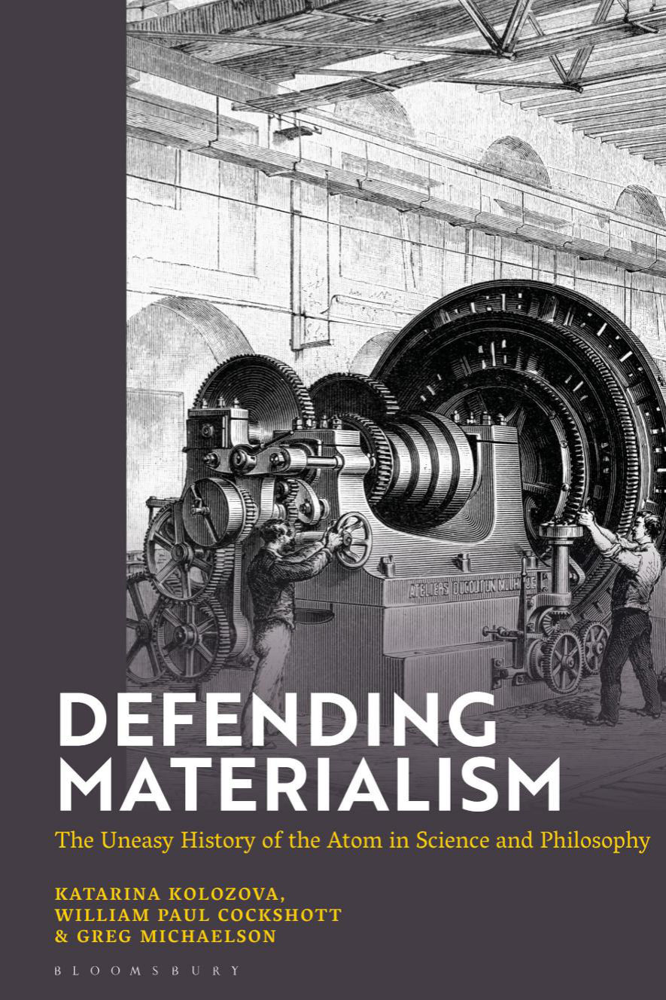

<!-- dm-front-001 -->

〔原书第i页〕

# 捍卫唯物主义

<!-- dm-front-002 -->

〔原书第ii页〕

## 布卢姆斯伯里另有出版

<!-- dm-front-003 -->

〔原书第ii页〕

《反对马克思主义的战争》，托尼·麦肯纳

《从马克思到黑格尔，再返回马克思》，维多利亚·法雷尔德、汉内斯·库赫编

<!-- dm-front-004 -->

〔原书第iii页〕

# 捍卫唯物主义

<!-- dm-front-005 -->

〔原书第iii页〕

原子在科学与哲学中的坎坷历程

<!-- dm-front-006 -->

〔原书第iii页〕

卡塔琳娜·科洛佐娃、威廉·保罗·科克肖特、格雷格·迈克尔森

<!-- dm-front-logo -->

〔原书第iii页〕

布卢姆斯伯里


<!-- dm-front-007 -->

〔原书第iv页〕

## 布卢姆斯伯里学术出版

<!-- dm-front-008 -->

〔原书第iv页〕

Bloomsbury Publishing Plc
英国伦敦贝德福德广场50号，WC1B 3DP
美国纽约百老汇1385号，NY 10018
爱尔兰都柏林2区厄尔斯福特台29号

<!-- dm-front-009 -->

〔原书第iv页〕

BLOOMSBURY、BLOOMSBURY ACADEMIC及戴安娜标志均为Bloomsbury Publishing Plc的商标。

<!-- dm-front-010 -->

〔原书第iv页〕

2025年首次在英国出版。

<!-- dm-front-011 -->

〔原书第iv页〕

版权所有 © 卡塔琳娜·科洛佐娃、威廉·保罗·科克肖特、格雷格·迈克尔森，2025年。

<!-- dm-front-012 -->

〔原书第iv页〕

卡塔琳娜·科洛佐娃、威廉·保罗·科克肖特和格雷格·迈克尔森已依据1988年《版权、外观设计和专利法》主张其作为本书作者的署名权。

<!-- dm-front-013 -->

〔原书第iv页〕

丛书设计：Charlotte Daniels。
封面图：Kohl根据Barclay的画作制作的木刻，1888年。
图片提供：INTERFOTO / Alamy Stock Photo。

<!-- dm-front-014 -->

〔原书第iv页〕

保留所有权利。未经出版者事先书面许可，不得以任何形式或手段，包括电子或机械方式，以及影印、录音或任何信息存储与检索系统，复制或传播本出版物的任何部分。

<!-- dm-front-015 -->

〔原书第iv页〕

Bloomsbury Publishing Plc对本书中提及或引用的任何第三方网站均无控制权，亦不承担责任。本书提供的所有网址在付印时均正确有效。若网址发生变更或网站停止存在，作者和出版者对由此造成的不便表示遗憾，但不对任何此类变化承担责任。

<!-- dm-front-016 -->

〔原书第iv页〕

英国图书馆提供本书的书目记录。

<!-- dm-front-017 -->

〔原书第iv页〕

美国国会图书馆提供本书的书目记录。

<!-- dm-front-018 -->

〔原书第iv页〕

ISBN：
精装本：978-1-3504-4732-5
电子PDF：978-1-3504-4734-9
电子书：978-1-3504-4735-6

<!-- dm-front-019 -->

〔原书第iv页〕

排版：印度钦奈Deanta Global Publishing Services。

<!-- dm-front-020 -->

〔原书第iv页〕

如需进一步了解我们的作者和图书，请访问www.bloomsbury.com，并订阅我们的通讯。

<!-- dm-toc-title -->

〔原书第v页〕

# 目录

<!-- dm-toc-001 -->

〔原书第v页〕

插图目录　viii

<!-- dm-toc-002 -->

〔原书第v页〕

第1章 引言　1

<!-- dm-toc-003 -->

〔原书第v页〕

概述　1

<!-- dm-toc-004 -->

〔原书第v页〕

方法　3

<!-- dm-toc-005 -->

〔原书第v页〕

各章　4

<!-- dm-toc-006 -->

〔原书第v页〕

第2章 探索古希腊所提供的概念材料及其影响的跨千年交流　7

<!-- dm-toc-007 -->

〔原书第v页〕

虚空作为运动的前提　8

<!-- dm-toc-008 -->

〔原书第v页〕

无中不能生有：一个至今有效的原则及其科学与哲学—本体论解释　9

<!-- dm-toc-009 -->

〔原书第v页〕

原子论者　12

<!-- dm-toc-010 -->

〔原书第v页〕

第3章 古典原子论　19

<!-- dm-toc-011 -->

〔原书第v页〕

阿基米德　19

<!-- dm-toc-012 -->

〔原书第v页〕

古代唯物主义者对原子论的批判　23

<!-- dm-toc-013 -->

〔原书第v页〕

牛顿　26

<!-- dm-toc-014 -->

〔原书第v页〕

黑格尔对牛顿的批判　41

<!-- dm-toc-015 -->

〔原书第v页〕

杜·沙特莱　48

<!-- dm-toc-016 -->

〔原书第v页〕

机械决定论　53

<!-- dm-toc-017 -->

〔原书第v页〕

第4章 辩证法、唯物主义与变化：从伊壁鸠鲁经亚里士多德到马克思　59

<!-- dm-toc-018 -->

〔原书第v页〕

黑格尔重新塑造辩证法之前的辩证法　59

<!-- dm-toc-019 -->

〔原书第v页〕

Dialektikê、机械性与认知的物质性　60

<!-- dm-toc-020 -->

〔原书第v页〕

根本运动与历史唯物主义，而非辩证唯物主义　65

<!-- dm-toc-021 -->

〔原书第v页〕

苏联式辩证唯物主义的基础及其矛盾　67

<!-- dm-toc-022 -->

〔原书第vi页〕

第5章 历史唯物主义者与机械唯物主义者　71

<!-- dm-toc-023 -->

〔原书第vi页〕

斯密与恩格斯　71

<!-- dm-toc-024 -->

〔原书第vi页〕

国家源于私有财产　71

<!-- dm-toc-025 -->

〔原书第vi页〕

狄德罗的非人类中心主义唯物主义世界观　76

<!-- dm-toc-026 -->

〔原书第vi页〕

牛顿式的马克思　81

<!-- dm-toc-027 -->

〔原书第vi页〕

达尔文与目的论的终结　96

<!-- dm-toc-028 -->

〔原书第vi页〕

新的原子论　108

<!-- dm-toc-029 -->

〔原书第vi页〕

道尔顿　108

<!-- dm-toc-030 -->

〔原书第vi页〕

热、物质与时间　110

<!-- dm-toc-031 -->

〔原书第vi页〕

第6章 唯心主义的复兴与回应　123

<!-- dm-toc-032 -->

〔原书第vi页〕

对玻尔兹曼的反对　123

<!-- dm-toc-033 -->

〔原书第vi页〕

马赫主义　124

<!-- dm-toc-034 -->

〔原书第vi页〕

对马赫静电类比的批判　128

<!-- dm-toc-035 -->

〔原书第vi页〕

爱因斯坦驳倒马赫主义对原子的反对　131

<!-- dm-toc-036 -->

〔原书第vi页〕

哲学上的马赫主义与列宁的介入　134

<!-- dm-toc-037 -->

〔原书第vi页〕

量子理论中的唯心主义与唯物主义　140

<!-- dm-toc-038 -->

〔原书第vi页〕

第7章 逻辑与唯物主义　153

<!-- dm-toc-039 -->

〔原书第vi页〕

引言　153

<!-- dm-toc-040 -->

〔原书第vi页〕

逻辑概述　154

<!-- dm-toc-041 -->

〔原书第vi页〕

逻辑与辩证法　156

<!-- dm-toc-042 -->

〔原书第vi页〕

数学形式　157

<!-- dm-toc-043 -->

〔原书第vi页〕

三段论　157

<!-- dm-toc-044 -->

〔原书第vi页〕

亚里士多德之后　158

<!-- dm-toc-045 -->

〔原书第vi页〕

思维规律　159

<!-- dm-toc-046 -->

〔原书第vi页〕

逻辑运算与真值表　160

<!-- dm-toc-047 -->

〔原书第vi页〕

逻辑的数学化　161

<!-- dm-toc-048 -->

〔原书第vi页〕

弗雷格与数学基础　162

<!-- dm-toc-049 -->

〔原书第vi页〕

数与归纳　163

<!-- dm-toc-050 -->

〔原书第vi页〕

无限与无穷小　163

<!-- dm-toc-051 -->

〔原书第vi页〕

走向无限，并超越无限　165

<!-- dm-toc-052 -->

〔原书第vi页〕

第8章 逻辑与辩证唯物主义　169

<!-- dm-toc-053 -->

〔原书第vi页〕

黑格尔与逻辑　169

<!-- dm-toc-054 -->

〔原书第vi页〕

恩格斯与逻辑　171

<!-- dm-toc-055 -->

〔原书第vi页〕

狄慈根、辩证唯物主义与逻辑　173

<!-- dm-toc-056 -->

〔原书第vi页〕

罗素悖论与《数学原理》　175

<!-- dm-toc-057 -->

〔原书第vii页〕

希尔伯特纲领　175

<!-- dm-toc-058 -->

〔原书第vii页〕

元理论与逻辑学派　177

<!-- dm-toc-059 -->

〔原书第vii页〕

直觉主义　177

<!-- dm-toc-060 -->

〔原书第vii页〕

从布尔什维克革命到孟什维克化唯心主义　178

<!-- dm-toc-061 -->

〔原书第vii页〕

孟什维克化唯心主义与逻辑　180

<!-- dm-toc-062 -->

〔原书第vii页〕

孟什维克化唯心主义与英国马克思主义　182

<!-- dm-toc-063 -->

〔原书第vii页〕

第9章 逻辑危机与反形式主义的顶峰　187

<!-- dm-toc-064 -->

〔原书第vii页〕

引言　187

<!-- dm-toc-065 -->

〔原书第vii页〕

哥德尔与完备性　187

<!-- dm-toc-066 -->

〔原书第vii页〕

图灵与终止性　189

<!-- dm-toc-067 -->

〔原书第vii页〕

丘奇—图灵论题　191

<!-- dm-toc-068 -->

〔原书第vii页〕

英国辩证唯物主义者的回应　192

<!-- dm-toc-069 -->

〔原书第vii页〕

孟什维克化唯心主义之后的苏联逻辑学　193

<!-- dm-toc-070 -->

〔原书第vii页〕

数字计算机　194

<!-- dm-toc-071 -->

〔原书第vii页〕

控制论　195

<!-- dm-toc-072 -->

〔原书第vii页〕

语言学　196

<!-- dm-toc-073 -->

〔原书第vii页〕

苏联逻辑学的复兴　198

<!-- dm-toc-074 -->

〔原书第vii页〕

斯大林论语言学　199

<!-- dm-toc-075 -->

〔原书第vii页〕

构造主义　200

<!-- dm-toc-076 -->

〔原书第vii页〕

第10章 语言、自动机与意义　205

<!-- dm-toc-077 -->

〔原书第vii页〕

语言与意义　205

<!-- dm-toc-078 -->

〔原书第vii页〕

模型论　207

<!-- dm-toc-079 -->

〔原书第vii页〕

巴迪欧、模型论与唯物主义　208

<!-- dm-toc-080 -->

〔原书第vii页〕

自动机　209

<!-- dm-toc-081 -->

〔原书第vii页〕

语言游戏　210

<!-- dm-toc-082 -->

〔原书第vii页〕

文法与自动机　211

<!-- dm-toc-083 -->

〔原书第vii页〕

结论　212

<!-- dm-toc-084 -->

〔原书第vii页〕

第11章 辩证唯物主义与机械论唯物主义　213

<!-- dm-toc-085 -->

〔原书第vii页〕

信息论与唯物主义　213

<!-- dm-toc-086 -->

〔原书第vii页〕

物理意义　215

<!-- dm-toc-087 -->

〔原书第vii页〕

随机性　216

<!-- dm-toc-088 -->

〔原书第vii页〕

幸运眷顾勇者　217

<!-- dm-toc-089 -->

〔原书第vii页〕

注释　235

<!-- dm-toc-090 -->

〔原书第vii页〕

参考文献　264

<!-- dm-toc-091 -->

〔原书第vii页〕

索引　277

<!-- dm-lof-title -->

〔原书第viii页〕

# 插图目录

<!-- dm-lof-001 -->

〔原书第viii页〕

3.1 阿基米德证明，单位圆柱的体积等于单位圆锥与单位半球的体积之和　21

<!-- dm-lof-002 -->

〔原书第viii页〕

3.2 具有本轮轨迹的物体，其轨道在x轴上的投影是余弦曲线之和　28

<!-- dm-lof-003 -->

〔原书第viii页〕

3.3 经过2007至2016年采样的世界石油价格／运量数据点的连续曲线　29

<!-- dm-lof-004 -->

〔原书第viii页〕

3.4 轨道半径与周期的关系　44

> 校注：原插图目录英文semi-redius拼写按原样保留。

<!-- dm-lof-005 -->

〔原书第viii页〕

5.1 用维多利亚时代的一个经济周期说明马克思的资本积累一般规律　89

<!-- dm-lof-006 -->

〔原书第viii页〕

5.2 道尔顿表示元素原子的符号记法　110

<!-- dm-lof-007 -->

〔原书第viii页〕

5.3 矩形二维格子气系统演化规则示意　116

<!-- dm-lof-008 -->

〔原书第viii页〕

5.4 尺寸为5 16的气体格子　117

> 校注：原插图目录尺寸写作“5 16”，与正文图注不同；此处按目录原文保留。

<!-- dm-lof-009 -->

〔原书第viii页〕

5.5 初始时，全部80个原子都在左侧　118

<!-- dm-lof-010 -->

〔原书第viii页〕

5.6 汤姆森描述的有限系统随时间的演化　119

<!-- dm-lof-011 -->

〔原书第viii页〕

6.1 马赫论证所使用的库仑扭秤　126

<!-- dm-lof-012 -->

〔原书第viii页〕

6.2 马赫描述的莱顿瓶实验　127

<!-- dm-lof-013 -->

〔原书第viii页〕

6.3 实际分力装置示意图　129

<!-- dm-lof-014 -->

〔原书第viii页〕

6.4 以现代电路图表示马赫描述的莱顿瓶实验　130

<!-- dm-lof-015 -->

〔原书第viii页〕

6.5 利用脑部扫描可以重建一个人正在看到的图像　140

<!-- dm-lof-016 -->

〔原书第viii页〕

6.6 光通过偏振器后，可以形成垂直偏振光束　145

<!-- dm-lof-017 -->

〔原书第viii页〕

6.7 左图显示，垂直偏振光的振幅如何投影到与原偏振轴成45°的偏振器的左、右轴上　146

<!-- dm-lof-018 -->

〔原书第viii页〕

7.1 通过面积求和进行积分　164

<!-- dm-lof-019 -->

〔原书第viii页〕

9.1 图灵机　190

<!-- dm-lof-020 -->

〔原书第viii页〕

11.1 随着生成的数字越来越多，最初不利于零的偏差逐渐消失　219

<!-- dm-lof-021 -->

〔原书第viii页〕

11.2 左：计算机芯片中的标准元件CMOS反相器。右：反相器的逻辑符号　232

<!-- dm-ch01-001 -->

〔原书第1页〕

# 第1章 引言

<!-- dm-ch01-002 -->

〔原书第1页〕

## 概述

<!-- dm-ch01-003 -->

〔原书第1页〕

> 我们走出教堂后，站着谈了一会儿贝克莱主教的巧妙诡辩：他试图证明物质并不存在，宇宙中的一切都只是观念。我说，尽管我们确信他的学说不正确，却无法驳倒它。我永远不会忘记约翰逊那敏捷的回答：他用脚猛踢一块大石头，踢得自己都弹了回来，说：“我就这样反驳它。”——詹姆斯·博斯韦尔[^ch1-1]

<!-- dm-ch01-004 -->

〔原书第1页〕

唯物主义与唯心主义是一切哲学的两极，二者的争论已持续了2500年。约250年前，詹姆斯·博斯韦尔与塞缪尔·约翰逊的上述对话，简明地概括了这种对立在哲学和社会层面的复杂性。

<!-- dm-ch01-005 -->

〔原书第1页〕

这场争论发生在18 世纪末，当时英国工业革命正在加速，其基础是迅速发展的数学、物理、化学和工程原理。这些原理反过来威胁到宗教意识形态的古老根基，而宗教意识形态曾是英国统治阶级的基石。

<!-- dm-ch01-006 -->

〔原书第1页〕

乔治·贝克莱（1685—1753）是一位爱尔兰圣公会主教，他在18 世纪初试图用哲学而非《圣经》权威来支撑自然神论。如今他被视为绝对唯心主义的奠基人，该学说否认一切物质性。

<!-- dm-ch01-007 -->

〔原书第1页〕

詹姆斯·博斯韦尔（1740—1795）是苏格兰人，在启蒙运动时期成年。他的信仰立场多变，从小受加尔文主义熏陶，也曾动过皈依天主教的念头。在爱丁堡大学，亚当·斯密曾给他授课；斯密的经济学对制造业的发展和马克思都有重大影响。博斯韦尔一向交游广泛，甚至曾与临终的伟大怀疑论哲学家大卫·休谟讨论来世是否可能存在，而休谟坚决否认这一观念。博斯韦尔有私人财产维持生活，尽管自我厌弃，仍过着放纵的生活；他最为人所知的身份是约翰逊的传记作者。

<!-- dm-ch01-008 -->

〔原书第1—2页〕

塞缪尔·约翰逊（1709—1784）是一位英国文人，以其权威的英语词典闻名。他言语直率，曾在牛津大学受教育，博览群书，是托利党人，也是圣公会信徒。因此，约翰逊的常识唯物主义竟能穿透那些令博斯韦尔如此困惑的诡辩，实在引人注目。

<!-- dm-ch01-009 -->

〔原书第2页〕

我们的唯物主义同样以同外部现实的互动为基础，但它当然不像约翰逊的唯物主义那样迁就唯心主义。事实上，本书旨在捍卫原子论唯物主义和机械唯物主义，反对唯心主义的解释。

<!-- dm-ch01-010 -->

〔原书第2页〕

我们的论述采取历史视角，从古希腊原子论者一直到当代，将其视为贯穿科学与哲学学科的哲学分化。我们关心的是这种分化所带来的政治哲学后果。

<!-- dm-ch01-011 -->

〔原书第2页〕

我们的批判立场来自卡尔·马克思的唯物主义学说，而不是马克思主义的全部遗产——后者并非铁板一块。因此，我们选择推演并追随马克思本人的思路；我们认为，这种思路已经在他关于希腊原子论的博士论文中成形。因此，我们的诠释学是对马克思本人方法的一种模仿。我们拆解辩证法与唯物主义的统一体，试图把二者作为独立但常常结合或交叉的思想线索来追踪，并根据所讨论的作者和学科，分析这两个概念本身的辩证关系。

<!-- dm-ch01-012 -->

〔原书第2页〕

本书追踪若干贯穿时间的平行线索：

<!-- dm-ch01-013 -->

〔原书第2页〕

- 原子观念在数世纪中如何既变化又保持同一。我们把它视为真正唯物主义与带有唯心主义色彩的唯物主义——或隐蔽唯心主义的唯物主义——之间的分界点，这在哲学以及数学和计算等科学中都存在；

<!-- dm-ch01-014 -->

〔原书第2页〕

- 逻辑的发展及其在多位思想家著作中与“辩证法”的关系。我们在这里探究其政治影响，以及意识形态如何影响科学沿唯物主义与唯心主义这一分界作出的认识论选择。

<!-- dm-ch01-015 -->

〔原书第2页〕

- “无中不能生有”这一原则反复出现。它源于古希腊哲学，并在守恒定律的发展中不断被重述和激活，最终被理解为这些定律都源于对称性。这一形而上学困境隐秘地存在于科学、政治哲学和经济学中。作为欧洲观念史组织结构的支柱之一，这种无意的、常常不经意间存在的返祖现象，塑造了我们今天所知的当代科学、技术和社会经济理论的很大部分；

<!-- dm-ch01-016 -->

〔原书第2页〕

- 物理学、生物学以及对人类社会的反思中的时间性质；后一类反思主要见于哲学，也见于社会科学。对贯穿这些学科的时间观念作诠释学考察，能够为历史唯物主义提供一种新的理解，使之摆脱 diamat 的教条，即苏联所确立的辩证唯物主义的教条。

<!-- dm-ch01-017 -->

〔原书第2—3页〕

我们的焦点是列宁和爱因斯坦批判的显性唯心主义，以及影响苏联diamat 的隐性黑格尔式唯心主义。从古希腊思想中唯物主义的起源开始，我们探讨它在牛顿物理学和牛顿世界观中的复兴。我们说明马克思如何借鉴原子论者，为他批判黑格尔唯心主义提供基础。然后考察历史唯物主义的兴起和生物学在达尔文主义下的转型。我们进一步探讨达尔文主义更广泛的认识论影响，这种影响可见于马克思主义以及若干科学中的其他哲学流派。

<!-- dm-ch01-018 -->

〔原书第3页〕

19 世纪末20 世纪初，围绕原子爆发了激烈的哲学争论，如今这常被遗忘。植根于科学解释模型中的唯心主义认识论，阻止人们把原子论接受为超出边缘推测的东西。diamat 教条及其核心的黑格尔权威，对苏联科学尤其是数学和计算的发展产生了抑制作用。在自称唯物主义认识论的最深层信条中，唯心主义内核影响了20 世纪社会主义世界技术发展的步伐。我们以此为例，说明科学作为隐蔽哲学的影响：正如马克思所论证的，这种隐蔽哲学会不可避免地产生一种唯心主义，并影响技术以及更广泛科学发展的路径。这是科学受自身形而上学选择之苦的症状，即使它明确把自己定位为反形而上学。矛盾的是，我们在苏联社会主义科学传统中比在20 世纪至21 世纪西方科学发展中更注意到这种影响。

<!-- dm-ch01-019 -->

〔原书第3页〕

原子能开发出来以后，已没有人怀疑原子的真实存在，但在1900年前后，原子的实在性还广受质疑。我们追溯这场哲学争论的政治和理论背景。我们考察人们对于原子论的“机械论”世界观中所蕴含的“粗糙的物质性”（马克思，《资本论》第1卷第1章）的反感；这种物质性与一切存在所依据的任何“空灵本原”（ἀρχή）相对。随后我们论证，正是这种反感，使那些公认属于唯物主义的哲学和科学仍然留着一扇后门，其中也包括那些甚至不愿在唯心主义与唯物主义之间作出形而上学选择的学科。“空灵本原”这一隐喻指向从古希腊到当代数学和计算机科学的一系列观念。这既可能表现为一个悬而未决的问题，也可能表现为干脆坚持“一切都是语言，外部现实并不存在”——至少不是以一种应当被认真对待的方式存在；后结构主义反复念诵的口号便是一例。

<!-- dm-ch01-020 -->

〔原书第3页〕

## 方法

<!-- dm-ch01-021 -->

〔原书第3页〕

我们对唯物主义的论述尽可能以一手资料为依据；原始材料不是英语时，则使用译本。我们基本上避免与那些阐释我们所引哲学家和科学家的人展开讨论。我们也基本上避免采用范围更广的历史叙述，除非找不到一手资料，或这些叙述提供了没有争议的概述。

<!-- dm-ch01-022 -->

〔原书第4页〕

我们承认自己的“西方”哲学取向，也承认未介入当代科学史领域的争论。我们希望为理解唯物主义带来一种新视角，引导读者像我们努力做到的那样，直接接触原始论证。如果有人指责我们无知或修正主义，那就由他们去吧。当然，我们乐于接受纠正，并进一步讨论自己的立场，所秉持的是达成共同理解的精神，而不是争胜计分的经院式论辩。

<!-- dm-ch01-023 -->

〔原书第4页〕

为了始终聚焦唯物主义在哲学和自然哲学中的发展，我们有意作出了一些省略。尤其是，我们不讨论那些“重大”的哲学问题：我们从哪里来？为什么在这里？为什么是这样？又将走向何方？

<!-- dm-ch01-024 -->

〔原书第4页〕

除非其他世界观曾直接促进或阻碍唯物主义，我们不予讨论。尤其是，总体而言，我们很少谈及信仰或宗教。最后，我们也不讨论这里阐述的唯物主义所具有的道德、伦理、社会或直接政治后果。也许最重要的一项省略，是没有探讨意识的性质。我们对唯心主义的拒斥，必然使我们把意识视为物质系统的一种属性，无论这种系统是否属于人类。

<!-- dm-ch01-025 -->

〔原书第4页〕

请注意，引文均照原文逐字引用，不对其中诸如带有性别色彩的语言作出评论。斜体沿用原文。人物的生卒年往往直接取自维基百科。

<!-- dm-ch01-026 -->

〔原书第4页〕

## 各章

<!-- dm-ch01-027 -->

〔原书第4页〕

下面逐章简要概述本书内容。

<!-- dm-ch01-028 -->

〔原书第4页〕

## 第2章 对古希腊所提供的概念材料及其开创的跨千年交流的语文学与哲学考察

<!-- dm-ch01-029 -->

〔原书第4页〕

- 我们指出希腊哲学中唯心主义与唯物主义之间张力的根基：这种张力历经数世纪仍然存在，其基础前提仍与古代确立的前提相同。亚里士多德和原子论者既试图使变化成为可思考的对象，又仍困在必须遵守埃利亚学派“无中不能生有”原则的要求之中。原子论者成功地表明，“虚空”或“虚无”是物质的一个方面，一切存在的本原都是物质性的——即不可分割的物质量，atomoi，也就是“不可切分者”；伊壁鸠鲁派的卢克莱修·卡鲁斯的著作尤其如此。

<!-- dm-ch01-030 -->

〔原书第4页〕

## 第3 章古典原子论

<!-- dm-ch01-031 -->

〔原书第4—5页〕

- 我们考察从原子论者到18 世纪法国机械学派完成牛顿世界观的历程。阿基米德式机械唯物主义对牛顿影响巨大，牛顿由此提出自然哲学的方法。法国学派通过能量守恒和最小作用量原理扩展了牛顿力学。

<!-- dm-ch01-032 -->

〔原书第5页〕

## 第4 章辩证法、唯物主义与变化：从伊壁鸠鲁经亚里士多德到马克思

<!-- dm-ch01-033 -->

〔原书第5页〕

- 我们重建辩证法作为一种本体论范畴在欧洲哲学中出现的过程，并将其与古代的起点区分开来：在古代，尤其在亚里士多德关于我们今天称为逻辑学的论著中，辩证法原本是一种方法或本体论范畴。我们在共产主义的 diamat 学说中所见的唯物辩证法，其起源可以追溯到黑格尔，却不能再上溯到更早的时代。马克思对这一术语的使用更接近亚里士多德，而非受黑格尔启发的 diamat。我们把辩证法和唯物主义视为马克思思想中的两个不同范畴，也在马克思的思想来源——原子论和黑格尔——中将二者区分开来。

<!-- dm-ch01-034 -->

〔原书第5页〕

## 第5 章历史唯物主义与机械唯物主义

<!-- dm-ch01-035 -->

〔原书第5页〕

- 我们介绍应用于社会和生物变化的唯物主义。历史唯物主义被视为斯密与恩格斯各自独立作出的共同发现。马克思的《资本论》受到牛顿关于守恒定律，以及作用力与反作用力大小相等、方向相反的观念的影响。恩格斯将历史与生物学中目的论的消解归功于马克思和达尔文二人各自独立的贡献。我们把达尔文之前以人类为中心的目的论生物学解释，与达尔文提出的因果模式相对照。我们考察达尔文主义如何取消人与动物之间的截然区分，并考察人类的情感和行为特征如何像其生理特征一样，有着深厚的哺乳动物根源。原子论在19世纪初复兴。道尔顿等人的化学进展，使之成为化学研究的实际基础。这又为理解热、压力等现象奠定了基础；蒸汽革命正建立在对这些现象的理解之上，而这也促成了热力学关键概念的发展。

<!-- dm-ch01-036 -->

〔原书第5页〕

## 第6 章唯心主义的复兴与回应

<!-- dm-ch01-037 -->

〔原书第5页〕

- 我们讨论20 世纪物理学中唯物主义与唯心主义争论的关键分界。原子论复兴恰逢社会主义兴起，一些国家担心新的原子论世界观会鼓励无神论唯物主义和社会主义。杰出原子论者玻尔兹曼遭到以马赫为首的实证主义/工具主义学派强烈反对。1905 年，爱因斯坦发表三篇论文，共同彻底改变我们对自然界的理解，并决定性地驳斥马赫主义。这些进展导致量子力学，并通过海森堡学派导致一种对新物理学的唯心主义解释，该解释大量借鉴马赫主义。

<!-- dm-ch01-038 -->

〔原书第6页〕

## 第7 章逻辑与唯物主义

<!-- dm-ch01-039 -->

〔原书第6页〕

- 亚里士多德认识论中三段论逻辑与辩证法的统一，在宗教改革前深刻影响欧洲思想以及天主教框架下的教育。此后，英国传统拒绝逻辑和辩证法，转向归纳、经验主义和唯物主义；随后逻辑被恢复并置于形式化基础上。数学的逻辑基础似乎触手可及。

<!-- dm-ch01-040 -->

〔原书第6页〕

## 第8 章逻辑与辩证唯物主义

<!-- dm-ch01-041 -->

〔原书第6页〕

- 黑格尔对亚里士多德思想中辩证成分的强调，深刻塑造了19世纪及20世纪初马克思主义者对逻辑的态度。1925年恩格斯的《自然辩证法》出版后，苏联围绕辩证唯物主义内部形式主义（此时已与逻辑相联系）与辩证法之间的平衡，展开了激烈斗争。这导致一类被混同归并为“孟什维克化的唯心主义”的思想受到严厉谴责，也导致公式化的“diamat”的形成；直至斯大林去世，这种 diamat 一直规定着官方共产主义哲学的面貌。

<!-- dm-ch01-042 -->

〔原书第6页〕

## 第9 章逻辑危机与反形式主义的顶峰

<!-- dm-ch01-043 -->

〔原书第6页〕

- 20世纪初，逻辑学的进展使其能够将自身形式化，由此发现了其核心深处的悖论。与此同时，这些进展也为计算机的发展奠定了基础，并对我们如何将现实刻画为彼此建模的反映系统，产生了深远影响。

<!-- dm-ch01-044 -->

〔原书第6页〕

## 第10 章语言、自动机与意义

<!-- dm-ch01-045 -->

〔原书第6页〕

- 我们把可计算性作为唯物主义的统一框架，整合模型论、语言游戏、自动机理论和形式语言。马尔可夫的构造主义被视为对直觉主义的唯物主义重构，为现实的有限主义解释提供基础。

<!-- dm-ch01-046 -->

〔原书第6页〕

## 第11章 辩证唯物主义与随机唯物主义

<!-- dm-ch01-047 -->

〔原书第6页〕

- 我们阐述信息论的含义：信息是客观的、物理的，完全独立于人类意识。我们探讨信息与随机性的关系，表明表面偶然性受规则支配。最后，我们探讨量、质和相变概念。

[^ch1-1]: 1. J. 博斯韦尔：《塞缪尔·约翰逊传》（The Life of Samuel Johnson），第1卷（Everyman’s Libray，J,. M. Dent & Sons Ltd，1906），第292页。

<!-- dm-ch02-001 -->

〔原书第7页〕

# 第2章 探索古希腊所提供的概念材料及其影响的跨千年交流

<!-- dm-ch02-002 -->

〔原书第7页〕

细读巴门尼德——本体论之父，因而也是我们数世纪以来所知的（欧洲）[^ch2-1]哲学之父——提出的公设，便会发现：西方理性思想诞生之初提出的谜题从未真正解决。芝诺悖论至今仍是悖论——对哲学而言更是如此，而非对科学——而“无中不能生有”在今日仍是物理—形而上学定律，一如它在公元前六、五世纪的欧洲文明中那样。前苏格拉底哲学家接受这一原则；甚至那些主张变化与运动可能的人，如原子论者，也必须设法绕过它，而不是挑战它。在埃利亚学派体系中——直到亚里士多德都未受挑战——“无中不能生有”意味着：变化不可能，虚空不存在，万物始终以坚实不变的形式存在。“虚空”在本体论意义上意味着虚无；而运动则意味着本体论意义上的“生成”，这一论述诉诸的是本体论，而不是自然哲学。运动被理解为成为一个“ousia”（本质或实体），这与“本质具有不可毁灭的永恒性质——因此始终已经存在”这一原则相矛盾。变化的观念违反了埃利亚学派的基本前提，即其公理中的公理：无不存在，虚无不存在，而“成为”将意味着占据先前“空”的（虚无的）空间。在巴门尼德那里，绝对意义上的虚无、非存在与虚空被等同起来，并在整个古代一直如此；不过也有一些例外，即直接与这种逻辑对抗的例子，我们将在本书后面讨论。至于原子论者，他们找到了一种弯曲巴门尼德规则的方法，而不是挑战或反驳它。

<!-- dm-ch02-003 -->

〔原书第7—8页〕

因此，后来几个世纪的自然哲学和科学所处理的空间范畴，既缺席于巴门尼德的推理，也缺席于古希腊那些反对他但从未挑战该原则及其等式的人——即“虚空等于本体论意义上的虚无”（意译）。最早挑战这一公设的，且仍是罕见例子的，是亚里士多德；他基于该公设本身的性质或本质提出质疑：每个谓词都与某种“某物”相关（希腊语ousia 即to ti，意为“某物”或“什么”）。此外，ousia 概念植根于多样性；按照亚里士多德的范畴体系，存在（to on）并非只有一种ousia。

<!-- dm-ch02-004 -->

〔原书第8页〕

> 并不存在超越事物本身的运动。变化总是相对于实体、数量、质量或位置而发生的。（亚里士多德，《物理学》200b33–201a3）[^ch2-2][^ch2-3]

<!-- dm-ch02-005 -->

〔原书第8页〕

亚里士多德在“纯粹理性”与“物自体”之间进行了某种准康德式划分——推理的界限和条件从语言的可能性本身中寻找——修辞学、逻辑学、分析科学以及对三段论的理解，都是日常语言进一步精确化和形式化的结果。（术语在某种程度上已经形式化，且与其日常含义难以区分——例如“虚空”“非存在”等——这种现象自前苏格拉底时期就已存在。）话虽如此，亚里士多德在其全部著作中似乎都在论证：（人类）知识的主体已经完善了用来解释外部现实的概念工具。尽管如此，二者仍受各自内在法则支配，是截然不同的事物。正因如此，ousia 是关于“某物”的（希腊语 to ti，即某种“什么”），并且总是“被用来述说许多事物”[^ch2-4] ——这再次挑战了巴门尼德把Being、to on 和ousia 视为一体的观点——但它并不等同于那个“某物”。正因如此，我们把亚里士多德对哲学和科学思想发展的贡献比作康德的贡献。此外，我们认为，这同样是一种借助形式推理，并援引经验证明和实验权威，从而摆脱形而上学（本体论）权威的“前科学”突破。

<!-- dm-ch02-006 -->

〔原书第8页〕

## 虚空作为运动的先决条件

<!-- dm-ch02-007 -->

〔原书第8—9页〕

从巴门尼德到晚期原子论者——以及在与教条有显著偏离时包括亚里士多德——乃至整个古代，要产生运动，就必须存在未被任何程度实体填充或占据的虚空。无论是“（某）物”（to ti）这一物理概念，还是诸如toon——即存在，或任何形式的实体/本质/同一性（ousia）——这样的本体论概念，对古代思想家而言，运动不过是某物或某实体出现在此前空无一物的场所的一种表象：“因为虚空就是无”［原文：τὸ γὰρ κενεὸν οὐδέν ἐστιν］，梅利索斯说（DK 30B7.7）。[^ch2-5]即使空间只在极短瞬间被（绝对地）“清空”，虚无的可能性——进而虚空的可能性——也被允许。这被视为违反巴门尼德法则“无中不能生有”。这种可能性会与最高真理、最纯粹的同一反复相矛盾——“无中不能生有”，或者说“存在即存在，不能是非存在”——这似乎在古代哲学中被普遍接受，即使像亚里士多德那样对其提出质疑。变化也是运动，因为它涉及成为、生成和产生，因此是某种本质上显然不在的东西的产生。对变化——进而对成为或生成——的严格巴门尼德式反对是：如果“无中不能生有”，那么存在（to on）或ousia 已经以其绝对形式存在，因此成为被排除。于是万物始终如其所是地存在，不变、不动、坚实——不允许任何虚空或虚无的裂缝。此外，万物不朽——某物不能转化为无，因为无不能成为某物。变化只是幻象；可见世界是幻象、梦境、幻觉，正如苏格拉底在临终时所解释的（柏拉图，66e–67a）。[^ch2-6]这种观点一直作为主导观点延续到新柏拉图主义、中世纪哲学，以及更近期的“新理性主义”对理性——即科学思维——的迷恋，与威尔弗里德·塞拉斯所说的“现实的显现图景”相对。（我们这里指对塞拉斯的一种特定接受[^ch2-7]，而不是他本人承认“民间推理”与科学思维连续性的著作。[^ch2-8] ）哲学的诞生、存在概念的诞生以及完全理性思维（同一反复）的诞生，恰与一种世界观同时诞生：它宣称直接经验的现实是幻象。它也恰与“身体恐惧症”的诞生同时发生，因为真理不可能也不存在于腐朽肉体的可见世界中，而存在于完美、不可见、没有任何身体或物质的世界中（柏拉图，《斐多篇》，64c–65c）。让我们考察巴门尼德论证的诸范畴，它们标记了数世纪乃至数千年的唯心主义和反唯物主义，并看看它们如何形成一个界定明确、不可穿透的立场。

<!-- dm-ch02-008 -->

〔原书第9页〕

## “无中不能生有”这一原则至今有效：其科学与哲学本体论阐释

<!-- dm-ch02-009 -->

〔原书第9页〕

迄今为止，从牛顿到霍金，这一原则——“无中不能生有”——似乎在科学中未受质疑。哲学似乎允许更多可能：随着启蒙运动后的思想变革，哲学越来越成为独立于科学的沉思散文，也就越来越允许自相矛盾的立场和与科学直接矛盾的观点。因此，“无中不能生有”在现代哲学中并不必然是普遍共识。虚无本身似乎也是一种存在；根据某些哲学家的说法，它在本体论上存在，尤其在现代性开始之后；试看存在主义、虚无主义以及黑格尔的非存在概念。[^ch2-9]

> 校注：此处底本拼作 Hawkins，原书第10页同一论述使用 Hawking；中文沿用所供译稿的“霍金”，英文保留底本拼写。

<!-- dm-ch02-010 -->

〔原书第9页〕

这种对科学讨论的漠视和对经验材料的蔑视，表明本章导言中所述的定义希腊哲学的“可见”与“不可见”、有形与无形、物质与观念之间的原始二分仍在延续。柏拉图认为可见世界是幻象，经验记录不足以对存在作出合理说明，至少不能被视为绝对。

<!-- dm-ch02-011 -->

〔原书第9—10页〕

哲学从古至今一直以人类为中心：马克思在《对黑格尔哲学的总体批判》（收录于《1844 年经济哲学手稿》）中阐明，所谓的绝对精神不过是自哲学诞生以来一切哲学中人类中心主义狂妄的顶点，实质上是普遍利己主义者的概念。[^ch2-10]人类中心主义也根植于费尔巴哈的唯物主义中，而正是这一点使它成为唯心主义——事实上，一切以主体性为中心的思想，即以人类主体性为中心的思想，归根结底都是唯心主义。[^ch2-11]正因如此，马克思认为哲学历来都是唯心主义的，因此他提议通过采取第三方视角来摆脱哲学，把哲学转变为科学。因此，在马克思看来，科学的前提是放弃以主体性为中心的思想，并模仿第三方的（想象中的）视角。[^ch2-12]当代哲学——与“分析哲学”（据称占据真正哲学的霸权地位）相对的“大陆哲学”——尤其是批判理论，鄙视经验主义。它对技术感兴趣，只是为了理论化其社会效果[^ch2-13]；对理论数学好奇（例如前述新理性主义者），但可量化性、通过经验归纳进行的证明，却遭到隐晦蔑视。正是这种对物质（证明）的蔑视，使它至今仍是哲学，与巴门尼德和柏拉图式的“身体恐惧”叙事并无二致，即使它选择以其他名称自称（理论、后哲学等）。

<!-- dm-ch02-012 -->

〔原书第10页〕

进入21 世纪后，那种源自笛卡尔和柏拉图主义对物理事物的蔑视，仍在思辨现实主义启发的新理性主义、加速主义以及后人类主义网络理论中隐含或明示；这些理论往往不过是变相的超人类主义，也包括异质女性主义（xenofeminism）。身体和物理事物也属于运动、变化和衰败的范畴，被视为应予废除的幻象，以便纯粹理智——黑格尔的精神——以人工智能和人机奇点形式统治。自前苏格拉底哲学以来，讨论变得更精致复杂，但其根基似乎仍是同样的关切，因为若移除这些奠基前提，整个哲学大厦就会崩塌：存在是核心概念，本体论是哲学的归宿，形式理性与本体论一致，从而产生形而上学；而对物质世界及其应用的研究则被视为次要，正如“可见世界”一样。

<!-- dm-ch02-013 -->

〔原书第10—11页〕

“无中不能生有”——或存在来自存在——这一原则在科学探索中有意义，尤其在物理学（牛顿、霍金等）和化学中；这无需任何曲折的悖论和矛盾论证，不像埃利亚学派主张导致的困境。亚里士多德用其范畴论和逻辑揭示了埃利亚学派主张的不一致，从而证明将人类推理（范畴应用）与存在本身混同是一种谬误。通过把ousia 与质量、数量、位置和时间区分开，亚里士多德证明谓述总是关于某种特定事物；由于可能的谓述实际上无穷无尽，因此也存在多种ousia：“简言之，存在总是以复数形式被述说”［τὸ ὂν τὸ ἁπλῶς λεγόμενον λέγεται πολλαχῶς］（亚里士多德，《形而上学》E.2 1026a33–34）。作为这一论证的一部分，亚里士多德考察了人类思维运作、言语方式以及唯一可能可信且合乎逻辑的言语模式中可能存在的矛盾、不一致和悖论——而不是存在本身中的矛盾。这是与整个巴门尼德之后传统的革命性决裂：它从言语的逻辑一致性出发，即人类能够控制和完善的部分，而不是从存在本身出发。人类语言反映现实和外部世界的一致性，但后者本身似乎是封闭的，只有我们的范畴体系和逻辑发展到一定程度时才可理解。如果撞上矛盾之墙，那是人类推理的问题，而不是存在、外部世界或本质超出人类思维的现实的问题。在《物理学》中，亚里士多德写道：

<!-- dm-ch02-014 -->

〔原书第11页〕

> 人们不容易把运动和变化归入另一个属（genus）——只要看看有些人把它归入何处就清楚了：他们把运动等同于差异、不等或非存在；但这些东西并不必然运动，无论它们不同、不等还是不存在。（201b19–201b23）[^ch2-14]

<!-- dm-ch02-015 -->

〔原书第11页〕

此外，他论证道：

<!-- dm-ch02-016 -->

〔原书第11页〕

> 因此，有人说虚空是物体的质料（他们也把位置等同于它），这种说法不正确；因为质料并不与事物分离，而他们却把虚空当作某种分离的东西来探究。（214a12–214a16）[^ch2-15]

<!-- dm-ch02-017 -->

〔原书第11页〕

除了作为抽象范畴，人们不能把一般物质说成一个独立的存在者，正如也不能这样谈论虚空。因此，亚里士多德以“人们这样说是错误的”为理由驳斥了埃利亚学派的不可能性。亚里士多德考察了“organon”（理性推理及其规则的工具）及其在当时的可能性和局限，以便使对存在者（to on）以及非存在者的说明成为可能。所谓“非存在者”不是对存在的否定，而是对某种特定ousia、对“某物”的否定。

<!-- dm-ch02-018 -->

〔原书第11—12页〕

亚里士多德《物理学》的上述引文带有鲜明的唯物主义色彩：物质与“存在之物”——某物，或 tò tí，或 ousia——不可分离。因此，物体并不是能够“承载”或容纳虚空或空的空间的东西，不能像留基伯和德谟克利特所尝试的那样，借此既使运动成为可能，又避免反驳埃利亚学派。恰恰相反，亚里士多德确实进行了这种反驳。按照亚里士多德的说法，早期原子论者所提出的妥协是：“他们说元素是充实与虚空，并分别把它们称为存在与非存在”［στοιχεῖα μὲν τὸ πλῆρες καὶ τὸ κενὸν εἶναί φασι, λέγοντες τὸ μὲν ὂν τὸ δὲ μὴ ὄν］（亚里士多德，《形而上学》A.4 985b5–6）。[^ch2-16]这是一种谬误，一种推理错误，而且极可能是一种本体论上的不可能性。我们在这里使用“极可能”，因为亚里士多德似乎并不认为：仅仅由于我们所能依靠的是认知工具（organon）的完善，外部世界就不可通达。非存在是相对于某种 ousia 而言的偶发、巧合，或更确切地说，偶然性（sumbebekos）；它可以是一种虚假，最后，也可以是一种潜能（即作为存在者现象的生成）。[^ch2-17]正如质料依存于某种 ousia，存在因而是正确谓述与现实性的范畴。正确使用范畴，能够导向对实在或存在的正确说明。亚里士多德的方法可以与今天所谓的科学推理相比：证明的工具（organon）的完善，能够使我们对外部世界、实在或存在的说明更加准确。

<!-- dm-ch02-019 -->

〔原书第12页〕

尽管如此，亚里士多德仍是哲学家——存在一种最高ousia 的终极真理，凌驾于众多ousiai 之上；在此意义上，实在与真理建立统一，因为实在通过真理或纯粹沉思超越自身——作为包括可感世界在内的一切存在者的“第一推动者”，是noesis（理性/思想）。（亚里士多德，《形而上学》1072a30–32）[^ch2-18]又见：“被欲求者和思想的对象推动运动而自身不动。它们是第一的，也是同一的。”（《形而上学》1072a26–27）尽管如此，亚里士多德关于第一推动者的观念，是他整个著作尤其是《形而上学》和《物理学》中对埃利亚学派论证最直接的反驳。基于这一立场，亚里士多德既可被视为唯物主义者，也可被视为推动唯物主义立场发展的人：运动是一切存在者的原因，因此一切存在都是运动。

<!-- dm-ch02-020 -->

〔原书第12页〕

亚里士多德的哲学，或其唯物主义变体，站在前苏格拉底哲学家尤其是原子论者的肩上。

<!-- dm-ch02-021 -->

〔原书第12页〕

## 原子论者

<!-- dm-ch02-022 -->

〔原书第12页〕

如前所述，巴门尼德禁止对虚无、非存在进行哲学说明，意味着不可能说明运动和变化。许多前苏格拉底哲学家试图在遵守巴门尼德“禁止非存在”的前提下，构想一种能够说明变化和运动的认识论可能性。原子论者德谟克利特和留基伯遵守巴门尼德公理：“存在来自存在”，“非存在来自非存在”，因此本体论上不存在非存在。尽管如此，他们找到一种绕过这一哲学困境的方法，以构建一种允许变化和运动的物理世界说明。显然，感官世界中可见的生长与衰败、出现与消失、空间位移中的运动，促使原子论者揭示现象背后的隐藏原理，并给出哲学解释。他们的解释显然是唯物主义的——它以物理学（physike）即自然哲学的形式表述。在早期原子论者时代以及整个古希腊，哲学一词涵盖科学或对周围现实的科学解释方法：经验观察被形式化，自然和存在的抽象与规律既从经验洞见中提炼，也被经验洞见证实。

<!-- dm-ch02-023 -->

〔原书第13页〕

## 有限性——存在之坚实与完满不可或缺的条件

<!-- dm-ch02-024 -->

〔原书第13页〕

存在确实不可分割，芝诺悖论被颠倒过来：遵循埃利亚原则，我们只能断言，必然存在某种存在实例，其分割不可能，如果我们遵守“无中不能生有”原则。也就是说，存在一个a-tomos 点，一个确实坚实、不变、永恒的自然元素——原子，即“不可分割者”（DK 67A7，DK 68A37）。在《论生成与消灭》（325b12–325b33）中，亚里士多德论证，原子论者设定不可分割物体的动机，是为埃利亚学派提出的运动、变化和多样性（不）可能性悖论提供答案。[^ch2-19]

<!-- dm-ch02-025 -->

〔原书第13页〕

因此，正是通过遵守埃利亚原则，原子论者才达到一个允许设想多样性和运动的实例。这就是不可分割（“不可切割”）、现实化的物质之点——atomos。（亚里士多德，《物理学》206a14–206a18）如果空间确实被视为无限可分，那么存在之坚实、稳定和固定的论证就会被削弱甚至完全矛盾。因此，埃利亚立场在术语上就是矛盾的——它试图证明万物始终如其所是、不变且不可变，却否定了变化可能，从而否定了运动。这隐含着无限。

<!-- dm-ch02-026 -->

〔原书第13页〕

所有这一切都以“无中不能生有”原则为依据。然而，正因接受“无中不能生有”，原子论者才证明变化不仅可能而且必然，因为有限性实际上是其前提——无限意味着可分，无限可分意味着任何形式的坚实和完满存在都不可能。古典埃利亚论证是本体论的，因为它依赖把存在物化为抽象的形式论证。然而，原子论者的论证属于自然哲学：对自然（physis）的一种以经验为基础的说明——物质的无限分割或切割意味着，在physis 的核心，否定或消灭行为愈发在场且压倒性。引入atomos 点，即不可切割、不可分割者，就是确认一种超越毁灭的物质现实实例和形式。因此，有限性保证了“无中不能生有”原则得到遵守。这种立场由原子论者阐述，但毕达哥拉斯学派似乎在原子论者之前就持有类似观点。

<!-- dm-ch02-027 -->

〔原书第13页〕

亚里士多德进一步为原子论立场提供佐证，他论证道：

<!-- dm-ch02-028 -->

〔原书第13—14页〕

> 事物既被认为潜能地存在，也被认为现实地存在。此外，事物要么通过增加，要么通过分割而无限。正如我们所见，大小并非现实无限。但通过分割，它是无限的。（驳斥不可分割线的理论并不困难。）那么剩下的选择是：无限具有潜在存在。但我们不能像说“这可能是一尊雕像”那样理解潜在存在——这会是一尊雕像，但无限不会现实存在。存在以多种方式被述说，我们说无限存在，其意义如同我们说“现在是白天”或“现在是竞技会”，因为事物总是一个接一个地产生。（《物理学》206a14–206a25）

<!-- dm-ch02-029 -->

〔原书第14页〕

## 由否定性或“空无物质”促成的运动与变化

<!-- dm-ch02-030 -->

〔原书第14页〕

亚里士多德在说明早期原子论者时写道：“元素或者是充实的，或者是空的，也可以分别称为存在或非存在”；原文为：“στοιχεῖα μὲν τὸ πλῆρες καὶ τὸ κενὸν εἶναί φασι, λέγοντες τὸ μὲν ὂν τὸ δὲ μὴ ὄν.”（《形而上学》A.4 985b5–6）这样，“非存在”就参与存在，因为它的在场是对构成物质的原子的掏空——kenosis。因此，虚无参与存在，却不是存在的起源；它毋宁嵌在主要被视为物质或自然（physis）的存在的核心之中。原子论者必须提出两个论点：存在是多重的，而空或虚空——空间的缺失，或任何东西的缺失——是物质现实的一个方面。这是在试图克服一种困境：遵守埃利亚法则，阻碍了对运动、变化、生成和衰亡问题的科学与哲学考察。这一尝试类似赫拉克利特的解决办法：“一”实际上是多；即使它几乎熄灭，也不会彻底熄灭，而会“按照一定的尺度”重新燃起，也就是遵循自然与存在的内在法则，亦即科学与本体论的法则。（DK22B30）原文为：κόσμον τόνδε, τὸν αὐτὸν ἁπάντων, οὔτε τις θεῶν οὔτε ἀνθρώπων ἐποίησεν, ἀλλ’ ἦν ἀεὶ καὶ ἔστιν καὶ ἔσται πῦρ ἀείζωον, ἁπτόμενον μέτρα καὶ ἀποσβεννύμενον μέτρα（DK22B30）。赫拉克利特假定存在几乎完全熄灭；与之不同，原子论者谈论的是原子内部的绝对虚空。

<!-- dm-ch02-031 -->

〔原书第14页〕

希腊哲学中理解运动的困难——并不只见于前苏格拉底思想家——在于它对运动的本体论定义：运动是存在与生成的问题，是从一种 ousia 转变为另一种 ousia。从纯粹本体论上说，这种运动似乎不可能，而且确实涉及存在从非存在中产生这一前提。存在过去存在、现在存在，而且将永远存在；生成是不可能的。运动很少被同空间、自然哲学，或关于物质行为的精确推理联系起来。即使前苏格拉底思想家，尤其是原子论者，确实建立了这种联系，空的空间也成为非存在的一种可能性，存在的充实与无限在场因而受到损害。梅利索斯认为，“空”——显然被理解为一个空间范畴——就是无：“因为虚空就是无”，原文为 τὸ γὰρ κενεὸν οὐδέν ἐστιν（DK 30B7.7）。为了使某物生成，就必须假定此前没有这种 ousia；为了使一种 ousia“位移”，便必须设想空间被腾空，它又在一个此前绝对空无的空间中重新出现；而那个空间被理解为非存在。亚里士多德在《物理学》中记述了原子论者对运动的这种理解：“这些人认为，虚空是一道间隙，非存在以可感物体的方式在其中存在。”（《物理学》IV.6 213a27–9）希腊文底本为：οἱ δὲ ἄνθρωποι βούλονται κενὸν εἶναι διάστημα ἐν ᾧ μηδέν ἐστι σῶμα ἰσθητόν。

> 校注：这里的中文引句依本书英文释义译出。书中所附希腊文的句意为“人们认为虚空是其中没有可感物体的间隔”，与其英文释义不完全相合；底本希腊词形 ἰσθητόν 照录，不静默改写。

<!-- dm-ch02-032 -->

〔原书第15页〕

亚里士多德最早把空间，从而把运动，归入可以作为谓词一部分但不参与“本质”或“实体”即ousia 的范畴。这样，亚里士多德既在本体论上，也在自然哲学上提供了解决方案，允许对运动这一物质现象进行精确和数学的探索。

<!-- dm-ch02-033 -->

〔原书第15页〕

亚里士多德的介入以及随后数世纪的科学探究，使伊壁鸠鲁在提供令人信服的原子论说明时，任务变得更容易，也不再那么受埃利亚格言束缚。至少，卢克莱修·卡鲁斯《物性论》是这样读的：

<!-- dm-ch02-034 -->

〔原书第15页〕

> nec porro augendis rebus spatio foret usus seminis ad coitum, si e nilo crescere possent. nam fierent iuuenes subito ex infantibus paruis e terraque exorta repente arbusta salirent. (Liber I, 184–7)[^ch2-20]

<!-- dm-ch02-035 -->

〔原书第15页〕

按照古典语文学的规范，这里使用原典的页边编号，以便在不同版本与译本之间查找对应位置。

<!-- dm-ch02-036 -->

〔原书第15页〕

或者，依英译：“假如生命能从无中增长，万物的成长还需要空间吗？那样，小小的婴儿顷刻便会成为能行走的成人，枝繁叶茂的树也会突然从地上跃起——这些都是闻所未闻的奇迹；因为依自然之道，每一种东西都从合乎其规律的种子缓慢生长，并在这生长中保持自身的种类。”[^ch2-21]伊壁鸠鲁派无需假设“原子包含虚空”便能解释运动与变化：原子是“坚实的”物质，而生长与衰亡遵循物质保存的法则：

<!-- dm-ch02-037 -->

〔原书第15页〕

> sunt igitur solida ac sine inani corpora prima. praeterea quoniam genitis in rebus inanest, materiem circum solidam constare necessest. nec res ulla potest uera ratione probari corpore inane suo celare atque intus habere, si non, quod cohibet, solidum constare relinquas. id porro nihil esse potest nisi materiai concilium, quod inane queat rerum cohibere. (Titus Lucretius Carus, De Rerum Natura , Liber I, 510–15)

<!-- dm-ch02-038 -->

〔原书第15—16页〕

或者，依英译：“因此，原初物体是坚实的，内部没有虚空。但既然一切生成之物中都有虚空，坚实的物质就必然环绕着它。除非你承认那容纳虚空的东西本身是坚实的，否则便无法凭正确的推理证明：某物在自己的躯体中隐藏着、容纳着虚空。须知，能够将虚空容纳在事物之中的，只能是结合在一起的物质。”[^ch2-22]为了使物质在其有限或受限却无界的存在中不断运动与生长[^ch2-23]——因为存在之外别无所有，那里是无，因而无法在物质现实领域之外找到它——就需要空间，也需要物质宇宙内部所包含的虚无：“如此广袤的空间向万物四周敞开——各个方向都有余地，没有尽头。最后，我们亲眼可见，事物界定着事物：空气隔开山丘，山峦又围住空气；陆地终结海洋，海洋反过来又界定所有陆地；然而，对于全体而言，确实没有任何东西能从外部为它划定边界。”[^ch2-24]

<!-- dm-ch02-039 -->

〔原书第16页〕

摆脱抽象理想性——无论是概念或数学理想、ousia，还是柏拉图的eidoi（理念）——是自然存在的必要条件，因为自然是原子碰撞的产物，是“斗争”（参见卢克莱修《物性论》第二卷）或对抗，类似于赫拉克利特的polemos。在《物性论》第二卷中，我们读到，原子从理想的“垂直向下运动”中发生极小（paulum）偏转是必要的（II, 214–20），以便碰撞发生，从而产生原子新组合，进而产生自然新形式：

<!-- dm-ch02-040 -->

〔原书第16页〕

> 它们或者由自身的重量推动，或者偶然受到外来的撞击而运动。它们在不停的运动中频繁相遇、碰撞，便会猛然彼此弹开、相向而去；这并不奇怪——因为它们极其坚硬，具有坚实的重量，而且身后没有什么阻碍它们的运动。（卢克莱修·卡鲁斯，《物性论》第2卷，83–88）[^ch2-25]

<!-- dm-ch02-041 -->

〔原书第16页〕

必须注意，偶然——意外或不可预测的偶然性——是创造性碰撞的条件。偏转出现在不确定的时间和地点——原文“incerto tempore ferme incertisque locis spatio deflectere paulum”（卢克莱修·卡鲁斯，II, 219–20）——进而导致碰撞、分散和原子连接的重组，一种结构瓦解，新结构出现。运动持续不断，因为虚空的绝对性不允许原子静止——在绝对空虚的虚空中，它们无法占据任何位置，因为虚空不允许位置，它不产生任何对立、阻力或物质来构成这种假想位置。

<!-- dm-ch02-042 -->

〔原书第16页〕

> 也没有任何地方，当物体抵达那里时，能在虚空中失去重力而静止；虚空也不能为任何事物提供支撑——不，它必须按其本性，继续让路。因此，事物绝不可能像被征服一样，因渴求中心而保持结合。（卢克莱修·卡鲁斯，I, 1078–83）

<!-- dm-ch02-043 -->

〔原书第16页〕

或依原文：

<!-- dm-ch02-044 -->

〔原书第16页〕

> nec quisquam locus est quo corpora com venerunt ponderis amissa vi possint stare in inani, nec quod inane autem est, ulli subsistere debet, quin, sua quod natura petit, concedere pergat. haud igitur possunt tali ratione teneri res in concilium medii cuppedine victae. (1077–1082)[^ch2-26]

<!-- dm-ch02-045 -->

〔原书第16—17页〕

虚空实际上是虚无，是绝对的无，因此它只在概念上存在，而非本体论上——毋宁说，面对虚空的毁灭力量，生命以及只能以物理形式存在的存在不断诞生并重生。空间和位置没有物理表征，它们是无界且纯粹延展：“空间无边界也无尺度，向四面八方无量延伸。”（卢克莱修·卡鲁斯，《物性论》II, 91–2）原文：“quoniamspatium sine fine modoquest, inmensumque patere in cunctas undique partis”。空间无法度量，表明它被理解为虚空的一个方面，以及那种使变化成为可能、却不产生任何东西的虚无——“无中不能生有”是原子论原则。然而，它是一个能够让我们把握变化和运动的范畴。毁灭潜能是物质本身固有的，是原子行为的一个方面，而正是这种否定性维持生命。但它本身并不构成本体论现实——无即不存在之物，它只存在于原子碰撞的缝隙中，存在于除此以外皆为坚实物质的原子之间。卢克莱修·卡鲁斯用以下比喻解释空间（就虚空而言）在物质（物理）过程发生中的作用：

<!-- dm-ch02-046 -->

〔原书第17页〕

> 在光线所照的虚空中，它们不断战斗，仿佛永恒争斗；成队交锋，毫不停歇，在相遇与分离中上下奔忙。由此你便可推想，原初种子在更大的虚空中不停颠簸，究竟是怎样的情形——至少在这限度之内。（卢克莱修·卡鲁斯，第2卷，118–123）

<!-- dm-ch02-047 -->

〔原书第17页〕

或依原文：

<!-- dm-ch02-048 -->

〔原书第17页〕

> multa minuta modis multis per inane videbis corpora misceri radiorum lumine in ipso, et velut aeterno certamine proelia pugnas edere turmatim certantia nec dare pausam, conciliis et discidiis exercita crebris, 120 conicere ut possis ex hoc, primordia rerum quale sit in magno iactari semper inani— dumtaxat rerum magnarum parva potest res exemplare dare et vestigia notitiai. (Liber II 116–24)

<!-- dm-ch02-049 -->

〔原书第17—18页〕

虚无是一个本体论概念，但不是一种作为存在者的实在。然而，它引发曲线、偏转或clinamen，因此不只是抽象。就其作为原子碰撞导致的衰败和毁灭过程的效果而言，它是真实的。然而，从因果上看，偏转先于碰撞，是虚空本身的属性。再者，虚空在空间上不存在，也没有时间固定点。人们或许会猜想，它是原子运动的属性，不构成时间因果性，而后者本身并非线性。虚空存在，是因为原子必须碰撞；它们碰撞，是因为不存在有中心、能保证静态位置的空间虚空。在这个意义上，虚空缺席于物质和原子的构成，却又作为“运算子”出现在永不停息的原子组合与分解活动中。人们可以把它比作今天所说的反粒子，或空间测量的抽象范畴，因为它既能引发产生存在的偏转和碰撞，又只是概念，没有事实上的、时间的或空间的位置，也没有物质实体，尽管它对原子现实产生物质效果。

> 校注：底本末句使用 special position；按上下文译为空间位置（spatial position），英文保留 special。关于虚空与反粒子的类比是作者的论述，未替作者作科学事实上的更正。

[^ch2-1]: 1. “西方”通常与“欧洲”同义使用，并意在涵盖欧洲的跨大西洋延伸部分。我们选择使用“欧洲”，因为它对欧洲东南部和东部的排斥性较小，尤其是因为这一地理范围发挥作用的时间，远远长于其西方化的变体。伊斯兰哲学与数学对于其历史延续和科学进步都有关键影响。此外，我们在这里将哲学与欧洲哲学等同，因为我们赞同弗朗索瓦·拉吕埃勒，认为哲学是一种欧洲特有的现象；这并不否认阿拉伯文化对其保存和发展的贡献，事实上还将这种贡献包含在内。

[^ch2-2]: 2. 亚里士多德：《物理学》，载《亚里士多德全集》，R. P. Hardie、R. K. Gaye 译，第2卷（普林斯顿大学出版社，1984），第315–446页；参见 WilliamDavid Ross 编，Aristotelis Physica，Clarendon Press（牛津大学出版社，1950），200b33–201a3。

[^ch2-3]: 3. 请注意，对于古典文本，我们使用原典的页边编号，因为这种编号可以跨越版本和语言得到普遍辨识。

[^ch2-4]: 4. Joan Kung：“亚里士多德论‘存在以多种方式被述说’”（Aristotle on “Being Is Said in Many Ways”），History of Philosophy Quarterly，第3卷第1期（1986），第3–18页。

[^ch2-5]: 5. Walther Kranz、Hermann Diels：《前苏格拉底哲学家残篇》（Die Fragmente der Vorsokratiker），第3卷（Weidmann，1952）。本文行内引用将其缩写为 DK，使用原出版物（以及后续所有版本）所采用的页边编号。

[^ch2-6]: 6. 柏拉图：《斐多篇》（Phaedo），C. J. Rowe 编订并作评注，Christopher J. Rowe 编（剑桥大学出版社，1992）。行内引文采用国际通行的柏拉图原典页码编号。

[^ch2-7]: 7. Peter Wolfendale：《面向对象的哲学：物自身的新衣》（Object-oriented Philosophy: The Noumenon’s New Clothes），第1卷（MIT Press，2019）。

[^ch2-8]: 8. Wilfrid Sellars：《科学、知觉与实在》（Science, Perception, and Reality）（Routledge & Kegan Paul，1963），第1–40页。

[^ch2-9]: 9. Georg Wilhelm Fredrich Hegel，Georg Wilhelm Friedrich Hegel: The Science of Logic，A. V. Miller 译（牛津大学出版社，1977），第82页。

[^ch2-10]: 10. “这种自我抽象、被固定为自为的实体，就是作为抽象利己主义者的人——即在其纯粹抽象中被提升到思想层面的利己主义。”（Karl Marx、Friedrich Engels：《1844年经济学哲学手稿与共产党宣言》，The Economic and Philosophic Manuscripts of 1844 and the Communist Manifesto，Prometheus Books，2009，“对黑格尔哲学的一般批判”。）

[^ch2-11]: 11. Karl Marx、Friedrich Engels、W. Lough，Theses On Feuerbach Ludwig Feuerbach and the End of Classical German Philosophy（1845），无页码：“以往一切唯物主义——包括费尔巴哈的唯物主义——的主要缺点是：对事物、现实、感性，只从客体或直观的形式去理解，而不是把它们理解为人的感性活动、实践，不从主体方面去理解。因此，与唯物主义相反，能动的方面被唯心主义抽象地发展了；当然，唯心主义并不知道现实的、感性的活动本身。”

[^ch2-12]: 12. 马克思、恩格斯：《1844年经济学哲学手稿与共产党宣言》（The Economic and Philosophic Manuscripts of 1844 and the Communist Manifesto）：“对黑格尔哲学的一般批判”。

[^ch2-13]: 13. Rosi Braidotti、Maria Hlavajova：《后人类术语表》（Posthuman Glossary）（Bloomsbury Publishing，2018）。

[^ch2-14]: 14. 亚里士多德：《物理学》。

[^ch2-15]: 15. 亚里士多德。

[^ch2-16]: 16. 亚里士多德，Aristotelis Opera，Immanuelis Bekkeri、Olof Gigon、Hermann Bonitz 编（Walter de Gruyter，1970）。

[^ch2-17]: 17. 《形而上学》ν.2，1089a15–19：ἔπειτα ἐκ ποίου μὴ ὄντος καὶ ὄντος τὰ ὄντα; πολλαχῶς γὰρ καὶ τὸ μὴ ὄν, ἐπειδὴ καὶ τὸ ὄν· καὶ τὸ μὲν μὴ ἄνθρωπον σημαίνει τὸ μὴ εἶναι τοδί, τὸ δὲ μὴ εὐθὺ τὸ μὴ εἶναι τοιονδί, τὸ δὲ μὴ τρίπηχυ τὸ μὴ εἶναι τοσονδί.〔中译：再者，存在者来自哪一种非存在与存在？非存在也有多种说法，因为存在亦然：“非人”表示不是这个，“非直”表示不是如此这般，“非三肘长”表示不是这样大的量。〕

[^ch2-18]: 18. 此处以及下文对原典的翻译均出自我本人。

[^ch2-19]: 19. 亚里士多德：“论生成与消灭”（On Generation and Corruption），载《亚里士多德全集》，Harold H. Joachim 译（普林斯顿大学出版社，2014）。

[^ch2-20]: 20. Titus Lucretius Carus，De rerum natura Volume primo（Libri I–III），Marcus Deufert 编（de Gruyter GmbH，2019）。

[^ch2-21]: 21. Titus Lucretius Carus：《物性论》（On the Nature of Things），William Ellery Leonard 译，取自古腾堡计划，发布日期2008年7月31日［电子书第785号］，最后更新于2013年2月4日，访问于2021年4月。本书对该书的所有引文均取自这一译本。引用时不使用译本页码，而遵循古典文献规范，使用原典页边编号，以确保准确定位原文并便于与其他译本比较。

[^ch2-22]: 22. 如前所述，译文取自 Titus Lucretius Carus：《物性论》（On the Nature of Things），William Ellery Leonard 译，古腾堡计划，发布日期2008年7月31日［电子书第785号］，最后更新于2013年2月4日，访问于2021年4月。本书对该书的所有引文均取自这一译本。引用时不使用译本页码，而遵循古典文献规范，使用原典页边编号，以确保准确定位原文并便于与其他译本比较。

[^ch2-23]: 23. 拉丁文原文：Praeterea si iam finitum constituatur; omne quod est spatium, si quis procurrat ad oras; ultimus extremas iaciatque uolatile telum; (I, 970) id ualidis utrum contortum uribus ire; quo fuerit missum mauis longeque uolare; an prohibere aliquid censes obstareque posse?; alterutrum fatearis enim sumasque necessest.; quorum utrumque tibi effugium praecludit et omne; cogit ut exempta concedas fine patere; nam siue est aliquid quod probeat officiatque; quominus quo missum est ueniat finique locet se; siue foras fertur, non est a fine profectum. ; (I, 980) hoc pacto sequar atque, oras ubicumque locaris; extremas, quaeram: quid telo denique fiet?; fiet uti nusquam possit consistere finis; effugiumque fugae prolatet copia semper; Praeterea spatium summai totius omne; (I 984) undique si inclusum certis consisteret oris; finitumque foret, iam copia materiai; undique ponderibus solidis confluxet ad imum; nec res ulla geri sub caeli tegmine posset; nec foret omnino caelum neque lumina solis; quippe ubi materies omnis cumulata iaceret (I, 990); ex infinito iam tempore subsidendo. 991(Liber I, 970–90)。至于英文，这里破例使用 Martin Ferguson Smith 的译文，因为它更便于同拉丁原文逐行对照：“再假定一切现存的空间是有限的，有人跑到其最远边缘，将一支矛掷出去：你认为这支用强劲力量掷出的矛会远飞并抵达目标，还是认为会有什么东西挡住它的去路，使它停下？你必须认可并选择这两种假设中的一种，但二者都会堵住你的退路，迫使你承认宇宙的广延是无限的。因为，无论有什么东西挡住长矛，使它无法击中并留在目标上，还是它继续飞行，它都不是从宇宙的尽头出发的。我就这样紧追着你：无论你把最远边界设在哪里，我都会追问长矛最终怎样了。我们的结论是，任何地方都不能固定一条边界；面对飞行的无限可能性，永远无从逃避。”（第1卷，968–991）引自 Lucretius：《物性论》（On the Nature of Things），Martin Ferguson Smith 译并作导论与注释（Hackett Publishing Company，1969）。

[^ch2-24]: 24. 译文取自 Titus Lucretius Carus：《物性论》（On the Nature of Things），William Ellery Leonard 译，古腾堡计划，发布日期2008年7月31日［电子书第785号］，最后更新于2013年2月4日，访问于2021年4月。本书对该书的所有引文均取自这一译本。引用时不使用译本页码，而遵循古典文献规范，使用原典页边编号，以确保准确定位原文并便于与其他译本比较。

[^ch2-25]: 25. 与注24相同，我们使用 William Ellery Leonard 的译文，并按原典页边编号引用。

[^ch2-26]: 26. 原始来源与以上引文相同。

<!-- dm-ch03-001 -->

〔原书第19页〕

# 第3章 古典原子论

<!-- dm-ch03-002 -->

〔原书第19页〕

在蒸汽机发明之前，力学和机械论世界观建立在阿基米德的简单机械之上。这些机械可以通过几何学进行数学分析。阿基米德的著作提供了这种分析，以杠杆为核心范例，并把其他机械视为杠杆的推广。

<!-- dm-ch03-003 -->

〔原书第19页〕

原子论唯物主义认为，现实的基本构成单元是物质粒子，被称为原子、corpora 或其他名称。机械唯物主义在此基础上进一步主张，物质遵循严格的守恒定律。卢克莱修阐述了“无中不能生有”原则；尽管在他那里这属于哲学语境，但在机械唯物主义中，该原则通过守恒定律和对称性获得了精确表达。

<!-- dm-ch03-004 -->

〔原书第19页〕

## 阿基米德

<!-- dm-ch03-005 -->

〔原书第19页〕

古代思想家中，现存著作最清晰地表达这种机械唯物主义的是阿基米德[^ch3-1]。他在《论平面的平衡》开篇写道：

<!-- dm-ch03-006 -->

〔原书第19页〕

> 我提出以下公设：

<!-- dm-ch03-007 -->

〔原书第19页〕

> 1. 等距的等重物处于平衡；不等距的等重物不平衡，而是向距离较远的重物倾斜。2. 如果当位于特定距离的重物处于平衡时，向其中一个重物添加某物，它们便不再平衡，而是向被添加重物的一侧倾斜。3. 同样，如果从其中一个重物取走某物，它们便不再平衡，而是向未被取走重物的一侧倾斜。

<!-- dm-ch03-008 -->

〔原书第19页〕

原理（1）陈述了一条守恒定律：支点两侧的距离与重量之积必须守恒。他后来更明确地表述为：

<!-- dm-ch03-009 -->

〔原书第19页〕

> 两个量，无论是否可通约，当它们与支点的距离与这两个量成反比时，便处于平衡。

<!-- dm-ch03-010 -->

〔原书第20页〕

原理（2）和（3）在这一语境中表达了 ex nihilo nihil fit（无中不能生有）原则：若不向处于平衡状态的物体添加物质，或从中移除物质，就不会产生运动。

<!-- dm-ch03-011 -->

〔原书第20页〕

我们略过了他详细分析各种几何形状重心所需的其他命题。他运用古典几何技术证明了一些命题，例如：“在任何三角形中，重心位于连接任意一个角与对边中点的直线上。”然而，在著作的其他部分，他使用了看似极为现代的技术：递归分解以及实质上属于积分的方法。过去两千年来孩子们不得不背诵的一些公式——圆的面积$\pi r^2$和球体面积$4\pi r^2$ ——最初正是由他使用这些技术发现的。他最初把圆面积公式表述为：

<!-- dm-ch03-012 -->

〔原书第20页〕

> 任何圆的面积等于一个直角三角形，其中直角旁的一条边等于半径，另一条边等于圆周长。

<!-- dm-ch03-013 -->

〔原书第20页〕

稍加思考便可知，这样描述的面积在我们的记号中就是$\pi r^2$ 。随后，他通过在圆内接和外切多边形来证明它，起初用正方形，然后正八边形，再然后十六边形等。

<!-- dm-ch03-014 -->

〔原书第20页〕

内接和外切于圆的多边形为圆面积提供上下界。利用递归细分，他通过构造收敛级数证明了一个命题，这些级数收敛于一个三角形的面积，该三角形的底由圆周长确定，高由半径确定。他还通过显式计算96 边形的面积，推导出$\pi$的上下界：

<!-- dm-ch03-015 -->

〔原书第20页〕

$3\frac{10}{71}<\pi<3\frac{1}{7}$

<!-- dm-ch03-016 -->

〔原书第20页〕

用现代十进制表示，这相当于：

<!-- dm-ch03-017 -->

〔原书第20页〕

$3.1408<\pi<3.1428$

> 校注：小数界限依原书照录；其中上界3.1428是截短值，不等于分数上界22/7的精确小数展开。

<!-- dm-ch03-018 -->

〔原书第20页〕

现代计算器给出$\pi = 3.141592654$ 。

<!-- dm-ch03-019 -->

〔原书第20页〕

关于阿基米德证明球体面积是其大圆面积四倍，维多利亚时期数学家、剑桥版《阿基米德全集》编者托马斯·利特尔·希思说，该推导本质上等同于“真正的积分”。阿基米德使用的方法，比牛顿早近两千年就已经等同于微积分。

<!-- dm-ch03-020 -->

〔原书第20—21页〕

阿基米德的方法显示了几何学与力学之间紧密且相互支持的关系。例如，他推导球体体积$\frac{4}{3}\pi r^3$时明确使用了力学论证。第一步是证明：一个单位圆柱体的体积等于一个单位半球体与一个单位圆锥体体积之和。

<!-- dm-ch03-021 -->

〔原书第21页〕

单位圆柱指高和半径均为1 的圆柱。单位圆锥指高和半径均为1 的圆锥。单位半球是半径为1 的半球。

<!-- dm-ch03-022 -->

〔原书第21页〕

他的证明使用了他所谓的“机械法”。假设圆锥、半球和圆柱是由相同材料制成的重物。他断言，如果把它们以等距悬挂在支点两侧，如图3.1 所示，使圆锥和半球在一侧，圆柱在另一侧，那么它们会完全平衡。

<!-- dm-ch03-023 -->

〔原书第21页〕

图3.1 阿基米德证明，单位圆柱体的体积等于单位圆锥体与单位半球体的体积之和。作者绘图。

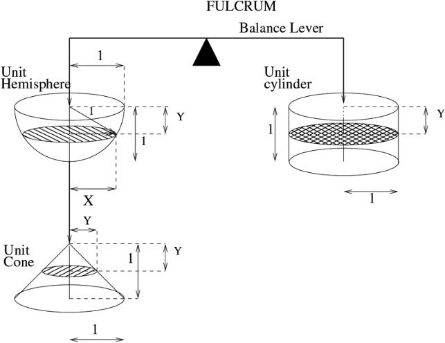

FULCRUM：支点；Balance Lever：平衡杠杆；Unit Hemisphere：单位半球体；Unit cylinder：单位圆柱体；Unit Cone：单位圆锥体。X、Y、r及数字为原图符号。

<!-- dm-ch03-024 -->

〔原书第21页〕

证明如下：从三个立体的顶部开始，逐层向下取无限小的圆形切片；在每一层，圆锥和半球的切片面积之和等于圆柱的切片面积。

<!-- dm-ch03-025 -->

〔原书第21页〕

> 1. 圆柱切片的面积很容易计算。它们是单位圆，所以面积为 $\pi=\pi 1^2$。2. 假设我们处于距每个立体顶端为 $Y$ 的位置。由于圆锥的高与其底面半径相等，在 $Y$ 处圆锥的半径也为 $Y$，因此切片面积为 $\pi Y^2$。

<!-- dm-ch03-026 -->

〔原书第22页〕

> 3. 根据毕达哥拉斯定理，穿过半球的切片的半径 $X$ 必须为 $\pi(1^2-Y^2)=\pi(1-Y^2)$。

> 校注：原书称下式为半径X，但式子实际表示截面面积。按图3.1，半径应为X=√(1−Y²)，面积为π(1−Y²)。所供旧译已改为X²=1²−Y²，现将作者原文与校正说明分开。

<!-- dm-ch03-027 -->

〔原书第22页〕

> 4. 因此，半球与圆锥的圆形截面面积之和必定为 $\pi(1-Y^2)+\pi Y^2=\pi$，证毕。

<!-- dm-ch03-028 -->

〔原书第22页〕

阿基米德还独立于这一论证，证明了单位圆柱体的体积是单位圆锥体的三倍。因此，半球的体积必为 $\frac{2}{3}\pi$，单位球的体积必为 $\frac{4}{3}\pi$。将其按比例放大到任意半径 $r$，就得到熟悉的 $\frac{4}{3}\pi r^3$。数学抽象与实际力学在这里存在密切联系。先前公理化力学中关于天平的公设，被用作出发点，推导出一种实质上属于积分学的证明。

<!-- dm-ch03-029 -->

〔原书第22页〕

他并不满足于圆锥、球体和圆柱。他进而求抛物线下的面积，为此构想了更复杂的天平装置，把三角形和抛物线下的区域悬挂在支点不同距离处。但为什么他关注抛物线等曲线？

<!-- dm-ch03-030 -->

〔原书第22页〕

鲁索[^ch3-2]认为，阿基米德的研究，尤其是他开创静水力学这一学科，与晚期希腊化文明的经济和政治秩序密切相关。鲁索指出，阿基米德所生活的锡拉库萨的经济和军事目标可以解释这一点。锡拉库萨是一支主要海军力量，致力于建造越来越大的船只。正因如此，阿基米德在静水力学分析中才关注推导浮体的稳定静止角，包括对以抛物线描述的物体如何漂浮的分析。抛物线曲线是可能的船体形状。

<!-- dm-ch03-031 -->

〔原书第22页〕

抛物线形状已被阿基米德的前辈阿波罗尼乌斯分析为圆锥的截面。绘制和构造此类曲线的方法已为人知。根据这些规则，造船师可以切割出船体的成型肋骨。

<!-- dm-ch03-032 -->

〔原书第22页〕

在希腊化时期，相互竞争的商贸国家出于经济和政治原因资助科学研究。阿基米德开创的静水力学新科学由经济和军事需求驱动，他利用它推导船体所能承受的最大稳定载荷。然而，罗马征服终结了科学资助，阿基米德也被杀。一个统一国家在地中海地区的建立，切断了科学研究的资金来源。17 世纪，法国科学院和英国皇家学会在相互竞争的海上贸易经济推动下，恢复了对科学的国家资助。

<!-- dm-ch03-033 -->

〔原书第22页〕

在上述阿基米德的证明中，他利用等价性推导球体性质。但数学中的这种等价性论证依赖关于力学的先前的公理。这些公理又假设力学定律本身由等价关系定义。

<!-- dm-ch03-034 -->

〔原书第23页〕

这也适用于他在流体静力学方面那些更为人熟知的发现。这里的关键定律是：漂浮物体排开与自身等重的液体；浸没物体则排开与自身等体积的液体，这比它自身的重量要小。我们在这里再次遇到体积的相等与重量的相等，这正是上述证明的主题。

> 校注：底本“this being less than its own weight”指代不清，字面上混用了体积与重量。若指下沉物体所排液体的重量小于物体重量，则需限定密度条件；正文保留其原有表述。

<!-- dm-ch03-035 -->

〔原书第23页〕

阿基米德用于确定质心和浮力的几何证明方法需要极高巧思和深刻理解，今天很少有人能掌握。我们改用有限元方法，本质上是数值积分，作为替代。然而，没有电子计算工具，几何学仍是解决这些问题的少数工具之一。在古典几何中，一方面有机械性的物质过程：绘制直线和相交圆；另一方面有用有理数进行的实际计算，阿基米德为$\pi$设定的明确数值界限就是例证。让我们稍作思考。

<!-- dm-ch03-036 -->

〔原书第23页〕

假设你是一位建造神庙的建筑师。你用木炭绘制图纸，也许在纸莎草纸上，也许在白色大理石板上。这些图纸构成未来神庙的物质模型。[^ch3-3]图纸用直尺和圆规等机械工具绘制。但假设图纸只使用这些工具绘制，长度由例如“正方形面积加倍法”或黄金比例矩形确定。那么你也知道最终神庙的大致线性尺寸。这些尺寸也以比例形式存在，最终可从毕达哥拉斯定理推导，这些比例必然存在于设计元素的长度之间。理论几何学确立了缩尺图纸上必然近似的测量值与最终建筑更精确的相对尺寸之间的相似性。根据所需精度，可以一边放大比例一边重复相同构造，仍使用直线和圆。直线可以通过立柱的视觉对齐标记，大圆可以用锚定在固定点的绷紧链条描绘。

<!-- dm-ch03-037 -->

〔原书第23页〕

机械唯物主义使一种物质系统——平面图——能够作为另一种物质系统——神庙——的模型。二者都是物质。平面图与建筑之间的相似性，通过在放大比例上重复相同构造步骤得到保证。所构建的图像既是客观知识，也是建筑的目的（telos）。物理建模过程使众多工匠能够协调合作，每人建造子组件、立柱、基座等，其各自尺寸由黄金比例协调。

<!-- dm-ch03-038 -->

〔原书第23页〕

## 古代唯物主义者对原子论的批评

<!-- dm-ch03-039 -->

〔原书第23—24页〕

古代存在不认同原子论的唯物主义者。原子论虽然根本有效，但在古典时期失去了公信力。这是因为它试图解释一些对当时粗浅原子论来说过于复杂的现象。伊壁鸠鲁知道静电和磁现象。他知道摩擦过的琥珀棒会吸引灰尘和谷壳，磁石会吸引铁。

<!-- dm-ch03-040 -->

〔原书第24页〕

他对此的解释是：起吸引作用的物体（琥珀或磁石）释放出微小粒子，其大小比其他物质的原子小一万倍。这些更小的原子形状特殊，会与被吸引物体缠绕，把二者结合。

<!-- dm-ch03-041 -->

〔原书第24页〕

我们现在知道，静电吸引确实涉及更小粒子：琥珀摩擦时发生电子转移。电子确实比构成琥珀的原子轻数万倍。但在没有正负电荷概念和超距作用力概念时，伊壁鸠鲁学派的解释似乎不可信。应用于磁学时更不可思议。

<!-- dm-ch03-042 -->

〔原书第24页〕

原子论是古典罗马医学中的重要哲学流派，主要由阿斯克勒皮亚德斯倡导。这一观点认为，疾病源于允许分子循环的微小体孔收缩或扩张。如果体孔收缩，疾病被归类为“停滞”；如果扩张，则被归类为“流溢”。

<!-- dm-ch03-043 -->

〔原书第24页〕

该假说并非完全荒谬，因为现代医学仍承认血管收缩和血管扩张可能是病理现象。但应用于解剖细节时，它可能变得荒谬。阿斯克勒皮亚德斯认为，水通过膀胱壁上不可见的微小通道从血液进入膀胱。

<!-- dm-ch03-044 -->

〔原书第24页〕

另一位医学导师盖伦是解剖学专家，他轻而易举地驳斥了这些关于膀胱的说法。他描述了活体解剖实验，证明膀胱通过输尿管流入尿液而充盈：

<!-- dm-ch03-045 -->

〔原书第24页〕

> 现在，证明方法如下。必须切开输尿管前方的腹膜，然后用结扎线固定输尿管，接着给动物包扎好，再放它走（因为它不会继续排尿）。此后，松开外部绷带，显示膀胱是空的，而输尿管完全充盈并膨胀——事实上几乎要破裂；解开输尿管结扎线后，便可清楚看到膀胱充盈尿液。[^ch3-4]

<!-- dm-ch03-046 -->

〔原书第24页〕

在从解剖学上批判伊壁鸠鲁学派后，盖伦接着质疑他们对静电和磁吸引的解释。他说，伊壁鸠鲁认为铁被磁石吸引，谷壳被琥珀吸引。他解释说，从磁石流出的原子容易与从铁流出的原子相互交织，导致缠结和吸引。尽管假说缺乏说服力，伊壁鸠鲁承认吸引存在。但很难相信磁石粒子能吸引铁。即使接受这一点，仍无法解释为什么铁会粘在另一块铁上。这是如何发生的？

<!-- dm-ch03-047 -->

〔原书第24—25页〕

> 粒子与铁碰撞后反弹，使铁悬浮吗？还是它们穿透铁块，与另一块铁碰撞而无法穿透？然后它们回到第一块铁，像之前那样造成缠结吗？

<!-- dm-ch03-048 -->

〔原书第25页〕

> 这一假说因其荒谬而被明确驳斥：事实上，我曾见过五根铁制书写针成一排相互附着，只有第一根与磁石接触，而磁力通过它传递给其余几根。此外，不能说如果把第二根铁笔与第一根下端接触，它就被固定、附着并悬停；而如果接触针身侧面任何其他部位，它却不会附着。因为磁石的力量向四面八方扩散；它只需在任何一点与第一根针接触；力量便从这根针出发，快如思想般流经第二根，再从第二根流向第三根。现在，试想一块小磁石悬挂在屋内，其四周接触大量铁片，这些铁片又连接其他铁片，这些铁片再连接其他铁片，如此类推——所有这些铁片必然充满从磁石散发的微粒；因此，这块小磁石很可能因分解为这些散发物而消散。[^ch3-5]

<!-- dm-ch03-049 -->

〔原书第25页〕

直到20 世纪中叶，人们才真正理解铁的磁性。正确理解磁性需要一系列进一步进展：超距作用力、法拉第对电与磁现象的统一，以及电子和电子自旋的发现。

<!-- dm-ch03-050 -->

〔原书第25页〕

盖伦致力于推广一种与之竞争的唯物主义生理学理论，允许物质相互转化。他认为食物通过肝门静脉的一种能力转化为血液。他嘲笑“面包中包含肉和骨的元素”这一说法，主张身体具有转化物质的能力。

<!-- dm-ch03-051 -->

〔原书第25页〕

盖伦认为，神经以气动方式工作。这一理论最早由埃拉西斯特拉图斯提出，他认为神经中有空腔，精神之气（psychic pneuma）[^ch3-6]从中通过。气压沿神经传导，使肌肉膨胀并由此收缩。盖伦与埃拉西斯特拉图斯在生理学上都相信“气”（pneuma）的作用。吸入的空气在肺中转化为生命之气（vital pneuma），与血液混合并到达脑部。在那里，它被转化为精神之气，即“动物精气”（spiritus animalis），调节脑与神经的功能。[^ch3-7]

<!-- dm-ch03-052 -->

〔原书第25页〕

生命依赖空气这一点显而易见。如果动物鼻孔和嘴巴被堵住，它就会窒息。他的解剖实验证明，如果切断神经，被解剖动物在该神经支配区域就失去运动能力。此外，古人懂得制造气动装置，甚至简单气动自动机。气动技术是那个时代的先进技术。[^ch3-8]

<!-- dm-ch03-053 -->

〔原书第25页〕

盖伦的唯物主义为天主教话语中的唯心主义主题奠定基础。他否认不朽灵魂存在，认为意识取决于大脑。在随后的基督教时期，一种经过修改的理论出现：不朽精神栖息于大脑脑室，赋予身体生命。这把原本的唯物主义理论转变为其对立面。

<!-- dm-ch03-054 -->

〔原书第26页〕

不再认为动物精气由身体从吸入肺部的物质空气（pneuma）制造，而是《天主教教理》声称：

<!-- dm-ch03-055 -->

〔原书第26页〕

> 基督教关于人的观点——人按上帝形象被造，既有灵性灵魂又有肉体——具有核心重要性。灵魂是我们内心承载的永恒之种，不能仅归结为物质，其起源只能来自上帝。

<!-- dm-ch03-056 -->

〔原书第26页〕

> ……

<!-- dm-ch03-057 -->

〔原书第26页〕

> 人体之所以是人，恰恰因为它被灵性灵魂赋予生命。

<!-- dm-ch03-058 -->

〔原书第26页〕

基督教教义是过去实验科学被扭曲的记忆或被误解的遗迹。spiritus（盖伦 pneuma 的拉丁译名）原本的气力机械含义完全丧失。这个词脱离原义，变成完全抽象的概念，神学家便可随意赋予它想象属性。

<!-- dm-ch03-059 -->

〔原书第26页〕

## 牛顿

<!-- dm-ch03-060 -->

〔原书第26页〕

在牛顿时代，若有人提及古典思想家，指的是希腊人和罗马人。如今，随时间流逝，牛顿被视为机械唯物主义的典范哲学家，以至于“经典力学”和“牛顿力学”实际上成为同义词。

<!-- dm-ch03-061 -->

〔原书第26页〕

通过卢克莱修，宇宙由不断运动的粒子构成的观念在古典文明衰落后存续。通过阿基米德，后来被称为静力学的理论也存续。我们现在知道，阿基米德还发展了非常接近微积分的数学技术。但让我们了解这些内容的手稿直到19 世纪末才印刷出版。鲁索[^ch3-9]推测，也许牛顿接触过这部及其他后来因霉变和腐朽失传的古典文献。无论推测是否属实，微分学正是通过牛顿和莱布尼茨传播的。牛顿把力学从静止物体科学转变为运动物体科学。

<!-- dm-ch03-062 -->

〔原书第26页〕

## 哲学的任务

<!-- dm-ch03-063 -->

〔原书第26页〕

牛顿把哲学任务阐述如下：

<!-- dm-ch03-064 -->

〔原书第26页〕

> 我们提供这部著作作为哲学的数学原理；因为哲学的全部困难似乎在于：从运动现象出发探究自然力，再从这些力出发证明其他现象。

<!-- dm-ch03-065 -->

〔原书第27页〕

从运动观察出发，从中推断力和运动定律。这使你能够审视新情况并预测将发生什么。每一艘抵达火星或木星的太空探测器都证实这一方法。

<!-- dm-ch03-066 -->

〔原书第27页〕

我们注意到，卢克莱修的原子论也基于对经验可观察现象的演绎。作为诗人，这些推论自然流露于叙述；作为哲学家，牛顿将其系统化为四条明确推理规则：

<!-- dm-ch03-067 -->

〔原书第27页〕

## 规则 I

<!-- dm-ch03-068 -->

〔原书第27页〕

> 对于自然事物，我们承认的原因不应多于既能解释其现象又真实且充分的原因。

> 校注：本书英文底本此处作 time，语义不通；中文按上下文采用“真实”，英文仍照录 time，未将校正混入底本文字。

<!-- dm-ch03-069 -->

〔原书第27页〕

> 为此，哲学家们说自然不做无用之事，当较少原因足够时，更多原因就是无用；因为自然喜欢简单，不追求多余原因的浮华。[^ch3-10]

<!-- dm-ch03-070 -->

〔原书第27页〕

这就是俗称的KISS 原则：Keep It Simple, Stupid（笨蛋，保持简单）。在此之前，它被称为奥卡姆剃刀：不应在必要原因之外增加实体。牛顿只是重申前辈哲学家的共识：简单解释优于复杂解释。

<!-- dm-ch03-071 -->

〔原书第27页〕

在数学上，这意味着探索自然法则时应优先选择最简单公式，而非更复杂公式。牛顿的同时代人莱布尼茨也持相同观点：

<!-- dm-ch03-072 -->

〔原书第27页〕

> 因此，让我们假设，例如，有人像那些从事荒谬地占术（geomancy）的人一样，在纸上随意标出若干点。我认为，完全可能找到一条几何曲线，其运动恒定且均匀，遵循某种规则，使这条曲线按照手写下这些点的顺序依次穿过所有点。

<!-- dm-ch03-073 -->

〔原书第27页〕

> 但当规则极其复杂时，符合该规则的事物便被视为不规则。因此可以说，无论上帝以何种方式创造世界，它始终有规律并符合某种普遍秩序。然而上帝选择了最完美的世界，即在假设上最简单、在现象上最丰富的那一个，正如几何学中一条构造简单但性质与效果极其显著且影响广泛的曲线。[^ch3-11]

<!-- dm-ch03-074 -->

〔原书第27页〕

莱布尼茨打算用何种具体方法，构造一条穿过所有随机点的光滑曲线，并未说明。在18世纪，或许会用如下多项式来拟合这些点：

<!-- dm-ch03-075 -->

〔原书第27页〕

$a+bx+cx^2+dx^3+ex^4+\cdots$

<!-- dm-ch03-076 -->

〔原书第28页〕

傅里叶后来发现一种技术，可以用正弦和余弦函数把曲线任意拟合到点上。我们稍后回到这一点。

<!-- dm-ch03-077 -->

〔原书第28页〕

牛顿能举出的最明显的例子，是他的太阳系解释比托勒密简单得多。

<!-- dm-ch03-078 -->

〔原书第28页〕

用牛顿力学处理太阳系，我们需要每颗行星在时间0 的角动量、半径和旋转相位。运动定律提供其余信息。这意味着每颗行星只需三个数。我忽略太阳质量和引力常数，因为假设它们已知，只考虑每颗行星的额外信息。

<!-- dm-ch03-079 -->

〔原书第28页〕

托勒密模型中，每颗行星绕地球旋转，一个均轮上还有一个本轮旋转。因此至少需要两个半径、两个旋转速率和两个初始相位：每颗行星六个数。所需参数数量是牛顿模型的两倍，形成冗余。因此基于信息经济性，牛顿更可取。他的理论还额外能解释彗星运动，而旧天文学没有相关定律。

<!-- dm-ch03-080 -->

〔原书第28—29页〕

如果允许本轮叠加本轮，原则上可以把观测数据拟合到任意精度。如图3.2 所示，托勒密方法相当于把余弦波相加。我们把它简化为向水平轴的投影。对托勒密天文观测，x 轴是天球黄道360°，他以此为参照绘制行星位置。显然，这与傅里叶分析相同。[^ch3-12]信号的傅里叶分解为不同频率余弦波，正是JPEG 和MPEG 等图像压缩方案使用的方法。观看YouTube 视频时，你看到的是托勒密方法在运作。计算机把图像分析为不同旋转速度的“本轮”。视频文件包含这些本轮半径，视频编解码器据此重建原始图像的近似。

<!-- dm-ch03-081 -->

〔原书第28页〕

图3.2 具有本轮运动路径的物体，其轨道在x轴上的投影是余弦曲线之和。本轮直径为0.2，转速是大圆的两倍。右图绘出余弦曲线及其和。作者绘图。

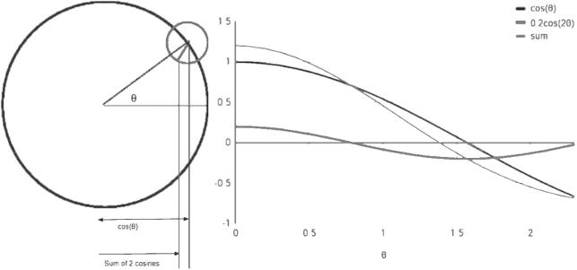

cos θ：余弦 θ；0.2 cos 2θ：0.2倍的余弦 2θ；sum：两者之和。坐标数字及θ沿用原图。

<!-- dm-ch03-082 -->

〔原书第29页〕

正如莱布尼茨暗示的，我们可以把方法应用于任何数据集。图3.3 应用于石油销量（百万桶）与每桶价格之间的关系。

<!-- dm-ch03-083 -->

〔原书第29页〕

公式：

<!-- dm-ch03-084 -->

〔原书第29页〕

$p=136\cos(2+\theta)+27.7\cos(2+2\theta)+39.5\cos(2+3\theta)+19.6\cos(2+4\theta)+62\cos(2+5\theta)+52\cos(2+6\theta)+50.1\cos(2+7\theta)+37\cos(2+8\theta)+70.5\cos(2+9\theta)+19\cos(2+10\theta)$

<!-- dm-ch03-085 -->

〔原书第29—30页〕

其中 $\theta=\pi(q-80)/10$，$p$ 是油价，$q$ 是销量。这正是莱布尼茨所说的情形：“我认为，完全可能找到一条几何曲线，其运动恒定且均匀，遵循某种规则，使这条曲线按照手写下这些点的顺序依次穿过所有点。”

<!-- dm-ch03-086 -->

〔原书第29页〕

图3.3 一条连续曲线，穿过代表2007年至2016年间所采集的世界石油价格／出货量数据的各点。此曲线用托勒密天文学所用的本轮方法生成。作者绘图。

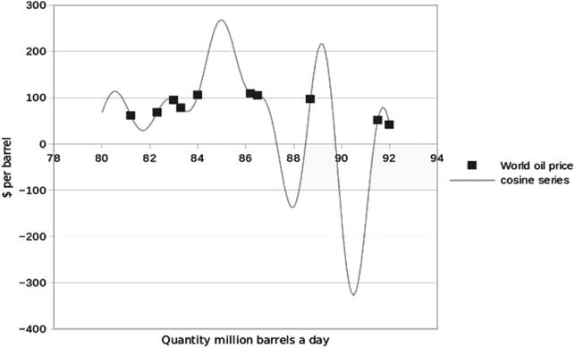

$ per barrel：美元／桶；Quantity million barrels a day：每日数量（百万桶）；World oil price：世界石油价格；cosine series：余弦级数。

<!-- dm-ch03-087 -->

〔原书第30页〕

但显然，把该公式等同于根据供应量调节油价的定律是荒谬的。该规则“极其复杂”，符合它的数据“不规则”。相比之下，牛顿运动定律简单且规律性极强地应用于天文现象。因此它们被视为真正的自然定律。

<!-- dm-ch03-088 -->

〔原书第30页〕

## 规则 II

<!-- dm-ch03-089 -->

〔原书第30页〕

> 因此，对相同自然效果，必须尽可能赋予相同原因。

<!-- dm-ch03-090 -->

〔原书第30页〕

> 例如人与动物的呼吸；欧洲与美洲的石头下落；烹饪之火与太阳的光；地球与行星上的光反射。

<!-- dm-ch03-091 -->

〔原书第30页〕

例子虽旧且通俗，但这些例子与这一原则仍被接受。根据光谱估算遥远恒星温度时，我们假设那里与地球适用相同黑体辐射定律。天文学家利用地球矿物样本反照率推导小行星成分时，也应用这一原则。

<!-- dm-ch03-092 -->

〔原书第30页〕

其背后是刻意排除超自然或宗教原因。牛顿的同时代人会明白，这里指阿那克萨戈拉：他最早提出月球是反射太阳光的岩石，太阳本身是燃烧岩石，因这一不敬神的说法被放逐出雅典。牛顿在规则II 中隐含站在古代唯物主义者一边。

<!-- dm-ch03-093 -->

〔原书第30页〕

## 规则 III

<!-- dm-ch03-094 -->

〔原书第30页〕

> 那些不允许增强或减弱程度、且被发现属于实验范围内所有物体的性质，应被视为所有物体的普遍性质。

<!-- dm-ch03-095 -->

〔原书第30页〕

科学需要这一规则才能从实验概括。牛顿用摆实验研究动量守恒定律。如果动量守恒在实验中成立，他推断同样适用于月球和行星。阿基米德观察自己入浴时水被排开，推断船只入海也排开一定体积水。

<!-- dm-ch03-096 -->

〔原书第30页〕

## 规则 IV

<!-- dm-ch03-097 -->

〔原书第30—31页〕

> 在实验哲学中，我们应把通过一般归纳从现象中收集的命题视为准确或非常接近真实，尽管可能想象出相反假设，直到出现其他现象使它们更精确或表明例外。

<!-- dm-ch03-098 -->

〔原书第31页〕

> 我们必须遵循这一规则，以免归纳论证被假设规避。

<!-- dm-ch03-099 -->

〔原书第31页〕

鉴于“假设”一词当前联想，这容易被误解。科学通常被描述为提出假设，然后由观察和实验检验。牛顿为何说“我不做假设”？

<!-- dm-ch03-100 -->

〔原书第31页〕

在此语境中，他指关于世界必须如何运作的先验假设。例如地球固定在宇宙中心，或力只能通过直接物理接触作用。若坚持其中任何一种，就会规避他在《世界体系》中建立的归纳论证。

<!-- dm-ch03-101 -->

〔原书第31页〕

我们稍后探讨“通过假设规避归纳论证”在历史唯物主义中如何引发争议。

<!-- dm-ch03-102 -->

〔原书第31页〕

## 关于力学的一点说明

<!-- dm-ch03-103 -->

〔原书第31页〕

我们上文说牛顿力学建立在古典力学基础上；在阿基米德部分，我们叙述几何学本身对古人而言是用于建筑的机械艺术。牛顿在《原理》全书中依赖古典几何学。他把方法延伸至微积分，但在研究天体运动时仍以欧几里得为立足点。

<!-- dm-ch03-104 -->

〔原书第31页〕

他对机械艺术与几何学关系有有趣观察：

<!-- dm-ch03-105 -->

〔原书第31页〕

> 描绘直[^ch3-13]线和圆是问题，但不是几何问题。这些问题的解决需要力学；几何学展示解决后的应用；几何学的荣耀在于，它仅凭从外部引入的少数原理，便能产生如此多东西。

<!-- dm-ch03-106 -->

〔原书第31页〕

他说，描绘直线和圆——即绘制或标定——不是几何问题，而是制图师或测量员的机械实践问题。公理化演绎几何学利用这些力学简单结果，展示如何组合它们以“产生如此多东西”。

<!-- dm-ch03-107 -->

〔原书第31页〕

> 因此几何学建立在机械实践上，无非是普遍力学中准确提出并证明测量艺术的部分。但由于手工技艺主要涉及物体运动，几何学通常归于大小，力学归于运动。在这个意义上，理性力学将成为一门科学：准确提出并证明由任何力产生的运动，以及产生任何运动所需的力。

<!-- dm-ch03-108 -->

〔原书第32页〕

这门科学研究的是物质物体的运动。他将借助几何学，分析运动及引起运动的力。接下来，他定义了自己以几何方式处理物质与运动时将要使用的术语。

<!-- dm-ch03-109 -->

〔原书第32页〕

## 定义

<!-- dm-ch03-110 -->

〔原书第32页〕

## 定义 I

<!-- dm-ch03-111 -->

〔原书第32页〕

> 物质的量是同一物质的度量，由密度和体积共同产生。

<!-- dm-ch03-112 -->

〔原书第32页〕

> 因此，密度加倍的空气，在双倍空间中，量是四倍；在三倍空间中，量是六倍。雪、细尘或粉末经压缩或液化而致密，以及所有因任何原因以不同方式致密化的物体，都应如此理解。我在此不考虑任何可能自由渗透物体各部分间隙的介质。今后我无论何处提到物体或质量，都指这个量。它通过每个物体的重量得知；因为重量与它成正比，正如我通过精密摆实验发现的那样，后文将展示。

<!-- dm-ch03-113 -->

〔原书第32页〕

他把重量确立为物质度量，并把重量与体积区分。这在经验上显而易见，但在两个重要意义上具有重要意义：

<!-- dm-ch03-114 -->

〔原书第32页〕

> 1. 他明确把假设的光以太（luminiferous ether）排除在质量之外，提到“一种介质（如果真有的话），它自由渗透物体各部分之间的间隙”。如果这种以太存在，他说它是无质量或非物质的。2. 他主张惯性质量与引力质量等价。虽然直到后来阐述万有引力定律才明显，但他预先提到用摆实验证明。

<!-- dm-ch03-115 -->

〔原书第32页〕

## 定义 II

<!-- dm-ch03-116 -->

〔原书第32页〕

> 运动量是同一运动的度量，由速度和物质量共同产生。

<!-- dm-ch03-117 -->

〔原书第32页〕

> 整体的运动是各部分运动之和；因此，质量加倍、速度相等时，运动量加倍；在这一质量加倍的物体中，速度也加倍时，运动量为四倍。

<!-- dm-ch03-118 -->

〔原书第32页〕

牛顿所说的运动即我们现在所说的动量，因此他用文字给出定义方程$p=mv$ 。《原理》中还没有独立动能概念。我们稍后回到这一点。

<!-- dm-ch03-119 -->

〔原书第33页〕

## 定义 IV

<!-- dm-ch03-120 -->

〔原书第33页〕

> 外力是作用于物体以改变其状态的作用，无论是静止状态还是沿直线匀速运动状态。

<!-- dm-ch03-121 -->

〔原书第33页〕

这是定性定义，由定律I 和II 赋予定量意义。它在很大程度上依赖定律获得含义。这是以下内容的引子：

<!-- dm-ch03-122 -->

〔原书第33页〕

## 定义 V

<!-- dm-ch03-123 -->

〔原书第33页〕

> 向心力是使物体被吸引、推动或以任何方式趋向作为中心的某一点的力。

<!-- dm-ch03-124 -->

〔原书第33页〕

这里他首次把方向性引入力。有趣的是，在定义IV 中力还不是向量，没有方向性。引入方向性时，他特指向心吸引力。可能由于未引入参考系，他认为无法定义方向性。一个点允许定义朝向该点的方向性，也允许定义远离该点的力——离心力。全书大部分，牛顿谨慎处理不同力律，考虑与距离成反比、与距离平方成反比、与距离立方成反比等。令人惊讶的是，他把定义限制在吸引力，而未定义排斥力。即使当时未研究静电斥力，磁斥力已被研究。

<!-- dm-ch03-125 -->

〔原书第33页〕

## 定义 III

<!-- dm-ch03-126 -->

〔原书第33页〕

> vis insita（内在力），或物质固有力量，是抵抗的力量，每个物体凭此尽力保持当前状态，无论是静止还是沿直线匀速运动。

<!-- dm-ch03-127 -->

〔原书第33页〕

他定性定义惯性质量。然而在当今公认的牛顿力学表述中，惯性不会被描述为力。

<!-- dm-ch03-128 -->

〔原书第33—34页〕

他还有三个定义（VI–VIII）给出量化向心力的不同方式。第一个定义为“与从中心通过周围空间传播它的原因的效力成正比”，这有些晦涩，因为不清楚如何衡量原因效力及单位。下一个定义把向心力的加速度量定义为与单位时间诱导速度成正比。在$f=ma$关系中，这相当于忽略被加速物体的惯性质量，在处理围绕大质量物体运行的不同小质量时完全合理。此时测量引力的“加速度量”等同于我们现在所说的引力场强度：牛顿每千克。他最后把向心力的动力量定义为与给定时间产生的运动成正比。他用“运动”指动量 $mv$ ，因此似乎指以千克米每秒平方为单位的量。

<!-- dm-ch03-129 -->

〔原书第34页〕

## 时间与空间

<!-- dm-ch03-130 -->

〔原书第34页〕

“物体与虚空”概念对古典原子论至关重要。对牛顿而言，任何关于物体运动的系统理论都必须先有时间和空间的概念定义。他对时间和空间的定义被广泛引用，因为正是在这一问题上，后爱因斯坦物理学与他分歧。

<!-- dm-ch03-131 -->

〔原书第34页〕

## 时间

<!-- dm-ch03-132 -->

〔原书第34页〕

> 绝对的、真实的、数学的时间，就其自身和本性而言，均匀流逝，与任何外部事物无关，又名持续时间；相对的、表观的、普通的时间，是借助运动对持续时间作出的一种可感知的外部度量（无论准确还是不均匀），通常用来代替真实时间；例如一小时、一天、一月、一年。

<!-- dm-ch03-133 -->

〔原书第34页〕

牛顿在此使用隐喻：绝对时间流动。但比喻虽合理，却自相矛盾。溪流流动时在运动，其运动在时间语境中定义。

<!-- dm-ch03-134 -->

〔原书第34页〕

我们把树枝扔进桥一侧；几秒后它出现在另一侧，于是得出河水流动。但测量流动需要两个不同时间观察。在$t_0$，树枝落入河流；在$t_0+8$秒，我们看到树枝从桥另一侧下游4 米处浮出。于是水流速度为每秒半米。

<!-- dm-ch03-135 -->

〔原书第34页〕

这是空间相对于时间的流动。但时间相对于什么流动？

<!-- dm-ch03-136 -->

〔原书第34页〕

谈论“时间流动”在逻辑上与谈论“空间距离流动”一样无意义。

<!-- dm-ch03-137 -->

〔原书第34页〕

如果绘制$y=x^2$ ，可以说曲线相对于x 轴向上流动，并求导数 $2x$ ，它告诉我y 随x 变化向上流动多快。但我能这样做，因为涉及两个正交维度。类似地，对下落物体方程$y=4.9t^2$及导数$v_y=9.8t$ ，可确定物体在时间t 的空间向下流动。这同样因为方程中时间是正交维度。但时间不能相对于自身流动。

<!-- dm-ch03-138 -->

〔原书第34页〕

但他刚引入流动的绝对时间，就把它搁置，引入实际使用的相对时间。

<!-- dm-ch03-139 -->

〔原书第34—35页〕

他所说的可感或相对时间由运动衡量，例如年或小时。这些确实由运动衡量：一年是地球绕太阳公转，一天是地球自转。到牛顿时代，人类工艺已制造钟表，其运动模拟地球运动，地球自转一圈时针转两圈。

<!-- dm-ch03-140 -->

〔原书第35页〕

据牛顿，运动不能以绝对时间为参照测量，只能相对于其他运动测量。在天文学中，古典天文学家通过测量恒星或参考星相对于天顶的角度，确定月球掩恒星的时刻。

<!-- dm-ch03-141 -->

〔原书第35页〕

然后转换为恒星时[^ch3-14]记录。牛顿旨在解释行星运动，在没有独立时间尺度时观察运动与位置相关性。他认为所有运动在概念上相对于时间定义，形成时间维度。地球以绝对时间为基准自转，月球绕地球角运动。牛顿从稳定比例存在推断，这些不同旋转有共同、绝对、客观的时间维度。

<!-- dm-ch03-142 -->

〔原书第35页〕

## 空间

<!-- dm-ch03-143 -->

〔原书第35页〕

> 绝对空间，就其本性而言，与任何外部事物无关，始终相似且不动。相对空间是绝对空间的某种可移动维度或度量；我们的感官通过其相对于物体的位置确定它；通常被当作不动空间；例如地下、空中或天体空间的维度，由相对于地球的位置决定。

<!-- dm-ch03-144 -->

〔原书第35页〕

牛顿假设的绝对空间在20 世纪物理学中随相对论被抛弃。但他刚提出绝对空间，就转向相对空间。他知道并接受伽利略相对性：在匀速运动的参考系中，运动定律不变。

<!-- dm-ch03-145 -->

〔原书第35页〕

他后来用船的例子阐述：

<!-- dm-ch03-146 -->

〔原书第35页〕

> 我们从船实验得到明确证明；无论船静止还是沿直线匀速前进，所有运动以相同方式发生。

<!-- dm-ch03-147 -->

〔原书第35页〕

但既然接受伽利略相对性，为何坚持绝对空间？我们认为理由在他对运动的定义最后部分。

<!-- dm-ch03-148 -->

〔原书第35页〕

## 运动

<!-- dm-ch03-149 -->

〔原书第35—36页〕

> 绝对运动是物体从一个绝对位置向另一个绝对位置的平移；相对运动是从一个相对位置向另一个相对位置的平移。因此在航行船上，物体的相对位置是它占据的船体部分，或它填充的船舱部分，因此随船移动；相对静止是物体持续位于船的同一部分或船舱同一部分。但真实绝对静止是物体持续位于不可移动空间的同一部分，而船本身、船舱及其中一切都在该空间中运动。因此，如果地球确实静止，船上相对静止的物体将以船在地球上的相同速度真实绝对运动。但如果地球也运动，物体真实绝对运动将部分来自地球在不可移动空间中的真实运动，部分来自船在地球上的相对运动；如果物体在船内也相对运动，其真实运动将部分来自地球在不可移动空间中的真实运动，部分来自船在地球上的相对运动。假设地球上船所在部分以10010 份速度向东运动；船本身在强风满帆下以10 份速度向西航行；一名水手在船上以所述速度的1份向东行走；那么水手在不可移动空间中以10001 份速度真实向东移动，而在地球上以9 份速度相对向西移动。

> 校注：此段底本在物体也相对于船运动的分句中，仍只列地球与船的运动，表述有所脱落；后面的水手算例明确计入了水手相对于船的速度。译文保留底本而不擅补引文。

<!-- dm-ch03-150 -->

〔原书第36页〕

但他接着解释为何既存在绝对运动又存在相对运动。

<!-- dm-ch03-151 -->

〔原书第36页〕

> 但我们可以通过性质、原因和效果区分静止与运动、绝对与相对。静止的性质是：真正静止的物体彼此确实静止。因此，尽管在遥远恒星区域或更远处可能存在绝对静止物体；但仅凭我们区域内物体相对位置，无法知道其中任何一个是否与那个遥远物体保持相同位置；因此绝对静止不能由我们区域内物体位置确定。

<!-- dm-ch03-152 -->

〔原书第36页〕

> 区分绝对与相对运动的效果，是远离圆周运动轴心的离心力。因为纯粹相对圆周运动中没有这种力，但真实绝对圆周运动中有，大小取决于运动量。

<!-- dm-ch03-153 -->

〔原书第36页〕

最后一点非常重要。

<!-- dm-ch03-154 -->

〔原书第36—37页〕

绝对平移已被迈克尔逊–莫雷实验否定，但牛顿已指出，除旋转外绝对空间不可测量。他通过思想实验证明：用绳子把半桶水悬挂在树上。水最初静止，桶旋转后运动传给水，水开始旋转。水面两侧向上弯曲，表明水最初相对于绝对空间未旋转。桶壁约束产生向心力，使水在边缘堆积。

> 校注：本书英文将实验名拼作 Michaelson-Morely；中文按通常译名“迈克尔逊—莫雷”处理，英文照录。这里关于绝对空间和水桶实验的推论属于原作者论述。

<!-- dm-ch03-155 -->

〔原书第37页〕

这个思想实验很有说服力。

<!-- dm-ch03-156 -->

〔原书第37页〕

## 定律

<!-- dm-ch03-157 -->

〔原书第37页〕

他的运动定律为自然法则树立标准。此前已有阿基米德浮体排水定律和伽利略加速度定律[^ch3-15]，但此前没有哲学家提出完整运动定律。

<!-- dm-ch03-158 -->

〔原书第37页〕

> 每个物体都保持静止状态或沿直线匀速运动状态，除非施加于它的力迫使它改变这一状态。[^ch3-16]

<!-- dm-ch03-159 -->

〔原书第37页〕

> 运动量的改变始终与施加的驱动力成正比，并沿该力施加的直线方向发生。[^ch3-17]

<!-- dm-ch03-160 -->

〔原书第37页〕

> 对每个作用，总有一个大小相等、方向相反的反作用；或者说，两个物体彼此之间的相互作用总是大小相等、方向相反。

<!-- dm-ch03-161 -->

〔原书第37页〕

> 如果你用手指压石头，手指也被石头压。如果马拉绳子系着的石头，马（如果可以这么说）也被同样向石头方向拉回：因为拉伸的绳子努力恢复原状，会把马向石头方向拉，与把石头向马方向拉一样多，并阻碍一方前进，恰如促进另一方前进。[^ch3-18]

<!-- dm-ch03-162 -->

〔原书第37页〕

定律III 是明确等价关系，建立在阿基米德力学等价关系上。牛顿用手指压石头例子重申伽利略更有限的观点：

<!-- dm-ch03-163 -->

〔原书第37页〕

> 当人手持石头时，他所做的难道不是施加向上推力［virtù impellente］，其大小等于重力向下拉石头的力量［facoltà］吗？只要你握住石头，难道不是持续施加这种力［virtù］吗？

<!-- dm-ch03-164 -->

〔原书第37页〕

伽利略只在物体与重力平衡的特殊情况给出作用反作用等式。牛顿把它扩展为运动和加速物体的普遍原理，无论力性质如何。

<!-- dm-ch03-165 -->

〔原书第37页〕

牛顿首次提出变化和运动力学，其中所有变化和运动都受普遍等价关系和约束支配，这些关系可用数学处理。在牛顿那里，与阿基米德和伽利略一样，数学处理主要基于古典几何。他的文本不断穿插几何图示，以说明其论证。论述力合成时，他写道：

<!-- dm-ch03-166 -->

〔原书第38页〕

> 物体在两个力共同作用下，会在同一时间内描绘出平行四边形的对角线；这段时间正是两个力分别作用时，物体描绘出相应边所需的时间。

<!-- dm-ch03-167 -->

〔原书第38页〕

原书无编号插图：力的平行四边形合成示意。

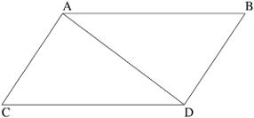

A、B、C、D为原图顶点标记。

> 校注：此图在原书中没有编号和图注；此处说明为编者补充。

<!-- dm-ch03-168 -->

〔原书第38页〕

> 由此解释任意一个直线力AD 由两个斜向力AC 和CD 合成；反之，任意直线力AD 分解为两个斜向力AC 和CD。这种合成与分解在力学中得到充分验证。

<!-- dm-ch03-169 -->

〔原书第38页〕

他提出明确守恒定律。首先是动量守恒：

<!-- dm-ch03-170 -->

〔原书第38页〕

> 运动量——通过取指向相同方向的运动之和，并取指向相反方向的运动之差而得到——在物体相互作用中不变。[^ch3-19]

<!-- dm-ch03-171 -->

〔原书第38页〕

这是守恒定律：物体集合的总动量守恒，由定律推导。回顾牛顿所说的“运动”是 $mv$ ，即速度与质量乘积，现在称为动量。他的意思是：对一组物体，若选择任意方向并计算它们在该方向的动量之和，那么物体间任何相互作用，无论相互引力还是碰撞，都不能改变该方向总动量。

<!-- dm-ch03-172 -->

〔原书第38页〕

他随后推广到重心。他论证，两个或多个物体的共同重心无论它们如何作用都保持不变，确保所有相互作用物体，排除外部作用和阻碍，要么静止，要么沿直线匀速运动。此外，两个相互作用物体系统中，它们相对于共同重心的相对运动，无论接近还是远离，由于物体之间的相互距离而相等。

> 校注：底本此段将重心“保持不变”与系统匀速运动并列，又称相对运动“相等”，措辞不够严谨。译文照录作者论述；在无外力时应区分质心匀速运动、各物体速度与各自运动量，不能把这些量混为一谈。

<!-- dm-ch03-173 -->

〔原书第38页〕

这把阿基米德重心研究扩展到通过相互作用力相互影响的运动物体，后来用于行星轨道问题。例如，这意味着月球绕地球公转时，地月重心不变。他小心限定于物体“相互作用”的效果，因为地球和月球嵌入太阳引力场时，该场影响会改变地月共同重心。

<!-- dm-ch03-174 -->

〔原书第39页〕

> 在给定空间内，物体运动彼此相同，无论该空间静止还是沿直线匀速前进且无圆周运动。

<!-- dm-ch03-175 -->

〔原书第39页〕

> 我们从船实验得到明确证明；无论船静止还是沿直线匀速前进，所有运动以相同方式发生。[^ch3-20]

<!-- dm-ch03-176 -->

〔原书第39页〕

由于地球和月球绕太阳公转时并非“无圆周运动沿直线匀速前进”，他明确把行星–卫星系统排除在规则外。但更广泛地，他主张如今所称的伽利略相对性：惯性参考系中物体相对运动不受参考系匀速运动影响。船的比喻源自伽利略。[^ch3-21]

<!-- dm-ch03-177 -->

〔原书第39页〕

牛顿明确排除圆周运动，因为在他看来，这种圆周运动通过空间区分相对与绝对运动。他援引伽利略：下落物体经过距离与时间平方成正比：

<!-- dm-ch03-178 -->

〔原书第39页〕

> 根据前两条定律和前两个推论，伽利略发现物体下落遵循时间平方比，抛射体运动呈抛物线；经验与二者相符，除非运动因空气阻力略延迟。当物体下落时，均匀重力在相等时间施加相等力，因此产生相等的速度增量；整个时间施加总力，产生与时间成正比的总速度。成比例时间内描述的距离与速度和时间乘积成正比，即与时间平方成正比。[^ch3-22]

<!-- dm-ch03-179 -->

〔原书第39页〕

这里的关系是 $v=at$ 和 $d\approx t^2$。随后，他叙述了自己用充作摆锤的钢球相互碰撞所进行的实际实验，以验证这些关系，并仔细计入空气阻力的影响。

> 校注：底本此处印作d≈t²，但前文文字说距离与时间平方成正比；比例关系通常写为d∝t²。

<!-- dm-ch03-180 -->

〔原书第39页〕

## 他证明引力的方法

<!-- dm-ch03-181 -->

〔原书第39页〕

基于运动基本定律，牛顿在《原理》第一卷考察不同力作用下物体的多种可能轨迹。他不仅研究平方反比力，事实上直到第三卷才引入万有引力定律。他从初始运动定律推导不同力下预期轨道和轨迹，得出概括：

<!-- dm-ch03-182 -->

〔原书第40页〕

> 如果周期与半径成正比，因此速度相等，向心力与半径成反比；反之亦然。

<!-- dm-ch03-183 -->

〔原书第40页〕

> 如果周期与半径的3/2 次方成正比[^ch3-23]，因此速度与半径的平方根成反比[^ch3-24]，向心力与半径平方成反比；反之亦然。

<!-- dm-ch03-184 -->

〔原书第40页〕

> 一般说来，如果周期与半径 $R$ 的任意幂 $R^n$ 成正比，因而速度与半径的幂 $R^{n-1}$ 成反比，那么向心力就与半径的幂 $R^{2n-1}$ 成反比；反之亦然。[^ch3-25]

<!-- dm-ch03-185 -->

〔原书第40页〕

他现在有把轨道周期与力性质联系的普遍规则，还能推导开普勒等面积定律作为向心力平方反比时的特例。第三卷引入六个关键事实，即“现象”：

<!-- dm-ch03-186 -->

〔原书第40页〕

> 1. 木星卫星轨道周期与其轨道半径的3/2 次方成正比。2. 土星卫星轨道周期同样与轨道半径的3/2 次方成正比。3. 五大行星——水星、金星、火星、木星、土星——绕太阳公转。4. 它们的周期与到太阳平均距离的3/2 次方成比例。5. 虽然行星以连接太阳与行星的线段为向径扫过面积与时间成正比，但连接行星与地球的半径扫过面积无此关系。6. 月球以连接地球中心与月球的线段为向径扫过面积与时间成正比。

<!-- dm-ch03-187 -->

〔原书第40页〕

所有情况他都引用当时最佳轨道半径和周期估计。基于这些现象和先前轨道周期结果，他推断木星卫星、主要行星和月球都必须受平方反比力作用而偏离直线运动。他得出结论：

> 校注：底本作drawn of rectilinear motion，疑漏一个f；中文依本段轨道论证译为“偏离直线运动”，英文保留底本。

<!-- dm-ch03-188 -->

〔原书第40页〕

> 迄今把天体束缚在轨道上的力被称为向心力；但既然已明确它只能是引力，今后称之为重力。

<!-- dm-ch03-189 -->

〔原书第40—41页〕

他随后论证引力不仅与距离平方成反比，还与物体质量成正比，无论物体被吸向哪一个天体。他的论证是：若木星及其卫星所受太阳引力与质量不成正比，木星卫星轨道会明显被太阳引力扭曲，但事实并非如此。最终表述为：引力与质量成正比，与距离平方成反比。

<!-- dm-ch03-190 -->

〔原书第41页〕

回顾整个论证结构：

<!-- dm-ch03-191 -->

〔原书第41页〕

- 首先陈述经实验验证的运动定律。

<!-- dm-ch03-192 -->

〔原书第41页〕

- 通过冗长几何证明，阐明符合这些定律及各种可设想力律的可能轨迹。

<!-- dm-ch03-193 -->

〔原书第41页〕

- 从当时所有可见卫星和行星观测，证明它们遵循平方反比引力推导的轨道。

<!-- dm-ch03-194 -->

〔原书第41页〕

- 推断既然所有观测天体遵循该定律，它就是普遍自然定律。

<!-- dm-ch03-195 -->

〔原书第41页〕

这是循环过程：最初实验提供定律，天文数据帮助推断外部力，进而推导新定律——万有引力。该定律允许演绎重建地球非球形变形和月球轨道不规则等现象，也涉及确定太阳和月亮对海洋的力。

<!-- dm-ch03-196 -->

〔原书第41页〕

## 第二卷

<!-- dm-ch03-197 -->

〔原书第41页〕

牛顿《原理》中产生持久影响的是包含运动通则和万有引力理论的第一、三卷。第二卷试图推导物体在气体和液体中运动所受阻力定律，后来证明过于简单，无法准确解释流体动力学中的力。

<!-- dm-ch03-198 -->

〔原书第41页〕

然而，在一点上，他第二卷思想经受时间考验。书中有一节《论通过流体传播的运动》，讨论压缩声波穿过流体，明确采用原子论观点。他把流体视为由原子构成，绘制为球体。他认为脉冲不能直线穿过流体，论据是：若脉冲穿过原子a、b、c、d、e，只有在原子完美对齐时才能继续。在图中，原子e 会把脉冲传给f和g，使脉冲分叉为两个分量。由此推断：声波穿过流体时，经过狭窄空腔必然发生衍射。

<!-- dm-ch03-199 -->

〔原书第41页〕

在这点上他是正确的。

<!-- dm-ch03-200 -->

〔原书第41页〕

## 黑格尔对牛顿的批判

<!-- dm-ch03-201 -->

〔原书第41页〕

德国哲学家格奥尔格·威廉·弗里德里希·黑格尔强烈批判牛顿，把他与“我们伟大的同胞开普勒——这位天赋异禀的天才”进行不利对比。在批判牛顿中，黑格尔声称开普勒本可直接从轨道定律推导万有引力平方反比定律。他写道：

<!-- dm-ch03-202 -->

〔原书第42页〕

> 事实上，他所给出的定律（即作圆周运动的物体的向径所量出的面积与时间成正比），本可以被他转化为物理定律的形式（species）（即引力与相等扇形所属的面积成比例〔in ratione〕）；由于圆 $A$ 和 $a$ 的总面积之比，等于其半径 $R$ 和 $r$ 的平方之比，我们知道 $1/A:1/a$ 等同于 $r^2/R^2$。既然 $1/A$ 和 $1/a$ 表示运动量，若愿意也可表示向心力的量，他就可以说，引力或向心力与半径或距离成反比。[^ch3-26]

<!-- dm-ch03-203 -->

〔原书第42页〕

这表明他误解牛顿和开普勒。开普勒等面积定律适用于一颗行星椭圆轨道的弧段，意味着角速度在近日点最大。黑格尔错误地把它应用于比较两颗不同行星的两个不同圆形轨道。开普勒定律并未说不同行星在相等时间扫过相等面积。事实上，行星越远，每24 小时扫过面积越小。观察金星、地球和火星轨道参数可见：

<!-- dm-ch03-204 -->

〔原书第42页〕

| 行星 | 半径（天文单位，半长轴） | 周期 | 每日面积（平方天文单位） |
| --- | --- | --- | --- |
| 金星 | 0.723 | 225 | 0.0202 |
| 地球 | 1 | 365 | 0.0172 |
| 火星 | 1.524 | 687 | 0.0139 |

> 校注：表格及“越远每日面积越小”的叙述均按底本保留。但以表内半径与周期作圆轨道近似，日扫面积πr²/T约为0.00730、0.00861、0.01062平方天文单位，与原表不符，且随半径增大而增大。原表数值更接近每日路程2πr/T；这不等同于扫过面积。

<!-- dm-ch03-205 -->

〔原书第42页〕

牛顿证明，即使引力定律形式不同，仍可得到开普勒定律，但两种情况绝对速度不同。

<!-- dm-ch03-206 -->

〔原书第42页〕

牛顿计算了形式为 $f=mMG/r^n$、其中 $n=1,2,3$ 的引力定律下开普勒轨道的性质，发现三种情形均能相容，但所预测的速度不同。

<!-- dm-ch03-207 -->

〔原书第42页〕

他随后用木星卫星轨道实际观测证明，只有平方反比定律与观测相符。我们可以用简单例子说明开普勒定律与不同引力定律的兼容性。

<!-- dm-ch03-208 -->

〔原书第42页〕

考虑卫星绕地球运行，最远点A（远地点）距离是最近点P（近地点）两倍。假设开普勒等面积定律成立，若A 点速度 $v$ ，则P 点速度必须为 $2v$ 。

<!-- dm-ch03-209 -->

〔原书第42页〕

设卫星质量为 $m$，则在A点的动能为 $0.5mv^2$，在P点为 $2mv^2$。假设牛顿引力成立，地球质量为 $M$，P与A之间的势能差为 $\int_1^2 mMG/r^2\,dr=mMG/2$。换言之，这是引力对径向距离变化的积分；力对距离的积分具有能量的量纲。因此，能量守恒要求 $1.5mv^2=mMG/2$，于是 $v=\sqrt{MG/3}$。

<!-- dm-ch03-210 -->

〔原书第43页〕

假设引力与距离成反比而非平方反比，但开普勒定律仍成立。

<!-- dm-ch03-211 -->

〔原书第43页〕

在这一情况下，将A点的新速度记为 $v_1$，于是P点的速度为 $2v_1$。此时动能之差为 $1.5mv_1^2$，它必须等于另一种力定律下的引力势能差（加速度 $\propto 1/r$），因此 $\int_1^2 mMG/r\,dr=mMG\log(2)$，我们仍可解出速度：$v_1=\sqrt{MG\log(2)/1.5}$。

<!-- dm-ch03-212 -->

〔原书第43页〕

由于 $\log(2)\ne\frac12$，在新的引力定律下，速度将会不同。

<!-- dm-ch03-213 -->

〔原书第43页〕

速度是模型中的自由变量。只有观测实际速度才能判断哪种引力模型正确。

<!-- dm-ch03-214 -->

〔原书第43页〕

## 牛顿关于轨道周期的论证

<!-- dm-ch03-215 -->

〔原书第43页〕

考虑顺时针圆周运动物体所受向心加速度。

<!-- dm-ch03-216 -->

〔原书第43页〕

显然，物体的速度 $v$ 与轨道半径成正比，与轨道周期成反比。如果在 $t_0$ 时刻，物体的速度向量为 $[0,v]$，那么四分之一圈之后，在 $t_{90}$ 时刻，它的速度将为 $[-v,0]$。它在X方向的全部初速度都已被抵消。转动周期越长，这一减速过程越缓慢。因此，向心加速度与半径成正比，与轨道周期的平方成反比。

> 校注：底本所列初速度[0,v]的X分量本来为零；按通常坐标约定，被抵消的是初始Y分量。这里保留底本X方向的表述并指出不一致。

<!-- dm-ch03-217 -->

〔原书第43页〕

$A_c\propto r/p^2$

<!-- dm-ch03-218 -->

〔原书第43页〕

该向心加速度必须等于半径r处重力加速度。牛顿考虑三种可能重力定律：

<!-- dm-ch03-219 -->

〔原书第43页〕

1. 加速度与距离成反比。鉴于胡克弹性定律也与位移线性相关，这并非不可信：

<!-- dm-ch03-220 -->

〔原书第43页〕

$A_g\propto 1/r$

<!-- dm-ch03-221 -->

〔原书第43页〕

2. 加速度与距离平方成反比，如引力在连续球层中扩散。球层表面积随半径平方增加，因此轨道天体截取面积比例呈平方反比：

<!-- dm-ch03-222 -->

〔原书第44页〕

$A_g\propto 1/r^2$

<!-- dm-ch03-223 -->

〔原书第44页〕

3. 加速度与距离立方成反比。若引力场扩展填满更大体积，行星占据半径r的太阳引力场体积份额会呈此关系：

<!-- dm-ch03-224 -->

〔原书第44页〕

$A_g\propto 1/r^3$

<!-- dm-ch03-225 -->

〔原书第44页〕

如果引力加速度就是向心加速度，则有 $A_c=A_g$。当引力与距离成反比时，就有：

<!-- dm-ch03-226 -->

〔原书第44页〕

$1/r\propto r/p^2$

<!-- dm-ch03-227 -->

〔原书第44页〕

比较从金星到土星的行星轨道（图3.4）与假设引力定律预测，平方反比定律最符合。对最接近圆形的轨道几乎完美。离心率数据见表3.2。火星是最突出离群点，因为轨道离心率较高。

<!-- dm-ch03-228 -->

〔原书第44页〕

因此可得 $p^2\propto r^2$，以及 $p\propto r$。我们可以为三种定律列出类似关系表（表3.1）。

<!-- dm-ch03-229 -->

〔原书第44页〕

然后与实际轨道数据比较，尽管每条假设引力定律都有看似合理先验依据，只有平方反比定律与数据吻合良好（表3.2）。

<!-- dm-ch03-230 -->

〔原书第44页〕

图3.4 轨道半径与周期的关系。作者绘图。

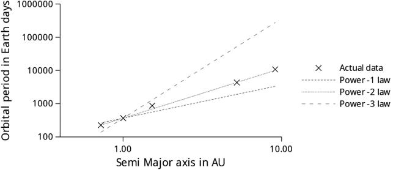

纵轴：轨道周期（地球日）；横轴：半长轴（天文单位）；Actual data：实际数据；Power -1/-2/-3 law：-1/-2/-3次幂定律。

> 校注：原图注semi-redius疑为semi-radius误拼；图中横轴明确标为半长轴。英文保留底本。

<!-- dm-ch03-231 -->

〔原书第45页〕

表3.1 牛顿考虑的三种引力定律，以及它们对轨道周期与轨道半径关系的预测。

| 幂次 | 向心加速度 | 引力加速度 | 周期定律 |  |
| --- | --- | --- | --- | --- |
| $-1$ | $A_c\propto 1/p^2$ | $A_g\propto 1/r$ | $p^2\propto r^2$ | $p\propto r$ |
| $-2$ | $A_c\propto 1/p^2$ | $A_g\propto 1/r^2$ | $p^2\propto r^3$ | $p\propto\sqrt{r^3}$ |
| $-3$ | $A_c\propto 1/p^2$ | $A_g\propto 1/r^3$ | $p^2\propto r^4$ | $p\propto r^2$ |

> 校注：原表向心加速度栏合并三行，写作A_c∝1/p²，漏掉前文随半径变化的因子r。这里保留其公式，并在每行重复展示以便阅读；正文给出的关系为A_c∝r/p²。

<!-- dm-ch03-232 -->

〔原书第45页〕

表3.2 太阳系实际轨道数据与牛顿所考虑的三种可能引力定律的预测比较。

| 幂律 | 实际周期 | 半径 | $A_g\propto 1/r$预测周期 | $A_g\propto 1/r^2$预测周期 | $A_g\propto 1/r^3$预测周期 | 离心率 |
| --- | --- | --- | --- | --- | --- | --- |
| 金星 | 225 | 0.72 | 264 | 224 | 138 | 0.01 |
| 地球 | 365 | 1.00 | 365 | 365 | 365 | 0.02 |
| 火星 | 867 | 1.52 | 556 | 687 | 1292 | 0.09 |
| 木星 | 4331 | 5.22 | 1906 | 4355 | 51960 | 0.05 |
| 土星 | 10747 | 9.11 | 3324 | 10032 | 275723 | 0.05 |
| 海王星 | 59800 | 30.18 | 11016 | 60518 | 10033936 | 0.01 |

> 校注：数据照录底本：火星实际周期在本表为867，前表为687；立方反比栏的数值近似按365r³而非表3.1给出的365r²计算。其他半径及周期数据未在译文中自行替换。本表首列表头原作Power law，实际列出行星。

<!-- dm-ch03-233 -->

〔原书第44—45页〕

相比之下，唯心主义者黑格尔试图从纯粹思想推导运动定律，蔑视实验。他论证牛顿及其追随者通过石头在投石索中旋转的例子确认离心力假说。石头试图远离转动手，拉伸投石索，一旦松手便飞射。但他说：

<!-- dm-ch03-234 -->

〔原书第45页〕

> 然而，也许哲学先验地推导出实验方法——自称哲学——试图从实验中虚假且不成功地了解的东西；这种方法以盲目热忱和感官为手段，追寻哲学真实概念的幻影。[^ch3-27]

<!-- dm-ch03-235 -->

〔原书第45页〕

黑格尔批评牛顿为证明惯性质量与引力质量相等而做的摆实验。[^ch3-28]黑格尔声称牛顿只证明不同物体重量相等。他完全忽略实验要点：我们没有先验理由认为作为重量的引力质量应等于惯性质量，即对加速度的抵抗。二者相同是经验事实，但并非必然。

<!-- dm-ch03-236 -->

〔原书第45—46页〕

物理学家推测“暗物质”有惯性质量，但仅通过引力与普通物质相互作用。反之，若牛顿错了，有惯性质量的带电粒子可能通过静电力而非引力与普通物质相互作用。但这些粒子存在仍是未解经验问题。牛顿摆实验验证引力质量与惯性质量等价，是历史序列中一环。

<!-- dm-ch03-237 -->

〔原书第46页〕

牛顿时代已知除引力外的力，如通过砝码或弹簧秤测量的绳索张力。牛顿用引力做摆实验，但也可用钟表摆轮。摆轮依靠弹簧力与轮质量对抗设定振荡周期。

<!-- dm-ch03-238 -->

〔原书第46页〕

一位在概念分析方面有黑格尔声誉的哲学家，竟完全未理解重量与惯性质量的概念区别，这告诉我们一些东西。

<!-- dm-ch03-239 -->

〔原书第46页〕

他关于行星轨道的论著是胡言乱语和民族偏见的大杂烩，既不懂开普勒、牛顿，也不懂观测事实。例如他声称地球赤道扁平：

<!-- dm-ch03-240 -->

〔原书第46页〕

> 最后，我们可以说，这些现象与地球在赤道以外比赤道更宽的形状惊人吻合，其直径比轴短。[^ch3-29]

<!-- dm-ch03-241 -->

〔原书第46页〕

除其他怪论外，黑格尔还认为太阳引力不源于巨大质量，而源于它发光：

<!-- dm-ch03-242 -->

〔原书第46页〕

他的论证如下：牛顿认为重心因行星引力轻微偏移，因此不应把重心放在太阳中。但证明曲线运动命题需要轨道中心。牛顿假设吸引与被吸引物体相互吸引，二者仿佛绕共同重心旋转。共同重心是纯数学点。太阳力中心并非必然，而源于巨大的规模，这基于“每种力取决于质量”的假设。物理哲学指出，真正力中心是光源，太阳真正力与力量必须设定于此。[^ch3-30]

<!-- dm-ch03-243 -->

〔原书第46—47页〕

鉴于这些怪异且违背事实的观点，黑格尔天文学论述很快被遗忘并不奇怪。他在20 世纪享有声誉，是因为被视为现代共产主义形成中起作用。我们稍后叙述，在俄国革命前后，他被认为为共产主义学说贡献了组成部分。列宁说马克思和恩格斯捍卫哲学唯物主义。他们的观点体现在恩格斯的《路德维希·费尔巴哈》和《反杜林论》中，这些是阶级意识工人的指南。他说马克思扩展18 世纪唯物主义，用德国古典哲学尤其是导致费尔巴哈唯物主义的黑格尔体系丰富它。列宁说马克思主要成就是辩证法，即发展和人类知识相对性学说。自然科学最新发现，如镭和电子，证实马克思的辩证唯物主义。[^ch3-31]

<!-- dm-ch03-244 -->

〔原书第47页〕

这种认可促使马克思主义者关注黑格尔，在此过程中，黑格尔对17、18 世纪唯物主义科学的原本被遗忘的反对意见在20 世纪部分复兴。我们稍后探讨苏联机械论者与受黑格尔影响的德博林学派争论。在这场争论中，德博林一方呼应黑格尔反对意见，即机械论依赖“外部”力量。在黑格尔那里，反对所谓外部力量的论点具有明确宗教性质，因为上帝行为不是外部、机械、任意或偶然的。根据实验哲学，上帝赋予物质的力量确实存在于物质内部，构成其本质。但力学无法理解，因为它只处理外部原因，不通过理性认识自然。[^ch3-32]

<!-- dm-ch03-245 -->

〔原书第47页〕

这种对“外部”力量的反复纠缠在20 世纪30 年代共产主义哲学文献中再次出现。例如美国马克思主义者埃默里写道：

<!-- dm-ch03-246 -->

〔原书第47页〕

> 原子所经历的正是如此。当发现原子是复杂运动系统时，机械论思维的自然科学家开始寻找系统“最终单位”（电子、亚电子等），以及使系统平衡的力。如果所有物质点只施加一种力，矛盾只能是外部的。因此力学中没有内在矛盾，没有对立统一。所有看似内在的矛盾被一分为二，外化为不同物质粒子体现的力冲突。这是牛顿力学遗产。但作用于某点的力，相对于该点也是外部的。力学承认力是物质点唯一属性，但非必然属性。可以抽去力，从而设想物质本身、完全静止的物质。既然静止被视为物质内在存在方式，运动必须来自外部来源——力。[^ch3-33]

<!-- dm-ch03-247 -->

〔原书第47页〕

埃默里对牛顿力学的困惑几乎与老黑格尔一样深。他重复黑格尔关于力是外部的旧批评，还错误阐述牛顿对力的定义。[^ch3-34]牛顿力学不处理“物质点”，而处理物质体。点只是近似轨道天体的数学工具。他所说“物质点”混淆数学处理——用质心点近似物体——与物理学家理解这只是近似。把物体视为点质量只在引力场空间导数的阶数相对较低时成立。

<!-- dm-ch03-248 -->

〔原书第47页〕

例如卫星在罗希极限内运行，潮汐力会撕裂它——正如形成土星环的固体天体。亚原子物理学也是半生不熟胡言乱语。过去和现在都没有“亚电子”提案。

<!-- dm-ch03-249 -->

〔原书第48页〕

> 构成世界的物质部分不是过程，而是旧义原子——刚性、孤立点，除拥有的力外无其他属性。每个点只能施加一种力，因此，只有不同点的力才在方向上有所不同。如果假想点施加多种力，机械论者会把它分成多个点。[^ch3-35]

<!-- dm-ch03-250 -->

〔原书第48页〕

这又是完全胡说。经典力学中质量或电荷能对所有其他质量或电荷施力。处理多体轨道时，每个物体对每个其他物体施力，力可向量相加。例如地球、月球、太阳彼此施力，无需把地球中心分成两个点处理吸引向月球和太阳的力。

<!-- dm-ch03-251 -->

〔原书第48页〕

物理学家发现额外核力解释原子稳定性。他们预测高温氢聚变，实验证实。萨哈罗夫用静电力和强核力计算，而非神秘概念，研制氢弹。忽视核力会阻碍苏联核能进展。

<!-- dm-ch03-252 -->

〔原书第48页〕

我们将在后面章节继续批判黑格尔式马克思解释。

<!-- dm-ch03-253 -->

〔原书第48页〕

## 杜·沙特莱

<!-- dm-ch03-254 -->

〔原书第48页〕

杜·沙特莱侯爵夫人（1706—1749）完成牛顿著作首部法语译本。她还出版第一本法语物理教科书《物理学基础》（Institutions Physiques）。[^ch3-36]与伴侣伏尔泰一起，她是法国牛顿体系最重要倡导者之一。当时被视为哲学民族英雄的笛卡尔、牛顿和莱布尼茨之间存在全国性争议。在教科书导言中，她拒绝民族主义：

<!-- dm-ch03-255 -->

〔原书第48页〕

> 追求真理是唯一不应让爱国之情占上风的事；牛顿和笛卡尔的观点竟成为某种民族事务，这无疑非常不幸。[^ch3-37]

<!-- dm-ch03-256 -->

〔原书第48页〕

我们纳入杜·沙特莱，是因为她除翻译牛顿外，还阐明当今理解的牛顿物理学。她的教科书仍受莱布尼茨影响，[^ch3-38]包含许多如今被视为相当形而上学的关于方法论的论点。

<!-- dm-ch03-257 -->

〔原书第48页〕

她开篇为物理学使用假设辩护，在此与牛顿不同。她认为，只有以宗教经院哲学家难以理解且无意义术语形式出现的假设才应摒弃。

<!-- dm-ch03-258 -->

〔原书第48—49页〕

例如中世纪经院哲学假设：植物生长因为拥有植物灵魂。她说，该假设给出生长的表面原因，但进一步追问便无意义：因为它不帮助我们理解所寻求的植物生长如何运作。[^ch3-39]但她认为假设仍不可或缺。针对牛顿学派，她指出天文学进步严重依赖假设。若天文学家等待“真正理论”说明行星运动规律，就不会有进展。相反，天文学家把日心说作为初始工作假设：

> 校注：此处原作者写heliocentrism（日心说），但紧接着引文说的是被哥白尼放弃的托勒密假说，二者不一致。正文保留原作者用词，不静默改为地心说。

<!-- dm-ch03-259 -->

〔原书第49页〕

> 因此，他们开始用这一被称为托勒密假设的假说解释和预测现象，直到其推论与观测相比存在无法克服的困难，且无法根据该假说构建与天象相符的星历表，这才促使哥白尼彻底放弃它，检验相反假说；该假说与天象如此吻合，其确凿性目前接近证明；没有天文学家敢再采纳托勒密假说。

<!-- dm-ch03-260 -->

〔原书第49页〕

> 因此假设在科学中必须占一席之地，因为它们促进真理发现并提供新视角；因为一旦提出假设，人们常做实验验证它是否成立，若没有假设，这些实验根本不会被想到。如果实验证实它，且它不仅解释原定现象，还使所有推论与观测一致，其概率增长到我们无法拒绝同意，几乎等同于证明。[^ch3-40]

<!-- dm-ch03-261 -->

〔原书第49页〕

她为假设实用性制定规则：

<!-- dm-ch03-262 -->

〔原书第49页〕

> 1. 不能违背充足理由原则。2. 必须对现有事实有确定知识，以免把假设建立在狭隘基础上；否则假设很快被忽略事实推翻。3. 在获得无可辩驳证据前，不能把假设当作真理本身；必须冷静评估概率，不坚持他人接受。

<!-- dm-ch03-263 -->

〔原书第49页〕

这些观点今天多数科学家接受。另一方面，她保留莱布尼茨若干本质形而上学思想，认为莱布尼茨提出的连续性原理是物理学基本概念。该原理说，自然不突然变化，任何存在从一种状态到另一种状态必须经过所有中间状态。

<!-- dm-ch03-264 -->

〔原书第49页〕

像莱布尼茨这样的古典物理学家，把理想曲线的抽象连续性与物质世界属性混淆。“真实”连续体和连续可微函数是微积分必需的抽象。这些抽象使古典物理学家能准确预测大尺寸物体运动。他们假设物质世界也有理想属性，如数学抽象。

<!-- dm-ch03-265 -->

〔原书第50页〕

20 世纪量子力学表明自然确实发生跳跃，但不能因此指责杜·沙特莱缺乏远见。直到1905 年，大多数科学家都会同意她。

<!-- dm-ch03-266 -->

〔原书第50页〕

杜·沙特莱认为，原子既然有限大小，就不可能是物质基本元素，因为基本元素必须是点粒子。

<!-- dm-ch03-267 -->

〔原书第50页〕

> 现在，由于延展存在物的可分性不矛盾，原子不可分性不能被视为必然；因此必须归结到简单存在物。[^ch3-41]

<!-- dm-ch03-268 -->

〔原书第50页〕

她伟大贡献是提出比牛顿更清晰的能量概念。

<!-- dm-ch03-269 -->

〔原书第50页〕

描述摆实验时，牛顿说：因为几何学家熟知，摆体在最低点的速度与它下落所描绘弧的弦成正比。

<!-- dm-ch03-270 -->

〔原书第50页〕

显然，从弦与速度关系可推导另一等价关系/守恒定律：势能与动能等价。但牛顿未明确表述为守恒定律。利用牛顿在《原理》中的几何论证形式，可轻松证明守恒关系。

<!-- dm-ch03-271 -->

〔原书第50页〕

请看下图。[^ch3-42]

<!-- dm-ch03-272 -->

〔原书第50页〕

摆的几何关系（原书无编号插图）。

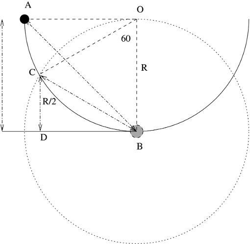

A、C：两个起始点；O：摆心；B：最低点；R：摆长；R/2：C点相对最低点的高度；D：辅助投影点。

> 校注：原书没有为此图另列图号和图注；上方原注42说明由作者绘制。

<!-- dm-ch03-273 -->

〔原书第51页〕

考虑以O 为中心的摆。图中两个起始点A 和C。

<!-- dm-ch03-274 -->

〔原书第51页〕

若从A 开始，角AOB 为90 度，则位置B 速度与弦AB 成正比。若从C 开始，角COB 为60 度，则速度与弦CB 成正比。

<!-- dm-ch03-275 -->

〔原书第51页〕

容易证明，若摆半径R，则高度$CD=R/2$ 。

<!-- dm-ch03-276 -->

〔原书第51页〕

此外，由于COB是等边三角形，我们知道 $CB=R$；又由于AOB是等腰直角三角形，所以 $AB=\sqrt2 R$。

<!-- dm-ch03-277 -->

〔原书第51页〕

因此，两条弦之比为 $AB/CB=\sqrt2$，而下落高度之比为 $OB/CD=2$。

<!-- dm-ch03-278 -->

〔原书第51页〕

若速度与弦成正比，速度与高度平方根成正比。若假设动能e（杜·沙特莱的“活力”，forces vives），使得$e\approx v^2$ ，则动能与初始势能成正比。牛顿证明无空气阻力时摆恢复原高度，因此这里有守恒定律。《注释》中关于落体的陈述——“成比例时间内描述的距离与速度和时间乘积成正比，即与时间平方成正比”——也可推导相同守恒关系。

> 校注：底本写e≈v²，但本段文字谈动能与速度平方成正比。约等关系与比例关系含义不同；这里将底本公式与文字一并保留。

<!-- dm-ch03-279 -->

〔原书第51页〕

牛顿只明确动量守恒，而非能量守恒。他说螺丝施加的力与转动手柄的手施加的力成正比；槌子对楔子施加的力与楔子推进量成正比。这些原理适用于所有机械。更普遍：

<!-- dm-ch03-280 -->

〔原书第51页〕

> 我仅想通过这些例子展示运动第三定律的广泛适用性和确定性。因为如果我们综合作用体的力和速度估算作用，同时综合障碍物各部分速度以及摩擦、内聚力、重量和加速度产生的阻力估算反作用，那么使用各类机械时作用与反作用始终相等。

<!-- dm-ch03-281 -->

〔原书第51页〕

这再次接近理想简单机械能量守恒。他说：

<!-- dm-ch03-282 -->

〔原书第51页〕

$f_1v_1=f_2v_2$

<!-- dm-ch03-283 -->

〔原书第51页〕

但速度等于距离除以时间，即 $d/t$，因此，在固定时间间隔内有：

<!-- dm-ch03-284 -->

〔原书第51页〕

$f_1d_1=f_2d_2$

<!-- dm-ch03-285 -->

〔原书第51页〕

这与后来功的定义——力乘距离——一致，说明理想简单机械输入功等于输出功（忽略摩擦等）。

<!-- dm-ch03-286 -->

〔原书第52页〕

牛顿有动量守恒和力等价性，但未看到现代功或能量表述。

<!-- dm-ch03-287 -->

〔原书第52页〕

杜·沙特莱在牛顿基础上进步，倡导所谓“活力”，即我们今天所说的能量。她在此赋予“力”一词多重含义，但正确指出这种“力”必须与速度平方成正比：

<!-- dm-ch03-288 -->

〔原书第52页〕

> 活力或许是物理学中唯一尽管有实验证明仍有人异议的论点；因为若问拒绝者，两个质量相等物体撞击两个相同障碍物，速度分别为4 和3，会产生什么效果，他们会回答：一个产生16 的效果，另一个产生9 的效果。现在容易看出，无论他们随后对这一为真理之力所迫作出的承认加以何种区分和修饰，效果是平方，因此产生效果的力必须是平方的。[^ch3-43]

<!-- dm-ch03-289 -->

〔原书第52页〕

她说牛顿得出结论：运动总体不守恒，相反：

<!-- dm-ch03-290 -->

〔原书第52页〕

> 宇宙中运动不断减少；最后我们的太阳系终有一天需要造物主重新塑造；这一结论是物质惯性以及牛顿先生所持“力量等于动量”观点的必然结果。[^ch3-44]

<!-- dm-ch03-291 -->

〔原书第52页〕

她声称牛顿要求持续奇迹维持运动，并反驳：

<!-- dm-ch03-292 -->

〔原书第52页〕

> 但当把质量与速度平方乘积视为力时，容易证明活力始终不变，尽管宇宙每个瞬间动量可能变化；所有情况下，尤其是我刚引用的牛顿先生论点中，活力保持不变。[^ch3-45]

<!-- dm-ch03-293 -->

〔原书第52页〕

这是能量守恒原理首次明确表述。卢克莱修“无中不能生有”延伸到运动。杜·沙特莱的继任者拉格朗日（1736—1813）和兰金（1820—1872）扩展该思想，拉格朗日通过动能和势能概念系统化无摩擦系统力学。最终兰金明确把能量守恒表述为自然定律。将其概括为定律的障碍是摩擦损耗。拉格朗日能用势能和动能表述支配行星轨道的定律，但应用于地球系统不明显，因为摩擦使物体减速。认识到热是另一种能量形式，抵消动能损失，才确立能量守恒一般原理。马克思写《资本论》时这些思想已牢固确立，我们稍后展示守恒原理如何支撑他的分析。

<!-- dm-ch03-294 -->

〔原书第53页〕

## 机械决定论

<!-- dm-ch03-295 -->

〔原书第53页〕

亚里士多德把原因分为动力因和目的因。动力因从现在到未来，目的因是未来状态导致现在事件。

<!-- dm-ch03-296 -->

〔原书第53页〕

牛顿机械唯物主义依赖动力因。所有天体当前位置和动量完全决定未来位置和动量。其他天体存在使计算复杂，但不改变决定论。其他力如静电力和磁力在19 世纪末发现，但力学不变。

> 校注：原书将静电力与磁力的发现说成19世纪末；本章前文已谈古代琥珀和磁石现象，二者存在明显年代不一致，译文照录底本。

<!-- dm-ch03-297 -->

〔原书第53页〕

机械决定论悖论：既包含动力因，也包含目的因。地球今天位置和动量决定明天位置，也限定昨天必然位置。$t_0$ 时刻的力决定运动速度。天文学家可向前积分推未来，向后积分推过去。

<!-- dm-ch03-298 -->

〔原书第53页〕

力学定律具有时间对称性。反转时间维度并反转物体运动，时间便倒流。动力因与目的因区别不再重要。太阳系当前状态既决定过去也决定未来。用拉格朗日或哈密顿力学表述——基于完整轨迹——时更清晰。变分法是微分学延伸，用于推导轨迹。

<!-- dm-ch03-299 -->

〔原书第53页〕

哈密顿和拉格朗日力学借光学类比发展。若光束以一定角度射入水中，会弯曲。反之，把直尺部分浸入水中，直尺看起来弯曲。这是光在空气/水界面折射结果。古典力学家知道，尽管从直尺到眼睛路径弯曲，光“选择”路径使光子穿越距离时间最小。由于水比空气密，光在水中更慢，因此到眼睛最快路径是光子在空气中花费时间比直线传播更多的路径。

<!-- dm-ch03-300 -->

〔原书第53页〕

这条光学定律称为费马原理，似乎已动摇朴素时间、因果观念。从直尺顶端出发的光线，怎会知道走哪条路最快到达眼睛？

<!-- dm-ch03-301 -->

〔原书第53页〕

欧拉变分法可证明[^ch3-46]光遵循轨迹恰好是可能最快路径。从时间看，光遵循最简单路径。欧拉学生拉格朗日随后意识到，牛顿定律描述的轨迹或许也可同样处理。但此时最简单路径不能只是最快，必须在另一意义上简单。

<!-- dm-ch03-302 -->

〔原书第53—54页〕

他得出答案：自然遵循最小作用量原理。作用量是科学隐喻，其精确数学定义至少可以说并非显而易见。[^ch3-47]拉格朗日力学是牛顿定律数学推论。使用拉格朗日方法，许多问题计算更容易。它显示自然如何对轨迹施加约束，类似光路径。单个粒子轨迹容易想象，但一对或多粒子较难。

<!-- dm-ch03-303 -->

〔原书第54页〕

学校数学中，我们学习y 作为x 函数的轨迹，绘制抛物线，特征方程$y=ax^2+b$ 。这简单直观，因为x、y 代表方格纸水平垂直轴距离。用x、y 坐标数学描述二维运动也直观。我们直观理解二维、三维。接受生活在三维空间，图画在二维纸张。但六维或十二维空间是什么？

<!-- dm-ch03-304 -->

〔原书第54页〕

十二维轨迹是什么？经典物理学家处理多粒子系统或多个耦合独立运动物体时，借助抽象“位形空间”。

<!-- dm-ch03-305 -->

〔原书第54页〕

考虑单个运动粒子。它在三维空间的位置和速度可写成六个数：三个x、y、z 坐标，另外三个$\dot{x},\dot{y},\dot{z}$表示三个基本方向速度分量。数学上是六维系统。两个粒子则十二个数，等等。这组抽象维度称为位形空间。

> 校注：作者这里把位置与速度合在一起称为configuration space（位形空间）。通常位形空间只包含位置类广义坐标；位置与速度合成的状态空间与之有别。下文沿用作者术语，并保留这一辨析。

<!-- dm-ch03-306 -->

〔原书第54页〕

力学抽象空间与欧几里得真实空间有何共同点？

<!-- dm-ch03-307 -->

〔原书第54页〕

当我们实际只有纸上符号$x_1,y_1,z_1,\dot{x}_1,\dot{y}_1,\dots\dot{z}_n$时，从何意义谈维度和轨迹？这些符号与真实空间如何关联？回到二维例子，可见方格纸位置与数对等价性有操作基础。可数二维网格线，把纸上点转换为x、y 坐标；反之，根据两个数字在纸上标点。建筑和测量实践在古典几何与物理世界间建立联系。建筑图纸用于建造与图纸保持欧几里得相似关系的更大尺度建筑。对应关系通过实践确立。

<!-- dm-ch03-308 -->

〔原书第54页〕

《原理》中牛顿仍用古典欧几里得几何。到18 世纪中叶，用笛卡尔坐标推理物理成为标准。这涉及建模物质实践转变：不再用直尺圆规，而用代数。欧几里得方法可以得到模拟式结果。按特定半径几何作图，沿新画线测量得结果。若想比直尺更精确，必须设计基于直角三角形的毕达哥拉斯过程，再明确计算平方和平方根。

<!-- dm-ch03-309 -->

〔原书第55页〕

物理学家用笛卡尔方法推导行星轨道方程。天文学家使用拉格朗日方法参数化实际轨道。方程与轨道关系不立即清楚，但可学会比旧几何更精确高效的方法。两种情况下，我们都有在地球上制作的、关于月球运动的实体纸面模型。

<!-- dm-ch03-310 -->

〔原书第55页〕

回到维度含义。人类实践语境中，维度与身体运动相关。看18 世纪爱丁堡新城地图。[^ch3-48]这需要启蒙运动所培育的感受方式按笛卡尔几何公设构建城市环境，但同样方法更大规模用于绘制整个国家地图，把每个道路交叉口、山丘或桥梁标在笛卡尔网格上。

<!-- dm-ch03-311 -->

〔原书第55页〕

沿乔治街向东走，获得一个维度。左转进入北城堡街，获得第二维度——南北。使维度区别的是独立性：向北走不向东移动。若目的地圣安德鲁广场，仍需沿皇后街三个街区，然后左转北圣大卫街。向北步行未减少向东还需街区数。

<!-- dm-ch03-312 -->

〔原书第55页〕

南北维度与东西维度之所以不同，在于二者的独立性。沿一个轴运动，不会使我沿另一个轴向前。两个维度就是我沿街漫步时的自由度。拉格朗日方程中的变量 $x_1,y_1,z_1,\dot{x}_1,\dot{y}_1,\ldots x_2,y_2,\ldots\dot{z}_n$，也是多粒子系统的独立自由度。其中 $x_1$ 表示第一个粒子在x方向的位置，$y_2$ 表示第二个粒子在y方向的位置，而 $\dot{z}_n$ 表示第n个粒子在z方向的运动。所有这些量都可以独立变化，因此，在一种抽象的比喻意义上，它们就是维度。所以，位形空间中的一个点，就是所有粒子的位置和速度的一种特定组合；位形空间中的一条轨迹，必定是这些点的序列。

<!-- dm-ch03-313 -->

〔原书第55页〕

关键点：拉格朗日方程规定整个多粒子系统在多维位形空间中唯一时间轨迹。拉格朗日决定论对全部运动的限定，与对单个物体运动的限定同样严格。整个宇宙有位形空间——所有原子位置和速度。穿越位形空间的宇宙轨迹是实空间中所有个体轨迹的乘积。

<!-- dm-ch03-314 -->

〔原书第55页〕

若刚接触力学，需要时间理解。

<!-- dm-ch03-315 -->

〔原书第55页〕

由此，宇宙在位形空间中也有唯一轨迹，即贯穿时间的最小作用量路径。这种决定论足以令加尔文或诺克斯汗颜。

<!-- dm-ch03-316 -->

〔原书第55—56页〕

2013 年2 月15 日，俄罗斯中部工业城市车里雅宾斯克上空出现炽热火球。比太阳亮，户外市民感到皮肤灼热。幸运的是，当量为500千吨的爆炸发生在约30,000 米高空。尽管如此，许多人受伤住院。报告闪光盲、辐射烧伤、皮肤剥落、爆炸创伤和飞溅碎片割伤。冲击波破坏数百平方公里。数千栋公寓楼、学校、医院和工厂需修复。

<!-- dm-ch03-317 -->

〔原书第56页〕

原因？不是自1960 年代以来瞄准车里雅宾斯克的美国民兵导弹，而是来自小行星带的20 米岩石。它沿最小作用量路径在太阳系运行无数时代，最终在该市上空终结。目击者见它从西方低空、朝阳方向出现。受开普勒定律约束，它在返回小行星带途中离开近日点，速度极快。以60,000 km/h 沿双曲线路径，若未擦过大气，会飞回外层空间。但动能瞬间转化为热、辐射和冲击波。若入射角更陡、爆炸更低，车里雅宾斯克会被夷平。

> 校注：底本将“西方低空”与“日出方向”并列，方向表述存在矛盾；译文保留两者，不擅自替作者改写。

<!-- dm-ch03-318 -->

〔原书第56页〕

但轨道动力学中没有“本可能”。它的路径不可能不同。用古典语言，它注定与城市擦肩而过。尽管车里雅宾斯克幸免，仍是警示。宙斯或许投掷雷霆，法埃顿也可能无预警坠落。[^ch3-49]

<!-- dm-ch03-319 -->

〔原书第56页〕

NASA 试图预警。“哨兵地球”项目搜寻危险小行星。但车里雅宾斯克超火流星未被NASA 发现。

<!-- dm-ch03-320 -->

〔原书第56页〕

搜索受望远镜限制。即使已探测天体，也无法精确预测，只能给概率。可访问网站查看风险。例如小行星2020 VV 估计2044 至2111 年间撞击概率0.23%。幸运的是仅36 千吨。但既然轨道确定性，为何只给概率？2021 年NASA 用拉格朗日力学送凤凰号着陆火星，准时着陆，距目标几米。既然NASA 能做到，为何小行星撞击像掷骰子？

> 校注：本段风险概率、时间范围、当量和任务名称／年份均为原书陈述，按底本保留，未作为当前NASA风险评估或任务记录重新核验。

<!-- dm-ch03-321 -->

〔原书第56页〕

2020 年10 月至12 月，NASA 对12 米天体2020 VV 观测79 次，用数百万公里外望远镜。NASA 必须根据观测估计位置和速度，但屏幕确切位置不确定。初始信息模糊，预测也模糊。

<!-- dm-ch03-322 -->

〔原书第56页〕

据我们理解，宏观运动定律确定性。但鉴于无知——未观测现象和观测不精确——似乎存在偶然。未观测流星可能任何瞬间撞击。已观测流星最多知道某天经过的窗口。

<!-- dm-ch03-323 -->

〔原书第56页〕

拉格朗日唯物主义绝对决定论，表面随机性是无知产物。现代唯物主义是否必然蕴含决定论，以及决定论意味着什么，我们稍后回到。现在考察经典力学构建的认知结构。

<!-- dm-ch03-324 -->

〔原书第57页〕

我们面对多层次算法建模过程。微分学和变分法是转换公式的程序。借助它们，牛顿初始定律可转化为包含势能和动能的欧拉–拉格朗日运动方程。现代术语中，这些方程是一类软件。

<!-- dm-ch03-325 -->

〔原书第57页〕

它们相对高级，因为涉及泛函——转换其他函数的函数。规则作用：把广义坐标表示动能和势能的函数转换为新运动函数。

> 校注：原书把functionals解释为“变换其他函数的函数”，这里按原文翻译。严格数学用法中，泛函通常是把函数映射到标量的映射；把函数映射到函数通常称算子。

<!-- dm-ch03-326 -->

〔原书第57页〕

新运动函数本身需初始边界条件参数化。完成参数化后，推导仅含一个自由变量——时间的函数。

<!-- dm-ch03-327 -->

〔原书第57页〕

此时，可以把算法运算从欧拉的代数式重写，切换到我们在学校学到的、作为笔算乘法和加法的原初算法（algorithismes）。[^ch3-50]运用这些熟悉的方法，人们以十进制算术进行详细计算。

<!-- dm-ch03-328 -->

〔原书第57页〕

如今，参数化运动函数用Fortran 或类似语言编码，NASA 计算机用代码计算轨道。

<!-- dm-ch03-329 -->

〔原书第57页〕

结合物质计算过程——人类数学家纸笔劳动或电子计算机循环——参数化函数构成所研究系统模型，如木星卫星、近地小行星。

<!-- dm-ch03-330 -->

〔原书第57页〕

建模关系存在于卫星或小行星实时运动与计算机器或过去从事计算工作的人模拟计算时间之间。

<!-- dm-ch03-331 -->

〔原书第57页〕

两种情况下都有物质系统：一侧卫星和行星，另一侧计算系统。都随时间演化。计算系统时间演化通常比现实快。模型/系统等价性本身在观测劳动过程精度约束下确立。人们用工具——望远镜、笔记本、键盘、处理器——确定初始位置并核对最终位置。

<!-- dm-ch03-332 -->

〔原书第57页〕

科学家通过实践验证知识。火箭科学中，实践验证了被模拟系统在本体论上的实在性。火星曾是红点，如今我们看岩石沙丘视频，听火星微风。

<!-- dm-ch03-333 -->

〔原书第57页〕

对现实建模，构建拉格朗日量或哈密顿量的程序是模型生产手段，不是模型本身。实际模型通过集体劳动过程和观测构建。它们不是单纯“思想对象”，而是消耗能量、在计算进行时随时间演化的、发生于具体地点的物理过程。

[^ch3-1]: 1. 阿基米德：《阿基米德著作集：以现代符号编订并附导论各章》（The Works of Archimedes: Edited in Modern Notation with Introductory Chapters），Thomas L. Heath 编，Cambridge Library Collection – Mathematics（剑桥大学出版社，2009），https://doi.org/10.1017/CBO9780511695124。

[^ch3-2]: 2. Lucio Russo：《被遗忘的革命：科学如何诞生于公元前300年，以及为何必须重新诞生》（The Forgotten Revolution: How Science Was Born in 300 BC and Why it Had to be Reborn）（Springer Science & Business Media，2013）。

[^ch3-3]: 3. Rocco Leonardis：“古希腊建筑师对几何学的运用”（The Use of Geometry by Ancient Greek Architects），A Companion to Greek Architecture（2016），第92–104页，https://doi.org/10.1002/9781118327586。

[^ch3-4]: 4. Galen、Arthur John Brock：《盖伦论自然机能，附英译》（Galen On the Natural Faculties with an English Translation）（W. Heinemann，1916），第1卷第13章。

[^ch3-5]: 5. Galen、Brock：《盖伦论自然机能，附英译》（Galen On the Natural Faculties with an English Translation），第1卷第14章。

[^ch3-6]: 6. pneuma 一词在希腊语中意为“空气”。

[^ch3-7]: 7. C. E. Quin：“盖伦之后关于神经系统功能的灵魂与气”（The Soul and the Pneuma in the Function of the Nervous System after Galen），Journal of the Royal Society of Medicine，第87卷第7期（1994），第393–395页，ISSN：0141-0768，https://europepmc.org/articles/PMC1294649。

[^ch3-8]: 8. 这与19世纪弗兰肯斯坦博士利用新发现的电能使尸体获得生命的观念，有相似之处。

[^ch3-9]: 9. 鲁索：《被遗忘的革命：科学如何诞生于公元前300年，又为何必须重新诞生》。

[^ch3-10]: 10. 艾萨克·牛顿：《自然哲学的数学原理……安德鲁·莫特译……附牛顿〈世界体系〉；W. 埃默森对〈原理〉的简短评注与辩护；以及约翰·梅钦依据引力所论月球运动定律……（先生的序言）》（1848）。

[^ch3-11]: 11. G. W. 莱布尼茨：《形而上学论》，1686年，http://www.earlymoderntexts.com/assets/pdfs/leibniz1686d.pdf。

[^ch3-12]: 12. 鲁索在《被遗忘的革命：科学如何诞生于公元前300年，又为何必须重新诞生》中，解释了托勒密天文学与傅里叶分解之间的相似性。

[^ch3-13]: 13. 我们现在会用 straight（直的）这个词。

[^ch3-14]: 14. 恒星日以恒星相对于地球的视旋转来衡量，比太阳日短约4分钟。

[^ch3-15]: 15. “物体从静止开始作匀加速下落时，所经过的距离之比，等于通过这些距离所用时间间隔的平方之比。”定理II，命题2。

[^ch3-16]: 16. 牛顿：《自然哲学的数学原理……安德鲁·莫特译……附牛顿〈世界体系〉；W. 埃默森对〈原理〉的简短评注与辩护；以及约翰·梅钦依据引力所论月球运动定律……（先生的序言）》，定律I。

[^ch3-17]: 17. 牛顿：《自然哲学的数学原理……安德鲁·莫特译……附牛顿〈世界体系〉；W. 埃默森对〈原理〉的简短评注与辩护；以及约翰·梅钦依据引力所论月球运动定律……（先生的序言）》，定律II。

[^ch3-18]: 18. 牛顿：《自然哲学的数学原理……安德鲁·莫特译……附牛顿〈世界体系〉；W. 埃默森对〈原理〉的简短评注与辩护；以及约翰·梅钦依据引力所论月球运动定律……（先生的序言）》，定律III。

[^ch3-19]: 19. 牛顿：《自然哲学的数学原理……安德鲁·莫特译……附牛顿〈世界体系〉；W. 埃默森对〈原理〉的简短评注与辩护；以及约翰·梅钦依据引力所论月球运动定律……（先生的序言）》，推论III。

[^ch3-20]: 20. 牛顿：《自然哲学的数学原理……安德鲁·莫特译……附牛顿〈世界体系〉；W. 埃默森对〈原理〉的简短评注与辩护；以及约翰·梅钦依据引力所论月球运动定律……（先生的序言）》，推论V。

[^ch3-21]: 21. 相对于不具有某种运动的事物而言，以及在一切同等分享该运动的事物之间，该运动不起作用，就仿佛不存在一样。因此，一艘满载货物的船驶离威尼斯，途经科孚、克里特、塞浦路斯，前往阿勒颇。威尼斯、科孚、克里特等地静止不动，不随船运动；但对于船上装载的袋子、箱子和包裹，以及船本身而言，从威尼斯到叙利亚的运动等于没有运动，丝毫不会改变它们彼此之间的关系。原因就在于，这一运动为它们所共有，它们全都同等地分享这一运动。伽利略·伽利莱：《关于两大世界体系的对话》（1632）（Robert C. Kuhmann，2006），第41页，http://www.kuhmann.com/starstuff/DialogueConcerningtheTwoChiefWorldSystems.pdf。对于一个简单的可动物体，只能有一种、而不能有更多的运动天然适合它；其他运动，它只能偶然地、通过参与而具有。因此，当一个人沿船甲板行走时，他自身的运动是步行，而把他带到港口的运动则是他所参与的运动；因为若不是船通过自身运动将他带到那里，他单靠步行永远无法抵达。伽利莱：《关于两大世界体系的对话》，第45页。

[^ch3-22]: 22. 牛顿：《自然哲学的数学原理……安德鲁·莫特译……附牛顿〈世界体系〉；W. 埃默森对〈原理〉的简短评注与辩护；以及约翰·梅钦依据引力所论月球运动定律……（先生的序言）》，第183页。

[^ch3-23]: 23. sesquiduplicate ratio 意为 $r^{2.5}$。

[^ch3-24]: 24. 这意味着平方根之比：$r_1:r_2$ 的 subduplicate ratio 为 $\sqrt{r_1}:\sqrt{r_2}$；所以，若原比为18:16，subduplicate ratio 就是9:4。

[^ch3-25]: 25. 牛顿：《自然哲学的数学原理……安德鲁·莫特译……附牛顿〈世界体系〉；W. 埃默森对〈原理〉的简短评注与辩护；以及约翰·梅钦依据引力所论月球运动定律……（先生的序言）》，命题IV，定理IV。

[^ch3-26]: 26. 格奥尔格·威廉·弗里德里希·黑格尔：“关于行星轨道的哲学论文（1801），附1801年8月27日答辩的十二条论题”（Philosophical Dissertation on the Orbits of the Planets (1801), Preceded by the 12 Theses Defended on August 27, 1801），Graduate Faculty Philosophy Journal，第12卷第1/2期（1987），第282—283页。

[^ch3-27]: 27. 黑格尔：“关于行星轨道的哲学论文（1801），附1801年8月27日答辩的十二条论题”，第285页。

[^ch3-28]: 28. 黑格尔：“关于行星轨道的哲学论文（1801），附1801年8月27日答辩的十二条论题”，第285页。

[^ch3-29]: 29. 黑格尔：“关于行星轨道的哲学论文（1801），附1801年8月27日答辩的十二条论题”，第290页。

[^ch3-30]: 30. 黑格尔：“关于行星轨道的哲学论文（1801），附1801年8月27日答辩的十二条论题”，第296页。

[^ch3-31]: 31. 弗拉基米尔·伊里奇·列宁：《马克思主义的三个来源和三个组成部分》，第1卷（外文出版社，1977）。

[^ch3-32]: 32. 黑格尔：“关于行星轨道的哲学论文（1801），附1801年8月27日答辩的十二条论题”，第294页。

[^ch3-33]: 33. A. 埃默里：“辩证法与机械论：一场关于科学方法的共产主义论争”（Dialectics versus Mechanics. A Communist Debate on Scientific Method），Philosophy of Science，第2卷第1期（1935），第9—38页。

[^ch3-34]: 34. “外力是施加于物体以改变其状态的一种作用，无论该状态是静止，还是沿直线匀速向前运动。”

[^ch3-35]: 35. 埃默里：“辩证法与机械论：一场关于科学方法的共产主义论争”。

[^ch3-36]: 36. 英译见埃米莉·杜·沙特莱：《哲学与科学著作选》（Selected Philosophical and Scientific Writings）（芝加哥大学出版社，2009）。

[^ch3-37]: 37. 杜·沙特莱：《哲学与科学著作选》（Selected Philosophical and Scientific Writings），《物理学基础》，序言IV。

[^ch3-38]: 38. Ruth Hagengruber：《莱布尼茨与牛顿之间的埃米莉·杜·沙特莱》（Emilie du Châtelet Between Leibniz and Newton）（Springer，2012）。

[^ch3-39]: 39. 杜·沙特莱：《哲学与科学著作选》（Selected Philosophical and Scientific Writings），第132页。她反对植物灵魂的论证，显然也适用于其他灵魂变体和类似宗教解释：精神、自由意志、主体、性别认同等等。

[^ch3-40]: 40. 杜·沙特莱：《哲学与科学著作选》（Selected Philosophical and Scientific Writings），第149页。

[^ch3-41]: 41. 杜·沙特莱：《哲学与科学著作选》（Selected Philosophical and Scientific Writings），第166页。

[^ch3-42]: 42. 作者绘图。

[^ch3-43]: 43. 杜·沙特莱：《哲学与科学著作选》（Selected Philosophical and Scientific Writings），第188页。

[^ch3-44]: 44. 杜·沙特莱：《哲学与科学著作选》（Selected Philosophical and Scientific Writings），第199页。

[^ch3-45]: 45. 杜·沙特莱：《哲学与科学著作选》（Selected Philosophical and Scientific Writings），第199页。

[^ch3-46]: 46. 证明参见John R. Taylor等：《经典力学》（Classical Mechanics）（University Science Books，2005），第217页。

[^ch3-47]: 47. 作用量定义为 $S=\int\mathcal{L}\,dt$，其中 $\mathcal{L}$ 为拉格朗日量，表示动能与势能之差。详细论述参见Taylor等：《经典力学》，第6、7、13章。

[^ch3-48]: 48. 例如参见2015年6月6日“La ciudad como reivindicación identitaria: el caso de la New Town de Edimburgo”（作为身份认同诉求的城市：爱丁堡新城案例），https://urban-networks.blogspot.com/2015/06/la-ciudad-como-reivindicacion.html。

[^ch3-49]: 49. Kord Ernstson等：“基姆高陨石坑散布区：德国巴伐利亚东南部全新世大型撞击事件的证据”（The Chiemgau Crater Strewn Field: Evidence of a Holocene Large Impact Event in Southeast Bavaria, Germany），Journal of Siberian Federal University. Engineering & Technologies，第1卷第3期（2010），第72—103页；Barbara Rappenglück等：“法埃顿之坠落：一个希腊—罗马地质神话保存了巴伐利亚（德国东南部）陨石撞击的记忆”（The Fall of Phaethon: A Greco-Roman Geomyth Preserves the Memory of a Meteorite Impact in Bavaria (South-East Germany)），Antiquity，第84卷第324期（2010），第428—439页。

[^ch3-50]: 50. 这些算法以花剌子密（al-Khwārizmī）命名，他的算术方法通过斐波那契的《算盘书》（Liber Abaci）传入欧洲。

<!-- dm-ch04-001 -->

〔原书第59页〕

# 第4章 辩证法、唯物主义与变化：从伊壁鸠鲁经亚里士多德到马克思

<!-- dm-ch04-002 -->

〔原书第59页〕

## 黑格尔重新构造之前的辩证法

<!-- dm-ch04-003 -->

〔原书第59页〕

想必这是一个广为人知的事实：在古希腊，术语“辩证法”（dialektikē）指的是亚里士多德在《修辞学》[^ch4-1]中所说的正确思维的“艺术”，它应当是科学或哲学探究的先决条件和必然特征。[^ch4-2]任何可能导致真实或准确结论的考察——用亚里士多德的话说，即“逻辑的”或“三段论的”结论——[^ch4-3]任何能够自称哲学的真理追求，都基于我们今天所称的逻辑前提。亚里士多德会称之为辩证法——“logikē”一词直到古代晚期才出现，而且即便出现，其含义也仍不同于现代用法。在《修辞学》中，亚里士多德特意把诡辩意义上的良好论证——因此未必由“对智慧的热爱”驱动——与真正的辩证论证区分开。后者关乎价值，更确切地说，关乎伦理学；前者则关乎准确论证本身作为一种技艺或艺术——亚里士多德会称之为technē——[^ch4-4]这种能力任何个体都能掌握，而不必是职业哲学家（或古希腊的等同者）。

<!-- dm-ch04-004 -->

〔原书第59页〕

在本章中，我们将尝试重建辩证法作为本体论范畴在欧洲哲学舞台上的出现。似乎我们在共产主义学说“diamat”中所见的唯物辩证法，其起源可以追溯到黑格尔，但并不完全源于马克思本人。这似乎有悖直觉，或与我们所受的教育以及在马克思主义、马克思本人著作及其思想遗产方面习惯性的思维方式背道而驰。然而，若仔细审视马克思关于唯物主义与辩证法这一双重主题的著作——既把它视为统一体，也把它视为两个独立范畴——就会发现，他对辩证法的处理始终更接近古代人，而非黑格尔。

<!-- dm-ch04-005 -->

〔原书第59—60页〕

我们必须注意他的博士论文中的一个微小例外：其中我们可以发现一种推理方式，在某种（且值得商榷的）程度上与黑格尔式辩证法模式相似；而他基于原子论的唯物主义，则与受黑格尔启发的“diamat”逻辑相矛盾。马克思对古希腊原子论的解读，塑造了他毫不妥协的唯物主义立场，我们将在本章后文更深入探讨。在此只需指出，根据青年马克思，支撑伊壁鸠鲁原子论的矛盾，是定义原子物质属性的特性与作为原子概念规定的形式之间的产物。然而，后者并不构成更高的真理形式，也不是存在的目的（causa finalis）。它无非是物质现象的概念——原子，始终已经具象化，从未被赋予理想性，也从未参与任何更宏大且包罗万象的观念。[^ch4-5]因此，理想性并非观念，而是物质的完美形式；若以属性来表述这种形式，必然偏离理想形式——或者简而言之，正如马克思所言，偏离概念本身。概念虽从具体中抽象出来，却并不存在于“理想性”领域，也无法栖居于物质性之外的任何其他宇宙——因为根本不存在这样的世界。

<!-- dm-ch04-006 -->

〔原书第60页〕

因此，我们将把唯物主义和辩证法这两个范畴视为彼此区分、相互处于单边关系之中[^ch4-6]，摒弃马克思主义思想传统中——无论是“科学”的（马克思主义）还是哲学层面的——对二者统一性的教条式预设。马克思将引导我们回溯到古希腊原子论——更确切地说，是伊壁鸠鲁及其著名的伊壁鸠鲁学派代表卢克莱修·卡鲁斯——去探寻唯物主义的科学起源，或者说，探寻那种更接近科学探究方式而非哲学—神学探究方式的唯物主义的起源。在此之前，让我们重新审视古希腊时期的辩证法问题，以及它演变为黑格尔对该术语理解的可能路径。

<!-- dm-ch04-007 -->

〔原书第60页〕

## Dialektikē、认知的机械性与物质性

<!-- dm-ch04-008 -->

〔原书第60—61页〕

在接触关于希腊“辩证法”概念的文献学与哲学讨论时——尤其是亚里士多德著作中所使用的这一概念——人们往往会感到困惑。希腊城邦中典型的“辩论”实践，或者更确切地说，那种公开论战的文化，怎么会与“逻辑”（即配得上“哲学”这一属性、或当今所称“科学”的思维艺术）混为一谈呢？然而，我们认为这并非混淆，而是通过对辩证交流实践规则的抽象——或者说，通过对准确思考或符合对真理一贯追求的思维规律的抽象——对这种被观察到的实践进行形式化。因此，类似于马克思对“原子概念”——或其形式——的处理，亚里士多德抽象出了我们今天所称的逻辑思维的理想形式。这仿佛是把观察到的物质现实的“模具”从其基础中抽离出来，并通过运用辩证思维的“艺术”，将其形象（或形式）进一步形式化为一个“概念”（如同马克思的原子概念），这与维特根斯坦在《逻辑哲学论》中提出的Maßstab（尺度）极为相似。[^ch4-7]正如亚里士多德在《物理学》（214a12–214a16）中所论述的，概念是“正确思维方式”的产物，亦即下文将通过对亚里士多德《修辞学》相关段落的细读所探讨的辩证或三段论式的思维方式。这门艺术的精髓在于能够辨别“真实的三段论”——即属于辩证法（dialektikē）的三段论——与属于修辞学的虚幻三段论：ὥσπερ καὶ ἐπὶ τῆς διαλεκτικῆς συλλογισμόν τε καὶ φαινόμενον συλλογισμόν（引自亚里士多德《修辞学》1:1）[^ch4-8]，或译为英文（W. Rhys Roberts译本）：“辨别真实与表象的劝说手段的艺术，正如辨别真实与表象的三段论是辩证法的职能一样。”[^ch4-9]

<!-- dm-ch04-009 -->

〔原书第61页〕

亚里士多德所指的辩证法，涉及“三段论”思维的纯粹形式，可普遍适用于任何主题。如前所述，这是一种元科学，他实际上将其称为一种能够引导人得出真实结论的思维“艺术”（技艺或技能——technē）。若剥离对真理的追求，它仅仅是修辞学；而使其具有辩证性并适于服务于正当科学探索的，正是其伦理关切——即对真实阐释周围现实事物的兴趣。

<!-- dm-ch04-010 -->

〔原书第61页〕

> 因此，存在这三种实现说服的手段。显然，要掌握这些手段的人必须能够（1）进行逻辑推理［原文：λαβεῖν τοῦ συλλογίσασθαι δυναμένου；换言之——通过三段论的方式］，（2）理解人类品性与善的各种形式，以及（3）理解情感——即能够命名和描述它们，了解其成因以及被激发的方式。由此可见，修辞学既是辩证法的分支，也是伦理学研究的延伸。伦理学研究完全可以被称为政治学；正因如此，修辞学常伪装成政治学，其教授者也常自诩为政治专家——有时是因为缺乏教育，有时是为了炫耀，有时则源于其他人性弱点。事实上，正如我们开篇所言，它属于辩证法的一个分支，并与之相似。无论是修辞学还是辩证法，都不是对任何单一独立主题的科学研究：二者都是提供论据的能力。（亚里士多德，《修辞学》1:2）[^ch4-10]

<!-- dm-ch04-011 -->

〔原书第61页〕

伦理投入的存在——或其缺失——不仅影响三段论的内容和论证艺术本身，也影响其形式，这使得修辞学成为一种逊于辩证法的艺术，孕育出诡辩家而非哲学家：

<!-- dm-ch04-012 -->

〔原书第61—62页〕

> 因此，很明显，修辞学并不局限于某一特定类别的主题，而是像辩证法一样具有普遍性；同样明显的是，它具有实用价值。此外，很明显，它的功能不仅仅在于成功地说服他人，而在于探索在每个具体案例的条件下，尽可能接近这种成功的方法。在这方面，它与所有其他艺术相似。例如，医学的功能并非仅仅是使人完全健康，而是尽可能地将人引向健康的道路；即便是那些永远无法享有强健体魄的人，也完全可能获得极佳的治疗。此外，很明显，辨别真实的和表象的说服手段，正是同一门艺术的功能，正如辨别真实的三段论和表象的三段论，正是辩证法的功能。使一个人成为“诡辩家”的不是他的能力，而是他的道德目的。然而，在修辞学中，“修辞家”一词既可以指演讲者对这门艺术的掌握，也可以指他的道德目的。在辩证法中则不同：一个人之所以是“诡辩家”，是因为他怀有某种道德目的，而称他为“辩证家”，依据的不是他的道德目的，而是他的能力。（亚里士多德，《修辞学》1:1）[^ch4-11]

<!-- dm-ch04-013 -->

〔原书第62页〕

亚里士多德开创了抽象的技艺及其过程的形式化——例如三段论，后来演变为算法——将其作为一种纯粹且在语义上空洞的思维形式的实践。他开创了算法思维的技艺。无论是他对抽象（或形式）的运用，还是他的辩证法，都属于技艺（technē）的范畴，而非本体论——外部现实无需具有辩证性或“三段论”性质，但我们对其的推理必须如此，正如算法无需反映外部现实的任何本质，却依然能够传达并模仿它。形式思维的发明，以及逻辑和对思维的算法规训，都是从物质和具体中提炼出来的实践产物。这一认识历经数千年才被重新发现并阐明，首先是由马克思（他在《经济学手稿》中捍卫了“具体”的思维，下文将讨论），随后是索绪尔，他在《普通语言学教程》中感叹道：

<!-- dm-ch04-014 -->

〔原书第62页〕

> 我们第一次摆脱了抽象。现在，我们第一次找到了占据特定位置、并与口语链中某个转折点相对应的具体、不可还原的单位：p 只不过是一个抽象单位，它连接了p>和p< 的共同特征，而p> 和p< 才是唯一实际存在的单位。同样，“唇音性”这一更高级的抽象概念将P、M 和B 联系起来。我们可以将P 视为一种动物学物种；该物种有雄性和雌性代表，但并不存在理想标本。此前，我们一直在筛选和分类这些抽象概念；但我们必须超越抽象，才能抵达具体。音系学犯了一个重大错误，即在未更仔细考察“单位”定义的情况下，便将抽象概念视为真实的单位。（1959, 53）[^ch4-12]

<!-- dm-ch04-015 -->

〔原书第62页〕

索绪尔不仅证明了任何形式化的分析程序——即通向科学真理的道路——都必须从物质出发，还证明了物质是具体的，且不应将抽象概念误认为独立存在的现实。这既是对物质性的辩护，也是对作为科学考察的（物质）实践的抽象的辩护，最终更是对科学思维中必然存在的机械论程序主义的辩护。然而，这也揭示了所有有机性——在此指语言——的机械论方面。马克思对真正唯物主义探究的本质及其政治经济学方法的阐释与此非常相似：

<!-- dm-ch04-016 -->

〔原书第62—63页〕

> 如果我们从人口出发，这将是对整体的一种混沌表象［Vorstellung］，然后，我们将通过进一步的规定，以分析的方式向越来越简单的概念［Begriff］推进，从“想象中的具体”走向越来越细微的抽象，直到抵达最简单的规定。从那里开始，我们必须回溯这一过程，直到最终再次抵达“人口”这一概念，但这次它不再是关于整体的混乱观念，而是一个由众多规定性和关系构成的丰富总体。［……］具体之所以是具体的，是因为它是多种规定的集中，因而也是多样性的统一。（《经济学手稿》，41）[^ch4-13]

<!-- dm-ch04-017 -->

〔原书第63页〕

从手头的物质研究对象中推导出形式的机械性行为（马克思，部分源自亚里士多德），或是“根本二元组”这一最基本层面的意指行为——此处我们指的是两个能指之间的关系，这种关系并不一定需要被视为一种统一体、一对或二元对立，正如传统结构主义语言学所处理的那样——归根结底不过是单纯的物质差异，始终已经借助两个能指单位之间的物质标记（音素、书写痕迹或其他）来实现。我们在其他地方曾论述过，在“根本二元组”（这一术语借自弗朗索瓦·拉鲁埃尔[^ch4-14] ）中，两个要素之间是单向的关联，其中一方对另一方而言是“实在”与“外部性”。所谓“二者的统一”，即二元对立作为意义生成首要要素的观念，用拉鲁埃尔的话来说，不过是哲学化或哲学幻觉罢了；因为链条内部的关系实为一个单位与另一个单位之间、一与零之间的差异，而在意义实践的物质性中，它们并不以二元对立的形式存在。引用保罗·科克肖特在2020 年8 月我们私人通信中的话：“简单的二元对立甚至算不上一种关系，因为它没有顺序。它就是{＋,－}＝{－,＋}，仅仅是一个包含两个可区分符号的集合。这与{α,ω} 或{■,▫} 等并无二致。若无其他语义支撑，它们仅仅是两个可区分的标记。”尽管如此，这些机械性行为却构成了多种形式的有机性：自然语言与人工语言中的能指自动机，或者正如许煜（Yuk Hui）最近所论证的，甚至存在于自然本身之中。

<!-- dm-ch04-018 -->

〔原书第63页〕

在许煜的《偶然性与递归性》一书中，后者也被视为一种指涉过程；正如许煜所论证的，正是有机生命中同样存在的递归程序，使得机械性总是在总是已经转化为有机性——二者不过是莫比乌斯带的两面，而非相互排斥的范畴。偶然性缺乏目的（telos）；它几乎毫无意义，而机械性作为机械性本身也是无意义的（它就是“管用就行”，这在本性上是偶然的）。自然借助递归来包容偶然性，正如人工智能所做的那样。据许煜所言，只有一种非目的论的目的，即生命自我维持的循环性：

<!-- dm-ch04-019 -->

〔原书第63页〕

> 自然的终极目标是无法被客观观察到的。我们可以看到某棵树或某种动物，但无法通过机械规则把握自然整体。理性只能通过反思性判断来理解自然的终极目标，这意味着它会递归地抵达一个自我组织的实体。从这个意义上说，目的论思维是循环的：A→B→C→A。（Hui, 41）[^ch4-15]

<!-- dm-ch04-020 -->

〔原书第63—64页〕

机械性与唯物主义互为条件，而我们在此使用该术语的方式，与笛卡尔将身体还原为无生命的机器时所采用的用法截然不同，甚至可说是截然相反——在笛卡尔的观点中，心灵（res cogitans）是至高无上的，且在任何意义上都不属于物质领域。因此，一切看似充满生命气息的事物，皆由心灵所驱动；所有内在的、看似自发运动的物质，是由意识所驱动的；而有机体本身就是精神的。那种源自原子论和马克思、源自索绪尔、图灵和玻尔兹曼的唯物主义，本质上是一种机械论（Cockshott Turing在此指向他关于“机械性”的章节，以及关于图灵的论文）。[^ch4-16]然而，正是物质中不可分割的最小粒子在持续的机械性碰撞中产生的运动——这与伊壁鸠鲁所说的“偏转”所引发的持续碰撞相似——能够转化为波、人类与神明所使用的语言、社会关系以及人类的生产力。一切有机的、自我调节的事物，其起源或前提皆在于粗糙物质性所具有的原始机械性。我们在本书的其他部分论证道，那些我们认为未受唯心主义哲学化影响的唯物主义形式，要么是机械论的，要么是原子论的，或者两者兼而有之：牛顿和拉格朗日，以及玻尔兹曼和马尔可夫，仅举几例。如果将机械性简化为一种低级现实——即物质性，从而容许存在一个既无法通过机械方式也无法通过有机方式（即通过“递归”整合机械默认状态下“无意义的事件”）加以解释的完整存在领域，那么我们面对的不仅是唯心主义，还是一种无法作为唯物主义主要模态发挥作用的机械性概念。很显然，我们所探讨的唯物主义并非作为形而上学基础，用于追寻万物之“始源”（有时为复数形式）。在此，某位作者在“形而上学”一词的用法上可能与本书的其他合著者有所不同。作为推动思想的前科学动力，乃至整个人类生产力的推动者——其核心在于诸如“我们为何存在于这个星球上？”“什么是善？”“为何存在‘外部世界’，而我又与之分离？”“宇宙是否有开端？”——任何形而上学问题都有相关性，且可以通过一种绕开哲学及“充分哲学原则”影响的方式加以探讨。[^ch4-17]机械性——通常与原子论相结合，并将运动与变化提升为其第一原理——正是定义真正唯物主义的核心。正如马克思在《德意志意识形态》中论及费尔巴哈的段落及其他著作中所论述的，理性主义和哲学的埃利亚学派渊源所留下的残余——即在不变且不朽的事物中寻求原理或始原（archai）——在所有形式的唯心主义中都是不可避免的，包括受哲学影响的唯物主义。请考虑以下段落：

> 校注：英文括号“Cockshott Turing refers to his chapter here on Mechanicity plus the paper/s on Turing”形似未清理的编写提示，按底本保留；原注16实际列科克肖特讨论图灵的文章。本文其他作者可能对“形而上学”采用不同定义，这是本段原作者明确指出的差异。

<!-- dm-ch04-021 -->

〔原书第64页〕

> 迄今为止一切唯物主义——包括费尔巴哈的唯物主义——的主要缺陷在于：事物、现实、感性，仅被理解为对象或观照的形式，而未被理解为一种感性的人类活动、实践，亦未从主体方面加以理解。因此，与唯物主义相反，唯心主义抽象地发展了能动的一面——当然，唯心主义本身并不认识作为这种活动的真实、感性的活动。（马克思，《关于费尔巴哈的提纲》）[^ch4-18]

<!-- dm-ch04-022 -->

〔原书第64页〕

上述所有唯物主义者有一个共同点，即一个跨越数个世纪的共同特征：与他们所处时代绝大多数权威哲学不同，他们主张，运动并非一种“幻象”，其背后隐藏着静止的实体——即“存在”的真理，而“存在”本身是静止不变且永恒的——而是存在既显而易见又隐而不显的真理：即不断的运动与变化。

<!-- dm-ch04-023 -->

〔原书第65页〕

## 激进运动与历史唯物主义，而非辩证唯物主义

<!-- dm-ch04-024 -->

〔原书第65页〕

历史唯物主义应被视为对运动与变化的激进唯物主义理解，其思想渊源更多地源自早期原子论者，而非黑格尔。在对伊壁鸠鲁原子论的阐释中，马克思展现出黑格尔主义的影响，因为他试图通过辩证法来解决原子概念与其作为物质的具体属性之间的矛盾。我们在开篇讨论过马克思解决这一矛盾的方式，这构成了他基于伊壁鸠鲁思想遗产的唯物主义哲学的基础。据托马斯·奈尔（Thomas Nail）所言，马克思在接触黑格尔之前就开始发展他的唯物主义哲学和科学世界观，这使他为奈尔所称的“运动唯物主义（kinetic materialism）”（而非“辩证唯物主义”）奠定了基础：

<!-- dm-ch04-025 -->

〔原书第65页〕

> 马克思的运动理论，在其博士论文和《伊壁鸠鲁笔记》这些最早的著作中表现得最为鲜明和集中。早在阅读黑格尔之前，马克思就已经通过古代原子论展开对宗教的批判，并形成一种新的唯物主义理论。接触黑格尔之后，马克思在博士论文中同时批判了对古代原子论的反动现代主义解释和启蒙主义解释、唯物主义、唯心主义的自由理论、宗教，以及黑格尔的自然哲学。因此，马克思在博士论文中提出的运动理论和唯物主义，不仅仅是黑格尔思想的残余；这是他第一次尝试发展一种唯物主义的、以运动为基础的辩证法理论。（Nail，第20—21页）[^ch4-19]

<!-- dm-ch04-026 -->

〔原书第65页〕

我们赞同奈尔的观点，即马克思思想中确实存在“运动唯物主义”，且其源于伊壁鸠鲁原子论；因为正是这种原子论的运动理论——以及“偏离概念”（即“偏转”，意指运动的不完美）这一概念的提出——才为其哲学以及后来发展为科学的理论奠定了纯粹的唯物主义基础。然而，我们认为马克思采用唯物主义并非为了提供一种辩证法理论，而是恰恰相反：他运用辩证法方法——主要是由古希腊人，特别是亚里士多德所发展的方法——来构建一种以“永不停息的运动”为前提的唯物主义，或者如奈尔所称的“运动唯物主义”。如前所述，当辩证法不再仅仅是一种方法，而是同时构建一种本体论论证时，便能察觉到黑格尔的影响。例如，概念与原子的物质决定因素或属性之间的张力，被呈现为物质的，或者至少是真实的——这符合马克思主义认识论家阿尔弗雷德·索恩-雷特尔所提出的“现实抽象”概念。[^ch4-20]“概念”确实总是已经物质化了，这是不可避免的，因为正如马克思所解释的（如上所述），如果没有物质属性，就不会有概念，然而它似乎仍被视为一种能动主体——本体论实体：

<!-- dm-ch04-027 -->

〔原书第65—66页〕

> 存在与本质之间、物质与形式之间的矛盾——这种矛盾内在于原子概念之中——一旦原子被赋予了属性，便在单个原子本身中显现出来。通过这种属性，原子与其概念相异化，但同时在其构造上得以完善。正是源于排斥以及随之而来的具有属性的原子的聚合，现象世界才得以产生。[^ch4-21]

<!-- dm-ch04-028 -->

〔原书第66页〕

马克思和伊壁鸠鲁并不设想彼此独立的、相互分离的领域。这种矛盾是物质性的，其辩证解决并非消除矛盾；矛盾是永恒的，正是它使物质现实处于不断的运动之中。原子是“不可见的”，但它的运动及其它属性——例如重力——却造就了可见世界（或呈现在我们眼前的世界），即一种无时无刻不在运动、无时无刻不在变化的存在现象。在马克思的诠释中，他与欧洲哲学的主流及其固有的唯心主义分道扬镳，因为他并未将可见世界贬低为虚假、幻象和错觉的领域——它与不可见世界一样“真实”。恰恰相反，“不可见的原子”只有通过其现象形式（包括运动在内的各种属性）才能得以实现。真正的唯物主义者既肯定现象世界的现实性，又将其视为通向不可见世界的出发点——两者在现实性和真实性上并无高低之分：

<!-- dm-ch04-029 -->

〔原书第66页〕

> 其中一位［德谟克利特］是怀疑论者，另一位［伊壁鸠鲁］是教条主义者；前者将感性世界视为主观幻象，后者则视为客观表象。将感性世界视为主观幻象的人，致力于经验自然科学和实证知识，体现出无处不在的观察、实验和学习的热忱，足迹遍布广阔无垠的世界。而那位将现象世界视为真实的哲学家，则鄙视经验主义；他身上体现了自足而安宁的思想，以及那种从内在原则（ex principio interno）汲取知识的自给自足。但这种矛盾还远不止于此。那位将感性自然视为主观幻象的怀疑论者和经验论者，是从必然性的角度来审视它，并致力于解释和理解事物的真实存在。另一方面，那位将现象视为真实的哲学家和教条主义者，则处处只看到偶然性，而他的解释方法，反而倾向于否定自然界的一切客观现实。这些矛盾似乎蕴含着某种荒谬性。[^ch4-22]

<!-- dm-ch04-030 -->

〔原书第66—67页〕

怀疑论以及任何形式的主观唯心主义——我们在此将后结构主义对“实在的彻底封闭”的理解也包括在内——都建立在这样一种预期之上：即人类思想能够完全接触到实在，甚至与之融合，这相当于将真理等同于实在（反之亦然）。拉鲁埃尔认为，这正是构成所有哲学的根本谬误之处。[^ch4-23]在《哲学与非哲学》（［1989］；2013）的开篇几页中，拉鲁埃尔将上述谬误称为“实在与思想的两义混淆”[^ch4-24] ，其最典型的原则正是所有欧洲哲学的原则——即“存在”（to on，τὸὄν）作为真理与实在的统一体这一观念——也被称为“充分哲学原则”（PSP）。[^ch4-25]马克思推崇伊壁鸠鲁，因为他没有落入拉鲁埃尔所指认的、具有自我挫败性、自相吞噬的哲学基础——即不将“表象”世界视为欺骗性的现象，而是肯定其物质性正是（原子）不可见基础的唯一蓝图，或许也是其实现的必然性。可见世界的“幻象”或“欺骗性现象”（正如巴门尼德、柏拉图、贝克莱、黑格尔、朱迪斯·巴特勒以及所有哲学家——至少根据我们在此认同的拉鲁埃尔和马克思的分析——所论证的那样）的“显现”或“欺骗性现象”，正是马克思所写的“感性世界”，也是真正的唯物主义科学——或者我们补充说，是摆脱了“PSP”的哲学——应当立足的唯一基础。“客观表象”是“自身之为自身”的实在的一个实例；它与社会关系或价值观一样客观，正如阿尔弗雷德·索恩-雷特尔在唯物主义认识论细节中阐述的那样，并以“现实抽象”的概念为例。[^ch4-26]在该段结尾，马克思得出结论：支撑伊壁鸠鲁哲学的矛盾中存在着一种荒谬性。这些矛盾是可以解释的，但正如马克思在其关于费尔巴哈、德国意识形态及其预期的著作中所阐明的，其根源在于所有哲学中潜藏的狡猾的唯心主义。如前所述，形式或概念与原子的属性——或者简而言之，一切事物的无形物质基础和“始原”（ἀρχή）的属性——构成了辩证的连续性，这种辩证法表现为偶然者（底本作 continent）或“偶然”的永恒递归，而非等同于超越和黑格尔式辩证法理解的扬弃（das Aufgehobene）。

> 校注：英文底本末句作continent，按语境疑为contingent（偶然者），中文加括注注明底本用词。底本以sublimation对应das Aufgehobene，中文按其黑格尔语境译“扬弃”；此处不是地理上的大陆或精神分析的升华。

<!-- dm-ch04-031 -->

〔原书第67页〕

## 辩证唯物主义（diamat）的基础及其矛盾

<!-- dm-ch04-032 -->

〔原书第67页〕

在马克思主义发展一个多世纪、且辩证唯物主义（或称“diamat”教条）始终占据核心地位之后[^ch4-27]，要证明“辩证法与唯物主义”这一复合概念并非马克思主义在其原始形态——即马克思的形态——中的基石，并且马克思将辩证法与唯物主义视为两个独立范畴，二者并不必然且不可避免地构成统一体，这无疑是一项巨大挑战。他那种从抽象（实际上是一种模糊的哲学概括）出发，抵达具体，进而推导出另一种（由具体所决定的）新抽象形式的方法，既不允许方法上的混淆与模棱两可，也不允许对现实的本体论基础——即对辩证法和方法各自的本体论基础——作出主张。我们认为，这种偏离马克思初衷的奇怪迂回，其后续发展很大程度上可能源于“辩证唯物主义”（diamat）的遗产——无论是共产国际所确立的，还是列宁去世后作为苏联官方党的学说所确立的。

<!-- dm-ch04-033 -->

〔原书第67—68页〕

在《唯物主义和经验批判主义》[^ch4-28]中，列宁赞扬约瑟夫·狄慈根创造了“辩证唯物主义”这一概念，从而产生了一种真正的唯物主义——一种通过辩证法方法实践的，或称为唯物主义辩证法——这被视为对马克思和恩格斯原始学说的重要补充。[^ch4-29]在列宁撰写的这部论著中，有一点非常明确——马克思并非被呈现为发展了辩证唯物主义的思想家，而是被描绘为为狄慈根发展该理论奠定基础的人。然而，列宁对“辩证唯物主义”方法的运用，并非以构建一种古典的、斯大林主义式的“辩证唯物主义”本体论为中心，而是旨在驳斥主观主义（因其本质上属于唯心主义），并捍卫马克思主义作为毫不妥协的唯物主义。“正题、反题、合题”这一三元结构，以及由此实现的唯物主义与唯心主义的调和，既非列宁关注的焦点，也非他在这部著作中所追求的目标：

<!-- dm-ch04-034 -->

〔原书第68页〕

> 贯穿所有马赫主义者所有著作的一条红线，就是他们那种愚蠢的论调，声称自己已经“超越”了唯物主义和唯心主义，已经超越了这种“过时”的对立；但事实上，这整个团体正在不断滑向唯心主义，并且对唯物主义进行着持续不断的斗争。[^ch4-30]

<!-- dm-ch04-035 -->

〔原书第68页〕

列宁的《唯物主义和经验批判主义》首先是一部对唯物主义的坚定捍卫之作，而很难说——即使勉强可以这样说——是对当时仍属新概念的“辩证唯物主义”的捍卫，因为马克思及其亲密圈子从未真正接受过这一概念。

<!-- dm-ch04-036 -->

〔原书第68页〕

埃瓦尔德·伊连科夫对马克思和列宁著作的解读证明，马克思——以及列宁——唯物主义的核心在于构建一种知识型（episteme），它既允许以具体为出发点进行思考，又构成了客观性思想的基础。

<!-- dm-ch04-037 -->

〔原书第68页〕

> 马克思对“具体”的定义中最重要的一点在于：具体首先被视为事物的客观特征，这一特征完全独立于认知主体可能发生的任何演变。［……］具体性并非在主体反映对象的过程中产生的，无论是在感性阶段还是在理性—逻辑阶段。换言之，“具体”首先与唯物辩证法的任何其他范畴——如“必然”与“偶然”、“本质”与“现象”——同属一类客观范畴。它表达了自然、社会和思维的一种普遍发展形式。在马克思的理论体系中，“具体”绝非感性给定、可直接观照之物的同义词。[^ch4-31]

<!-- dm-ch04-038 -->

〔原书第68—69页〕

因此，在伊连科夫那里，“具体”是一种概念化形式，它由物质所决定并客观地塑造，是通过按照马克思的方法采取第三方的视角来实现的，而其“归根到底的同一性”[^ch4-32] 可以是一种“抽象”，类似于索恩-雷特尔的“现实抽象”概念（如上所述）。换言之，用拉鲁埃尔的术语来说，其物质可以具有先验的性质，类似于拉鲁埃尔所说的先验或哲学上的“物质”[^ch4-33]，而其效应则是真实的。这些效应不仅是真实的，而且还由一组物质决定因素所支撑，这些因素奠定了意义结构的基础，这类似于维特根斯坦所说的Maßstab，即英语中的尺度（“实在的尺度”）[^ch4-34] ，或者类似于拉鲁埃尔在《非马克思主义导论》中提出的“实在的句法”概念。[^ch4-35]这就是伊连科夫在上述引文中提到的那种辩证法，其中认知与被认知的具体对象之间的鸿沟保持着生产性矛盾的地位，并蕴含着一种扬弃的运动——这种运动应按照马克思博士论文中的理解来理解，而不是将矛盾实例（通过统一）进行救赎式的调和。换言之，具体事物应当保持其具体性，而非经历自我超越，最终升华为某种形式的理想性——即使这种理想性被包装成唯物主义，例如狄慈根的综合理论中所呈现的那样。[^ch4-36]伊连科夫的以下段落进一步印证了上述比较性解读：

<!-- dm-ch04-039 -->

〔原书第69页〕

> 这种对“抽象”一词的用法绝非马克思的术语任性：它与马克思逻辑观点的本质密切相关，与对思维形式与客观现实形式之间关系的辩证诠释相关，也与将实践（涉及客体的感性活动）视为思维抽象真理标准的观点相关。更不能将这种用法解释为“倒退回黑格尔主义”：马克思的论断正是针对黑格尔提出的，即在“最简单的经济范畴，例如交换价值……只能作为已经存在的具体有机整体的一种抽象的、单方面的关系而存在”。[^ch4-37]

<!-- dm-ch04-040 -->

〔原书第69页〕

唯物主义者所思考的范畴，根据定义且不可避免地是“抽象”的，但这种抽象既不能取代现实，现实与作为抽象（根据定义）的思想，也不构成现实与真理的统一体——即对“存在”（无论是物质的还是理想的）的哲学实现或实际化。正如伊连科夫和列宁[^ch4-38]所阐明的，具体性并非感性的，而是概念性的。另一方面，抽象性并非理想的，而是人类认知的产物，一种先验层面的实体，它能够相对于具体性——以及通过具体性相对于现实——被单方面定位，因为具体性最接近上文提到的“现实尺度”。在伊连科夫的分析中，我们可以看到这种单边二元性在起作用，这与我们在马克思本人的著作中——更具体地说，是在他的博士论文中——所指出的，以及我们在上文讨论的拉鲁埃尔的方法中观察到的，是同一种二元性。

<!-- dm-ch04-041 -->

〔原书第69页〕

总而言之，我们想指出这样一个事实：在后结构主义知识范式崛起的时代，我们目睹了正是索恩-雷特尔（伊连科夫亦然）曾试图推翻的逻辑仍在延续：无需讨论具体作者，我们完全可以断言，体力劳动（物质的）与脑力劳动（非物质的）之间的旧有划分不仅得以强化，而且后者在解放潜力方面的优越性这一隐含观点也随之强化。我们指的是阿尔贝托·托斯卡诺（Alberto Toscano）在论文《现实抽象的公开秘密》中讨论的索恩-雷特尔的接受史，该文主要聚焦于保罗·维尔诺（Paolo Virno）和洛伦佐·西利亚里奥（Lorenzo Cillario）。[^ch4-39]“一般智力”似乎正在超越资本主义的价值形式，而实践则因将具体性还原为感性、物理和感官层面而被摒弃，这犯了伊连科夫所警告的谬误，如上所述。索恩-雷特尔的研究项目与伊连科夫的类似，其目标是准确解读马克思理论体系的认识论基础，并在此基础上进行富有成效的拓展。在托斯卡诺引用的致阿多诺的一封信中，索恩-雷特尔写道：

<!-- dm-ch04-042 -->

〔原书第70页〕

> 逻辑的拜物教概念与价值的拜物教概念在社会指涉上有所不同。后者指向资本与劳动之间的对立，前者则指向脑力劳动与体力劳动之间的对立。[^ch4-40]

<!-- dm-ch04-043 -->

〔原书第70页〕

正如索恩-雷特尔所言，二者是在发生学意义上相互关联的[^ch4-41]，而在如此论证时，他始终保持着对马克思的正统忠诚：交换价值形式被确认为一种抽象，尽管将其视为一种决定性的现实（例如，类似于“社会关系”的概念）。所说的这种抽象并非通过任何形式的（一般）“智力”被客体化或实现而成为现实。这种推理将暗示物化谬误。使用价值与剩余价值之间的辩证关系是资本主义的核心；它决定了雇佣劳动作为商品化的存在。事实上，它决定了每一件商品，而其自我加速的逻辑（M–M′ 取代了M–C–M）表明，它最终将演变为超越商品或任何物质形式的纯粹价值交换（想想投机经济）。[^ch4-42]这便是资本主义宇宙最终层面的决定性因素。经济生产正是以此方式决定着社会中的万事万物——它是社会关系宇宙中跳动的心脏，在从艺术、科学到亲属关系与亲密关系的组织等所有形式中，不断再现着同一套主体化模式。

> 校注：本段底本确实写“使用价值与剩余价值”，并写M-M′取代M-C-M；这里按底本保留，不以通常的资本循环公式替换作者表述。

[^ch4-1]: 1. 亚里士多德：《修辞学》（Ars Rhetorica），W. D. Ross编（Clarendon Press，1959），1:1。

[^ch4-2]: 2. Matthewe Duncombe、Catarina Dutilh Novaes：“亚里士多德及其传统中的辩证法与逻辑”（Dialectic and Logic in Aristotle and his Tradition），History and Philosophy of Logic，第37卷第1期（2015），第1—8页。

[^ch4-3]: 3. 亚里士多德：《修辞学》，W. Rhys Roberts译（Bexar County, TX：Bibliotech Press，2012），引自Internet Classics Archive，http://classics.mit.edu/Aristotle/rhetoric.1.i.html（访问日期：2021年11月27日），第1卷第1部分。

[^ch4-4]: 4. 下文将更详细地讨论这里的区分，并提供英文译文及原文引证。

[^ch4-5]: 5. 出自马克思博士论文关于矛盾、形式的对象化和关系的对象化的论述：“原子通过性质获得了一种与其概念相矛盾的存在；它被设定为不同于自身本质的、外化了的存在。伊壁鸠鲁主要关心的正是这一矛盾。因此，他一旦设定一种属性，从而得出原子的物质本性的后果，就同时与之相对地设定一些规定，这些规定又在该属性自身范围内破坏它，转而使原子的概念得到确认。因此，他以使各种属性自相矛盾的方式规定它们。相反，德谟克利特从不联系原子本身来考察属性，也不把其中固有的概念与存在之间的矛盾对象化。”引自卡尔·马克思：《德谟克利特的自然哲学和伊壁鸠鲁的自然哲学的差别》，《马克思恩格斯全集》英文版第1卷（Progress Publishers，1975），无页码，引自Karl Marx Internet Archive，https://www.marxists.org/archive/marx/works/1841/dr-theses/index.htm（访问日期：2021年11月27日）。

[^ch4-6]: 6. 这里我们采用弗朗索瓦·拉鲁埃尔阐发的单边化（unilateralization）或双重分析（dualysis）方法。它以拆解哲学“世界”为前提：哲学按定义设定实在，并把这一设定当作实在本身。这涉及歧义（amphibology）与“决断主义”的问题。拉鲁埃尔在许多著作中将其问题化，尤其在《哲学与非哲学》（Philosophy and Non-philosophy），Taylor Adkins译（明尼苏达大学出版社，2013）的开篇数章中作了更细致的讨论。

[^ch4-7]: 7. 路德维希·维特根斯坦：《逻辑哲学论》（Tractatus Logico-Philosophicus）（Kegan Paul, Trench, Trubner & Co., Ltd.，1922），Gutenberg Project（访问日期：2021年11月27日），2.150、2.511、2.1512及其他多处。

[^ch4-8]: 8. 亚里士多德：《修辞学》（Ars Rhetorica），1:1，第14节，http://www.perseus.tufts.edu/hopper/text?doc=Perseus%3Atext%3A1999.01.0059%3Abook%3D1%3Achapter%3D1%3Asection%3D14（访问日期：2021年11月27日）。

[^ch4-9]: 9. W. Rhys Roberts的译文引自MIT的Internet Classics Archive，http://classics.mit.edu/Aristotle/rhetoric.1.i.html（访问日期：2021年11月27日）。

[^ch4-10]: 10. 引文出自W. Rhys Roberts的译本；其希腊原文为：ἐπεὶ δ᾽ αἱ πίστεις διὰ τούτων εἰσί, φανερὸν ὅτι ταύτας ἐστὶ λαβεῖν τοῦ συλλογίσασθαι δυναμένου καὶ τοῦ θεωρῆσαι περὶ τὰ ἤθη καὶ περὶ τὰς ἀρετὰς καὶ τρίτον τοῦ περὶ τὰ πάθη, τί τε ἕκαστόν ἐστιν τῶν παθῶν καὶ ποῖόν τι, καὶ ἐκ τίνων ἐγγίνεται καὶ πῶς, ὥστε συμβαίνει τὴν ῥητορικὴν οἷον παραφυές τι τῆς διαλεκτικῆς εἶναι καὶ τῆς περὶ τὰ ἤθη πραγματείας, ἣν δίκαιόν ἐστι προσαγορεύειν πολιτικήν. διὸ καὶ ὑποδύεται ὑπὸ τὸ σχῆμα τὸ τῆς πολιτικῆς ἡ ῥητορικὴ καὶ οἱ ἀντιποιούμενοι ταύτης τὰ μὲν δι᾽ ἀπαιδευσίαν, τὰ δὲ δι᾽ ἀλαζονείαν, τὰ δὲ καὶ δι᾽ ἄλλας αἰτίας ἀνθρωπικάς: ἔστι γὰρ μόριόν τι τῆς διαλεκτικῆς καὶ ὁμοίωμα, καθάπερ καὶ ἀρχόμενοι εἴπομεν: περὶ οὐδενὸς γὰρ ὡρισμένου οὐδετέρα αὐτῶν ἐστιν ἐπιστήμη πῶς ἔχει, ἀλλὰ δυνάμεις τινὲς τοῦ πορίσαι λόγους. 希腊文出处：亚里士多德《修辞学》（Ars Rhetorica），引自Perseus Tufts网络文献库，http://www.perseus.tufts.edu/hopper/text?doc=Perseus%3Atext%3A1999.01.0059（访问日期：2021年11月21日），1:2，第7节。

[^ch4-11]: 11. 引文出自W. Rhys Roberts的译本，引自MIT的Internet Classics Archive，http://classics.mit.edu/Aristotle/rhetoric.1.i.html（访问日期：2021年11月21日）；其希腊原文为：ὅτι μὲν οὖν οὐκ ἔστιν οὐθενός τινος γένους ἀφωρισμένου ἡ ῥητορική, ἀλλὰ καθάπερ ἡ διαλεκτική, καὶ ὅτι χρήσιμος, φανερόν, καὶ ὅτι οὐ τὸ πεῖσαι ἔργον αὐτῆς, ἀλλὰ τὸ ἰδεῖν τὰ ὑπάρχοντα πιθανὰ περὶ ἕκαστον, καθάπερ καὶ ἐν ταῖς ἄλλαις τέχναις πάσαις （οὐδὲ γὰρ ἰατρικῆς τὸ ὑγιᾶ ποιῆσαι, ἀλλὰ μέχρι οὗ ἐνδέχεται, μέχρι τούτου προαγαγεῖν: ἔστιν γὰρ καὶ τοὺς ἀδυνάτους μεταλαβεῖν ὑγιείας ὅμως θεραπεῦσαι καλῶς): πρὸς δὲ τούτοις ὅτι τῆς αὐτῆς τό τε πιθανὸν καὶ τὸ φαινόμενον ἰδεῖν πιθανόν, ὥσπερ καὶ ἐπὶ τῆς διαλεκτικῆς συλλογισμόν τε καὶ φαινόμενον συλλογισμόν: ἡ γὰρ σοφιστικὴ οὐκ ἐν τῇ δυνάμει ἀλλ᾽ ἐν τῇ προαιρέσει: πλὴν ἐνταῦθα μὲν ἔσται ὁ μὲν κατὰ τὴν ἐπιστήμην ὁ δὲ κατὰ τὴν προαίρεσιν ῥήτωρ, ἐκεῖ δὲ σοφιστὴς μὲν κατὰ τὴν προαίρεσιν, διαλεκτικὸς δὲ οὐ κατὰ τὴν προαίρεσιν ἀλλὰ κατὰ τὴν δύναμιν. 希腊文出处：亚里士多德《修辞学》（Ars Rhetorica），引自Perseus Tufts网络文献库，http://www.perseus.tufts.edu/hopper/text?doc=Perseus%3Atext%3A1999.01.0059（访问日期：2021年11月21日），1:1，第14节。

[^ch4-12]: 12. 费迪南·德·索绪尔：《普通语言学教程》（Course in General Linguistics），Wade Baskin译，Charles Bally与Albert Reidlinger编（Philosophical Library，1959），第53页。

[^ch4-13]: 13. 卡尔·马克思：《政治经济学批判大纲》（Grundrisse: Outlines of the Critique of Political Economy），Martin Nicolaus译（Penguin Books，1973），第41页。

[^ch4-14]: 14. 拉鲁埃尔：《哲学与非哲学》（Philosophy and Non-Philosophy），第91—126页。

[^ch4-15]: 15. 许煜（Yuk Hui）：《递归性与偶然性》（Recursivity and Contingency）（Rowman & Littlefield International，2019），第41页。

[^ch4-16]: 16. Paul Cockshott：“图灵：唯物主义闯入思想”（Turing: The Irruption of Materialism into Thought），Oxford University Press’s Blog: Academic Insights for the Thinking World（2012），https://blog.oup.com/2012/06/turing-the-irruption-of-materialism-into-thought/（访问日期：2021年11月27日）。

[^ch4-17]: 17. Katerina Kolozova：《走向社会主义的激进形而上学：马克思与拉鲁埃尔》（Toward a Radical Metaphysics of Socialism: Marx and Laruelle）（Punctum Books，2015），第8—10页。

[^ch4-18]: 18. 卡尔·马克思：《关于费尔巴哈的提纲》，W. Lough自德文译出（Progress Publishers，1969），无页码，https://www.marxists.org/archive/marx/works/1845/theses/theses.htm（访问日期：2019年3月22日）。本引文取自无页码的在线来源。

[^ch4-19]: 19. Thomas Nail：《运动中的马克思》（Marx in Motion）（Oxford University Press，Kindle版，2020），第20—21页。

[^ch4-20]: 20. Alfred Sohn-Rethel：《脑力劳动与体力劳动：认识论批判》（Intellectual and Manual Labor: Critique of Epistemology）（伦敦：Macmillan，1978）。

[^ch4-21]: 21. 卡尔·马克思：“德谟克利特的自然哲学和伊壁鸠鲁的自然哲学的差别”，《马克思恩格斯全集》英文版第1卷（莫斯科：Progress Publishers，1975），无页码，引自Karl Marx Internet Archive，https://www.marxists.org/archive/marx/works/1841/dr-theses/index.htm（访问日期：2021年11月21日）。在线版本无页码（s.p.）；引文出自博士论文第二部分第三章。

[^ch4-22]: 22. 马克思：博士论文，无页码：“德谟克利特的自然哲学和伊壁鸠鲁的自然哲学的同一性所引起的困难”。

[^ch4-23]: 23. 拉鲁埃尔：《哲学与非哲学》，第51—53、227、228页。

[^ch4-24]: 24. 拉鲁埃尔：《哲学与非哲学》，第10页。

[^ch4-25]: 25. 拉鲁埃尔：《哲学与非哲学》，第12—13、20、24—29页及其他多处。

[^ch4-26]: 26. Sohn-Rethel：《脑力劳动与体力劳动》，第13—35页。

[^ch4-27]: 27. 鉴于苏联国家及其机构和执政党，以及通过它们发挥作用的共产国际，曾谨慎筛选并维护对马克思、恩格斯原著的一种特定解读，我们才敢称之为教条。这种解读主要依据列宁《唯物主义和经验批判主义》（初版于1909年）。

[^ch4-28]: 28. 弗拉基米尔·伊里奇·列宁：《全集》第14卷：《唯物主义和经验批判主义》（Progress Publishers，1977）。

[^ch4-29]: 29. 列宁：《唯物主义和经验批判主义》，第117—126页。

[^ch4-30]: 30. 列宁：《唯物主义和经验批判主义》，第341页。

[^ch4-31]: 31. Evald Ilyenkov：《马克思〈资本论〉中抽象与具体的辩证法》（The Dialectics of the Abstract & the Concrete in Marx’s Capital），Sergei Kuzyakov译（Progress Publishers，1982），https://www.marxists.org/archive/ilyenkov/works/abstract/index.htm（访问日期：2022年2月27日），第1章，无页码。

[^ch4-32]: 32. 弗朗索瓦·拉鲁埃尔：《同一性理论》（Theory of Identities），Alyosha Edlebi译（哥伦比亚大学出版社，2016），第59、120、135—140页。

[^ch4-33]: 33. 拉鲁埃尔：《哲学与非哲学》，第22页及其他多处。

[^ch4-34]: 34. 维特根斯坦：《逻辑哲学论》，Frank P. Ramsey和Charles Kay Ogden译，2.1512；或：“施用于实在的尺度”，德文为Es ist wie ein Maßstab an die Wirklichkeit angelegt（2.1512）。

[^ch4-35]: 35. 弗朗索瓦·拉鲁埃尔：《非马克思主义导论》（Introduction to Non-Marxism），Anthony Paul Smith译（University of Minnesota Press-Univocal Publishing，2014）。

[^ch4-36]: 36. Tony Burns：“约瑟夫·狄慈根与马克思主义史”（Joseph Dietzgen and the History of Marxism），Science & Society，第66卷第2期（2002），第202—227页。

[^ch4-37]: 37. Ilyenkov：《马克思〈资本论〉中抽象与具体的辩证法》，第1章，无页码。

[^ch4-38]: 38. 列宁：《唯物主义和经验批判主义》，第45—46页；参见：“在这个特定问题上，唯物主义与‘马赫主义’的区别在于：唯物主义完全符合自然科学，把物质看作第一性的，把意识、思想、感觉看作第二性的，因为在明确的形式下，感觉只同物质的较高形式（有机物质）相联系，而‘在物质结构的基础中’，只能推测存在着一种类似于感觉的能力。”（第46页）

[^ch4-39]: 39. Alberto Toscano：“现实抽象的公开秘密”（The Open Secret of Real Abstraction），Rethinking Marxism，第20卷第2期（2008），第282—287页。

[^ch4-40]: 40. 索恩-雷特尔致阿多诺的信，转引自Toscano：“现实抽象的公开秘密”，第281页。

[^ch4-41]: 41. Toscano：“现实抽象的公开秘密”，引索恩-雷特尔致阿多诺的信：Alfred Sohn-Rethel、Theodor Adorno，Carteggio 1936/1969（manifestolibri，2000），第112页。

[^ch4-42]: 42. 卡尔·马克思：《资本论》第1卷第2篇第4章，I. Lasker译（Progress Publishers，1956），https://www.marxists.org/archive/marx/works/1885-c2/（访问日期：2022年5月12日）。

<!-- dm-ch05-001 -->

〔原书第71页〕

# 第5章 历史唯物主义者与机械唯物主义者

<!-- dm-ch05-002 -->

〔原书第71页〕

## 斯密与恩格斯

<!-- dm-ch05-003 -->

〔原书第71页〕

迄今为止我们讨论的唯物主义者关注自然世界。他们描述了一个由原子构成的世界，原子运动受自然规律支配。我们今天称这些规律为经典力学，因此可以把这些思想家视为机械唯物主义者。在苏联文献中，“机械唯物主义”一词往往带有相当负面的含义，被视为一种原始理论，后来被辩证唯物主义和历史唯物主义取代。随着本书展开，我们将论证这些负面含义没有根据。暂且不论这一点，本节关注两位最有影响的历史唯物主义者：亚当·斯密和弗里德里希·恩格斯。

<!-- dm-ch05-004 -->

〔原书第71页〕

为什么我们把分别被视为资本主义和共产主义首席倡导者的两位作者归为一类？

<!-- dm-ch05-005 -->

〔原书第71页〕

因为他们对历史的基本唯物主义方法几乎相同。恩格斯最有影响的著作是《家庭、私有制和国家的起源》[^ch5-1]，1884 年出版。斯密关于这一主题的主要著作是《法理学讲义》，可追溯到1760 年代，但直到1978 年才出版。[^ch5-2]因此，两位思想家推理中的相似之处是独立发现的结果，尽管恩格斯无疑对斯密的《国富论》有所了解。

<!-- dm-ch05-006 -->

〔原书第71页〕

## 国家源于私有财产

<!-- dm-ch05-007 -->

〔原书第71页〕

斯密说，政府因阶级不平等而产生。

<!-- dm-ch05-008 -->

〔原书第71页〕

斯密把社会划分为四个阶段：狩猎、畜牧、农耕和商业社会。前三个阶段与恩格斯所说的“蒙昧”“野蛮”和“文明”阶段相当吻合。到1880 年代，恩格斯已经接触到达尔文著作以及至少部分考古学，因此把狩猎社会划分为几个子阶段。第一子阶段，人类仍生活在热带森林中，至少主要还是树栖。第二阶段，石器和火被使用。狩猎采集社会最后阶段，人们已掌握手工织布和弓箭。

<!-- dm-ch05-009 -->

〔原书第72页〕

斯密把从狩猎向畜牧的转变视为第一次重要过渡。恩格斯在旧大陆方面同意，但指出美洲缺乏驯化绵羊和牛，导致东西半球走上不同发展道路。

<!-- dm-ch05-010 -->

〔原书第72页〕

两人都认为，在生计方式尚无畜牧或农耕的人群中，国家不可能产生。

<!-- dm-ch05-011 -->

〔原书第72页〕

> 人口极其稀少；仅在部落定居点处较密集，其周围呈大范围圆圈分布着狩猎场，外围则是将该部落与其他部落隔开的中立森林保护带。劳动分工纯粹原始，仅限于两性之间。男子在战争中作战，狩猎捕鱼，获取食物原料及所需工具。妇女负责家务、准备食物和缝制衣物，做饭、织布、缝纫。[^ch5-3]

<!-- dm-ch05-012 -->

〔原书第72页〕

斯密同样强调人口密度有限的影响。

<!-- dm-ch05-013 -->

〔原书第72页〕

> 在一个以狩猎和捕鱼为生的民族中，很少有人能聚居，因为短时间内任何数量稍多的人群都会耗尽该地区全部猎物，从而失去生存手段。二十到三十个家庭是能聚居的上限，这些家庭共同构成一个村落。但由于他们聚居是为了相互防御和互助，各村落之间距离并不遥远。当不同村庄的人发生争端时，由两个村庄全体大会裁决。正如每个村庄都有自己的首领，整个民族共同体也有一位首领。这一共同体是由不同村庄组成的联盟，各部落首领对决议有重大影响。[^ch5-4]

<!-- dm-ch05-014 -->

〔原书第72页〕

双方都认为，正是向畜牧的转变导致不平等。斯密描述如下：

<!-- dm-ch05-015 -->

〔原书第72页〕

> 在一个狩猎民族中，严格来说根本不存在政府。这个社会由少数独立家庭组成，他们居住在同一个村庄，说着同一种语言，并为了共同安全而商定团结在一起，但彼此之间并无权威。整个社会都会关注任何犯罪行为；如果可能，他们会让当事人和解；如果无法和解，就会将犯罪者驱逐出社会，处死，或交由受害者发泄怨恨。但这并非正规政府，因为尽管其中可能有人备受尊敬并在决策中有很大影响，但未经全体同意，他绝不能做任何事。

<!-- dm-ch05-016 -->

〔原书第72—73页〕

> 正是牲畜的私有化导致财富不平等，这也正是正规政府产生的最初原因。在出现私有财产之前，不可能有政府，而政府的最终目的正是保障财富，并保护富人免受穷人侵害。[^ch5-5]

<!-- dm-ch05-017 -->

〔原书第73页〕

最后一句——政府职能是保障财富并保护富人免受穷人侵害——对历史唯物主义的阐述之清晰，堪比列宁。[^ch5-6]

<!-- dm-ch05-018 -->

〔原书第73页〕

斯密把动物驯化与私有财产直接联系起来，他说：“富人已把这些如今已驯服的猎物据为己有。”正是使原本野生的牛群被驯化的过程，消除了它们作为猎人潜在猎物的可能性。斯密在此运用了“原始积累”概念——一个阶级掠夺财富，另一个阶级因此陷入贫困——这一概念将在马克思对资本主义的分析中再次出现。

<!-- dm-ch05-019 -->

〔原书第73页〕

根据《讲义》，在畜牧社会中，财富皆可携带，并以牲畜形式积累。与后来能把财富消耗为奢侈品的统治者不同，一个没有定居制造业的社会几乎无法提供奢侈品。因此，酋长的财富表现为对那些自身缺乏足够牲畜的依附者的影响力。穷人完全依赖酋长恩惠。游牧生活与酋长权威结合，导致无休止战争。

<!-- dm-ch05-020 -->

〔原书第73页〕

> 猎人的壮举，尽管勇敢英武，却从未十分惊人。由于他们很少能集体行军，人数极少超过200 人，即便这200 人也难以维持超过十四天。因此，一个由猎人组成的民族几乎不会构成威胁。我们的殖民地对他们极为恐惧，却毫无正当理由。他们确实可能通过突袭和远征给殖民地带来一些麻烦，但绝不会构成真正威胁。另一方面，数量庞大的牧民却能聚居生活。同一个村庄里可能有上千户人家。阿拉伯人和鞑靼人——他们历来以牧业为生——曾多次造成极其惨烈的破坏。鞑靼首领极其可怕，当其中一人战胜另一人时，总会引发最可怕、最激烈的动乱。他们会带着全部牛羊群随行出征，凡战败者，既失去部族，也失去财富。获胜一方则追随其畜群，继续征服；如果他们带着如此庞大的人数进入耕作区，那简直无人能挡。穆罕默德正是以这种方式蹂躏了整个亚洲。[^ch5-7]

<!-- dm-ch05-021 -->

〔原书第73页〕

因此，在畜牧业作为主要财富形式的时代，各酋长国往往倾向于掠夺和无休止小规模战争。在他看来，这不仅符合鞑靼人（蒙古人）和阿拉伯人的历史社会，也符合荷马所描述的希腊英雄社会。他指出，荷马所描述的所有财产纠纷都与牲畜有关。

<!-- dm-ch05-022 -->

〔原书第73—74页〕

随着农业地位日益重要，游牧生活变得难以维系，但牛群仍是最重要财富储备。社会现在能生产剩余产品，理论上可与邻近部落交易，但牛群始终面临被邻近部落盗窃的风险。这迫使人们建造设防聚落，以便冲突时期将人和牲畜迁入其中。设防城镇的人口比当地酋长所统治的聚落更多，通常由几个小部落组成。虽然该城镇最初政体由一位酋长居于至高地位，但很快被共和制取代。

<!-- dm-ch05-023 -->

〔原书第74页〕

> 居住在这样国家的人民，当土地划分完成且耕作普遍开展时，自然会把产品剩余部分分销给邻近部落，这将刺激他们的生产热情。但与此同时，这也可能诱使邻近部落对他们发动侵袭。因此，他们必须想出某种方法来保障自身安全，并守护那些曾耗费巨大心力才获得的成果。在交通便利之处修筑一座城池，比加固整个国家边境要容易得多，因此他们便采用这种方法。他们在最便利的地方修建设防城池，每当遭到入侵时，便带着牲畜和动产躲进城中，并在那里发展工艺和科学。与此相符的是，我们发现忒修斯加固了雅典防御，并命令阿提卡人将所有财物运入城内，这不仅增强了他对民众的控制力，也提升了该城邦相对于其他城邦的权威。当人们以这种方式同意定居城镇后，各氏族酋长很快就会失去权威，政体也会转向共和制，因为他们的收入微薄，无法使自己显得如此显赫、与众不同，以致于能让民众继续依赖他们。公民财富逐渐增加，随着其地位日益接近酋长，便开始嫉妒酋长的权威。因此，我们可以看到，忒修斯本人最终也被赶下了台。

<!-- dm-ch05-024 -->

〔原书第74页〕

> 此后，设立了九位摄政官，起初他们拥有终身权力，但后来任期被缩短为十年。就这样，雅典以及所有希腊城邦，都从酋长制演变为类似君主制的政体，进而发展为贵族制。[^ch5-8]

<!-- dm-ch05-025 -->

〔原书第74页〕

恩格斯描述了同样过程，尽管他遗漏了斯密指出的某些经济和军事演变。须知，尽管斯密著作问世较早，但恩格斯当时无法接触到这些著作，而且恩格斯并非像马克思或斯密那样具有重要地位的经济学家。

<!-- dm-ch05-026 -->

〔原书第74—75页〕

> 据称由忒修斯制定的宪法由此问世。该宪法带来的主要变革是在雅典建立中央权威——即，此前由各部落独立管理的部分事务被宣布为公共事务，并委托给设在雅典的共同议会处理。通过采取这一步骤，雅典人走得比美洲任何土著民族都更远：他们没有像邻近部落那样仅仅组成一个简单邦联，而是融合成一个单一民族。由此诞生了共同的雅典民法，其地位凌驾于各部落和氏族的法律习俗之上。

<!-- dm-ch05-027 -->

〔原书第75页〕

> 据称，忒修斯采取的第二项措施是把全体人民——无论所属氏族、胞族或部落——划分为三个阶层：贵族（eupatridai）、农民（geomoroi）和手工业者（demiourgoi），而担任公职的权利则完全归属于贵族阶层。除了贵族担任公职这一规定外，这种划分并未产生实际作用，因为它并未在阶级之间建立任何其他法律上的区别。然而，这一划分之所以重要，是因为它揭示了那些此前未被察觉的新兴社会要素。这表明，某些家族成员惯常被任命担任氏族公职的做法，已经演变为这些家族几乎无可争议的任职权利；这表明，这些家族凭借财富已然强大，开始在氏族之外形成群体，成为一个独立的特权阶级，而正在成形的国家则认可了这种僭越。[^ch5-9]

<!-- dm-ch05-028 -->

〔原书第75页〕

据斯密，尽管希腊人和罗马人最初实行贵族制政府——其贵族家族可追溯至城市化之前的酋长阶层——但有两个经济进程促使国家逐渐向更共和的形式转变。

<!-- dm-ch05-029 -->

〔原书第75页〕

其一是奴隶制存在。这使自由但非贵族的公民能出席公民大会，而他们的奴隶则负责照料农场或作坊。他把此与更现代的意大利和荷兰共和国对比，指出后者完全由贵族阶层统治。

<!-- dm-ch05-030 -->

〔原书第75页〕

其次，劳动分工的发展和奢侈品生产意味着贵族养活的随从减少，转而把财富用于奢侈消费。由于减少了对依附者的开支，他们在公民大会上左右投票结果的能力也随之减弱。民粹主义者推动允许平民当选公职。由于这两大经济进程，在罗马和希腊，民选公职都向非贵族公民开放了。

<!-- dm-ch05-031 -->

〔原书第75页〕

我们在此看到一种社会模式：政治形式因物质生活方式的变迁而产生并演变。不仅如此，用恩格斯和马克思的话来说，这些城市文明社会的历史，就是一部阶级斗争史。

<!-- dm-ch05-032 -->

〔原书第75页〕

斯密还意识到，任何形式的宪法或政府在历史上都是暂时的。每一种政治和经济形式都会在其内部孕育出最终导致其覆灭的进程。谈到罗马帝国覆灭时，他写道：

<!-- dm-ch05-033 -->

〔原书第75页〕

> 我们现在要说明，这种军事君主制如何也遭遇了等待每一个国家和宪法的命中注定的解体。[^ch5-10]

<!-- dm-ch05-034 -->

〔原书第75—76页〕

每个时期导致解体的具体冲突各不相同，但某些共同主题反复出现。劳动分工的发展使上层阶级能把更多资金用于奢侈品。在封建制度下，这种奢侈消费增长意味着贵族用于维持随从的开支减少。随着随从队伍缩减，他们的军事影响力也减弱，这为近代早期专制君主制兴起创造了条件。他的论点是，王室收入如此庞大，以至于国王很难把所有收入都花在奢侈品上。总会有部分资金留作军费开支，而随着男爵们转而建造豪华宅邸，而非在简朴大厅里养活大批随从，王室军事力量便取得胜利。

<!-- dm-ch05-035 -->

〔原书第76页〕

在论述罗马衰落时，他也运用了这一“经济发展导致军事变革”的主题。随着社会日益“文明”，人们逐渐习惯家庭生活中的奢华，“他们便不再热衷于打仗”。一个经济发达的国家会发现，若把从事制造业的人口动员起来参战，其税收收入将受到影响；而一个蛮族社会或纯粹农业社会，则可以在播种与收获之间的夏季空档期把男子送上战场。游牧牧民最能动员全体民众进行征服，因为他们没有不动产，整个民族都可以出征征服。正因如此，从邻近蛮族国家征召士兵比从罗马公民中征召更廉价，而且这样做不会损害罗马工业。蛮族军队首领们最终发现，他们可以把武器对准罗马政府，并成为这个国家的统治者。[^ch5-11] 他声称，这一过程反复发生：

<!-- dm-ch05-036 -->

〔原书第76页〕

> 所有亚洲政权都是以同样方式瓦解的。他们的士兵是从鞑靼地区雇来的，手工业和制造业得以持续，人民靠经商获得的收益比参战更多。

<!-- dm-ch05-037 -->

〔原书第76页〕

关于“亚洲政权”覆灭的叙述中，可见哈勒敦[^ch5-12] 的回响；然而，斯密的分析植根于更广阔的历史唯物主义理论中，其视野从狩猎社会延伸至资本主义，这一宏大视角在恩格斯和马克思著作中再次显现。当一位唯物主义者似乎在延续前人已开始探索的思想时——无论是阿基米德和牛顿对无穷小的运用，哈勒敦和斯密对劳动价值的探讨，还是斯密和恩格斯关于生产方式演进的论述——人们往往会倾向于认为这是一种思想传承，而非重新发明。[^ch5-13] 鉴于《导论》在18 世纪仅有阿拉伯语版本，而《法理学讲义》直到恩格斯去世很久之后才面世，这一推测似乎缺乏依据。

<!-- dm-ch05-038 -->

〔原书第76页〕

## 狄德罗的非人类中心主义唯物主义世界观

<!-- dm-ch05-039 -->

〔原书第76—77页〕

狄德罗的唯物主义可以被称为——沿用托马斯·奈尔的术语——“运动唯物主义”：运动是有机物质产生的驱动力，也是惰性物质向有机（生命）物质转变的动力。与包括亚里士多德在内的传统哲学观点不同，狄德罗并未把运动和变化定义为“空间位移”——这种定义以把空虚空间等同于本体论虚无为前提，从而排除了（或如亚里士多德那样，瘫痪了）任何关于变化与运动的思考尝试（本书第二章对此有论述）。与热相关的物理过程——这一特定“热力学”论点[^ch5-14]，正是狄德罗与达朗贝尔对话的核心——催生了日益复杂的有机生命，而人类与动物之间的差异仅被视为程度问题。这一切的基础是物质，而第一且不可分割的构成单元是原子。[^ch5-15] 

<!-- dm-ch05-040 -->

〔原书第77页〕

> 但且看一枚蛋。这正是对世间所有神学派别和所有神庙的驳斥。这枚蛋是什么？在胚胎被植入之前，它只是一团无感的物质；而当胚胎被植入后，它又变成了什么？依然是一团无感的物质，因为胚胎本身也仅仅是一种惰性的、原始的液体。这团物质是如何形成不同的组织结构，从而获得感知和生命的？靠的是热量。而热量又由什么产生？运动。[^ch5-16]

<!-- dm-ch05-041 -->

〔原书第77页〕

此外，狄德罗在与达朗贝尔的上述对话中指出，感觉内在于物质本身。简而言之，狄德罗解释道，一切认知都取决于物质性生命成分的组织结构——这种组织结构源于感觉，进而形成具有不同认知能力的各类有机体（例如动物与人类）。引用狄德罗本人的话（也是作为引述对话中的人物，对达朗贝尔的回应）：“一个能解释一切的简单假设，即感觉能力是物质的普遍属性，或是其组织结构的产物。”[^ch5-17]至于人类与动物的区别，就认知而言，狄德罗的表述十分明确：

<!-- dm-ch05-042 -->

〔原书第77—78页〕

> 你是否会像笛卡尔那样坚持认为，这不过是一台简单的模仿机器？小孩子都会嘲笑你，而哲学家们则会反驳说：如果这是台机器，那么你自己也是一台机器。如果你承认这些动物与你的区别仅仅在于组织形式，你就证明了自己的常识和睿智，你就是对的。但这将引出一个对你不利的结论，即：由以某种方式组织起来的无生命物质，在热和运动的作用下，被另一部分无生命物质渗透，从而产生了感觉、生命、记忆、意识、情感和思想。狄德罗接着说，二者必居其一：要么承认蛋中存在某种“隐秘元素”，它在发育的某个阶段以未知方式渗入其中——这种元素究竟是否占据空间、是否具有物质性，抑或是否专为此目的而创造，目前尚无定论——这与常识相悖，并会导致自相矛盾和荒谬；要么我们必须提出一个简单的假设，这个假设能解释一切，即感觉能力是物质的普遍属性，或是其组织结构的产物。（狄德罗致达朗贝尔）[^ch5-18]小孩子会嘲笑你，而哲学家们会反驳说：如果这是台机器，那么你也是台机器。如果你承认这些动物与你的区别仅在于组织结构，你将证明你的常识和机智，你也是对的。但由此将得出一个对你不利的结论：即，由以某种方式组织起来的惰性物质，通过热和运动与另一部分惰性物质相互作用，从而产生了感觉、生命、记忆、意识、情感和思想。

> 校注：原注18之后重复了前面关于机器、组织及感觉产生的一段引文。已核对源PDF，确为底本重复，正文保留，不将其当作译稿误贴而删去。

<!-- dm-ch05-043 -->

〔原书第78页〕

当代实验哲学借鉴认知科学（包括进化生物学）的成果，证明“抽象”或模式识别不仅发生在蛋白质物质和细胞组织层面，[^ch5-19]也发生在其他层面，例如蜜蜂的计数能力。[^ch5-20]借用狄德罗的话来说，高等“物理组织”形式——即人类以外的动物——具备“抽象”或识别数学模式甚至计数的能力，这在21世纪绝非一个有争议的观点。[^ch5-21] 除了所谓新理性主义者对“理性”的形而上学遐想之外，[^ch5-22] 几乎没有任何科学哲学或与认知科学这一跨学科、多学科领域相关的科学本身，会把“理性”视为人类独有能力。正如“自然”或“情感”等与其相对的概念一样，“理性”这一概念已被当代科学视为过时概念——它们都是同一信息生态系统连续体的一部分。

<!-- dm-ch05-044 -->

〔原书第78页〕

感觉、认知和心理设计源于物质基础，因此，借用马克思的术语来说[^ch5-23]，“人类作为类存在”的社会关系的“目的”，正是物质必然性的产物，旨在维持和扩展生命，或者说其“形式”——即亚里士多德所定义的特定“自动机”，一种自运动、自维持的系统（这是我对马克思定义的转述，或者更确切地说，是我的诠释）。用马克思自己的话来说：

<!-- dm-ch05-045 -->

〔原书第78—79页〕

> 人之所以是“类存在”（Gattungswesen），不仅因为他在实践和理论中把物种（包括他自身以及其他事物的物种）作为其对象，而且——这只是另一种表述方式——还因为他把自己视为实际的、活生生的类；因为他把自己视为一种普遍的、因而也是自由的存在。无论在人类还是动物身上，物种的生命在生理上都体现在这样一个事实：人（如同动物一样）依赖有机自然而生存；而人（或动物）越是普遍，他赖以生存的无机自然领域就越普遍。正如植物、动物、石头、空气、光等在理论上构成人类意识的一部分——部分作为自然科学对象，部分作为艺术对象——即他必须先加以加工才能使其可口且易于消化的精神上的无机自然、精神上的养分——同样，在实践领域中，它们也构成人类生活和人类活动的一部分。从生理上讲，人仅靠这些自然产物维生，无论它们以食物、取暖、衣物、住所等形式出现。人的普遍性在实践中恰恰体现在这种普遍性上，即使整个自然成为他的无机躯体——既因为自然是（1）他直接的生活手段，也是（2）他生活活动的物质、对象和工具。自然是人的无机躯体——即自然本身并非人体的那一部分。人依靠自然生存——这意味着自然就是他的身体，若不想死亡，他就必须与之保持持续交流。人的肉体和精神生活与自然相联，这仅仅意味着自然与自身相联，因为人是自然的一部分。[^ch5-24]

<!-- dm-ch05-046 -->

〔原书第79页〕

作为生命的物质活动，把有机和无机物质（自然或“自然”——这一自然概念既远离德国唯心主义的浪漫理解，也不同于费尔巴哈的唯物主义）视为人类本质的延伸或定义，或者说与之构成一种生态统一体。因此，本质与目的——即物种的存在——在于维持和扩展生命；而生命既包含有机部分也包含无机部分，它既由人类活动决定，也由其非人类的延伸或扩展——即向自然与技术共同决定的生态系统中的延伸或扩展——所决定。生命是机械的，因此从这个意义上说它是无机的，而非笛卡尔那种把动物等同于可鄙钟表式机器的还原论等式所指的无机（与有机、自然的——仿佛被一种崇高或神性实体驱动——相对）。它是“mekhane”或“techne”的产物，即拼接任何形式物质所固有的并持续执行的信息片段——从蛋白质折叠到所谓自然语言的语音学——因此，“有机”仅仅是程度问题，而非与“机械”在实质上的差异。尽管如此，在我们凭常识以及某些更古老科学语言所指代的“生命”之间，既存在连续性，也存在仅是程度上的差异而非本质上的差异。这正是当代科学所教导我们的，正如原子论者——尤其是伊壁鸠鲁学派的卢克莱修——以及青年马克思和列宁所揭示的那样。[^ch5-25]

> 校注：底本中rganic漏首字母o，中文按organic译有机，英文保留原样。

<!-- dm-ch05-047 -->

〔原书第79页〕

在此意义上所说的“目的”或“telos”，显然并非线性的，它并不作为“目的因”（causa finalis）发挥作用，因此我们无法确定能否将其称为“telos”。鉴于目前尚无更恰当术语，我们将暂且使用这一术语。在《偶然性与递归性》中，许煜解释说，按照德国唯心主义（特别是谢林）的理解，有机体或自然的“telos”归根结底是一种永恒的偶然性与递归性，这与我们视为计算自动机奠基原则的那些特性如出一辙。尽管许煜秉持谢林和唯心主义立场，但其分析所揭示的运作机制表明，“理想”与自然密不可分。此外，人们可以把他的分析解读为揭示了机械性与有机性之间某种连续性，这种二分法是多余的，在分析中毫无意义。[^ch5-26]或者用许煜自己的话来说：

<!-- dm-ch05-048 -->

〔原书第79页〕

> 自然目的是一种无法客观观察的事物。我们可以看到某棵树或某种动物，但无法通过机械规则把握自然整体。理性只能通过反思性判断来理解自然目的，这意味着它会递归地抵达一个自我组织的存在。从这个意义上说，目的论思维是循环的：*A→B→C→A。[^ch5-27]

<!-- dm-ch05-049 -->

〔原书第80页〕

那套旨在维持人类“类存在”（形式与功能）的设计——该设计由社会关系构成，旨在维持其存在并提升其效能——所包含的一系列功能，本身具有循环性。

<!-- dm-ch05-050 -->

〔原书第80页〕

换言之，该“存在”在生产与再生产过程中持续进行自我组织，同时改善着技术与自然之间的生态系统（即非人工建造的、非人类“技艺”（technē）或巧思所创造的——此处“技艺”（technē）取其字面含义）。这里似乎是在谈论一种自动机，即亚里士多德所指的那种——一种不受外部原因或推动者驱动的存在，但同时也缺乏“目的因”（causa finalis）；或者，正如亚里士多德所解释的，它运作起来仿佛拥有一个“目的”（telos），尽管它实际上并没有（因为它缺乏理性）。[^ch5-28]唯有“不动的推动者”是自运动的，它是一种理念，[^ch5-29]是一切事物的“为什么”——这就是为什么自动机——这种自运动的物质现实——在亚里士多德宇宙中，看似具有目的性和意义，却并非如此。

<!-- dm-ch05-051 -->

〔原书第80页〕

人们常说亚里士多德对马克思影响相当大，如果抽去“自我观照的完美理念”或“不动的推动者”这一概念，亚里士多德所发展的形式与物质之间的辩证关系，很大程度上可以在马克思思想中看到反映，包括他的博士论文。在该论文中，马克思提出以下论点：

<!-- dm-ch05-052 -->

〔原书第80页〕

> 原子通过其属性获得了一种与其概念相矛盾的存在；它被假定为一种与本质相异的、外化的存在。正是这种矛盾最令伊壁鸠鲁感兴趣。因此，一旦他设定某种属性并由此推导出原子的物质性质，他便同时反设一些规定，这些规定又在其自身范畴内摧毁了该属性，转而验证了原子的概念。因此，他以一种使所有属性自相矛盾的方式来界定它们。另一方面，德谟克利特在任何地方都没有把属性与原子本身联系起来考虑，也没有把属性中固有的概念与存在之间的矛盾对象化。[^ch5-30]

<!-- dm-ch05-053 -->

〔原书第80页〕

这里并不存在某种外部理念值得向往或寻求实现——如同黑格尔设想那样，通过物质的自我消亡回归到该理念——而是原子的“概念”不可避免地通过其物质属性的对象化而得以物质化并作为物质存在而得到验证。这种“形式”（概念）与物质的辩证关系，与其说是黑格尔或其他唯心主义者的，不如说更接近亚里士多德形而上学（在其原始的亚里士多德意义上）。同样，社会（包括技术）设计是无产阶级直接的、物质的需求和阶级利益的产物——它在这个词的任何意义上都不是观念性的（或唯心主义的），包括“伦理的”或道德的（或道德主义的）意义。[^ch5-31]

<!-- dm-ch05-054 -->

〔原书第80页〕

唯心主义是以主体性为中心的，是人类中心主义的，这不仅符合马克思观点，也符合狄德罗观点：

<!-- dm-ch05-055 -->

〔原书第80—81页〕

> 那些哲学家被称为唯心主义者，因为他们只意识到自己的存在以及自身内部接连不断的感觉，而不承认其他任何东西。这是一个荒诞的体系，依我之见，唯有盲人才可能提出；这一体系虽是所有体系中最荒谬的，却也是最难反驳的，这令人类智慧和哲学蒙羞。[^ch5-32]

<!-- dm-ch05-056 -->

〔原书第81页〕

在《对黑格尔哲学的总体批判》（《1844 年经济哲学手稿》的一部分）[^ch5-33] 中，马克思讨论了“主体性”概念，认为正是哲学的定义所在，而诉诸主体性则是破坏任何“马克思主义”思想试图确立其科学性的关键因素。[^ch5-34]马克思所倡导的客观思维方式与奥古斯特·孔德的实证主义截然不同。恰恰相反，它以把思维从（个体）人类主体中“去中心化”为前提。引用马克思的话：

<!-- dm-ch05-057 -->

〔原书第81页〕

> 作为对象性的、自然的、感性的存在，同时在自身之外拥有对象、自然和感性，或者自身对于第三者而言就是对象、自然和感性，乃是一回事。[^ch5-35]

<!-- dm-ch05-058 -->

〔原书第81页〕

“感性”和“自然”这两个术语的使用应与狄德罗的学术传统联系起来，而非德国活力论者，因为这种用法是反人类中心的——即使在激进人文主义语境下也是如此——而且当马克思进行唯物主义论证时，这两个术语（包括“物理的”和“真实的”）的使用远比“物质”或“材料”更为常见。我认为这种术语选择的原因在于他避免被等同于另一种青年黑格尔派唯物主义——即费尔巴哈的唯物主义，这个问题我在我的著作《迈向社会主义的激进形而上学》（卡塔琳娜·科洛佐娃，Punctum Books，2015）中进行了详细讨论。[^ch5-36]让我们注意狄德罗这段话结语（即前文引用的与达朗贝尔的对话）中的相似之处：

> 校注：底本将bookKaterina Kolozova、出版社及书名错排在正文中；中文据本段及对应原注整理，未把作者名当书名。

<!-- dm-ch05-059 -->

〔原书第81页〕

> 达朗贝尔：例如，你的体系并未阐明我们如何形成三段论或作出推论。狄德罗：我们并不作出这些推论；它们全是由自然推导出来的。我们只是陈述相互关联的现象的存在，这些现象是我们通过实践所知的，这些现象的存在可能是必然的，也可能是偶然的；在数学、物理学及其他精确科学中是必然的；在伦理学、政治学及其他推测性科学中则是偶然的。[^ch5-37]

<!-- dm-ch05-060 -->

〔原书第81页〕

我们认为，在这些专门论述狄德罗唯物主义及其与马克思联系的段落中，我们已经证明：二者既不是哲学意义上的自然主义，也不是某种泛灵论式的活力论，而是非人类中心的唯物主义世界观。与此同时，他们确实提出了“人道主义”理想，以及关于一个更公正的（人类）社会关系宇宙的愿景，但两位作者都极其明确地强调，这些理想和愿景是超越资本主义对“自然资源”剥削态度的生态系统的产物。

<!-- dm-ch05-061 -->

〔原书第81页〕

## 牛顿式的马克思

<!-- dm-ch05-062 -->

〔原书第81—82页〕

> 一个国家可以也应该向其他国家学习。甚至当一个社会已经走上发现其运动自然规律的正确轨道时——而本著作的最终目标，正是揭示现代社会的经济运动规律——它既无法通过大胆飞跃来跨越，也无法通过立法来消除其正常发展各阶段所面临的障碍。但它可以缩短并减轻这些分娩的阵痛。[^ch5-38]

<!-- dm-ch05-063 -->

〔原书第82页〕

上述引自《资本论》序言的目标，是确立现代社会的运动规律。换言之，就是对现代社会做牛顿对自然界所做的工作。马克思在《资本论》中的方法如何契合牛顿式科学实践？

<!-- dm-ch05-064 -->

〔原书第82页〕

> 因为哲学的一切困难似乎都在于这一点——从运动的现象出发去探究自然力，然后又从这些自然力出发去推导出其他现象。（牛顿，《自然哲学的数学原理》序言）

<!-- dm-ch05-065 -->

〔原书第82页〕

牛顿的方法是：

<!-- dm-ch05-066 -->

〔原书第82页〕

1. 从实验和观察出发，表述运动定律。

2. 借助几何学进行演绎，进而得出向心力的普遍性质。

3. 根据木星卫星的周期和轨道半径，推导出引力定律必须遵循平方反比关系。

4. 从万有引力平方反比定律推导出关于行星轨道的更精确预测。

<!-- dm-ch05-067 -->

〔原书第82页〕

当我们审视马克思从抽象到具体的论证过程时，会发现其中存在非常相似的逻辑路径。

<!-- dm-ch05-068 -->

〔原书第82页〕

这两种情况下都提出了守恒定律。

<!-- dm-ch05-069 -->

〔原书第82页〕

牛顿：作用与反作用相等且方向相反，动量守恒；

<!-- dm-ch05-070 -->

〔原书第82页〕

马克思：交换中价值相等，贸易中价值总量守恒；

<!-- dm-ch05-071 -->

〔原书第82页〕

这些初始公理均基于观测。

<!-- dm-ch05-072 -->

〔原书第82页〕

两者都从抽象定律推导出关于运动的具体结论。

<!-- dm-ch05-073 -->

〔原书第82页〕

牛顿：向心力在等时间内扫过等面积，引力遵循平方反比定律；• 马克思：随着资本积累加深，利润率下降。

> 校注：底本写作“向心力在相等时间内扫过相等面积”，此处按原文保留其表述；通常扫过面积的是运动物体与力心的连线。

<!-- dm-ch05-074 -->

〔原书第82页〕

从《资本论》一开始，马克思就致力于阐明商品交换涉及一种守恒关系：

<!-- dm-ch05-075 -->

〔原书第82—83页〕

> 让我们以两种商品为例，例如谷物和铁。无论它们的交换比例如何，总可以用一个等式来表示这个比例，使一定量的谷物与一定量的铁相等：例如，1夸特谷物＝x英担铁。这个等式告诉我们什么？

<!-- dm-ch05-076 -->

〔原书第83页〕

> 它告诉我们，在两种不同的东西中——在1夸特谷物和x英担[^ch5-39]铁中——存在着某种两者共有的、数量相等的东西。因此，这两种东西必定等于第三种东西，而这第三种东西本身既不是前者，也不是后者。因此，两者中的每一种，就其作为交换价值而言，都必定能够还原为这第三种东西。

<!-- dm-ch05-077 -->

〔原书第83页〕

> 一个简单的几何图解可以说明这一点。为了计算和比较直线图形的面积，我们将它们分解为三角形。但三角形本身的面积，是用一种与其可见形状完全不同的东西来表示的，即底边与高之积的一半。同样地，商品的交换价值必须能够用它们所共有的某种东西来表示，而它们所代表的正是该东西的多少。[^ch5-40]

<!-- dm-ch05-078 -->

〔原书第83页〕

因此，如果发生$\frac{1}{4}$英担谷物＝$x$英担铁这样的交换，双方就包含了同样数量的某种东西：这就是牛顿的原理，即作用会产生大小相等、方向相反的反作用。

<!-- dm-ch05-079 -->

〔原书第83页〕

这种等价性甚至可以用阿基米德所采用的希腊几何方法来解释——即通过把面积分解为多个三角形来证明其等价性。阿基米德利用这一方法推导出圆的面积为$\pi r^2$ ，尽管从表面上看，圆和三角形截然不同。马克思的论点直接承袭了阿基米德/牛顿传统。

<!-- dm-ch05-080 -->

〔原书第83页〕

交换价值的形式是经验观察所得的。马克思从这一观察的性质推导出，这里存在一个守恒过程。在等价物的交换中，有某种实体——价值——保持守恒。这与牛顿从相互碰撞的摆的运动形式推导出运动守恒（用我们今天的话说，就是动量守恒）相对应。

<!-- dm-ch05-081 -->

〔原书第83页〕

他指出，交换是一种等价关系。从形式上讲，我们如今会说：等价关系是一种二元关系，其性质为自反性（$a\equiv a$）、对称性（$a\equiv b\Rightarrow b\equiv a$）和传递性（$a\equiv b,b\equiv c\Rightarrow a\equiv c$）。由于马克思著作成于现代符号逻辑记号出现之前，他并未把“交换是等价关系”这一论点精确表述为上述形式，但他通过自己创造的记号，表达了相同意思。他用自己所称的“价值形式B”来阐明传递性，其符号表示如下：

<!-- dm-ch05-082 -->

〔原书第83页〕

> B. 总和的或扩大的价值形式z 商品A＝u 商品B 或＝v 商品C 或＝w 商品D 或＝x 商品E 或＝等等。[^ch5-41]

<!-- dm-ch05-083 -->

〔原书第83页〕

他在随后段落中明确论证了自反性，该段落直接用文字表述了蕴含关系$a\equiv b\Rightarrow b\equiv a$。

> 校注：底本此处称reflexivity（自反性），但所列蕴含式表达的是对称性；译文保留底本用词，不静默更改。

<!-- dm-ch05-084 -->

〔原书第83—84页〕

> 然而，这种扩大的相对价值形式无非是第一类简单的相对价值表达式或等式的总和，例如：

20码亚麻布＝1件外套

20码亚麻布＝10磅茶叶，等等。

上述每条等式都隐含相应的逆等式：

1件外套＝20码亚麻布

10磅茶叶＝20码亚麻布，等等。[^ch5-42]

<!-- dm-ch05-085 -->

〔原书第84页〕

对称关系（x 商品A＝x 商品A）过于显而易见，无需赘述。

> 校注：底本此处称symmetry（对称性），但所列同一商品等于自身的式子表达的是自反性；这与上一段的术语倒置均按底本保留并说明。

<!-- dm-ch05-086 -->

〔原书第84页〕

他从这些观察到的性质中推导出：既然存在等价关系，那么在等价关系背后必然存在某种抽象的第三种东西。等价关系是守恒的标志。关于这种共同实体存在的推导，在结构上等同于以下推导：在行星绕太阳公转过程中，一种共同实体——能量——会在势能和动能形式之间交换。我们仅通过能量强加于运动上的等价关系，才知晓能量存在。

<!-- dm-ch05-087 -->

〔原书第84页〕

在马克思撰写《资本论》之时，关于能量守恒的研究早已远远超出动能和势能范畴。当时他能接触到的科学文献，正在探讨电能、化学能、热能和光能中的能量守恒问题。关于“共同实体”——即以多种形式存在的能量——这一概念，在撰写《资本论》之前，马克思与恩格斯之间就已展开热烈讨论。

<!-- dm-ch05-088 -->

〔原书第84页〕

> 另一个会让老黑格尔欣喜若狂的发现，是物理学中的力之关联，即在特定条件下，机械运动（即机械力，例如通过摩擦产生的力）转化为热能，热能转化为光能，光能转化为化学亲和力，化学亲和力（例如在伏打堆中）转化为电能，而电能又转化为磁力。这些转化过程也可能以不同方式发生，既可以是正向的，也可以是逆向的。一位我记不清名字的英国人［焦耳］现已证明，这些力以非常具体的定量比例相互转化，因此，例如，某一种力（如电）的特定量，对应于其他每种力量（如磁、光、热、化学亲和力（正或负——结合或分离）以及运动）的特定量。[^ch5-43]

<!-- dm-ch05-089 -->

〔原书第84页〕

从交换中必定有一种共同实体保持守恒这一推论出发，马克思立即把这一实体认定为劳动。

<!-- dm-ch05-090 -->

〔原书第84页〕

> 这种共同的“某种东西”既不能是商品的几何属性，也不能是化学属性，更不能是任何其他自然属性。这些属性只有在影响商品效用、使商品成为使用价值时，才值得我们关注。但商品交换显然是一种完全抽去使用价值的行为……

<!-- dm-ch05-091 -->

〔原书第84页〕

> 因此，如果我们不考虑商品的使用价值，它们就只剩下一项共同属性，即作为劳动产品的属性。……

<!-- dm-ch05-092 -->

〔原书第85页〕

> 随着产品本身有用性质的消失，体现在产品中的各种劳动的有用性质及其具体形式也被撇开了；剩下的只有它们所共有的东西；它们全都还原为同一种劳动，即抽象的人类劳动。现在让我们考察这些产品各自的残余：每一种产品中都留下同样的无形的实在，不过是同质人类劳动的凝结，是不管以何种方式耗费的人类劳动力的凝结。这些东西现在仅仅表明，在它们的生产中耗费了人类劳动力，其中凝结了人类劳动。作为这种共同社会实体的结晶来考察，它们就是——价值。

<!-- dm-ch05-093 -->

〔原书第85页〕

受边际经济学熏陶的现代评论家们认为，这种推论过于牵强。尽管他们或许愿意接受马克思关于“交换是一种等价关系”的结论，但他们认为马克思关于“劳动是守恒量”的结论站不住脚。如今，我们已拥有大量实证证据表明马克思是正确的。[^ch5-44]这些新证据依赖于投入产出表等现代经济统计数据。马克思当时虽未掌握这些数据，但在他著述之际，劳动决定价值已被视为政治经济学中已经确立的真理。这种劳动决定价值理论，早在斯密《国富论》中便已确立。[^ch5-45]正如牛顿把伽利略的发现视为既定事实一样，马克思也可以假定劳动含量决定价格这一原理已被广泛理解。直到马克思分析所蕴含的颠覆性影响被广泛认可之后，经济学界的共识才逐渐偏离斯密的结论。对当代读者而言，把劳动视为共同要素的论述似乎有些武断。然而，马克思最初证明交换是一种具有守恒实体的等价关系的步骤，对于他后续论证阶段至关重要。

<!-- dm-ch05-094 -->

〔原书第85页〕

他用以下公式对商品流通进行了符号分析：

<!-- dm-ch05-095 -->

〔原书第85页〕

$C_1\to M\to C_2$

<!-- dm-ch05-096 -->

〔原书第85页〕

卖方起初持有商品1（$C_1$），将其换成等值的货币$M$，再用这笔货币购买一定量的商品2（$C_2$）。由于交换是一种等价关系，因而具有传递性，起点和终点的价值就相同，即$C_1\equiv C_2$。一切看起来都公平而妥当，直到马克思指出：资本家所做的并不是这样。他们的活动采取如下形式：

<!-- dm-ch05-097 -->

〔原书第85页〕

$M\to C\to M'$

<!-- dm-ch05-098 -->

〔原书第85页〕

其中，最终的货币量大于起初的货币量：$M'>M$。差额$S=M'-M$就是马克思所说的资本家的剩余价值。显然，$M\to C\to M'$违反了商品交换的等价性质。

<!-- dm-ch05-099 -->

〔原书第85—86页〕

先前的经济学家并未把商品交换视为一个受守恒定律约束的形式系统。通过形式化分析，马克思得以发现利润存在所固有的矛盾或对称性破缺。[^ch5-46]这怎么可能呢？

<!-- dm-ch05-100 -->

〔原书第86页〕

如果价值在交换中得以保存，那么利润或剩余价值就无法在商品交换层面得到解释。它必须由交换之外的因素来解释，具体而言，就是商品生产的实际过程。资本家把初始货币$M$ 用于两部分，马克思把它们标记为不变资本$c$和可变资本$v$。因此$M=c+v$。不变资本由资本家购入的典型商品组成，例如棉纱和蒸汽机所需煤炭。可变资本这一术语由马克思首创，指资本家购买的劳动力。之所以被称为“可变”，是因为它是资本中价值会增加的组成部分；与不变资本不同，其价值并非固定不变，而是会增长。不变资本的价值得以保留，只是把它现有价值原封不动地转移到最终产品上。

<!-- dm-ch05-101 -->

〔原书第86页〕

关于不变资本，马克思指出：

<!-- dm-ch05-102 -->

〔原书第86页〕

> 这不会对价值创造或价值量变化产生任何影响。卢克莱修所言不言自明：“nilposse creari de nihilo”，即“无中不能生有”。价值的创造就是把劳动力转化为劳动。劳动力本身是通过营养物质转移到人体内的能量。[^ch5-47]

<!-- dm-ch05-103 -->

〔原书第86页〕

多么精彩的段落！它把马克思博士论文的研究主题——原子论，与“功率”“功”和“能量”等概念融为一体。

<!-- dm-ch05-104 -->

〔原书第86页〕

像斯密这样的18 世纪历史唯物主义者仅把工资视为劳动报酬，而马克思能区分“功率”与“功”。如果劳动是一种商品，且商品按其价值——即其劳动含量——进行交换，那么我们就面临一个矛盾。

<!-- dm-ch05-105 -->

〔原书第86页〕

劳动本身的价值究竟是什么？

<!-- dm-ch05-106 -->

〔原书第86页〕

## 功与功率

<!-- dm-ch05-107 -->

〔原书第86页〕

乍看之下，人们可能会说一小时劳动的价值仅仅是一小时。然而，政治经济学家们认为，其价值实际上由生产工人该小时所需生活资料——食物和衣物——所需要的劳动量决定。这种观点在未承认其内在矛盾的情况下一直被沿用。

<!-- dm-ch05-108 -->

〔原书第86页〕

亚当·斯密及其继承者李嘉图提出理论时，劳动主要依靠人力。马克思后来提出的把“劳动”与“劳动力”区分开来的概念，在当时难以想象。当马克思著书立说之时，经过一个多世纪机械技术进步，蒸汽机已成为英国工业主要能源。为了区分产品，蒸汽机制造商以马力为单位对机器进行评级，从而提供一种与竞争对手发动机进行比较的标准衡量方式。

<!-- dm-ch05-109 -->

〔原书第87页〕

蒸汽机最初任务是从矿井中运出煤炭，或把矿井中水抽出来。据估算，一匹马在绞盘上每秒可把550 磅重量提升1 英尺。如果一台蒸汽机能在1 秒内把同等重量煤炭提升10 英尺，那么它就是一台10 马力蒸汽机，以此类推。

<!-- dm-ch05-110 -->

〔原书第87页〕

随着机械工程实践发展，所做功与作为做功能力的功率之间的区别变得显而易见。通过简单量纲分析可发现，所做功等同于能量。[^ch5-48]

<!-- dm-ch05-111 -->

〔原书第87页〕

功被等同于能量，而功率被定义为在特定时间单位内所做的功。在维多利亚时期英国，能量或功以英尺–磅为单位量化，而功率以马力为单位衡量。一个专门工程领域应运而生，旨在通过示功图准确测量蒸汽机功率输出。这些图是通过把发动机活塞连接到纸张x 轴上自动绘制的曲线图，同时与压力表相连的铅笔垂直移动以记录压力变化。这些图被用来向持怀疑态度的买家证明发动机功率。

<!-- dm-ch05-112 -->

〔原书第87页〕

在21 世纪，解读示功图或衡量蒸汽机功率似乎是冷门话题。然而在19 世纪，蒸汽技术是当时最前沿技术。对蒸汽技术的了解，就如同我们今天对计算机的理解一样，蒸汽时代的概念和计量单位对维多利亚时代的人来说，就像今天的千兆字节和像素一样熟悉。

<!-- dm-ch05-113 -->

〔原书第87页〕

马克思对“劳动力”（即劳动能力）与“劳动本身”（即所完成的劳动）的区分，对于1860 年代读者来说立即可理解。在机械工程语境中，这些区分司空见惯。恩格斯拥有一家蒸汽动力工厂，想必对这些概念了如指掌。马克思和恩格斯，本质上就是蒸汽朋克式共产主义者，他们用能量、力与功率的术语来阐述思想。

<!-- dm-ch05-114 -->

〔原书第87页〕

以一位租用10 马力蒸汽机的矿主为例。他每小时能否实际完成$10\times60\times60\times550=19{,}800{,}000$ 英尺–磅的煤炭提升功，取决于他让蒸汽机运转的强度。如果运到竖井底部的煤车数量不足，就会出现蒸汽机闲置时段。因此，蒸汽机功率与实际所做的功被理解为两件不同事情。

<!-- dm-ch05-115 -->

〔原书第87页〕

从马克思把劳动，即所做的功，引入为价值实体的那一刻起，他就把它等同于劳动力——劳动能力——的耗费。由此，他得出对$M\to C\to M'$ 过程所隐含矛盾的解决之道。马克思认为，资本家雇佣一名工人工作一天，劳动力价值由维持该工人在此期间生存所需生活资料决定。然而，实际工作时长可能不同。正如矿主会尽可能长时间利用蒸汽机一样，资本家对工人也是如此。他们支付报酬仅够工人维持每日生存。马克思指出，如果六小时劳动就足以生产工人生存所需必需品，那么资本家就不受任何必须在六小时后让工人下班的强制。相反，资本家会设法把工作日延长到最大程度。

<!-- dm-ch05-116 -->

〔原书第88页〕

> 因此，工作日并非一个常量，而是一个变量。当然，其中一部分由劳动者自身劳动力再生产所需工作时间决定。但其总时长则随剩余劳动的持续时间而变化。因此，工作日虽然可以确定，但就其本身而言却是未定的。

<!-- dm-ch05-117 -->

〔原书第88页〕

> 这一上限由两方面条件决定。首先，是劳动力的生理极限。在自然日24 小时内，一个人只能消耗一定量生命力。同样，一匹马每天也只能工作8 小时。在一天中的部分时间里，这种生命力必须休息、睡眠；在另一部分时间里，人必须满足其他生理需求，如进食、洗漱和穿衣。除了这些纯粹生理限制外，工作日长度延长还面临道德限制。劳动者需要时间满足其智力和社会需求，而这些需求的范围和数量取决于社会进步总体状况。因此，工作日长度变化在生理和社会界限内波动。但这两种限制性条件都具有极大弹性，允许最大自由度。于是，我们发现工作日有8、10、12、14、16、18 小时之长，即长度千差万别。[^ch5-49]

<!-- dm-ch05-118 -->

〔原书第88页〕

马克思把工人除赚取工资所需劳动时间之外必须额外劳动的时间定义为“剩余劳动”。他断言，所做剩余劳动与资本家攫取的剩余价值之间存在直接关联。基于这一基本原理，马克思推导出他所观察到的资本主义社会的一系列经验特征。

<!-- dm-ch05-119 -->

〔原书第88页〕

- 由于资本家试图把利润最大化，而利润又取决于剩余劳动，因此他们不断推动把工作日延长至人类耐力极限。马克思把此称为绝对剩余价值。

<!-- dm-ch05-120 -->

〔原书第88页〕

- 资本家实现利润最大化的另一种途径是减少生产工资购买的生活资料所需时间。如果通过织布机械化，为工人提供服装所需工作可以在更短时间内完成，那么在任何给定工作日中，归属于资本的部分就会增加。由此产生不断推动机械化的动力。马克思把此称为相对剩余价值。

<!-- dm-ch05-121 -->

〔原书第88页〕

- 类似于牛顿的轨道力学，马克思表述了一个维持资本对劳动支配的循环过程（见图5.1，该图根据Cockshott、Cottrell与Michaelson计算的数据绘制[^ch5-50]）。他把这称为资本积累的一般规律。这是支配资本主义社会的运动规律。

<!-- dm-ch05-122 -->

〔原书第88页〕

牛顿力学所研究的行星系统演变在很大程度上是周期性的。各种周期相互交织：地球自转周期影响每日潮汐，而月球轨道改变高潮发生时间。年度周期决定四季更替，更长周期控制地球自转轴及其轨道长轴岁差。如今人们认识到，正是这些漫长米兰科维奇周期引发冰河时代。

<!-- dm-ch05-123 -->

〔原书第89页〕

图5.1 以维多利亚时期的一个经济周期说明马克思的资本积累一般规律。该规律描述了一个循环过程：相对充分就业的时期（1881—1883年）使工资得以上涨。资本家的应对是投资于节省劳动的机器（1882—1885年）。这使工人加入劳动后备军，并导致工资下降（1883—1887年）。在这一较低工资水平上，资本家再次雇佣更多工人，工资开始上涨，循环重新开始。这样的周期通常略短于十年。作者绘图。

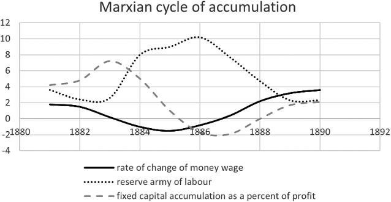

Marxian cycle of accumulation：马克思式积累周期；实线rate of change of money wage：货币工资变化率；点线reserve army of labour：劳动后备军；虚线fixed capital accumulation as a percent of profit：固定资本积累占利润的百分比；横轴数字为年份。

<!-- dm-ch05-124 -->

〔原书第89页〕

对马克思而言，经济世界也是类似周期叠加：商品周期$C\to M\to C$ 以及基本资本周期$M\to C\to M'$ 相互交织，且速度极快，通常以天或周为单位。在此之上，还有由他的“一般规律”驱动的周期，持续时间约十年。除此之外，还存在一个漫长过程，其间其他趋势逐渐显现：利润率下降以及工业无产阶级社会和政治影响力稳步增强。资本主义制度兴衰时间线——从16 世纪所谓“原始积累”到最终革命危机——跨越数百年。各种生产方式都融入一个“大周期”，从原始共产主义演进到高级共产主义。对马克思而言，这些周期是向上螺旋的，未来共产主义将超越其前身，而推动这一进程的正是他用另一个机械隐喻所称的“生产力”。

<!-- dm-ch05-125 -->

〔原书第89—90页〕

> 任何社会制度，在其中所能容纳的所有生产力都得到发展之前，绝不会消失；而新的、更高的生产关系，在支撑其存在的物质条件于旧社会子宫中成熟之前，也绝不会出现。因此，人类总是只去解决那些它能够解决的问题，因为如果我们更仔细地观察，就会发现：一个问题本身只有在解决该问题所必需的物质条件已经存在，或者至少正在形成过程中，才会出现。从大体上讲，我们可以把亚细亚的、古代的、封建的和现代资产阶级的生产方式，视为社会经济形态演进过程中的若干阶段。资产阶级生产关系是社会生产过程中最后一种对立形式——这种对立并非指个体间对立，而是源于个体在社会中生活所处环境条件；与此同时，在资产阶级社会内部发展起来的生产力，为解决这种对立创造了物质条件。因此，这种社会形态构成了人类社会史前阶段的最后一章。[^ch5-51]

<!-- dm-ch05-126 -->

〔原书第90页〕

## 修辞与发现的区别

<!-- dm-ch05-127 -->

〔原书第90页〕

熟悉当前马克思主义哲学辩论的读者会发现，我们所阐述的牛顿式和机械论式马克思，与近几十年来逐渐占据上风的某些新黑格尔主义对马克思的诠释截然不同。这类诠释多种多样，但其中一个特别清晰的例子见于……[^ch5-52]

> 校注：底本句末given by后未写作者姓名而直接接原注52；译文保留省略形式，由原注标明所引文献。

<!-- dm-ch05-128 -->

〔原书第90页〕

斯塔罗斯塔（Starosta）很坦率。他仅声称自己在探讨马克思在《资本论》中的论述，而非其思想来源。这对于该书某一章的表述形式而言，是一份相当称职的阐释。与非黑格尔式马克思论述联系最紧密的马克思主义哲学家是阿尔都塞，他主张马克思在1840年代与黑格尔主义发生根本性概念断裂。作为反对阿尔都塞“在《德意志意识形态》时期就已与黑格尔发生认识论断裂”这一论点的论者，斯塔罗斯塔毫无用处。他只是轻率地假定了一种连续性，例如：

<!-- dm-ch05-129 -->

〔原书第90页〕

> 正如他在《阿道夫·瓦格纳边注》中明确指出，马克思既没有把政治经济学概念，也没有把任何其他概念作为出发点（马克思，1975，198），以此来发现异化劳动。[^ch5-53]

<!-- dm-ch05-130 -->

〔原书第90页〕

然而，在关于瓦格纳的笔记中，根本没有提到异化劳动。[^ch5-54]这篇笔记最初于1972 年由一份阿尔都塞主义期刊（《理论与实践》）翻译成英文，目的正是为了证明所代表的认识论断裂是彻底的。作者若能阅读阿萨尔·侯赛因（Athar Hussain）为该英文译本所作原始导言，本会明智得多。[^ch5-55]

<!-- dm-ch05-131 -->

〔原书第90页〕

随后，他便简单假设“异化劳动”这一概念在《资本论》中被使用：

<!-- dm-ch05-132 -->

〔原书第90页〕

> 从这个意义上说，马克思在《资本论》中的论述并非朝着发现异化方向推进，而是从辩证探究的分析阶段所揭示的、作为其最抽象和最一般形式的异化出发。

<!-- dm-ch05-133 -->

〔原书第90页〕

在《资本论》第一卷的英译本中，alienation一词只以亚当·斯密所用的旧苏格兰法律含义出现，即财产的出售或赠与。卖掉房屋，就是将它让渡出去（alienate）。这就是该词在《资本论》中的含义。例如，以下几段引自该书：[^ch5-56]

<!-- dm-ch05-134 -->

〔原书第91页〕

> 它通过商品的普遍让渡，通过实际上与其作为有用物的自然形式互换位置，从而在现实中成为其价值的化身，才变成了真正的货币。

<!-- dm-ch05-135 -->

〔原书第91页〕

> 但随着流通发展，会出现这样一种情况：商品的出让与价格的实现之间，因时间间隔而分离。

<!-- dm-ch05-136 -->

〔原书第91页〕

《资本论》第三章德语原文使用的是“Veräußerung”（出售），而非“Entfremdung”——后者在马克思早期著作英译本中被译为“alienation”（异化）或“estrangement”（疏离）。这绝非《1844年经济学哲学手稿》（EPM）中“异化劳动”（entfremdete Arbeit）所涉及的问题，即使它们在英文中可能被译为相同词。

<!-- dm-ch05-137 -->

〔原书第91页〕

斯塔罗斯塔还宣扬了一种目前虽流行但颇为奇怪的解释，即认为马克思在讨论商品时，仅指资本主义社会：

<!-- dm-ch05-138 -->

〔原书第91页〕

> 正如如今已得到广泛承认的那样，这个出发点并不是源自恩格斯、又经斯威齐和米克等作者普及的正统解释所认为的那种简单商品生产社会——无论它是理想类型，还是更糟，是历史上实际存在过的社会。

<!-- dm-ch05-139 -->

〔原书第91页〕

这一点极具争议。正如米克尔（Meikle）所指出的，马克思提出的使用价值与交换价值之间的基本区分源自亚里士多德。[^ch5-57]马克思在脚注和正文中明确把许多思想归功于亚里士多德。特别值得一提的是，由于这直接关系到价值形式，马克思非常明确指出，他在《资本论》中提出的等价形式源自亚里士多德：

<!-- dm-ch05-140 -->

〔原书第91页〕

> 如果我们回溯到那位最先分析了如此多种形式——无论是思想、社会还是自然的形式，其中也包括价值形式——的伟大思想家，那么等价形式的后两项特殊性就会变得更易理解。我指的是亚里士多德。

<!-- dm-ch05-141 -->

〔原书第91页〕

> 首先，他明确指出，商品的货币形式仅仅是简单价值形式的进一步发展——即用任意另一种商品来表示一种商品的价值；因为他说：

<!-- dm-ch05-142 -->

〔原书第91页〕

> 5 张床＝1 栋房子与“5 张床＝若干货币”并无区别。

<!-- dm-ch05-143 -->

〔原书第91页〕

> 他进一步指出，产生这种表达方式的价值关系，要求房屋在质上必须与床等同；若无这种等同，这两种显然不同的事物便无法作为可通约的量相互比较。他说：“没有相等就不能交换，没有可通约性就不能相等。”

<!-- dm-ch05-144 -->

〔原书第92页〕

> ……然而，他到此便停下来，放弃了对价值形式的进一步分析。“然而，实际上，如此不同的事物不可能具有可通约性”——即在质上相等。这种等同只能是与其真实本质相悖的，因此仅是“一种为实际目的而采取的权宜之计”。

<!-- dm-ch05-145 -->

〔原书第92页〕

> 因此，亚里士多德本人告诉我们，是什么阻碍了他进一步分析；那就是缺乏任何价值概念。究竟是什么等价物、什么共同实体，使得床的价值能够用一所房子来表达？亚里士多德说，事实上，这样的东西不可能存在。为什么呢？与床相比，房子确实代表了与床等价的东西，因为它代表了床和房子中真正等价的东西。那就是——人的劳动。

<!-- dm-ch05-146 -->

〔原书第92页〕

> 然而，有一个重要事实阻碍了亚里士多德认识到：赋予商品以价值，仅仅是把一切劳动表述为等值的人类劳动，进而表述为质上相等的劳动的一种方式。希腊社会建立在奴隶制基础上，因此其自然基础就是人与人之间及其劳动能力的不平等。价值的表达之谜——即各种劳动之所以平等且等价，是因为且仅在它们作为一般人类劳动范围内——只有当人类平等观念已经取得一种普遍成见的牢固性之后，才能被破译。

<!-- dm-ch05-147 -->

〔原书第92页〕

因此，马克思指出：

<!-- dm-ch05-148 -->

〔原书第92页〕

- 他对价值形式矛盾的分析源自亚里士多德。

<!-- dm-ch05-149 -->

〔原书第92页〕

- 商品生产和商品价值早在资本主义出现之前就已存在于古代雅典。

<!-- dm-ch05-150 -->

〔原书第92页〕

- 价值的奥秘——即价值本质上就是人类劳动——对于当时奴隶主阶级成员来说不可想象——尽管即使在当时，价值来源也是人类劳动。正是作为奴隶制拥护者的阶级盲目性，阻碍了他认识到这一点。

<!-- dm-ch05-151 -->

〔原书第92页〕

马克思和亚里士多德把交换视为等价关系是合理的，因为他们认识到在不同商品交换中必须存在一个共同要素。针对马克思未能把劳动确立为这种共同实体的批评，斯塔罗斯塔提出异议，他认为马克思确实指出了共同实体，并从辩证角度引入了劳动这一概念，其依据正是为社会需求而进行的私人劳动的特性。然而，马克思这种做法可被视为一种辩证策略，虽然看似合理，但未必在科学上严谨。历史实例，如解释燃烧的“燃素”[^ch5-58]理论，表明看似合理且符合唯物主义的解释最终仍可能被证明是错误的：

<!-- dm-ch05-152 -->

〔原书第93页〕

> 易燃矿物[^ch5-59]富含燃素，不与水结合，但纯净时可溶于油脂；遇火时，它们会冒烟，通常会燃烧，大部分会被烧尽，有时甚至完全消失。

> 校注：本段及以下历史化学引文含phiogifton、confumed、diffolve、fix、finell等底本拼写，英文按原书照录；中文结合上下文及原注翻译，不将其当作现代术语。

<!-- dm-ch05-153 -->

〔原书第93页〕

> 金属在纯净状态下完全不溶于水；只有少数几种能溶于油，且仅在部分失去其燃素时才可溶解。它们是已知物质中最重的，其中最轻的重量也超过同等体积水的六倍。

<!-- dm-ch05-154 -->

〔原书第93页〕

> 燃素化的矾酸（挥发性矾酸[^ch5-60]）经常从火山口喷出；其气味令人窒息而刺鼻。与燃素及热质的结合使它成为气态，但并不妨碍它与水结合。

<!-- dm-ch05-155 -->

〔原书第93页〕

> 有些人把硝酸排除在矿物界之外，因为他们认为它是有机体腐烂产生的。但这些有机体一旦失去生命，又会被重新纳入矿物界，而它们原本较不易挥发的部分正是源自那里。

> 校注：此处及下文nitrous acid是引文所用旧称；原注61明确以现代发烟硝酸解释。底本folds、miore等拼写原样保留于英文。

<!-- dm-ch05-156 -->

〔原书第93页〕

> 在人工能制备出的最高浓度状态下，其比重为1.580。纯净时无色；但因其对燃素的强烈吸引力，必须采取特殊处理手段才能使其呈现这种无色状态。与不同比例燃素结合时，它会形成燃素酸和亚硝气。

> 校注：底本在attraction和so后留有星号，但本书此处没有相应星号注释；英文保留星号。

<!-- dm-ch05-157 -->

〔原书第93页〕

> 颜色最深且冒烟的硝酸[^ch5-61]若在敞口容器中快速煮沸，便能轻易使其无色。部分酸会挥发，同时把过量燃素以亚硝气形式带走。[^ch5-62]

<!-- dm-ch05-158 -->

〔原书第93页〕

18 世纪化学家给出的论证在结构上与马克思辩证论述极为相似。共同性质（可燃性、可交换性）和表现形式（火焰、以黄金表示的价格）——由此辩证推导出必然存在一种共同实体（燃素、价值）。但我们知道，燃素说是不正确的，可燃物之间并不存在共同实体；相反，火是由燃料氧化产生的。普里斯特利的“纯燃素”实际上是氢。金属与其“氧化物”之间的差异源于氧化，而非燃素损失。最终发现的共同特征是：可燃物质可以通过氧化转变为较低能量状态。

<!-- dm-ch05-159 -->

〔原书第93页〕

虽然马克思可能把价值视为可交换商品中的共同实体，并论证劳动在抽象层面上可量化且是商品存在必要条件，但仅凭这一点并不能证实劳动就是那种共同实体。

<!-- dm-ch05-160 -->

〔原书第93页〕

这并非要质疑马克思正确性；而是可以设想，可能存在另一种被他忽略的共同实体。能量是一个首要候选者，它既具备抽象可量化特性，又能以热能、电能、动能和化学能等多种具体形式表现出来。

<!-- dm-ch05-161 -->

〔原书第93—94页〕

马克思推导的正确性并不取决于其理论上的合理性，而在于商品价值是否确实与劳动含量成正比。如果经实测发现，价格与生产商品所需瓦特秒（即焦耳）数量的相关性，远高于与人类劳动人秒数量的相关性，那么马克思观点就是错误的。如今我们已知，从经验上看马克思是正确的。商品价格与劳动人秒相关性远高于与所耗能量焦耳相关性。若是那种情况，马克思关于资本主义运动的定律就只会是能量守恒定律的一个特例，而非更高阶统计力学定律。[^ch5-63]

> 校注：底本在陈述劳动相关性更强之后，紧接In that case ... would ...，其指代与段内次序存在歧义。中文保留假设语气；未调换原句顺序或删去该句。

<!-- dm-ch05-162 -->

〔原书第94页〕

当然，马克思并非随意选择劳动作为价值实体。他遵循了从哈勒敦[^ch5-64]到李嘉图[^ch5-65]的学术传统——他们曾通过粗略而简便的方法观察到，这种必要经验关系确实存在。

<!-- dm-ch05-163 -->

〔原书第94页〕

作为一种科学方法，马克思做法确实是一条捷径。它未达到现代科学的严谨性标准，依赖辩证法“障眼法”。理想情况下，他本应提供自己的实证数据来证实“劳动是价值本质”这一主张，或者至少援引其前辈的观察论据，以支持“劳动含量决定价格”这一观点。

<!-- dm-ch05-164 -->

〔原书第94页〕

这些来源——即他的前辈们——并未被隐瞒。《资本论》第四卷题为《剩余价值理论》，整卷都献给了他的前辈及其思想。从中，我们可以辨别出他认为哪些观点正确，他们之间存在哪些概念争论，以及他认为他们的推理在哪些地方存在缺陷。

<!-- dm-ch05-165 -->

〔原书第94页〕

然而，对于像《资本论》这样兼具科学性和论战性的著作，辩证法或许大有裨益。当目标是说服读者时，辩证修辞可被视为一种有效策略。问题在于，后世把这些方法视为值得效仿的研究标准时，问题便出现了。

<!-- dm-ch05-166 -->

〔原书第94页〕

马克思的论点之所以成立，是因为他站在了前辈们“巨人的肩膀”上。[^ch5-66]他得以把斯密和李嘉图此前已奠定的理论基础融入自己的辩证论述之中。

<!-- dm-ch05-167 -->

〔原书第94页〕

这也是为何此后进一步尝试应用辩证法都是徒劳的。马克思主义经济学中的黑格尔学派未能通过这种方法进行创新或产生新知识，因为该方法本身并非为此目的而设计。它仅仅是把现有知识重新表述为修辞结构罢了。

<!-- dm-ch05-168 -->

〔原书第94页〕

这一点在关于自然辩证法的那些荒谬论述中尤为明显。这些理论的支持者并未发现任何新东西。相反，他们只是把通过常规研究方法获得的科学知识，用“对立统一”和“量变到质变”等辩证概念术语重新包装了一下。

<!-- dm-ch05-169 -->

〔原书第94页〕

恩格斯[^ch5-67]之所以能把水转化为蒸汽作为“量变到质变”以及“辩证飞跃”的例证，完全是因为此前热力学领域已有相关研究。布莱克及其助手瓦特的研究所揭示的，正是热本身可以量化[^ch5-68] ，并且汽化潜热这一现象确实存在。辩证法并非他们这些发现的必要条件。事实上，布莱克教授早在1761 年就发现了潜热，这比黑格尔时代要早得多。我们提及布莱克有两个原因：其一，他的思想后来被恩格斯作为自然辩证法范例加以阐述；其二，这些思想与马克思在《资本论》中后续论述的一个阶段——剩余价值奥秘——密切相关。

<!-- dm-ch05-170 -->

〔原书第95页〕

马克思通过把劳动视为价值的共同本质，来回应亚里士多德关于使用价值与交换价值的二分法——这一见解源自他从早期政治经济学家那里汲取的智慧。随后，他解决了另一个重大辩证矛盾：剩余价值谜题。如你所知，他首先提出一个悖论：资本的$m-c-m'$ 循环过程确实存在，但这似乎与商品等价交换的一般原则相冲突。他问道：如果沿途所有商品交换都是等值交换，那么$m<m'$ 的情况如何可能发生？

<!-- dm-ch05-171 -->

〔原书第95页〕

正如我们在第5.3.1 节中所解释的，马克思通过在“劳动”与“劳动力”之间作出概念区分来解决这一问题。他把劳动力定义为劳动能力。马克思认为，资本家用工资购买的是劳动力，而不是劳动本身。剩余价值奥秘在于：劳动力价值由其再生产劳动成本决定——这与所有商品一样——但维持工人一天生活所需劳动量却少于一整天劳动。这部分多余时间，即工作日长度与工资购买的生活资料的劳动价值之间的差额，便成为剩余价值来源。

<!-- dm-ch05-172 -->

〔原书第95页〕

这种把劳动与劳动力区分开来的观点，是政治经济学领域一项创新。斯密和李嘉图等前辈曾把工资等同于劳动本身价值，其中李嘉图认为，工资与维持工人生活所需劳动量相等。此外，李嘉图还指出工资与构成资本家利润的价值份额之间的反向关系。

<!-- dm-ch05-173 -->

〔原书第95页〕

马克思在此处的创新有两方面：

<!-- dm-ch05-174 -->

〔原书第95页〕

1. 从利润推广到剩余价值——其中还包括地租和利息。

2. 把“劳动”与“劳动力”区分开来。

<!-- dm-ch05-175 -->

〔原书第95页〕

可以认为，《资本论》中对这一问题的阐述采用了黑格尔式修辞技巧：先从“$c-m-c$”与“$m-c-m'$”之间推导出矛盾，然后通过“劳动力”这一新概念来化解矛盾。但这并不能解释，这种辩证“魔术”究竟是从何处衍生出“劳动力”这一概念的。

<!-- dm-ch05-176 -->

〔原书第95页〕

这一概念显然并非源自黑格尔，在斯密或李嘉图著作中也找不到。相反，如前所述，它源于瓦特（Watt）的概念。瓦特研究为马克思理论奠定了双重基础。瓦特与布莱克（Black）共同发现蒸汽具有潜热后，意识到通过添加独立冷凝器可以显著提高蒸汽机效率。这一洞见不仅确保了他作为工程师的成功，也推动了资本主义工业化进程。马克思指出，手摇磨坊催生了封建领主，而蒸汽磨坊则催生了工业资本家。实际上，瓦特发明对产生马克思所称的“相对剩余价值”起到了关键作用。它促成了蒸汽动力机械的广泛应用，取代了人力劳动，并为马克思提供了揭开剩余价值之谜所需的理论工具。马克思指出，亚里士多德由于受奴隶社会意识形态束缚，未能认识到劳动是价值的共同实体。只有随着经济发展，斯密才看清了这一点。

<!-- dm-ch05-177 -->

〔原书第96页〕

因此，到马克思著书立说之时，工程实践已把“功”与“功率”之间、以及“功”与“做功能力”之间的概念区分，纳入了工业化英国的普遍基础知识范畴。同样，资本主义商业实践中蒸汽机租赁行为，也确立了按月费出租这些机器做功能力的原则。

<!-- dm-ch05-178 -->

〔原书第96页〕

当斯密著书时，他的熟人瓦特仍在捣鼓原型机，[^ch5-69]甚至在李嘉图时代，与水磨相比，蒸汽机也相对罕见。但到马克思著书之时，热力学和资本主义文明实践已经为他提供了必要的概念抽象，使他能够区分劳动与劳动力，从而解决了剩余价值问题。

<!-- dm-ch05-179 -->

〔原书第96页〕

此外，还有一个平行概念——剩余价值率对应于蒸汽机的煤炭回报率：即消耗煤炭与运出煤炭之比。这被称为能源投资回报率，代表了工业资本主义社会在热力学或能源方面的本质限制。正的剩余对于正的相对剩余价值率至关重要。随着我们日益接近化石燃料资本主义危机，这些比率之间关联值得政治经济学家进一步研究。

> 校注：底本将此比率写为“消耗煤炭与运出煤炭之比”，随后称energy return on investment；本译保留其比率方向，不擅自倒置。

<!-- dm-ch05-180 -->

〔原书第96页〕

此外，我们不应把辩证法修辞策略与实际历史或观念结构混为一谈。辩证法家的成功取决于能否利用现有概念。其方法有效性在于按适当顺序揭示这些概念，并假定听众对所呈现思想有一定了解。在19 世纪中叶，“劳动作为价值来源”以及“功”与“功率”的区分等概念，对《资本论》普通读者而言，大概已经足够熟悉，足以理解马克思论点。

<!-- dm-ch05-181 -->

〔原书第96页〕

马克思把某些概念融入政治经济学的独创性并不受质疑。然而，这些基础思想并非源自黑格尔，而是源于更早期的社会研究和工程研究。当今要推进马克思主义科学，就必须研究经济和社会数据中的具体模式，并广泛借鉴各门科学和工程学中的分析工具。辩证法研究，充其量只能提供一种围绕研究发现构建有说服力叙事的方式。然而，这种方法风险重重，因为要取得成功，需要具备与马克思相媲美的非凡修辞才能。若由那些缺乏马克思博士写作造诣和广博知识的人来操作，结果很可能平淡无奇、索然无味。

<!-- dm-ch05-182 -->

〔原书第96页〕

## 达尔文与目的论的终结

<!-- dm-ch05-183 -->

〔原书第96页〕

> 顺便提一句，我正在阅读的达尔文著作绝对精彩绝伦。目的论曾有一个方面尚未被推翻，而如今这一工作已然完成。此前从未有人以如此宏大尝试来论证自然界中的历史演化，更遑论取得如此卓著效果了。[^ch5-70]

<!-- dm-ch05-184 -->

〔原书第97页〕

> 达尔文著作至关重要，且恰好符合我的目的，因为它为历史性阶级斗争提供了自然科学基础。……尽管存在种种不足，正是在此处，自然科学中的“目的论”不仅首次遭受致命打击，其理性含义也得到了经验性阐释。[^ch5-71]

<!-- dm-ch05-185 -->

〔原书第97页〕

达尔文著作中有两个重要主题特别值得关注。第一个是通过自然选择理论对目的论的解构，这一点曾被恩格斯和马克思强调。其次是挑战人类例外论，把人类单纯视为哺乳动物中的又一物种。达尔文基本方法是通过动物行为视角来解读人类行为。他并不回避把类似人类的特质归于动物，而且提出：要理解人类特征，就必须承认我们共同的哺乳动物血统。

<!-- dm-ch05-186 -->

〔原书第97页〕

对这一观点的抵制很可能源于与早期经济体系相关的意识形态。例如，亚里士多德关于某些个体天生就是奴隶的论断，反映了当时社会状况。同样，依赖马、牛等动物劳动的经济体系，需要明确划分人类与动物界限。人类，如同奴隶主一样，被视为理性生物，而动物或奴隶据称则缺乏这种特质。

<!-- dm-ch05-187 -->

〔原书第97页〕

达尔文出身于当时正在崛起的贵格会工业阶级家庭，是奴隶制的坚定反对者，[^ch5-72]他在撰写相关著作时，蒸汽动力正逐渐取代马力，成为社会驱动力。他既致力于主张白人与黑人的共同人性，也致力于阐明人类与动物作为哺乳动物的共同特征。

<!-- dm-ch05-188 -->

〔原书第97页〕

## 终结目的论

<!-- dm-ch05-189 -->

〔原书第97页〕

19 世纪中叶，如何解释漫长地质时间以及地球物种曾多次经历彻底变迁这一事实，成为一项重大挑战。这一过程显然具有方向性，而非循环往复。于是问题随之而来：这该如何解释？同样，从资本主义工业文明角度来看，历史似乎也具有方向性。究竟哪种因果模型能够解释这一现象？

<!-- dm-ch05-190 -->

〔原书第97页〕

目的论是其中一种解决方案。马克思和恩格斯把达尔文对目的论的否定视为一个关键性进展。要理解这一点，必须了解达尔文提出其思想时的思想背景。他否定了何种目的论概念？

<!-- dm-ch05-191 -->

〔原书第97页〕

关于物种历史演化的目的论理论中最成熟版本，是由钱伯斯在其1844 年首次出版的《创世自然史遗迹》中提出的。《创世自然史遗迹》一书极具争议性，因为它普及了赫顿、米勒和莱尔的地质深时观，并将其与基督教视角相调和，从而彻底打破了厄舍主教关于“公元前4004 年创世”的说法。钱伯斯很难为该书争取到书评，但该书为《物种起源》问世铺平了道路。

<!-- dm-ch05-192 -->

〔原书第97—98页〕

这本书有趣之处在于，当时人们对天文学和地质学了解程度之深。钱伯斯不仅对太阳系规模，而且对半人马座α 星距离都有相当准确估算，并对我们银河系形状也有相当清晰认识。他知道还有其他许多星系。他对太阳系形成过程描述，与如今学校天文学教科书中内容相差无几。

<!-- dm-ch05-193 -->

〔原书第98页〕

书中概述了地质年代大致脉络。令人着迷的是，坎布里亚纪（Cumbrian，并非寒武纪Cambrian）、泥盆纪、志留纪、石炭纪和白垩纪这些地质年代，并未像如今那样被呈现为带有起止日期的抽象时期，而是直接与英国特定地区岩层相关联——例如泥盆纪位于德文郡，坎布里亚纪位于威尔士，白垩纪位于苏塞克斯郡。

> 校注：底本明确写Cumbrian (not Cambrian)，并在后文将其对应威尔士；中文保留底本这一区分与地理表述。

<!-- dm-ch05-194 -->

〔原书第98页〕

他对主要动植物类群出现时间顺序有大致了解，但在地质成因方面，他持有一些当时看似合理、如今却显得荒诞不经的观点。例如，他认为沉积“古红砂岩”的海域深度达数百英里，且直到石炭纪之前都不存在陆地。他提出一个引人入胜假说：在石炭纪之前，二氧化碳$\mathrm{CO_2}$ 浓度过高，陆地动物无法生存。根据他的理论，碳的封存使得陆地动物得以在他所称的“新红砂岩”时期出现，而我们现在把这一时期认定为二叠纪至侏罗纪。

<!-- dm-ch05-195 -->

〔原书第98页〕

他提出观点中明显体现了目的论：形成煤层的森林既是为了净化空气以维持动物生命，也是为了提供我们文明所需燃料。

<!-- dm-ch05-196 -->

〔原书第98页〕

这与他关于动物形态如何产生的理论密切相关。他强调，用他的话说，生命会抓住任何机会。在现代人听来，这似乎是生命为适应生态位而快速进化的观念，但在他看来，这被视为形态规律的发展。他是一位鲜明的自然主义者。生命遵循自然法则而产生，生命形态同样受这些法则驱动。早在19 世纪初，他就确信电是生命源泉。这与玛丽·雪莱的《弗兰肯斯坦》所探讨主题遥相呼应。

<!-- dm-ch05-197 -->

〔原书第98页〕

例如，他声称电放电中出现的树枝状或分支图案与树木形态相同，因为在带负电地球与带正电大气之间，起作用的是相同电学定律。这种电势推动了植物生长，并造就了树木、棕榈等植物特征形态。他甚至引用了克罗斯先生进行的一项类似《弗兰肯斯坦》的实验——该先生声称，通过向“硅酸钾”通入强电流，观察到了昆虫生命自发生成。据称，威克斯先生使用“亚铁氰化钾”也成功复现了这一实验。

<!-- dm-ch05-198 -->

〔原书第98页〕

这些昆虫据说非常微小，“是一种微小的、半透明的、长有长刚毛的ascuraus”。

<!-- dm-ch05-199 -->

〔原书第98页〕

这一系列实验的引用并不十分令人信服：“参见威克斯先生于1842 年发行的一份小册子”。

<!-- dm-ch05-200 -->

〔原书第98—99页〕

钱伯斯把自然法则与“摩西经文”相调和的基本方式是：上帝意欲让生命存在，而非亲手创造了每一类生物。相反，宇宙的大建筑师设计了自然法则，以确保行星首先形成，随后生命会通过电作用从无机化合物中自发产生。然后，一旦出现新的物理条件，相应生命形式就会自发发展起来以填补这一空间。

<!-- dm-ch05-201 -->

〔原书第99页〕

对现代读者而言，他反复使用“物种作为过渡形式”这一概念令人困惑。如今，我们从达尔文主义角度理解“过渡形式”——始祖鸟作为爬行动物与鸟类之间过渡形式，是指它源自爬行动物，而后来的鸟类则源自它（或其近亲之一）。

<!-- dm-ch05-202 -->

〔原书第99页〕

然而，他所指的“过渡形式”如今已被认为可信度极低。他认为，具有骨质外层的泥盆纪盾皮鱼是甲壳类与鱼类之间过渡形式。他提出，鸵鸟——其膀胱和膈肌与哺乳动物相似，羽毛则类似于毛发——是哺乳动物与鸟类之间过渡形式。他还视鸭嘴兽为鸟类与哺乳动物之间过渡形式。他提出的演化序列是：鱼类、爬行动物（包括两栖动物）、鸟类，然后是哺乳动物。因此，鸵鸟正在演化为哺乳动物的观点与这一序列相吻合。他经常使用时间顺序术语，把鱼类置于首位，而把爬行动物置于更高位置或随后位置，这反映了一种目的论序列，与物种出现的地质记录相吻合。他作品中核心的目的论主题是：存在一种与生俱来的“发展法则”，它引导着更高等生命形式的产生。钱伯斯以蜜蜂为例——蜜蜂幼虫喂养方式决定了它们长大后是成为蜂王、工蜂还是雄蜂——据此推测，胚胎环境条件改变将导致后代发育得更为完善。他声称，一旦摆脱野蛮状态艰辛，生活在欧洲环境中的非洲人不仅会同化于欧洲人的生活方式，而且外貌也会趋同于欧洲人：

<!-- dm-ch05-203 -->

〔原书第99页〕

> 黑人种族的粗犷五官及其他结构上的特殊性，仅在这些人生活在通常与野蛮状态相关联的环境中时才会持续存在。在气候更为温和、社会状态更高级的环境中，面部和体态会变得极为精致。那些拥有一定文明的少数非洲民族，其外貌也呈现出接近欧洲人的特征。[^ch5-73]

<!-- dm-ch05-204 -->

〔原书第99页〕

他是一位极端环境决定论者。他认为，居住在欧洲的非洲人第三代后裔之所以看起来更“精致”，并非归因于通婚，而是归因于生活条件。钱伯斯毫不犹豫地断定，他在本国同胞身上最熟悉的那些特征才是最先进的。在他看来，整个自然发展法则似乎以孕育出一位营养充足的英国上层阶级成员为最终目标。

<!-- dm-ch05-205 -->

〔原书第99页〕

他利用哺乳动物、鱼类、爬行动物等之间胚胎学相似性，论证哺乳动物胚胎分化是内在发育规律的结果，只要条件允许，鱼类胚胎也具备这种能力。

<!-- dm-ch05-206 -->

〔原书第99—100页〕

> 人类胎儿的躯体中，往往有一处最重要部位发育不完全：例如，心脏仅停留在三腔结构阶段，因此它实际上是爬行动物的心脏。甚至还有这样的例子：该器官仍保留着双腔或鱼类形态。此类缺陷纯粹是由于母体机体发育能力不足所致，而这种不足又源于体质虚弱或生活困苦。在这里，我们显然看到了一种与那些使物种向另一物种转变的条件相反的情况——至少就这一器官而言是如此。既然在这个特定点上出现了完全的物种退化，那么不难想象，一旦有利条件充分增加，便足以逆转这一现象，使鱼类母亲发育出爬行动物心脏，或使爬行动物母亲发育出哺乳动物心脏。推测如下并非过于大胆：若这种“不足”程度被“过度补偿”（前者与后者似乎同样是自然现象），就足以使一只鹅的后代拥有老鼠身体，从而产生鸭嘴兽；或者，使鸭嘴兽后代拥有真正啮齿动物嘴巴和脚，从而在两个阶段内完成从鸟类到哺乳类转变。[^ch5-74]

<!-- dm-ch05-207 -->

〔原书第100页〕

他深信，生命不仅存在于火星和木星上，而且由于这一发育定律，这些生命与地球上生命极为相似；在其他恒星周围无数行星上，也存在着类似生物。这种自负观点，在当今时代，也被《星球大战》制片人所共享。

<!-- dm-ch05-208 -->

〔原书第100页〕

钱伯斯著作描绘了一幅生物在内在发展规律引导下，不断、渐进地向上发展图景——这一概念无疑具有目的论色彩，尤其是考虑到钱伯斯把它解释为上帝设计体现。然而，这种进步观念与某些对马克思主义的常见诠释颇为相似：其中，从鱼类到爬行动物、鸟类，最终到哺乳动物的必然演进，恰与不同生产方式演进相呼应。例如，塞耶斯[^ch5-75]指出：

<!-- dm-ch05-209 -->

〔原书第100页〕

> 马克思主义把历史发展的进步模式理解为阶级斗争以及生产力与生产关系之间冲突的结果。马克思——就像达尔文一样——最恰当的理解并非在于他否定了目的论观念，而在于他采用了一种与现代科学相一致的自然主义版本的目的论。

<!-- dm-ch05-210 -->

〔原书第100页〕

这种观点的问题在于，钱伯斯（Chambers）那种颇具影响力的达尔文之前理论，同样可以被描述为提出了一种符合19 世纪中叶现代科学的自然主义目的论。马克思赞扬达尔文打破了这一范式，这表明他认为自己和达尔文研究都与目的论有着根本性区别。

<!-- dm-ch05-211 -->

〔原书第100页〕

查尔斯·达尔文提出的因果机制概要如下：

<!-- dm-ch05-212 -->

〔原书第100页〕

- 所有动植物物种中都存在变异。

<!-- dm-ch05-213 -->

〔原书第100页〕

- 可变性状可以遗传。

<!-- dm-ch05-214 -->

〔原书第100页〕

- 对可变性状的选择会增加其出现频率，这一点从农民和园艺师对动植物选育中即可得到印证。

<!-- dm-ch05-215 -->

〔原书第100页〕

- 生存竞争会筛选出最适应环境、从而能繁育后代的个体。

<!-- dm-ch05-216 -->

〔原书第100页〕

- 这可能导致足够大变化，从而产生新物种。

<!-- dm-ch05-217 -->

〔原书第101页〕

他在《物种起源》第三章中用一段话很好总结了自己的理论：

<!-- dm-ch05-218 -->

〔原书第101页〕

> 由于这种生存斗争，任何变异——无论多么微小，无论源于何种原因——只要在某一物种的个体与其他生物及外部自然环境的无限复杂关系中，能给该个体带来任何程度的益处，就会有助于该个体保存，并且通常会遗传给其后代。后代也将因此获得更大生存机会，因为在任何物种周期性诞生的众多个体中，只有少数能够存活下来。我把这一原则——即任何微小变异，只要是有益的，就会被保留下来——称为“自然选择”，以此标明它与人类选择能力之间关系。我们已经看到，人类通过人工选择确实能够取得巨大成果，并能利用大自然赋予的微小但有益的变异，通过其积累，使生物适合自身需求。但正如我们今后将看到的，自然选择是一种随时准备发挥作用的力量，它比人类微弱努力要高明无数倍，正如自然之作远胜于人工之作。[^ch5-76]

<!-- dm-ch05-219 -->

〔原书第101页〕

达尔文理论常与拉马克进化论相互对照，人们认为两者关键区别在于后代能否继承获得性状——例如海豹增强的游泳能力。然而，把这种遗传现象称为“拉马克主义”，而把其否定视为“达尔文主义”，实属时代错置。在遗传学被理解之前，后天习得性状与遗传性状是否截然不同并不明显，而且达尔文从未排除获得性状遗传可能性。在某些地方，[^ch5-77]他提到后代会继承后天习得的情感表达习惯。

<!-- dm-ch05-220 -->

〔原书第101页〕

在[^ch5-78]中，他强调自己所要求仅仅是变异存在，无论导致或引发变异具体情况如何。变异起源：

<!-- dm-ch05-221 -->

〔原书第101页〕

> 关于变异原因——无论其具体为何——通常在生命周期哪个阶段起作用，一直存在争议：是在胚胎发育早期还是晚期，抑或是在受精瞬间。杰弗鲁瓦·圣伊莱尔实验表明，对胚胎进行非自然处理会导致畸形；而畸形与单纯变异之间无法用任何明确界限加以区分。但我强烈倾向于认为，变异最常见原因或许可归因于雄性和雌性生殖细胞在受精行为发生之前已受到影响。……事实上，“变异体”支持我的观点，即变异性很大程度上可归因于胚珠或花粉，或二者，在受精行为发生前受到亲本所受环境影响。[^ch5-79]

<!-- dm-ch05-222 -->

〔原书第101页〕

“变异体”是植物品种中我们现在所称“突变”的旧称。尽管当时尚未有“基因突变”这一概念，但这一论述在功能上具有相似性。他的意思是，影响物种性器官的环境压力可能会诱发变异。如果我们将暴露于背景辐射等因素视为此类压力，那么这一观点仍然成立。

<!-- dm-ch05-223 -->

〔原书第102页〕

如果后天习得习惯也能诱导出额外变异，这对他的选择理论影响甚微。无论变异来源是什么，关键在于选择过程。

<!-- dm-ch05-224 -->

〔原书第102页〕

他在驯化动植物背景下引入了变异与选择概念。其前几章列举大量实例，展示驯化物种中存在着多么广泛变异。他强调，例如家犬变异程度远比野犬更为广泛。他甚至加入了鸽友协会和鸽育种协会，以深入了解这些鸟类变异范围及其育种者经验之谈。每当他试图阐明一个理论观点时，都会援引大量支持性观察结果。其中一些观察结果对于19 世纪著作而言显得格外现代。例如，他早已意识到家养动物身上存在某些特征，而这些特征直到20 世纪末才得到证实。

<!-- dm-ch05-225 -->

〔原书第102页〕

> 举不出任何一种家养动物，它在所有国家都不出现垂耳；一些作者提出，垂耳是因为这些动物不常受到危险惊吓，导致耳部肌肉不用，这一看法似乎是可信的。[^ch5-80]

<!-- dm-ch05-226 -->

〔原书第102页〕

这一经验观察结果得到了现代研究的证实，[^ch5-81]但达尔文关于家养性状成因理论并未得到支持。垂耳、短吻、幼态持续行为和斑驳毛色等性状，如今被统称为“驯化综合征”（DS）。20 世纪50 年代末在苏联启动的长期实验——该实验通过选择圈养狐狸进行驯化——为这一过程提供了新见解。经过五十年的选择性育种，由柳德米拉·特鲁特（Lyudmila Trut）领导的研究项目表明，即使在没有驯化历史的物种中，仅通过选择温顺性，也能迅速出现一整套DS 性状。当同一研究团队对大鼠和貂施加相同选择压力时，也观察到了类似结果。[^ch5-82]

<!-- dm-ch05-227 -->

〔原书第102页〕

通过反复选择所需性状，育种者成功培育出了变异性极强的家养种群。这种变异程度之大，以至于如果把不同犬种置于野外环境中观察，它们看起来会像是不同物种。如果人为选择能制造出物种形成表象，那么何种形式选择才会导致真正物种形成？

<!-- dm-ch05-228 -->

〔原书第102页〕

随后，他引入了自然界中的生存斗争。其根本在于任何生物都具有指数级繁殖潜力。

<!-- dm-ch05-229 -->

〔原书第102页〕

> “每个有机体自然增长的速度都高得惊人，若不被消灭，地球很快就会被一对生物的后代所覆盖”——这一规律没有例外。[^ch5-83]

<!-- dm-ch05-230 -->

〔原书第102—103页〕

如果指数增长持续下去，生物数量将很快超出其栖息地承载极限。即便最肥沃环境也是有限。对于每一个生物来说，都存在潜在竞争者。竞争者可能试图捕食你，也可能与你争夺食物或空间。正如他所说，大自然面容常常洋溢着喜悦，而且食物似乎俯拾皆是；然而我们却忽略了一个事实：周围那无忧无虑鸟鸣，源自那些以昆虫或种子为生、不断终结其他生命的生物。我们也忽视了这些歌者、它们的卵或幼崽在多大程度上沦为其他掠食者猎物。此外，我们未能意识到，这种食物丰裕并非在一年四季中始终如一。[^ch5-84]

<!-- dm-ch05-231 -->

〔原书第103页〕

生命是一场永无止境斗争。动物与环境抗争。它们面临周期性干旱或霜冻威胁。它们与竞争物种争夺生态位。同一物种个体则在该生态位内相互竞争，以期让后代繁衍其中。

<!-- dm-ch05-232 -->

〔原书第103页〕

> 只要稍微减轻任何制约，哪怕只是微乎其微地缓解破坏，该物种数量几乎会瞬间激增到任意规模。大自然面貌可以比作一块柔韧表面，上面密密麻麻堆满了一万个锋利楔子，它们被无休止打击向内驱入，有时击中一个楔子，接着又以更大力气击中另一个。[^ch5-85]

<!-- dm-ch05-233 -->

〔原书第103页〕

达尔文虽然没有使用“生态位”“栖息地”或“食物链”等现代生态学术语，但他的论点仍然基于类似概念。他描述了熊蜂为红三叶草授粉过程；熊蜂数量丰富，三叶草便生长茂盛。然而，田鼠以熊蜂地下蜂巢为食，随着田鼠数量增加，三叶草数量便随之减少。在村庄里，家猫捕食田鼠，从而使村庄花园里熊蜂数量丰富，三叶草生长茂盛。因此，在每一个生态系统中，错综复杂相互作用施加着持续压力，只有少数后代能够存活。在每个物种中，适应性最强后代得以存活并繁衍后代。

<!-- dm-ch05-234 -->

〔原书第103页〕

> 既然对人类有益变异无疑已经发生，那么在漫长而复杂的生存斗争中，对每个生物都以某种方式有益的其他变异，在数千代演变过程中偶尔出现，难道就难以想象吗？如果确实发生了这样变异，我们岂能怀疑（须知出生个体远多于能够存活数量），那些比其他个体具有任何优势——无论多么微小——的个体，拥有最大生存机会并繁衍后代？[^ch5-86]

<!-- dm-ch05-235 -->

〔原书第103页〕

自然选择不断作用于每个物种，以优化其适应性。随着时间推移，适应性不断提升，物种随之演变。旧物种逐渐灭绝，新的、适应性更强物种取而代之。

<!-- dm-ch05-236 -->

〔原书第103—104页〕

> 可以说，自然选择每天、每时每刻都在全世界范围内审视着每一个变异，哪怕是最微小变异；淘汰不良，保留并积累所有有益；只要机会出现，无论何时何地，它都在默默无闻、悄无声息地运作，致力于使每个有机体在其有机和无机生活条件下适应性得到提升。在这些缓慢变化进行过程中，我们一无所见，直到时间之手标记了漫长岁月流逝，而到那时，我们对久远地质时代的洞察仍如此不完善，以至于只能看到，如今生命形态与过去已不相同。[^ch5-87]

<!-- dm-ch05-237 -->

〔原书第104页〕

但我们究竟能从何种意义上谈论“方向”呢？过去那种把动物划分为“高等”和“低等”的说法，难道不是一种以人类为中心投射吗？

<!-- dm-ch05-238 -->

〔原书第104页〕

我们是否真的能在某种意义上说，今天周围野生动物比五千万年前那些更“先进”或更好？

<!-- dm-ch05-239 -->

〔原书第104页〕

也许进化中看似存在方向，不过是我们基于对祖先谱系了解而产生错觉。马真的比始马“更好”吗？

<!-- dm-ch05-240 -->

〔原书第104页〕

难道始马（Eohippus）不正是完美适应了它所栖息的始新世森林世界吗？

<!-- dm-ch05-241 -->

〔原书第104页〕

如果我们采纳这种观点，自然选择就不会赋予进化以长期方向。并不存在整体上进步，只有对气候变化或快或慢适应。

<!-- dm-ch05-242 -->

〔原书第104页〕

达尔文坚信“改良”是真实存在。他认为在任何特定环境中，都存在逐步适应空间。他援引入侵物种如何压倒本土物种例子，作为存在改良空间证据。

<!-- dm-ch05-243 -->

〔原书第104页〕

> 没有任何一个国家能被列举出来，其所有本土物种如今都已彼此之间以及与所处自然环境如此完美地适应，以至于其中任何一种都无法再得到任何改善；因为在所有国家，本土物种都已被归化物种所征服，以至于它们允许外来物种牢牢占据了这片土地。既然外来物种在各地都已击败了部分本土物种，我们便可确信地推断，本土物种本可通过改良获得优势，从而更好地抵御此类入侵者。[^ch5-88]

<!-- dm-ch05-244 -->

〔原书第104页〕

古尔德[^ch5-89]认为这一证据无可辩驳。他以南美洲有袋类物种为例，指出自然选择促进了马类生物和类似剑齿虎食肉动物趋同进化。然而，随着巴拿马地峡形成，这些物种被更具优势北美动物群所取代并灭绝。真正猫科动物确实优于其有袋类对应物。引入澳大利亚欧洲兔数量激增，已泛滥成灾。相反，被放养到欧洲的小袋鼠仅能在孤立小岛上生存。

<!-- dm-ch05-245 -->

〔原书第104—105页〕

因此，我们观察到改进、提升以及设计般表象，却没有目的论或设计者。达尔文生物学界定了几个层次：谱系、营养级和适应性。从纯粹达尔文主义角度来看，尽管存在改进，但不能把动物分为低等和高等。人们之所以不愿使用“高等”和“低等”等术语，是因为这些词可能暗示“高等”物种比“低等”物种更擅长生存。通常，人们认为海鸥优于海胆。尽管海鸥可能在海胆上方翱翔并以海胆为食，但它们并不争夺相同生态位。生物学家现在更倾向于把棘皮动物描述为比鸟类更“基底”的物种。“基底”指的是在祖先树上位置。总体而言，海胆和棘皮动物比鸟类更接近棘皮动物与脊椎动物共同祖先。海鸥在食物链中地位更高，在演化谱系上也更接近顶端，但它们对自身独特生活方式适应程度并不比海胆更好。

<!-- dm-ch05-246 -->

〔原书第105页〕

针对达尔文的“目的论”指控在“有袋类障碍”上碰壁了。那么，斯密或恩格斯提出的“生产方式的等级体系”又该如何解释呢？

<!-- dm-ch05-247 -->

〔原书第105页〕

回顾一下，斯密的序列是从狩猎社会到牧业社会，再到农业文明。恩格斯的序列是：蒙昧、野蛮、奴隶社会、封建主义、资本主义和共产主义。他对前两个术语的使用与摩根相同。[^ch5-90]蒙昧大致对应于狩猎社会。野蛮则对应于从事园圃种植或畜牧、但尚未实行犁耕农业的经济形态。

<!-- dm-ch05-248 -->

〔原书第105页〕

恩格斯的框架把社会发展同时看作谱系上的承续和进步。资本主义被视为比封建主义更先进，野蛮状态则比蒙昧状态更先进。现代人的敏感意识往往排斥“野蛮人”或“蒙昧人”等词，因为其中带有欧洲中心主义或中国中心主义的偏见，甚至可能接近种族主义。然而，从马克思主义视角来看，从事园圃种植和畜牧的野蛮社会，相较于仅依赖狩猎的社会，其进步性不可否认。同样，资本主义也被视为比封建主义更先进。这基于古尔德指出的同一标准：竞争能力。历史上，处于野蛮阶段的民族与处于蒙昧阶段的民族接触时，常常取代后者，占据其原有领土的大片区域。来自西非和安纳托利亚、拥有家畜和农业的人群迫使更早的狩猎采集社会退却，就体现了这一点。

<!-- dm-ch05-249 -->

〔原书第105页〕

工业资本主义同样席卷全球，征服了处于野蛮阶段的民族，并迫使处于封建阶段社会实现现代化。更先进社会秩序取代了较落后社会秩序，正如胎盘类猫科动物在南美洲取代了有袋类博尔海尼科动物一样。

<!-- dm-ch05-250 -->

〔原书第105页〕

让我们从目的论问题转向“何为人类”这一议题。达尔文主义通过确立人类与猿类共同祖先，动摇了唯心主义或宗教世界观。取代了“按上帝形象创造的理性人类”与“无理性的动物”之间那种绝对区分的，是“裸猿”这一人类概念。那些看似为人类独有的特征，往往只是早期动物特征演化结果。

<!-- dm-ch05-251 -->

〔原书第105页〕

在考察任何人类特征时，达尔文出发点是把它置于我们哺乳动物祖先语境中审视。无论是讲述黑猩猩使用简单石器，还是埃塞俄比亚狒狒使用投掷武器，[^ch5-91]他都不断强调，那些被认为是人类独有的特征，不过是共同遗产一部分。

<!-- dm-ch05-252 -->

〔原书第105—106页〕

> 人们常说，没有动物会使用任何工具；但在自然状态下，黑猩猩会用石头敲开一种类似核桃的当地水果。（37. Savage 和Wyman 在《波士顿自然史杂志》第IV 卷，1843—44 年，第383 页。）伦格（Rengger）（38.《巴拉圭哺乳动物》，1830 年，第51—56页。）轻松教会了一只美洲猴子用这种方法敲开坚硬棕榈果；此后，这只猴子便主动用石头打开其他种类坚果以及盒子。它还去除了味道难闻水果软皮。另一只猴子被教导用棍子撬开一个大箱子盖子，之后它便把棍子当作杠杆来移动重物；而我本人也曾亲眼目睹一只幼年猩猩把一根棍子插入缝隙中，把手伸到另一端，并恰当地把它作为杠杆使用。……布雷姆（40.《动物生活》，第一卷，第79、82 页）援引著名旅行家辛珀记载，在阿比西尼亚，当一种狒狒（C. gelada）成群结队从山上下来掠夺农田时，有时会遇到另一种狒狒（C. hamadryas）群体，随后便会爆发战斗。格拉达狒狒把巨石滚下山坡，哈马德里亚斯狒狒则试图躲避，随后两个物种在喧嚣声中狂暴地向对方冲去。布雷姆曾陪同科堡—哥达公爵，在阿比西尼亚门萨山口协助用火器袭击了一群狒狒。作为反击，狒狒们把大量巨石——其中有些甚至大如人的头颅——滚下山去，迫使攻击者仓皇撤退；该山口甚至一度对商队关闭。值得注意的是，这些狒狒当时表现出了高度协同行动。

<!-- dm-ch05-253 -->

〔原书第106页〕

在探讨动物心理学时，他同样把人类情感全部谱系——羞耻、愤怒、勇气和亲情——归因于动物。

<!-- dm-ch05-254 -->

〔原书第106页〕

> 我认为，毫无疑问，狗会感到羞耻——这与恐惧不同——而且当它们过于频繁乞食时，还会表现出一种非常类似于羞怯情绪。一只大狗会轻蔑地忽视小狗咆哮，这可以称为胸襟宽广。

<!-- dm-ch05-255 -->

〔原书第106页〕

针对这属于拟人化的偏见，他提出相反的原则：只要我们拥有情感生活，我们之所以能够感受这些情绪，就只能是因为我们共有的哺乳动物遗产。情绪本身被视为身体的状态和姿态。他认为，情绪表达受对立原则支配：对立的情绪调动相反的肌肉群。

<!-- dm-ch05-256 -->

〔原书第106页〕

他以猫或狗行为为例加以说明。当猫感到攻击性时，它会采取蹲伏姿势，背部放平，耳朵向内收拢，尾巴猛烈摆动。这些姿势具有生存优势：低矮姿态略微改变了扑击前姿势，既不引人注意，又让后腿随时准备跃起；贴平耳朵能防止被咬，而甩动尾巴和嘶嘶声则起到威慑作用。相反，友善猫会挺直身子，四肢伸展，背部拱起，尾巴竖起。情绪与神经肌肉活动有着内在联系；如果没有相应身体表现，情绪就无法显现。达尔文先是利用动物行为来阐释这一概念，随后证明其对人类情绪和表情适用性，从而提出了一种根本上的唯物主义观点。

<!-- dm-ch05-257 -->

〔原书第106页〕

这一观点得到了介于盖伦与赫布[^ch5-92]之间的一种神经系统观念支持。达尔文写道，神经力量沿着神经并穿过神经传递。这与盖伦的“精神之气”（psychic pneuma）仅有一步之遥。

<!-- dm-ch05-258 -->

〔原书第107页〕

但这一观点结合了对反射认识，以及“习惯性动作会强化神经系统各部分之间相互连接”这一概念。

<!-- dm-ch05-259 -->

〔原书第107页〕

> 经验表明，每当脑脊髓系统受到刺激时，神经力就会产生并释放出来。这种神经力所遵循方向必然由神经细胞之间以及神经细胞与身体各部位之间连接线路所决定。但该方向同样在很大程度上受到习惯影响；因为神经力会顺着习惯通道轻松地传递。[^ch5-93]

<!-- dm-ch05-260 -->

〔原书第107页〕

达尔文对遗传和神经活动有着正确直觉，尽管他并不了解其背后实际机制：DNA 和突触。达尔文使用“力”这一非常物理化术语来描述神经系统。但在盖伦所处的时代，他的“气”（pneuma）本身就是一种关于神经系统的物理理论。随着时间推移，盖伦这一唯物主义理论逐渐演变为与其截然相反观点——当它被翻译成拉丁语spiritus 并由神职人员宣扬时，便成为了一种神秘主义概念。在达尔文与赫布之间时期，我们也能看到同样潜在歧义。卡哈尔和巴甫洛夫探索了机械唯物主义道路，阐明了基本机制，从而使赫布能够断言：

<!-- dm-ch05-261 -->

〔原书第107页〕

> 现代心理学完全理所当然地认为，行为与神经功能是完美相关的，一方完全由另一方所决定。并不存在独立灵魂或生命力，时不时地向大脑“插一脚”，迫使神经细胞做它们原本不会做事情。实际上，当然，这仅在行为中存在未解之谜时才是一种工作假设。……我们迄今未能解决一个问题，并不意味着它无法解决。从逻辑上讲，一个人不可能在物理、化学和生物学领域是决定论者，而在心理学领域却成为神秘主义者。[^ch5-94]

<!-- dm-ch05-262 -->

〔原书第107页〕

在此，赫布隐含地批评了心理学中从弗洛伊德到荣格的发展轨迹——这一轨迹起初源于年轻弗洛伊德对神经系统实际研究，后来却分岔走向了一条神秘主义神经能量学之路。[^ch5-95]由于当时弗洛伊德在美国仍极具影响力，赫布在批评时不得不保持委婉，但其核心观点依然清晰明确。

<!-- dm-ch05-263 -->

〔原书第107页〕

> “自我”“本我”和“超我”是帮助人们洞察并阐明行为重要事实的概念，但人们也极易把它们视为虚幻实体——仿佛是那些想要这样、反对那样，凭力量或诡计彼此压倒，并施加惩罚或遭受惩罚的人格化主体。弗洛伊德留给我们任务，是把这些暂时理论表述进一步发展，直至这种危险不复存在。当理论变得僵化时，就容易沦为教条；而且，只要它仍有这么多问题尚未解决，心理理论还面临着另一重危险，即可能导致人们重新陷入传统思想中的活力论和非决定论。[^ch5-96]

<!-- dm-ch05-264 -->

〔原书第108页〕

遗憾的是，这种对弗洛伊德式非决定论和活力论的倒退，到20 世纪60 年代已对法国马克思主义理论家产生了如此深远影响，以至于廷帕纳罗甚至指出，这已成为他们主要特征。[^ch5-97]

<!-- dm-ch05-265 -->

〔原书第108页〕

## 新的原子论

<!-- dm-ch05-266 -->

〔原书第108页〕

> 化学家们每天发现的那些令人惊叹事实，正是对原子论的一项项新证明。[^ch5-98]

<!-- dm-ch05-267 -->

〔原书第108页〕

牛顿是卢克莱修追随者，也就是一位原子论者。他对声波传播解释明确基于“物体由原子构成”这一思想。由此，他能够正确预测声音应存在衍射现象，[^ch5-99]这堪称原子假说力量早期杰出证明。但原子论之所以得以具体化，是通过化学而非我们如今所称物理学实现的。

<!-- dm-ch05-268 -->

〔原书第108页〕

## 道尔顿

<!-- dm-ch05-269 -->

〔原书第108页〕

虽然“原子”一词在18 世纪期间仍在使用，但主要出现在对伊壁鸠鲁学派的历史叙述中[^ch5-100]，或作为通俗散文中文学隐喻——其前提是受过教育人都读过卢克莱修作品。直到道尔顿开展研究后，化学家才开始严肃使用这一术语。

<!-- dm-ch05-270 -->

〔原书第108页〕

他在研究不同气体在水中可溶解量的实验过程中，[^ch5-101]逐步形成了关于原子思想。由此，他提出了溶液中气体分压概念，这一概念至今仍在当代化学中沿用。他关于分压理论模型是：当一种气体（例如氧气）溶解于水时，氧气原子会与水“原子”交错排列，形成规则网格。

<!-- dm-ch05-271 -->

〔原书第108页〕

道尔顿发现了溶液中分压概念，这使他得以估算大气中主要气体比例并提出“道尔顿定律”。他还利用分压原理并测量气体密度，提出了原子量概念。他是第一个明确区分所谓“原子的机械混合物”（例如溶解在水中氧气）与化学化合物的人。

<!-- dm-ch05-272 -->

〔原书第108页〕

> 本书的一个主要目标，便是阐明确定简单物质和化合物中基本粒子的相对重量、构成一个化合物粒子的简单基本粒子数量，以及形成一个更复杂化合物粒子所需较简单的复合粒子数量的重要性与优势。[^ch5-102]

<!-- dm-ch05-273 -->

〔原书第108—109页〕

他在分子量相对顺序上判断正确。他对氮和氧分子量估算误差至少为两倍；对于化合物气体而言，其误差则小得多。氮分子和氧分子误差较大原因，很可能是他假设这些气体为单原子气体。

<!-- dm-ch05-274 -->

〔原书第109页〕

> 在把这一理论应用于求解弹性流体比热之前，我们必须首先确定其基本粒子的相对重量。暂且假设（这一点将在后文证明）：如果一个氢原子质量为1，则氧为7，氮为5，亚硝酸气体为12，一氧化二氮为17，碳酸为19，氨气为6，碳化氢为7，烯烃气体为6，硝酸为19，一氧化碳为12。[^ch5-103]

<!-- dm-ch05-275 -->

〔原书第109页〕

他得出估算值汇总于表5.1 中，该表将其与现代数值进行对比，并把他所命名化合物名称转换为现代化学式。

<!-- dm-ch05-276 -->

〔原书第109页〕

在[^ch5-104]中，他详细阐述了原子存在多种级别假说。基本原子即元素——当时他已能识别出二十种。这些元素可以成对结合形成他所称的二元原子，成三结合形成三元原子，以此类推。这些更高层次原子组合与我们现在所知分子非常接近。如图5.2 所示，现在已知他的一些化学式是错误的。例如，他认为水由一个氢原子和一个氧原子组成，这也是基于氢气是单原子这一假设得出又一结论。

<!-- dm-ch05-277 -->

〔原书第109页〕

他关于水“原子”构想在某些方面竟出人意料地具有现代性。如今我们认为原子由中子和质子组成原子核以及围绕其周围电子云构成。而他则认为，二元、三元等原子具有由基本粒子组成的核心，周围环绕着他所称的“热气层”。

<!-- dm-ch05-278 -->

〔原书第109页〕

从道尔顿1808 年模型到20 世纪中叶模型，转变主要体现在两点：

<!-- dm-ch05-279 -->

〔原书第109页〕

- 1. 道尔顿把化学元素视为基本粒子。20 世纪中叶理论则把质子和中子视为“基本”粒子。20 世纪末理论甚至把这些粒子进一步分解为夸克和胶子。

<!-- dm-ch05-280 -->

〔原书第109页〕

表5.1 道尔顿对相对分子量的估算与今知数值的比较

|  | 道尔顿的名称 | 实际分子量 | 与氢分子的比值 | 道尔顿估值 |
| --- | --- | --- | --- | --- |
| $\mathrm{H_2}$ | 氢 | 2.01594 | 1 | 1 |
| $\mathrm{N_2}$ | 氮（Azote） | 28.0134 | 13.89595 | 5 |
| $\mathrm{O_2}$ | 氧 | 31.9988 | 15.87289 | 7 |
| $\mathrm{N_2O}$ | 一氧化二氮 | 46.0055 | 22.82087 | 17 |
| $\mathrm{NO}$ | 亚硝气 | 30.0061 | 14.88442 | 12 |
| $\mathrm{CO_2}$ | 碳酸气 | 44.0098 | 21.83091 | 19 |
| $\mathrm{NH_3}$ | 氨气 | 17.03061 | 8.447975 | 6 |

> 校注：底本N₂O行的实际分子量印为46.0055，相对氢分子的比值为22.82087；两项与该行化学式之间存在疑点，此处逐项照录，未以推算值替换。Amoniacal亦为底本拼写。

<!-- dm-ch05-281 -->

〔原书第110页〕

图5.2 道尔顿表示元素原子的符号：[1]氢，[2]Azote（氮），[3]碳，[4]氧，[5]磷，[6]硫，[7]苦土（Magnesia），[8]石灰（钙）；以及若干化合物：[21]水，[22]氨，[23]一氧化二氮，[24]成油气（乙烯$\mathrm{C_2H_2}$），[25]碳氧化物（一氧化碳）。注意，他尚未认识到气态氢为$\mathrm{H_2}$，因此水等物质的组成显得古怪。取自John Dalton的《化学哲学新体系》。

![图5.2 道尔顿表示元素原子的符号：[1]氢，[2]Azote（氮），[3]碳，[4]氧，[5]磷，[6]硫，[7]苦土（Magnesia），[8]石灰（钙）；以及若干化合物：[21]水，[22]氨，[23]一氧化二氮，[24]成油气（乙烯$\mathrm{C_2H_2}$），[25]碳氧化物（一氧化碳）。注意，他尚未认识到气态氢为$\mathrm{H_2}$，因此水等物质的组成显得古怪。取自John Dalton的《化学哲学新体系》。](assets/figure-5-2.png)

ELEMENTS：元素；Simple：简单的；Binary：二元的；Plate 4：图版4。各编号对应图注中的原子及化合物。

> 校注：底本将Ethylene（乙烯）的化学式印作C₂H₂，此处保留原书式并提示，未静默改动；图中历史元素分类及图注Magnesia/Lime也按底本保留。

<!-- dm-ch05-282 -->

〔原书第110页〕

- 2. 道尔顿把气体的弹性归因于围绕由化学元素构成原子核的热质或热的气层。当气体受热时，热质被添加到原子中，原子因此变大，从而使气体膨胀。这与现代基础教科书中描述的围绕原子核电子云有明显相似之处。我们认为，至少固体的弹性是由电子云之间静电排斥力造成。甚至在玻尔原子模型中，我们也曾有这样一个概念：当向原子输入能量时，其电子会跃迁至更高能级，从而导致原子膨胀，这与道尔顿关于“随着热量增加，热质气层会膨胀”的观点相去不远。

<!-- dm-ch05-283 -->

〔原书第110页〕

唯物主义的认知过程总是如此：当人们发现某种被视为原子或不可分割粒子（用卢克莱修的话说就是“原质”）时，却又发现它们是由更基本粒子组成。目前通用标准模型包含一组基本粒子：夸克、胶子、轻子和中微子。这些粒子之下是否还存在更细微层次，仍有待观察。

<!-- dm-ch05-284 -->

〔原书第110页〕

## 热、物质与时间

<!-- dm-ch05-285 -->

〔原书第110—111页〕

道尔顿思想，就像化合物一样，建立在他人奠基性工作之上。托里切利1643 年发现并测定大气压，为理解分压奠定基础。随后几年，化学家们鉴定出新元素气体：1766 年氢气、1772 年氮气和1777 年氧气，这些发现对于理解构成大气层各种分压至关重要。然而，道尔顿研究仍以热是一种称为“热质”（caloric）的独立实体这一观念为基础。这一概念基于布莱克和瓦特开创性工作，他们量化了热量、比热和潜热，从而为蒸汽动力工业资本主义时代奠定基础。

<!-- dm-ch05-286 -->

〔原书第111页〕

我们此前已论述过，这一社会新技术基础如何为理解经济提供关键概念工具。[^ch5-105]但出于提高工程效率的需要，它同时也为热力学研究奠定基础，并推动了原子论发展下一阶段：把热理解为运动。

<!-- dm-ch05-287 -->

〔原书第111页〕

> 如果蒸汽机没有被发明出来，我们无疑会停留在低于当前理论水平位置。热所取得的成就通过蒸汽机，以更加强烈语气向思考者们提出了这个问题：这种能够让我们取代风力、水力、马力和人力的一种媒介究竟是什么？[^ch5-106]

<!-- dm-ch05-288 -->

〔原书第111页〕

在18 世纪末至19 世纪初，关于热的哲学存在两大流派。一方面，有被称为唯物主义者的人，如道尔顿和许多其他化学家，他们认为热是物质的一种独特形式。另一方面，则有被称为“机械论者”的学派，他们认为热是原子的机械运动。最终占上风机械论思想，其渊源至少可追溯至培根，他认为热仅在热体的较小粒子中发生膨胀。这种膨胀被其他粒子所阻碍、排斥并击退，从而产生一种来回运动，导致了热与火的狂暴。[^ch5-107]

<!-- dm-ch05-289 -->

〔原书第111页〕

但“热是机械运动”这一观点，不得不面对一种起初看似同样合理的唯物主义观点。

<!-- dm-ch05-290 -->

〔原书第111页〕

热量会流动。这与液体行为极为相似。如果把一块湿布与一块干布接触，湿气就会向干布扩散；如果把一块热金属与一块冷金属接触，热量也会以类似方式扩散。

<!-- dm-ch05-291 -->

〔原书第111页〕

当气体被压缩时，它会升温。这被解释为热量被挤出了原子之间空隙。

<!-- dm-ch05-292 -->

〔原书第111页〕

摩擦被解释为释放了此前被物体过于紧密地封存的热量。如果观察到火石和钢片摩擦产生火花，这种解释似乎合乎情理。敲击似乎把火花从钢片中释放出来，这暗示着热量原本潜藏在其中。

<!-- dm-ch05-293 -->

〔原书第111页〕

温度计使科学家能够研究比热，即使不同物质温度升高相同度数所需热量。水每升高一度所能吸收热量是汞的三十倍。化合物“热容量”被认为反映了原子之间可供热量进入空间大小。

<!-- dm-ch05-294 -->

〔原书第111页〕

据廷德尔所述，一项关键观察结果推翻了唯物主义解释。那就是伦福德伯爵在镗削炮管时的经历。伦福德观察到，炮管在镗孔时会变得非常烫。

<!-- dm-ch05-295 -->

〔原书第112页〕

> 最近，我在慕尼黑军械库车间里负责监督大炮镗孔工作，我惊讶地发现，黄铜炮在镗孔过程中短时间内就会产生相当大热量；而镗刀从炮身上分离出来的金属屑所产生热量则更为强烈（通过实验我发现，其温度远高于沸水）。

<!-- dm-ch05-296 -->

〔原书第112页〕

> 我越是深思这些现象，就越觉得它们奇妙而引人入胜。对它们进行彻底研究，似乎甚至有望让我们更深入地洞察热的隐秘本质；并使我们能够就一种火热流体存在与否提出一些合理推测：关于这一课题，各个时代哲学家们一直意见分歧。[^ch5-108]

<!-- dm-ch05-297 -->

〔原书第112页〕

正如我们所言，关于摩擦标准解释是：它释放了被摩擦物体中潜藏热量。唯物主义者秉持“无中不能生有”原则。热量总和保持恒定。如果燧石与钢片摩擦产生火花时释放了热量，那么这热量在燧石撞击钢片之前就必须已经隐藏在钢片之中。同理，被镗削的大炮所产生热量，在被镗床磨成粉末之前，就必须已经潜藏在青铜之中。伦福德对此并不信服，于是进行了实验。

<!-- dm-ch05-298 -->

〔原书第112页〕

> 上述机械操作中实际产生热量究竟从何而来？

<!-- dm-ch05-299 -->

〔原书第112页〕

> 难道是镗刀从金属块中分离出来金属碎屑所提供吗？

<!-- dm-ch05-300 -->

〔原书第112页〕

> 如果是这样，那么根据现代关于潜热和热质理论，这些被削成碎屑金属部分热容量不仅应该发生变化，而且这种变化还应足够大，足以解释所产生所有热量。

<!-- dm-ch05-301 -->

〔原书第112页〕

> 但实际上并未发生此类变化；因为我发现，当取等量（按重量计）这些金属屑，以及用细锯从同一金属块上切下薄片，并把它们在相同温度（即沸水温度）下放入等量冷水中（即$59^{\circ}\mathrm{F}$）时，从观察结果来看，放入金属屑那部分水，其温度既没有比放入金属薄片另一部分水低，也没有比后者高。[^ch5-109]

<!-- dm-ch05-302 -->

〔原书第112页〕

他得以驳斥了“摩擦热是黄铜中释放出的某种物质”这一假说。其他实验证明，加热或冷却过程中并未伴随质量变化。相反，热量必定来自那匹不幸被套在驱动镗床的马所做的功。他认为马的力量可以产生热量，甚至可以用于烹饪，但产生热量绝不会超过把马的饲料作为燃料所能获得热量。

<!-- dm-ch05-303 -->

〔原书第113页〕

> 在探讨这一课题时，我们绝不能忽视一个最引人注目现象：即这些实验中摩擦产生热源显然是取之不尽的。毋庸赘言，任何隔离的物体或物体系统能够无限持续提供的东西，绝不可能是某种物质；在我看来，若非“运动”（MOTION），要对那些实验中能够被激发并传递任何事物形成清晰认识，似乎极其困难，甚至完全不可能。[^ch5-110]

<!-- dm-ch05-304 -->

〔原书第113页〕

这里明显呼应了马克思关于劳动力和工资购买的生活资料作为生产性劳动必要能量来源论述。在第［5］章中，我们曾提及马克思剥削理论依赖于功与能量物理等价相关概念。上文我们已引用廷德尔关于这些主题讲座内容。事实证明，马克思实际上曾旁听过这些讲座，廷德尔在其中总结了伦福德研究成果。

<!-- dm-ch05-305 -->

〔原书第113页〕

> 马克思和恩格斯对许多参与热力学（包括第一定律和第二定律）发展科学家著作有所了解，在某些情况下还进行了深入研究——其中包括赫尔曼·冯·亥姆霍兹、朱利叶斯·罗伯特·迈尔、詹姆斯·普雷斯科特·焦耳、尤斯图斯·冯·李比希、让·巴蒂斯特·约瑟夫·傅里叶、萨迪·卡诺、鲁道夫·克劳修斯、威廉·汤姆森、彼得·格思里·泰特、威廉·格罗夫、詹姆斯·克拉克·麦克斯韦以及路德维希·爱德华·玻尔兹曼。此外，我们知道，在1867年《资本论》第一卷出版前后，马克思曾多次参加自然科学公开讲座，其中包括英国物理学家约翰·廷德尔（其著作《热作为运动的一种形式》）所做一系列讲座。廷德尔本身就是当时物理学发展进程中重要人物，他是J.R. 迈尔思想主要倡导者——迈尔是能量守恒定律（热力学第一定律）共同发现者之一。马克思关注了廷德尔关于太阳光研究，特别是其与热相关部分。[^ch5-111]

<!-- dm-ch05-306 -->

〔原书第113页〕

廷德尔讲座使他了解到，热是原子或分子运动结果；冰的膨胀、熔化和汽化，是由于分子运动克服了内聚力所致；他还能够估算大气中气体分子实际速度。[^ch5-112] 从《自然辩证法》笔记和片段中可以明显看出，恩格斯对当时科学领域这些主题非常熟悉。[^ch5-113]

<!-- dm-ch05-307 -->

〔原书第113页〕

但现在我们要转向两个问题，这些问题似乎超出了马克思和恩格斯对其所处时代力学的认知范围，这些问题是麦克斯韦和玻尔兹曼能够提出但尚未给出充分答案的。[^ch5-114]

<!-- dm-ch05-308 -->

〔原书第113页〕

1. 为什么时间似乎具有方向性？

2. 知识或信息与功之间有何关系？

<!-- dm-ch05-309 -->

〔原书第114页〕

从历史上看，这两个问题曾以相反顺序被提出，但我们将先讨论“时间之箭”。这与第5.1 节和第5.4 节中已提出问题是相关的，因为恩格斯和达尔文不仅都隐含接受了时间具有方向性这一观点，还分别针对这种方向性提出了不同假说。

<!-- dm-ch05-310 -->

〔原书第114页〕

自古以来，过去与未来之间差异以及时间“流逝”便显而易见。出生、成长、死亡和衰败都是显而易见。人们从经验中知道，春天雪会融化，热锅会冷却等等。这种时间方向性并不值得大惊小怪。时间流逝或许令人惋惜，但似乎是不言而喻。就连牛顿这样严谨哲学家，也把时间流逝视为公理性假设，这一点我们此前已加以批判。[^ch5-115]拉格朗日力学和哈密顿力学发展——这两者侧重于受守恒定律约束完整轨迹——突显了把时间视为流动观点之不足，并揭示出力学基本定律在时间轴上具有对称性。

<!-- dm-ch05-311 -->

〔原书第114页〕

> 在抽象动力学中，若把系统中每个运动粒子的运动瞬间逆转，则该系统将向后运动，其中每个粒子都将沿其原路径运动——当再次处于同一位置时，速度与先前相同——也就是说，用数学术语表述，当$t$变为$-t$时，任何解仍然是解。

<!-- dm-ch05-312 -->

〔原书第114页〕

> 因此，如果宇宙中每一个物质粒子的运动在任何瞬间都被精确逆转，自然进程从那时起将永远被彻底逆转。瀑布脚下爆裂泡沫气泡会重新聚合并落回水中；热运动会重新凝聚其能量，把水流以水滴形式抛向瀑布上方，重新形成一股紧密上升水柱。原本由固体摩擦产生、并通过传导、辐射及吸收而消散热量，将重新回到接触点，并使运动物体逆着它先前屈服那股力量反弹回去。巨石将从泥浆中回收重建其原有崎岖形态所需材料，并重新与它们曾经脱落山峰合为一体。[^ch5-116]

<!-- dm-ch05-313 -->

〔原书第114页〕

追踪两颗相撞台球轨迹时，若把轨迹方向颠倒，情景似乎完全相同。在真实台面上，球体因摩擦而减速；而在真空中，原子则无摩擦地滑行，从而实现了完美可逆性。然而，热力学却揭示了根本上不可逆过程。热量自然从高温物体流向低温物体，封闭系统熵不会减少。虽然理论力学可能不区分过去和未来，但热力学证实了我们对时间方向性的本能感知。

> 校注：底本写closed systems（封闭系统）的熵不减；此处保留原措辞。该说法没有在此句中明示隔离条件，不将原书措辞静默改为isolated systems。

<!-- dm-ch05-314 -->

〔原书第114—115页〕

热力学最初是一门经验科学，源于生产实践需求。[^ch5-117]致力于完善蒸汽机工程师们是其最初推动力。用马克思话来说，这是一门由新的物质生产方式驱动科学。作为资本主义工业节省劳动时间冲动产物，热力学断言了时间方向不可抗拒客观性。鉴于此，热原子论面临挑战在于证明，力学定律本身就使时间指针指向未来。

<!-- dm-ch05-315 -->

〔原书第115页〕

汤姆森——上文曾提及他指出了时间理论可逆性——对此给出如下解释。

<!-- dm-ch05-316 -->

〔原书第115页〕

他没有去探讨时间可逆性更复杂实例——例如瀑布倒流或摩擦力逆向作用——而是选择聚焦于更简单热传导案例。他提出，设想一根金属棒，左侧温度均匀而较热，右侧温度均匀而较冷，且整体被完美隔热层包裹。随着时间推移，热量会扩散到整根金属棒，最终导致从一端到另一端温度保持一致。

<!-- dm-ch05-317 -->

〔原书第115页〕

他承认，尽管当时人们普遍认为金属棒中热量源于其原子运动，但在1875 年，物理学界对原子在金属内部振动机制尚不完全了解。他设想了一个由带小孔的可透过隔板隔开腔体，腔内分别充有热气和冷气。如果能远程控制这些小孔开闭，左侧高速热分子将穿过隔膜，而右侧低速冷分子则会从右向左通过。这种交换将使两侧分子平均速度趋于平衡。

<!-- dm-ch05-318 -->

〔原书第115页〕

汤姆森明确考虑的是有限系统，其中气体分子数量是固定的。但他有限系统仍涉及数量极其庞大分子：例如，其中一个例子中就包含8,000,000,000,000 个氮分子。我们将用数量少得多的分子——仅80 个——来说明这一原理。我们不考虑分子在三维空间中以不同速度自由运动情况，而是采用一个更简单模型。我们将运动限制在二维空间内，以便绘制简单示意图。进一步把分子运动方向限定为上下或左右，并假设速率均为常数。换言之，我们将对模型自由度进行量子化，或减少其数量，从而得到所谓“格子气模型”。

> 校注：本段底本拼作Thompson，前后文作Thomson；中文按同一人物统一为汤姆森，英文保留底本拼写。

<!-- dm-ch05-319 -->

〔原书第115页〕

这些简单格子模型已被证明足以满足许多实际需求——例如空气动力学计算机模拟。[^ch5-118]平面格子气模型由于涉及镶嵌结构，可以是六边形格子，也可以是我们将要使用直角格子（图5.4）。在这两种类型中，其行为均由一组规则来规定，这些规则把进入格子粒子与离开格子粒子联系起来，从而满足质量、动量和能量守恒。本例中将使用规则在图5.3 中以示意图形式展示。

<!-- dm-ch05-320 -->

〔原书第115页〕

格子气模型便于高效地进行数字模拟。作者们为此专门构建了专用计算机。[^ch5-119]由于这些模型处理的是以恒定速率运动粒子，我们无法像汤姆森最初例子那样模拟温度差，但可以通过压力差来阐释一个类似、实质上不可逆过程。

<!-- dm-ch05-321 -->

〔原书第115页〕

请看图5.4。你可以看到，最初有序状态最终演变为气体原子以看似随机方式分布在格子区域内（图5.4.b）。

<!-- dm-ch05-322 -->

〔原书第115—116页〕

这两幅图生动地阐释了熵增概念。图（a）描绘了一种高度有序状态，所有八十个原子都位于左侧，并向右或向下运动。图（b）则显示这些原子已分散在整个区域内，在动量方面，它们向任何方向（上、下、左或右）运动概率均等。

<!-- dm-ch05-323 -->

〔原书第116页〕

一旦原子在格子状态中随机分布，在后续观测中发现它们全都位于同一侧概率就微乎其微。如果我们在过程进行时记录左侧原子数量（图5.5），会发现左侧原子数起初为80，但很快演变为在40附近不规则地振荡。

<!-- dm-ch05-324 -->

〔原书第116页〕

格子气简单状态结构使其便于进行概率分析。图5.4 中快照是在原子离开格子节点时拍摄。共有80 个格子位置可供原子离开，每个格子节点离开原子数在0 到4 之间。

<!-- dm-ch05-325 -->

〔原书第116页〕

图5.3 矩形二维格子气系统的演化规则。每个灰色矩形代表一条规则，指示入射与出射分子的配置，并保持物质、能量和动量守恒。作者绘图。

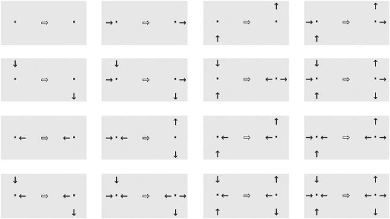

每个灰框中双箭头左侧为入射配置，右侧为出射配置；细箭头表示粒子运动方向。

<!-- dm-ch05-326 -->

〔原书第116页〕

由于气体中有八十个原子，平均每个格子节点有一个原子离开。因此，每条出射路径有$\frac{1}{4}$的概率被离开的原子占据，有$\frac{3}{4}$的概率为空。显然，如果以原子数相对于格点数来衡量的气体总压力更高或更低，这些概率就会不同。

<!-- dm-ch05-327 -->

〔原书第116—117页〕

网格右半部有160条不同的出射路径。因此，右半部任何位置都没有原子的概率必定为$\left(\frac{3}{4}\right)^{160}$，约为$1.022\times10^{-20}$，即$1/100{,}000{,}000{,}000{,}000{,}000{,}000$。假设你有我们在20世纪90年代制造的那种物理装置，每秒能更新格子气两千万次，那么你必须让它运行大约150,000年，才有较大的机会使所有气体分子同时回到左半部。这还只是原子数极少的情形。汤姆森的例子假定了多得多的分子——8,000,000,000,000个，而且这些分子的运动自由度大得多。它们可以向任何方向运动，速率可以连续变化。在这样的例子中，所有分子最终聚集在同一侧的概率如此之小，以至于在我们如今估算的整个宇宙存续时间内也不会发生。[^ch5-120]如果暗能量确实存在，相空间因而不断膨胀，那么即使宇宙具有无限的年龄，也不会出现回归。

<!-- dm-ch05-328 -->

〔原书第117页〕

图5.4 尺寸为5×165的气体格子。泪滴形状表示运动方向。格子气最初处于低熵配置：所有原子都在左侧，且只具有四种可能原子动量状态中的两种。经过1,000个时间步，原子均匀分布。作者绘图。

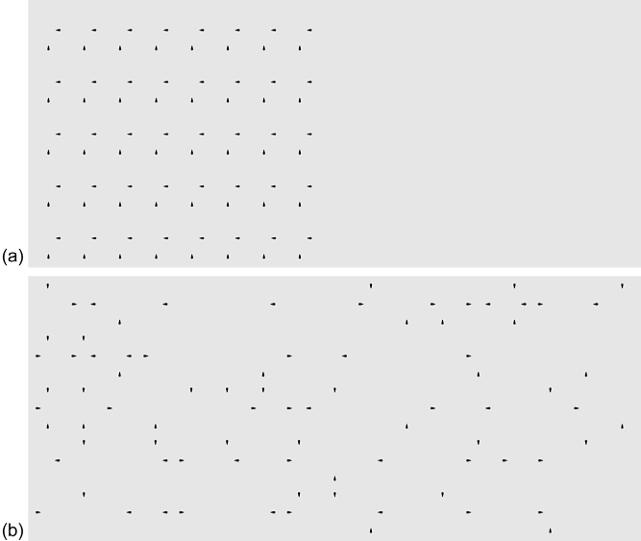

（a）初始状态；（b）经过1,000个时间步后的状态。

> 校注：底本图注明写5×165，与正文80个格点的说明不一致；图注尺寸保留原书，未擅改。

<!-- dm-ch05-329 -->

〔原书第117页〕

因此，从一团空气极有序状态出发——无论是从温度角度，还是从氧分子和氮分子相对分布角度来看（因为汤姆森同时举了这两个例子）——在允许其自由演化之后，重新回到那种有序状态可能性微乎其微。

<!-- dm-ch05-330 -->

〔原书第117页〕

因此，诸如热量从高温向低温流动等理论过程，可以以一种与牛顿原子运动相容方式得到解释。然而，汤姆森所描述机械逆转可能性，引发了一个问题：如果原子在达到平衡后突然逆转运动，会发生什么？

<!-- dm-ch05-331 -->

〔原书第118页〕

图5.5 起初，八十个原子全在左侧。系统趋于较高熵的状态，左侧原子数围绕四十这一均值振荡，即约一半原子处于空间的左半部。这种熵涨落是汤姆森论证的一个依据。作者绘图。

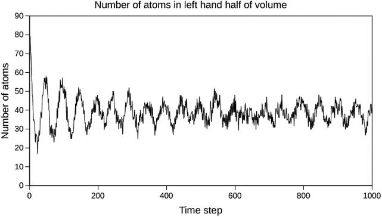

图题：空间左半部的原子数；纵轴Number of atoms：原子数；横轴Time step：时间步。

<!-- dm-ch05-332 -->

〔原书第118页〕

此前发生碰撞和扩散现在必须“倒转”进行。经过与最初扩散过程完全相同时间后，系统必须恢复到初始状态：左侧是高温、高速分子，右侧是低温、低速分子，只不过此时所有分子运动方向都必须与之前相反。同样地，如果我们在格子气模拟中于第1,001 步应用图5.3 中逆向规则，并重复此操作1,000 次，那么所有原子最终都会聚集在左侧。但这一次，所有动量都将指向左侧或向上。秩序将从无序中重现。

<!-- dm-ch05-333 -->

〔原书第118页〕

然而，这种回归“伊甸园”前景极其敏感。只要改变图（b）中一个原子动量，应用反向演化规则就无法重现图（a）状态，而是会产生另一种原子四处散乱、看似无序状态。此外，即使反转操作完美无缺，结果也只是昙花一现：

<!-- dm-ch05-334 -->

〔原书第118页〕

> 现在假设在开始后某个时刻，温度已大致达到平衡，并让每个粒子运动瞬间发生逆转。每个分子将沿其原路径回溯，而在与最初时间间隔相等第二个时间间隔结束时，每个分子将处于与起始时相同位置，并以相同速度运动；因此，将再次出现最初给定不均匀温度分布，唯一区别在于每个粒子都朝着与其初始运动方向相反方向运动。这一差异不会妨碍随后立即开始均化过程；尽管各分子运动轨迹完全不同，但平均而言，该过程将遵循与系统最初被置于自发状态后立即发生情况相同规律。[^ch5-121]

<!-- dm-ch05-335 -->

〔原书第119页〕

因此，根据汤姆森观点，我们将得到一种时间对称性（图5.6）。从我们通常时间方向来看，气体从熵低、概率小状态向熵高、概率大状态运动。如果我们把所有运动方向逆转，它将从熵高状态演化回熵低状态，但随后会穿过熵低状态，并再次进入概率更大熵高状态。

<!-- dm-ch05-336 -->

〔原书第119页〕

既然热力学时间之箭具有这种更深层次时间对称性，那么它究竟意味着什么？

<!-- dm-ch05-337 -->

〔原书第119页〕

回顾图5.6。从时间10 开始，所有原子运动都发生逆转，因此系统以逆向方式重演其历史，直到时间20，它到达了时间0状态的镜像。[^ch5-122]由于时间20 这种低熵状态本质上是不太可能出现，因此极有可能，从时间20开始，该系统将演化为一种更无序状态。但这一论点隐含了时间0 之前“前史”。

<!-- dm-ch05-338 -->

〔原书第119页〕

根据力学定律时间对称性，时间-1 状态必须是时间21 状态镜像。A 时段是D 时段镜像。因此，可以推断时间-1 和时间21 熵必须相同，而通过归纳法，在通向时间0的A时段内，熵本应呈下降趋势！

<!-- dm-ch05-339 -->

〔原书第119页〕

因此，把时间不对称归因于概率解释并非最终的答案。如果我们假设一个孤立系统当前处于低熵状态，那么它在一小时后处于高熵状态确实很可能。但同样，一小时前它处于比现在更高熵状态也必然很可能。

<!-- dm-ch05-340 -->

〔原书第119页〕

图5.6 汤姆森所描述的有限系统的时间演化。时间0时，系统处于低熵状态，随后向熵增加的方向演化。时间10时，所有粒子的运动方向被逆转。系统于是演化回原来的低熵状态，并在时间20到达该状态。此后熵再次增加，但在微观层面沿着一条不同的路径演化。作者绘图。

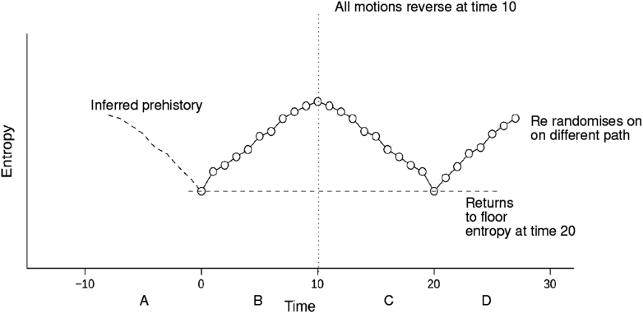

纵轴Entropy：熵；横轴Time：时间；Inferred prehistory：推断的前史；All motions reverse at time 10：时间10时所有运动逆转；Returns to floor entropy at time 20：时间20时回到最低熵；Re randomises on different path：沿不同路径重新随机化。A、B、C、D标示四个时段。

<!-- dm-ch05-341 -->

〔原书第119—120页〕

如果你有一个像格子气那样有限模型系统，它遵循对称动力学定律（这些定律具有守恒性质），那么你确实会观察到这样的景象。如果我们将逆演化规则对图5.4.a 应用1,000 次，就会得到一幅看似随机的图c，其中原子分布于整个体积中。对图c应用正向规则，最终又会回到图5.4.a。把这一概念推广到宏观层面时，其蕴含意义令人不安。我们是否应该根据概率推断：一秒钟前世界中那个看似不太可能出现低熵状态，很可能是在两秒钟前一个高熵状态之后才出现？

<!-- dm-ch05-342 -->

〔原书第120页〕

认为当前熵增加源于几秒钟或几天前一瞬间低熵状态——而在那之前时间曾逆向流动——这种观点是否合理？

<!-- dm-ch05-343 -->

〔原书第120页〕

难道我们对过去记忆仅仅是虚幻？汤姆森关于封闭系统的论点似乎暗示了这种可能性。他说，在熵减阶段（时间从-10 到0，或从10 到20 之间，见图5.6），意识会发生逆转。

<!-- dm-ch05-344 -->

〔原书第120页〕

> 如果关于生命唯物主义假说也是正确的，那么生物将向后生长，虽然对未来有清醒认知，却对过去毫无记忆，并会重新回到未出生状态。[^ch5-123]

<!-- dm-ch05-345 -->

〔原书第120页〕

我们会知道未来，但因记住了它，便以为那是过去。

<!-- dm-ch05-346 -->

〔原书第120页〕

他回避了“这种情况正在发生”这一结论，因为他说自己只是在考虑有限且孤立系统。他谨慎指出，这并不适用于与宇宙其余部分相互作用系统：

<!-- dm-ch05-347 -->

〔原书第120页〕

> 关于热传导这一众所周知古老定律，有一种奇怪却真实理解：即在1,000 年时间里，一根铁棒一半自行比另一半升温一度可能性极小；而且，这一现象在1,000,000 年内发生概率，是1,000 年内发生概率1,000 倍，并且在极其漫长时间内肯定会发生。但须记住，我们假设这根铁棒表面覆盖着一层不透热的漆层。若摒弃这一不可能理想假设，并认为宇宙中分子数量是无限；那么我们便可断言，除非有外部热源或冷源作用，否则铁棒一半温度永远不会高于另一半。这一实例足以阐明能量耗散理论所依据哲学基础。[^ch5-124]

<!-- dm-ch05-348 -->

〔原书第120页〕

在上述对汤姆森1875 年论文论述中，我们的评注自由采用了“概率较低状态熵值较低”这一概念。这一结论证明归功于玻尔兹曼1872 年论文（译为[^ch5-125] ），他在其中通过统计学论证证明了封闭系统中熵必然趋于增大。[^ch5-126]1876 年，玻尔兹曼挚友洛施密特提出了与汤姆森类似的可逆性论点，[^ch5-127]他在其中明确指出，如图5.6 所示，若粒子运动方向发生逆转，则熵必然减小。

<!-- dm-ch05-349 -->

〔原书第121页〕

玻尔兹曼1872 年证明中关键细节基于这样一个假设：当气体中两个分子（A和B）在位置$x$发生碰撞时，每个分子到达位置$x$的概率在统计上相互独立[^ch5-128]。但在两个分子刚刚碰撞之后，它们位置和速度并非相互独立。碰撞这一行为使得它们位置产生相关性——它们必须非常接近彼此才会发生碰撞。

<!-- dm-ch05-350 -->

〔原书第121页〕

如果把图5.6 中时间10 时所有运动方向逆转，那么分子运动就绝对不是相互独立。它们运动已被预先确定为恰好能使系统返回起始位置。在这种情况下，玻尔兹曼用来推导时间箭头假设就被违背了，时间箭头可能会逆转——熵可能会随时间而减小。

<!-- dm-ch05-351 -->

〔原书第121页〕

但我们确实把熵增加作为经验事实所经历。如何从宇宙本质及其初始状态角度来解释这一点呢？

<!-- dm-ch05-352 -->

〔原书第121页〕

> 我们有两种设想可供选择。一种假设是，整个宇宙目前正处于一种极不可能状态。然而，也可以设想，这种不大可能的状态持续漫长岁月，以及从这里到天狼星距离，与宇宙年龄和规模相比都微不足道。因此，在这个整体上处于热平衡状态（因而已“死亡”）宇宙中，必定存在一些大小与我们银河系相当相对较小区域（我们称之为“世界”），它们在相对短暂的漫长年代里会显著偏离热平衡状态。在这些“世界”中，状态概率增加与减少同样频繁。对于宇宙整体而言，时间两个方向是无法区分，正如在空间中没有“上”与“下”之分。然而，正如在地球表面某个地点，我们可以把指向地球中心方向称为“下”，同样，处于某个“世界”中、处于特定时间段生物，可以把时间方向定义为从概率较低状态向概率较高状态发展（前者即“过去”，后者即“未来”），并基于这一定义，它会发现这个与宇宙其余部分隔离小区域，“最初”总是处于一种概率较低状态。在我看来，这种观点似乎是理解热力学第二定律及每个独立世界热寂现象有效性唯一途径，而无需假设整个宇宙从一个确定初始状态单向演变为最终状态。有人提出异议，认为为了解释一小部分世界生命状态，而把宇宙如此大一部分设想为“死亡”状态，这种做法既不经济也毫无意义——我认为这一异议站不住脚。我至今仍清楚记得，曾有人坚决不相信太阳可能距离地球2000 万英里，其理由是：难以想象竟会有如此广阔空间仅充满以太，而生命却如此稀少。[^ch5-129]

> 校注：底本本引文包含without without与to to重复，以及太阳距离20 million miles的原述；英文照录，中文不重复语词，距离按原述保留。

<!-- dm-ch05-353 -->

〔原书第121页〕

现代物理学通常直接接受这样观点：整个宇宙始于一次熵值较低大爆炸——即玻尔兹曼所提出第一个备选方案。[^ch5-130]但关于其第二个备选方案变体——即存在多个局部区域或“岛屿宇宙”——至今仍在讨论之中。[^ch5-131] 现代“热寂”情景涉及恒星坍缩成黑洞，最终蒸发为辐射。[^ch5-132]

<!-- dm-ch05-354 -->

〔原书第122页〕

玻尔兹曼对熵阐释可用于解释结构最初如何形成。卢克莱修把此归因于“clinamen”（即原子的不可预测偏转）。卢克莱修设想原子最初处于“下落”状态，因此他假设它们沿着平行向下轨迹运动。如今我们知道，正如玻尔兹曼所言，“在太空中没有上下之分”。因此，我们不能假设初始状态下存在平行下落。据推测，最初大爆炸没有优先方向，而仅仅是一团由电子、质子、中子和电磁辐射（光子）组成物质。这些物质相当于卢克莱修所写“corpora”（即“第一体”）。

<!-- dm-ch05-355 -->

〔原书第122页〕

如果我们假设它们处于热平衡状态——宇宙微波背景辐射相对均匀性也支持这一观点——那么卢克莱修面临问题依然存在。是什么让这些“最初实体”聚集在一起？

<!-- dm-ch05-356 -->

〔原书第122页〕

为什么宇宙没有一直保持为亚原子粒子海洋？这在最基本层面上，正是那个古老哲学问题：为何秩序会从混沌中产生。

<!-- dm-ch05-357 -->

〔原书第122页〕

弗劳奇[^ch5-133]依据玻尔兹曼的S公式，为此构造了一个简单论证。把公式应用于最初含有N个粒子的整个宇宙，就得到$S=k\log(N\text{个粒子的状态数})$。接着他指出，由于对数值即使对于宇宙学数量也小于100，初始中子—质子气体的熵可以近似为$S(n,p\ \mathrm{gas})\approx kN$。如果四个核子结合成一个α粒子，即卢克莱修所谓实体的首次聚合，就会释放出一个7 MeV的γ光子。所得α粒子与光子构成的气体或等离子体，其熵可写为：

<!-- dm-ch05-358 -->

〔原书第122页〕

$S(\alpha,\gamma\ \mathrm{gas})\approx k(N_\alpha+N_\gamma)\approx k\left(\frac{N}{4}+\frac{N\,7\mathrm{MeV}}{3kT}\right)$

<!-- dm-ch05-359 -->

〔原书第122页〕

这里的关键是，光子的熵贡献与温度T成反比。如果$kT>7\ \mathrm{MeV}$，解离的中子和质子的熵就高于α粒子与γ射线的熵之和。随着宇宙膨胀，中子—质子气体的温度降至某一临界值以下，[^ch5-134]在这一温度下，氦核与γ射线的熵之和超过孤立核子的熵，于是形成了原初氦。进一步的膨胀使γ光子冷却为我们如今观测到的2.4开尔文微波背景。

> 校注：2.4 Kelvin为底本原述，照录。

<!-- dm-ch05-360 -->

〔原书第122页〕

弗劳奇[^ch5-135]关于秩序源于混沌的论证，依赖于玻尔兹曼本人尚不知道的几项知识：亚原子粒子、α粒子的结合能以及爱因斯坦的质能等价关系。这些发现都出现在玻尔兹曼自杀早逝后的二十年内；倘若他没有自杀，我们有理由认为他本可以亲眼见到这些发现。自玻尔兹曼发表最初那篇论文以来的一个半世纪中，他的思想得到了日益广泛的应用。我们对信息、[^ch5-136]经济[^ch5-137]乃至引力[^ch5-138]的理解，均已被证明可以从他的熵统计理论中推导出来。

[^ch5-1]: 1. 弗里德里希·恩格斯、Tristram Hunt：《家庭、私有制和国家的起源》（The Origin of the Family, Private Property and the State）（Penguin，2010）。

[^ch5-2]: 2. 顾名思义，这些是他担任格拉斯哥大学哲学教授时所讲授的课程。20世纪中叶，人们在John Anderson的笔记中发现了这些讲义的记录；Anderson曾是斯密的学生，后来也成为教授。

[^ch5-3]: 3. 恩格斯、Hunt：《家庭、私有制和国家的起源》，第IX章。

[^ch5-4]: 4. 亚当·斯密：《法理学讲义》（Lectures on Jurisprudence），《亚当·斯密著作与通信格拉斯哥版》，1978，第I部分第2节。

[^ch5-5]: 5. 斯密：《法理学讲义》，《亚当·斯密著作与通信格拉斯哥版》，第I部分第2节。

[^ch5-6]: 6. “国家是阶级矛盾不可调和的产物和表现。国家是在阶级矛盾客观上不能调和的地方、时候和程度上产生的。反过来说，国家的存在证明阶级矛盾不可调和。”V. I. 列宁：《国家与革命》（State and Revolution）（Haymarket Books，2015），第1章第1部分。

[^ch5-7]: 7. 斯密：《法理学讲义》，《亚当·斯密著作与通信格拉斯哥版》，第I部分第2节。

[^ch5-8]: 8. 斯密：《法理学讲义》，《亚当·斯密著作与通信格拉斯哥版》，第I部分第3节。

[^ch5-9]: 9. 恩格斯、Hunt：《家庭、私有制和国家的起源》，第V章。

[^ch5-10]: 10. 斯密：《法理学讲义》，《亚当·斯密著作与通信格拉斯哥版》，第I部分第6节。

[^ch5-11]: 11. 值得注意的是，同一过程也在美利坚帝国发生。其公民逐渐不再喜欢战争的艰辛，因此从20世纪80年代开始，它越来越多地雇用阿富汗人和阿拉伯人作战；本·拉登后来让他的追随者转而攻击昔日支付报酬的雇主。若能以历史为鉴，类似事情不会是最后一次发生。

[^ch5-12]: 12. Ibn Khaldun、Franz Rosenthal、Nessim Joseph Dawood：《历史绪论：历史学导论，三卷本》（The Muqaddimah: An Introduction to History; in Three Volumes）（普林斯顿大学出版社，1969），第1卷第43页。

[^ch5-13]: 13. Bartkus和Hassan（“伊本·赫勒敦与亚当·斯密：对劳动分工理论及现代经济思想的贡献”，Ibn Khaldun and Adam Smith: Contributions to the Theory of the Division of Labor and Modern Economic Thought）推测，斯密的思想源自赫勒敦，牛顿则抄用了后来失传的阿基米德著作。

[^ch5-14]: 14. 参见Jeremy L. England：“自我复制的统计物理学”（Statistical Physics of Self-replication），The Journal of Chemical Physics，第139卷，121923（2013），doi:10.1063/1.4818538。

[^ch5-15]: 15. Denis Diderot，载D. Diderot与J. D’Alembert编：《科学、艺术与工艺百科全书》（Encyclopédie des arts et des métiers），35卷（Briasson，1751—1780；重印本，Stuttgart/Bad Cannstatt：Frommann，1966），第V卷第270页。在线有多个版本：Lexilogos、官方ARTFL项目及新的ENCRRE项目。

[^ch5-16]: 16. Denis Diderot：“达朗贝尔与狄德罗的对话（1769）”（Conversation Between D’Alembert and Diderot），载Diderot, Interpreter of Nature，Jean Stewart与Jonathan Kemp译（International Publishers，1943），无页码，https://www.marxists.org/reference/archive/diderot/1769/conversation.htm（访问日期：2022年11月12日）。

[^ch5-17]: 17. 狄德罗：“达朗贝尔与狄德罗的对话（1769）”，https://www.marxists.org/reference/archive/diderot/1769/conversation.htm（访问日期：2022年12月18日）。

[^ch5-18]: 18. 狄德罗：“达朗贝尔与狄德罗的对话（1769）”，https://www.marxists.org/reference/archive/diderot/1769/conversation.htm（访问日期：2022年12月19日）。

[^ch5-19]: 19. Robyn P. Araujo、Lance A. Liotta：“任意规模网络实现稳健完全适应的拓扑要求”（The Topological Requirements for Robust Perfect Adaptation in Networks of Any Size），Nature Communications，第9卷，1757（2018），https://doi.org/10.1038/s41467-018-04151-6。

[^ch5-20]: 20. Helen De Cruz：“动物认知、物种不变论与数学实在论”（Animal Cognition, Species Invariantism and Mathematical Realism），载Advances in Experimental Philosophy，Andrew Aberdein与Matthew Inglis编（Bloomsbury Academic，2019），第39—62页。

[^ch5-21]: 21. Elisabeth Brannon、Jessica Cantlon：“猴子与大学生的基础数学”（Basic Math in Monkeys and College Students），PLoS Biology，第5卷第12期（2007），e328，https://doi.org/10.1371/journal.pbio.0050328；Brian Butterworth：《鱼会计数吗？动物揭示我们独特数学心智的奥秘》（Can Fish Count?: What Animals Reveal about our Uniquely Mathematical Mind），Kindle版（Quercus，2022）。

[^ch5-22]: 22. Peter Wolfendale：《理性的复仇》（The Revenge of Reason），Ray Brassier与Reza Negarestani作序（Urbanomic/Mono，2023）。

[^ch5-23]: 23. 卡尔·马克思：《1844年经济学哲学手稿：异化劳动》，Martin Milligan译（Progress Publishers，1959），Marxists Internet Archive，https://www.marxists.org/archive/marx/works/1844/manuscripts/labour.htm（访问日期：2022年12月26日）。

[^ch5-24]: 24. 马克思：《1844年经济学哲学手稿》，无页码。

[^ch5-25]: 25. “在这个特定问题上，唯物主义与‘马赫主义’的区别在于：唯物主义完全符合自然科学，把物质看作第一性的，把意识、思想、感觉看作第二性的，因为在明确的形式下，感觉只同物质的较高形式（有机物质）相联系，而‘在物质结构的基础中’，只能推测存在着一种类似于感觉的能力。例如，著名德国科学家恩斯特·海克尔、英国生物学家劳埃德·摩根等人就作出了这种假设，更不用说前文提到的狄德罗的猜想了。”（引自V. I. 列宁：《全集：唯物主义和经验批判主义》，第14卷［Progress Publishers，1977］，第46页。）

[^ch5-26]: 26. Katerina Kolozova：“非人性的人工制品：关于意指自动机及其物理支撑在幻想统一体中的唯物主义论述”（The Artifact of Non-Humanity: A Materialist Account of the Signifying Automaton and Its Physical Support in a Fantasized Unity），Philosophy Today，第65卷第2期（2021年春），第359—374页，doi:10.5840/philtoday2021420402n。

[^ch5-27]: 27. 许煜：《递归性与偶然性》（Recursivity and Contingency）（Rowman & Littlefield International，2019），第41页。

[^ch5-28]: 28. 亚里士多德：《物理学》，载《亚里士多德全集》修订牛津译本，Jonathan Barnes译编（Oxford University Press，1991），195b31—199a9—199a19。

[^ch5-29]: 29. 亚里士多德：《形而上学》，W. D. Ross修订并撰导论与评注（Clarendon Press，1924），第12卷，MIT Classics Internet Archive，http://classics.mit.edu/Aristotle/metaphysics.html。

[^ch5-30]: 30. 卡尔·马克思：《德谟克利特的自然哲学和伊壁鸠鲁的自然哲学的差别》，载《马克思恩格斯全集》英文版第1卷（Progress Publishers，1975），无页码，Marxist Internet Archive，https://www.marxists.org/archive/marx/works/1841/dr-theses/index.htm（访问日期：2021年11月27日）。

[^ch5-31]: 31. Julian Hocheld：“阶级利益概念”（The Concept of Class Interest），The Polish Sociological Bulletin，第16期（1967），第5—14页，http://www.jstor.org/stable/44815383。

[^ch5-32]: 32. Denis Diderot：《狄德罗全集》（OEuvres complètes de Diderot），第1卷，J. Assézat编（巴黎，1875），第304页。

[^ch5-33]: 33. 马克思：《1844年经济学哲学手稿》，https://www.marxists.org/archive/marx/works/download/pdf/Economic-Philosophic-Manuscripts-1844.pdf（访问日期：2023年1月9日）。

[^ch5-34]: 34. Katerina Kolozova：“现代性中什么值得挽救：从非哲学马克思主义到齐泽克普遍主义的实在论视角”（What Is Worth Salvaging In Modernity: A Realist Perspective From Non-Philosophical Marxism to Žižek’s Universalism），载Understanding Žižek, Understanding Modernism，Zahi Zaloua与Jeffrey R. Di Leo编（Bloomsbury，2022）。

[^ch5-35]: 35. 卡尔·马克思：《对黑格尔哲学的总体批判》，无页码，https://www.marxists.org/archive/marx/works/down-load/pdf/Economic-Philosophic-Manuscripts-1844.pdf（访问日期：2023年1月9日）。

[^ch5-36]: 36. Katerina Kolozova：《迈向社会主义的激进形而上学：马克思与拉鲁埃尔》（Toward Radical Metaphysics of Socialism: Marx and Laruelle）（Punctum Books，2015）。

[^ch5-37]: 37. 狄德罗：“达朗贝尔与狄德罗的对话（1769）”，https://www.marxists.org/reference/archive/diderot/1769/conversation.htm（访问日期：2023年12月12日）。

[^ch5-38]: 38. 卡尔·马克思：《资本论》，第1卷，Marxist Internet Archive在线版（Progress Publishers，1954），第7页。

[^ch5-39]: 39. cwt是一种英制计量单位，表示112磅。1 quarter为$\frac{1}{4}$英担，即28磅。

[^ch5-40]: 40. 马克思：《资本论》，第1章，第28页。

[^ch5-41]: 41. 马克思：《资本论》，第42页。

[^ch5-42]: 42. 马克思：《资本论》，第43页。

[^ch5-43]: 43. 恩格斯致马克思，1858年7月14日。

[^ch5-44]: 44. A. M. Shaikh：“劳动价值论的实证力量”（The Empirical Strength of the Labour Theory of Value），载《马克思主义经济学：重新评价》（Marxian Economics: A Reappraisal），R. Bellofiore编，第2卷（Macmillan，1998），第225—251页；P. Petrovic：“生产价格对劳动价值的偏离：一些方法论与实证证据”（The Deviation of Production Prices from Labour Values: Some Methodolog and Empirical Evidence），Cambridge Journal of Economics，第11卷（1987），第197—210页；David Zachariah：《检验瑞典的劳动价值论》（Testing the Labor Theory of Value in Sweden）（2004），http://reality.gn.apc.org/econ/DZ_article1.pdf；W. Paul Cockshott与Allin F. Cottrell：“劳动时间与其他价值基础的比较：研究札记”（Labour Time Versus Alternative Value Bases: A Research Note），Cambridge Journal of Economics，第21卷第4期（1997），第545—549页；W. Paul Cockshott与Allin Cottrell：“价格与劳动价值之间的稳健相关性：评论”（Robust Correlations Between Prices and Labour Values: A Comment），Cambridge Journal of Economics，第29卷第2期（2005），第309—316页。

[^ch5-45]: 45. 该书第十一章包含了跨越多个世纪的大量价格统计数据。

[^ch5-46]: 46. 这里使用的是源自20世纪物理学的术语。埃米·诺特在“变分问题的不变量”（Invariant Variation Problems），Transport Theory and Statistical Physics，第1卷第3期（1971），第186—207页（原作发表于1918年）中证明，经典物理学的守恒定律可以视为自然规律在时间和空间中具有对称性的结果。例如，动量守恒源于物理规律在空间中处处相同这一事实，即位移对称性。可以证明，时间的均匀性蕴含能量守恒。相关解释可参见Jozef Hanc、Slavomir Tuleja与Martina Hancova：“对称性与守恒定律：诺特定理的推论”（Symmetries and Conservation Laws: Consequences of Noether’s Theorem），American Journal of Physics，第72卷第4期（2004），第428—435页。她的工作最初适用于受拉格朗日最小作用量原理支配的系统，这些系统体现了经典力学的决定论唯物主义。此后，它已成为物理学其他领域的一种基础方法。我们在Allin F Cottrell等人的《经典经济物理学》（Classical Econophysics）（Routledge，2009），第11章和第5章，以及Paul Cockshott的“对称性与交换关系”（Symmetries and Exchange Relations），Política y cultura，第23期（2005），第279—304页中，探讨了商品交换所定义的度量空间中的对称性与马克思的价值守恒规律之间的关系。

[^ch5-47]: 47. 马克思：《资本论》，第152页。

[^ch5-48]: 48. 使用国际单位制，所做的功等于发动机施加的力乘以该力作用的距离，因此单位为牛顿·米。但力等于质量乘以加速度，所以这换算为（千克·米/秒$^2$）·米，与动能$\frac{1}{2}mv^2$具有相同量纲。

[^ch5-49]: 49. 马克思：《资本论》，第162页。

[^ch5-50]: 50. W. Paul Cockshott、A. Cottrell与G. J. Michaelson：《用投入产出表检验劳动价值论》（Testing Labour Value Theory with Input/output Tables）（斯特拉斯克莱德大学计算机科学系，1993）。

[^ch5-51]: 51. Karl Marx、Salomea W. Ryazanskaya与Maurice Dobb：《政治经济学批判》（A Contribution to the Critique of Political Economy）（Progress Publishers，1978），序言。

[^ch5-52]: 52. Guido Starosta：“商品形式与辩证方法：论马克思在《资本论》第一章中的叙述结构”（The Commodity-form and the Dialectical Method: On the Structure of Marx’s Exposition in Chapter 1 of Capital），Science & Society，第72卷第3期（2008），第295—318页。

[^ch5-53]: 53. Starosta：“商品形式与辩证方法：论马克思在《资本论》第一章中的叙述结构”，第298页。

[^ch5-54]: 54. 卡尔·马克思：“阿道夫·瓦格纳边注”（Notes on Adolph Wagner），Texts on Method（1975），第201页。

[^ch5-55]: 55. Diane Elson：《价值：资本主义中劳动的表现》（Value: The Representation of Labour in Capitalism）（Verso Books，2016），重印本。

[^ch5-56]: 56. 马克思：《资本论》，第3章。

[^ch5-57]: 57. S. Meikle：《亚里士多德的经济思想》（Aristotle’s Economic Thought）（Oxford University Press，1997）。

[^ch5-58]: 58. 该理论把一种共同实体——燃素——设定为火的本质。这似乎能够解释各种观察结果，但后来被证明是错误的。

[^ch5-59]: 59. 18世纪的fossils一词源自拉丁语fossa（沟），指一切从地下挖出的东西。因此，他所谓的易燃矿物，指的是煤和矿物油。

[^ch5-60]: 60. 即我们今天所谓的$\mathrm{SO_2}$。

[^ch5-61]: 61. 现在称为发烟硝酸；斯特雷奇观察到的现象，是由溶解在酸中的$\mathrm{NO_2}$引起的。

[^ch5-62]: 62. John Strachey：《关于不同土层与矿物层的观察》（Observations on the Different Strata of Earths and Minerals）（1730）。

[^ch5-63]: 63. 参见Emmanuel Farjoun与Moshe Machover：《混沌的规律：政治经济学的概率方法》（Laws of Chaos, a Probabilistic Approach to Political Economy）（Verso，1983）；E. Farjoun：“以什么生产商品？”（Production of Commodities by Means of What?），载《李嘉图、马克思、斯拉法》（Ricardo, Marx, Sraffa），E. Mandel编（Cambridge University Press，1984）。

[^ch5-64]: 64. Khaldun、Rosenthal与Dawood：《历史绪论》（The Muqaddimah: An Introduction to History; in Three Volumes），第1卷。

[^ch5-65]: 65. David Ricardo：“政治经济学及赋税原理”（Principles of Political Economy and Taxation），载《李嘉图著作与通信集》（The Works and Correspondence of David Ricardo），P. Sraffa编，第1卷（Cambridge University Press，1951）。

[^ch5-66]: 66. “我看得远，是因为我站在巨人的肩膀上。”——牛顿。

[^ch5-67]: 67. Friedrich Engels：《自然辩证法》（Dialectics of Nature）（Progress Publishers，1974）。

[^ch5-68]: 68. 关于这段历史，可阅读Cardwell的《从瓦特到克劳修斯：工业时代早期热力学的兴起》（From Watt to Clausius: The Rise of Thermodynamics in the Early Industrial Age）。

[^ch5-69]: 69. 两人当时都受雇于格拉斯哥大学。

[^ch5-70]: 70. Karl Marx与Friedrich Engels：《马克思恩格斯全集》英文版（Marx-Engels Collected Works），第40卷（Progress Publishers），第441页。

[^ch5-71]: 71. Karl Marx与Friedrich Engels：《马克思恩格斯全集》英文版（Marx-Engels Collected Works），第41卷（Progress Publishers），第246页。

[^ch5-72]: 72. Adrian Desmond与James Moore：《达尔文的神圣事业：对奴隶制的憎恨如何塑造了达尔文的人类进化观》（Darwin’s Sacred Cause: How a Hatred of Slavery Shaped Darwin’s Views on Human Evolution）（HMH，2014）。

[^ch5-73]: 73. R. Chambers：《创世自然史遗迹》（Vestiges of the Natural History of Creation [by R. Chambers]）（John Churchill，Princes Street，Soho，1853），第217页，https://books.google.co.uk/books?id=qDoDAAAAQAAJ。

[^ch5-74]: 74. Chambers：《创世自然史遗迹》，第219页。

[^ch5-75]: 75. Sean Sayers：“马克思与目的论”（Marx and Teleology），Science & Society，第83卷第1期（2019），第37—63页，https://doi.org/10.1521/siso.2019.83.1.37；电子预印本：https://doi.org/10.1521/siso.2019.83.1.37；https://doi.org/10.1521/siso.2019.83.1.37。

[^ch5-76]: 76. Charles Darwin：《物种起源》（On the Origin of the Species）（Project Gutenberg电子书，2009），第3章。

[^ch5-77]: 77. Charles Darwin：《人和动物的情感表达》（The Expression of the Emotions in Man and Animals）（Project Gutenberg电子书，1998）。

[^ch5-78]: 78. Darwin：《物种起源》。

[^ch5-79]: 79. Darwin：《物种起源》，第1章。

[^ch5-80]: 80. Darwin：《物种起源》，第1章。

[^ch5-81]: 81. Lyudmila N. Trut、I. Z. Plyusnina与I. N. Oskina：“狐狸驯化实验及狗演化中的争议问题”（An Experiment on fox Domestication and Debatable Issues of Evolution of the Dog），Russian Journal of Genetics，第40卷第6期（2004），第644—655页。

[^ch5-82]: 82. Adam S. Wilkins、Richard W. Wrangham与W. Tecumseh Fitch：“哺乳动物的‘驯化综合征’：基于神经嵴细胞行为与遗传学的统一解释”（The “Domestication Syndrome” in Mammals: A Unified Explanation Based on Neural Crest Cell Behavior and Genetics），Genetics，第197卷第3期（2014），第795—808页。

[^ch5-83]: 83. Darwin：《物种起源》，第3章。

[^ch5-84]: 84. Darwin：《物种起源》，第3章。

[^ch5-85]: 85. Darwin：《物种起源》，第3章。

[^ch5-86]: 86. Darwin：《物种起源》，第4章。

[^ch5-87]: 87. Darwin：《物种起源》，第4章。

[^ch5-88]: 88. Darwin：《物种起源》，第4章。

[^ch5-89]: 89. Stephen Jay Gould：《熊猫的拇指：自然史再思考》（The Panda’s Thumb: More Reflections in Natural History）（W. W. Norton & Company，2010），第28章。

[^ch5-90]: 90. Lewis H. Morgan：《古代社会》（Ancient Society）（Harvard University Press，2013）。

[^ch5-91]: 91. Charles Darwin：《人类的由来及与性有关的选择》（The Descent of Man in Relation to Sex）（Murray，1871），第III章。

[^ch5-92]: 92. Donald Olding Hebb：“行为的组织：神经心理学理论”（The Organization of Behavior; A Neuropsycholocigal Theory），A Wiley Book in Clinical Psychology，第62卷（1949），第78页。

[^ch5-93]: 93. Darwin：《人和动物的情感表达》。

[^ch5-94]: 94. Hebb：“行为的组织：神经心理学理论”（The Organization of Behavior; A Neuropsycholocigal Theory）。

[^ch5-95]: 95. 关于这一分歧，参见Harry K. Wells：《西格蒙德·弗洛伊德：巴甫洛夫学派的批判》（Sigmund Freud, a Pavlovian Critique）（International Publishers，1960）。

[^ch5-96]: 96. Hebb：“行为的组织：神经心理学理论”（The Organization of Behavior; A Neuropsycholocigal Theory）。

[^ch5-97]: 97. Sebastiano Timpanaro：《论唯物主义》（On Materialism）（Routledge，2003）。

[^ch5-98]: 98. Ludwig Boltzmann：《理论物理学与哲学问题：文选》（Theoretical Physics and Philosophical Problems: Selected Writings），第5卷（Springer Science & Business Media，2012），第14页。

[^ch5-99]: 99. Newton：《自然哲学的数学原理……由Andrew Motte翻译……附牛顿的世界体系；W. Emerson对〈原理〉的简评与辩护；John Machin依据引力论述的月球运动定律……（先生的序言）》（The Mathematical Principles of Natural Philosophy . . . Translated . . . by Andrew Motte. To Which are Added Newton’s System of the World; A Short Comment on, and Defence of the Principia, by W. Emerson. With the Laws of the Moon’s Motion According to Gravity, by John Machin . . .(The Preface of Mr)），第8节，命题XLI。

[^ch5-100]: 100. J. J. Brucker与W. Enfield：《哲学史：从最早时代到本世纪初；由William Enfield根据布鲁克的〈哲学批判史〉编写》（The History of Philosophy, from the Earliest Times to the Beginning of the Present Century; Drawn up from Brucker’s Historia Critica Philosophiæ: by William Enfield），《哲学史：从最早时代到本世纪初；由William Enfield根据布鲁克的〈哲学批判史〉编写》，第1卷（P. Wogan，1792），https://books.google.co.uk/books?id=ximMZcSJY8gC。

[^ch5-101]: 101. John Dalton：“III. 论水和其他液体对气体的吸收”（III. On the Absorption of Gases by Water and Other Liquids），The Philosophical Magazine，第24卷第93期（1806），第15—24页。

[^ch5-102]: 102. John Dalton：《化学哲学新体系》（A New System of Chemical Philosophy），第1卷（Bickerstaff，1808），第213页。

[^ch5-103]: 103. Dalton：“III. 论水和其他液体对气体的吸收”，第73页。

[^ch5-104]: 104. Dalton：“III. 论水和其他液体对气体的吸收”。

[^ch5-105]: 105. 参见P. Cockshott等：《经典经济物理学：古典政治经济学、热力学与信息论论文集》（Classical Econophysics: Essays on Classical Political Economy, Thermodynamics and Information Theory）（Routledge，2008）的前几章。

[^ch5-106]: 106. John Tyndall：《热作为运动的一种形式》（Heat Considered as a Mode of Motion）（D. Appleton/Company，1875），第xiii页。

[^ch5-107]: 107. Tyndall：《热作为运动的一种形式》，第xiii页。

[^ch5-108]: 108. Benjamin Count Rumford：“关于摩擦所激发的热的来源的研究，伦福德伯爵本杰明著，Frsmria”（An Inquiry Concerning the Source of the Heat Which is Excited by Friction. by Benjamin Count of Rumford, Frsmria），Philosophical Transactions of the Royal Society of London（1798），第80—102页。

[^ch5-109]: 109. Rumford：“关于摩擦所激发的热的来源的研究，伦福德伯爵本杰明著，Frsmria”。

[^ch5-110]: 110. Rumford；斜体及大写均为原文所有。

[^ch5-111]: 111. Paul Burkett与John Bellamy Foster：“马克思政治经济学批判中的物质变换、能量与熵：超越波多林斯基神话”（Metabolism, Energy, and Entropy in Marx’s Critique of Political Economy: Beyond the Podolinsky Myth），Theory and Society，第35卷第1期（2006），第109—156页，ISSN：03042421、15737853，http://www.jstor.org/stable/4501746。

[^ch5-112]: 112. 廷德尔指出，在$0^{\circ}\mathrm{C}$时，氧分子的运动速度为每秒1,514英尺。

[^ch5-113]: 113. Engels：《自然辩证法》，第243—256页。

[^ch5-114]: 114. 关于这两个问题，H. Price的《时间之箭与阿基米德之点：时间物理学的新方向》（Time’s Arrow and Archimedes’ Point: New Directions for the Physics of Time）（Oxford University Press，USA，1997）给出了深入而出色的唯物主义论述。本章以下内容主要借鉴他的著作，以及Carlo Cercignani与Roger Penrose的《路德维希·玻尔兹曼：相信原子的人》（Ludwig Boltzmann: The Man Who Trusted Atoms）（Oxford University Press，1998）。

[^ch5-115]: 115. 本书第3.3.3.0.1节。

[^ch5-116]: 116. William Thomson：“能量耗散的动力学理论”（The Kinetic Theory of the Dissipation of Energy），Proceedings of the Royal Society of Edinburgh，第8卷（1875），第325—334页。

[^ch5-117]: 117. 相关论述参见Cardwell：《从瓦特到克劳修斯：工业时代早期热力学的兴起》。

[^ch5-118]: 118. U. B. Frisch、B. Hasslacher与Y. Pomeau：“纳维–斯托克斯方程的格子气自动机”（Lattice Gas Automata for the Navier Stokes Equation），Physical Review Letters，第56卷（1986），第1505—1508页。

[^ch5-119]: 119. Peter Barrie等：“高度并发机器的设计与验证”（Design and Verification of a Highly Concurrent Machine），Microprocessors and Microsystems，第16卷第3期（1992），第115—123页；George J. Milne与William P. Cockshott：《物理过程模拟的方法与装置》（Method and Apparatus for Simulation of a Physical Process），美国专利5,485,599，1996年。

[^ch5-120]: 120. Jean Bricmont：《理解统计力学》（Making Sense of Statistical Mechanics）（Springer，2022），第8章，估计装有2克$\mathrm{H_2}$的圆柱体达到所有分子都在容器一半中的状态，所需时间为$2^{10^{23}}$量级。这是$2^N$，其中$N$为阿伏伽德罗常数，即每摩尔气体的分子数。他没有给出表达式的时间常数。更准确地说，应对某个$T$写成$2^{10^{23}}T$；但即使令$T$为原子碰撞之间的平均时间，取$t=0.2\times10^{-9}$秒，指数项仍大到使时间常数问题在实践中无关紧要。

[^ch5-121]: 121. Thomson：“能量耗散的动力学理论”。

[^ch5-122]: 122. 这一状态是镜像，因为此时每个原子都沿着与其原始方向相反的方向运动。

[^ch5-123]: 123. Thomson：“能量耗散的动力学理论”。

[^ch5-124]: 124. Thomson：“能量耗散的动力学理论”。

[^ch5-125]: 125. L. Boltzmann：Sitzungsberichte Akad. Wiss.，维也纳，II，第66卷，第275—370页；英译：Brush, S. G.（1966），《气体动理论》第2卷《不可逆过程》（Kinetic Theory: Vol. 2 Irreversible Processes）（Permagon Press，1872）。

[^ch5-126]: 126. 更准确地说，他的原论文表明，具有函数形式$H\sim\int p\log p$的量，在系统随时间演化时趋于减小。该量为负，因为概率$p<1$，$\log p<0$。现在我们通常使用玻尔兹曼后来的表述$S=k\log$（N article states的数目），这是趋于增加的正熵。

[^ch5-127]: 127. Loshmidt：“论计及重力时物体系统的热平衡状态”（Ueber den znstand des Warmegleichgewichtes eines Systems von Korpern mit Rucksicht auf die Schwerkraft），Wiener Berichte，第73卷（1876），第135页。

[^ch5-128]: 128. 形式地，令$P^1(x,\xi,t)$为一个分子在时间$t$位于位置$x$、速度为$\xi$的概率函数；令$P^2(x_1,\xi_1,x_2,\xi_2,t)$表示分子1的位置和速度坐标为$x_1,\xi_1$，分子2的位置和速度为$x_2,\xi_2$的概率。玻尔兹曼的统计独立性假设为$P^2(x_1,\xi_1,x_2,\xi_2,t)=P^1(x_1,\xi_1,t)\times P^1(x_2,\xi_2,t)$ $\times P^1(x_2,\xi_2,t)$。

[^ch5-129]: 129. Ludwig Boltzmann：“答策梅洛关于热理论的评论”（Reply to Zermelo’s Remarks on the Theory of Heat），载《气体动理论：经典论文选集及历史评注》（The Kinetic Theory Of Gases: An Anthology of Classic Papers with Historical Commentary）（World Scientific，2003），第412—419页。

[^ch5-130]: 130. 关于回归与不可逆性争论涉及的问题，可参见Jean Bricmont：“混沌的科学还是科学中的混沌？”（Science of Chaos or Chaos in Science?），arXiv预印本chao-dyn/9603009，1996。

[^ch5-131]: 131. 相关讨论参见Rüdiger Vaas：“时间之前的时间：当代宇宙学中的宇宙分类，以及如何避免世界开端与永恒的二律背反”（Time before Time-Classifications of Universes in Contemporary Cosmology, and How to Avoid the Antinomy of the Beginning and Eternity of the World），arXiv预印本physics/0408111，2004。

[^ch5-132]: 132. Steven Frautschi：“膨胀宇宙中的熵”（Entropy in an Expanding Universe），Science，第217卷第4560期（1982），第593—599页。

[^ch5-133]: 133. Frautschi：“膨胀宇宙中的熵”（Entropy in an Expanding Universe）。

[^ch5-134]: 134. 按他的近似计算，此时$kT\approx 28/9\ \mathrm{MeV}$。

[^ch5-135]: 135. Frautschi：“膨胀宇宙中的熵”（Entropy in an Expanding Universe）。

[^ch5-136]: 136. 参见C. Shannon：“通信的数学理论”（A Mathematical Theory of Communication），The Bell System Technical Journal，第27卷（1948），第379—423、623—656页；Rolf Landauer：“计算过程中的不可逆性与热量产生”（Irreversibility and Heat Generation in the Computing Process），IBM Journal of Research and Development，第5卷（1961），第183—191页。

[^ch5-137]: 137. 参见Farjoun和Machover：《混沌的规律：政治经济学的概率方法》（Laws of Chaos, a Probabilistic Approach to Political Economy）；W. Paul Cockshott等：《经典经济物理学》（Classical Econophysics），第2卷（Routledge，2009）；J. Barkley Rosser：“熵与经济物理学”（Entropy and Econophysics），The European Physical Journal Special Topics，第225卷第17期（2016），第3091—3104页。

[^ch5-138]: 138. 参见Erik Verlinde：“论引力的起源与牛顿定律”（On the Origin of Gravity and the Laws of Newton），Journal of High Energy Physics，2011年第4期，第1—27页；他从熵推导出牛顿定律。这一推导虽有影响，却存在争议；参见Shan Gao：“引力是熵力吗？”（Is Gravity an Entropic Force?），Entropy，第13卷第5期（2011），第936—948页。

<!-- dm-ch06-001 -->

〔原书第123页〕

# 第6章 唯心主义的复兴与回应

<!-- dm-ch06-002 -->

〔原书第123页〕

## 对玻尔兹曼的反对

<!-- dm-ch06-003 -->

〔原书第123页〕

玻尔兹曼职业生涯大部分时间作为物理学家度过。然而，他生命最后几年是在维也纳大学担任哲学教授。在这个职位上，他接替了同样身兼物理学与哲学双重身份的马赫。

<!-- dm-ch06-004 -->

〔原书第123页〕

无论在哲学还是物理学领域，两人都是对手，各自主张截然相反立场。作为唯物主义原子论者的玻尔兹曼，与作为唯心主义者的马赫针锋相对。

<!-- dm-ch06-005 -->

〔原书第123页〕

尽管如今玻尔兹曼的原子论已完全没有争议，但在他生前却远非如此。许多欧洲大陆的著名物理学家都对原子的存在深表怀疑。例如，庞加莱把玻尔兹曼、汤姆森和麦克斯韦提出的关于热的原子论解释称为“英国[^ch6-1]动理论”，并怀疑它能否解释熵增定律。

<!-- dm-ch06-006 -->

〔原书第123页〕

> 我不知道是否有人指出过，英国的这些动理论能够摆脱这一矛盾。按照这些理论，世界最初趋向于一种状态，并长久停留其中而不发生明显变化；这与经验相符。但如果不违背上述定理，世界就不会永远保持这种状态；它只会停留极其漫长的时间，分子越多，这段时间就越长。这种状态并非宇宙的最终死亡，而是一种沉睡，宇宙将在百万乘百万个世纪之后从中苏醒。按照这种理论，要看到热从冷物体传向热物体，并不需要麦克斯韦妖那样敏锐的视力、智慧和灵巧；稍有耐心便足够了。[^ch6-2]

<!-- dm-ch06-007 -->

〔原书第123—124页〕

庞加莱对原子论的反对建立在严格的数学异议之上。这些异议源于抽象的拉格朗日力学或哈密顿力学，而非哲学或本体论。实质上，他利用刘维尔定理，把汤姆森在前引段落中给出的启发式解释转化为形式化的数学论证。由此可以证明：在时刻$t$，取$6N$维相空间内的一个微小体积$\delta_t$，使其沿最小作用量路径演化一个很短的时间$\epsilon$，它就会映射到相空间中的一个新区域$\delta_{t+\epsilon}$，而体积保持不变。因此，他认为，若从处于某一低熵状态的封闭系统出发，即从只占相空间中可能位置的一小部分的某个$\delta_t$出发，最后总会落到一个等体积的区域。也就是说，所得相空间体积同样不大可能出现。策梅洛也提出了类似论证。这些论证依赖于一个看似必然的结论：任何按确定性规律运行的有限粒子系统都会发生回归。对格子气例子那样简单且规模较小的模型，这一点当然成立；但如果宇宙无限——这实质上是汤姆森的观点——或者即使体积不大的气体，其回归也需要漫长得多的时间，以至于我们不妨把系统视为无限——这是玻尔兹曼的回应——那么这一论证便不能成立。

<!-- dm-ch06-008 -->

〔原书第124页〕

> 因此，当策梅洛仅凭“气体中初始状态必然会重现”这一理论事实——却未计算这将耗时多久——便得出“必须摒弃气体理论的假设，否则就必须对其进行根本性修改”结论时，他就像一个掷骰子的人：他计算出连续掷出1000 个“1”概率不为零，却尚未观察到这样序列，就断定自己骰子必定是做过手脚！[^ch6-3]

<!-- dm-ch06-009 -->

〔原书第124页〕

庞加莱回归论证中还隐含着这样一个假设：在所有时刻，原子位置都是以任意精度客观确定。如果放弃这一假设，如果我们允许原子位置存在任何绝对、客观不确定性，那么碰撞过程就会放大这种初始不确定性程度。

<!-- dm-ch06-010 -->

〔原书第124页〕

我们此前[^ch6-4]在讨论弗雷德金假设的可逆计算机[^ch6-5]时谈过这个问题；在某种意义上，这些计算机是庞加莱论证的一种变体。用我们稍后将讨论的现代信息论来说，假定粒子位置具有任意精度，就意味着系统包含无限的信息，从而在相空间中占据零体积。由于熵以相空间体积的对数来定义，而$\log(0)$没有定义，策梅洛／庞加莱回归悖论的概念设定本身就使熵的概念失去了意义。

<!-- dm-ch06-011 -->

〔原书第124页〕

人们要么像庞加莱那样得出结论：原子论和“英国动理论”是错误的；要么认为经典分析所假设关于位置任意精度数学是不符合物理实际。随后几十年量子力学发展指向了后一种结论。如果位置不能被任意分割，那么虽然仍可以存在如前所述格子模型等确定性模型，但原则上也可能存在非确定性格子模型。

<!-- dm-ch06-012 -->

〔原书第124页〕

## 马赫主义

<!-- dm-ch06-013 -->

〔原书第124—125页〕

玻尔兹曼生命最后几年，都耗费在看来可能是一场徒劳斗争上——试图说服德语科学界接受他的原子理论。除了前文提到批评者外，马赫这一显赫人物也与他针锋相对。马赫在1901 年之前一直担任维也纳大学哲学教授，他宣扬反原子论和反实在论哲学思想，对一代欧洲科学家产生了深远影响。他的哲学立场在当今关于量子力学诠释争论中依然回响不绝。1901 年马赫退休后，玻尔兹曼接替他担任维也纳大学哲学教授席位，并开始讲授科学哲学。遗憾的是，他的任期很短。

<!-- dm-ch06-014 -->

〔原书第125页〕

> 1906 年9 月6 日，他与妻子和女儿一同前往的里雅斯特附近杜伊诺湾游玩。当妻子和女儿正在享受游泳之乐时，他上吊自杀了。此前他在莱比锡时曾有过一次自杀未遂。当得知深陷抑郁玻尔兹曼自杀身亡消息时，世界各地物理学家都深感悲痛。许多物理学家难以理解他这一举动。他的自杀似乎更多源于个人生活中因素（抑郁症和健康状况恶化），而非任何学术问题。在抑郁和健康状况不佳情况下，他就在实验即将验证其研究成果之际自杀了。奥斯特瓦尔德在悼念玻尔兹曼时，把他描述为那些为科学真理而奋斗人们所必须付出巨大健康与精力牺牲的牺牲品。一些物理学家则把玻尔兹曼自杀归因于精神不稳定。据钱德拉塞卡所述，奥斯特瓦尔德和马赫对其理论猛烈抨击使他深陷抑郁，这促使他自杀。[^ch6-6]

<!-- dm-ch06-015 -->

〔原书第125页〕

就在他去世之际，又有两位著名人物加入了关于唯物主义思想之争：爱因斯坦和列宁。在探讨爱因斯坦如何于1905 年从科学上为玻尔兹曼正名、列宁如何于1908 年从哲学上为他正名之前，我们必须先梳理一下马赫对原子理论提出异议。在第五章中，我们曾回顾过从17 世纪到19 世纪初，热学领域曾存在两种相互竞争理论。机械论认为热是微小粒子运动；另一种理论则认为热是一种物质，通常被称为“热质”（caloric）。尽管如今看来难以置信，但马赫却是“热质说”晚期倡导者。

<!-- dm-ch06-016 -->

〔原书第125页〕

人们本以为，这一切在19世纪中叶就已解决，但他在一部著作[^ch6-7]（初版于1872年）中，给出了他认为热的机械理论缺乏依据的理由。

<!-- dm-ch06-017 -->

〔原书第125页〕

如果大家还记得，反对热质说主要论据是：实验证明热量并非守恒量。热量是可以被消耗。蒸汽机和卡诺理想热机都能利用热量来做功。正如伦福德所展示那样，热量也可以通过摩擦做功产生。廷德尔、麦克斯韦、汤姆森和玻尔兹曼得出结论是：热量仅仅是机械能一种形式。马赫试图论证这一结论是不成立。

<!-- dm-ch06-018 -->

〔原书第125页〕

他以电现象作类比。

<!-- dm-ch06-019 -->

〔原书第125—126页〕

> 1785年，库仑制造了他的扭秤，借此测量带电物体之间的斥力。假设有两个小球A、B，它们整体上带有相同的电荷。当两个球心相距一定距离r时，它们会相互施加某一斥力p。现在让另一小球C与B接触，使两者带上相等的电荷，然后在相同距离r处分别测量B与A、C与A之间的斥力。这两项斥力的和仍为p。因此，有某种东西保持了恒定。如果我们把这一效应归于某种物质，自然就会推断出它的恒定性。但这一说明的关键是电力p的可分性，而不是物质这一比喻。

<!-- dm-ch06-020 -->

〔原书第126页〕

图6.1 马赫论证中使用的库仑扭秤。出自库仑1785年的文献。

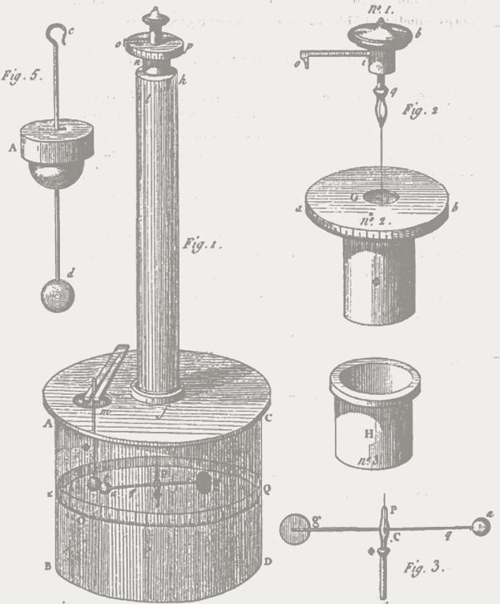

原图字母为部件标号；Fig.为图号。

<!-- dm-ch06-021 -->

〔原书第126—127页〕

> 1838年，里斯制造了他的电气空气温度计（热电计）。这一仪器测量莱顿瓶放电产生的热量。该热量并不正比于按库仑的方法测得的瓶中电量；若以q表示这一电量、s表示电容，则热量正比于$q^2/s$，或者更简单地说，正比于带电瓶的能量。现在，若让莱顿瓶通过温度计完全放电，就能得到一定的热量W。但如果让放电通过温度计进入第二个瓶子，得到的热量就少于W。不过，再使两个瓶子通过空气温度计完全放电，就能得到余下的热量；此时，热量又正比于两个瓶子的能量。因此，在第一次不完全放电时，电的做功能力就损失了一部分。[^ch6-8]

> 校注：英文底本将to印作tc，照录。

<!-- dm-ch06-022 -->

〔原书第127页〕

图6.2 马赫所描述的莱顿瓶实验。作者绘图。

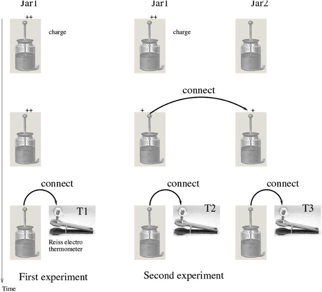

Jar 1／Jar 2：莱顿瓶1／2；charge：充电；connect：连接；Riess electro thermometer：里斯电气温度计；First experiment／Second experiment：第一次／第二次实验；Time：时间；T1—T3为温度计标记。

<!-- dm-ch06-023 -->

〔原书第127页〕

他接着论证说，库仑[^ch6-9]实验先进行，只是历史上的偶然。如果先做的是莱顿瓶实验，那么测量电所用的量就会是电能，而不是电荷。

<!-- dm-ch06-024 -->

〔原书第127—128页〕

马赫提出，我们对“电”守恒（现被理解为电荷守恒）信念，源于库仑最初实验。倘若我们以能量来定义电，或许会发现电容器之间电转移——库仑球体也起着电容器作用——并不守恒。马赫把这种假想“电”损失与卡诺热机中热量非守恒现象进行了类比。

<!-- dm-ch06-025 -->

〔原书第128页〕

他认为，把电荷看作守恒量，与把热质看作守恒量，理由同样充分。静电学承认，同样数量的电荷，随其电势不同，可以对应不同的能量。同样，一定数量的热质也可能随其势的不同而包含不同的能量。因此，温度可以看作电压在热学中的对应量：电压表示电荷的势，而温度表示物体内热质的势。

<!-- dm-ch06-026 -->

〔原书第128页〕

如果科学界愿意接受电荷概念，那么就没有理由拒绝热质。

<!-- dm-ch06-027 -->

〔原书第128页〕

我们该如何看待这一论点？

<!-- dm-ch06-028 -->

〔原书第128页〕

## 对马赫静电类比的批判

<!-- dm-ch06-029 -->

〔原书第128页〕

再看马赫如何结束他的第一个类比，即库仑类比：“如果我们把这一效应归于某种物质，自然就会推断出它的恒定性。但这一说明的关键是电力p的可分性，而不是物质这一比喻。”注意，他在这里留了退路。他甚至没有直言自己赞同电荷具有实体性。他把电荷概念称为一种比喻，说真实存在的是电力的可分性。这符合他总体上的工具主义科学观：科学研究的是仪器测量结果之间的关系，而非发现究竟是什么东西使仪表指针运动。

<!-- dm-ch06-030 -->

〔原书第128页〕

但如果我们考察库仑实验中一系列操作，就会发现“力的可分性”并不是对实验过程的准确描述。

<!-- dm-ch06-031 -->

〔原书第128页〕

第一步，实验者给一个小球充电（图6.1中标为d），然后将它放入扭秤。他利用扭秤顶部的刻度盘，读出该球对小球a施加的静电力。接着把小球d取出，让它与另一个小球b接触（库仑图中未画出b）。然后依次把d、b放入扭秤，分别从刻度盘上读出它们造成的偏转。

<!-- dm-ch06-032 -->

〔原书第128页〕

把这个实验叫作对力的分割的测量，其实并不恰当，因为这里是在三个不同的时刻，分别进行了三次力的测量。真正展示力的分割，需要被分割的力同时作用，如图6.3所示。库仑观察到的是：似乎有某种东西能够在小球之间传递，使这些不同小球在不同时刻所能产生的力保持守恒。他据此推断，有某种东西——不妨称为电荷——被分配到了小球之间。

<!-- dm-ch06-033 -->

〔原书第129页〕

图6.3 真正的力的分割装置示意图。两侧重物的平衡力与中央重物的力同时作用。作者绘图。

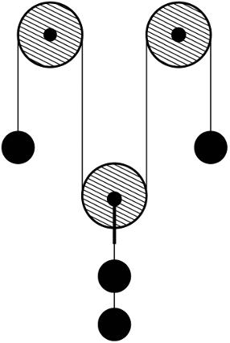

<!-- dm-ch06-034 -->

〔原书第129页〕

马赫声称库仑目睹了力的分割，这是一种歪曲。库仑实际注意到的是某种能够产生力的东西被分割了。马赫反对认识物自体的康德主义偏见，促使他拒绝这一观念，并错误地声称观察到的是力的分割。在力学中，力是加速度的直接动因。因此，能够积聚在髓球上或莱顿瓶内的并不是力本身，而是有潜能产生力的某种物质。

<!-- dm-ch06-035 -->

〔原书第129页〕

如果我们现在审视马赫对莱顿瓶实验描述，会发现它同样存在谬误。绘制该实验电路图（图6.4）有助于理解。通过该图，我们可以看出他的分析中遗漏了一个关键步骤。当第一个莱顿瓶与第二个连接时，是通过一个具有一定电阻连接（图中R1）实现。马赫论述中忽略了通过该电阻器散失热量。

<!-- dm-ch06-036 -->

〔原书第129—130页〕

若不测量$h_1$，即把一半电荷转移到电容器C2时释放的热量，我们得到的实验就类似于库仑实验，但会发现$h_0>h_2+h_3$。这样看来，电似乎就不守恒了。他想要在电荷的电压与假想热质的温度之间建立类比，但所用的思想实验，是使电能（电荷×电压平方）通过电阻放电转化为热。在图6.4中，他把电阻R1上损失的热量比作卡诺热机输出的功；从热力学来看，这个类比荒谬不通。马赫把有用能经电阻损失为热，与热转化为有用能相提并论。但热力学第二定律告诉我们，这两种转化并不对称。电能可以以100%的效率转化为热，而热转化为有用能，无论是电能还是机械功，效率总是低于100%。

> 校注：底本电能括号中写作charge × voltage²，量纲可疑；此处保留其平方标记，未静默改为电荷×电压。

<!-- dm-ch06-037 -->

〔原书第130页〕

图6.4 用现代电路图表示马赫所描述的莱顿瓶实验。步骤：（1）闭合开关S0，给C1充电；（2）断开S0，再闭合S2，测量R2上耗散的热量，记为$h_0$；（3）重复步骤（1）；（4）闭合S1，测量R1上耗散的热量，记为$h_1$；（5）断开S1，再同时闭合S2和S3，测量R2上的热量（$h_2$）和R3上的热量（$h_3$）。作者绘图。

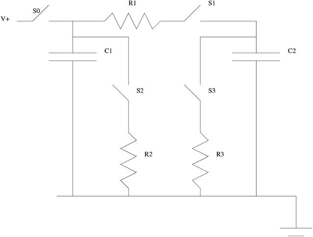

S0—S3：开关；C1、C2：电容器；R1—R3：电阻；V+：正电压端；下方符号：接地。

<!-- dm-ch06-038 -->

〔原书第130页〕

假设有一幅与图6.4对应的热学示意图：用热库代替电容器，并在原图电阻所在的位置放置热机。

<!-- dm-ch06-039 -->

〔原书第130页〕

在原始图中描述运行过程中，所有电能最终都会以热能形式散失。而在热力版本中，只有一部分初始热能被转化为功。

<!-- dm-ch06-040 -->

〔原书第130页〕

对马赫所尝试类比进行仔细考察后，会发现它根本行不通。随着我们在此详细梳理马赫论点，其荒谬之处便显而易见。他试图通过思想实验中类比来反驳原子理论，却实际上忽略了熵增定律。正是麦克斯韦和玻尔兹曼原子理论解释了熵增加。马赫却试图用类比来反驳它，完全无视了熵增加。

<!-- dm-ch06-041 -->

〔原书第130—131页〕

或许可以为他辩解说，这本书初版于1872年，时间还相当早，恰逢玻尔兹曼发表那篇关于熵的里程碑式论文。那时尚早于麦克斯韦的《热学理论》一书，[^ch6-10]但麦克斯韦论述中的关键内容已经发表。[^ch6-11]即便允许马赫用几年时间消化这些思想，这个借口也很勉强。马赫在此后的岁月里并未撤回异议。1894年10月，他又在The Monist第5卷第1期上以英语发表了这篇文章，只作少量修改，再次使用同样的静电类比来反对热的机械理论。

> 校注：“早于麦克斯韦的《热学理论》”为底本原述；注10列1875年版本，未据此改写正文。

<!-- dm-ch06-042 -->

〔原书第131页〕

可能会有人反驳说，直到那时，证明原子存在证据还只是归纳性。克劳修斯、麦克斯韦和玻尔兹曼曾基于公认力学原理，构建了一种能够解释以下现象理论：

<!-- dm-ch06-043 -->

〔原书第131页〕

- 1. 温度和压力。

<!-- dm-ch06-044 -->

〔原书第131页〕

- 2. 熵的增加。

<!-- dm-ch06-045 -->

〔原书第131页〕

- 3. 气体的黏度。

<!-- dm-ch06-046 -->

〔原书第131页〕

- 4. 气体中的“等体积定律”。

<!-- dm-ch06-047 -->

〔原书第131页〕

- 5. 与化学的原子理论相一致。

<!-- dm-ch06-048 -->

〔原书第131页〕

## 爱因斯坦驳倒马赫派对原子的反对

<!-- dm-ch06-049 -->

〔原书第131页〕

> 谁能想到，就在1900年，人们还在围绕原子是否真实存在争斗，甚至可以说斗得你死我活。维也纳的大哲学家恩斯特·马赫说：不。大化学家威廉·奥斯特瓦尔德也说：不。然而在那个关键的世纪之交，一个人基于根本的理论依据，挺身捍卫原子的实在性。他就是路德维希·玻尔兹曼。……人类的进步在那一刻悬于一架精细的思想天平之上；倘若当时反原子学说真的占了上风，我们的进步肯定会倒退几十年，甚至可能倒退一百年。[^ch6-12]

<!-- dm-ch06-050 -->

〔原书第131页〕

就在玻尔兹曼自杀前不久，一位名不见经传专利局职员发表了一系列令人惊叹四篇论文，这些论文不仅彻底证明了玻尔兹曼正确性，还把20 世纪物理学引向了一条革命性新道路。

<!-- dm-ch06-051 -->

〔原书第131页〕

- 1. 1905年6月：a.《论热的分子动理论所要求的静止液体中悬浮微粒的运动》。[^ch6-13]

<!-- dm-ch06-052 -->

〔原书第131页〕

- b. 《关于光的产生与转化的一种启发式观点》。[^ch6-14]

<!-- dm-ch06-053 -->

〔原书第131页〕

- c.《论运动物体的电动力学》。[^ch6-15]

<!-- dm-ch06-054 -->

〔原书第131页〕

- 2. 1905 年9 月，《物体的惯性是否取决于其能量含量？》。[^ch6-16]

<!-- dm-ch06-055 -->

〔原书第131—132页〕

论文[a]表明，微粒的布朗运动可以根据分子动理论作出定量预测，由此奠定了基础。[^ch6-17]在题为“悬浮粒子的平均位移公式：测定原子实际大小的新方法”的一节中，他说明：若假定阿伏伽德罗常数为$6\times10^{23}$，那么直径为1微米的小球在水分子随机撞击下，预计每分钟会移动约6微米。反过来，若通过实验精确测量这些小球的运动，就能更精确地估计阿伏伽德罗常数。这一预测很快在实验中得到验证，[^ch6-18]并在这一过程中将阿伏伽德罗常数的估计值修正为$7.15\times10^{23}$。

> 校注：底本“in experiments by”后没有作者姓名，直接接注18；该注列Jean Perrin。中文按句意连接，英文保留原貌。

<!-- dm-ch06-056 -->

〔原书第132页〕

仅凭这篇论文，就足以彻底驳倒马赫派反对原子、分子及热的动理论的论点。但若考察爱因斯坦在那个夏天接连发表的整组论文，就能看到一个逐渐展开的主题：捍卫关于实在的微粒观，反对与之争论、受到马赫及其支持者青睐的能量论学派。

<!-- dm-ch06-057 -->

〔原书第132页〕

爱因斯坦[^ch6-19]论证了为什么应把光看作微粒。他在开篇写道：

<!-- dm-ch06-058 -->

〔原书第132页〕

> 光波动理论及其连续空间函数已被证明是纯粹光学现象绝佳模型，预计永远不会被其他理论所取代。尽管如此，我们应当考虑到，光学实验观测到只是时间平均值，而非瞬时值。因此，尽管麦克斯韦理论与实验结果完全吻合，但使用连续空间函数来描述光，可能会导致与实验结果矛盾，特别是在应用于光产生和转化时。

<!-- dm-ch06-059 -->

〔原书第132页〕

> 特别是，黑体辐射、光致发光、紫外线产生阴极射线以及其他与光产生和转化相关现象，似乎在假设光能量在空间中呈不连续分布情况下，能得到更好建模。根据这一图景，点光源发出光波能量并非连续扩散到越来越大体积中，而是由有限数量能量量子组成，这些量子在空间中特定点上局域化，在运动过程中不会分裂，且只能作为整体被吸收或产生。[^ch6-20]

<!-- dm-ch06-060 -->

〔原书第132页〕

他是如何论证这一观点？

<!-- dm-ch06-061 -->

〔原书第132页〕

起初，他考察了处于热平衡状态腔内气体，假设其本质上具有微粒性，由原子和电子组成。他提出，受各种局部静电势限制电子可以作为电磁辐射谐振器。运用分子动理论，他推导出了谐振器平均能量公式，表明该能量应与气体温度成正比。

<!-- dm-ch06-062 -->

〔原书第132页〕

到这里，他阐述的仍是当时公认的光发射理论。然而，他证明这一理论的预测偏离了实验结果。考虑频率越来越高的辐射时，理论所预测的腔内辐射能会趋于无穷大。他推导出一个方程，说明体积为$v_0$的腔内单色光的熵应是多少，以及当光的全部能量集中到腔内某个子体积$v$中时，这个熵会怎样变化。[^ch6-21]对此，他指出：

<!-- dm-ch06-063 -->

〔原书第133页〕

> 该方程表明，密度足够低单色辐射熵随体积变化规律，与理想气体或稀溶液熵变化规律相同。下文将根据玻尔兹曼先生提出原理来解释上述方程，该原理指出：系统熵是其状态概率函数。[^ch6-22]

<!-- dm-ch06-064 -->

〔原书第133页〕

这立即表明——尽管爱因斯坦并未对此多加论述——光表现出了类似原子集合体微粒性质。

<!-- dm-ch06-065 -->

〔原书第133页〕

接着，他把玻尔兹曼的熵公式用于体积为$v_0$的气体中的分子，推导出当全部分子都处于子体积$v<v_0$内时的熵变公式；这基本上是上一章半个圆筒例子的推广。结果表明，气体熵变公式与他推导出的单色辐射熵变公式具有相同的函数形式。[^ch6-23]他由此得出结论：

<!-- dm-ch06-066 -->

〔原书第133页〕

> 从热理论来看，低密度单色辐射（在维恩辐射公式的适用范围内）的行为，仿佛它由大小为$\frac{R\beta\nu}{N}$的独立能量量子组成。*

> 校注：底本公式后有“>8”异常字符，英文照录；中文保留句号和星号，不将异常字符解释为公式或注号。

<!-- dm-ch06-067 -->

〔原书第133页〕

> 〔原书星号页脚注〕* 这一量的现代记法是$h\nu$，其中$h$为普朗克常数，$\nu$为频率。他写成$\frac{R\beta\nu}{N}$，但他所用的常数$R,\beta,N$保证$\frac{R\beta}{N}=h$。底本在常数列表后另印有$\frac{n!}{r!(n-r)!}$。

> 校注：底本在R、β、N后混入组合数分式n!/[r!(n−r)!]，与当前句意不相衔接。英文保留原位置，中文说明其原有位置，不将其改写为新的物理关系；Plank拼写亦照录英文。

<!-- dm-ch06-068 -->

〔原书第133页〕

请思考他的成就。他两次应用了玻尔兹曼对熵统计学解释：最初是在辐射背景下，随后又在气体分子背景下。他证明了光熵随体积变化方式与气体熵相同。这使他推断出光具有粒子性，由后来被称为“光子”粒子组成。值得注意的是，他在推导腔内光熵时，并未预设光粒子性；而是从经验上得到验证黑体辐射公式中推导出了这一结论。因此，玻尔兹曼统计力学不仅在原子层面正确——爱因斯坦关于布朗运动论文便证明了这一点——而且也适用于光，从而推导出了光粒子性。

<!-- dm-ch06-069 -->

〔原书第133页〕

鉴于当时人们对玻尔兹曼关于气体原子理论仍持极大怀疑态度，这无疑是一个大胆推论。它意味着物理学界不仅必须摒弃对气体理论疑虑，还必须面对一个或许更为艰巨挑战——接受电磁辐射粒子理论，而此前关于电磁辐射连续波理论似乎一直是19 世纪物理学辉煌成就。

<!-- dm-ch06-070 -->

〔原书第133—134页〕

单就这一点而言，这不过是一个大胆假设，但爱因斯坦提供了实验证据来支持这一观点。光电效应早已为人所知，这是一种入射光导致真空管中冷阴极释放电子并向阳极移动现象。这种运动会产生可检测到电流。在更现代应用中，太阳能电池板正是基于这一原理工作。通过对阳极施加反向偏压，电子会被排斥，阻止电流流动。所谓“截止电压”——即电流停止流过点——表示电子从阴极发射出来时所具有能量（单位为电子伏特）。

<!-- dm-ch06-071 -->

〔原书第134页〕

此前关于光波动理论曾预测，截止电压将由入射光强度决定。爱因斯坦理论则指出，它应由光频率决定。高频光量子具有更大能量，因此会把电子激发到更高电压。

<!-- dm-ch06-072 -->

〔原书第134页〕

实验数据支持爱因斯坦量子理论，而非波理论。截止电压取决于频率，而非强度。正是凭借在光电效应方面研究，爱因斯坦获得了诺贝尔物理学奖。

<!-- dm-ch06-073 -->

〔原书第134页〕

一个世纪前，光电效应还是一种鲜为人知现象，只有实验物理学家才了解。如今，它已成为我们日常生活一部分。太阳能电池板、LED 灯泡以及智能手机中摄像头都利用了这一效应。事实上，现代数码相机芯片中传感器非常灵敏，以至于击中像素离散光子数量统计波动，会在均匀背景上表现为可见“散粒噪声”。现代技术使我们能够在手机上观察到光的量子化现象。

<!-- dm-ch06-074 -->

〔原书第134页〕

有人可能会反驳说，爱因斯坦对光电效应解释是一种事后推断。当时，光电效应实验证据早已确立。爱因斯坦理论为这些观测结果提供了解释，而连续统理论却无法做到这一点。然而，这并非一种预测。1922 年，人们发现X 射线可以被电子散射，从而导致电子获得动量，这一发现被证明是对爱因斯坦理论关键性证实。

<!-- dm-ch06-075 -->

〔原书第134页〕

他在1905年的最后两篇论文讨论了狭义相对论，[^ch6-24]并推导出著名的$e=mc^2$公式。[^ch6-25]他推导相对论时使用的论证与唯物主义问题只有间接联系，所以这里不作讨论。[^ch6-26]物质与能量彼此等价的结论，既具有哲学意义，也具有巨大的实践意义。在哲学上，它削弱了把“能量论”当作唯物主义替代方案的可能性。[^ch6-27]在历史上，它开启了原子能及其所带来的一切可能。如果说有什么让原子观念深入公众心中，那就是原子能。

<!-- dm-ch06-076 -->

〔原书第134页〕

贝希托尔德[^ch6-28]把马赫的原子观概括如下：“马赫的原子观可以归纳为五个主要观点：（a）原子不作为自在之物存在；（b）原子概念只是感觉复合体的思想符号；（c）原子论是一种没有成果的假说；（d）原子论是一种人为的假说；（e）原子论是一种没有充分依据的假说。”

<!-- dm-ch06-077 -->

〔原书第134页〕

到了20 世纪中叶，马赫学派对原子观念反对似乎已显得荒谬且令人反感。广岛毁灭绝非源于某种“感觉复合体”。

<!-- dm-ch06-078 -->

〔原书第134页〕

## 哲学马赫主义与列宁的干预

<!-- dm-ch06-079 -->

〔原书第134—135页〕

马赫影响不仅体现在阻碍了原子理论被接受。他的哲学思想塑造了半代科学家思维方式。它确立了工具主义——即科学仅仅是用于把仪器读数与感官印象相关联公式这一学说——作为许多早期量子物理学家思考量子力学所引发概念革命出发点。

<!-- dm-ch06-080 -->

〔原书第135页〕

与牛顿和莱布尼茨一样，[^ch6-29]马赫强调科学思想中简洁性的优点。

<!-- dm-ch06-081 -->

〔原书第135页〕

> 科学知识传播总是涉及描述，即在思想中对事实模仿性再现，其目的是取代新经验并省去相关麻烦。同样，为了节省教学和学习劳力，人们寻求简洁、概括描述。这实际上就是自然法则全部内容。只要知道重力加速度数值以及伽利略下落定律，我们便拥有了简单而简明指引，可以在思想中重现落体一切可能运动。这样公式完全可以替代一份完整下落运动表，因为借助该公式，可以随时轻松推导出该表中数据，而丝毫不给记忆带来负担。

<!-- dm-ch06-082 -->

〔原书第135页〕

> ……

<!-- dm-ch06-083 -->

〔原书第135页〕

> 在代数中，我们尽可能把所有形式相同数值运算一次性完成，从而仅需针对个别情况进行少量工作。代数和分析中符号使用——这些符号仅仅代表待执行运算——源于这样一种观察：通过把所有机械性运算交由双手完成，我们可以实质性地减轻思维负担，从而把思维能力留给更重要、更困难任务。这种方法一个结果——也印证了其经济性——便是计算机制造。数学家巴贝奇（差分机发明者）可能是第一个清晰认识到这一事实的人，他在其著作《制造业与机械的经济性》中曾提及这一点，尽管只是略为提及。[^ch6-30]

<!-- dm-ch06-084 -->

〔原书第135页〕

问题在于，这一节约原则与一种实质上属于个人主义或心理主义的观念纠缠在一起：信息的节约究竟发生于何处？这里把个体感知与科学这一社会活动混为一谈。

<!-- dm-ch06-085 -->

〔原书第135—136页〕

> 当我们在思想中把一个物体从它运动于其中的可变环境中分离出来时，实际上是在我们的全部感觉之流中，抽出一组思想所关注的、比其他感觉相对更稳定的感觉。这组感觉并非绝对不变。它的成员时而出现，时而消失，或发生改变。它从不以完全相同的样态重现。然而，其恒定要素的总量与可变要素的总量相比，总是占如此大的比重，尤其是考虑到转变的连续性时更是如此，以至于就当前目的而言，前者通常似乎足以确定物体的同一性。但是，由于我们可以从这组感觉中分离出任何一个成员，而物体对我们来说仍不失为同一个，我们便容易相信：把所有成员都抽离之后，还会剩下某种额外的东西。于是，我们形成了一种有别于其属性的实体观念，即物自体观念，而把我们的感觉仅仅视为这个物自体的属性的符号或标志。然而，更妥当的说法应当是：物体或事物是感觉群的简明心理符号——这些符号并不存在于思想之外。[^ch6-31]

<!-- dm-ch06-086 -->

〔原书第136页〕

他的意思是，世界上物体并不存在，只有我们对它们思考或感觉才存在。这种唯心主义观点几乎与贝克莱学说如出一辙。我们确实对引发白垩纪—第三纪灭绝事件小行星有一种象征性表征。但杀死恐龙并非这种象征性表征，而是那块真实存在岩石与金属，正是它形成了希克苏鲁伯陨石坑。

<!-- dm-ch06-087 -->

〔原书第136页〕

为什么说事物只是感觉群的心理符号、而这些符号并不存在于思想之外，会是更好的说法呢？

<!-- dm-ch06-088 -->

〔原书第136页〕

他如何把这种个人主义与他在其他地方所承认科学集体性相调和？

<!-- dm-ch06-089 -->

〔原书第136页〕

> 通过交流，许多人最初各自获得经验被汇集为一。知识传播，以及每个人为了以最少思维消耗来管理自己经验储备而感受到必要性，迫使我们把知识归纳为经济形式。但这恰恰为我们提供了一条线索，它剥去了科学一切神秘面纱，并向我们展示了科学真正力量。就具体结果而言，它所提供，是我们即使不借助方法，只要时间足够长，也能达到。整个数学领域中，没有哪个问题不能通过直接计数来解决。但借助现有数学工具，许多计数运算可以在几分钟内完成，而如果没有数学方法，这些运算可能需要一辈子才能完成。正如一个完全依赖自身劳动成果人永远无法积累巨额财富，相反，许多人劳动成果积累集中于一人之手，才是财富与权力基础；同样，任何值得称之为知识东西，都无法被局限于人类寿命范围之内、且仅具备有限能力单个头脑所汇集，除非通过最精妙思维节约，以及对成千上万合作者所积累、经过经济有序整理经验进行汇集。[^ch6-32]

<!-- dm-ch06-090 -->

〔原书第136页〕

上述论述很好地认识到了信息的节约以及科学的集体性质。但在其他地方，我们看到的却是个人主义和心理学式的解释。马赫十分愿意承认科学通过集体努力而进步，那么过去就必定有真实的人提出了运动定律。确实存在一个真实的牛顿，马赫使用的正是他的运动定律。如果马赫能够接受其他科学家的实在性，为何又否认牛顿所解释其运动的那些行星天体的实在性？

<!-- dm-ch06-091 -->

〔原书第137页〕

他对原子反对，正是源于这种对科学过程理解。

<!-- dm-ch06-092 -->

〔原书第137页〕

> 当几何学家想理解一条曲线的形状时，会先把它分解成微小的直线元素。但他完全清楚，这些元素只是暂时而任意的手段，用于分部分地理解他无法作为整体把握的对象。一旦找到曲线的规律，他就不再考虑这些元素。同样，物理科学若把自己创造的、可变而节约的工具——分子和原子——当作现象背后的实在，忘却其年长的姊妹哲学最近获得的智慧，以机械神话取代旧的泛灵论或形而上学图式，从而制造无穷无尽的假想问题，那就有失其本分。原子必须始终像数学函数一样，作为表征现象的工具。然而，随着智力在与研究对象接触中逐渐受到训练，物理科学将放弃以石子拼成马赛克的游戏，转而探寻现象的生命之流所流经的河床的边界和形态。它所追求的目标，是对事实最简单、最节约的抽象表达。

<!-- dm-ch06-093 -->

〔原书第137页〕

这种放弃探究现象背后真理观点，无法解释爱因斯坦如何能基于原子理论预测未被观测到现象。如果原子并不存在，爱因斯坦又如何能准确预测花粉粒扩散速率？虽然一个能经济地解释过去观测结果公式很有用，但如果没有一个能准确捕捉现实理论，预测此前未被观测到现象将是不可能。这一点既适用于爱因斯坦对布朗运动和光电效应预测，也适用于更宏大天文预测。勒维耶利用牛顿万有引力定律预测海王星位置，其依据正是需要解释其他行星轨道上摄动。该定律指明了搜索方向，而当人们在该处观测时，海王星确实被发现了。若仅把海王星视为表征这些摄动一种工具，那便是毫无意义。同样，广义相对论并非对既定事实简单表述；它是一套描述真实宇宙几何性质理论。该理论预言了1915 年尚不为人知、且直到很久以后才被观测到众多现象。爱因斯坦理论预测了1919 年日食期间埃丁顿观测结果：恒星视位置会因太阳引力而发生偏移。近年来，该理论预测引力波和黑洞也已得到观测证实。

<!-- dm-ch06-094 -->

〔原书第137页〕

在机器学习领域，人们普遍认为，一个在训练集上拟合良好模型在新数据上可能表现不佳。这一现象已广为认可，因此在研究中，使用与训练集不同数据集来评估模型已成为标准做法。只有在未见过示例上表现良好模型才会被视为值得信赖。同样，关于熵的原子理论、关于光的光子理论以及广义相对论都被视为稳健模型。它们优势不仅在于拟合现有数据，更在于把握了客观的因果机制。

<!-- dm-ch06-095 -->

〔原书第138页〕

就在爱因斯坦论文发表之后，但在这些论文尚未产生太大影响之前，一位笔名为列宁俄罗斯社会主义者出版了一本书，对马赫主义进行了批判。[^ch6-33] 事实证明，这位社会主义者后来成为了苏联首任总理，[^ch6-34]因此，他对马赫批判被反复转载，并对苏联哲学产生了重大影响。

> 校注：底本attaching Machism按上下文应为attacking；英文照录，中文按批判译。

<!-- dm-ch06-096 -->

〔原书第138页〕

作为政治家和政治理论家，列宁对马赫批判与爱因斯坦相比，技术性要弱得多。爱因斯坦通过质疑马赫关于原子物理主张来间接反驳他，而列宁则直接挑战了马赫理论哲学基础。

<!-- dm-ch06-097 -->

〔原书第138页〕

马赫对原子存在深刻怀疑——这似乎与19 世纪科学进步相矛盾——是更广泛反唯物主义立场一部分。源于古希腊唯物主义原子论，传统上一直与这种观点相对立。马赫不仅否认原子存在，更否认所有物质对象存在：“更恰当说法是，即物体或事物是感觉群的简明心理符号——这些符号在思想之外并不存在。”[^ch6-35]

<!-- dm-ch06-098 -->

〔原书第138页〕

他断言，感觉才是根本，而物质实体仅仅是感觉群的心理或概念符号。因此，如果一个人始终对物质世界持怀疑态度，那么从逻辑上讲，这种怀疑自然会延伸到对物质最小单元——原子——存在产生怀疑。

<!-- dm-ch06-099 -->

〔原书第138页〕

马赫把物理科学视为心理学一个分支，把心理现象和个人经验置于现实核心。对他而言，其他一切都是幻象，尽管是一个连贯幻象。列宁曾就这段话评论道：

<!-- dm-ch06-100 -->

〔原书第138页〕

> 老调重弹了，最可敬的教授！这完全是在重复贝克莱的话：物质是一个赤裸的抽象符号。但实际上，赤裸的正是恩斯特·马赫，因为，如果他不承认“可感内容”是独立于我们而存在的客观实在，那么剩下的就只有一个“赤裸的抽象的”我，一个必定要大写并用斜体标出的我，等同于“那架发疯的钢琴，它以为自己是世上唯一存在的东西”[^ch6-36]。如果我们的感觉的“可感内容”不是外部世界，那么就只剩下这个沉湎于空洞“哲学”幻想的赤裸的我。这是一种愚蠢而徒劳的消遣！

<!-- dm-ch06-101 -->

〔原书第138页〕

马赫把“事物”仅仅是感觉符号这一比喻一直推演到原子层面，并以钠为例加以说明。

<!-- dm-ch06-102 -->

〔原书第138—139页〕

> 物理学家看到一个物体被弯曲、拉伸、熔化并汽化，便把它切割成更小永久性部分；化学家则把它分解为元素。然而，即便是元素也并非一成不变。以钠为例。当受热时，这种白色、银色块状物会变成液体；若继续加热并隔绝空气，它便转化为紫色蒸汽；若再进一步加热，则会发出黄光。之所以仍保留“钠”这一名称，既是因为这些转变具有连续性，也是出于一种必要的节约本能。通过冷凝蒸汽，可以使白色金属重新显现。事实上，即使金属投入水中并转化为氢氧化钠，那些消失性质通过巧妙处理仍可重新显现；正如一个运动物体经过柱子后方、暂时消失在视线中，过一会儿又会重新出现。毫无疑问，只要某一组性质有可能出现，随时准备好相应名称和概念是非常方便。但这个名称和概念，不过是这些现象一个简明而节约的符号罢了。对于那些无法借此唤起一大群井然有序感官印象人来说，它不过是一个空洞词语。对于化学元素被进一步分解成分子和原子，情况也是如此。[^ch6-37]

<!-- dm-ch06-103 -->

〔原书第139页〕

因此，在马赫看来，钠原子只是一组感觉印象的符号。归根结底，既不存在钠原子，也不存在任何原子；它们只是我们用来赋予感觉印象以一致性的观念。

<!-- dm-ch06-104 -->

〔原书第139页〕

对列宁而言，唯物主义核心在于它主张物质世界独立于我们感知。这一假设是所有务实的人所共有，只有唯心主义哲学家对此提出质疑。列宁指出，马赫颠覆了这一观点，把人类经验置于一切之上。尽管马赫拥有物理学背景并为科学哲学做出了贡献，但列宁认为，他哲学不过是贝克莱主教思想的回声。[^ch6-38]作为一名社会主义政治家，列宁深刻认识到哲学与政治之间密切联系。贝克莱曾明确表示，他唯心主义旨在对抗当时无神论者。《百科全书》编纂者、法国大革命的哲学家狄德罗曾严厉批评贝克莱，视其为教会和王权捍卫者。在列宁所处时代，中欧和东欧君主制正面临革命运动威胁，这些运动最终在1917 年至1918 年间推翻了这些政权。在列宁看来，马赫对贝克莱思想复兴，是又一次旨在强化教会和王权、以对抗无神论社会主义运动哲学干预。值得注意的是，马赫作为维也纳大学哲学教授职位，必须得到奥匈帝国皇帝弗朗茨·约瑟夫亲自批准。

<!-- dm-ch06-105 -->

〔原书第139页〕

列宁指出，马赫唯心主义并不彻底。他援引马赫话说，随着科学发展，原则上应该可以通过检查大脑，来判断其正在经历什么样体验。这如今确实已经可以实现，Shen 等人[^ch6-39]表明，通过结合功能性磁共振成像和对抗性神经网络，端到端模型可以学习大脑活动与感知之间直接映射关系。当受试者注视一幅图片时，神经网络以功能性磁共振成像数据为输入，便能在屏幕上生成对该人所见景象尚可再现。具体示例见图6.5。但列宁质疑：这如何能与马赫把感觉视为第一性相一致？因为这实际上承认了感觉是组织化物质——即大脑——结果。

<!-- dm-ch06-106 -->

〔原书第140页〕

图6.5 利用脑扫描，可以重建一个人正在看到的景象。A行：呈现给受试者的图像；B行：利用关于其脑活动的实时信息，由计算机重建的感知内容。取自Shen等人的研究。

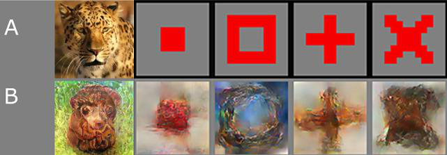

A：呈现图像；B：重建图像。

<!-- dm-ch06-107 -->

〔原书第139—140页〕

> 这意味着，在我们之外，独立于我们和我们的意识，存在着物质的运动，例如具有一定波长和速度的以太波；它们作用于视网膜，使人产生某种颜色的感觉。自然科学正是这样看待这个问题的。它用存在于人类视网膜之外、人体之外并独立于人的不同波长的光波，解释各种颜色的感觉。这就是唯物主义：物质作用于我们的感觉器官，产生感觉。感觉依赖于大脑、神经、视网膜等，即依赖于以一定方式组织起来的物质。物质的存在并不依赖于感觉。[^ch6-40]

<!-- dm-ch06-108 -->

〔原书第140页〕

## 量子理论中的唯心主义与唯物主义

<!-- dm-ch06-109 -->

〔原书第140页〕

列宁写作时，物质的原子理论正处于革命性变革之中。同时，爱因斯坦提出光由量子化的光子组成，给经典物理学带来了矛盾：这似乎与有大量经验证据支持、已经确立的光的波动理论相冲突。随后，卢瑟福[^ch6-41]通过薄金箔对β辐射的散射表明，此前被认为是实心的原子，实际上大部分是空隙，只有一个很小的原子核。同年，尼科尔森[^ch6-42]提出，原子的大部分体积由电子轨道占据，而电子允许的角动量是普朗克常数h的倍数。

> 校注：底本确实写beta radiation，照译β辐射；未静默改成α粒子。

<!-- dm-ch06-110 -->

〔原书第140页〕

> 因此，如果如索末菲所提出的那样，常数h在原子层面具有意义，那么当电子离开或返回时，原子的角动量或许只能以离散的量增加或减少。不难看出，这种观点比通常的解释更容易理解；后者被认为意味着能量本身具有原子式的构成。[^ch6-43]

<!-- dm-ch06-111 -->

〔原书第140—141页〕

到第二年，玻尔[^ch6-44]已把这一观点整合进原子理论中，该理论能够解释所观测到元素发射光谱。在他模型中，原子类似于一个微型太阳系，电子围绕带正电原子核运行。这是一种对原子结构半量子化处理。虽然轨道是按经典理论分析，但它们受普朗克常数限制，该常数把电子可能角动量进行了量子化。然而，玻尔对爱因斯坦关于光具有粒子性观点并不满意，认为这与已知光干涉能力相矛盾。他与其他人一起，试图构建一种辐射理论[^ch6-45] ，把他原子模型与经典电磁学相结合，从而消除对光子需求。尽管他1924 年提出理论细节很快就被实验数据所推翻，但他在这篇论文中哲学论述，间接地为后来马赫学派物理学哲学观点复兴铺平了道路。

<!-- dm-ch06-112 -->

〔原书第141页〕

> 尽管对应原理使得通过估算跃迁概率来推断原子在给定定态中停留平均时间成为可能，但在确定与跃迁相关辐射发射发生时间间隔这一问题上，却存在巨大困难。事实上，这一难题连同量子理论中其他著名悖论，加剧了各方表达疑虑：即关于物质与辐射之间相互作用详细解释，是否能够完全基于迄今用于解释自然现象那种时空因果描述来给出。[^ch6-46]

<!-- dm-ch06-113 -->

〔原书第141页〕

玻尔因果描述暗示了能量和动量守恒。在他1924 年论文中，他试图通过提出能量和动量守恒在统计平均意义上成立，来弥合经典力学与量子力学之间鸿沟。他推测，虽然动量在许多电子能级跃迁中会守恒，但在每个单独电子与假设虚拟电磁场相互作用中，动量可能并不守恒。然而，这一观点很快就被推翻了——电子散射光子实验证实，在每次相互作用中动量都是守恒，这导致爱因斯坦光子假说被广泛接受。

<!-- dm-ch06-114 -->

〔原书第141页〕

不过，关于量子系统中因果关系哲学问题仍由玻尔不断提出。

<!-- dm-ch06-115 -->

〔原书第141页〕

> 尽管由此给量子理论构建带来了困难，但正如我们将看到，其本质似乎可以表述为所谓“量子公设”——该公设赋予任何原子过程一种本质上不连续性，或者更确切地说，一种与经典理论完全相悖“个体性”，并以普朗克“作用量子”为象征。

<!-- dm-ch06-116 -->

〔原书第141页〕

> 这一公设意味着放弃对原子过程作因果性的时空协调描述。事实上，我们通常对物理现象的描述，完全建立在这样一种观念上：可以观察相关现象而不对其造成可察觉的扰动。

<!-- dm-ch06-117 -->

〔原书第141页〕

> ……

<!-- dm-ch06-118 -->

〔原书第141—142页〕

> 而量子公设意味着，任何对原子现象的观察，都涉及与观测装置之间不可忽略的相互作用。因此，既不能赋予现象、也不能赋予观测装置以通常物理意义上的独立实在性。毕竟，观测概念在某种意义上是任意的，因为它取决于哪些对象被纳入待观测的系统。当然，最终每一次观测都可以归结为我们的感觉知觉。[^ch6-47]

<!-- dm-ch06-119 -->

〔原书第142页〕

虽然最后一句颇有马赫主义认识论意味，但玻尔通过此前提及“观测装置”这一表述，在某种程度上为其论断规避了主观主义指责。例如，光子观测装置可以是一块照相底片。鉴于后来被称为“波函数坍缩”现象，碘化银晶体与视紫红质分子在视网膜中作用同样有效。他接着说道：

<!-- dm-ch06-120 -->

〔原书第142页〕

> 就光而言，其在时空中传播可由电磁理论充分阐明。特别是真空中发生干涉现象以及物质介质光学性质，完全受波理论叠加原理支配。然而，在辐射与物质相互作用过程中能量和动量守恒——如光电效应和康普顿效应所示——恰恰通过爱因斯坦提出光量子概念得到了恰当阐释。

<!-- dm-ch06-121 -->

〔原书第142页〕

> 众所周知，这一表面矛盾一方面引起对叠加原理有效性的怀疑，另一方面引起对守恒定律有效性的怀疑；这些怀疑已被直接实验明确排除。这种情况似乎清楚地表明，不可能对光现象作因果性的时空描述。一方面，当我们试图根据量子公设追踪光的时空传播规律时，只能进行统计考量；另一方面，要使以作用量子为特征的单个光过程满足因果性要求，就必须放弃时空描述。[^ch6-48]

<!-- dm-ch06-122 -->

〔原书第142页〕

玻尔因其表述晦涩而受到批评，因此让我们更仔细地看看他似乎想要表达什么。[^ch6-49]这些措辞中蕴含着许多隐含含义。

<!-- dm-ch06-123 -->

〔原书第142页〕

首先，他所说的叠加原理指什么？在当代关于量子计算等问题的讨论中，人们谈的是基矢态的叠加；但在20世纪20年代中期，物理学用这个术语指产生干涉的波的叠加。因此，他所说的叠加原理就是光学干涉。他提到的疑虑，即如何把干涉现象与爱因斯坦处理光子时涉及的守恒定律结合起来，正是他本人在玻尔、克拉默斯和斯莱特合著论文中表达的疑虑。[^ch6-50]

<!-- dm-ch06-124 -->

〔原书第142—143页〕

当他谈到试图追踪光的时空传播时，指的是求解麦克斯韦方程组，从而得到光波的振幅。但这个解只给出到达某处——例如照相底片上某一点——的光的振幅。电磁场振幅的平方给出到达该点的光子通量，但单个光子随机到达，服从泊松统计。因此，他说“我们只能进行统计考量”。[^ch6-51]

<!-- dm-ch06-125 -->

〔原书第143页〕

当他接着将这一点与“满足因果性要求”相对照时，指的仍是守恒定律，正如他1924年的论文中所说。经典物理学的整个因果结构都围绕能量和动量守恒建立。行星及其卫星遵循的时空路径，是使能量和动量守恒的路径。但他说，在量子力学中，如果要讨论能量守恒，就必须从麦克斯韦的光模型转向爱因斯坦的模型：我们所能说的，只是一个原子在时刻$t_0$发射一个光子，另一个原子在时刻$t_1$吸收这个光子。在这两个事件之间，无法为光子指定一条确定的路径。

<!-- dm-ch06-126 -->

〔原书第143页〕

如果你搭建一个使用衍射光栅光谱仪，使其暴露在极低单色光通量下——平均每次只有一个光子通过光栅——在长时间曝光后，你仍然会得到一条清晰光谱线。[^ch6-52] 为了产生这种效应，每个光子必须同时穿过多条光栅条纹，因此它们在发射与吸收之间位置是未定义。

<!-- dm-ch06-127 -->

〔原书第143页〕

> 此外，通过关系式（2）[^ch6-53] 表达经典概念中限制，与经典力学有限有效性密切相关，在物质波理论中，经典力学对应于几何光学，其中波传播通过“光线”来描述。只有在这个极限下，才能基于时空图景对能量和动量进行明确定义。[^ch6-54]

<!-- dm-ch06-128 -->

〔原书第143页〕

玻尔关注是，如果采用波模型，在多大程度上可以对光子或其他粒子进行定位。

<!-- dm-ch06-129 -->

〔原书第143页〕

如果我们从波论角度观察粒子在空间中运动，那么只有把它视为“波包”时，才能在其轨迹上对其进行定位。这个波包可以被视为不同频率波叠加。我们想要实现定位越精确，就越需要考虑更多不同频率分量。

<!-- dm-ch06-130 -->

〔原书第143页〕

上文关系式（2）指是他方程：

<!-- dm-ch06-131 -->

〔原书第143页〕

$\Delta t\Delta E=\Delta x\Delta I_x=\Delta y\Delta I_y=\Delta z\Delta I_z=h$

<!-- dm-ch06-132 -->

〔原书第143页〕

其中$\Delta t$表示波包通过某一点的时间间隔。这给出了光子到达时刻的不确定性。

<!-- dm-ch06-133 -->

〔原书第143页〕

关系式$\Delta t\Delta E=h$来自爱因斯坦的结论：光子的能量与频率通过普朗克常数h成反比，使得$h=E\tau$，其中$\tau$是光波的振动周期。

> 校注：底本称能量与frequency成反比；与同句h=Eτ相应的反比变量应为周期τ，频率与能量为正比关系。正文保留底本表述。

<!-- dm-ch06-134 -->

〔原书第144页〕

如果我们希望更准确地确定波包何时到达，就必须选择一个傅里叶和包含更多分量频率波包。由于每种频率都对应不同能量，对到达时间确定性越高，对光子能量确定性就越低。这就是玻尔在论述时空图景与能量守恒时所探讨互补关系。

<!-- dm-ch06-135 -->

〔原书第144页〕

$\Delta x,\Delta y$分别是波包在x、y方向上的长度，其他方向依此类推。这给出了波包到达位置的空间不确定性。

<!-- dm-ch06-136 -->

〔原书第144页〕

$\Delta I_x$是x方向的动量范围，其他方向依此类推。因此，$\Delta x\Delta I_x=h$表达的就是后来所谓的海森堡不确定性原理。[^ch6-55]玻尔从爱因斯坦的光子动量公式$I\lambda=h$推导出这一关系；这里的符号I表示动量。

<!-- dm-ch06-137 -->

〔原书第144页〕

这就是玻尔所称互补原理。人们可以把一个过程视为具有确定时空演化，也可以把它视为受守恒定律支配，但不能同时兼顾两者。

<!-- dm-ch06-138 -->

〔原书第144页〕

玻尔和海森堡后来被视为“哥本哈根诠释”代表人物，尽管有观点认为两人观点存在实质性差异，且关于哥本哈根诠释流行说法在某种程度上是一种神话。[^ch6-56]如前所述，对玻尔而言，因果诠释是指基于守恒定律诠释；而对海森堡而言，因果诠释则是指波函数确定性演化。波函数随时间以确定性方式演化。该函数为某个态空间正交基分配振幅，使得这些振幅平方即为在相应基矢态下观测到该系统概率。这在形式上与光学情况相同，即场振幅平方即为光子通量。对海森堡而言，对粒子实际探测，或者更普遍地说，对系统基矢态探测，构成了由波函数演化所支配量子世界与观察结果经典世界之间一个“切口”（Schnitt）。

<!-- dm-ch06-139 -->

〔原书第144页〕

直到最近，这似乎还是一个相当深奥话题，但随着技术进步，它现在正被应用于量子密码学这一实际领域。例如，廖等人[^ch6-57]成功演示了利用量子密码学向轨道卫星传输数据。

<!-- dm-ch06-140 -->

〔原书第144页〕

如今，量子密码学已能为普通数字密码学分发超长密钥，其长度之大，使得有效暴力破解成为不可能。我们将解释该技术工作原理，并利用其运作过程来阐释量子力学中不同唯心论和唯物论解释。

<!-- dm-ch06-141 -->

〔原书第144页〕

请看图6.6 所示实验装置。它展示了如何利用初始偏振片制备一束垂直偏振光。若在此光束中放置一个与第一偏振片成45° 角第二偏振片，则最初偏振光束中光子只有一半能通过第二偏振片。

<!-- dm-ch06-142 -->

〔原书第144—145页〕

图6.6 展示是简单偏振片，但实际上还存在更复杂偏振装置，它们能把初始偏振光子流分为两路：一路为垂直偏振光，另一路为水平偏振光。这为信息传输提供了一种潜在途径。假设我们把垂直偏振光子记为1，水平偏振光子记为0，则可将其用作传输编码。

<!-- dm-ch06-143 -->

〔原书第145页〕

图6.6 光通过偏振片后，可以形成垂直偏振光束。若再通过相对第一片旋转45°的第二片偏振片，就得到偏振方向为45°、光子数减半的光束。作者绘图。

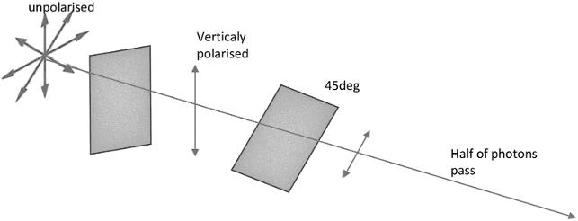

unpolarised：非偏振光；Vertically polarised：垂直偏振；45deg：45°；Half of photons pass：一半光子通过。

<!-- dm-ch06-144 -->

〔原书第145页〕

我们还可以进一步增加复杂性，允许发送方使用两片相互成45° 角偏振片中任意一片来编码信息。

<!-- dm-ch06-145 -->

〔原书第145页〕

假设爱丽丝想向鲍勃发送比特序列1001011001，并且她随机选择使用垂直偏振片还是对角线偏振片来发送各个比特。在下文中，我们把垂直偏振片表示为+，对角线偏振片表示为x。

<!-- dm-ch06-146 -->

〔原书第145页〕

| 序列 | 含义 |
| --- | --- |
| 1001011001 | 爱丽丝尝试发送的比特流 |
| xx+x++x++x | 她使用的编码偏振片 |

<!-- dm-ch06-147 -->

〔原书第145页〕

鲍勃既不知道初始比特流，也不知道偏振片设置顺序。他可以猜测使用了哪种偏振片设置。如果对于某个给定比特，他做出了正确选择，那么通过使用分束偏振片，他就能正确读取爱丽丝在该序列中发送1 或0。如果他做出了错误选择，那么他将以50% 概率读取0 或1，无论爱丽丝实际发送是什么。例如，我们可能会遇到以下情况：

<!-- dm-ch06-148 -->

〔原书第145页〕

| 序列 | 含义 |
| --- | --- |
| 1001011001 | 爱丽丝尝试发送的比特流 |
| xx+x++x++x | 她使用的编码偏振片 |
| xx++x+++xx | 鲍勃的偏振片设置 |
| 101**1*0*1 | 鲍勃收到的结果；*表示随机的1或0 |

> 校注：底本接收串第三位为1，而该位发送比特为0、双方偏振设置均为+，与正文匹配时正确读取的规则不符。保留原串，未静默改成100**1*0*1。

<!-- dm-ch06-149 -->

〔原书第145页〕

量子传输完成后，鲍勃通过普通数字信道告知爱丽丝他使用偏振器设置，爱丽丝则回复一个比特流，告知他原始消息中哪些比特是通过正确偏振器接收到。鲍勃会丢弃接收到消息中那些使用错误偏振器比特。该过程结束后，鲍勃和爱丽丝共享一个已知比特串，该比特串可作为加密密钥使用。

<!-- dm-ch06-150 -->

〔原书第146页〕

这里关键点在于，每次错误地选择偏振片都会产生一个与发送信号无关随机读数。

<!-- dm-ch06-151 -->

〔原书第146页〕

以偏振光为例的好处，是可以借助一个只需经典欧几里得几何便能理解的简单情境，引入冯·诺伊曼用于奠定量子理论数学基础的线性代数。[^ch6-58]请看图6.7。图中有两个参考系：H、V轴，即水平轴和垂直轴；另一个参考系的轴标为L、R，意为左与右。L、R轴相对H、V轴旋转了45°。我们假定L、R、H、V都是等长向量，并且不失一般性地假定长度为1。

<!-- dm-ch06-152 -->

〔原书第146页〕

显然，对于像[H,V] 或[L,R] 这样成直角坐标轴对，我们可以使用任一坐标系来表示单位圆内任何位置。这包括坐标轴本身端点。

<!-- dm-ch06-153 -->

〔原书第146页〕

图6.7 左图表示垂直偏振光的振幅如何投影到一个相对原偏振轴旋转45°的偏振器的左、右两轴。表示初始振幅的垂直向量V，在新的参考系中投影为两个等长的分量向量A、B。右图为水平偏振光的相应情形。作者绘图。

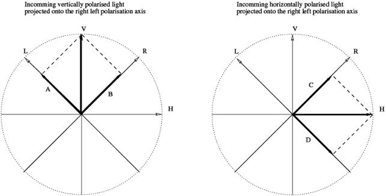

左图标题：入射垂直偏振光在左右偏振轴上的投影；右图标题：入射水平偏振光在左右偏振轴上的投影。V/H：垂直/水平；L/R：左/右；A、B、C、D：图示分量。

<!-- dm-ch06-154 -->

〔原书第146页〕

因此，图中标记为V的点，在水平—垂直坐标系中表示为$V=[0,1]_{HV}$，在左—右坐标系中的坐标为$[A,B]_{LR}$。同样，$H=[1,0]_{HV}=[D,C]_{LR}$。利用勾股定理，可以容易地求出A、B、C、D：

<!-- dm-ch06-155 -->

〔原书第146页〕

$V=[0,1]_{HV}=\left[\frac{1}{\sqrt{2}},\frac{1}{\sqrt{2}}\right]_{LR}$

<!-- dm-ch06-156 -->

〔原书第146页〕

且

<!-- dm-ch06-157 -->

〔原书第146页〕

$H=[1,0]_{HV}=\left[\frac{-1}{\sqrt{2}},\frac{1}{\sqrt{2}}\right]_{LR}$

<!-- dm-ch06-158 -->

〔原书第147页〕

到目前为止，这仅仅是一个在笛卡尔几何中改变参考系例子，所采用论证方式对任何17 世纪科学家来说都很熟悉。我们可以分两步把它扩展为关于量子测量讨论。

<!-- dm-ch06-159 -->

〔原书第147页〕

- 1. 把这些参考系看作实际的物理偏振器，它们能把初始光束分成电场相互垂直的两束分量光。光通过第一个分束器后，垂直偏振光束V以45°进入第二个分束器，分为L、R两束。若V的振幅为v，则L、R两束的振幅均为$v/\sqrt{2}$。光束亮度正比于电场振幅的平方，因此L、R两束的亮度各为V的一半。这些结论都来自前述基本几何论证。

<!-- dm-ch06-160 -->

〔原书第147页〕

- 2. 现在考虑在单个光子层面上发生了什么。如果我们传输是具有两种可能（偏振）状态单粒子信息，那么我们所处理就不是比特，而是量子比特。

<!-- dm-ch06-161 -->

〔原书第147页〕

描述量子比特和其他量子态时，物理学家用一种专门记号——狄拉克记号——表达前述几何关系。不熟悉它的人可能觉得有些奇怪，但基本原理很简单。在初始参考系中，我们用标准笛卡尔记号把垂直轴向量写成$[0,1]_{HV}$；他们则写成$0|H\rangle+1|V\rangle$。这依然只是把参考系中的坐标明确写出来的一种方式。$|\rangle$这种括号形式称为ket，即右矢。

<!-- dm-ch06-162 -->

〔原书第147页〕

按量子力学的标准解释，一个量子比特以两个正交纯态之一发送，即$1|V\rangle+0|H\rangle$或$0|V\rangle+1|H\rangle$。记号$|H\rangle$表示一个带标签的态，这里的H代表水平偏振。如果旋转45°，并把这些纯态投影到由新偏振器形成的基矢态[^ch6-59]上，把这些基矢态标为L、R，就得到：

<!-- dm-ch06-163 -->

〔原书第147页〕

$0|H\rangle+1|V\rangle\rightarrow\frac{1}{\sqrt{2}}|L\rangle+\frac{1}{\sqrt{2}}|R\rangle$

<!-- dm-ch06-164 -->

〔原书第147页〕

这显然只是方程（6.1）符号转换，但在实际中这意味着什么？

<!-- dm-ch06-165 -->

〔原书第147页〕

当然，无论我们采纳哪种观点，实验证据都不会因此而改变。我们仍然观察到，沿L 和R 方向亮度仅为移除第二个偏振片并测量光束V 亮度时所得到值一半。经典理论通过把电场在新45° 坐标系中分解为等大且相互独立分量，对此给出了通俗易懂解释。

<!-- dm-ch06-166 -->

〔原书第148页〕

玻尔的解释是，在表达式$\frac{1}{\sqrt{2}}|L\rangle+\frac{1}{\sqrt{2}}|R\rangle$中，右矢前的振幅系数$\frac{1}{\sqrt{2}}$表示在这条路径上发现光子的概率的平方根。这显然与经典解释一样符合实验。无论为$\frac{1}{\sqrt{2}}$赋予何种本体论含义，$\left(\frac{1}{\sqrt{2}}\right)^2$仍意味着亮度是原来的$\frac{1}{2}$。

<!-- dm-ch06-167 -->

〔原书第148页〕

这套计算无疑是正确。玻尔互补观点最初是通过波包模型中波包在傅里叶意义上位置不确定性来阐述，而在分束器等实验装置中，这一特性表现得尤为明显。在实验装置中两个探测器之一触发之前，光子可能位于任一通道中。由于两束光分支可以任意延长，光子空间位置也变得任意不确定。

<!-- dm-ch06-168 -->

〔原书第148页〕

玻尔互补方法实质上指出：数学推导是明确且经验上正确，但在光子被探测之前，无法对其位置进行有意义描述。我们只能基于把光视为波假设进行计算，以预测最终位置相对概率。光子抽象概念本质上与特定位置能量量子发射或吸收过程紧密相连。它使我们能够把发生事情理解为一种能量守恒过程，但禁止我们同时讨论连接这两个事件时空过程。这些必须通过光波来处理，光波告诉我们不同位置预期亮度之间关系。

<!-- dm-ch06-169 -->

〔原书第148页〕

海森堡方法则略有不同。波（或波函数）随时间沿所有可能路径演化，随后，当进行测量且其中一个探测器触发时，量子世界与经典世界之间便发生了一次“切割”。这有时被称为波函数坍缩。

<!-- dm-ch06-170 -->

〔原书第148页〕

玻尔的这一表述并没有内在的唯心主义性质。如果一个人是严格的唯物主义者，承认存在的一切就是原子以及原子借以交换力和能量的光子，[^ch6-60]那么谈论光子在两次影响原子之间的位置，就成了没有意义的唯心主义。我们可能愿意想象光子在发射与吸收之间具有一个位置，但那只是想象，只是在头脑中构造一幅观念图景。既然光子和原子是实在的基本组成部分，那么，独立于原子相互作用的、观念中的光子位置，按定义就是不真实的。

<!-- dm-ch06-171 -->

〔原书第148—149页〕

但海森堡的解释确实可能引向唯心主义的解释，如今常称为哥本哈根诠释。[^ch6-61]按照这种解释，正是认识主体即观察者的参与，使波函数坍缩并出现一个确定的结果。海森堡[^ch6-62]声称：“当‘客观实在’这样的概念用于原子物理学中的情形时，它们并没有不言自明的含义。”赋予观察者的心理体验以特权地位，这看起来很像回到马赫式实证主义；在他受训练的年代，这种思潮曾深刻影响德国物理学。

<!-- dm-ch06-172 -->

〔原书第149页〕

如果我们把视角从20 世纪30 年代物理实验室转向现代通信技术，观察者特殊角色便完全失去了可信度。当廖等人[^ch6-63]架设激光器和望远镜，向无人卫星“墨子号”发送偏振光子时，观察者又在哪里呢？

<!-- dm-ch06-173 -->

〔原书第149页〕

“墨子”号上自动设备记录了偏振光子，机载处理器利用这些光子把加密密钥存储在随机存取存储器（RAM）中，随后用该密钥向地面发送无线电信息。那里肯定没有人。如果波包发生了坍缩，那么那是那里设备在无人协助情况下完成。难道我们要说计算机是主体吗？

<!-- dm-ch06-174 -->

〔原书第149页〕

抑或我们只应承认，哲学意义上的主体[^ch6-64]与理解这类工程技术无关？

<!-- dm-ch06-175 -->

〔原书第149页〕

海森堡学派潜藏的主观主义引起了反对，最初的反对见相关研究，[^ch6-65]后来则有玻姆[^ch6-66]、[^ch6-67]和埃弗雷特[^ch6-68]、[^ch6-69]提出的其他实在论解释。

<!-- dm-ch06-176 -->

〔原书第149页〕

这两种替代性实在论方法，分别优先考虑玻姆粒子诠释和埃弗雷特波诠释。

<!-- dm-ch06-177 -->

〔原书第149页〕

玻姆认为，微观层面上看似存在非决定论与宏观层面上存在统计可预测性，不应阻止我们寻找更深层次决定论机制。

<!-- dm-ch06-178 -->

〔原书第149页〕

> 在给定统计规律的范围内，个体行为的无规律性，一般而言，与更广泛范围内起作用的更详细的个体规律并不矛盾。[^ch6-70]

<!-- dm-ch06-179 -->

〔原书第149页〕

他举例说明了一家寿险公司运作：该公司能够预测一名男子在特定年份死亡可能性。他们无法确切预测该男子是否会死亡，但可以针对其承保数百万客户群体做出准确预测。某人死亡仅在统计上可预测这一事实，并不意味着该个体死亡没有明确物质原因。也许是由于飞行控制机制故障导致客机空难，也许是肺癌。如果我们仅满足于统计死亡率，我们就不会去研究癌症成因、737MAX 飞行计算机可靠性等问题。玻姆借鉴了德布罗意早期研究[^ch6-71]，后者最先证明物质粒子与光一样，也具有波特性。

<!-- dm-ch06-180 -->

〔原书第149—150页〕

> 量子关系式“能量=h×频率”，使我们把一种周期现象与任何孤立的一份物质或能量联系起来。与这份物质绑定的观察者，会把它与一个由其内部能量、即“静止质量”确定的频率联系起来。对于一位观察者，若这份物质以速度$\beta c$匀速运动，他就会看到这个频率因洛伦兹—爱因斯坦时间变换而降低。我已经证明（巴黎科学院《报告》，9月10日及24日），只要假定波以速度$c/\beta$传播，静止观察者就会始终看到这种内部周期现象与一个波同相；该波的频率由运动物体全部能量所对应的量子关系确定。这种速度大于c的波不能携带能量。[^ch6-72]

<!-- dm-ch06-181 -->

〔原书第150页〕

这种物质波特性，继爱因斯坦光电效应和相对论之后，将要求人们重新思考动力学定律在微小运动粒子上应用。

<!-- dm-ch06-182 -->

〔原书第150页〕

> “相位波”在确定任何运动物体运动方面具有极其重要意义，我已经能够证明，玻尔原子中轨道稳定性条件表明，该波与闭合路径长度相协调。

<!-- dm-ch06-183 -->

〔原书第150页〕

> 当发光原子穿过狭窄孔隙时，其路径不再是直线；即发生衍射。此时必须放弃惯性原理，并假设任何运动物体始终沿着其“相位波”光线运动；这样，当它通过足够小孔隙时，其路径就会发生弯曲。动力学必须经历与光学相同演变过程——正如当波动理论取代纯几何光学时，光学所经历那样。基于波理论假设使我们能够解释干涉现象和衍射条纹。借助这些新思想，或许能够把扩散和色散现象与光离散性相协调，并解决量子理论提出几乎所有问题。[^ch6-73]

<!-- dm-ch06-184 -->

〔原书第150页〕

在德布罗意—玻姆理论中，波方程被视为建立了一个势，其空间导数对粒子施加了一种引导力。由此产生轨迹可能以相当复杂方式弯曲。该理论数学结构非常经典，是哈密顿轨迹推广。它也是确定性。最终结果随机性源于初始粒子位置随机分布。在双缝实验中，粒子最终位置对其穿过缝隙确切位置极为敏感。引导波势会根据粒子起始点，把它们引导至截然不同最终位置。因此，在玻姆理论中，量子随机性与玻尔兹曼统计力学中原本就存在随机性并无二致。[^ch6-74]这两种情况都假设系综中粒子初始位置是随机。

<!-- dm-ch06-185 -->

〔原书第150—151页〕

> SQM中的客观概率[^ch6-75]意味着，实验结果会呈现正确的频率。然而，反过来显然并不成立。测量结果的统计分布，并不意味着存在客观概率。例如，系统系综的初始状态具有适当的统计分布，再加上适当的演化规律，也能得到这些频率。我们无法确定地预测某个光子会在屏幕的什么位置落下，只是因为不知道单个系统的初始状态。PWT采用的就是这种方法。[^ch6-76]、[^ch6-77]

<!-- dm-ch06-186 -->

〔原书第151页〕

玻姆把粒子观视为基本；而埃弗雷特或“多世界”实在论则把波函数视为基本。一切都被视为具有振幅叠加波，或者在有限模型中，被视为具有振幅状态矢量，这些振幅对应于每一个可能正交态。波函数不会发生坍缩，因为万物始终处于状态叠加之中。宇宙演化是一系列对该态矢量进行酉变换，即保持长度不变旋转。观测结果会给出确定答案；光子偏振方向会向左或向右，因为多重宇宙中与记录左偏振和右偏振相关子流形彼此正交。

<!-- dm-ch06-187 -->

〔原书第151页〕

未来是否会有任何实验能够分出埃弗雷特和玻姆谁是正确的，我们无从知晓。目前，玻尔、海森堡、玻姆和埃弗雷特理论都与现有证据同样相容。但玻姆和埃弗雷特提出理论在解释现象方面与海森堡实证主义同样有效，这一事实表明，科学并不要求采用主观主义理论。正如我们之前所说，玻尔本人理论在原则上也与严格唯物主义相容。

[^ch6-1]: 1. 汤姆森和麦克斯韦是苏格兰人，玻尔兹曼是奥地利人。

[^ch6-2]: 2. Henri Poincaré：“机制与经验”（Mechanism and Experience），载《气体动理论：经典论文选集及历史评注》（The Kinetic Theory Of Gases: An Anthology of Classic Papers with Historical Commentary）（World Scientific，2003），第377—381页。

[^ch6-3]: 3. Boltzmann：“答策梅洛关于热理论的评论”（Reply to Zermelo’s Remarks on the Theory of Heat）。

[^ch6-4]: 4. Paul Cockshott、Lewis M. Mackenzie与Gregory Michaelson：《计算及其极限》（Computation and its Limits）（Oxford University Press，2012），第117—120页。

[^ch6-5]: 5. E. Fredkin与T. Toffoli：“保守逻辑”（Conservative Logic），International Journal of Theoretical Physics，第21卷第3期（1982），第219—253页。

[^ch6-6]: 6. S. Rajasekar与N. Athavan：“路德维希·爱德华·玻尔兹曼”（Ludwig Edward Boltzmann），arXiv预印本physics/0609047，2006。

[^ch6-7]: 7. Ernst Mach：《能量守恒原理的历史与根源》（History and Root of the Principle of the Conservation of Energy）（Open Court Publishing Company，1910）。

[^ch6-8]: 8. Mach：《能量守恒原理的历史与根源》（History and Root of the Principle of the Conservation of Energy），第45页。

[^ch6-9]: 9. Charles Augustin Coulomb：“关于扭转力及金属丝弹性的理论和实验研究：此理论在工艺和各种物理实验中使用金属方面的应用；用于测量最微小力的各种扭秤的制造；关于弹性与内聚力定律的观察”（Recherches théoriques et expérimentales sur la force de torsion: & sur l’élasticité des fils de métal: application de cette théorie à l’emploi des métaux dans les arts & dans différentes expériences de physique: construction de différentes balances de torsion, pour mesurer les plus petits degrés de force: observations sur les loix de l’élasticité & de la coherence），1784。

[^ch6-10]: 10. James Clerk Maxwell：《热学理论》（The Theory of Heat）（Longmans, Green, and Co，1875）。

[^ch6-11]: 11. James Clerk Maxwell：“IV. 论气体的动力学理论”（IV. On the Dynamical Theory of Gases），Philosophical Transactions of the Royal Society of London，第157期（1867），第49—88页。

[^ch6-12]: 12. Jacob Bronowski：《人类的进步》（The Ascent of Man）（Random House，2011）。

[^ch6-13]: 13. A. Einstein：“论热的分子动理论所要求的静止液体中悬浮微粒的运动”（On the Movement of Small Particles Suspended in Stationary Liquids Required by the Molecular-kinetic Theory of Heat），Annals of Physics，第17卷（1905），第549页。

[^ch6-14]: 14. A. Einstein：“关于光的发射和转化的一种启发式观点”（Concerning an Heuristic Point of View Toward the Emission and Transformation of Light），American Journal of Physics，第33卷第5期（1965），第367页。

[^ch6-15]: 15. Albert Einstein：“论运动物体的电动力学”（On the Electrodynamics of Moving Bodies），Annalen der physik，第17卷第10期（1905），第891—921页。

[^ch6-16]: 16. Albert Einstein：“物体的惯性是否取决于其能量含量”（Does the Inertia of a Body Depend Upon its Energy-content），Annals of Physics，第18卷（1905），第639—641页。

[^ch6-17]: 17. 关于该论文及其意义的概述，参见Debashish Chowdhury：“爱因斯坦布朗运动理论一百年：从花粉粒到蛋白质列车——1”（100 Years of Einstein’s Theory of Brownian Motion: From Pollen Grains to Protein Trains—1），Resonance，第10卷第9期（2005），第63—78页。

[^ch6-18]: 18. Jean Perrin：“布朗运动与分子实在性”（Mouvement brownien et réalité moléculaire），1909。

[^ch6-19]: 19. Einstein：“关于光的发射和转化的一种启发式观点”（Concerning an Heuristic Point of View Toward the Emission and Transformation of Light）。

[^ch6-20]: 20. A. Einstein：“关于光的发射和转化的一种启发式观点”（Concerning an Heuristic Point of View Toward the Emission and Transformation of Light），American Journal of Physics，第33卷第5期（1965），第367页。

[^ch6-21]: 21. 例如，全部电磁能恰好集中于腔的一半。他的方程为$S-S_0=k\ln\left(\frac{v}{v_0}\right)^{\frac{E}{h\nu}}$，其中$S,S_0$分别为最终和初始的熵，$v,v_0$分别为最终和初始的体积，$k,h$分别为玻尔兹曼常数和普朗克常数，$\nu$为频率，$E$为能量。

[^ch6-22]: 22. Einstein：“关于光的发射和转化的一种启发式观点”（Concerning an Heuristic Point of View Toward the Emission and Transformation of Light）。

[^ch6-23]: 23. $S-S_0=k\ln\left(\frac{v}{v_0}\right)^n$，其中$n$为气体分子的数量。这显然与他先前给出的电磁熵变方程具有相同的函数形式。

[^ch6-24]: 24. Einstein：“论运动物体的电动力学”（On the Electrodynamics of Moving Bodies）。

[^ch6-25]: 25. Einstein：“物体的惯性是否取决于其能量含量”（Does the Inertia of a Body Depend Upon its Energy-content）。

[^ch6-26]: 26. 尚未读过的读者或许会喜欢A. Einstein的《相对论》（Relativity）（Methuen/Company，1920）；他在书中为非专业读者作了说明。

[^ch6-27]: 27. 在非技术性论述中，能量概念长期带有神秘主义意味：vis viva（活力）呼应élan vital（生命冲力），又逐渐滑向神秘能量——参见Adrian Tait：“[一种]神秘而不可言说的力与能量”（[A] Mystic, Ineffable Force and Energy），Arthur Machen: Critical Essays，2021，第193页——或昆达里尼能量——参见Lilian Silburn：《昆达里尼：深处的能量》（Kundalini: The Energy of the Depths）（SUNY Press，1988）。不知为何，原子似乎并未对神秘主义边缘群体产生同样的吸引力。

[^ch6-28]: 28. Manuel Bächtold：“为马赫的原子观辩护”（Saving Mach’s View on Atoms），Journal for General Philosophy of Science / Zeitschrift für allgemeine Wissenschaftstheorie，第41卷第1期（2010），第1—19页，ISSN：09254560、15728587，http://www.jstor.org/stable/20722524。

[^ch6-29]: 29. 见第[3.3.1]节。

[^ch6-30]: 30. Ernst Mach：“通俗科学讲演”（Popular Scientific Lectures），“物理研究的节约性质”（The economical nature of physical inquiry）章（Open Court，1898）。

[^ch6-31]: 31. Mach：“通俗科学讲演”（Popular Scientific Lectures）。

[^ch6-32]: 32. Mach：“通俗科学讲演”（Popular Scientific Lectures）。

[^ch6-33]: 33. V. I. Lenin：《唯物主义和经验批判主义》（Materialism and Empirio-criticism）（International Publishers，1908）。

[^ch6-34]: 34. 正式职称为苏联人民委员会主席。

[^ch6-35]: 35. Mach：“通俗科学讲演”（Popular Scientific Lectures）。

[^ch6-36]: 36. 这里列宁引用的是18世纪唯物主义者狄德罗：为了让我的体系具备充分的说服力，还请注意，它同样面临贝克莱针对物体的存在所提出的那个不可克服的困难。有一刻，有感觉的羽管键琴陷入狂乱，以为它是世界上唯一的羽管键琴，宇宙的一切和声都发生在它之中。Denis Diderot等：《达朗贝尔与狄德罗的对话》（Entretien entre d’Alembert et Diderot）（Garnier-Flammarion，1965）。

[^ch6-37]: 37. Mach：“通俗科学讲演”（Popular Scientific Lectures）。

[^ch6-38]: 38. 据Cercignani与Penrose的《路德维希·玻尔兹曼：相信原子的人》（Ludwig Boltzmann: The Man Who Trusted Atoms），玻尔兹曼采取了非常相近的立场，把对手视为贝克莱式唯心主义者：在玻尔兹曼看来，哲学的中心问题是存在与知识之间的关系，即gnoseology（英语译本[2]通常把这个词译为epistemology，尽管这在某种程度上缩小了其范围）。最能说明他在这一问题上态度的，是他在哲学意味最少、也最有趣的一篇文章中近乎随口说出的一句话；那篇文章记述了他1905年的“黄金国”之旅。这句话常被引用，出现在他描写加利福尼亚大学伯克利分校校园之后：“伯克利这个名字属于一位备受推崇的英国哲学家；人们甚至把人脑所孵化出的最大蠢事——否认物质世界存在的哲学唯心主义——的发明归功于他。”Cercignani与Penrose：《路德维希·玻尔兹曼：相信原子的人》，第170页。

[^ch6-39]: 39. Guohua Shen等：“从人脑活动进行端到端深度图像重建”（End-to-End Deep Image Reconstruction From Human Brain Activity），Frontiers in Computational Neuroscience，第13卷（2019），21，ISSN：1662-5188，https://doi.org/10.3389/fncom.2019.00021 ，https://www.frontiersin.org/article/10.3389/fncom.2019.00021 。

[^ch6-40]: 40. Lenin：《唯物主义和经验批判主义》（Materialism and Empirio-criticism），第55页。

[^ch6-41]: 41. Ernest Rutherford：“物质对α和β粒子的散射与原子结构”（The Scattering of α and β Particles by Matter and the Structure of the Atom），Philosophical Magazine，第92卷第4期（2012），第379—398页。

[^ch6-42]: 42. John William Nicholson：“太阳日冕的构成。IL”（The Constitution of the Solar Corona. IL），Monthly Notices of the Royal Astronomical Society，第72卷第8期（1912），第677—693页。

[^ch6-43]: 43. Nicholson：“太阳日冕的构成。IL”（The Constitution of the Solar Corona. IL）。

[^ch6-44]: 44. Niels Bohr：“I. 论原子和分子的构成”（I. On the Constitution of Atoms and Molecules），The London, Edinburgh, and Dublin Philosophical Magazine and Journal of Science，第26卷第151期（1913），第1—25页。

[^ch6-45]: 45. Niels Bohr、Hendrik Anton Kramers与John Clarke Slater：“LXXVI. 辐射的量子理论”（LXXVI. The Quantum Theory of Radiation），The London, Edinburgh, and Dublin Philosophical Magazine and Journal of Science，第47卷第281期（1924），第785—802页。

[^ch6-46]: 46. Bohr、Kramers与Slater：“LXXVI. 辐射的量子理论”（LXXVI. The Quantum Theory of Radiation）。

[^ch6-47]: 47. Niels Bohr等：《量子公设与原子理论的近期发展》（The Quantum Postulate and the Recent Development of Atomic Theory），第3卷（英国：R. & R. Clarke, Limited印刷，1928）。

[^ch6-48]: 48. Bohr等：《量子公设与原子理论的近期发展》（The Quantum Postulate and the Recent Development of Atomic Theory）。

[^ch6-49]: 49. 这里对他1928年论文的阐述参考了Howard和Camilleri的研究：“谁发明了‘哥本哈根诠释’？一项神话研究”（Who Invented the ‘Copenhagen Interpretation’? A Study in Mythology），Philosophy of Science，第71卷第5期（2004），第669—682页；“玻尔、海森堡及其对互补性的不同看法”（Bohr, Heisenberg and the Divergent Views of Complementarity），Studies In History and Philosophy of Science Part B: Studies In History and Philosophy of Modern Physics，第38卷第3期（2007），第514—528页。

[^ch6-50]: 50. Bohr、Kramers与Slater：“LXXVI. 辐射的量子理论”（LXXVI. The Quantum Theory of Radiation）。

[^ch6-51]: 51. 现代数码相机十分灵敏，在弱光下拍照时，可以看到光子随机到达产生的“散粒噪声”，表现为各像素之间不相关的斑点。

[^ch6-52]: 52. 玻尔似乎直到后来与爱因斯坦讨论时才考虑过这类例子。参见Jan Faye：“量子力学的哥本哈根诠释”（Copenhagen Interpretation of Quantum Mechanics），载《斯坦福哲学百科全书》（The Stanford Encyclopedia of Philosophy），2019年冬季版，Edward N. Zalta编（斯坦福大学形而上学研究实验室，2019）。

[^ch6-53]: 53. $\Delta t\Delta E=\Delta x\Delta I_x=\Delta y\Delta I_y=\Delta z\Delta I_z=h$

[^ch6-54]: 54. Bohr等：《量子公设与原子理论的近期发展》（The Quantum Postulate and the Recent Development of Atomic Theory）。

[^ch6-55]: 55. 海森堡在前一年用另一种方法推导出了这一关系。他设想一个思想实验：用高频辐射照射电子，试图确定它的位置。要越精确地确定位置，所需光频率就越高。频率更高的光会扰动电子的运动，由此得到位置不确定性与动量不确定性之间的反比关系。玻尔直接从波的性质出发的推导更具一般性。

[^ch6-56]: 56. Camilleri：“玻尔、海森堡及其对互补性的不同看法”（Bohr, Heisenberg and the Divergent Views of Complementarity）；Faye：“量子力学的哥本哈根诠释”（Copenhagen Interpretation of Quantum Mechanics）；Howard：“谁发明了‘哥本哈根诠释’？一项神话研究”（Who Invented the ‘Copenhagen Interpretation’? A Study in Mythology）。

[^ch6-57]: 57. Sheng-Kai Liao等：“卫星到地面的量子密钥分发”（Satellite-to-ground Quantum Key Distribution），Nature，第549卷第7670期（2017），第43—47页。

[^ch6-58]: 58. J. von Neumann：《量子力学的数学基础》（Mathematical Foundations of Quantum Mechanics），R. T. Beyer据1931年德文版译为英文（Princeton University Press，1955）。

[^ch6-59]: 59. 物理学使用“基矢态”（basis states）一词，指普通人所说的坐标系的轴。

[^ch6-60]: 60. 或者用更符合当代的说法：基本粒子和玻色子。

[^ch6-61]: 61. Howard（“谁发明了‘哥本哈根诠释’？一项神话研究”）认为，哥本哈根诠释这个术语是海森堡在1955年的一篇论文中发明的：Werner Heisenberg，“量子理论诠释的发展”（The Development of the Interpretation of the Quantum Theory），Niels Bohr and the Development of Physics，1955，第12页。在文中，他试图把自己的观点投射到丹麦人玻尔身上：1955年的新情况，是海森堡把他混合起来的一套思想命名为“哥本哈根诠释”；一经这样命名，他便经常强化这种统一的哥本哈根观点的发明，并以其主要代言人自居（例如见Heisenberg [1955]）。为什么？回想海森堡1955年的处境会有所帮助：这位20世纪20年代曾深受玻尔喜爱的人，在战后却成为被哥本哈根核心圈从道义上排斥的人，主要因为1941年9月他接掌德国原子弹计划之后访问哥本哈根，那次不幸的访问使他与玻尔的关系严重破裂。对于骄傲而曾雄心勃勃的海森堡来说，还有什么办法比让自己成为哥本哈根诠释的声音更适合重获这个家族的成员身份呢？Howard：“谁发明了‘哥本哈根诠释’？一项神话研究”（Who Invented the “Copenhagen Interpretation”? A Study in Mythology）。

[^ch6-62]: 62. Heisenberg：“量子理论诠释的发展”（The Development of the Interpretation of the Quantum Theory），第23页。

[^ch6-63]: 63. Liao等：“卫星到地面的量子密钥分发”（Satellite-to-ground Quantum Key Distribution）。

[^ch6-64]: 64. 进一步讨论见第[sec:altsub]??节。

[^ch6-65]: 65. Albert Einstein、Boris Podolsky与Nathan Rosen：“量子力学对物理实在的描述能否被认为是完备的？”（Can Quantum-mechanical Description of Physical Reality be Considered Complete?），Physical Review，第47卷第10期（1935），第777页。

[^ch6-66]: 66. David Bohm：《现代物理学中的因果性与机遇》（Causality and Chance in Modern Physics）（Routledge，2004）。

[^ch6-67]: 67. 玻姆本人的论述见《现代物理学中的因果性与机遇》。详细的现代阐述还可参见Holland：《运动的量子理论：德布罗意—玻姆量子力学因果解释》（The Quantum Theory of Motion: An Account of the de Broglie-Bohm Causal Interpretation of Quantum Mechanics）；以及Bricmont：《理解量子力学》（Making Sense of Quantum Mechanics）和“量子力学史，或错误的喜剧”（History of Quantum Mechanics or the Comedy of Errors），arXiv预印本arXiv:1703.00294，2017。

[^ch6-68]: 68. Hugh Everett：“量子力学的‘相对态’表述”（“Relative State” Formulation of Quantum Mechanics），The Many Worlds Interpretation of Quantum Mechanics，2015，第141—150页。

[^ch6-69]: 69. 随着量子计算的发展，埃弗雷特的解释日益流行。这个研究领域由支持埃弗雷特的Deutsch开创：“量子理论、丘奇—图灵原理与通用量子计算机”（Quantum Theory, the Church-Turing Principle and the Universal Quantum Computer），Proceedings of the Royal Society of London A，1985，第97—117页。他此后仍不断为这一解释辩护，参见D. Deutsch：《实在的结构》（The Fabric of Reality）（Penguin，2011）；David Deutsch：“实验检验的逻辑，特别是对埃弗雷特量子理论的检验”（The Logic of Experimental Tests, Particularly of Everettian Quantum Theory），Studies in History and Philosophy of Science Part B: Studies in History and Philosophy of Modern Physics，第55卷（2016），第24—33页。

[^ch6-70]: 70. David Bohm：《整体性与隐缠序》（Wholeness and the Implicate Order）（Routledge，2002），第87页。

[^ch6-71]: 71. Louis De Broglie：“波与量子”（Waves and Quanta），Nature，第112卷第2815期（1923），第540页。

[^ch6-72]: 72. De Broglie：“波与量子”（Waves and Quanta）。

[^ch6-73]: 73. De Broglie：“波与量子”（Waves and Quanta）。

[^ch6-74]: 74. Antony Valentini：“信号局域性、不确定性与亚量子H定理。I”（Signal-locality, Uncertainty, and the Subquantum H-theorem. I），Physics Letters A，第156卷第1—2期（1991），第5—11页。

[^ch6-75]: 75. 标准量子力学（Standard Quantum Mechanics），即海森堡的观点。

[^ch6-76]: 76. 导引波理论（Pilot Wave Theory），即玻姆的观点。

[^ch6-77]: 77. Philipp Roser：“德布罗意—玻姆导引波图景中的量子计算”（Quantum Computing in the de Broglie-Bohm Pilot-wave Picture），arXiv预印本arXiv:1012.4843，2010。

<!-- dm-ch07-001 -->

〔原书第153页〕

# 第7章 逻辑与唯物主义

<!-- dm-ch07-002 -->

〔原书第153页〕

## 引言

<!-- dm-ch07-003 -->

〔原书第153页〕

> 显然，哲学家——即研究现实本质全貌的人——的职责，还包括探究三段论推理的原则。[^ch7-1]

<!-- dm-ch07-004 -->

〔原书第153页〕

自古以来，许多长盛不衰的跨国国家体系都明确以某种有组织宗教作为其主导意识形态。在当今时代，例子包括：神圣罗马帝国、西班牙帝国、葡萄牙帝国和法兰西帝国的天主教；奥斯曼帝国的伊斯兰教；以及大英帝国的圣公会。除了一项重大例外，从未出现过基于世俗哲学的此类体系；即便美国帝国，也公开奉行自然神论，[^ch7-2] 即使不是彻头彻尾的基督教。

<!-- dm-ch07-005 -->

〔原书第153页〕

这一唯一的例外就是辩证唯物主义，即19世纪末以来世界共产主义运动的哲学。正如采纳主流宗教的帝国曾向数十亿人传授这些宗教一样，直到1989年，前苏联和欧洲社会主义国家也曾向数十亿人教授辩证唯物主义；中国和现存社会主义国家则延续至今。辩证唯物主义的影响范围不容低估。例如，2021年圣公会有8500万领圣餐者，[^ch7-3]明显少于拥有9500万党员的中国共产党。[^ch7-4]

<!-- dm-ch07-006 -->

〔原书第153页〕

就其唯物主义成分而言，辩证唯物主义具有深刻进步性，它摒弃一切形式的唯心主义，并积极倡导科学与理性作为人类理解和改造世界的手段。然而，正如我们将要探讨的，其辩证成分在哲学和意识形态层面存在更多问题。

<!-- dm-ch07-007 -->

〔原书第153页〕

特别是在苏联，辩证唯物主义被用于党派目的，既用来压制反对派，也用来限制被认为适合进行科学研究的领域。这对苏联遗传学的影响——即实际上拉马克主义被推崇而孟德尔主义被边缘化——已有充分记载。[^ch7-5]本文将重点探讨其对形式逻辑研究这一较少为人所知的影响；尽管如此，这一影响对苏联数学的发展，特别是计算机科学和实用计算领域，却具有深远意义。

<!-- dm-ch07-008 -->

〔原书第154页〕

## 逻辑概述

<!-- dm-ch07-009 -->

〔原书第154页〕

逻辑[^ch7-6]是一种形式化推理系统。需要特别注意的是，逻辑关注的是真值（即真与假），而非真理本身。我们所推理的事物被假定为独立于逻辑而存在，其真伪已然确定。这些事物可能是事实、假设、推测或信念。逻辑本身无法确定某事是否真实；它关注的是推理的正确性。

<!-- dm-ch07-010 -->

〔原书第154页〕

当我们说逻辑是形式化的，是指存在以下规则：

<!-- dm-ch07-011 -->

〔原书第154页〕

- 构造用于推理的陈述，即文法或句法；

<!-- dm-ch07-012 -->

〔原书第154页〕

- 为命题赋予意义，即语义学；

<!-- dm-ch07-013 -->

〔原书第154页〕

- 操作陈述，以确定其性质，通常是判断它们总为真或假、还是部分情形下为真或假，即通过证明或求值。

<!-- dm-ch07-014 -->

〔原书第154页〕

我们将在下文进一步探讨这些内容，但在此不会进行详尽或形式化论述。

<!-- dm-ch07-015 -->

〔原书第154页〕

逻辑论证是从前提（也称为假设）推导出结论的过程。推理步骤是通过推理规则进行的，这是古代更为复杂的三段论的一种现代形式，将在后续章节中讨论。

<!-- dm-ch07-016 -->

〔原书第154页〕

三段论一般采用如下三项形式：

<!-- dm-ch07-017 -->

〔原书第154页〕

> 前提$_1$

<!-- dm-ch07-018 -->

〔原书第154页〕

> 前提$_2$

<!-- dm-ch07-019 -->

〔原书第154页〕

> 结论

<!-- dm-ch07-020 -->

〔原书第154页〕

读作：给定前提$_1$和前提$_2$，可以得出结论。

<!-- dm-ch07-021 -->

〔原书第154页〕

例如，假设A 和B 是两个命题，且我们接受“如果A 成立，则B 也成立”这一前提。那么，如果我们认为A 成立，我们就会合理地推断B 也成立，即B 在逻辑上由A 推导而出。用三段论形式表示，即

<!-- dm-ch07-022 -->

〔原书第154页〕

- 1. A

<!-- dm-ch07-023 -->

〔原书第154页〕

- 2. 如果A，那么B

<!-- dm-ch07-024 -->

〔原书第154页〕

- 3. B

<!-- dm-ch07-025 -->

〔原书第154页〕

当代逻辑的这一基本规则称为肯定前件式（Modus Ponens），即肯定的方法。例如：

> 校注：底本拉丁词误印Modus Ponems，英文照录，中文用通行拼写Ponens。

<!-- dm-ch07-026 -->

〔原书第154页〕

- 1. 巴斯特是一只猫

<!-- dm-ch07-027 -->

〔原书第154页〕

- 2. 如果巴斯特是一只猫，那么巴斯特喜欢鱼

<!-- dm-ch07-028 -->

〔原书第154页〕

- 3. 所以巴斯特喜欢鱼

<!-- dm-ch07-029 -->

〔原书第154页〕

这看起来完全合乎情理。

<!-- dm-ch07-030 -->

〔原书第155页〕

在论辩中，人们可能会激烈质疑A 是否成立，或者B 是否确实能从A 推导出来。例如，考虑以下情况：

<!-- dm-ch07-031 -->

〔原书第155页〕

- 1. 巴斯特是一位战斗女神

<!-- dm-ch07-032 -->

〔原书第155页〕

- 2. 如果巴斯特是一位战斗女神，那么巴斯特保卫国王

<!-- dm-ch07-033 -->

〔原书第155页〕

- 3. 所以巴斯特保卫国王

<!-- dm-ch07-034 -->

〔原书第155页〕

我们可能会反驳道：

<!-- dm-ch07-035 -->

〔原书第155页〕

- 没有女神；

<!-- dm-ch07-036 -->

〔原书第155页〕

- 有女神，但没有战斗女神；

<!-- dm-ch07-037 -->

〔原书第155页〕

- 有战斗女神，但巴斯特不是其中之一；

<!-- dm-ch07-038 -->

〔原书第155页〕

- 巴斯特是一位战斗女神，但没有国王；

<!-- dm-ch07-039 -->

〔原书第155页〕

- 巴斯特是一位战斗女神，但她不保卫国王；

<!-- dm-ch07-040 -->

〔原书第155页〕

- 等等。

<!-- dm-ch07-041 -->

〔原书第155页〕

但如果我们承认“巴斯特是一位战斗女神”为真，并承认“如果巴斯特是一位战斗女神，那么她保卫国王”为真，那么显然，“巴斯特保卫国王”就是一个无可置疑的结论。

<!-- dm-ch07-042 -->

〔原书第155页〕

也就是说，一般而言，只要假定A以及“A蕴含B”都成立，就没有人会质疑推导出B。任何争论都针对前提，而非推导；前提的真或假最终是在逻辑之外确定的。[^ch7-7]

<!-- dm-ch07-043 -->

〔原书第155页〕

在当代逻辑中，我们现在把命题逻辑与谓词逻辑区分开来。通常把二者统称为“演算”，这源于乔治·布尔——他把自己开创性的体系（下文将讨论）命名为“逻辑演算”。[^ch7-8]

<!-- dm-ch07-044 -->

〔原书第155页〕

命题逻辑涉及命题（即简单陈述）的真值判断。命题由真值及其抽象变量构成。命题可以被否定（非），并通过析取（或）、合取（且）和蕴含（如果……那么……）进行组合。

<!-- dm-ch07-045 -->

〔原书第155页〕

谓词逻辑则涉及关于事物集合及其成员的命题的真值问题。谓词逻辑在命题逻辑的真值和变量基础上引入了谓词——即返回真值的函数。此外，在谓词逻辑中，命题可以进行量化，以表达全称性质（即所有事物都具有某种性质）和存在性性质（即某些事物，即至少一个，具有某种性质）。

<!-- dm-ch07-046 -->

〔原书第155页〕

我们还将不涉及特定对象的“纯粹逻辑”与涉及特定事物领域的“应用逻辑”区分开来。正如我们将要讨论的，从古代到19 世纪末，逻辑的这些方面一直被混为一谈。

<!-- dm-ch07-047 -->

〔原书第155—156页〕

一个关键的哲学问题涉及真值和推理规则的地位，这是关于数字和函数等数学实体的地位这一更广泛问题的一部分。它们仅仅是纸上的符号吗？它们是否具有某种更深层的观念实在？或者，正如我们将论证的，它们是物质化数学系统从物质现实中抽象出来的、并与之具有强烈对应关系的组成部分？

<!-- dm-ch07-048 -->

〔原书第156页〕

## 逻辑与辩证法

<!-- dm-ch07-049 -->

〔原书第156页〕

逻辑与辩证法是唯物辩证法的核心组成部分。[^ch7-9]然而，厘清逻辑与辩证法的关系却是一件出人意料地困难的事。

<!-- dm-ch07-050 -->

〔原书第156页〕

亚里士多德实际上所指的正是辩证法，而非逻辑学。在《修辞学》中，[^ch7-10]他把关注非正式说服的修辞学，与关注通过三段论进行形式推理的辩证法区分开来（第13 页）。这暗示着逻辑学是辩证法的一部分。

<!-- dm-ch07-051 -->

〔原书第156页〕

亚里士多德指出，修辞学和辩证法都使用三段论推理和归纳推理。基于辩证三段论的推理，必须把所有步骤明确表述出来；但修辞三段论，即省略三段论，可以省略步骤。此外，辩证归纳以发现模式为基础，修辞归纳则以具体例子为基础。总的来说：

<!-- dm-ch07-052 -->

〔原书第156页〕

> 因此，修辞学的功能是处理那些我们加以审议、但尚无系统规则的事物；（第23 页）

<!-- dm-ch07-053 -->

〔原书第156页〕

这暗示着辩证法是系统化的。

<!-- dm-ch07-054 -->

〔原书第156页〕

亚里士多德还把关注特定领域的科学，与作为普遍适用话语模式的修辞学和辩证法区分开来。这一点体现在随后的“三艺”与“四艺”的区分中，“三艺”为针对“四艺”应用领域的推理和论证提供了纯粹的工具。

<!-- dm-ch07-055 -->

〔原书第156页〕

他进一步指出，当一个人对某个领域形成更深刻的理解时：

<!-- dm-ch07-056 -->

〔原书第156页〕

> 他就越会在不知不觉中形成一门与辩证法和修辞学完全不同的科学。因为一旦找到第一原理，那就不再是辩证法或修辞学，而是他已经掌握其原理的那门科学。（第31页）

<!-- dm-ch07-057 -->

〔原书第156页〕

显然，这一点同样适用于辩证法与逻辑之间的动态关系本身。正如我们将看到的，随着逻辑日益建立在数学基础上，辩证法的空间便随之缩小，这与前几章所讨论的、更广泛的科学进步压缩了宗教和哲学的空间的情况如出一辙。

<!-- dm-ch07-058 -->

〔原书第156页〕

在《工具论》（《前分析篇》）[^ch7-11] 中，亚里士多德在讨论三段论的前提类型时，进一步将逻辑从辩证法和科学中抽象出来（第200 页和第202 页）。一个证明性（即科学性）的前提是真实的，并基于“基本公设”；而对于辩证法的前提，则可能在两个“相互矛盾的陈述”之间进行选择。因此，对于三段论而言，无论前提源自何处，它都仅是真或假。也就是说，无论是科学还是辩证法，一旦某个前提确立，便可运用三段论来得出结论。

<!-- dm-ch07-059 -->

〔原书第157页〕

## 数学形式

<!-- dm-ch07-060 -->

〔原书第157页〕

上文已提到，“三艺”中的逻辑有别于“四艺”中的算术、几何学和天文学这些数学科学。此外，亚里士多德在《形而上学》[^ch7-12]中指出，数学具有层级：

<!-- dm-ch07-061 -->

〔原书第157页〕

> 数学也有其分支——在数学领域中，存在一门主要科学和一门次要科学，以及其他依次排列的学科。（第151 页）

<!-- dm-ch07-062 -->

〔原书第157页〕

此外，在探讨哲学的层次结构时，他把普遍（即纯粹）数学与具体（即应用）数学科学区分开来：

<!-- dm-ch07-063 -->

〔原书第157页〕

> 人们确实可能会提出这样一个问题：第一哲学是普遍的，还是只涉及某一类或某一实体；因为就连数学科学在这方面也存在差异——几何学和天文学涉及特定类型的实体，而普遍数学则同样适用于所有类型。（第297 页）

<!-- dm-ch07-064 -->

〔原书第157页〕

亚里士多德虽受过柏拉图主义训练，但在数学的形而上学地位问题上似乎并未明确表态，但他指出，对于他的导师而言，数学介于物质现实与纯粹理念之间：

<!-- dm-ch07-065 -->

〔原书第157页〕

> 此外，他［柏拉图］指出，除了可感之物和理念之外，还存在一个中间类别，即数学对象［脚注：即算术数和几何图形］，它们与可感之物的区别在于永恒且不变，与理念的区别则在于：数学对象中存在许多相似的对象，而每个理念本身都是独一无二的。（第45 页）

<!-- dm-ch07-066 -->

〔原书第157页〕

对柏拉图主义者而言，形式是抽象的理念，但仍具有实在性。[^ch7-13]我们认为，数学对象通过其在符号系统中的物理表征而具有物质存在。例如，理念中的立方体无非就是数学立方体，而数学立方体本身是一种表征物理立方体的物质化构造。

<!-- dm-ch07-067 -->

〔原书第157页〕

## 三段论

<!-- dm-ch07-068 -->

〔原书第157页〕

亚里士多德对三段论的阐述是前现代逻辑的关键。接下来我们将稍作深入探讨，但不会进行形式化论证。简明扼要的论述可参见史密斯。[^ch7-14]

<!-- dm-ch07-069 -->

〔原书第157页〕

亚里士多德在《工具论》中探讨了三段论，涉及对个体及事物集合的属性的推理，以及对特定领域和一般领域事物的推理。他大量运用具体实例，正如我们上面所见，他称之为修辞归纳。

<!-- dm-ch07-070 -->

〔原书第157—158页〕

首先，在《解释篇》[^ch7-15]中，亚里士多德定义了命题的句法，但没有使用任何符号。单句由名词及作用于名词的动词构成，还可以进一步连接。命题则是作出肯定或否定的句子，主项可以是全称的，也可以是单称的。《解释篇》还引入了矛盾命题这一关键概念。

<!-- dm-ch07-071 -->

〔原书第158页〕

因此，亚里士多德提出了四个基本命题模式，通常表述为：

<!-- dm-ch07-072 -->

〔原书第158页〕

- A：全称肯定命题，例如“所有X 都是Y”；

<!-- dm-ch07-073 -->

〔原书第158页〕

- I：特称肯定命题，例如“有些X 是Y”；

<!-- dm-ch07-074 -->

〔原书第158页〕

- E：全称否定命题，例如“没有X 是Y”；

<!-- dm-ch07-075 -->

〔原书第158页〕

- O：特称否定命题，例如“有些X 不是Y”。

<!-- dm-ch07-076 -->

〔原书第158页〕

这些模式都具有“主项是谓项”的结构。这里的X、Y、Z可以一致地替换为具体名词。开头的字母A、I、E、O是传统的标识。

<!-- dm-ch07-077 -->

〔原书第158页〕

于是，《前分析篇》[^ch7-16]探讨的三种三段论格可以表述为：

<!-- dm-ch07-078 -->

〔原书第158页〕

- 1. P 是Q；Q 是R；P 是R

<!-- dm-ch07-079 -->

〔原书第158页〕

- 2. P 是Q；P 是R；Q 是R

<!-- dm-ch07-080 -->

〔原书第158页〕

- 3. P 是R；Q 是R；P 是Q

<!-- dm-ch07-081 -->

〔原书第158页〕

需注意，这些属于第二级模式，其中P、Q 和R 可分别替换为A、I、E 和O 这四种命题形式之一，从而形成第一级模式。

<!-- dm-ch07-082 -->

〔原书第158页〕

这些格的有效性取决于我们代入P、Q 和R 的项是全称还是特称，以及哪些主项和谓项在哪些项中是共有的。

<!-- dm-ch07-083 -->

〔原书第158页〕

亚里士多德穷尽考察了这三种格中全称／特称与主项／谓项的所有可能组合，通过推导矛盾排除了其中许多组合。他还说明了如何把第二格和第三格归约为第一格。

<!-- dm-ch07-084 -->

〔原书第158页〕

总体而言，亚里士多德建立了一个既用于构建又用于分析论证的框架，该框架一直被广泛使用，直至19 世纪中叶逻辑学和数学发生革命性变革。

<!-- dm-ch07-085 -->

〔原书第158页〕

## 亚里士多德之后

<!-- dm-ch07-086 -->

〔原书第158页〕

亚里士多德的著作由波爱修斯[^ch7-17]译成拉丁文；他约生活于公元475年至526年。此后，这些著作实际上从欧洲思想中失落了数百年，直到被阿拉伯学者“重新发现”。后来，亚里士多德哲学在中世纪天主教学者的一场重要思潮中稳步取得影响，这场思潮如今称为经院哲学。七门自由学艺的划分及其分为“三艺”“四艺”，构成欧洲教育的核心；尤其是11世纪末起，第一批大学得到梵蒂冈认可而建立之后，更是如此。

<!-- dm-ch07-087 -->

〔原书第159页〕

法国是三段论推理的一个中心，巴黎大学尤其如此。17世纪中叶，《波尔—罗亚尔逻辑》[^ch7-18]由曾就读索邦大学的阿尔诺和尼科尔发展而来。他们虽是神职人员，却信奉与主流天主教存在教义冲突的詹森主义，并深受笛卡尔影响。

<!-- dm-ch07-088 -->

〔原书第159页〕

1662 年出版的《波尔—罗亚尔逻辑》保留了A、I、E 和O 四种三段论形式，但其术语结构更为精妙，允许使用从属命题。这使得语义和推理都变得更加复杂。该书一直是逻辑学的重要教材，一直延续到19世纪相当长的一段时期。该书共出版了63 版，其中包括10 版英文版，并在牛津大学和剑桥大学广泛使用。

<!-- dm-ch07-089 -->

〔原书第159页〕

尽管如此，在宗教改革之后，亚里士多德逻辑在英格兰的处境并不乐观——那里，作为国家意识形态的天主教被圣公会取代，后者是英国与新教达成的一种折中方案。弗朗西斯·培根（1561—1626），被许多人视为英国那种令人沮丧的经验主义传统的开创者，完全否定了形式三段论。在《新工具》[^ch7-19] ,[^ch7-20] （1620 年出版）中，他主张逻辑是说服的工具，而非推理的工具，并提倡通过观察进行归纳以求理解。培根的批判基于他对统一推理体系的要求。他认为，逻辑——其中他把三段论与辩证法混为一谈——无法满足这一要求，因为它无法纠正毫无根据的前提。

<!-- dm-ch07-090 -->

〔原书第159页〕

托马斯·霍布斯（1588—1679）的哲学可被归类为唯物主义，其观点比培根更为审慎。1655 年，他在《论物体》（De Corpore）[^ch7-21] 中对亚里士多德逻辑学进行了简明扼要的阐述。尽管他拒绝了亚里士多德的形而上学，但他通过与算术的强烈类比，把三段论推理视为一种计算过程。此后，尽管牛津和剑桥大学仍在教授逻辑学，但学术界对三段论的兴趣寥寥，直至19 世纪初，三段论才得以复兴，且其复兴与辩证法完全分离。

<!-- dm-ch07-091 -->

〔原书第159页〕

爱尔兰圣公会都柏林大主教理查德·惠特利（Richard Whately，1787—1863）的著作影响尤为深远。在1826 年撰写的《逻辑要素》（Elements of Logic）[^ch7-22] 中，他有力地捍卫了逻辑学，强调其普遍适用性，以及将其与研究对象相分离的必要性。通过一个引人入胜的算术类比，他断言逻辑的力量恰恰在于抽象性。

<!-- dm-ch07-092 -->

〔原书第159页〕

## 思维规律

<!-- dm-ch07-093 -->

〔原书第159页〕

同一时期，逻辑的数学化取得了稳步进展，最终以乔治·布尔1854 年在《思维规律》[^ch7-23] 中开创性的代数处理为标志。该书的标题源于这样一种观念：思维以不可改变的定律为基础。这些定律直指现实的基本属性，因此也能解释为什么三段论能够体现无可指摘的推理。

<!-- dm-ch07-094 -->

〔原书第159页〕

关于思维定律的大多数论述都描述了斯坦利·杰文斯（1835—1882）所称的三大基本定律：[^ch7-24]

<!-- dm-ch07-095 -->

〔原书第159页〕

- 1. 同一律。凡是存在的，就是存在的。

<!-- dm-ch07-096 -->

〔原书第159页〕

- 2. 矛盾律。任何事物不可能既存在又不存在。

<!-- dm-ch07-097 -->

〔原书第159页〕

- 3. 排中律。任何事物必定或者存在，或者不存在。（第117页）

<!-- dm-ch07-098 -->

〔原书第160页〕

苏格兰人威廉·汉密尔顿[^ch7-25] （1788—1856），作为惠特利和布尔的同时代人，详细探讨了这些法则在亚里士多德著作中的起源。在他于1860 年出版的遗著《形而上学与逻辑讲义》[^ch7-26]中，汉密尔顿重申了逻辑与形而上学的分离，以及逻辑的普遍适用性。对汉密尔顿而言，思维规律具有某种本质性，甚至对神明也具有约束力。

<!-- dm-ch07-099 -->

〔原书第160页〕

关于每条定律的地位，尤其是“排中律”（LEM），以及是否还有其他定律，一直存在相当大的争议。

<!-- dm-ch07-100 -->

〔原书第160页〕

## 逻辑运算与真值表

<!-- dm-ch07-101 -->

〔原书第160页〕

亚里士多德及其后继者把语法视为构建正确论证的核心，并依赖日常语言中表达的意义和推理。因此，在布尔之前乃至之后，关于逻辑的大部分讨论都围绕着逻辑运算的确切含义展开。

<!-- dm-ch07-102 -->

〔原书第160页〕

如今，我们按照路德维希·维特根斯坦（1889—1951）所倡导的方法，用真值表赋予逻辑运算符精确的含义。[^ch7-27]我们假定基本真值为真和假。核心运算包括：否定（非），把前提的真和假反转；合取（且），要求两个前提都为真；析取（或），要求至少一个前提为真，也允许两个都为真。见表7.1。

<!-- dm-ch07-103 -->

〔原书第160页〕

请注意，这种形式的析取称为“相容析取”。我们还可以定义“不相容析取”（xor），当任一前提为真时，它为真；但若两个前提同时为真，则为假。

<!-- dm-ch07-104 -->

〔原书第160页〕

在逻辑推理中，实质蕴含，即“蕴含”或“如果……那么……”，是构建推理规则的核心。例如：

<!-- dm-ch07-105 -->

〔原书第160页〕

> X蕴含Y

<!-- dm-ch07-106 -->

〔原书第160页〕

我们不希望在Y 为假的同时X 为真。也就是说，我们要求其效果为：

<!-- dm-ch07-107 -->

〔原书第160页〕

> 非（X且非Y）

<!-- dm-ch07-108 -->

〔原书第160页〕

表7.2 给出了相应的真值表。

<!-- dm-ch07-109 -->

〔原书第160页〕

这似乎有悖直觉，因为当X 为假时，“X 蕴含Y”总是为真。这里，逻辑上的“真”与现实世界中的“真”之间存在着鲜明区别：一个评估结果为真的逻辑蕴含，除非我们知道第一个前提为真，否则绝不能据此推导出关于现实世界的任何结论。事实上，基于一个假的前提而得出的真蕴含被称为“空真”。

<!-- dm-ch07-110 -->

〔原书第160页〕

表7.1 逻辑运算：否定、合取和相容析取

| X | 非X | X | Y | X且Y | X | Y | X或Y |
| --- | --- | --- | --- | --- | --- | --- | --- |
| 真 | 假 | 假 | 假 | 假 | 假 | 假 | 假 |
| 假 | 真 | 假 | 真 | 假 | 假 | 真 | 真 |
|  |  | 真 | 假 | 假 | 真 | 假 | 真 |
|  |  | 真 | 真 | 真 | 真 | 真 | 真 |

<!-- dm-ch07-111 -->

〔原书第161页〕

表7.2 蕴含

| X | Y | 非Y | X且非Y | 非（X且非Y） |
| --- | --- | --- | --- | --- |
| 假 | 假 | 真 | 假 | 真 |
| 假 | 真 | 假 | 假 | 真 |
| 真 | 假 | 真 | 真 | 假 |
| 真 | 真 | 假 | 假 | 真 |

<!-- dm-ch07-112 -->

〔原书第161页〕

表7.3 以算术表示的逻辑运算：否定、合取和相容析取

| x | 1 − x | x | y | x × y | x | y | x + y |
| --- | --- | --- | --- | --- | --- | --- | --- |
| 0 | 1 | 0 | 0 | 0 | 0 | 0 | 0 |
| 1 | 0 | 0 | 1 | 0 | 0 | 1 | 1 |
|  |  | 1 | 0 | 0 | 1 | 0 | 1 |
|  |  | 1 | 1 | 1 | 1 | 1 | 1 |

<!-- dm-ch07-113 -->

〔原书第161页〕

## 逻辑的数学化

<!-- dm-ch07-114 -->

〔原书第161页〕

尽管莱布尼茨（1646—1716）早在布尔之前就已探索过逻辑的形式化，但他的著作直到20 世纪初才重见天日。[^ch7-28]因此，布尔（1815—1864）如今被公认为现代逻辑的奠基人，特别是命题演算的奠基人。在《思维规律》[^ch7-29]一书中，布尔的意图是：

<!-- dm-ch07-115 -->

〔原书第161页〕

> 探究思维进行推理时所进行的那些操作的基本规律；用演算的符号语言来表达这些规律，并以此为基础建立逻辑科学并构建其方法；（第1 页）

<!-- dm-ch07-116 -->

〔原书第161页〕

布尔认为，人类思维的规律确实是数学规律：

<!-- dm-ch07-117 -->

〔原书第161页〕

> 一般推理中的思维运作与代数这一特定科学中的运算之间，不仅存在密切的类比，而且在指导这两类运算的规律上，在相当大程度上也完全一致。（第6页）

<!-- dm-ch07-118 -->

〔原书第161页〕

布尔的关键洞见在于：如果把“论域”表示为“1”，把“无”表示为“0”，那么针对事物类别的逻辑运算便具有算术等价形式。因此，可以运用代数技术来对它们进行操作。

<!-- dm-ch07-119 -->

〔原书第161页〕

从布尔的系统中推导出命题逻辑是显而易见的，其中1 代表真，0 代表假。参见表7.3，可将其与表7.1 进行对比。[^ch7-30]

<!-- dm-ch07-120 -->

〔原书第161页〕

信息理论学家克劳德·香农于1938 年指出，布尔演算与逻辑之间的对应关系可应用于开关电路。[^ch7-31]

<!-- dm-ch07-121 -->

〔原书第161—162页〕

布尔在发展其逻辑时，举例取材于包括当代经济学和神学在内的多个领域。他直截了当地陈述前提，不作讨论，而是专注于从中能得出哪些逻辑结论。通过这种方式，他展示了如何把日常语言中的逻辑论证形式化。他还进一步证明，所有亚里士多德的三段论形式都包含在他的方法之中。

<!-- dm-ch07-122 -->

〔原书第162页〕

尽管书名如此，布尔几乎没有讨论上文所说的三条思维规律。不过，他把“x且x=x”称为“思维的基本规律”（第49页），并由此提出矛盾律，即任何事物都不可能既是x又不是x。

<!-- dm-ch07-123 -->

〔原书第162页〕

虽然布尔对经院逻辑持批判态度，但他承认其重要性。他的概念化仍把关于事物的推理与关于事物集合的推理混为一谈，而且他的符号体系虽巧妙，却显得笨拙。尽管如此，他使推理链中实现了算术上的确定性：也就是说，在布尔那里，逻辑真正成为了一门计算的学科，这正是霍布斯所追求的。

<!-- dm-ch07-124 -->

〔原书第162页〕

布尔的新颖方法遭到了反对，而基于三段论格式的亚里士多德式逻辑与数学的分离，一直延续到20世纪相当长的一段时期。尽管如此，尽管布尔的体系存在不足，但他的工作已被证明具有奠基性意义，并标志着与长期存在的亚里士多德传统发生了根本性的决裂。

<!-- dm-ch07-125 -->

〔原书第162页〕

## 弗雷格与数学的基础

<!-- dm-ch07-126 -->

〔原书第162页〕

德国数学家戈特洛布·弗雷格（1848—1925）把布尔的进路倒转过来，试图把算术、继而把数学建立在逻辑之上。支撑计算的数理逻辑，最终源自弗雷格的工作。

<!-- dm-ch07-127 -->

〔原书第162页〕

弗雷格的《概念文字》[^ch7-32]、[^ch7-33]出版于1879年，其副标题是：

<!-- dm-ch07-128 -->

〔原书第162页〕

> 一种以算术为范本的、用于纯粹思维的公式语言

<!-- dm-ch07-129 -->

〔原书第162页〕

对“纯粹思维”的强调，完全承袭了亚里士多德把推理与被推理对象相分离的传统。

<!-- dm-ch07-130 -->

〔原书第162页〕

在此，弗雷格提出了一系列根本性的创新。虽然他像布尔一样使用了变量和算术运算符，但他用“论元”和“函数”的概念取代了亚里士多德的“主项”和“谓项”概念。此外，他把所有规则建立在实质蕴含和否定之上，展示了如何由此推导出其他逻辑运算符以及所有三段论形式。最后，他引入了一个全称量词，即用于表述某个类中所有成员都具有某种性质的运算符。

<!-- dm-ch07-131 -->

〔原书第162页〕

在1884 年出版的《算术基础》[^ch7-34]中，弗雷格详细阐述了其逻辑主义数学哲学。他明确试图把逻辑与主观哲学（他称之为心理学）区分开来，并主张逻辑与数学之间存在紧密联系。然而，他也批评数学接受不完整的证明，要求每一步都应明确说明。如今，这已成为基于计算机的证明的一个特征。

<!-- dm-ch07-132 -->

〔原书第163页〕

在1893 年出版的《算术基本定律》[^ch7-35]中，弗雷格坦率地指出，逻辑无法通过诉诸外部依据来获得正当性：

<!-- dm-ch07-133 -->

〔原书第163页〕

> 我们为何以及凭什么权利承认一条逻辑定律为真，逻辑只能通过把它归结为另一条逻辑定律来回答。若无法做到这一点，逻辑便无法给出答案。（第15 页）

<!-- dm-ch07-134 -->

〔原书第163页〕

## 数与归纳

<!-- dm-ch07-135 -->

〔原书第163页〕

亚里士多德把三段论推理即演绎推理，与归纳推理区分开来；后者是在事物集合中识别模式。朱塞佩·皮亚诺（1858—1932）把它置于形式化基础之上，统一了数、集合和归纳的概念。

<!-- dm-ch07-136 -->

〔原书第163页〕

皮亚诺在1889年提出的方法，[^ch7-36]基于一个很简单的相继数概念：从一开始，[^ch7-37]反复加一。接着，与布尔和弗雷格相似，他把具有某种性质看作属于一个有明确特征的集合。然后，通过把数集合的成员看作一个序列并考察其共同性质，他定义了数集合上的归纳。

<!-- dm-ch07-137 -->

〔原书第163页〕

一般而言，对于一个归纳证明，我们假设某个性质对1 成立。然后，设N 为任意一个数。如果假设该性质对N 成立，且我们能证明它对N+1 也成立，那么该性质必然对所有数都成立，因为我们可以从1 开始逐步推导到任意一个数。也就是说，该性质是数列的一种归纳模式。归纳法在数学的许多领域中都占据核心地位，与传统的反证法相辅相成。它也是递归这一基本编程技术的基础，在递归中，对集合的计算是通过针对子集合的计算来定义的，一直推导到空集合为止。

<!-- dm-ch07-138 -->

〔原书第163页〕

与演绎法一样，归纳法是在我们已有一个待推理的性质时，将其形式化的过程。首先提出一个归纳性质——即识别假设模式——则与数学实践密切相关。

<!-- dm-ch07-139 -->

〔原书第163页〕

## 无限与无穷小

<!-- dm-ch07-140 -->

〔原书第163页〕

归纳似乎为无限制地计数提供了依据。那么，应如何刻画这种看似无限的情形？亚里士多德在《形而上学》[^ch7-38]中区分了潜无限与实无限：

<!-- dm-ch07-141 -->

〔原书第163—164页〕

> 无限、虚空和其他这类概念，被说成潜在地或现实地“存在”，其意义不同于大多数存在者，例如看见者、行走者或被看见者。在后面这些情形中，这种断言有时可以不加限定地为真，因为“被看见者有时因正在被看见而得名，有时因能够被看见而得名；但无限的潜在存在，并不意味着它将来会在现实中独立存在；它只有在认识中才可分离。”（第IX卷，第6部分，第447页）

> 校注：英文底本sometimes be truly made have含多余have，英文照录，中文按可理解的句意连接。

<!-- dm-ch07-142 -->

〔原书第164页〕

埃利亚的芝诺（公元前495—430年）提出了一些悖论，围绕事物可以无限地分割、因而分成无限多个部分这一可能性展开。[^ch7-39]亚里士多德在《物理学》中详细讨论了这类悖论。在《形而上学》中，他用潜无限与实无限的区别质疑无限分割：

<!-- dm-ch07-143 -->

〔原书第164页〕

> 因为分割过程永不停止这一事实，使这种现实性以潜在方式存在，却不独立存在。（第IX卷，第6部分，第447页）

<!-- dm-ch07-144 -->

〔原书第164页〕

牛顿和莱布尼茨的微积分提出了尖锐的可分性问题。[^ch7-40]具体而言，积分涉及在相邻取值的差异趋于零时，对函数值进行求和。请看图7.1，其中画出了某个函数y=f(x)的曲线。

<!-- dm-ch07-145 -->

〔原书第164页〕

可以把曲线下的区域分成宽度为dx、高度为$f(x_i)$的矩形，再将面积相加，以近似曲线下的面积：

<!-- dm-ch07-146 -->

〔原书第164页〕

$f(0)*dx+f(x_1)*dx+f(x_2)*dx+\cdots+f(x_i)*dx\cdots$

<!-- dm-ch07-147 -->

〔原书第164页〕

当然，对于每个矩形，其与曲线之间仍存在一个近似三角形的区域，该区域未被计入。这些区域累积起来便形成了一个误差值。

<!-- dm-ch07-148 -->

〔原书第164页〕

图7.1 通过面积求和进行积分。作者绘图。

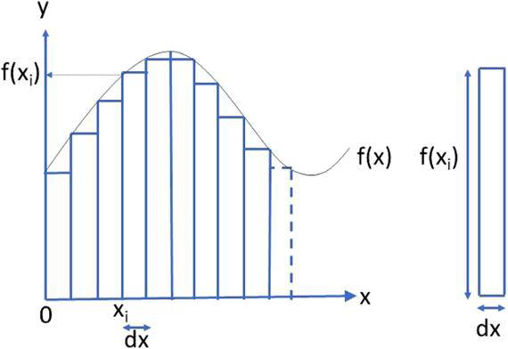

x、y：坐标轴；dx：矩形宽度；f(xᵢ)：矩形高度；f(x)：函数曲线。

<!-- dm-ch07-149 -->

〔原书第165页〕

如果我们能使dx 变小，那么误差就会变小。dx 能变得多小？

<!-- dm-ch07-150 -->

〔原书第165页〕

这归根结底取决于积分起始值与终值之间有多少个值。如果值有无限多个，那么它们之间的差就是零。但这样就会出现一个悖论：把无限多个零相加却得到一个非零的结果——这相当于芝诺所探讨的关于时间和空间的无限分割悖论。

> 校注：“有无限多个值，则它们之间的差为零”为底本论述，照译；并非据此将任意两个不同实数的差视为零。

<!-- dm-ch07-151 -->

〔原书第165页〕

实际的解决方法是，把函数对越来越小的dx 值进行求和，直到相邻两次求和结果之间的差值小到可以忽略不计为止。也就是说，积分会收敛到某个可接受的值。对于某些类别的函数，存在精确的解析解，所得值被解释为“在等价差之和的极限处”的值。然而，该极限通常被视为位于无穷远处，即仿佛积分范围是一个实无限。

<!-- dm-ch07-152 -->

〔原书第165页〕

## 通向无限，乃至更远

<!-- dm-ch07-153 -->

〔原书第165页〕

对无穷小量和无穷大的表征是格奥尔格·康托尔（1845—1918）工作的核心，该工作为19 世纪末至20 世纪初数学逻辑危机奠定了基础。康托尔的研究历经数十年不断完善。泰尔斯对此进行了详尽的阐述。[^ch7-41]

<!-- dm-ch07-154 -->

〔原书第165页〕

首先，我们把整数（可用有限位数列表示）与有理数区分开来。有理数虽可表示为两个整数的比值，但若尝试把分子除以分母，其结果可能呈现无限展开。例如：

<!-- dm-ch07-155 -->

〔原书第165页〕

$10/3\Longrightarrow3.3333333333\ldots$

<!-- dm-ch07-156 -->

〔原书第165页〕

不能表示成两个整数之比的数称为实数。例子有$\pi$和e。这些数也有无限展开式，但以计算它们的公式来表示，例如对有理数级数求和。

> 校注：底本将不能表示成两个整数之比的数称为real numbers（实数），通常数学术语应为irrational numbers（无理数）；正文照录原述。

<!-- dm-ch07-157 -->

〔原书第165页〕

现在，如果允许无界除法，那么两个有理数之间似乎存在无穷多个实数。康托尔试图利用集合论来刻画这一连续统。

<!-- dm-ch07-158 -->

〔原书第165页〕

我们把集合写在花括号{ 和} 之间，用逗号分隔元素，例如，偶数集：

<!-- dm-ch07-159 -->

〔原书第165页〕

$\{2,4,6,8,10\}$

<!-- dm-ch07-160 -->

〔原书第165页〕

空集为$\{\}$。

<!-- dm-ch07-161 -->

〔原书第165页〕

我们区分序数和基数。序数可作为有序集合中的下标。因此，对于偶数集，第一个元素是2，第二个元素是4，第三个元素是6，依此类推。这里我们使用序数1、2、3……按顺序选取集合中的元素。基数用于表示集合的大小。因此，上述偶数集合的基数为5。

<!-- dm-ch07-162 -->

〔原书第166页〕

我们进一步把集合分为有限集和无限集。对于有限集（如上文的偶数集），其基数即为最后一个元素的序数。但对于无限集，其基数不能是序数，因为根据定义，无限集不存在最后一个元素。

> 校注：底本称无限集的基数不能是序数，照译；在通常集合论中基数可用初始序数表示，原文论述不应当作这一点的否定证明。

<!-- dm-ch07-163 -->

〔原书第166页〕

虽然显然无法在有限时间内构造出一个无限集合，但某些无限集合可以给出有限的特征描述。特别是，我们可以指定算法来枚举某些无限集合，即生成其相继的成员。而算法本身就是一种有限的、物质化的描述。

<!-- dm-ch07-164 -->

〔原书第166页〕

例如，数的无限集合可以通过从1 开始并反复加1 来枚举。请注意，前面的句子是一个有限的描述。然而，它指定了一种潜在的无限计算，这种计算无法由一个必然是有限的物质化系统完成。

<!-- dm-ch07-165 -->

〔原书第166页〕

如果一个集合的元素能与某个整数集建立一一对应关系，则该集合被称为可数集。例如，对于我们这个由五个偶数组成的集合：

<!-- dm-ch07-166 -->

〔原书第166页〕

$1\leftrightarrow 2$；$2\leftrightarrow 4$；$3\leftrightarrow 6$；$4\leftrightarrow 8$；$5\leftrightarrow 10$

<!-- dm-ch07-167 -->

〔原书第166页〕

因此，从这个意义上说，一个可枚举的集合是可数的，尽管它可能是无限的，因为其元素可以与无限的整数集建立一一对应关系。例如，要生成偶数集，只需把整数依次翻倍。因此，所有偶数的集合可以与所有整数的集合建立一一对应关系。这似乎有悖直觉，因为在有限的整数集中，只有一半是偶数。

<!-- dm-ch07-168 -->

〔原书第166页〕

许多其他由整数派生出来的无限集合都可以与整数建立一一对应关系。这包括有理数，我们可以把它们系统地列举为相继的整数比值。

<!-- dm-ch07-169 -->

〔原书第166页〕

为了比较无限集合的性质，康托尔使用希伯来字母$\aleph$（aleph），配上相继的下标，以超限数表示这些集合的基数。因此，整数集的基数为$\aleph_0$（aleph零），所有可数集也是如此。

> 校注：“所有可数集”均为ℵ₀是底本原述；通常术语下有限集也可数，此处实际讨论可数无限集。

<!-- dm-ch07-170 -->

〔原书第166页〕

然而，康托尔借助对角线论证，试图证明实数不可枚举，因而不可数。首先，实数不能表示为两个整数之比，因此必定有无限多个小数位。每一个小数位都可以与整数一一对应，所以可用序数为其编号。假设我们能枚举实数，第i个实数$d^i$的各位数字便是$d^i_1,d^i_2,d^i_3$，依此类推，如表7.4所示。

> 校注：这里再次沿用底本把实数与无理数混同的说法，未静默更改。

<!-- dm-ch07-171 -->

〔原书第166—167页〕

可以构造一个新的实数$0.n^1n^2n^3n^4\ldots$，使其第一位$n^1$不同于第一个实数的第一位$d^1_1$，第二位$n^2$不同于第二个实数的第二位$d^2_2$，第三位$n^3$不同于第三个实数的第三位$d^3_3$，依此类推。这个新实数不可能在所枚举的序列中，所以实数必定多于$\aleph_0$，因而不可枚举。

<!-- dm-ch07-172 -->

〔原书第167页〕

表7.4 对角线法

|  |  |  |  |  |  |  |
| --- | --- | --- | --- | --- | --- | --- |
| 1. | 0. | $d^1_1$ | $d^1_2$ | $d^1_3$ | $d^1_4$ | … |
| 2. | 0. | $d^2_1$ | $d^2_2$ | $d^2_3$ | $d^2_4$ | … |
| 3. | 0. | $d^3_1$ | $d^3_2$ | $d^3_4$ | $d^3_4$ | … |
| 4. | 0. | $d^4_1$ | $d^4_2$ | $d^4_3$ | $d^4_4$ | … |
| … |  |  |  |  |  |  |

> 校注：底本第三行第三个数字位置印为d³₄，与第四个数字重复，按原图保留；对角线论证正文仍为d³₃。

<!-- dm-ch07-173 -->

〔原书第167页〕

现在，除了整数集之外，构建集合的集合似乎也是合理的。特别是，给定一个集合，我们可以构造一个包含其所有子集的集合，称为幂集。我们从空集开始，然后依次添加所有单个元素、元素对、元素三元组等等，最终包含整个集合。参见表7.5。

<!-- dm-ch07-174 -->

〔原书第167页〕

表7.5 幂集

| 集合 | 序数 | 幂集 | 基数 |
| --- | --- | --- | --- |
| {1} | 1 | {{},{1}} | 2 |
| {1,2} | 2 | {{},{1},{2},{1,2}} | 4 |
| {1,2,3} | 3 | {{},{1},{2},{3},{1,2},{1,3},{2,3},{1,2,3}} | 8 |
| … |  |  |  |

<!-- dm-ch07-175 -->

〔原书第167页〕

幂集的基数总大于原集合，即成员更多：N个元素的集合，其幂集有$2^N$个元素。特别地，若整数集基数为$\aleph_0$，则整数幂集基数为$2^{\aleph_0}$，记作$\aleph_1$（aleph一）。因此，整数的幂集不可数，因为$\aleph_1$必然大于$\aleph_0$。康托尔随后证明，实数集也有基数$\aleph_1$。

> 校注：底本将2^{ℵ₀}与ℵ₁直接等同并称康托尔证明实数基数为ℵ₁；这涉及连续统假设，不能作为一般集合论中已证明的结论。正文保留作者说法。

<!-- dm-ch07-176 -->

〔原书第167页〕

从亚里士多德的视角来看，康托尔的对角线论证是不成立的，因为它预设了任意精度下已实现的实数无限集。对于一个以固定精度表示的有限“实数”集，对角线论证所产生的数本就已存在。

[^ch7-1]: 1. Aristotle：《形而上学》，第I—IX卷，H. Tredennick英译，洛布古典丛书（William Heinemann，1933），第161页。

[^ch7-2]: 2. 正如其官方格言所宣示的：“我们信仰上帝”（In God We Trust）。

[^ch7-3]: 3. Wikipedia：“圣公宗”（Anglican Communion），载Wikipedia（Wikipedia，2021），https://en.wikipedia.org/wiki/Anglican_Communion 。

[^ch7-4]: 4. Statista：“中国共产党”（Chinese Communist Party），载Topics（Statista，2021），https://www.statista.com/topics/1247/chinesecommunist-party/ 。

[^ch7-5]: 5. D. Lecourt：《无产阶级科学？李森科事件》（Proletarian Science? The Case of Lysenko）（Verso，1977）。

[^ch7-6]: 6. Cockshott、Mackenzie与Michaelson：《计算及其极限》（Computation and its Limits）。

[^ch7-7]: 7. 不过，也可能通过中间的逻辑论证来确定。

[^ch7-8]: 8. G. Boole：《思维规律研究》（An Investigation into the Laws of Thought）（Walton & Maberly，1854）。

[^ch7-9]: 9. 后文将进一步探讨这与辩证唯物主义的关系；但请注意，把同一词语的位置互换、分别用作形容词或名词，是有意义的。

[^ch7-10]: 10. Aristotle：《修辞学》（The Art of Rhetoric），J. H. Freese英译，洛布古典丛书（William Heinemann，1926）。

[^ch7-11]: 11. Aristotle：《前分析篇》（Prior Analytics），H. Tredennick英译，洛布古典丛书（William Heinemann，1962）。

[^ch7-12]: 12. Aristotle：《形而上学》，第I—IX卷（The Metaphysics, Books I–IX）。

[^ch7-13]: 13. Plato：《理想国》（The Republic），P. Shorey英译，第1卷，洛布古典丛书（Harvard，1937）；Plato：《理想国》，P. Shorey英译，第2卷，洛布古典丛书（Harvard，1962）。

[^ch7-14]: 14. R. Smith：“亚里士多德的逻辑”（Aristotle’s Logic），载Plato（Stanford Encyclopedia of Philosophy，2017），https://plato.stanford.edu/entries/aristotle-logic/#AriLogWorOrg 。

[^ch7-15]: 15. Aristotle：《解释篇》（On Interpretation），H. P. Cook英译，洛布古典丛书（William Heinemann，1962）。

[^ch7-16]: 16. Aristotle：《前分析篇》（Prior Analytics）。

[^ch7-17]: 17. J. Marenbon编：《剑桥波爱修斯指南》（The Cambridge Companion to Boethius）（Cambridge University Press，2009）。

[^ch7-18]: 18. J. Buroker：“波尔—罗亚尔逻辑”（Port Royal Logic），载Stanford Encyclopedia of Philosophy（University of Stanford，2014），https://plato.stanford.edu/entries/port-royal-logic/ 。

[^ch7-19]: 19. F. Bacon：《新工具》（Novum Organon），J. Devey编（P. F. Collier & Son，1901）。

[^ch7-20]: 20. 这一标题呼应亚里士多德的《工具论》（Organon）。

[^ch7-21]: 21. T. Hobbes：“论物体”（De Corpore），载《托马斯·霍布斯英文著作集》（The English Works of Thomas Hobbes），W. Molesworth编（John Bohn，1839）。

[^ch7-22]: 22. R. Whately：《逻辑要素》（Elements of Logic）（James Munroe & Company，1845）。

[^ch7-23]: 23. Boole：《思维规律研究》（An Investigation into the Laws of Thought）。

[^ch7-24]: 24. W. S. Jevons：《逻辑学初级教程》（Elementary Lessons in Logic）（Macmillan & Co.，1903）。

[^ch7-25]: 25. 不要与爱尔兰数学家William Rowan Hamilton混淆。

[^ch7-26]: 26. W. Hamilton：《形而上学与逻辑讲义》（Lectures on Metaphysics and Logic），第1卷，H. L. Mansel与J. Veitch编（William Blackwood and Sons，1866）。

[^ch7-27]: 27. L. Wittgenstein：《逻辑哲学论》（Tractatus Logico-Philosophicus），D. F. Pears与B. F. McGuinness英译（Routledge and Kegan Paul，1961），第32—33页。

[^ch7-28]: 28. W. Lenzen：“莱布尼茨：逻辑”（Leibniz: Logic），载Internet Encyclopedia of Philosophy（University of Tennessee at Martin，2017），https://iep.utm.edu/leib-log/ 。

[^ch7-29]: 29. Boole：《思维规律研究》（An Investigation into the Laws of Thought）。

[^ch7-30]: 30. 请注意，布尔没有使用真值表。不过，他在第76页实际上给出了否定的真值表。

[^ch7-31]: 31. C. E. Shannon：“继电器与开关电路的符号分析”（A Symbolic Analysis of Relay and Switching Circuits），American Institute of Electrical Engineers Transactions，第57卷（1938），第713—723页。

[^ch7-32]: 32. 字面意思是“概念文字”。

[^ch7-33]: 33. G. Frege：“概念文字：一种仿照算术语言构造的纯思维公式语言”（Begriffsschrift, a Formula Language, Modeled Upon that of Arithmetic, for Pure Thought），载《从弗雷格到哥德尔：数理逻辑文献集，1879—1931》（From Frege to Gödel: A Source Book in Mathematical Logic, 1879-1931），J. van Heijenoort编，S. Bauer-Mengelberg英译（Harvard University Press，1967）。

[^ch7-34]: 34. G. Frege：《算术基础》（The Foundations of Arithemtic），J. L. Austin英译（Harper，1953）。

[^ch7-35]: 35. G. Frege：《算术基本规律：体系的阐述》（The Basic Laws of Arithmetic: Exposition of the System），M. Furth英译（University of California Press，1964）。

[^ch7-36]: 36. G. Peano：“用新方法表述的算术原理”（The Principles of Arithemtic, Presented by a New Method），载《从弗雷格到哥德尔：数理逻辑文献集，1879—1931》（From Frege to Gödel: A Source Book in Mathematical Logic, 1879–1931），J. van Heijenoort编译（Harvard University Press，1967）。

[^ch7-37]: 37. 如今通常从零开始。

[^ch7-38]: 38. Aristotle：《形而上学》，第I—IX卷（The Metaphysics, Books I-IX）。

[^ch7-39]: 39. B. Dowden：“芝诺悖论”（Zeno’s Paradoxes），Internet Encyclopedia of Philosophy，https://iep.utm.edu/zenos-paradoxes/ 。

[^ch7-40]: 40. M. Tiles：《集合论哲学：康托尔乐园的历史导论》（The Philosophy of Set Theory: An Historic Introduction to Cantor’s Paradise）（Dover，1989）。

[^ch7-41]: 41. Tiles：《集合论哲学》（The Philosophy of Set Theory）。

<!-- dm-ch08-001 -->

〔原书第169页〕

# 第8章 逻辑与辩证唯物主义

<!-- dm-ch08-002 -->

〔原书第169页〕

## 黑格尔与逻辑

<!-- dm-ch08-003 -->

〔原书第169页〕

> ……把三段论仅仅看作由三个判断构成，是一种形式主义观点；它忽视了各个规定之间的关系，而推理所涉及的恰恰只是这种关系。把各项之间的联系拆分为孤立的前提和与这些前提相区别的结论，完全是一种纯粹主观的反思：

<!-- dm-ch08-004 -->

〔原书第169页〕

> 所有人都会死。盖乌斯是人。因此盖乌斯会死。

<!-- dm-ch08-005 -->

〔原书第169页〕

> 一听到这种推理被搬出来，人立刻就会感到厌倦。这种厌倦来自一种形式的徒劳：它通过彼此分离的命题制造出多样性的幻象，而这种幻象在事实本身中立即消解了。G. 黑格尔，《逻辑学》[^ch8-1]

<!-- dm-ch08-006 -->

〔原书第169页〕

格奥尔格·黑格尔（1770—1831）的唯心主义在欧洲哲学中占据核心地位。英国传统在复兴逻辑之前先与亚里士多德决裂；与之不同，辩证法处于黑格尔认识论的核心。

<!-- dm-ch08-007 -->

〔原书第169页〕

从亚里士多德的视角看，黑格尔著作《逻辑学》[^ch8-2]的书名似乎有些奇怪。亚里士多德把辩证法与科学相对置，认为它是一种说服形式，而非自主理解世界如何运行的途径；他也把辩证法与三段论逻辑相对置，认为它是前提的来源，而非对这些前提进行推理的方法。尽管如此，黑格尔确实认为逻辑可以得到科学阐释，这一点仍有益处。

<!-- dm-ch08-008 -->

〔原书第169页〕

黑格尔对把三段论的形式与其应用语境相分离的价值深表怀疑。也就是说，三段论本身并无意趣。其重要性在于它如何将特定前提（规定）与特定结论联系起来，而这些联系又依赖先前的推理来确立前提之间的关系。正如我们将看到的，这种态度是辩证唯物主义中反复出现的特征。

<!-- dm-ch08-009 -->

〔原书第169页〕

尽管如此，黑格尔确实系统地探讨了三段论的各种形式，[^ch8-3]并借助辩证转化来考察它们之间的关系。不过，他除以普遍（U）、单称（S）或特称（P）来标记三段论中的项之外，并未采用其他形式记号；这比早先的做法更为简化。与前人一样，黑格尔运用了简洁的论证和例子。

<!-- dm-ch08-010 -->

〔原书第170页〕

《逻辑学》的序言进一步阐明了黑格尔对三段论逻辑的态度。首先，他指出科学和常识已经取代形而上学，也取代了“逻辑教人如何思考”这一观念。尽管如此，逻辑仍被保留在诸科学之中，“大概是为了某种形式上的效用”，虽然“它的形式和内容在漫长的传承中始终未变”（第8页）。

<!-- dm-ch08-011 -->

〔原书第170页〕

对黑格尔而言，思想蕴含于语言之中，语言的形式决定思想；在这方面，德语显然更胜一筹（！）（《第二版序言》，第12页）。而且，逻辑在人类境况中占据核心地位：

<!-- dm-ch08-012 -->

〔原书第170页〕

> 逻辑对人来说是如此自然，甚至就是人的本性。但是，如果我们将自然本身，即物理领域，与精神领域相对置，那么就必须说：逻辑是贯穿人一切自然行为——感知、直观、欲求的方式，以及需要和冲动——的超自然要素；它由此使这些行为成为真正属人的东西，尽管还只是形式上属人的东西，使之成为表象和目的。（第12页）

<!-- dm-ch08-013 -->

〔原书第170页〕

在这里，他明确反对亚里士多德的立场：

<!-- dm-ch08-014 -->

〔原书第170页〕

> 亚里士多德在同一语境中说：“人的本性在如此多的方面都处于束缚之中；但这门并非为任何效用而追求的科学，独自是自在自为地自由的，因而似乎并非人所能拥有。”（第14页，引用亚里士多德《形而上学》982b）

<!-- dm-ch08-015 -->

〔原书第170页〕

黑格尔则认为，恰恰相反，逻辑关乎抽象思维，所以先教给年轻人，具体事务则留待以后。且不论黑格尔未能意识到这种教育是何等的特权，他在这里反映了“三艺”与“四艺”的区分，这种区分当时想必仍然通行。

<!-- dm-ch08-016 -->

〔原书第170页〕

对黑格尔而言，逻辑的一大益处，是其普遍性使它能够发挥简约表达的作用。然而，脱离内容的逻辑无法达到真理，因此常识将其视为贫瘠无物而加以拒斥，也就不足为奇了：

<!-- dm-ch08-017 -->

〔原书第170页〕

> 对于规定推理规则的公式而言——推理实际上是知性的一项主要功能——健全的常识忽视了这些公式在认识中有其位置、必须得到遵守，并且是理性思维必不可少的材料；无论这种忽视多么错误，常识同样正确地认识到：这些公式不加区分地既为谬误服务，也为诡辩服务；无论如何定义真理，就更高的真理，例如宗教真理而言，它们都毫无用处。总的说来，它们只涉及知识的正确性，而不涉及知识的真理性。（第18页）

<!-- dm-ch08-018 -->

〔原书第170页〕

在这里，黑格尔的立场令人想起霍布斯。

<!-- dm-ch08-019 -->

〔原书第171页〕

黑格尔认为，形式与内容的分离是一种幻象。他在《导言》中进一步详述了这一立场。辩证唯物主义拒斥形式主义，即脱离内容独立研究逻辑的根源，便在于此。

<!-- dm-ch08-020 -->

〔原书第171页〕

## 恩格斯与逻辑

<!-- dm-ch08-021 -->

〔原书第171页〕

卡尔·马克思（1818—1883）和弗里德里希·恩格斯（1820—1895）的革命世界观以科学唯物主义为前提。马克思几乎没有论述辩证法或三段论逻辑。相比之下，恩格斯在晚期著作中多次提及逻辑。在1877年的《反杜林论》[^ch8-4]中，他有力地断言：逻辑在与辩证法的结合中处于从属地位。首先，他重申亚里士多德的立场：一门科学一旦充分专门化，就会独立于任何范围更广的认识论。三段论逻辑——现在称为形式逻辑——以及辩证法，作为思维规律，独立于哲学：

<!-- dm-ch08-022 -->

〔原书第171页〕

> 在以往全部哲学中，还独立存在着的，就是关于思维及其规律的科学——形式逻辑和辩证法。其余一切都归入关于自然和历史的实证科学。（第40页）

<!-- dm-ch08-023 -->

〔原书第171页〕

这一表述在1880年的《社会主义从空想到科学的发展》[^ch8-5]中得到重复，并在1886年的《路德维希·费尔巴哈和德国古典哲学的终结》[^ch8-6]中再次重申。

<!-- dm-ch08-024 -->

〔原书第171页〕

回到《反杜林论》，恩格斯指出，数学必须从逻辑中借用公理，而这些公理是“最贫乏的思想内容的表达”（第60页）。他沿袭黑格尔的观点说，仅靠逻辑公理“收效甚微”，要取得进展就必须借助几何学（第61页）。他的主要批评是，杜林强调纯数学独立于经验，却不承认它是从现实中抽象出来的（第61页）。

<!-- dm-ch08-025 -->

〔原书第171页〕

恩格斯说，辩证法比形式逻辑更有力：

<!-- dm-ch08-026 -->

〔原书第171页〕

> 就连形式逻辑也首先是一种获得新结果、从已知推进到未知的方法；辩证法也是如此，而且更为显著。此外，由于辩证法突破了形式逻辑的狭隘视野，它包含着一种更全面的世界观的萌芽。（第186页）

<!-- dm-ch08-027 -->

〔原书第171页〕

此外，形式逻辑只对初等数学具有意义。在高等数学中，乃至一切新科学中，都需要辩证法才能取得进展：

<!-- dm-ch08-028 -->

〔原书第171—172页〕

> 初等数学，即常量的数学，至少总体上是在形式逻辑的范围内活动的；变量的数学，其最重要的部分是微积分，本质上无非是辩证法在数学关系中的应用。在这里，与这一方法在新研究领域中的多种应用相比，单纯的证明问题显然退居次要地位。但是，几乎所有高等数学的证明，从微分学最初的证明起，从初等数学的立场看，严格说来都是错误的。当人们像这里一样，试图用形式逻辑来证明在辩证法领域中获得的结果时，这就是必然的。（第186—187页）

<!-- dm-ch08-029 -->

〔原书第172页〕

然而，他把形式逻辑描述为涉及常量而非变量，这表明他存在根本性的误解。马克思对数学也持这种看法，下文将会谈到。恩格斯还流露出一种奇特的对数学的蔑视：

<!-- dm-ch08-030 -->

〔原书第172页〕

> 然而，数学家的抽象要求远不是现实世界必须遵守的规律。（第75页）

<!-- dm-ch08-031 -->

〔原书第172页〕

最后，在他身后出版的《自然辩证法》[^ch8-7]中，恩格斯重谈这些主题。他再次认为，辩证逻辑优于形式逻辑，因为它把分析与推理结合起来：

<!-- dm-ch08-032 -->

〔原书第172页〕

> 辩证逻辑与旧的、纯形式的逻辑不同：它不像后者那样，满足于列举思维的运动形式，即各种判断形式和结论形式，并把它们毫无联系地并列起来。相反，它使这些形式彼此推导出来，使一种形式从属于另一种形式，而不是把它们置于同等地位；它从较低的形式发展出较高的形式。（第296页）

<!-- dm-ch08-033 -->

〔原书第172页〕

恩格斯承认，尽管自然科学和历史科学不断发展，形式逻辑仍有一种本质性的、可以认识的特性。尽管如此，他又一次坚决拒斥数学抽象：

<!-- dm-ch08-034 -->

〔原书第172页〕

> 他们［数学家和自然科学家］指责黑格尔所做的事，即把抽象推到极端，他们自己却在大得多的规模上这样做。他们忘记了，全部所谓纯数学都涉及抽象，严格说来，它的一切量都是想象的；而一切抽象一旦推到极端，就会转化为无稽之谈，或转化为自身的对立面。（第359页）

<!-- dm-ch08-035 -->

〔原书第172页〕

在《自然辩证法》的笔记中，恩格斯区分了可以通过“物质直观”来证明的数学运算，以及只能通过演绎来证明的逻辑推演：

<!-- dm-ch08-036 -->

〔原书第172—173页〕

> 计算的理性——计算机器！——一种奇特的混淆：把数学运算与纯粹逻辑运算混在一起。数学运算可以作物质性的演示和证明，因为它们以直接的、即使是抽象的物质直观为基础；纯粹逻辑运算则只能通过演绎来证明，因而不可能具有数学运算所具有的确实性——而其中又有多少是错误的！积分机；参见安德鲁斯的演讲，《自然》，9月7日，76.317。[^ch8-8],[^ch8-9]

<!-- dm-ch08-037 -->

〔原书第173页〕

无限的本性也曾是恩格斯和杜林共同关心的问题。康托尔曾颇不耐烦地驳斥杜林关于无限的论述。[^ch8-10]恩格斯也长篇批评了杜林的无限概念。不过，恩格斯把可数性与计数混淆了：

<!-- dm-ch08-038 -->

〔原书第173页〕

> 可是，“已经数过的无限数列”这个矛盾又该如何解释呢？只要杜林先生为我们表演一下把它数完的巧妙把戏，我们就能够更仔细地考察这个问题了。[^ch8-11]

<!-- dm-ch08-039 -->

〔原书第173页〕

## 狄慈根、辩证唯物主义与逻辑

<!-- dm-ch08-040 -->

〔原书第173页〕

约瑟夫·狄慈根（1828—1888）在1848年德国革命期间结识马克思，后来成为他的朋友。狄慈根自学成才，恩格斯在《路德维希·费尔巴哈和德国古典哲学的终结》中肯定他独立发现了唯物辩证法。请留意“唯物辩证法”这一表述。它听起来像是一种以唯物主义为基础的辩证法，但这不排除唯物主义也能为其他分析方式提供基础。因此，我们可以承认一种非辩证的唯物主义科学。

<!-- dm-ch08-041 -->

〔原书第173页〕

伯恩斯[^ch8-12]认为，狄慈根阅读恩格斯关于费尔巴哈的论述后，在1887年的《一个社会主义者在认识论领域的漫游》[^ch8-13]中创用了“辩证唯物主义”一词。[^ch8-14]这个看似琐碎的细节，凸显了这些概念的含义是多么游移不定。

<!-- dm-ch08-042 -->

〔原书第173页〕

“辩证唯物主义”听起来像是一种以辩证法为基础的唯物主义，也就是不承认其他分析形式的唯物主义。正如我们将看到的，在后来的马克思主义哲学中，辩证法与科学越来越被混为一谈，二者能够彼此分离的说法也遭到争辩。不明确宣称自己具有辩证性质的科学唯物主义，则被称为机械唯物主义。

<!-- dm-ch08-043 -->

〔原书第173页〕

狄慈根在最成熟的著作《哲学的积极成果》[^ch8-15]中，把形式逻辑的前提与从这些前提作出的推演混淆了。他又把批评前提与批评推演混淆起来：

<!-- dm-ch08-044 -->

〔原书第173页〕

> 他据以推断狗一般具有警觉性的前提，是由传统传下来的，并凭信念得到接受。但它有事实根据吗？难道不会有一些狗缺少警觉性吗？即便所有推演都很严密，我们的巴哥犬难道不可能很不可靠吗？（XIII）

<!-- dm-ch08-045 -->

〔原书第173页〕

狄慈根接着引用培根（以及笛卡尔）对三段论逻辑的拒斥。与黑格尔一样，这里需要的是逻辑与辩证法的一种新综合。

<!-- dm-ch08-046 -->

〔原书第174页〕

狄慈根的长处在于明确揭示了辩证法的阶级视角，尤其是在较早写给儿子的书信集《逻辑书简，特别是民主的无产阶级的逻辑》[^ch8-16]中。在这里，他批评阶级（即资产阶级）逻辑通过强调差异，将剥削合理化为自然现象。这使狄慈根把形式逻辑与阶级逻辑联系起来，因为形式逻辑把前提当作事物彼此分离的方面，并据此推理。不过，他以一种明确的先验论证，拒斥了第二条思维规律，即矛盾表明前提无效。

<!-- dm-ch08-047 -->

〔原书第174页〕

狄慈根呼应黑格尔的观点，对逻辑学家不屑一顾，因为他们将逻辑与其内容割裂开来：

<!-- dm-ch08-048 -->

〔原书第174页〕

> 形式逻辑学家既无知又狡黠。他们坚持用传统方式讨论知性或思维，仿佛它们是孤立的东西，却无视逻辑研究的对象与经验世界之间的必然联系。这种相互联系会引向对真理与谬误、意义与无意义、神与偶像的说明，而这对教授们来说很不合时宜。因此，这个不受欢迎的问题被移交给神秘的部门——形而上学和宗教——好让这些官方智慧的尊贵支柱继续为统治阶级效劳。（第四封信）

<!-- dm-ch08-049 -->

〔原书第174页〕

在《逻辑书简》的开头部分，狄慈根用陶工的类比来拒斥形式逻辑，认为思想不能与行动分离，形式也不能与内容分离。在这里，他似乎忘记了马克思在《资本论》第一卷中的著名论断。[^ch8-17]

<!-- dm-ch08-050 -->

〔原书第174页〕

> 但是，最蹩脚的建筑师与最灵巧的蜜蜂之间的区别在于：建筑师在现实中建造之前，已经在想象中建成了他的建筑。（第174页）

<!-- dm-ch08-051 -->

〔原书第174页〕

狄慈根熟悉亚里士多德的三段论逻辑，合理地批评它无法充分把握事物多方面的属性。然而，他援引自己的革命原则，在后来的《哲学的积极成果》中说：

<!-- dm-ch08-052 -->

〔原书第174页〕

> 哲学家们应当放弃试图用三段论证明任何事物的老嗜好。如今，一个论点并非靠言辞，而是靠事实、靠行动来证实。各门科学已充分具备所需的条件，因此“理解的可能性”得到了无可置疑的证明。（XIII）

<!-- dm-ch08-053 -->

〔原书第174页〕

虽然狄慈根已不再属于马克思主义主流经典，但在布尔什维克革命之前，他曾有很大影响。安东·潘涅库克在1902年《脑力劳动的本质》《逻辑书简》和《哲学的积极成果》合订本的导言中写道：

<!-- dm-ch08-054 -->

〔原书第174页〕

> 深入研究狄慈根的哲学著作，是理解马克思和恩格斯基本著作的重要而不可或缺的辅助。[^ch8-18]

<!-- dm-ch08-055 -->

〔原书第175页〕

我们将考察布尔什维克革命后马克思主义对逻辑的回应，但首先要回过头来看看20世纪初形式逻辑的关键发展。

<!-- dm-ch08-056 -->

〔原书第175页〕

## 罗素悖论与《数学原理》

<!-- dm-ch08-057 -->

〔原书第175页〕

19世纪末，弗雷格的体系被视为形式逻辑的顶峰，正走在数学形式化的康庄大道上。可惜好景不长。1902年，伯特兰·罗素（1872—1970）致信弗雷格，[^ch8-19]指出其体系核心存在一个根本矛盾。

<!-- dm-ch08-058 -->

〔原书第175页〕

在弗雷格的体系中，谓词用满足某种性质的对象所组成的集合来刻画。罗素悖论涉及这样一个观察：谓词可能适用于自身，也可能不适用于自身。等价地说，集合可能以自身为成员，也可能不以自身为成员。

<!-- dm-ch08-059 -->

〔原书第175页〕

一个适用于自身的谓词，若表示为包含自身的集合，听起来似乎会导致无限展开。然而，使用它的名称而非它的内容，可以避免这种情况。也就是说，看似无限的构造可以有有限的表示。

<!-- dm-ch08-060 -->

〔原书第175页〕

考虑那些不包含自身的集合。我们可以构造一个由不包含自身的集合组成的集合。这个集合又不包含自身，因此或许它应当包含自身。但若它被包含在自身之中，它就确实包含自身，于是它又不应当包含自身。

<!-- dm-ch08-061 -->

〔原书第175页〕

这不只是一个学术练习；在任何具有文件夹系统的计算机上都能演示它。从文件夹创建指向其他文件夹的链接，是常见的做法。那么，要更方便地从一个大文件夹的底部回到顶部，可以把最后一个条目设为指向该文件夹自身的链接。因此，我们可以新建一个文件夹，其中包含指向那些没有自身链接的文件夹的链接。这个新文件夹应不应该链接到自身呢？

<!-- dm-ch08-062 -->

〔原书第175页〕

正如弗雷格所承认的，[^ch8-20]罗素悖论使在逻辑中将数学形式化的整个前景受到质疑。尽管如此，罗素和他过去的老师阿尔弗雷德·诺思·怀特海（1861—1947）仍着手尝试，将数学系统地建立在一种与弗雷格或康托尔的体系大致等价的形式逻辑之上。三卷本《数学原理》（PM）[^ch8-21]于1910年至1913年间出版，重构了数学的重要部分。如今《数学原理》虽很少有人阅读，尤其因为它采用非标准的记号，但它长期以来一直被誉为奠基之作。

<!-- dm-ch08-063 -->

〔原书第175页〕

## 希尔伯特纲领

<!-- dm-ch08-064 -->

〔原书第175页〕

由大卫·希尔伯特（1862—1943）提出的希尔伯特纲领，规定了20世纪乃至今日形式逻辑研究的框架。这一“纲领”并非像宣言那样，是一份固定的宗旨声明；它是从希尔伯特不断发展的构想中整理出来的。

<!-- dm-ch08-065 -->

〔原书第176页〕

在希尔伯特1904年回应罗素悖论的《论逻辑与算术的基础》[^ch8-22]中，可以看到这一纲领的根源。他首先概述主要数学家对数学基础的看法。利奥波德·克罗内克（1823—1891）不诉诸基础，就默认整数存在，被称为教条主义者。赫尔曼·冯·亥姆霍兹（1821—1894）只承认从经验而来的存在，因此排除以思想实验作为理论基础，被称为经验主义者。埃尔温·克里斯托费尔（1829—1900）被称为机会主义者。他虽然反对克罗内克拒斥无理数，但仍寻求接受无理数的肯定性理由。弗雷格的工作被承认为基础性的，却因体系不够严密、导致自指悖论而受到批评。希尔伯特在这里写道：

<!-- dm-ch08-066 -->

〔原书第176页〕

> 相反，从一开始，研究数的概念就应当以避免此类矛盾、澄清这些悖论为主要目标之一。[^ch8-23]（第130页）

<!-- dm-ch08-067 -->

〔原书第176页〕

希尔伯特接着将理查德·戴德金（1831—1916）的方法描述为先验方法，因为他假定存在由无限多个对象构成的实无限。我们还会回到这一曾受亚里士多德批评的立场。最后，希尔伯特说，康托尔虽然区分了相容的集合与不相容的集合，却没有给出区分标准，因此不得不作主观主义的假定。[^ch8-24]

<!-- dm-ch08-068 -->

〔原书第176页〕

希尔伯特在总结这些评论时说，所有这些困难都可以通过他所谓的公理化方法克服。此外，承认逻辑与算术相互依存，并同时发展二者的规律，或许可以避免这些悖论。

<!-- dm-ch08-069 -->

〔原书第176页〕

形式系统以公理和推理规则为基础。公理是对所有论元都为真的基本公式；推理规则用于从公理和其他定理出发，构造或证明新的真公式，即定理。源于亚里士多德的思维规律，可视为公理的先驱。因此，公理化方法就是寻找一组相互独立的公理，使之连同适当的规则，足以展开某一领域的全部内容。

<!-- dm-ch08-070 -->

〔原书第176页〕

希尔伯特高度重视公理系统的相容性，即不可能利用这些系统推导出矛盾。不能确立相容性，后来成为数学逻辑危机的关键。

<!-- dm-ch08-071 -->

〔原书第176页〕

在后来的一篇论文《公理化思维》[^ch8-25]中，希尔伯特首次提到一个“纲领”，[^ch8-26]并更详细地阐述自己的目标。除了相容性，他还希望确定任意数学问题在原则上是否可解，能够检验数学活动的结果，并确定是否可能存在更简单的证明。在这里，他也回到那个曾使马克思主义者深感困扰的古老的亚里士多德式问题，即“数学中内容与形式主义的关系”（第1113页）。

<!-- dm-ch08-072 -->

〔原书第176页〕

尤其值得注意的是，能够判定一个数学问题是否可以在有限步骤内求解，

<!-- dm-ch08-073 -->

〔原书第176页〕

> ……触及了数学思维的本质。（第1113页）

<!-- dm-ch08-074 -->

〔原书第177页〕

这至今仍通常被称为Entscheidungsproblem，即判定问题。还有许多其他判定问题，例如两个公式是否等价；但能在有限步骤内证明性质，被视为关键。

<!-- dm-ch08-075 -->

〔原书第177页〕

## 元理论与逻辑学派

<!-- dm-ch08-076 -->

〔原书第177页〕

希尔伯特认为，数学抽象应当、也能够独立于任何应用内容而得到研究。但希尔伯特纲领要求数学本身也接受数学推理。也就是说，应当有以数学为内容的元数学，但目的仅在于确立公理的相容性。[^ch8-27]

<!-- dm-ch08-077 -->

〔原书第177页〕

数学用语言[^ch8-28]来表达，其中有符号、句法和语义。因此，数学将成为自身的元语言，即一种谈论语言的语言。

<!-- dm-ch08-078 -->

〔原书第177页〕

在罗素悖论出现后的数十年中，形式逻辑形成了三个学派，反映出不同的回应。可以根据各派允许哪些数学实体，以及允许针对这些实体进行哪些数学推理，来刻画它们的特点；也就是说，要看它们认为元数学应当如何进行。[^ch8-29]这归根结底取决于它们对无限的态度。

<!-- dm-ch08-079 -->

〔原书第177页〕

以弗雷格和罗素为代表的逻辑主义者，既接受无限的数学实体，也接受康托尔式的无限推理。他们承认观念性的数学实体具有存在，因而是柏拉图主义者，也因此是唯心主义者。

<!-- dm-ch08-080 -->

〔原书第177页〕

其次，以希尔伯特为代表的形式主义者，接受无限的数学实体作为研究对象，但力求只使用有限推理。他们不关心数学实体的存在地位。

<!-- dm-ch08-081 -->

〔原书第177页〕

最后，直觉主义者采取了最激进的立场。他们以克罗内克为基础，诉诸数学直觉，在数学和元数学中都只接受有限构造。他们还拒斥排中律（LEM），即某事及其否定不可能同时为真。

> 校注：底本这里将排中律写成“某事及其否定不可能同时为真”；这实际上是矛盾律的表述。第7章列出的排中律是“任何事物必定或者存在，或者不存在”。正文保留底本措辞。

<!-- dm-ch08-082 -->

〔原书第177页〕

这些学派的拥护者之间存在深刻的分歧，有时甚至相互谩骂。尽管如此，它们的形式系统实际上联系十分紧密。

<!-- dm-ch08-083 -->

〔原书第177页〕

## 直觉主义

<!-- dm-ch08-084 -->

〔原书第177页〕

对康托尔的一种回应是彻底拒斥非有限性方法，实际上也拒斥实数。因此，克罗内克在1886年主张，通过操作无限序列得到的特定结果，只有能够用整数算术重建、而“不超出有限序列的概念”时，才可以接受。[^ch8-30]

<!-- dm-ch08-085 -->

〔原书第178页〕

随后，吕伊岑·布劳威尔（1881—1966）的直觉主义致力于利用构造性的有限方法，从少数几个“直觉”概念出发重建形式逻辑。1908年，布劳威尔发表了对经典逻辑的批评，其中的主题在他后来的全部著作中反复出现。[^ch8-31]首先，他认为，脱离数学的逻辑会导致无根据的结论。与形式主义者相反，布劳威尔认为逻辑应当以数学为基础，而数学本身则以观察和对基本真理的原初直觉为基础。不过，他也认为，即使独立于数学，三段论推理和归谬论证都是可接受的（第27、29页）。

<!-- dm-ch08-086 -->

〔原书第178页〕

布劳威尔拒斥排中律（LEM），[^ch8-32]即某事及其否定不可能同时为真（第29页及以下）。这意味着二者必有其一为真，不允许任何一方的地位不确定。同样，布劳威尔拒斥双重否定可以相互抵消，因为某事“并非不真”仍可能使其地位悬而未定。

> 校注：本段沿用上一处对排中律的误述，并由“不同时为真”转到“必有其一为真”。这两种表述不能等同；译文保留作者原有论述。

<!-- dm-ch08-087 -->

〔原书第178页〕

布劳威尔进一步指出，排中律

<!-- dm-ch08-088 -->

〔原书第178页〕

> 要求每个假设或者正确、或者不正确。用数学语言说，对于假定的系统之间以某种方式相互嵌合的每一种情形，要么能构造出其完成，要么能构造出因不可能而受阻的情形。因此，principium tertii exclusi［即排中律］是否有效的问题，等同于是否可能存在不可解数学问题的问题。（第42页）

<!-- dm-ch08-089 -->

〔原书第178页〕

在有限情形中，他接受排中律，因为可以通过穷举来检验。只要无限情形能通过归纳构造出来，他也接受排中律在其中的应用。但是，布劳威尔反对从那些无法证明存在、却被假定存在的实体出发作论证。他尤其拒斥已完成的无限这一假定。

<!-- dm-ch08-090 -->

〔原书第178页〕

布劳威尔的“原初直觉”（ur-intuition）概念显然是唯心主义的；他在后来的著作中，例如1929年的《数学、科学与语言》[^ch8-33]中，明确表现出了主观主义。

<!-- dm-ch08-091 -->

〔原书第178页〕

## 从布尔什维克革命到孟什维克化的唯心主义

<!-- dm-ch08-092 -->

〔原书第178页〕

20世纪头25年的灾难性事件夺去了数百万人的生命，又摧毁了数百万人的生活；要充分呈现这些事件而不显得轻描淡写，是不可能的。不过，从我们当前的视角看，1914年至1919年世界大战的关键结果，是苏联的建立。[^ch8-34]这是第一个由明确奉行唯物主义的群众政党执政的国家。

<!-- dm-ch08-093 -->

〔原书第178页〕

内战（1917—1923）之后，苏联把重心放在重建和立即改善人民生活上。一旦更广泛的国际革命已陷入停滞这一点变得明确，压倒一切的优先任务便是稳定和加强苏联。为了这一目标，也为了向共产主义未来迈进，科学被视为核心。

<!-- dm-ch08-094 -->

〔原书第179页〕

战争和移民造成专家短缺，因此起初只要能确保忠诚，国家就无法对剩余的非共产党知识界的意识形态正确性要求过高。与此同时，在共产党领导下不断扩大的教育体系，持续培养出新一代“红色专家”——科学家和工程师。他们明确致力于苏联的目标，却必然要与革命前的一辈人共同工作。

<!-- dm-ch08-095 -->

〔原书第179页〕

数学发挥了核心作用；这一时期，莫斯科和列宁格勒发展出两个世界级数学中心。纯数学研究虽在继续，但重点在于应用数学。总体上，形式逻辑并不突出。

<!-- dm-ch08-096 -->

〔原书第179页〕

然而，形式逻辑的地位依然存在争议，甚至在布尔什维克内部围绕苏联发展方向的两极分化中也是如此。例如，1921年，列宁[^ch8-35]在讨论托洛茨基的工会提案时，批评布哈林忽视辩证逻辑。[^ch8-36]

<!-- dm-ch08-097 -->

〔原书第179页〕

1924年列宁去世后，布尔什维克不同派别之间的斗争变得尖锐。这些斗争以新经济政策（NEP）为背景：新经济政策违背社会主义的愿望，引入相当大的市场成分，试图在战时共产主义这一务实的指令经济所带来的困境之后，加快经济恢复。过度简化地说，“左”派主张迅速从新经济政策转向计划经济，“右”派则主张较慢的转变。这些斗争还与争夺地位、清算旧账深深交织在一起。

<!-- dm-ch08-098 -->

〔原书第179页〕

正如海伦娜·希恩[^ch8-37]系统考察的那样，科学与哲学的关系在意识形态和实践两个层面，都成为这些争论的重要组成部分。由此形成两种立场。一方质疑辩证法与科学的相关性，符合亚里士多德传统：成熟的科学独立于其辩证法根源而自主发展。反对者把这一立场称为机械论，认为它源于马克思和恩格斯曾反对的机械唯物主义。另一方则重新强调辩证法，似乎符合汲取黑格尔思想的马克思主义主流传统。

<!-- dm-ch08-099 -->

〔原书第179页〕

起初，科学话语内部的意识形态斗争针对的是“右”倾，它在论战措辞中被称为孟什维克倾向。在这里，德波林领导的辩证法派在与机械论派的斗争中占了上风。在数学领域，这导致形式逻辑受到越来越强烈的拒斥。辩证法派的优势没有维持多久。在随后反对“左”倾的斗争中，对辩证法的过度依赖被称为唯心主义。正如弗里德曼后来在那篇标题颇能说明问题的《苏联反对形式主义的反叛》[^ch8-38]中所写：

<!-- dm-ch08-100 -->

〔原书第179页〕

> 但是，机械论的批评者被热情冲昏头脑，走向了另一个极端——唯心主义。这就需要党的理论家所说的“两条战线上的斗争”。显然，在这里也是实践中的失误引起了对理论问题的注意。（第307页）

<!-- dm-ch08-101 -->

〔原书第180页〕

然而，这一倾向的失败并没有使逻辑得到恢复。相反，两种立场都被混同为孟什维克化的唯心主义，苏联的形式逻辑日益停滞，直到20世纪50年代初。

<!-- dm-ch08-102 -->

〔原书第180页〕

## 孟什维克化的唯心主义与逻辑

<!-- dm-ch08-103 -->

〔原书第180页〕

杰出的数学家安德烈·柯尔莫哥洛夫（1903—1987）是新一代红色专家的代表。他1925年的论文《论排中律》[^ch8-39]批评了形式主义和直觉主义，但也表明，经典逻辑与直觉主义逻辑可以在直觉主义框架内得到调和。

<!-- dm-ch08-104 -->

〔原书第180页〕

布劳威尔曾主张，用排中律和超限前提来确立有限性结果是不正当的。柯尔莫哥洛夫证明，即使不诉诸这二者，这类有限性结果仍然成立。

<!-- dm-ch08-105 -->

〔原书第180页〕

柯尔莫哥洛夫与直觉主义者一样，认为在没有其他证据时，相互矛盾的项应被视为未定。他也与直觉主义者一样，质疑超限前提是否有意义，即使它们能够用来得到有限性结果。

<!-- dm-ch08-106 -->

〔原书第180页〕

柯尔莫哥洛夫把形式主义描述为不对前提的选择作出承诺，听起来与亚里士多德的辩证法相近。他指出，可以把对立项之一增加为公理来解决矛盾，并观察到，从形式主义的角度看：

<!-- dm-ch08-107 -->

〔原书第180页〕

> 因此，从每一对相互矛盾的公式中选出一个作为新公理，只需考虑是否方便。（第417页）

<!-- dm-ch08-108 -->

〔原书第180页〕

此外，形式主义逻辑不赋予公理任何意义，而直觉主义则以“表达给予我们的事实”的公理为基础（第417页）。这是黑格尔的、也是辩证唯物主义的立场，即一种统一的、有内容的逻辑。然而，柯尔莫哥洛夫仍将“数理逻辑”视为数学中一个独立的组成部分。在这里，他并未采取一种明确带有派别立场的哲学姿态，而是采取数学的立场。

<!-- dm-ch08-109 -->

〔原书第180页〕

然而，正如武西尼奇[^ch8-40]所考察的，就在同一年，即1925年，苏联的意识形态家在哲学期刊《在马克思主义旗帜下》明确攻击支撑康托尔成果的唯心主义。武西尼奇指出，当时没有人试图寻找一种唯物主义的替代方案来取代康托尔的理论（第117—118页）；虽然希尔伯特受到的关注较少，辩证逻辑却被置于形式逻辑的对立面（第118—119页）。不过，这些攻击针对康托尔的集合论，而非苏联数学家（第122页）。曾属列宁格勒学派的数学家G. G. 洛伦兹[^ch8-41]指出，同一时期，基辅的一个代数学派在乌克兰共产党指示下被关闭，其学者分散到其他中心。

<!-- dm-ch08-110 -->

〔原书第181页〕

1931年，红色专家恩斯特·科尔曼（1892—1979）和索菲娅·亚诺夫斯卡娅（1896—1966）在同样发表于《在马克思主义旗帜下》的《黑格尔与数学》中，明确阐述了辩证唯物主义的立场。[^ch8-42]他们反复引用《反杜林论》和不久前问世的《自然辩证法》，在批评黑格尔辩证法的同时，强调辩证唯物主义根植于黑格尔。

<!-- dm-ch08-111 -->

〔原书第181页〕

科尔曼和亚诺夫斯卡娅概述并拒斥了上述逻辑学派：直觉主义依赖先验假定；逻辑主义把逻辑与数学统一起来，将理性规律等同于公理和定理；形式主义则脱离内容处理逻辑。他们还拒斥把数学视为物理学一部分的“机械论经验主义者”，并反对马赫将问题心理学化。总的说来：

<!-- dm-ch08-112 -->

〔原书第181页〕

> 因此，这些哲学学派都只抓住现实的一个方面，没有任何一个能够理解数学与实践的联系及其发展规律。只有黑格尔给数学下了一个把握事物本质的定义；这个定义完全独立于黑格尔的观点，实际上是深刻唯物主义的。

<!-- dm-ch08-113 -->

〔原书第181页〕

不过，从阶级立场看待数学，并不意味着拒斥数学：

<!-- dm-ch08-114 -->

〔原书第181页〕

> 恰恰相反，它［资产阶级数学］必须经过重构，因为它虽然片面而歪曲，却仍客观地表现了物质世界。

<!-- dm-ch08-115 -->

〔原书第181页〕

科尔曼和亚诺夫斯卡娅指出，试图把分析还原为算术，最终导致了

<!-- dm-ch08-116 -->

〔原书第181页〕

> 集合论中那些众所周知的悖论，它们摧毁了专为这一目的建立起来的整个结构，不仅是数学的，而且是逻辑的（原文如此）。

<!-- dm-ch08-117 -->

〔原书第181页〕

因此，尽管理由截然不同，他们与直觉主义者一样，对康托尔的无限持怀疑态度。

<!-- dm-ch08-118 -->

〔原书第181页〕

当时，亚诺夫斯卡娅正在翻译和编辑新近重新发现的马克思数学手稿；这些手稿于1933年出版。[^ch8-43]马克思在讨论泰勒定理时写道：

<!-- dm-ch08-119 -->

〔原书第181—182页〕

> 这种从普通代数出发、而且借助普通代数，跃入变量代数的飞跃，被当作既成事实；它没有得到证明，乍看之下还与通常代数的一切规律相矛盾。……换句话说，起始方程……不仅没有得到证明，而且实际上有意无意地假定了以变量替代常量，这公然违背代数的一切规律——因为代数，因而也包括代数二项式，只容许常量，而且只有两种常量：已知的和未知的。因此，从代数推导这个方程，似乎建立在欺骗之上。（第117页）

<!-- dm-ch08-120 -->

〔原书第182页〕

这仿佛表明，马克思只能接受变量作为实际存在的值的占位符，而不能接受它作为一般的值的占位符。这种思想混乱触及黑格尔对逻辑形式主义批评的核心：把逻辑的内容——这里是常量——抽象成变量，再以任意值替换这些变量，被视为不正当。上面提到的恩格斯关于变量和抽象的断言，很可能源自他与马克思的讨论。

<!-- dm-ch08-121 -->

〔原书第182页〕

当然，只要明确说明这种抽象，对方程中的任意常量乃至公式作抽象，都是完全正当的。[^ch8-44]然而，科尔曼和亚诺夫斯卡娅引用马克思时，并未进一步评论。

<!-- dm-ch08-122 -->

〔原书第182页〕

1932年，柯尔莫哥洛夫探索了一条辩证唯物主义能够接受的直觉主义进路。在《论直觉主义逻辑的解释》[^ch8-45]中，他将直觉主义逻辑重新表述为问题演算，并证明它在形式上等价于海廷对布劳威尔逻辑的形式化。柯尔莫哥洛夫巧妙地把焦点放在植根于现实的问题上，从而避开了对无内容形式的批评，以及对用变量概括常量的批评：

<!-- dm-ch08-123 -->

〔原书第182页〕

> 直觉主义逻辑应由问题演算来取代，因为它的对象实际上不是理论命题，而是问题。（第328页）

<!-- dm-ch08-124 -->

〔原书第182页〕

也就是说：

<!-- dm-ch08-125 -->

〔原书第182页〕

> 在数学各个具体领域出现的一切情形中，都能使用“问题”和“问题的解”这两个概念，而不会引起误解。（第329页）

<!-- dm-ch08-126 -->

〔原书第182页〕

这一障眼法，用对具体问题的抽象替代了对前提的抽象。

<!-- dm-ch08-127 -->

〔原书第182页〕

有趣的是，柯尔莫哥洛夫把其逻辑的规则称为“计算性的”（第334页）。把数学视为计算，是我们的唯物主义观念的核心。

<!-- dm-ch08-128 -->

〔原书第182页〕

因此，直觉主义成为苏联构造逻辑学派的基础。具有讽刺意味的是，构造主义如今已成为编程语言理论与实践的一种核心进路。

<!-- dm-ch08-129 -->

〔原书第182页〕

## 孟什维克化的唯心主义与英国马克思主义

<!-- dm-ch08-130 -->

〔原书第182页〕

英国共产党（CPGB）成立于1920年。作为一个马克思列宁主义政党，该党明确与苏联共产党保持一致，并倡导辩证唯物主义世界观。它虽从未像其他西欧共产党那样拥有众多党员或取得选举成功，却在工会中有相当大的影响力。

> 校注：本段英文第二次出现的CPGM，依上下文应为前述CPGB；英文保留底本。

<!-- dm-ch08-131 -->

〔原书第183页〕

英国共产党常被视为一个相对缺乏文化修养的组织，比起理论，它更注重日常斗争。不过，该党拥有相当多今天所谓的公共知识分子。他们经常在广播和大众印刷媒体上出现，著作既由党的出版社出版，也由主流的非党派出版社出版。韦尔斯基的《可见的学院》[^ch8-46]详细叙述了20世纪30年代的这一环境。我们尤其关注其中的数学家海曼·莱维（1889—1975）和大卫·盖斯特（1911—1938）。

<!-- dm-ch08-132 -->

〔原书第183页〕

盖斯特于1938年在西班牙随国际纵队作战时牺牲，他似乎是对数学基础论争研究最深入的英国马克思主义者。1929年，他在《数学形式主义》[^ch8-47]中指出，波兰逻辑学家已在罗素和怀特海的《数学原理》中发现矛盾。他还认为，希尔伯特希望从形式上证明数学相容性的愿望受到挫败，因为唯一的办法是“构造一组满足它们的思维对象”（第210页）。这归根结底取决于能否对有限整数作出最小限度的刻画；对希尔伯特和直觉主义者来说，这都是一个深刻的问题。

<!-- dm-ch08-133 -->

〔原书第183页〕

在1930年的《对数学命题的“理解”》[^ch8-48]中，盖斯特以一个熟悉的理由批评排中律：同时考虑一个命题及其否定是没有意义的。他还说，数学命题与经验命题一样，可能被新证据推翻。相比之下，具体实例的性质可以通过执行过程来确立；他以尝试确定某个特定数是否为质数为例。这似乎与柯尔莫哥洛夫把逻辑规则视为计算性的观点相似。

<!-- dm-ch08-134 -->

〔原书第183页〕

去世前不久，盖斯特似乎同情直觉主义。在评论E. T. 贝尔的《数学家传》[^ch8-49]时，他把《数学原理》的改良主义与“直觉主义者的革命性挑战”[^ch8-50]相对照：

<!-- dm-ch08-135 -->

〔原书第183页〕

> 这不正是辩证法的精神突破形式逻辑的坚硬外壳吗？过去，如此多的科学思想曾被囚禁在这层外壳之中！（第256页）

<!-- dm-ch08-136 -->

〔原书第183页〕

在1931年伦敦国际科学技术史大会上，科尔曼阐述了关于逻辑的辩证唯物主义立场。他在《数学科学的当前危机及其重建的总纲》[^ch8-51]中，考察了他所认为的数学当前存在的矛盾：

<!-- dm-ch08-137 -->

〔原书第183页〕

> 数学的一切深刻矛盾——单一与多样之间、有限与无限之间、离散与连续之间、偶然与必然之间、抽象与具体之间、历史与逻辑之间的矛盾，以及理论与实践之间、数学本身与其逻辑基础之间的矛盾——实际上都是辩证矛盾。

<!-- dm-ch08-138 -->

〔原书第184页〕

科尔曼虽然承认希尔伯特的进路有一定价值，却批评形式逻辑忽视了数的概念的历史必然性：

<!-- dm-ch08-139 -->

〔原书第184页〕

> 至于希尔伯特的公理化方法，它确实有助于说明各个数学概念之间的逻辑联系，但由于它是事后的构造，同样无法正确描绘发展过程。

<!-- dm-ch08-140 -->

〔原书第184页〕

而且，与前面一样，科尔曼把逻辑原子论和直觉主义都斥为唯心主义：

<!-- dm-ch08-141 -->

〔原书第184页〕

> 无论像逻辑主义者那样，把数学概念的世界视为僵化不动的共相的世界，还是像直觉主义者那样，把它视为自由生成的活动领域，都没有什么分别。……有限主义、元逻辑和数学原子论中最精巧的手法，无非表达了资产阶级数学家企图借形式逻辑的帷幕，把自己与物质及辩证法隔开的焦虑；这种做法将他们直接引向经院哲学的荒漠。

<!-- dm-ch08-142 -->

〔原书第184页〕

莱维和盖斯特都参加了苏联代表的会议。鲍里斯·赫森（1893—1936）在一篇关于牛顿的论文中，阐述了辩证唯物主义对更广范围的科学分析所持的立场。在为盖斯特所作的悼文《斗争中的数学家》[^ch8-52]中，莱维说，听众似乎不知所措，但盖斯特发言支持赫森。在同一篇文章中，莱维明确指出，马克思主义内部有关政治和经济的争论，与以下斗争之间存在联系：

<!-- dm-ch08-143 -->

〔原书第184页〕

> 高度理论化和抽象性的斗争与困惑。在这方面，大卫能够发挥其十分宝贵的数理逻辑知识的作用。（第157页）

<!-- dm-ch08-144 -->

〔原书第184页〕

此后，盖斯特似乎基本放弃了数学研究，转向更广泛的教育和马克思主义活动。他关于马克思主义哲学的授课笔记在他去世后以《辩证唯物主义教科书》[^ch8-53]为题出版。在“辩证法与形式逻辑”这一短节中，盖斯特重申，形式逻辑——他称之为“常识的逻辑”（第68页）——建立在绝对的抽象之上，因而

<!-- dm-ch08-145 -->

〔原书第184页〕

> 无法把握变化的内在过程，无法揭示其辩证性质。（第68页）

<!-- dm-ch08-146 -->

〔原书第184页〕

要超越这一点，就需要辩证逻辑：试图进一步发展形式逻辑，会导致形而上学的思维。在这里，盖斯特援引恩格斯在《反杜林论》中将形式逻辑与初等数学、辩证逻辑与高等数学相联系的说法。正如我们将看到的，这一时期图灵的工作，恰恰为刻画“变化的内在过程”奠定了基础，进一步压缩了辩证法的空间。

<!-- dm-ch08-147 -->

〔原书第185页〕

1934年，几位著名的英国共产党成员为《辩证唯物主义的各个方面》[^ch8-54]撰稿。莱维在《一位科学工作者眼中的辩证唯物主义》[^ch8-55]中概述了正统观点，却在结尾以亚里士多德式的方式限定了辩证法的范围：

<!-- dm-ch08-148 -->

〔原书第185页〕

> 所谓辩证法的规律……似乎对于科学工作者已经提出的细致分析方法，几乎没有或完全没有增益。……在某种意义上，不能指望它们增添什么，因为它们自称居于科学之上。……因此，对科学而言，它［辩证唯物主义］是一种解释的方法，而非研究的方法。（第30页）

<!-- dm-ch08-149 -->

〔原书第185页〕

在同一文集中，X射线晶体学家J. D. 伯纳尔（1901—1971）也试图将辩证法与科学区分开来，在《辩证唯物主义》[^ch8-56]一文中呼应了莱维：

<!-- dm-ch08-150 -->

〔原书第185页〕

> 它［辩证唯物主义］并非对科学的批判，也不声称能取代实验方法，或取代对定律和理论的逻辑证明；但它确实以一种十分重要的方式补充科学：提供明确的方法，协调较大范围内的各专门科学，并为新的实验与发现指明方向。（第98页）

[^ch8-1]: 1. G. Hegel：《逻辑学》，G. Di Giovanni英译（Cambridge University Press，2010），第592—593页。

[^ch8-2]: 2. Hegel：《逻辑学》。

[^ch8-3]: 3. 在所引英译本中占30余页。

[^ch8-4]: 4. F. Engels：《反杜林论》（莫斯科：Foreign Languages Publishing House，1954）。

[^ch8-5]: 5. F. Engels：“社会主义从空想到科学的发展”，载《马克思恩格斯选集》第II卷（莫斯科：Foreign Languages Publishing House，1951）。

[^ch8-6]: 6. F. Engels：“路德维希·费尔巴哈和德国古典哲学的终结”，载《马克思恩格斯选集》第II卷（莫斯科：Foreign Languages Publishing House，1951）。

[^ch8-7]: 7. F. Engels：《自然辩证法》（莫斯科：Foreign Languages Publishing House，1954）。

[^ch8-8]: 8. 感谢Slava Gerovitch提供这一文献；间接引自S. Gerovitch《从新话到控制论话语：苏联控制论史》（MIT，2002），第48页，该处据Yanovskaya。

[^ch8-9]: 9. F. Engels：“《反杜林论》的准备材料”，载《马克思恩格斯全集》第25卷（Lawrence & Wishart，1987）。

[^ch8-10]: 10. G. Cantor：“一般流形论的基础：关于无限理论的数学—哲学研究”，载W. Ewald编《从康德到希尔伯特：数学基础文献集》第II卷（Clarendon Press，1996），第878—920页。

[^ch8-11]: 11. Engels：《反杜林论》，第74页。

[^ch8-12]: 12. T. Burns：“约瑟夫·狄慈根与马克思主义史”，Science and Society 66，第2期（2002）：202—227。

[^ch8-13]: 13. J. Dietzgen：《一个社会主义者在认识论领域的漫游》，M. Beer、T. Rothstein英译（Hottingen-Zurich：Social-Democratic Library，1887），https://www.marxists.org/archive/dietzgen/1887/epistemology.htm 。

[^ch8-14]: 14. 感谢Ken Macleod向我推荐伯恩斯的研究。

[^ch8-15]: 15. J. Dietzgen：《哲学的积极成果》，E. Untermann英译（Chicago：Charles H. Kerr and Co，1906），https://www.marxists.org/archive/dietzgen/1887/positive-outcome/index.htm 。

[^ch8-16]: 16. J. Dietzgen：《逻辑书简，特别是民主的无产阶级的逻辑》，E. Untermann英译（Chicago：Charles H. Kerr and Co，1906），https://www.marxists.org/archive/dietzgen/1870s/letters-on-logic.htm 。

[^ch8-17]: 17. K. Marx：《资本论》第I卷，S. Moore、E. Aveling英译（Lawrence & Wishart，1970）。

[^ch8-18]: 18. Dietzgen：《哲学的积极成果》，第7页及以下。

[^ch8-19]: 19. B. Russell：“致弗雷格的信”，载van Heijenoort编《从弗雷格到哥德尔》，第124—125页。

[^ch8-20]: 20. G. Frege：“致罗素的信”，载van Heijenoort编《从弗雷格到哥德尔》，第126—128页。

[^ch8-21]: 21. A. N. Whitehead、B. Russell：《数学原理》（Cambridge，1910、1912、1913）。

[^ch8-22]: 22. D. Hilbert：“论逻辑与算术的基础”，载van Heijenoort编《从弗雷格到哥德尔》，第129—138页。

[^ch8-23]: 23. 原文为斜体。

[^ch8-24]: 24. 可以说，希尔伯特这些简略概括为反对形式逻辑的马克思主义者提供了论据；对他们而言，教条主义者、经验主义者和主观主义者等词，具有强烈的哲学和政治意味。

[^ch8-25]: 25. D. Hilbert：“公理化思维”，载W. Ewald编《从康德到希尔伯特：数学基础文献集》第2卷（Oxford University Press，1996），第1106—1115页。

[^ch8-26]: 26. [55] 诚然，这一纲领的实行目前仍是一项尚未解决的任务。（第1115页）

[^ch8-27]: 27. D. Hilbert：“初等数论的奠基”，载W. Ewald编《从康德到希尔伯特：数学基础文献集》第2卷（Oxford University Press，1996），第1148—1157页。

[^ch8-28]: 28. 或者，也许是许多略有差别但联系紧密的语言。

[^ch8-29]: 29. S. Kleene：《元数学导论》（North-Holland，1952）。

[^ch8-30]: 30. L. Kronecker：“克罗内克1886年文献的脚注”，载W. Ewald编《从康德到希尔伯特：数学基础文献集》第2卷（Oxford University Press，1996），第947页。

[^ch8-31]: 31. M. van Atten、G. Sundholm：“L. E. J. 布劳威尔《逻辑原则的不可靠性》：新译与导论”，History and Philosophy of Logic 38，第1期（2017），https://doi.org/10.1080/01445340.2016.1210986 。

[^ch8-32]: 32. tertii exclusi［拉丁文，排除第三种情况］。

[^ch8-33]: 33. L. Brouwer：“数学、科学与语言”，载P. Mancosu编《从布劳威尔到希尔伯特：20世纪20年代的数学基础之争》（Oxford University Press，1998），第45—53页。

[^ch8-34]: 34. E. H. Carr：《苏俄史》（Macmillan，195078［底本年份如此］）。

[^ch8-35]: 35. V. I. Lenin：“再论工会、目前局势及托洛茨基和布哈林的错误”，载《列宁全集》英文第1版，Y. Sdobnikov译，第32卷（莫斯科：Progress Publishers，1965），第70—107页，https://www.marxists.org/archive/lenin/works/1921/jan/25.htm 。

[^ch8-36]: 36. 很难想象当今的国家元首会在工会问题的辩论中讨论逻辑的地位，更不用说是在内战期间了。

[^ch8-37]: 37. H. Sheehan：《马克思主义与科学哲学：批判读本》（Humanity Books，1985）。

[^ch8-38]: 38. G. Friedmann：“苏联反对形式主义的反叛”，Science & Society 2，第3期（1938）：300—321。

[^ch8-39]: 39. A. Kolmogorov：“论排中律”，载van Heijenoort编《从弗雷格到哥德尔》，第414—437页。

[^ch8-40]: 40. A. Vucinich：“苏联的数学与辩证法：斯大林以前的时期”，Historia Mathematics 26（1999）：107—124。

[^ch8-41]: 41. G. G. Lorentz：“1928至1953年苏联的数学与政治”，Journal of Approximation Theory 116（2002）：169—223。

[^ch8-42]: 42. E. Kolman、S. Yanovskaya：“黑格尔与数学”，《在马克思主义旗帜下》，1931，https://www.marxists.org/reference/subject/philosophy/works/ru/kolman.htm 。

[^ch8-43]: 43. K. Marx：《马克思数学手稿》（New Park Publications，1983）。

[^ch8-44]: 44. 这后来成为数理逻辑的一个关键特征，如今也是编程中广泛使用的技术。

[^ch8-45]: 45. A. Kolmogorv［底本拼法］：“论直觉主义逻辑的解释”，载P. Mancosu编《从布劳威尔到希尔伯特：20世纪20年代的数学基础之争》（Oxford University Press，1998），第328—334页。

[^ch8-46]: 46. G. Werskey：《可见的学院》（Allan Lane，1978）。

[^ch8-47]: 47. D. Guest：“数学形式主义：1929”，载C. H. Guest编《大卫·盖斯特：一位为自由而战的科学家》（Lawrence and Wishart，1939），第207—210页。

[^ch8-48]: 48. D. Guest：“对数学命题的‘理解’：1930”，载C. H. Guest编《大卫·盖斯特：一位为自由而战的科学家》（Lawrence and Wishart，1939），第211—213页。

[^ch8-49]: 49. D. Guest：“评E. T. 贝尔《数学家传》”，Labour Monthly，1937年10月。

[^ch8-50]: 50. 对马克思主义者而言，“改良主义的”和“革命的”同样分别带有强烈的贬义和褒义。

[^ch8-51]: 51. E. Kolman：“数学科学的当前危机及其重建的总纲”，载《十字路口的科学：苏联代表于1931年6月29日至7月3日伦敦国际科学技术史大会提交的论文》，1931，Frank Cass and Co.，https://www.marxists.org/subject/science/essays/colman3.htm 。

[^ch8-52]: 52. H. Levy：“斗争中的数学家”，载C. H. Guest编《大卫·盖斯特：一位为自由而战的科学家》（Lawrence and Wishart，1939），第150—160页。

[^ch8-53]: 53. D. Guest：《辩证唯物主义教科书》（Lawrence and Wishart，1939）。

[^ch8-54]: 54. H. Levy、J. MacMurray、R. Fox、R. Page、Arnott J. D. Bernal、E. F. Carritt［作者列表标点按底本］：《辩证唯物主义的各个方面》（Watts and Co.，1934）。

[^ch8-55]: 55. H. Levy：“一位科学工作者眼中的辩证唯物主义”，载H. Levy、J. MacMurray、R. Fox、R. Page Arnott、J. D. Bernal、E. F. Carritt编《辩证唯物主义的各个方面》（Watts and Co.，1934），第1—30页。

[^ch8-56]: 56. J. D. Bernal：“辩证唯物主义”，载H. Levy、J. MacMurray、R. Fox、R. Page Arnott、J. D. Bernal、E. F. Carritt编《辩证唯物主义的各个方面》（Watts and Co.，1934），第89—122页。

<!-- dm-ch09-001 -->

〔原书第187页〕

# 第9章 逻辑危机与反形式主义的顶峰

<!-- dm-ch09-002 -->

〔原书第187页〕

## 引言

<!-- dm-ch09-003 -->

〔原书第187页〕

希尔伯特纲领可以简要概括为：试图确定罗素和怀特海在《数学原理》中使用的算术形式化是否

<!-- dm-ch09-004 -->

〔原书第187页〕

- 相容，即不可能证明一个公式及其否定都是定理；

<!-- dm-ch09-005 -->

〔原书第187页〕

- 完备，即没有不能被证明为定理的定理；

> 校注：底本以“不能被证明的定理”说明不完备性；此处保留作者的用词，不将其静默改为“不可证的真命题”。

<!-- dm-ch09-006 -->

〔原书第187页〕

- 具有判定程序，即一种会终止的机械程序或算法，能够确定任意公式是否为定理。

<!-- dm-ch09-007 -->

〔原书第187页〕

罗素悖论已经强烈暗示，数学不可能相容。随后，正如下文将要探讨的，哥德尔确立了数学不可能完备，而图灵确立了数学不可能拥有判定公式是否为定理的程序。

<!-- dm-ch09-008 -->

〔原书第187页〕

## 哥德尔与完备性

<!-- dm-ch09-009 -->

〔原书第187页〕

元数学用数学来真正谈论数学自身；其关键在于找到公式的数学表示或编码，以便用其他公式来处理它们。第7章已说明，如何依照符号和句法来定义逻辑。如果给符号赋予数值，就能把一个公式转化为一个合成的数，再用算术将其分解回符号。

<!-- dm-ch09-010 -->

〔原书第187页〕

在1931年一篇开创性的论文中，库尔特·哥德尔（1906—1978）用数论谓词演算的编码，证明了它是不完备的，即存在不能被证明的定理。[^ch9-1]克莱尼[^ch9-2]作了详尽的论述。

<!-- dm-ch09-011 -->

〔原书第187—188页〕

哥德尔没有采用简单的乘法技巧，而是给符号序列中的每个位置分配一个质数。然后，把每个质数提升到该位置上符号编码所指定的幂，再将这些质数的幂相乘，从而汇合各符号的编码。

<!-- dm-ch09-012 -->

〔原书第188页〕

例如，假定按表9.1给符号赋予编码。那么，肯定前件式三段论的公式为：

> 校注：底本将Modus Ponens误拼为Modus Ponems；英文照录。

<!-- dm-ch09-013 -->

〔原书第188页〕

$(a\land(a\Rightarrow b))\Rightarrow b$

<!-- dm-ch09-014 -->

〔原书第188页〕

也就是“a，以及a蕴含b，蕴含b”，转化为：

<!-- dm-ch09-015 -->

〔原书第188页〕

$8\quad10\quad4\quad8\quad10\quad7\quad11\quad9\quad9\quad7\quad11$

<!-- dm-ch09-016 -->

〔原书第188页〕

这可以编码为：

<!-- dm-ch09-017 -->

〔原书第188页〕

$2^8*3^{10}*5^4*7^8*11^{10}*13^7*17^{11}*19^9*23^9*29^7*31^{11}$

<!-- dm-ch09-018 -->

〔原书第188页〕

这一方法适用于任意数量的符号和任意长度的序列。解码要用到一种称为质因数分解的技术，它可以求出一个数中所有质因数的指数。当然，这种编码会得到难以想象的大数，但哥德尔本来就不打算直接处理这些数。

<!-- dm-ch09-019 -->

〔原书第188页〕

表9.1 符号编码

|  |  |
| --- | --- |
| T（真） | 1 |
| F（假） | 2 |
| = | 3 |
| $\land$（且） | 4 |
| $\lor$（或） | 5 |
| $\neg$（非） | 6 |
| $\Rightarrow$（蕴含） | 7 |
| ( | 8 |
| ) | 9 |
| a | 10 |
| b | 11 |
| c | 12 |
| … |  |

<!-- dm-ch09-020 -->

〔原书第188页〕

哥德尔想要编码的是证明，即一系列公式，其中每个公式要么是公理或定理，要么由公理或定理应用推理规则而得。他展示了如何构造函数来拆解这些哥德尔数，不仅检查其形式是否合乎规则，也检查它们是否对应于有效证明的公式。这可以用来确定一个公式序列是否构成证明，但与检查任意公式是否存在证明，是两回事。

<!-- dm-ch09-021 -->

〔原书第188—189页〕

在假定可以写出一个函数来判断公式是否为定理的前提下，哥德尔利用自指构造了一个令人想到罗素悖论的悖论。他展示了如何构造一个公式，设其哥德尔数为N，它实际上说：

<!-- dm-ch09-022 -->

〔原书第189页〕

> 哥德尔数为N的公式不是定理。

<!-- dm-ch09-023 -->

〔原书第189页〕

现在，如果这个公式是定理，它所断言的便是真的，因此它不可能是定理。而如果它不是定理，它所断言的便是假的，因此它必须是定理。也就是说，假定存在一个函数能够检查公式是否为定理，就会使系统不相容；去掉这一假定，则使系统不完备。

> 校注：底本第二个条件句把“不是定理”直接推为“所断言的为假”，但前一引文恰说该公式不是定理。此处按原文保留这一推论，不能把这段概述视为严格证明。

<!-- dm-ch09-024 -->

〔原书第189页〕

接受排中律（LEM）的逻辑学家一致认为，宁取相容性而非完备性，是最稳妥的做法。对于不完备的系统，会有一些公式，我们无法保证判定它们是否为定理。如果简单地将它们加入系统作为公理，就可能利用它们证明矛盾。然而，对于相容的系统，一旦证明一个公式是定理，就知道无法证明它的否定。

<!-- dm-ch09-025 -->

〔原书第189页〕

## 图灵与终止性

<!-- dm-ch09-026 -->

〔原书第189页〕

五年后，艾伦·图灵（1912—1954）证明，希尔伯特纲领的第三项要求无法得到满足。[^ch9-3]也就是说，不可能构造一种会终止的机械程序，来判定一个公式是否为定理。

<!-- dm-ch09-027 -->

〔原书第189页〕

图灵的进路与上文讨论的数理逻辑学家很不一样。他没有使用诸如把谓词演算应用于集合论或数论而得到的形式系统，而是考察人们怎样用手工解决问题。他设想，一个人用铅笔和方格纸，在格子里逐个字母写下问题，然后来回处理，修改已有格子的内容，并写入新的格子。

<!-- dm-ch09-028 -->

〔原书第189页〕

图灵把这一构想推广为现在所谓的图灵机（TM）。图灵机有一条由单元格组成的有限线性纸带，每个格子可以存放一个符号。有一个读写头，能够检查和修改格子；它位于“当前”格子的上方。例如，图9.1描绘了一台示意性的图灵机，纸带上逐个符号写着肯定前件式。

<!-- dm-ch09-029 -->

〔原书第189页〕

纸带可以向左或向右移动，每次移动一格。到达纸带任一端时，便添加新的空格。因此，纸带可以增长到任意长度，但在任何阶段，它总是有界的，即长度始终有限。

<!-- dm-ch09-030 -->

〔原书第189页〕

图灵机通过反复检查和修改纸带来执行操作，每次处理一个格子。机器的行为倾向，即当前符号如何结合它此前的操作来决定下一步做什么，称为当前状态。

<!-- dm-ch09-031 -->

〔原书第190页〕

图灵机由一组各含五个组成部分的指令控制，称为五元组。每条指令规定：

<!-- dm-ch09-032 -->

〔原书第190页〕

- $\mathrm{state}_{\mathrm{old}}$：如果机器处于这一旧状态，

<!-- dm-ch09-033 -->

〔原书第190页〕

- $\mathrm{symbol}_{\mathrm{old}}$：且读写头下是这一旧符号，

<!-- dm-ch09-034 -->

〔原书第190页〕

- $\mathrm{state}_{\mathrm{new}}$：则切换到这一新状态，

<!-- dm-ch09-035 -->

〔原书第190页〕

- $\mathrm{symbol}_{\mathrm{new}}$：把读写头下格子的内容改为这一新符号，

<!-- dm-ch09-036 -->

〔原书第190页〕

- direction：沿这一方向移动纸带一格，即向左或向右，或者停机。

<!-- dm-ch09-037 -->

〔原书第190页〕

机器的指令设置在控制单元中。控制单元反复寻找一条指令，其$\mathrm{state}_{\mathrm{old}}$和$\mathrm{symbol}_{\mathrm{old}}$与当前状态及读写头下的符号相匹配，然后执行它。若不存在这样的指令，计算就失败。利用查找、修改和复制符号序列这些基本操作，可以构造复杂的图灵机。

<!-- dm-ch09-038 -->

〔原书第190页〕

图灵的关键洞见是，图灵机的纸带可以存放任何符号序列，包括一组图灵机指令的符号序列。事实上，可以构造一台通用图灵机（UTM），配以适当的数据，逐个符号执行存放在其纸带上的任意图灵机。

<!-- dm-ch09-039 -->

〔原书第190页〕

面对任意图灵机究竟是否会终止这一问题，图灵构造了如下悖论。假设纸带上存放一台“待测试”图灵机的符号及其数据。再假设我们能够构造一台“停机判定”图灵机，它检查纸带：如果待测试机在其数据上停机，就以一个状态停下；如果待测试机在其数据上不停机，就以另一个状态停下。

<!-- dm-ch09-040 -->

〔原书第190页〕

写出一台不停机的图灵机很容易。它从一个空格开始，写入0，然后向右移动一格。若右边没有格子，就增加一个。实际上，这台图灵机会永远“循环”，使纸带向无限延伸，却永远达不到无限。

<!-- dm-ch09-041 -->

〔原书第190页〕

我们可以修改这台停机判定机：如果待测试机在其数据上不停机，它就以一个状态停下；如果待测试机在其数据上停机，它就执行那条循环指令。

<!-- dm-ch09-042 -->

〔原书第190页〕

假设把修改后的停机判定机应用于它自身及某条纸带。如果它处理自身时不停机，那么它就会停机；如果它处理自身时停机，那么它就进入循环，不再停机。图灵得出结论：不可能构造一台图灵机来判断任意图灵机是否停机；也就是说，图灵机的停机问题不可判定。

<!-- dm-ch09-043 -->

〔原书第190页〕

图9.1 图灵机。作者绘图。

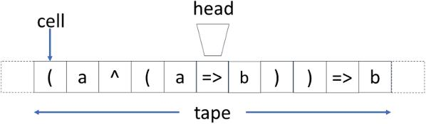

cell：单元格；head：读写头；tape：纸带。

<!-- dm-ch09-044 -->

〔原书第191页〕

这一结果来自图灵在考察生成实数的图灵机时，使用康托尔对角线法作出的更详尽论证。虽然上文批评了对角线法这一整个观念，认为它涉及已完成的无限，但这并不使停机问题核心的悖论失效。

<!-- dm-ch09-045 -->

〔原书第191页〕

## 丘奇—图灵论题

<!-- dm-ch09-046 -->

〔原书第191页〕

在哥德尔和图灵开展工作的同时，人们还探索了其他几种元数学形式体系。斯蒂芬·克莱尼（1909—1994）沿着传统路线发展出递归函数论，将皮亚诺归纳法反转为一种定义数或集合上的函数的形式。[^ch9-4]

<!-- dm-ch09-047 -->

〔原书第191页〕

相比之下，摩西·舍恩芬克尔（1888—1942）早在1924年就发展了组合逻辑。[^ch9-5]哈斯克尔·柯里（1900—1982）于1929年加以完善，[^ch9-6]由此引出了阿隆佐·丘奇（1903—1995）自1932年起关于λ演算的极有影响力的工作。[^ch9-7]

<!-- dm-ch09-048 -->

〔原书第191页〕

对辩证唯物主义的拥护者而言，这些系统似乎尤其成问题。舍恩芬克尔和柯里的组合逻辑由算子构成；算子的性质通过它们如何消去或复制其他算子、从而与之相互作用来定义。丘奇的λ演算则是纯粹抽象的，其规则通过代入来组合抽象。二者都不涉及具体的值。

<!-- dm-ch09-049 -->

〔原书第191页〕

不过，这些系统有一个关键性质：它们都能够表示逻辑和算术，因此都能把握希尔伯特纲领核心的定理与证明概念。这就是丘奇—图灵论题的根源：所有对数进行计算的系统都在如下意义上等价，即任一系统都能翻译成其他任一系统。换言之，没有什么能在一个系统中表达，却不能在其他系统中表达。

<!-- dm-ch09-050 -->

〔原书第191页〕

递归函数论、λ演算和图灵机在提出后不久，就被证明相互等价。[^ch9-8]后来，人们证明它们与冯·诺伊曼机，即一般化的数字计算机等价，因而与任意编程语言等价。模拟计算和量子计算[^ch9-9]的形式化也被证明满足丘奇—图灵论题。

<!-- dm-ch09-051 -->

〔原书第191页〕

请注意，这是一个推测性的论题，而不是能够证明的理论。我们不知道可能有多少种不同的等价系统。不过，它是可证伪的：某个新系统仍可能被证明具有不同于当前已知系统的性质，因而无法相互翻译。也就是说，丘奇—图灵论题可以作为经验性的常规科学的一部分接受实验研究。事实上，我们将在后文论证，它对于更广泛地理解现实具有核心意义。

<!-- dm-ch09-052 -->

〔原书第191页〕

从根本上说，所有这些系统都能够实现计算。这在图灵机中十分明确：机器处理纸带上的数据。对于组合子和λ演算，指令与数据没有明显的区分，规则作用于公式，直到公式无法再简化。

<!-- dm-ch09-053 -->

〔原书第192页〕

图灵机与其他形式体系的根本区别就在这里。一组图灵机指令是建造实际机器的蓝图；这种机器能像数字计算机一样，自主地处理其数据。相反，其他形式系统需要人或解释装置来执行规则。我们认为，这是支持图灵机在阐述唯物主义时具有首要地位的有力论据，后文还会讨论。

<!-- dm-ch09-054 -->

〔原书第192页〕

## 英国辩证唯物主义者的回应

<!-- dm-ch09-055 -->

〔原书第192页〕

对辩证唯物主义者来说，哥德尔和图灵的成果进一步证明了没有辩证法的逻辑所具有的局限。1938年，[^ch9-10]共产主义数学家阿利斯特·沃森（1908—1982）[^ch9-11]撰文认为，一切悖论

<!-- dm-ch09-056 -->

〔原书第192页〕

> 不过以这样或那样的方式表达了那种众所周知的困难：当我们试图把一个无限过程看作已经完成时，就会出现这种困难。（第450页）

<!-- dm-ch09-057 -->

〔原书第192页〕

沃森指的是亚里士多德对潜无限与实无限的区分。我们同意沃森：假定实无限存在，会使康托尔对角线法之类的方法成问题。不过，如果沃森把图灵机的纸带认作已完成的无限，那就错了。无论如何，图灵关于停机问题不可判定的结果，可以不依靠对角线法来确立。

<!-- dm-ch09-058 -->

〔原书第192页〕

沃森对元数学的怀疑十分清楚：

<!-- dm-ch09-059 -->

〔原书第192页〕

> 在数学基础这一领域，试图为抽象看待的数学论证辩护或加以否定的种种尝试，造成了大量混乱；人们付出极其巨大的劳动，才摆脱这些混乱。（第451页）

<!-- dm-ch09-060 -->

〔原书第192页〕

他没有直接运用辩证唯物主义对形式逻辑的批判。不过，他在这段话的脚注中说，自己所反对的是戴德金的主张：数学基础不需要提及“可测量的量”。这令人想到马克思主义者对不从已知量导出的变量所持的反对意见。

<!-- dm-ch09-061 -->

〔原书第192页〕

1938年，进化生物学家J. B. S. 霍尔丹（1892—1964）在《马克思主义哲学与科学》[^ch9-12]中指出：

<!-- dm-ch09-062 -->

〔原书第192页〕

> 总体上，我们可以认为，马克思主义者对那些抱负更大的逻辑理论颇为怀疑。例如，只要能够作出足够清晰的分类，罗素和怀特海在《数学原理》中的体系无疑就是真的，或大体是真的。

<!-- dm-ch09-063 -->

〔原书第192—193页〕

也就是说，这一逻辑系统的真假取决于能否建立按类排列的具体“存在物”“关系”和“命题”，从中再抽象出更多的类。不过，霍尔丹怀疑是否可能建立这样的本体论：

<!-- dm-ch09-064 -->

〔原书第193页〕

> 很可能，人们过分强调了某些逻辑系统；这些系统只适用于具有某些高度抽象性质的材料，而现实世界所体现的这些性质，远比逻辑学家愿意相信的更少见、更不完整。

<!-- dm-ch09-065 -->

〔原书第193页〕

1939年，霍尔丹在《自然辩证法》英译本序言[^ch9-13]中，谈及数学家声称已消除了恩格斯六十年前指出的数学矛盾时写道：

<!-- dm-ch09-066 -->

〔原书第193页〕

> 实际上，他们只是把矛盾推到了后台，矛盾仍然存在于数理逻辑领域。不仅从一组公理及其应用规则推导全部数学的每一次努力都失败了，而且哥德尔还证明，这些努力必定失败。

<!-- dm-ch09-067 -->

〔原书第193页〕

这忽略了关键一点：哥德尔的结果虽然限定了能够证明什么，却没有告诉我们如何确立单个公式的性质。事实上，基于公理系统的自动化技术，正越来越多地适用于现实世界中的重要问题，例如数字计算机设计。

<!-- dm-ch09-068 -->

〔原书第193页〕

与沃森一样，霍尔丹没有直接使用辩证唯物主义的语言。不过，与他评论哥德尔结果时一样，他暗示逻辑不足以把握具体现实，而这需要辩证法。

<!-- dm-ch09-069 -->

〔原书第193页〕

## 孟什维克化的唯心主义之后的苏联逻辑学

<!-- dm-ch09-070 -->

〔原书第193页〕

20世纪30年代以来苏联数学的命运已有广泛记述，尽管并非总是冷静客观的，例如武西尼奇、[^ch9-14]洛伦兹、[^ch9-15]塞内塔[^ch9-16]和库塔特拉泽[^ch9-17]的著作。马蒂亚斯那篇标题耸动的《逻辑与恐怖》[^ch9-18]讨论了1950年以前的苏联逻辑学。阿内利斯[^ch9-19]批评马蒂亚斯依赖菲利波夫[^ch9-20]的“论战性且有偏见的叙述”。不过，马蒂亚斯仍引用了当时出版物中一些颇能说明问题的文字，虽然出处标注不充分：

<!-- dm-ch09-071 -->

〔原书第193页〕

> 形式逻辑始终是占统治地位的剥削阶级手中最可靠的武器。是宗教和蒙昧主义的堡垒。（引自1934年一部关于辩证唯物主义和历史唯物主义的著作）

<!-- dm-ch09-072 -->

〔原书第193页〕

> 形式逻辑的规律与辩证逻辑的规律相对立。形式逻辑是空洞、贫乏、抽象的，因为它所建立的规律和范畴不符合客观现实。（《简明哲学词典》，1940）（第7页）

<!-- dm-ch09-073 -->

〔原书第194页〕

其中还包括1936年的《苏联大百科全书》（1936）：

<!-- dm-ch09-074 -->

〔原书第194页〕

> 形式逻辑是一种形而上学的思维形式……是人类知识发展的最低阶段，被作为最高思维形式的辩证法所取代。

<!-- dm-ch09-075 -->

〔原书第194页〕

> 正如我们所见，形式逻辑并非包含在辩证法中，而是被辩证法取代、驳斥和克服。

<!-- dm-ch09-076 -->

〔原书第194页〕

> ……全联盟共产党（VKP(b)）内的反列宁主义偏向。形式逻辑思维是孟什维主义的一个特征，列宁曾经多次指出；他对孟什维克的三段论和诡辩的形式逻辑推演，进行了毁灭性的辩证批判。（第7页）

<!-- dm-ch09-077 -->

〔原书第194页〕

虽然逻辑学的广泛研究受到限制，柯尔莫哥洛夫、亚诺夫斯卡娅等“红色专家”仍能研究和教授逻辑，并接触西方研究。例如，亚诺夫斯卡娅于1936年开始在莫斯科国立大学教授数理逻辑，1943年获任数理逻辑研讨班主任。[^ch9-21]

<!-- dm-ch09-078 -->

〔原书第194页〕

第二次世界大战后，逻辑学在苏联的地位得到恢复，尽管围绕它与辩证法的关系仍有持续的激烈争论，下文将予讨论。

<!-- dm-ch09-079 -->

〔原书第194页〕

## 数字计算机

<!-- dm-ch09-080 -->

〔原书第194页〕

数字计算机的发展很可能被证明是20世纪的关键进展。可以肯定，没有它们，21世纪初的生活几乎难以想象。计算机史同样已有详尽记述。这里将非常简要地关注其中几个突出方面。

<!-- dm-ch09-081 -->

〔原书第194页〕

第二次世界大战造成空前的大规模残酷杀戮与贫困，也加速了现代计算机的发展。[^ch9-22]哈佛Mark 1由霍华德·艾肯（1900—1973）于1937年设计，IBM以自动顺序控制计算器（ASCC）的名称建造，于1944年首次运行。它是机电式的，能存储数据，却不能存储程序。[^ch9-23]指令编码在穿孔纸带上，控制线性排列的操作序列。循环程序靠重复纸带实现，分支靠更换纸带实现。约翰·冯·诺伊曼（1903—1957）曾用Mark 1为研制最初原子弹的曼哈顿计划进行计算。

<!-- dm-ch09-082 -->

〔原书第194页〕

电子数字积分计算机（ENIAC）是最早的全电子通用计算机之一，于1945年完成。它比哈佛Mark 1快得多，通过将部件按适当配置插接起来进行编程。ENIAC的用途包括为最初的氢弹进行计算。

<!-- dm-ch09-083 -->

〔原书第195页〕

冯·诺伊曼在1925年的博士研究中从事集合论，并于20世纪30年代初与哥德尔交流不完备性结果。他深受图灵关于通用图灵机的思想影响：数据与指令共用同一存储器。他把这一现在称为冯·诺伊曼架构的设计，纳入影响深远的《EDVAC报告初稿》。[^ch9-24][^ch9-25]这份报告自由流传，影响了世界各地早期数字计算机的发展。到世纪中叶，已有许多公司开发和销售冯·诺伊曼架构的计算机，尤其是在美国和英国。

<!-- dm-ch09-084 -->

〔原书第195页〕

因此，尽管辩证唯物主义者和西欧哲学家都把希尔伯特纲领的失败视为对数学能力范围的限制，这一纲领仍产生了深远而持久的影响。此外，数理逻辑学家在20世纪30年代发展的形式体系，尤其是递归函数论和λ演算，长期以来一直是实用编程语言语义和设计的基础。

<!-- dm-ch09-085 -->

〔原书第195页〕

## 控制论

<!-- dm-ch09-086 -->

〔原书第195页〕

控制论研究“动物和机器中的控制与通信”，是二战后与计算机发展并行的一个重要研究领域。诺伯特·维纳（1894—1964）影响深远的著作[^ch9-26]阐述了其关键原理，借助信息论、统计力学和巴甫洛夫的行为心理学，说明机器如何通过反馈来学习，并根据观察到的结果优化活动。

<!-- dm-ch09-087 -->

〔原书第195页〕

与图灵一样，维纳的工作以对人类行为的抽象为基础，但侧重神经系统层面，而非高级认知。他观察到，在需要不断预测未来行为的活动中，例如操纵航行器或追踪移动目标，反馈对调节活动十分重要，而且这种调节是自主进行的（第6—8页）。维纳也承认数理逻辑对控制论的强大影响。他指出，无论对形式主义者还是直觉主义者而言：

<!-- dm-ch09-088 -->

〔原书第195页〕

> 数理逻辑理论的发展，受到的约束与限制计算机器性能的约束属于同一种类。正如下文将看到的，甚至康托尔悖论和罗素悖论也可以这样解释。（第13页）

<!-- dm-ch09-089 -->

〔原书第195页〕

也就是说，维纳认为，这些悖论限制的是一般的人类推理，而不只是数学，因为大脑就是机器。他引用图灵写道：

<!-- dm-ch09-090 -->

〔原书第195页〕

> 逻辑研究必须归结为逻辑机器的研究，无论它是神经性的还是机械性的，都必须包括它所有不可消除的局限和缺陷。（第125页）

<!-- dm-ch09-091 -->

〔原书第196页〕

然而，维纳认为信息既不是物质，也不是能量。因此，我们强烈反对他的如下主张：

<!-- dm-ch09-092 -->

〔原书第196页〕

> 任何不承认这一点的唯物主义，在今天都不可能生存。（第132页）

<!-- dm-ch09-093 -->

〔原书第196页〕

因为信息必须具有物质载体。

<!-- dm-ch09-094 -->

〔原书第196页〕

维纳充分意识到控制论和计算的社会影响。他认为：

<!-- dm-ch09-095 -->

〔原书第196页〕

> 现代工业革命……必定使人脑贬值，至少在那些较简单、较例行的决策方面如此。（第27页）

<!-- dm-ch09-096 -->

〔原书第196页〕

然而，正如格罗维奇[^ch9-27]所述，意识形态上对控制论的反对，成为苏联计算机发展的重大障碍。要说明这一点，我们需要作一个看似偏离主题的转折，考察苏联关于语言学的思想。

<!-- dm-ch09-097 -->

〔原书第196页〕

## 语言学

<!-- dm-ch09-098 -->

〔原书第196页〕

在19世纪的大部分时间里，语文学主导语言学研究。它通过识别不同语言词语中的共同词根，来追溯语言的起源。这些研究中的许多，因着意确立当代民族群体在历史上的先在地位而受到扭曲。

<!-- dm-ch09-099 -->

〔原书第196页〕

现代语言学由费迪南·德·索绪尔（1857—1913）奠基。他身后出版的《普通语言学教程》[^ch9-28]于1916年问世。索绪尔区分语言（langue）与言语（parole）：

<!-- dm-ch09-100 -->

〔原书第196页〕

> 把（1）社会性的与个人性的分开；（2）本质的与附属的、多少带有偶然性的分开。（第14页）

<!-- dm-ch09-101 -->

〔原书第196页〕

索绪尔进一步区分了两种情况：同时代的人使用相对不变的语言；以及随着使用者和用法改变，语言如何在时间中发生变化：

<!-- dm-ch09-102 -->

〔原书第196页〕

> 凡与我们这门科学的静态方面有关的，都是共时的；凡与演变有关的，都是历时的。同样，共时性和历时性分别指语言的某种状态和某个演变阶段。（第81页）

<!-- dm-ch09-103 -->

〔原书第196页〕

与语文学家不同，索绪尔认为，历时研究对于理解语言用处不大。他把语言学视为范围更广的符号学的一个组成部分：

<!-- dm-ch09-104 -->

〔原书第196页〕

> 可以设想一门研究符号在社会中生活的科学；它应是社会心理学的一部分，因而也是普通心理学的一部分。我将称之为符号学（semiology，来自希腊语sēmeîon，意为“符号”）。（第16页）

<!-- dm-ch09-105 -->

〔原书第197页〕

索绪尔特别关心符号如何将能指——进行指示的东西——与所指——被指示的东西，即概念或观念——结合起来。他倾向于用“符号”（sign）而非“象征”（symbol）这个词，因为符号是任意的，象征则根据其所暗示的内容来选定（第68页）。请注意，索绪尔主要关心系统中符号之间的关系，而不是语义本身；他认为意义的改变涉及“所指与能指之间关系的转移”（第75页）。

<!-- dm-ch09-106 -->

〔原书第197页〕

最后，索绪尔暗示了语言活动与计算之间的关系，第10章将予讨论：

<!-- dm-ch09-107 -->

〔原书第197页〕

> 语言的机制由接续各项的相互作用构成，类似机器的运转：其中的部件尽管排列在一个维度上，却具有彼此作用的功能。（第128页）

<!-- dm-ch09-108 -->

〔原书第197页〕

苏联语言学家瓦连京·沃洛希诺夫（1895—1936）试图在1929年的《马克思主义与语言哲学》[^ch9-29]中，发展一种研究语言的辩证方法。沃洛希诺夫把洪堡学派[^ch9-30]的个人主义主观主义与索绪尔的抽象客观主义相对置（第48页）。他拒斥索绪尔的抽象，把语言认定为完全社会性的东西，即由相互交往的说话者产生的（第98页）。因此，沃洛希诺夫将主题，即语义，视为理解的核心（第99页及以下）。

<!-- dm-ch09-109 -->

〔原书第197页〕

对沃洛希诺夫而言，语言是厘清马克思主义中基础与上层建筑关系问题的关键；基础即物质条件，上层建筑即社会形式（第18页及以下）。意识形态由基础决定，而词语在基础与上层建筑之间起中介作用。

<!-- dm-ch09-110 -->

〔原书第197页〕

沃洛希诺夫认为，物化于言语中的语言具有首要地位。主题承载意识形态，符号具有“社会多重重音性”（第23页）。词语的评价性重音由表达性语调决定（第103页）。语调及其解释方式也反映说话者与听者的阶级取向。因此，“符号成为阶级斗争的场所”（第23页），在这里：

<!-- dm-ch09-111 -->

〔原书第197页〕

> 统治阶级力图赋予意识形态符号一种超阶级的、永恒的性质，消灭符号内部社会价值判断之间的斗争，或者把这种斗争压入内部，使符号只有单一重音。（第23页）

<!-- dm-ch09-112 -->

〔原书第197页〕

沃洛希诺夫赞同地引用同时代的尼古拉·马尔（1864—1934），断言“语言学是语文学的产物”。二人都批评传统语文学把话语当作脱离动态言语交往的独白来研究（第72页），但都认为可以在物质文化的背景中追溯语言的起源。

<!-- dm-ch09-113 -->

〔原书第197页〕

不过，与沃洛希诺夫不同，马尔认为不存在无阶级的语言。马泰卡[^ch9-31]将沃洛希诺夫失势归因于这一分歧（第173页）。

<!-- dm-ch09-114 -->

〔原书第197页〕

马尔也拒斥形式逻辑，认为它以阶级为基础：

<!-- dm-ch09-115 -->

〔原书第198页〕

> 形式逻辑是阶级思维的产物，它连同创造它的阶级，被无产阶级的辩证唯物主义思维一扫而去；在这种思维中，思想取得了凌驾于语言之上的地位。（转引自马蒂亚斯[^ch9-32]）

<!-- dm-ch09-116 -->

〔原书第198页〕

直到1950年，马尔一直是苏联最受推崇的语言学家。

<!-- dm-ch09-117 -->

〔原书第198页〕

## 苏联逻辑学的复兴

<!-- dm-ch09-118 -->

〔原书第198页〕

1945年美国引爆三枚原子弹，从根本上改变了苏联科学工作的优先次序，削弱了意识形态，尤其是反形式主义，在政策中的支配地位。

<!-- dm-ch09-119 -->

〔原书第198页〕

1945年8月，苏联成立两个机构来管理原子弹研发。[^ch9-33]（第131页）苏联第一个计算机项目于1946年在基辅启动，由谢尔盖·列别杰夫（1902—1974）领导，MESM于1950年投入运行。然而，维纳的著作[^ch9-34]出版后，一场反控制论运动展开了，理由是控制论属于资本主义创新，旨在削弱工人阶级组织，最终完全取代工人，使他们陷于赤贫。[^ch9-35]（第128页）这表明，这些意识形态家对马克思主义经济学，以及活劳动在资本主义剩余价值生产中的核心作用，了解甚少。在马克思的体系中，利润来自人的活动，而非机器。而且，正如乌斯丁[^ch9-36]所述，苏联军方迅速采用控制论，并“将意识形态考虑放到一边”（第312页）。

<!-- dm-ch09-120 -->

〔原书第198页〕

尽管如此，计算机仍不得不被称为“数学机器”，以避开针对控制论的审查。[^ch9-37]人们明确区分两者：用控制论模拟人类行为不可接受，而用计算机进行计算和自动化则可以。把计算机类比于人脑被视为“荒谬”。[^ch9-38]（第142—143页）对唯物主义来说，这一立场似乎完全是一种倒退。如果人不只是机器，那么人的额外特性就必然来自非物质的属性。

<!-- dm-ch09-121 -->

〔原书第198页〕

回到逻辑学，苏联教育中的变化来得很快。1946年苏共（布）中央委员会的一项指令，[^ch9-39]由坎贝尔[^ch9-40]引述，指出

<!-- dm-ch09-122 -->

〔原书第198页〕

> 中学不教授逻辑学和心理学，是很不恰当的。（第343页）

<!-- dm-ch09-123 -->

〔原书第198页〕

并制定了开设这些课程的计划，配以资源。马蒂亚斯[^ch9-41]因此叙述，切尔帕诺夫1918年版的《逻辑学教科书》于1946年重印，随后出版了斯特罗戈维奇的《逻辑学》、阿斯穆斯的一部新教科书，以及斯特罗戈维奇著作的又一版（第8页）。

<!-- dm-ch09-124 -->

〔原书第198—199页〕

洛伦兹[^ch9-42]指出，继李森科在遗传学上取得所谓成就之后，1948年曾有人推动苏联更广泛的科学工作系统地服从“科学具有阶级性”这一观念。然而，数学和物理学方面的计划被原子导弹项目负责人贝利亚叫停，因为“有影响力的物理学家向他解释，这可能损害这些项目”（第217—218页）。

<!-- dm-ch09-125 -->

〔原书第199页〕

1952年，坎贝尔[^ch9-43]指出，苏联逻辑教育面临着如何调和“资产阶级”逻辑与辩证逻辑的问题。他概述奥斯马科夫[^ch9-44],[^ch9-45]1950年的一篇文章，认为其主张是：

<!-- dm-ch09-126 -->

〔原书第199页〕

> 与世界观不同，思维逻辑是一种无阶级的现象。（第281页）

<!-- dm-ch09-127 -->

〔原书第199页〕

此外，还有一句令人强烈联想到亚里士多德的表述：

<!-- dm-ch09-128 -->

〔原书第199页〕

> 思维逻辑据以进行的概念，对客观现实反映得好或不好，取决于思考者的意识形态或世界观。（第282页）

<!-- dm-ch09-129 -->

〔原书第199页〕

巴扎诺夫[^ch9-46]和基拉科斯[^ch9-47]叙述了亚诺夫斯卡娅如何成为苏联形式逻辑复兴的核心人物。1947年，她翻译了形式主义者希尔伯特和阿克曼的《理论逻辑纲要》，1948年又翻译了塔尔斯基的《逻辑与演绎科学方法论导论》。[^ch9-48]1947年，亚诺夫斯卡娅主张，应当把“数理逻辑的方法论形式主义”与其背后的唯心主义哲学区分开来，因为[^ch9-49]数理逻辑

<!-- dm-ch09-130 -->

〔原书第199页〕

> 不仅可以被视为数学的逻辑，也可以被视为逻辑的数学，因为它在很大程度上是将数学方法应用于逻辑问题的结果。[^ch9-50]

<!-- dm-ch09-131 -->

〔原书第199页〕

这一论证回到布尔对逻辑的数学化，巧妙地倒转了元数学所宣称的目标。

<!-- dm-ch09-132 -->

〔原书第199页〕

亚诺夫斯卡娅在此后的一生中始终推动形式逻辑的发展。她享有很高声望，从1959年起担任莫斯科国立大学数理逻辑教席，直至1966年去世。[^ch9-51]

<!-- dm-ch09-133 -->

〔原书第199页〕

## 斯大林论语言学

<!-- dm-ch09-134 -->

〔原书第199页〕

1950年，斯大林对马尔的批驳，预示着反形式主义立场公开逆转。正如洛伦兹[^ch9-52]所述，斯大林密切关注精密科学的发展，虽支持李森科，却怀疑科学普遍具有阶级性：[^ch9-53]

<!-- dm-ch09-135 -->

〔原书第199页〕

> 哈哈哈。那数学呢？达尔文主义呢？（第217页）

<!-- dm-ch09-136 -->

〔原书第199—200页〕

《马克思主义和语言学问题》[^ch9-54]于1950年发表在《真理报》，随后又有四次进一步澄清的交流。在最初的文章中，斯大林彻底拒斥马尔语言学的两项核心主张，认为语言既不是基础，也不是上层建筑，并且不具有阶级标记。这些批评也适用于沃洛希诺夫。

<!-- dm-ch09-137 -->

〔原书第200页〕

在后来答复克拉舍宁尼科娃时，斯大林承认语义学对语言学的重要性，同时批评马尔过分强调语义学。从上下文看，斯大林似乎再次批评马尔按说话者的阶级，赋予词语和表达不同的意义。他认为，这种差异很少，存在于个别词语中，而不在所有说话者共有的语法中。

<!-- dm-ch09-138 -->

〔原书第200页〕

最重要的是，斯大林表明，以形式主义之名作为决定性批评的做法已经结束：

<!-- dm-ch09-139 -->

〔原书第200页〕

> N. Y. 马尔认为，语法是空洞的“形式”，把语法体系视为语言基础的人是形式主义者。这完全是愚蠢的。

<!-- dm-ch09-140 -->

〔原书第200页〕

> 我认为，“形式主义”是“新学说”的作者们发明的，目的是便利他们与语言学对手的斗争。

<!-- dm-ch09-141 -->

〔原书第200页〕

此后，苏联逻辑学蓬勃发展，尽管辩证法与逻辑关系的争论仍在继续。[^ch9-55]十七年后，即1967年，科普宁[^ch9-56]仍在援引恩格斯[^ch9-57]来捍卫黑格尔的真理。

<!-- dm-ch09-142 -->

〔原书第200页〕

不过，1959年一份访苏美国计算机科学家的报告[^ch9-58]表明，苏联逻辑与计算领域的进展给他们留下了深刻印象。他们指出：

<!-- dm-ch09-143 -->

〔原书第200页〕

> 莫斯科、基辅和列宁格勒大学里，直接或间接与计算机有关的逻辑学家和数学家，显然比西欧或美国任何大学的都更多、更优秀。（第17页）

<!-- dm-ch09-144 -->

〔原书第200页〕

他们还指出，除MIT以外，美国没有能够与莫斯科国立大学相比的“面向计算机”的逻辑教学项目（第17页），并警告说，苏联培养的

<!-- dm-ch09-145 -->

〔原书第200页〕

> 合格的、面向计算机的数学家，而不只是计算机程序员，其人数可能很快超过美国。（第17页）

<!-- dm-ch09-146 -->

〔原书第200页〕

## 构造主义

<!-- dm-ch09-147 -->

〔原书第200页〕

苏联构造逻辑学派由小安德烈·马尔可夫[^ch9-59]（1903—1979）创立。[^ch9-60],[^ch9-61]构造主义根植于直觉主义，却像柯尔莫哥洛夫的进路一样，具有唯物主义取向。

<!-- dm-ch09-148 -->

〔原书第200—201页〕

直觉主义以唯心主义为基础，因此苏联逻辑学家接受它，似乎令人意外。不过，马尔可夫的合作者纳戈尔尼认为，在“解冻”之前，集合论尽管具有柏拉图主义根源，却被视为唯物主义而非唯心主义。[^ch9-62]此外，范杜拉基斯[^ch9-63]指出，一旦将布劳威尔直觉主义的逻辑框架与其哲学分开，前者就被认为与辩证唯物主义相容。正如沙宁在1962年所写：[^ch9-64]

<!-- dm-ch09-149 -->

〔原书第201页〕

> 越过直觉主义哲学的表层，人们在许多情况下能够发现：对于数学抽象形成过程和数学逻辑基础所涉及的根本问题，存在非常有价值的具体观察和深刻的具体分析。（第7页）

<!-- dm-ch09-150 -->

〔原书第201页〕

马尔可夫的学生库什纳指出其构造主义的四个核心特征。[^ch9-65]首先，研究对象是有限的，由有限的构造过程，从有限字母表出发，依照明确的算法形成规则生成。沙宁正确地把这一点视为构造主义取得成功的关键：

<!-- dm-ch09-151 -->

〔原书第201页〕

> 以精确的算术算法概念丰富数学，为许多作者沿新方向开展富有成果的研究提供了起点。（第6页）

<!-- dm-ch09-152 -->

〔原书第201页〕

其次，库什纳指出，构造主义与直觉主义一样，拒斥排中律和双重否定，存在性证明必须以构造为基础。第三，它接受潜无限而不接受实无限。最后，可计算性与算法相联系；它接受经经验验证的丘奇—图灵论题，即所有可计算性模型的等价性。

<!-- dm-ch09-153 -->

〔原书第201页〕

与图灵一样，马尔可夫从作为纸笔物质过程的数学出发。例如，他考虑在构成书稿的纸上画出一排竖线。在讨论这些线条随后如何经印刷复制时，他指出：

<!-- dm-ch09-154 -->

〔原书第201页〕

> 这个构造对象［即原始图画］是由纸张和干墨水组成的物体，上面的图画则是这一构造对象的副本，由纸张和干的印刷油墨组成。它也是构造对象，因为制作副本可以被视为一种构造活动。[^ch9-66]

<!-- dm-ch09-155 -->

〔原书第201页〕

马尔可夫明确承认物质现实的限制：

<!-- dm-ch09-156 -->

〔原书第201—202页〕

> 在执行构造过程时，我们常常碰到时间、空间和材料不足所造成的障碍。通常总能设法绕过这些障碍。然而，我们的构造能力确实有限，也没有理由假定，由这种限制引起的障碍总能消除。恰恰相反，现代物理学和宇宙学似乎表明，这些障碍原则上无法克服。[^ch9-67]

<!-- dm-ch09-157 -->

〔原书第202页〕

不过，用亚里士多德式的表述来说，潜在可行性这一抽象

<!-- dm-ch09-158 -->

〔原书第202页〕

> 使我们能够考虑任意长的构造过程和任意大的构造对象。它们的可行性是潜在的：如果有足够的空间、时间和材料，它们在实践中就是可行的。[^ch9-68]

<!-- dm-ch09-159 -->

〔原书第202页〕

马尔可夫明确把这种进路与基于集合论的经典数学相对照。后者允许实无限的抽象，[^ch9-69]并以否定不存在来确立存在，其中“甚至可能不知道如何构造所需对象”。[^ch9-70]

<!-- dm-ch09-160 -->

〔原书第202页〕

马尔可夫的记号体系以重写符号序列的规则为基础，类似乔姆斯基后来对形式文法类别的刻画。一套这样的规则称为算法；马尔可夫将其特征概括为：

<!-- dm-ch09-161 -->

〔原书第202页〕

- a) 规定精确，不留任意选择的余地，而且具有普遍可理解性——算法的确定性；

<!-- dm-ch09-162 -->

〔原书第202页〕

- b) 可以从在给定范围内变化的初始数据出发——算法的通用性；

<!-- dm-ch09-163 -->

〔原书第202页〕

- c) 算法以获得某种预期结果为目标，使用适当初始数据时，最终确实能够得到该结果——算法的得出结果性。[^ch9-71]

<!-- dm-ch09-164 -->

〔原书第202页〕

使用这一记号体系，马尔可夫通过归纳法系统地重构了皮亚诺算术的相当大一部分。

<!-- dm-ch09-165 -->

〔原书第202页〕

马尔可夫认为，他的进路满足他所谓的丘奇论题，即算法模型的等价性。他还认为，图灵机“极具说服力”，因为

<!-- dm-ch09-166 -->

〔原书第202页〕

> 在本质方面，图灵机的运行充分模拟了从事计算的数学家的行为，[^ch9-72]

<!-- dm-ch09-167 -->

〔原书第202页〕

即从一种思维状态转到另一种思维状态。

<!-- dm-ch09-168 -->

〔原书第202页〕

这套记号旨在用于形式系统的实际实验。例如，“元算法”编程语言Refal[^ch9-73]把马尔可夫规则纳入一个更常规的框架，用以辅助探索形式语义。然而，库什纳[^ch9-74]指出，虽然马尔可夫的工作在西方已为人所知，记号的复杂性却妨碍了更广泛的采用。

<!-- dm-ch09-169 -->

〔原书第202页〕

与直觉主义一样，接受构造主义对无限推理的限制，会抽掉许多重要的经典数学的基础。因此，人们也像直觉主义者那样，开展大量研究，试图在有限性基础上重建这些数学。

<!-- dm-ch09-170 -->

〔原书第203页〕

具体说来，构造主义接受整数和有理数，却不接受必然涉及无限的实数。因此，把实数重新表述为构造函数，是至关重要的一步。构造主义的进路借鉴图灵与外尔的工作，用算法来定义实数：一个算法生成精度不断提高的有理数，而精度由另一个算法确定。正如沙宁所说：

<!-- dm-ch09-171 -->

〔原书第203页〕

> 自然科学和工程中对具体实数的实际使用，本质上基于这样一种可能性：从一个实数的个别表示中，提取出给出其一系列有理近似值的算法。[^ch9-75]

<!-- dm-ch09-172 -->

〔原书第203页〕

这明确承认，在实际应用中，由于测量有限，操纵物理现实时使用的是有理数。

<!-- dm-ch09-173 -->

〔原书第203页〕

尽管马尔可夫采取唯物主义进路，他仍赞同这样一种观点：不可判定性结果限制的是数学，而不是人：

<!-- dm-ch09-174 -->

〔原书第203页〕

> 因此，数学中（以及其他任何学问分支中）带有意向的研究事业，永远不会转移给机器；机器只能辅助人，而不能取代人。[^ch9-76]

[^ch9-1]: 1. K. Gödel：“论《数学原理》及相关系统中的形式不可判定命题”，载J. van Heijenoort编《从弗雷格到哥德尔：数理逻辑文献集，1879—1931》（Harvard University Press，1967），第596—616页。

[^ch9-2]: 2. Kleene：《元数学导论》。

[^ch9-3]: 3. A. M. Turing：“论可计算数及其在判定问题上的应用”，Proceedings of the London Mathematical Society s2–42，第1期（1937）：230—265。

[^ch9-4]: 4. S. C. Kleene：“自然数的一般递归函数”，Mathematische Annalen 112（1936）：727—742。

[^ch9-5]: 5. M. Schönfinkel：“论数理逻辑的构造块”，载J. van Heijenoort编《从弗雷格到哥德尔：数理逻辑文献集，1879—1931》（Harvard University Press，1967），第357—366页。

[^ch9-6]: 6. H. Curry：《组合逻辑基础》（Grundlagen Der Kombinatorischen Logik），F. Kamaraddine、J. Seldin英译（College Publications，2017）。

[^ch9-7]: 7. A. Church：“逻辑基础的一组公设”，Annals of Mathematics，第2系列，33，第2期（1932）：346—366。

[^ch9-8]: 8. S. J. Kleene［姓名首字母按底本］：“λ可定义性与递归性”，Duke Mathematical Journal 2，第2期（1936）：340—353；A. M. Turing：“可计算性与λ可定义性”，Journal of Symbolic Logic 2（1937）：153—164。

[^ch9-9]: 9. D. Deutch［底本拼法］：“量子理论、丘奇—图灵原理与通用量子计算机”，Proceedings of the Royal Society: A, Mathematical, Physiscal and Engineering Sciences 400，第1818期（1985）：97—117。

[^ch9-10]: 10. A. G. D. Watson：“数学及其基础”，Mind 47，第188期（1938）：440—451。

[^ch9-11]: 11. 沃森曾把图灵介绍给路德维希·维特根斯坦，并曾被指称为苏联间谍：https://en.wikipedia.org/wiki/Alister_Watson 。

[^ch9-12]: 12. J. B. S. Haldane：《马克思主义哲学与科学》（George Allen and Unwin Ltd，1938）。

[^ch9-13]: 13. J. B. S. Haldane：“序言”，载《自然辩证法》，苏联，1939，https://www.marxists.org/archive/marx/works/1883/don/preface.htm 。

[^ch9-14]: 14. Vucinich：“苏联的数学与辩证法：斯大林以前的时期”。

[^ch9-15]: 15. Lorentz：“1928至1953年苏联的数学与政治”。

[^ch9-16]: 16. E. Seneta：“20世纪30年代苏联的数学、宗教与马克思主义”，Historia Mathematica 31（2004）：337—367。

[^ch9-17]: 17. S. S. Kutateladze：“俄国数学的悲剧”，Siberian Electronic Mathematical Reports 9（2011）：A85—A100，https://arxiv.org/abs/math/0702632 。

[^ch9-18]: 18. A. R. D. Mathias：“逻辑与恐怖”，剑桥大学彼得学院Perne Club，1987，https://www.dpmms.cam.ac.uk/~ardm/stalin.pdf 。

[^ch9-19]: 19. I. H. Anellis：“苏联的形式逻辑与辩证唯物主义：评Fania Cavaliere《苏联的形式逻辑：1946—1965年的论争年代》及A. R. D. Mathias《逻辑与恐怖》”，Modern Logic 4，第2期（1994）：210—218，https://projecteuclid.org/journals/review-of-modern-logic/volume-4/issue-2/Formal-logic-and-dialecticalmaterialism-in-the-Soviet-Union/rml/1204835224.full 。

[^ch9-20]: 20. A. Philipov：《苏联的逻辑与辩证法》（Research Program on the U.S.S.R，Varengian Press，1952）。

[^ch9-21]: 21. D. Kilakos：“索菲娅·A. 亚诺夫斯卡娅：苏联数理逻辑的马克思主义先驱”，International Journal of the Historiography of Science 6（2019）：52。

[^ch9-22]: 22. G. Dyson：《图灵的大教堂：数字宇宙的起源》（Penguin，2012）。

[^ch9-23]: 23. 程序存储器与数据存储器分离的设计，至今仍称为哈佛架构。

[^ch9-24]: 24. 电子离散变量自动计算机（Electronic Discrete Variable Automatic Computer）。

[^ch9-25]: 25. J. Von Neumann：《EDVAC报告初稿》（宾夕法尼亚大学穆尔电气工程学院，1945），http://web.mit.edu/STS.035/www/PDFs/edvac.pdf 。

[^ch9-26]: 26. Wiener：《控制论，或动物和机器中的控制与通信》（MIT Press，1948）。

[^ch9-27]: 27. Gerovitch：《从新话到控制论话语：苏联控制论史》。

[^ch9-28]: 28. F. de Saussure：“普通语言学教程”，载C. Bally、A. Sechehaye编《普通语言学教程》，W. Baskin英译（The Philosophical Society，1959）。

[^ch9-29]: 29. V. N. Vološinov：《马克思主义与语言哲学》，L. Matejka、I. R. Tutunik英译（Seminar Press，1986）。

[^ch9-30]: 30. 此处不再进一步讨论。

[^ch9-31]: 31. L. Matejka：“附录1：论俄国最早的符号学导论”，载《马克思主义与语言哲学》（Seminar Press，1986）。

[^ch9-32]: 32. Mathias：“逻辑与恐怖”，第7页。

[^ch9-33]: 33. Gerovitch：《从新话到控制论话语：苏联控制论史》。

[^ch9-34]: 34. Wiener：《控制论，或动物和机器中的控制与通信》。

[^ch9-35]: 35. Gerovitch：《从新话到控制论话语：苏联控制论史》。

[^ch9-36]: 36. S. T. Usdin：《建设共产主义：两名美国人如何为斯大林从事间谍活动并创建苏联硅谷》（Yale，2005）。

[^ch9-37]: 37. Gerovitch：《从新话到控制论话语：苏联控制论史》，第131页及以下。

[^ch9-38]: 38. Gerovitch：《从新话到控制论话语：苏联控制论史》。

[^ch9-39]: 39. 苏共（布）中央委员会：“中学的逻辑学和心理学”，Soviet Studies 3，第3期（1952）：342—344。

[^ch9-40]: 40. C. A. Campbell：“苏联的逻辑概念”，Soviet Studies 3，第3期（1952）：278—287。

[^ch9-41]: 41. Mathias：“逻辑与恐怖”。

[^ch9-42]: 42. Lorentz：“1928至1953年苏联的数学与政治”。

[^ch9-43]: 43. Campbell：“苏联的逻辑概念”。

[^ch9-44]: 44. 苏联高等教育部社会科学教学管理机构的哲学部门负责人。

[^ch9-45]: 45. I. I. Osmakov：“论思维逻辑与逻辑科学”，Voprosy Filosofii 3（1950）：309—317。

[^ch9-46]: 46. V. Bazhanov：“复兴：S. A. 亚诺夫斯卡娅的逻辑学道路”，History and Philosophy of Logic 22，第3期（2001）：129—133。

[^ch9-47]: 47. Kilakos：“索菲娅·A. 亚诺夫斯卡娅：苏联数理逻辑的马克思主义先驱”。

[^ch9-48]: 48. Bazhanov：“复兴：S. A. 亚诺夫斯卡娅的逻辑学道路”，第132页。

[^ch9-49]: 49. 引自S. A. Yanovskya：“作为无穷小分析批评者的米歇尔·罗尔”（俄文），Trudy Instituta Istorija Estestvoznanija 1（1947）：327—346（引文见341页）。

[^ch9-50]: 50. Kilakos：“索菲娅·A. 亚诺夫斯卡娅：苏联数理逻辑的马克思主义先驱”，第57页。

[^ch9-51]: 51. Bazhanov：“复兴：S. A. 亚诺夫斯卡娅的逻辑学道路”，第132页。

[^ch9-52]: 52. Lorentz：“1928至1953年苏联的数学与政治”，第217页。

[^ch9-53]: 53. 引自V. J. Birstein《知识的歪曲：苏联科学的真实故事》（Westview，2001），第249—251页。

[^ch9-54]: 54. J. V. Stalin：《马克思主义和语言学问题》（莫斯科：Foreign Languages Publishing House，1950），https://www.marxists.org/reference/archive/stalin/works/1950/jun/20.htm 。

[^ch9-55]: 55. Mathias：“逻辑与恐怖”。

[^ch9-56]: 56. P. V. Kopnine：“辩证法与逻辑”，Diogenes 15，第60期（1967）：87—102。

[^ch9-57]: 57. 以及列宁。

[^ch9-58]: 58. J. W. Carr III等：“访问苏联计算中心”，Communications of the ACM 2，第6期（1959）：8—20。

[^ch9-59]: 59. A. A. Markov Jr：《算法理论》，第42卷（Trudy Mat. Institua im. Steklova，1954）。

[^ch9-60]: 60. 他是安德烈·马尔可夫（1856—1922）之子，后者以随机过程领域的奠基工作闻名。

[^ch9-61]: 61. Markov：《算法理论》。

[^ch9-62]: 62. N. M. Nagorny：“安德烈·马尔可夫与数学构造主义”，Logic, Methodology and Philosophy of Science IX（1994）：469。

[^ch9-63]: 63. I. M. Vandoulakis：“论A. A. 马尔可夫对布劳威尔直觉主义的态度”，Philosophia Scientiæ 2015/1，第19-1期（2015）：第46段。

[^ch9-64]: 64. N. A. Sanin：“构造实数与构造数空间”，载Translations of Mathematical Monographs，E. Mendelson英译，第21卷（American Mathematical Society，1968）。

[^ch9-65]: 65. B. A. Kushner：“马尔可夫的构造分析：一位参与者的看法”，Theoretical Computer Science 219（1999）：268—269。

[^ch9-66]: 66. A. A. Markov Jr、N. M. Nagorny：《算法理论》，M. Greendlinger英译（Kluwer Academic，1988），第1页。

[^ch9-67]: 67. Markov Jr、Nagorny：《算法理论》，第10页。

[^ch9-68]: 68. Markov Jr、Nagorny：《算法理论》，第10页。

[^ch9-69]: 69. Markov Jr、Nagorny：《算法理论》，第10页。

[^ch9-70]: 70. Markov Jr、Nagorny：《算法理论》，第12页。

[^ch9-71]: 71. Markov Jr：《算法理论》，第1页。

[^ch9-72]: 72. Markov Jr、Nagorny：《算法理论》，第109页。

[^ch9-73]: 73. V. F. Turchin：“一种元算法语言”，Kibernetika 4，第4期（1967）：45—54。

[^ch9-74]: 74. B. A. Kushner：“A. A. 马尔可夫的构造数学”，The American Mathematical Monthly 113，第6期（2006）：562。

[^ch9-75]: 75. Sanin：“构造实数与构造数空间”，第13页。

[^ch9-76]: 76. Markov Jr：《算法理论》，第441页。

<!-- dm-ch10-001 -->

〔原书第205页〕

# 第10章 语言、自动机与意义

<!-- dm-ch10-002 -->

〔原书第205页〕

## 语言与意义

<!-- dm-ch10-003 -->

〔原书第205页〕

长期以来，人们一直区分陈述的意义的两个方面：它的值，以及它所谈论的内容。这些区别可以称为指称与涵义、指谓与含蕴，以及外延与内涵。

<!-- dm-ch10-004 -->

〔原书第205页〕

考虑对一个数的描述：

<!-- dm-ch10-005 -->

〔原书第205页〕

> 比二多一

<!-- dm-ch10-006 -->

〔原书第205页〕

它的外延意义来自将它求得一个值：三。另一种说法是，外延意义就是所有能在下列陈述中替换“那个数”、

<!-- dm-ch10-007 -->

〔原书第205页〕

> 那个数比二多一

<!-- dm-ch10-008 -->

〔原书第205页〕

并保持陈述为真的东西。也就是说，我们把“那个数”当作变量，其唯一有效的值是“三”。

<!-- dm-ch10-009 -->

〔原书第205页〕

现在考虑对一个数的描述：

<!-- dm-ch10-010 -->

〔原书第205页〕

> 六的一半

<!-- dm-ch10-011 -->

〔原书第205页〕

它的外延意义也是三。但这两个陈述的内涵意义很不一样：前者涉及计数，后者涉及除法。我们可以[^ch10-1]用皮亚诺算术将它们形式化，并证明二者等价。于是，它们具有可替换同义性。也就是说，在关于数的形式表达式中，可以互换使用二者，而不改变包含它们的表达式的意义。

<!-- dm-ch10-012 -->

〔原书第205页〕

现在假设克里斯会数数，却不会做除法。那么：

<!-- dm-ch10-013 -->

〔原书第205页〕

> 克里斯知道三比二多一。

<!-- dm-ch10-014 -->

〔原书第206页〕

这是真的。但我们不能将“比二多一”替换为“六的一半”：

<!-- dm-ch10-015 -->

〔原书第206页〕

> 克里斯知道三是六的一半。

<!-- dm-ch10-016 -->

〔原书第206页〕

同时还保持陈述为真。

<!-- dm-ch10-017 -->

〔原书第206页〕

伯特兰·罗素试图分析并重新表述内涵性构造，使它们成为外延性的。[^ch10-2]按照罗素的进路，我们可以写成：

<!-- dm-ch10-018 -->

〔原书第206页〕

> 克里斯知道“有一个数比二多一”。

<!-- dm-ch10-019 -->

〔原书第206页〕

以明确“知道”的语境。如果将引号中的短语换成一个表面上等价的表述：

<!-- dm-ch10-020 -->

〔原书第206页〕

> 克里斯知道“有一个数是六的一半”。

<!-- dm-ch10-021 -->

〔原书第206页〕

那么，就不能把“有一个数”替换为“三”而仍保持陈述为真。

<!-- dm-ch10-022 -->

〔原书第206页〕

鲁道夫·卡尔纳普（1891—1970）是一位逻辑实证主义者，试图从实证主义科学中寻找事实，以供逻辑操作。起初，他认为一切陈述要么是外延性的，要么没有意义。在1928年的著作《世界的逻辑构造；哲学中的伪问题》[^ch10-3]中，他提出一种全面的进路，否认任何不能以事实为基础的语言构造有意义。他尤其否认实在论（即唯物主义）或唯心主义有意义。也就是说，卡尔纳普认为知识建立在经验主义的验证上。尽管如此，他仍自称“物理主义者”，认为物理学示范了如何确立事实。

<!-- dm-ch10-023 -->

〔原书第206页〕

威拉德·奎因（1908—2000）在1953年的《从逻辑的观点看》[^ch10-4]中批评逻辑实证主义。在《经验论的两个教条》（第20—46页）中，他首先否认分析真理与综合真理之间存在深刻区别：前者基于意义而不考虑事实，后者基于事实（第20页）。例如，可以把形式化算术内部数“三”的性质，与某人对数“三”的认识相比较；后者是一个被报告的事实。其次，奎因拒绝那种还原论，即只承认能重构为由事实组成的逻辑陈述的陈述有意义（第20页）。最终留下的是一种明确的实用主义。

<!-- dm-ch10-024 -->

〔原书第206页〕

奎因特别关注能否用可替换性作为意义同义性的标准，探问替换在什么语境中正当，并指出替换必然改变陈述的形式（第56页）。他的结论同样是实用主义的：

<!-- dm-ch10-025 -->

〔原书第206页〕

> 真正重要的是在相关方面相似……这是经验科学的一个典型问题。（第60页）

<!-- dm-ch10-026 -->

〔原书第206页〕

对奎因来说，形式系统以变量标记抽象的位置，因此：

<!-- dm-ch10-027 -->

〔原书第207页〕

> 被假定为一个实体，简而言之，就是被看作变量的值。（第13页）

<!-- dm-ch10-028 -->

〔原书第207页〕

于是：

<!-- dm-ch10-029 -->

〔原书第207页〕

> 一个理论所承诺的，正是且仅是这样的实体：为使该理论中的断言为真，理论的约束变量必须能够指称它们。（第13—14页）

<!-- dm-ch10-030 -->

〔原书第207页〕

这是一种令人欣慰的宽容立场。它不仅容许在逻辑系统中操作事实，也容许操作系统能够正当操作的任何东西。

<!-- dm-ch10-031 -->

〔原书第207页〕

## 模型论

<!-- dm-ch10-032 -->

〔原书第207页〕

在1921年的《逻辑哲学论》[^ch10-5]中，维特根斯坦主张，应当用事态来理解世界，即事物——他称之为对象——的配置。他断言：

<!-- dm-ch10-033 -->

〔原书第207页〕

> 4.1 命题表现事态的存在与不存在。

<!-- dm-ch10-034 -->

〔原书第207页〕

> 4.11 真命题的总和就是整个自然科学（或自然科学的全部体系）。（第25页）

<!-- dm-ch10-035 -->

〔原书第207页〕

维特根斯坦还把命题的涵义界定为：

<!-- dm-ch10-036 -->

〔原书第207页〕

> 4.2 ……与事态存在和不存在的可能性相符合或不相符合。（第30页）

<!-- dm-ch10-037 -->

〔原书第207页〕

他随后提议用真值表来考察这些可能性（第30页），并已论证：

<!-- dm-ch10-038 -->

〔原书第207页〕

> 4.25 如果一个基本命题为真，则该事态存在；如果一个基本命题为假，则该事态不存在。

<!-- dm-ch10-039 -->

〔原书第207页〕

卡尔纳普深受维特根斯坦事态概念的影响，在1947年的《意义与必然性：语义学与模态逻辑研究》[^ch10-6]中，通过状态描述这一观念，系统地形式化了外延意义概念：

<!-- dm-ch10-040 -->

〔原书第207页〕

> 有且仅有一个状态描述，描述宇宙的实际状态；它包含所有真的原子句，以及那些假的原子句的否定。因此，它只包含真句子，我们便称之为真状态描述。任何形式的句子为真，当且仅当它在真状态描述中成立。（第10页）

<!-- dm-ch10-041 -->

〔原书第208页〕

请注意，维特根斯坦谈的是确定某一事态是否存在，这相对于已知内容而言；卡尔纳普却断言，可以描述“宇宙的实际状态”。

<!-- dm-ch10-042 -->

〔原书第208页〕

卡尔纳普随后系统地构建一种形式对象语言，通过代入状态描述中的值来表达外延意义。内涵性陈述则用一种受约束的自然元语言[^ch10-7]作出，以便译成对象语言，再对照状态描述加以验证。

<!-- dm-ch10-043 -->

〔原书第208页〕

到1961年，卡尔纳普已不再认为

<!-- dm-ch10-044 -->

〔原书第208页〕

> 关于事物的一切陈述，都能翻译为关于感觉材料的陈述。[^ch10-8]

<!-- dm-ch10-045 -->

〔原书第208页〕

此外，他现在对内涵性陈述能够多严格地转化为外延性陈述，也持谨慎态度：

<!-- dm-ch10-046 -->

〔原书第208页〕

> 因此，我后来提出一个较弱的版本，主张每个非外延性陈述都能翻译为外延性语言中逻辑等价的陈述。这一论题似乎适用于迄今已知的一切非外延性陈述的例子，但尚未得到证明；我们只能把它作为一个猜想提出。（第ix页）

<!-- dm-ch10-047 -->

〔原书第208页〕

不过，维特根斯坦和卡尔纳普的工作构成了模型论的基础，而模型论如今支撑着编程语言的语义。卡尔纳普的工作也继续得到发展，例如马里安·普热莱茨基的《经验理论的逻辑》。[^ch10-9]

<!-- dm-ch10-048 -->

〔原书第208页〕

对普热莱茨基而言，模型是用集合论形式化的事态或状态描述。他把模型限定于他所称的具有谓词性质的物理对象。他认为，这不足以成为物理学这类科学的基础，需要加入实数及关系、函数等高阶逻辑构造，尽管他本人并未作这种扩展（第104页）。由于科学不断发展，他还提出，可以通过截取一个“横截面”来刻画一门学科的现状，从而确定其中确定的分析知识与不确定的综合知识之间不断变化的平衡（第105—106页）。

<!-- dm-ch10-049 -->

〔原书第208页〕

## 巴迪欧、模型论与唯物主义

<!-- dm-ch10-050 -->

〔原书第208页〕

阿兰·巴迪欧的《模型的概念》[^ch10-10]以1968年的讲课为基础，试图调和形式逻辑与马克思主义唯物主义传统。他批评卡尔纳普和奎因，认为两种观点都区分经验“事实”与逻辑形式（第7页），并主张这实际上将形式科学与经验科学联结起来；也就是说，二者之间存在

<!-- dm-ch10-051 -->

〔原书第208页〕

> 逻辑新实证主义与模型论之间的辩证共谋。（第19页）

<!-- dm-ch10-052 -->

〔原书第209页〕

巴迪欧分析的一大长处在于，他把数学刻画为统一的物质实践，将形式规则系统与实际计算联系起来：

<!-- dm-ch10-053 -->

〔原书第209页〕

> 有效程序这一哲学范畴——即可以通过一系列无歧义的书写操作明确计算出来的东西——真正处于一切数学认识论的中心。（第26页）

<!-- dm-ch10-054 -->

〔原书第209页〕

巴迪欧强调，虽然模型是为探索形式系统而构造的，

<!-- dm-ch10-055 -->

〔原书第209页〕

> 模型是关于逻辑—数学系统区分能力的、可用数学构造的概念。[^ch10-11]（第40页）

<!-- dm-ch10-056 -->

〔原书第209页〕

反过来，模型也要接受实验研究：

<!-- dm-ch10-057 -->

〔原书第209页〕

> 正因为形式装置本身是一种物质化的理论、一个数学结果，它才能进入数学知识的生产过程；在这一过程中，模型概念所指的不是一个等待形式化的外部，而是有待检验的数学材料。（第47页）

<!-- dm-ch10-058 -->

〔原书第209页〕

巴迪欧进一步认为，形式系统实实在在是一台“数学生产机器”，并指出

<!-- dm-ch10-059 -->

〔原书第209页〕

> 这些系统的理论与自动机或计算机器理论之间日益明显的亲缘关系，鲜明地说明了形式主义的实验使命。（第43页）

<!-- dm-ch10-060 -->

〔原书第209页〕

如下文将讨论的，我们不只把自动机本身视为实验装置，还认为它为语义提供一种动态的物理基础，超越数学构造，无论这些构造如何物质化。

<!-- dm-ch10-061 -->

〔原书第209页〕

巴迪欧在构造模型时优先考虑集合论和整数，却没有提到丘奇—图灵论题。这个论题意味着，所有图灵完备（TC）系统都可以相互充当形式模型：证明一个新系统图灵完备，恰恰要求能够在它与某个已知图灵完备系统之间进行翻译。既然计算机是物理的图灵完备系统，它们便使形式模型立足于实际现实。

<!-- dm-ch10-062 -->

〔原书第209页〕

## 自动机

<!-- dm-ch10-063 -->

〔原书第209页〕

第9章介绍了图灵机，以及它有界但可以任意扩展的纸带。我们还看到，根据丘奇—图灵论题，图灵机是一切可能计算的模型。

<!-- dm-ch10-064 -->

〔原书第209页〕

现在将探讨，限制图灵机纸带的性质如何改变它的计算性质。霍普克罗夫特和乌尔曼[^ch10-12]对此有简明的论述。

<!-- dm-ch10-065 -->

〔原书第210页〕

可以将图灵机纸带视为输入与输出的结合，同时也是存储器。初始纸带是输入，最终纸带是输出，图灵机能够任意检查、修改和扩展纸带。下面考虑通过改变纸带的性质，对图灵机行为施加的三类限制。

<!-- dm-ch10-066 -->

〔原书第210页〕

首先，可以规定纸带不得扩展，即输出必须与输入一样大。这称为线性有界自动机（LBA），大致对应实际计算机。当然，计算机可以接收任意长度的流式输入，但任何时刻能保存在内存中的量都是有限的。实践中，我们仍把计算机当作图灵机，内存耗尽时就会抱怨。

<!-- dm-ch10-067 -->

〔原书第210页〕

其次，可以给有限状态自动机（FSA）配一条能沿一个方向扩展的纸带。它像栈一样工作：可以在顶部添加（压入）或移除（弹出）项，但只能检查栈顶项。这称为下推自动机（PDA）。下推自动机并不是实际机器的常见形式，却是计算机程序初步句法分析软件的核心。

<!-- dm-ch10-068 -->

〔原书第210页〕

第三，可以把对有限纸带的访问限定为只从头到尾检查，不得修改纸带或改变方向。因此，机器只能一路处理纸带，从一个状态转到另一个状态。如果不止一个旧状态都能进入同一个新状态，机器便不记得自身的计算历史。这类机器称为有限状态自动机（FSA）或摩尔机。

<!-- dm-ch10-069 -->

〔原书第210页〕

还能够产生输出的有限状态自动机称为米利机。这相当于给摩尔机加上一条只有一个单元格的可写纸带。米利机广泛用于控制按固定动作序列运行的过程，例如一组交通信号灯或洗衣机的不同洗涤程序。

<!-- dm-ch10-070 -->

〔原书第210页〕

## 语言游戏

<!-- dm-ch10-071 -->

〔原书第210页〕

我们略去了两者的区别：检查符号序列是否具有所要求的结构，以及更广泛的计算。它们的联系在于，给定某种类型的文法，就有算法能够生成相应的检查机器。不过，确认结构与符号序列的意义如何相关，还不清楚。

<!-- dm-ch10-072 -->

〔原书第210页〕

关键在于，机器检查序列时还做了什么。一旦把意义定位于物质化系统的状态变化中，就能以语言交流来阐明更广泛的互动。

<!-- dm-ch10-073 -->

〔原书第210页〕

与卡尔纳普一样，维特根斯坦也退离了系统地阐述事态的总体性构想。在《逻辑哲学论》之后，他生前发表很少，后期工作通过身后出版的文集为人所知。

<!-- dm-ch10-074 -->

〔原书第210—211页〕

在1953年出版的《哲学研究》[^ch10-13]中，维特根斯坦探究语言游戏这一观念，以考察语言如何发挥作用。与其他游戏一样，语言游戏包含参与者依规则操作事物。游戏通过参与者遵循共同规则，轮流以说话和行动来互动而进行。

<!-- dm-ch10-075 -->

〔原书第211页〕

例如：

<!-- dm-ch10-076 -->

〔原书第211页〕

> “我们来下一盘国际象棋吧”这个表达的涵义，与游戏的全部规则之间，是在哪里建立联系的？——在游戏的规则表中，在游戏的教学中，在日常下棋的实践中。（第80页）

<!-- dm-ch10-077 -->

〔原书第211页〕

维特根斯坦将此与奥古斯丁的实指意义观相对置：意义基于名称与事物的联系，因此儿童通过他人指着事物并说出名称来学习语言。维特根斯坦则认为，儿童通过训练学习语言，这种训练包含说话，也就是互动（第2—4页）。

<!-- dm-ch10-078 -->

〔原书第211页〕

他引入一个建筑工人与助手的语言游戏：工人喊出一个构件的名称，助手便递上该构件（第3页）。然后，他考虑工人询问助手有多少块石板的情形。助手回答“五块石板”，与工人说“五块石板”、期望助手递来五块石板，很不相同（第10页）。也就是说，即使广义理解命名，问题也不在给事物命名：同样的语言构造，在不同语境中有不同意义。

<!-- dm-ch10-079 -->

〔原书第211页〕

对维特根斯坦而言，我们在各种具体情境中参与众多小型语言游戏：

<!-- dm-ch10-080 -->

〔原书第211页〕

> 我们没有意识到日常语言游戏的惊人多样性，因为语言的外衣使一切显得相同。（第224页）

<!-- dm-ch10-081 -->

〔原书第211页〕

不过，语言游戏并非固定不变，而是在互动中发展；如果参与者行动不当，或者行动产生了未预见的后果，游戏便可能失灵。由于我们浸润于语言使用之中，这种情况可以得到解决：

<!-- dm-ch10-082 -->

〔原书第211页〕

> 我们规定规则，规定一种游戏的技法，可是当我们遵循规则时，事情并不像我们假定的那样发展。于是，我们仿佛纠缠在自己的规则之中了。（第50页）

<!-- dm-ch10-083 -->

〔原书第211页〕

## 文法与自动机

<!-- dm-ch10-084 -->

〔原书第211页〕

诺姆·乔姆斯基[^ch10-14]考察了不同类别的合式符号序列，而不直接关注其意义。他区分了四类文法，它们已被证明与上述自动机相对应。[^ch10-15]即图灵机可以检查0型文法，线性有界自动机检查1型文法，下推自动机检查2型文法，有限状态自动机检查3型文法。这些类型因此构成一个层级，每一型所能定义的范围都比下一型更广，正如相应机器按计算能力排列一样。

<!-- dm-ch10-085 -->

〔原书第212页〕

能力最强的0型文法能够涵盖任何图灵完备计算。不过，它们不用于实际计算，因为通过界定符号序列的上下文来思考问题实在很困难；这些上下文可以任意庞大而复杂。人们转而使用编程语言：它们在严谨性上像形式系统，在表达力上像自然语言。

<!-- dm-ch10-086 -->

〔原书第212页〕

使用编程语言，就要依据它所支持的抽象来思考，尤其要考虑变量能够表示哪类东西。在心理层面，这略去了计算的物理根基：计算在物理计算机中进行，操作符号编码的物理实例。因此，最终决定什么能够计算的，是现实的物理性质。对于涉及任意小的构造（如实数）或任意大的构造（如可无止境增长的数据库）的计算，这一点尤其重要。

<!-- dm-ch10-087 -->

〔原书第212页〕

如果现实有限，我们最终就会耗尽可用于计算的物质。我们或许以为自己在一种拥有潜在无限资源的0型语言中编程，但实际上内存有界。而且，即使现实无限，谈论在有限时间内动用无限资源的有限计算，也没有意义。[^ch10-16]

<!-- dm-ch10-088 -->

〔原书第212页〕

## 结论

<!-- dm-ch10-089 -->

〔原书第212页〕

我们对形式逻辑发展的叙述支撑着我们的唯物主义。与图灵一样，我们把数学视为植根于物理机器的机械活动；与巴迪欧一样，我们把建模与逻辑视为相互补充的实验活动；与维特根斯坦一样，我们认为意义产生于改变现实的互动；与马尔可夫一样，我们用建模为自动机的算法过程来刻画意义。

<!-- dm-ch10-090 -->

〔原书第212页〕

依据丘奇—图灵论题，我们的唯物主义是还原论的。如果可计算性是理解现实的关键，而各种说明都能被证明具有等价的解释力，那么如何选择便是实用问题，而非原则问题。具体说来，我们拒绝柏拉图主义赋予纯数学的首要地位，却承认它在抽象方面的力量。

<!-- dm-ch10-091 -->

〔原书第212页〕

我们的唯物主义根本上是科学的。我们拒绝黑格尔和马克思主义传统赋予辩证法的首要地位，但承认它在探究现实过程中揭示和解决矛盾的力量。

<!-- dm-ch10-092 -->

〔原书第212页〕

我们的唯物主义也是有限主义的。与构造主义者一样，我们拒绝以实无限为基础的论证。

[^ch10-1]: 1. 但这里不这样做。

[^ch10-2]: 2. B. Russell：“论指称”，Mind 14，第56期（1905）：479—493。

[^ch10-3]: 3. R. Carnap：《世界的逻辑构造；哲学中的伪问题》，R. A. George英译（University of California Press，1967）。

[^ch10-4]: 4. W. V.-O. Quine：《从逻辑的观点看：逻辑哲学论文集》（Harper Torchbook，1963）。

[^ch10-5]: 5. Wittgenstein：《逻辑哲学论》。

[^ch10-6]: 6. R. Carnap：《意义与必然性：语义学与模态逻辑研究》（University of Chicago Press，1947）。

[^ch10-7]: 7. 是英语，而非黑格尔偏爱的德语。

[^ch10-8]: 8. Carnap：《世界的逻辑构造；哲学中的伪问题》，第viii页。

[^ch10-9]: 9. M. Przelecki：《经验理论的逻辑》（Routledge and Kegan Paul，1969）。

[^ch10-10]: 10. A. Badiou：《模型的概念：数学唯物主义认识论导论》，Z. L. Fraser、T. Tao英译（re.press，2007）。

[^ch10-11]: 11. 原文为斜体。

[^ch10-12]: 12. J. E. Hopcroft、J. E. Ullman：《形式语言及其与自动机的关系》（Addison-Wesley，1969）。

[^ch10-13]: 13. L. Wittgenstein：《哲学研究》，G. E. M. Anscombe英译（Blackwell，1958）。

[^ch10-14]: 14. N. Chomsky：“论文法的某些形式性质”，Information and Control 2（1959）：137—167。

[^ch10-15]: 15. Hopcroft、Ullman：《形式语言及其与自动机的关系》。

[^ch10-16]: 16. Cockshott、Mackenzie、Michaelson：《计算及其限度》。

<!-- dm-ch11-001 -->

〔原书第213页〕

# 第11章 辩证唯物主义与机械论唯物主义

<!-- dm-ch11-002 -->

〔原书第213页〕

## 信息论与唯物主义

<!-- dm-ch11-003 -->

〔原书第213页〕

20世纪中叶以来，信息技术改变了我们与世界的互动方式，信息论也使科学与哲学发生根本转变。这些进展鲜明地表明，认识中最根本的变化，往往可以源于实践要求。19世纪，革新了我们对时间、秩序和生命的理解的热力学，来自蒸汽机工程师的实际需要。我们已经提到，20世纪30年代末，克劳德·香农认识到布尔代数为理解开关电路提供了形式体系。当时，他在美国电报电话公司贝尔工作。他使用布尔代数，是为了使自动电话交换机的设计合理化。随后，布尔代数逐渐成为支撑数字电路的框架；这些电路用于20世纪40年代和50年代新兴的计算机技术。

<!-- dm-ch11-004 -->

〔原书第213页〕

香农的贡献并未止于此。他接着创立了现代信息论。如今已很平常的观念——信息可以用比特客观计量——来自他为贝尔写的一篇技术论文。[^ch11-1]电报工程师在实践中必须估算不同信息传输方式的容量：普通电报线、使用频分复用的电缆、无线电链路等。为此，需要共同的计量单位。这类似于约一个半世纪前瓦特面临的问题：如何量化不同动力形式所提供的功。当时的办法是定义一匹标准马的功率。对20世纪中叶已经习惯于取值为[0,1]的布尔逻辑的工程师而言，信息的自然单位就是比特。

<!-- dm-ch11-005 -->

〔原书第213页〕

如果他仅仅务实地采用二进制数字，即同时代工程师已熟悉的东西，其工作的影响就会有限。它之所以具有革命性，是因为他没有止步于布尔，而是进一步用概率论来定义比特。[^ch11-2]他不只说比特是0或1，而将其定义为区分两个等概率结果所用的信息量。

<!-- dm-ch11-006 -->

〔原书第214页〕

假设纽约的爱丽丝抛一枚公平硬币三次。波士顿的鲍勃知道，每次正面和反面出现的概率相等，却不知道爱丽丝哪次抛出了正面，哪次抛出了反面。如果爱丽丝用电传机向鲍勃传送结果序列，那么无论她采用什么编码，无论是

<!-- dm-ch11-007 -->

〔原书第214页〕

> HEADS（正面）

<!-- dm-ch11-008 -->

〔原书第214页〕

> HEADS（正面）

<!-- dm-ch11-009 -->

〔原书第214页〕

> TAILS（反面）

<!-- dm-ch11-010 -->

〔原书第214页〕

还是HHT或110，按香农的理论，她都只向鲍勃发送了3比特信息。如果采用20世纪40年代使用的5位二进制博多码，第一种逐词拼出的方式就需要105个二进制位。[^ch11-3]若用HHT，则发送15个二进制位；若在线路上发送原始二进制数据，就只用3个二进制位。

<!-- dm-ch11-011 -->

〔原书第214页〕

因此，对香农而言，信息与数据不同。数据编码信息的效率可能很低。第一个英语文本例子的效率，仅为最紧凑编码的三十五分之一。

<!-- dm-ch11-012 -->

〔原书第214页〕

目前我们只考虑了典型的公平硬币。如果硬币很不公平呢？

<!-- dm-ch11-013 -->

〔原书第214页〕

如果你的随机数发生器有偏呢？

<!-- dm-ch11-014 -->

〔原书第214页〕

如果硬币有四分之三的概率正面朝上呢？

<!-- dm-ch11-015 -->

〔原书第214页〕

那么显然，每次传送一条“正面”消息，发送的信息都必定少于公平硬币的情形。看到一长串抛掷结果后，鲍勃能估计正面的先验概率。如果要猜下一条消息，他每次都会猜正面，这样猜对的比例就会超过50%。因此，现在每条“正面”消息携带的信息都比以前少，不到1比特。

<!-- dm-ch11-016 -->

〔原书第214页〕

香农提出了一个公式，计算这种有偏符号流的信息量。假设长数据流有$n$种可能的不同符号，第$i$种符号出现的概率为$p_i$，则每个数据符号的平均信息量为

<!-- dm-ch11-017 -->

〔原书第214页〕

$H=-\sum_{i=1}^{n}p_i\log_2(p_i)$

<!-- dm-ch11-018 -->

〔原书第214页〕

负号保证得到正的结果，因为这些概率都小于1，因此$\log_2(p_i)<0$。

<!-- dm-ch11-019 -->

〔原书第214页〕

所有不同符号等概率出现时，这一公式达到最大值。但人类语言不是这样，书面文本中字母的出现频率很不均匀。按香农的说法，这意味着书面文本即使在最基本的字符层面，也有效率不足或冗余。

<!-- dm-ch11-020 -->

〔原书第215页〕

香农将符号的信息量与其原始编码区分开来，这在密码学[^ch11-4]和数据压缩中有实际用途。每当观看数字电视或收听MP3音轨时，你都在不知不觉中依赖香农的信息论。

<!-- dm-ch11-021 -->

〔原书第215页〕

但从唯物主义的角度看，这个公式最引人注目之处，在于它的信息公式在函数形式上与玻尔兹曼的熵公式相同。[^ch11-5]

<!-- dm-ch11-022 -->

〔原书第215页〕

这表明，在深层意义上，信息与熵是同一回事。从哲学角度看，这令人震惊。

<!-- dm-ch11-023 -->

〔原书第215页〕

## 物理意义

<!-- dm-ch11-024 -->

〔原书第215页〕

此前，哲学并未费心定义信息，但这个词的通常用法与人所能理解的信息紧密相连。在这种背景下，认为信息是物理的，而且与物理学的原子层面相联系，认为可以完全撇开信息的意义、纯粹进行统计分析，都是违反直觉的。

<!-- dm-ch11-025 -->

〔原书第215页〕

人们可能天真地以为，诸如印刷文本之类的数据，只因读者能够主观地赋予其意义，才包含信息。反过来，也可能认为，这种意义及其信息源自原作者的主观意图。

<!-- dm-ch11-026 -->

〔原书第215页〕

对于当代文本，这似乎说得通。但难以理解的信息呢？

<!-- dm-ch11-027 -->

〔原书第215页〕

在发现罗塞塔石碑以前，象形文字文本中的信息又如何呢？

<!-- dm-ch11-028 -->

〔原书第215页〕

罗塞塔石碑发现前的数百年间，这些埃及文本对所有人都没有意义。发现石碑后，它们便能够被阅读。不可回避的结论是：数百年来，信息一直客观存在于文本中，存在于纸莎草纸上墨迹的空间配置中。1799年后，人们能够理解埃及文本，是因为文本客观地包含信息，即使其信息编码曾经无法破译。香农坚称，信息必须与其编码表示区分开来。

<!-- dm-ch11-029 -->

〔原书第215页〕

> 要定义实际信息这一概念，请考虑如下情形。假设一个信息源在产生譬如英文文本。文本可以翻译或编码为许多其他形式，例如摩尔斯电码，并且能够解码恢复原文。就大多数通信目的而言，这些形式同样有效，可以认为包含相同信息。给定任意一种编码形式，都能得到其他任何形式，尽管这当然可能需要复杂的计算。因此，我们将一个随机过程的实际信息，定义为所有能够通过可逆编码操作从原过程得到的随机过程所共有的东西。[^ch11-6]

<!-- dm-ch11-030 -->

〔原书第216页〕

编码信息完全独立于任何人类的主观参与，无论这种参与来自作者还是读者。20世纪50年代遗传密码的发现，使这一点更加清楚。在这里，信息存在于DNA中。随着DNA测序仪的发展，这种分子密码可以打印成人能够阅读的形式：由ATGC四个字母构成的序列。香农的观点是，无论信息以分子形式高效地表示，还是以墨水和纸张上的文本这种冗余得多的形式表示，其信息量都相同。分子形式的信息既可以由现代测序仪“读取”，也可以由核糖体“读取”。受过训练的人能够阅读打印结果，并在一定程度上加以解释，这一事实与DNA中的信息无关。

<!-- dm-ch11-031 -->

〔原书第216页〕

它并不是因为人能阅读才成为信息。人之所以能够阅读它，是因为它是信息。更一般地说，信息量不依赖于人赋予的意义。关系恰好相反：我们处理意义的能力依赖于客观存在的信息，包括神经系统外部和内部的信息。

<!-- dm-ch11-032 -->

〔原书第216页〕

生物体会对环境作出反应。即使单细胞生物也能以有目的的方式作出反应。单细胞水生光合物种衣藻的个体能够向光源游动。[^ch11-7]这种有目的的行为具有明显的进化优势：获得光能。但要做到这一点，细胞必须能够储存一种与外部环境状态相关联的内部状态。这里的环境状态就是光照方向；从几何学上说，它是三维空间中的一个向量。

<!-- dm-ch11-033 -->

〔原书第216页〕

让我们考虑这种向量的一种可能的内部编码。只需为相互垂直的$x,y,z$轴各配上三个状态$(-1,0,+1)$，表示入射光向量背离该轴、与该轴成直角或朝向该轴。采用一种简单的编码方式，细胞就需要能够记录$3\times\log_2(3)=4.755$比特的信息。[^ch11-8]

<!-- dm-ch11-034 -->

〔原书第216页〕

这4.755比特的“意义”是什么？显然，从某种意义上说，它意味着光源位于某个确定的大致方向。这种方向规定随后就能引导细胞运动。从信息论角度看，要使传感器具有意义，环境状态（光照方向）与趋光细胞的内部状态之间就必须存在互信息。[^ch11-9]因此，这里的意义就是互信息。

<!-- dm-ch11-035 -->

〔原书第216页〕

本节考察了信息论的一个在哲学上令人震惊的推论：信息是客观的、物理的东西，完全独立于人类意识。无需强调，这具有深刻的唯物主义意蕴。互信息的形式定义，为文献[^ch11-10]所捍卫的知识表征模型提供了科学基础。

<!-- dm-ch11-036 -->

〔原书第216页〕

## 随机性

<!-- dm-ch11-037 -->

〔原书第216页〕

本节将考察香农所发表成果的第二个令人惊讶的推论。

<!-- dm-ch11-038 -->

〔原书第217页〕

香农表明，信息的公式在函数形式上与熵的公式完全相同。事实上，此后熵与信息这两个术语常被认为可以互换。

<!-- dm-ch11-039 -->

〔原书第217页〕

但把信息等同于熵，似乎与人们通常把熵理解为无序或随机性的看法相矛盾。自然过程产生随机结果。风化岩面看起来粗糙而杂乱。经人手加工、刻上铭文的石头则立即可与自然物区分开来，恰恰因为它总体上相对平滑而有序。因此，记录人类信息似乎伴随着有序程度的增加[^ch11-11]和随机性的减少。

<!-- dm-ch11-040 -->

〔原书第217页〕

我们如何把这一点与香农将信息等同于熵、从而等同于无序的观点协调起来？

<!-- dm-ch11-041 -->

〔原书第217页〕

当我们忽略传统人类记录的冗余性时，就会出现这一悖论。碑刻石匠希望文字清晰可读、醒目突出。为此，他们做了两件事：

<!-- dm-ch11-042 -->

〔原书第217页〕

1. 他们造出平整表面。这些表面不包含人类信息，却具有低熵和高度有序性。

<!-- dm-ch11-043 -->

〔原书第217页〕

2. 随后，他们刻上字母，字母较大，刻痕较深，以抵御风化。这些字母确实包含信息，但表示信息的方式具有很高的冗余度。

<!-- dm-ch11-044 -->

〔原书第217页〕

先创造低熵基底，再以冗余方式在其上记录信息：从印刷到微芯片制造，许多生产过程[^ch11-12]都具有这种特征。

<!-- dm-ch11-045 -->

〔原书第217页〕

前面已经看到，抛硬币的信息可以用文本冗余地记录，也可以用二进制数字高效地记录。文本即便存在错误，仍容易阅读。HEADS一词发生一个比特错误，可能变成譬如HECDS，但在上下文中依然可以理解。相反，在用来编码正反面的纯二进制流中，一个比特错误会不被察觉。

<!-- dm-ch11-046 -->

〔原书第217页〕

实用而稳健的信息存储方式利用冗余和有序性，因而具有低熵。由此可见，在0和1出现频率相等的完全随机比特流中，能够编码最多的信息。这一点对图灵和香农研究的密码学具有实际意义。破译密码依赖于利用明文中的非随机性，这种非随机性以某种方式泄露为密文中的非随机性。与此相关，文件压缩技术（如.zip文件）会产生近似随机的比特串。

<!-- dm-ch11-047 -->

〔原书第217页〕

但这引出一个新问题：我们所说的随机性是什么意思？

<!-- dm-ch11-048 -->

〔原书第217页〕

## 幸运眷顾勇敢者（Audaces fortuna iuvat）

<!-- dm-ch11-049 -->

〔原书第217页〕

“Alea jacta est”（骰子已经掷出），凯撒如是说；骰子一旦掷出，他便只能等待，看它如何落下。结果不可预知：凯旋、胜利，或是遇刺。

<!-- dm-ch11-050 -->

〔原书第218页〕

Caesar forte regebatur。凯撒受命运支配。那么，命运与规则有何不同？

<!-- dm-ch11-051 -->

〔原书第218页〕

我们怎样通过观察，辨别某件事只是随机发生，还是遵循某种对我们而言可能并不明显的模式？

<!-- dm-ch11-052 -->

〔原书第218页〕

以骰子为喻。给定一系列掷骰结果，我们如何判断骰子是公平的，还是存在某种可以据以稳妥下注的偏向？

<!-- dm-ch11-053 -->

〔原书第218页〕

假定有一枚标着0至9的十面骰子，它给出如下序列：

<!-- dm-ch11-054 -->

〔原书第218页〕

> 4, 1, 5, 9, 2, 6, 5, 3, 5, 8, 9, 7, 9, 3, 2, 3, 8, 4, 6, 2, 6, 4, 3, 3, 8, 3, 2, 7, 9, 5, 0, 2, 8, 8, 4, 1, 9, 7, 1, 6, 9, 3, 9, 9, 3, 7, 5, 1, 0, 5, 8, 2, 0, 9, 7, 4, 9, 4, 4, 5, 9, 2,

<!-- dm-ch11-055 -->

〔原书第218页〕

我们如何知道它是不是随机的？

<!-- dm-ch11-056 -->

〔原书第218页〕

我们可以查看每个数字出现多少次。

<!-- dm-ch11-057 -->

〔原书第218页〕

| 数字 | 出现次数 |
| --- | --- |
| 0 | 3 |
| 1 | 4 |
| 2 | 7 |
| 3 | 8 |
| 4 | 7 |
| 5 | 7 |
| 6 | 4 |
| 7 | 5 |
| 8 | 6 |
| 9 | 11 |

<!-- dm-ch11-058 -->

〔原书第218页〕

到这里，我们的骰子看起来似乎不容易掷出0，而容易掷出9。似乎只要押注不会出现0，长期来看就能赢。让我们试着生成更多数字，看这一点是否成立。

<!-- dm-ch11-059 -->

〔原书第218页〕

图11.1表明，随着产生的数字越来越多，数列中0所占的百分比趋近10%，这正是我们对无偏骰子的预期。

<!-- dm-ch11-060 -->

〔原书第218页〕

如果要更严格地检验随机性，我们可以考察成对的数字。也许0的出现频率是10%，但它仍可能在6之后比在7之后更容易出现。如果在足够大的样本中，我们发现每个数字的出现都不受前一个数字影响，就可以进一步考察三个数字、四个数字组成的组，以此类推。

<!-- dm-ch11-061 -->

〔原书第218页〕

随着所考察的数字组长度增加，样本所需的数字数量会呈指数增长。如果需要44,000个数字才能使0所占的比例收敛到10%，那么可以预期，需要考察超过400,000个数字，这些0之前的数字为6的比例才会收敛到10%。对于三个数字的组合，就需要检查400万个数字，以此类推。

<!-- dm-ch11-062 -->

〔原书第218页〕

我们试图探测的模式越长，证明随机性就越困难。可能存在的模式越微妙，就越不可能通过穷尽搜索将其找出。

<!-- dm-ch11-063 -->

〔原书第219页〕

图11.1 随着产生的数字越来越多，最初0出现得偏少的现象逐渐消失。作者绘图。

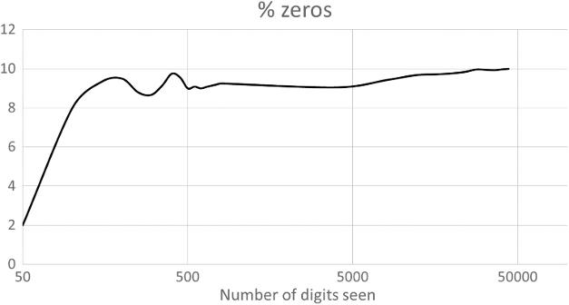

% zeros：0所占的百分比；Number of digits seen：已观察的数字数量。

<!-- dm-ch11-064 -->

〔原书第219页〕

因此，对先前问题的回答是否定的。一般而言，我们无法通过观察证明一个长数字序列，或一长串对自然的观测结果，是随机的。

<!-- dm-ch11-065 -->

〔原书第219页〕

显然，迄今使用的数字序列实际上并不是通过投掷十面骰子产生的。掷44,000次骰子并不现实。

<!-- dm-ch11-066 -->

〔原书第219页〕

我们本可以使用某种电子硬件产生真正的随机数。[^ch11-13]实际上，我们确实使用了计算机生成的序列，但它并非真正随机。我们采用了$\pi$的连续数字作为来源。[^ch11-14]然而，$\pi$的连续数字似乎完美地模仿了随机性。

<!-- dm-ch11-067 -->

〔原书第219页〕

这便是现实的一个深刻悖论：circulus regitur forte——圆受偶然支配。圆是自然秩序最典型的范例，却由看似随机的东西支配。如今，规则与偶然的区别又在哪里？

<!-- dm-ch11-068 -->

〔原书第219页〕

难道我们在作出重大决定以前，也应该请教占卜者、阅读《易经》吗？

<!-- dm-ch11-069 -->

〔原书第219页〕

我们的科学定律大厦难道只是掩盖混沌的幻象？元数学家蔡廷[^ch11-15]给出了一个答案：他基于计算机程序提出随机性的新定义。按照他的定义，随机数字序列就是不能由比它更短的计算机程序输出的序列。

<!-- dm-ch11-070 -->

〔原书第219页〕

按照这一定义，$\pi$不是随机的。下面是Dik T. Winter编写的一段占160个字符的C程序，它能输出$\pi$的800个字符：

<!-- dm-ch11-071 -->

〔原书第219页〕

```c
int a=10000,b,c=2800,d,e,f[2801],g;main(){for(;b-c;)
  f[b++]=a/5;
for(;d=0,g=c*2;c-=14,printf("%.4d",e+d/a),e=d%a)fo
  r(b=c;d+=f[b]*a,
f[b]=d%--g,d/=g--,--b;d*=b);}
```

<!-- dm-ch11-072 -->

〔原书第219页〕

还有其他短程序，能够输出$\pi$的数百万位数字。

<!-- dm-ch11-073 -->

〔原书第220页〕

## 苏联辩证唯物主义

<!-- dm-ch11-074 -->

〔原书第220页〕

辩证唯物主义由狄慈根创立，他在思想上影响了德国社会民主党；这一哲学后来成为共产主义的官方哲学，由德国社会民主党传承而来。然而，这一传统与物质世界的随机性基础是否相容，是值得怀疑的。19世纪的唯物主义者，如玻尔兹曼，曾经苦苦思索：在由偶然性和热力学定律支配的世界中，如何理解有方向性的变化？我们又该如何在历史语境中理解同一个悖论？

<!-- dm-ch11-075 -->

〔原书第220页〕

苏联的“辩证唯物主义”（Diamat）学说，在多大程度上与本书迄今所阐述的唯物主义相容？

<!-- dm-ch11-076 -->

〔原书第220页〕

长期被奉为正统权威的斯大林提出了[^ch11-16]唯物辩证法的以下四项原则：

<!-- dm-ch11-077 -->

〔原书第220页〕

- 1. 自然界是相互联系和相互决定的

<!-- dm-ch11-078 -->

〔原书第220页〕

- 2. 自然界处于持续运动和变化的状态

<!-- dm-ch11-079 -->

〔原书第220页〕

- 3. 自然界的量变导致质变

<!-- dm-ch11-080 -->

〔原书第220页〕

- 4. 矛盾是自然界所固有的

<!-- dm-ch11-081 -->

〔原书第220页〕

我们将依次考察这些原则。

<!-- dm-ch11-082 -->

〔原书第220页〕

## 自然界是相互联系和相互决定的

<!-- dm-ch11-083 -->

〔原书第220页〕

> 与形而上学相反，辩证法并不把自然界看作事物和现象的偶然聚集，仿佛它们彼此毫无联系、相互孤立、相互独立；而把自然界看作一个相互联系的完整整体，其中事物和现象彼此有机联系、相互依存、相互决定。[^ch11-17]

<!-- dm-ch11-084 -->

〔原书第220页〕

这一论述立即引人注意的一点，是它完全属于正统力学。在两次世界大战之间，苏联的“机械论者”与德博林派曾展开激烈争论。[^ch11-18]但斯大林在20世纪30年代对辩证唯物主义的阐述所说的、自然界通过超距作用力体现的决定关系和联系，正是经典力学和量子力学的共同基础。在量子力学中，情况也相同，正如我们在[sec:qcrypt]节对量子密码学的论述所示。物理学家玻姆[^ch11-19]将其称为实在的“隐含序”。因此，断言自然界具有决定性并相互联系，并非辩证法所特有的东西。辩证唯物主义若持这一观点，那是因为它忠实地追随了力学。

> 校注：原书此处的交叉引用未解析，印作“Section [sec:qcrypt]”；本稿保留该标记。

<!-- dm-ch11-085 -->

〔原书第220页〕

## 自然界处于持续运动和变化的状态

<!-- dm-ch11-086 -->

〔原书第220页〕

> 与形而上学相反，辩证法认为，自然界并非处于静止不动、停滞不变的状态，而是处于持续运动和变化、持续更新和发展的状态；其中总有某些事物在产生和发展，也总有某些事物在瓦解和消亡。[^ch11-20]

<!-- dm-ch11-087 -->

〔原书第221页〕

运动是任何力学动力学理论的基础。一切统计力学也建立在这样一幅图景之上。通过斯密、恩格斯和达尔文，这幅图景被扩展到社会和生物学领域。确实，自古代原子论者以来，所有唯物主义者都主张自然界中存在持续的运动和变化。

<!-- dm-ch11-088 -->

〔原书第221页〕

> 太阳运行许多年之后，手指上的戒指因佩戴而在内侧变薄，檐下滴水在石头上凿出凹穴，弯曲的铁犁铧在田间不知不觉地磨损；我们看见石铺街道被众人的脚步磨平，城门旁的青铜雕像也显出右手的消瘦，那是无数过路人向它致意时触摸的结果。

<!-- dm-ch11-089 -->

〔原书第221页〕

> 因此，我们看到这些东西因这样磨损而变小；但在任何给定时刻究竟有哪些物体离去，视觉的本性却严严实实地阻止我们看见。

<!-- dm-ch11-090 -->

〔原书第221页〕

> 最后，时间和自然一点一点地给事物添加物体，迫使它们按适当尺度生长，无论怎样用力观看，眼睛也看不见这些物体；同样，无论事物因年岁而衰老腐败，还是悬于海上的岩石被啃啮般的咸水浪沫侵蚀，你都看不见它们在任何给定时刻失去了什么。因此，自然是通过看不见的物体来运作的。[^ch11-21]

<!-- dm-ch11-091 -->

〔原书第221页〕

## 自然界的量变导致质变

<!-- dm-ch11-092 -->

〔原书第221页〕

量变导致质变这一观念，似乎因恩格斯的《自然辩证法》而广为流传。该书认为，在物理学中，我们研究物体的分子状态以及使分子活动起来的运动形式。每一种变化都是量向质的转化，[^ch11-22]源自物体所固有的或传递给物体的运动的量变。物理常数标示着节点，在这些节点上，运动的增加或减少改变物体的状态，从而把量转化为质。

<!-- dm-ch11-093 -->

〔原书第221页〕

恩格斯在这里描述的，基本上就是我们现在所说的相变现象。他所举的液态与气态之间的变化，确实是相变的例子。不过，与物理学的术语相比，恩格斯谈论量与质时使用的术语含义模糊。物理学家会把相变定义为熵随温度的变化变得不连续的情形：在达到100摄氏度以前，每升高1摄氏度需要1,000卡热量；而从99摄氏度的水变成100摄氏度的蒸汽，则需要540,000卡，增幅巨大。水从表面蒸发时，每克消耗540卡热量。在没有外界热量输入时，水会冷却0.5°C。这只有在密闭容器中才是现实的，而沸点以下的蒸发速率与开尔文温度成正比。对于炉灶上的敞口锅，把1升水升高1摄氏度所需的热量输入，在达到100°C之前是非线性的；到了100°C，仍会发生阶跃式跃变。

<!-- dm-ch11-094 -->

〔原书第221—222页〕

辩证唯物主义话语的问题在于，“量”和“质”这两个术语含糊不清，定义不明确。在熔化和沸腾的例子中，凭常识我们知道固、液、气三种相态之间存在质的区别。但若采用超临界锅炉，即在高于3,200 psi的压力下运行的锅炉，那么液态水与蒸汽就成为无法区分的相。人们可以用质的话语来包装这一现象，说在高于3,200 psi时，水与蒸汽之间没有质的区别；也可以更精确地说，在高于3,200 psi时，加热水不会造成熵的阶跃式跃变。

<!-- dm-ch11-095 -->

〔原书第222页〕

恩格斯语言的含糊，使他的论述出现了明显的错误。白炽灯这个例子完全错了。

<!-- dm-ch11-096 -->

〔原书第222页〕

改变灯的供电电压，灯丝温度便逐渐升高。随着温度上升，不同波长的发光强度逐渐变化，光色从红、橙、黄趋向近乎白色。凡是使用过白炽灯调光器的人，都见过这种现象。这里没有明确的相变，也没有鲜明的阈值电压。发光二极管则有明确的阈值电压，低于它时不发光；超过该阈值之后，发出的光色也不改变。

<!-- dm-ch11-097 -->

〔原书第222页〕

只有某些系统会发生相变，其他系统则连续变化。这个混乱的灯泡例子，似乎正是恩格斯术语含糊造成的。

<!-- dm-ch11-098 -->

〔原书第222页〕

什么算作质变？什么算作量变？所谓量，他指的是整数，还是连续统？在他关于沸腾相关温度变化的正确例子中，量变沿一个连续尺度发生。他关于白炽灯泡的错误例子也一样。[^ch11-23]电压是一种模拟变量，也就是连续变量。

<!-- dm-ch11-099 -->

〔原书第222页〕

但在其他地方，恩格斯又希望把量理解为整数。

<!-- dm-ch11-100 -->

〔原书第222页〕

> 然而，黑格尔所发现的自然规律取得最重要胜利的领域，是化学。化学可以称为研究物体因数量组成改变而发生质变的科学。黑格尔本人已经知道这一点。以氧为例：如果三个原子而非通常的两个原子结合成一个分子，就得到臭氧，一种在气味和反应上都与普通氧大不相同的物体。又如，氧可以按不同的比例与氮或硫结合，每一种比例都产生在质上不同于其他任何一种的物质！笑气（一氧化氮，$\mathrm{N_2O}$）与硝酸酐（五氧化二氮，$\mathrm{N_2O_5}$）多么不同！前者是气体，后者在常温下是固态结晶物质。然而，二者在组成上的全部区别，仅在于后者含氧量是前者的五倍；二者之间还有另外三种氮的氧化物（$\mathrm{N0}$、$\mathrm{N_2O_3}$、$\mathrm{NO_2}$），每一种在质上都与前两种及彼此不同。[^ch11-24]

> 校注：原书将笑气N₂O称作“nitrogen monoxide”（一氧化氮）；N₂O的通常中文名称为一氧化二氮。后列第一式原书印作“N0”（末位为数字零），依上下文应为NO。正文保留原书写法。

<!-- dm-ch11-101 -->

〔原书第223页〕

于是，我们竟有了一条由黑格尔发现的“自然规律”！

<!-- dm-ch11-102 -->

〔原书第223页〕

得了吧，弗雷德。你要找的名字是道尔顿，约翰·道尔顿，而不是黑格尔。被引为这条“规律”出处的黑格尔《逻辑学》出版于1812年；道尔顿的《化学哲学新体系》早在四年前，即1808年，就已问世。这充其量是黑格尔事后把他人的发现说成自己的发现，就像1801年他声称自己对牛顿万有引力定律有更高明的证明一样。我们在第3.4节已经指出，黑格尔这些关于独创性的主张是不连贯的胡言乱语。这里也是如此。化合物中各组成元素的原子必须以自然数之比存在，这是道尔顿原子理论不可分割的一部分。恩格斯援引黑格尔，在水沸腾时的相变与这些数值比例之间作类比，其不连贯程度与黑格尔关于引力的论证如出一辙。

<!-- dm-ch11-103 -->

〔原书第223页〕

水沸腾的情形中，有一个连续的模拟尺度，即温度；在这一尺度的某些点上发生相变，其标志是另一个模拟尺度，即熵，出现不连续。在化学的情形中，并不存在连续的模拟尺度。逐渐增加氮，并不会使化合物突然改变。在$\mathrm{NO}$与$\mathrm{N_2O}$之间，不可能有$\mathrm{N}_{1.275}\mathrm{O}$这样的化合物。每种原子的数量都必须是整数。这是原子在化学上不可分的结果。因此，这里并非渐进的量变导致突发的质变，而是存在一组离散的化合物，每种都含有离散数量的原子。

<!-- dm-ch11-104 -->

〔原书第223页〕

“量转化为质”这条“规律”具有强烈的政治吸引力。关于量变导致质变的说法，可以被理解为一种隐喻：对工人阶级的剥削在量上加重，最终导致突然爆发的暴力革命。把革命比作紧张局势沸腾后溢出的结果，早在19世纪就已有这种用法。[^ch11-25]

<!-- dm-ch11-105 -->

〔原书第223页〕

这条所谓量转化为质的普遍规律，与许多唯心主义哲学一样，建立在肤浅的类比和双关之上。作为普遍规律，它对预测毫无用处。事实上，即使对于革命，这种类比是否说得通也值得怀疑。在苏联的革命图像中，群众团结为有组织的队列，向红色未来行进，或聚集在正在演讲的列宁面前。革命发生于熵减之时，也就是群众获得秩序和方向、不再漫无目的地运动之时。

<!-- dm-ch11-106 -->

〔原书第223页〕

有人可能反驳，相变这个概念有时也颇具隐喻性。如果我们嘲笑黑格尔式的量变质变观念，又为什么允许科学家谈论其他相变？

<!-- dm-ch11-107 -->

〔原书第223页〕

这种反驳不能成立，因为在科学文献中使用相变一词，就应当证明：当一个变量连续变化时，另一个类似于熵的变量发生了不连续变化。

<!-- dm-ch11-108 -->

〔原书第223页〕

让我们举一个使用相变这一术语的非物理学例子，说明这一术语的应用必须满足严格的理论约束。

<!-- dm-ch11-109 -->

〔原书第223—224页〕

在符号逻辑中，有一个所谓的可满足性问题（SAT）。给定一个定义在$n$个布尔变量$v_1,\ldots,v_n$上的布尔代数公式$F$，问题要求找出一种变量真值赋值，使$F$为真。

<!-- dm-ch11-110 -->

〔原书第224页〕

$F$通常以合取范式给出，例如：

<!-- dm-ch11-111 -->

〔原书第224页〕

$F(v_1,v_2,v_3,v_4)=(v_1+v_2+\neg v_3)\cdot(v_3+\neg v_1+v_4)$

<!-- dm-ch11-112 -->

〔原书第224页〕

人们观察到，找到这样的变量赋值往往很容易，但有时又十分困难；在极端情况下，需要尝试给$n$个变量赋予真或假的全部$2^n$种不同方案。

<!-- dm-ch11-113 -->

〔原书第224页〕

对于另一些$F$，却很容易证明不存在任何能使$F$为真的变量赋值。

<!-- dm-ch11-114 -->

〔原书第224页〕

进一步研究表明，从容易满足到难以满足、再到容易证明不可满足的变化，发生在一个被称为相变的临界点。[^ch11-26]这一领域的实验工作为相变这一用语提供了依据：它表明，$F$存在一个约束程度的度量[^ch11-27]$m$，随着$m$增大，问题难度先急剧上升，随后下降。为什么这类似于相变？

<!-- dm-ch11-115 -->

〔原书第224页〕

它与水沸腾有什么共同之处？二者相似，是因为约束水平$m$相当于温度$T$，而难度（用计算运行时间衡量）相当于$\frac{dH}{dT}$，即熵对温度的导数。显然，在水转化为蒸汽的相变中，$\frac{dH}{dT}$出现尖峰，类似于$F$的难度随着$m$增大而出现尖峰。

<!-- dm-ch11-116 -->

〔原书第224页〕

## 矛盾是自然界所固有的

<!-- dm-ch11-117 -->

〔原书第224页〕

辩证唯物主义的支持者说，他们所说的“矛盾”存在于现实世界中，而不只存在于逻辑陈述中。显然，他们使用这个词的含义，与它通常的含义有所不同。形式逻辑的矛盾——非（非x且x）；x或非x——取决于真值的性质。但斯大林或毛泽东所说的矛盾并非这个意思。斯大林这样写道：

> 校注：原书把所列两式称作“contradictions”。按通常的经典命题逻辑，两式分别表达非矛盾律与排中律，均非矛盾式；此处保留作者表述。

<!-- dm-ch11-118 -->

〔原书第224页〕

> 与形而上学相反，辩证法认为，内在矛盾是自然界一切事物和现象所固有的，因为它们都有否定和肯定的方面，有过去和未来，有正在消亡的东西和正在发展的东西；而这些对立面之间的斗争，即新与旧、正在消亡的与正在诞生的、正在消失的与正在发展的东西之间的斗争，构成了发展过程的内部内容，构成了量变转化为质变的内部内容。[^ch11-28]

<!-- dm-ch11-119 -->

〔原书第224页〕

所以，斯大林说矛盾，是以隐喻的方式谈论世界中的变化过程。但为什么承认变化就被认为是辩证法所特有的？

<!-- dm-ch11-120 -->

〔原书第224页〕

事物有过去和未来，事物发展又消亡，这是人人都承认的。用“矛盾”这个术语来指称这一点，究竟增加了什么特殊成分？

<!-- dm-ch11-121 -->

〔原书第225页〕

斯大林详细解释其含义时，诉诸的不是辩证法，而是马克思所谓的唯物主义历史理论。斯大林在这里称之为“研究社会现象的历史方法”。

<!-- dm-ch11-122 -->

〔原书第225页〕

> 在现代条件下，奴隶制会是无意义、愚蠢而不自然的。但在原始公社制度解体的条件下，奴隶制却是完全可以理解而且自然的现象，因为它代表着相对于原始公社制度的进步。

<!-- dm-ch11-123 -->

〔原书第225页〕

> ……

<!-- dm-ch11-124 -->

〔原书第225页〕

> 一切都取决于条件、时间和地点。

<!-- dm-ch11-125 -->

〔原书第225页〕

> 显然，没有这种研究社会现象的历史方法，历史科学就不可能存在和发展；因为只有这种方法，才能使历史科学免于沦为偶然事件的杂乱集合和荒谬错误的堆积。[^ch11-29]

<!-- dm-ch11-126 -->

〔原书第225页〕

正如我们在第5.1节所述，亚当·斯密已经清楚地认识到，社会形式、生产关系及其相应的政治上层建筑是相继更替的。斯密并不觉得需要借助矛盾或辩证法来解释这一点。马克思和恩格斯在首次阐述历史唯物主义的《德意志意识形态》中，虽然从未提到辩证法，却确实经常使用矛盾这个术语。以下只是《德意志意识形态》中的几个例子，马克思和恩格斯在其中以后来成为正统“辩证唯物主义”的方式使用矛盾一词：

<!-- dm-ch11-127 -->

〔原书第225页〕

> 分工意味着单个个人或单个家庭的利益与一切彼此交往的个人的共同利益之间的矛盾。

<!-- dm-ch11-128 -->

〔原书第225页〕

> ……

<!-- dm-ch11-129 -->

〔原书第225页〕

> 各个市民的生活条件，由于与现存关系以及由这些关系决定的劳动方式相矛盾，变成了他们所有人共有的、独立于每个个人的条件。市民在摆脱封建束缚的程度上创造了这些条件，同时又在受自身与既存封建制度的对立所决定的程度上，被这些条件所塑造。当各个城市开始联合时，这些共同条件便发展成阶级条件。相同的条件、相同的矛盾、相同的利益，必然在各地大体上产生相同的习俗。

<!-- dm-ch11-130 -->

〔原书第225页〕

> ……

<!-- dm-ch11-131 -->

〔原书第225—226页〕

> 生产力与交往形式之间的这种矛盾，正如我们所见，在过去的历史中曾多次发生，虽然并未危及其基础，却必然每次都以革命的形式爆发，同时呈现出各种附属形式，如全面的冲突、不同阶级之间的冲突、意识的矛盾、思想斗争等等，以及政治冲突等等。[^ch11-30]

<!-- dm-ch11-132 -->

〔原书第226页〕

1932年，《德意志意识形态》出版，引入了“矛盾”这一术语。斯大林在1938年撰写自己的文本时，想必已熟悉这个术语。“阶级矛盾”是较晚才进入正统马克思主义的说法，首次出现在布哈林1925年著作《历史唯物主义》的英文版中。在毛泽东的辩证法中，这种意义上的矛盾成为核心。

<!-- dm-ch11-133 -->

〔原书第226页〕

## 毛泽东对辩证法的阐述

<!-- dm-ch11-134 -->

〔原书第226页〕

毛泽东的《矛盾论》[^ch11-31]是迄今出版的最具影响力的辩证法著作。它的影响有两个方面。首先，中国的庞大规模使它得以大量印行，拥有数千万读者。但这之所以可能，正是因为以其作者为领导的中国共产党人，把以《矛盾论》为基础的政治战略付诸实践，取得胜利并建立了中华人民共和国。

<!-- dm-ch11-135 -->

〔原书第226页〕

这篇文章比斯大林的《论辩证唯物主义和历史唯物主义》早一年问世；阅读它，必须兼顾当时苏联正在进行的争论和中国革命战争的背景。

<!-- dm-ch11-136 -->

〔原书第226页〕

前言将这篇文章定位为对受黑格尔影响的德博林学派的批判：

<!-- dm-ch11-137 -->

〔原书第226页〕

> 近年来，苏联哲学界对德博林学派唯心主义的批判，引起了我们的极大兴趣。德博林的唯心主义在中国共产党内产生了很坏的影响，不能说我们党内的教条主义思想与该学派的研究方法毫无关系。因此，我们当前研究哲学，应当以根除教条主义思想为主要目标。

<!-- dm-ch11-138 -->

〔原书第226页〕

毛泽东与斯大林一样，认为辩证唯物主义世界观同对时间与变化的解释相联系。他把自己所称的形而上学或庸俗进化论的时间观，与马克思主义观点相对照。他说，庸俗进化论者承认变化，却只承认三种形式：增加、减少和循环重复。从上下文看，他所说的庸俗进化论显然不是达尔文理论，而是对社会演化的简单化观念：

<!-- dm-ch11-139 -->

〔原书第226—227页〕

> 形而上学者认为，宇宙中各种事物及其一切特征，自产生之初就一直如此。此后的一切变化，都只是量的增加或减少。他们主张，一种事物只能作为同一种事物不断重复自身，不能变成别的事物。在他们看来，资本主义剥削、资本主义竞争、资本主义社会的个人主义意识形态等等，都可以在古代奴隶社会，甚至在原始社会中找到，而且会永远不变地存在下去。他们把社会发展的原因归于社会外部的因素，例如地理和气候。

<!-- dm-ch11-140 -->

〔原书第227页〕

当今这种庸俗进化论观点的例子，或许可以在图尔钦的著作中找到。[^ch11-32]他的著作虽然包含丰富的历史内容，并承认阶级冲突，却确实用数千年来基本不变的动力机制来阐述问题。图尔钦理论的关键遗漏，是马克思所说的生产力的发展，以及这种发展如何制约社会的生产关系。

<!-- dm-ch11-141 -->

〔原书第227页〕

毛泽东认为，社会通过内部冲突发展，而非由外部原因推动。他认为，中国的发展将取决于国内的阶级斗争，即工人、农民和爱国资本家同地主、买办资本家之间的斗争。从印度和中国此后的经济与社会发展轨迹来看，这一观点被证明是正确的。

<!-- dm-ch11-142 -->

〔原书第227页〕

他讨论了矛盾的普遍性和特殊性。前者概括恩格斯与列宁的概念，后者则是这篇小册子的重点，分析中国革命中的具体矛盾。他批评教条主义，并突出列举了一些矛盾普遍性的例子；这些例子并不比恩格斯和斯大林的更有说服力。不过，他确实提出了一些值得更多关注的例子。他引用了列宁列出的一组例子，用来说明矛盾的普遍性。

<!-- dm-ch11-143 -->

〔原书第227页〕

> 辩证法内容的这一方面是否正确，必须由科学史来检验。辩证法的这一方面（例如在普列汉诺夫那里）通常没有得到足够注意：对立面的同一性被当作例子的总和［“例如，一粒种子”，“例如，原始共产主义”。恩格斯那里也是如此。但这是“为了普及……”］，而不是当作认识的规律（以及客观世界的规律）。

<!-- dm-ch11-144 -->

〔原书第227页〕

- 1. 在数学中：＋与－。微分与积分。

<!-- dm-ch11-145 -->

〔原书第227页〕

- 2. 在力学中：作用与反作用。

<!-- dm-ch11-146 -->

〔原书第227页〕

- 3. 在物理学中：正电与负电。

<!-- dm-ch11-147 -->

〔原书第227页〕

- 4. 在化学中：原子的结合与解离。

<!-- dm-ch11-148 -->

〔原书第227页〕

- 5. 在社会科学中：阶级斗争。

<!-- dm-ch11-149 -->

〔原书第227页〕

> 对立面的同一性（说它们的“统一性”也许更准确，尽管同一性与统一性这两个术语的区别在这里并不特别重要；在某种意义上，二者都正确），就是承认（发现）自然界（包括思维和社会）的一切现象和过程中存在着相互矛盾、相互排斥、相互对立的趋势。要认识世界的一切过程的“自己运动”、自发发展和实际生活，条件就是把这些过程作为对立面的统一来认识。[^ch11-33][^ch11-34]

<!-- dm-ch11-150 -->

〔原书第227—228页〕

我们认为，列宁对这些例子的解释，以及毛泽东对这一解释的默许，具有误导性。为说明这一点，先把例子分组：（1）属于算术，即人类的一种技艺或技术；（2、3、4）属于自然科学；（5）属于社会科学。

<!-- dm-ch11-151 -->

〔原书第228页〕

加法与减法、乘法与除法、微分与积分等，都是数学中互逆运算的例子。如果$\alpha,\beta$是互逆运算符，那么$((A\alpha B)\beta B)=A$；把$\alpha,\beta$称作相反的运算，是完全合理的。

<!-- dm-ch11-152 -->

〔原书第228页〕

算术是一门技术性技艺。它涉及实物，如筹码、算珠和账簿中的符号。在20世纪30年代，俄国或中国的商业算术主要使用算盘。加2时，操作者把2颗算珠从右移到左；减2时，把2颗算珠从左移到右。先加后减之后，算珠就回到起初的状态。正是这种回到起始状态的性质，使加法与减法成为作用于状态的互逆运算。

<!-- dm-ch11-153 -->

〔原书第228页〕

但若要声称对立统一具有普遍性，就会遇到问题。首先，很容易找出并非彼此互逆的运算符对。在逻辑中，与（$\wedge$）和或（$\vee$）作为两个基本运算符成对出现，但它们并不互逆：$((A\wedge B)\vee B)\ne A$。那么，为什么要声称相反的运算符是根本的呢？

<!-- dm-ch11-154 -->

〔原书第228页〕

这难道不是挑选有利例子来支持论点吗？是的，声称对立统一是数学的根本，是武断的。的确，数学有互逆运算符，但也有其他重要的运算符。

<!-- dm-ch11-155 -->

〔原书第228页〕

如果回到加法和减法使算盘或其他计算器恢复起始状态这一想法，情况会有所不同吗？

<!-- dm-ch11-156 -->

〔原书第228页〕

使某物恢复起始状态，总是需要一对互逆运算吗？

<!-- dm-ch11-157 -->

〔原书第228页〕

不。考虑把一个轮子旋转半圈的操作。执行两次，轮子便回到起始状态。算术中的类似操作是乘以－1。对一个数执行两次，就回到原来的数。因此，回到起点这一观念，同样不能证明对立统一的必然性。

<!-- dm-ch11-158 -->

〔原书第228页〕

接下来三个例子——作用与反作用、正负电荷以及原子的结合与解离——确实有共同之处，但诉诸对立统一，只能部分说明这种共同之处，遗漏了最重要的东西。

<!-- dm-ch11-159 -->

〔原书第228页〕

它们都是底层守恒定律的表达方式，或是这些定律的推论。

<!-- dm-ch11-160 -->

〔原书第228页〕

大小相等、方向相反的力源于动量守恒。例如，地球与月球彼此施加大小相等、方向相反的引力，使这一系统所受的合力为零。如果没有太阳从外部施加的引力，地月系统就会沿直线运动，保持动量守恒。

<!-- dm-ch11-161 -->

〔原书第228—229页〕

正电与负电涉及另一条基本守恒定律，即电荷守恒。带有＋6电荷的碳14原子核发生$\beta$衰变时，会形成一个带有＋7电荷的氮14原子核，同时产生一个$\beta$粒子，也就是一个带负电的电子。净电荷仍为＋6。电荷守恒意味着，在所有这类核转变中，总净电荷保持不变。

<!-- dm-ch11-162 -->

〔原书第229页〕

化学反应中原子的结合与解离，也表达了一种守恒关系：在化学过程中，每种元素的原子总数保持不变。

<!-- dm-ch11-163 -->

〔原书第229页〕

列宁的这三个例子都是守恒过程，并不能证明对立统一这一辩证法原理。它们的共同性质源于卢克莱修的格言：“无中不能生有。”尽管苏联辩证唯物主义批评力学，却正是力学世界观表达了列宁这些例子背后的守恒定律。

<!-- dm-ch11-164 -->

〔原书第229页〕

最后一个例子是阶级冲突。但它也涉及守恒约束，因为在任何社会中，有限的劳动力和有限的工作时间，都意味着剩余劳动增加会使必要劳动减少。这在工人与雇主之间造成不可调和的阶级冲突：资本家阶级占有的劳动每增加一分，可用于满足工人阶级需要的劳动就相应减少一分。

<!-- dm-ch11-165 -->

〔原书第229页〕

守恒定律恰恰来源于那备受鄙视的力学。源自力学的思维方式，运用守恒原理解释世界如何运作。在第5.3节，我们论证过，马克思揭示资本主义社会“运动规律”的志向，也属于这一思想脉络。

<!-- dm-ch11-166 -->

〔原书第229页〕

毛泽东在《矛盾论》中引用恩格斯和列宁时，只是在向正统敷衍地表示认同。他的创新来自对矛盾特殊性的处理。在这里，他运用了一套全新的概念术语及其含义，把辩证法的语言转化为军事和政治战略的工具。

<!-- dm-ch11-167 -->

〔原书第229页〕

毛泽东主张，不同科学的区别在于它们所研究的矛盾的特殊性。他对科学方法作了如下描述：

<!-- dm-ch11-168 -->

〔原书第229页〕

> 这就是认识的两个过程：一个是从特殊到一般，另一个是从一般到特殊。因此，认识总是循环往复地进行，而且只要严格遵循科学方法，每一个循环都会把人类知识提高一步，使之日益深刻。[^ch11-35]

<!-- dm-ch11-169 -->

〔原书第229页〕

只要把术语从力换成矛盾，这一循环过程就与牛顿在《自然哲学的数学原理》导言中所说的完全一致：“哲学的一切困难似乎都在于此——从运动现象探究自然界的力，然后由这些力论证其他现象。”[^ch11-36]毛泽东是在用矛盾的术语描述牛顿的科学方法。

<!-- dm-ch11-170 -->

〔原书第230页〕

毛泽东把科学方法与受德博林影响的教条主义者的方法相对照：

<!-- dm-ch11-171 -->

〔原书第230页〕

> 我们的教条主义者是一群懒汉。他们拒绝对具体事物作任何艰苦的研究，把一般真理看作凭空产生的东西，把它们变成纯粹抽象、难以捉摸的公式，从而完全否定并颠倒人类认识真理的正常顺序。他们也不懂认识的两个过程——从特殊到一般，再从一般到特殊——之间的相互联系。他们根本不懂马克思主义的认识论。[^ch11-37]

<!-- dm-ch11-172 -->

〔原书第230页〕

要把更深刻的理解建立在对真实历史条件的具体分析之上，这在本书作者看来很有道理。以马克思的利润率下降规律为例。根据我们的经验，只有对英国从19世纪50年代到20世纪末的积累过程进行具体的统计分析，[^ch11-38]才能深化对其机制的理解，并精确地用数学表述其动态行为。[^ch11-39]如果我们只根据《资本论》的论述作推演，而没有实际历史统计数据的指引，就不大可能得出正确的动力学方程。没有那个方程、那条运动规律，就无法理解20世纪最后十年西方盈利能力部分恢复的有限性与矛盾性，也无法理解2000年以来中国与非洲资本回报率的不同趋势。

<!-- dm-ch11-173 -->

〔原书第230页〕

毛泽东写道：

<!-- dm-ch11-174 -->

〔原书第230页〕

> 任何重大事物的发展过程中，都有许多矛盾。例如，在条件极其复杂的中国资产阶级民主革命过程中，存在着中国社会一切被压迫阶级与帝国主义之间的矛盾，广大人民群众与封建主义之间的矛盾，无产阶级与资产阶级之间的矛盾，农民和城市小资产阶级与资产阶级之间的矛盾，各反动统治集团之间的矛盾，等等。[^ch11-40]

<!-- dm-ch11-175 -->

〔原书第230页〕

这些矛盾具有鲜明的中国特殊性。但同样的多重矛盾话语，也提供了考察西方资本主义危机的一种方式；在这里，需要考虑：

<!-- dm-ch11-176 -->

〔原书第230页〕

- 劳动与资本之间的“矛盾”（阶级冲突），它体现为剩余价值率。

<!-- dm-ch11-177 -->

〔原书第230页〕

- 生产性劳动与非生产性劳动之间的“矛盾”。用于支付非生产性劳动工资的剩余价值份额越高，能够作为新增生产资料积累的剩余价值流量就越少。

<!-- dm-ch11-178 -->

〔原书第231页〕

- 资本与土地所有权之间的“矛盾”，它体现为剩余价值中用作地租的份额上升。

<!-- dm-ch11-179 -->

〔原书第231页〕

- 积累本身的矛盾效应：它通过提高资本与劳动之比，趋向于压低利润率。

<!-- dm-ch11-180 -->

〔原书第231页〕

毛泽东关于社会发展过程中多重矛盾的话语，为思考这些过程提供了框架。或许可以用数学方式表述这些过程，使“矛盾”成为数学项：$s^{\prime}=\frac{s}{v}$，$p=s-u-r$（利润＝剩余价值－非生产性劳动工资－地租）。

<!-- dm-ch11-181 -->

〔原书第231页〕

在其他情况下，可以用较为熟悉的动力学和微积分语言表达矛盾关系。考虑积累与利润率之间的矛盾关系。

<!-- dm-ch11-182 -->

〔原书第231页〕

利润率，用$\pi$表示，由$\pi=\frac{p}{K}$给出，其中$p$的定义同前，$K$是资本存量。

<!-- dm-ch11-183 -->

〔原书第231页〕

资本存量相对于时间的变化率写作$\left(\frac{dK}{dt}\right)$，而它又由$\frac{dK}{dt}=\frac{A}{K}$给出，其中$A$为年度积累。将利润中用于净积累的份额记作$\alpha=\frac{A}{p}$。现在考察利润率相对于时间的变化率$\pi^{\prime}=\frac{d\pi}{dt}$，也就是说，利润率随时间趋于上升还是下降。由前面的方程显然可见，$\frac{d\pi^{\prime}}{d\alpha}<0$，即利润变化率对积累率的偏导数为负。高积累率导致利润率下降。这是一种负反馈或矛盾关系，在数学中用牛顿与莱布尼茨的微积分描述，在其他领域则用不同术语描述。注意，只要稍作深入分析，就会发现上面最初列表中的所有矛盾都涉及负的（小于0的）偏导数。剩余价值对工资的导数为负，利润对地租的导数为负，等等。

> 校注：原书此处写作dK/dt=A/K。按文中K为资本存量、A为年度积累量的定义，A/K对应相对增长率，而dK/dt对应存量的变化率；此处可能存在记号或排印问题，本稿不作无声更正。原书以d表示导数而在文字中称其为偏导数，亦照录。

<!-- dm-ch11-184 -->

〔原书第231页〕

事实上，如果用数字电路使逻辑机械化，逻辑否定与负偏导数之间的这种关系就会显现。

<!-- dm-ch11-185 -->

〔原书第231页〕

在计算机设计中，用导线分别表示逻辑信号本身及其反相信号，是完全标准的做法。如果像恩格斯和列宁谈论唯物辩证法时那样作肤浅的类比，那么同时包含A与非A信号的电路，可以说包含了“矛盾”或“对立面的同一性”；而这些矛盾项确实通过负偏导数联系在一起。在图11.2中，非A信号的电压对A信号电压的偏导数为负。在物理系统中，负偏导数用来表示否定。逻辑是用来描述这些系统的一种抽象，无论系统是电路，还是使用记事本的人。因此，对于任何受负导数支配的物质过程，我们都可以隐喻地使用“否定”这一术语。

<!-- dm-ch11-186 -->

〔原书第232页〕

图11.2 左：计算机芯片中的一种标准元件——CMOS反相器。向输入端A施加正电压，会使上方晶体管关断、下方晶体管导通，从而把非A输出端的电压拉低至地电位。右：反相器的逻辑符号。逻辑符号使我们能够撇开实现逻辑的具体电路。作者绘图。

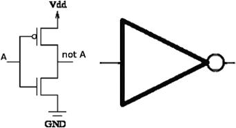

A：输入信号；not A：非A输出；Vdd：电源；GND：地。

<!-- dm-ch11-187 -->

〔原书第232页〕

把同时包含一个信号及其反相信号的电路描述为“矛盾”，或许是相当自由的隐喻；因为虽然A与非A信号可以同时存在于逻辑电路中，但其中只有一个会被置为有效。

<!-- dm-ch11-188 -->

〔原书第232页〕

毛泽东强调，不同矛盾有其特定的“解决”形式。

<!-- dm-ch11-189 -->

〔原书第232页〕

> 性质不同的矛盾，只有用性质不同的方法才能解决。例如，无产阶级与资产阶级的矛盾，用社会主义革命的方法解决；广大人民群众与封建制度的矛盾，用民主革命的方法解决；殖民地与帝国主义的矛盾，用民族革命战争的方法解决；社会主义社会中工人阶级与农民阶级之间的矛盾，用农业集体化和机械化的方法解决；[^ch11-41]

<!-- dm-ch11-190 -->

〔原书第232页〕

他还引入了“主要矛盾”的概念，大致是指在决定社会发展进程方面最重要的矛盾。主要矛盾这一概念本质上与政治相联系。他说，在资本主义中，“处于矛盾之中的两个力量——无产阶级和资产阶级——构成主要矛盾”。这是因为，这些相互对立的阶级塑造了政治结构。他将它与所谓基本矛盾或根本矛盾区分开来；后者作用于生产关系层面，直到社会发展的某个阶段完成，才会消失。[^ch11-42]

<!-- dm-ch11-191 -->

〔原书第232—233页〕

> 马克思和恩格斯把事物中的矛盾规律应用于社会历史过程的研究时，发现了生产力与生产关系之间的矛盾，发现了剥削阶级与被剥削阶级之间的矛盾，以及由此产生的经济基础与其上层建筑（政治、意识形态等）之间的矛盾，并发现这些矛盾如何在不同类型的阶级社会中，必然导致不同类型的社会革命。

<!-- dm-ch11-192 -->

〔原书第233页〕

> 马克思把这一规律应用于资本主义社会经济结构的研究时，发现这一社会的基本矛盾，是生产的社会性与所有制的私人性质之间的矛盾。这种矛盾表现为个别企业内部生产的有组织性与整个社会生产的无政府性之间的矛盾。在阶级关系上，它表现为资产阶级与无产阶级之间的矛盾。[^ch11-43]

<!-- dm-ch11-193 -->

〔原书第233页〕

将这一点应用于现代资本主义，生产力与生产关系之间的矛盾，就以利润率下降趋势的形式产生一种基本经济矛盾。在阶级层面，它表现为工人与雇主围绕工资、工作日及工作条件展开的经济阶级斗争。正是这一阶级矛盾居于主要地位，压倒了资本家与土地所有权之间的阶级冲突。理解这些矛盾之间的关系，就能说明危机如何在经济和政治层面展开。

<!-- dm-ch11-194 -->

〔原书第233页〕

只要政治层面上工人阶级与资本家之间的主要矛盾还没有通过社会主义革命解决，基本经济矛盾就依然存在。利润率下降的趋势并未消除！

<!-- dm-ch11-195 -->

〔原书第233页〕

## 作为问题解决方法的辩证法

<!-- dm-ch11-196 -->

〔原书第233页〕

现在，让我们根据上述讨论，重新审视辩证法的三条经典规律。我们认为，最善意而有成效的理解，是把它们看作分析方法，而不是解释方法。

<!-- dm-ch11-197 -->

〔原书第233页〕

首先，量向质的转化，如今通常被称为涌现。观察性质在可测量的边界上发生变化，并试图解释其原因，是科学的核心内容。然而，声称某事物通过量向质的转化而改变，是在诉诸魔法，而不只是承认某些可观察的现象尚无法用科学术语解释。诉诸涌现的说法，最常见于人工智能（AI）的讨论，尤其是奇点这一概念，即人工智能将获得超过人类的能力的时刻。人工智能日益取得成功的说法，掩盖了奇点究竟如何到来的问题；据说这些成功会以某种方式加速，并导致质变。我们当然不排除通用人工智能的可能性，但当前证据表明，在特定领域取得的小规模而且确实令人印象深刻的成果，并不能很好地扩展规模、推广到其他领域或与其他成果整合。

<!-- dm-ch11-198 -->

〔原书第234页〕

同样，否定之否定常被表述为正题、反题、合题三元结构的抽象。与量向质的转化一样，它通常被用作事后解释。从纯粹逻辑的角度说，对一个否定再作否定，就会回到起点。

<!-- dm-ch11-199 -->

〔原书第234页〕

最后，对立面的相互渗透，表达的是过程往往包含相互制衡、彼此作用的子过程。就其本身而言，寻找相互作用的“对立面”，是通过分解来解决问题的诸多进路之一。因此，在当代计算思维中，对立面的相互渗透是一种分而治之的形式，[^ch11-44]其中把问题分解为两个子问题，是最简单的情况。在解决任意问题时，这些子问题通常相互补充，而不是相互矛盾。尽管如此，通过寻找社会阶级之间的矛盾来理解社会过程，仍是历史唯物主义的关键洞见。马克思、恩格斯、列宁和毛泽东娴熟地运用了这一洞见，为了改变世界而解释世界。

[^ch11-1]: 1. Shannon：“通信的数学理论”。

[^ch11-2]: 2. 费希尔在此前十年已经尝试用概率定义信息：Ronald Aylmer Fisher，“不确定推理逻辑中的概率、似然与信息量”，Proceedings of the Royal Society of London. Series A, Containing Papers of a Mathematical and Physical Character 146，第856期（1934）：1—8；但香农的处理更为一般，影响也更持久。

[^ch11-3]: 3. 每个单词5个字符，加上行末的回车与换行字符，每词便有$(5+2)\times5=35$个二进制位，再乘以3个单词。

[^ch11-4]: 4. 德国“Fish”编码系统用来加密博多码的随机数并非完全均匀，再加上德语字母频率不等，使第一台数字计算机Colossus能够破解这些编码消息：B. Jack Copeland，《Colossus：布莱切利园破译计算机的秘密》（Oxford University Press，2010）。香农在战时曾与图灵合作研究密码学：Andrew Hodges，《艾伦·图灵：谜》（Touchstone，1983）；图灵十分熟悉Colossus的进路。

[^ch11-5]: 5. 区别仅在于使用离散空间的求和，而非连续空间的积分。

[^ch11-6]: 6. Claude Shannon：“信息的格论”，Transactions of the IRE Professional Group on Information Theory 1，第1期（1953）：105—107。

[^ch11-7]: 7. Rachel R. Bennett与Ramin Golestanian：“衣藻趋光性的转向机制”，Journal of The Royal Society Interface 12，第104期（2015）：20141164。

[^ch11-8]: 8. 实际上，正如Bennett和Golestanian所示，衣藻具有更高效的编码方式。它只有一个眼点，沿螺旋路径游动，同时绕自身轴线旋转。这使一个眼点能够以约60毫秒的采样间隔，对三个空间轴进行时分复用扫描。假定在所有可能朝向中，有$\frac{1}{6}$会激活眼点，那么根据香农公式，一个样本的平均信息量为0.65比特，因此眼点每秒提供约10比特的信息。

[^ch11-9]: 9. 两个随机变量$X,Y$之间的互信息记为$I(X;Y)=H(X)-H(X\mid Y)$，其中$H(X)$为$X$的信息熵，$H(X\mid Y)=\sum_{x,y}p(x,y)\log_2\frac{1}{p(x\mid y)}$为给定$Y$时$X$的条件熵。

[^ch11-10]: 10. 列宁，《唯物主义和经验批判主义》。

[^ch11-11]: 11. 这种直觉或许解释了为什么某些通俗论述将信息称为负熵（negentropy）。这一术语用法源于对Léon Brillouin论文“信息的负熵原理”的误读，见Journal of Applied Physics 24，第9期（1953）：1152—1163。Brillouin实际做的是引入一个新变量$N=-S$，作为推广热力学第二定律的一部分：

“我们可以定义量N（负熵）：$N=-S,\Delta(N+I)\leq0$（7b）。负熵与信息之和必定始终减小。负熵对应于开尔文‘能量退化’原理中的能量‘品位’。”（Brillouin）

由此，他得以就获取信息的观测所产生的熵效应作出结论：

“凡是从一个物理系统获取信息的实验，平均而言都对应于该系统或其周围环境中熵的增加。这种平均增量始终大于（或等于）所获得的信息量。”（Brillouin）

他能够利用这一关系证明麦克斯韦妖是不可行的。

[^ch11-12]: 12. 关于资本主义工业中熵减少与信息增加交替过程的详细分析，见Cockshott等，《经典经济物理学：古典政治经济学、热力学与信息论论集》。

[^ch11-13]: 13. 自2018年以来，英特尔处理器支持RDRAND指令，该指令提供据称是真正的随机数。Intel，《Intel64和IA-32架构软件开发者手册》，第2B卷（Intel，2021）。

[^ch11-14]: 14. 我们从第三个数字开始，以免来源一目了然。

[^ch11-15]: 15. Gregory J. Chaitin：“随机性与数学证明”，Scientific American 232，第5期（1975）：47—53。

[^ch11-16]: 16. 约瑟夫·维萨里奥诺维奇·斯大林，《论辩证唯物主义和历史唯物主义》（Lawrence & Wishart，1943）。

[^ch11-17]: 17. 斯大林，《论辩证唯物主义和历史唯物主义》，第4页。

[^ch11-18]: 18. 参见Emery：“辩证法与机械论：关于科学方法的一场共产主义论争”；本书前面的章节曾提及此文。

[^ch11-19]: 19. 玻姆，《整体性与隐含序》。

[^ch11-20]: 20. 斯大林，《论辩证唯物主义和历史唯物主义》，第5页。

[^ch11-21]: 21. Titus Lucretius Carus，《卢克莱修全集》（Delphi Classics，2015），H. A. J. Munro译。

[^ch11-22]: 22. 弗里德里希·恩格斯，《自然辩证法》（Wellred Books，1960），第2章。

[^ch11-23]: 23. 正如本书前文所述，灯泡等物体发出的黑体辐射所涉及的连续能级与离散能级问题，是爱因斯坦针对马赫学派确证原子论的关键。

[^ch11-24]: 24. 恩格斯，《自然辩证法》，第2章。

[^ch11-25]: 25. 例如，Charles Merivale的《帝国时期罗马人史》（Longmans，1851）中写道：“但在这个时代，实施这种不义行径不可能不受惩罚。战争的因素正在整个半岛酝酿；成千上万破产的人突然被抛入那动荡不定、心怀不满的人群中，这群人只缺少这一成分，就会在新的革命中沸腾爆发。”（第223页）

[^ch11-26]: 26. Ian P. Gent等：“CSP相变中的尺度效应”，载International Conference on Principles and Practice of Constraint Programming（Springer，1995），70—87；P. Prosser：“二元约束满足问题中相变的实证研究”，Artificial Intelligence 81，第1—2期（1996）：81—109。

[^ch11-27]: 27. 假设$F$的每个求和项包含3个变量（3SAT），那么约束程度的一个度量，可以是$F$中求和项的数量与变量数$n$的比值。

[^ch11-28]: 28. 斯大林，《论辩证唯物主义和历史唯物主义》。

[^ch11-29]: 29. 斯大林，《论辩证唯物主义和历史唯物主义》。

[^ch11-30]: 30. 卡尔·马克思、弗里德里希·恩格斯，《德意志意识形态》（Progress Publishers，1976）。

[^ch11-31]: 31. 毛泽东，《矛盾论》，载《毛泽东选集》第1卷（1937）。

[^ch11-32]: 32. Peter Turchin、Sergey A. Nefedov：“长期周期”，载《长期周期》（Princeton University Press，2009）。

[^ch11-33]: 33. 毛泽东只引用了第1至第5项。我们把前后段落也列出，以提供上下文，因为毛泽东在文中其他地方似乎隐含地依赖这一段。第1至第5项的明确编号是我们添加的，列宁原文中它们只是一个未编号的列表。

[^ch11-34]: 34. V. I. Lenin：“谈谈辩证法问题”，载《列宁全集》第38卷（Progress Publishers，1915）。

[^ch11-35]: 35. 毛泽东，《矛盾论》，第321页。

[^ch11-36]: 36. “Omnis enim Philosophiæ difficultas in eo versari videtur, ut a Phænomenis motuum investigemus vires Naturæ, deinde ab his viribus demonstremus phænomena reliqua”。〔译：哲学的一切困难似乎都在于此：从运动现象探究自然界的力，然后由这些力论证其他现象。〕

[^ch11-37]: 37. 毛泽东，《矛盾论》，第321页。

[^ch11-38]: 38. Paul Cockshott、Allin Cottrell、Greg Michaelson：“检验马克思：英国数据的一些新结果”，Capital & Class 19，第1期（1995）：103—130。

[^ch11-39]: 39. Cockshott等，《经典经济物理学：古典政治经济学、热力学与信息论论集》；Allin Cottrell、Paul Cockshott：“人口与利润率下降”，Indian Development Review 4，第1期（2006）：39—59。

[^ch11-40]: 40. 毛泽东，《矛盾论》，第322页。

[^ch11-41]: 41. 毛泽东，《矛盾论》，第321页。

[^ch11-42]: 42. 毛泽东，《矛盾论》，第325页。

[^ch11-43]: 43. 毛泽东，《矛盾论》，第328—329页。

[^ch11-44]: 44. G. Michaelson：“编程范式、图灵完备性与计算思维”，The Art, Science, and Engineering of Programming 4，第3期（2020）：第4篇，https://arxiv.org/abs/2002.06178。

<!-- dm-refs-title -->

〔原书第264页〕

# 参考文献

<!-- dm-ref-001 -->

〔原书第264页〕

Anellis, Irving H.：“苏联的形式逻辑与辩证唯物主义：评Fania Cavaliere《苏联的形式逻辑：1946—1965年的论争时期》与A. R. D. Mathias〈逻辑与恐怖〉”。Modern Logic 4，第2期（1994）：210—218。https://projecteuclid.org/journals/review-of-modern-logic/volume-4/issue-2/Formal-logic-and-dialectical-materialism-in-the-Soviet-Union/rml/1204835224.full。

<!-- dm-ref-002 -->

〔原书第264页〕

阿基米德：《阿基米德著作集：采用现代记号编订，附导论各章》。Thomas L. Heath编。Cambridge Library Collection—Mathematics。Cambridge University Press，2009。https://doi.org/10.1017/CBO9780511695124。

<!-- dm-ref-003 -->

〔原书第264页〕

亚里士多德：《亚里士多德著作集》（Aristotelis opera）。Immanuelis Bekkeri、Olof Gigon、Hermann Bonitz编。Walter de Gruyter，1970。

<!-- dm-ref-004 -->

〔原书第264页〕

亚里士多德：1152004155750“论生成与消灭”。载《亚里士多德全集》，Harold H Joachim译。Princeton University Press，2014。

> 校注：原书在篇名前印有数字串1152004155750，现成稿未保留；此处照录，不将其当作题名或出版日期。

<!-- dm-ref-005 -->

〔原书第264页〕

亚里士多德：《解释篇》。H. P. Cook译。Loeb Classical Library。William Heinemann，1962。

<!-- dm-ref-006 -->

〔原书第264页〕

亚里士多德：“物理学”。载《亚里士多德全集》，R. P. Hardie、R. K. Gaye译，第2卷，315—446。Princeton University Press，1984。

<!-- dm-ref-007 -->

〔原书第264页〕

亚里士多德：《前分析篇》。H. Tredennick译。Loeb Classical Library。William Heinemann，1962。

<!-- dm-ref-008 -->

〔原书第264页〕

亚里士多德：《修辞术》。J. H. Freese译。Loeb Classical Library。William Heinemann，1926。

<!-- dm-ref-009 -->

〔原书第264页〕

亚里士多德：《形而上学》，第I—IX卷。H. Tredennick译。Loeb Classical Library。William Heinemann，1933。

<!-- dm-ref-010 -->

〔原书第264页〕

Bächtold, Manuel：“捍卫马赫的原子观”。Journal for General Philosophy of Science / Zeitschrift für allgemeine Wissenschaftstheorie 41，第1期（2010）：1—19。ISSN：09254560、15728587。http://www.jstor.org/stable/20722524。

<!-- dm-ref-011 -->

〔原书第264页〕

弗朗西斯·培根：《新工具》（Novum Organon）。J. Devey编。P. F. Collier & Son，1901。

<!-- dm-ref-012 -->

〔原书第264页〕

弗朗西斯·培根：《新工具，或解释自然的正确指引》。第1卷。Library of Alexandria，1863。

<!-- dm-ref-013 -->

〔原书第264页〕

阿兰·巴迪欧：《模型的概念：数学唯物主义认识论导论》。Z. L. Fraser、T. Tao译。re.press，2007。

<!-- dm-ref-014 -->

〔原书第264页〕

Barrie, Peter、Paul Cockshott、George J. Milne、Paul Shaw：“高度并发机器的设计与验证”。Microprocessors and Microsystems 16，第3期（1992）：115—123。

<!-- dm-ref-015 -->

〔原书第264页〕

Bartkus, James R.、M. Kabir Hassan：“伊本·赫勒敦与亚当·斯密：对劳动分工理论及现代经济思想的贡献”。载International Conference on Ibn Khaldun，Madrid，2006。

<!-- dm-ref-016 -->

〔原书第264页〕

Bazhanov, Valentin：“复兴：S. A. Yanovskya的逻辑学道路”。History and Philosophy of Logic 22，第3期（2001）：129—133。

<!-- dm-ref-017 -->

〔原书第264页〕

Bennett, Rachel R.、Ramin Golestanian：“衣藻趋光性的转向机制”。Journal of The Royal Society Interface 12，第104期（2015）：20141164。

> 校注：英文题名中的Chlamy- Domonas为原书写法；中文按衣藻译出。

<!-- dm-ref-018 -->

〔原书第264页〕

John D. Bernal：“辩证唯物主义”。载《辩证唯物主义的诸方面》，Levy, Hyman、John MacMurray、Ralph Fox、Robert Page Arnott、John D. Bernal、Edgar F. Carritt编，89—122。Watts & Co.，1934。

<!-- dm-ref-019 -->

〔原书第265页〕

大卫·玻姆：《现代物理学中的因果性与偶然性》。Routledge，2004。

<!-- dm-ref-020 -->

〔原书第265页〕

大卫·玻姆：《整体性与隐含序》。Routledge，2002。

<!-- dm-ref-021 -->

〔原书第265页〕

Niels Bohr、Hendrik Anton Kramers、John Clarke Slater：“LXXVI. 辐射的量子理论”。The London, Edinburgh, and Dublin Philosophical Magazine and Journal of Science 47，第281期（1924）：785—802。

<!-- dm-ref-022 -->

〔原书第265页〕

尼尔斯·玻尔：“I. 论原子和分子的构造”。The London, Edinburgh, and Dublin Philosophical Magazine and Journal of Science 26，第151期（1913）：1—25。

<!-- dm-ref-023 -->

〔原书第265页〕

尼尔斯·玻尔等：《量子公设与原子理论的近期发展》。第3卷。由R. & R. Clarke, Limited在英国印刷，1928。

<!-- dm-ref-024 -->

〔原书第265页〕

路德维希·玻尔兹曼：“答策梅洛对热理论的评论”。载《气体动理论：附历史评论的经典论文选》，Stephen G. Brush编，412—419。World Scientific，2003。

<!-- dm-ref-025 -->

〔原书第265页〕

路德维希·玻尔兹曼：“Sitzungsberichte Akad. Wiss., Vienna, II, 66：275—370；英译：Brush, SG（1966），《动理论》第2卷：不可逆过程”。Permagon Press，1872。

> 校注：该条原书将原论文、英译说明及出版信息并列为一条，且出版社写作Permagon Press；照录原书，不以猜测补正。

<!-- dm-ref-026 -->

〔原书第265页〕

路德维希·玻尔兹曼：《理论物理学与哲学问题：文选》。第5卷。Springer Science & Business Media，2012。

<!-- dm-ref-027 -->

〔原书第265页〕

乔治·布尔：《思维规律研究》。Walton & Maberly，1854。

<!-- dm-ref-028 -->

〔原书第265页〕

James Boswell：《塞缪尔·约翰逊传》。第I卷。Everyman’s Libray。J. M. Dent & Sons Ltd，1906。

Rosi Braidotti、Maria Hlavajova：《后人类术语集》。Bloomsbury Publishing，2018。

<!-- dm-ref-029 -->

〔原书第265页〕

Jean Bricmont：“量子力学史，还是错误的喜剧？”arXiv预印本arXiv:1703.00294，2017。

<!-- dm-ref-030 -->

〔原书第265页〕

Jean Bricmont：《理解量子力学》。第37卷。Springer，2016。

<!-- dm-ref-031 -->

〔原书第265页〕

Jean Bricmont：《理解统计力学》。Springer，2022。

<!-- dm-ref-032 -->

〔原书第265页〕

Jean Bricmont：“混沌科学，还是科学中的混乱？”arXiv预印本chao-dyn/9603009，1996。

<!-- dm-ref-033 -->

〔原书第265页〕

Léon Brillouin：“信息的负熵原理”。Journal of Applied Physics 24，第9期（1953）：1152—1163。

<!-- dm-ref-034 -->

〔原书第265页〕

Jacob Bronowski：《人类的攀升》。Random House，2011。

<!-- dm-ref-035 -->

〔原书第265页〕

Luitzen Brouwer：“数学、科学与语言”。载《从布劳威尔到希尔伯特：20世纪20年代关于数学基础的论争》，P. Mancosu编，45—53。Oxford University Press，1998。

<!-- dm-ref-036 -->

〔原书第265页〕

Johann Jacob Brucker、William Enfield编：《哲学史：从最早时期到本世纪初；据布鲁克尔〈哲学批判史〉编写，威廉·恩菲尔德著》。《哲学史：从最早时期到本世纪初；据布鲁克尔〈哲学批判史〉编写，威廉·恩菲尔德著》，第1卷。P. Wogan，1792。https://books.google.co.uk/books?id=ximMZcSJY8gC。

> 校注：原书重复印出同一长题名；本稿保留重复，现成译稿曾省去第二次。

<!-- dm-ref-037 -->

〔原书第265页〕

Paul Burkett、John Bellamy Foster：“马克思政治经济学批判中的代谢、能量与熵：超越波多林斯基神话”。Theory and Society 35，第1期（2006）：109—156。ISSN：03042421、15737853。http://www.jstor.org/stable/4501746。

<!-- dm-ref-038 -->

〔原书第265页〕

Tony Burns：“约瑟夫·狄慈根与马克思主义史”。Science and Society 66，第2期（2002）：202—227。

<!-- dm-ref-039 -->

〔原书第265页〕

Jill Buroker：“波尔—罗亚尔逻辑”。载Stanford Encyclopedia of Philosophy。University of Stanford，2014。https://plato.stanford.edu/entries/port-royal-logic/。

<!-- dm-ref-040 -->

〔原书第265页〕

Kristian Camilleri：“玻尔、海森堡与互补性的不同观点”。Studies In History and Philosophy of Science Part B: Studies in History and Philosophy of Modern Physics 38，第3期（2007）：514—528。

<!-- dm-ref-041 -->

〔原书第266页〕

Charles A. Campbell：“苏联的逻辑观”。Soviet Studies 3，第3期（1952）：278—287。

<!-- dm-ref-042 -->

〔原书第266页〕

格奥尔格·康托尔：“一般集合论基础：关于无限理论的数学—哲学研究”。载《从康德到希尔伯特：数学基础文献集》第II卷，W. Ewald编，878—920。Clarendon Press，1996。

<!-- dm-ref-043 -->

〔原书第266页〕

Donald Stephen Lowell Cardwell：《从瓦特到克劳修斯：工业时代早期热力学的兴起》。Cornell University Press，1971。

<!-- dm-ref-044 -->

〔原书第266页〕

鲁道夫·卡尔纳普：《意义与必然性：语义学和模态逻辑研究》。University of Chicago Press，1947。

<!-- dm-ref-045 -->

〔原书第266页〕

鲁道夫·卡尔纳普：《世界的逻辑构造；哲学中的伪问题》。R. A. George译。University of California Press，1967。

<!-- dm-ref-046 -->

〔原书第266页〕

Edward H. Carr：《苏俄史》。Macmillan，1950—1978。

<!-- dm-ref-047 -->

〔原书第266页〕

John W. Carr III、Alan J. Perlis、James E. Robertson、Norman R. Scott：“访问苏联计算中心”。Communications of the ACM 2，第6期（1959）：8—20。

<!-- dm-ref-048 -->

〔原书第266页〕

Titus Lucretius Carus：《物性论》第1册（第I—III卷）。Marcus Deufert编。de Gruyter GmbH，2019。

<!-- dm-ref-049 -->

〔原书第266页〕

Titus Lucretius Carus：《卢克莱修全集》。Delphi Classics，2015。

<!-- dm-ref-050 -->

〔原书第266页〕

Carlo Cercignani、Roger Penrose：《路德维希·玻尔兹曼：相信原子的人》。Oxford University Press，1998。

<!-- dm-ref-051 -->

〔原书第266页〕

Gregory J. Chaitin：“随机性与数学证明”。Scientific American 232，第5期（1975）：47—53。

<!-- dm-ref-052 -->

〔原书第266页〕

Robert Chambers：《创世自然史的遗迹》［R. Chambers著］。John Churchill，Princes Street，Soho，1853。https://books.google.co.uk/books?id=qDoDAAAAQAAJ。

<!-- dm-ref-053 -->

〔原书第266页〕

诺姆·乔姆斯基：“论语法的若干形式性质”。Information and Control 2（1959）：137—167。

<!-- dm-ref-054 -->

〔原书第266页〕

Debashish Chowdhury：“爱因斯坦布朗运动理论一百年：从花粉颗粒到蛋白质列车——1”。Resonance 10，第9期（2005）：63—78。

<!-- dm-ref-055 -->

〔原书第266页〕

Alonso Church：“逻辑基础的一组公设”。Annals of Mathematics，第2辑，第33卷第2期（1932）：346—366。

> 校注：原书作者名拼作Alonso Church，现成稿写Alonzo；此处按原书照录。

<!-- dm-ref-056 -->

〔原书第266页〕

Paul Cockshott：“对称性与交换关系”。Política y Cultura，第23期（2005）：279—304。

<!-- dm-ref-057 -->

〔原书第266页〕

Paul Cockshott、Allin Cottrell：“劳动时间与其他价值基础：一则研究札记”。Cambridge Journal of Economics 21，第4期（1997）：545。

<!-- dm-ref-058 -->

〔原书第266页〕

Paul Cockshott、Allin Cottrell：“价格与劳动价值之间的稳健相关性：一则评论”。Cambridge Journal of Economics 29，第2期（2005）：309—316。

<!-- dm-ref-059 -->

〔原书第266页〕

Paul Cockshott、Allin Cottrell、Greg Michaelson：《用投入产出表检验劳动价值论》。Department of Computer Science, University of Strathclyde，1993。

<!-- dm-ref-060 -->

〔原书第266页〕

Paul Cockshott、Allin Cottrell、Greg Michaelson：“检验马克思：英国数据的一些新结果”。Capital & Class 19，第1期（1995）：103—130。

<!-- dm-ref-061 -->

〔原书第266页〕

P. Cockshott、Allin Cottrell、Greg Michaelson、I. Wright、V. Yakovenko：《经典经济物理学：古典政治经济学、热力学与信息论论集》。Routledge，2008。

<!-- dm-ref-062 -->

〔原书第266页〕

Paul Cockshott、Lewis M. Mackenzie、Gregory Michaelson：《计算及其限度》。Oxford University Press，2012。

<!-- dm-ref-063 -->

〔原书第266页〕

B. Jack Copeland：《Colossus：布莱切利园破译计算机的秘密》。Oxford University Press，2010。

<!-- dm-ref-064 -->

〔原书第267页〕

Allin Cottrell、Paul Cockshott：“人口与利润率下降”。Indian Development Review 4，第1期（2006）：39—59。

<!-- dm-ref-065 -->

〔原书第267页〕

Allin Cottrell、Paul Cockshott、Gregory John Michaelson、Ian P Wright、Victor Yakovenko：《经典经济物理学》。Routledge，2009。

<!-- dm-ref-066 -->

〔原书第267页〕

Charles Augustin Coulomb：“关于扭转力与金属丝弹性的理论和实验研究：该理论在工艺中使用金属及各种物理实验中的应用；测量极微小力的各种扭秤的构造；关于弹性与内聚力规律的观察”。1784。

<!-- dm-ref-067 -->

〔原书第267页〕

苏联共产党（布）中央委员会（CPSU(B) CC）：“中学中的逻辑学与心理学”。Soviet Studies 3，第3期（1952）：342—344。

<!-- dm-ref-068 -->

〔原书第267页〕

Haskell Curry：《组合逻辑基础》（Grundlagen Der Kombinatorischen Logik）。F. Kamaraddine、J. Seldin译。College Publications，2017。

<!-- dm-ref-069 -->

〔原书第267页〕

约翰·道尔顿：《化学哲学新体系》。第1卷。Bickerstaff，1808。

<!-- dm-ref-070 -->

〔原书第267页〕

约翰·道尔顿：“III. 论水及其他液体对气体的吸收”。The Philosophical Magazine 24，第93期（1806）：15—24。

<!-- dm-ref-071 -->

〔原书第267页〕

查尔斯·达尔文：《物种起源》。Project Gutenberg EBook，2009。

<!-- dm-ref-072 -->

〔原书第267页〕

查尔斯·达尔文：《人类的由来与性之关系》。Murray，1871。

<!-- dm-ref-073 -->

〔原书第267页〕

查尔斯·达尔文：《人和动物的表情》。Project Gutenberg EBook，1998。

<!-- dm-ref-074 -->

〔原书第267页〕

路易·德布罗意：“波与量子”。Nature 112，第2815期（1923）：540。

<!-- dm-ref-075 -->

〔原书第267页〕

费尔迪南·德·索绪尔：“普通语言学教程”。载《普通语言学教程》，C. Bally、A. Sechehaye编，W. Baskin译。The Philosophical Society，1959。

<!-- dm-ref-076 -->

〔原书第267页〕

Adrian Desmond、James Moore：《达尔文的神圣事业：对奴隶制的憎恶如何塑造了达尔文的人类演化观》。HMH，2014。

<!-- dm-ref-077 -->

〔原书第267页〕

David Deutch：“量子理论、丘奇—图灵原理与通用量子计算机”。Proceedings of the Royal Society: A, Mathematical, Physiscal and Engineering Sciences 400，第1818期（1985）：97—117。

> 校注：原书作者姓拼作Deutch，期刊名称拼作Physiscal，现成稿改作Deutsch、Physical；此处按原书保留。

<!-- dm-ref-078 -->

〔原书第267页〕

David Deutch：《实在的结构》。Penguin，2011。

> 校注：原书此条作者姓拼作Deutch，下一条拼作Deutsch；分别照录。

<!-- dm-ref-079 -->

〔原书第267页〕

David Deutsch：“实验检验的逻辑，特别是埃弗里特量子理论的实验检验”。Studies in History and Philosophy of Science Part B: Studies in History and Philosophy of Modern Physics 55（2016）：24—33。

<!-- dm-ref-080 -->

〔原书第267页〕

德尼·狄德罗等：《达朗贝尔与狄德罗的谈话》。Garnier-Flammarion，1965。

<!-- dm-ref-081 -->

〔原书第267页〕

约瑟夫·狄慈根：《一个社会主义者在认识论领域的漫游》。M. Beer、T. Rothstein译。Social-Democratic Library，Hottingen-Zurich，1887。https://www.marxists.org/archive/dietzgen/1887/epistemology.htm。

<!-- dm-ref-082 -->

〔原书第267页〕

约瑟夫·狄慈根：《逻辑书简，特别是民主的无产阶级逻辑》。E. Untermann译。Charles H. Kerr / Co，Chicago，1906。https://www.marxists.org/archive/dietzgen/1870s/letters-on-logic.htm。

<!-- dm-ref-083 -->

〔原书第267页〕

约瑟夫·狄慈根：《哲学的积极成果》。E. Untermann译。Charles H. Kerr / Co，Chicago，1906。https://www.marxists.org/archive/dietzgen/1887/positive-outcome/index.htm。

<!-- dm-ref-084 -->

〔原书第267页〕

Bradley Dowden：“芝诺悖论”。Internet Encyclopedia of Philosophy。https://iep.utm.edu/zenos-paradoxes/。

<!-- dm-ref-085 -->

〔原书第267页〕

埃米莉·杜·夏特莱：《哲学与科学著作选》。University of Chicago Press，2009。

<!-- dm-ref-086 -->

〔原书第267页〕

George Dyson：《图灵的大教堂：数字宇宙的起源》。Penguin，2012。

<!-- dm-ref-087 -->

〔原书第268页〕

阿尔伯特·爱因斯坦：“关于光的发射和转化的一个启发性观点”。American Journal of Physics 33，第5期（1965）：367。

<!-- dm-ref-088 -->

〔原书第268页〕

阿尔伯特·爱因斯坦：“物体的惯性是否取决于其能量含量”。Annals of Physics 18（1905）：639—641。

<!-- dm-ref-089 -->

〔原书第268页〕

阿尔伯特·爱因斯坦：“论动体的电动力学”。Annalen der physik 17，第10期（1905）：891—921。

<!-- dm-ref-090 -->

〔原书第268页〕

阿尔伯特·爱因斯坦：“热的分子运动论所要求的悬浮在静止液体中的小粒子的运动”。Annals of Physics 17（1905）：549。

<!-- dm-ref-091 -->

〔原书第268页〕

阿尔伯特·爱因斯坦：《相对论》。Methuen / Company，1920。

<!-- dm-ref-092 -->

〔原书第268页〕

Albert Einstein、Boris Podolsky、Nathan Rosen：“对物理实在的量子力学描述能否被认为是完备的？”Physical Review 47，第10期（1935）：777。

<!-- dm-ref-093 -->

〔原书第268页〕

Diane Elson：《价值：资本主义中劳动的表现》。Verso Books，2016。

<!-- dm-ref-094 -->

〔原书第268页〕

A. Emery：“辩证法与机械论：关于科学方法的一场共产主义论争”。Philosophy of Science 2，第1期（1935）：9—38。

<!-- dm-ref-095 -->

〔原书第268页〕

弗里德里希·恩格斯：《反杜林论》。Foreign Languages Publishing House，1954。

<!-- dm-ref-096 -->

〔原书第268页〕

弗里德里希·恩格斯：《自然辩证法》。Foreign Languages Publishing House，1954。

<!-- dm-ref-097 -->

〔原书第268页〕

弗里德里希·恩格斯：《自然辩证法》。Wellred Books，1960。

<!-- dm-ref-098 -->

〔原书第268页〕

弗里德里希·恩格斯：《自然辩证法》。Progress Publishers，1974。

<!-- dm-ref-099 -->

〔原书第268页〕

弗里德里希·恩格斯：“路德维希·费尔巴哈和德国古典哲学的终结”。载《马克思恩格斯选集》第II卷。Foreign Languages Publishing House，1951。

<!-- dm-ref-100 -->

〔原书第268页〕

弗里德里希·恩格斯：“《反杜林论》的准备材料”。载《马克思恩格斯全集》第25卷。Lawrence & Wishart，1987。

<!-- dm-ref-101 -->

〔原书第268页〕

弗里德里希·恩格斯：“社会主义从空想到科学的发展”。载《马克思恩格斯选集》第II卷。Foreign Languages Publishing House，1951。

<!-- dm-ref-102 -->

〔原书第268页〕

Friedrich Engels、Tristram Hunt：《家庭、私有制和国家的起源》。Penguin，2010。

<!-- dm-ref-103 -->

〔原书第268页〕

Kord Ernstson、Werner Mayer、Andreas Neumair、Barbara Rappenglück、Michael A. Rappenglück、Dirk Sudhaus、Kurt W. Zeller：“基姆高陨石坑散布区：德国巴伐利亚东南部全新世大型撞击事件的证据”。Journal of Siberian Federal University. Engineering & Technologies 1，第3期（2010）：72—103。

<!-- dm-ref-104 -->

〔原书第268页〕

Hugh Everett：“量子力学的‘相对态’表述”。The Many Worlds Interpretation of Quantum Mechanics（2015）：141—150。

<!-- dm-ref-105 -->

〔原书第268页〕

Emmanuel Farjoun：“用什么生产商品？”载《李嘉图、马克思、斯拉法》，E. Mandel编。Verso，1984。

<!-- dm-ref-106 -->

〔原书第268页〕

Emmanuel Farjoun、Moshe Machover：《混沌的规律：政治经济学的概率论进路》。Verso，1983。

<!-- dm-ref-107 -->

〔原书第268页〕

Jan Faye：“量子力学的哥本哈根解释”。载The Stanford Encyclopedia of Philosophy，Edward N. Zalta编。Metaphysics Research Lab, Stanford University，2019。

<!-- dm-ref-108 -->

〔原书第268页〕

Ronald Aylmer Fisher：“不确定推理逻辑中的概率、似然与信息量”。Proceedings of the Royal Society of London. Series A, Containing Papers of a Mathematical and Physical Character 146，第856期（1934）：1—8。

<!-- dm-ref-109 -->

〔原书第268页〕

Steven Frautschi：“膨胀宇宙中的熵”。Science 217，第4560期（1982）：593—599。

<!-- dm-ref-110 -->

〔原书第268页〕

Edward Fredkin、Tommaso Toffoli：“守恒逻辑”。International Journal of Theoretical Physics 21，第3期（1982）：219—253。

<!-- dm-ref-111 -->

〔原书第268—269页〕

戈特洛布·弗雷格：“概念文字：一种仿照算术语言构造的纯思维公式语言”。载《从弗雷格到哥德尔：数理逻辑文献集，1879—1931》，J. van Heijenoort编，S. Bauer-Mengelberg译。Harvard University Press，1967。

<!-- dm-ref-112 -->

〔原书第269页〕

戈特洛布·弗雷格：“致罗素的信”。载《从弗雷格到哥德尔：数理逻辑文献集，1879—1931》，J. van Heijenoort编，126—128。Harvard University Press，1967。

<!-- dm-ref-113 -->

〔原书第269页〕

戈特洛布·弗雷格：《算术的基本规律：系统的阐述》。M. Furth译。University of California Press，1964。

<!-- dm-ref-114 -->

〔原书第269页〕

戈特洛布·弗雷格：《算术基础》。J. L. Austin译。Harper，1953。

> 校注：原书英文题名拼作The Foundations of Arithemtic，中文按《算术基础》译出，英文保留原拼写。

<!-- dm-ref-115 -->

〔原书第269页〕

Georges Friedmann：“苏联对形式主义的反抗”。Science & Society 2，第3期（1938）：300—321。

<!-- dm-ref-116 -->

〔原书第269页〕

Uriel B. Frisch、Brosl Hasslacher、Yves Pomeau：“用于纳维—斯托克斯方程的格气自动机”。Physical Review Letters 56（1986）：1505—1508。

<!-- dm-ref-117 -->

〔原书第269页〕

Galen、Arthur John Brock：《盖伦论自然能力，附英译》。W. Heinemann，1916。

<!-- dm-ref-118 -->

〔原书第269页〕

伽利略·伽利莱：《关于两大世界体系的对话》（1632）。Robert C. Kuhmann，2006。http://www.kuhmann.com/starstuff/DialogueConcerningtheTwoChiefWorldSystems.pdf。

<!-- dm-ref-119 -->

〔原书第269页〕

伽利略·伽利莱：《关于两门新科学的对话》。Dover，1914。

<!-- dm-ref-120 -->

〔原书第269页〕

Gao, Shan：“引力是熵力吗？”Entropy 13，第5期（2011）：936—948。

<!-- dm-ref-121 -->

〔原书第269页〕

Ian P. Gent、Ewan MacIntyre、Patrick Prosser、Toby Walsh：“CSP相变中的尺度效应”。载International Conference on Principles and Practice of Constraint Programming，70—87。Springer，1995。

<!-- dm-ref-122 -->

〔原书第269页〕

Slava Gerovitch：《从新话到控制论话语：苏联控制论史》。MIT，2002。

<!-- dm-ref-123 -->

〔原书第269页〕

库尔特·哥德尔：“论《数学原理》及相关系统中形式上不可判定的命题”。载《从弗雷格到哥德尔：数理逻辑文献集，1879—1931》，J. van Heijenoort编，596—616。Harvard University Press，1967。

<!-- dm-ref-124 -->

〔原书第269页〕

Stephen Jay Gould：《熊猫的拇指：对自然史的进一步思考》。W.W. Norton & Company，2010。

<!-- dm-ref-125 -->

〔原书第269页〕

David Guest：《辩证唯物主义教科书》。Lawrence & Wishart，1939。

<!-- dm-ref-126 -->

〔原书第269页〕

David Guest：“数学形式主义：1929”。载《大卫·盖斯特：一位科学家为自由而战》，C. H. Guest编，207—210。Lawrence & Wishart，1939。

> 校注：原书文集题名末词拼作Freedon，英文照录，中文按自由译出。

<!-- dm-ref-127 -->

〔原书第269页〕

David Guest：“评E. T. Bell《数学家们》，载《劳动月刊》，1937年10月”。载《大卫·盖斯特：一位科学家为自由而战》，C. H. Guest编，252—256。Lawrence & Wishart，1939。

> 校注：原书文集题名末词拼作Freedon，英文照录，中文按自由译出。

<!-- dm-ref-128 -->

〔原书第269页〕

David Guest：“对数学命题的‘理解’：1930”。载《大卫·盖斯特：一位科学家为自由而战》，C. H. Guest编，211—213。Lawrence & Wishart，1939。

> 校注：原书文集题名末词拼作Freedon，英文照录，中文按自由译出。

<!-- dm-ref-129 -->

〔原书第269页〕

Ruth Hagengruber：《莱布尼茨与牛顿之间的埃米莉·杜·夏特莱》。Springer，2012。

<!-- dm-ref-130 -->

〔原书第269页〕

John B. S. Haldane：“序言”。载《自然辩证法》。USSR，1939。https://www.marxists.org/archive/marx/works/1883/don/preface.htm。

<!-- dm-ref-131 -->

〔原书第269页〕

John B. S. Haldane：《马克思主义哲学与科学》。George Allen & Unwin Ltd，1938。

<!-- dm-ref-132 -->

〔原书第269页〕

William Hamilton：《形而上学与逻辑学讲演录》。第1卷。H. L. Mansel、J. Veitch编。William Blackwood / Sons，1866。

<!-- dm-ref-133 -->

〔原书第269页〕

Jozef Hanc、Slavomir Tuleja、Martina Hancova：“对称性与守恒定律：诺特定理的推论”。American Journal of Physics 72，第4期（2004）：428—435。

<!-- dm-ref-134 -->

〔原书第269页〕

Donald Olding Hebb：“行为的组织：一种神经心理学理论”。A Wiley Book in Clinical Psychology 62（1949）：78。

> 校注：原书题名中拼作Neuropsycholocigal，英文照录；中文译神经心理学。

<!-- dm-ref-135 -->

〔原书第270页〕

Georg Hegel：《逻辑学》。G. Di Giovanni译。Cambridge University Press，2010。

<!-- dm-ref-136 -->

〔原书第270页〕

Georg Wilhelm Fredrich Hegel：《格奥尔格·威廉·弗里德里希·黑格尔：逻辑学》。A. V. Miller译。Oxford University Press，1977。

<!-- dm-ref-137 -->

〔原书第270页〕

Georg Wilhelm Friedrich Hegel：“关于行星轨道的哲学博士论文（1801），附1801年8月27日答辩的十二条论题”。Graduate Faculty Philosophy Journal 12，第1/2期（1987）：269—309。

<!-- dm-ref-138 -->

〔原书第270页〕

Werner Heisenberg：“量子理论解释的发展”。Niels Bohr and the Development of Physics（1955）：12。

<!-- dm-ref-139 -->

〔原书第270页〕

大卫·希尔伯特：“公理化思维”。载《从康德到希尔伯特：数学基础文献集》第2卷，W. Ewald编，1106—1115。Oxford University Press，1996。

<!-- dm-ref-140 -->

〔原书第270页〕

大卫·希尔伯特：“论逻辑与算术的基础”。载《从弗雷格到哥德尔：数理逻辑文献集，1879—1931》，J. van Heijenoort编，129—138。Harvard University Press，1967。

<!-- dm-ref-141 -->

〔原书第270页〕

大卫·希尔伯特：“初等数论的奠基”。载《从康德到希尔伯特：数学基础文献集》第2卷，W. Ewald编，1148—1157。Oxford University Press，1996。

<!-- dm-ref-142 -->

〔原书第270页〕

托马斯·霍布斯：“论物体”。载《托马斯·霍布斯英文著作集》，W. Molesworth编。John Bohn，1839。

<!-- dm-ref-143 -->

〔原书第270页〕

Andrew Hodges：《艾伦·图灵：谜》。Touchstone，1983。

<!-- dm-ref-144 -->

〔原书第270页〕

Peter R. Holland：《运动的量子理论：德布罗意—玻姆量子力学因果解释述论》。Cambridge University Press，1995。

<!-- dm-ref-145 -->

〔原书第270页〕

John E. Hopcroft、- Jeffrey E. Ullman：《形式语言及其与自动机的关系》。Addison-Wesley，1969。

> 校注：原书在Jeffrey E. Ullman姓名前印有短横线，此处保留；现成稿省去了该符号。

<!-- dm-ref-146 -->

〔原书第270页〕

Don Howard：“谁发明了‘哥本哈根解释’？一项神话研究”。Philosophy of Science 71，第5期（2004）：669—682。

<!-- dm-ref-147 -->

〔原书第270页〕

Intel：《Intel64与IA-32架构软件开发者手册》。第2B卷。Intel，2021。

<!-- dm-ref-148 -->

〔原书第270页〕

William S. Jevons：《逻辑学初级教程》。Macmillan & Co.，1903。

<!-- dm-ref-149 -->

〔原书第270页〕

Ibn Khaldun、Franz Rosenthal、Nessim Joseph Dawood：《穆卡迪马：历史导论；三卷本》。1，43。Princeton University Press，1969。

> 校注：原书题名后列作“1, 43”，现成稿仅保留第1卷；此处不省略43，也不擅自解释其含义。

<!-- dm-ref-150 -->

〔原书第270页〕

Dimitris Kilakos：“索菲娅·A. 雅诺夫斯卡娅：苏联数理逻辑的马克思主义先驱”。International Journal of the Historiography of Science 6（2019）：49—64。

<!-- dm-ref-151 -->

〔原书第270页〕

Stephen C. Kleene：《元数学导论》。North-Holland，1952。

<!-- dm-ref-152 -->

〔原书第270页〕

Stephen C. Kleene：“自然数的一般递归函数”。Mathematische Annalen 112（1936）：727—742。

<!-- dm-ref-153 -->

〔原书第270页〕

Stephen C. Kleene：“$\lambda$可定义性与递归性”。Duke Mathematical Journal 2，第2期（1936）：340—353。

<!-- dm-ref-154 -->

〔原书第270页〕

Ernst Kolman：“数学科学当前的危机及其重建的总体纲要”。载《十字路口的科学：苏联代表在1931年6月29日至7月3日伦敦国际科学技术史大会上提交的论文》。Frank Cass / Co.，1931。https://www.marxists.org/subject/science/essays/colman3.htm。

<!-- dm-ref-155 -->

〔原书第270页〕

Ernst Kolman、Sofya Yanovskaya：“黑格尔与数学”。Under the Banner of Marxism，1931。https://www.marxists.org/reference/subject/philosophy/works/ru/kolman.htm。

<!-- dm-ref-156 -->

〔原书第270页〕

Andrey Kolmogorov：“论直觉主义逻辑的解释”。载《从布劳威尔到希尔伯特：20世纪20年代关于数学基础的论争》，P. Mancosu编，328—334。Oxford University Press，1998。

<!-- dm-ref-157 -->

〔原书第271页〕

Andrey Kolmogorov：“论排中律”。载《从弗雷格到哥德尔：数理逻辑文献集，1879—1931》，Jean van Heijenoort编，414—437。Harvard University Press，1967。

<!-- dm-ref-158 -->

〔原书第271页〕

Pavel V. Kopnine：“辩证法与逻辑”。Diogenes 15，第60期（1967）：87—102。

<!-- dm-ref-159 -->

〔原书第271页〕

Walther Kranz、Hermann Diels：《前苏格拉底哲学家残篇》。第3卷。Weidmann，1952。

<!-- dm-ref-160 -->

〔原书第271页〕

Leopold Kronecker：“克罗内克1886年著作的脚注”。载《从康德到希尔伯特：数学基础文献集》第2卷，W. Ewald编，946—947。Oxford University，1996。

<!-- dm-ref-161 -->

〔原书第271页〕

Joan Kung：“亚里士多德论‘存在有多种说法’”。History of Philosophy Quarterly 3，第1期（1986）：3—18。

<!-- dm-ref-162 -->

〔原书第271页〕

Boris A. Kushner：“马尔可夫的构造性分析：一个参与者的看法”。Theoretical Computer Science 219（1999）：267—285。

<!-- dm-ref-163 -->

〔原书第271页〕

Boris A. Kushner：“A. A. 马尔可夫的构造性数学”。The American Mathematical Monthly 113，第6期（2006）：559—566。

<!-- dm-ref-164 -->

〔原书第271页〕

Semen S. Kutateladze：“俄国数学的悲剧”。Siberian Electronic Mathematical Reports 9（2011）：A85—A100。https://arxiv.org/abs/math/0702632。

<!-- dm-ref-165 -->

〔原书第271页〕

Rolf Landauer：“计算过程中的不可逆性与生热”。IBM Journal of Research and Development 5（1961）：183—191。

<!-- dm-ref-166 -->

〔原书第271页〕

Dominique Lecourt：《无产阶级科学？李森科案例》。Verso，1977。

<!-- dm-ref-167 -->

〔原书第271页〕

Gottfried W. Leibniz：“形而上学论”。1686。http://www.earlymoderntexts.com/assets/pdfs/leibniz1686d.pdf。

<!-- dm-ref-168 -->

〔原书第271页〕

弗拉基米尔·伊里奇·列宁：《唯物主义和经验批判主义》。International Publishers，1908。

<!-- dm-ref-169 -->

〔原书第271页〕

弗拉基米尔·伊里奇·列宁：“谈谈辩证法问题”。载《列宁全集》，列宁编，第38卷。Progress Publishers，1915。

<!-- dm-ref-170 -->

〔原书第271页〕

弗拉基米尔·伊里奇·列宁：“再论工会、目前局势及托洛茨基和布哈林的错误”。载《列宁全集》英文第1版，Y. Sdobnikov译，第32卷，70—107。Progress Publishers，1965。https://www.marxists.org/archive/lenin/works/1921/jan/25.htm。

<!-- dm-ref-171 -->

〔原书第271页〕

弗拉基米尔·伊里奇·列宁：《国家与革命》。Haymarket Books，2015。

<!-- dm-ref-172 -->

〔原书第271页〕

弗拉基米尔·伊里奇·列宁：《马克思主义的三个来源和三个组成部分》。第1卷。Foreign Languages Press，1977。

<!-- dm-ref-173 -->

〔原书第271页〕

W. Lenzen：“莱布尼茨：逻辑”。载Internet Encyclopedia of Philosophy。University of Tennessee at Martin，2017。https://iep.utm.edu/leib-log/。

<!-- dm-ref-174 -->

〔原书第271页〕

Rocco Leonardis：“古希腊建筑师对几何学的运用”。A Companion to Greek Architecture（2016）：92—104。

<!-- dm-ref-175 -->

〔原书第271页〕

Hyman Levy：“一位科学工作者看辩证唯物主义”。载《辩证唯物主义的诸方面》，1—30。Watts & Co.，1934。

<!-- dm-ref-176 -->

〔原书第271页〕

Hyman Levy：“斗争中的数学家”。载《大卫·盖斯特：一位科学家为自由而战》，C. H. Guest编，150—160。Lawrence & Wishart，1939。

> 校注：原书文集题名末词拼作Freedon，英文照录，中文按自由译出。

<!-- dm-ref-177 -->

〔原书第271页〕

Hyman Levy、John. MacMurray、Ralph Fox、RalphPage Arnott、John D. Bernal、Edgar. F. Carritt编：《辩证唯物主义的诸方面》。Watts & Co.，1934。

> 校注：编者姓名中的John.、RalphPage和Edgar.沿用本条源书写法；本书其他条目有不同拼写。

<!-- dm-ref-178 -->

〔原书第271页〕

Sheng-Kai Liao、Wen-Qi Cai、Wei-Yue Liu、Liang Zhang、Yang Li、Ji-Gang Ren、Juan Yin、Qi Shen、Yuan Cao、Zheng-Ping Li等：“星地量子密钥分发”。Nature 549，第7670期（2017）：43—47。

<!-- dm-ref-179 -->

〔原书第271页〕

George G. Lorentz：“1928至1953年苏联的数学与政治”。Journal of Approximation Theory 116（2002）：169—223。

<!-- dm-ref-180 -->

〔原书第271页〕

Johann Loshmidt：“考虑重力时物体系的热平衡状态”。Wiener Berichte 73（1876）：135。

> 校注：原书德文题名中的znstand、Warmegleichgewichtes、Korpern及Ruck- sicht均照录；中文按题名语义译出。

<!-- dm-ref-181 -->

〔原书第272页〕

恩斯特·马赫：《能量守恒原理的历史与根源》。Open Court Publishing Company，1910。

<!-- dm-ref-182 -->

〔原书第272页〕

恩斯特·马赫：《通俗科学讲演》，“物理研究的经济性质”章。Open Court，1898。

<!-- dm-ref-183 -->

〔原书第272页〕

毛泽东：《矛盾论》。载《毛泽东选集》第1卷，1937。

<!-- dm-ref-184 -->

〔原书第272页〕

J. Marenbon编：《剑桥波爱修斯指南》。Cambridge University Press，2009。

<!-- dm-ref-185 -->

〔原书第272页〕

Andrey A. Markov Jr：《算法理论》。第42卷。Trudy Mat. Institua im. Steklova，1954。

<!-- dm-ref-186 -->

〔原书第272页〕

Andrey A. Markov J、N. M. Nagorny：《算法理论》。M. Greendlinger译。Kluwer Academic，1988。

> 校注：原书本条写Markov J，前条写Markov Jr；分别照录。

<!-- dm-ref-187 -->

〔原书第272页〕

卡尔·马克思：《资本论》第1卷。Marxist Internet Archive在线版本。Progress Publishers，1954。

<!-- dm-ref-188 -->

〔原书第272页〕

卡尔·马克思：《资本论》第1卷。S. Moore、E. Aveling译。Lawrence & Wishart，1970。

<!-- dm-ref-189 -->

〔原书第272页〕

卡尔·马克思：《卡尔·马克思数学手稿》。New Park Publications，1983。

<!-- dm-ref-190 -->

〔原书第272页〕

卡尔·马克思：“阿道夫·瓦格纳评注”。Texts on Method（1975）：201。

<!-- dm-ref-191 -->

〔原书第272页〕

卡尔·马克思、弗里德里希·恩格斯：《马克思恩格斯全集》第40卷。Progress Publishers，1983。

<!-- dm-ref-192 -->

〔原书第272页〕

卡尔·马克思、弗里德里希·恩格斯：《马克思恩格斯全集》第41卷。Progress Publishers，1985。

<!-- dm-ref-193 -->

〔原书第272页〕

卡尔·马克思、弗里德里希·恩格斯：《1844年经济学哲学手稿与共产党宣言》。Prometheus Books，2009。

<!-- dm-ref-194 -->

〔原书第272页〕

卡尔·马克思、弗里德里希·恩格斯：《德意志意识形态》。Progress Publishers，1976。

<!-- dm-ref-195 -->

〔原书第272页〕

Karl Marx、Friedrich Engels、W. Lough：《关于费尔巴哈的提纲 路德维希·费尔巴哈和德国古典哲学的终结》。1845。

> 校注：原书将两个题名连续排印，未加冒号；此处保留并列形式。

<!-- dm-ref-196 -->

〔原书第272页〕

Karl Marx、Salomea W. Ryazanskaya、Maurice Dobb：《政治经济学批判》。Progress Publishers，1978。

<!-- dm-ref-197 -->

〔原书第272页〕

Ladislav Matejka：“附录1：论俄国最早的符号学导论”。载《马克思主义与语言哲学》。Seminar Press，1986。

<!-- dm-ref-198 -->

〔原书第272页〕

Adrian R. D. Mathias：“逻辑与恐怖”。Perne Club, Peterhouse College, University of Cambridge，1987。https://www.dpmms.cam.ac.uk/~ardm/stalin.pdf。

<!-- dm-ref-199 -->

〔原书第272页〕

James Clerk Maxwell：“IV. 论气体的动力学理论”。Philosophical Transactions of the Royal Society of London，第157期（1867）：49—88。

<!-- dm-ref-200 -->

〔原书第272页〕

James Clerk Maxwell：《热理论》。London，1875。

<!-- dm-ref-201 -->

〔原书第272页〕

Scott Meikle：《亚里士多德的经济思想》。Oxford University Press，1997。

<!-- dm-ref-202 -->

〔原书第272页〕

Charles Merivale：《帝国时期罗马人史》。Longmans，1851。

<!-- dm-ref-203 -->

〔原书第272页〕

Greg Michaelson：“编程范式、图灵完备性与计算思维”。The Art, Science, and Engineering of Programming 4，第3期（2020）：第4篇。https://arxiv.org/abs/2002.06178。

<!-- dm-ref-204 -->

〔原书第272页〕

George J. Milne、William P. Cockshott：《物理过程仿真的方法与装置》。美国专利5,485,599，1996。

<!-- dm-ref-205 -->

〔原书第272页〕

Lewis H. Morgan：《古代社会》。Harvard University Press，2013。

<!-- dm-ref-206 -->

〔原书第272页〕

Nikolai M. Nagorny：“安德里·马尔可夫与数学构造主义”。Logic, Methodology and Philosophy of Science IX（1994）：467—479。

<!-- dm-ref-207 -->

〔原书第272页〕

John von Neumann：《量子力学的数学基础》。RT Beyer据1931年德文版译为英文。Princeton University Press，1955。

<!-- dm-ref-208 -->

〔原书第272—273页〕

艾萨克·牛顿：《自然哲学的数学原理……由安德鲁·莫特译……附牛顿〈宇宙体系〉；W. Emerson对〈原理〉的简评与辩护；并附John Machin依据引力论述的月球运动规律……（某先生的序言）》。1848。

> 校注：原书长题名以省略号及残缺的“The Preface of Mr”结尾；本稿照录，不补造缺失姓名。

<!-- dm-ref-209 -->

〔原书第273页〕

John William Nicholson：“日冕的构造。IL”。Monthly Notices of the Royal Astronomical Society 72，第8期（1912）：677—693。

<!-- dm-ref-210 -->

〔原书第273页〕

Emmy Noether：“不变变分问题”。Transport Theory and Statistical Physics 1，第3期（1971）：186—207。

<!-- dm-ref-211 -->

〔原书第273页〕

I. I. Osmakov：“论思维的逻辑与逻辑科学”。Voprosy Filosofii 3（1950）：309—317。

<!-- dm-ref-212 -->

〔原书第273页〕

Giuseppe Peano：“用新方法表述的算术原理”。载《从弗雷格到哥德尔：数理逻辑文献集，1879—1931》，J. van Heijenoort编译。Harvard University Press，1967。

> 校注：原书英文题名拼作Arithemtic，英文照录，中文译算术。

<!-- dm-ref-213 -->

〔原书第273页〕

Jean Perrin：“布朗运动与分子的实在性”。Annales de chimie et de physique 18（1909）：1—114。

<!-- dm-ref-214 -->

〔原书第273页〕

Pavle Petrovic：“生产价格对劳动价值的偏离：一些方法论与实证证据”。Cambridge Journal of Economics 11（1987）：197—210。

> 校注：原书英文题名写Methodolog，英文照录，中文按方法论译出。

<!-- dm-ref-215 -->

〔原书第273页〕

Alexander Philipov：《苏联的逻辑与辩证法》。Research Program on the U.S.S.R，Varengian Press，1952。

<!-- dm-ref-216 -->

〔原书第273页〕

柏拉图：《斐多篇》，C. J. Rowe编订并评注。Christopher J. Rowe编。Cambridge University Press，1992。

<!-- dm-ref-217 -->

〔原书第273页〕

柏拉图：《理想国》。P. Shorey译，第1卷。Loeb Classical Library。Harvard，1937。

<!-- dm-ref-218 -->

〔原书第273页〕

柏拉图：《理想国》。P. Shorey译，第2卷。Loeb Classical Library。Harvard，1962。

<!-- dm-ref-219 -->

〔原书第273页〕

Henri Poincaré：“机械论与经验”。载《气体动理论：附历史评论的经典论文选》，377—381。World Scientific，2003。

<!-- dm-ref-220 -->

〔原书第273页〕

Huw Price：《时间之箭与阿基米德点：时间物理学的新方向》。Oxford University Press，1997。

<!-- dm-ref-221 -->

〔原书第273页〕

Patrick Prosser：“二元约束满足问题中相变的实证研究”。Artificial Intelligence 81，第1—2期（1996）：81—109。

<!-- dm-ref-222 -->

〔原书第273页〕

Marian Przelecki：《经验理论的逻辑》。Routledge and Kegan Paul，1969。

<!-- dm-ref-223 -->

〔原书第273页〕

C. E. Quin：“盖伦之后神经系统功能中的灵魂与普纽玛”。Journal of the Royal Society of Medicine 87，第7期（1994）：393—395。ISSN：0141-0768。https://europepmc.org/articles/PMC1294649。

<!-- dm-ref-224 -->

〔原书第273页〕

Willard. V.-O. Quine：《从逻辑的观点看：逻辑哲学论文集》。Harper Torchbook，1963。

<!-- dm-ref-225 -->

〔原书第273页〕

Shanmuganathan Rajasekar、Nadarajah Athavan：“路德维希·爱德华·玻尔兹曼”。arXiv预印本physics/0609047，2006。

<!-- dm-ref-226 -->

〔原书第273页〕

Barbara Rappenglück、Michael A. Rappenglück、Kord Ernstson、Werner Mayer、Andreas Neumair、Dirk Sudhaus、Ioannis Liritzis：“法厄同的坠落：希腊—罗马地质神话保存了巴伐利亚（德国东南部）一次陨石撞击的记忆”。Antiquity 84，第324期（2010）：428—439。

<!-- dm-ref-227 -->

〔原书第273页〕

大卫·李嘉图：“政治经济学及赋税原理”。载《大卫·李嘉图著作和通信集》，P. Sraffa编，第1卷。Cambridge University Press，1951。

<!-- dm-ref-228 -->

〔原书第273页〕

Philipp Roser：“德布罗意—玻姆导波图景中的量子计算”。arXiv预印本arXiv:1012.4843，2010。

<!-- dm-ref-229 -->

〔原书第273页〕

W. David Ross编：《亚里士多德物理学》Clarendon Press。Oxford University Press，1950。

> 校注：原书将Clarendon Press直接接在拉丁题名之后，随后又列Oxford University Press；本稿保留两者。

<!-- dm-ref-230 -->

〔原书第273页〕

J. Barkley Rosser：“熵与经济物理学”。The European Physical Journal Special Topics 225，第17期（2016）：3091—3104。

<!-- dm-ref-231 -->

〔原书第274页〕

Benjamin Count Rumford：“关于摩擦所激发的热之来源的研究，作者为拉姆福德伯爵本杰明，F.R.S.M.R.I.A.”。Philosophical Transactions of the Royal Society of London（1798）：80—102。

<!-- dm-ref-232 -->

〔原书第274页〕

伯特兰·罗素：“致弗雷格的信”。载《从弗雷格到哥德尔：数理逻辑文献集，1879—1931》，J. van Heijenoort编，124—125。Harvard University Press，1967。

<!-- dm-ref-233 -->

〔原书第274页〕

伯特兰·罗素：“论指称”。Mind 14，第56期（1905）：479—493。

<!-- dm-ref-234 -->

〔原书第274页〕

Lucio Russo：《被遗忘的革命：科学如何诞生于公元前300年，又为何不得不重生》。Springer Science & Business Media，2013。

<!-- dm-ref-235 -->

〔原书第274页〕

Ernest Rutherford：“物质对$\alpha$和$\beta$粒子的散射与原子结构”。Philosophical Magazine 92，第4期（2012）：379—398。

<!-- dm-ref-236 -->

〔原书第274页〕

N. A. Sanin：“构造性实数与构造性数空间”。载Translations of Mathematical Monographs，E. Mendelson译，第21卷。American Mathematical Society，1968。

<!-- dm-ref-237 -->

〔原书第274页〕

Sean Sayers：“马克思与目的论”。Science & Society 83，第1期（2019）：37—63。https://doi.org/10.1521/siso.2019.83.1.37。电子版：https://doi.org/10.1521/siso.2019.83.1.37。https://doi.org/10.1521/siso.2019.83.1.37。

> 校注：原书将同一DOI重复列出三次（其中一次标作eprint）；完整保留，不沿用旧稿的省略。

<!-- dm-ref-238 -->

〔原书第274页〕

Moses Schönfinkel：“论数理逻辑的基本构件”。载《从弗雷格到哥德尔：数理逻辑文献集，1879—1931》，J. van Heijenoort编，357—366。Harvard University Press，1967。

<!-- dm-ref-239 -->

〔原书第274页〕

Wilfrid Sellars：《科学、知觉与实在》。London：Routledge & Kegan Paul，1963，1—40。

<!-- dm-ref-240 -->

〔原书第274页〕

Eugene Seneta：“20世纪30年代苏联的数学、宗教与马克思主义”。Historia Mathematica 31（2004）：337—367。

<!-- dm-ref-241 -->

〔原书第274页〕

Anwar M. Shaikh：“劳动价值论的实证力量”。载《马克思主义经济学：重新评价》，R. Bellofiore编，第2卷，225—251。Macmillan，1998。

<!-- dm-ref-242 -->

〔原书第274页〕

Claude Shannon：“通信的数学理论”。The Bell System Technical Journal 27（1948）：379—423及623—656。

<!-- dm-ref-243 -->

〔原书第274页〕

Claude Shannon：“继电器与开关电路的符号分析”。American Institute of Electrical Engineers Transactions 57（1938）：713—723。

<!-- dm-ref-244 -->

〔原书第274页〕

Claude Shannon：“信息的格论”。Transactions of the IRE Professional Group on Information Theory 1，第1期（1953）：105—107。

<!-- dm-ref-245 -->

〔原书第274页〕

Helena Sheehan：《马克思主义与科学哲学：批判性读本》。Humanity Books，1985。

<!-- dm-ref-246 -->

〔原书第274页〕

Guohua Shen、Kshitij Dwivedi、Kei Majima、Tomoyasu Horikawa、Yukiyasu Kamitani：“从人脑活动端到端地进行深度图像重建”。Frontiers in Computational Neuroscience 13（2019）：21。ISSN：1662-5188。https://doi.org/10.3389/fncom.2019.00021。https://www.frontiersin.org/article/10.3389/fncom.2019.00021。

<!-- dm-ref-247 -->

〔原书第274页〕

Lilian Silburn：《昆达里尼：深处的能量》。SUNY Press，1988。

<!-- dm-ref-248 -->

〔原书第274页〕

亚当·斯密：《法理学讲义》。格拉斯哥版《亚当·斯密著作与通信集》。1978。

<!-- dm-ref-249 -->

〔原书第274页〕

Robin Smith：“亚里士多德的逻辑”。载Plato。Stanford Encyclopedia of Philosophy，2017。https://plato.stanford.edu/entries/aristotle-logic/#AriLogWorOrg。

<!-- dm-ref-250 -->

〔原书第274页〕

约瑟夫·维萨里奥诺维奇·斯大林：《论辩证唯物主义和历史唯物主义》。Lawrence & Wishart，1943。

<!-- dm-ref-251 -->

〔原书第274页〕

约瑟夫·维萨里奥诺维奇·斯大林：《马克思主义和语言学问题》。Foreign Languages Publishing House，1950。https://www.marxists.org/reference/archive/stalin/works/1950/jun/20.htm。

<!-- dm-ref-252 -->

〔原书第275页〕

Guido Starosta：“商品形式与辩证方法：论马克思在《资本论》第一章中的叙述结构”。Science & Society 72，第3期（2008）：295—318。

<!-- dm-ref-253 -->

〔原书第275页〕

Statista：“中国共产党”。载Topics。Statista，2021。https://www.statista.com/topics/1247/chinese-communist-party/。

<!-- dm-ref-254 -->

〔原书第275页〕

John Strachey：《关于不同土层与矿物层的观察》。1730。

<!-- dm-ref-255 -->

〔原书第275页〕

Adrian Tait：“[一种]神秘、不可言说的力量与能量”。《阿瑟·梅钦：批评论文集》，2021，193。

John R Taylor等：《经典力学》。University Science Books，2005。

<!-- dm-ref-256 -->

〔原书第275页〕

William Thomson：“能量耗散的动力学理论”。Proceedings of the Royal Society of Edinburgh 8（1875）：325—334。

<!-- dm-ref-257 -->

〔原书第275页〕

Mary Tiles：《集合论哲学：康托尔乐园的历史导论》。Dover，1989。

<!-- dm-ref-258 -->

〔原书第275页〕

Sebastiano Timpanaro：《论唯物主义》。Routledge，2003。

<!-- dm-ref-259 -->

〔原书第275页〕

Lyudmila N. Trut、I. Z. Plyusnina、I. N. Oskina：“狐狸驯化实验与犬进化中的争议问题”。Russian Journal of Genetics 40，第6期（2004）：644—655。

<!-- dm-ref-260 -->

〔原书第275页〕

Peter Turchin、Sergey A. Nefedov：“长期周期”。载《长期周期》。Princeton University Press，2009。

<!-- dm-ref-261 -->

〔原书第275页〕

Valentin F. Turchin：“一种元算法语言”。Kibernetika 4，第4期（1967）：45—54。

<!-- dm-ref-262 -->

〔原书第275页〕

艾伦·M. 图灵：“可计算性与$\lambda$可定义性”。Journal of Symbolic Logic 2（1937）：153—164。

<!-- dm-ref-263 -->

〔原书第275页〕

艾伦·M. 图灵：“论可计算数及其在判定问题上的应用”。Proceedings of the London Mathematical Society s2–42，第1期（1937）：230—265。

> 校注：英文题名中的Entscheidungsprob-Lem为源书写法，未随旧译静默改写。

<!-- dm-ref-264 -->

〔原书第275页〕

John Tyndall：《作为一种运动形式的热》。D. Appleton / Company，1875。

<!-- dm-ref-265 -->

〔原书第275页〕

Steven T. Usdin：《构建共产主义：两名美国人如何为斯大林从事间谍活动并创建苏联硅谷》。Yale University Press，2005。

<!-- dm-ref-266 -->

〔原书第275页〕

Rüdiger Vaas：“时间之前的时间——当代宇宙学中的宇宙分类，以及如何避免世界开端与永恒的二律背反”。arXiv预印本physics/0408111，2004。

<!-- dm-ref-267 -->

〔原书第275页〕

Antony Valentini：“信号局域性、不确定性与亚量子H定理，I”。Physics Letters A 156，第1—2期（1991）：5—11。

<!-- dm-ref-268 -->

〔原书第275页〕

Mark van Atten、Goran. Sundholm：“L. E. J. 布劳威尔的《逻辑原则的不可靠性》：附导言的新译本”。History and Philosophy of Logic 38，第1期（2017）。https://doi.org/10.1080/01445340.2016.1210986。

> 校注：作者名Goran. Sundholm的标点与拼写按源书保留。

<!-- dm-ref-269 -->

〔原书第275页〕

Ioannis M. Vandoulakis：“论A. A. 马尔可夫对布劳威尔直觉主义的态度”。Philosophia Scientiæ 19-1（2015）：143—158。

<!-- dm-ref-270 -->

〔原书第275页〕

Erik Verlinde：“论引力的起源与牛顿定律”。Journal of High Energy Physics 2011，第4期（2011）：1—27。

<!-- dm-ref-271 -->

〔原书第275页〕

Valentin N. Vološinov：《马克思主义与语言哲学》。L. Matejka、I. R. Tutunik译。Seminar Press，1986。

<!-- dm-ref-272 -->

〔原书第275页〕

约翰·冯·诺伊曼：《关于EDVAC的报告初稿》。宾夕法尼亚大学莫尔电气工程学院，1945。http://web.mit.edu/STS.035/www/PDFs/edvac.pdf。

<!-- dm-ref-273 -->

〔原书第275页〕

Alexander Vucinich：“苏联的数学与辩证法：斯大林之前的时期”。Historia Mathematics 26（1999）：107—124。

<!-- dm-ref-274 -->

〔原书第275页〕

Alister G. D. Watson：“数学及其基础”。Mind 47，第188期（1938）：440—451。

<!-- dm-ref-275 -->

〔原书第275页〕

Harry K. Wells：《西格蒙德·弗洛伊德：巴甫洛夫学派的批判》。International Publishers，1960。

<!-- dm-ref-276 -->

〔原书第275页〕

Gary Werskey：《可见的学院》。Allan Lane，1978。

<!-- dm-ref-277 -->

〔原书第275页〕

Richard Whately：《逻辑原理》。James Munroe & Company，1845。

<!-- dm-ref-278 -->

〔原书第276页〕

Alfred N. Whitehead、伯特兰·罗素：《数学原理》。Cambridge University Press，1910、1912、1913。

<!-- dm-ref-279 -->

〔原书第276页〕

Norbert Wiener：《控制论，或关于在动物和机器中控制与通信的科学》。MIT Press，1948。

<!-- dm-ref-280 -->

〔原书第276页〕

Wikipedia：“圣公宗”。载Wikipedia。Wikipedia，2021。https://en.wikipedia.org/wiki/Anglican_Communion。

<!-- dm-ref-281 -->

〔原书第276页〕

Adam S. Wilkins、Richard W. Wrangham、W. Tecumseh Fitch：“哺乳动物的‘驯化综合征’：基于神经嵴细胞行为与遗传学的统一解释”。Genetics 197，第3期（2014）：795—808。

<!-- dm-ref-282 -->

〔原书第276页〕

路德维希·维特根斯坦：《哲学研究》。G. E. M. Anscombe译。Blackwell，1958。

<!-- dm-ref-283 -->

〔原书第276页〕

路德维希·维特根斯坦：《逻辑哲学论》。D. F. Pears、B. F. McGuinness译。Routledge/Kegan Paul，1961。

<!-- dm-ref-284 -->

〔原书第276页〕

Peter Wolfendale：《面向对象的哲学：本体的新衣》。第1卷。MIT Press，2019。

<!-- dm-ref-285 -->

〔原书第276页〕

David Zachariah：《在瑞典检验劳动价值论》。2004。http://reality.gn.apc.org/econ/DZ_article1.pdf。

<!-- dm-index-title -->

〔原书第277页〕

# 索引

<!-- dm-index-001 -->

〔原书第277页〕

absolute idealism 绝对唯心主义1

<!-- dm-index-002 -->

〔原书第277页〕

absolute motion 绝对运动35, 36, 39

<!-- dm-index-003 -->

〔原书第277页〕

absolute space 绝对空间35, 36

<!-- dm-index-004 -->

〔原书第277页〕

absolute surplus value 绝对剩余价值88

<!-- dm-index-005 -->

〔原书第277页〕

abstraction 抽象67–70

<!-- dm-index-006 -->

〔原书第277页〕

acceleration 加速度43–4

<!-- dm-index-007 -->

〔原书第277页〕

Aitken, Howard 霍华德·艾特肯194

<!-- dm-index-008 -->

〔原书第277页〕

algorithmic thinking 算法思维62

<!-- dm-index-009 -->

〔原书第277页〕

All-Union Communist Party 全联盟共产党194

<!-- dm-index-010 -->

〔原书第277页〕

Althusser 阿尔都塞90

<!-- dm-index-011 -->

〔原书第277页〕

analytic philosophy 分析哲学10

<!-- dm-index-012 -->

〔原书第277页〕

Anellis, Irving H. 欧文·H·阿内利斯193

<!-- dm-index-013 -->

〔原书第277页〕

Anti-Dühring 《反杜林论》（恩格斯）171, 184

<!-- dm-index-014 -->

〔原书第277页〕

Apollonius 阿波罗尼乌斯22

<!-- dm-index-015 -->

〔原书第277页〕

aporia 疑难10, 12, 13

<!-- dm-index-016 -->

〔原书第277页〕

Archaeopteryx 始祖鸟99

<!-- dm-index-017 -->

〔原书第277页〕

Archimedes 阿基米德19, 20, 22, 23, 26, 30, 31, 38, 83

<!-- dm-index-018 -->

〔原书第277页〕

architectural diagrams 建筑图纸54

<!-- dm-index-019 -->

〔原书第277页〕

Aristotle 亚里士多德7, 8, 10–15, 53, 59–62, 78, 80, 91, 92, 95, 156–8, 160, 163, 164, 169–71, 176, 199

<!-- dm-index-020 -->

〔原书第277页〕

artificial intelligence (AI) 人工智能233

<!-- dm-index-021 -->

〔原书第277页〕

Asclepiades 阿斯克勒皮亚德斯24

<!-- dm-index-022 -->

〔原书第277页〕

Aspects of Dialectical Materialism 《辩证唯物主义的各个方面》（列维）185

<!-- dm-index-023 -->

〔原书第277页〕

atom 原子13, 14, 60, 65, 66, 108, 140, 141

<!-- dm-index-024 -->

〔原书第277页〕

Atomic Missile Projects 原子导弹项目199

<!-- dm-index-025 -->

〔原书第277页〕

atomic theory 原子理论23, 115, 125, 130, 134, 137, 223

<!-- dm-index-026 -->

〔原书第277页〕

atomism 原子论5, 23, 24, 64, 123, 138

<!-- dm-index-027 -->

〔原书第277页〕

atomistic materialism 原子论唯物主义19

<!-- dm-index-028 -->

〔原书第277页〕

atomists 原子论者3, 7, 12–14

<!-- dm-index-029 -->

〔原书第277页〕

atomos 不可分者（原子）13

<!-- dm-index-030 -->

〔原书第277页〕

Automatic Sequence Controlled Calculator (ASCC) 自动顺序控制计算器194

<!-- dm-index-031 -->

〔原书第277页〕

Avogadro’s number 阿伏伽德罗常数132

<!-- dm-index-032 -->

〔原书第277页〕

axiomatic method 公理化方法176

<!-- dm-index-033 -->

〔原书第277页〕

Axiomatic Thought 《公理化思维》（希尔伯特）176

<!-- dm-index-034 -->

〔原书第277页〕

Bächtold, Manuel 曼努埃尔·巴赫托尔德134

<!-- dm-index-035 -->

〔原书第277页〕

Bacon, Francis 弗朗西斯·培根159

<!-- dm-index-036 -->

〔原书第277页〕

Badiou, Alain 阿兰·巴迪欧208, 209, 212

<!-- dm-index-037 -->

〔原书第277页〕

barbarism maps 野蛮状态分布图105

<!-- dm-index-038 -->

〔原书第277页〕

Basic Laws of Arithmetic 《算术基本定律》（弗雷格）163

<!-- dm-index-039 -->

〔原书第277页〕

Bazhanov, Valentin 瓦伦丁·巴扎诺夫199

<!-- dm-index-040 -->

〔原书第277页〕

Begriffsschrift 《概念文字》（弗雷格）162

<!-- dm-index-041 -->

〔原书第277页〕

Being 存在8, 10–14, 64, 69

<!-- dm-index-042 -->

〔原书第277页〕

Bell, E. T. E. T. 贝尔183

<!-- dm-index-043 -->

〔原书第277页〕

Berkeley, George 乔治·贝克莱1

<!-- dm-index-044 -->

〔原书第277页〕

Bernal, J. D. J. D. 伯纳尔185

<!-- dm-index-045 -->

〔原书第277页〕

Boethius 波伊提乌斯158

<!-- dm-index-046 -->

〔原书第277页〕

Bohm, David 大卫·玻姆149–51, 220

<!-- dm-index-047 -->

〔原书第277页〕

Bohr, Niels 尼尔斯·玻尔140–4, 148, 151

<!-- dm-index-048 -->

〔原书第277页〕

Bohr model of the atom 玻尔原子模型110

> 校注：原书此项为Bohr, Niels条目下的子项；中文保留“玻尔原子模型”便于独立检索。

<!-- dm-index-049 -->

〔原书第277页〕

Bolshevik revolution 布尔什维克革命174, 175

<!-- dm-index-050 -->

〔原书第277页〕

Boltzmann, Ludwig 路德维希·玻尔兹曼121–5, 130, 131, 133, 150, 220

<!-- dm-index-051 -->

〔原书第277页〕

Boole, George 乔治·布尔155, 159–62, 199, 213

<!-- dm-index-052 -->

〔原书第277页〕

Boolean algebra 布尔代数213, 223

<!-- dm-index-053 -->

〔原书第277页〕

Boswell, James 詹姆斯·博斯韦尔1, 2

<!-- dm-index-054 -->

〔原书第277页〕

British Industrial Revolution 英国工业革命1

<!-- dm-index-055 -->

〔原书第277页〕

Brouwer, Luitzen 吕伊岑·布劳威尔178, 180, 182, 201

<!-- dm-index-056 -->

〔原书第277页〕

Burns, Tony 托尼·伯恩斯173

<!-- dm-index-057 -->

〔原书第277页〕

Calculus of Logic 逻辑演算155

<!-- dm-index-058 -->

〔原书第277页〕

caloric 热质111, 125, 129

<!-- dm-index-059 -->

〔原书第277页〕

Campbell, Charles A. 查尔斯·A·坎贝尔198, 199

<!-- dm-index-060 -->

〔原书第277页〕

Cantor, Georg 格奥尔格·康托尔165–7, 173, 176, 177, 180, 191

<!-- dm-index-061 -->

〔原书第277页〕

Capital 《资本论》82, 84, 90, 91, 94–6

<!-- dm-index-062 -->

〔原书第277页〕

Capital (Marx) 《资本论》（马克思）5, 52

<!-- dm-index-063 -->

〔原书第277页〕

capitalism 资本主义69, 70, 73, 105, 232

<!-- dm-index-064 -->

〔原书第277页〕

cardinal numbers 基数165

<!-- dm-index-065 -->

〔原书第277页〕

Carnap, Rudolf 鲁道夫·卡尔纳普206–8

<!-- dm-index-066 -->

〔原书第277页〕

Cartesian method 笛卡尔方法55

<!-- dm-index-067 -->

〔原书第277页〕

Catholic Catechism 《天主教教理》26

<!-- dm-index-068 -->

〔原书第277页〕

Catholicism 天主教1, 6, 159

<!-- dm-index-069 -->

〔原书第277页〕

causa finalis 目的因60, 79, 80

<!-- dm-index-070 -->

〔原书第277页〕

Central Committee directive 中央委员会指令198

<!-- dm-index-071 -->

〔原书第277页〕

centre of gravity 重心20, 38, 46

<!-- dm-index-072 -->

〔原书第278页〕

centripetal acceleration 向心加速度43, 44

<!-- dm-index-073 -->

〔原书第278页〕

centripetal force 向心力33, 34, 37, 40

<!-- dm-index-074 -->

〔原书第278页〕

Chaitin, Gregory J. 格雷戈里·J·蔡廷219

<!-- dm-index-075 -->

〔原书第278页〕

Chambers, R. R. 钱伯斯97, 99, 100

<!-- dm-index-076 -->

〔原书第278页〕

change 变化8, 9

<!-- dm-index-077 -->

〔原书第278页〕

Chelapanov 切拉帕诺夫198

<!-- dm-index-078 -->

〔原书第278页〕

Chomsky, Noam 诺姆·乔姆斯基211

<!-- dm-index-079 -->

〔原书第278页〕

Christoffel, Elwin 埃尔温·克里斯托弗尔176

<!-- dm-index-080 -->

〔原书第278页〕

Church, Alonzo 阿隆佐·丘奇191

<!-- dm-index-081 -->

〔原书第278页〕

Church-Turing thesis 丘奇-图灵论题191, 209, 212

<!-- dm-index-082 -->

〔原书第278页〕

Cillario, Lorenzo 洛伦佐·西利亚里奥69

<!-- dm-index-083 -->

〔原书第278页〕

class contradiction 阶级矛盾226

<!-- dm-index-084 -->

〔原书第278页〕

classical Euclidean geometry 经典欧几里得几何54, 146

<!-- dm-index-085 -->

〔原书第278页〕

classical geometry 经典几何学23, 31, 37

<!-- dm-index-086 -->

〔原书第278页〕

classical mechanics 经典力学26, 31, 48, 56, 143

<!-- dm-index-087 -->

〔原书第278页〕

clinamen 偏转17, 122

<!-- dm-index-088 -->

〔原书第278页〕

coarse materiality 粗糙物质性3, 64

<!-- dm-index-089 -->

〔原书第278页〕

Cockshott, Paul 保罗·科克肖特63

<!-- dm-index-090 -->

〔原书第278页〕

common centre of gravity 共同重心38, 46

<!-- dm-index-091 -->

〔原书第278页〕

common-sense materialism 常识唯物主义2

<!-- dm-index-092 -->

〔原书第278页〕

Communist Party of Great Britain (CPGB) 英国共产党182, 183, 185

<!-- dm-index-093 -->

〔原书第278页〕

complementary principle 互补原理144

<!-- dm-index-094 -->

〔原书第278页〕

Comte, August 奥古斯特·孔德81

<!-- dm-index-095 -->

〔原书第278页〕

The Concept of Model 《模型的概念》（巴迪欧）208

<!-- dm-index-096 -->

〔原书第278页〕

configuration space 位形空间54, 55

<!-- dm-index-097 -->

〔原书第278页〕

conservation laws 守恒定律2, 19, 38, 50, 85, 114, 142–4, 228, 229

<!-- dm-index-098 -->

〔原书第278页〕

conservation of momentum 动量守恒30, 38, 51, 52, 228

<!-- dm-index-099 -->

〔原书第278页〕

constant capital 不变资本86

<!-- dm-index-100 -->

〔原书第278页〕

constructive logic 构造逻辑200

<!-- dm-index-101 -->

〔原书第278页〕

constructivism 构造主义6, 182, 200, 201, 203

<!-- dm-index-102 -->

〔原书第278页〕

continental philosophy 大陆哲学10

<!-- dm-index-103 -->

〔原书第278页〕

contingency 偶然性12, 63

<!-- dm-index-104 -->

〔原书第278页〕

Contingency and Recursivity 《偶然性与递归性》（许煜）63, 79

<!-- dm-index-105 -->

〔原书第278页〕

Copenhagen interpretation of quantum theory 量子理论的哥本哈根诠释144, 148

<!-- dm-index-106 -->

〔原书第278页〕

Coulomb 库仑46, 127–9

<!-- dm-index-107 -->

〔原书第278页〕

Cours de linguistique générale 《普通语言学教程》（索绪尔）196

<!-- dm-index-108 -->

〔原书第278页〕

Course in General Linguistics 《普通语言学教程》（索绪尔）62

<!-- dm-index-109 -->

〔原书第278页〕

critical theory 批判理论10

<!-- dm-index-110 -->

〔原书第278页〕

“Critique of Hegel’s Philosophy in General” 《对黑格尔哲学的总体批判》（马克思）81

<!-- dm-index-111 -->

〔原书第278页〕

cryptography key 密码学密钥145

<!-- dm-index-112 -->

〔原书第278页〕

Curry, Haskell 哈斯克尔·柯里191

<!-- dm-index-113 -->

〔原书第278页〕

cybernetics 控制论195–6, 198

<!-- dm-index-114 -->

〔原书第278页〕

D’Alembert, J. J. 达朗贝尔77

<!-- dm-index-115 -->

〔原书第278页〕

Dalton, John 约翰·道尔顿5, 108, 110, 223

<!-- dm-index-116 -->

〔原书第278页〕

Dalton’s Law 道尔顿定律108

<!-- dm-index-117 -->

〔原书第278页〕

dark matter 暗物质45

<!-- dm-index-118 -->

〔原书第278页〕

Darwin, Charles 查尔斯·达尔文5, 71, 96, 97, 100, 101, 103–7

<!-- dm-index-119 -->

〔原书第278页〕

Darwinism 达尔文主义3, 5, 105

<!-- dm-index-120 -->

〔原书第278页〕

De Broglie, Louis 路易·德布罗意149, 150

<!-- dm-index-121 -->

〔原书第278页〕

De Corpore 《论物体》（霍布斯）159

<!-- dm-index-122 -->

〔原书第278页〕

Dedekind, Richard 理查德·戴德金176, 192

<!-- dm-index-123 -->

〔原书第278页〕

Democritus 德谟克利特12, 80

<!-- dm-index-124 -->

〔原书第278页〕

De Rerum Natura 《物性论》（卢克莱修）15, 16

<!-- dm-index-125 -->

〔原书第278页〕

Descartes 笛卡尔55, 63, 159

<!-- dm-index-126 -->

〔原书第278页〕

determinism 决定论53, 56

<!-- dm-index-127 -->

〔原书第278页〕

diagonal argument 对角线论证166

<!-- dm-index-128 -->

〔原书第278页〕

Dialectical and Historical Materialism 《论辩证唯物主义和历史唯物主义》（斯大林）226

<!-- dm-index-129 -->

〔原书第278页〕

dialectical logic 辩证逻辑172, 179, 180, 184, 199

<!-- dm-index-130 -->

〔原书第278页〕

dialectical materialism 辩证唯物主义47, 67, 68, 153, 168, 171, 173, 182, 191, 193, 201, 220

<!-- dm-index-131 -->

〔原书第278页〕

dialectical method 辩证方法65, 94

<!-- dm-index-132 -->

〔原书第278页〕

Dialectics and Formal Logic 《辩证法与形式逻辑》（盖斯特）184

<!-- dm-index-133 -->

〔原书第278页〕

dialectics/dialectical 辩证法/辩证的59–62, 65, 67, 94, 96, 156, 171, 192, 220, 226

<!-- dm-index-134 -->

〔原书第278页〕

Dialectics of Nature 《自然辩证法》（恩格斯）113, 172, 181, 193, 221

<!-- dm-index-135 -->

〔原书第278页〕

dialektikê 辩证法59

<!-- dm-index-136 -->

〔原书第278页〕

Diderot, Denis 德尼·狄德罗76–8, 80, 81, 139

<!-- dm-index-137 -->

〔原书第278页〕

Dietzgen, Joseph 约瑟夫·狄慈根68, 69, 167, 173, 174, 220

<!-- dm-index-138 -->

〔原书第278页〕

diffraction grating 衍射光栅143

<!-- dm-index-139 -->

〔原书第278页〕

digital cryptography 数字密码学144

<!-- dm-index-140 -->

〔原书第278页〕

dogmatist 教条主义者176, 230

<!-- dm-index-141 -->

〔原书第278页〕

domestication syndrome (DS) 驯化综合征102

<!-- dm-index-142 -->

〔原书第278页〕

du Châtelet, Marquise 杜·沙特莱侯爵夫人48, 50–2

<!-- dm-index-143 -->

〔原书第278页〕

Dühring, Herr 杜林先生171, 173

<!-- dm-index-144 -->

〔原书第278页〕

economic law of motion 经济运动规律82

<!-- dm-index-145 -->

〔原书第278页〕

Einstein 爱因斯坦2, 5, 125, 132–4, 137, 138, 140–3, 150

<!-- dm-index-146 -->

〔原书第278页〕

Eleatic dictum 埃利亚学派格言15

<!-- dm-index-147 -->

〔原书第278页〕

Eleatic law 埃利亚学派法则14

<!-- dm-index-148 -->

〔原书第278页〕

Eleatic principle 埃利亚学派原则4, 13

<!-- dm-index-149 -->

〔原书第278页〕

Eleatics 埃利亚学派7, 13

<!-- dm-index-150 -->

〔原书第278页〕

Electronic Numerical Integrator and Computer (ENIAC) 电子数字积分器和计算机194

<!-- dm-index-151 -->

〔原书第278页〕

electrostatics 静电学128

<!-- dm-index-152 -->

〔原书第279页〕

elementary mathematics 初等数学171

<!-- dm-index-153 -->

〔原书第279页〕

Elements of Logic 《逻辑原理》（惠特利）159

<!-- dm-index-154 -->

〔原书第279页〕

Emery, A. A. 埃默里47

<!-- dm-index-155 -->

〔原书第279页〕

empiricism 经验主义10, 159

<!-- dm-index-156 -->

〔原书第279页〕

empiricist 经验主义者176

<!-- dm-index-157 -->

〔原书第279页〕

empty space 虚空7, 11, 14

<!-- dm-index-158 -->

〔原书第279页〕

energetism 能量论134

<!-- dm-index-159 -->

〔原书第279页〕

energy return on investment 能源投资回报率96

<!-- dm-index-160 -->

〔原书第279页〕

Engels, Frederick 弗里德里希·恩格斯46, 71, 72, 74, 87, 94, 105, 113, 171–3, 182, 200, 221–3

<!-- dm-index-161 -->

〔原书第279页〕

English kinetic theory 英国分子运动论123, 124

<!-- dm-index-162 -->

〔原书第279页〕

Enlightenment 启蒙运动1, 9, 55

<!-- dm-index-163 -->

〔原书第279页〕

enthymeme 省略三段论156

<!-- dm-index-164 -->

〔原书第279页〕

entropy 熵115, 119, 120, 122, 124, 130, 133, 137, 217, 223

<!-- dm-index-165 -->

〔原书第279页〕

Entscheidungsproblem 判定问题177

<!-- dm-index-166 -->

〔原书第279页〕

Eohippus 始马104

<!-- dm-index-167 -->

〔原书第279页〕

Epicurean atomism 伊壁鸠鲁原子论60, 65

<!-- dm-index-168 -->

〔原书第279页〕

Epicurus 伊壁鸠鲁15, 23, 24, 64–6

<!-- dm-index-169 -->

〔原书第279页〕

Erasistratus 埃拉西斯特拉图斯25

<!-- dm-index-170 -->

〔原书第279页〕

ethereal principle 以太式本原3

<!-- dm-index-171 -->

〔原书第279页〕

Euler’s calculus of variation 欧拉变分法53

<!-- dm-index-172 -->

〔原书第279页〕

Everett, Hugh 休·埃弗雷特149

<!-- dm-index-173 -->

〔原书第279页〕

evolution 进化104, 144, 151

<!-- dm-index-174 -->

〔原书第279页〕

exclusive disjunction 排他析取160

<!-- dm-index-175 -->

〔原书第279页〕

Excursions of a Socialist into the Domain of Epistemology 《一位社会主义者对认识论领域的探索》（狄慈根）173

<!-- dm-index-176 -->

〔原书第279页〕

ex nihilo nihil fit principle 无中不能生有原则20

<!-- dm-index-177 -->

〔原书第279页〕

Fermat’s principle 费马原理53

<!-- dm-index-178 -->

〔原书第279页〕

ferro-cyanet of potash 亚铁氰化钾98

<!-- dm-index-179 -->

〔原书第279页〕

feudalism 封建主义75, 105

<!-- dm-index-180 -->

〔原书第279页〕

Feuerbach, Ludwig 路德维希·费尔巴哈10, 46, 64, 67, 81

<!-- dm-index-181 -->

〔原书第279页〕

finite 有限102, 166

<!-- dm-index-182 -->

〔原书第279页〕

element methods 有限元方法23

<!-- dm-index-183 -->

〔原书第279页〕

model system 有限模型系统119

<!-- dm-index-184 -->

〔原书第279页〕

representations 有限表示165, 175

<!-- dm-index-185 -->

〔原书第279页〕

sets 有限集166

<!-- dm-index-186 -->

〔原书第279页〕

finite state automaton (FSA) 有限状态自动机210

<!-- dm-index-187 -->

〔原书第279页〕

First Draft of a Report on the EDVAC 《关于EDVAC的报告初稿》（冯·诺伊曼）195

<!-- dm-index-188 -->

〔原书第279页〕

forces vives 活力51, 52

<!-- dm-index-189 -->

〔原书第279页〕

formalism 形式主义171, 180, 200, 213

<!-- dm-index-190 -->

〔原书第279页〕

formal logic 形式逻辑153, 171–5, 178–80, 184, 192–4, 198, 199, 208, 212

<!-- dm-index-191 -->

〔原书第279页〕

The Foundations of Arithmetic 《算术基础》（弗雷格）162

<!-- dm-index-192 -->

〔原书第279页〕

Fourier, Joseph 约瑟夫·傅里叶28, 144

<!-- dm-index-193 -->

〔原书第279页〕

Frankenstein 《弗兰肯斯坦》（雪莱）98

> 校注：作者姓氏Shelly按原索引保留。

<!-- dm-index-194 -->

〔原书第279页〕

Frautschi, Steven 史蒂文·弗劳奇122

<!-- dm-index-195 -->

〔原书第279页〕

Fredkin, Edward 爱德华·弗雷德金124

<!-- dm-index-196 -->

〔原书第279页〕

Frege, Gottlob 戈特洛布·弗雷格162, 163, 175–7

<!-- dm-index-197 -->

〔原书第279页〕

The French Academy and British Royal Society 法国科学院与英国皇家学会22

<!-- dm-index-198 -->

〔原书第279页〕

Friedmann, Georges 乔治·弗里德曼179

<!-- dm-index-199 -->

〔原书第279页〕

From a Logical Point of View 《从逻辑的观点看》（奎因）206

<!-- dm-index-200 -->

〔原书第279页〕

Galen 盖伦24, 25, 106, 107

<!-- dm-index-201 -->

〔原书第279页〕

Galilean relativity 伽利略相对性35, 39

<!-- dm-index-202 -->

〔原书第279页〕

Galileo 伽利略37, 39, 85

<!-- dm-index-203 -->

〔原书第279页〕

“General intellect” 一般智力69

<!-- dm-index-204 -->

〔原书第279页〕

General Law of Capital Accumulation 资本积累的一般规律88

<!-- dm-index-205 -->

〔原书第279页〕

Geoffroy St. Hilaire 杰弗鲁瓦·圣伊莱尔101

<!-- dm-index-206 -->

〔原书第279页〕

geometrical proof methods 几何证明方法23

<!-- dm-index-207 -->

〔原书第279页〕

The German Ideology 《德意志意识形态》（马克思和恩格斯）64, 225, 226

<!-- dm-index-208 -->

〔原书第279页〕

German Social Democracy 德国社会民主党220

<!-- dm-index-209 -->

〔原书第279页〕

Gerovitch, Slava 斯拉瓦·格罗维奇196

<!-- dm-index-210 -->

〔原书第279页〕

Gödel, Kurt 库尔特·哥德尔187, 188, 191–3, 195

<!-- dm-index-211 -->

〔原书第279页〕

Gödel numbers 哥德尔数188, 189

<!-- dm-index-212 -->

〔原书第279页〕

Golden Ratio 黄金比例23

<!-- dm-index-213 -->

〔原书第279页〕

Gould, Stephen Jay 斯蒂芬·杰伊·古尔德104, 105

<!-- dm-index-214 -->

〔原书第279页〕

Grand Cycle 大周期89

<!-- dm-index-215 -->

〔原书第279页〕

gravitational force 引力33, 40, 42, 46

<!-- dm-index-216 -->

〔原书第279页〕

gravity laws 引力定律43–4

<!-- dm-index-217 -->

〔原书第279页〕

The Great Architect of the Universe 宇宙的大建筑师98

<!-- dm-index-218 -->

〔原书第279页〕

Greek Antiquity 古希腊7, 12, 59, 60

<!-- dm-index-219 -->

〔原书第279页〕

Greek atomism 希腊原子论2, 59, 60

<!-- dm-index-220 -->

〔原书第279页〕

Grundzüge der theoretische Logik 《理论逻辑纲要》（希尔伯特和阿克曼）199

<!-- dm-index-221 -->

〔原书第279页〕

Guest, David 大卫·盖斯特183, 184

<!-- dm-index-222 -->

〔原书第279页〕

Haldane, J. B. S. J. B. S. 霍尔丹192, 193

<!-- dm-index-223 -->

〔原书第279页〕

Hamilton, Scot William 威廉·汉密尔顿160

<!-- dm-index-224 -->

〔原书第279页〕

Harvard Mark 1 哈佛马克1 号194

<!-- dm-index-225 -->

〔原书第279页〕

Heath, Thomas Little 托马斯·利特尔·希思20

<!-- dm-index-226 -->

〔原书第279页〕

Hebb, Donald Olding 唐纳德·奥尔丁·赫布106, 107

<!-- dm-index-227 -->

〔原书第279页〕

Hegel, Georg Wilhelm Friedrich 格奥尔格·威廉·弗里德里希·黑格尔9, 41, 42, 44–7, 59, 169–71, 173, 174

<!-- dm-index-228 -->

〔原书第279页〕

Hegelian idealism 黑格尔式唯心主义2, 3

<!-- dm-index-229 -->

〔原书第279页〕

Hegelian model of dialectics 黑格尔辩证法模型59

<!-- dm-index-230 -->

〔原书第279页〕

Hegelian Spirit 黑格尔精神10

<!-- dm-index-231 -->

〔原书第279页〕

Hegelian system 黑格尔体系46

<!-- dm-index-232 -->

〔原书第279页〕

Hegelianism 黑格尔主义90

<!-- dm-index-233 -->

〔原书第279页〕

Heisenberg, Werner 维尔纳·海森堡144, 148, 151

<!-- dm-index-234 -->

〔原书第279页〕

heliocentrism 日心说49

<!-- dm-index-235 -->

〔原书第280页〕

Hellenistic civilization 希腊化文明22

<!-- dm-index-236 -->

〔原书第280页〕

Helmholtz, Herman van 赫尔曼·冯·亥姆霍兹176

<!-- dm-index-237 -->

〔原书第280页〕

Heraclitus 赫拉克利特14, 16

<!-- dm-index-238 -->

〔原书第280页〕

hermeneutics 诠释学2

<!-- dm-index-239 -->

〔原书第280页〕

Hessen, Boris 鲍里斯·赫森184

<!-- dm-index-240 -->

〔原书第280页〕

Heyting 海廷182

<!-- dm-index-241 -->

〔原书第280页〕

Hilbert, David 大卫·希尔伯特175–7, 183, 184, 187, 189, 195

<!-- dm-index-242 -->

〔原书第280页〕

Historical Materialism 《历史唯物主义》（布哈林）226

<!-- dm-index-243 -->

〔原书第280页〕

Hobbes, Thomas 托马斯·霍布斯159

<!-- dm-index-244 -->

〔原书第280页〕

Hopcroft, John E. 约翰·E·霍普克罗夫特209

<!-- dm-index-245 -->

〔原书第280页〕

Hui, Yuk 许煜63, 79

<!-- dm-index-246 -->

〔原书第280页〕

human labour 人类劳动85, 92

<!-- dm-index-247 -->

〔原书第280页〕

Hume, David 大卫·休谟1

<!-- dm-index-248 -->

〔原书第280页〕

Hussain, Athar 阿萨尔·侯赛因90

<!-- dm-index-249 -->

〔原书第280页〕

hydrostatics 静水力学22, 23

<!-- dm-index-250 -->

〔原书第280页〕

hypothesis 假说24, 25, 31, 46

<!-- dm-index-251 -->

〔原书第280页〕

idealism 唯心主义2, 3, 64, 80, 153

<!-- dm-index-252 -->

〔原书第280页〕

ideality 观念性60

<!-- dm-index-253 -->

〔原书第280页〕

Ilyenkov, Evald 埃瓦尔德·伊连科夫68, 69

<!-- dm-index-254 -->

〔原书第280页〕

impressed force 外力33

<!-- dm-index-255 -->

〔原书第280页〕

IN abstract dynamics 抽象动力学114

> 校注：原索引条目开头的IN按原样保留。

<!-- dm-index-256 -->

〔原书第280页〕

inclusive disjunction 相容析取160

<!-- dm-index-257 -->

〔原书第280页〕

induction process 归纳过程163, 202

<!-- dm-index-258 -->

〔原书第280页〕

inductive proof 归纳证明163

<!-- dm-index-259 -->

〔原书第280页〕

industrial capitalism 工业资本主义105, 111

<!-- dm-index-260 -->

〔原书第280页〕

infinite 无限13, 124, 132, 212

<!-- dm-index-261 -->

〔原书第280页〕

infinite number 无限数164, 165

<!-- dm-index-262 -->

〔原书第280页〕

infinite set 无限集166

<!-- dm-index-263 -->

〔原书第280页〕

information 信息213, 215–17

<!-- dm-index-264 -->

〔原书第280页〕

International Congress of the History of Science and Technology 国际科学技术史大会183

<!-- dm-index-265 -->

〔原书第280页〕

Introduction to logic and the methodology of deductive sciences 《逻辑与演绎科学方法论导论》（塔尔斯基）199

<!-- dm-index-266 -->

〔原书第280页〕

Introduction to Non-Marxism 《非马克思主义导论》（拉鲁埃尔）69

<!-- dm-index-267 -->

〔原书第280页〕

intuitionism 直觉主义178, 181–3, 200–2

<!-- dm-index-268 -->

〔原书第280页〕

intuitionistic logic 直觉主义逻辑182

<!-- dm-index-269 -->

〔原书第280页〕

inverse square law 平方反比定律39–42, 44, 46

<!-- dm-index-270 -->

〔原书第280页〕

Jevons, Stanley 斯坦利·杰文斯159

<!-- dm-index-271 -->

〔原书第280页〕

Johnson, Samuel 塞缪尔·约翰逊1, 2

<!-- dm-index-272 -->

〔原书第280页〕

Joseph, Franz 弗朗茨·约瑟夫139

<!-- dm-index-273 -->

〔原书第280页〕

Jovian moons 木星卫星57

<!-- dm-index-274 -->

〔原书第280页〕

Kant 康德8

<!-- dm-index-275 -->

〔原书第280页〕

kenosis 自我虚空化14

<!-- dm-index-276 -->

〔原书第280页〕

Kepler’s law 开普勒定律40, 42, 43, 56

<!-- dm-index-277 -->

〔原书第280页〕

kets 右矢（ket）147, 148

<!-- dm-index-278 -->

〔原书第280页〕

Kilakos, Dimitris 迪米特里斯·基拉科斯199

<!-- dm-index-279 -->

〔原书第280页〕

kinetic materialism 动力唯物主义65, 76

<!-- dm-index-280 -->

〔原书第280页〕

KISS principle KISS 原则27

<!-- dm-index-281 -->

〔原书第280页〕

Kleene, Stephen C. 斯蒂芬·C·克莱尼187, 191

<!-- dm-index-282 -->

〔原书第280页〕

Kolman, Ernst 恩斯特·科尔曼181–4

<!-- dm-index-283 -->

〔原书第280页〕

Kolmogorov, Andrei 安德烈·科尔莫戈罗夫180, 182, 183, 194, 200

<!-- dm-index-284 -->

〔原书第280页〕

Kolozova, Katerina 卡塔琳娜·科洛佐娃81

<!-- dm-index-285 -->

〔原书第280页〕

Kopnine, Pavel V. 帕维尔·V·科普宁200

<!-- dm-index-286 -->

〔原书第280页〕

Kronecker, Leopold 利奥波德·克罗内克176, 177

<!-- dm-index-287 -->

〔原书第280页〕

Kushner, Boris A. 鲍里斯·A·库什纳201, 202

<!-- dm-index-288 -->

〔原书第280页〕

labour power 劳动力86, 87, 95, 113

<!-- dm-index-289 -->

〔原书第280页〕

Lagrange 拉格朗日52, 55, 64

<!-- dm-index-290 -->

〔原书第280页〕

Lagrange/Hamilton mechanics 拉格朗日/哈密顿力学53

<!-- dm-index-291 -->

〔原书第280页〕

Lagrange’s method 拉格朗日方法53

<!-- dm-index-292 -->

〔原书第280页〕

Lagrangian determinism 拉格朗日决定论55

<!-- dm-index-293 -->

〔原书第280页〕

Lagrangian materialism 拉格朗日唯物主义55

<!-- dm-index-294 -->

〔原书第280页〕

Lagrangian mechanics 拉格朗日力学53, 56

<!-- dm-index-295 -->

〔原书第280页〕

Lagrangian methods 拉格朗日方法55

<!-- dm-index-296 -->

〔原书第280页〕

Lamarckian evolution 拉马克进化论101

<!-- dm-index-297 -->

〔原书第280页〕

language 语言8, 62, 142, 177, 187, 196, 197, 200

<!-- dm-index-298 -->

〔原书第280页〕

language games 语言游戏210–11

<!-- dm-index-299 -->

〔原书第280页〕

Large Soviet Encyclopedia 《苏联大百科全书》194

<!-- dm-index-300 -->

〔原书第280页〕

Laruelle, François 弗朗索瓦·拉鲁埃尔63, 66, 68

<!-- dm-index-301 -->

〔原书第280页〕

lattice gas model 晶格气体模型115

<!-- dm-index-302 -->

〔原书第280页〕

law of acceleration 加速度定律37

<!-- dm-index-303 -->

〔原书第280页〕

law of conservation of momentum 动量守恒定律30

<!-- dm-index-304 -->

〔原书第280页〕

law of development 发展定律99, 100

<!-- dm-index-305 -->

〔原书第280页〕

law of displacement 位移定律37

<!-- dm-index-306 -->

〔原书第280页〕

law of gravity 重力定律137

<!-- dm-index-307 -->

〔原书第280页〕

law of orbits 轨道定律41

<!-- dm-index-308 -->

〔原书第280页〕

Law of the Excluded Middle (LEM) 排中律160, 177, 178, 183, 189

<!-- dm-index-309 -->

〔原书第280页〕

laws of capitalist motion 资本主义运动规律94

<!-- dm-index-310 -->

〔原书第280页〕

laws of formal logic 形式逻辑定律193

<!-- dm-index-311 -->

〔原书第280页〕

laws of mechanics 力学定律53, 114, 115, 119

<!-- dm-index-312 -->

〔原书第280页〕

laws of motion 运动定律28, 30, 35, 37, 39, 44, 51, 56, 136, 229

<!-- dm-index-313 -->

〔原书第280页〕

laws of the dialectic 辩证法定律185, 233

<!-- dm-index-314 -->

〔原书第280页〕

Laws of Thought 思维规律159–62, 171, 176

<!-- dm-index-315 -->

〔原书第280页〕

The Laws of Thought (Boole) 《思维规律》（布尔）159, 161

<!-- dm-index-316 -->

〔原书第280页〕

Lebedev, Sergey 谢尔盖·列别杰夫198

<!-- dm-index-317 -->

〔原书第280页〕

Lectures on Jurisprudence (Smith) 《法理学讲义》（斯密）71

<!-- dm-index-318 -->

〔原书第280页〕

Lectures on Metaphysics and Logic (Hamilton) 《形而上学与逻辑讲义》（汉密尔顿）160

<!-- dm-index-319 -->

〔原书第280页〕

Leibniz, Gottfried W. 戈特弗里德·W·莱布尼茨27, 29, 49, 161

<!-- dm-index-320 -->

〔原书第281页〕

Lenin, Vladimir Ilich 弗拉基米尔·伊里奇·列宁2, 46, 68, 69, 125, 138–40, 179, 229

<!-- dm-index-321 -->

〔原书第281页〕

Leonardis, Rocco 罗科·莱昂纳迪斯12

<!-- dm-index-322 -->

〔原书第281页〕

Letters on Logic Especially Democratic-Proletarian Logic 《关于逻辑的信件——尤其是民主—无产阶级逻辑》（狄慈根）174

<!-- dm-index-323 -->

〔原书第281页〕

Le Verrier, Urbain 乌尔班·勒维耶137

<!-- dm-index-324 -->

〔原书第281页〕

Levy, Hyman 海曼·列维183–5

<!-- dm-index-325 -->

〔原书第281页〕

Liao, Sheng-Kai 廖胜凯144, 149

<!-- dm-index-326 -->

〔原书第281页〕

linear bounded automaton (LBA) 线性有界自动机210

<!-- dm-index-327 -->

〔原书第281页〕

linguistics 语言学196–8, 200

<!-- dm-index-328 -->

〔原书第281页〕

Liouville theorem 刘维尔定理123

<!-- dm-index-329 -->

〔原书第281页〕

living force 活力52

<!-- dm-index-330 -->

〔原书第281页〕

Logic (Strogovich) 《逻辑学》（斯特罗戈维奇）199

<!-- dm-index-331 -->

〔原书第281页〕

The logical structure of the world; pseudoproblems in philosophy 《世界的逻辑构造；哲学中的伪问题》（卡尔纳普）206

<!-- dm-index-332 -->

〔原书第281页〕

logical thinking 逻辑思维60

<!-- dm-index-333 -->

〔原书第281页〕

“Logic and Terror” (Mathias) 《逻辑与恐怖》（马蒂亚斯）193

<!-- dm-index-334 -->

〔原书第281页〕

logic of common sense 常识逻辑184

<!-- dm-index-335 -->

〔原书第281页〕

Logic of Empirical Theories 《经验理论的逻辑》（普热文茨基）208

<!-- dm-index-336 -->

〔原书第281页〕

logikê 逻辑59

<!-- dm-index-337 -->

〔原书第281页〕

Lorentz, G. G. G. G. 洛伦兹180, 198, 199

<!-- dm-index-338 -->

〔原书第281页〕

Lucretius Carus, Titus 提图斯·卢克莱修·卡鲁斯15, 17, 19, 26, 27, 52, 60, 108, 122

<!-- dm-index-339 -->

〔原书第281页〕

Ludwig Feuerbach and the End of Classical German Philosophy 《路德维希·费尔巴哈与德国古典哲学的终结》（恩格斯）171, 173

<!-- dm-index-340 -->

〔原书第281页〕

Mach, Ernst 恩斯特·马赫123, 125, 128–32, 134–6, 138–9

<!-- dm-index-341 -->

〔原书第281页〕

Machism 马赫主义124–8, 138

<!-- dm-index-342 -->

〔原书第281页〕

magnanimity 胸襟106

<!-- dm-index-343 -->

〔原书第281页〕

magnetism 磁性24, 25

<!-- dm-index-344 -->

〔原书第281页〕

Manhattan Project 曼哈顿计划194

<!-- dm-index-345 -->

〔原书第281页〕

Mao, Tse-Tung 毛泽东226, 227, 230, 232

<!-- dm-index-346 -->

〔原书第281页〕

Markov, Andrey 安德烈·马尔可夫200–3, 212, 231

<!-- dm-index-347 -->

〔原书第281页〕

Marr, Nikolai 尼古拉·马尔197–200

<!-- dm-index-348 -->

〔原书第281页〕

Marx, Karl 卡尔·马克思1–3, 10, 46, 52, 59, 60, 62, 65–7, 70, 78, 80, 82–4, 86–9, 91, 92, 94–6, 113, 171,172, 182

<!-- dm-index-349 -->

〔原书第281页〕

Marxism 马克思主义2, 3, 59, 67, 68, 100, 226

<!-- dm-index-350 -->

〔原书第281页〕

Marxism and Problems of Linguistics 《马克思主义与语言学问题》（斯大林）199

<!-- dm-index-351 -->

〔原书第281页〕

Marxism and the Philosophy of Language 《马克思主义与语言哲学》（沃洛希诺夫）197

<!-- dm-index-352 -->

〔原书第281页〕

The Marxist Philosophy and the Sciences 《马克思主义哲学与科学》（霍尔丹）192

<!-- dm-index-353 -->

〔原书第281页〕

Maßstab 尺度60, 68

<!-- dm-index-354 -->

〔原书第281页〕

Matejka, Ladislav 拉迪斯拉夫·马泰卡197

<!-- dm-index-355 -->

〔原书第281页〕

material computation 物质计算57

<!-- dm-index-356 -->

〔原书第281页〕

material implication 实质蕴含160, 162

<!-- dm-index-357 -->

〔原书第281页〕

Materialism and Empirio-criticism 《唯物主义和经验批判主义》（列宁）67, 68

<!-- dm-index-358 -->

〔原书第281页〕

materialist dialectics 唯物辩证法59, 67, 156, 173, 220, 231

<!-- dm-index-359 -->

〔原书第281页〕

mathematical logic 数理逻辑162, 165, 176, 180, 193, 199

<!-- dm-index-360 -->

〔原书第281页〕

The Mathematician in the Struggle 《斗争中的数学家》（列维）184

<!-- dm-index-361 -->

〔原书第281页〕

Mathias, Adrian R. D. 阿德里安·R·D·马蒂亚斯193, 198

<!-- dm-index-362 -->

〔原书第281页〕

Maxwell, James Clark 詹姆斯·克拉克·麦克斯韦113, 130, 131

<!-- dm-index-363 -->

〔原书第281页〕

Mealey machine 米利机210

> 校注：英文拼写按原索引保留。

<!-- dm-index-364 -->

〔原书第281页〕

Meaning and Necessity: A Study in Semantics and Modal Logic 《意义与必然性：语义学与模态逻辑研究》（卡尔纳普）207

<!-- dm-index-365 -->

〔原书第281页〕

meaning/semantics 意义/语义学54, 197, 200, 205, 206, 215

<!-- dm-index-366 -->

〔原书第281页〕

mechanical determinism 机械决定论53–7

<!-- dm-index-367 -->

〔原书第281页〕

mechanical materialism 机械唯物主义19, 23, 26, 53, 71, 179

<!-- dm-index-368 -->

〔原书第281页〕

mechanical method 机械法21

<!-- dm-index-369 -->

〔原书第281页〕

mechanicity 机械性63, 64

<!-- dm-index-370 -->

〔原书第281页〕

mechanics 力学5, 22, 28, 31, 37, 47, 221

<!-- dm-index-371 -->

〔原书第281页〕

mechanism/mechanical 机械论/机械的173, 179

<!-- dm-index-372 -->

〔原书第281页〕

Melissus 梅利索斯8, 14

<!-- dm-index-373 -->

〔原书第281页〕

Mendelism 孟德尔主义153

<!-- dm-index-374 -->

〔原书第281页〕

Men of Mathematics 《数学家传》（贝尔）183

<!-- dm-index-375 -->

〔原书第281页〕

Menshevik 孟什维克179

<!-- dm-index-376 -->

〔原书第281页〕

Menshevizing idealism 孟什维克化唯心主义180

<!-- dm-index-377 -->

〔原书第281页〕

metalanguage 元语言177

<!-- dm-index-378 -->

〔原书第281页〕

metamathematics 元数学177

<!-- dm-index-379 -->

〔原书第281页〕

The Metaphysics (Aristotle) 《形而上学》（亚里士多德）157, 163, 164

<!-- dm-index-380 -->

〔原书第281页〕

Michaelson-Morely experiment 迈克尔逊—莫雷实验36

> 校注：英文拼写按原索引保留。

<!-- dm-index-381 -->

〔原书第281页〕

Micius 墨子号149

<!-- dm-index-382 -->

〔原书第281页〕

model theory 模型论207–8

<!-- dm-index-383 -->

〔原书第281页〕

momentum 动量32, 34, 141, 144, 228

<!-- dm-index-384 -->

〔原书第281页〕

Moore machine 摩尔机210

<!-- dm-index-385 -->

〔原书第281页〕

Morgan, Lewis H. 刘易斯·H·摩根105

<!-- dm-index-386 -->

〔原书第281页〕

“the Mosaic texts” “摩西经文” 98

<!-- dm-index-387 -->

〔原书第281页〕

motion 运动32, 34–8, 76, 111, 221

<!-- dm-index-388 -->

〔原书第281页〕

movement 运动7, 8, 10, 12, 16, 55, 64

<!-- dm-index-389 -->

〔原书第281页〕

Nail, Thomas 托马斯·奈尔65, 76

<!-- dm-index-390 -->

〔原书第281页〕

NASA 美国国家航空航天局56

<!-- dm-index-391 -->

〔原书第281页〕

natural languages 自然语言79

<!-- dm-index-392 -->

〔原书第281页〕

natural laws 自然法则71, 98

<!-- dm-index-393 -->

〔原书第282页〕

natural selection 自然选择97, 101, 103, 104

<!-- dm-index-394 -->

〔原书第282页〕

Neoplatonism 新柏拉图主义9

<!-- dm-index-395 -->

〔原书第282页〕

neo-rationalists 新理性主义者78

<!-- dm-index-396 -->

〔原书第282页〕

New Economic Policy (NEP) 新经济政策179

<!-- dm-index-397 -->

〔原书第282页〕

A New System of Chemical Philosophy 《化学哲学新体系》（道尔顿）223

<!-- dm-index-398 -->

〔原书第282页〕

Newton 牛顿26–8, 30, 31, 33–9, 41–6, 48, 50–4, 64, 82, 85, 108, 114, 136, 184, 229

<!-- dm-index-399 -->

〔原书第282页〕

Newtonian atomic motion 牛顿原子运动117

<!-- dm-index-400 -->

〔原书第282页〕

Newtonian calculus 牛顿微积分20

<!-- dm-index-401 -->

〔原书第282页〕

Newtonian laws 牛顿定律53

<!-- dm-index-402 -->

〔原书第282页〕

Newtonian mechanics 牛顿力学26, 31, 33, 47, 88

<!-- dm-index-403 -->

〔原书第282页〕

Nicholson, John William 约翰·威廉·尼科尔森140

<!-- dm-index-404 -->

〔原书第282页〕

noesis 理性/思想12

<!-- dm-index-405 -->

〔原书第282页〕

nomadic herdsmen 游牧牧民76

<!-- dm-index-406 -->

〔原书第282页〕

non-being 非存在7, 9, 11, 12, 14

<!-- dm-index-407 -->

〔原书第282页〕

“nothing comes from nothing” “无中不能生有”原则 7–10, 13, 17, 19, 112, 229

<!-- dm-index-408 -->

〔原书第282页〕

nothingness 虚无4, 7, 9, 14, 16, 17

<!-- dm-index-409 -->

〔原书第282页〕

noumena 物自体8

<!-- dm-index-410 -->

〔原书第282页〕

Novum Organon 《新工具》（培根）159

<!-- dm-index-411 -->

〔原书第282页〕

objective appearance 客观表象66, 67

<!-- dm-index-412 -->

〔原书第282页〕

objective reality 客观现实66, 69, 138, 148, 193

<!-- dm-index-413 -->

〔原书第282页〕

Occam’s razor 奥卡姆剃刀27

<!-- dm-index-414 -->

〔原书第282页〕

Old Red Sandstone 老红砂岩98

<!-- dm-index-415 -->

〔原书第282页〕

On Contradiction 《矛盾论》（毛泽东）226, 229

<!-- dm-index-416 -->

〔原书第282页〕

On Generation and Corruption 《论生成与毁灭》（325b12—325b33，亚里士多德）13

<!-- dm-index-417 -->

〔原书第282页〕

On Interpretation 《解释篇》（亚里士多德）157, 158

<!-- dm-index-418 -->

〔原书第282页〕

On the Equilibrium of Planes 《论平面的平衡》（阿基米德）19

<!-- dm-index-419 -->

〔原书第282页〕

On the Interpretation of Intuitionist Logic 《论直觉主义逻辑的解释》（科尔莫戈罗夫）182

<!-- dm-index-420 -->

〔原书第282页〕

On the principle of the excluded middle 《论排中律》（科尔莫戈罗夫）180

<!-- dm-index-421 -->

〔原书第282页〕

The Open Secret of the Real Abstraction 《现实抽象的公开秘密》（托斯卡诺）69

<!-- dm-index-422 -->

〔原书第282页〕

opportunist 机会主义者176

<!-- dm-index-423 -->

〔原书第282页〕

orbital mechanics 轨道力学88

<!-- dm-index-424 -->

〔原书第282页〕

ordinal numbers 序数165, 166

<!-- dm-index-425 -->

〔原书第282页〕

organon 工具论11, 12

<!-- dm-index-426 -->

〔原书第282页〕

The Organon (Prior Analytics) 《工具论》（《前分析篇》，亚里士多德）156, 157

<!-- dm-index-427 -->

〔原书第282页〕

Osmakov, I. I. I. I. 奥斯马科夫199

<!-- dm-index-428 -->

〔原书第282页〕

ousia 本体/实体7–12, 14, 16

<!-- dm-index-429 -->

〔原书第282页〕

ousiai 本体/实体（复数）10, 15

<!-- dm-index-430 -->

〔原书第282页〕

Pannekoek, Anton 安东·潘涅库克174

<!-- dm-index-431 -->

〔原书第282页〕

parabolic shape 抛物线形状22

<!-- dm-index-432 -->

〔原书第282页〕

par excellence 典型地66

<!-- dm-index-433 -->

〔原书第282页〕

Parmenidean law 巴门尼德法则8

<!-- dm-index-434 -->

〔原书第282页〕

Parmenidean reasoning 巴门尼德式推理7

<!-- dm-index-435 -->

〔原书第282页〕

Parmenidean rule 巴门尼德规则7

<!-- dm-index-436 -->

〔原书第282页〕

Parmenides 巴门尼德7, 8, 12

<!-- dm-index-437 -->

〔原书第282页〕

Peano, Giuseppe 朱塞佩·皮亚诺163, 191

<!-- dm-index-438 -->

〔原书第282页〕

Peano arithmetic 皮亚诺算术202, 205

<!-- dm-index-439 -->

〔原书第282页〕

People’s Republic of China 中华人民共和国226

<!-- dm-index-440 -->

〔原书第282页〕

phase transition 相变223, 224

<!-- dm-index-441 -->

〔原书第282页〕

phase wave 相位波150

<!-- dm-index-442 -->

〔原书第282页〕

Philosophical Investigations 《哲学研究》（维特根斯坦）210

<!-- dm-index-443 -->

〔原书第282页〕

Philosophy and Non-Philosophy 《哲学与非哲学》（拉鲁埃尔）66

<!-- dm-index-444 -->

〔原书第282页〕

phlogiston theory of combustion 燃素说92

<!-- dm-index-445 -->

〔原书第282页〕

physical modelling process 物理建模过程23

<!-- dm-index-446 -->

〔原书第282页〕

Physics (Aristotle) 《物理学》（亚里士多德）11, 14, 60, 164

<!-- dm-index-447 -->

〔原书第282页〕

physikē 自然学12

<!-- dm-index-448 -->

〔原书第282页〕

Planck’s constant 普朗克常数141

<!-- dm-index-449 -->

〔原书第282页〕

Plato 柏拉图9

<!-- dm-index-450 -->

〔原书第282页〕

pneuma 气25, 107

<!-- dm-index-451 -->

〔原书第282页〕

pneumatics 气动学25

<!-- dm-index-452 -->

〔原书第282页〕

Poincaré, Henri 亨利·庞加莱123

<!-- dm-index-453 -->

〔原书第282页〕

Poisson statistics 泊松统计143

<!-- dm-index-454 -->

〔原书第282页〕

polemos 斗争16

<!-- dm-index-455 -->

〔原书第282页〕

Port-Royal Logic 《波尔·罗亚尔逻辑》159

<!-- dm-index-456 -->

〔原书第282页〕

The Positive Outcome of Philosophy 《哲学的积极成果》（狄慈根）173, 174

<!-- dm-index-457 -->

〔原书第282页〕

power 功率87

<!-- dm-index-458 -->

〔原书第282页〕

power set 幂集167

<!-- dm-index-459 -->

〔原书第282页〕

predicate logic 谓词逻辑155

<!-- dm-index-460 -->

〔原书第282页〕

predication 谓述10

<!-- dm-index-461 -->

〔原书第282页〕

The Present Crisis in the Mathematical Sciences and General Outlines for Their Reconstruction 《数学科学当前的危机及其重建的总体纲要》（科尔曼）183

<!-- dm-index-462 -->

〔原书第282页〕

pre-Socratics 前苏格拉底哲学家7, 12, 14

<!-- dm-index-463 -->

〔原书第282页〕

prime factorization 质因数分解188

<!-- dm-index-464 -->

〔原书第282页〕

primitive accumulation 原始积累73, 89

<!-- dm-index-465 -->

〔原书第282页〕

principal contradiction 主要矛盾232

<!-- dm-index-466 -->

〔原书第282页〕

Principia Mathematica 《数学原理》（罗素和怀特海）175, 183, 187, 192

> 校注：Mathenmatica与Whiteheads为原索引拼写，英文栏保留原样。

<!-- dm-index-467 -->

〔原书第282页〕

principle of continuity 连续性原理49

<!-- dm-index-468 -->

〔原书第282页〕

principle of contradiction 矛盾律162

<!-- dm-index-469 -->

〔原书第282页〕

principle of sufficient philosophy (PSP) 充分哲学原则66, 67

<!-- dm-index-470 -->

〔原书第282页〕

productive forces 生产力89, 227

<!-- dm-index-471 -->

〔原书第283页〕

progress 进步100, 200

<!-- dm-index-472 -->

〔原书第283页〕

propositional logic 命题逻辑155

<!-- dm-index-473 -->

〔原书第283页〕

Przelecki, Marian 马里安·普热文茨基208

<!-- dm-index-474 -->

〔原书第283页〕

psychic pneuma 精神之气25, 106

<!-- dm-index-475 -->

〔原书第283页〕

psychology 心理学107, 138, 162

<!-- dm-index-476 -->

〔原书第283页〕

Ptolemaic model 托勒密模型28

<!-- dm-index-477 -->

〔原书第283页〕

Ptolemy 托勒密28

<!-- dm-index-478 -->

〔原书第283页〕

Ptolemy hypothesis 托勒密假说49

<!-- dm-index-479 -->

〔原书第283页〕

push down automaton (PDA) 下推自动机210

<!-- dm-index-480 -->

〔原书第283页〕

Pythagoras theorem 毕达哥拉斯定理23, 146

<!-- dm-index-481 -->

〔原书第283页〕

quantisation 量子化134

<!-- dm-index-482 -->

〔原书第283页〕

quantity of matter 物质的量32

<!-- dm-index-483 -->

〔原书第283页〕

quantity of motion 动量32, 38, 52

<!-- dm-index-484 -->

〔原书第283页〕

quantum computing 量子计算142

<!-- dm-index-485 -->

〔原书第283页〕

quantum cryptography 量子密码学144, 220

<!-- dm-index-486 -->

〔原书第283页〕

quantum mechanics 量子力学50, 124, 125, 135, 143, 220

<!-- dm-index-487 -->

〔原书第283页〕

quantum postulate 量子公设141

<!-- dm-index-488 -->

〔原书第283页〕

quantum theory 量子理论134, 141, 144, 146

<!-- dm-index-489 -->

〔原书第283页〕

Quine, Willard 威拉德·奎因206

<!-- dm-index-490 -->

〔原书第283页〕

radical dyad 根本二元对63

<!-- dm-index-491 -->

〔原书第283页〕

Rankine 兰金52

<!-- dm-index-492 -->

〔原书第283页〕

rational numbers 有理数23, 165, 166

<!-- dm-index-493 -->

〔原书第283页〕

real abstraction 现实抽象65, 67, 68

<!-- dm-index-494 -->

〔原书第283页〕

real numbers 实数165, 166, 191

<!-- dm-index-495 -->

〔原书第283页〕

Reason 理性78

<!-- dm-index-496 -->

〔原书第283页〕

recursion 递归63, 163

<!-- dm-index-497 -->

〔原书第283页〕

recursive function theory 递归函数论191, 195

<!-- dm-index-498 -->

〔原书第283页〕

recursive subdivision 递归细分19

<!-- dm-index-499 -->

〔原书第283页〕

Refal Refal 语言202

<!-- dm-index-500 -->

〔原书第283页〕

relative motion 相对运动35, 36

<!-- dm-index-501 -->

〔原书第283页〕

relative space 相对空间35

<!-- dm-index-502 -->

〔原书第283页〕

relative surplus value 相对剩余价值88, 95, 96

<!-- dm-index-503 -->

〔原书第283页〕

relativity 相对论35, 134, 137

<!-- dm-index-504 -->

〔原书第283页〕

res cogitans 思维实体63

<!-- dm-index-505 -->

〔原书第283页〕

revisionism 修正主义4

<!-- dm-index-506 -->

〔原书第283页〕

Revolt Against Formalism in the Soviet Union 《苏联对形式主义的反抗》（弗里德曼）179

<!-- dm-index-507 -->

〔原书第283页〕

Rhetoric (Aristotle) 《修辞学》（亚里士多德）59, 60, 156

<!-- dm-index-508 -->

〔原书第283页〕

rhetorician 修辞学家61

<!-- dm-index-509 -->

〔原书第283页〕

Ricardo 李嘉图86, 95, 96

<!-- dm-index-510 -->

〔原书第283页〕

The Origin of the Family Private Property and the State 《家庭、私有制和国家的起源》（恩格斯）71

> 校注：原索引rigin缺首字母，英文栏保留源书拼写。

<!-- dm-index-511 -->

〔原书第283页〕

Roche limit 罗希极限47

<!-- dm-index-512 -->

〔原书第283页〕

rules of inference 推理规则154, 160, 170, 176

<!-- dm-index-513 -->

〔原书第283页〕

Rumford, Count 拉姆福德伯爵111–13

<!-- dm-index-514 -->

〔原书第283页〕

Russell, Bertrand 伯特兰·罗素175–7, 183, 187, 189, 206

<!-- dm-index-515 -->

〔原书第283页〕

Russian Revolution 俄国革命46

<!-- dm-index-516 -->

〔原书第283页〕

Russo, Lucio 卢西奥·鲁索22, 26

<!-- dm-index-517 -->

〔原书第283页〕

Rutherford, Ernest 欧内斯特·卢瑟福140

<!-- dm-index-518 -->

〔原书第283页〕

Sakharov 萨哈罗夫48

<!-- dm-index-519 -->

〔原书第283页〕

Sanin, N. A. N. A. 萨宁201, 203

<!-- dm-index-520 -->

〔原书第283页〕

satisfaction problem (SAT) 可满足性问题223

<!-- dm-index-521 -->

〔原书第283页〕

Saussure, Ferdinand de 费迪南·德·索绪尔62, 64, 196, 197

<!-- dm-index-522 -->

〔原书第283页〕

savagery maps 蒙昧状态分布图105

<!-- dm-index-523 -->

〔原书第283页〕

Sayers, Sean 肖恩·塞耶斯100

<!-- dm-index-524 -->

〔原书第283页〕

scholasticism 经院哲学4, 158

<!-- dm-index-525 -->

〔原书第283页〕

Schönfinkel, Moses 摩西·舍恩芬克尔191

<!-- dm-index-526 -->

〔原书第283页〕

The Science of Logic (Hegel) 《逻辑学》（黑格尔）169, 170, 223

<!-- dm-index-527 -->

〔原书第283页〕

A Scientific Worker Looks at Dialectical Materialism 《一位科学工作者眼中的辩证唯物主义》（列维）185

<!-- dm-index-528 -->

〔原书第283页〕

Second World War 第二次世界大战194, 195

<!-- dm-index-529 -->

〔原书第283页〕

Sellars, Wilfrid 威尔弗里德·塞勒斯9

<!-- dm-index-530 -->

〔原书第283页〕

“Sentry Earth” project “哨兵地球”项目55

<!-- dm-index-531 -->

〔原书第283页〕

sesquiplicate ratio 3/2 次方比40

<!-- dm-index-532 -->

〔原书第283页〕

set theory 集合论165, 181, 195, 201, 202, 208, 209

<!-- dm-index-533 -->

〔原书第283页〕

Seven Liberal Arts 七艺158

<!-- dm-index-534 -->

〔原书第283页〕

Shannon, Claude 克劳德·香农161, 213–17

<!-- dm-index-535 -->

〔原书第283页〕

Sheehan, Helena 海伦娜·希恩179

<!-- dm-index-536 -->

〔原书第283页〕

Shelly, Mary 玛丽·雪莱98

<!-- dm-index-537 -->

〔原书第283页〕

silicate of potash 硅酸钾98

<!-- dm-index-538 -->

〔原书第283页〕

Smith, Adam 亚当·斯密1, 71–6, 85, 86, 95, 96, 105, 225

<!-- dm-index-539 -->

〔原书第283页〕

Socialism: Utopian and Scientific 《社会主义从空想到科学的发展》（恩格斯）171

<!-- dm-index-540 -->

〔原书第283页〕

Socrates 苏格拉底9

<!-- dm-index-541 -->

〔原书第283页〕

Sohn-Rethel, Alfred 阿尔弗雷德·索恩-雷特尔65, 67–70

<!-- dm-index-542 -->

〔原书第283页〕

Soviet Union 苏联3, 178–80, 194, 200, 226

<!-- dm-index-543 -->

〔原书第283页〕

space 空间7, 15, 17, 35, 39, 114

<!-- dm-index-544 -->

〔原书第283页〕

spiritus animalis 精神之气25

<!-- dm-index-545 -->

〔原书第283页〕

square doubling technique 正方形倍增法23

<!-- dm-index-546 -->

〔原书第283页〕

Stalin, Josif Vissarionovič 约瑟夫·维萨里奥诺维奇·斯大林199, 200, 220, 224–6

<!-- dm-index-547 -->

〔原书第283页〕

Starosta, Guido 圭多·斯塔罗斯塔90–2

<!-- dm-index-548 -->

〔原书第283页〕

statistical mechanics 统计力学133, 150, 195, 221

<!-- dm-index-549 -->

〔原书第283页〕

stopping voltage 截止电压134

<!-- dm-index-550 -->

〔原书第283页〕

Strogovich 斯特罗戈维奇198

<!-- dm-index-551 -->

〔原书第283页〕

superposition principle 叠加原理142

<!-- dm-index-552 -->

〔原书第283页〕

surplus labour 剩余劳动88, 229

<!-- dm-index-553 -->

〔原书第283页〕

surplus value 剩余价值85, 86, 95, 96, 198

<!-- dm-index-554 -->

〔原书第283页〕

“syllogical” thinking “三段论式”思维61

<!-- dm-index-555 -->

〔原书第283页〕

syllogisms 三段论60, 62, 154, 156–8, 169, 174

<!-- dm-index-556 -->

〔原书第283页〕

syllogistic logic 三段论逻辑169–71, 173, 174

<!-- dm-index-557 -->

〔原书第283页〕

Syracuse 锡拉库萨22

<!-- dm-index-558 -->

〔原书第284页〕

tautology 同义反复9

<!-- dm-index-559 -->

〔原书第284页〕

Taylor’s theorem 泰勒定理181

<!-- dm-index-560 -->

〔原书第284页〕

technē 技艺59, 61, 62, 80

<!-- dm-index-561 -->

〔原书第284页〕

teleology 目的论96–8, 100

<!-- dm-index-562 -->

〔原书第284页〕

Textbook of Logic (Chelapanov) 《逻辑学教科书》（切拉帕诺夫）198

<!-- dm-index-563 -->

〔原书第284页〕

A Text Book On Dialectical Materialism 《辩证唯物主义教科书》（盖斯特）84

> 校注：原索引列84，旧译改为184；本版保留原书页码84，疑似原索引漏字，不静默修正。

<!-- dm-index-564 -->

〔原书第284页〕

theoretical geometry 理论几何学23

<!-- dm-index-565 -->

〔原书第284页〕

Theories of Surplus Value 《剩余价值理论》94

<!-- dm-index-566 -->

〔原书第284页〕

theory of exploitation 剥削理论113

<!-- dm-index-567 -->

〔原书第284页〕

Theory of Heat (Maxwell) 《热学理论》（麦克斯韦）131

<!-- dm-index-568 -->

〔原书第284页〕

theory of motion 运动理论65

<!-- dm-index-569 -->

〔原书第284页〕

theory of special relativity 狭义相对论134

<!-- dm-index-570 -->

〔原书第284页〕

thermal equilibrium 热平衡121, 122, 132

<!-- dm-index-571 -->

〔原书第284页〕

thermodynamics 热力学94, 111, 113, 114, 213

<!-- dm-index-572 -->

〔原书第284页〕

Thomson, William 威廉·汤姆森115, 117, 119, 120, 123

<!-- dm-index-573 -->

〔原书第284页〕

time 时间34–5, 57, 114, 144

<!-- dm-index-574 -->

〔原书第284页〕

time-flow 时间流114

<!-- dm-index-575 -->

〔原书第284页〕

Toscano, Alberto 阿尔贝托·托斯卡诺69

<!-- dm-index-576 -->

〔原书第284页〕

Toward Radical Metaphysics of Socialism 《迈向社会主义的激进形而上学》（科洛佐娃）81

<!-- dm-index-577 -->

〔原书第284页〕

Tractatus Logico-Philosophicus 《逻辑哲学论》（维特根斯坦）60, 207

<!-- dm-index-578 -->

〔原书第284页〕

transcendental method 先验方法176

<!-- dm-index-579 -->

〔原书第284页〕

transfinite numbers 超限数166

<!-- dm-index-580 -->

〔原书第284页〕

Trut, Lyudmila 柳德米拉·特鲁特102

<!-- dm-index-581 -->

〔原书第284页〕

Turchin, Valentin F. 瓦伦丁·F·图尔钦227

<!-- dm-index-582 -->

〔原书第284页〕

Turing, Alan M. 艾伦·M·图灵184, 189, 191, 192, 195, 212

<!-- dm-index-583 -->

〔原书第284页〕

Turing complete (TC) systems 图灵完备系统209

<!-- dm-index-584 -->

〔原书第284页〕

Turing machine (TM) 图灵机189–92

<!-- dm-index-585 -->

〔原书第284页〕

Two Dogmas of Empiricism 《经验主义的两个教条》（奎因）206

<!-- dm-index-586 -->

〔原书第284页〕

Tyndall, John 约翰·廷德尔111, 113

<!-- dm-index-587 -->

〔原书第284页〕

Ullman, Jeffrey E. 杰弗里·E·乌尔曼209

<!-- dm-index-588 -->

〔原书第284页〕

uncertainty principle 不确定性原理144

<!-- dm-index-589 -->

〔原书第284页〕

uncuttable 不可分割的13, 64

<!-- dm-index-590 -->

〔原书第284页〕

The “Understanding” of the Propositions of Mathematics 《对数学命题的“理解”》（盖斯特）183

<!-- dm-index-591 -->

〔原书第284页〕

Under the Banner of Marxism 《在马克思主义的旗帜下》（科尔曼和亚诺夫斯卡娅）180, 181

<!-- dm-index-592 -->

〔原书第284页〕

Universal TM (UTM) 通用图灵机190, 195

<!-- dm-index-593 -->

〔原书第284页〕

University of Edinburgh 爱丁堡大学1

<!-- dm-index-594 -->

〔原书第284页〕

Usdin, Steven T. 史蒂文·T·乌斯丁198

<!-- dm-index-595 -->

〔原书第284页〕

vacuously true 空真160

<!-- dm-index-596 -->

〔原书第284页〕

Vandoulakis, Ioannis M. 约安尼斯·M·范杜拉基斯201

<!-- dm-index-597 -->

〔原书第284页〕

variable capital 可变资本86

<!-- dm-index-598 -->

〔原书第284页〕

variational calculus 变分法53

<!-- dm-index-599 -->

〔原书第284页〕

verbatim 逐字4

<!-- dm-index-600 -->

〔原书第284页〕

Vestiges of the Natural History of Creation 《创世自然史遗迹》（钱伯斯）97

<!-- dm-index-601 -->

〔原书第284页〕

Virno, Paolo 保罗·维尔诺69

<!-- dm-index-602 -->

〔原书第284页〕

The Visible College 《可见的学院》（韦尔斯基）183

<!-- dm-index-603 -->

〔原书第284页〕

visible world 可见世界9, 10, 66, 67

<!-- dm-index-604 -->

〔原书第284页〕

vis insita/innate force of matter 物质固有力量33

<!-- dm-index-605 -->

〔原书第284页〕

Vološinov, Valentin 瓦伦丁·沃洛希诺夫197

<!-- dm-index-606 -->

〔原书第284页〕

von Neumann, John 约翰·冯·诺伊曼194, 195

<!-- dm-index-607 -->

〔原书第284页〕

Vucinich, Alexander 亚历山大·武西尼奇180, 193

<!-- dm-index-608 -->

〔原书第284页〕

Wagner, Adolf 阿道夫·瓦格纳90

<!-- dm-index-609 -->

〔原书第284页〕

Watson, Alister 阿利斯特·沃森192

<!-- dm-index-610 -->

〔原书第284页〕

wave function 波函数142, 144, 148, 151

<!-- dm-index-611 -->

〔原书第284页〕

wave packet 波包143, 144, 148

<!-- dm-index-612 -->

〔原书第284页〕

wave theory of light 光波动理论132, 134, 140

<!-- dm-index-613 -->

〔原书第284页〕

Wealth of Nations (Smith) 《国富论》（斯密）71, 85

<!-- dm-index-614 -->

〔原书第284页〕

Werskey, Gary 加里·韦尔斯基183

<!-- dm-index-615 -->

〔原书第284页〕

Whately, Richard 理查德·惠特利159, 160

<!-- dm-index-616 -->

〔原书第284页〕

Whitehead, Alfred North 阿尔弗雷德·诺思·怀特海175, 183, 187

<!-- dm-index-617 -->

〔原书第284页〕

Wiener, Norbert 诺伯特·维纳195, 196, 198

<!-- dm-index-618 -->

〔原书第284页〕

Wittgenstein, Ludwig 路德维希·维特根斯坦60, 68, 160, 207, 208, 210–12

<!-- dm-index-619 -->

〔原书第284页〕

work 功87

<!-- dm-index-620 -->

〔原书第284页〕

Yanovskaya, Sofya 索菲娅·亚诺夫斯卡娅181, 182, 194, 199

<!-- dm-index-621 -->

〔原书第284页〕

Zeno 芝诺7, 13, 164, 165

<!-- dm-index-622 -->

〔原书第284页〕

Zermelo 泽尔梅洛124
