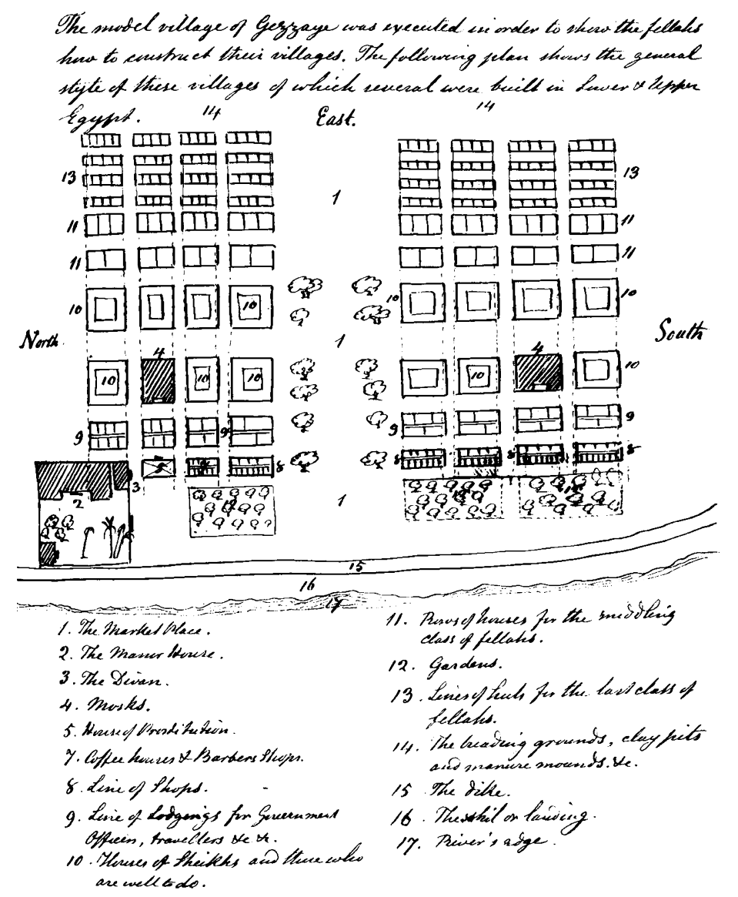
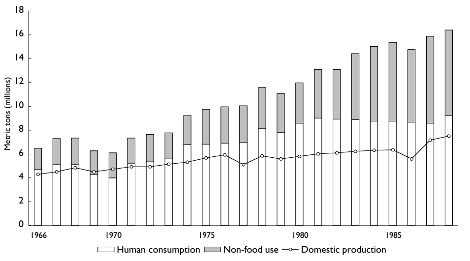
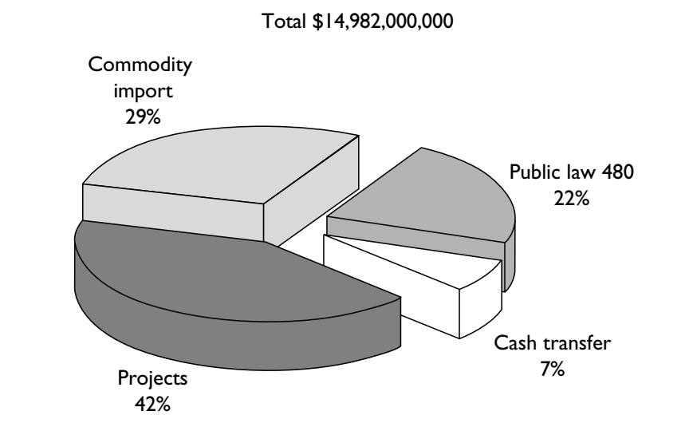
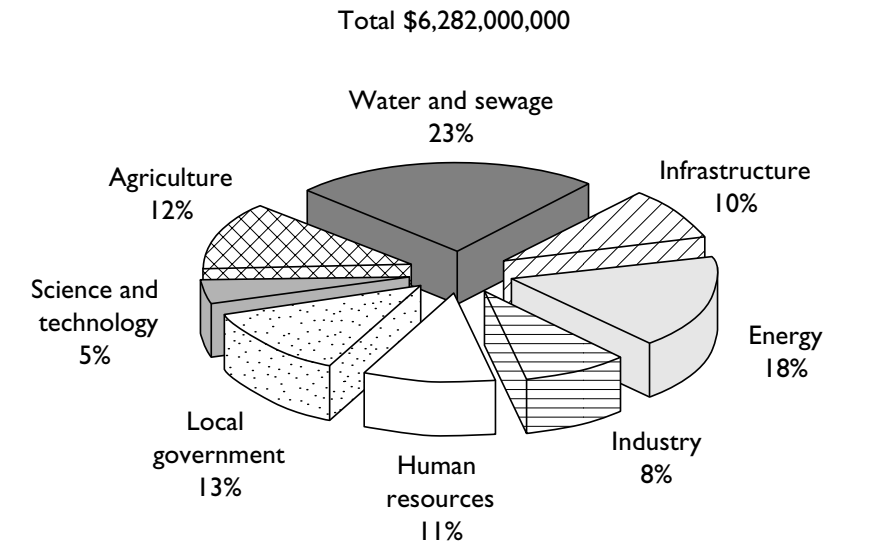
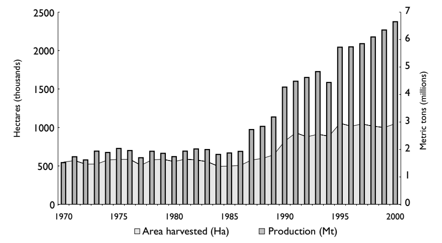
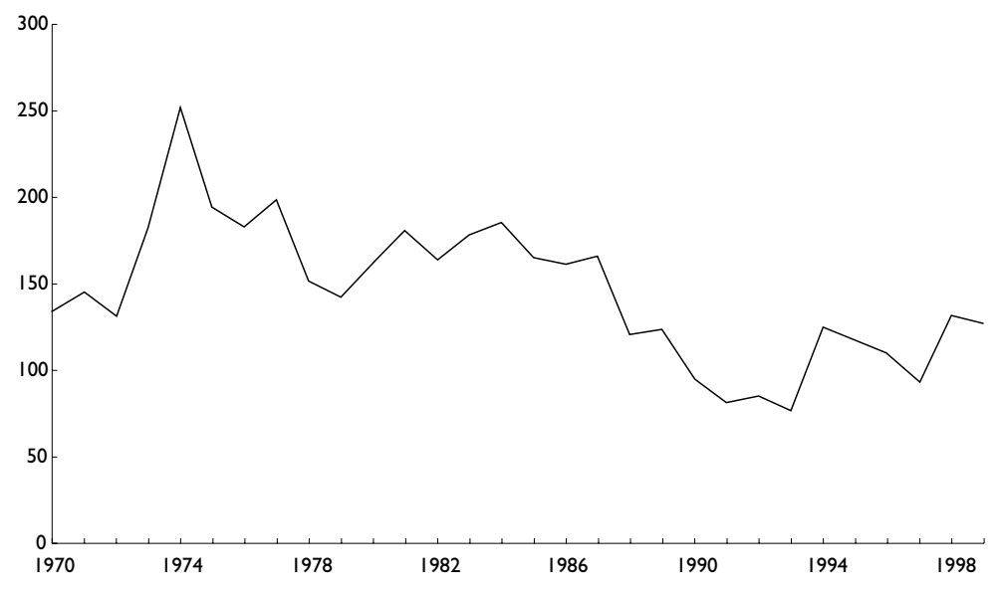

<!-- 2026-10-18重点校订工作版：完成数字、单位、注号、风险语句及结构的专项校对；不等同全书逐句终校。 -->
<!-- 第1章复用已发表译文；导论、第2—9章、致谢、音译说明为本次译文；参考书目保留英文原文，仅加中文标题；原书索引未翻译。 -->

# 专家的统治：埃及、技术政治与现代性

Timothy Mitchell（蒂莫西·米切尔）著

*Rule of Experts: Egypt, Techno-Politics, Modernity*（2002）

## 致谢

〔原书第ix—xi页〕

本书收录的若干章节，最初是我在埃及南部一个村庄逗留时起草的。所有章节我都在同一个地方改写和完成。村里邻居和朋友讲述的历史，偶尔进入了本书的部分内容。在其中两章里，我更详细地阐述了自己在那里了解到的一些事情。

过去十年间，我在那里逗留了十多次，短则数日，长则数月，欠下了许多无法偿还的人情。在众多应当感谢的人中，我想提到海伊里·穆罕默德·易卜拉欣、他的父母穆罕默德和法特娜及其家人；哈米达·宾特·库米娅及其家人；已故萨利姆·阿卜杜勒-瓦里斯一家，尤其是艾哈迈德、穆罕默德、贾迈勒及其家人，以及不在村的赛义德，感谢让我使用他的房子；哈吉·拉米阿·艾哈迈德·穆罕默德及其家人；沙哈特·希希图；马哈茂德·阿卜杜拉希的家人；以及哈桑·穆拉德。我感谢他们所有人的帮助和慷慨。

本书有两章曾全文发表于别处，此处只作了轻微修改。它们带有最初发表时当地和当时略有不同的语言。希望在这本书的语境中重读时，它们能得到新的解读。第5章曾以“The Representation of Rural Violence in Writings on Political Development”为题，发表于 John Waterbury 和 Farhad Kazemi 编的 Peasants and Politics in the Modern History of the Middle East（University Presses of Florida, 1991）；第7章曾以“The Object of Development: America’s Egypt”为题，发表于 Jonathan Crush 编的 Power of Development（Routledge, 1995）。此外，第4章的前三分之二是对“The Invention and Reinvention of the Egyptian Peasant”一文的轻微修订，该文发表于 International Journal of Middle East Studies 22: 129–50。

但该章最后三分之一呈现的新材料，改变了此前发表部分的意义。

另外三章也利用了部分或初步发表于别处的材料。第6章的部分内容来自提交给国际传统环境研究协会第六届双年会议“制造遗产／消费传统”的论文，该会议于1998年12月15日在开罗举行，论文发表于会议论文集 Consuming Tradition, Manufacturing Heritage: Global Norms and Urban Forms in the Age of Tourism，Nezar AlSayyad 编（E. F. Spon, 2001）。第8章的初稿曾在1997年4月阿斯旺的一次会议上宣读，并发表于开罗出版的 Directions of Change in Rural Egypt，Nicholas Hopkins 和 Kirsten Westergaard 编（American University in Cairo Press, 1998）。第9章的前半部分曾以较早的形式发表于“No Factories, No Problems: The Logic of Neo-Liberalism in Egypt,” Review of African Political Economy, no. 82 (1999), 455–68。我感谢上述出版物的编辑邀请我投稿，以及他们为改进稿件提出的许多有益建议。我也感谢 Cambridge University Press、Routledge 和 E. F. Spon 允许我重新发表先前的材料。

我1996—97年在开罗的研究，由美国埃及研究中心提供、美国国家人文基金会资助的奖学金支持。该中心的主任和工作人员，尤其是阿米尔和阿米拉·哈塔卜，以多种方式提供了帮助。1999年纽约大学国际高级研究中心的奖学金，让我有机会推进写作。

在埃及，许多朋友和同事提供了知识上的支持、款待、批评，以及让我在研讨会上展示工作并以阿拉伯语发表的机会。我要感谢马哈茂德·阿卜杜勒-法迪勒、埃尔维·卡普坦、拉尼娅·法赫米、费里亚尔·加祖勒、穆罕默德·哈基姆、纳瓦尔·哈桑、阿里丁·希拉勒、西奥娜·詹金斯、达利拉·基尔达尼、里姆·萨阿德、穆斯塔法·卡迈勒·赛义德、奥利维耶·塞德纳维、希勒米·沙拉维、大卫·西姆斯和索拉娅·托尔基。我特别感谢巴希尔·西巴伊——诗人、历史学家和杰出的翻译家。

过去几年里，我曾在各种会议上以及纽约大学展示自己的工作，从中获益于许多人的建议和批评，无法一一列举。帮助过我的人中有穆罕默德·哈姆杜尼·阿拉米、内扎尔·赛义德、索菲娅·安尼诺斯、阿尔君·阿帕杜莱、塔拉勒·阿萨德、乔尔·贝宁、珍妮弗·贝尔、汤姆·本德、埃塞尔·布鲁克斯、内森·布朗、特里·伯克、雷·布什、科拉伊·恰勒什坎、迪佩什·查克拉巴蒂、帕尔塔·查特吉、肯·库诺、维娜·达斯、尼克·德克斯、萨梅拉·埃斯迈尔、哈立德·法赫米、穆尼尔·法赫尔丁、吉姆·弗格森、莉拉·费尔南德斯、罗伯特·费尼、迈克尔·吉尔西南、彼得·格兰、克里斯汀·哈林顿、尼古拉斯·霍普金斯、胡里·伊斯拉莫格卢、威尔逊·雅各布、德尼兹·坎迪约蒂、扎卡里·洛克曼、大卫·卢登、克里斯汀·麦克尼尔、乌代·梅塔、莱拉·穆斯塔法、弗雷德·迈尔斯、罗杰·欧文、斯特凡尼娅·潘多尔福、卡伦·法伊弗、詹姆斯·皮斯卡托里、帕纳约塔·皮拉、吉安·普拉卡什、玛莎·普里普斯坦-波苏斯尼、阿努帕玛·拉奥、维贾扬蒂·拉奥、叶海亚·萨多夫斯基、奥姆尼亚·沙克里、卡罗琳·辛普森、苏珊·斯利奥莫维奇、凯斯·范德施佩克、南希·莱斯·斯特潘、乔·斯托克、桑德拉·苏菲安、詹姆斯·托特、罗伯特·维塔利斯和杰西卡·温加。

此处提到的所有人都不对本书表达的观点或书中可能包含的任何错误或疏漏负责。

加州大学出版社副社长琳恩·威西耐心等候这份书稿，随后以其专业能力引导它通过评审和出版。我也要感谢玛丽·弗朗西斯、辛迪·富尔顿、马里埃尔·莱昂和沙龙·伍德。

在这些感谢中，布特罗斯·瓦迪耶博士占有特殊位置。在我认识的人中，没有人像他那样，把对埃及史和阿拉伯史的广博知识与对普通人生活需求的深切同情结合在一起。本书若干章节几乎每一页都受益于他的洞见。珍妮特·利普曼·阿布-卢戈德和已故的易卜拉欣·阿布-卢戈德多年来不仅给予知识和道义上的支持，还以他们自己的政治和知识承诺作出榜样。我在英国更广大家庭的成员始终是我的支持。阿德里安和贾斯廷从小就与这本书相伴，在村里成了伊德里斯和亚斯敏，并以极大的勇气和理解力承受了境遇的许多其他骤然变化。莉拉·阿布-卢戈德自己知道我对她的依赖有多深。

纳吉阿·哈吉尔，埃及
2001年4月

## 音译说明

〔原书第xiii页〕

我尽力确保对埃及现代政治所知甚少或一无所知的读者，能够跟上本书的论证，并在发现一段陌生历史的某些面向时获得乐趣。在音译阿拉伯语人名和地名时，凡有通用的英语拼写形式，我便采用通用形式；否则使用标准音译体系的简化形式。（有两个阿拉伯语字母在拉丁字母表中没有简便的对应形式。在名字 ʿAʾisha 中，ʿ 代表阿拉伯语字母 ʿayn，ʾ 代表字母 hamza。）为简便起见，我省略了变音符号、长元音和词首的 hamza。有时音译反映的是上埃及口语阿拉伯语，而非标准书面语。本书中的“acre”指埃及土地单位费丹，其面积在19世纪固定为0.420公顷，相当于1.038英亩（英国或美国英亩）。为表示埃及镑，我使用符号 E£，而不用较旧的法国形式 LE（livre égyptienne）。

## 导论

〔原书第1页〕

我们进入21世纪时，仍然被一种继承自19世纪的思维方式所分化。19世纪的欧洲学会了把现代世界理解为历史的产物。人们开始相信，人间事务的格局既不显现神意的运作，也不显示自然体系自我调节的平衡，而是一种内在世俗力量的展开。对这种内在动力有几种解释方式，它们都诉诸人的理性安排社会事务的能力日益增强。历史的运动可以被归因于理性对自然和社会世界获得的技术控制不断增长，归因于理性扩展人类自由范围的力量，或归因于据称随理性计算和自由的传播而来的经济形式——现代资本主义的交换关系。无论强调现代世俗理性的哪一面，一切都可以被理解为这一普遍理性原则的发展，或对它的反动，或它的失败、延迟或缺席。

〔原书第1—2页〕

到20世纪，随着社会研究成为一项大学职业并分化为社会科学的各个学科，每个领域都继承了这样一个假定：有一种单一逻辑构成了社会生活看不见的动力。不同学科采取不同路径来解读这一逻辑。有些学科，如经济学，以理想形式描绘社会生活的理性，提出根据偏离这一非现实抽象的程度来理解具体案例。另一些学科则从社会和政治变迁的宏观模式中揭示现代性的逻辑。在某些领域，尤其是20世纪后期，还有人试图表明这一逻辑的限度。社会史学家、文化人类学家，以及区域研究、性别研究、文化研究等新领域的学者，考察了抵抗合理化、市场以及后来所谓全球化传播的分量。他们展示了现代性模式中地方差异的复杂性、现代与非现代的混合，甚至替代方案的存续或复兴。然而，这些批评在试图揭示现代性单一逻辑的复杂性和限度时，大多仍假定这样一种逻辑在起作用。尽管新研究内容丰富，这一共同假定却使我们在进入21世纪时仍是19世纪思想的俘虏。

〔原书第2页〕

对更为系统化、律则化的社会科学的批评，通常采取两种形式。第一种是揭示正统研究所视为理所当然的东西是如何被发明出来的。19世纪社会科学奠基于人类社会的物质、种族、生物或心理本性之上的范畴——阶级、种族、民族、性别、现代性、西方等等——被表明是“社会建构的”。第二种是表明这些范畴的人为性质及其发明过程中使用的掩饰手法，使这些建构物不像通常假定的那样普遍、稳定、纯粹、单一和透明。在某些情况下，甚至连历史时间这一底层观念——把人类的社会行动包含于其中的同质计时框架——也受到质疑。这些成就定义了人们所称的解释性社会科学、文化研究，或宽泛意义上的后结构主义等领域。这些领域尽管彼此不同，似乎都以同一种方式被标记出来：它们与系统化的社会科学保持距离，无论后者是在假说—演绎方法的个体主义层面运作，还是在历史体系与过程的结构层面运作。

〔原书第2页〕

然而，这种距离本身成了问题。它使旧式社会科学毫发无损。它之所以如此，是因为未能争夺这些科学据以立足的领地。把社会对象被想象或被话语建构的过程作为焦点，也就把想象工作变成了一个自成一体的领域。证明一切社会之物都是文化的，就把其他领域的存在置于一旁——即社会建构工作所加工的那个剩余或溢出部分：实在、自然、非人者。坚持文化的中心性，也就默认了那些其他维度——物质的、经济的维度——文化正是相对于它们才获得其独特性。关注地方的重要性，也就承认了全球的分量，地方正是参照全球而被经验和界定的。恢复特定替代方案、混合与变化的重要性，也就承认了普遍者的力量，这类变化总是参照普遍者。

〔原书第3页〕

尽管更具文化性或批判性的社会理解路径可能反对那些自称具有假说—演绎逻辑之严格性或系统分析之包容性的社会科学的方法、假定、概括或限度，它们却已经承认了那些方法划归己有的领地的存在。由于承认存在一个普遍过程（现代性、资本主义、全球化）以及归根结底支撑它的各种力量（自然、物质、技术、经济的力量），这些思维方式一次又一次地把一片领地和一套逻辑交给了系统化的社会科学，而后者本来绝不可能如此轻易地确立它们。本书所争夺的正是这片领地和这套逻辑。

〔原书第3页〕

一个奇怪的事实是，批判理论几乎质问了现代社会科学每一个主要范畴，却也许把最核心的一个留而未动。它批判了阶级、民族、文化、社会、国家、性别、种族、人格等概念，却没有批判经济的观念。仿佛各种文化理论必须保留一个经济性的剩余领域，像一处保留地，其遥不可及的存在使文化分析获得安全感。其他一切都可以被理解为文化的，包括特定形式的经济实践或关于经济的本地思维方式。对那些不知道现代“经济”概念的共同体的研究可以表明，非市场社会有理解价值和安排交换的其他方式。但即使这些也作为另一种经济而出现，而不是作为质疑该概念基础的方式。事实上，马林诺夫斯基的经典著作被后来的学者接手之后，反倒有助于把“经济”观念普遍化。“经济”始终被默认地保留为一个物质基础，文化从中成形，或相对于它而获得意义。

〔原书第3—4页〕

即使现代“经济”概念已得到研究，它令人惊讶的历史却被错过了。从卡尔·波兰尼1944年的著作到米歇尔·福柯的一些晚近著作（英译本于1991年出版），已有数种论述考察“经济”作为治理或自我调节领域在18、19世纪欧洲的出现。波兰尼把它理解为市场关系从先前嵌入并约束它们的社会网络中分离出来。他论证说，在现代时期，经济从社会中脱嵌。福柯把经济的形成与18世纪“治理”（government）的诞生联系起来；当时的这个词并不指现代国家的制度，而指清点、规制和管理人口的方法，现代国家和现代社会科学正是由此逐渐形成的。在这种观点看来，治理实践把经济构成为一个政治规制的领域。

〔原书第4页〕

这些研究和其他研究都忽视了一个出人意料的事实。18、19世纪的政治经济学家都没有写到一种叫作“经济”的对象。那个时期的“economy”一词带有“节俭”这一较早含义，在更广的意义上指对资源的妥善经营及其流通的明智管理。古典政治经济学家把它的含义扩展到政治秩序层面对这种妥善经营。他们使用该词的方式类似于“治理”一词，即福柯所探讨的意义。“政治经济学”关注的不是某个经济的政治，而是政治体的妥善经营或治理。

〔原书第4页〕

其当代意义上的“经济”观念直到20世纪中叶才出现。在20世纪30年代至50年代之间，经济学家、社会学家、国家统计机构、国际组织和企业组织以及政府计划共同制定了“经济”这一概念，意指特定空间内货币化交换的总和。经济作为一个自成一体、内部能动、可用统计衡量的社会行动、科学分析和政治规制领域而出现。

〔原书第4页〕

那么，经济是否只是又一个“社会建构”，集体想象晚近的产物，可以与文化、社会、阶级或民族的观念并列？或者像大多数人大概会论证的那样，它只是对已经存在的经济过程的一个新而更连贯的名称？毕竟，自此前约五十年、即19世纪最后几十年专业经济学形成以来，一批学者一直在建构市场交换机制的模型和描述，把这一机制当作一个自成一体、自我调节的过程。而且，他们把自身观念追溯到弗朗索瓦·魁奈或亚当·斯密一个多世纪以前的著作，甚至追溯到更早的“政治算术”研究或亚里士多德的著作。

〔原书第4—5页〕

我在这里提出的答案是：两者都不是。把经济描述为社会建构或社会想象的发明是不够的，因为这类路径总是暗示，所讨论的对象是一种表征、一组意义、一种看世界的特殊方式。这类分析让世界本身毫发无损。无论有意与否，它依赖维持表征与所表征世界之间、社会建构与其所建构现实之间的绝对差异。这种分析让经济学家不受打扰地继续下去，他们指出自己所关心的不是表征的历史，而是其模型所表现的底层现实。

〔原书第5页〕

那么，我们是否应该同意，在某种意义上，“经济”只是一个新词——甚至只是一种新的想象方式——用来指一直存在的东西？这同样不行。经济的诞生并非只发生在所谓语言或社会想象的层面。它的到来确实可以追溯至约翰·梅纳德·凯恩斯等经济学家的著作；追溯至该学科一个新分支即宏观经济学的建立，先前大多数经济理论相对于它被重新定位为“微观”；追溯至试图对一国经济体系整体进行数学建模的计量经济学领域，以及以统计列举这一整体的国民收入核算技术；还追溯至20世纪30年代和40年代众多其他思想发展。然而，同样重要的是经济学和统计学专业领域之外的一系列事件，这些领域几乎或完全无力理解它们。这些事件包括两次世界大战之间国际金融体系的崩溃；大萧条的国内危机；苏联、新政、法西斯主义及其他形式的国家对生产、贸易、就业和投资的控制的发展；战时对技术、信息、供应和消费的管理；尤其重要的是，二战期间及其前后几年，由欧洲和日本帝国形成的全球政治与经济事务结构的崩溃。这个新对象——经济——就是从这一系列政治内爆、社会解体、金融失败和全球冲突中产生的。

〔原书第5页〕

经济并不是作为经济学家一直研究的那种交换过程的新名称而出现的。它的出现是这些过程及其他过程被重组和改造、成为一个先前并不存在的对象。带来这一转变的危机和力量，部分存在于经济学家一直研究的行为之中，但大部分要广泛和多样得多。经济的这些“经济外”起源，使新的价值形式、新的等价关系、新的计算实践、人的能动性与非人者之间的新关系，以及实在之物与其表征形式之间的新区分成为可能。

〔原书第5—6页〕

那么，是否应当得出结论说，经济的诞生既发生在物质层面的转变，也同样发生在表征层面？完全不是。如果我们从这样一个假定出发——这些分离的层面是固定之物，并以某种给定关系存在——那就无法理解这样的转变。物质世界与其表征之间的区分，不是我们可以当作起点的东西。它是在社会实践中被制造出来的对立，而我们视为当然的这种对立形式既相对晚近，又相对不稳定。在此前的《殖民埃及》一书中，我考察了19世纪殖民政治中现代表征实践的制造。在本书所聚焦的20世纪，经济可以说成了最重要的一套实践，用以组织那些看似把真实世界与其表征、物与其价值、行动与意图、对象世界与观念领域分离开来的东西。我们把这类区分视为基础性的东西，视为我们关于社会生活的日常理解所据以建立的基础，视为现代社会科学的框架。然而，正如我们将看到的，由于建立这些分离的机制先于分离本身，这一基础并不像看上去那样稳固。这一问题在经济这一事例中尤其突出，因为经济的组织和理解都如此依赖上述区分。

〔原书第6—7页〕

我刚才提出，对经济的制造的一个重要贡献，是欧洲及其他帝国构成的全球网络的崩溃。例如，在20世纪30年代以前，很难描述某种叫作“英国经济”的东西，部分是因为那些可能被构成为经济的贸易、投资、货币、权力和知识形式，是按帝国而非国家的尺度组织起来的。因此，没有简便办法把它们围合在一个单一空间内，把它们设想或组织为经济制造所需的那种有界领土实体。事实上，经济的最初领土化框定，也许是在殖民地而非宗主国层面才第一次成为可能。凯恩斯是在经济学和政府内部制造“经济”的关键人物，他在伦敦印度事务部任职时写下第一本书；印度事务部是东印度公司的继承者，这家殖民公司中，19世纪政治经济学的三位领军人物詹姆斯·密尔、罗伯特·马尔萨斯和约翰·斯图尔特·密尔都曾担任高级职位。凯恩斯所写的这本书《印度经济与金融》讨论的问题，对他后来形成国民经济概念至关重要：国家对货币在特定地理空间内流通的控制。关于统治印度在现代英国政治理论形成中所起的作用，已有出色的研究。然而，20世纪经济学在多大程度上同样拥有殖民谱系，这一问题却被忽视了。

〔原书第7页〕

本书在后殖民语境中考察经济的制造，以及关于政治与专门知识的更广泛问题。与这个词的其他用法一样，我标题中的“后殖民”并不指殖民主义结束之后的时期（其终结也许难以确定）。它指一类批判实践，关注殖民主义在社会理论的形成与实践中的意义。从这个视角看，殖民主义对于现代西方的发展，对于在那里出现的新形式技术专门知识（包括现代社会科学），都不是偶然的。

〔原书第7页〕

社会科学的可能性建立在这种做法上：把西方的某些历史经验当作普遍知识的模板。经济学为此提供了一个格外清楚的例证。19世纪在西欧被形式化为“市场交换”的某些社会交换形式、契约法、财产处分、公司权力、计算方法、对劳动者的剥夺、公共与私人的关系、信息组织和政府规制，被经济学抽象为一种社会科学的框架。这门新科学忽视了更大的帝国结构在使这些国内安排成为可能方面的重要性。同时，它把这些范畴和安排呈现为无论是科学知识还是社会实践的普遍标准。现在，世界上每个国家都要参照这一普遍模型来衡量和理解。

〔原书第7页〕

应当强调，我提请注意这段历史，并不是要提出文化相对主义那种轻率的论点：即经济学在西方行得通，但既然其他文化不同，它们就需要自己的社会科学。正如迪佩什·查克拉巴提提醒我们的，社会科学的诸概念总能从一个语境翻译到另一个语境。它们在西方之外运作得可以同在西方之内一样好，也一样糟。如我所说，19世纪及更早所谓市场实践的形成是一个全球现象。一个涉及殖民政府、东印度公司学院、美国学术访问项目、宗主国大学、政府间组织、福特基金会及其他机构的全球工程，把经济学转变为一套全球性的知识形式——这里的“全球”指的是一个广泛但非常稀薄的纽带与交换网络。

〔原书第7—8页〕

与关于文化相对主义的论证不同，后殖民视角把殖民主义、全球扩张和翻译这些问题置于科学的历史与实践内部，而不是把它们当作科学形成之后才处理的外围问题置于其外。它还考察科学领域对这些问题的沉默、或把它们归为次要之物的原因与意义。尽管东印度公司伦敦的办公室如今已让位于华盛顿特区的国际货币基金组织总部或日内瓦的世界贸易组织，技术官僚专门知识的生产和出口由美国大学校园组织，而不是由马尔萨斯任教的赫特福德郡海利伯里学院组织，后殖民主义提出的问题在今天仍然同样相关——也许更加相关——不亚于马尔萨斯和密尔的时代。

〔原书第8页〕

本书各章横跨这段历史的两端，从19世纪后期英国殖民权力的顶峰，到20世纪末国际货币基金组织的结构调整与金融稳定计划。所有章节都处理一个特定地方即埃及的事件。我希望，这给那些在其他方面相当多样的讨论带来一种连续性。它们并非都直接关心经济问题。我刚提出的问题在头两章浮现，在第三章得到直接处理，我又在最后三章从各种当代视角重新审视它们。

〔原书第8页〕

全书考察更广泛的一组问题，说得过于抽象些，涉及社会计算、能动性、抽象、暴力、法律、资本主义和专门知识等问题。通过在一个特定地方书写这些抽象问题，我也把它们定位于特定的事件、工程、冲突和转变之中。这是一部政治理论著作，但它提出的一种理论，出于将变得更清楚的理由，避免理论作品通常所具有的那种从特殊中抽象的方法。理论在于案例的复杂性。本导论以误导性、有时也许晦涩的方式从这些特殊中抽象。因此，它无法替代各章本身的内容。

〔原书第8—9页〕

我想提请注意的第一个主题是“可计算性的品格”问题。这一说法借自德国社会学家格奥尔格·齐美尔，成为第三章的标题，但这一主题在本书其他几个部分也有讨论。我已提出，经济可以被理解为一套实践，它确立一种新的计算政治。构成经济的实践，部分地运作于建立等价关系、容纳流通、识别社会行动者或能动者、使数量和绩效可测量，并指定控制与命令的关系。正如米歇尔·卡隆所论证的，经济还必须作为一系列边界、区分、例外和排斥而运作。例如，经济依赖并帮助确立以下边界：货币与非货币、本国与外国、消费与投资、公共与私人、自然与技术、有形与无形、所有者与非所有者，等等。这些边界和例外是如何制造的？它们使哪些计算成为可能？会引发什么问题、付出什么代价？这类问题在书中多处从不同角度得到探讨，尤其是在讨论当代的最后三章。不过，第三章回顾20世纪上半叶，追问某些可计算性形式最初是如何被格式化的。

〔原书第9页〕

1882年，英国入侵并占领埃及，以镇压一场反对政府暴政和欧洲金融控制的民众起义。在终结起义、重建开罗对乡村的权威之后，英国首先关注的事情之一，是一项庞大的计算工程。为了重整税收、偿还该国欠欧洲银行的债务（偿还债务的紧急措施曾加速了起义的爆发），殖民权力着手确定该国每一平方米农业土地的所有者、耕种者、土壤质量和适当税率。为了收集、组织和呈现这些信息，当局决定制作一件前所未有的东西：一幅“埃及大地图”。这幅地图不仅意在充当行政控制或地理知识的工具，还意在成为一种以集中、微缩和视觉形式记录复杂统计信息的手段。它不仅是要提供现实的图式，还要提供一种收集、储存和操作多层次信息的机制。

〔原书第9页〕

近年来，地图的制作常被视为殖民权力、进而现代国家权力的典型。地图象征着知识的大规模生产、计算的精确性，以及福柯称为治理术的那种建立在人口与领土知识之上的整个政治——现代国家的典型权力。也可以说，地图预示了20世纪经济学的工作：界定一个被包含的地理空间，供日后组织为国民经济，并处理后来发挥核心作用的统计信息问题。

〔原书第9—10页〕

尽管埃及大地图因其精确性以及解决了大规模测量工作中的若干技术问题而备受赞誉，它在1907年的成功完成却掩盖了一件重要的事。这幅地图并未比早先的治理实践产生对其对象更精确、更详尽的知识。事实上，它本应使之成为可能的计算，实际上始终未能真正实现。那么，这种新的计算政治究竟新在何处？它的力量与吸引力来自哪里？第三章以这些问题开篇，随后把它们与此后几十年中在埃及及其他地方出现的更大工程联系起来：国民经济的制造。

〔原书第10页〕

计算问题与我想指出的第二个主题相关，即人的能动性。在社会科学中，计算能力往往界定人作为社会行动者的存在和力量。在经济学及部分其他学科中，社会解释围绕个体之间所作的计算来组织，把特定安排或事件呈现为一系列相互作用之计算的结果。（反过来，某些社会行动者——例如农民——据称无力计算自身处境，正如我们将看到的，这为一整套社会改良政治以及后来的技术发展计划提供了理由。）在第一章中，我讲述了一个来自20世纪中叶的复杂故事，其中涉及的能动形式似乎不只是人的能动性。各种其他力量登场：技术、疾病、水利、战争、自然、化学等力量——只不过，由于它们互动的方式，很难把它们纳入其中任何一个范畴。它们以不同方式与之互动的东西之一，就是我们所谓的人类意图。互动的结果很复杂，在若干情况下是灾难性的。当人们解开这些交织的力量时，人的能动性显得不太像是一种指导社会结果的算计智能，而更像是一系列联盟的产物，人在其中从未完全掌控。人的能动性是某种无形体的理性，在观察、计算并重组面前的世界吗？还是更像一个技术性构成体，由先于观念与物、人与非人之间差异的过程制造出来？如果是后者，那么对于社会解释、历史逻辑的思考，或对于分析诸如经济这类被格式化为人类计算之产物的过程，会带来什么后果？

〔原书第10—11页〕

能动性与计算的问题，引出关于现代世界被划分方式的一些共同问题——分为对象与观念、自然与文化、现实与其表征、非人与人类。本书其他几个部分以进一步的方式探讨这些划分。在每一种情况下，我感兴趣的都是那些似乎确保世界这种二分化的地方组织方法、特定政治技术和新社会实践。在每一种情况下，这一区分得以建立的规模和彻底性都相当惊人。但与此同时，更仔细地考察，把焦点放在过程而非被呈现为最终结果的东西上，这种二元对立的状态就不那么确定了。

〔原书第11页〕

这种分离的另一种形态，在经济的制造中发挥关键作用，就是规则或制度这一现象。正如我在本书后文所讨论的，经济理论依赖于维持一种持续而困难的区分：交换行为与构成交换的正式及非正式规则或制度之间的区分。在经济整体的更大尺度上，同样的问题出现了：如何区分经济交换的总和（其汇总被衡量为经济）与构成经济整体的政府、法律、统计生产和经济知识的权力。

〔原书第11页〕

在市场经济中，这类制度的一个核心例子是产权法。产权依赖一套规则和制裁，它们决定个人在交换行为中处分某物的权力。这些规则也确立个人排除或限制他人对该物提出主张的权力。在20世纪最后几十年，出现了一场重要的全球运动，旨在强化、重新界定和普遍化产权规则。埃及是世界上许多国家之一，这些国家里，国有企业私有化、公司和契约法改革、贸易壁垒重组，以及关于所谓知识产权之公司所有权的扩大主张，都以不同方式试图重塑和扩展产权规则。在本书最后一部分，我考察这一工程遇到的一些困难和问题。

〔原书第11—12页〕

产权法通过表现为一种抽象而获得力量。它似乎作为一种概念结构而存在，其基础不是特定主张或历史，而是“在每个国家都成立的原理”——用一位英国殖民行政官员的话说。第二章围绕这类规则的起源与地位问题探讨此事，考察埃及土地产权法的谱系及其与现代国家更大制度结构形成的关系。帮助确立该法的政府官员和欧洲顾问把它视为现代国家所取代的旧统治形式的对立面；在他们看来，旧统治建立在专断决定、制造例外和不受约束的权力的特权之上。（20世纪末也作出了同样的区分，当时普遍产权规则和价格机制被主张用来取代中央指令、专断国家权力和非市场政治经济所特有的资源非理性配置。）第二章呈现的谱系，以及我后文对当代时期的讨论，都表明我们应当对这一区分保持怀疑。产权法的确立是否取代了据说构成旧秩序的专断、特殊主义和暴力形式？或者，它是一个把这些负面要素重新分配、集中并隐藏于自身之中的过程？殖民主义或当代改革计划声称要驱逐的这些负面之物，在使法治或市场、以及伴随这种统治的制度化权力形式成为可能方面，扮演了什么角色？

〔原书第12页〕

关于产权统治和法律国家制度化的讨论，与本书反复出现的一些其他主题相关，我在此简要提及。第一个是领土问题。如果说现代国家的特征是似乎构成一种规则或制度结构，其规则性和抽象性把它与被它治理的社会秩序分离开来，那么它也同样以领土特征为标志。它在对特定地理区域的控制中，似乎获得了新的清晰性和绝对性。把个人的政治和经济交换包含在规则框架内，似乎与把集体交换、流动、价值和身份包含在领土框架内相对应。边界被划定为固定界线，人口和货物跨越这些界线的流动以前所未有的方式受到控制，而那些对中央权威的效忠程度不一或可以变化的边缘政治生活形式，则日益让位于更统一、更严格的控制方法。这些是第二章提出的问题，但其讨论在包括第六、七章在内的其他几处继续展开。这些讨论把领土性的生产或物质化，既与经济制造的可能性联系起来，也把使规则、技术或制度显得与其所治理的所谓物质世界相分离的权力联系起来。

〔原书第12—13页〕

这种新领土权力的生产，也使民族的制造成为可能。人们常常忘记，18、19世纪在下尼罗河谷出现的现代国家还不是一个民族国家。开罗及其腹地作为奥斯曼帝国的一部分被统治，尽管奥斯曼主权日益虚弱，尤其是在英国占领之后，但与伊斯坦布尔的联系直到帝国崩溃前夕的1914年才正式终结。甚至在那之后，直到奥斯曼帝国在第一次世界大战中战败，奥斯曼主义仍是地方政治认同的更大语境，尤其是在1913年之后，当时由杰马尔帕夏和恩维尔帕夏领导的军事现代化派在伊斯坦布尔掌权。战后，英国把开罗的奥斯曼王朝重组为民族君主国，而他们自身的控制则因1922年和1936年被迫与新的立宪政府谈成的部分独立措施而削弱。在这些事件进程中，一种民族政治出现了，但民族主义、君主主义和殖民主义之间的张力——以及三者都无法代表的更广泛民众压力——最终以1952年的军事政变告终，这场政变终结了英国统治和君主制，并使更充分的民族独立成为可能。

〔原书第13页〕

一个次要却颇具指示性的事实是：独立后埃及的头两位领导人，都生于1918年奥斯曼帝国的最后几个月，他们的父亲分别以两位奥斯曼将军杰马尔和恩维尔为之命名。贾迈勒·阿卜杜勒·纳赛尔和安瓦尔·萨达特的政府，帮助完成了把地方历史改写为埃及民族史的工作，于是更广阔的奥斯曼过去以及它所包含的另类未来，在泛阿拉伯主义新近形成的身份认同中被遗忘或覆盖。埃及作为一个民族的观念被投射回19世纪，19世纪开罗的统治者被改写成民族主义先驱。历史再一次可以被理解为单一逻辑的展开——一个民族在普遍现代性意识中的觉醒。

〔原书第13页〕

民族的制造并非在本世纪较早部分就已完成的项目，因为民族是一种必须不断再造的身份。民族历史在学校里教授，以公共文化的形式灌输，但它也在普通公民的生活中被展演。在埃及，对过去的展演涉及开罗政治精英与西方的关系问题，同时也涉及他们与自身更广泛社会、尤其是被称为“农民”的大众的关系问题。第六章通过涉及埃及南部一座村庄的两个相互关联的事件，考察围绕界定民族过去的斗争。当制造当代埃及的政治通过制造其民族过去来运作时，会发生什么？民族身份通过哪些政治、专门知识、暴力和抵抗形式而被制造出来？

〔原书第13—14页〕

民族主义与暴力又回到我在开头提出的关于历史逻辑的问题。贯穿全书，我关心的是：如何把特定地方发生的事情，与我们称为现代性、科学与技术以及资本主义扩张的全球力量联系起来。例如，第一章考察一系列看似全球性的力量——技术、科学、帝国权力和资本主义——并追问，人们如何理解这些不同力量的作用，而不把其中任何一种并不具有的逻辑、能量和连贯性赋予它。我尤其考虑，如何书写资本主义或经济，而不把一种内在合理性、同质性要素或固有力量归于它们，再把发生的事情归功于这种力量。

〔原书第14页〕

我还在本书不同部分探讨，归于现代性、市场、法律、科学、技术或资本主义的逻辑或合理性，往往会产生对暴力的一种受限理解。暴力被视为这些理性或逻辑形式的对立面。它通常显得属于自然，或属于对历史更普遍逻辑的反动形式。这种反应性暴力在关于乡村的讨论中是一个永恒主题：农民的暴力、对变革的抵抗、对权威的不情愿接受，无论表现为大起义还是日常形式的拒绝。例如，第五章讨论20世纪60年代中期的一个短暂时期，当时围绕国家权力中心政治控制的斗争也在村庄中进行。埃及乡村的事件恰逢新一代美国社会科学的到来，这一代社会科学首次聚焦于非西方世界。到20世纪60年代，农民研究等新领域——其谱系在第四章考察——已经建立起来，乡村的暴力、失序和变迁问题是其主要关切。第五章考察这些新的专门知识形式如何处理农村暴力问题，探讨社会科学的逻辑如何把暴力问题转化为一种反应性的、落后的、非理性的、往往不可见的力量。

〔原书第14页〕

类似问题以不同方式在本书最后三章提出，那里我考察国家发展、外国专门知识和经济改革的当代政治。我表明，改革计划的结果并不是改革者所承诺的市场关系或资本主义发展形式，而是由一系列不同且相互交织的逻辑所驱动的社会实践的复杂重组。我追问，以资本、市场、或用1990年代的语言说全球化的合理性与权力来谈论这类转变，有什么危险。与其进一步助长这些力量具有它们自我宣称的连贯性、能量和逻辑这一印象，我主张需要更仔细地考虑：从这些术语被用来描述的那些更为暴烈、更不可预测的互动中，可以学到什么。

〔原书第15页〕

最后一个主题正是本书标题的来源。在随后每一章中，我们都会遇到现代形式的专门知识。我们遇到建造阿斯旺大坝的工程师，界定产权法的行政官员，抗击流行病的科学家和公共卫生专家，制作大地图的测量员，诊断农村政治的政治学家，确认农民非理性和暴力性的专家，以及设计财政援助和经济重组计划的一系列发展实践者和经济学家。从20世纪初到20世纪末，国家发展和经济增长的政治是一种技术科学的政治，它声称带来现代工程、技术和社会科学的专门知识，以改良自然的缺陷、改造农民农业、修补社会弊病并修复经济。

〔原书第15页〕

在我的现代技术政治考察中贯穿着三个问题。第一，在现代政治中固定下来的二元对立，如何打开那种需要并促成此类专门知识的距离：例如，在一种书写农民的特定方式中，在把埃及当作一幅地图般铺展开来的对象来对待的发展实践中，或在重新组织尼罗河、并改变乡村间权力、技术和信息分配的水利工程计划中？在每一种情况下，专门知识的位置和主张都是在似乎打开的那种分离中构成的，它把自然与技术、现实与其表征、对象与其价值、经济与经济学这门科学对立起来。第二，如果如本书所论证的，这些分离并非其表面所示，如果它们不是作为根本对立而发生，而是作为在政治过程中被构成同时又被动摇的不确定的差异形式，那么专门知识实际上是如何形成的？从其艰难而分裂的谱系中，我们能学到什么？第三，如果这些分离让理性得以统治，让历史得以被组织为一种无位置的逻辑的展开，那么专门知识如何附着于这一逻辑？哪些策略、结构和沉默把专家转变为那些看似是发展的力量、法律规则、现代性的进步或资本主义的合理性的发言人？

## 第一部　资本主义的寄生之所

〔原书第17页〕

### 第一章　蚊子能说话吗？

<!-- 本章复用已发表译文：output/egypt_ch01_zh.md；原书正文第19—53页，原注第305—315页。 -->

<!-- egypt-ch01-001 -->

〔原书第19页〕

1942年夏天，两股力量入侵了埃及，各自引发了一场决定性的战斗。其中只有一股力量由人组成，所以只有那一场战斗被人铭记，尽管另一场战斗造成的伤亡更大。在西北海岸，埃尔温·隆美尔的非洲军团从利比亚越过边境，向开罗进军，却在阿拉曼被英国第八集团军挡住。四个月后，英军发动反攻。经过两周的坦克战，英军击溃了德军和意军；其兵力和坦克数量均超过对方两倍。阿拉曼是盟军在第二次世界大战中取得的第一场决定性的陆战胜利，与一个月后苏军在斯大林格勒的胜利一道，似乎扭转了战争局势。由于暴力的规模之大，以及战败部队的混乱，伤亡人数无法统计，但阵亡、受伤或失踪的士兵可能有五万至七万人。[^ch01n1]而且，在军队开走很久之后，这场战斗仍在夺取生命。阿拉曼标志着地雷首次被用作战争的主要武器。埃及在20世纪积存了2300万枚尚未清除的地雷，数量居世界之首，其中四分之三源于这场战役。[^ch01n2]

<!-- egypt-ch01-002 -->

〔原书第19—20页〕

与此同时，在这个国家的另一端，又有一个入侵者从苏丹沿尼罗河谷顺流而下：冈比亚按蚊（Anopheles gambiae）。这种蚊子原产于撒哈拉以南非洲，此前在埃及却不为人知。冈比亚按蚊胃内携带着一种恶性的疟疾寄生虫——恶性疟原虫（Plasmodium falciparum）。[^ch01n3]埃及原本也有其他种类的传疟蚊，但它们传播的是较为温和的疟疾，而且局限于北方的一些小片地区，当地人口已经形成了一定程度的免疫力。对于恶性疟原虫，当地却没有防御能力。1942年3月，横跨埃及与苏丹南部边界的努比亚地区，其村庄首次传出了冈比亚按蚊所致疟疾暴发的报告。疫情7月抵达阿斯旺，8月抵达卢克索，随后继续向北，到达南方最大的城市艾斯尤特。与阿拉曼一样，受害人数既不为人知，也无从确知。据估计，在疫情持续的三年中，可能有75万人感染，十万至二十万人死亡。[^ch01n4]

<!-- egypt-ch01-003 -->

〔原书第20页〕

我第一次听说1942年的疟疾入侵，是1989年听一位名叫阿姆·易卜拉欣的人讲起的。他住在卢克索附近的一个村庄，我当时正在那里生活。[^ch01n5]他那时已经八十多岁，是最熟悉村庄历史的讲述者，而疟疾流行的故事总是他叙述中最鲜明的部分。他常说，疟疾夺走了村里三分之一人的生命，活着的健康男子甚至不够抬走死者。人们用骆驼驮着死者，把他们运到墓地。

<!-- egypt-ch01-004 -->

〔原书第20页〕

战争与疫情还同威胁这个国家的第三种力量相互作用，即战时严重的粮食短缺。这种短缺本身有着复杂的成因。1933年，世纪之交建在阿斯旺、横跨尼罗河的大坝被加高，至此，一个始于19世纪中叶、由大坝、拦河闸与运河组成的网络建成，使全国大部分农田改用全年灌溉。[^ch01n6]如今，尼罗河谷只有五分之一的土地仍由河流一年一度的洪水灌溉；过去，洪水沉积一层淤泥与养分，使土壤保持肥力。其余五分之四的土地则需要化学肥料。[^ch01n7]到20世纪30年代末，埃及农民每年使用60万吨肥料——主要是新型人工合成硝酸盐——单位耕地面积的使用量居世界之首。[^ch01n8]化学品制造商组成的国际卡特尔，将埃及市场的80%划给了一个由德国法本工业集团（I. G. Farben）领衔的联合体；该集团的一家公司发明了合成硝酸铵的工艺。[^ch01n9]战争爆发切断了这些供应。

> 校注：本章引用的统计和医学判断均属于2002年底本的历史叙述。化学名称中的明显疑点保留原文，并在下文相应位置说明。

<!-- egypt-ch01-005 -->

〔原书第20—21页〕

肥料匮乏使小麦及其他作物的产量下降了多达四分之一。政府实行粮食配给，以供应城市和英国军队，又实行肥料配给与种植面积管制，迫使土地所有者把全国一半的棉田改种粮食。[^ch01n10]然而，在最南部，主要的商品作物是甘蔗而非棉花，甘蔗并未受到管制。战争期间，甘蔗种植园主把种植面积扩大了多达30%，加剧了冈比亚按蚊疟疾肆虐地区主食的短缺，也增加了蚊虫的孳生地。[^ch01n11]疫情第二年的伤亡要高得多，因为许多家庭上一年病得无法收获粮食，此后又因饥荒和营养不良而衰弱。糖业庄园工人的伤亡率最高。[^ch01n12]在卢克索以南几英里处一个规模最大的甘蔗种植园中，经理估计有80%至90%的人感染了疟疾；附近阿尔曼特镇的医生则报告，每天有八十至九十人死亡。[^ch01n13]

<!-- egypt-ch01-006 -->

〔原书第21页〕

共同造成1942—1944年灾难的各种因素，代表着20世纪一些最强有力的转变。首先是河流筑坝。1898—1902年阿斯旺最初那座拦河坝的兴建，帮助开启了全球工程规模空前扩大的时代。截断大河水流的计划，将成为这个世纪规模最大的建设项目。大坝改变资源在空间与时间上、在整个社区与生态系统之间的分配，其范围和方式独一无二。它们许下的不仅是农业发展或技术进步的承诺。对于许多后殖民政府而言，这种重新安排自然与社会环境的能力，成为展示现代国家作为技术—经济力量之实力的手段。[^ch01n14]其次是合成化学品。人工硝酸盐的制造带来的转变，比筑坝还要巨大。从1925年那个基本没有合成物的世界出发，以硝酸盐为首的新化学品产量以惊人的速度增长。在美国，产量每十年就增长十倍。到20世纪80年代，投入生产的合成化学品达四百万种，其中六万种被普遍使用。这种转变在细胞和有机体层面的影响，足以与大坝在国家层面的影响相匹敌。[^ch01n15]第三是疟疾。它借助灌溉计划、人口流动和农业变化，成为世界上最致命的传染病。恶性疟原虫引起的病例仅占临床疟疾病例的30%，却造成了高达90%的死亡。其传播如此广泛，以至于它每年夺走多少生命，连精确到百万位都无法达成共识。[^ch01n16]最后是战争。阿拉曼被铭记为第一场大规模机械化冲突：德国坦克以新型战术与反坦克炮、飞机协同，迎战体型更大的格兰特和谢尔曼坦克。然而，战线过于狭窄，德意两军的机械装备又缺乏燃料和弹药，因此这场为期两周的战斗以近距离交战展开，仿佛第一次世界大战中的一场战斗。它集中体现了人与机器之间一种新出现的致命互动。

<!-- egypt-ch01-007 -->

〔原书第22页〕

大坝、血液传播的寄生虫、合成化学品、机械化战争与人为饥荒，同时出现并相互作用。环境转变带来疾病、工业化学受军事需要塑造，或战争伴随饥荒，这些现象并不令人惊讶。然而，它们的相互作用提出了一个难题：坦克、寄生虫与合成硝酸盐究竟如何彼此影响？怎样的解释才能把它们联系起来？

<!-- egypt-ch01-008 -->

〔原书第22页〕

战争与疫情在若干层面相互作用。战事爆发时，英国重新在埃及实施戒严，此前埃及在摆脱始于1882年的殖民占领后，已经享有将近二十年的部分独立。当局审查有关疟疾疫情的报道，希望把疫情限制在南方。英国人已在准备一旦隆美尔突破阿拉曼便撤出开罗，不愿从北方调拨人员和资源去对付来自南方的入侵者。这帮助了冈比亚按蚊的推进。英方还面临奎宁短缺，这是当时唯一的抗疟治疗药物；就在努比亚报告冈比亚按蚊疟疾的同一个月，日本占领了爪哇，切断了荷兰金鸡纳树种植园的供货，而欧洲的奎宁正是从这些树木中取得的。[^ch01n17]于是，埃及卫生部只能自行发动抗疟运动。灭蚊队针对的是疾病媒介——蚊子——而非寄生虫本身：他们在积水池中撒布Malariol，即掺有铺展剂的柴油。油在水面形成一层薄膜，阻止蚊幼虫孵化。不过，Malariol经常不翼而飞，因为灌溉水泵可用其中的柴油作为燃料，而战争使燃料难以获得。灭蚊队后来改用巴黎绿，即砷粉与醋酸铜的混合物，原先用作绘画颜料。事实证明，它是一种更可靠的杀幼虫剂，或者至少更不容易被挪作他用。

> 校注：底本写的是阻止幼虫‘孵化’（larvae from hatching）。按蚊生命周期为卵、幼虫、蛹、成虫，严格说孵化的是卵；此处保留作者措辞。

<!-- egypt-ch01-009 -->

〔原书第22—23页〕

甚至可能是战争本身带来了疫情。按蚊的活动范围只有两英里，因此，要抵达埃及，它自己也需要传播媒介。一种看法认为，它必定是乘飞机而来；蚊子搭乘飞机并非罕见。德军的空袭与潜艇袭击使地中海不再安全，因此英国人开辟了一条经西非和苏丹飞往开罗的补给航线。但战事也可能使蚊子得以乘船抵达埃及。战争增加了与苏丹之间的河运，阿斯旺大坝的修建与加高又沿途为昆虫创造了新的孳生地。一旦进入埃及，蚊子便乘船、火车和汽车继续北上。为阻止其移动，人们用一种新技术——除虫菊喷雾——处理这些交通工具。这项技术是在此前十年中，为应对南非东海岸纳塔尔省一次严重的疟疾暴发而开发的；该省同上埃及一样，是一个甘蔗产区。除虫菊粉由除虫菊的干花制成，有时也被焚烧以熏杀屋内害虫；人们将其与绿皂及甘油混合，再用脚踏固定的手压泵从喷嘴喷出，形成细密的毒雾，杀死成蚊。[^ch01n18]

<!-- egypt-ch01-010 -->

〔原书第23页〕

疾病往往随人群流动方式的改变而移动，现代战争又迫使大批人口在既有贸易与迁移网络之外另寻路径。然而，这种昆虫在利用新型交通工具与运输路线之后，还需要通过进入新的地域和人群来立足。战争与交通的模式必须同其他变化交织在一起，尤其是水流系统的变化。就在冈比亚按蚊开始从赤道非洲沿上尼罗河谷北移的那些年里，它也跨越了大西洋，到达巴西海岸。在巴西和上尼罗河地区，蚊子都利用了新近的灌溉工程和用水模式的改变。在尼罗河，英国人通过在英埃占领下的苏丹增建蓄水库，扩大了阿斯旺水利工程对河流的控制。1925年，位于苏丹首都喀土穆以南二百英里的森纳尔，建成了横跨青尼罗河的大坝；1937年，在喀土穆上游三十英里的杰贝勒奥利亚，又建成了横跨白尼罗河的大坝。工程完成后，地方病发病水平上升的报告随之出现，包括疟疾和血吸虫病。后者是一种由水生螺传播的寄生虫感染，最终波及整个埃及；其治疗后来又引入了另一种地方性感染——丙型肝炎，这可能是世界上由医疗干预造成的最大规模血液传播病原体传播事件。[^ch01n19]河流控制工程相互连通，使蚊子能够跨越障碍，从一个地区抵达另一个地区。随之发展的常年灌溉农业创造了大量孳生地，其间生活着更为稠密的人类宿主；由于许多地区不再泛滥，人们往往住得离水边更近。修建灌溉工程的工程师没有考虑到，螺或蚊子可能利用他们的工程迁移，某些寄生虫可能随这些宿主移动，或者由此产生毁灭性的后果。然而，英国人在1942年的一份内部报告中承认，要恢复埃及人口的健康，最可靠的办法就是拆除大坝，回到盆地灌溉。[^ch01n20]

<!-- egypt-ch01-011 -->

〔原书第24页〕

灌溉工程还产生了其他意料之外的影响。筑坝改变了河流流量的分布和时间节律，也改变了水温与水的化学性质。这些变化影响河床与河岸，改变了河流环境的特征。依赖河流涨落平衡的微生物和植物消失了，另一些更具侵占性的物种却利用了这一变化。菹草（Potamogeton crispus）是侵入性最强的水生植物之一，它开始形成大片草岛，河水把成团的草带往下游。一位埃及疟疾专家证实，冈比亚按蚊又利用了菹草，借它把蚊幼虫从一个孳生区运往另一个孳生区。[^ch01n21]

<!-- egypt-ch01-012 -->

〔原书第24页〕

如果说冈比亚按蚊得益于尼罗河流量及化学性质的变化，那么需要人体来繁殖的寄生虫也得以从中获益。作为一种形成孢子的寄生虫，疟原虫并不是为了杀死人类受害者而来；它进入人体，只是为了完成自己不寻常的生命周期。雌蚊叮咬时把幼小的孢子转移到人体内，它们在受害者的肝细胞中停留约一周。随后，每个孢子裂开，向血流中释放多达四万个后代；这些后代以血细胞中的血红蛋白为食，继续增殖，其中一些分别形成雄性和雌性的形态。这种爆发式繁殖并不是为了杀死受害者，而是要确保另一只蚊子叮咬时，能把一定数量的孢子再次吸入昆虫胃内，使它们在那里受精，完成繁殖周期。然而，新入侵者带到埃及南部的这种恶性寄生虫，会使受害者的红细胞格外黏稠，堵塞动脉，使身体缺氧。多数受害者在经历严重发热后活了下来，这保证了寄生虫仍有可栖居的宿主。但如果脑部或其他重要器官缺氧，这个并非自愿接纳它的宿主就可能死亡。

> 校注：底本以spores泛称疟原虫的不同阶段，并称其堵塞arteries（动脉），这是简化的生物学叙述。CDC的生命周期说明区分子孢子、裂殖子和配子体；雌蚊吸入的是配子体。本文保留原文，而不把这些不同阶段静默改写为同一种规范术语。

<!-- egypt-ch01-013 -->

〔原书第24—25页〕

在上埃及，疟原虫遇到的人群没有能够打断其感染周期的免疫反应，因为它是新来的。它也遇到了一群身体已被制糖业改变的人。从20世纪20年代起，新近独立的埃及政府首次能够保护本国制造业，尤其是制糖业——这个国家历史最久、规模最大的现代工业。20世纪30年代和40年代，对全球市场实行的价格保护与灌溉工程相结合，支持了种植面积的扩张。常年灌溉和甘蔗种植降低了土壤肥力，也缩减了可用于粮食生产的土地。当战争中断人工肥料供应时，这些因素共同使埃及南部居民更容易受到疟原虫侵害。与营养不良的南部居民形成对照的是，政府官员、医务人员、灭蚊队员，以及那些从开罗来到南方开展慈善救济的富裕妇女，无一在疫情中丧生。[^ch01n22]此外，巴西的报告表明，甘蔗汁会加重疟疾的影响，而甘蔗种植园的工人会在劳作现场折断甘蔗，咀嚼吸汁。[^ch01n23]因此，寄生虫在多个层面发现，糖使它所遇到的身体更难抵抗感染。疫情的化学作用同时发生在国家层面和细胞层面。

<!-- egypt-ch01-014 -->

〔原书第25页〕

造成营养不良的肥料短缺，也体现了多层面力量之间的相互作用。德国硝酸盐供应被战争切断后，之所以找不到替代性的化肥来源，还存在一个更大的原因。天然硝酸铵的供应只存在于世界上的一个地方——智利阿塔卡马沙漠，而在那里经营的美国加工公司只能向埃及提供少量产品。它们同人工硝酸盐制造商一样，正把肥料工厂用于一个更迫切的目的。硝酸铵是两种化学上相似、社会上却不同的过程的主要原料；这两种过程都与生死攸关：给作物施肥，以及制造烈性炸药。欧洲和美国已经把肥料厂改为生产战时弹药。埃及农业缺乏硝酸盐，进而发生使大量人口营养不足的粮食危机，并不只是因为失去了某一个特定的供应来源。硝酸盐的化学力量参与塑造了事件的进程。

> 校注：底本此处确写ammonium nitrate（硝酸铵）。USGS《Mineral Resources in Deserts》把阿塔卡马历史上用于肥料与炸药的天然矿物明确列为sodium nitrate（硝酸钠）。此处化学名称疑误，译文保留底本。

<!-- egypt-ch01-015 -->

〔原书第25页〕

最后，战争还提供了战胜疫情的方法，因为除虫菊喷雾和巴黎绿并不足够。疫情经历第一个冬天后，政府宣布冈比亚按蚊已经被根除，但1943—1944年又出现了第二轮、且严重得多的暴发。问题的一部分在于，灭蚊运动受当时公共卫生观念的影响，认为积水有害健康，因而把注意力集中在村庄边缘常见的大型积水池上；但这种特定的蚊子却愿意在极小的沟渠、灌溉水道，以及修筑铁路路堤留下的取土坑中孳生。人们没有把这些地方同疾病联系起来，常常将其忽略。[^ch01n24]

<!-- egypt-ch01-016 -->

〔原书第25—26页〕

埃及政府得以向一种新型跨国世俗组织——非营利法人——求助。世纪初，美国在加勒比地区的军事扩张，尤其是巴拿马运河的修建，推动了大规模灭蚊工作，因为蚊子同时传播疟疾和黄热病。（组织修建苏伊士运河的费迪南·德·雷赛布，也是第一个尝试开凿贯穿巴拿马地峡运河的人；但1889年，他被迫放弃了这项已进行十年的工程，部分原因正是这两种疾病造成的死亡。）1915年，也就是运河建成后的第二年，新成立的洛克菲勒基金会接手美国陆军的灭蚊运动，启动了一项研究和控制这两种蚊媒疾病的全球计划。因此，蚊子的全球移动塑造了一种跨国法人慈善事业。

<!-- egypt-ch01-017 -->

〔原书第26页〕

相较于疟疾，黄热病是更迫在眉睫的威胁，因为它可能借巴拿马运河进入太平洋。洛克菲勒基金会在巴西设立项目，以消除南美洲沿海地区的黄热病。[^ch01n25]运动的负责人弗雷德·索珀医生开发了以现代战争为基础的根除方法：身穿制服、手持喷雾枪的人组成“旅”，执行搜索与歼灭任务。疾病将通过物理消灭敌方物种来战胜，而不是通过改善社会条件或医疗干预。详细的地图和索引卡记录着待搜查房屋的位置、每只蚊子的发现情况，以及喷洒或倾倒化学品的路线与时间。纽约的洛克菲勒基金会总部把注意力放在黄热病上，对冈比亚按蚊已抵达巴西的报告并不感兴趣。不过，索珀认为，这种新来且分布范围相对有限的冈比亚按蚊，为展示他的技术方法提供了理想机会。他于1938年组织了一场运动，到20世纪40年代初根除了冈比亚按蚊传播的疟疾。这次成功使索珀成为世界上最有影响力的疟疾专家，能够重塑战术，并制定彻底根除一个物种的新方法；此后又过了五十年，这些方法才受到严肃挑战。[^ch01n26]

<!-- egypt-ch01-018 -->

〔原书第26—27页〕

1942年11月，为配合英军在阿拉曼的攻势，美国投入了地中海战场，在法属北非登陆。疾病再次成为一个关切，但这次是斑疹伤寒——它曾在第一次世界大战中夺走数万名士兵的生命。为了研究保护军队的方法，华盛顿设立了斑疹伤寒委员会，总部设在开罗。洛克菲勒基金会的弗雷德·索珀被借调到该委员会，并被派往埃及。与巴西的情形一样，他为另一项任务而来，却恰逢冈比亚按蚊疟疾暴发。[^ch01n27]美国慈善权力与军事权力交织的网络，再一次把索珀与冈比亚按蚊带到了一起。他拟定了一项军事式的灭蚊计划，但英国当局反对美国势力借此进入埃及政治，迫使政府搁置计划。1943—1944年疫情再起时，英国人开始担心，它会威胁北方的人口中心与军队集结地。他们同意埃及方面任命“一种疟疾独裁官”，组织抗疫运动——“独裁官”一词在当时很流行。[^ch01n28]他们不得不放弃此前的反对，允许埃及政府在索珀指导下采用巴西的根除模式。[^ch01n29]1945年2月，埃及灭蚊队终于在卢克索附近、阿姆·易卜拉欣所在村庄以南几公里处，发现并消灭了最后一批冈比亚按蚊幼虫。

<!-- egypt-ch01-019 -->

〔原书第27页〕

埃及这一连串事件似乎构成了一个三角形，由战争、疾病与农业相互联结而成。地中海的战争把注意力和资源从南方袭来的疫情上移开；蚊子利用战时运输，把疫情带了过来。昆虫的移动还得到战前灌溉工程及其造成的生态转变的帮助。灌溉工程为工业作物提供了用水，却也使农业依赖人工肥料。施入土壤的硝酸铵是制造炸药的主要原料，因而被转用于战争需要。没有肥料，田地生产的粮食减少，于是蚊子携带的寄生虫遇到了营养不良的人类宿主，每天夺走数百人的生命。

<!-- egypt-ch01-020 -->

〔原书第27页〕

事实上，这条链不止是一个三角形。战争、疫情与饥荒之间的联系，取决于河流、大坝、肥料、食物网之间的联系，以及我们还将看到的若干其他环节和互动。引人注意的是，这些不同要素的性质究竟以怎样的方式相互作用。它们并非只是在社会层面彼此影响的独立历史事件。它们之间的联结涉及水力、化学、军事、政治、病因与机械。没有任何研究这一时期埃及的人描述过这种互动。有关军事战术、灌溉方法、英埃关系、水利工程、寄生虫、制糖业和农民的研究都有，却没有叙述认真对待这些要素如何相互作用。仿佛这些要素在某种意义上不可通约。它们似乎涉及截然不同的力量、行动者、要素、空间尺度和时间性。[^ch01n30]它们相互塑造，但其异质性却抵抗着解释。

<!-- egypt-ch01-021 -->

〔原书第27—28页〕

这种抵抗或许与自然世界和社会世界的混杂有关。化学与生物过程，无疑同军事和政治力量属于不同层次。每种过程与力量都有自己的科学，确定适用于其分析的行动者、时间线、地理空间尺度和互动方式。这往往使它们各自孤立于所属学科之中。对于某一门科学或某一种技术专长的任务而言，这种隔离也许是合适的；但只要开始追问我所描述的那些互动，其局限便立即凸显。既然这些互动如我所说，属于现代时期一些最深刻的转变，这就给社会科学提出了一个问题。社会理论并未发展出能够处理这些互动、回应20世纪技术科学转变的分析方式，而是在很大程度上仍然受困于19世纪的方法和劳动分工。

<!-- egypt-ch01-022 -->

〔原书第28—29页〕

社会解释有两个特征与这一问题相关。首先，社会理论通常通过把特定案例与一种更大的模式或过程联系起来而运作。像埃及这样的地方所发生的事件，被解释为某种更普遍现象的地方性发生，或通常情形之外的例外，或一般可能性范围内的一种特殊变体。在某些社会科学中，这一目标十分明确，通过方法规则与写作风格表现出来。在另一些学科中，它虽是隐含的，却仍在发挥作用。例如在历史研究中，叙述可能聚焦于特定情境，但其结构和意义却来自它同其他更一般性案例之间的暗含比较。此类叙述中的一般案例，不可避免地是欧洲或西方的历史；欧洲以外发生的具体事件，则被解释为欧洲历史的复制品、相对于该历史模式的变体，或它的替代形式。[^ch01n31]例如在埃及研究中，我一直描述的那些事件，会被纳入各种更宏大的叙事：民族及其发展的故事、新社会阶级与其他民族行动者的成长，以及现代国家的兴起；这些又常被放到资本主义发展、欧洲扩张，或现代性的全球历史之中。故事之所以采取某种形态，是因为它被嵌入一套用于讲述每个地方的支配性叙事——理性化、技术与社会进步、生产的增长与转变，以及西方文化和权力普遍化的故事。对这样一种普遍性骨架的预设，是社会理论得以成立的基础。当然，把特定事件置于普遍框架之中的解释方式的发展，恰好伴随着西方权力、财富与技术知识非常切实的扩张。问题不在于这种扩张是否发生，而在于它同社会理论赖以建立的基础之间是什么关系。社会理论所向往的普遍性，是在西方的特殊历史内部奠基、并由这段历史表达的一个范畴。

<!-- egypt-ch01-023 -->

〔原书第29页〕

社会解释的第二个特征由第一个特征而来：所有行动者都是人。民族史、现代性史、资本主义史的主角，都是人。故事围绕人类行动者的行动和意图而书写。这必然如此，因为正是人类行动者的意向性或理性，赋予解释以逻辑，并使特定案例能够作为某种一般现象的实例而纳入其中。社会理论试图辨认的事件之一般性或普遍性，恰恰表现为这种人类理性、技术知识或集体意识的扩散。相比之下，尽管尼罗河是跨国的，按蚊也相当具有全球性，但它们的一般性不同于资本主义、民族观念或现代科学的一般性。尼罗河不被视为一种抽象，蚊子也不被体验为普遍性的表达。

<!-- egypt-ch01-024 -->

〔原书第29页〕

社会理论这两个特征带来的结果是，在解释事件时，人们总是预先知道谁是主角。埃米尔·涂尔干曾经比较过：自然对理解构成阻力，而社会却轻而易举地得到了解释。“研究物质自然的科学家十分敏锐地意识到，自然对他构成了阻力，而克服这种阻力何其困难；社会学家却似乎置身于一个在他眼中完全透明的领域，连最晦暗的问题都能如此轻易地得到解决。”[^ch01n32]这种轻易、这种透明，究竟是什么？它部分来自人们早已决定了谁才算是行动者。社会分析未必忽略疾病、农业、化学品或技术，而是把它们当作外在之物——自然、工具、障碍、资源——其作用本质上是被动的。即便偶尔赋予它们较为独立的力量，人类能动性与非人要素之间仍存在一道根本分界。

<!-- egypt-ch01-025 -->

〔原书第29页〕

社会科学始终建立在一种范畴性区分之上：一边是人类意图与目的的观念性，另一边是这些意图与目的作用于其上、并反过来可能影响它们的对象世界。几乎没有空间去考察，两者如何在多种组合中共同涌现，或所谓的人类能动性如何通过试图转引其他形式的能量或逻辑、或依附于它们而获得力量。任何以人类计划和意图的普遍化力量为基础的解释，都无法探究：人、意向性和抽象之所以可能，是否一面依赖着非人要素，一面又忽视着它们。这些要素显得只是物质性的、次要的和外在的。

<!-- egypt-ch01-026 -->

〔原书第30页〕

如果说战时埃及的事件之网对解释构成某种抵抗，部分原因或许在于，它包含了多种并非纯粹属于人的能动作用：按蚊、恶性疟原虫、硝酸铵的化学性质、谢尔曼坦克的75毫米炮、河流的水力，以及稍后还将介绍的一两种力量。它们不只是同人类行动者的活动相互作用。它们使一个世界成为可能，而这个世界不知怎的又显得像是人类理性与规划的产物。它们塑造着各种社会过程，有时遵循人类计划，但同样经常不遵循，或至少不完全遵循。我们需要追问：理性、规划、专门知识与利润的各种形式，究竟是如何从这种效果中产生的？

<!-- egypt-ch01-027 -->

〔原书第30—31页〕

社会理论通常把人类行动置于中心，并把外部世界当作这种行动的场所，而非能动性与力量之形式的来源；但这一规则有一个重要例外，见于马克思的著作。对马克思而言，个别资本家不应被理解为凭自身而行动的主体，而应被理解为使资本力量人格化的人。驱动资本主义历史运动的“动力”，不是人的意图，而是通过商品交换，尤其是劳动力交换而实现的价值增殖。马克思写道，当这种通过交换实现的资本增殖成为一个货币所有者的主观目的时，他便成了资本家。此时，他“作为资本家起作用，也就是说，作为人格化的、具有意识和意志的资本起作用”。[^ch01n33]因此，马克思把资本理解为一种双重之物。它产生于货币流通、技术过程的发展，以及特定的商品交换和权力关系模式。然而，这些物质过程又取得了一种准人的形式。通过交换，对象的力量获得了意识和意志。大多数借鉴马克思的分析，都很快越过了这一观念。某些历史行动者能够使资本力量人格化，这种能力很容易被视为理所当然。人们也许会争论，究竟哪些行动者承担了这一角色，他们完成得有多成功。但资本被人格化，究竟意味着什么？非人的事物或过程，究竟如何同人的意识组成这种混合体？如果资本的力量取决于它同时既是人的又是非人的，那么这样理解资本意味着什么？正如德里达所说，马克思是“最早思考技术的思想家之一”，也是最早着手处理人—机器、资本—意识、自动性—意志这些混合体的人。[^ch01n34]他的写作把握到，人类意识是一种人为制成的构成体，尽管最终他总想把对意识的批判建立在一些绝对区分之上：实在与抽象、在场与表象、对象与价值、劳动与观念。我们必须探究这些区分表面上的稳定性。非人与人、或实在与抽象之间这种含混的关系，是如何构成的？在现代政治中，两者之间不可化约的交换或张力，又是如何被化解成如此简单的对立的？

<!-- egypt-ch01-028 -->

〔原书第31页〕

要开始这项工作，我们需要找到一位资本家，一位能在我们的故事中充当人格化资本的人。幸好确有这样一位资本家，而且是位大资本家。巧的是，在前文提到的阿尔曼特种植园——每天有八九十名工人死于疟疾的地方——他就有一座大宅。想必读者不会惊讶，他正是那座种植园的主人。艾哈迈德·阿布德还控制着顺流而下五百码处的加工厂，以及埃及另外十八座大型糖厂；这些工厂共同构成了全国的制糖业。他是埃及商界与政界最有权势的人物之一。[^ch01n35]他在格拉斯哥大学接受工程师训练，第一次世界大战前曾在奥斯曼帝国治下的伊拉克从事灌溉工程，战争期间则在叙利亚与巴勒斯坦的铁路系统工作。1924年，他获得了一份疏浚和维护政府出资新建灌溉渠的合同，由此在埃及开始经商；随着公共灌溉系统的扩展，他的财富也不断增长。[^ch01n36]他的建筑公司参与了1929—1933年阿斯旺大坝的加高工程，以及其他大型国家项目。同其他少数成功企业家一样，他借助这些利润丰厚的政府合同与特许权，进入航运、公共交通、房地产、贸易和银行等其他商业领域。他购入阿尔曼特那座六千费丹的甘蔗种植园，加入埃及新兴的大地主阶层；1939年，他又控制了埃及糖业公司。这是全国历史最久、规模最大的工业企业，在国家保护下垄断着甘蔗原料加工以及糖的销售和出口。[^ch01n37]到第二次世界大战爆发时，他的商业帝国将总部搬入开罗第一座高层建筑——十八层的伊莫比利亚大楼。此时，阿布德控制着全国仅有的两三个家族企业集团之一，它们正争相垄断本国金融、贸易、运输和工业中的大片领域。战后，国际报刊会将他列为世界十大富豪之一。[^ch01n38]

> 校注：本章的acre按作者原注67专指Egyptian acre，即feddan。译文统一作‘费丹（埃及亩）’，不换算为英制英亩。

<!-- egypt-ch01-029 -->

〔原书第31—32页〕

阿布德帝国的成长，依赖于他不断建立并重组政治与社会权力的回路。1942年2月，英国强迫埃及任命了一个由华夫脱党领导的政府；该党早先通过谈判争取到了埃及对英国的部分独立，看起来也是英国最可靠的战时盟友。阿布德通过与瓦基勒家族的商业往来，重新建立了早年同华夫脱党的关系，开始资助其活动，并帮助自己的盟友与商业伙伴掌握权力。瓦基勒家族既经营棉花贸易，又拥有土地；其女儿宰娜卜嫁给了华夫脱党籍首相。该党执政三个月后，阿布德商业伙伴的兄弟阿卜杜勒·瓦希德·瓦基勒被任命为卫生部长，恰逢该部收到冈比亚按蚊疟疾抵达埃及的第一批消息。[^ch01n39]与此同时，阿布德促成了华夫脱党新任财政部长的免职；后者曾试图实行食糖配给，并起诉瓦基勒家族在战时走私棉纺织品。[^ch01n40]部长被免职，使阿布德的糖业垄断企业能够放手同英国谈判一笔厚利交易。1943年2月，谈判接近完成时，英国大使到阿布德和他出生于苏格兰的妻子杰迈玛家中访问，在糖业庄园那座宽敞的红瓦别墅住了六个星期。这是一次期待已久的旅行，却变成了“噩梦”：大使患上危险的发热病，阿布德也两度险些丧命，先是遭遇飞机失事，随后又在驾车时因马匹惊奔，被甩撞到砖墙上。[^ch01n41]大使离开后，阿布德达成了那笔令不满的英国人在私下称作“强盗买卖”的交易，同意以可观的利润，把公司“剩余”的糖库存卖给英国军事当局——而此时糖业庄园正发生饥荒。交易还使阿布德获得了稀缺肥料，用于甘蔗种植园，尽管这些肥料官方原本指定供其他作物使用。[^ch01n42]

<!-- egypt-ch01-030 -->

〔原书第32页〕

此后的几个月，疟疾疫情再度蔓延，阿布德则展开了一项大胆计划，要利用食糖交易和扩大甘蔗种植所得的利润，把自己变成一位英国官员再次借用当时流行用语所说的“一种商业独裁者”。[^ch01n43]阿布德运作着要接管埃及另一个主要企业集团——米斯尔集团——的银行和附属企业。该集团在纺织制造、棉花贸易、航空运输、电影、保险及其他领域占据支配地位。[^ch01n44]与此同时，他重启了20世纪30年代的一项计划：在新近加高的阿斯旺大坝安装水力涡轮机，建设埃及最大的工业工程。他提议利用所发的电制造肥料，满足全国的全部需求。

<!-- egypt-ch01-031 -->

〔原书第32—33页〕

两次世界大战之间，竞争中的企业集团为争夺埃及政治中罗伯特·维塔利斯所谓“租金回路”的支配地位，展开了日益激烈的斗争。所谓租金回路，指的是凭借对流经这个国家的经济资源享有特权控制而获取的利润。然而，控制租金的流转，又依赖于控制那些具有其他相互关联的流转形式的资源。这包括复杂的家族权力与殖民关系网络，其重要性我已经有所提示。但从20世纪20年代到50年代，这些斗争的中心，是试图支配、或至少从中获利的一种特定回路——尼罗河水的流动。[^ch01n45]阿斯旺大坝提供了机会，使一系列其他流转——水力、电力、政治、化学和农业的流转——能够重新组织，并集中到更少的人手中。阿布德与其对手争夺在阿斯旺兴建水电站的高利润权利，要把河流的水力转化为驱动工业的动力，再由工业供给农业。大量电力将被用于把氮转化为人工肥料。正如冲积淤泥曾由尼罗河洪水携带并沉积下来一样，未来，合成化学品将装袋从阿斯旺的硝酸盐工厂运出，撒向全国田野，恢复土壤已经丧失的一小部分肥力。尼罗河洪水的复杂流动——被引入蓄水盆地、留存数周以让淤泥和养分沉降、再被排回河道——将被重新组织和转化为更狭窄的流动：水穿过涡轮，电力以高电压沿输电线传送，电能转入硝酸盐，肥料袋运往乡间，氨从土壤转入甘蔗和棉株的蛋白质。控制租金回路的政治斗争，就是一场建立并控制这些相互联结的回路的斗争。而蚊子也正是经由同样这些回路——大坝、灌溉、甘蔗种植——进入埃及的。

<!-- egypt-ch01-032 -->

〔原书第33—34页〕

我们是否应该这样解释阿布德的权势和财富：他能够使资本“人格化”，并成为资本自我再生产和扩张力量的自觉代表？相比另一种解释——阿布德的成功仅仅源于他善于算计，能够比对手算得更精，并获取越来越大的利润——这种说法似乎更好。后一种解释把成功全归于阿布德本人。它甚至没有追问：究竟是哪些安排——法律、财产、政治经济、工程、灌溉，以及更多安排——使这种计算成为可能？又有哪些能动作用维持着这些安排？前一种解释至少承认了另一种力量，即资本流通的力量。资本能够流通，并通过与其他力量结合而蜕变为其他形式：从货币变为财产和劳动，从财产和劳动变为甘蔗，从甘蔗变为加工后的糖或酒精，再重新变回货币；它所利用的资源和安排，并非仅由阿布德提供。[^ch01n46]然而，显然，在阿布德的成功中发挥作用的流转，不只有资本的运动与形态变化。他试图把租金回路转为己用的斗争，同时也是发展并引导一整套相互联结回路的努力：水、电、硝酸盐、军方征购、甘蔗、加工糖、棉花，以及其他若干回路。

<!-- egypt-ch01-033 -->

〔原书第34页〕

同样明显的是，认为这些流转与力量被“人格化”，或由特定个人的行动加以代表，这个想法过于简单。个人有时也许能够控制某些要素，甚至声称在社会世界中代表着这些要素。但没有哪个人能够完全驾驭它们，或让世界服从自己的意图。更多时候出现的是一系列诉求、亲和关系与互动，它们全部超出了相关人类行动者的把握或意图。人类能动性与意图，是这些互动的局部而不完整的产物。我们将会看到，这种不完整性意味着：不存在一条单一界线，可以把人与非人分开，或把意图和计划同它们所指向的对象世界分开。

<!-- egypt-ch01-034 -->

〔原书第34页〕

但为什么要坚持纳入所有这些额外的能动作用、流转与力量？社会科学的任务，难道不应像一切科学一样，是进行简化，辨认数量有限、更加具有决定性的行动者吗？为什么不接受一种较为简单却更有解释力的叙事，一种能够描绘全局、甚至辨认出某些模式或作出预测的叙事？对此有一个老答案：如果世界本就是复杂且未定的，存在许多发挥作用的行动者与力量，那么对它的准确描绘也必然是复杂且未定的。[^ch01n47]但我在这里想提出的答案，涉及专门知识与理性、解释与简化在20世纪政治中的作用。政治本身就在努力简化世界，试图通过把世界归结为简单的力量与对立，为自己取得专门知识的权力。

<!-- egypt-ch01-035 -->

〔原书第34—35页〕

因此，这并不是要引入自然决定论或水力决定论，来替代现代技术创新或资本主义扩张的决定论。如果社会和经济网络同世界最长河流之一不断变化的生态相联结，这并不意味着要把社会结果归因于自然变化。早在阿斯旺大坝之前，早在19世纪所有那些灌溉工程之前，这条河就既是技术与社会现象，也是自然现象。其河水由机械、人、动物与水力的相互作用加以引导、储存、提升、分配和排放。埃及政府水库主管威廉·威尔科克斯对尼罗河水力的研究，被用于确定阿斯旺大坝的工程设计。他认为，旧有灌溉系统把洪水依次引入数百个相互连通的田间盆地，留存一定时间，再依次排回河道；这样的灌溉机制，比取而代之的庞大却单一的拦河坝与水库更为复杂。[^ch01n48]旧方法制造出一种地理，它的自然性并不比人造性更多，也并不更少。毋宁说，它始终兼具两者。

<!-- egypt-ch01-036 -->

〔原书第35页〕

自然不是正在发生的变化的原因，而是其结果。正是20世纪技术与工程建设的规模，产生了一种把尼罗河纯然体验为自然力量的新方式。一位欧洲作家在参观阿斯旺大坝后受到启发，出版了第一部通俗的尼罗河叙述，并称之为这条河生命的“传记”。埃米尔·路德维希写道：“1924年底，当我第一次看到阿斯旺大坝时，它的象征意义如此强烈地扑面而来，我仿佛能从河道上这个关键点，向前向后理解整条尼罗河。一股强大的自然力量已被人类的才智驯服，使沙漠能够结出果实；百岁的浮士德也曾尝试这项成就，视之为人服务于同胞所能达到的最高境界。”[^ch01n49]这里提到浮士德十分贴切。歌德这部关于以殖民方式改造自然的伟大小说，受到他与圣西门主义者谈话的启发。这些人是工程的世俗祭司，他们在19世纪前往埃及，开创了后来随着阿斯旺大坝而完成并转变的灌溉工程。20世纪工程的新规模——阿斯旺大坝是全世界最早也最引人注目的例子之一——把圣西门主义者那种奇异的宗教变成了日常信念：“人类才智”如今能够支配自然的“强大力量”。工程师在制造大坝的同时，也制造了自然。

> 校注：底本将《浮士德》称作novel（小说），这里照译。魏玛古典基金会作品目录将其列为Drama（戏剧），并称为悲剧。

<!-- egypt-ch01-037 -->

〔原书第35—36页〕

这项新建设的若干特征，帮助产生了一种效果：世界被分成两边，一边是人类的专门知识，另一边是自然。首先，河流控制机制集中到了一个地点。旧有的灌溉机制分布在整个河谷，由数百条渠道、排水沟、堤坝、盆地、闸门、水泵和水车，以及河流自身的河道构成，并利用蒸汽、动物、水力与人力。在描述这些安排时，很难说自然力量在哪里结束、技术在哪里开始，也很难在才智与自然之间画出界线。相比之下，阿斯旺大坝把全部工程集中到一个地点，提供了一个观察位置；路德维希这样的作家可以站在那里，突然“理解”这条河是一种被人驯服的自然力量。其次，工程的集中要求资本相应集中。最初的大坝造价为244万英镑，而水库蓄水后，为加固坝基立即又花了28万英镑。[^ch01n50]要组织这笔支出，并在后来为其辩护，就需要一系列建议书、计划、财务报表、政治备忘录、年度报告与报刊报道；所有这些都以不同方式描述、列举、计算和争论大坝的建设。围绕旧有水利系统的论证与计算，则分布在广阔得多的地域。因此，随着水力集中于大坝，核算、计算、描述和知识也发生了重大的重组与集中。正是通过这些及其他重组过程，世界逐渐被简化为：一边仿佛是自然，另一边则是人类计算与专门知识。

<!-- egypt-ch01-038 -->

〔原书第36—37页〕

生活如今越来越被归入这种二元安排，呈现出一个简单的二元世界：自然对科学，物质现实对人类才智，砌石工程对蓝图，对象对观念。然而，阿斯旺的例子表明，这种二元论是特定工程与政治的人造产物。同一切二元论和一切人造物一样，它既非原初存在，也不完全稳定。人造性是一个过程的效果。[^ch01n51]如果从阿斯旺工程所创造的效果——从路德维希站在已建成的大坝面前所体验到的“象征”力量——回过头去，重新找回过程本身，那么，在自然与科学、砌体与象征、待被驯服的河流与事后声称已驯服它的专门知识这些区分之中，就能发现许多事件、要素和力量，扰乱着最终人造物所产生的效果。大坝工程是一项混乱、不确定、冲突重重且充满偶然性的事业。公共财政受国际债务委员会控制，该委员会迫使工程改变坝线。原方案允许“在坝线选择上有更大的余地”，以便利用最坚固的岩石作地基。实际采用的坝基花岗岩却已风化腐坏，导致施工延误，也使大坝未来的稳定性变得不确定。延误迫使承包商放弃使用当地石灰制成砂浆进行砌筑的计划，转而进口干燥更快的成品波特兰水泥。水泥砂浆不及石灰柔韧、防水，造成坝体渗漏。流经泄水闸的水开始侵蚀坝基。工程师还忽略了热应力。大坝造价达到最初预算的两倍。[^ch01n52]此后，淤泥堆积、水库渗漏与蒸发的问题如此严重，以至于水量非但没有增加，建坝后五十年中坝下年均径流量，反而比建坝前三十年减少了将近四分之一。[^ch01n53]参与大坝建设的专家没有预见到这些问题中的任何一个。筑坝所需的计算形式极其复杂，后来甚至催生了一个叫作成本—收益分析的新领域。但在这个世纪里，随着世界各地兴建了数百座、最终数千座大坝，不能说计算的准确性有所提高。[^ch01n54]

<!-- egypt-ch01-039 -->

〔原书第37页〕

不过，或许有人会说，科学终究逐一解决了所遇到的问题。确实，许多问题得到了克服；但这样一来，就必须承认，科学并不是作为一种预先形成的智识来指导工程师的工作。是工程本身形成了科学。[^ch01n55]解决办法是在现场摸索出来的。工程学是一种在这些及类似事业中逐渐成形的专门知识。英国工程师在阿斯旺每个施工季结束后回到伦敦，在土木工程师学会会议上宣读论文。这些论文刊登在学会的《会报》上，或发表在《工程师》等专业期刊中。在工地上，工程师可以查阅R. B. 巴克利的《灌溉袖珍手册》；其中列出的砂浆接缝黏结力、不同材料因吸湿而膨胀的数值，均基于早先工程的观察。[^ch01n56]这种专门知识是混合的，不是一种从外部应用于世界的智识，而是另一种人为制成的构成体。如果再加上威尔科克斯的观点——旧有盆地灌溉系统比取代它的拦河坝与水库更为精密——那么结论就是：在某些方面，工程建设并非把知识应用于世界，而是把知识从世界中取走。英国工程师从大坝那里学到了一些东西，并把这些知识带进科学期刊和灌溉手册；但曾管理和维护旧有水利系统的农民与当地灌溉专家，却被剥夺了他们的大量知识。[^ch01n57]

<!-- egypt-ch01-040 -->

〔原书第37—38页〕

筑坝引发的问题与争论，并不限于专业期刊上的辩论和工地工程师之间的讨论。问题向外扩散，卷入了政府官员与雇员、考古学家、埃及与欧洲的报界、企业家与投资者，以及越来越多的埃及知识分子和政治人物。坝后水库淹没了宏伟的菲莱神庙和其他古迹。考古学家在欧洲报刊和科学大会上发动反对筑坝的运动。[^ch01n58]成本超支引起金融家、政府工程师、承包商和外部人士之间的冲突，持续多年，并进入了国家政治。1919年，威尔科克斯批评公共工程部战后在苏丹再建两座大坝的计划，认为其依据的是对尼罗河流量的错误计算，并指出其中位于杰贝勒奥利亚的一座大坝将淹没宝贵农田，使大批人口流离失所、蒙受苦难。[^ch01n59]科学在这些争斗中形成，这个国家新兴的民族政治也是如此。威尔科克斯提出再次加高阿斯旺大坝，以替代从苏丹控制尼罗河的方案；这一建议在1919年的反英起义中被民族主义运动采纳。威尔科克斯却发现自己因煽动叛乱和刑事诽谤而遭到审判。[^ch01n60]争论仍在继续，尤其是调查委员会发现该部计划中还有更多、更严重的计算错误之后。

<!-- egypt-ch01-041 -->

〔原书第38页〕

可以说，卷入争论的各方，旨在使自然力量在政治中“人格化”，也就是把它们的潜能转化为人的计划。正如阿布德后来试图使资本、化肥和电力的某些流转人格化一样，那些被投入运作的力量，虽被描绘成自然或物质资源，因而应当服从人的专门知识与规划，却从未完全接受这种次要角色。总有某些效果超出计算，总有某些力量超出人的意图。科学专门知识与民族政治，正是从这种张力中产生的。

<!-- egypt-ch01-042 -->

〔原书第38—39页〕

我们已经知道，在这些相互竞争的大坝计划与计算中，或在随后的技术与政治争斗中，冈比亚按蚊始终没有位置。然而，当它利用新水库和河水的流动，出人意料地抵达阿斯旺时，一场类似的斗争随即展开：各方试图把这种昆虫拉入不同的政治联盟。在两次世界大战之间的开罗，乡村的政治问题——与常年灌溉扩展、商品农业发展、大地产增长，以及法拉赫即农民日益严重的贫困、负债、失地、饥饿与寄生虫感染相联系的问题——被掌权者转译成所谓的“公共卫生”问题。它们将由政府的乡村社会改良与卫生计划加以解决。1936年的华夫脱党政府设立了卫生部；1942年，该党在英国帮助下重新执政后，最初采取的行动之一就是通过《改善村庄卫生法》。一位埃及政治经济学家1940年写道，所指的是第一次世界大战以来的时期：“战后埃及民主与民族精神的增长，使国民认识到，帮助农民不仅是一项义务，也是防范社会动荡的一种保障……1936年卫生部的设立，以及内政部专设一个负责规划和实施乡村改革的独立部门，是公众日益关心农民的可喜迹象。”[^ch01n61]掌权者把冈比亚按蚊疟疾的到来，解读为进一步证实这项社会与水利工程计划之必要性的证据。埃及的问题是自然资源有限、公共卫生不足，应由技术科学的方法加以克服。1942年12月，新任卫生部长阿卜杜勒·瓦希德·瓦基勒把疟疾流行归咎于历届政府未能推行其朋友阿布德所倡导的水电计划及进一步的灌溉工程；他声称，这些工程本可提高南方的生活水平，使当地人口足够健康，能够抵御疫情。[^ch01n62]

<!-- egypt-ch01-043 -->

〔原书第39页〕

战前，公共卫生与公共工程计划没有给更激进地讨论乡村私有财产问题留下空间。一些政治人物借用公共卫生的语言，警告说乡村人口“就健全的民族主义生活而言，已经死去”，呼吁采取有限措施，缓解商品农业与大规模土地所有制造成的日益严重的困苦；连政府也曾试图实行农业地租管制。但财产权问题并未被提起。[^ch01n63]战时肥料危机引发粮食配给后，各群体按收入获得供应，收入较高者获得的配给更多；这正体现了当时对谁有权得到什么的主流态度。[^ch01n64]

<!-- egypt-ch01-044 -->

〔原书第39—40页〕

但蚊子到来的影响并不那么容易控制。如果阿布德的伙伴把疟疾流行转译成再次支持公共卫生与公共工程项目的论据，竞争集团也可以把蚊子引向其他方向。一群出身富裕家庭的妇女，在南方组织施粥站及其他救济项目，援助疟疾受害者；她们与反对华夫脱党政府和英国的埃及王室关系密切。通过使危机受到关注，她们为王宫提供了令政府难堪的机会。[^ch01n65]但蚊子也可能反过来令她们难堪。这些富裕妇女邀请一位年轻记者前来参观并报道她们的救济工作。那位后来成为著名作家的记者，却写道，这些妇女自己就像蚊子。她们属于那个“吸人民的血，把它变成蛋糕、鱼子酱和香槟”的埃及阶级。他写道，富人才是真正的瘟疫，她们奢华的宫邸并不比蚊子孳生的死水塘更好。[^ch01n66]

<!-- egypt-ch01-045 -->

〔原书第40页〕

统治秩序的批评者利用蚊子，改变了全国讨论的议题与方式。当南方的疟疾疫情在开罗成为公开的知识时，一些改革者把危机转化为主张更激进变革的论据。他们拒绝政府的解释——高死亡率反映了乡村卫生条件恶劣，以及进一步兴办公共工程的必要——转而把危机同土地分配不均联系起来。一位议员声称，在土地公有的苏联，生活水平高得多；另一些人则提请注意东欧成功的土地改革计划。1944至1947年，以及1951年，仿照这些改革的法案被提交议会，提议禁止拥有五十费丹以上土地者继续购入土地。[^ch01n67]这些措施在议会遭到阻挠，没有一个政党把土地改革作为政治议题。[^ch01n68]政府转而在1948年3月启动了一项计划：把从沙漠开垦出的土地以五费丹为一块分给小农；他们还获得了“卫生住房”，集中在四个村庄中，每村都配有学校、清真寺、卫生站和公共浴室。[^ch01n69]借助这些因阿斯旺大坝加高而成为可能的措施，艾哈迈德·阿布德这样的人似乎没有面临直接的权力威胁，反而能够巩固自己的政治经济地位。然而，得益于疟疾疫情，以及它使之显露的粮食短缺与贫困，土地改革的问题如今已开始流传。

<!-- egypt-ch01-046 -->

〔原书第40页〕

1944年10月，阿布德的政敌成功推翻华夫脱党政府，他的电力与肥料计划随之中断。然而，五年后，他同竞争对手米斯尔集团结盟；1950年，双方共同帮助华夫脱党重新执政，并保障了自身的经济垄断地位。阿布德的帝国通过收购旅游业和纺织制造业的企业而扩张，又创办了造纸和香水企业，两者都利用制糖业的副产品。[^ch01n70]他放弃了在阿斯旺兴建水电驱动硝酸盐工厂的提议，该计划随后将成为政府项目。他转而利用来自美国的资本贷款和新型固氮技术，在苏伊士建立了一座肥料厂；其动力不再来自尼罗河水，而来自附近壳牌油田的废气。

<!-- egypt-ch01-047 -->

〔原书第41页〕

这座肥料厂由美国出资，象征着美国战后在埃及的角色。正如美国使馆提醒华盛顿的那样，它是“美国对埃及经济援助最实质、最有形的例子”。[^ch01n71]美国人计划通过“技术援助”建立政治影响，同时补贴本国工业技术；这一计划将围绕技术—经济发展的政治，组织战后国际关系。除了肥料厂，援助计划在最初几年还资助了引入杂交玉米的试点；从加利福尼亚州帕洛阿尔托的联合直升机公司供应六架直升机，用于向农作物喷洒新型化学杀虫剂——稍后还会谈到；开展井式排水示范项目，修复那些拜大坝所赐、正“因过度灌溉与盐分而退化”的土地；以及一项用泥砖建房的新技术。[^ch01n72]当然，尼罗河谷居民已经用泥砖建房数千年了，因此最后这一项需要解释。为美国援助团提供咨询的波士顿公司亚瑟·D. 利特尔认定，改良泥砖是埃及技术—经济发展“必不可少的一部分”。使馆向华盛顿报告，农民的房子“从来不干净”。“泥砖的性质本身就助长灰尘，而不是洁净。它的表面多孔，不容易刷上石灰浆或涂料。”[^ch01n73]顾问们获得合同，要用新工艺建造二十座泥砖房，以“一种专门的制泥砖机器”取代传统木模，并在通常的泥土与秸秆混合物中加入油，以改良砖料。人们希望通过这二十座示范房，“建造这种房屋的知识将传遍埃及”。[^ch01n74]

<!-- egypt-ch01-048 -->

〔原书第41页〕

这种以技术专长为基础的新政治，有三个重要特征。首先，同阿斯旺大坝一样，它体现的是知识的集中与重组，而不是把专门知识带入此前从未运用过它的地方。技术知识将集中于试点项目和示范地点，再从那里传播到全国。埃及村庄本来就有一种直接有效的泥砖抹灰方法：将某些当地黏土与秸秆混合，在房屋需要更光滑或更气派的墙面时使用。但既有实践同旧有灌溉知识一样，所包含的专门知识分布得过于广泛，无法成为建立帝国权力——或为一家波士顿咨询公司赚取利润——的手段。

<!-- egypt-ch01-049 -->

〔原书第41—42页〕

其次，与阿斯旺工程一样，这些项目不断遇到实际困难。事实上，每一个都失败了。杂交玉米幼苗“枯萎”了，加油稳定的泥砖失败了，直升机的使用“遇到了各种复杂情况”——也就是机器坏了——而用于制造肥料的新型固氮技术，也没有按计划运转。1951年11月，使馆向华盛顿报告：“肥料厂要达到令人满意的生产状态，还需要很长时间。”“基本工艺从设计角度看就有缺陷。一部分工程在纽约完成，另一部分在伦敦完成，结果证明做得很差。”[^ch01n75]如同在阿斯旺一样，技术专家试图从这些失败中学习。他们临时修补，因势引入替代方案，重新制定目标。但这意味着，技术专长的运作，并不是把科学与技术带来开发自然资源。事情同样会反过来发生，而且往往以不完整或无法实现的方式发生。所谓的自然塑造了专门知识，而后者从未完全摆脱其令人尴尬的起源。

<!-- egypt-ch01-050 -->

〔原书第42页〕

然而，第三点是，忽略这些失败与调整——实际上是主动加以掩盖——构成了技术专长政治的一个重要方面。技术科学必须遮蔽其科学之外的起源。首先，没有任何地方提到，这些技术中的每一种——作物喷药、高产玉米、排水机制、肥料厂，或更有利于防病的泥砖——本身都是对早先技术科学项目、尤其是阿斯旺大坝所造成问题的回应，而且是不成功的回应。不仅如此，根本性的困难被说成是些小问题：计划执行不当、意外的复杂情况、官僚拖延，或需要后续跟进。人们决定，杂交玉米需要用更多杀虫剂重新培育；直升机需要从加利福尼亚获得数量更大、供应更持续的备件；新型泥砖技术需要克服社会事务部的政治反对，该部认为现代住房应由混凝土建造。这种模式从阿布德在苏伊士的硝酸盐工厂一开始就已确立。既然工厂不仅要制造肥料，也要制造帝国权力的政治效力，那么设计和工程错误就不能公之于众。不能让任何人知道工程做得差，也不能让人知道整座工厂用行话说“从设计角度看”就是错的。使馆向阿布德及其美国伙伴保证：“我们将全力配合，使此事不声张。有人询问时，我们将继续表示，任何采用新化学工艺的工厂，在运行初期出现困难都是可以预料的。”[^ch01n76]

<!-- egypt-ch01-051 -->

〔原书第42—43页〕

技术政治始终是一种技术性构成体，一种必须从制造过程中生成的合金；其成分既有人也有非人，既有意图也有非意图，而有意图的或人的部分，总会在某种程度上被非预期之物冲破。但它是一种特殊的制造形式，是以某种方式组织人和非人、事物与观念的混合物，使人的、智识的、意图和观念的领域看起来先行存在，并控制和组织非人之物。[^ch01n77]

<!-- egypt-ch01-052 -->

〔原书第43页〕

阿布德的新一轮好运并不长久。战后，抗议乡村状况的活动不断加剧，反对英国在埃及所扮演角色的民众运动，在1952年1月26日的开罗大火中达到高潮：象征英国存在的谢泼德饭店被烧毁。一个新任政府开始打击阿布德的商业垄断。财政部未能让他缴清五百万埃及镑的欠税，遂决定将其糖业公司国有化。据报道，阿布德以贿赂国王作为回应，国王在政府执政四个月后将其解散。[^ch01n78]政治危机不断发展，1952年7月23日，由贾迈勒·阿卜杜勒·纳赛尔领导的埃及陆军中下级军官发动政变。六周之内，他们通过了土地改革法，并宣布将推进战后提出的方案，在阿斯旺兴建第二座、规模大得多的大坝，作为独立后国家建设的核心。

<!-- egypt-ch01-053 -->

〔原书第43—44页〕

这些行动，以及随后的1956年苏伊士运河国有化和苏伊士危机——后两者由美国突然撤回对阿斯旺高坝的支持所触发——如今被铭记为埃及政治的转折点。但纳赛尔及其同僚夺取权力时，目标并不是实行土地改革，或围绕阿斯旺工程建设后殖民国家。他们主要关心军队高级指挥层的无能与腐败，在突然担忧自己将被捕时才夺取了控制权。[^ch01n79]他们迫使国王退位、让位给尚在襁褓中的儿子，并任命一位改革派首相，意在恢复一个较少腐败、较少寡头色彩的议会秩序。不过，土地改革提案已经在流传，甚至得到美国使馆的倡导，被当作防范想象中的共产主义威胁的办法；因此，它们为立足未稳的新政权提供了赢得民众赞同、削弱阿布德等几十名阻挠政治改革的寡头的手段。军人政权随后没收了王室的全部地产，但对其他人设定的土地持有上限相对较高，为三百费丹。[^ch01n80]较高的上限，加上规避起来十分容易，使得实际重新分配的土地相对很少；但改革确立了地租管制和佃农权利，改善了每个村庄的状况，直至这些措施于1997年10月被废除。阿布德失去了六千费丹甘蔗种植园中的大部分土地；后来，随着军政府打击“垄断集团”和其他竞争性权力来源，他又失去了商业帝国。[^ch01n81]水政治使阿布德致富，却也启动了其他力量，尤其是蚊子；这些力量合在一起，促成了他的垮台。

<!-- egypt-ch01-054 -->

〔原书第44页〕

类似的组合构成了高坝的谱系，其中涉及水电、肥料、经济崩溃与战争之间的交换。第一次世界大战期间，美国既畏惧德国的新型硝酸盐技术，又依赖智利这个唯一的天然硝酸盐来源，因此国会被说服，在1916年《国防法》中列入资金，在阿拉巴马州北部马斯尔肖尔斯兴建一座巨型固氮厂。项目还包括在附近修建一座大坝，并配设水电站，供应固氮所消耗的大量电力。战争结束时，联邦已经投入一亿美元，而工厂及尚未完工的大坝和电站却既不经济，也无用处。[^ch01n82]然而，这次技术失败使一个更大的结果成为可能。1921年7月，亨利·福特提出一个方案，不仅针对阿拉巴马州北部这一角，而是面向它所属的整个流域，把工业、水电、输电网、河运、利用人工肥料改良土壤，以及科学农业联系在一起。该提案设想把福特首创的工业协调方案，从汽车工厂和郊区生活方式的尺度，扩展到整个地理区域生态的转变；这一转变围绕技术化的空间展开，即给一套河流系统筑坝，并把它的能量转化为无限的水电。福特要求联邦提供巨额支持，必然招致其商业对手反对，提案因此遭到否决。但随着大萧条带来的经济崩溃，联邦政府重新启动了这个项目。1933年，国会通过法案，把福特的方案付诸实施，成为全国最大的公共工程项目——田纳西河流域管理局。[^ch01n83]

<!-- egypt-ch01-055 -->

〔原书第44—45页〕

田纳西河流域管理局是早先技术与政治失败的产物，却成为发展与规划新可能性的典范，在中东等干旱地区尤其如此。大型水坝提供了一种途径，不仅建设灌溉和电力系统，也建设民族国家本身。1949年，联合国向中东派出经济调查团，团长是田纳西河流域管理局董事会主席戈登·克拉普。次年，两位世界银行专家在论述中东发展时说明，自1930年以来，“开发整个河流系统的想法已经俘获了公众的想象力”。[^ch01n84]随后几年，阿布德及其对手早年在阿斯旺兴建水电站和肥料厂的方案，被埃及新的军政府接纳。但它们如今成为受田纳西河流域管理局启发的一项计划的组成部分：在阿斯旺现有大坝稍上游，兴建规模庞大的第二座坝。工程于1964年开始，1971年完成。阿斯旺高坝忽略了盐碱化、渍涝、土壤肥力下降、努比亚人口被迁移、考古遗产丧失、疾病增加、海岸侵蚀、大型渔业遭到破坏，以及蒸发和渗漏造成的水量损失等代价，也忽略了第一座大坝已显现的其他问题，甚至没有尝试开展成本与收益研究，却成为战后埃及民族国家建构的核心。[^ch01n85]

> 校注：底本写1964年开工、1971年完成，照录。埃及水资源与灌溉部的工程年表列1960年1月9日为第一阶段开工、1964年5月为截流、1970年7月为主体完成、1971年1月15日为正式落成典礼；须区别这些节点。

<!-- egypt-ch01-056 -->

〔原书第45页〕

马克思写过几句关于昆虫的名言——不是蚊子，而是蜜蜂。他写道，尽管蜜蜂能为自己建造精巧的蜂巢，它却不是建筑师，因为建筑师“在现实中建起结构之前，已先在想象中把它建起来”。[^ch01n86]自马克思写下这些话以来，我们愈发相信，这种把心灵当作建筑师事务所的笛卡尔式观念，抓住了我们与自然之间的差别。想象工作先组织起计划、图像、理想结构——实际上是整套文化与意义系统——然后再把它们带到外面，在现实中建造出来。我们依赖这种简单得具有误导性的世界观已经太久了，而马克思本人也曾对它提出质疑。我已通过描述阿斯旺工程师的工作，说明它何以具有误导性，并在别处给出过其他例子。[^ch01n87]只要回想一下建筑师实际所做的工作，我就能再次说明这一点：动笔绘图前的现场考察和客户商谈；长时间盯着计算机辅助设计程序、令人眼睛疲劳的工作；图纸的印制与分发；围坐桌旁、摊开图纸，就建筑规范与规划条例进行协商的会议；对建筑承包商的日常监督；在电气、给排水与通风承包商之间进行调解，因为他们安装的电缆、管线与风道网络彼此争夺空间；对不上的尺寸；被忽视的细节；以及拆掉重做时的改变主意。无可争辩，这一切都包含持续的想象工作，但没有哪一项先于现实中的做事，或独立于现实中的做事。不存在另一个更真实的世界。没有哪一个时刻，人会突然从想象迈入现实，从计划走向实物；阿斯旺的工程师如此，建筑师也一样。

<!-- egypt-ch01-057 -->

〔原书第45—46页〕

不过，如果回到埃及的抗疟运动，或许有人会说，蚊子与人类专家之间的差别显然很清楚。冈比亚按蚊能够穿越非洲大陆，或许颇为聪明，但最终仍敌不过化学科学、人类才智与规划的力量。也许确实如此。然而，在这里，把故事讲成专门知识对抗自然，仍然过于简单。毕竟，灭蚊队并不是徒手杀死蚊子的。他们需要许多非人助手。第一次世界大战结束后，瑞士的J. R. 嘉基公司一直试图寻找一种安全、有效、持久的物质，用作纺织品防蛀剂。这家公司为纺织业生产染料，也是法本化学卡特尔的成员。[^ch01n88]1941年，隆美尔正在北非推进，冈比亚按蚊正从苏丹北上，公司一位名叫保罗·穆勒的化学家发现了二氯二苯三氯乙烷的毒性。人们发现，把这种化学品以5%的比例混入惰性粉末，能够杀死衣蛾及许多其他昆虫，却似乎不影响温血动物。由于它通过接触而非经口摄入发挥毒性，即使对不吞食毒物的吸血昆虫也能有效杀灭，其中包括传播斑疹伤寒的寄生虫——人虱。[^ch01n89]正是斑疹伤寒在次年把洛克菲勒基金会的弗雷德·索珀带到了开罗；它对战场上的士兵和饱受战乱城市中的平民构成重大威胁。英国供应部用这种新型瑞士化学品名称的首字母为其命名，于1943年4月开始生产DDT，并将其生产同雷达和青霉素一道，列为战时最高优先事项。[^ch01n90]次年，索珀说服埃及政府，在南部根除冈比亚按蚊的运动中，用DDT取代除虫菊——菊花制成的粉末。房屋用这种化学品处理，火车车厢顶棚则喷涂DDT与煤油的混合物；这一创新后来被世界各地仿效。[^ch01n91]

> 校注：底本将穆勒发现DDT杀虫毒性的年份写为1941，照录。法兰西公学院2022年相关课程资料将这一发现列于1939年；此处年份存在差异，不能与DDT首次合成年份混同。

<!-- egypt-ch01-058 -->

〔原书第46—47页〕

无论制造DDT的公司，还是在埃及使用它的灭蚊队，都不知道这种化学品如何起作用。他们只是赞叹它的威力。事实上，没有人知道它如何起作用，连把它的力量引入应用的人也不知道。1948年，穆勒获得诺贝尔生理学或医学奖，获奖原因是他证明了DDT能够杀死节肢动物，而不是他知道其中的原因。[^ch01n92]要让它的力量发挥作用，需要数年有条不紊的工作：在被关在皮特—格雷迪试验室中的苍蝇身上，测试数百种合成有机物。这是一种封闭空间或房间，模拟昆虫的环境，例如沙漠、雨林或公寓厨房。昆虫和化学药剂被放入其中，观察者则透过单向玻璃观看。[^ch01n93]DDT能杀死苍蝇这一发现，是在皮特—格雷迪试验室里作出的，而不是在穆勒脑中作出的。技术科学所涉及的，与其说是预先规划，或在想象中搭建结构，不如说是在研究实验室内建起一个房间。这个房间重新安排了所谓的自然，很像阿斯旺大坝：把各种要素集中在一处，把雨林搬进一家化学公司的场所，并提供一个可以持续观察它的地点。从皮特—格雷迪试验室到田野，DDT经历的一连串事件，是借用、转译，以及为一种目的而发明的事物被其他力量接管的过程；这一切又受制于英美争夺埃及的政治、战争需要、洛克菲勒体系中一段职业生涯的偶然与雄心，以及甘蔗生产和灌溉工程的影响。[^ch01n94]

<!-- egypt-ch01-059 -->

〔原书第47页〕

更重要的是，如今我们知道，抗疟运动虽然运用了DDT的新力量，但这种杀虫剂也有它自己的目的，远远超出研究化学家和灭蚊队的意图。1944年，美国陆军公共卫生机构和美国昆虫学会已经开始发出警告：DDT不仅杀死有害昆虫，也会杀死益虫；它对鱼类有毒，并可能伤害一切形式的植物和动物生命。警告遭到忽视。在这种新化学品于埃及取得“成功”之后，以及在索珀监督下于那不勒斯消灭头虱、取得一次更著名的成功之后——事实上，两场运动主要使用的都是除虫菊，DDT只是在疫情大体已经过去之后才于末期使用——索珀赞同DDT倡导者的说法，称它是“一种几乎完美的杀虫剂”。[^ch01n95]

<!-- egypt-ch01-060 -->

〔原书第47页〕

事实上，DDT的杀虫毒力并不高于除虫菊或它所取代的其他化学品。同除虫菊一样，它不直接攻击疟原虫。疟原虫的孢子太小、太多，毒物难以触及。这种新化学品只是在其繁殖周期最脆弱的一环介入，从而将其打断：在这个环节，数以百万计的孢子集中于数量相对较少、体型大得多的宿主——雌蚊——体内。DDT对蚊子更有效，是由于其化学结构非常稳定。它几乎不溶于水，也能抵抗阳光或土壤中的降解。因此，它在环境中停留的不是几天或几周，而是几年、几十年。后来人们发现，即使它分解了，产物中也包括DDD；后者同样有毒，并可抵抗分解长达190年。DDT喷进房屋后会持续残留，因此它为房屋“接种”的保护期足以打断蚊子的繁殖周期，而且不需要像除虫菊喷雾那样，把房屋封闭起来——那在实践中很难做到。

<!-- egypt-ch01-061 -->

〔原书第47—48页〕

然而，在埃及，DDT及除虫菊的效力，也来自冈比亚按蚊的特殊特征——更确切地说，来自蚊子与人类宿主之间社会关系的特殊性。同巴西一样，这种昆虫是新移民，尚未在当地群落中稳固立足，因此相对容易隔离。同时，冈比亚按蚊又是最具社会性的传疟蚊。它尤其依赖人类宿主，比起动物血液更偏好人血。[^ch01n96]因此，它通常只出现在人类居住地周围。这使它无法远距离迁移，也就凸显了船、火车和漂浮水草对于它移动的重要性。但对人的依赖也使它更容易被根除，因为只对房屋和车辆喷药就相对有效。由于这些原因，一场有条不紊且毫不松懈的媒介根除运动，逐个水池、逐座房屋、逐个村庄地对付蚊子，取得了成功。

<!-- egypt-ch01-062 -->

〔原书第48页〕

结果，疟疾专家从埃及得出了错误的教训。那里的成功使他们误以为，能够通过搜捕歼灭运动和杀虫剂的杀伤力，在全球根除一个物种。1946年，索珀与洛克菲勒基金会在撒丁岛启动抗疟运动，旨在表明DDT不仅可用于控制疟疾，还可以消除疟疾。他们用飞机和直升机喷洒药剂，地面队伍总共雇用了两万四千人，装备甚至包括火焰喷射器。然而，尽管运动持续了五年，他们还是未能根除蚊子。它已经扎根得太深。数十万磅DDT被撒向撒丁岛各地，但试验表明，蚊幼虫能在根除运动所用浓度二十五倍的药剂中存活，其原因无人能够完全解释。[^ch01n97]

<!-- egypt-ch01-063 -->

〔原书第48—49页〕

这次失败没有使他们退缩。四年后，即1955年，已经从洛克菲勒基金会接手全球抗疟运动管理责任的世界卫生组织（WHO），采纳了使用DDT在全球根除疟疾的计划。在按蚊分布相对稀疏的国家，疾病媒介数量减少，甚至被消除，欧洲尤其如此；但在更多地方，根除并未奏效。尽管被称为“全球”计划，这项根除计划除了一两个试点外，却忽略了世界上最主要的疟疾地区——非洲。在其他地方，寄生虫逐渐对奎宁和其他药物产生抗药性，并大规模卷土重来。[^ch01n98]与此同时，DDT产生了其他更具破坏性的影响。直到1969年，世卫组织才同意转向媒介管理计划，而非根除计划，并开始警告DDT的风险，最终促成了至少在农业上的禁用，但并未使其绝迹。20世纪90年代末，联合国环境规划署推动谈判，拟在2007年前彻底停止使用DDT。[^ch01n99]

> 校注：这里的2007年是底本所述谈判目标，不表示该年已实现全球全面禁用。斯德哥尔摩公约秘书处将DDT列于附件B，在规定条件下仍保留病媒控制的可接受用途。

<!-- egypt-ch01-064 -->

〔原书第49页〕

到这时，人们对DDT的长期影响已有了更多理解。它虽然几乎不溶于水，却很容易溶于脂肪，因此会在动物脂肪组织中累积，并经食物网逐级放大。尽管仍没有人完全知道它如何起作用，但人们认为，它会像激素一样，模仿或扰乱体内的化学信使，影响有机体的发育与功能。它削弱免疫系统、减少泌乳，使雄性动物发育出雌性生殖器官，并造成其他性发育紊乱。[^ch01n100]

<!-- egypt-ch01-065 -->

〔原书第49页〕

由于这些力量并不限于杀死当初开发DDT所针对的虱子、衣蛾和蚊子，它的用途迅速扩展到其他领域，尤其是农业。世界范围内，为配合合成肥料使用的增加，农业使用这种杀虫剂的数量，远远超过公共卫生计划中的用量。其中最普遍的应用之一，就是保护棉花作物。

<!-- egypt-ch01-066 -->

〔原书第49页〕

在埃及，到1950年，化肥使用量已经恢复到战前水平，仍为世界最高。据报告，肥料造成“植株繁茂、开花旺盛”，因而助长了害虫，尤其是棉叶虫。[^ch01n101]两家本地公司开始进口DDT，以对付这种棉花害虫。在美国帮助下，政府从联合直升机公司购入了那六架直升机，用于从空中喷洒药剂。[^ch01n102]

<!-- egypt-ch01-067 -->

〔原书第49页〕

与此同时，前文提到权力不断增长的两大垄断企业集团——阿布德集团和米斯尔集团——通过结成政治经济联盟巩固了控制，并于1950年帮助华夫脱党重新执政。一年前，两集团同意共同投资，与美国化学公司孟山都建立一家新的合资企业，在当地建厂生产DDT，为这次合作铺平了道路。[^ch01n103]DDT的一种主要原料是乙醇，将由埃及唯一的商业酿馏厂——埃及蒸馏公司（Société Egyptienne de Distillerie）——制造；该厂属于糖业大亨艾哈迈德·阿布德，使用其糖业垄断企业提供的糖蜜。[^ch01n104]阿布德靠参与兴建阿斯旺大坝发了财；大坝使甘蔗种植园得以扩张，却也要求引入肥料。肥料使用带来了害虫，需要用DDT处理。而如今，DDT又将由阿布德的糖来制造。

<!-- egypt-ch01-068 -->

〔原书第49—50页〕

两年后，纳赛尔发动军事政变时，政府已经决定借助国际卫生机构的援助，自行兴建杀虫剂工厂。政变一周后，即1952年8月2日，新政府在可能是其第一次国际行动中，与世卫组织及联合国儿童基金会签署协议，在卡夫尔扎亚特建厂，每年生产二百吨DDT成品。[^ch01n105]有卫生机构出资大规模生产这种新杀虫剂，美国使馆便能乐观地报告：尽管“埃及目前的杀虫剂消费量，低于普通农民受到更好教育时本可达到的水平”，但随着教育程度提高，“对这些产品的需求应当增长”。[^ch01n106]需求果然增长了。人们很快发现，标准剂量的杀虫剂已不起作用。DDT一直在杀死自然天敌，于是在药剂作用下存活的害虫得以爆发式繁殖。用量不得不先翻倍，再增至三倍。政府无需为农民的进一步教育花一分钱，杀虫剂的使用便通过这种化学品自身尚未被充分理解的力量不断推进。

<!-- egypt-ch01-069 -->

〔原书第50页〕

如今，冈比亚按蚊已经从埃及政治的故事中消失。甚至我们拥有的那部有关疟疾疫情的出色叙述——南希·加拉格尔的著作——也没有给蚊子或它的寄生虫多少功劳。和对这类政治的其他一切解释一样，历史中的行动者数量有限，而从南方到来的昆虫并不在其中。有英国人，一面操纵埃及政治，一面抵抗美国人在战后开始取代其角色；有民族精英——君主制与人数不多的土地贵族——其权力逐渐落入更具活力的商业地主、企业家和军官阶层手中；偶尔，还有底层社群——乡村人口、城市工人阶级、妇女——构成社会秩序的其余部分。蚊子却被说成属于自然。它不能说话。

<!-- egypt-ch01-070 -->

〔原书第50页〕

作为自然的一部分，冈比亚按蚊成了公共卫生问题。在蚊子的帮助下，卫生、疾病、住房和无知这些问题，成为处理埃及乡村处境的主要方式。国家政治围绕改善健康、乡村重建、技术发展的计划展开，尤其围绕尼罗河的工程改造，以及把它的力量转化为电力、肥料、灌溉和农业与制造业增长的计划展开。自然的资源与限度，进而乡村社会的资源与限度，都将通过技术发展的能动活动而改变；而这要求运用科学和社会科学的专门知识。

<!-- egypt-ch01-071 -->

〔原书第51页〕

这些项目开始把世界安排成这样一个世界：科学与自然相对立，技术专长声称能够克服社会改良的障碍。根除疟疾的运动提供了一个机会，让医学科学的智慧，连同其化学、卫生、过往经验和全球信息资源，作用于昆虫媒介、原生动物寄生虫、发热、贫困和营养不良；这些构成了物质世界的缺陷，必须被击败。在灌溉项目中，技术援助与工程的力量将克服自然资源的限制。在阿拉曼——技术化战争的第一场大战——据说，两名敌对的将军结合机械化武器的机动力与大规模布雷的新部署，决定了历史进程。这些计划与运动制造出一个世界，呈现为自然资源对技术、身体对卫生、人对机器、河流对人类才智。

<!-- egypt-ch01-072 -->

〔原书第51页〕

然而，产生这个二元世界的项目，只有调用一系列其他逻辑、力量和化学作用才能出现：尼罗河的水力能量、氨的化学性质、按蚊的摄食模式、洛克菲勒体系中一位流行病学家的职业经营、维系战时军队的补给线、疟原虫的繁殖周期、埃及民族主义的反殖民斗争、世界对糖日益增长的化学性依赖，以及DDT对脂肪组织的偏好——这里只列举了其中一些。尽管技术发展把世界描绘成被动的，描绘成有待克服的自然或有待开发的物质资源，但科学与发展的关系，只有与这些力量一道工作才能形成。

<!-- egypt-ch01-073 -->

〔原书第51页〕

所谓资本主义的发展，也是如此。阿布德试图控制并转化为利润来源的回路，涉及家族网络、糖和硝酸盐的性质、收割甘蔗者的劳动、帝国关系，以及战争带来的短缺。只有在这些其他力量与储备之中运作，并使其转变，利润或剩余价值的生产才会发生。因此，“资本主义发展”这样的用语，涵盖了一系列能动作用、逻辑、连锁反应与偶然互动；资本自身特定的回路与关系，只构成其中一部分。

<!-- egypt-ch01-074 -->

〔原书第51—52页〕

引入这些其他力量，并不是要描述自然或物质条件的抵抗，也不是要承认那些对抗人类专门知识、或阻碍技术进步与资本主义发展的非人力量。描述阿斯旺大坝的问题、根除疟疾的挫折，或技术援助计划失败的报告，常常用这类说法来表达人的意图与经验世界之间的艰难关系。然而，专门知识并不是先已完整形成，然后才在外部遭遇这种抵抗；资本的力量也不是。计划、意图、科学专门知识、技术权力和剩余价值，都是与这些其他力量或要素结合而创造出来的。筑坝技术形成于阿斯旺工地，也形成于此前和此后的工程。巴西与埃及发展出的灭蚊方法，是在特定地点、在一群新的人类宿主之中同冈比亚按蚊打交道的结果。所谓自然或物质世界，像疟原虫一样进出于人的形态之中，或者像尼罗河一样，作为同时具有社会性与自然性、技术性与物质性的安排而存在。技术政治从中涌现的世界，是理性、力量、想象和资源一种先在而未获化解的组合。观念与技术并非先于这种混合物而存在，再以纯粹思想的形式作用于混乱的现实世界。它们从混合物中涌现，并在过程本身之中被制造出来。

<!-- egypt-ch01-075 -->

〔原书第52页〕

把这些过程归结为理性对力量、智识对自然，或想象对实在，会误解其中的复杂性。但这种误解又是必要的，因为技术权力的生产恰恰如此进行。忽视事情以混合方式发生，甚至制造出理性与现实世界、观念与其对象、人和非人分属整齐分隔领域的效果，正是权力在埃及、乃至整个20世纪开始发挥作用的方式。

<!-- egypt-ch01-076 -->

〔原书第52页〕

社会科学通过把特定事件同普遍理性联系起来，并把人类能动性视为既定事实，模仿了这种权力形式。常规分析方法最终受它所制造的效果迷惑，再生产了这种权力。事实上，社会科学帮助把世界格式化为这种二元秩序，从而构成并巩固人们对能动性与专门知识的体验。在社会科学的许多领域，这完全是有意为之。它试图在智识上掌握社会过程，就像大坝似乎能够掌握河流、人工硝酸盐似乎能够掌握甘蔗生产、DDT似乎能够掌握节肢动物一样。是否理解事物如何运作，变得不那么重要；眼前结果是否有效，反而更重要。但更为审慎的历史或文化分析，也可能以不那么明显的方式做同样的事：不去审视技术，或把那些显然不止是社会性的事物，说成是“社会建构”的。

<!-- egypt-ch01-077 -->

〔原书第52—53页〕

质疑这些区分，以及它们使之成为可能的关于能动性与历史的预设，并不意味着要引入无限多的行动者和网络，并把它们都视为具有同等意义和力量。相反，这意味着让权力和能动性本身成为问题，而不是预先已知的答案。这意味着承认某种无法化解的张力、不可分割的混合、难以成立却又存在的多重性，意图和专门知识必须从中涌现。它要求承认，人类能动性同资本一样，是一种技术性构成体，是被制造出来的东西。我们不必援引理性、自利、科学或资本的力量和逻辑，把世界上发生的事情归因于这些被赋予魔力的力量与过程的运作；而可以像我在此尝试的那样，打开这样一个问题：究竟是哪些混合的能动作用、联结、互动与暴力形式，能够把自己的行动描绘成历史，描绘成人类专门知识克服自然、理性与现代性的进步，或资本主义的扩张与发展？

#### 章末原注

[^ch01n1]: 〔原书第305页〕Jill Edwards编，《重访阿拉曼：阿拉曼战役及其历史意义》（Al-Alamein Revisited: The Battle of Al-Alamein and Its Historical Implications；Cairo: American University in Cairo Press, 2000），第41页。阿拉曼与其说是决定性的转折点，不如说显示了双方相对实力的变化，而这些变化由直接战场之外的因素决定。同书，第55—98页。

[^ch01n2]: 〔原书第305页〕阿拉曼是大规模地雷战新方法的试验场，其结果往往无法预测，尤其因为地雷并不始终受布雷者控制。双方都曾在不同时期把对方的雷区纳入自己的防御体系。美国国务院政治军事事务局，《隐蔽的杀手：全球地雷危机》（“Hidden Killers: The Global Landmine Crisis”），1995年1月27日。地雷数量见 http://www.icbl.org/resources/mideast4 及 Middle East Times，1999年8月20日；其对当地社区的影响见 Lila Abu-Lughod，《书写妇女的世界：贝都因人的故事》（Writing Women’s Worlds: Bedouin Stories；Berkeley: University of California Press, 1993），第56—65页。

[^ch01n3]: 〔原书第305页〕疟疾专家区分四种疟疾，由疟原虫属（Plasmodium）中的四种原生动物引起：常常致命的Plasmodium gambiae，以及危险性较低的间日疟原虫（P. vivax）、三日疟原虫（P. malariae）和卵形疟原虫（P. ovale）。在已确认的380种按蚊中，约60种能把疟原虫传播给人类。 校注：底本清楚印为Plasmodium gambiae，疑将冈比亚按蚊（Anopheles gambiae）与恶性疟原虫（Plasmodium falciparum）混淆；本章正文原19页使用的是后者。CDC DPDx的疟疾病原说明支持这一辨别。此处保留错误名称以便对勘；物种数量亦保留底本年代的说法。

[^ch01n4]: 〔原书第305页〕我对疫情历史的叙述，主要取自南希·E. 加拉格尔内容丰富的著作《埃及的其他战争：流行病与公共卫生政治》（Nancy E. Gallagher, Egypt’s Other Wars: Epidemics and the Politics of Public Health；Syracuse, N.Y.: Syracuse University Press, 1990），第20—95页。在阅读了桑德拉·苏菲安关于巴勒斯坦疟疾与犹太复国主义政治的研究后，我对疟疾问题的兴趣进一步扩展。见Sandra Sufian，《医治土地与民族：托管时期巴勒斯坦的疟疾与犹太复国主义工程，1920—1947》（“Healing the Land and the Nation: Malaria and the Zionist Project in Mandatory Palestine, 1920–1947”），纽约大学博士论文，1999年。

[^ch01n5]: 〔原书第305页〕我更改了村中人物的姓名。

[^ch01n6]: 〔原书第306页〕第一座阿斯旺大坝建于1898—1902年，1907—1912年加固并加高，1929—1933年再次加高。Willcocks与Craig，《埃及灌溉》（Egyptian Irrigation），两卷本，第3版（London: E. & F. N. Spon, 1913），第2卷，第718—758页。

[^ch01n7]: 〔原书第306页〕Doreen Warriner，《中东的土地与贫困》（Land and Poverty in the Middle East；Westport, Conn.: Hyperion Press, 1948），第30—31页。

[^ch01n8]: 〔原书第306页〕Charles Issawi，《革命中的埃及：经济分析》（Egypt in Revolution: An Economic Analysis；Oxford: Oxford University Press, 1963），第35页。

[^ch01n9]: 〔原书第306页〕埃及是德国合成硝酸盐最大的出口市场。Robert Vitalis，《当资本家发生冲突：埃及的商业冲突与帝国终结》（When Capitalists Collide: Business Conflict and the End of Empire in Egypt；Berkeley: University of California Press, 1995），第88—89页。

[^ch01n10]: 〔原书第306页〕战前实施的措施规定，地主种植棉花的面积最多只能占其土地的50%。战争期间，政府根据地区不同，把上限降至16%至22%，并在上埃及部分地区完全禁止种棉。作物减产也被部分归因于轮作周期被打乱。Jean Anhouri，《战争对埃及农业的影响》（“Les Répercussions de la guerre sur l’agriculture égyptienne”），L’Egypte Contemporaine 38，第238—239期（1947年3—4月）：第233—251页，所引见第241、251页。

[^ch01n11]: 〔原书第306页〕从1935—1939年到1942—1945年，甘蔗的平均每英亩产量下降了30%；但尽管单产下降，战争结束时的总产量仍高于前一时期，反映出用于种糖作物的面积增加了（Anhouri，《战争的影响》，第241页）。棉花是夏季作物，同一块土地冬季还可种植谷物、豆类或饲料；甘蔗则全年占地，无法与谷物生产相结合。

[^ch01n12]: 〔原书第306页〕Gallagher，《埃及的其他战争》，第83页。

[^ch01n13]: 〔原书第306页〕同书，第33页。

[^ch01n14]: 〔原书第306页〕关于大型水坝的影响，见世界水坝委员会，《水坝与发展：决策的新框架》（World Commission on Dams, Dams and Development: A New Framework for Decision Making，2000），可见 http://www.damsreport.org 。

[^ch01n15]: 〔原书第306页〕Mike Samuels与Hal Zina Bennett，《健康的身体，健康的地球》（Well Body, Well Earth；San Francisco: Sierra Club, 1985）。

[^ch01n16]: 〔原书第306页〕据估计，它每年导致一百万至二百万人死亡，并可能是另外约一百万人死亡的促成因素。见 http://www.who.int/ctd/html/malaria.html 。

[^ch01n17]: 〔原书第306页〕William H. McNeill，《瘟疫与人》（Plagues and Peoples；Garden City, N.Y.: Anchor Press / Doubleday, 1976），第279—280页。失去爪哇促使人们开发奎宁的合成替代品。

[^ch01n18]: 〔原书第306页〕除虫菊喷雾由德国科学家G. Giemsa于1910—1913年发明并作为杀虫剂试验，但直到1929—1935年南非疫情期间，它才被用于应对疟疾流行。Gordon Harrison，《蚊子、疟疾与人：1880年以来的交战史》（Mosquitoes, Malaria and Man: A History of the Hostilities Since 1880；New York: E. P. Dutton, 1978），第209—211页。

[^ch01n19]: 〔原书第306—307页〕Emil Ludwig，《尼罗河：埃及传奇之河的宏大故事——六千年的惊心历史》（The Nile: The Mighty Story of Egypt’s Fabulous River—6,000 Years of Thrilling History），Mary H. Lindsay译（New York: Viking Press, 1937），第265页。血吸虫病此前已在下埃及流行，是更早发展的常年灌溉将其带到那里。阿斯旺大坝把这种疾病带到上埃及，感染率达到80%甚至更高。自20世纪20年代起，卫生当局开始大规模注射治疗血吸虫病。所用针头虽然按照当时认为足够的程序消毒，却传播了丙型肝炎，一种可能导致肝衰竭的病毒性感染。到20世纪90年代，多达20%的人口检测出这种慢性病阳性。The Lancet，2000年3月11日。

[^ch01n20]: 〔原书第307页〕Gallagher，《埃及的其他战争》，第18页。这一承认并非认真提出，因为报告又补充说，尽管幸存者会更健康，但一半人口将死于饥饿。然而，大坝的主要目的，是支持工业作物——棉花和甘蔗——而非粮食生产；因此，恢复盆地灌溉、种植更多小麦、蚕豆和鹰嘴豆，受到损害的并不会是乡村人口。

[^ch01n21]: 〔原书第307页〕同书，第24页。

[^ch01n22]: 〔原书第307页〕同书，第33页。

[^ch01n23]: 〔原书第307页〕Luis Camargo，《回复：疟疾治疗期间的甘蔗汁》（“Re: Sugar cane juice during malaria treatment”），1997年5月20日发表于疟疾讨论邮件列表，http://www.wehi.edu.au/MalDB-www/discuss/listserv.html 。古巴研究过甘蔗与血流相关的药理性质，当地制药业从甘蔗中开发出一种药物policosanal（PPG），用来对抗动脉硬化。

[^ch01n24]: 〔原书第307页〕Gallagher，《埃及的其他战争》，第25、38页。

[^ch01n25]: 〔原书第307页〕McNeill，《瘟疫与人》，第280—282页。

[^ch01n26]: 〔原书第307页〕关于索珀在巴西的运动，见R. M. Packard与P. Gadelha，《蚊子遍地的土地》（“A Land Filled with Mosquitoes”），Parassitologia 36（1994）：第197—213页。

[^ch01n27]: 〔原书第307页〕Gallagher，《埃及的其他战争》，第27页。

[^ch01n28]: 〔原书第307页〕基勒恩勋爵（迈尔斯·兰普森爵士），《日记》，私人文书收藏，牛津大学圣安东尼学院中东中心，1944年1月14日条目。

[^ch01n29]: 〔原书第307页〕Harrison，《蚊子、疟疾与人》，第220—222页；Gallagher，《埃及的其他战争》，第28—31、77—95页。

[^ch01n30]: 〔原书第307页〕Bruno Latour，《我们从未现代过》（We Have Never Been Modern；Cambridge, Mass.: Harvard University Press, 1993），第1页。

[^ch01n31]: 〔原书第307页〕正如迪佩什·查克拉巴蒂所说，欧洲是“一切历史中居于主权地位的理论主体”。见《后殖民性与历史的人为构造：谁为“印度”的过去发言？》（“Postcoloniality and the Artifice of History: Who Speaks for ‘Indian’ Pasts?”），Representations 37，第1期（1992）：第1—26页，所引见第1—3页。另见Dipesh Chakrabarty，《资本的两种历史》（“The Two Histories of Capital”），载《将欧洲地方化：后殖民思想与历史差异》（Provincializing Europe: Postcolonial Thought and Historical Difference；Princeton, N.J.: Princeton University Press, 2000），第47—71页；Gyan Prakash，《“底层”能骑乘吗？答奥汉隆与沃什布鲁克》（“Can the ‘Subaltern’ Ride? A Reply to O’Hanlon and Washbrook”），Comparative Studies in Society and History 34，第1期（1992）：第168—184页；Gayatri Chakravorty Spivak，《底层能说话吗？》（“Can the Subaltern Speak?”），载C. Nelson与L. Grossberg编，《马克思主义与文化阐释》（Marxism and the Interpretation of Culture；Basingstoke: Macmillan Education, 1988），第271—313页，后重印于Patrick Williams与Laura Chrisman编，《殖民话语与后殖民理论》（Colonial Discourse and Post-Colonial Theory；New York: Columbia University Press, 1994），第66—111页。

[^ch01n32]: 〔原书第308页〕Emile Durkheim，《社会学方法的准则》（The Rules of Sociological Method；New York: Free Press, 1938），第xlvi页。关于非人能动性以及预先知道主角是谁的问题，见Bruno Latour，《法国的巴斯德化》（The Pasteurization of France；Cambridge, Mass.: Harvard University Press, 1988）；Donna Haraway，《谦逊见证者＠第二千年：女性人©遇见癌鼠™——女性主义与技术科学》（Modest-Witness@SecondMillennium.FemaleMan© Meets OncoMouse™: Feminism and Technoscience；New York: Routledge, 1997）。

[^ch01n33]: 〔原书第308页〕Karl Marx，《资本论：政治经济学批判》第1卷《资本主义生产过程》（Capital: A Critique of Political Economy, vol. 1, The Process of Capitalist Production；New York: Modern Library, 1906），第170页。

[^ch01n34]: 〔原书第308页〕Jacques Derrida，《马克思的幽灵：债务状况、哀悼工作与新国际》（Specters of Marx: The State of the Debt, the Work of Mourning, and the New International；New York: Routledge, 1994），第170页。

[^ch01n35]: 〔原书第308页〕我对阿布德的叙述，主要取自维塔利斯以阿布德为个案、研究这一时期埃及商业与政治的出色修正主义著作。1955至1963年，政府通过一系列国有化措施接管了阿布德的商业帝国。1961年10月，政府查封168名“反动资本家”的财产时，没收了阿尔曼特庄园的剩余部分。阿布德于1963年12月在伦敦去世（Vitalis，《当资本家发生冲突》，第210—214页）。我1997年访问该庄园时，最后一次查封已被撤销，部分财产已经归还。

[^ch01n36]: 〔原书第308页〕在伊拉克，阿布德曾于1913年与威廉·威尔科克斯爵士合作修建幼发拉底河大坝。Eric Davis，《挑战殖民主义：米斯尔银行与埃及工业化，1920—1941》（Challenging Colonialism: Bank Misr and Egyptian Industrialization, 1920–1941；Princeton, N.J.: Princeton University Press, 1983），第152—153页。

[^ch01n37]: 〔原书第308页〕关于20世纪40年代的商业政治，另见Eric Davis，《挑战殖民主义》；Robert L. Tignor，《埃及的国家、私人企业与经济变迁，1918—1952》（The State, Private Enterprise, and Economic Change in Egypt, 1918–1952；Princeton, N.J.: Princeton University Press, 1984）及《埃及纺织业与英国资本，1930—1956》（Egyptian Textiles and British Capital, 1930–1956；Cairo: American University in Cairo Press, 1989）。关于更广泛阶级政治的研究包括：ʿAbd al-ʿAzim Ramadan，《埃及的阶级斗争（1837—1952）》（Siraʿ al-tabaqat fi misr (1837–1952)；Beirut: al-Muʾassasa al-ʿArabiyya li-ʾl-Dirasat wa-ʾl-Nashr, 1978；第75页给出了从“福尔图纳斯伯爵”处购得的阿尔曼特庄园面积）及《埃及民族运动的发展：1937年至1948年》（Tatawwur al-haraka al-wataniyya fi misr: min sanat 1937 ila sanat 1948；Cairo: al-Hayʾa al-Misriyya al-ʿAmma li-ʾl-Kitab, 1998）；ʿAsim al-Disuqi，《大农业地主及其在埃及社会中的作用》（Kibar mullak al-aradi al-ziraʿiyya wa dawruhum fi al-mujtamaʿ al-misri；Cairo: Dar al-Thaqafa al-Jadida, 1976）；Magda Baraka，《两次革命之间的埃及上层阶级，1919—1952》（The Egyptian Upper Class Between Revolutions, 1919–1952；Reading, Eng.: Ithaca Press, 1998）。

[^ch01n38]: 〔原书第308页〕七十米高的伊莫比利亚大楼于1940年1月竣工，内有38间商铺、82间办公室和218套公寓。Mercedes Volait，《埃及现代建筑与〈建筑〉杂志，1939—1958》（L’Architecture moderne en Egypte et la revue Al-ʿImara, 1939–1958），Dossiers du CEDEJ 1987，第4号（Cairo: Centre d’Etudes et de Documentation Economique, Juridique et Sociale, 1988），第62—63页；Arthur Goldschmidt Jr.，《现代埃及传记辞典》（Biographical Dictionary of Modern Egypt；Boulder, Colo.: Lynne Rienner, 2000），第4页。

[^ch01n39]: 〔原书第308页〕Gallagher，《埃及的其他战争》，第20、89、188页。

[^ch01n40]: 〔原书第308—309页〕被免职的部长马克拉姆·欧贝德，在被免职前一直是党内二号人物，也是阿布德的老对头。两个月后，他又被开除出党。接任财政部长的阿明·奥斯曼，是阿布德的密友。Vitalis，《当资本家发生冲突》，第120—124页；Yunan Labib Rizq，《华夫脱党与黑皮书》（al-Wafd wa-ʾl-kitab al-aswad；Cairo: Muʾassasat al-Dirasat al-Siyasiyya wa-ʾl-Istratijiya, 1978），第17—122页；Muhammad Husayn Haykal，《我的埃及政治回忆录》（Mudhakkirati fi al-siyasa al-misriyya），三卷本（Cairo: Dar al-Maʿarif, 1977–78），第2卷《1938年7月29日至1952年7月26日：法鲁克时代》（Min 29 yuliya 1938 ila 26 yuliya 1952: ʿAhd Faruq），第193—245页。

[^ch01n41]: 〔原书第309页〕基勒恩勋爵（迈尔斯·兰普森爵士），《日记》，私人文书收藏，牛津大学圣安东尼学院中东中心，1943年2月19日至3月30日条目；Vitalis，《当资本家发生冲突》，第122页。

[^ch01n42]: 〔原书第309页〕Vitalis，《当资本家发生冲突》，第121页。

[^ch01n43]: 〔原书第309页〕同书，第126页。

[^ch01n44]: 〔原书第309页〕同书，第119—128页；Ramadan，《埃及的阶级斗争》，第108—110页。

[^ch01n45]: 〔原书第309页〕Robert L. Tignor，《两次大战之间埃及的民族主义、经济规划与发展项目》（“Nationalism, Economic Planning, and Development Projects in Interwar Egypt”），International Journal of African Historical Studies 10，第2期（1977）：第185—208页，考察了两次大战之间埃及围绕灌溉和水电计划控制权展开的斗争。

[^ch01n46]: 〔原书第309页〕有一批重要的人类学文献打开了商品概念，考察商品如何参与经济学所界定范围之外更广泛的流转。见Arjun Appadurai，《导论：商品与价值政治》（“Introduction: Commodities and the Politics of Value”），载Arjun Appadurai编，《物的文化生命》（The Cultural Life of Things；Cambridge: Cambridge University Press, 1986）；Nicholas Thomas，《纠缠的物：太平洋地区的交换、物质文化与殖民主义》（Entangled Objects: Exchange, Material Culture, and Colonialism in the Pacific；Cambridge, Mass.: Harvard University Press, 1991）。 校注：底本书名为The Cultural Life of Things，照录。剑桥大学出版社1986年书目及扉页列出的实际书名是The Social Life of Things: Commodities in Cultural Perspective（《物的社会生命：文化视角下的商品》）。

[^ch01n47]: 〔原书第309页〕这一论点的经典表述见Clifford Geertz，《深描》（“Thick Description”），载《文化的解释：论文选》（The Interpretation of Cultures: Selected Essays；New York: Basic Books, 1973）。

[^ch01n48]: 〔原书第309页〕Willcocks与Craig，《埃及灌溉》，第2卷，第677—678页。威尔科克斯在Sir William Willcocks，《美索不达米亚的灌溉》（Irrigation of Mesopotamia；London: E. & F. N. Spon, 1917）中扩展了这一论点，将盆地灌溉系统的优势，同拦河坝和蓄水库的新方法作了比较。

[^ch01n49]: 〔原书第309页〕Emil Ludwig，《尼罗河：一条河流的生命历程》（Der Nil: Lebenslauf Eines Stromes；Amsterdam: Querido Verlag, 1935–36）；英译本《尼罗河：埃及传奇之河的宏大故事——六千年的惊心历史》（The Nile: The Mighty Story of Egypt’s Fabulous River—6,000 Years of Thrilling History），Mary H. Lindsay译（New York: Viking Press, 1937），第7页。

[^ch01n50]: 〔原书第309页〕Willcocks与Craig，《埃及灌溉》，第2卷，第744—745页。

[^ch01n51]: 〔原书第309页〕关于研究行动中发生的科学，而非其结果，见Latour，《法国的巴斯德化》及《潘多拉的希望：论科学研究的实在性》（Pandora’s Hope: Essays on the Reality of Science Studies；Cambridge, Mass.: Harvard University Press, 1999）。比起拉图尔的“事实拜物”（factish；《潘多拉的希望》，第274页），我更倾向于使用从德里达《马克思的幽灵》第170页借来的“人为制成的”（artifactual）。拉图尔在《我们从未现代过》中对德里达著作的简略否定，令人失望。关于自然／文化的区分，见Jacques Derrida，《论文字学》（Of Grammatology），Gayatri Chakravorty Spivak译（Baltimore, Md.: Johns Hopkins University Press, 1976），第46—48页。

[^ch01n52]: 〔原书第309页〕Willcocks与Craig，《埃及灌溉》，第2卷，第718—758页。引文出自第738页。

[^ch01n53]: 〔原书第310页〕Robert Mabro，《埃及经济，1952—1972》（The Egyptian Economy, 1952–1972；Oxford: Clarendon Press, 1974），第86页。

[^ch01n54]: 〔原书第310页〕同书，第89页。关于计算大坝影响日益困难的问题，见世界水坝委员会，《水坝与发展》。

[^ch01n55]: 〔原书第310页〕关于科学的殖民生产，见Gyan Prakash，《另一种理性：科学与现代印度的想象》（Another Reason: Science and the Imagination of Modern India；Princeton, N.J.: Princeton University Press, 1999）。

[^ch01n56]: 〔原书第310页〕R. B. Buckley，《灌溉袖珍手册》（Irrigation Pocket-Book；London: Spon, 1913），转引自Willcocks与Craig，《埃及灌溉》，第152—153页。

[^ch01n57]: 〔原书第310页〕阿兰达蒂·洛伊在《更大的共同利益》（“The Greater Common Good”）中讨论了大坝剥夺地方知识的力量，该文收入《生活的代价》（The Cost of Living），可见 http://www.narmada.org 。

[^ch01n58]: 〔原书第310页〕A. B. De Guerville，《新埃及》（New Egypt；London: William Heinemann, 1905），第224—227页。

[^ch01n59]: 〔原书第310页〕Tignor，《两次大战之间埃及的民族主义、经济规划与发展项目》。另见John Waterbury，《尼罗河谷的水政治》（Hydropolitics of the Nile Valley；Syracuse, N.Y.: Syracuse University Press, 1979）。

[^ch01n60]: 〔原书第310页〕威尔科克斯已近七十岁，获免入狱，并被允许返回他出生、成长和学习工程的孟加拉，担任政府灌溉顾问。Goldschmidt，《传记辞典》，第225页。

[^ch01n61]: 〔原书第310页〕Hussein Kamel Selim，《埃及农业发展二十年》（Twenty Years of Agricultural Development in Egypt；Cairo: Ministry of Finance, Egypt, 1940），第66—67页。作者是福阿德一世大学商学院副院长。

[^ch01n62]: 〔原书第310页〕Al-Ahram，1942年12月1日，转引自Gallagher，《埃及的其他战争》，第26页。

[^ch01n63]: 〔原书第310页〕Mirrit Butrus Ghali，《明日的政策：政治、经济与社会纲领》（Siyasat al-ghad: barnamij siyasi wa-iqtisadi wa-ijtimaʿi；Cairo: Matbaʿat al-Risala, 1938），第145页；英译本The Policy of Tomorrow，Ismail R. el-Faruqi译（Washington, D.C.: American Council of Learned Societies, 1953），第102页。20世纪30年代末出版的一系列讨论埃及乡村问题的著作，没有讨论土地改革。例如Henry Habib Ayrout，《农民的风俗与习惯》（Moeurs et coutumes des fellahs；Paris: Payot, 1938），阿拉伯文版题为《农民》（al-Fallahun），Muhammad Ghallab译（Cairo: Matbaʿat al-Kawthar, 1943）；ʿAʾisha ʿAbd al-Rahman（笔名Bint al-Shatiʾ），《埃及乡村》（al-Rif al-misri；Cairo: Maktabat al-Wafd, 1936）；Hafiz ʿAfifi，《政治边缘：我们的一些民族问题》（ʿAla hamish al-siyasa: baʿd masaʾilna al-qawmiyya；Cairo: Dar al-Kutub al-Misriyya, 1938）。另见Gabriel Baer，《现代埃及的土地所有制，1800—1950》（Landownership in Modern Egypt, 1800–1950；Oxford: Oxford University Press, 1962），第201—222页，以及本书下文第4章。

[^ch01n64]: 〔原书第310页〕Warriner，《中东的土地与贫困》，第49页。

[^ch01n65]: 〔原书第310页〕Gallagher，《埃及的其他战争》，第40—55页。

[^ch01n66]: 〔原书第310页〕Ihsan ʿAbd al-Qaddus，Ruz al-Yusuf，1944年3月2日；相关讨论见Gallagher，《埃及的其他战争》，第49—50页。

[^ch01n67]: 〔原书第310—311页〕Baer，《现代埃及的土地所有制》，第210—215页。1944年的法律草案经参议院——立法机关上院——社会事务委员会修改，将拟议上限提高到一百费丹；这正是Mirrit Butrus Ghali那份影响甚大的土地改革蓝图《农业改革》（al-Islah al-ziraʿi；Cairo: Jamaʿat al-Nahda al-Qawmiyya, 1945）所倡导的上限。他认为，现有超过一百费丹的庄园，会在两三代之内因继承而分割。本章所用acre一词，指埃及亩，即费丹（feddan）。

[^ch01n68]: 〔原书第311页〕ʿAsim al-Disuqi，《大农业地主》，第306—312页。在议会之外，社会主义左翼认为，这些土地改革提案不过是资产阶级限制土地垄断的努力；土地垄断正在推高物价，进而推高工资，并降低消费品消费。不过，他们也认为，提案有一个有益作用：让人民看到，私有财产并非神圣不可侵犯。Ahmad Sadiq Saʿd发表于al-Fajr al-jadid的文章，1945年7月16日和8月16日；相关讨论见Rifʿat al-Saʿid，《埃及左翼报刊，1925—1948》（al-Sihafa al-yasariyya fi misr, 1925–1948；Cairo: Maktabat Madbuli, 1977），第130—131页。

[^ch01n69]: 〔原书第311页〕1948年3月约575户获得土地，1951年2月为597户，1951年5月为240户。美国国家档案馆，第59档案群，国务院中央档案，埃及1950—1954年，874.16/2–1951，美国驻开罗使馆致国务院，1951年2月19日，《向农民授予土地》；以及874.16/5–1851，美国驻开罗使馆致国务院，1951年5月18日，《在卡夫尔萨阿德分配土地》。缩微版（University Publications of America, 1985），下文简称USRG 59。

[^ch01n70]: 〔原书第311页〕Vitalis，《当资本家发生冲突》，第179—180页。关于位于Kesma的香水工厂，见USRG 59，1950–54，874.395/10–352，美国驻开罗使馆致国务院，1952年10月3日。关于造纸厂，见USRG 59，1950–54，874.392/4–2252，国务院，谈话备忘录，《在埃及兴建纸制品工厂》；及USRG 59，1950–54，874.392/8–454，1954年8月4日。该造纸厂拟与W. R. Grace & Co.合作，在纳贾哈马迪建设，采用格雷斯公司秘鲁子公司开发的新工艺，用甘蔗渣——甘蔗榨汁后的残渣——生产牛皮纸和新闻纸。此前，格雷斯公司已为甘蔗渣找到另一种用途，即在炸药制造中用它稀释硝酸铵。

[^ch01n71]: 〔原书第311—312页〕USRG 59，1950–54，874.3972/11–851，卡弗里致国务院，1951年11月8日，附1951年11月6日一等秘书Randall S. Williams与苏伊士肥料厂Clark Davis会面的备忘录。关于战后的发展政治，见Arturo Escobar，《遭遇发展：第三世界的形成与解体》（Encountering Development: The Making and Unmaking of the Third World；Princeton, N.J.: Princeton University Press, 1995）；James Ferguson，《反政治机器：莱索托的“发展”、去政治化与官僚权力》（The Anti-Politics Machine: “Development,” Depoliticization, and Bureaucratic Power in Lesotho；Cambridge: Cambridge University Press, 1990）；Akhil Gupta，《后殖民的发展：现代印度形成中的农业》（Postcolonial Developments: Agriculture in the Making of Modern India；Durham, N.C.: Duke University Press, 1998）；以及三本文集：Jonathan Crush编，《发展的权力》（Power of Development；London: Routledge, 1995），Frederick Cooper与Randall Packard编，《国际发展与社会科学：知识的历史与政治论集》（International Development and the Social Sciences: Essays on the History and Politics of Knowledge；Berkeley: University of California Press, 1997），Wolfgang Sachs编，《发展辞典：知识与权力指南》（The Development Dictionary: A Guide to Knowledge and Power；London: Zed Press, 1992）。

[^ch01n72]: 〔原书第312页〕USRG 59，1950–54，874.3971/1–951，Salmawy公司总裁Mohamed Salmawy致国务院埃及事务处的信；USRG 59，1950–54，874.00-TA/8–2552，美国驻开罗使馆致国务院，《技术合作署埃及项目1953及1954财政年度的计划与预算》，第3页；USRG 59，1950–54，874.00-TA/9–652，美国驻开罗使馆致国务院，《1953财政年度项目需求的优先次序》。

[^ch01n73]: 〔原书第312页〕USRG 59，1950–54，874.00-TA/11–2351，美国驻开罗使馆致开罗技术合作署，《埃及技术援助计划：1952和1953财政年度预算》，第3—4页。

[^ch01n74]: 〔原书第312页〕USRG 59，1950–54，874.00-TA/10–852，美国驻开罗使馆致国务院，《埃及的第四点计划》。

[^ch01n75]: 〔原书第312页〕USRG 59，1950–54，874.00-TA/5–1253，美国驻开罗使馆致国务院，《1953年4月1日至30日第四点计划活动报告》，第5—6、18页；USRG 59，1950–54，874.00-TA/7–2053，美国驻开罗使馆致国务院，《亚瑟·D. 利特尔公司目前在埃及遇到的困难》。

[^ch01n76]: 〔原书第312页〕USRG 59，1950–54，874.3972/11–851，卡弗里致国务院，1951年11月8日，附1951年11月6日一等秘书Randall S. Williams与苏伊士肥料厂Clark Davis会面的备忘录。阿布德此前已前往华盛顿，寻求重新安排肥料厂美国贷款的还款计划，把财务困难归咎于1949年埃及镑贬值。USRG 59，1950–54，874.39/1–1950，华盛顿国务院，《与阿布德帕夏及化学建筑公司波特将军会面的备忘录》，1950年1月19日。

[^ch01n77]: 〔原书第312页〕James Scott，《国家的视角：那些试图改善人类状况的计划何以失败》（Seeing Like a State: How Certain Schemes to Improve the Human Condition Have Failed；New Haven, Conn.: Yale University Press, 1998），考察了许多我在本章及后续章节所探讨的同类技术政治。虽然我赞赏斯科特的许多论点，但我的分析在重要方面与他不同。尤其是，斯科特关注现代国家如何误用科学的力量，并把这种误用同恰当的科学区分开来；我关注的则是何种社会与政治实践，同时生产了科学的力量和现代国家的力量。

[^ch01n78]: 〔原书第312页〕Ramadan，《埃及的阶级斗争》，第213页；Salib Sami，《萨利卜·萨米帕夏回忆录，1891—1952》（Dhikriyyat Salib Basha Sami, 1891–1952），Sami Abu al-Nur编（Cairo: Maktabat Madbuli, 1999）。

[^ch01n79]: 〔原书第312页〕我对1952年事件的叙述，主要依据Joel Gordon，《纳赛尔的受祝福运动：埃及自由军官与七月革命》（Nasser’s Blessed Movement: Egypt’s Free Officers and the July Revolution；Oxford: Oxford University Press, 1992），第14—57页。ʿAbd al-ʿAzim Ramadan也指出，军官们夺权之前没有考虑过土地改革问题，见《纳赛尔与三月危机》（ʿAbd al-Nasir wa-azmat maris；Cairo: Ruz al-Yusuf, 1976），第14—18页。

[^ch01n80]: 〔原书第313页〕1952年土地改革法规定，“任何人不得拥有超过200费丹的土地”，但允许地主通过向两个子女各赠予最多50费丹，再保留100费丹。超过300费丹上限的土地，须由政府在五年内征收，再以每份二至五费丹卖给小农。地价定为土地税的七十倍，分三十年支付，这还不到市场价值的一半。五年的实施期限，使地主有时间通过私人出售或转让给其他亲属来规避法律。Doreen Warriner，《中东的土地改革与发展：埃及、叙利亚和伊拉克研究》（Land Reform and Development in the Middle East: A Study of Egypt, Syria, and Iraq），第2版（London: Oxford University Press, 1962），第31—35页。另见本书下文第5、7章。

[^ch01n81]: 〔原书第313页〕Vitalis，《当资本家发生冲突》，第172—214页。

[^ch01n82]: 〔原书第313页〕工厂之所以不经济，是因为美国政府担心本国科学家和工程师无法掌握德国新近开发的高温高压哈伯—博施固氮技术，便同美国氰胺公司签约，采用耗电量大得多的氰胺法，在马斯尔肖尔斯建造肥料厂。

[^ch01n83]: 〔原书第313页〕Thomas P. Hughes，《权力网络：西方社会的电气化，1880—1930》（Networks of Power: Electrification in Western Society, 1880–1930；Baltimore, Md.: Johns Hopkins University Press, 1983），第286—287、293—295页。另见Preston J. Hubbard，《田纳西河流域管理局的起源：马斯尔肖尔斯争论，1920—1932》（Origins of the TVA: The Muscle Shoals Controversy, 1920–1932；New York: Norton, 1961）。

[^ch01n84]: 〔原书第313页〕Feliks Bochenski与William Diamond，《中东的“田纳西河流域管理局”》（“TVA’s in the Middle East”），Middle East Journal 4，第1期（1950）：第52—82页，所引见第55页。

[^ch01n85]: 〔原书第313页〕至少113000人因高坝而迁离原居地，海岸线每年退缩五至八米，土地退化与盐碱化持续。到1989年，灌溉面积并未超过建坝之前。World Rivers Review，2000年2月，第5页，可见 http://www.irn.org 。公共工程部1920年发表的尼罗河开发蓝图曾主张，三角洲沿海湖泊的二十万费丹不应开垦种植，因为其渔获更有价值。埃及政府公共工程部，《尼罗河控制》（Nile Control；Cairo, 1920），转引自Tignor，《民族主义、经济规划与发展项目》，第191页。另见Tom Little，《阿斯旺高坝》（High Dam at Aswan；New York: John Day, 1965）。

[^ch01n86]: 〔原书第313页〕Marx，《资本论》，第1卷，第198页。马克思在随后的段落中明确指出，这只是对人类意向性的初步说明。他接着探讨，现代性的机械化世界如何把意识从个体那里移走，并使其在个体面前显现为一种居于现代技术机器中的智识。相关讨论见Moishe Postone，《时间、劳动与社会统治》（Time, Labor, and Social Domination；Cambridge: Cambridge University Press, 1993）。

[^ch01n87]: 〔原书第313页〕Timothy Mitchell，《殖民埃及》（Colonising Egypt；Berkeley: University of California Press, 1991），及《现代性的舞台》（“The Stage of Modernity”），载Timothy Mitchell编，《现代性的问题》（Questions of Modernity；Minneapolis: University of Minnesota Press, 2000），第1—34页。

[^ch01n88]: 〔原书第313—314页〕1918年，J. R. Geigy S.A.与瑞士另外两家化学公司汽巴和山德士联合，组成巴塞尔利益共同体（Interessengemeinschaft Basel，即巴塞尔联合集团），与法本竞争。1929—1939年，这两个卡特尔又与英国、法国化学公司联合，组成四方卡特尔（Quadrapartite Cartel），一直延续到第二次世界大战。

[^ch01n89]: 〔原书第314页〕G. Fischer教授，《1948年诺贝尔生理学或医学奖颁奖词》（“Presentation Speech, Nobel Prize in Physiology or Medicine, 1948”），可见 http://www.nobel.se/laureates/medicine-1948-press.html 。 校注：原注中的网址按底本保留，跨行空白已合并。旧网址的保留不表示目前仍可访问；全部外部核验的范围及链接见work/external_checks_ch01.md。

[^ch01n90]: 〔原书第314页〕Harrison，《蚊子、疟疾与人》，第218—227页。

[^ch01n91]: 〔原书第314页〕Gallagher，《埃及的其他战争》，第198页注64。

[^ch01n92]: 〔原书第314页〕见Fischer，《颁奖词》。

[^ch01n93]: 〔原书第314页〕Fischer，《颁奖词》。皮特—格雷迪试验室以其发明者命名，相关描述可见 http://www.clorox.com/science/labs/insect_lab.html 。

[^ch01n94]: 〔原书第314页〕关于以这种方式分析科学，见Bruno Latour，《法国的巴斯德化》。

[^ch01n95]: 〔原书第314页〕Harrison，《蚊子、疟疾与人》，第219、222、223页。

[^ch01n96]: 〔原书第314页〕同书，第218—227页。

[^ch01n97]: 〔原书第314页〕同上。

[^ch01n98]: 〔原书第314页〕Titus Bradley，《疟疾：历史与分布》（“Malaria: History and Distribution”），可见 http://www.micro.msb.le.ac.uk/224/Bradley/history.html 。

[^ch01n99]: 〔原书第314页〕选择2007年，是因为世界上当时仍在生产DDT的最大生产国之一墨西哥，已把这一年定为停止制造和使用该杀虫剂的期限。

[^ch01n100]: 〔原书第314页〕世界自然基金会加拿大分会与美国分会，《解决DDT困境：保护生物多样性与人类健康》（Resolving the DDT Dilemma: Protecting Biodiversity and Human Health；Toronto and Washington, D.C.: WWF Canada and WWF U.S., 1998）。20世纪90年代，国际卫生机构开始认真推广蚊虫管理中DDT的替代方案。值得注意的是，所用方法——带有人体气味和杀虫剂的诱饵布、浸渍合成除虫菊药剂的蚊帐，以及取代集中化军事式运动的地方性社区参与项目——都试图利用一个事实：蚊子是一种依赖人类社区的社会性昆虫。

[^ch01n101]: 〔原书第314页〕USRG 59，1950–54，874.3972/10–651，开罗致国务院，1951年8月28日，《化学肥料——埃及》。

[^ch01n102]: 〔原书第314页〕1954年，英国化学巨头ICI的子公司帝国化学工业（埃及）有限公司，以及E. I. du Pont de Nemours & Co.旗下Gresselli Chemicals部门的当地代理商Salmawy & Co.，进口DDT浓缩物及其他化学品，每年生产约七千公吨以DDT为基础的棉田粉剂和其他杀虫剂。Salmawy公司的办公室设在开罗阿布德的伊莫比利亚大楼，它也进口了那些直升机。USRG 59，1950–54，874.3971/1–951，Salmawy公司总裁Mohamed Salmawy致国务院埃及事务处的信；USRG 59，1950–54，874.397/11–1754，美国驻开罗使馆商务助理Nestor Lardicos致国务院，1954年11月17日，《埃及害虫防治产品调查》。

[^ch01n103]: 〔原书第314页〕Vitalis，《当资本家发生冲突》，第178页。

[^ch01n104]: 〔原书第315页〕USRG 59，1950–54，874.3971/5–2851，美国驻开罗使馆三等秘书Myles Standish III致国务院，《DDT工厂建设》；USRG 59，1950–54，874.395/10–352，美国驻开罗使馆致国务院，1952年10月3日；USRG 59，1950–54，874.397/6–1351，美国驻开罗使馆致国务院，1951年6月13日。

[^ch01n105]: 〔原书第315页〕1954年的报告称，工厂正在建设，计划1956年投产。世卫组织提供四名技术人员，联合国儿童基金会提供25万美元购买机器。USRG 59，1950–54，874.397/11–1754，美国驻开罗使馆商务助理Nestor Lardicos致国务院，1954年11月17日，《埃及害虫防治产品调查》；USRG 59，1950–54，874.3971/8–1152，美国驻开罗大使Jefferson Caffery致国务院，《世卫组织、联合国儿童基金会与埃及政府关于兴建DDT工厂的协议》。

[^ch01n106]: 〔原书第315页〕USRG 59，1950–54，874.397/11–1754，美国驻开罗使馆商务助理Nestor Lardicos致国务院，1954年11月17日，《埃及害虫防治产品调查》。

### 第二章　每个国家都成立的原理

〔原书第54页〕

1863年，奥斯曼帝国驻开罗的统治者伊斯梅尔帕夏（Ismaʿil Pasha）把一百费丹土地赐给了他的咖啡师，又赐给他的首席理发师一百费丹。当年1月，他继叔父赛义德（Saʿid）之位成为总督；在此后十八个月内，他把尼罗河谷六万多费丹土地分赐给身边的人。受赐者包括军官、高级官员、家族成员和家仆。同一短时期内，他还把自己的地产扩大了五万多费丹。[^ch02n1]

〔原书第54页〕

在欧洲人看来，这类行动表明了东方的一切弊病。它们例证了殖民官员喜欢用来批评“土著”统治制度的缺陷：任意性。与近代法体系的普遍规则相比，土著政府凭个人决定和权力的无常运转。“就一般命题而言，”一位英国驻印度行政官员写道，“我至今没有理由承认，在别的任何国家都毫无疑问成立的原理，到了孟加拉就不适用。从不容置疑的原始权利出发推导制度安排，是正义和良好政府的本性。使自己的意志成为例外，则是专断权力的本性。”[^ch02n2]在非欧洲的统治中，例外就是常规；权力从任意性中获得力量。欧洲人相信，现代政府犹如现代科学，建立在每个国家都成立的原理之上，其力量在于它的普遍主义。

〔原书第54—55页〕

这套语言属于更早的世纪，但它所表达的观点至今仍在流行。20世纪末，产权法重新出现在埃及政治和经济生活的中心。正如本书第8、9章所述，一场政治与经济重组计划重新确立了产权的首要地位，把它当作引入市场关系的制度框架。普遍的产权规则将取代限制其运作的任意政治控制、特殊要求和制度性例外。埃及的政治经济将基于在每个国家都成立的原理而重建。

#### 产权的统治

〔原书第55页〕

法律的普遍品格是如何产生的？产权规则如何获得普遍性？这个问题没有直接答案。现代法学把法律视为自我确立的，是一个规则体系，其效力只由其他规则确立。[^ch02n3]现代经济学把产权的存在视为自明的，认为它是一组公理式规则，没有它，交换行为便无从发生。在法学和经济学的实证论述中，被视为普遍规则体系之谱系，并不在考察范围之内。这是不可避免的：因为如果公理式的东西起源于特定的历史和政治行为，其普遍主义的主张就会丧失。

〔原书第55页〕

在开罗，关于现代产权起源的这个问题，首次在1882年得到回答。那一年，英国人在一场由伊斯梅尔对欧洲银行的债务所引发的政治危机之后占领了埃及。他们设立了土地税调查委员会，其目的是审查产权与税收，并提出改革措施。[^ch02n4]这些措施将清除税收制度中的不规则之处、增加收入，以偿还欠罗斯柴尔德家族和其他银行的债务。改革需要地籍测量，以确定每一块土地的所有者和税率。这项工作直到20世纪之交以后才完成，因此税收改革不得不等待。但财政部随即出版了一项关于财产关系的研究——《埃及的土地产权》（La Propriété foncière en Egypte）。该研究由调查委员会秘书撰写，以概念史的方式解释该国的产权主张：私有制权利的演变。[^ch02n5]

〔原书第55—56页〕

作者借助同时代法国作家的著作论证：自1517年以来统治开罗的奥斯曼帝国的法律之下，全部土地都被视为国家财产。[^ch02n6]法国学者把这种对奥斯曼实践的阐释通俗化，以替法国定居者在阿尔及利亚夺取村庄土地辩护。他们相信，私有财产是文明的基础。奥斯曼帝国领土上私有财产的缺失，证明了穆斯林民族的未开化状态，也证明了殖民将给他们带来进步。[^ch02n7]这种进步将以观念的形式到来。据称，欧洲法律原理以普遍原理为基础，可以通过从具体情况抽象出支配它的普遍原理，把普遍原理一致地适用于具体情况。财政部的研究借用了这种殖民观点的要素，来描绘尼罗河谷类似的现代性转变；它由此成为随后关于埃及财产法史的著作所依赖的文本。[^ch02n8]

〔原书第56页〕

在20世纪法学和经济学发展出各种对“声称普遍之物”的谱系保持沉默的方式之前，这种叙述是神学之外解释法律普遍品格的唯一方式。法律只有表现为文明的表达，才能声称自己是普遍的，从而是非任意的。文明的成长代表了人类理性原则的传播，而理性原则克服了习惯、偏见、任意和愚昧的限制。据信，理性能力使人有能力走出这些地方性约束，从而获得普遍的视野和理解。欧洲殖民主义被理解为文明和理性传播的当代表现，它确立了法律的抽象形式；相对于这些形式，关于产权历史的个别叙述才得以书写。这类历史作为这一普遍抽象的地方性表达或实现而出现。

〔原书第56页〕

某种矛盾显而易见。普遍私有产权的优点被用来支持在北非以武力夺取土地。之所以能夺取土地，是因为耕种它的人从未听说过这项普遍权利。产权原则被说成是专断权力或强制的对立面——后者由国家土地所有制代表；但它为暴力行使权力辩护，事实上正是由这种暴力确立的。英国人如今在开罗宣扬同一原则；他们先炮击并摧毁了埃及第二大城市亚历山大港的大片城区，随后以武力占领了这座城市。私有财产被视为对旧的国有制秩序的颠倒。以私权为基础的法律，意味着与先前专断、专制权力世界的决裂。然而，后来被固化为私权的许多产权主张，尤其是最大的那些，正是通过伊斯梅尔及其叔父、祖父先前的“任意”赏赐产生的。财政部研究报告的作者雅各布·阿尔廷（Yacoub Artin）本身就是这种大地产史的产物。他的祖父苏基亚斯·切拉基安（Sukias Tcherakian）是来自伊斯坦布尔的亚美尼亚人，1812年迁到开罗；此前不久，伊斯梅尔的祖父穆罕默德·阿里（Mehmed Ali）掌权，阿尔廷的祖父为其一个儿子管理地产。[^ch02n9]与其说存在决裂，不如说旧事物帮助形成了新事物。

〔原书第57页〕

私有制史对它赖以产生的条件以及被纳入其中的先例往往沉默。事实上，正如我们将看到的，它沉默的东西远不止这些。它被呈现为一部立法史、一部抽象概念史，却几乎不谈私有财产在特定地方实际上是如何构成的。抽象物来自别处，其特殊历史只是偶然插曲，而非其本质的一部分。如果私有财产的出现与个人占有、例外决定或暴力行为有关，这些都属于过去；现在已与那个过去断裂。殖民占领、现代性和文明的到来所造成的断裂，帮助确立了法律的普遍品格。产权法的事例性、暴力性和例外性，完全被一种法律呈现方式掩盖了：法律被表现为某种抽象之物、一条普遍规则，起源于别处，再被适用于具体情况。[^ch02n10]

〔原书第57页〕

与阿尔廷1882年的研究相比，我们对殖民占领前奥斯曼帝国的土地占有有了更好的理解。我们知道，所有财产都由国家“所有”的观点过于简单；我们也知道，几个世纪以来，尼罗河三角洲的土地一直被视为个人可以买卖之物。[^ch02n11]我们还知道，土地占有并不指作为对象的土地，也不指某个个人对土地主张绝对权利。它指的是一套多重主张体系，指向的不是土地本身，而是土地的收益。主张者包括奥斯曼统治者、统治者在地方的代表、合法—宗教权威、耕种者本人，以及乡村中其他习惯性主张者，例如贫民。国家拥有土地这一学说，并不等同于现代的财产观念，而是记录了统治者对一份收益的政治主张，同时也承认地方政治势力的收益主张以及耕种者和其他村民的维生主张。[^ch02n12]而且，这张主张网络不仅涉及土地，还涉及各种过程和关系：谷物与其他作物的区别、树木及其果实、放牧权、供水、灌溉设施的维护，等等。这些主张与一套关于正义和互惠的更广泛话语相关，并在社会实践中得到再生产。它们并未固定在一部抽象法典中，而是由法律先例以及针对实际情形和事件制定的规定来引导。

〔原书第57—58页〕

这一理解引出进一步的问题。乡村的生产过程如何可能被归结为“谁控制土地”这单一问题？土地控制问题如何从居住土地者和统治土地者的相互竞争的主张与义务中移开，变成一项可以绝对行使的“权利”，甚至可由与当地毫无关系的人行使？这些问题如何从农业生活中得到承认的（有时只在其被违反时得到承认的）正义与互惠形式中抽象出来，被置于别处——置于城市、法院和警察力量之中，甚至置于某个更遥远、更抽象的层面，即“在每个国家都成立”的命题之中？简言之，现代法律是如何获得其权力与权威的？

〔原书第58页〕

让我们暂时回到伊斯梅尔建立土地主张的方法。以1863年9月的一个代表性例子来说，他向财政书记发出了如下指示：

〔原书第58页〕

> 我们已决定，将三百费丹土地作为一处产业授予谢尔基亚省省长努里贝伊（Nuri Bey）阁下。我们已命令下尼罗河巡视官对上述土地进行测量，标定地界，并将地界清单送交国库。地界清单一到你处，你应立即登记，并从税收登记处签发以上述人士名义所需的产权证书，送交给他。此即我们致函于你的缘由。[^ch02n13]

〔原书第58页〕

权力似乎通过一连串个人命令和相互关联的特权来运作，而不是通过一套普遍化的治理体制。它并不完全是任意的。文件提到登记、标界和记账的法律程序。但由此产生的书面记录并未援引任何普遍规则，反而坚持自身的特殊性：“此即我们致函于你的缘由。”与现代法体系的普遍规则相比，这份文件及其所实施的行动和主张，与其说是临时性的，不如说是一种不掩饰其特殊性的权力形式。法律宣告自己的特殊性，并追踪自己的步骤。授予土地的行为、巡视官丈量地界、安放界石、记录测量并送往开罗、将其列入税收登记簿、签发产权证书：所有这些行为都由这份敕令规定。法律的施行将从遵循这一特定行为序列中获得权威。

〔原书第58—59页〕

取代它的私有产权秩序同样特殊主义。它同样建立在个人行为、命令、夺取、描述和铭写之上。但这些过程被重新组织，以致一些显得特殊，另一些显得普遍：一些看似固定、单一、锚定于特定地点和时刻，像物体一样；另一些则显得可移动、普遍、无所不在，在任何地方都成立，因而抽象。一组行动、人物和场所被固定在“土地”和“农民”的位置上，成为接受监督和控制的对象。与此同时，一系列移除、重新安排、拖延、简化和沉默，把另一些场所和行动确立为看似与之相反的东西：非地方的、外在于现实的，从而是普遍的。这是为了制造一种根本差异的效果：土地对法律、特殊对普遍、物理对抽象、物对观念、力量对秩序。要理解这种差异是如何造成的，我们必须重新打开那些被分开之物之间的连接，沿一条行动线索追踪到另一条，看看这种关系中的一组要素如何被从属化、移除、保留或消音。这样就会照亮我们在书写“财产”“法律”和“国家”理论时所掩埋的东西——当我们从形而上学抽象出发，而不是追问哪些政治和专门知识的方法把世界划分为一边的形而上学和另一边的单纯物理学时。

#### 让村民各安其位

〔原书第59页〕

棉花和甘蔗是现代世界的两大工业作物，却不生长在欧洲的温带气候中。它们需要亚热带地区的温暖，而北欧人发现那里难以劳作或定居。几百年来，英国人和法国人发展出一套被许多人视为精巧的制度来解决这一困难——奴隶种植园。它发展于加勒比地区，又被美国人扩展到美国南部。19世纪初的开罗政府热衷引进现代欧洲和美国的做事方式。事实上，它在1820年7月派出由欧洲军官指挥的军队入侵苏丹，以控制统治上尼罗河的各苏丹国，并向北输入奴隶。然而，大规模奴役的尝试失败了。以输入和私人拥有奴隶为基础的工业农业制度无法引入尼罗河谷。政府转而尝试多种方法，在既有农业社群中建立工业纪律。结果是一连串新的失败。

〔原书第59—60页〕

在19世纪以前，开罗所控制的尼罗河谷地区的统治方法以分割土地收益为基础。农民把主要作物——一种粮食谷物——的一部分交给当局，作为交换，他们被告知，权威将提供安全和正义。这种方法无法适用于欧洲所需的现代工业和出口作物，如棉花、甘蔗或鸦片。农民对种植一种自己不能吃、也无法加工以满足本地需要的作物毫无兴趣。另一方面，当局需要一种取走全部作物的办法。他们第一次需要一种方法，迫使农民种植自己不想种的东西，并把它全部交出。或许他们过去也常想这么做，但直到现在，凭借新的、有纪律的军队的力量，才相信自己拥有实现这一目标的手段。正如杰里米·边沁的朋友、穆罕默德·阿里的顾问约翰·鲍林（John Bowring）后来向英国议会报告的那样：“只有专断权威才能迫使人们种植棉花、鸦片、甘蔗、靛蓝等许多重要作物；埃及供应着大量此类作物。”[^ch02n14]于是，一套由军事纪律支持的“垄断”制度被引入，迫使村民种植某些作物并交到政府仓库。

〔原书第60页〕

农村人口的反应很直接。大批人不愿耕作，许多人抛弃了村庄。数万人离开家园，迁往政府控制之外的农业地区，或逃到开罗和其他城镇，或远走巴勒斯坦和叙利亚。奥斯曼总督穆罕默德·阿里作出回应，设立更严密的监工和处罚制度，下令把农民限制在村庄内，凡想离开本地者须持许可证。[^ch02n15]这些措施未能制止逃亡。1842年，当局开始编制登记册，记录所有据报逃离村庄者的姓名。[^ch02n16]同时，他们引入新制度，让统治家族官员、有时是地方显贵或商人，为特定村庄的欠税负责。[^ch02n17]然而，逃亡仍是严重问题，在穆罕默德·阿里的继任者治下依然如此。[^ch02n18]

〔原书第60—61页〕

对留住农村人口问题的下一轮回应，是1847至1862年间一系列限制或取消失地者习惯性主张的措施。这些规定后来被财政部汇编进上文讨论的私有土地所有权产生的叙述中。库诺（Cuno）表明，这些规定与其说关心个人权利，不如说是在19世纪上半叶破坏性的农业计划之后稳定既有土地制度。[^ch02n19]库诺的论证有说服力，但我们可以更具体地说：新法律是对持续逃亡危机的回应，使没收逃亡者土地合法化，并试图阻止其他人逃亡。1847年第一部土地法的六项规定中，有四项旨在限制弃地者的主张。返回要求他人承担纳税责任的土地的逃亡者，只能收回一半土地，并须偿还已缴税款。1855年土地法是对这一规定的修正，进一步限制收回土地的能力。满十五年后，返回者丧失对土地的一切权利，只能获得半费丹至三费丹的维生份地。1858年的一项法律把逃亡者丧失全部土地权利的期限缩短为五年。[^ch02n20]尽管采取了这些措施，逃亡问题仍在继续。1862年12月7日的一项敕令更严厉，却未被土地所有权史提及，它进一步印证了当局对逃亡问题的执意关注：任何逃离村庄的本地人，其土地将在两个月后被没收并出售；若他是在耕作季节逃离，则立即没收并出售。[^ch02n21]19世纪中期的土地法远非个人权利逐步积累的体现，而是一系列迫使个人留在土地上劳作、并确认夺取逃亡者土地的尝试。

〔原书第61页〕

这些措施还与另一个过程有关，而这一过程通常也被排除在私有制史之外：那些占据边缘地带、既不在开罗管辖之外也不完全在其管辖之内的政治共同体的并入或抹除。19世纪中叶以前，居住在开罗直接控制范围之外的尼罗河谷地区的大多数人，生活在被称为部落或酋长国的自治政治共同体中，相对独立于开罗当局。[^ch02n22]历史资料把这些人口称为ʿarab，这个词通常译为“贝都因人”，并与定居村民费拉赫（fellah）相对使用。尽管ʿarab一词在历史上指沙漠中的游牧民族，但在尼罗河谷，大量ʿarab耕种土地，居住在村庄里。把他们与其他村民区分开来的，不一定在于游牧，而在于他们相对独立于开罗，并且常常支配费拉赫本身。他们生活在地理边缘，部分在政府控制之内，部分在其外。他们的土地很少被登记或征税，但他们往往缴纳某种形式的集体贡赋。他们参与农业，却不属于“农民阶层”。他们构成一个复杂的经济和政治边缘地带。

〔原书第61—62页〕

对乡村的新控制包括消灭这些边缘地带的政治生活形式。现代论述假定ʿarab是游牧民，把这一过程描述为“贝都因人的定居化”。[^ch02n23]事实上，它再次是试图对他们的土地和生计建立一种新的控制，而他们所谓的游牧，很大程度上不过是这种尝试造成的流离失所。穆罕默德·阿里政府起初承认阿拉伯人对用于放牧或季节性耕作的土地的主张。[^ch02n24]但从19世纪40年代起，统治家族的成员开始夺取这类土地，为自己建立大型地产。[^ch02n25]暴力冲突爆发了；到19世纪50年代末，官方材料所称的“阿拉伯人骚乱”已经严重到使大批人放弃农业，带着畜群迁往政府军队无法到达的地区，或逃往国外。[^ch02n26]

〔原书第62页〕

1863年1月伊斯梅尔掌权，开始把地产赐给官员和亲属；他这样做，是在回应寻找控制作物种植方式的新方法过程中一连串的失败和日益激烈的反抗。在此前几年，他一直在南方经营自己的新地产，发展棉花和甘蔗生产，并经营一家被描述为该国最令人瞩目的工业项目的糖厂。[^ch02n27]他把管理糖厂和种植园所获得的专门知识带回开罗，开始把整个国家重组为一个农业地产体系。

〔原书第62页〕

上任第一周，他就废除了1862年惩罚农村弃地行为的法律。他命令各省省长编制失去土地者的名单，附上土地价值和接管者的姓名。此后，放弃土地的本地人将按既定原则处理，这大概意味着恢复1858年法律规定的五年期限。[^ch02n28]他还鼓励阿拉伯人回到自己的土地。他向没有财产的人提供小块弃地，每户五口人给两费丹。[^ch02n29]作为交换，阿拉伯人必须接受各区任命的一名军官的管辖，由该军官监督他们的事务。他们须向这位军官提交各部落各分支首领的名单，并逐一列明人数和对每个人的描述，“一个部落一个部落、一个分支一个分支、一个名字一个名字”。军官随后为其管辖下的每个人签发许可证，写明姓名、体貌特征和所属部落。凡希望从一个部落分支迁往另一个分支，或从国内一个地方迁往另一个地方者，须持此许可证通行。[^ch02n30]

#### 一个疯狂的狂热分子和一个共产主义者

〔原书第62—63页〕

我们对这些事件给人们生活造成的影响所知甚少。我们对这些人的生活所能了解的大部分，来自他们在别处留下的痕迹。我们之所以知道村民逃离土地，很大程度上是通过政府为惩罚他们而采取的进一步剥夺行动之类的材料。然而，产权的制造同时也是民族的制造，这种暴力有时会激起更协调一致的反抗。这些事件留下了更大的痕迹，尽管仍然只是局部的。[^ch02n31]

〔原书第63页〕

1857—1858年印度反抗英国统治的起义，预示了可能发生的事态；英国人很快就把他们在印度吸取的教训带到了埃及。但来自印度的民众信息来得更早，传到了上尼罗河的吉尔贾省和艾斯尤特省，伊斯梅尔正在那里兴建甘蔗种植园。为了把洪泛盆地农业改造为甘蔗的全年种植，工人们在挖掘易卜拉欣尼亚运河；这是尼罗河谷有史以来最大的建设工程，据报道也是世界上最大的运河，从艾斯尤特延伸至开罗，全长四百多公里。[^ch02n32]甘蔗种植园和运河都需要大量强制劳动力。[^ch02n33]

〔原书第63页〕

即将到来的动荡的一个征兆，是1863年6月在塔纳加发生的一起谋杀。塔纳加是艾斯尤特镇以南约三十公里的一个村庄，伊斯梅尔在这一带购置了几处甘蔗地产。受害者是个重要人物，至少对伊斯梅尔而言如此，因为总督亲自下令没收该村居民的一切火器，而且艾斯尤特省任何村庄若发生杀人事件，也照此办理。如果此后发现任何村民持有武器，村长将被撤职，其子侄亲属不得接任村长。[^ch02n34]

〔原书第63页〕

1864—1865年冬天，危机爆发。10月，伊斯梅尔接管了纳杰·哈马迪村的一处大地产，其中包括一家糖厂和几台蒸汽抽水机，他声称这块土地属于他的兄长艾哈迈德（六年前在一起铁路事故中溺水身亡）。[^ch02n35]种植园扩张造成的困难，又因秋季的严重洪水而加剧；洪水摧毁了附近的吉尔贾镇，毁掉了整个地区的房屋和庄稼。[^ch02n36]到2月，粮食严重短缺，大部分牛只已经死亡。但政府仍继续加派负担。给地方官员的命令要求：征调骆驼以支持对苏丹的持续占领；立即动工改进吉尔贾的防洪设施，需要108.5万英担石料；再提供五万名强制劳工去修易卜拉欣尼亚运河。[^ch02n37]“这种大规模勒索和掠夺的制度已经达到难以再进一步的地步，”一位欧洲侨民写道，“埃及就是一个巨大的‘种植园’，主人驱使他的奴隶干活，甚至不给他们饭吃。”[^ch02n38]

〔原书第63—64页〕

一个月后，武装起义爆发，始于吉尔贾附近的考村和四个邻村，但蔓延到北面四十公里外的艾斯尤特。[^ch02n39]起义由艾哈迈德·沙基（Ahmad al-Shaqi）领导，他被称为“泰伊卜”（al-Tayyib），意为“善者”，是卢克索附近萨拉米亚村人；据说他是一名来自印度的反殖民宗教斗士的门徒，此人在1857—1858年起义失败后逃往国外，并在艾斯尤特附近住了几年。派去镇压者的级别之高，说明了起义的严重程度。上尼罗河地区巡视官迈赫迈德·法迪勒帕夏率武装部队乘汽船从开罗赶来，伊斯梅尔本人随后也到了。陆军大臣伊斯梅尔帕夏·阿布·贾巴尔指挥部队。他们把考村及其四个邻村夷为平地，把幸存的男性居民作为囚犯送往苏丹。妇女和儿童被分散到其他村庄。有传言说艾哈迈德·泰伊卜逃脱了，但他来自萨拉米亚的亲属，无论男女老幼，都被戴上镣铐押往基纳。关于被杀村民人数的报道从几十人到一千六百人不等。一位目击者描述法迪勒帕夏如何“让人一次趴下十个，用工兵斧砍”。法迪勒回到开罗后获得奖赏，被提升进司法委员会。[^ch02n40]

〔原书第64页〕

英国领事报告把起义归因于村民被迫为伊斯梅尔的地产提供的劳动。粮食短缺导致物价飞涨，当地工资也上涨了。1月从开罗推出的措施——设立物价委员会和省商业委员会以控制物价——未能阻止价格继续上涨。[^ch02n41]伊斯梅尔两年前在其地产上实行的每天两个半皮阿斯特的固定工资，到1865年只有通行工资的四分之一。[^ch02n42]当地报告一致认为，尽管宗教号召为泰伊卜提供了合法性，但他的目标针对的是新的土地制度。“他是个疯狂的狂热分子，一个共产主义者，”当地一位欧洲侨民被告知，“他想把一切财产平均分配，还要杀光所有乌里玛。”[^ch02n43]伊斯梅尔把事件归咎于吉尔贾省长的失职，将其撤职并送审。他还为南方地产另行任命了一名管理人，使其管理脱离三角洲的地产管理。[^ch02n44]把该地区大部分地方变成他的种植园的企图，正变得越来越困难。

〔原书第64—65页〕

尽管政府以暴力显示了决心，村民放弃耕作税负过重的土地、拒绝开罗权威的问题仍在继续。1865年，总督颁布敕令，禁止官员批准任何人放弃自己的土地。[^ch02n45]同年晚些时候，他下令出售所有弃地的权利，以及任何未登记在税收登记册上的耕作土地的权利；同时，抛弃村庄者丧失权利的期限再次缩短，从五年减为三年。[^ch02n46]同年另一道命令指出，尽管作出了和解努力，贝都因人仍拒绝服从总督的权威。指示称，任何阿拉伯人若在城镇、市场、道路或其他任何地方携带火器，都应予以逮捕。[^ch02n47]同一时期还发布了数道命令，检查和整顿该国众多的监狱。[^ch02n48]1865年6月，下尼罗河地区巡视官报告盗窃事件大幅增加，包括夜间袭击村庄和孤立的地产，抢走财物和牲畜。伊斯梅尔宣称这是邪恶歹徒所为，其中许多是前科犯，必须予以清除——办法是进一步监禁。他命令每个村庄和阿拉伯部落的首领在三十天内，把本地所有“堕落歹徒和可疑分子”缉拿归案。被捕者若体格合格，送陆军或海军；否则去尼罗河瀑布区的采石场做苦工。三十天后若在其辖区发现此类人物，头人本人将受惩罚。[^ch02n49]

〔原书第65页〕

弃地和武装叛乱并非新农业面临的唯一问题。工业作物所需的大型灌溉工程，又引来了另外两股力量：疾病和债务。1865年5月，南方的叛乱平息之际，霍乱出现了。霍乱弧菌沿着一位印度反殖民斗士本来会走的路线传播：随一年一度的朝觐从南亚到麦加，再乘船渡过红海，经陆路进入尼罗河谷。[^ch02n50]主要传播路线在南方抵达尼罗河，霍乱在那里最为肆虐。它夺走了约六万人的生命，吉尔贾省和艾斯尤特省的死亡率最高。[^ch02n51]与20世纪40年代的冈比亚疟疾疫情一样，这两个省的灌溉工程加剧了疾病。从尼罗河取水的村庄未受感染，而使用新运河中积水的邻近村庄则受害严重。在吉尔贾附近的基纳镇，据报道一天之内就有250人死亡。“谢赫优素福把基纳的死亡归咎于运河里的水，”一位欧洲侨民写道，“穷人就在那里喝这种水。”[^ch02n52]当疾病传到北方的亚历山大港时，欧洲商界陷入恐慌，纷纷逃离。两周内有三万人乘船离开，使该国所有主要商业陷于停顿。[^ch02n53]他们的逃离把霍乱带到了地中海东部和北部的所有主要港口，使这场疾病演变为一场历时十年、环绕全球的大流行病。

〔原书第65—66页〕

与此同时，美国内战期间南部邦联港口被封锁时该国享有的棉花繁荣已经结束。伊斯梅尔在繁荣年份从欧洲金融家那里借了大量贷款。其中最大的一笔贷款是为了应对此前一场疫情——1863年夏秋的牛瘟，它夺走了25万至90万头牛，使该国大部分用于耕作和灌溉的役畜死亡。来自欧洲金融机构的贷款使伊斯梅尔得以从欧洲和亚洲进口数十万头牲畜，以及蒸汽抽水机、犁和应急粮食。[^ch02n54]但粮食和贷款来得太晚，人们无法在那个冬天养活自己，数万人丧生。[^ch02n55]1865年的萧条之后，1866年5月的股市崩盘又使欧洲投机金融崩溃。伊斯梅尔设法获得更多贷款，以维持向银行支付利息。然而，这些贷款只是使债务更加沉重，推迟了危机，却使最终的崩溃更加严重。我们将看到，债务将提供一种机制，把新的产权法撬动到位，殖民占领也随之而来。

#### 私人村庄

〔原书第66页〕

在乡村巩固一种新型控制所面临的障碍包括：盗窃和武装袭击的发生、持续不断的弃地问题、对阿拉伯人口建立权威的困难、一波波现代流行病，以及1865年吉尔贾事件所证明的、想必显得无时不在的武装起义风险。这些事件，以及它们所回应的暴力，构成了私有制史所省略的地方背景。私有产权以大型农业地产的形式出现。从19世纪40年代开始、自60年代起迅速扩张的地产，代表了为寻找对农村人口建立细致而持续控制的方法而作出的进一步努力。这一次较为成功。

〔原书第66—67页〕

总督把一处地产赐给某个官员、家族成员或仆人，实际上就是把维持治安和从该地区抽取收入的问题转包给了受赐者——无论他是高级军官还是府中咖啡师。事实上，地产最初在19世纪40年代出现时并不是一种私有产权形式，而是一种让某个官员对特定村庄的欠税负责的手段。任何欠税的村民因此沦为该官员的债奴，被迫为官员的利益耕种土地，直到债务偿清。[^ch02n56]（我稍后将回到债务问题，这是一种在产权权利内部运作的强制机制。）伊斯梅尔在19世纪60年代和70年代创设的地产，延续了让个别官员对村庄或部分村庄负责的做法。同时，地产上低得多的税率使它们成为对受赐者忠诚的潜在丰厚奖赏。这种奖赏提供了一种把受赐者束缚于对统治者效忠的手段，从而加强统治者的权威。[^ch02n57]

〔原书第67页〕

19世纪70年代，地产从纳税责任转变为受赐者享有后来被称为私有产权的土地占有。这一变化并非因为持有人寻求发展私权而发生。它是政府和外国银行对收入的进一步要求强加给他们的。1871年，总督债台高筑，向任何愿意缴纳相当于六年税额款项的人提供完整所有权，并将未来税负减半。这项安排的收入被抵押给欧洲银行，作为另一笔贷款的担保。这项提议对大多数土地持有人没有吸引力，因此三年后改为强制缴纳，分十二期按年支付。这笔款项被称为“等值金”（muqabala），实际上相当于增税50%，成为土地持有人负债的主要原因。[^ch02n58]私有产权并非作为个人向国家争取到的权利而出现，而是作为为偿还政府债务而施加于他们的一项惩罚的一部分；这项惩罚实际上使许多较小的土地持有人自己也陷入债务，失去了土地。

〔原书第67页〕

地产的优势并不在于更高的生产力。大地产比小农场更具生产力的说法，是在英国占领之后提出的；我们将会看到，到20世纪末，当随后几十年间对地产形成的限制再次被取消时，这一说法又被重提。村里小农场的生产力被认为是统治家族大地产的四倍。[^ch02n59]地产的优势在于，它使最有权势的家族得以对耕作过程实现直接而持续的控制，并主张对产品完全占有。地产代表了一套监督和强制体系，它首次成功地把耕种者永久固定在土地上，阻止他们放弃耕作或迁往其他地区。现在可以强迫大批人按照外来者的命令、为外来者的利益种植作物。

〔原书第67—68页〕

这种权力通过几种方式实现。首先，耕种者失去控制的不仅是土地，还有他们的家庭和生活安排。他们被迫在严密监督下居住在一个“私人村庄”里，而这个村庄归土地的新主人所有。私有土地所有权在许多情况下就是对一座村庄的私人所有。

〔原书第68页〕

随着大型地产的建立，尤其是那些把昔日的洪泛盆地或湿地改为全年耕作的庄园，业主需要为他们使用的劳动力提供住房。起初他们让工人自己搭建棚屋，但后来发现，控制工人的生活安排可以在劳动力身上获得更大的权力。为大批男性建造受监督的住所，此前已有几个先例，包括为现代大规模军队修建的营房，以及为苏伊士运河、易卜拉欣尼亚运河和新铁路等重大工程雇用的劳工修建的类似住房。[^ch02n60]甚至还有控制普通村民住所的尝试，其形式是1846年宣布的一项计划：按照精确规则的规划重建全国每个村庄。统治家族的地产上建起了一些模范村，“以向费拉赫示范如何建造他们的村庄”（一个世纪后，阿瑟·D·利特尔咨询公司又尝试了一次）。[^ch02n61]一位名叫赫基基扬的亚美尼亚工程师所绘的盖扎耶村草图（见图1），“显示了这些村庄的一般样式”，下埃及和上埃及都建有几个这样的村庄。如图所示，村庄有三类房屋：供谢赫和富裕人家居住的房屋、供“中等费拉赫阶层”居住的房屋，以及“供最下层费拉赫居住的一排排棚屋”。另有一排房屋供政府官员和旅行者居住，背后便利地设有一所妓院。西北角紧邻妓院的是庄园主的宅邸。赫基基扬指出，这个院落大小和形状不规则，代表着一种典型的“对施加于该地其余部分的规则的减损”。但他补充说，在村庄建成大约五年后他造访时，“我们发现街道已经被各个方向的棚屋和马厩横穿，像掩体一样用以保障私密。”[^ch02n62]

〔原书第68—69页〕

到该世纪后期，再次从总督的地产开始，地主们开始建造大量“有组织的”村庄，“业主把一套事事各得其所的规划强加给他的佃户”。典型的布局是几排土坯棚屋，供工人和监工居住；中央是一组称为“杜瓦尔”（duwwar）的建筑，由一座庭院构成，三面是储藏室和工场，第四面是办公室，其上层是地产管理人的住所。在最大的地产上，管理区——包括管理办公室和农业工程师的住所——位于地产中央或最近的村庄，而工人则住在环绕地产的一系列院落中，每个院落都是一座有围墙的围场，高大的门洞内设双扇门，像“某种堡垒”。这些住房形成一个永久的“农业殖民地”，与主村隔开，被称为“伊兹巴”（ʿizba）。由此引申，这个词

〔原书第69页〕

*图1　盖扎耶的模范村，1852年。出处：赫基基扬，《1851—1854年日记》，第355对开页。经大英图书馆许可复制。*

〔图内文字译释：图1保留原手稿地图。〕

〔原书第70页〕

用来指构成地产的耕种者、监工和业主的空间与社会组织。[^ch02n63]

〔原书第70页〕

这些场所的几何布局，表达了地产制度使耕种者处于其下的新权力。一座九十五费丹的中型地产在1952年土地改革后被拆散，其一名居民回忆说，它就像一座监狱。“杜瓦尔被祖拉（zurraʿ，分成制佃农）的房屋围着，当时整个伊兹巴就是这样。有一道夜里关闭的大门。那就像一座集中营。”[^ch02n64]20世纪30年代对伊兹巴进行大规模研究的法国学者把它描述为“一座私人村庄，业主是绝对的主人。房屋是他的私有财产。他雇用的费拉赫是应他之邀住在那里的；他随时可以随意把他们赶走，无须向任何人负责。”[^ch02n65]事实上，不仅工人的住房，连他们的工具、设备乃至家畜，通常都是地产主的财产。较大的地产拥有“名副其实的雇员大队，其唯一职责就是持续不断地、以最密切和最严格的方式监督工人”。[^ch02n66]这一制度使地产主或管理人能够“直接了解他的人员，了解他们的需要、好恶、好习惯和坏习惯”。[^ch02n67]

#### 例外之权

〔原书第70—71页〕

欧洲法律理论把产权理解为对物的控制。至少自孟德斯鸠以来，这种私权（罗马法中的dominium）就与主权（imperium），即对人的统治，相对举。产权属于个人，主权则是国家的权力。但在实践中，无论在欧洲还是埃及，产权既是人与物之间的关系，也是人与人之间的权力关系。最低限度上，它是一种排除他人取用或使用某些物品的权力。如果人们需要那些物品才能生存，那么产权就赋予远为广泛的权力，包括使人按业主意愿行事的能力。[^ch02n68]在尼罗河谷蔓延的地产，其业主就是一位主权者，一位“绝对的主人”。他不向任何人负责。他可以监禁、驱逐、使人挨饿、剥削，并行使许多其他形式的专断、例外、必要时暴力的权力。产权法声称是一种普遍权利，建立在每个国家都成立的不容置疑的原则之上。但这一普遍真理内部包含着一段专断的地带。伊兹巴的围墙圈出一个例外领域，权力在其中不依权利而运作。形成这座封闭农业殖民地的建筑——更大殖民领域内的微型殖民主义——与另一种法律建筑并行：后者在法律理性和抽象性的更大空间内，构筑出专断权力的领地。

〔原书第71页〕

这种主权的权力不仅在地产内部构成，也由地产这个封闭领域与其所在的更广阔乡村之间的关系构成。地产之所以能像一座监狱那样运作，部分是因为逃离地产意味着同时失去土地和家园。强化伊兹巴的围墙和大门所造就的纪律的，是地产所属的更广泛安排所产生的权力。这是成功控制劳动力的另一面：地产制度的扩张消灭了逃往强制较少的替代处所的机会。一项估计表明，到1863年，地产已覆盖耕地的七分之一以上。[^ch02n69]此后十二年间，地产面积几乎翻了一番。一位当地作家指出了无地农业劳工此时遭受的剥削，他们“被迫接受能从地主那里得到的任何工资，全凭他们的高兴，哪怕这笔钱极其微薄，与劳动不相称。在工人大量集中的地区尤其如此：那里的工人接受更低的工资，并为此相互竞争，让地主获益。”[^ch02n70]无地者和依附于地产的工人一样，都是这一安排的一部分。他们的作用不仅在于：他们随时可以替代地产工人，从而帮助在地产工人中维持纪律；还在于在收获和其他需求高峰期提供额外劳动力，而业主无须为此提供全年的供养。由包工头和监工控制的流动工人队发展起来，由此形成双重劳动力。[^ch02n71]地产代表了一种把工人固定在原地的办法，同时也使另一些工人保持流动。固定和流动都依赖于迅速把土地从村庄控制中夺走，并将其转变为地产。

〔原书第71—72页〕

1882年占领前夕进行的一次人口普查显示，仅三角洲就有五千处地产，居住着12%的人口。三年后出台了规范地产创设的条例，将其限制在五十费丹以上的产业。但到1901年，全国一半的农业土地掌握在这种规模的地产手中。1912年，为再次减缓村民失去土地和家园的速度，英国人推出了《五费丹法》。该法仿照旁遮普的一项类似措施，禁止债权人夺取小农最后五费丹土地、基本农具、两头役畜和房屋。然而，到20世纪20年代，据估计三角洲超过三分之一的农业人口已经无地，而全国地产数量已达到约一万七千处。[^ch02n72]在1932年出版的一份官方地名表中，所列地点的半数以上是私人地产。[^ch02n73]

〔原书第72页〕

这些主权之岛大多是从村庄夺取的。无法确切判定，在被划为地产的土地中，有多少原先是未开垦地，有多少是属于村庄的耕地或牧场。部分所谓的未开垦地，是此前几十年强制失败后变成这样的；另一些地区原本属于被政府强行终结的贝都因人季节性游牧农业。撇开这些问题不谈，1863年至1875年间村庄土地应税面积的下降表明，被划为地产的土地约三分之二是村庄的耕地。村庄失去的也许更多，因为许多被划为地产的土地仍继续登记为村庄土地。[^ch02n74]巴拉卡特（Barakat）表明，伊斯梅尔及其前任夺取的地产土地中，有相当大的比例是直接从村庄拿走的。[^ch02n75]即使地产是用官方归类为未开垦、免税或荒弃的土地组成，有时也是以牺牲村庄为代价。在某些情况下，一个村庄未开垦地的受赐者会强行把这些地换成一片已经耕种的、更肥沃的村地，理由是他需要一处连片的面积来构成地产，以取代分散的、不那么肥沃的未开垦地块。[^ch02n76]村民后来自己明确表示，他们认为大地产主要是通过侵占村庄耕地形成的。[^ch02n77]

〔原书第72—73页〕

债务机制提供了另一种控制手段。村庄本身处于私人主权之下，耕种者现在可以被要求以低于维生工资的报酬劳动。典型的安排是：在劳动密集的棉花作物上无偿雇用工人，或支付低于维生水平的工资；棉花按三年（有时两年）轮作种植。在轮作退出棉花的土地上，工人种植粮食和饲料作物，每个工人得到一小块地以维持家庭生计，其余收成交给业主。在某些情况下，工人是租种而不是分成耕种他们的维生地块，但无论哪种情况，业主往往保留对灌溉和作物选择的控制。只有业主有可供出售的余粮，因此只有他们能获得资本。于是业主为维生地块提供周转资金。当工人无力偿还这笔或其他贷款时，便沦为业主的债奴。在棉花上劳动的工资随即被债务和利息吞噬，工人于是成为一支无偿的、被束缚的劳动力。[^ch02n78]

〔原书第73页〕

债务机制不仅是地产主权空间内可用的一种权力。1876年，政府与十三个欧洲国家及美国议定设立混合法院；这是一个基于法国法的平行司法体系，管辖外国人与本地臣民之间的法律关系。[^ch02n79]新法院主要由外国律师和法官主持，首次使债权人能够因债务人未偿债而夺取耕种者的土地所有权。五年之内，仅一个省就有五万费丹土地因扣押抵债落入放债人手中；放债人既包括大型抵押银行，也包括几乎在每个村庄开店的小希腊商人和黎凡特商人。[^ch02n80]英国议会的一项调查后来报告说，当地居民干脆把这些法院视为“一台转移土地的机器”，把土地从本地耕种者手中转给他们的债权人。[^ch02n81]私有产权法再次创造出一种远不止于控制物品的权力。它制造了这台“机器”，把巨大的暴力权力集中到某些人手中。如今单个债权人就可以利用它的力量把农民从土地上赶走，夺取役畜和犁，拆毁房屋。由于混合法院不管辖本地臣民之间的关系，只管本地人与外国人之间的关系，这种权力又是为欧洲人保留的一块特权飞地，又是一种由据称普遍的法律所造成的例外权力。

〔原书第73—74页〕

债务的权力很快聚集成一股大得多的力量，为殖民占领提供了杠杆。“命运真是讽刺，”英国后来的埃及殖民总督曾说，这台机器被用来接管该国最大的地产主伊斯梅尔本人的地产，并把整个国家变成欧洲的殖民地。[^ch02n82]1874年，全球经济萧条开始，其起因是欧洲投机银行业的危机，包括向伊斯梅尔及其政府提供的大笔贷款。萧条使棉花价格下跌、进一步信贷告罄，伊斯梅尔再也无法推迟财政崩溃。1876年，各银行在开罗设立债务委员会，控制了该国财政，并利用新的混合法院占有伊斯梅尔的地产。伊斯梅尔抵制接管，英法政府便将他废黜，扶其子陶菲克继位。陶菲克开始被一场民众立宪运动夺去权力，这场运动由下级军官和心怀不满的显贵领导。[^ch02n83]1882年，英国人入侵该国，建立军事占领以铲除民粹运动，并重新确立欧洲对财政的控制，包括对全部总督地产的控制。[^ch02n84]这一事态发展也许是讽刺的，但其中运作的权力并非特别属于命运。

#### 制造差异

〔原书第74页〕

农业地产的发展在19世纪改变了尼罗河谷。我曾论证，我们不应把这一发展描述为“私有产权的出现”，而应把它描述为：在先前失败之后，通过授权下放、监禁、监视和排斥的新方法，发展出管理土地耕种者的新方式。这并非像有时所提议的那样，只是把图像颠倒过来。一种替代观点不再把地产描绘成私权对抗国家过度权力的发展顶点，而把它描绘成国家创造的一种安排，用以整顿土地占有制度，并增强国家对农村社会的权力。[^ch02n85]这一图像能更好地解释所发生的事情。然而，认为大规模私有产权作为更有效的国家控制形式而出现的论点，开始超出其表述所用的术语。该论点假定农村社会或经济与国家之间存在区别。前者由私人及其权利构成，后者由公共权力组成。人们不能把国家与社会的区分当作分析的起点，而应把它当作历史过程一个不确定的结果。这一差异的谱系，与我们在法律的抽象性和土地的物质性之间所追溯的差异谱系相平行。不能用某个叫作“国家”的实体把权力强加于农村社会来解释这些新的管理方法。从地产如何出现的细节中可以清楚看到，它既不完全是国家的一个分支，也不是与国家相对立的私人安排。这不是因为地产是一个双重实体，而是因为直到这一时期，国家和社会都还未被想象为存在之物。随着新方法的发展，一些方法采取的形式开始被归类为国家的一面，另一些方法采取的形式则被标为社会的组成部分。一些控制土地和劳动力的新权力后来表现为公共权力，另一些则表现为私人权力。当时已有现成的词汇，可以把某些做法或机构标为“米里”（miri，属总督或国库的），并区分“公共或一般”（ʿamm）与“专属”（khass）；但这些词并不对应我们当代的国家与社会词汇，也不指称这类截然不同的实体。相反，正是从这些新做法中，这些范畴才开始形成。[^ch02n86]

〔原书第75页〕

赐给总督官员和仆役的地产说明了这一点。赐地是一种迫使这些官员负责征收税款的手段。随着新运河和蒸汽抽水机使洪泛盆地有可能改为全年耕作，赐地也成了一种手段，使受赐者负责组织改造土地所需的劳动力、机械和其他资源。地产持有者拥有地方权力，可以指挥征税，也可以为灌溉和改造工程征调强制劳工，并对改造后的土地维持治安。

〔原书第75页〕

然而，地产从来不只是中央权力的代理机构。有些地产不是由统治家族的官员，而是由乡村领主、部落首领或省城商人建立的；他们拥有独立于中央权威体系的地方权力网络。就连总督的官员也可以利用职位建立更大的地产、聚敛个人收入，并行使远远超出开罗政权意图的地方权力。他们获取土地而不登记，没收无力纳税者的土地，或者径自夺取村庄土地为己所用。[^ch02n87]总督一再设法阻止政府人员私自扩大土地占有，可见问题的规模。1864年10月25日，伊斯梅尔指示司法委员会执行其前任发布的一项裁定：禁止省雇员——文书、工程师、测量员、军官、医官等——在其任职省份购买或租种村庄土地。[^ch02n88]一年后，总督命令上、下尼罗河巡视官通知所有省长：凡以官职地产形式持有一个村区者，不得购买该村区内的私产土地，无论土地属于本村区人还是外人。[^ch02n89]伊斯梅尔还经常把省级任职者调往新区，数次试图禁止在地产上使用无偿强制劳动而未成功，并一再尝试进行新的土地测量，对举报未登记土地者给予奖赏。[^ch02n90]这些措施都未能使省官员和其他地产持有者受到控制。地产制度产生的地方权力服务于中央权威的目的，却总是超出其控制。这种权力的溢出，无法用国家与社会的任何简单区分来把握。

〔原书第75—76页〕

更难用这些术语分析的是统治家族的地产。与前任一样，伊斯梅尔最大规模的土地夺取是为了给自己和家族成员创造地产。1863年10月的某一周内，他夺走了谢尔基亚省二十六个村庄的三万多费丹土地，以及邻省达卡利亚边界上所有登记为免税或未开垦的土地。[^ch02n91]到其统治结束时，伊斯梅尔及其家族控制着91.6万费丹土地，几乎占全国应税农业面积的五分之一，其中包括大量最肥沃的土地。[^ch02n92]统治权力本身就是最大的“私人”地产主。

〔原书第76页〕

总督地产上征收的收入不缴入政府国库，而由地产自身留存。[^ch02n93]每个家族成员的“领地”（daʾira）都设有独立的管理机构，各有自己的金库、人员和设备，自付薪金和养老金。例如，伊斯梅尔的叔父兼前任阿巴斯的儿子伊勒哈米帕夏的领地，“拥有六艘汽船、六座宫殿、3855头牲畜、数量不详的工厂和马车，以及一所为业主的男奴开设的小学”。“它每月向666名在职和离职雇员支付129,531皮阿斯特的薪金和养老金，其中包括译员、会计和文书。”[^ch02n94]这些领地作为独立的主权体运作，拥有远大于普通地产的权力和自主性。然而，正如亨特（Hunter）所总结的，它们不能“被视为国家权力的延伸”。[^ch02n95]当它们被抵押为贷款担保、并像整个国家一样落入欧洲金融家控制之下时，其地位变得更加模糊。1865年5月，伊斯梅尔把自己地产的管理与家族其余产业分开，并将其抵押为贷款担保。[^ch02n96]1878年，他把剩余的家族领地签让给罗斯柴尔德家族。欧洲人接管后，家族领地被移交给政府，并改名为“国有领地”，以区别于先前抵押出去的领地。但“国有领地”指的是由罗斯柴尔德家族而非由国家控制管理的土地。这些区分是作为政治控制运作的一部分而制定出来的。它们并不界定两个原初且可以清楚分开的对象。这些领地代表着另一个例外地带，是由产权、债务和抵押的权力建立的微型主权体，并被用作占领的杠杆。

〔原书第76—77页〕

产权法的谱系是什么？普遍原则如何变得在每个国家都成立？旧的答案由阿尔廷1883年为财政部在开罗发表的研究提出：它叙述了19世纪一系列法律，并把它们解读为逐步确立私有制原则的步骤。它把这一过程呈现为一种概念结构——个人权利框架——的历史。这一结构的起源在尼罗河谷之外，在欧陆法律理论的理性方案之中。阿尔廷的叙述强化了起源非本地、因而法律是某种理想之物的印象，因为它把这些法律从产生它们的实际环境和政治斗争中抽象出来。

〔原书第77页〕

我们不能把这样的历史当作法律谱系的准确再现来读。然而，我们可以把它读作一个文本：它对实际环境和斗争的沉默，恰恰演示了法律的起源。法律的理想结构，是由它与地方事件的特殊历史和物质性的差异所产生的。财政部研究中对地方和实际的缺席，演示并再生产了这种差异。把产权法呈现为一种起源外在于现实的概念结构，是以这种二元论确立法律的过程的一部分。

〔原书第77页〕

法律的地方起源必然被隐藏，因为它们存在于权力、纪律、强制和剥夺的问题之中。它们与一些如今大多已被遗忘的具体历史纠缠在一起：旧制度的强制尝试失败，数百座村庄人口流失；劳工被迫以空前的规模挖掘运河和堤坝，农民被迫种植自己不能吃的作物；许可证和旅行限制，新流行病的传播；起义被压倒性武力镇压，监狱和劳改营一批批填满又填满。在关于普遍产权如何到来的标准历史中，几乎找不到关于这些事件的只言片语；今天，人们也只能部分地重新讲述它们。

〔原书第77页〕

殖民者把法律呈现为从国外带来的概念结构，这一做法本身就在压制产权由以形成的现实。但制造这种差异的不仅仅是殖民法律文本。殖民占领这一行动本身就制造了它。到产权法就位时，英国人已经可以声称旧日弊政的日子结束了。殖民占领标志着与过去的决裂，君主的专断统治已经让位于法治。

〔原书第77—78页〕

然而，殖民占领的断裂并不是与过去的彻底决裂。英国人所巩固的产权统治，确认了过去几十年间形成的土地分配和控制格局。造成这种权力和资源分配的那些例外、特权、不公和强制，将成为新秩序的永久组成部分。新的法律秩序并未终结例外形式的控制，反而创造了千百种专断权力。每一处新的私人地产，连同其高墙和堡垒式大门，都是自身的主权者，一个私人的专断领域。法律被呈现为暴力、例外、专断和不公的对立面，然而这些特征不知怎的都被纳入了法律之中。法律怎么可能既是秩序又是暴力，既是正义又是不义，既是普遍的又是例外的？

〔原书第78页〕

法治并未与专断的权力形式决裂，而是重新安排了专断。它重新分配了专断的运作方式及其效果。这一重新安排的机制就是地产。法律在外面统治，专断权力被藏在里面，正如它被藏在法律史之中。这种情况发生在许多层面，从如今握有地方地主权力的村中豪强，到不在乡地主的较大地产，从统治家族的巨大领地，到欧洲银行的国有领地；而超出这一切之上，整个国家也以殖民权力领地的同样方法被重新组织。于是，普遍的法律建立在例外之上。这些领域各自都是一个例外地带，一片主权领土，确立它的那些原则在其中并不适用。

〔原书第78页〕

既然法律必须把自己确立为暴力的对立面，既然原则要通过固定自身与例外和地方性之物的差异而变得普遍，那么这种重新安排同时也是一个否认、区分和排斥的过程。私有产权制度不仅在所谓语言或表征的层面——在阿尔廷之类把法律呈现为概念体系的著作中——实现了这一点。它把实际与理想、物质与概念之间的差异，建造进了乡村的建筑之中。地产把世界分为一边的法律和另一边的土地，抽象与物质现实。伊兹巴远不止是一座监狱。它是一种秩序原则。它呈现了新的差异结构，以其线条的规整和形式的重复将这一结构付诸实施。这些线条和形式铭刻了一种绝对对立的效果：一边是由劳动力、牲畜、资源、工具和土地组成的农业殖民地，所有这些如今都成了被占有的对象；另一边是管理、簿记、秩序、产权、所有权。

〔原书第78—79页〕

私有产权的生产创造了现代空间的客体性。那些其张力与互动造就了乡村生活的力量、权力、过程和主张，将被一个分解为两个维度的世界所取代：一边是土地惰性的物质性，另一边是法律法典和产权。物与观念，现实与抽象，空间与其意义。随着地产制度的迅速扩张，这些方法成为“埃及”本身作为一个受到严密管理的地理与政治对象的中心特征。与地产制度并行，还有其他几个过程在一种新的空间生产政治中采用了类似的方法。在19世纪后期和20世纪初，划定和巡逻边界、把该国农业从基于拦蓄洪水的体系转变为基于常设运河的体系，以及通过修建铁路、公路、航运运河和电报来克服距离，这些实践都涉及创造可以打开、关闭、扩展、掌控和改进的表面与围合。把埃及生产为国家权力的对象，正是这些新技术的产物。[^ch02n97]

〔原书第79页〕

大多数时候，我们把土地乃至劳动力是物品、是可以买卖的商品这一观念视为理所当然。循着马克思，可以说把劳动力变成商品标志着一种暴力的异化行为，人的生命这一活生生的力量被降格为物的地位。循着列斐伏尔，可以对土地提出一个平行的论点。列斐伏尔把景观转变为客体的过程称为“空间的生产”，它用资本的交换价值和符号系统抹平了景观“自然与神圣的轮廓”。[^ch02n98]两者都是异化的论证，追溯一种活生生的现实如何被物化，变成单纯的物。它们也是误认的论证：资本主义的交换关系掩盖了活生生的力量所体现的真实社会关系和自然价值。这些论证很有力，但它们是在一种二元或辩证逻辑内部运作的论证。它们把自然、活生生的实际，与非在场的、规制性的理想对立起来。我们已经在进一步的一系列二元论中定位了法律的权力——这些二元论似乎通过确保法律与殖民历史实际的差异来确立法律的普遍性，通过产权与土地和劳动力物质性的差异来确立产权的理想性，通过殖民统治与过去专断暴力的差异来确立殖民统治的秩序。如果我们的目标是动摇这些二元论，那么一种立足于辩证逻辑的批评无论多么有力，都无法胜任。产权法并不是把自然或生命变成对象。法律是作为权利理想性与自然物理性之间的差异、法典抽象性与生活实际性之间的差异而被生产出来的。辩证批评所依据的自然或生命概念，正是在我们考察的政治过程中被生产出来的。

〔原书第79页〕

法律秩序所依赖的抽象原则，只能作为秩序与暴力、理想与实际、普遍与例外之间的差异而被生成。但暴力的、实际的和例外的东西——法律谴责并排斥、与之决裂并加以取代的这一切——从未消失。它们使决裂、谴责和秩序成为可能。它们是秩序可能性的条件。

#### 章末原注

[^ch02n1]: 〔原书第315页〕级别较高的官员获赐一千费丹以上的地产，但大多数人得到的地产在一百至二百费丹之间。阿明·萨米（Amin Sami），《尼罗河纪年与统治埃及者名录，兼哈里发国一般状况与埃及特别事务的历史札记》（Taqwim al-nil wa-asmaʾ man tawallaw amr misr wa-muddat hukmihim ʿalayha wa-mulahazat taʾrikhiyya ʿan ahwal al-khilafa al-ʿamma wa-shuʾun misr al-khassa），第3卷，共3册，1264—1289年（1848—1872）（Cairo: Matbaʿat Dar al-Kutub, 1936），第3卷：490—493、496—497、499—500、502—505、513—516、518—521、529—539、542、561页。

[^ch02n2]: 〔原书第315页〕菲利普·弗朗西斯爵士（Sir Philip Francis），《威廉堡总督及参事会关于孟加拉土地清丈与税收的原始会议记录》（Original Minutes of the Governor-general and Council of Fort William on the Settlement and Collection of the Revenues of Bengal；London, 1782），第152页；转引自拉纳吉特·古哈（Ranajit Guha），《孟加拉的产权统治：永久定居点观念论》（A Rule of Property for Bengal: An Essay on the Idea of Permanent Settlement），第2版（New Delhi: Orient Longman, 1981），第95页。

[^ch02n3]: 〔原书第315页〕这一观点的经典表述见 H. L. A. 哈特（H. L. A. Hart），《法律的概念》（The Concept of Law；Oxford: Oxford University Press, 1961）。晚近的批评见彼得·菲茨帕特里克（Peter Fitzpatrick），《现代主义与法律的基础》（Modernism and the Grounds of Law；Cambridge: Cambridge University Press, 2001），第70—107页。

[^ch02n4]: 〔原书第315页〕罗伯特·蒂格诺（Robert Tignor），《现代化与英国在埃及的殖民统治，1882—1914》（Modernization and British Colonial Rule in Egypt, 1882–1914；Princeton, N.J.: Princeton University Press, 1966），第106—110页。

[^ch02n5]: 〔原书第315页〕雅各布·阿尔廷（Yacoub Artin），《埃及的土地产权》（La Propriété foncière en Egypte），财政部赞助出版（Cairo: Institut Egyptien, 1883）。阿尔廷指出，正是开罗财政部英国财务监督奥克兰·科尔文爵士（Sir Auckland Colvin）提议由财政部资助其研究的出版。次年，多梅尼科·加泰斯基（Domenico Gatteschi）1869年于亚历山大港出版的意大利语奥斯曼财产法研究，由爱德华·范戴克（Edward Van Dyck）译成英文，以《依奥斯曼法之不动产、抵押与瓦克夫》（Real Property, Mortgage, and Wakf According to Ottoman Law；London: Wyman and Sons, 1884）为题出版。

[^ch02n6]: 〔原书第315—316页〕阿尔廷尤其借鉴了努马·德尼·菲斯泰尔·德·库朗热（Numa Denis Fustel de Coulanges），《古代城邦》（La Cité antique），第9版（Paris: Hachette, 1881）。他是在无法从伊斯兰法律资料中得出关于伊斯兰财产权的确定看法之后转向此书的（《埃及的土地产权》，第68—82页）。肯尼思·库诺（Kenneth Cuno），《帕夏的农民：下埃及的土地、社会与经济，1740—1858》（The Pasha’s Peasants: Land, Society and Economy in Lower Egypt, 1740–1858；Cambridge: Cambridge University Press, 1992），第204—205页，把这一法国观点追溯到东方学家西尔维斯特·德·萨西（Silvestre de Sacy）的著作，并讨论了德·萨西分析所依据的伊斯兰法资料。

[^ch02n7]: 〔原书第316页〕菲斯泰尔·德·库朗热于1864年出版《古代城邦》，正值法国土地夺取争议的高潮；争议由伊兹梅尔·于尔班（Ismayl Urbain）的批评引发。于尔班是法属圭亚那的克里奥尔人，19世纪30年代随圣西门主义者前往埃及，后成为法国在阿尔及利亚的译员和顾问，随后以乔治·沃瓦桑（Georges Voisin）为笔名发表小册子《阿尔及利亚属于阿尔及利亚人》（L’Algérie pour les Algériens；Paris: Michel Lévy Frères, 1861），抨击土地夺取。参见约翰·戴维·拉根（John David Ragan），“对异域的迷恋：苏珊娜·沃尔坎、伊兹梅尔·于尔班、让·迪夫雷与圣西门主义者——处于边缘的法国埃及旅行者”（“A Fascination for the Exotic: Suzanne Volquin, Ismayl Urbain, Jehan D’Ivray, and the Saint-Simonians—French Travelers in Egypt on the Margins”）（博士论文，New York University, 2000），第7章。

[^ch02n8]: 〔原书第316页〕加布里埃尔·贝尔（Gabriel Baer），《近代埃及土地所有权史，1800—1950》（A History of Landownership in Modern Egypt, 1800–1950；Oxford: Oxford University Press, 1962）。

[^ch02n9]: 〔原书第316页〕雅各布·阿尔廷帕夏，《阿尔廷贝伊：穆罕默德-阿里帕夏统治时期的外交与商务部，1800—1859》（Artin Bey: Ministère des Affaires Etrangères et du Commerce sous le règne de Môhémet-Aly Pacha 1800–1859；Cairo: Imprimerie Nationale, 1896）。

[^ch02n10]: 〔原书第316页〕关于这种断裂，参见雅克·德里达（Jacques Derrida），“法律的力量”（“The Force of Law”），Cardozo Law Review 11 (1990)。萨梅拉·埃斯迈尔（Samera Esmair）在一篇关于殖民法律的富有洞见的论文中探讨了德里达著作的含义，“法律性的殖民地”（“Colonies of Legalities”），未刊论文，2000年5月；本文得益于该文。关于殖民主义使欧洲自由主义理论矛盾显现的问题，参见乌代·梅塔（Uday Mehta），《自由主义与帝国：19世纪英国自由主义思想研究》（Liberalism and Empire: A Study in Nineteenth-Century British Liberal Thought；Chicago: University of Chicago Press, 1999）。

[^ch02n11]: 〔原书第316页〕库诺，《帕夏的农民》。关于19世纪以前学术讨论的重新审视，参见巴伯·约翰森（Baber Johansen），《伊斯兰法中的土地税与地租：马穆鲁克与奥斯曼时期哈乃斐法律文献所阐释的农民产权丧失》（The Islamic Law on Land Tax and Rent: The Peasant Loss of Property Rights as Interpreted in the Hanafite Legal Literature of the Mamluk and Ottoman Periods；London: Croom Helm, 1988）。

[^ch02n12]: 〔原书第316—317页〕胡里·伊斯兰奥卢-伊南（Huri Islamoglu-Inan），《奥斯曼帝国的国家与农民：16世纪奥斯曼安纳托利亚的土地权力关系与区域经济发展》（State and Peasant in the Ottoman Empire: Agrarian Power Relations and Regional Economic Development in Ottoman Anatolia during the Sixteenth Century；Leiden: E. J. Brill, 1994），第1、3章；以及“作为争议领域的产权：对1858年奥斯曼土地法的重新评价”（“Property as a Contested Domain: A Re-Evaluation of the Ottoman Land Code of 1858”），未刊论文，1999。巴伯·约翰森表明，古典时期大型地产的发展由哈乃斐法学家借助一种复杂的法律拟制获得正当性：佃户被认为逐时不断地“购买”土地的产出。约翰森解释说，这一拟制之所以必要，是因为土地的收益被视为一种关系（用阿卜杜拉·哈穆迪的话说），而非一种实体。到奥斯曼时期，法学家试图用另一种复杂的拟制重建这类地产的合法性：这些地产被想象为通过向统治者原始购买而获得——在奥斯曼学说中，这是合法收入主张的唯一来源。约翰森，《伊斯兰法中的土地税与地租》；阿卜杜拉·哈穆迪（Abdellah Hammoudi），“实体与关系：德拉河谷的水权与分水”（“Substance and Relation: Water Rights and Water Distribution in the Dra Valley”），载安·伊丽莎白·迈耶（Ann Elizabeth Mayer）编，《现代中东的产权、社会结构与法律》（Property, Social Structure and Law in the Modern Middle East；Albany: State University of New York Press, 1985），第27—57页。

[^ch02n13]: 〔原书第317页〕1280h年赖比尔·阿色尼月1日（1863年9月15日）的总督敕令，载萨米，《尼罗河纪年》，第3卷：513。谢尔基亚是尼罗河三角洲东部的一个省。以伊斯兰历（自希吉拉纪年推算）为基准的日期以“h”后缀表示。

[^ch02n14]: 〔原书第317页〕约翰·鲍林（John Bowring），“埃及与坎迪亚报告”（“Report on Egypt and Candia”），载 Great Britain, House of Commons, Sessional Papers 1840, vol. xxi, 1–227；转引自 E. R. J. 欧文（E. R. J. Owen），《棉花与埃及经济，1820—1914：贸易与发展研究》（Cotton and the Egyptian Economy, 1820–1914: A Study in Trade and Development；Oxford: Oxford University Press, 1969），第328页。鲍林主张以市场制度取代垄断，因为他写作时，强制政策的失败已经昭然。

[^ch02n15]: 〔原书第317页〕参见蒂莫西·米切尔，《殖民埃及》（Colonising Egypt；Berkeley: University of California Press, 1991），第34、40—43页。

[^ch02n16]: 〔原书第317页〕哈立德·法赫米（Khaled Fahmy），《帕夏的所有人：穆罕默德·阿里、他的军队与现代埃及的形成》（All the Pasha’s Men: Mehmed Ali, His Army and the Making of Modern Egypt；Cambridge: Cambridge University Press, 1997），第107页。

[^ch02n17]: 〔原书第317页〕对一村或数村收入的权利称为“乌赫达”（ʿuhda），该词指赋予受领者的“责任”。

[^ch02n18]: 〔原书第317页〕阿巴斯·希尔米（ʿAbbas Hilmi）在位1848—1854年。当赛义德帕夏（1854—1863年在位）提高土地税时，情况尤其恶化。贝尔，《土地所有权史》，第30、32页。

[^ch02n19]: 〔原书第317页〕库诺，《帕夏的农民》。

[^ch02n20]: 〔原书第317页〕阿尔廷，《埃及的土地产权》，第280—281页；库诺，《帕夏的农民》，第192—193页。

[^ch02n21]: 〔原书第317页〕萨米，《尼罗河纪年》，第3卷：451。1279h年主马达·阿黑赖月15日（1862年12月7日）的法律。

[^ch02n22]: 〔原书第317页〕例如在18世纪，哈瓦拉人（Hawwara）是尼罗河谷从吉尔贾向南至阿斯旺的实际统治者，其他群体则控制着三角洲的大片地区。阿卜杜勒·拉希姆·阿卜杜勒·拉希姆·阿卜杜勒·拉希姆（ʿAbd al-Rahim ʿAbd al-Rahim ʿAbd al-Rahim），《18世纪的埃及乡村》（al-Rif al-misri fi al-qarn al-thamin ʿashar），第2版（Cairo: Maktabat Madbuli, 1986），第169—178页；对“埃米尔国”（imarat）的提及见第173页。

[^ch02n23]: 〔原书第317页〕加布里埃尔·贝尔，“贝都因人的定居”（“The Settlement of the Beduins”），载《近代埃及社会史研究》（Studies in the Social History of Modern Egypt；Chicago: University of Chicago Press, 1969），第3—16页。

[^ch02n24]: 〔原书第317页〕该政权虽然承认阿拉伯人对土地的主张，却一再（因而也未能成功）命令他们不得雇用费拉赫耕种。萨米，《尼罗河纪年》，第3卷：41；贝尔，“贝都因人的定居”，第5页。

[^ch02n25]: 〔原书第317页〕让·洛扎克（Jean Lozach）与乔治·于格（Georges Hug），《埃及乡村居住形态》（L’Habitat rural en Egypte；Cairo: Société Royale de Géographie d’Egypte, 1930），第157页。

[^ch02n26]: 〔原书第317页〕萨米，《尼罗河纪年》，第3卷：522。

[^ch02n27]: 〔原书第317页〕戴维·S. 兰德斯（David S. Landes），《银行家与帕夏：国际金融与埃及的经济帝国主义》（Bankers and Pashas: International Finance and Economic Imperialism in Egypt），第2版（Cambridge, Mass.: Harvard University Press, 1979），第129页。

[^ch02n28]: 〔原书第318页〕萨米，《尼罗河纪年》，第3卷：452。新政权初期为缓解弃地问题采取的其他措施还包括：撤销1861年的土地税增加，并下令为开垦土地进行灌溉工程的强制劳动不再无偿，而按既定工资付酬。同上，第3卷：450—451。

[^ch02n29]: 〔原书第318页〕部落分支的首领们将获得50至150费丹土地，视其家庭规模和地位而定。1280h年主马达·乌拉月28日（1863年11月10日）的总督敕令，载萨米，《尼罗河纪年》，第3卷：522—527。

[^ch02n30]: 〔原书第318页〕1280h年主马达·乌拉月28日（1863年11月10日）的总督敕令，载萨米，《尼罗河纪年》，第3卷：522—527。

[^ch02n31]: 〔原书第318页〕这不是要写一部“自下而上的历史”。也不是要把普通人的生活及其对法律国家的抵抗引入法律史。这类故事无论多么有价值，都容易再生产我们需要质疑的那些区分。

[^ch02n32]: 〔原书第318页〕该运河于1873年竣工。威廉·威尔科克斯爵士（Sir William Willcocks）与 J. I. 克雷格（J. I. Craig），《埃及灌溉》（Egyptian Irrigation），第3版，2卷（London: E. & F. N. Spon, 1913），第1卷：434—441。

[^ch02n33]: 〔原书第318页〕1281h年主马达·乌拉月17日（1864年10月18日）的总督敕令，载萨米，《尼罗河纪年》，第3卷：572。

[^ch02n34]: 〔原书第318页〕萨米，《尼罗河纪年》，第3卷：503。

[^ch02n35]: 〔原书第318页〕1281h年主马达·乌拉月17日（1864年10月18日）的总督敕令，载萨米，《尼罗河纪年》，第3卷：299、572。

[^ch02n36]: 〔原书第318页〕萨米，《尼罗河纪年》，第3卷：598。

[^ch02n37]: 〔原书第318页〕同上；以及露西·达夫-戈登（Lucie Duff-Gordon），《埃及来信》（Letters from Egypt），修订版（London: R. Brimley Johnson, 1902），第208—212页。

[^ch02n38]: 〔原书第318页〕达夫-戈登，《埃及来信》，第208—209页。

[^ch02n39]: 〔原书第318页〕这四个村庄是 al-Rayaniyya、al-ʿAqqal、Shaykh Jabir 和 al-Nazra。

[^ch02n40]: 〔原书第318页〕对1865年起义的这一叙述依据：阿里·穆巴拉克（ʿAli Mubarak），《陶菲克时期埃及、开罗及其旧城名镇指南》（al-Khitat al-tawfiqiyya li-misr al-qahira wa-muduniha wa-biladiha al-qadima wa-ʾl-shahira；Cairo: al-Matbaʿa al-Kubra al-Amiriyya, 1886–88），第11卷：82，第14卷：53、94—95；达夫-戈登，《埃及来信》，第215—235页；萨米，《尼罗河纪年》，第3卷：605；胡安·R. 科尔（Juan R. Cole），《中东的殖民主义与革命：埃及乌拉比运动的社会与文化起源》（Colonialism and Revolution in the Middle East: Social and Cultural Origins of Egypt’s ʿUrabi Movement；Princeton, N.J.: Princeton University Press, 1993），第196页；加布里埃尔·贝尔，“费拉赫的顺从与反抗”（“Submissiveness and Revolt of the Fellah”），载《近代埃及社会史研究》（Chicago: University of Chicago Press, 1969），第99页。本章完成后，我读到玛蒂娜·里克尔（Martina Rieker）对这次起义的富有洞见的研究，“赛义德与城市：现代埃及史形成中的底层空间”（“The Saʿid and the City: Subaltern Spaces in the Making of Modern Egyptian History”）（博士论文，Temple University, 1997），第67—135页。

[^ch02n41]: 〔原书第318页〕这些委员会称为 majlis al-asʿar（物价委员会）和 majalis al-tijara（商业委员会）。1281h年舍尔邦月10日（1865年1月8日）的总督敕令，载萨米，《尼罗河纪年》，第3卷：592；达夫-戈登，《埃及来信》，第218页。

[^ch02n42]: 〔原书第318页〕科尔，《殖民主义与革命》，第196页。

[^ch02n43]: 〔原书第318页〕达夫-戈登，《埃及来信》，第217页。乌里玛是当地的法律—宗教领袖。

[^ch02n44]: 〔原书第319页〕1281h年沙瓦尔月14日和15日（1865年3月12日和13日）的总督敕令，载萨米，《尼罗河纪年》，第3卷：601—602。

[^ch02n45]: 〔原书第319页〕贝尔，《土地所有权史》，第30页。

[^ch02n46]: 〔原书第319页〕1282h年主马达·乌拉月1日（1865年9月22日）的总督敕令，引自 H. G. 莱昂斯（H. G. Lyons），《埃及地籍测量，1892—1907》（The Cadastral Survey of Egypt 1892–1907；Cairo: Ministry of Finance, Survey Dept., 1908），第62—63页；阿尔廷，《埃及的土地产权》，第281页。

[^ch02n47]: 〔原书第319页〕萨米，《尼罗河纪年》，第3卷：622。

[^ch02n48]: 〔原书第319页〕同上，第3卷：536、597、625。

[^ch02n49]: 〔原书第319页〕同上，第3卷：615。

[^ch02n50]: 〔原书第319页〕拉弗恩·库恩克（Laverne Kuhnke），《身处险境的生命：19世纪埃及的公共卫生》（Lives at Risk: Public Health in Nineteenth-Century Egypt；Berkeley: University of California Press, 1989），第65—68页。

[^ch02n51]: 〔原书第319页〕我根据夏尔·埃德蒙（Charles Edmond）《1867年万国博览会上的埃及》（L’Egypte à l’Exposition Universelle de 1867；Paris: Dentu, 1867），第280—283页的死亡表估算了霍乱死亡人数。有记录的死亡人数从1272h—1279h（1855—1856年至1862—1863年）期间的年均11万，增至1282h（1865年5月—1866年5月）的174,270。最后一年的数据在第283页按省和月份分列，显示出该流行病在南方的严重程度。六万这一数字得到其他资料的佐证，见库恩克，《身处险境的生命》，第66、198页。

[^ch02n52]: 〔原书第319页〕达夫-戈登，《埃及来信》，第270页；库恩克，《身处险境的生命》，第49、66页。

[^ch02n53]: 〔原书第319页〕兰德斯，《银行家与帕夏》，第241—242、269页。

[^ch02n54]: 〔原书第319页〕同上，第147—149页。死于牛瘟的牛只数目因当时全国牛只总数估计不同而不同。

[^ch02n55]: 〔原书第319页〕见埃德蒙，《1867年万国博览会上的埃及》中的死亡表，第280—283页。

[^ch02n56]: 〔原书第319页〕阿尔廷，《埃及的土地产权》，第128—131页；库诺，《帕夏的农民》，第158页。

[^ch02n57]: 〔原书第319页〕F. 罗伯特·亨特（F. Robert Hunter），《总督治下的埃及，1805—1879：从家户政府到现代官僚制》（Egypt Under the Khedives, 1805–1879: From Household Government to Modern Bureaucracy；Pittsburgh, Penn.: University of Pittsburgh Press, 1984）。

[^ch02n58]: 〔原书第319页〕政府于1880年废除穆卡巴拉，将税收恢复到1871年的水平。阿尔廷，《埃及的土地产权》，第152—154页。亨利·维利尔斯·斯图尔特（Henry Villiers Stuart），《战后埃及：巡视旅行记》（Egypt after the War, Being the Narrative of a Tour of Inspection；London: John Murray, 1883）。

[^ch02n59]: 〔原书第319页〕科尔，《殖民主义与革命》，第61页。

[^ch02n60]: 〔原书第319页〕例如，1864年2月，伊斯梅尔向铁路局下令：凡被征召到本村以外服役的士兵，铁路局“应在他们工作的车站所在地为其建造棚屋，供其与家人夜间居住”。1280h年舍尔邦月23日（1864年2月2日）敕令，载萨米，《尼罗河纪年》，第3卷：127。

[^ch02n61]: 〔原书第319页〕参见米切尔，《殖民埃及》，第44页；关于阿瑟·D·利特尔，见第1章。

[^ch02n62]: 〔原书第319页〕赫基基扬，《1851—1854年日记》（British Library Add Ms. 37452, vol. 4），第355对开页正反面。感谢肯尼思·库诺提示这一材料。

[^ch02n63]: 〔原书第320页〕洛扎克与于格，《埃及乡村居住形态》，第156—159页。ʿizba一词原指耕种者在田间为远离村庄劳作的人搭建的临时草棚，提供季节性栖身之所。19世纪60年代初的官方文件提及伊兹巴时，语气表明它们已经相当普遍——而它们在新地产上的孤立状态构成了一个特殊的安全问题。1863年1月刚掌权即前往伊斯坦布尔的伊斯梅尔，发电报给所有省级官员，指示他们照料所有城镇和村庄居民的生活与安全，“尤其是与城镇村庄隔离的伊兹巴居民”。萨米，《尼罗河纪年》，第3卷：463。

[^ch02n64]: 〔原书第320页〕里姆·萨阿德·米哈伊尔（Reem Saad Mikhail），“农民对近代埃及史的感受”（“Peasant Perceptions of Recent Egyptian History”）（牛津大学博士论文，1994），第62页。

[^ch02n65]: 〔原书第320页〕洛扎克与于格，《埃及乡村居住形态》，第159页。

[^ch02n66]: 〔原书第320页〕约瑟夫·F. 纳哈斯（Joseph F. Nahas），《埃及农民的经济社会状况》（Situation économique et sociale du fellah égyptien；Paris: Arthur Rousseau, 1901），第141页。

[^ch02n67]: 〔原书第320页〕让·洛扎克，《尼罗河三角洲：人文地理研究》（Le Delta du Nil: Etude de géographie humaine；Cairo: Société Royale de Géographie d’Egypte, 1935），第205页。

[^ch02n68]: 〔原书第320页〕对法律的这一批评在20世纪20年代和30年代由美国法律现实主义学派加以阐发。莫里斯·R. 科恩（Morris R. Cohen），“产权与主权”（“Property and Sovereignty”），Cornell Law Quarterly 13, no. 1 (1927)，第8—30页；伊丽莎白·门施（Elizabeth Mensch），“主流法律思想史”（“A History of Mainstream Legal Thought”），载戴维·凯里斯（David Kairys）编，《法律的政治学》（The Politics of Law；New York: Pantheon, 1990），第13—37页。我对殖民主权例外形式的讨论得益于埃斯迈尔，“法律性的殖民地”。

[^ch02n69]: 〔原书第320页〕贝尔，《土地所有权史》，第20页。

[^ch02n70]: 〔原书第320页〕里法阿·拉菲·塔赫塔维（Rifaʿa Rafiʿ al-Tahtawi），《全集》（al-Aʿmal al-kamila），穆罕默德·伊马拉（Muhammad al-ʿImara）编（Beirut: Al-Muʾassasa al-ʿArabiyya li-ʾl-Dirasat wa-ʾl-Nashr, 1973–78），第1卷《文明与开化及繁盛》（al-Tamaddun wa-ʾl-hadara wa-ʾl-ʿumran），第316页；引自科尔，《殖民主义与革命》，第57页。

[^ch02n71]: 〔原书第320页〕艾伦·理查兹（Alan Richards），《埃及农业发展，1800—1980：技术与社会变迁》（Egypt’s Agricultural Development 1800–1980: Technical and Social Change；Boulder, Colo.: Westview Press, 1982），第58—69页。关于流动劳动力，见詹姆斯·托特（James Toth），《埃及农村劳工运动及其对国家的影响，1961—1992》（Rural Labor Movements in Egypt and Their Impact on the State, 1961–1992；Gainesville: University Press of Florida, 1999），第25—98页。

[^ch02n72]: 〔原书第320页〕罗杰·欧文（Roger Owen），“19世纪埃及农业生产的发展：何种类型的资本主义？”（“The Development of Agricultural Production in Nineteenth-Century Egypt: Capitalism of What Type?”），载 A. L. 乌多维奇（A. L. Udovitch）编，《伊斯兰中东，700—1900：经济与社会史研究》（The Islamic Middle East 700–1900: Studies in Economic and Social History；Princeton, N.J.: Darwin Press, 1981），第521—546页，引文见第523、543页。

[^ch02n73]: 〔原书第320页〕埃及政府出版社，《地名索引》（Index to Place Names；Cairo: Egyptian Government Press, 1932），转引自亨利·哈比卜·艾鲁特（Henry Habib Ayrout），《费拉赫》（Fellahs；Cairo: Editions Horus, 1942），第111页注1。在埃及的14,166个地名中，有7,800个带有“伊兹巴”前缀。这少于地产总数，因为许多伊兹巴并未取得独立村庄或小村的地位。

[^ch02n74]: 〔原书第320—321页〕有些地产是有权势的地方家族通过购买村庄土地非正式形成的。由于它们不是统治家族赐予的，这类产业在税收登记册中仍继续计为村庄土地（欧文，“农业生产的发展”，第147—148页）。但即使是统治家族及其官员获得的产业，也可能继续登记为村庄土地。例如，1864年1月12日，伊斯梅尔把他在三角洲卡夫尔·巴提赫、卡夫尔·苏莱曼·巴赫里和苏瓦利姆等村控制的两千费丹土地，连同“其全部仓库、设备和供应品”，转让给他的儿子易卜拉欣帕夏。他发给地产管理人的命令表明，其中四分之三以上的土地被归类为村庄（athariyya）土地，不到四分之一为地产（ʿushr）土地。1280h年舍尔邦月2日（1864年1月12日）的总督敕令，载萨米，《尼罗河纪年》，第3卷：533。

[^ch02n75]: 〔原书第321页〕许多情况下，对村庄土地的夺取被构造为一次“买卖”：耕种者用他的土地换取别处一块等价的土地。实际上，耕种者从未得到替代地块，或者被分配到国内另一个地方的土地，或者发现新地块已由他人耕种。阿里·巴拉卡特（ʿAli Barakat），《埃及农业产权的发展及其对政治运动的影响》（Tatawwur al-milkiyya al-ziraʿiyya fi misr wa-atharuhu ʿala al-haraka al-siyasiyya；Cairo: Dar al-Thaqafa al-Jadida, 1977），第287—291页。

[^ch02n76]: 〔原书第321页〕巴拉卡特，《埃及农业产权的发展》，第297页。大多数地产是用未登记为纳税的村庄土地形成的，这些土地被归类为免税地（ibʿadiyya）、荒弃地（matruka）或测量面积之外的附加地（ziyadat al-misaha）。然而，这些税收类别都不必然意味着土地未开垦。

[^ch02n77]: 〔原书第321页〕维利尔斯·斯图尔特，《战后埃及》，第34—35页。

[^ch02n78]: 〔原书第321页〕萨米，《尼罗河纪年》，第3卷：623；纳哈斯，《埃及农民》，第134—143页。关于伊兹巴制度的分析，见拉乌夫·阿巴斯·哈米德（Raʾuf ʿAbbas Hamid），《大农业产权阴影下埃及的社会制度》（Al-nizam al-ijtimaʿi fi misr fi zill al-milkiyyat al-ziraʿiyya al-kabira；Cairo: Dar al-Fikr al-Hadith, 1973），第174—189页；欧文，“农业生产的发展”，第524—525页；理查兹，《埃及农业发展》，第62—64页。

[^ch02n79]: 〔原书第321页〕法院还管辖不同国籍外国人之间的法律关系。关于混合法院的历史，见贾斯珀·耶茨·布林顿（Jasper Yeates Brinton），《埃及混合法院》（The Mixed Courts of Egypt），第2版（New Haven, Conn.: Yale University Press, 1968），以及埃斯迈尔“法律性的殖民地”一文中的讨论。

[^ch02n80]: 〔原书第321页〕雅克·贝尔克（Jacques Berque），《埃及：帝国主义与革命》（Egypt: Imperialism and Revolution），让·斯图尔特（Jean Stewart）译（New York: Praeger, 1971），第130页。

[^ch02n81]: 〔原书第321页〕维利尔斯·斯图尔特，《战后埃及》，第157页。

[^ch02n82]: 〔原书第321页〕克罗默伯爵（The Earl of Cromer），《现代埃及》（Modern Egypt），2卷（New York: Macmillan, 1908），第2卷：707。

[^ch02n83]: 〔原书第321页〕关于乌拉比运动（以其领袖艾哈迈德·乌拉比命名）更广泛的社会起源，见科尔，《中东的殖民主义与革命》。

[^ch02n84]: 〔原书第321—322页〕1876年后，五个各自独立的欧洲机构控制着埃及财政：公债委员会控制省政府税收入、开罗和亚历山大港的地方入市税（octrois）、除亚历山大港以外埃及各港的对外关税以及盐税和烟草税等项目的收入；铁路和港口委员会控制埃及铁路及亚历山大港的收入；总督的领地（Daʾira Saniya，或称Sanieh），主要是南方的甘蔗种植园，由达伊拉·萨尼耶管理局管理；从1878年起，移交给国家并改名为国有领地的其他总督领地，由领地委员会管理。这些机构各自把其控制下的全部收入用于偿付不同组的银行贷款。来自任何其他来源的收入归埃及政府，但即便如此仍处于外国监督之下：两名监督官，一法一英，掌管政府的一切收入和支出。关于这些安排的叙述，见赫伯特·法伊斯（Herbert Feis），《欧洲：世界的银行家，1870—1914：战前欧洲对外投资及世界金融与外交关系述论》（Europe: The World’s Banker, 1870–1914: An Account of European Foreign Investment and the Connection of World Finance with Diplomacy Before the War；New Haven, Conn.: Yale University Press, 1930；重印本 Clifton, N.J.: Augustus M. Kelley, 1974），第382—397页。

[^ch02n85]: 〔原书第322页〕库诺，《帕夏的农民》；欧文，“农业生产的发展”。

[^ch02n86]: 〔原书第322页〕关于国家的问题，见蒂莫西·米切尔，“社会、经济与国家效应”（“Society, Economy, and the State Effect”），载乔治·施泰因梅茨（George Steinmetz）编，《国家/文化：文化转向之后的国家形成》（State/Culture: State-Formation After the Cultural Turn；Ithaca, N.Y.: Cornell University Press, 1999），第76—97页。

[^ch02n87]: 〔原书第322页〕巴拉卡特，《埃及农业产权的发展》，第283—366页；亨特，《总督治下的埃及》，第69页。

[^ch02n88]: 〔原书第322页〕他们只能获得通过公开拍卖出售的政府土地。1281h年主马达·乌拉月24日（1864年10月25日）的总督敕令，载萨米，《尼罗河纪年》，第3卷：576。

[^ch02n89]: 〔原书第322页〕也就是说，乌赫达持有人被禁止购买 atyan kharajiyya。萨米，《尼罗河纪年》，第3卷：629。

[^ch02n90]: 〔原书第322页〕亨特，《总督治下的埃及》，第68—69页。

[^ch02n91]: 〔原书第322页〕萨米，《尼罗河纪年》，第3卷：520。

[^ch02n92]: 〔原书第322页〕贝尔，《土地所有权史》，第41页。

[^ch02n93]: 〔原书第322页〕在伊斯梅尔的前任治下，家族的一些土地曾被省长接管和管理。伊斯梅尔上任后发布命令，把这些地区从省行政中分离出来，并分给他的依附者作为地产。1279h年沙瓦尔月13日（1863年4月2日）的总督敕令，载萨米，《尼罗河纪年》，第3卷：469。

[^ch02n94]: 〔原书第322页〕亨特，《总督治下的埃及》，第65页。

[^ch02n95]: 〔原书第322页〕同上，第66页。

[^ch02n96]: 〔原书第322页〕这些领地统称为 al-daʾira al-ʿamma 或 al-saniyya（公共领地或总督领地）。伊斯梅尔自己的地产称为 al-daʾira al-khassa。1281h年都尔黑哲月26日（1865年5月22日）的总督敕令，载萨米，《尼罗河纪年》，第3卷：615。

[^ch02n97]: 〔原书第322页〕米切尔，《殖民埃及》。

[^ch02n98]: 〔原书第322页〕亨利·列斐伏尔（Henri Lefebvre），《空间的生产》（The Production of Space），唐纳德·尼科尔森-史密斯（Donald Nicholson-Smith）译（Oxford: Blackwell, 1991），第26、46—53页。关于空间问题的进一步讨论，见我的论文“现代性的舞台”（“The Stage of Modernity”），载蒂莫西·米切尔编，《现代性问题》（Questions of Modernity；Minneapolis: University of Minnesota Press, 2000）。

### 第三章　可计算性的品格

〔原书第80页〕

1903年，德国社会学家格奥尔格·齐美尔发表了一篇文章，把现代生活描述为一个无情计算的世界。他写道，人们已经发展出“在对待人和物时一种纯粹就事论事的态度”。他把这种新心态归因于大城市的成长；大城市鼓励一种非人格化的、个体化的理性，其代价是乡村和小镇生活中更深刻的情感纽带。计算心态与商业交易在大城市的集中有关，或者与他所谓的“货币经济”有关：“大都市一直是货币经济的所在地，”齐美尔论证说，“因为商业活动的多面性和集中性，赋予交换媒介一种它在乡村生活的商业层面不可能获得的重要性。”[^ch03n1]如果货币经济已使现代心智“越来越成为一种计算的心智”，那么这可以与现代科学把世界转化为数学问题的方式联系起来：

〔原书第80页〕

> 由货币经济产生的实际生活的计算精确性，符合自然科学的理想，即把世界转化为一个算术问题，并把其每一部分固定在一个数学公式中。正是货币经济，使如此多人的日常生活充满了称量、计算、计数，以及把质的价值还原为量的术语。[^ch03n2]

〔原书第80页〕

齐美尔总结说，新的“可计算性的品格”在社会关系中引入了精确性和明确性，“正如从外表上说，这种精确性是通过怀表的普遍普及而实现的”。[^ch03n3]

〔原书第81页〕

这篇文章在英语中题为《大都市与精神生活》，成为20世纪社会理论中读者最广的著作之一。在芝加哥大学——约翰·D. 洛克菲勒的资金把它建成社会科学新专业领域的重镇——爱德华·希尔斯把文章译成英文，并于1936年收入一门新的统一社会科学课程的大纲，供每一位本科生阅读。然而仅仅十四年后，即1950年，另一个译本出现了，它改变了西美尔关于货币经济与计算性成长的论证的措辞。[^ch03n4]这一改动所跟随的，是英语中“economy”一词的含义在这同样的十四年间发生的变化。

〔原书第81页〕

在20世纪30年代，“economy”（德语为Wirtschaft）一词的含义近似于“以尽可能少的手段支出追求达到、或采用某种方法达到某一期望目的的原则”，这是1925年版帕尔格雷夫《政治经济学辞典》的说法。[^ch03n5]引申而言，“货币经济”指商业交换的态度和交易，用西美尔的话说，是一种“对待人和物的方式”。[^ch03n6]到1950年，这个词已经获得了新的含义。它不再指一组态度和关系，而指一个独特的社会领域，“the economy”（此时总带定冠词），即社会科学、统计列举和政府政策的领域。[^ch03n7]

〔原书第81页〕

这一变化反映在西美尔文章1950年译本改动后的措辞中。上面引用的两段都被插入了定冠词。“大都市一直是货币经济（the money economy）的所在地，”第二译本作者格斯和米尔斯写道，加上了这个我用斜体标出的看似无害的词。“实际生活由货币经济（the money economy）带来的计算精确性，符合自然科学的理想。”[^ch03n8]这一改动使西美尔看起来像是在指称这个新近实现的对象——经济。西美尔不是唯一在美国人手中遭受这种改写的德国社会理论家。塔尔科特·帕森斯在同一时期对西美尔更著名的同时代人马克斯·韦伯做了同样的事。[^ch03n9]

〔原书第81—82页〕

这个在20世纪30年代至50年代间悄然潜入世界的定冠词，是20世纪最深刻的思想与政治变化之一的标志。它之所以重要，恰恰因为没有人注意到它的发生。波兰尼、特赖布、杜蒙、福柯、巴克-莫斯等人论证说，经济在18世纪或19世纪初成为社会实践和知识的一个独特领域。[^ch03n10]然而，那个时期的政治经济学家并没有描述一个叫作“经济”的独特结构，也没有在20世纪中叶的意义上使用这个词。他们使用该词时只带帕尔格雷夫所定义的上述含义，或带有指共同体事务“妥善治理”的较早含义。“政治经济学”指政治体的这种经济或治理，而不是某个经济的政治。甚至19世纪德裔美国政治经济学家、企业家弗里德里希·李斯特——有时被人单独挑出，说他已经早熟地谈论“国民经济”——也是在这种意义上写作的。[^ch03n11]

〔原书第82页〕

直到20世纪30年代末，“经济”的新观念才得以实现；而迟至50年代，作家们有时仍觉得需要解释这个词此时的含义。[^ch03n12]它开始指一个自足的结构或机制，其内部各部分的运动被想象为一种动态而规则的相互作用，与整个机制同此时可称为其“外部”的不规则相互作用相分离。其他各种空间现在都可以参照它们与这一密闭领域的关系而被设想：政治或国家的领域；法律的领域（此前处于政治经济学问题的中心）；科学与技术的领域；以及文化的领域。[^ch03n13]在这些对象中，经济的独特之处在于它代表生活的物质领域。同时，作为理性和数值计算的领域，它又是最容易以统计和代数形式来表征的。因此，社会科学中最抽象、最数学化的经济学，承担了表征社会世界看似最真实方面的任务。

〔原书第82—83页〕

在导论中，我批评了文化主义或建构主义的社会理解路径，因为它们最终没有触动人们惯常作出的区分：建构之物与真实之物、文化与物质、社会与经济。所以我这里的论点不会是经济是20世纪的“文化建构”，是某种被想象或发明的东西。相反，我想提出，经济在20世纪是被制造出来的。经济是一件人工制品；如同一切人工制品，它由一些既同样“物质”又同样“文化”、既同样“真实”又同样“抽象”的过程制造而成。事实上，这些区分无法为理解经济如何出现提供基础，因为世界划分为真实与抽象、物质与文化的表面二分，并不先于经济的制造。相反，经济是一套生产这种二分化的实践。它既是一种把世界展演为仿佛如此一分为二的方法，也是一种忽视这种展演、把划分视为理所当然的手段。

〔原书第83页〕

为了揭示经济的谱系，本章考察20世纪较早的几十年，并把我们自认（或自以为）知道经济是什么这一事实搁置一旁。那些试图处理当时政治和经济问题的人，是如何理解事物的？这一路径不同于通常程序：通常假定那些处理金融、贸易、农业、土地所有权、制造业、人口、城市增长及相关主题的人，就是在处理“经济”——即使他们没有给它这个名字，而且常常处理今天可能不被视为经济之一部分的事情。这种路径把一种他们并不具有的对待世界的方式归于较早时期，依据的是一个尚未被制造的对象——经济。它使我们无法判断20世纪最强大的新对象之一造成了什么差异。经济的实现使新的实践（例如发展、管理和治理）、新的专门知识主张、新的等价关系和新的沉默成为可能，而当我们把经济投射到其政治并非围绕这一对象组织的时期时，这些没有一项是容易揭示的。另一方面，通过考察生活在一个无人知道什么将构成经济、甚至无人知道这样一个对象可能成形的时期意味着什么，我们也许能更好地感受它的物质化涉及什么。

〔原书第83—84页〕

本章在20世纪初的埃及探讨这些问题。考察埃及发生的事情，将使我们能把殖民主义问题引入经济学史。重要的是认识到，经济的实现在多大程度上属于殖民主义的历史。经济出现在一个帝国秩序崩溃的语境中。以对殖民地资源的政治控制为基础的、环绕全球的投资、管理、生产、信息和贸易安排，让位于以表面上民族经济为基础的安排。经济按定义和默认被建构为民族的而非帝国的空间。[^ch03n14]民族、尤其是民族经济，提供了可以被视为后帝国政治地形的那种格式。约翰·梅纳德·凯恩斯是经济制造的关键人物，他在伦敦印度事务部任职期间出版了他的第一本书《印度货币与金融》（1913）。[^ch03n15]这本书讨论了一组问题，其更大的答案后来被表述为国民经济：如何概念化、衡量和管理货币在特定地理空间内的流通。事实上，正是在与殖民统治问题的关系中，管理经济这个封闭空间的若干问题最初得到了细致的探讨。此外，作为一套有待管理并提高效率的装置，经济成为20世纪30年代后新发展的政治所依托的对象。经济的发展提供了各种形式和公式，欧洲殖民列强借助它们试图在20世纪中叶重组与殖民地的关系，而那些势力仍在扩张的帝国，尤其是美国，也借助它们找到了一种新的运作方式。

#### 大地图

〔原书第84页〕

1909年，一群银行家、商人、政府官员和学者在开罗建立了总督府政治经济学、统计学与立法学会。学会在尼罗河畔一座宅邸中聚会，几个月前新成立的国立大学也设在那里。[^ch03n16]其成员来自开罗的国际化精英，既有本地开罗人，也有庞大的欧洲侨民群体。1910年1月，学会创办了一份后来颇具影响力的政治经济学杂志《当代埃及》（L’Egypte Contemporaine），以英文、法文和阿拉伯文发表文章。学会的宗旨是组织和支持研究、会议和考察旅行，探讨“国民生活的各种问题”。其章程禁止任何纯政治性或宗教性的讨论。[^ch03n17]

〔原书第84—85页〕

学会创始人没有把这项智力活动留给大多从事商业或政府的个人成员自行发起，而是发起了一个所有成员都可参与的集体研究项目。为了寻找尽可能宽泛的题目，他们提议调查埃及的土地产权（propriété foncière），把这一问题描述为国家的“大问题”。[^ch03n18]他们在杂志上发表了研究大纲。大纲清楚表明，他们打算以此题目涵盖远比土地所有权更广泛的内容：第一部分“自然与人”（La Nature et L’Homme）将涵盖地理与气候、人口（1907年普查、移民与侨居、本地人与欧洲人的法律地位）以及财产分配。第二部分“土地的开垦”（La Mise en Valeur du Sol）将考察不同的业主—生产者关系、农业方法、资本和生产形式。第三部分将讨论农产品的销售，包括市场、价格与土地价值之间的关系。第四部分将考察生产者的社会和经济状况。对于学会创始人来说，土地产权的存在提供了一种组织和描绘极其多样的社会现象与经济关系的方式。它把这些多样关系描绘为建立在一个共同的物理空间之内，而这个空间正是上一章所考察的农业产权关系所界定的。

〔原书第85页〕

一国的社会与经济关系可以从农业产权角度来描绘，这一观念借鉴了19世纪盎格鲁-苏格兰和法国政治经济学的传统，即魁奈、斯密和萨伊，尤其是大卫·李嘉图的传统。对李嘉图而言，创造财富的动力并非始于交换行为，而始于开垦和耕种一片空地的过程，一个殖民的空间。殖民土地的力量产生了私有产权，从而产生地租，即从对土地的排他性控制中流出的收入。随着殖民扩展、较劣等的土地被纳入所有权和耕种，不同质量土地之间的地租差异开辟了利润增长的可能性，从而带来财富的普遍扩张。[^ch03n19]整个财富问题都由殖民空间和土地产权的可能性来框定。

〔原书第85页〕

李嘉图的著作先由约翰·斯图尔特·密尔、又由马克思加以改造，以考虑制造业中财富的生产，以及现代工厂得以建立的新型空间组织、纪律和权力。然后，从19世纪70年代起，一门新的学院经济学抛弃了整个这一传统，代之以一种无位置的“交换”观念。交换行为的空间被几何地表述为图表的坐标轴，即买方和卖方的欲望或效用相交的二维平面。这个平面空间不涉及乡村、城市、工厂或任何其他地方概念。

〔原书第85页〕

然而，较早的政治经济学传统并未被抛弃，而是在欧洲经济学领域之外、尤其是在法学院中得到发展。帮助在开罗发展政治经济学领域的，正是法国和意大利的法学教授。这一较早传统在开罗的突出地位，反映了20世纪之交当地的情势。上一章所考察的私人地产制度此时已经确立。新的土地产权空间——一个前民族的空间，但不是民族经济的空间——提供了处理和设法解决“国民生活问题”的手段。

〔原书第85—86页〕

1907年，就在政治经济学学会成立前夕，财政部完成了一个有助于格式化并使这一新空间秩序可被认识的项目：一次全国范围的耕地与土地所有权调查。[^ch03n20]除了死亡和传染病报告之外，这次调查是英国人在埃及开展的第一次大型统计行动。一个较早的中央统计局设于1870年，在1878年一段停滞后恢复，后被英国人关闭。该局曾在殖民占领前夕的1882年5月进行人口普查；它于1883年3月作为政府开支削减的一部分被关闭，妨碍了普查材料的处理和出版。[^ch03n21]尽管1897年又进行了一次普查，外贸统计也在亚历山大港编制，但直到土地调查开展之前，政府没有持续、系统的统计知识生产。因此，这次调查在使一个全国计算的空间变得可用方面发挥了核心作用。

〔原书第86页〕

调查始于1898年，依据的是一种体现产权法所规定的人地关系的新技术：大比例尺地图。在整整十年的工作中，测量员制作了两万幅单独地图，逐田逐块地描绘该国全部农业区域，比例尺为1:2,500（一厘米代表二十五米，约合每英里二十五英寸）。每一块地——其中最小的在地图上只有几毫米见方——都列有所有者姓名，这些姓名被编入土地所有者及其纳税义务的登记册。[^ch03n22]到1908年，即调查完成一年后，政府已分发了约十万幅地图，其中82,008幅发给政府部门，17,685幅售予公众。[^ch03n23]在不到十年间，乡村从一个地图在行政实践、法律论辩或财务计算中毫无作用的地方，转变为世界上测绘得最细致的地域之一。[^ch03n24]

〔原书第86页〕

这些地图的制作引入了新的测量、表征和计算形式。它们似乎属于齐美尔所谓新的可计算性品格，这一品格将界定20世纪的政治。但究竟什么是新的？几十年来已有该国不同地区的现代地图，而尼罗河谷土地面积和纳税义务的计算，也许是世界上最古老的连续行政实践。仔细考察地籍图制作中的新颖之处，为我们提供了一条途径，去理解那些促成了20世纪经济制造的新计算实践。

〔原书第86—87页〕

地籍册，即土地持有者、其土地及纳税义务的官方登记，是一种由来已久的制度，每次外国征服该国时都会重新编制。1517年奥斯曼人夺取开罗和尼罗河三角洲后，下令进行一次土地占有调查，在三角洲花了六十年才完成，又花了三十年向南扩展。三个世纪后法国占领之前，没有再做过新的调查。[^ch03n25]穆罕默德·阿里于1813年下令进行一次地籍测量，并编制了新的税收登记册。所有这些调查都涉及测量开罗管辖下每个村庄每一块地的面积，并记录每户和每村的总土地与纳税义务。信息记录在村庄登记册和开罗的政府登记册中，从未描绘在地图上。

〔原书第87页〕

对乡村进行测绘，也许最早尝试于1853—1859年，当时穆罕默德·阿里的继任者进行了一次全面的新地籍测量。但制图工作很快被放弃，重新采用登记册记录土地占有的旧方法，制作出来的地图也遗失了。1858年，一支天文学家和测量员队伍开始对该国进行详细的地形研究。这为三角洲和中埃及一幅四十五平方米的地形模型图提供了资料，该图是1867年巴黎世界博览会上代表现代埃及的宫殿中的核心展品。[^ch03n26]三角洲地图最终于1871年出版，但比例尺太小，无法显示土地占有情况。南方的测绘从未完成。[^ch03n27]

〔原书第87页〕

欧洲人直接控制之后，地籍图制作的失败仍在继续。1878年接管该国税收的英法债务委员会和国际调查委员会下令进行以地图为基础的土地测量。次年，奥斯曼总督伊斯梅尔解雇欧洲人，短暂任命一位美国人负责（英国后来宣布其测量工作不可靠），测绘因此中断。伊斯梅尔被废黜和英国军事占领之后，测绘又因1883年的预算削减和同年夺走五万多人生命的霍乱疫情而放慢。1888年，测绘最终被放弃，已测绘的农业区域不到全国六分之一。[^ch03n28]

〔原书第87—88页〕

十年后，在债务委员会的协作下，新的英国测量开始了。与早先的制图尝试不同，这次测量以三角测量为基础。[^ch03n29]测量员不是从每个村庄的层面开始、用木杆或铁链测量、逐块拼成地图，而是先铺设一张覆盖整个尼罗河谷的网格。他们在耕作河岸两侧的沙漠高原上架设经纬仪和信号镜，建立了一个由各长达二十五公里的线条组成的网络，线条纵横交错于河谷，连接成三角形，从三角形的角度可以确定每条线的长度。他们再把这些三角形细分为边长约3.5公里的较小三角形。单独的村庄、田地和地块随后被固定在这张三角网中，测量员用测链丈量每一块地，并通过进一步的三角测量——三角形套三角形——来核对位置和精度。伦敦《地理学杂志》所称的“埃及大地图”，将首次建立在一个“严密的框架”和“按相互连接的系统规划”的基础上。[^ch03n30]

〔原书第88页〕

这一框架的精度，取决于对其第一个三角形基线的精确测量。基线于1898年在开罗附近的吉萨沿一条铁路铺设，使用五米长的层压冷杉尺杆，两端装有钢尖。这些尺杆用一根标准杆校准；该标准杆是四十年前为1858年的测绘工程从巴黎布伦纳公司购得的，其本身又被送回欧洲，在不同气温下与巴黎和马德里的标准器进行校准。测量吉萨基线之后，测量局对这些尺杆的精度不满意，决定改用从斯德哥尔摩订购的一对100米长的黄铜与钢制耶德林线尺，但这些线尺直到1906年才运到。因此，1900年在法尤姆省塞拉建立第二条基线时，他们使用的是一条100米长的钢卷尺。测量局局长亨利·莱昂斯上尉对基线的测量过程有如下记述。沿着这条全长约三公里（两英里）的基线，

〔原书第88页〕

> 每隔一个尺长，粗壮的木桩被钉入地下。每根桩顶钉一块锌板，板上划有细十字线，其交点标出测量点。基线于1900年8月10日整平，测量在此后两天进行：一次在日出前的黎明，另一次在日落之后；因为白昼阳光把沙质沙漠晒得极热，不宜在日出至日落之间测量。每到一个尺长，都通过测尺两端使用的摇转温度计测定气温。[^ch03n31]

〔原书第88页〕

莱昂斯在英国助手和当地招募的测链员队伍的协助下，拉伸并支托测尺，办法是

〔原书第88页〕

> 把测尺放在三角形截面的木块上，以尽可能减少摩擦，使测尺由木块的木质边棱支承，只有约三分之二的长度接触沙漠表面；

〔原书第89页〕

> 前两次测量时用弹簧秤将测尺拉伸至张力一致，后两次则拉至15公斤。每次测量前，由三名测链员等距将测尺抬离地面，然后轻轻放下就位，以保证张力一致。[^ch03n32]

〔原书第89页〕

测量员在三十根木桩之间逐一重复这一程序，借助“刻度精细的象牙尺”，读出测尺端部与每根桩顶所标十字线之间的差值。测量结果按测尺误差、测尺张力、气温、沿线高差以及海拔高度作了校正。莱昂斯写道，在对黎明和傍晚的测量取平均值之后，“我们得到塞拉基线的长度：2,902.474米±0.0043米。”[^ch03n33]经过三天工作，他们测量了一条近两英里长的基线，误差不超过八分之一英寸。

〔原书第89页〕

这种精度也体现在经纬仪导线测量和测链测量中，体现在开罗测量局的办公室里——外业笔记本中的数字在那里被誊录、计算和核查。据说，“通过建立一套近乎机械的工作制度，并把分工原则推行到其可能的极致”，测量工作获得了极高的精度和速度。劳动的机械化组织使这台“人类计算机器”能够自我校验，因此“任何达不到规定标准的部分都会被自动剔除”。[^ch03n34]测量和计算随后被转化为两万幅单独的地图；这些地图合在一起，首次使整个国家以连续的“纸面景观”形式呈现出来。[^ch03n35]关于土地所有者和纳税义务的信息被汇编为地图索引。它被编成两种不同的登记册。主登记册按全国每个村庄列出该村的土地，按田（hod）和地块编排；每一地块最多列出二十五项信息，包括面积、土地等级、税额、所有者和占有者。第二本登记册按土地所有者编排同样的信息。[^ch03n36]

〔原书第89—90页〕

作为一种生产关于国家的官方知识的方法，地籍图被认为有四项优势。第一项在于它以空间方式呈现土地所有权。旧的税收登记册能够记录每块土地的尺寸，并把每块地与一位所有者联系起来，却无法标明一块地与另一块地之间的关系。新地图不仅显示某处地产的大小，也显示它与所有其他地产的关系。相邻地块的同时呈现产生了一种新知识，即关于不规则性的知识。由于税率以土地质量为基础，而同一田内的地块质量往往相近，“税率上的任何异常都立刻显现”。[^ch03n37]地图由此揭示了此前不可见的事实。空间展示还能显示其他有辨识度或异常的特征，例如未来年份可能需要重新估税的正在开垦的土地。而且正如莱昂斯所指出的，此时已不可能把同一块土地两次登记在不同所有者名下。[^ch03n38]更重要的是，尽管莱昂斯没有提及这一点，地图使任何未登记在所有者名下的耕地立刻变得可见，这些土地因此逃避了征税。这是旧地籍册永远无法产生的信息。

〔原书第90页〕

政治权力此时有了新的形式：对空间的知识与掌控。旧地籍册是由关于家户和村庄的知识汇编而成的。土地主张和纳税义务是人的共同体的主张和义务，表达了这些共同体与土地以及与掌权者之间的关系。信息、收入和控制的流动贯穿于这些关系之中。在新制度下，人的名单只是地图的“补充”，提供“无法方便地插到某块土地的平面图上”的附加信息。[^ch03n39]对人的权力将被重组为对空间的权力，人只是排列并清点于该空间之中的单位。知识的空间秩序反映在地图制作方法中。测量从确定坐标开始，这些坐标不是在村庄之内，而是覆盖整个国家，建立在一个“严密的框架”之上。它以每个共同体在这一全国性格局中的格网坐标来记录它。民族正作为这样一个空间、这样一种物质／结构性的延展而出现；村庄、人、义务和交换都可以在其中被组织并容纳。构成这一政治秩序的联系、联结、命令和信息流动，似乎不再经过特定的人与共同体。它们似乎产生于土地与地图之间、社会共同体与国家之间、税收与其统计表征之间的分离空间。

〔原书第90—91页〕

测量员主张的第二项优势是，地图使上一代期间发生的巨大变化变得可见并记录下来。为新地产上的工人修建的数千个小村落（即第二章讨论的伊兹巴），是在既有村庄共同体体系之外发展起来的，并且很大程度上以该体系为代价，因此也处在村庄测量体系之外；这些村落被命名，并被划归到各个村庄。每个村庄的新边界经地形测量确定，其土地面积被测绘和丈量。伴随私人地产的建立而修建的灌溉工程，重组了此前土地持有被归组其中的旧洪泛盆地体系。许多情况下，这些盆地不再能对土地作出连贯的划分，因此土地持有被重组为五十至一百费丹的标准化地块。对每个这样的地块，土地所有者的姓名被刻记下来，随后列入相应的登记册，从而把土地固定为一个由可占有、可交换的客体构成的体系。

〔原书第91页〕

然而，如我在第二章所论，测量员视为近期变化的这些现象，同时又是一系列例外。这些地产是通过行使专断且往往暴力的权力而形成的，或依靠统治者的赐予，或依靠欧洲人控制的混合法院的特权。测绘抹去了这种专断的痕迹，消除了那些仍可据以追溯暴力的创疤、异常。通过给每处地产一个官方名称和一套边界，并把它们逐一编入旧有的村名和土地主张体系之中，大土地所有制的专断性被并入均质的国家空间，变得不可见。如果说地图使某些类型的异常新近变得可见，那么它也让另一些形式消失了。后文将表明，当经济形成时，它不会只是一套新的、更详细的表征。像地图一样，它将作为一些实践而发生：这些实践重新分配知识与非知识的形式，并重新安排正常与异常。

〔原书第91—92页〕

地图的第三项优势并未在官方记述中直接主张，而是隐含其中。地图转移了存放这一切知识的地点。旧地籍册以村庄测量员的知识为基础。这些人掌握一项至关重要的技能，在南方尤其如此，那里的尼罗河洪水每年仍淹没大部分田地。洪水退去后，测量员沿堤坝标出各地块。同样的专门知识曾产生旧的地籍登记册，在制作新地籍图时也仍然依靠它提供地方协助。这些地图的制作与第一座阿斯旺大坝的修建发生在同一些年份。如我们所知，大坝将重组专门知识的分布：剥夺沿河分布的关于洪泛盆地灌溉的大部分地方知识，把技术控制集中于一地。[^ch03n40]在1912年和1933年两次加高之后，大坝使只剩五分之一的土地仍处于洪泛盆地灌溉之下，地方测量员的年度工作也随之被剥夺。地图以自己的方式促成了类似的知识重新分配。村庄测量员的地籍知识此时要被移入地图之中。测量工作中“机械式”精度水平的原因在于，地图的精确度必须足以使人们首次能够根据地图本身计算一块地的面积，从而计算其所有者的纳税义务。税务官员将不再丈量土地，而是丈量地图。

〔原书第92页〕

由此看来，地图似乎还有最后一项优势：它前所未有的精确程度。莱昂斯对该项目的记述，开头几章专门讲述埃及测量史，从法老时期的制度开始，继而论及科普特人的丈量和面积计算方法。莱昂斯开始测量时，这些方法仍在使用，包括算术中科普特记数法的存留；尽管自19世纪初穆罕默德·阿里以来，人们一再努力在测量中废止科普特数字（科普特分数则保留了下来）。莱昂斯描述了他认为的科普特面积计算方法的不精确之处，随后记述19世纪试图引入更现代方法的一次次失败，最后引出他自己的测量；他把这次测量呈现为这段精度不断提高的历史的顶点，因而代表着对土地最完整、最精确的测量。

〔原书第92页〕

然而，以精度的演化来呈现地籍册的历史——也就是把它写成又一部抽象的历史，又一种关于人类理性安排世界并测量世界的力量不断增长的叙述——掩盖了某些东西。事实上，莱昂斯无法声称他所主持的测量带来了对土地更精确的丈量。精确性始终取决于站在什么位置。我们将会看到，新地图在重要方面不如旧的土地持有记录方法准确，而且更加笨重繁琐。然而，由于现场与地图之间被打开了一道裂隙，精确性问题此时可以重新表述。它此时变成一个简单的关系问题：地图与“真实世界”之间的对应。

〔原书第92—93页〕

20世纪新的计算体制尽管有其宣称，却未必产生对世界更准确的知识，甚至没有使知识的总量有任何整体增长。它的成就在于重新分配知识的形式，在有些地方增加，在另一些地方减少。与此同时，它把这些知识转移到新的地点。通过一连串的抽离，它打开了一段距离：现场与计算办公室之间的距离，农民与殖民地测量官之间的距离，铁制三角测量标志与纸面地图之间的距离。[^ch03n41]这种抽离所造成的距离，在地籍测量以及越来越多的其他工程中被无数次重复，将产生一种奇怪的效果。抽离的行为开始不再显得是一种行动，而显得是某种更深刻的东西。从现场到地图再返回现场、从村庄到计算办公室的距离，将标示出一道看似绝对的鸿沟：现实与其表征之间的分界，一个影像世界与其对象之间的分界。精确性或真理的问题此时可以被表述为：鸿沟一方的对象世界与另一方的地图、影像和数字之间的对应程度。这种奇怪的效果催生了新的对象和计算形式——其中最重要的之一便是经济。

#### 物与权力的组织

〔原书第93页〕

人们也许会说，诚然，即使一个叫作“经济”的对象在20世纪中叶之前未曾被命名，衡量它的统计实践也尚未发展起来，但较早时期仍存在大量具有经济性质的活动，政府也曾试图规制乃至引导这些活动。有人可以论证，在这个意义上，经济始终存在，而我所描述的转变更多发生在观念和表征层面，而不是物质关系和政治关系本身。

〔原书第93页〕

确实，许多促成经济形成的活动都有着悠久的历史。但以这种方式低估所发生的变化的重要性，将是错误的。20世纪之前没有经济，因为经济属于一个正围绕新轴线被重组的世界，这条轴线似乎把世界分为影像与对象、表征与现实。这不可能只是一场发生在表征层面的转变，因为现代对于一种无形体却又世俗的表征领域的信念，正是这类转变的产物之一。为了让世界显得沿其新的分界线干净地分开，许多相当真实的事物必须被重新组织。

〔原书第93—94页〕

埃及大地图不只是表征一个既存对象（私有财产）的新方式。地图帮助构成并巩固了私有财产这一新制度，以及它所依赖的债务、产权、剥夺和暴力形式。尤其是这些地图，它们应债务委员会之命制作，使委员们能够为数十万费丹国有领地重新确定边界——其中许多部分曾被当地农民侵占或开垦——并开始把这些原属总督的产业拍卖给私人投资者。[^ch03n42]因此，测绘在制造“单纯客体”的土地与法律、税收和产权的抽象之间的区分方面发挥了作用。同样，经济的制造不只是表征某些生产与交换形式的新方式，而是对计算、占有和治理形式进行总体重组的一部分。

〔原书第94页〕

就埃及而言，我已经强调了土地产权在形成经济过程的新空间方面的重要性——这个空间可被想象并组织为经济。[^ch03n43]然而，私有土地所有权还与一系列进一步的转变相联系，这些转变将构成国民经济，并被按照国民经济的格式来塑造。

〔原书第94页〕

首先是棉花种植日益广泛；到20世纪第二个十年，棉花已占该国有记录商品出口的92%。[^ch03n44]一个世纪前的英格兰，李嘉图最初勾勒出一种简化的财富创造观念，即财富创造在于对农业用地控制的扩张以及随之而来的农业收入增长；他的财富流通模型以单一产品小麦的种植和消费为基础。[^ch03n45]随着英格兰大土地所有制的扩张，小麦作物取代了较为多样化的谷物农业，在耕作、贸易和消费中扮演主导角色。因此，把财富的流通简化为单一商品的运动，也许看起来是合理的，尤其是对像李嘉图这样由移民银行家转变为地产主的人来说。

〔原书第94页〕

1870年代，情况发生了剧烈变化。在1868年至1878年这十年间，英国从生产自身所需基本食物和纤维的五分之四，变为勉强生产一半。[^ch03n46]同一十年间，随着新的专业经济学开始兴起，建立在李嘉图著作基础上的政治经济学传统被搁置一旁（马克思除外）。斯坦利·杰文斯、卡尔·门格尔和莱昂·瓦尔拉斯抛弃了以土地获取和谷物周期为基础的财富创造图景，转而提出——如我所提到的——交换行为的数学模型，把它简化为只涉及一个买者、一个卖者和一种未具名商品的行动，从而为新专业奠定了基础。[^ch03n47]此时已不可能再把物质关系视为由小麦这样一种主导商品所表达，于是经济学家把财富研究收窄为这种无内容的交换行为。

〔原书第94—95页〕

然而在埃及，1870年代的转变以不同方式发生，使该国也许比世界上任何其他地方都更接近李嘉图关于财富的旧观念，即财富是私有财产的扩张和单一商品的流通。私有财产的创设，把选择种植何种作物的大部分权力从耕种者手中转移给一个新的角色——土地所有者。权力的转移与集中，加上使常年耕作成为可能的灌溉工程，导致广大乡村地区以棉花生产取代粮食作物。随着农业生产——至少是其中面向市场的部分——趋于单一种植，棉花开始提供一种可用来代表整个经济过程的单一商品。1910年3月，政治经济学学会会刊《当代埃及》第二期刊登的一篇文章指出：“研究埃及的经济状况，归结为研究农业状况，因为商业和工业各部门的发展、银行和地产公司的状况，一言以蔽之，国家财富及其普遍繁荣，几乎完全取决于棉花收成及其出售价格。”[^ch03n48]棉花所获得的重要性，使一种新的计算成为可能。它使人能够通过以单一商品的形式表征经济关系的复杂性，来简化和同质化这些关系。再一次，我们正在追溯其谱系的各种计算形式，并非作为既存现实的新表征而出现，而是出现在一些新的安排之中；这些安排有助于把世界简化为现实及其计算。

〔原书第95页〕

这一时期还发展出其他几种新的安排，与私有财产制度和棉花单一种植相关，刚才引用的那段话都提到了：地产公司、本地和外国银行以及商行构成的新世界。它们在世纪之交大量增加，进而产生了一种对统计信息的新需求。与此同时，它们自身的活动提供了一组可供此类统计来表征的过程。

〔原书第95页〕

股份公司是一项关键发展。开罗证券交易所创立于1890年代，使这些公司能够交易其股份并筹集资本。到20世纪初，它已是世界上交易最活跃的三四家证券交易所之一。据报道，在埃及设立或在埃及开展主要业务的股份公司资本，在二十年间翻了一番，从1882年的19,357,358英镑增至1902年的40,372,347英镑，又在仅仅五年间增长一倍多，到1907年达到92,617,219英镑。[^ch03n49]这些资本大部分由房地产开发公司持有——它们既参与乡村土地开发，也参与开罗新城区建设与投机——以及抵押贷款公司（1902年至1905年间资本增加的5,200万英镑中，后者占3,000万英镑）。因此，股份公司的激增与私有土地产权的新制度以及大都市的增长相关联。

〔原书第95—96页〕

股份公司是一种新型的半公共机构。应当指出，从历史上看，有限责任公司并非一种开始向公众开放所有权的私人机构。它是被私人利益接管的一种公共机构形式。19世纪后期之前，法人资格和有限责任的法律特权，只授予那些可被描述为有益于公众的用途。在英格兰，有限责任公司只能通过议会法案设立，且是为运河、铁路、港口和桥梁建设等公共工程而创设，尤其是为殖民而创设。[^ch03n50]英国最古老、最大的殖民公司东印度公司，在现代经济学科学的形成中发挥了重要作用。19世纪三位领军政治经济学家詹姆斯·密尔、罗伯特·马尔萨斯和约翰·斯图尔特·密尔，都以该公司雇员的身份度过其职业生涯；该公司国有化并更名为印度事务部之后，如我们所知，又为20世纪最著名的经济学家提供了第一份工作。1890年代起在埃及，这种公私混合机构也在经济知识的生成中发挥作用。它产生了一类新的公众——股东，以及对他们负责的经理和董事；这些人的财务决策需要公布股价、财务结果及其他种类的统计信息，还有关于该国财政和政治状况的一般信息。

〔原书第96页〕

与乡村棉花生产的经济运作相关的金融和商业活动——包括土地投资和投机——被想象为位于该国不断扩张的开罗和亚历山大港这两座城市。无论棉花、加工业、投机和资金实际位于何处，如果这些多样的物质与活动被想象为有一个单一场所，那就是城市。事实上，城市观念既与土地产权相平行，又作为其替代，提供了一种使新的财富创造关系获得具体可见形式的空间。本章开头讨论的齐美尔文章，提出“货币经济”与大都市居民的精神或文化生活之间存在一种特殊关系。在20世纪中叶意义上的经济被制造出来之前，大都市观念可以这样用来想象经济关系的密度与可触知性。在专业社会科学的形成时期，社会学家全神贯注于城市问题。它占据的位置后来由经济观念填补。

〔原书第96—97页〕

这种经济性的密度是如何被想象的？人与物之间某些日常交易，如何变成像“经济”一样坚实、可触的东西？经济如何被制造成一个对象，某种人们会当作真实的东西？齐美尔论城市的文章暗示了部分答案。齐美尔写道，在大都市，观念和价值披上了对象的外观。稠密的建成环境产生了他所谓的“客观文化”。客观文化或客观精神，指的是观念和价值似乎不再居于个人之内，而是迁入了物的身体。城市的制度、建筑和技术似乎不只是物理结构。它们本身是一种“精神”或“生命”的形式。齐美尔写道，在大都市，“现代文化的发展特征，是人们所谓‘客观精神’对‘主观精神’的压倒性优势。”

〔原书第97页〕

> 个人已变成庞大物与权力组织中的一个单纯齿轮；这个组织从他手中夺走一切进步、精神性和价值，把它们从主观形式转变为纯粹客观生命的形式。只需指出，大都市是这种超越一切个人生活的文化的真正舞台。在这里，在建筑与教育机构中，在征服空间的技术奇观与舒适中，在共同体生活的形成中，在国家可见的制度中，展现出如此压倒性地充实的结晶化、非人格化精神，以至于可以说，人格在这种冲击下无法维持自身。[^ch03n51]

〔原书第97页〕

齐美尔论证的用语今天听起来很古怪。我们不再谈论一个充满结晶化精神的世界（或者更确切地说，即使我们这样谈论，也不再使用那些词）。这种措辞反映了齐美尔试图描述“庞大的物与权力的组织”，它尚未被命名为“经济”。然而这个世界似乎已经沿一条轴线分裂，而这条轴线将使制造经济成为可能。这是一个物与权力的世界，一个客体化属性既属于观念也属于物的世界。观念和价值不再属于个人，正如田地的测量不再属于村庄测量员。建筑、工程、科学、学校教育、统计知识、金融、商业和政府的新形式，正在编排出一个世界；在其中，建筑、教育设施、技术、商行以及齐美尔所说的“国家可见的制度”，向个人呈现了此时看来像“客观文化”的东西。大都市显得划分为两个维度：一方面是建筑、制度和技术的物质织体，另一方面是这些新空间与新结构似乎体现的“结晶化精神”。[^ch03n52]

〔原书第97—98页〕

对齐美尔而言，这种分离只能被理解为一种异化行为的结果。观念和价值——采取客观存在的“精神”形式——必定先前居于个人之内，如今从其手中或头脑中被夺走。我们没有理由赞同这种异化论。无疑，这就是新世界被经验的方式，因为这个场所日益被组织起来，以便在个人之内造成孤立，并制造一种匮乏或缺失感。然而，更合理的假设是，观念性与价值的形式，形而上之物与有意义之物的出现，始终在世界中分布得广泛得多，从未只是锁在人们的头脑之内。新的“物与权力的组织”——新的政府制度、大都市建筑和货币经济形式——像地籍测量的新方法一样，正在以简化的方式重新分配观念和价值，以制造对象与价值、物与权力之间表面上的分离。只有一个被重组以产生这种简单二维效果的世界，才可能诞生经济。

〔原书第98页〕

世纪之交开罗的另一项发展，同样与产权制度、城市增长和土地投机相关，既使一系列新的统计信息成为可能，也要求这些信息：单一国家货币和纸币的引入。国家货币的流通将提供关键手段，用来想象并格式化20世纪的经济。

〔原书第98页〕

穆罕默德·阿里帕夏于1834年推行自己的货币制度，以一枚一镑金币为基础。但这种金币与其他奥斯曼和欧洲硬币并存，其中许多已不再是欧洲的法定货币，或以与其欧洲价值不同的价值交易。1885年的一项法律重新确定埃及镑的价值，并规定公共账目中接受哪些其他种类的硬币以及按什么价值接受。尽管有这些改革，埃及镑并未大量流通。英国人更愿意使用金币（主要是英国索维林），这些金币每年随棉花出口流入该国。[^ch03n53]然而，从1898年起情况开始变化：私人控制的埃及国家银行章程获得批准，被授予发行纸币的权利。该银行须以黄金储备覆盖流通中纸币价值的一半。到1914年，流通中的纸币仅有240万埃及镑，但此后数量迅速上升，到1916年1月底达到1,265万埃及镑，到1919年达到6,700万埃及镑。[^ch03n54]

〔原书第98—99页〕

如果说土地产权制度产生了一个界定经济过程范围的地形空间，地籍测量把它转化为纸面景观，棉花生产产生了衡量商品生产与流通的简化尺度，大都市的建造为交换关系的强度与扩张提供了物质表达，那么纸币则在把社会过程格式化为经济方面发挥另一重作用。新货币构成一个流通体系，这个体系以某种方式既作为财富的运动，又作为其表征而发生。它似乎作用于两个表征层面。首先，纸币本身是一种表征。它们作为一套金融符号流通，其价值来自它们所指涉的黄金储备。其次，由于这些符号比旧式金币更具流动性，转移中的纸币数量及其转移速度本身成为一套符号体系。从1914年起，开罗的财政部开始发布信贷与流通统计表。这些表格显示自1900年以来纸币年度流通量的数字，以及该银行的黄金储备和其他存款，还有当年逐月纸币流通的数据。政府提出，这幅货币流通图景可用来衡量“埃及市场”的一般活动。[^ch03n55]次年，它提议把同样的统计用作“国家财政状况的晴雨表”。[^ch03n56]

〔原书第99—100页〕

约翰·梅纳德·凯恩斯在1930年代开始写到一种叫作“经济”的对象时，是在寻找解释货币特殊性质的方法的过程中引入这个词的，而瓦尔拉斯理论一直未能把握这种特殊性质。如我们所见，这些问题自第一次世界大战前就萦绕着他，当时他试图理解殖民地印度的独特金融问题。帮助经济逐渐建构起来的统计数字——国民收入（后来称为国民生产总值）、投资、储蓄和货币供应量——都是对货币在一国之内从一只手转到另一只手的运动的衡量。在其基本形式中，经济被设想为货币每一次易手之场合的总和。既然如我刚刚提到的，货币在两个表征层面上运作，我们就不应再一次把经济的出现理解为新经济实践与其表征之间的区分。货币的表征形式产生了将被构想为经济的那些新型运动。经济与其表征之间的分离，并不是一条把物质世界与观念世界、或把经济与经济学分开的单一界线。它是在构成经济的那些实践内部多个位置确立起来的一种不确定的差异。还有一个因素在这种新知识对象的生产中发挥作用，而且它实际上是前面所讨论的一切因素的一个方面：埃及的殖民处境。殖民主义帮助建立了私有产权制度和棉花单一种植；欧洲人拥有的地产公司和银行推动了开罗的投机性增长；欧洲大型金融商行持有该国债务，并要求进行地籍测量和生产许多其他形式的统计信息；欧洲投机者在很大程度上促成了股票市场的增长和纸币流通的扩大。无论从开罗还是从欧洲各国首都组织，这种殖民活动都是外来者的活动，对他们而言，埃及本身作为投机、投资、治理——以及好奇——的对象而存在。外国投资者和殖民官员与来访的考古学家和游客一样，以局外人的眼光迷恋埃及，把它看作一个奇特而不寻常的“案例”。《当代埃及》欢迎1910年《统计年鉴》的出版，称其包含丰富的社会事实，并说

〔原书第100页〕

> 很少有国家像埃及这样，其中某些事实以其同样醒目、有时也同样奇异的方式突显出来。她的处境和地理特性、她当前活动的性质、居住在那里的种族的多样性，使埃及不仅对考古学家和游客具有吸引力。对世界各国的经济学家和社会学家来说，它也是现代世界最迷人的十字路口之一。[^ch03n57]

〔原书第100页〕

我先前提出，凯恩斯在殖民金融管理问题上的经验，可能对他后来工作的发展具有重要意义。殖民主义打开了一段距离、一个分离的空间、一种好奇的关系，使人们有可能把某物看作“案例”，即一个自成一体的对象，其“问题”可以由一种似乎站在对象之外、并把对象作为一个整体来把握的知识来测量、分析和处理。

〔原书第100—101页〕

这种把印度或埃及当作独特社会和经济案例的殖民关系，逐渐得到补充：列强及其建立的国际组织日益要求提供使世界上每个国家都可比较的统计信息。其中一些需求可追溯至19世纪后期。该国第一个统计局于1870年设立，直接起因是总督访问巴黎世界博览会；在那届博览会上，展示世界上每个国家的统计数据是组织原则之一。[^ch03n58]被任命为统计局局长的法国人E. 德·雷尼在三年间（1870—1872）出版了《埃及统计》（Statistique de l'Egypte），其呈现材料的方式模仿世界博览会。这些材料不是为内部行政目的而收集，而是为了在未来的博览会上展示，首先是维也纳世界博览会。[^ch03n59]

〔原书第101页〕

在20世纪，要求各国生产关于自身的统计表征的国际需求变得更加频繁和系统。1922年，日内瓦新成立的国际劳工局要求成员国汇编全国人口变动数字。罗马的国际农业研究所（联合国粮农组织的前身）于1929年和1939年组织了世界农业普查；埃及在两次世界大战之间开展的唯一这类调查，正是由此而来。1944年，英国和美国在开罗召开中东金融会议，呼吁该地区各国政府收集并公布准确的银行统计，列明活期账户的全部借项，以便“把银行存款流通速度的变化作为一种商业活动量的指标，始终保持充分审视”。[^ch03n60]会议呼吁按国际联盟1934年制定的标准格式公布银行资产负债表，并改进国际收支统计。会议还呼吁汇编国民收入和产出的统计，并提议各国派员到伦敦或华盛顿接受这种新统计实践的培训，以便以统一（且是英美式）的方式编制这些账户。[^ch03n61]为回应这一提议，埃及财政部在战后派一名雇员到伦敦大学攻读博士学位；他在那里完成了埃及国民收入的第一个系统研究，作为博士论文。[^ch03n62]

〔原书第101—102页〕

土地产权、棉花生产、股份公司、开罗建成环境的投机性增长以及日益加快的货币流通，提供了一系列过程，构成社会与经济计算的新领域。殖民主义提供了一种分离效果，如同村庄与测量局之间的分离，帮助把这一可计算性空间确立为一个对象。这些计算领域通过收集并让它们所依赖的统计信息进入流通，促成了自身的“客体化”。1905年，政府设立统计局，并于1909年出版第一本《统计年鉴》（Annuaire Statistique）。[^ch03n63]统计局起初是测量局内部的一个办公室，测量局隶属于财政部。这一安排部分出于实际考虑。随着地籍测量于1907年完成，其部分人员可以腾出手来从事其他种类的统计工作。[^ch03n64]但这也反映了测量局的统计工作与国内一种新型经济计算的出现之间的连续性。1911年，统计局成为财政部内一个独立的司局。此外，政府编制的统计通过一种新的流通方式提供给人们。《统计年鉴》早些年公布的统计，是各部委和其他公共机构已经就铁路、棉花贸易和进口关税等活动收集的信息，其中许多是奉外国债权人之命汇编的，而这些债权人已被分配了来自这些来源的收入。统计局缺乏独立开展大规模研究的资源，也没有立法强制公共或私人机构向其提供信息。它也未能受益于欧洲许多地方存在的那种地方政府或地方工商业、农业协会体系——这些机构自行收集数据，供中央统计局利用。因此，在早些年，统计局的作用大体限于获取其他政府部门、关税与消费税局、铁路、电报和电话等公共机构以及航运公司和其他股份公司内部收集的信息。这些信息被汇集起来，作为《统计年鉴》出版。

〔原书第102页〕

因此，这一新统计过程的特征，与其说是收集此类信息，不如说是将它们公之于众的行为。1924年，I. G. 莱维在即将从统计局局长职位退休之际指出，该局

〔原书第102页〕

> 每年付印至少7,800页数字手稿，合计每年300多万个数字，即每天10,000个数字，而它必须计算、登记、核实并誊录这些数字！该局在局内印刷约11,000份报告，并每年由印刷所分发32,000册书籍或小册子。它每年接收、阅读并归档近100万份文件，发出6,000多封信函，收进10,000封。[^ch03n65]

〔原书第102—103页〕

统计不再只是服务于收集它们的个别部门或组织的行政需要。它们要被汇集并流通，部分是为了国家的其他部门，部分是为了向宗主国的政治权力提出论据，但也是为了一个新类型的用户——公众。同样，新成立的政治经济学学会宣布，其作用是研究政治经济学、统计和立法问题，“不仅为了教育其会员，也为了教育公众”。[^ch03n66]出版《统计年鉴》部分是为了满足同样的需求。《当代埃及》欢迎《年鉴》，称其为“一切有关埃及的经济和社会研究的基本基础”。它补充说，这类研究不仅对该国居民重要，也“对如此之多的人重要——他们把资本送到那里，或与那里从事商业往来，并从外部焦急地关注其财富和经济进展的波动”。[^ch03n67]如这表明的，统计信息并不只是表征一个预先存在的经济活动领域。它帮助这个领域及其焦虑的参与者得以形成。

〔原书第103页〕

这种新的关切——不仅收集统计数据，而且让其定期在“公众”中流通——似乎把20世纪统计的使用与早先的实践区分开来，至少在埃及的情形中如此。殖民列强长期以来一直利用统计，或为行政需要，或为制造更大范围的“官僚控制幻象”。[^ch03n68]第一次世界大战临近结束时，随着英国和其他殖民列强在证明继续殖民占领的正当性方面面临更困难的任务，新的统计工作能够阐明帝国政府的目的与权威。[^ch03n69]但统计在“公众”中的流通，如同货币新近可见的流通一样，使统计能够采取“客观文化”的形式，成为某种自身具有坚实性或实质的东西。人们开始能够设想一道裂隙，它似乎把这一流通中的信息体与被它指涉的过程和活动分隔开来。这道裂隙显得是两个世界之间的分界：一边是数字、数目、事实和趋势的领域，另一边是这些所指涉的世界。后者必然作为它的对立面，即物质与真实的领域。

〔原书第103—104页〕

此时，即20世纪最初几十年，这个领域还没有一个单一名称。我已引用过的著述表明，人们用了各种说法来指称这个新兴表征领域所指涉的对象。“埃及市场”这一说法偶尔被使用，尽管“市场”一词尚未具有它在20世纪末将获得的抽象力量。“国家财富及其普遍繁荣”“该国的社会状况与总体经济”“其财富与经济进步”以及“其经济状况”，是写作者使用的其他一些表达。他们也同样频繁地使用诸如《当代埃及》创刊时所使用的“国民生活的问题”之类的说法。[^ch03n70]1914年的《统计年鉴》篇幅是早先各卷的两倍，并开始使用图表和概述统计图景的导论性文章；它认为这些内容“合在一起构成对国家总体状况的概述，并显示其活动各个分支的进展”。[^ch03n71]economy一词本身并未在上述任何意义上使用：在英语、法语和阿拉伯语中，它仍带有管理、或对资源进行节约和合理利用的较早含义，未必指此时有时被称为“经济”的问题。政治经济学学会将其活动分为三个组：立法组、政治经济组（后来加上“与统计”）、社会经济组。[^ch03n72]社会经济学和政治经济学这些术语，指的是对事务的妥善治理或安排，而不是作为一个对象或领域的“经济”。

〔原书第104页〕

甚至一代人之后，即第二次世界大战临近结束时，用“economy”一词表示某种可以被管理并使之增长的东西，仍是一个英美新词，在译成法语和阿拉伯语时并不总能保留下来。1944年，中东金融会议公布了政策建议，以使中东国家在战后“扩大它们的经济”。法语把它译为“de renforcer leur économie”（加强它们的经济），阿拉伯语译为“tanmiyat quwaha al-iqtisadiyya”（发展它们的经济力量）。[^ch03n73]然而，几年之内，economy一词在阿拉伯语中被广泛使用，但几乎总是出现在“国民经济”（al-iqtisad al-qawmi）之类的短语中，而不是单独使用。1950年，统计局与国有领地管理局、渔业局和旅游局合并，组成国民经济部（其英文译名仍未带定冠词）。[^ch03n74]同年12月，该国主要报纸《金字塔报》开始把其商业副刊作为独立的月刊出版。起初它保留旧名 al-Ahram fi khidmat al-tijara waʾl-sinaʿa（“服务于商业与工业的《金字塔报》”）。一年后，该刊扩充篇幅，在此标题下加上题词“一本讨论国民经济事务的月刊”。两年后，1952年7月军事政变之后，它更名为 al-Ahram al-iqtisadi（《金字塔经济报》）。政变后第一期头条标题为“新时代的国民经济”。[^ch03n75]

#### 阅读困难

〔原书第104—105页〕

生产这一新的计算对象并非易事。困难在于新统计实践出现方式的一个特征。我已描述了一些过程，它们界定了经济与社会关系的空间，并赋予这些关系一种可测量的运动与流通。但产生可计算性品格的这些同样过程，也造成了其他效果，削弱了此类关系固定而可测量的性质。私有财产、单一种植、证券交易所、纸币和殖民权力，都开始促成各种形式的运动、不稳定和危机，动摇制造一个计算世界的进程。

〔原书第105页〕

这些困难在地籍测量中尤为清楚。莱昂斯指出，“该国人口日益稠密，每一部分可耕地都在情况允许的范围内尽快被开垦。”地图无法跟上这些变化，而且它们本身变得过于拥挤，“难以阅读”。莱昂斯认为，地图以阿拉伯文标注这一点加重了困难；他相信阿拉伯文“不具备欧洲书写中可用的那么多不同种类的字母字形”。[^ch03n76]进一步的困难来自地块的面积极小：1907年，40%的土地持有不足半费丹，90%不足五费丹；随着越来越多土地集中到更大的地产中，这种细碎化不断加剧，使大多数乡村人口可分享的土地越来越少。[^ch03n77]

〔原书第105—106页〕

困难还来自这样一个事实：测量员试图测绘的不仅是正在变化的东西，而且是有争议的东西。土地被并入大型地产，加剧了边界纠纷问题。莱昂斯承认，在土地产权不明确、或可能发生侵占的地方，大地主往往胜出。在测量的最后四年里，政府收到42,962起关于产权边界记录不准确的投诉。其中约三千起被确认由测量错误造成，但有39,073起被宣布没有根据。[^ch03n78]通过这类被写入地图的宣告，大型地产的专断性将被抹去。村民没有申诉途径，但显然发展出了自己的应对办法。测量完成时，政府承认了不准确的问题，并指出，依靠设置在耕作区内三角测量点的三、四级三角测量将不得不重做。一直无法建立永久测点。部分原因在于尼罗河谷农业的特点：每一米可用土地都被耕种，地块边界仅以灌溉沟渠标示，这些沟渠在每次洪水或耕作后都要重新挖掘。没有树篱或其他标示地块边界的永久性特征，可用来设立测点。但这也因为用作测点的大石块和角铁段经常丢失，有时出于意外，但“更常见的是故意破坏”。[^ch03n79]有时村民以为它们是边界标志，便十分合理地把它们移到自家地块边缘。他们还发现这些材料可用作建筑材料，或用作他们此时所需的、把运河水泵入田地的灌溉机械的杠杆和配重。[^ch03n80]

〔原书第106页〕

一个相关的困难来源是，按照永久产权制度重组对农业的控制，并未使乡村稳定下来，尽管新制度辨认出每一块土地并将其与一位具名所有者绑定。相反，如我们在上一章所见，私有产权直接导致小所有者和佃农通过债务止赎及其他机制被驱逐和剥夺的过程。到世纪之交，驱逐达到危机程度。1912年，政府被迫出台规则限制这种破坏，禁止驱逐持有不足五费丹土地的人，或扣押他们的房屋、基本农具和役畜。尽管有这项法律，无地问题仍继续恶化，产生出越来越大的流动工人和临时或永久移民人口。这种通过私有产权制度使人口脱离土地的过程，使此后的人口普查或农业收入衡量日益困难。到1950年，仍然连无地农业劳动力规模的近似统计衡量都没有。1929年和1939年的农业普查没有尝试包含对季节性和流动劳动力的调查。[^ch03n81]1950年发表的一项研究尝试用两种不同方法估计农业劳动力的规模（及其收入）。一种方法得出的总数比另一种高约40%，而无法在两个数字之间作出取舍。[^ch03n82]

〔原书第106—107页〕

另一组问题源于棉花种植日益扩大，过度种植和常年灌溉造成了一系列困难。20世纪最初十年，棉田日益遭受棉叶虫侵害，迫使当局于1905年制定紧急立法，征召每一户农家十至十八岁的男孩到田里服劳役，清除并烧毁受虫害的叶子（拒绝应征的男孩可被监禁至多一周）。由于没有年度洪水为田地淤灌和冲洗，土壤变得贫瘠而盐碱化。作物产量开始迅速下降，从1897年每费丹5.8坎塔尔（qantar，英担）棉花降至1909年的3.25坎塔尔，降幅近50%。雪上加霜的是，棉花价格逐年、逐月剧烈波动，造成严重困难，有时酿成危机。[^ch03n83]棉花委员会于1908年成立，以查明产量下降的原因，但发现其工作因缺乏关于种植面积和产量的准确统计而受阻。这促使测量局于1909年出版《棉花种植面积统计汇编》，分析村庄的萨拉夫（sarraf，即税务官）提供的耕地面积数据是否准确。接替亨利·莱昂斯担任测量总局局长的欧内斯特·道森提议改进萨拉夫的报告及其报告的解读，特别是借助测量局的新地图确认种植棉花的田块。人们希望以此把税收统计转变为更普遍的农业信息来源，用以处理棉花生产的问题。[^ch03n84]1910年，根据棉花委员会的建议，英国当局同意了一项长期要求，设立农业部，以协调遏制棉花产量下降的努力。[^ch03n85]

〔原书第107页〕

股票市场和新国家货币也受到类似问题的影响。人们过去认为，国家货币的标准化使货币成为衡量集体财富的更同质、更可控、因而更可计量的尺度。齐美尔担心“货币经济”正在“把世界转化为一个算术问题”，这种担忧成为人们看待新货币同质化效应的普遍观点。[^ch03n86]然而，正如泽利泽在美国的案例中所表明的，法定形式货币的标准化通常伴随着其他种类货币的激增——多种形式的信贷、票券、代币、股份、支票、储蓄计划，以及其他官方和非官方的货币变体——这使财富的流通和衡量丝毫不比从前更同质。[^ch03n87]计算“货币流通速度”的可能性，在出现的同时也消失了。

〔原书第107—108页〕

此外，即便是官方形式的货币和财富，其流通的速度与数量本身也产生了危机。1911年，新的股票市场崩盘，迫使数十家公司破产。《统计年鉴》曾以对股份公司活动日益详细的报告而自豪，但那年却无法公布任何与股票市场有关的统计。它报告说，由于“危机”，过多公司已经消失、与其他公司合并或重新组建。纸币的印制也导致了危机。首先是价格飙升，特别是在20世纪最初十年，这促使人们多次尝试解释这一现象。最流行的解释将其归咎于入市税（octroi，即对从乡村运入城镇出售的商品征收的税）的废除；开罗和亚历山大港是最后两个在1903年初取消该税的城市。雅库布·阿尔廷的《开罗物质生活昂贵原因论》（Essai sur les causes du renchérissement de la vie matérielle au Caire，1908）否定了这一解释，并提出大量数据，把通货膨胀与之前几十年人口、生产、贸易和城市规模的普遍增长联系起来。[^ch03n88]这完全是一种依据19世纪政治经济学的解释：纸币本身造成的问题虽然影响到所有人，却尚未进入经济分析的视野。第一次世界大战期间情况恶化，政府悄然无视自己制定的规则，即印钞必须以价值50%的黄金储备作担保。如我所述，战争期间纸币供应迅速增加，而其增加以英国国库券而非黄金作担保。到1919年，流通中的纸币达6,700万埃及镑，黄金储备降至333万埃及镑，不足5%。英国取走了埃及其余的黄金，用以资助战时反对奥斯曼人的阿拉伯起义。结果，埃及镑被迫脱离金本位，转而实行“英镑汇兑本位”，使该国暴露于英镑在两次世界大战之间面临的一切危机之中。

〔原书第108页〕

这一系列危机和无法解释的事态，使统计局的持续工作既更有必要，也更加困难。经济事件的剧烈波动使数据收集更加艰苦且更不可靠。与此同时，经济危机常常使该局失去收集危机似乎所需信息的人力或资源。曾有多次尝试引入价格调查，并衡量“生活费用”这一新概念。第一次努力在1914年，不得不放弃，因为战争爆发使价格极不稳定，无法可靠衡量。战后1921年，统计局主管T. L. 贝内特设法汇编了一份消费价格调查。但使之成为年度工作的努力失败了：次年，贝内特遭遇了一场“不幸事故”。[^ch03n89]此后该局缺乏继续其工作的资源。

〔原书第108—109页〕

衡量商业和人口运动的努力面临类似困难。商品进出口有良好的统计。朱塞佩·兰多内是意大利著名统计学家路易吉·博迪奥的门生，他被带到埃及协助组织1882年人口普查，随后在亚历山大港海关内设立并管理一个对外贸易统计处，之后于1905年成为中央统计局的第一任局长。[^ch03n90]他在亚历山大港建立的进出口报告和分类制度，成为其他国家的榜样。但它在埃及其他地方行不通。1913年，人们尝试为国内商业复制类似制度，开展一项原打算每年进行的尼罗河内河航运调查。由于港口和船主拒绝提供足够信息，这一尝试被放弃。1928年又尝试调查这类信息，但仅取得部分成功。

〔原书第109页〕

远为困难的是衡量对外贸易中看不见的部分，即资本的进出口。1910年的一份报告列出以下障碍：银行和商行造成的“虚假流通”，完全无法衡量；无法确定为商品进出口而创设的信用票据的价值；以支票、信用证和外国纸币支付的游客开支；发给在欧洲度夏的埃及人的信用证或支票；支付占领军的款项；埃及投机者在外国证券交易所的利润或亏损；船舶在港口或通过苏伊士运河的费用，或装载煤炭的费用；居住在埃及的外国人的租金和投资收入；以及在埃及投资的外国资本的租金、利息和利润，尤其是投资于银行和股份公司的资本。[^ch03n91]注意，这些障碍每一项都与埃及的殖民处境有关。

〔原书第109页〕

在确定进出埃及的人口运动方面，也存在类似困难。护照制度在第一次世界大战后引入，但只用于记录入境，不记录出境。如我所述，1922年日内瓦的国际劳工局要求成员国汇编全国人口变动数字，以确定国际移民的流向。统计局最终说服护照管理部门引入一种护照卡片制度，以匹配入境与出境记录，但这一努力因1929年的经济衰退而中断。直到第二次世界大战期间或战后，人口运动的衡量才得以恢复。

〔原书第109—110页〕

个人和公司收入的衡量也很晚才建立，殖民处境同样是部分原因。1936年之前，居住在埃及的外国人受本国政府而非埃及政府管辖。外国政府拒绝同意征收所得税，因此直到1939年才引入所得税。这意味着，个人或公司没有被要求申报年收入，也没有被要求把财务事务组织成年度收支体系。即使是确实公布年度数字的股份公司，也没有遵循统一的会计方法，因此不同公司的收入无法比较。在乡村，直到1942年才有系统衡量农业收入的尝试。这一努力是为了应对第一章讨论的战时粮食供应危机。但危机导致作物管制、配给制以及种植作物和价格的剧烈变化。在这种混乱之中没有可靠的方法衡量收入，因此这一尝试不得不放弃。

〔原书第110页〕

这些问题使人们无法以任何令人信服的方式计算该国的总“国民收入”，尽管近来有人尝试收窄这一术语的含义，把它转变为一个可以用统计表征的概念。1922年，A. L. 鲍利在伦敦《经济学杂志》上发表题为《国民收入的定义》的文章。他提议把该词定义为只包括货币收入，从而排除例如“妇女家务劳动的价值”，或使用自己的衣服、家具或汽车的年价值。即便如此，他承认，要过许多年才可能具备计算国民收入的方法，尤其是考虑到战争造成的财政扭曲。[^ch03n92]然而，那年晚些时候，统计局局长I. G. 莱维发表了首次估算埃及国民收入的尝试。[^ch03n93]这一尝试恰逢埃及正式脱离英国独立，具有直接的政治目的：论证该国国民收入远高于英国人所认为的水平，因此拥有资源启动一项英国所反对的工业化计划。（莱维后来成为埃及工业联合会的主席。）然而，关于如何计算总额并无共识。英国统计学家指责莱维高估国民收入50%，特别是因为他的会计方法未能扣除生产收入过程中的许多费用，尤其是在农业中。[^ch03n94]

〔原书第110—111页〕

经济统计生产中的政治竞争并非孤立事件。事实上，20世纪最初几十年整个统计史都卷入了埃及与英国的斗争，法国和其他欧洲列强常常站在英国的对立面进行干预。1909年政治经济学学会的创立得到法国政府的直接支持，法方出资让法国政治经济学家热尔曼·马丁在埃及逗留六个月，帮助组织该学会并创办其会刊。[^ch03n95]这一举措与一年前埃及第一所国立大学的创立有关；英国曾试图阻挠该大学，并拒绝给予财政支持。

〔原书第111页〕

这种政治竞争是影响统计知识增长的一组更普遍因素的一个方面。欧洲对埃及的殖民使统计力图固定的经济事实本身更加难以捉摸和界定。资本和人口的流动不居、语言和司法管辖的多样性，以及外国侨民群体在埃及享有的法律特权和优先权，使把这个国家表征为一个单一的民族经济极为困难。试想清点该国居民这一看似相对简单的过程所面临的问题。1917年人口普查据说是有史以来第一次可靠的人口清点，它被精心安排在五月，因为这是人们认为人口处于“常态”的唯一时期。这是唯一既没有外国游客、没有农业劳动力流动、没有赴欧度夏、也没有大型民间节庆的月份。这次普查仍然必须应对战争造成的劳动力迁移和行动限制，以及庞大的占领军。[^ch03n96]而且，尽管普查计划在一天之内涵盖全部人口，实际上却进行了两周。此外，负责者描述了以下困难：

〔原书第111页〕

> 1. 男性文盲率86.3%，女性97.9%，普查员因此不得不自己填写表格——但在穆斯林人口（91.4%）中，普查员被禁止进入家户。

〔原书第111页〕

> 2. 民众“对政府提出的一切信息要求怀有根深蒂固的怀疑”（尽管当局开展了公共宣传，使人们相信其目的是无害的）。

〔原书第111页〕

> 3. 民众反对把任何与其经济状况有关的信息，或男孩的年龄甚至姓名，写在纸上。

〔原书第111页〕

> 4. 政治状况：一部分人口即本地人憎恶政府，而另一部分即外国侨民群体自认为在国家内部组成小国家，不经其外交代表许可，不愿承认地方行政机构有权干涉其事务。

〔原书第111页〕

> 5. 埃及国籍没有定义，希腊、奥斯曼和波斯臣民很少声明真实国籍，“以便在需要时保留声明另一种国籍的门路”。

〔原书第112页〕

> 6. 大量无家可归者露宿城市街头。

〔原书第112页〕

> 7. 各省小官员习惯于不讨论中央政府的命令，甚至不询问解释以确保更好执行，“导致不合逻辑的行动和危险地随意的解释”。

〔原书第112页〕

> 8. “街道名称的缺失或频繁变更，新村庄的设立，村庄的划分或从一个行政区划转到另一个行政区划，建筑物上编号和城镇地图的缺失。”

〔原书第112页〕

> 9. 某些省份边缘存在大量游牧人口，“如此难以接近，又如此强烈地珍视自己的独立，以至于无法采用普通的人口普查方法”。10. 所讲语言的多样性，以及不同国籍和种族的人混杂——常常住在同一建筑和居住区——“以至于普查员必须精通多种语言且十分圆滑，才能完成任务”。11. 第（4）段和第（10）段所述情况要求问题和答复都使用多种语言，因而需要受过教育、专业的解读人员。12. 主持普查的欧洲人与本地人缺乏密切接触，容易“在阿拉伯文版本中忽略可能影响结果的不当表述”。[^ch03n97]

〔原书第112页〕

这些就是殖民处境造成的扰乱与错位：司法管辖、语言和种族的混杂，街道名称和编号的缺失或难以辨认，新村庄的形成及其边界的变动，以及不当解读和翻译的持续威胁。各省的本地官员远离开罗的欧洲当局运作，作出“危险地随意的解释”。身处中心的欧洲人远离本地人，无法排除那些污染阿拉伯文文本、扭曲结果的不当表述。

〔原书第112—113页〕

计算该国国民收入的尝试面临类似的一连串困难。继1922—1923年I. G. 莱维受到诸多批评的尝试之后，第一项全面计算是马哈茂德·阿明·阿尼斯于1950年出版的博士论文《埃及国民收入研究》。作者的计算依赖一切可得的现有统计信息，包括人口普查（及其全部问题）以及关于生产、价格和收入各个方面的各种局部调查，这些调查各自涉及不同年份和该国不同地区。他还面临埃及特殊处境的困难：此时它面对的不再是殖民列强，而是现在被称为其他“国民经济”的东西；尽管有了新术语，它实际上并未与这些经济完全分离。作者解释说：“埃及经济的独特之处之一，是它的世界主义［原文如此］，以及在某种程度上对外国资本和技术知识的依赖。在回答我们试图衡量谁的收入这个问题时，我并不完全满意。”[^ch03n98]他指出，工业和商业主要是由外国资本或居住在埃及的外国人发展起来的。他决定把国民收入定义为本国任何居民——无论国民还是外国人——获得的收入。但他为该国计算的收入总额还包括流向国外的利润和股息。

〔原书第113页〕

衡量农业劳动力规模的问题已经提及：一种估算方法得出的数字比另一种方法高30%到40%，结果农业收入的衡量完全靠猜测。工业收入同样难以估算，部分原因是大多数企业不保存年度账目。大多数被归类为制造业的企业实际上从事修理工作，这是殖民处境的又一个反映，使人们无法计算原材料和产出的适当价值。

〔原书第113页〕

另一个问题是，国际组织此时要求以标准化形式衡量和呈现统计，以便在国与国之间进行比较。在实践中，标准形式通常以西方发现的社会和经济安排为基础。[^ch03n99]例如，农业普查被组织为对“农场”的研究。农场是要清点和衡量的单位，牲畜、作物、工人和机械都要按农场来计数。埃及大多数农业家庭耕种的是分散的、未组织为农场的零碎土地，许多家庭还合伙持有机械或牲畜。另一方面，如我们所见，大型地产不止是农场，而是作为“私人村庄”运营。因此，普查的许多方面无法适用。这种标准化在国际层面复制了一个同质化和取平均的过程，而这是统计工作的一般特征。

〔原书第113—114页〕

尽管殖民主义为统计知识和经济知识的发展提供了动力和场域，但这种知识作为“国民经济”的稳定化，直到民族国家时代才成为可能——而且实际上将是那个短暂时代的构成的一部分。到世纪中叶，在埃及和许多其他地方一样，政治获得了一个新对象。经济已经形成，成为一个可以衡量、管理、发展、分析、重组和比较的领域。我已追溯了一些帮助形成经济的实践，涉及从测绘和统计到产权、法律、农业转型和殖民权力的一系列过程。这些过程的组合和形式在其他地方当然会有所不同，但埃及发生的事情的具体细节，能使我们更仔细地审视所发生之事。我还追溯了由此产生的“阅读困难”。从这些事件中，我们可以就经济的制造学到四点。

〔原书第114页〕

首先，尽管经济实践和统计实践会像莱昂斯那样，声称以极高的精度测绘这个领域，我们仍应注意参与者实际做了什么。他们往往非常仔细和精确，而且总是强调其工作的准确性。但我们不应被他们的宣称误导，以为这种知识的新颖与有用之处在于其准确性。地籍测量可以再次说明这一点。如我们所见，使用测绘的吸引力在于，从此关于土地持有的信息将包含在地图上。要计算一处土地持有的面积，不再需要在实地用测杆或测链丈量。由于地图的精确性，人们可以从地图表面读出测量结果。控制和计算的场所从现场移植到了办公室。

〔原书第114—115页〕

然而，从地图上进行这种计算非常困难。存在纸张收缩的问题，因为地图纸张中的水分会蒸发。即使在地图绘制前把纸张干燥三周，测量员从地图计算单个地块面积时，仍必须把纸张收缩计算在内。[^ch03n100]但更大的问题首先是，如何计算这个面积。没有一块地是完全规则的，因此仅从地图上测量各边行不通。为解决这一困难，测量员引入一种由印度田赋测量局开发的装置，他们称之为“费丹梳”。它由一个硬纸板制成的小框架组成，尺寸为21×17厘米（约与本章页面相当）；沿长边每隔5毫米在纸板上印有孔点，细黑线从一侧到另一侧穿过这些孔点，平行排列，把框架内的面积分成宽5毫米的长条。把框架放在地图上时，这些线把地块分成若干长条，其宽度在地面上相当于12.5米。测量员用一副分规量出每个长条的长度，用分规一步步量，并对照印在纸板边缘的换算尺读出每次测量值。这些测量值之和得出地块的面积。[^ch03n101]这种方法很巧妙，却远不精确。莱昂斯承认：“费丹梳的弱点在于，几乎不可能让细线保持绷紧和平行。此外，要把线穿过准确的位置也很困难，孔点之间的距离并不总是正确，这可能是印刷后纸板收缩造成的。”[^ch03n102]纸板收缩、地图纸张收缩、孔点位置不准，以及难以让细线保持绷紧和平行，意味着终究不可能直接根据地图丈量土地持有并确定纳税义务。

〔原书第115页〕

这个纸板框架揭示了20世纪专门知识制造的一个重要方面。新的统计方法并未产生更准确的知识，甚至没有产生更多知识。莱昂斯上尉被迫承认，经过十年工作，这次测量产生的关于每处土地持有面积的知识，不如以前精确。尽管他批评旧的科普特算术规则——同时承认当地块不太偏离方形时，这些规则足够准确，而事实上大多数地块相对方正——他自己的方法却产生了更不可靠的计算。这次测量所完成的，是一连串抽离和转移，试图把计算发生的场所挪走。代替村庄测量员手持测杆沿每块地的边界行走的，是测量局雇员在费丹梳上移动分规，从细线到刻度尺来回丈量。

〔原书第115—116页〕

准确性问题并非测量或绘图困难所特有。其他形式的知识也出现了类似困难。例如，关于棉花价格的新统计只是一种近似。农民很可能对棉花价格有更准确的认识。他逐日了解当地的价格，了解自己所种植种子品种的价格，了解自己必须打交道的那些特定商人给出的价格。统计年鉴收集的数字，甚至农业部公布的每周价格，都不是某种特定棉花的价格，也不是所有不同地点出售的所有不同棉花的价格。同样，如我们刚刚所见，农业普查按“农场”组织信息，这种简化永远无法容纳构成乡村世界的知识形式和关系形式。这里也可以说存在收缩问题。再一次，这种统计知识不能说是更准确的知识，甚至不能说是更多的知识。相反，它代表一种重新格式化的知识，一种经过翻译、移动、收缩、简化、重新绘制的信息。新的东西是场所，以及在这个新场所能够进行的计算和决策形式。

〔原书第116页〕

第二点由这一抽离行为得出：新的经济知识和统计知识，并不以表征与实在的简单关系面对经济，不像地图被认为表征真实世界那样。然而它看起来恰恰如此。知识被抽离并集中到新场所，打开了一段距离，一道后来显得像绝对鸿沟的裂隙。从现场到测量办公室的移动，不再被经验为一连串社会实践，而被经验为现实与其表征之间、物质与抽象之间、真实世界与地图之间的距离。

〔原书第116页〕

我们已经以不同方式遇到这一点，例如在关于阿斯旺大坝的制造、财产主张向法律规则的集中，或齐美尔把大都市经验为一个客体化文化世界的讨论中。旧测量制度和新测量制度都涉及多种社会实践，每一项实践都可以被视为行动与思想、测量与计算、对象与观念、物与价值、现实与表征的混合。村庄测量员可能用测杆和测链读出距离，用脚擦掉一个边界标记，把测量结果记入登记册，与相邻地块的所有者争论，并把变更报告给税务所。所有这些过程都涉及所谓实在与表征、物与价值、或对象与观念的混合。事实上，不可能按照这种区分把它们分开。同样，地图制作者一手拿着费丹梳，努力使纸板平展、细线绷紧，另一手移动分规，在从刻度尺读取测量值时确保针尖不滑动，咒骂让纸张收缩的炎热，并设法防止整张纸在头顶旋转的吊扇下飘起；他既参与实践活动，也参与脑力活动，既在处理一个对象，也在处理一种表征。著名的语言表征理论家索绪尔，把观念或表征与表现它的物质材料之间的差异，描述为同一张纸两面的差异，仅此而已。对地图制作者来说，这种差异还要小，而这正是他困难的根源。纸张的尺寸是一种表征，是地面上某段距离的能指。但纸张的大小、从一处笔痕到另一处笔痕的距离，也是一种“地面上”的距离，或者至少是桌面上的距离，一种真实的距离，而且是一种不会保持静止的距离。他无法把现实排除在表征之外。

〔原书第117页〕

我们的世界由技术身体构成，这些混合体既不是完全的对象，也不完全是观念，不只是物，但也不是无形体的精神（因此显现为结晶化的精神），不能恰当地被分为自然与文化、或现实与表征。测量局的职员把野外的经纬仪和测链读数换算成要绘制在地图上的距离。他们的计算劳动被划分并相互关联，构成“一套近乎机械的系统”，某种接近机械装置的东西。一台由人构成的计算装置，拥有计算机的机械能力。像所有计算机一样，它是硬件和软件的混合。但同时，现代政治的新世界被组织起来，以制造这样一种效果：硬与软、身体与心智、实在与表征之间这种困难、不稳定、暂时的区分，是一种永恒、根本、本体论上的鸿沟。地图把自己呈现为一种纯粹的表征，一种观念或抽象，与它所描绘的真实、固定、物理的现实相分离。它抹去并隐藏了它所描绘世界的充满争议的、政治的、表征的性质，这一动作同时否认了它自身（会收缩的）物质性。劳动的机械化组织、从现场到办公室的移动、对工作精密与准确的反复宣称，共同作用，产生一个二分世界的效果。经济正是作为这样一种效果而被带入存在的。

〔原书第117—118页〕

第三，正是这些组织、移动、重新表述和排除的过程，把经济建立为一个新的可计算性领域。由此可知，经济的制造并不位于使统计学和经济学得以认识它的知识形式之外。[^ch03n103]另一个例子——价格晴雨表的引入——可以说明这一点。1910年7月，I. G. 莱维和热尔曼·马丁指出：“对于经济均衡的理论家来说，一个市场意味着在给定时刻，一定数量同类同质产品的价格是固定一致的；但在埃及，某些商品的价格因地而异，其差异超出运输和搬运成本，在村庄尤其如此。”他们指出，甚至仅相隔几公里的村庄之间也能发现价格差异。为纠正这一异常，他们提议在埃及所有村庄公布价格晴雨表，列出附近城镇的当前商品价格。[^ch03n104]这个简单的提议说明了构成经济的方法。它在测量员的工作中重演。他们发现乡村财产关系充满争议，是多重主张、农业变迁和暴力历史的主题。他们的应对不是在图上记录这些多重主张和暴力历史，而是帮助格式化他们所测量的世界：把它划分为田和地块，确定所有权，把地产命名为村庄，标出边界，并驳回调整的申诉。莱维和马丁发现了一些与抽象市场理论不符的社会实践形式。他们的回答不是改变理论、更准确地考虑实际发生的事情，而是提议改变实际发生的事情，使它更接近理论那种更简单的做法。专门知识致力于格式化社会关系，绝非单纯报告或描绘它们。

〔原书第118页〕

经济史学家卡尔·波兰尼因其论证而为人铭记：现代世界形成于19世纪的“大转型”，市场关系从先前包含它们的更广泛社会纽带中脱嵌。[^ch03n105]他论证说，经济纽带与先前支配和限制它们的其他社会实践形式相分离，产生了自我调节的市场经济（它很快证明自身无法自我调节）。1944年出版的《大转型》是最有影响的著作之一，把“经济”描述为19世纪一个独立领域的建构。然而，今天重读此书，不仅可以把它看作对19世纪欧洲历史的叙述，还可以在另一层面上把它看作对20世纪经济生产的又一贡献。波兰尼投射回19世纪的那个事件——经济作为一个独立领域的出现——实际上直到20世纪中叶才实现。而波兰尼的战时写作等理论文章，是这一生产工作的一部分。经济的形成，不是通过把市场关系从先前包含它们的更大社会基础中脱嵌，而是通过把20世纪某些计算、描述和列举的实践嵌入知识、计算、规制和治理实践的新形式之中。用卡隆的话说，经济被嵌入经济学，嵌入社会理论、殖民行政、国民收入核算，以及20世纪中叶社会生活中所有其他格式化了、塑造了并造就了国家政治这一新领域的实践活动。

〔原书第118—119页〕

最后应当回想，这种格式化尝试——把计算发生的场所迁移到国民经济的均质空间之中——并未成功。如我们所见，产生新型可计算性、并被计算试图格式化的社会实践形式，也不断使世界更加流动、不确定和不可计算。测量员的地图把自己呈现为对地面现实的一幅图像。但那种“在地面上”的现实并没有留在外面，它进入了地图的制造——不仅进入收缩问题，而且进入从移动测量标志、边界争议，到测量行为所涉及的全部乡村财产主张政治的一切环节。专家们自己试图限制这种扰乱，去框定和界定他们希望测量和调查的世界。但恰恰在框定的行动中，他们不断暴露于划定界限的困难，以及成功地把政治冲突转移到他们所能掌握的狭窄计算场所的困难。[^ch03n106]

〔原书第119页〕

1907年埃及地籍测量完成后，亨利·莱昂斯返回英国，出任伦敦科学博物馆馆长（据说该馆此前默默无闻、布置混乱，经莱昂斯改造后成为世界伟大的技术博物馆之一）。[^ch03n107]接替他担任测量总局局长的欧内斯特·道森，仍是殖民部门的一名职业测量师。第一次世界大战中，他随英军占领巴勒斯坦和伊拉克。以此身份，他帮助把在埃及发展出的新测量专门知识传播到近东，后来又传播到撒哈拉以南非洲。1945年，他发表文章，批评测量工作的实践与技术方面同法律与政治方面之间形成的“分离”。文章称，测量员不仅需要技术专门知识，还需要“关于相关社区的社会结构、农业实践和土地占有制度（包括习惯法和成文法）的知识”。“因为只有根据这些条件，以及所寻求的司法、财政、经济或其他目标，他们才能有效地使技术适应其他相互关联的要求。”[^ch03n108]这些“相互关联的要求”揭示了计算的不可能性特质。任何试图设定计算的技术操作界限的努力，都必须首先确立并理解这些界限。这使计算问题陷入一种无休止的困难：必须了解构成测绘对象的其他一切社会、农业和法律实践。

#### 章末原注

[^ch03n1]: 〔原书第323页〕Georg Simmel, “Die Grossstadt und das Geistesleben,” in Die Grossstadt, Vorträge und Aufsätz zur Städteausstellung, ed. K. Bücher et al., GeheStiftung zu Dresden, Winter 1902–3, Jahrbuch der Gehe-Stiftung zu Dresden, vol. 9 (Dresden: von Zahn & Jaensch, 1903). English translation, “The Metropolis and Mental Life,” trans. Edward A. Shils, in Second-Year Course in the Study of Contemporary Society (Social Science II): Syllabus and Selected Readings, 5th edition, ed. Harry D. Gideonse et al. (Chicago: University of Chicago Press, 1936), 221–38, quotations from 194.

[^ch03n2]: 〔原书第323页〕Simmel, “The Metropolis and Mental Life,” trans. Shils, 196.

[^ch03n3]: 〔原书第323页〕Ibid.

[^ch03n4]: 〔原书第323页〕该译本由汉斯·格特与C. 赖特·米尔斯翻译，附于齐美尔《社会学》的一个英译本之后。Georg Simmel, Soziologie, Untersuchungen über die Formen der Vergesellschaftung, ed. Otthein Rammstedt, Gesamtausgabe, vol. 2 (Frankfurt: Suhrkamp, 1992, 1st ed. 1908). English translation, Kurt H. Wolff, The Sociology of Georg Simmel (New York: Free Press, 1950), including “The Metropolis and Mental Life,” trans. H. H. Gerth with C. Wright Mills, 409–24.

[^ch03n5]: 〔原书第323页〕Robert Palgrave, Palgrave’s Dictionary of Political Economy, 2nd ed. (London: Macmillan, 1925–26), 6:678.

[^ch03n6]: 〔原书第323页〕Simmel, “The Metropolis and Mental Life,” trans. Gerth and Mills, 411.

[^ch03n7]: 〔原书第323页〕See Timothy Mitchell, “Fixing the Economy,” Cultural Studies 12, no. 1 (1998): 82–101, and “Society, Economy, and the State Effect,” in State/Culture: State Formation after the Cultural Turn, ed. George Steinmetz (Ithaca, N.Y.: Cornell University Press, 1999), 76–97.

[^ch03n8]: 〔原书第323页〕Simmel, “The Metropolis and Mental Life,” trans. Gerth and Mills, 411, 412.

[^ch03n9]: 〔原书第323页〕在《经济与社会》中，韦伯把“economy”一词定义为“独立自足的经济行动”，即“以满足对‘效用’的欲望为指向的”行动。帕森斯在翻译中把这一定义改为“独立自足的经济行动体系”。加上“体系”一词，使韦伯看起来在谈论一种把经济视为自足结构或整体的新观念。Max Weber, Wirtschaft und Gesellschaft: Grundriss der Verstehenden Soziologie, 2 vols. in 1 (Tübingen: Mohr 1972), 31; and The Theory of Economic and Social Organization, ed. Talcott Parsons, trans. A. M. Henderson and Talcott Parsons (New York: Oxford University Press, 1947), 158（强调为引者所加）。另见 Timothy Mitchell, “Origins and Limits of the Modern Idea of the Economy,” Advanced Study Center, University of Michigan, Working Papers Series no. 12, Nov. 1995.

[^ch03n10]: 〔原书第323—324页〕Karl Polanyi, The Great Transformation: The Political and Economic Origins of Our Time (Boston: Beacon Press, 1944); Keith Tribe, Land, Labour, and Economic Discourse (London: Routledge & Kegan Paul, 1978); Michel Foucault, “Governmentality,” in Graham Burchell, Colin Gordon, and Peter Miller, eds., The Foucault Effect: Studies in Governmentality (Hemel Hempstead, Herts: Harvester Wheatsheaf, 1991), 87–104; Susan Buck-Morss, “Envisioning Capital: Political Economy on Display,” Critical Inquiry 21, no. 2 (1995): 434–67; Louis Dumont, From Mandeville to Marx: The Genesis and Triumph of Economic Ideology (Chicago: University of Chicago Press, 1977).

[^ch03n11]: 〔原书第324页〕关于李斯特及其在欧洲之外影响的一篇富有启发性的文章，见 Manu Goswami, “From Swadeshi to Swaraj: Nation, Economy, Territory in Colonial South Asia, 1870–1907,” Comparative Studies in Society and History 40, no. 4 (1998): 609–36. 我想对戈斯瓦米的论证作一点限定：李斯特使用“economy”一词时，取的是政府或对财富的妥善管理之意，而非其20世纪含义。因此，“国民经济”（national economy）——李斯特把它与“人民经济”（people's economy）互换使用，并与“财政经济”（finance economy）相对，且不带定冠词——不是一个有待管理的对象或领域，而是为国民的利益治理一片领土及其资源的过程。Friedrich List, Das nationale System der politischen Oekonomie (Stuttgart: Cotta, 1841), English translation, National System of Political Economy, trans. Sampson S. Lloyd (London: Longmans, Green, 1885; reprint ed. Fairfield, N.J.: A. M. Kelley, 1977).

[^ch03n12]: 〔原书第324页〕See Mitchell, “Fixing the Economy.”

[^ch03n13]: 〔原书第324页〕1910年，《当代埃及》第二期发表了对乔治·布朗夏尔《政治经济学教程》的评论；这本法学院教科书把经济学描述为法律的一部分，而法律正通过研究经济和社会问题而变得更“现实主义”。L’Egypte Contemporaine, no. 2 (Mar. 1910), 360–62.

[^ch03n14]: 〔原书第324页〕On the national character of Keynesian theory, see Hugo Radice, “The National Economy: A Keynesian Myth?” Capital and Class, no. 22 (Spring 1984): 111–40.

[^ch03n15]: 〔原书第324页〕John Maynard Keynes, Indian Currency and Finance (London: Macmillan, 1913).

[^ch03n16]: 〔原书第324页〕埃及大学于1908年12月21日开学，校址是一座租来的宅邸，原属希腊香烟大亨内斯托尔·贾纳克利斯。这座宅邸后来成为开罗美国大学的校舍。见 Donald M. Reid, Cairo University and the Making of a Modern Egypt (Cambridge: Cambridge University Press, 1990), 31.

[^ch03n17]: 〔原书第324页〕L’Egypte Contemporaine, no. 1 (Jan. 1910), 2.

[^ch03n18]: 〔原书第324页〕Germain Martin, “Rapport sur l’organisation des travaux de la Société,” L’Egypte Contemporaine, no. 1 (Jan. 1910), 17–33, at 19.

[^ch03n19]: 〔原书第324页〕David Ricardo, “An Essay on the Influence of a Low Price of Corn on the Profits of Stock” [1815], in The Works and Correspondence of David Ricardo, ed. Piero Sraffa, vol. 4, Pamphlets and Papers, 1815–1823, published for the Royal Economic Society (Cambridge: Cambridge University Press, 1951), 9–41; On the Principles of Political Economy, and Taxation (London: John Murray, 1817).

[^ch03n20]: 〔原书第324页〕H. G. Lyons, The Cadastral Survey of Egypt 1892–1907 (Cairo: Ministry of Finance, Survey Dept., 1908).

[^ch03n21]: 〔原书第324—325页〕Jacques Fresco, “Histoire et organisation de la statistique officielle en Egypte,” L’Egypte Contemporaine 31, nos. 191–92 (1940), 339–91. 关于埃及人口普查史及一般统计工作的两篇重要文章是：François Ireton, “Eléments pour une sociologie de la production statistique en Egypte,” Peuples méditerranéens, nos. 54–55 (Jan./June 1991): 53–92; 以及 Roger Owen, “The Population Census of 1917 and its Relationship to Egypt’s Three Nineteenth-Century Statistical Regimes,” Journal of Historical Sociology 9, no. 4 (1996): 457–72.

[^ch03n22]: 〔原书第325页〕据测量局局长说，“通常见到的”最小地块约为4 sahm（萨赫姆），即略小于30平方米（1费丹，分为24 qirat，qirat又分为24 sahm，所以4 sahm为1/144费丹）。Lyons, Cadastral Survey, 349.

[^ch03n23]: 〔原书第325页〕Ibid., 365–66.

[^ch03n24]: 〔原书第325页〕关于英国土地测量问题的出色讨论，见 Alain Pottage, “The Measure of Land,” The Modern Law Review 57, no. 3 (1994): 361–84. 关于英国殖民测绘的两项重要研究是：J. H. Andrews, A Paper Landscape: The Ordnance Survey in Nineteenth-Century Ireland (Oxford: Clarendon Press, 1975); 以及 Mathew Edney, Mapping an Empire: The Geographical Construction of British India, 1765–1843 (Chicago: University of Chicago Press, 1997).

[^ch03n25]: 〔原书第325页〕Stanford J. Shaw, The Financial and Administrative Organization and Development of Ottoman Egypt, 1517–1798 (Princeton, N.J.: Princeton University Press, 1962), 16–19; Anne Godlewska, “Napoleon’s Geographers (1797–1815): Imperialists and Soldiers of Modernity,” in Geography and Empire, ed. Anne Godlewska and Neil Smith (Oxford: Blackwell, 1994), 31–53.

[^ch03n26]: 〔原书第325页〕Charles Edmond, L’Egypte à l’Exposition Universelle de 1867 (Paris: Dentu, 1867), 227–31, 334–35.

[^ch03n27]: 〔原书第325页〕The published maps portrayed the provinces of Qalyubiyya, Minufiyya, and Gharbiyya at 1:100,000 and the other Delta provinces at 1:200,000. Lyons, Cadastral Survey, 69–74.

[^ch03n28]: 〔原书第325页〕Lyons, Cadastral Survey, 77–101. On the cholera epidemic see Saʿid Ismaʿil ʿAli, Al-Mujtamaʿ al-misri fi ʿahd al-ihtilal al-biritani (Cairo: AngloEgyptian Bookshop, 1972), 217.

[^ch03n29]: 〔原书第325页〕Theodolites were introduced in 1885, but there was no systematic use of triangulation until the 1898–1907 survey. Lyons, Cadastral Survey, 193.

[^ch03n30]: 〔原书第325页〕E. H. H., Review of The Cadastral Survey of Egypt, The Geographical Journal 34, no. 5 (1909): 564–65.

[^ch03n31]: 〔原书第325页〕Lyons, Cadastral Survey, 179.

[^ch03n32]: 〔原书第325页〕Ibid., 179–80.

[^ch03n33]: 〔原书第325页〕Ibid., 180.

[^ch03n34]: 〔原书第325页〕E. H. H., Review of The Cadastral Survey of Egypt, 564–65.

[^ch03n35]: 〔原书第325页〕I have borrowed the phrase from J. H. Andrews, A Paper Landscape.

[^ch03n36]: 〔原书第325页〕Lyons, Cadastral Survey, 347–53.

[^ch03n37]: 〔原书第325页〕Ibid., 77.

[^ch03n38]: 〔原书第325页〕Ibid.

[^ch03n39]: 〔原书第325页〕Ibid., 345.

[^ch03n40]: 〔原书第326页〕莱昂斯是英国陆军工程师，1895年首次受到关注，当时他受命测量并加固菲莱神庙；阿斯旺大坝的修建使这座神庙部分被淹。他后来主持努比亚考古测量，为随后加高大坝将淹没的遗址绘制地图。“Colonel Sir Henry Lyons, F.R.S.,” Empire Survey Review, no. 55 (Jan. 1945): 38–40. 关于大坝，见上文第一章。

[^ch03n41]: 〔原书第326页〕关于这些抽离或分离行为的意义，见 Timothy Mitchell, Colonising Egypt (Berkeley: University of California Press, 1991), chap. 1; 以及 Bruno Latour, “Circulating Reference,” in Pandora’s Hope: Essays on the Reality of Science Studies (Cambridge, Mass.: Harvard University Press, 1999), 24–79.

[^ch03n42]: 〔原书第326页〕Originally extending to 426,000 acres, by 1913 the state domains were reduced to 149,000 acres. Gouvernement d’Egypte, Ministère des Finances, Département de la Statistique Générale, L’Annuaire Statistique 1914 (Cairo: Imprimerie Nationale, 1915), 34.

[^ch03n43]: 〔原书第326页〕值得补充的是，作为私人拥有的村庄，新地产上的小村落通常作为地产企业经营的一部分来管理。通常有一名监督（nazir）、会计（katib）和劳工招募者（khuli），依据簿记运行一套细致的管理制度（Malak D. Rouchdy, “Change and Continuity in the Village of Batra: Family Strategies,” in Directions of Change in Rural Egypt, ed. Nicholas S. Hopkins and Kirsten Westergaard [Cairo: American University in Cairo Press, 1998], 237–55, at 245）。因此，除了固定并测绘乡村之外，新的私人地产制度还把乡村生活组织为“收入”和“支出”体系，并以这种方式在账簿中表征它。大得多的总督领地则由受抵押的欧洲银行家以类似方式管理。因此，在乡村的许多地方，村庄的日常生活按照年度会计和管理原则运行，而这些原则不久将为把整个国家的政治过程组织起来提供一种新方式。

[^ch03n44]: 〔原书第326页〕E. R. J. Owen, Cotton and the Egyptian Economy, 1820–1914: A Study in Trade and Development (Oxford: Oxford University Press, 1969), 217–19.

[^ch03n45]: 〔原书第326页〕Ricardo, “An Essay on the Influence of a Low Price of Corn” and On the Principles of Political Economy, and Taxation.

[^ch03n46]: 〔原书第326页〕这些数字涵盖谷物、肉类、乳制品和羊毛。Leland Hamilton Jenks, The Migration of British Capital to 1875 (London: Alfred A. Knopf, 1927), 329.

[^ch03n47]: 〔原书第326页〕W. Stanley Jevons, The Theory of Political Economy (London: Macmillan, 1871); Karl Menger, Grundsätze der Volkswirthschaftslehre (Vienna: W. Braumüller, 1871), English translation Principles of Economics, trans. and ed. James Dingwall and Bert F. Hoselitz (New York: New York University Press, 1976); Leon Walras, Eléments d’économie politique pure, ou, Théorie de la richesse sociale, 1 vol. in 2 (Lausanne: L. Corbaz, 1874–77).

[^ch03n48]: 〔原书第326页〕Jacques Lumbroso, “Le coton: son influence sur la prospérité générale de l’Egypte,” L’Egypte Contemporaine, no. 2 (Mar. 1910), 257–76, at 257.

[^ch03n49]: 〔原书第327页〕Gouvernement d’Egypte, Ministère des Finances, Département de la Statistique Générale, L’Annuaire Statistique 1912 (Cairo: Imprimerie Nationale, 1913), 526–27.

[^ch03n50]: 〔原书第327页〕1855年和1862年的《公司法》取消了在英国设立有限责任公司需经议会法案批准的要求。Jonathan Barron Baskin and Paul J. Miranti Jr., A History of Corporate Finance (Cambridge: Cambridge University Press, 1997), 127–45.

[^ch03n51]: 〔原书第327页〕Simmel, “The Metropolis and the Mental Life,” trans. Gerth and Mills, 421–22.

[^ch03n52]: 〔原书第327页〕See Mitchell, Colonising Egypt.

[^ch03n53]: 〔原书第327页〕Georges Vaucher, “La Livre égyptienne, de sa création par Mohamed Aly à ses récentes modifications,” L’Egypte Contemporaine 41, no. 256 (Jan. 1950), 115–46, at 126–8; Keynes, Indian Currency and Finance, 50.

[^ch03n54]: 〔原书第327页〕Vaucher, “La Livre égyptienne,” 128–30. E£是埃及镑的缩写。

[^ch03n55]: 〔原书第327页〕Gouvernement d’Egypte, L’Annuaire Statistique 1914, xxxvi.

[^ch03n56]: 〔原书第327页〕Gouvernement d’Egypte, Ministère des Finances, Département de la Statistique Générale, L’Annuaire Statistique 1915 (Cairo: Imprimerie Nationale, 1916), xxxi.

[^ch03n57]: 〔原书第327页〕L’Egypte Contemporaine, no. 2 (Mar. 1910), 683.

[^ch03n58]: 〔原书第327页〕See Mitchell, Colonising Egypt.

[^ch03n59]: 〔原书第327页〕E. de Regny, Statistique de l’Egypte d’après des documents officiels (Alexandria, 1870–72). See Fresco, “La Statistique officielle en Egypte,” 346.

[^ch03n60]: 〔原书第327页〕L’Egypte Contemporaine 35, no. 218/19 (1944), 365.

[^ch03n61]: 〔原书第327页〕1941年，伦敦国家经济与社会研究所对殖民地领土的国民收入核算技术（在“国民生产总值”一词发明之前，曾短暂称为“社会核算”）展开调查。Phyllis Deane组织这项研究，并于1948年发表中期报告 The Measurement of Colonial National Incomes, National Institute of Economic and Social Research Occasional Paper XII (Cambridge University Press, 1948)，五年后发表最终研究 Colonial Social Accounting, National Institute of Economic and Social Research, Economic and Social Studies No. 11 (Cambridge University Press, 1953; reprint ed., Hamden, Conn.: Archon Books, 1973).

[^ch03n62]: 〔原书第327页〕Mahmoud Anise, A Study of the National Income of Egypt, 专著，作为 L’Egypte Contemporaine, no. 261/262 (Cairo: Société Fouad 1er d’Économie Politique, de Statistique et de Législation, 1950), 736 出版。阿尼斯借鉴了Phyllis Deane（见前注）以及James Meade and Richard Strue, National Income and Expenditure, 2d ed. (Cambridge: Bowes and Bowes, 1948) 的工作。

[^ch03n63]: 〔原书第327页〕Government of Egypt, Ministry of Finance, Statistical Yearbook of Egypt for 1909 (Cairo: National Printing Office, 1910). 年鉴第一年以英文出版后，从1910年起改用法文，并改名为 Annuaire Statistique。从1911年起以法文和阿拉伯文出版。

[^ch03n64]: 〔原书第328页〕Government of Egypt, Ministry of Finance, Survey Department, A Report on the Work of the Survey Department in 1909 (Cairo: Ministry of Finance, 1909).

[^ch03n65]: 〔原书第328页〕I. G. Lévi, “La réforme de la statistique officielle égyptienne,” L’Egypte Contemporaine 15, no. 80 (1924), 412–42, at 423, cited in Ireton, “La production statistique en Egypte,” 78.

[^ch03n66]: 〔原书第328页〕L’Egypte Contemporaine, no. 1 (Jan. 1910), 2.

[^ch03n67]: 〔原书第328页〕Ibid., no. 3 (July 1910), 682–83.

[^ch03n68]: 〔原书第328页〕阿琼·阿帕杜莱论证说，殖民地印度生产的官方统计规模之大，使任何统一的官僚计划都无法实现，而这种统计“是官僚控制幻象的一部分，也是殖民想象的关键；在那种想象中，每一个可以想象层面上、为每一种可以想象目的而制造的可计数的人和资源抽象，造成了可控制的土著现实之感”。Arjun Appadurai, “Number in the Colonial Imagination,” in Modernity at Large: Cultural Dimensions of Globalization (Minneapolis: University of Minnesota Press, 1997), 114–35.

[^ch03n69]: 〔原书第328页〕Roger Owen在讨论1917年人口普查时提出这一点；该普查的出版被用来把统计工作呈现为现代政府的一个基本部分。“Population Census of 1917,” 460. 另见 Owen, Cotton and the Egyptian Economy, 326–51，关于第一次世界大战前英国对埃及的经济思想。

[^ch03n70]: 〔原书第328页〕Lumbroso, “Le coton,” 257; Giuseppe Randone, “Preface,” Statistical Yearbook of Egypt for 1909 (Cairo: National Printing Office, 1910), vi; L’Egypte Contemporaine, no. 1 (Jan. 1910), 2.

[^ch03n71]: 〔原书第328页〕Gouvernement d’Egypte, L’Annuaire Statistique 1914, 1.

[^ch03n72]: 〔原书第328页〕L’Egypte Contemporaine, no. 1 (Jan. 1910), 20.

[^ch03n73]: 〔原书第328页〕“Middle East Financial Conference Resolutions,” L’Egypte Contemporaine 35, no. 218/19 (1944), 363–71, 363; “Résolutions de la Conférence Financière du Moyen-Orient,” idem, 345–52, 345; and “Qirarat al-muʾtamar al-mali li-ʾl-sharq al-awsat,” idem, 353–61, 354.

[^ch03n74]: 〔原书第328页〕A. N. Cumberbatch, Economic and Commercial Conditions in Egypt, Overseas Economic Surveys, published for Commercial Relations and Exports Department of the Board of Trade (London: Her Majesty’s Stationery Office, 1952), 2.

[^ch03n75]: 〔原书第328页〕Al-ahram al-iqtisadi, Sept. 1952.

[^ch03n76]: 〔原书第328页〕Lyons, Cadastral Survey, 370.

[^ch03n77]: 〔原书第328页〕Ibid., 370.

[^ch03n78]: 〔原书第328页〕Ibid., 355.

[^ch03n79]: 〔原书第328页〕Ibid., 368.

[^ch03n80]: 〔原书第328页〕Ibid., 199, 219.

[^ch03n81]: 〔原书第328页〕Anise, National Income of Egypt, 736.

[^ch03n82]: 〔原书第328页〕Ibid., 753–55.

[^ch03n83]: 〔原书第328页〕Owen, Cotton and the Egyptian Economy.

[^ch03n84]: 〔原书第328页〕E. M. Dowson and J. I. Craig, Collection of Statistics of the Area Planted in Cotton in 1909 (Cairo: Survey Department, 1910).

[^ch03n85]: 〔原书第329页〕两年后，该部门升格为独立的部。Owen, Cotton and the Egyptian Economy, 346.

[^ch03n86]: 〔原书第329页〕Simmel presented a fuller version of this argument in Philosophie des geldes (Leipzig: Duncker & Humbolt, 1900), English translation, The Philosophy of Money (London: Routledge and Kegan Paul, 1978).

[^ch03n87]: 〔原书第329页〕Viviana A. Zelizer, The Social Meaning of Money: Pin Money, Paychecks, Poor Relief and Other Currencies (Princeton, N.J.: Princeton University Press, 1997).

[^ch03n88]: 〔原书第329页〕Yacoub Artin, “Essai sur les causes du renchérissement de la vie matérielle au Caire dans le courant de xixe siècle (1800 à 1907),” Mémoires présentés à l’Institut égyptien, vol. 5 (1908), 58–140.

[^ch03n89]: 〔原书第329页〕Fresco, “La Statistique officielle en Egypte,” 388.

[^ch03n90]: 〔原书第329页〕Luigi Bodio（1840—1910）于1872年成为新成立的意大利国家统计局局长，后来任国际统计学会会长。Silvana Patriarca, Numbers and Nationhood (Cambridge: Cambridge University Press, 1996), 233.

[^ch03n91]: 〔原书第329页〕Edouard Papasian, “Les opérations du change, au point de vue de sa balance actuelle en Egypte,” L’Egypte Contemporaine, no. 1 (Jan. 1910), 47–54.

[^ch03n92]: 〔原书第329页〕A. L. Bowley, “The Definition of National Income,” Economic Journal 32, no. 125 (1922), 1–11, at 3.

[^ch03n93]: 〔原书第329页〕“L’Augmentation des revenus de l’état: possibilités et moyen d’y parvenir,” L’Egypte Contemporaine, no. 68 (Dec. 1922), 596–617; Lévi also drew on the article by Bowley, and on A. C. Pigou’s Wealth and Welfare (London: Macmillan, 1912).

[^ch03n94]: 〔原书第329页〕James Baxter, “Notes on the Estimate of the National Income of Egypt for 1921–1922,” L’Egypte Contemporaine 73 (May 1923), 405–27.

[^ch03n95]: 〔原书第329页〕Germain Martin后来在法国政界发展，在战前几届法国政府中担任财政部长或负责预算的部长。他是路易·马丁——巴斯德研究所所长——的兄弟。New York Times, Oct. 7, 1943, quoted in Kristin Koptiuch, A Poetics of Political Economy in Egypt (Minneapolis: University of Minnesota Press, 1999), 84.

[^ch03n96]: 〔原书第329页〕I. G. Lévi, “Le Recensement de la population de l’Egypte de 1917,” L’Egypte Contemporaine 67 (Nov. 1922), 471–506, at 475–76, 481–83.

[^ch03n97]: 〔原书第329页〕Ibid., 478–81.

[^ch03n98]: 〔原书第329页〕Anise, National Income of Egypt, 663.

[^ch03n99]: 〔原书第329页〕关于这里的讨论，见 Talal Asad 把统计视为一种“强语言”的论述，in “Ethnographic Representation, Statistics and Modern Power,” Social Research 61, no. 1 (1994): 55–88, at 78.

[^ch03n100]: 〔原书第329页〕Lyons, Cadastral Survey, 296.

[^ch03n101]: 〔原书第329页〕Ibid., 302.

[^ch03n102]: 〔原书第329页〕Ibid., 303.

[^ch03n103]: 〔原书第329页〕See in this respect the work of Michel Callon, ed., The Laws of the Markets (Oxford: Blackwell, 1998).

[^ch03n104]: 〔原书第330页〕Germain Martin and I. G. Lévi, “Le Marché égyptien et l’utilité de la publication des mercuriales,” L’Egypte Contemporaine, no. 3 (July 1910), 441–89, at 441.

[^ch03n105]: 〔原书第330页〕Karl Polanyi, The Great Transformation: The Political and Economic Origins of Our Time (Boston: Beacon Press, 1944).

[^ch03n106]: 〔原书第330页〕关于框定问题，见 Mitchell, Colonising Egypt, chap. 2; 以及 Michel Callon, “Introduction: The Embeddedness of Economic Markets in Economics,” 和 “An Essay on Framing and Overflowing: Economic Externalities Revisited By Sociology,” in The Laws of the Markets, 1–57, 244–69 中的讨论。

[^ch03n107]: 〔原书第330页〕“Colonel Sir Henry Lyons, F.R.S.,” Empire Survey Review, no. 55 (Jan. 1945): 38–40.

[^ch03n108]: 〔原书第330页〕Sir Ernest Dowson and V. L. O. Sheppard, “Evolution of the Land Records,” Empire Survey Review, no. 60 (1956): 202. Sheppard曾与道森一同参与埃及测量；1917—1921年，两人共同担任调查委员会委员，提出建立统一土地登记制度的措施，因为地籍图未能提供足以使其充当权威登记册的准确性。Empire Survey Review, no. 56 (1945): 43. 感谢穆尼尔·法赫尔丁（Munir Fakhr al-Din）提请我注意这些文章。

## 第二部　农民研究

〔原书第121页〕

### 第四章　农民的发明与再发明

〔原书第123页〕

在学术对后殖民世界的想象所塑造的诸种形象中，“农民”是一种奇特的存在。借助这一抽象概念，一类人变成了一个专门知识领域，成为专属学术期刊的主题，也成为一套独特理论与描述的对象。“印度、埃及、墨西哥的村民实际上是什么样的人？”人类学家乔治·福斯特在开始简述该领域的历史时问道。“近五十年来，人类学家（绝非只有他们）一直在寻找［这个问题的］答案……他们与村民同住，以便询问村民并观察其行为，又在书籍和文章中描述自己的发现。”福斯特说，起初他们把自己的研究称为对“民俗”社会的研究，但第二次世界大战之后，学者们“逐渐认识到‘农民’是一个更恰当的说法，于是‘农民研究’这一新分支领域就此诞生。”[^ch04n1]

〔原书第123—124页〕

福斯特的这些话写在他为理查德·克里奇菲尔德的《沙哈特：一个埃及人》所作的序言中。他推荐此书，因为它准确描绘了各地农民的实际情况；这本书既成为开罗各旅馆书店的抢手货，也成为美国大学第三世界入门课程的常用读物。该书属于农民研究的一种体裁，而中东研究比其他第三世界地区为此类体裁提供了更重要的园地；我愿把这一体裁称为“描述性现实主义”。该书的一位评论者写道，克里奇菲尔德把农民的生活“像一组构图精美的照片”呈现在我们面前；“合在一起，它们使我们看到并感受到费拉欣文化的轮廓与实质。”[^ch04n2]然而，尽管声称具有摄影般的写实性，细读克里奇菲尔德的书会发现，他的“真正的农民”是由早先的各种再现拼凑而成的东西，是熟悉的东方主义意象与取自早先著作的剪贴——实际上是抄袭——并置而成的拼贴画，尤其是取自同一体裁中先前那部流行的研究，亨利·艾鲁特的《埃及农民》。

〔原书第124页〕

本章考察克里奇菲尔德笔下埃及农民的谱系，不仅是为了揭示这些重复与借用，而且是为了提出一些更大的问题。农民研究中的这种现实主义体裁具有何种性质？中东对乡村社会较为批判性的考察如此稀少，为什么在此类体裁中却有如此充分的呈现？为什么这些成果被如此广泛接受，如此轻易地获得经典地位？为什么对农民的这种现实主义描绘似乎不仅需要借用早先的著作，而且需要把历史、西方以及西方作者本人的在场排除在画面之外？总体而言，在所有这些现实主义的制造与再生产中，有哪些政治过程在起作用？

〔原书第124页〕

半个多世纪以前，农民研究作为一个新的专门知识领域出现，其时间可以相当准确地定位于两次世界大战之间乡村人口为反抗欧洲占领国而能够组织起来的广泛起义。例如在阿拉伯世界，第一次世界大战后埃及、摩洛哥、叙利亚和伊拉克的乡村起义之后，是1936—1939年的巴勒斯坦起义——第一场持久性的反殖民叛乱；镇压它动用了英国三分之一的武装力量，并需要一个殖民专家委员会来考察巴勒斯坦的乡村生活、解释叛乱的原因。在印度支那，1930年代初成功建立自治苏维埃的农民起义，是皮埃尔·古鲁的经典著作《东京湾三角洲的农民》（Les Paysans du delta tonkinois，1936）等研究的背景。该书提醒殖民当局，他们在维持其细致描述的越南既有“道德与社会”体系方面面临着“微妙”的任务，同时还要面对农民“惊人的悲惨物质状况”。该书警告说，如果无视作者的话，任由这个“传统”世界崩溃，农民就会“清楚地看到自己的贫困，并把心思集中在这上面”。[^ch04n3]随着叛乱蔓延，专家们也紧随其后。巴勒斯坦起义影响了外省的埃及，1938年和1939年那里的政治组织与经济抗议活动加剧。[^ch04n4]若干对农民状况的诊断被付印，其中包括艾鲁特关于埃及农民的名著，该书1938年以《费拉欣的风俗与习惯》（Moeurs et coutumes des fellahs）为题首次出版，声称首次为埃及人“拍摄下”“农民生活的现实”，又自比于古鲁关于越南的著作。[^ch04n5]

〔原书第125页〕

关于农民“实际上是什么样子”的图景有一段奇特的历史，这类文本后来的再版经历正反映了这一点。古鲁的研究于1955年由人类关系区域档案翻译成英文，并在1960年代末至1970年代中期成为研究越南农民起义的最重要资料来源之一。[^ch04n6]艾鲁特的著作写于法国，当时这位埃及作者正在那里受训成为耶稣会神父；该书被译成阿拉伯文（1943）和英文（1945），随后随着外国对埃及兴趣焦点的转移，于1954年译成俄文，最后又于1963年在美国译成英文。[^ch04n7]到1960年代初，美国的学术研究对农民政治问题越来越感兴趣；在印度支那等地的事件以及副国务卿切斯特·鲍尔斯等人物的推动下——鲍尔斯在1960年大选期间担任民主党纲领委员会主席时，曾促成美国承诺对第三世界实行一项新经济政策——这种兴趣不断增强。[^ch04n8]艾鲁特的《埃及农民》出版时，附有普林斯顿大学社会学家莫罗·伯杰的导言；伯杰当时被认为是美国研究当代中东的资深学者。伯杰在本书第一版问世二十五年后指出，尽管埃及乡村的政治情绪仍然“几乎尚未发展起来”，纳赛尔总统的政府此时却正寻求“在农民中唤起雄心与期望”。[^ch04n9]这些评论之前还有切斯特·鲍尔斯本人撰写的序言，他警告说，在亚洲、非洲和拉丁美洲各地，“农民正在从麻木与绝望中觉醒，提出尖锐的经济和政治问题”；随着“共产主义鼓动者”的扩散，他们现在“构成了颠覆与动乱的肥沃土壤”。[^ch04n10]

〔原书第125—126页〕

美国帮助纳赛尔处理乡村骚动与动乱的兴趣，在1960年代中期减退，因为埃及人未能使其内外政策配合美国不断扩大的地区利益。扩展美国实力的需要反映了世界其他地方的问题，特别是对越战争的加剧。并非巧合，越南正是理查德·克里奇菲尔德最初获得对农民村庄的人类学兴趣的地方；1964年至1967年，他在那里担任《华盛顿星报》记者。“起初是报道事件（常规新闻工作），”他在自传性说明中解释道，“最终却成了对普通人文化的研究（业余人类学）。”他补充说，正是那种战争——隔了一代人之后，呼应了法国民族志学者皮埃尔·古鲁的感受——“到1967年，恢复越南传统价值观是拯救这个国家的最后机会。”[^ch04n11]克里奇菲尔德的处女作《漫长的骗局：越南战争中的政治颠覆》（1968），向美国读者介绍了英国军事顾问在南越的观点；这些顾问代表了此前在马来亚和巴勒斯坦积累起来的、处理乡村“恐怖主义”的殖民专门知识。他借助这些顾问解释说，越南战争不是争取民族解放的斗争，而是“法律与秩序”问题。政府的警察力量已被乡间的恐怖主义削弱，只有重建“城镇与村庄的永久安全”，才能重新确立“传统”领袖与价值观。[^ch04n12]“村民是关键。但怎样才能充分了解他们，帮助他们对抗正在摧毁其信心与文化的恐怖主义，”克里奇菲尔德写道。[^ch04n13]离开越南后，克里奇菲尔德又走访并书写了印度尼西亚、印度、毛里求斯、伊朗的村庄，最后是埃及。1974至1975年间，他在埃及逗留数月，了解上埃及的一座村庄；这座村庄将成为《沙哈特：一个埃及人》的主题，那是他的第一部完整村庄研究。

〔原书第126—127页〕

1974—1975年标志着美国对埃及乡村的新一轮兴趣的开端：萨达特总统抛弃前任的政策，使外交政策与美国保持一致，并重新向私人资本投资开放国家。《沙哈特》于1978年出版，即萨达特访问耶路撒冷两个月之后，也正值他在美国声望最高之际。这一次的民主党全国委员会主席是罗伯特·斯特劳斯；他此时已是白宫的中东顾问，也是萨达特访美行程的协调人，包括那年晚些时候与以色列的戴维营谈判。虽然《沙哈特》未能请到斯特劳斯作序，与艾鲁特请到切斯特·鲍尔斯作序相媲美，但作者的导言却无意中把农民研究置于美国在埃及利益的语境之中，包括像罗伯特·斯特劳斯这样的人的利益。导言概述了作者对萨达特的一次采访；萨达特被描述为“埃及第一位真正出身费拉欣的统治者”（事实上，他是一名受雇于驻埃英军的小官吏之子，幼年便从外省迁居开罗）。[^ch04n14]据称，总统“对本故事所提出的迅速变化的破坏性影响深感关切，尤其是在村庄”；他关于埃及乡村的计划包括转向“高价值经济作物”以及“大举投资农产品加工业”。把农田从村庄控制下转入大型商业企业之手，正合美国农业综合企业的利益，包括可口可乐和百事可乐；对它们而言，戴维营确认了埃及对美国软饮料公司抵制的结束，以及一个重要新市场的开放。两家公司都在1970年代后期开始在埃及开展投资项目，其中包括一个两万费丹的柑橘种植项目，用于生产软饮料浓缩汁；该项目由塔哈·扎基（埃及政府“粮食安全”顾问）与百事公司的一位董事——白宫顾问罗伯特·斯特劳斯——共同谈成。[^ch04n15]

〔原书第127页〕

正是在美国重新燃起对埃及经济与社会兴趣的这一新时期，克里奇菲尔德出版了他关于埃及农民实际上是什么样子的记述。书前告诫读者，正如“当今任何以第三世界——尤其是阿拉伯世界——为背景的故事”一样，本书涉及“文化与心理动荡”这一艰难领域。故事的主人公沙哈特是个相当任性的少年，据说他在许多方面“典型地代表了广大贫困埃及人”；由于他的村邻“都代表了当今第三世界可见的人物”，作者告诉我们，他“觉得沙哈特及其问题具有典型意义”。这些问题是一个易于诉诸暴力的少年所面对的：他要在一位溺爱而专横的母亲的种种要求之间，适应软弱、酗酒的父亲新近去世（正如罗伯特·费尼亚在书评中所说，“弗洛伊德式构造在场景中萦绕”）。[^ch04n16]本书被呈现为“一个深受传统束缚的埃及人在面对生活方式骤然变化时……长大成人的故事”，沙哈特的生活应被读作“现代化”这一更大戏剧的个体搬演：在这场戏剧中，六千多年来“从未改变生活方式”的村民被迫在不到十年里适应现代性。[^ch04n17]

〔原书第127—128页〕

村庄生活六千年不变这一观念，当然完全是虚构。仅以19世纪为例，上埃及的这一地区就经历了与印度、阿拉伯半岛和苏丹的长途贸易的衰落和几近消失，当地纺织业的崩溃，以及私有土地所有制、出口作物、蒸汽抽水机和霍乱等流行病的传入与扩散。大型商业庄园得以建立，包括沙哈特的村庄在1952年革命前一直所属的那座“封建”庄园；它变成了向埃及糖业公司供应原料的甘蔗种植园。欧洲军队到来——与沙哈特村庄相邻的古尔纳村，因当地居民对拿破仑法国士兵的武装抵抗而长期为当地人所铭记[^ch04n18]——村民自己也首次被征入现代埃及军队，并被强迫纳税以供养军队。1822—1823年，该地区的手工匠人和农民反抗征兵、纳税以及当地纺织制造业遭到的破坏，聚集了数百名武装人员，把总部设在沙哈特的村庄布艾拉特。他们向当地驻军进军并将其洗劫一空，致使叛乱蔓延到周围乡村。政府派出由欧洲军官指挥的增援部队，将布艾拉特焚为平地，围捕并屠杀了起义者。[^ch04n19]后来建起了警察局和电报线路，汽船和铁路也来了，载来政府视察员、欧洲工程师以及大量游客和考古学家，其中许多人就在沙哈特村庄之内或附近安营。该村位于底比斯墓地脚下——图坦卡蒙王的葬地，也许是世界上最著名的考古遗址和旅游胜地。克里奇菲尔德正是把这个地方介绍给我们，说它是第三世界一个未受触动、因而具有典型性的角落，一个“默默无闻得几乎没有名字”的小村（xxv）。

〔原书第128页〕

这种对历史变迁的视而不见是精心造成的。克里奇菲尔德方法的核心，是每隔一段时间就向我们保证：我们在埃及乡村遇到的一切，都以某种方式在某种来自过去的异域意象中见过。对于看过古埃及博物馆展览的人，埃及农民是预先熟悉的。例如，沙哈特的母亲一眼就能辨认出来，因为她有“从古埃及雕像和绘画中熟悉的、特别挺直的鼻子、椭圆脸、白皙肤色和明亮的大眼睛”（4）。事实上，据说在整个上埃及，“村民的面容和身体外貌”都像“开罗博物馆里数百尊雕像和胸像”（xv）。接着还有不可避免的《圣经》回声。当沙哈特从村子上方的悬崖上救下一名金发女游客，愤怒地赶走几个尾随她的村中男孩时，据说沙哈特“身穿黑袍，映衬着令人目眩的白色岩石，四周是无际的蓝天，看上去很像一位愤怒的《旧约》人物”（111）。我们还读到一句欧玛尔·海亚姆《鲁拜集》的引文（195），以及几处对《一千零一夜》的提点。据说一位名叫米特里的村民“像《阿拉伯之夜》里走出来的老侏儒”（101）；甚至那座声名不佳的哈布旅馆——大约十年前为吸引较年轻的欧洲游客而在村中修建——也有“一种中世纪《阿拉伯之夜》的气息”（138）。[^ch04n20]看来，一切都仿佛是作为某件古老而异域之物的“原件”被遭遇的，而那件东西人们早已在博物馆里见过、在东方主义文献中读过，或从遥远过去中想象过。[^ch04n21]

〔原书第128—129页〕

但克里奇菲尔德使农民生活显得异域、从而显得始终如一的熟悉的更重要手段，是他依赖晚近的著作，尤其是亨利·艾鲁特1938年的作品。他从开篇几页起就改写《埃及农民》。“外国征服者来了又走——波斯人、希腊人、罗马人、拜占庭人、阿拉伯人、土耳其人、法国人和英国人。正如亨利·哈比卜·艾鲁特曾指出的，上埃及村民更换了主人，更换了宗教、语言和作物，却从未改变自己的生活方式”（xiii）。[^ch04n22]甚至克里奇菲尔德逗留的沙哈特所在村庄布艾拉特，也是透过艾鲁特的眼睛来看的。[^ch04n23]艾鲁特写道，埃及村庄“构成一个封闭系统……［由］从遥远过去传下来的习惯、风俗和禁忌”组成（106）。四十年后，克里奇菲尔德发现沙哈特的村庄“实际上是一个封闭系统”，它“保存着法老时代传下来的习惯、风俗和禁忌”（89）。艾鲁特在其最著名的一句话中解释说，农民“保存并重复，但不创造任何东西”（132）。克里奇菲尔德不自觉地重复道，埃及农民“保存并重复，但不发起、不创造、不改变”（xvi）。

〔原书第129页〕

于是，克里奇菲尔德的村庄变成了那种我们不知何故总是一再造访的异域地方——在博物馆、阿拉伯之夜和旅行指南中，但首先是在埃及农民研究之中。我们将会看到，在克里奇菲尔德的例子中，这种熟悉的程度相当惊人。然而，他并不是第一个把埃及乡村呈现为一座活人博物馆的人；通过无数早先的文本与图像，那里早已为我们所熟悉。回头去看艾鲁特，也会遇到类似的问题。艾鲁特在第一章（题为“不变”）中告诉我们，埃及乡村居民“像他们神庙的花岗岩一样不受侵蚀、历久长存，发展也同样缓慢”。人们关于他们日常生活的各种形象，无论来自“法老陵墓还是科普特传说，来自阿拉伯历史学家还是《埃及记述》，来自早期英国研究者还是我们同时代的旅行者，似乎都构成一个单一序列……这些场景虽相隔如此多世纪，却只是彼此重复、彼此印证”（20）。艾鲁特的美国版补充说，那些对乡村一无所知、又觉得乘私人汽车难以抵达的埃及城市居民，如今可以改去参观开罗的一座农业博物馆；该馆的建立就是为了“向他们介绍乡村生活”。[^ch04n24]然而，和克里奇菲尔德一样，艾鲁特也通过一部更通俗的文本——即世纪之交法国社会心理学家古斯塔夫·勒邦的著作——来阅读埃及乡村。在继续解读克里奇菲尔德并展示他对艾鲁特依赖之深以前，我将先考察艾鲁特本人对勒邦著作的依赖，并探讨这种依赖如何帮助艾鲁特的书成为关于埃及农民的经典研究。

〔原书第129—130页〕

勒邦的著作，包括《各民族进化中的心理规律》及其名著《乌合之众》（Psychologie des foules），都被译成阿拉伯文并在开罗被广泛阅读；这些著作回应了他那个时代的两个紧迫政治问题：如何科学地解释先进社会与落后社会之间的差异，以及如何科学地解释一个社会内部民众与精英之间的差异。[^ch04n25]为解释这些差异，勒邦引入了民族心理或灵魂的概念，一种由观念、情感和信念构成、并通过缓慢的遗传积累过程形成的“集体心智”。勒邦声称，这种积累是衡量一个民族进化程度的尺度，它不是发生在民族的大众之中，而主要发生在其精英之中。因此，像埃及这样的国家的群众，与欧洲部分地区的群众之间，发展水平上的差异可能很小。“欧洲人与东方人最大的区别在于，只有前者拥有由优秀人物组成的精英。”正是这种精英“构成一个种族力量的真正化身”。[^ch04n26]在其论群体的著作中——戈登·奥尔波特称该书“也许是社会心理学有史以来最有影响的著作”——勒邦运用同样的原则来解释一个社会内部的社会差异。[^ch04n27]他解释说，群体或大众（la foule）由彼此融合得如此之深的细胞组成，以致构成一个“临时存在物”，拥有无意识的集体心智。在这种融合中，个体的心智差异——如他先前所表明的，这是一切卓越的源泉——消失了。勒邦的结论是，个体性的丧失使群体成为一个智力较低的存在物，像儿童，或像落后的民族或种族。落后民族与群体代表着两种平行的智力低劣状态，二者都由个体性的缺失造成。[^ch04n28]

〔原书第130—131页〕

亨利·艾鲁特采用勒邦的词汇和思想来解释埃及农民的本性。“谈论费拉赫时总该用复数，”他写道，“因为他始终作为群体的一员而生活，如果说不是作为人群的一员”（94）。他解释说，农民“像原始人或孩子”（134），因为像原始人或孩子一样，他“几乎没有个性”。这反映在他村庄的“无形式”上（116）：“一切都蒙着尘土、杂乱无章。没有规划或体系，也没有一条笔直的线”（100）。[^ch04n29]形式与结构的缺失表明个体性的缺失，因为没有直线就不可能有独立的房屋。房屋像其中的居民一样，不是彼此分离的单元，而是融合在一起、彼此难以区分，如同“农业蜂巢”中的蜂房（116）。独立房屋的缺失又反映了独立家庭的缺失。家庭也没有个体身份，而只是“渐渐淡入一个更大的共同体，后者由血缘和婚姻或多或少紧密地联系在一起……正如房屋本身不是一个完整的单元，住在其中的家庭也不是。既然没有真正的‘家’……也就没有真正的‘家庭’”（125）。在村庄层面，个体性与结构同样缺失：“没有什么比一个埃及村庄更像另一个埃及村庄。这是单调一律的又一例证”（95）。由此可见，村庄本身“不是社会意义上的共同体，不是一个有机体，而是一群人［une foule］”。最后，在整个农民阶层和民族层面：“人们完全可以用复数来谈论埃及。并不存在一个单一的埃及民族……只有最纷繁多样的类型所构成的一锅沸腾的集合体。……也不存在真正的农民共同体，只有同质的人群［une foule homogène］”（33）。

〔原书第131页〕

所有这些缺失又反映了一种更根本的缺失，即个体精神生活的缺失，或者用艾鲁特追随勒邦的说法，即“人格”的缺失。艾鲁特解释说，农民“作为个体微不足道，作为人格同样微不足道”（110）。他的智力的发展似乎已经“萎缩”，而仅存的一点也“是集体的而非个人的”。他不进行“个体思考”。埃及人心性的若干“基本特征”由此而来。农民习惯性地不信任他人，因而自私，“狡黠到口是心非的程度”，喜欢“半意识”的麻木状态，可是一旦被激怒又极端暴烈。他的正义感是败坏的，并且缺乏坦率、好奇心、抱负、感受力和主动性（132—138）。如何解释这些惊人的精神缺失？“有些社会学家把它归咎于手淫，这在伊斯兰东方相当普遍。”但据艾鲁特神父说，那种恶习似乎在城市地区更常见，而这些人格问题在乡村却更为显著（132）。他转而用乡村生活的悲惨处境来解释这些问题，尽管“真正的祸害”不是贫困与艰辛本身，而是农民“缺乏教育和文化”，因此“他感受不到自己苦难的深度”（154）；同时也归因于那些本可帮助他的人的冷漠——这些人未能注意到“他自己无法言说、也许只感受到一半的痛苦”（15）。

〔原书第131—132页〕

对于法文原著所说的这种在物质上和精神上都 sans architecture（无建筑结构）的集合体，艾鲁特提出的解决办法是对埃及村庄进行物质和精神上的“重建”。[^ch04n30]他支持1930年代和1940年代提出的各种方案：用几何式的“模范村庄”取代埃及的村庄——这类村庄已在该国许多大型商业庄园中建成（他的父亲是一位著名的开罗建筑师）[^ch04n31]——并配合一项乡村教育计划（他本人晚年即致力于此），向村民提供应付直线和独立房屋所需的精神建筑。[^ch04n32]艾鲁特论证说，这样的计划是埃及精英的责任，更确切地说，是他称之为“乡村中产阶级”的那一群人的责任；这些人包括民族主义领袖萨阿德·扎格卢勒和穆斯塔法·纳哈斯，属于“保守、贪利、不事张扬”的类型，他们“住在乡下，密切关注自家费丹的收成”。这个阶级有别于最大的地主，后者只住在城里，并与其盟友英国人以及欧洲人拥有的信贷公司和农产品加工企业一样，反对乡村改革。[^ch04n33]

〔原书第132页〕

正如这些提议所表明的，艾鲁特的著作构成了1930年代末和1940年代出现的政治辩论的一部分——第一章已经提到过这场辩论——在这场辩论中，受过教育的开罗精英开始把乡村人口视为一个社会问题。例如，仅1938年，即艾鲁特的书出版那年，就出现了米尔里特·布特鲁斯·加利的《明日政策》（Siyasat al-ghad）和哈菲兹·阿菲菲的《政治边注》（ʿAla hamish al-siyasa），二者都以不同的措辞分析乡村人口的处境。[^ch04n34]艾鲁特以勒邦那套熟悉的词汇参与这场辩论，其贡献在于说明农民甚至缺乏感受自身苦难的能力，因此需要民族主义精英进行政治干预——如勒邦一直强调的那样；后者的角色是“复兴”乡村人口，同时又要表明其中的政治危险，“唤醒而不激怒”（158—159）。艾鲁特解释说，精英的责任是“把费拉赫的精神从其令人窒息的泥浆外壳中解放出来……主动性永远不可能来自他自己的共同体，那个共同体完全麻木无力，而只能来自荫庇他的阶级，来自精英；精英以其心智和金钱的财富，能够赋予他活力。这团面团中必须揉入才智与同情的酵母”（23）。

〔原书第132—133页〕

这就是这部著作复杂的谱系；它将于1963年在美国重新出现，封面上有英美东方学界泰斗汉密尔顿·A. R. 吉布的评语，称其为“该领域的经典”。[^ch04n35]《埃及农民》是通过什么过程成为经典的？首先，是《美国社会学评论》所称的“其持续的相关性及其对这一主题的近乎垄断”——此时距第一版已二十五年。这本书并不是关于埃及农民的唯一研究，正如我们刚刚所见——事实上，如果说有什么经典的话，那应该是易卜拉欣·阿米尔的《土地与农民》（al-Ard wa-ʾl-fallah，1958）和法国学者雅克·贝尔克的著作；前者影响了一代埃及学者，但这些作品都没有被译成英文。[^ch04n36]艾鲁特的书之所以在西方学者心中获得持续的相关性并因而独占该主题，靠的是其非历史的解释方法：它把埃及乡村的状况归因于一种永恒不变的农民心态，而不是当时的政治和经济力量。[^ch04n37]为美国版撰写导言的美国资深社会科学家莫罗·伯杰，曾把这种关于农民心智的论述用作他自己研究《今日阿拉伯世界》（1962）的资料，把艾鲁特的观点加以概括，以帮助回答“阿拉伯人是什么样的人”这一问题。伯杰得以报告说，“阿拉伯人似乎怀有两种主要的矛盾冲动”，兼有“极端的自我主张”和“无法作为个体坚持独立”，更不用说其“对口腔功能的近乎执念”。诸如此类的偏见——艾鲁特较温和的刻板印象为之提供了权威——当时并不被视为异常。相反，伯杰当时是社会科学研究理事会近东与中东委员会主席，三年后成为北美中东研究协会的创会主席。[^ch04n38]

〔原书第133页〕

其次是艾鲁特的现实主义。H. A. R. 吉布声称，这本书“像一面镜子，照出农民的本相”。镜子是恰当的比喻，但正如我们所见，这面镜子所反射的并非某种原初的农民现实，而是一系列其他的镜子：从法国的《埃及记述》和19世纪欧洲旅行者的著作，到埃及博物馆的展品，而首先是古斯塔夫·勒邦的作品。这一镜子的系统所产生的农民形象，符合作者的政治关切和田园式同情。但它们的总体效果，是使这本书似乎印证了东方学关于阿拉伯人心性与生活方式一直猜测的一切，从而保证了它作为经典被接受。此外，艾鲁特神父在法国受教育，并用法语写作他的研究，作为法国大学的学位论文，这并非偶然。与阿拉伯文著作不同，它很容易被译成英文、俄文和美国版本。使这本书成为经典的最后一组机制，是战后美国政治的需要，特别是发展项目与大学中东课程的综合体。1945年的英文版通过人类关系区域档案在美国发行；显然，最初的美国译本是由美国“第四点计划”制作的，大概是用作美国发展专家了解埃及乡村的入门读物。[^ch04n39]1963年灯塔出版社版终于出版时，《经济学人》自信地评论道：“关于纳赛尔总统在埃及乡村国内任务的艰巨程度，没有比这更好的书了。”

〔原书第133—134页〕

尽管具有经典地位，这本书仍需要为美国版作更新，作者还作了一些细小却重要的改写。美国版删除或修改了若干处提及埃及农民惯常对当局使用政治暴力的文字，代之以“被动而顺从”的村民形象。例如，原文描述一群农民对一家金融机构试图占有其伊兹巴（ʿizba，即大型商业庄园上的工人住房群，已在第二章讨论过；它常常演变成一个自成一体的村庄，而房屋、田地、农业设备甚至家畜仍是庄园主的财产）的反应——该机构已对庄园主取消了抵押赎回权：

〔原书第134页〕

> 银行法警抵达执行扣押时，村民抵抗他，警察不得不介入。区（markaz）助理警察局长率领一支武装力量到达现场，却遭到民众攻击。他见局势势必更加严重，觉得不得不下令向空中鸣枪以吓唬费拉欣。效果却是激怒了他们。他们接着割断电话线，烧毁法警的汽车。一批新的警察很快赶来救援，但证明和第一批一样无用。最后，省督（Mudeer）又率领第三支力量出现在现场；直到再次向空中鸣枪之后，秩序才得以恢复。七名警察被村民投掷的石块打伤。数名村民被捕，并开始了司法调查。这一事件发生在1936年，绝非异常。（41—42）

〔原书第134页〕

在美国版中，这一段被删去，代之以一句话：“偶尔有必要用警察武力镇压通常被动而顺从的农民。”[^ch04n40]借助此类修改，艾鲁特书中少数提及具体历史和政治事件的地方被删除了，而该书对一个栖居在不变乡村中的无助农民阶层的描绘，也就为美国读者准备好了。

〔原书第134页〕

现在我们可以回到克里奇菲尔德。我们已经看到他如何援引艾鲁特，来支撑埃及村庄六千年不变的意象；我们也已看到这些意象在艾鲁特那里的来源，特别是对勒邦的借用，以及它们如何在美国被接受为对20世纪下半叶埃及乡村的一种切题而现实的描绘。克里奇菲尔德的作用，是在这个世纪的最后四分之一接续这些正在褪色的意象，并以新的色彩重新印出。

〔原书第134页〕

并不只是克里奇菲尔德在抵达村庄之前读过艾鲁特，并通过早先的文本观看这个地方。情况要糟得多——他放不下艾鲁特。例如，当克里奇菲尔德与沙哈特一起去当地市场（suq）时，他忍不住再次翻开《埃及农民》。艾鲁特曾解释说，市场

〔原书第135页〕

> 从黎明持续到正午。卖主们……在天亮时排成长队赶去，选一块地方铺开货物，然后蹲在货物后面等候顾客……一切都是男人、牲畜和货物构成的一片喧闹混乱的混杂。（104）

〔原书第135页〕

克里奇菲尔德告诉我们，“suk（集市）”

〔原书第135页〕

> 从黎明持续到上午过了一半；如果沙哈特想卖东西，他会在天亮时赶来，在路边选一块地方摆出蔬菜，或拴好他的羊，然后蹲下来等候顾客。到八点钟，集市已经是男人、女人、孩子、牲畜和货物构成的一片喧闹混乱的嘈杂。（86）

〔原书第135页〕

再往后，艾鲁特接着写道：

〔原书第135页〕

> 这里再次可以看到费拉欣对拥挤在一起、只在密集群体中行动的热爱。如果他们必须渡过尼罗河……费拉欣们会如此密集地挤进渡船……以致事故频发。当他们满载着惊人的包裹步行或骑驴出发时，看起来就像一场疏散……当他们必须乘火车时，会提前几个小时到达，聚在站台的一个角落，然后一起挤进同一节车厢，即使别处还有充足的空间。（106）

〔原书第135页〕

而克里奇菲尔德写道：

〔原书第135页〕

> 尽管沿路有充足的空间，他们却全都挤在一个小区块里，因为费拉欣热爱密集的群体。渡尼罗河时，每个人都挤进同一条小船，以至于事故竟然很少，实在令人惊奇。乘火车时，他们会提前两三个小时到达，聚在站台的一端，然后一起挤进单独一节车厢，即使下一节车厢还有充足的空间。穿过集市的那条路上，那么多人骑着驴或步行匆匆而过——大多数人满载着巨大的包裹……——看上去像一场疏散。（86—87）

〔原书第135页〕

但远不如它像艾鲁特的书。

〔原书第135—136页〕

克里奇菲尔德戏剧中的人物，如何应对他们发现自己身处其中的这个构造奇特的世界？没有问题，因为他们也是以同样的方式构造出来的。他们和他们所栖居的乡村一样，是保存下来并重复出来的。在其书“农民的身体”一章中，艾鲁特在“种族与类型”这一标题下描述了埃及人的种族特征——顺便说一句，他借用了古斯塔夫·勒邦之流作家的科学种族主义。艾鲁特指出，上埃及农民是埃及人与“黑种人”的混合，因此

〔原书第136页〕

> 体格粗壮，［有］相当突出的颧骨、厚鼻子……和沉重的下颌。他的五官总体上粗犷……既不很敏感，也不很有表现力。［阿拉伯游牧者］与费拉欣明显不同：他们的五官更精细……性情更易激动，［以及］复仇时的残酷。（79—80）

〔原书第136页〕

克里奇菲尔德告诉我们，“除了带有一丝非洲黑人血统痕迹的黑色卷发”，沙哈特“看起来更像阿拉伯人，而不像埃及人”。村里大多数其他年轻人则

〔原书第136页〕

> 体格更加粗壮，颧骨结实、鼻子粗厚、下颌沉重。在他们粗犷的面孔中间，沙哈特的脸显得格外敏感而富有表现力。他那更精细、更像闪米特人的五官和更易激动的性情，他那并非没有残酷一面的复仇意识……（5）

〔原书第136页〕

使沙哈特像沙漠中的游牧者——至少像艾鲁特种族分类中的游牧者。

〔原书第136—137页〕

这套从艾鲁特那里借来的种族词汇，在克里奇菲尔德的故事中反复出现。“沙哈特血液中那复仇的贝都因气质”不断被用来解释他惯常的暴力（63）。他的朋友和同伴则相反，是“黑人”。他的朋友斯内克“深棕色的皮肤、卷发、厚嘴唇和结实的颧骨”中，“明显有某种非洲的东西”（59）；沙哈特的佃农法鲁克有“湿润、张开的嘴唇”（15），后文又形容为“丰厚、湿润的嘴唇”（51）；当地酒吧老板阿卜杜拉希的头部和胸部则布满“像黑人一样的鬈发”（35）。大多数关于人物面部特征的其他描写强化了这种种族主义效果。例如哈吉·阿里有一双“狡黠、精于算计的眼睛，鹰钩鼻，布满皱纹的脸，以及一种讨好谄媚的举止”（20）。当他恼怒时，这张“狡黠的脸”便“扭曲成愤怒的紫色狂怒……额头上的青筋暴起”（55）。（青筋和肌肉不断暴起：沙哈特发怒时，他的脸和脖子“涨得通红，所有肌肉都绷紧了”［12］；我们又遇到一个人，“脖子上的肌肉像绳子一样凸起”［74］，等等。）酒吧老板阿卜杜拉希的脸“布满难看的麻点”，他的顾客们的脸则总是带着“一种恶魔般的神情”（35）。巴希娅的眼睛“呆滞而斜视”，而苏阿德有“阴险、毒蛇般的眼睛”（41—42）。谢赫·胡夫尼是“一个驼背、消瘦、没有牙齿的老人”（44），与之相对的是优素福，“驼背、没牙、爱唠叨”（50）。埃尔·戈特是“一个瘦小、黄鼠狼般、面色苍白的小个子”（60）；米特里“虚弱而布满皱纹”，像“一个老侏儒”，有一双“含泪的蓝眼睛”（101）；佃农法鲁克的父亲是一个“缩小了的小个子”；哈桑是个“酒鬼无赖”，脖子“又短又粗，使他看起来像驼背”；哈桑的儿子阿里是“一个迟钝、下巴松弛的青年”（147—148）；等等。

〔原书第137页〕

为完成这种种族主义效果，这些人物的说话方式都被弄得——可以说——像外国人。例如，他们谁都不知道怎样说“a lot”（很多），于是总说“还剩很多粮食”（155）、“他一定爱钱很多”（120）以及“过去有很多小麦……现在我们种甘蔗，噢，那么多庄稼，得到很多钱……［还］吃很多、喝很多”（95）。一个佃农被解雇时说：“好吧。完了。那是我想要的”（150）；当扎卡里亚斯批评政府时，一个女人宣布：“扎卡里亚斯的说话是好的”（121）。有人离家时说：“告诉你母亲再见。我们去开罗”（205）；回来时他们说：“祝你最好的到达”（212），除非这次归来出人意料，那时他们便说：“多么奇怪的到来”（169）。

〔原书第137页〕

在这一种族框架内，沙哈特的整个人物性格似乎已由艾鲁特预先确定。“乡土、群居、恋家；这就是埃及人的主导特征”（30），艾鲁特写道，随后又提到“他们对土地的热爱、他们的节奏感，以及他们对歌曲、故事和色彩的喜好”。他说，农民的智力“受感官支配，始终贴近被感受和被做了的事情……对他来说，生活不过是一个又一个今天接续而成”（133—134）。果然，沙哈特表现为“乡土、群居、恋家……他热爱土地，对体力劳动和自然的节奏有感受力，喜好歌曲、故事和闲谈，他的心智受感官支配，贴近做过和感受过的事情；对他来说，生活是一个又一个今天的接续”（38）。更不用说一连串的抄袭了。

〔原书第137页〕

在解释他村中主人对性的看法时，克里奇菲尔德也借用了艾鲁特。艾鲁特告诉我们：“费拉欣的性情

〔原书第137页〕

> 非常热烈而耽于肉欲……［但］激情的热度是短暂的。费拉赫女人到三十岁便不再有吸引力，但她为丈夫生下的孩子把他与她绑在一起……男人们……与其说是靠美德，不如说是靠乡村的法律保持忠诚。（119）

〔原书第137页〕

据克里奇菲尔德说，

〔原书第137页〕

> 乌姆穆罕默德［沙哈特的母亲］知道，像沙哈特这样的年轻男子热烈、耽于肉欲而浪漫，但这种激情的热度

〔原书第138页〕

> 冷却得太快；大约三十岁以后，把他们夫妻绑在一起的便是孩子……。在她眼里，男人守规矩，与其说是靠自己的美德，不如说是靠伊斯兰法和村庄的社会压力。（29—30）

〔原书第138页〕

也许连乌姆穆罕默德也读过艾鲁特。

〔原书第138页〕

克里奇菲尔德追随艾鲁特的思路，把村民的性与暴力变成书中的一个重要主题。书前的“作者说明”提出，在上埃及村庄里，“通奸、私通和鸡奸的发生，尽管有严厉的穆斯林惩罚，似乎是一种异教肉欲的宣示，在埃及其他地方并不存在”（xv）。开篇几页援引古埃及作为这种淫秽而暴力的异教信仰的来源。书中描述，二十年前，沙哈特的母亲在夜里悄悄进入一座神庙废墟，观看当地的法老艺术。那里有壁画描绘“由阴茎之神引领的游行队伍”，还有表现法老军事胜利的浮雕，上面显示“成批的斩首与阉割，以及刻在石头上的一堆堆生殖器”。据说，一见到这些生殖器堆，当地村民便“充满淫欲”（9）。不久之后，我们得知年轻的沙哈特“日益增长的性饥渴”，并得知“他阴茎的尺寸”如何成为村里人议论的对象。看来，对男子气概的骄傲在当地男人心中造成一种“通过支配、施虐甚至鸡奸，把竞争的男性贬低到较低地位的冲动；支配就是一切”。难怪这些被如此描述为动物般的村民，不仅常与其他男性鸡奸，也与动物鸡奸。克里奇菲尔德告诉我们，沙哈特本人就曾与一头母驴做这种事（17）。

〔原书第138—139页〕

书的其余部分以大致相同的调子继续，一页又一页地告诉我们斗殴、刀刺、抢劫和谋杀，告诉我们有男人强奸、有男人咬掉别人的鼻子、有男人把人杀死并剁成小块。这些事件大多发生在克里奇菲尔德来到村庄之前，或发生在他去开罗的时候，由沙哈特通过一名译员二传或三传告诉他。它们的二手性质显而易见。例如，有一个故事涉及沙哈特的佃农法鲁克，他照片下的说明称其为“酒鬼和淫棍”，卷入“各种各样的放荡：酗酒、抽大麻、追逐女人，还长时间赌博”（16）。据说有一天夜里，他在田野里遇到邻近村庄的一个女人，她过去偶尔卖身赚钱。然而，这对男女被另外两个村民发现了——“粗俗、肮脏、不诚实、酗酒的男人”——他们殴打那个女人，把法鲁克痛打一顿并捆起来，把女人剥光，轮流强奸她，完事后停下来解开法鲁克，再打他一顿，“拳打脚踢，直到他失去知觉”。这个故事几乎每一行都是陈词滥调，从“法鲁克听着女人的呻吟，无法移开目光”，到把女人的乳房照例描写成“丰满”而“结实”。作者还告诉我们，她喜欢被强奸（78—79）。全书的调子始终带有厌女色彩；另一名强奸受害者出现在一张照片里，对着镜头微笑，照片说明称她是一个“任性、调情的十四岁女孩”（103）。

〔原书第139页〕

克里奇菲尔德重述这个故事，并不是把它当作一个例子，说明一个讨人厌的乡村青年如何向来访的美国人讲述色彩斑斓的故事，而是把它当作一个细节，用来描绘福斯特教授序言所说的村民的真实面貌（事实上，福斯特特别赞扬克里奇菲尔德呈现了农民行为中的“阴暗面”——他向我们保证，考虑到农民的贫困和缺乏机会，这种阴暗面“具有很强的适应性”［x］）。克里奇菲尔德对这类事件所作的事实化呈现尤其令人惊讶，因为他在书中别处承认，当地的故事在“传遍村庄”时会变得“夸张和戏剧化”（139），而沙哈特尤其“已经无法区分”他从别人那里听来的故事和他自己编造的故事。“最离奇的虚幻轻易地褪色，与真实混在一起。”克里奇菲尔德补充说，“受过教育的局外人或许会感到厌倦并产生怀疑”（100）。

〔原书第139页〕

他或她确实可能会——尤其因为克里奇菲尔德似乎和沙哈特一样，有无法区分虚幻与真实的问题，并且在艾鲁特的帮助下，把另外一些暴力故事塞进了他报道提供者的嘴里。在描述农民被征兵时，艾鲁特曾解释说，

〔原书第139页〕

> 为确保自己不被录取，他可能会挖掉一只眼睛，或切掉两根手指……如果办得到，他会躲起来或逃走……当无路可走、无法避免离家参军时，家里人会接受吊唁，陷入哀悼，仿佛遭遇了丧亲之痛。离开村庄就像出国。Partir, c'est mourir（离去即死亡）。（107）

〔原书第139页〕

克里奇菲尔德讲述道，

〔原书第139页〕

> 沙哈特听说过，过去村里有年轻人为了不被录取而切掉手指或挖掉眼睛，或者试图藏到沙漠里逃跑。如果无路可走，他们

〔原书第140页〕

> 无法避免参军，家里人会接受吊唁，正式陷入哀悼，仿佛儿子已经死了。在过去，离开村庄就等于死亡。（162）

〔原书第140页〕

在描述埃及乡村血仇的运作时，艾鲁特曾说，有时

〔原书第140页〕

> 血仇在每一代、每一个家庭中延续……敌意虽然通常潜伏，却会因一些琐事突然显现，比如移动界标、偷粪肥，或一头水牛误入他人田地。那时人命就一文不值了。（109）[^ch04n41]

〔原书第140页〕

克里奇菲尔德告诉我们，即使在布艾拉特，

〔原书第140页〕

> 一场血仇一旦因柴油泵或其他琐事而起，就可能持续很久。敌意可能因一只误入的羊、丢失的饲料或移动界标之类微不足道的事情而显现，要不了多久，人命似乎就变得一文不值。（89）

〔原书第140页〕

艾鲁特的叙述还继续写道：

〔原书第140页〕

> 因此，生活是在持续的不安全感中度过的。要感受这一点，必须在村庄里过一夜。夜幕一降临……狗就开始吠叫……

〔原书第140页〕

他接着描述1936年卡兰多尔村的一起事件（这是另一个从美国版中删去的历史插曲）：为报复此前在村长人选之争中的一起杀人事件，一名男子在市场里被刺伤。受害者的朋友们随后

〔原书第140页〕

> 带着步枪和棍棒冲向现场，高喊“安拉，安拉！”……到午夜，两方［已］决心决一死战……警察费了极大的力气才恢复秩序。（109—110）

〔原书第140页〕

克里奇菲尔德的段落接着描述与布艾拉特相邻的村庄：

〔原书第140页〕

> 但在古尔纳，生活是在持续的不安全感中度过的。夜幕降临时，狗便开始四处游荡、吠叫……有时一场打斗会毫无来由地开始，要不了多久，男人们就会带着步枪和棍棒跑来增援双方，高喊“安拉，安拉！”转眼间双方便发誓决一死战，警察要恢复秩序极为困难。（89）

〔原书第141页〕

请注意，在艾鲁特的故事里，暴力源于一场严肃的政治争端，而克里奇菲尔德版本中唯一具有原创性的地方，是暴力如今发生在“毫无正当理由”的情况下。[^ch04n42]

〔原书第141页〕

在这样建构埃及——以及第三世界——农民“实际上是什么样子”的过程中，不仅有持续不断的抄袭和添加虚构事件，还有某种缺失。全书记述完全用第三人称写成，使那位部分时间身在村庄的作者完全不出现在场景中。克里奇菲尔德只在最后的后记中露面；后记中有一张他站在村里的照片，还有对其方法的详细说明。他研究“传统村庄”时，总是先在田里干活，与他用所有格称作“我的农民研究对象”的人并肩劳作。然后他与译员合作，每天用两名（“译员在连续翻译五六个小时后容易疲倦”），编成一本厚厚的账簿，记录研究对象对往日冒险和对话的回忆。“这些变成了七百页单倍行距的打字笔记，”我们得知。作者补充说：“沙哈特和我，几乎每一个醒着的时辰都在一起，持续了将近一年”（227—231）。此外，序言向我们保证，故事中人物的姓名以及书中所附照片，都是“真实的”（xiv）。克里奇菲尔德总结道，其成果是他所能写出的“尽可能真实的画像”；全书以一句循环式的、几乎绝望的断言收尾，谈沙哈特的故事：“一个真实的人，他的身份和存在就是它的验证”（233）。这些声明、关于记述如何建构的细节，以及向我们传达这些内容时那种私密而带占有欲的口吻——全都被置于故事叙述之外——意在确立作者的权威。

〔原书第141—142页〕

克里奇菲尔德在后记中补充说，在村里期间，他和译员“尽力保持观察者而非参与者的身份，我认为我们大体上做到了”。但这需要译员的“约束作用”，因为克里奇菲尔德在同一段中告诉我们，有几次他和他的农民研究对象“像阿拉伯人那样发生了激烈的、通常是醉后的打斗，动了拳头，有一次还互扔椅子，有时真的把对方打倒在地”。尽管这些“阿拉伯式”的暴力冲突让村民“总是心烦意乱”，这位美国人却“相当喜欢”它们，他的研究对象也是如此。“除了可能有一两个其他农民研究对象，我怀疑我是否曾像了解沙哈特那样，亲密地了解任何人，包括我自己的家人。”这种私密关系被偷偷告诉我们，意在增强而非削弱作者的权威，因为显然它与克里奇菲尔德所说的“故事”无关：“当涉及推动故事进展的事件时，［译员］和我都小心翼翼地置身一旁”（231—232）。于是，忏悔式后记的手法使我们确信作者有深入的理解，而把作者在场的一切痕迹从故事本身中清除，则制造出一种客观性的效果。[^ch04n43]

〔原书第142页〕

然而，在我自己那本《沙哈特》中，有些书页装订错了位置，结果后记的一部分出现在“故事”中间。沙哈特与母亲和叔叔发生激烈争吵，随后离村前往开罗；就在这场争吵最激烈的时候，克里奇菲尔德本人意外出现，用第一人称对我们说话：“在开罗从沙哈特那里得知这场争吵后，我又一次回到村里。因此，在结尾部分更富戏剧性的一些事件发生时，我本人就在现场。”在其中一件事中，他提到，“我不得不大闹一场歇斯底里的戏”（230—232）。又经过一页错装的书页，我们回到的正是这些事件，而此时它们已被这个看不见的、无意中宣告的在场所缠绕。作者与其故事之间的分隔被颠覆了，客观性的效果悄然溜走。

〔原书第142页〕

然而，即使你那本书装订正确，你也会感到书页间萦绕着另一种颠覆性的在场。故事的叙述删去了美国作者的在场，也删去了西方人总体的在场。经常出入村庄及其周边的西方游客和考古学家被提到了，但只是间接地、远远地提到。像作者一样，他们从未被允许拥有自己的在场。关于他们唯一直白的记述，是对一车游客匆匆造访当地法老神庙的幽默描写。这一突然闯入完全是从村民的视角呈现的：村中广场被惊动起来，咖啡馆门前摆出椅子，可口可乐和假古董被拿出来兜售，孩子们讨要小费，导游向疲惫不堪的游客大声发出指示。然后大巴突然又开走了，村庄恢复了安宁（107）。尽管如此，尽管有意拉开美国人和欧洲人存在的距离，书中还是溜进了其他一些迹象，表明一种更为普遍的关系。

〔原书第142—143页〕

首先是克里奇菲尔德本人下榻的哈布旅馆，建于1960年代初。他故作天真地把它描述成一家“乡村客栈”（227）。但据我所知，它并不招待本地旅客，而主要招待北欧人；这些人被低廉的房价和更便宜的大麻价格从卢克索吸引过河而来。克里奇菲尔德常在那里消磨夜晚的村中咖啡馆，似乎也招待类似的顾客；村民们正是在那里学会了英语。故事中若干关键人物靠旅游或考古谋生，甚至发了财。沙哈特的叔叔艾哈迈德——据说他在故事中代表“接受现代化及其价值观”的那类埃及人（xiv）——在卢克索最大的旅游旅馆当守夜人（30）。他父亲的表弟、臭名昭著的哈吉·阿里“在很短时间里神秘地发财”，据称是靠非法买卖考古珍宝（19）。他还为遍布埃及的美国考古发掘组织劳动力供应，并且在开罗美国研究中心之类的组织中很有名气。事实上，考古和旅游似乎是这个村庄的一项重要收入来源，也无疑是其生活不可分割的一部分。一两个较成功的村民自己成了埃及学家，其中包括村里的一位男子，他后来在蒙彼利埃攻读法国博士学位，并成为开罗的埃及学教授。[^ch04n44]

〔原书第143页〕

这本书忽视了村庄对考古和旅游的依赖，正如它忽视了沙哈特对作者的依赖。克里奇菲尔德抵达布艾拉特时，沙哈特的父亲刚刚去世，这个男孩的家庭突然发现自己负债累累。一位美国作家恰在此时到来，愿意付钱让一个乡村青年讲述自己的故事，这很难说与他们之间发展出的关系无关。然而，这些依赖西方人和西方经济的形式并未得到讨论（我们被告知“消费模式仍很传统”［xviii］），也没有尝试分析当地贫困与债务的更大成因，而这些对于此种依赖至关重要。故事讲述的是“文化与心理动荡”，而它最接近讨论经济依赖的地方，只是顺带提到男性卖淫，这常常是当代殖民关系的这些形式的一部分。沙哈特的朋友斯内克常对沙哈特说，沙哈特又转告克里奇菲尔德，“如果来古尔纳参观陵墓的外国游客对他本人比对他兜售的假古董更感兴趣，他就把他们带到沙漠里，在那里提供任何服务，只要报酬优厚。这在古尔纳的年轻人中并非罕见的赚钱方式。”但我们立刻得到保证，沙哈特本人“与游客很少往来”（107）。

〔原书第143—144页〕

1970年代以来，就外汇收入而言，旅游业已成为尼罗河谷最大的产业。因此，沙哈特的村庄实际上可能多少有些“典型”，尽管不是以克里奇菲尔德所暗示的任何方式。就村民充当小贩、导游、咖啡馆老板、旅馆员工、兼职妓女、考古劳工和土著报道人而言，这个村庄或许典型地体现了西方世界在20世纪末重组埃及乡村这类地区、并使村民再次投入工作的某些新方式。因此，通过删去旅游业和考古业的在场，以及他本人作为作家的在场，克里奇菲尔德帮助掩盖了村民继续被组织起来、为非村庄消费进行生产的多种方式。

〔原书第144页〕

然而，“掩盖”这个词并不恰当，因为《沙哈特》本身构成了这一生产体系的一部分。它的作用是生产农民的声音。后记向我们保证，克里奇菲尔德最初遇见沙哈特时，他“不懂英语”；但故事本身又告诉我们，他“在咖啡馆听外国人说话”时学会了一些英语。不过紧接着又补充说，“他从不与他们交谈。如果朋友们问为什么，他会说：‘上帝给我工作。我有土地。我为什么要和这些外国人说话……？我的工作是种地’”（228，108）。当然，直到克里奇菲尔德来到哈布旅馆，终于说服这个农家男孩开口。正如福斯特在序言中所说，“多亏克里奇菲尔德，沙哈特这个人代表我们并向我们说话”（xii）。正如艾鲁特替我们说出那些无法感受自身苦难的农民的痛苦，克里奇菲尔德替我们翻译了一个不懂英语的农民的话，使他终于能够找到声音并与我们交流。

〔原书第144页〕

这样一来，从村庄中同时移除美国作者的在场和世界经济的运作，不仅制造出客观性的效果，也制造出农民主体性的效果。像许多远为体面的第三世界农民研究一样，克里奇菲尔德的写作生产出一种看起来自我形成的农民声音。这个声音不是作为美国作家的产品被呈现，甚至也不是作为农民与作家相遇、或与西方霸权其他当地形式相遇的产物，而是作为一个自主主体的言说。由于那位看不见的作家，农民的形象在西方独白中获得了一个位置，以他的在场重申了我们参与普遍人类对话的神话。农民主体就这样为非农民的消费而生产出来，由一家大学出版社包装，在卢克索和开罗的旅游旅馆以及美国大学的校园书店里出售。

〔原书第144—145页〕

是否应当把克里奇菲尔德的书仅仅当作一个不幸而孤立的抄袭案例，出自一位与其说是学者、不如说是普及者的人之手而不予理会？毕竟，人们可能会说，他显然是一位热情的作家，他的冒险意识以及他显然乐于与笔下某些人交往，使他比任何昔日的美国驻外记者同行都更多地接触了世界各地的村庄。我不这样认为；不仅因为给那些从艾鲁特那里抄袭的段落补上缺失的引号并不能改善多少，而且因为该书出版这些年来，书本身及其声称呈现的现实主义从未被摒弃。《沙哈特》所提出的问题主要不是抄袭问题，而是这样一个问题：为什么一本再次复制第三世界农民种族主义刻板印象、抹去一切殖民历史、使新殖民主义的一切后果不可见的书，仍然能够如此轻易地被广泛接受。

〔原书第145页〕

《沙哈特》在《美国人类学家》中被称为“对农民生活的出色戏剧化”，在《美国民俗杂志》中被评为“令人愉快、可读性强”，在《美国民族学家》中则被说成尽管有“缺乏学科训练的主观性”，却捕捉到了“上埃及生活的生动与炽烈强度”。[^ch04n45]乔治·福斯特的序言称这本书是“我读过的最引人入胜的农民生活记述之一”，并强调“它在多大程度上阐明并印证了人类学家关于农民社会的论点”（xii）。书前一则说明告诉我们，理查德·克里奇菲尔德为《经济学人》《纽约时报》《洛杉矶时报》《基督教科学箴言报》《华盛顿邮报》《外交事务》和《新共和》撰写关于第三世界的文章，还著有大量其他关于农民生活的书籍和文章。这些著作包括后来的《村庄》（1981）；他在书中更新了沙哈特的故事，并对他访问过的另外十几个村庄作了简短、他自己承认“东拉西扯”的记述，其中包括他在越南时期的见闻。平装版告诉我们，“颇为出人意料”，《村庄》“引起了农业科学家、发展研究学生和华盛顿政策制定者的认真注意”。[^ch04n46]1988年，克里奇菲尔德第一本关于农民的书《金碗被打破：四种文化中的农民生活》由一家大学出版社再版，作为“推荐用于课程”的教材。[^ch04n47]克里奇菲尔德在埃及的研究由福特基金会资助（他后来还获得洛克菲勒基金会和其他基金会的资助，并受雇于美国国际开发署，担任第三世界村庄事务顾问）。换言之，他对农民的“现实主义”描绘，得到了一大批评论者、编辑、出版者、发展专家、政策制定者、资助委员会成员和大学教师的支持。

〔原书第145—146页〕

1981年12月，在《沙哈特》出版后不久、紧接着《村庄》问世之后，克里奇菲尔德成为新设立的麦克阿瑟基金会奖学金首批六名获得者之一。这项奖金为25万美元，由不具名的学者秘密提名，每年授予作品具有非凡才智和原创性的人。除了“农民”，尤其是中东农民之外，东方主义对非西方的描绘中还有哪种刻板印象，其种族主义和非历史性能够如此被接受，以致其最新化身的作者会发觉自己的作品受到如此热情的欢迎和奖励？

#### 后记

〔原书第146页〕

本章最初作为一篇文章发表于《国际中东研究杂志》。文章发表后，亨利·哈比卜·艾鲁特的姐妹们联系了我，理查德·克里奇菲尔德也间接与我联系。这些接触带来了进一步的发现，也引出了更多问题。

〔原书第146页〕

读者得知艾鲁特神父在写他那部关于埃及农民的经典研究时，对埃及乡村没有任何亲身了解，或许不太会感到惊讶。他在开罗长大，1926年十八岁时违背父亲的意愿秘密离开埃及；父亲本打算让他像两个哥哥一样从事父亲的建筑行业。艾鲁特身穿神父长袍，带着法国耶稣会提供的护照——他曾在开罗的耶稣会学校就读——前往里昂，在一所耶稣会学院接受十二年训练。十年后，他以关于埃及农民的研究作为学位论文完成学业；写作时依赖温妮弗雷德·布莱克曼的《上埃及的费拉欣》等著作，以及与开罗旧日同窗的通信——这些人的父亲拥有大型农业庄园。写这本书时，他本人从未访问过埃及乡村，关于乡下他所见到的，大概也仅限于前往亚历山大途中从火车上看到的景象。[^ch04n48]

〔原书第146页〕

艾鲁特于1941年返回埃及。德国军队占领了里昂，使埃及和黎凡特的耶稣会学校失去来自法国的资金，被迫缩减业务或关闭。由于没有常规的耶稣会职务可做，艾鲁特开始在上埃及从事教育和传教工作，最终在科普特社群中创办了一百多所学校，并成为外国学者和记者眼中埃及乡村问题的常驻权威。[^ch04n49]“任何到埃及来研究费拉欣、研究农民的人，”1959年至1964年担任《纽约时报》驻开罗记者的杰伊·沃尔兹写道，“迟早都会拜访这位精力充沛、头发硬直竖立的耶稣会神父。”[^ch04n50]1968年，福特基金会决定借助艾鲁特的专门知识，委托他花七个月时间考察东非的村庄，随后又请他飞往纽约，在哥伦比亚大学就乡村发展作八场讲座。1969年4月抵达纽约时，他突发心脏病去世。[^ch04n51]

〔原书第147页〕

艾鲁特的妹妹雅内特·德·博诺-艾鲁特亲切地邀请我到她开罗的公寓；她不相信她哥哥或其圈子读过古斯塔夫·勒邦的著作，因为她从未听人提起这个名字。喝过茶后，她请我参观她已故丈夫、埃及历史学家雅克·塔盖尔的私人藏书。当我们在书架上发现一部两卷本的勒邦《人与社会》时，她微微感到惊讶。

〔原书第147页〕

理查德·克里奇菲尔德在发表的一篇对我文章的回应中承认，他“改写”了艾鲁特。然而，由于忙于研究棉兰老岛和爪哇的农民，他在编辑《沙哈特》时忘了添上参考文献。他承诺在未来的版本中补上。[^ch04n52]我在答复中指出，他不仅需要参考文献，还需要引号，因为他从艾鲁特那里借用的许多内容都是逐字照搬；他还必须对从我这篇文章未提及的其他作者那里抄来的段落做同样处理，例如19世纪东方学家爱德华·威廉·莱恩，其被抄段落可能比抄自艾鲁特的还多（例如，甚至对沙哈特房屋的描写，包括其建筑细节，也几乎逐字出自莱恩1835年名著《现代埃及人的风俗与习惯》中关于“下层阶级住所”的记述）；最后，他还必须向读者解释，为什么他对沙哈特房屋的描写来自一本在该房建成一百年前写成的书，而沙哈特去市场、田间劳作、性格和面部外貌的肖像，则取自一份几乎在他出生一代人之前写成的记述。

〔原书第147—148页〕

我最初写那篇文章时没有访问布艾拉特村，因为克里奇菲尔德的记述对近代历史一无所知，对一成不变的乡村生活持刻板印象，这已足以说明它不可信。然而，我后来多次访问该村，发现书中的画像比我猜想的还要离奇。克里奇菲尔德暗示，沙哈特的小村在布艾拉特内的位置，紧邻拉美西斯三世的神庙废墟美迪内特哈布，表明这是一个特别古老的共同体，比大多数村落保存了更多的法老习俗。事实上，南面一英里外的主村可能是在此前三百年内（在一个古代遗址上）由阿拉伯人定居形成的，而沙哈特的小村则是在此前五十年内建成的。[^ch04n53]在此定居的家庭大多是为满足现代考古和旅游的需要而来的。据说沙哈特的曾祖父哈利法从尼罗河对岸的卡纳克迁到此地，可能是在他供职的法国人管理的政府文物局开始在附近发掘的时候。1880年代，他曾为美国考古学家和文物收藏家查尔斯·威尔伯担任向导和助手。[^ch04n54]哈利法的后代与另一个同样在文物局工作的家庭一起，建起了这座小村的大部分。沙哈特的许多叔伯和堂表亲继续为法国考古学家工作，其他人则为芝加哥大学的美国人工作——后者在1920年代开始发掘美迪内特哈布。三位叔伯把收入投资于修建小旅馆。沙哈特的父亲则不那么成功。他成为当地向外国考古队供应酒类的人，并死于酗酒。沙哈特本人虽然乐于在游客前来拍摄克里奇菲尔德书中人物时去锄一块地，但大多数冬天都不得不在埃及其他地方度过，在法国考古队中当工头和劳务承包商——他自己也一直在与父亲的疾病作斗争。

〔原书第148页〕

当地家庭、外国考古业和小规模旅游业之间的这段悠久关系史，与甘蔗和家庭农作构成的农业经济交织在一起，形成了沙哈特村庄的复杂现实。我们不能把克里奇菲尔德的著作读作这一现实的画像，因为该书有意忽视了塑造这一现实的当地人与外来者之间的关系。充其量，我们应当把这本书看作这些关系中的又一个方面。

〔原书第148页〕

理查德·克里奇菲尔德于1994年12月10日在华盛顿特区去世。他去那里是为了参加自己第十本书《村民》的出版聚会；他在书中重述了此前著作中描述过的十几个村庄的故事。[^ch04n55]《纽约时报》的讣告提到，他的遗属中有一位住在弗吉尼亚州德拉普兰的哥哥詹姆斯·克里奇菲尔德。我后来发现，詹姆斯·克里奇菲尔德曾在美国中央情报局工作。这一发现引出了更多问题：克里奇菲尔德那些第三世界农民画像究竟是如何生产出来的？

〔原书第148—149页〕

詹姆斯·克里奇菲尔德属于中情局的创始一代。战后在德国与前纳粹情报官员密切合作之后，他于1959年被任命为中情局近东秘密行动的首任主任，随后又在三十年间成为美国中东政策的高级设计者之一。[^ch04n56]据后来的一项国会调查，他在1960年2月最早采取的行动之一，是试图谋杀伊拉克总统阿卜杜勒·卡里姆·卡塞姆将军。克里奇菲尔德的设想是用中情局技术服务处准备的一块毒手帕把总统杀死。（这次行动失败了，但卡塞姆三年后在一场中情局乐见、可能还提供了协助的政变中被杀，那场政变使萨达姆·侯赛因的复兴党上台。）[^ch04n57]谋杀卡塞姆未遂事件，是詹姆斯·克里奇菲尔德的上级、1966年至1973年任中央情报总监的理查德·赫尔姆斯于1977年在美国参议院受到轻微处分的行动之一，原因是他允许中情局像“拥有在法律规定之外自由行动的许可证”那样运作。[^ch04n58]

〔原书第149页〕

没有更多证据，不能假定理查德·克里奇菲尔德与他哥哥从事同一职业。然而，他肯定出入于同一个圈子。他的最后一本书《村民》感谢了从他哥哥前上司的妻子辛西娅·赫尔姆斯、美国前国防部长罗伯特·S. 麦克纳马拉，以及若干与中情局和政军体制有关联的其他人物那里得到的“建议、提议、帮助和款待”。对于一个在每本书中都坚称自己只是报道世界偏远地区农民的记者的人来说，这些交往对象的地位高得不寻常。

〔原书第149页〕

人们还可以注意到，他对村庄的选择——这些村庄总被描绘成偏僻之地——如何跟随美国帝国关切焦点的变化，其中一些在当时相当隐秘。1959年至1962年，他在印度和尼泊尔，那几年恰好与当时大概是中情局最大规模的一次行动同时：一项以尼泊尔为基地的秘密计划，训练和武装西藏难民，以对抗中国对西藏的占领。[^ch04n59]克里奇菲尔德对尼泊尔的访问，穿插在他于那格浦尔大学讲授新闻学的几段时间之间；那格浦尔是正在兴起的印度教法西斯运动的发源地和总部。到1960年代中期，一份关于中情局尼泊尔计划的记述报告说，“中情局官员詹姆斯·克里奇菲尔德把游击队在西藏境内的成绩描述为‘极小’……无论如何，中情局的注意力正在转向印度支那。”[^ch04n60]理查德·克里奇菲尔德也随之而行，1964年作为《华盛顿星报》记者抵达越南，并写出那本宣扬英国军事情报观点的书，而中情局当时正敦促华盛顿采纳这种观点。他从越南前往爪哇，随后于1966年至1967年在那里待了一年，恰好在中情局帮助苏哈托政权夺取权力、杀害多达一百万政治反对者之后不久。他还在华盛顿担任《星报》的白宫记者一年；该报本身与中情局有联系。[^ch04n61]

〔原书第149—150页〕

1969年，克里奇菲尔德放弃《星报》，在艾丽西亚·帕特森基金的资助下成为专职“村庄报道人”。[^ch04n62]他首次在一个村庄长期居留，选择了南印度洋看似偏僻的毛里求斯岛。然而，印度洋当时正处于又一次美国军事扩张的中心。毛里求斯刚刚脱离英国获得独立，并向苏联提供海军设施。美国正在迭戈加西亚岛上修建自己的印度洋海军和情报基地；该岛原先隶属于毛里求斯，但被英国保留并租给美国。为确保新基地的保密，克里奇菲尔德的朋友麦克纳马拉要求把迭戈加西亚所属群岛——查戈斯群岛——的全部人口迁走。英国同意秘密围捕居民，违背其意愿并违反国际法，用船把他们运到毛里求斯。克里奇菲尔德抵达该岛时，英国和美国正向毛里求斯政府支付65万英镑，帮助安置查戈斯岛民，希望他们被非法驱逐的消息不会传到西方。[^ch04n63]

〔原书第150页〕

在迭戈加西亚修建基地，是美国在波斯湾和东地中海扩张实力的一部分；这场扩张涉及与该地区两个主要非西方军事大国——伊朗和埃及——建立新关系。克里奇菲尔德此后几年的村庄研究跟随着这些变化的关切。1971年，他住在伊朗与伊拉克边境的一个村庄；恰在此时，他哥哥帮助说服尼克松总统开始把伊朗打造成美国的重武装盟友，并着手秘密破坏伊拉克复兴党政府的稳定。1974年，他抵达埃及，距华盛顿与开罗重新建立外交关系仅数周。尽管埃及大部分乡村当时仍禁止西方访客进入，克里奇菲尔德通过选择卢克索附近旅游区边缘的一个村庄，得以在美国重新介入该国的这一关键时期在埃及乡村逗留。[^ch04n64]

〔原书第150—151页〕

那么，克里奇菲尔德是美国间谍吗？我不知道，也不认为这是有趣的问题。克里奇菲尔德的书出版几年后，埃及一家主要期刊发表了一系列文章，警告美国学者和发展专家对埃及的“渗透”，称他们的研究对该国的“国家安全”构成威胁。[^ch04n65]一篇文章报道了社会学家萨阿德·埃丁·易卜拉欣的观点，他以一项收集了埃及四百个村庄地方领导层数据的美国研究为例，警告这类信息可能被用于损害埃及。[^ch04n66]这似乎不大可能。从克里奇菲尔德著述中的证据看，很难想象他能收集到什么有用的信息，正如从对埃及四百个、甚至四十个村庄“领导层”的调查中，人们也学不到多少东西。正如我在后面几章所解释的，很难指出有哪项关于埃及乡村发展的美国研究收集了可靠到足以威胁该国安全的信息。如果说存在任何威胁，那也在于援引“国家安全”这一咒语的危险；这种援引会帮助那些镇压势力，对他们而言，这个说法始终有用。萨阿德·埃丁·易卜拉欣本人后来也成了这种镇压的受害者：十年后，他因被指控从事威胁国家安全的活动而被判处七年监禁。[^ch04n67]

〔原书第151页〕

克里奇菲尔德与美国“国家安全”体制的联系，无论是直接还是间接，其重要性在别处：在于揭示这类中东专门知识、尤其是关于“农民”问题的专门知识的政治谱系。直到最近，人们才认识到中情局对20世纪下半叶世界各地学术和知识文化的生产影响之广泛。中情局在巴黎创立的文化自由大会的故事如今已广为人知，包括它资助英国杂志《交锋》。中情局的行动远不止于此，还包括资助艺术展览，特别是推广抽象表现主义的展览；举办美国先锋派作曲家作品音乐会；资助学术和文化会议；以及资助书籍、翻译和各种愿意批评马克思主义或苏联、支持（或至少对美国在越南和世界其他地方的暴力保持沉默）的期刊。[^ch04n68]该机构在海外资助的期刊中，有一份相当于《交锋》的阿拉伯语刊物《对话》（al-Hiwar），1962年创办于贝鲁特，由杰出的巴勒斯坦作家陶菲克·萨伊格主编。[^ch04n69]在中情局资助文化自由大会一事曝光后，《对话》于1967年停刊。

〔原书第151—152页〕

这些与美国秘密生产文化和学术专门知识的联系，可能不仅延伸到克里奇菲尔德这样的作品，也延伸到艾鲁特《埃及农民》在美国的出版。如我所述，这本书在首次写成四分之一世纪之后才在美国出版，但恰逢美国重新关注埃及国内事务。该书的出版由莫罗·伯杰安排；他曾参与1958年《国防教育法》的制定，并且如前所述，是社会研究理事会近东与中东委员会的首任主席和北美中东研究协会的创会主席。1930年代末在纽约求学时，伯杰曾是纽约托洛茨基主义运动的成员，同侪还有欧文·豪、西摩·马丁·利普塞特和格特鲁德·希梅尔法布等人；他们中的许多人在战后成为积极的反共分子，有几位还远远转向了右翼。[^ch04n70]其中一些人，包括记者欧文·克里斯托尔、纽约大学哲学家悉尼·胡克和《交锋》主编梅尔文·拉斯基，后来得到中情局的资助和提携。像二战后投身区域研究的许多其他学者一样，伯杰在战争期间从事过情报工作，他也与中情局有联系。他是文化自由大会的成员，也是为《交锋》的阿拉伯语对应刊物《对话》招募主编的学者。他向这位拟任主编提供的大笔中情局资金附带一项条件：该刊必须发表讨论苏联境内穆斯林群体不利处境的文章。[^ch04n71]

〔原书第152页〕

这个故事所提出的最严肃问题，既不是克里奇菲尔德对艾鲁特的抄袭，也不是与美国情报活动、以及对美国新闻业和学术界的秘密政治资助之间可能存在的联系。最重要的问题，是那种使这些偏见、无知和歪曲得以滋长、并使如此可疑的书得以流通和被接受的学术专门知识结构。

#### 章末原注

[^ch04n1]: 〔原书第330页〕George Foster, foreword to Richard Critchfield, Shahhat: An Egyptian (Syracuse, N.Y.: Syracuse University Press, 1978), ix, emphasis added.

[^ch04n2]: 〔原书第330页〕Vivian Gornick, “Metaphor for Egypt,” New York Times Book Review, Jan. 14, 1979, 12.

[^ch04n3]: 〔原书第330页〕Pierre Gourou, Les paysans du delta tonkinois: Etude de géographie humaine (Paris: Mouton, 1936), 577; English translation, The Peasants of the Tonkin Delta: A Study of Human Geography, 1 vol. in 2 (New Haven, Conn.: Human Relations Area Files, 1955), 664.

[^ch04n4]: 〔原书第330页〕外省埃及的民众政治运动，尤其是穆斯林兄弟会，受到巴勒斯坦起义的激励。他们在省城、村庄以及主要城市的组织与鼓动，最终导致1938年夏天的大规模示威，当局以暴力予以镇压。Israel Gershoni, “The Muslim Brothers and the Arab Revolt in Palestine, 1936–39,” Middle Eastern Studies 22, no. 3 (1986): 367–97.

[^ch04n5]: 〔原书第330—331页〕Henry Habib Ayrout, Moeurs et coutumes des fellahs, Collection d'études, de documents et de témoignages pour servir a l'histoire de notre temps (Paris: Payot, 1938; reprint ed. New York: AMS Press, 1978), i, 12. 同一时期在美国，罗伯特·雷德菲尔德的《特波斯特兰：一个墨西哥村庄——民俗生活研究》（Tepoztlán: A Mexican Village: A Study of Folk Life，芝加哥：芝加哥大学出版社，1930）标志着人类学家的兴趣从“原始”社会转向“民俗”社会，后来又转向“农民”社会。这一转变部分是对1919—1920年墨西哥革命的反应，那场革命的起源是印第安村庄抵抗墨西哥糖业庄园对其土地的殖民化。

[^ch04n6]: 〔原书第331页〕See James C. Scott, The Moral Economy of the Peasant: Rebellion and Subsistence in Southeast Asia (New Haven, Conn.: Yale University Press, 1976); Samuel Popkin, The Rational Peasant: The Political Economy of Rural Society in Vietnam (Berkeley: University of California Press, 1979).

[^ch04n7]: 〔原书第331页〕The major editions of Ayrout's work are: Henry Habib Ayrout, Moeurs et coutumes des fellahs (Paris: Payot, 1938; reprinted New York: AMS Press, 1978); 2nd revised ed., entitled Fellahs (Cairo: Editions Horus, 1942); Arabic ed., al-Fallahun, trans. Muhammad Ghallab (Cairo: Matbaʿat al-Kawthar, 1943, 8th Arabic ed. 1968); English ed., The Fellaheen, trans. Hilary Wayment (Cairo: R. Schindler, 1945); Russian ed., Fellakhi Yigipta (Moscow: n.p., 1954); U.S. ed., The Egyptian Peasant, trans. John Alden Williams (Boston: Beacon Press, 1963). 我主要引用1945年韦门特的译本，因为克里奇菲尔德使用的是这个版本。后文引用《费拉欣》时，页码在文中以括号注明。

[^ch04n8]: 〔原书第331页〕鲍尔斯于1961年11月被解除国务院职务，改任总统负责非洲、亚洲和拉丁美洲事务的特别代表。他于1962年2月访问开罗并会见纳赛尔总统。William J. Burns, Economic Aid and American Policy Towards Egypt, 1955–81 (Albany: State University of New York Press, 1985), 131, 249.

[^ch04n9]: 〔原书第331页〕Ayrout, Egyptian Peasant, xvi.

[^ch04n10]: 〔原书第331页〕Ibid., vvi.

[^ch04n11]: 〔原书第331页〕Richard Critchfield, Villages (Garden City, N.Y.: Anchor Press / Doubleday, 1981, reprint ed. 1983), 64.

[^ch04n12]: 〔原书第331页〕Richard Critchfield, The Long Charade: Political Subversion in the Vietnam War (New York: Harcourt, Brace & World, 1968), 208.

[^ch04n13]: 〔原书第331页〕Critchfield, Villages, 66, emphasis added. 本书中关于越南的短章大部分重复自《漫长的骗局》，但第一本书中引自英国军事顾问的话，在第二本书中被当作克里奇菲尔德本人的观点重复使用，且未加引号。

[^ch04n14]: 〔原书第331页〕Mohamed Heikel, Autumn of Fury: The Assassination of Sadat (New York: Random House, 1983), 8–10.

[^ch04n15]: 〔原书第331页〕See John Waterbury, The Egypt of Nasser and Sadat: The Political Economy of Two Regimes (Princeton, N.J.: Princeton University Press, 1983), 261.

[^ch04n16]: 〔原书第331页〕Robert Fernea, Review of Richard Critchfield, Shahhat: An Egyptian, Middle East Journal 33, no. 4 (1979): 506–7.

[^ch04n17]: 〔原书第331页〕Critchfield, Shahhat, xiii–xiv. 后文引用《沙哈特》时，页码在文中以括号注明。

[^ch04n18]: 〔原书第331页〕Fred H. Lawson, “Rural Revolt and Provincial Society in Egypt, 1820–1824,” International Journal of Middle East Studies 13, no. 2 (1981): 131–53, at 146.

[^ch04n19]: 〔原书第331页〕J. A. St. John, Egypt and Nubia, Their Scenery and Their People (London: Chapman and Hall, 1845), 378–86; Lawson, “Rural Revolt.”

[^ch04n20]: 〔原书第332页〕克里奇菲尔德似乎很清楚这类意象的效果。他早先的一项农民研究，记述了伊朗西南部一群讲阿拉伯语的游牧者，写于国王政权时期，通过一个名叫叶尔孤白（Yaʿqub，克里奇菲尔德拼作 Jacob）的人的生平来叙述。在1988年由印第安纳大学出版社出版的该书第二版序言中，他解释说：“我按《圣经》的拼法把 Jacob 拼成这样，以强调其《旧约》的质感”——因为在那些日子里，“没有人提到阿亚图拉霍梅尼……而伊斯兰教，尽管对贝都因人来说是一种完整的生活方式，似乎相对温和。”The Golden Bowl Be Broken: Peasant Life in Four Cultures, 2nd ed. (Bloomington: University of Indiana Press, 1988), ix.

[^ch04n21]: 〔原书第332页〕Cf. Timothy Mitchell, Colonising Egypt (Berkeley: University of California Press, 1991), 21–32.

[^ch04n22]: 〔原书第332页〕这是克里奇菲尔德唯一一次承认自己得益于艾鲁特，而这段文字几乎逐字取自艾鲁特：“在波斯人、希腊人、罗马人、拜占庭人、阿拉伯人、土耳其人、法国人和英国人的统治下，一次数百年地受外族支配，”艾鲁特写道，“……费拉欣更换了主人、宗教、语言和作物，却没有改变生活方式。”Ayrout, The Fellaheen, 19.

[^ch04n23]: 〔原书第332页〕克里奇菲尔德把这个村名拼作 Berat。

[^ch04n24]: 〔原书第332页〕Ayrout, The Egyptian Peasant, 13. 该博物馆于1938年开放，与艾鲁特的书出版同年，也是当时对农民阶层新产生的民族志兴趣的一部分。

[^ch04n25]: 〔原书第332页〕See Mitchell, Colonising Egypt, 122–25.

[^ch04n26]: 〔原书第332页〕Gustave Le Bon, Les lois psychologiques de l’évolution des peuples (Paris: Felix Alcan, 1898), English translation, The Psychology of Peoples (New York: Macmillan, 1898), 4–5, 13, 199–200.

[^ch04n27]: 〔原书第332页〕Gardner Lindzey and Elliot Aronson, eds., Handbook of Social Psychology, 2nd ed. (Reading, Mass.: Addison-Wesley, 1968), 1:41.

[^ch04n28]: 〔原书第332页〕Gustave Le Bon, Psychologie des foules (Paris: Felix Alcan, 1895), English translation, The Crowd: A Study of the Popular Mind (New York: Macmillan, 1896), 36.

[^ch04n29]: 〔原书第332页〕Ayrout, Moeurs et coutumes, 132.

[^ch04n30]: 〔原书第332页〕父亲哈比卜·艾鲁特是在巴黎受教育的工程师兼建筑师，曾参与赫利奥波利斯模范郊区的规划和建设。艾鲁特神父的两个兄弟夏尔和马克斯也是在开罗执业的建筑师。Yvette Senn-Ayrout, personal communication, Mar. 23, 1993.

[^ch04n31]: 〔原书第332页〕艾鲁特解释说，农民“性情如孩童，不能只给他一座模范房屋，而不以亲切的方式教他与之配套的‘说明’……这种教学比物质上的实现更为重要”（Egyptian Peasant, 130）。关于殖民实践中结构效果、个体性与教学法之间的这种关系，见 Mitchell, Colonising Egypt, 44–48, 92–94。关于模范村庄，另见第2章和第6章。

[^ch04n32]: 〔原书第332页〕Ayrout, Egyptian Peasant, 19–20, 151.

[^ch04n33]: 〔原书第332—333页〕在这些问题上，报刊上也有激烈的辩论。例如，1937年2月17、18、19日的《金字塔报》上，《埃及乡村》（al-Rif al-misri，开罗：Maktabat al-Wafd, 1936）的作者宾特·沙提（Bint al-Shatiʾ，即阿伊莎·阿卜杜勒·拉赫曼的笔名）描述了棉花加工业的祸害，说明当年有2.5万名八至十五岁的儿童受雇在轧棉和压棉厂装卸轧棉机，每天从清晨5点到晚上9点在令人窒息的粉尘中工作，没有休息（Ayrout, The Fellaheen, 63）。艾鲁特著作的各种开罗版本也延续了这场辩论。1943年的法文版有福阿德·阿巴扎帕夏的序言。1945年在开罗出版的英文版有穆罕默德·塔希尔帕夏的序言；他是一位显赫的地主和商人，也是王室成员和国会议员。塔希尔赞扬艾鲁特的“客观性”，并警告说，在这个“历史转折点”，国家需要“所有阶级之间全面而密切的合作”，其基础是“上层阶级和地主对农民的特别同情的理解”（Ayrout, The Fellaheen, 5）。关于塔希尔，见 Eric Davis, Challenging Colonialism: Bank Misr and Egyptian Industrialization, 1920–1941 (Princeton, N.J.: Princeton University Press, 1983), 141.

[^ch04n34]: 〔原书第333页〕当米尔里特·布特鲁斯·加利不再反对土地改革，并于1945年公布一项提案、要求制止大型地产积累土地时（该提案只影响未来的土地购买，不涉及现有或继承的土地），他主张把上限定为一百费丹而不是五十费丹，理由是较低的上限会“限制乡村中产阶级的主动性，而我们以为，这些乡村显要人物负有向乡村社会注入生命的重大任务”。转引自 Gabriel Baer, A History of Landownership in Modern Egypt, 1800–1950 (Oxford: Oxford University Press, 1962), 212.

[^ch04n35]: 〔原书第333页〕本段及下一段的引文，除另有注明外，均出自该书平装本封底。

[^ch04n36]: 〔原书第333页〕Ibrahim ʿAmir, al-Ard wa-ʾl-fallah: al-masʾala al-ziraʿiyya fi misr (Cairo: Matbaʿat al-Dar al-Misriyya, 1958). Jacques Berque, “Sur la structure de quelques villages égyptiens,” Annales: Economie, Société, Civilisations 10, no. 2 (1955): 199–215; and Histoire sociale d’un village égyptien au xxème siècle (Paris: Mouton, 1957). 贝尔克是第一位分析性地描述19世纪灌溉工程、工业作物和私有制所带来的社会变迁的作家，他所依赖的主要是阿里·穆巴拉克 Al-khitat al-tawfiqiya li-misr al-qahira wa-muduniha wa-biladiha al-qadima wa-ʾl-shahira (Cairo: al-Matbaʿa al-Kubra al-Amiriyya, 1886–88) 中的资料。

[^ch04n37]: 〔原书第333页〕艾鲁特呼应勒邦的论断，即埃及村庄“不是社会意义上的共同体，不是一个有机体，而是一群人”；这一论断成为加布里埃尔·贝尔尔（Gabriel Baer）的主要证据。贝尔尔是一位以色列学者，在一代人的时间里成为埃及乡村现代史的领军权威；他据此论证，到19世纪，埃及村庄已不再作为法人共同体存在。“The Dissolution of the Egyptian Village Community,” in Studies in the Social History of Modern Egypt (Chicago: University of Chicago Press, 1969), 17–29. Cf. Haim Gerber, The Social Origins of the Modern Middle East (Boulder, Colo.: Lynne Rienner, 1987), 145.

[^ch04n38]: 〔原书第334页〕Morroe Berger, The Arab World Today (Garden City, N.Y.: Doubleday, 1962), 154–55, 158, 171.

[^ch04n39]: 〔原书第334页〕Ayrout, al-Fallahun (1968), 7.

[^ch04n40]: 〔原书第334页〕Ayrout, The Egyptian Peasant, 18; cf. Gabriel Baer, “Submissiveness and the Revolt of the Fellah,” in Studies in the Social History of Modern Egypt (Chicago: University of Chicago Press, 1969), 93–108, at 102.

[^ch04n41]: 〔原书第334页〕这是艾鲁特重复早先欧洲资料来源的众多段落之一。1911年至1914年任英国驻埃及代理总领事的基钦纳勋爵无疑读过许多同样的资料；他于1912年向外交部报告说，在埃及乡村，“人命似乎无足轻重，最琐碎的纠纷也会导致杀人……这类罪行源于突发的争吵、家族血仇或报复。”Public Record Office, London, PRO/FO/30/57/9, Kitchener to Grey, 1912, quoted in Martina Rieker, “The Saʿid and the City: Subaltern Spaces in the Making of Modern Egyptian History” (Ph. D. diss., Temple University, 1997), 168.

[^ch04n42]: 〔原书第334页〕当村民受够了所有这些暴力时，还有凯夫（kayf）这一可能，用艾鲁特的话说，这是“一个意义深远的词”。他说，它指的是“一种清醒的被动状态，意味着什么也不做、什么也不说、什么也不想”（136）。克里奇菲尔德解释说，“在埃及，有一种精神状态叫作 kaif，此时人什么也不做、什么也不说、什么也不想。它是一种清醒的被动状态”（183）。

[^ch04n43]: 〔原书第334页〕See Edward Said, Orientalism (New York: Pantheon, 1978), 160–64; Mitchell, Colonising Egypt, 26–27.

[^ch04n44]: 〔原书第334页〕Boutros Wadieh, personal communication.

[^ch04n45]: 〔原书第334页〕M. Yas ̧ar Is ̧can, Review of Critchfield, Shahhat: An Egyptian, American Anthropologist 82, no. 4 (1980): 961; Sam Beck, Review of Critchfield, Shahhat: An Egyptian, Journal of American Folklore 93, no. 370 (1980): 487–88; John G. Kennedy, Review of Critchfield, Shahhat: An Egyptian, American Ethnologist 7, no. 1 (1980): 220–21.

[^ch04n46]: 〔原书第334页〕Critchfield, Villages, vii.

[^ch04n47]: 〔原书第334页〕该书初版于1973年。出版社的目录推荐该书用于大学课程，并附有《美国政治与社会科学院年鉴》的推荐语。

[^ch04n48]: 〔原书第334页〕Winifred S. Blackman, The Fellahin of Upper Egypt: Their Religious, Social and Industrial Life Today with Special Reference to Survivals from Ancient Times (London: G. G. Harrap, 1927).

[^ch04n49]: 〔原书第334页〕Yvette Senn-Ayrout, personal communication, Mar. 19, 1993; Janette De Bono-Ayrout, personal communication, June 1993; “Biography du P. Ayrout,” Le Messager (Alexandria), Apr. 9, 1989.

[^ch04n50]: 〔原书第334页〕Newsletter of the American Research Center in Egypt (Cairo), no. 142, summer 1988.

[^ch04n51]: 〔原书第334页〕“Biography du P. Ayrout.”

[^ch04n52]: 〔原书第334—335页〕See Richard Critchfield, “A Response to ‘The Invention and Reinvention of the Egyptian Peasant,’” and Timothy Mitchell, “A Reply to Richard Critchfield,” International Journal of Middle Eastern Studies 23, no. 2 (1991): 277–80. 本段及下一段的部分材料取自该文献。

[^ch04n53]: 〔原书第335页〕1870年代拍摄的一张照片显示，沙哈特小村科姆洛拉（Kom Lolah）所在的地方完全是田地，尚未建起房屋。大约1930年拍摄的一张照片最多只显示一两栋房屋。See Deborah Bull, Up the Nile: A Photographic Excursion, Egypt 1839–98 (New York: C. N. Potter, 1979), 88; James Henry Breasted, The Oriental Institute of the University of Chicago, The University of Chicago Survey, vol. 12 (Chicago: University of Chicago Press, 1933), fig. 97.

[^ch04n54]: 〔原书第335页〕威尔伯（1833—1896）是一位美国商人，曾在巴黎和柏林跟随法国人马斯佩罗学习考古学，后者是埃及文物局负责人；威尔伯生命的最后二十年是在埃及和法国度过的。耕种十费丹土地的哈利法是他在该地区的房东和总代理人，为他提供代步的驴子及其他所需。Charles Edwin Wilbour, Travels in Egypt (December 1880 to May 1891): Letters of Charles Edwin Wilbour, ed. Jean Capart (New York: Brooklyn Museum, 1936), 58. 承蒙卡罗琳·辛普森提供这条资料。

[^ch04n55]: 〔原书第335页〕Richard Critchfield, The Villagers. Changed Values, Altered Lives: The Closing of the Urban-Rural Gap (New York: Anchor Books / Doubleday, 1994).

[^ch04n56]: 〔原书第335页〕See “An Interview with James Critchfield,” in The Survival of Saddam, at http://www.pbs.org/wgbh/pages/frontline/shows/saddam/interviews/critchfield.html.

[^ch04n57]: 〔原书第335页〕Thomas Powers, “Strategic Intelligence: Part One, An Isolated Man,” the Atlantic Monthly, Apr. 1979. 另见参议院研究政府情报活动特别委员会（丘奇委员会）1976年的听证与报告。当时在美国驻巴格达大使馆任职的詹姆斯·阿金斯这样回忆美国对复兴党的支持：“复兴党已经掌权。我们非常高兴。他们清除了许多共产党人。其中许多人被处决或枪杀。这是一个重大进展。”In “The Survival of Saddam: An Interview with James Akins,” PBS/Frontline, at http://www.pbs.org/wgbh/pages/frontline/shows/saddam/interviews/akins.html.

[^ch04n58]: 〔原书第335页〕Powers, “Strategic Intelligence.”

[^ch04n59]: 〔原书第335页〕Melinda Liu, “When Heaven Shed Blood,” Newsweek, international edition, Apr. 19, 1999. 中情局的这项行动于1959年3月启动，时在达赖喇嘛逃离西藏之后。

[^ch04n60]: 〔原书第335页〕Ibid.

[^ch04n61]: 〔原书第335—336页〕1973年11月，当有关中情局介入美国政治程度的细节开始浮出水面时，最初的披露涉及中情局对美国记者的利用。第一家被点名雇用中情局成员的报纸正是《华盛顿星报》。See Daniel Brandt, “Journalism and the CIA: The Mighty Wurlitzer,” NameBase NewsLine, no. 17, Apr.–June 1997, at http://www.pir.org/news17.html; Carl Bernstein, “The CIA and the Media,” Rolling Stone, Oct. 20, 1977, 65–67; and the series of articles in the New York Times: John M. Crewdson and Joseph B. Treaster, “The CIA’s 3-Decade Effort to Mold the World’s Views,” New York Times, Dec. 25, 1977, 1, 12; Terrence Smith, “CIA Contacts With Reporters,” New York Times, Dec. 25, 1977, 13; Crewdson and Treaster, “Worldwide Propaganda Network Built by the CIA,” New York Times, Dec. 26, 1977, 1, 37; Crewdson and Treaster, “CIA Established Many Links to Journalists in U.S. and Abroad,” New York Times, Dec. 27, 1977, 1, 40–41.

[^ch04n62]: 〔原书第336页〕艾丽西亚·帕特森基金的执行秘书是理查德·H. 诺尔特，他曾是研究阿拉伯研究的罗德学者；在导致六日战争的危机中，他于1967年4月被任命为美国驻埃及大使，此前并无外交经验（一个月后，埃及与美国断交，他被迫放弃这一职务）。诺尔特此前曾是美国大学实地研究人员组织（American Universities Field Staff）的中东研究员。

[^ch04n63]: 〔原书第336页〕2000年11月，在查戈斯岛民提起的一案中，伦敦高等法院宣布对他们的驱逐是非法的，并命令英国政府允许他们返回家园并支付赔偿。驱逐的事实最初曝光时，美国和英国政府编造说法，称这些岛民只是来自毛里求斯的移徙工人，不享有原住民权利。美国继续反对他们的回归权。Ewan MacAskill, “Evicted Islanders to Go Home,” the Guardian, Nov. 4, 2000, 1, 3. 关于这段秘密历史的详情，见 Hansard 208 (May 18–June 5, 1992), Oral Questions and Debates, June 4, 1992, columns 1010–12, at http://www.parliament.the-stationery-office.co.uk/pa/cm/cmhansrd.htm; and Ewan MacAskill and Rob Evans, “Thirty Years of Lies, Deceit and Trickery that Robbed a People of their Island Home,” Guardian, Nov. 4, 2000, 3.

[^ch04n64]: 〔原书第336页〕克里奇菲尔德所写的其他村庄分布在菲律宾、韩国、印度和墨西哥。然而，获得麦克阿瑟奖后，他放弃了第三世界农民，转向研究美国乡村和英国的生活。他最后的田野研究是在波兰与俄罗斯交界地带的一个村庄进行的，恰在苏联开始解体之际。

[^ch04n65]: 〔原书第336—337页〕Al-Ahram al-iqtisadi, Oct. 4, 1982. 这组文章于1982年10月和11月发表在《金字塔经济报》上。这些文章和其他文章提出了若干重要批评，提请注意埃及学者和科学中心如何被吸收进美国主持的咨询工作或联合研究项目，在这些项目中，分析的目标、方法和假设由美国发展政策的议程决定；并指出这类联合研究的大部分费用和荣誉如何被美国人获得，即便经常出现这样的情况：大部分研究由埃及人完成，外国人除了修改终稿的英文之外几乎没做什么。然而，一些作者也呼吁埃及政府更直接地介入研究的控制与指导，呼吁中央公共动员和统计局（CAPMAS）重新行使其批准国内一切研究项目的权力，甚至呼吁总检察长和国家治安部门更严格地执行1960年一项法律；该法对泄露国家计划、粮食消费和贸易信息者规定六个月监禁（al-Ahram al-iqtisadi, Nov. 8, 1982）。

[^ch04n66]: 〔原书第337页〕“Hukumat zill amrikiyya bi-ʾl-qahira,” al-Ahram al-Iqtisadi, Oct. 11, 1982, 11–14.

[^ch04n67]: 〔原书第337页〕埃及国家治安部门于2000年7月1日逮捕了萨阿德·埃丁·易卜拉欣，指控他散布关于埃及的“虚假报道”并“在海外损害埃及形象”。此案由国家治安法院审理，其判决只能通过最高上诉法院上诉，而且只能以程序理由上诉，不能涉及案件实质。易卜拉欣当时正在组织一项监督2000年11月埃及议会选举合法性的行动。Middle East Times, Jan. 26, 2001, at http://www.metimes.com/2K1/issue2001–4, and May 18, 2001, at http://www.metimes.com/2K1/issue2001–21.

[^ch04n68]: 〔原书第337页〕Frances Stonor Saunders, The Cultural Cold War: The CIA and the World of Arts and Letters (New York: New Press, 1999), originally published as Who Paid the Piper: The CIA and the Cultural Cold War (London: Granta Books, 1999).

[^ch04n69]: 〔原书第337页〕Saunders, The Cultural Cold War, 334.

[^ch04n70]: 〔原书第337页〕Alan M. Wald, The New York Intellectuals: The Rise and Decline of the Anti-Stalinist Left from the 1930s to the 1980s (Chapel Hill: University of North Carolina Press, 1987), 311–21.

[^ch04n71]: 〔原书第337页〕来自易卜拉欣·阿布-卢戈德的个人通信，2000年8月3日。伯杰曾试图招募阿布-卢戈德主编该刊。伯杰没有透露资金来源，但提供的金额以及关于苏联的条件使阿布-卢戈德立即产生怀疑。1960年代末，当他们与中情局有牵连的事实曝光后，许多接受中情局资金的美国知识分子声称，他们当时并不知道是谁在付钱。Saunders, The Cultural Cold War 有效地驳斥了这一说法。

### 第五章　没有人听穷人的话

〔原书第153页〕

关于乡村政治与暴力的讨论，一向奇怪地偏向一面。乡村的抵抗与反叛是长长一系列研究的对象。但文献中似乎有一种惯例：所谓乡村暴力，指的是穷人和无权者的暴力。这个说法通常不被理解为针对这些群体的暴力。后一种暴力虽然可能在解释反叛的背景或反叛所激起的反应时被提及，本身却很少成为分析的焦点。[^ch05n1]

〔原书第153页〕

这种片面性部分源于：任何试图书写针对无权者的日常暴力的努力，都面临证据问题。在一个小共同体内针对他人的暴力，往往依赖强加沉默的力量。受害者可能消失，幸存者可能不敢说话，调查即使发生，也只会产生指控和传闻，或者被组织起来服务于更大的政治目的。因此，原初的暴力行为很容易失落，书写它便成了一种几乎不可能的努力：从碎片中重构事件，找回失踪者的声音。

〔原书第153页〕

然而，地方形式的暴力所强加的沉默很少是完全的。一种抹去自身一切痕迹的暴力会极其低效。死亡、失踪、肉体虐待或酷刑行为必须留在人们的记忆中。要在支配的游戏中获得效用，暴力必须被私下议论，被受害者回忆，并在未来的威胁中有所暗示。失踪或隐秘的恐怖行为之所以获得力量，正是作为一种不断被重新呈现的缺席。

〔原书第153—154页〕

由此可见，缺失的证据并不只是一个方法论问题，限制着书写日常暴力的可行性，使重构有意义的分析成为不可能。相反，在一种恐惧文化中，从非常基本的意义上说，意义本身正是借助缺失之物才得以形成。要营造一种能够制造恐惧、服从和屈从的文化经济，就有赖于对消失之物始终如一的指涉，有赖于被记住的死亡和被回忆的侵害。于是，悖论性地，那个似乎破坏政治暴力学术叙述基础的虚空，反而成了一种关键的空洞空间——迈克尔·陶西格借用瓦尔特·本雅明的话，称之为“死亡的空间”——凭借它，恐惧经济的建构才得以进行。[^ch05n2]同样由此可知，那些把我们引向缺失之物的回忆、报告和传闻，并不只是二手证据，不是用来提供通向原初事件的部分而不可靠的通道的工具。没有回忆的模式，原初事件就没有意义，在这个意义上也就没有事件。正是暴力及其回忆、缺席及其再现的结合，构成了事件。

〔原书第154页〕

认识到其发生方式的混杂性质，我们或许能更关注针对穷人的政治暴力问题，并对描述乡村政治的方式提出疑问。本章以1960年代的埃及为例——那是乡村政治斗争的一个关键时期——重新审视关于农民政治的论述。本章考察再现这一时期的各种写作，尤其是美国的写作，寻找被错过的暴力迹象，并追问已写成的叙述在多大程度上能够处理暴力问题。我先呈现一些关于针对穷人的政治暴力的碎片证据，这些证据收集于1960年代的埃及乡村。

〔原书第154页〕

这些证据由尼罗河三角洲东部省加扎拉特·阿卜敦村的居民提出的指控构成，记录在一份秘密报告中；该报告由埃及军队刑事侦查局于1966年10月起草，二十年后被转载于一项关于埃及乡村政治的美国研究的附录中。[^ch05n3]这份文件是提交给“消灭封建主义高级委员会”的约三百份此类报告之一。该委员会是纳赛尔总统1966年设立的政府机构，回应民众要求政府调查并遏制大地主在外省势力的呼声。[^ch05n4]报告指控前议员、该村最大的地主艾哈迈德·哈桑·阿卜敦犯有十一项“刑事和恐怖主义”罪行。

〔原书第154—155页〕

据报告称，“大约十年前”，艾哈迈德·哈桑“被控杀害本村的穆罕默德·卡尔沙尼·易卜拉欣”。受害者“从人们的视野中消失，再也找不到他的任何踪迹。没有人出于恐惧站出来作证指控他。调查因缺乏证据而中止。”艾哈迈德·哈桑随后“占有了被杀害农民的土地，共四费丹多［原文括注 acres，指埃及费丹］，属于村里的兹马姆［耕地］”。报告还称，五年后，艾哈迈德·哈桑“殴打并折磨了农民哈桑·艾哈迈德·阿里，人称哈桑·纳卡，此人是他的私人警卫”。酷刑“导致出血和死亡”，但“村里没有人敢对他提出控告”。据报告，他对另一位农民的处理方式是“把他绑在汽车上，沿着村路拖行，直到他的店铺门前。受害者赤身裸体，在他母亲面前遭到殴打和残害。这件事发生的原因，是受害者要求把他耕种的一块土地转为希亚扎［登记租佃］”，而这块土地的所有者是艾哈迈德·哈桑。[^ch05n5]

〔原书第155页〕

报告进一步称，三年前，艾哈迈德·哈桑“殴打并折磨律师阿卜杜勒·阿齐姆·伊德拉维斯，夜里把他埋在墓地里，只露到肩膀。他被亲戚救出。但这次事件之后，上述律师精神失常。他现在作为一个疯人在村里生活。”另一次，艾哈迈德·哈桑“在清真寺里殴打正在祈祷的公民艾哈迈德·优素福。他还侵犯了他的妻子。”当妻子的侄子、当地学校教师出面干预时，艾哈迈德·哈桑也袭击了他，“用他手里拿着的一个酒瓶打他”。有些指控涉及性骚扰，包括一起据称因“受害者拒绝顺从封建主妻子的意愿——她以行为不端著称”而发生的谋杀；还有指控称，艾哈迈德·哈桑本人引诱“水果商阿卜杜勒·拉蒂夫·阿里的妻子离家出走，并哄劝她长期与他同居，直到她丈夫被迫与她离婚”。艾哈迈德·哈桑随后娶了这个女人，“她至今仍是他的妻子”。[^ch05n6]

〔原书第155—156页〕

从这类碎片证据中我们能了解到什么？首先，报告似乎表明，村里暴力的一个典型起因是对土地控制权的冲突。它提到的一半以上罪行，都是对受害者耕种权要求的反应。据称有一次，艾哈迈德·哈桑“殴打并折磨农民阿卜杜勒·瓦希德·阿鲁希，后者因伤死亡。起因是受害者要求把他耕种的一块土地——其所有者是那个封建主——转为希亚扎，双方为此发生争执。这件事发生在大约四年前，村里没有人敢提出控告。”在另一起案件中，农民在斋月期间提出要求，作为回应，艾哈迈德·哈桑虐待了那人的妻子，“强迫她开斋。然后他又殴打她的孩子，而她的丈夫正卧病在床。他们被逐出村庄，迁到曼希亚庄园定居。”另一起纠纷涉及邻村的土地。据报告，艾哈迈德·哈桑“率领一群正规警卫、私人警卫以及他的帮派成员，袭击了哈吉·易卜拉欣·纳贾姆的庄园，地点在加扎拉特·阿卜敦村附近。他们开了数枪，恐吓农民。这次袭击的起因，是他与庄园主之间由来已久的一块土地纠纷。”[^ch05n7]土地获取权纠纷如此普遍，说明其中许多暴力事件都可以用相当直接的方式解释：它们代表着力量悬殊的双方为争夺当地经济资源而进行的斗争。

〔原书第156页〕

在提交给纳赛尔总统委员会、但未被美国研究收录的关于其他权势家族的报告中，这种争夺土地获取权的斗争一再出现。例如，萨利赫家族在开罗以南法尤姆地区的贝尼萨利赫村以及十九个邻近村庄和小村拥有大片产业，当地村民指控他们犯下数十起暴力和剥削行为——包括至少六起杀人和枪击村中木匠。[^ch05n8]对家族成员的其他一些控诉的摘要，似乎也揭示了其暴力行为背后同样的耕种权冲突。针对萨利赫·阿里·萨利赫的控诉者有：穆尔西·阿卜杜勒-阿尔·坎迪勒（“侵占了土地出产”）、穆贾维尔·阿卜杜勒-加尼·穆贾维尔及其母亲（“非法夺取半费丹土地”）、穆罕默德·拉德万的后嗣（“被逮捕并被逐出土地”）；针对安瓦尔·阿里·萨利赫的控诉：阿卜杜勒-卡维·萨纳比在被要求以书面形式签订租约后遭驱逐；针对安瓦尔·马哈茂德·阿里·萨利赫的控诉者：阿卜杜勒-塔瓦卜·阿里·穆罕默德·阿卜杜勒-阿齐兹（“非法夺取他拥有的土地，前者后来将其出售”）；针对阿卜杜勒-扎希尔·阿里·萨利赫的控诉者：穆罕默德·穆罕默德·阿卜杜勒-拉赫曼·哈萨纳因（“土地被非法夺取”）、米扎尔·马卡维（“侵占了土地出产”）、纳伊什·图松·阿瓦德（“土地被非法夺取”）、苏菲·穆罕默德·穆罕默德·穆斯阿德及其父亲穆罕默德·穆罕默德·穆斯阿德（“堵住他们过去用来免费灌溉的渠道，此后他们不得不付费买水”）以及许多其他人。[^ch05n9]

〔原书第156—157页〕

这些纠纷的逻辑似乎很清楚。要求稳定获得土地的人，像埃及大多数村民一样，几乎不拥有任何土地，或者完全没有土地。政府数字表明，在1950年代和1960年代初的土地改革之后，1965年仍有45%的农业家庭没有土地。[^ch05n10]在拥有或租种土地的人中，95%持有的土地不足五费丹，平均每处持有刚过一费丹；而拥有土地最多的5%继续控制着43%的耕地。[^ch05n11]此外，这些官方数字并不能可靠地衡量所有权的不平等。正如我们所见，村民的怨言是，大地主有权歪曲其控制土地的范围。[^ch05n12]对单个村庄的研究几乎无一例外地显示出远为严重的不平等。1980—1981年对上埃及一个村庄的研究表明，该村官方登记的4,500处土地持有被归并为大约1,250个农场，其中包括两个超过三百费丹的农场。[^ch05n13]1984年对三角洲三个村庄的研究发现，其中一个村庄的官方土地持有记录“才刚刚开始暗示经济和政治权力集中的程度”。尽管官方记录中最大的十几位所有者平均每人耕种不足十五费丹，且无人控制超过五十费丹，但实际上有一个人耕种着一处150费丹的庄园，其大家族控制着三倍于此的土地，约占全村耕地面积的四分之一。[^ch05n14]另一项1979年进行的村庄研究发现，村中最大的地主拥有约两百费丹土地，但登记在名下的只有三十费丹。该研究得出结论，当时对未来降低土地上限的普遍恐惧，使“大多数富裕农民用不止一个名字登记土地”。[^ch05n15]根据我一直在引用的报告，艾哈迈德·哈桑·阿卜敦家族拥有290费丹土地，尽管村中登记册显示他只有100费丹。他也曾用不同的名字登记土地，违反了土地改革法。

〔原书第157—158页〕

这类对土地的控制，反过来又提供了建构更广泛经济和政治权力的手段。在艾哈迈德·哈桑的例子里，这使他能够垄断村里的劳动力和农产品。“他与农民之间不存在租佃合同，”报告指出，“他以最恶劣的方式剥削他们，因为他占有全部收成，只留给他们少量大米和小麦。”此外，“他强迫农民在他的果园里服劳役，不付工资或只给极低的工资。谁反对他，就会遭到殴打和酷刑，随后被逐出土地和村庄。”[^ch05n16]艾哈迈德·哈桑的权力还通过控制一台灌溉水泵和农田供水而扩展，并试图垄断村中政府合作社的化肥供应。合作社的职员是他的一个亲戚，当这位职员试图抵制他超出配额的化肥需求时，艾哈迈德·哈桑“放火烧了合作社的仓库，造成180镑的损失，这笔钱由上述职员赔偿。事件发生在1963年。他还煽动几名手下让水流进仓库，损坏了储存在那里的化肥，以此报复合作社的职员。”[^ch05n17]

〔原书第158页〕

然而，这些暴力形式的意义并不只是其经济效用问题。事实上，正如陶西格所说，满足于对这种事件作整齐的功利主义解释将是一个错误。[^ch05n18]尽管关于艾哈迈德·哈桑的报告中的大多数暴力事件都可以与某起具体的土地、劳动力或作物纠纷联系起来，暴力似乎超出了这种效用：一个人被活埋，另一个人被绑在汽车上赤身裸体地沿村中街道拖行，还有其他更恶劣的酷刑形式。这种过度显得无法解释，使人怀疑报告是否可靠。毕竟，埃及军队刑事侦查局本身就以在情报收集中使用恐怖手段而臭名昭著。然而，尽管在这种情况下存在可靠性问题，对艾哈迈德·哈桑的指控却包含某种细节，暗示这些报告来自村民自己。某次殴打发生在受害者母亲面前，另一次发生在斋月，第三起案件中使用的武器是一个酒瓶。日期、地点、金额以及各方之间的关系都被准确回忆出来。这些细节即使不能证明事件的绝对可靠，也表明它们是受害者小心翼翼保存在记忆中、反复讲述的故事。这些记述以其在我们看来显得过度的东西（我们无法衡量这种东西），揭示了一种恐惧文化。

〔原书第158页〕

正是在这种背景下，我们应当考虑可靠性问题。我们的冲动是查清这类故事的底细，确立其真实性。但正如我在开头所暗示的，也正如对艾哈迈德·哈桑的指控似乎证实的，恐惧文化的真相建立在缺席之上，建立在“没有人敢报告”的酷刑、“从人们的视野中消失”的受害者和“因缺乏证据而中止”的调查之上。“尽管发生了所有这些犯罪事件，”关于艾哈迈德·哈桑的报告总结道，“……没有人敢出于恐惧而指控他。”[^ch05n19]把这些指控认真地当作恐惧文化的迹象，并不意味着这种恐惧和暴力是这一时期所有埃及村庄的典型情况。但这样一来，它确实提出了一个问题：这类报告究竟可以被看作代表什么。

〔原书第158—159页〕

一些研究埃及乡村的学者在某种意义上把这些报告视为极具代表性。它们被认为代表的不是典型的地主，而是这类剥削的极其有限的范围及其本质上的封建性质。有人指出，在一个约五千个村庄的国家里，消灭封建主义高级委员会只对大约330个家族提出了报告。由此得出的结论是，在纳赛尔统治时期，违法行为和抵抗土地改革的情况只存在于“小片地区”，乡村的剥削“已在纳赛尔时期的改革中成功终结”。因此，任何进一步提及“剥削”的说法“只能是政治宣传”。[^ch05n20]这样使用高级委员会报告的问题在于，争夺土地控制权的冲突并不局限于委员会调查的那些村庄。相反，它的调查被有意限制在1952年第一部土地改革法所针对的家族（拥有三百费丹以上土地者），目的是转移民众对乡村大地主剥削权力的更广泛不满——在许多情况下，土地改革反而加强了这种权力——其手法是把问题歪曲为1952年以前“封建主义”残余的存留。[^ch05n21]

〔原书第159页〕

我们不应被误导，以这种方式让报告代表乡村暴力的几近不存在。尽管在许多其他案例中暴力无疑不那么严重，土地冲突却可能是普遍存在的。在1967年至1970年间对中埃及三个村庄地方冲突的一项研究中，阿卜杜勒-穆提发现每个村庄都不断发生纠纷，焦点是同样的三个问题：佃农拖欠地租，地主随之试图驱逐他们，以及佃农要求把租约写成书面形式。[^ch05n22]诚然，这些纠纷是由村庄委员会处理的——其记录是此类研究唯一可得的证据——而不是艾哈迈德·哈桑所偏爱的那种更为隐蔽的暴力手段。然而，像其他地方机构一样，委员会由地主主导，通常作出有利于他们的裁决。因此，委员会发挥了有用的功能：转移并消解佃农的不满（它们对无地者毫无作为），同时使作为强制权力根源的底层关系合法化。

〔原书第159—160页〕

鉴于主题的性质，我们无法解决艾哈迈德·哈桑·阿卜敦这类暴力报告有多大代表性的问题。追问还有多少大地主像艾哈迈德·哈桑，或还有多少埃及村庄忍受着类似的恐惧文化，将是徒劳的。我们所能做的，是利用这个案例告诉我们的、针对穷人的乡村暴力难以捉摸的性质，去质询并或许动摇其他叙述。我不打算略过消灭封建主义高级委员会报告中的细节，而是想用它们来考察美国学术界关于埃及乡村的论述如何再现针对穷人的暴力。我将论证，鉴于乡村暴力的性质，这些论著发展出了一些写作方式，系统地把它排除在画面之外。

〔原书第160页〕

这种排除的一个症状是，在1986年出版的美国研究中，关于艾哈迈德·哈桑的报告被放在附录里。正文中没有任何地方提及其中细节或思考其意义。该书以另一起乡村暴力事件开篇，详细叙述了卡姆希什村的一桩谋杀案，我稍后会再谈。然而，即使这段叙述也与全书其余部分奇怪地脱节。尽管作者哈米德·安萨里声称关注“地方共同体关系”，他却追随伦纳德·宾德，考察乡村资产阶级在全国的影响，而不是其权力在地方上的建构。[^ch05n23]其他关于纳赛尔时代埃及乡村政治的研究也表现出类似的忽视。[^ch05n24]我所知道的、描述暴力在制造恐惧文化中所起作用的唯一段落，是伊利娅·哈里克1974年对尼罗河三角洲一个村庄的研究中的下面一段，概述穆斯塔法·萨马德及其兄弟的作为；直到1950年代末，他们一直是村中的支配家族：

〔原书第160页〕

> 两兄弟治理村庄的方式严苛但不残忍；向我报告的萨马德家族实施的重要暴力案件只有两起。第一起涉及一位农民耕作者，他有急事要找穆斯塔法·萨马德，不断缠着他，使穆斯塔法发了脾气并打了他。这一事件意外导致该男子死亡，但事情由穆斯塔法私下解决，村民从未与外人谈论此事，这在埃及村庄是相当常见的做法。第二起案件涉及萨马德家族一名成员意外射伤一名妇女。同样，事件后没有进行正式调查，穆斯塔法也与该女子的家人达成了和解。萨马德家族统治下唯一被提到的其他暴力使用，是对那些制造麻烦或胆敢挑战萨马德权威的村民进行殴打、恐吓和勒索。[^ch05n25]

〔原书第160—161页〕

哈里克对他称之为“舒卜拉贾迪达”的村庄的记述，是关于1950年代和1960年代埃及乡村政治生活最全面的研究。但如果想起针对艾哈迈德·哈桑的那份报告，人们不禁会想：还需要发现多少起“严苛但不残忍”的行为、私下解决的“意外”，以及针对那些“制造麻烦”的人的日常暴力，这一切才配得上被当作该书的核心关切——“共同体中的权力结构”——来认真对待？[^ch05n26]到作者1960年代末来到舒卜拉时，萨马德家族已被另一个强大的地主家族库拉家族取代。书中顺便提到，库拉家的一名男子“动辄以暴力表达情绪”，而他们“与村民联络”所依赖的两名中尉“以脾气暴躁著称”。[^ch05n27]但关于恐惧文化或暴力使用的问题，完全没有被提出。

〔原书第161页〕

美国关于埃及乡村的学术写作未能考察针对穷人的政治暴力问题，这不仅仅是疏忽或失察。相反，正如本章其余部分将要论证的，这些文献通常以这样一种方式建构研究对象，以致鉴于这种暴力难以捉摸的性质，任何证据都不可避免地被打折扣，或被转译为别的东西。这种情况有几种发生方式，我将通过研读分析纳赛尔时期乡村干预的两部美国主要著作——詹姆斯·梅菲尔德的《纳赛尔埃及的乡村政治》（1971）和哈里克的《农民的政治动员》——来说明。我选择这两部著作，是因为它们处理的正是消灭封建主义高级委员会报告编纂的时期，能让我们更详细地思考我们对那个关键时期乡村暴力的理解。后来也有一些关于埃及乡村的重要个案研究，例如亚当斯对埃及两个村庄的农业贫困与政治生活的研究，以及霍普金斯对上埃及穆沙村劳动关系转型的详细分析。[^ch05n28]1970年代后期，海湾地区对移徙劳工的需求和开罗的建筑热潮，使乡村穷人得以以前所未有的规模逃离乡村，造成农业劳动力的季节性短缺、工资上涨（尽管这里的数字含糊不清），以及随着移居者带着积蓄回乡而出现的乡村建设和其他经济活动的一阵热潮。[^ch05n29]这些急剧但短暂的变化并没有终结底层的剥削模式或其中可能涉及的暴力形式（尽管较新的研究仍未明确处理暴力问题）。然而，亚当斯、霍普金斯、科曼德以及后来其他著作所描述的状况显然不同于1960年代，本章不直接讨论。[^ch05n30]

〔原书第161—162页〕

梅菲尔德的《纳赛尔埃及的乡村政治》研究的是阿拉伯社会主义联盟——1962年为配合国家资本主义对乡村的干预进程而建立的唯一政党——以及这一进程以埃及农民“人格与文化”形式遇到的“心理障碍”。该书延续了关于埃及乡村的殖民写作的悠久传统，并混杂着较晚近的美国文化与人格理论，把政治暴力的碎片证据转译为一种文化精神病理学的症状。

〔原书第162页〕

该书把农民人格解释为暴力与顺从的不稳定混合。据说，顺从的产生，是因为农民普遍无力理解塑造自己生活的各种力量，以及他抚养孩子的方式。“儿童训练的主要目标，”我们得知，“是培养一种温顺、柔从的性情。”孩子学会珍视权威，被阻止“独立思考”，因为“一个人在公认框架之外作出决定时，可能会产生不安或焦虑的感觉”。农民从小受训“不加质疑地服从”，他对上级不可避免的怨恨“只能发泄到地位更低者身上——哪怕只是村里的牲畜”。于是，根深蒂固的顺从反过来滋生暴力。“一旦发生抱怨，很可能以情绪化抗议的形式出现，甚至以暴力行为的形式出现。除了极少数例外，人们几乎没有受过民主政体所需的那种务实妥协的训练。”[^ch05n31]

〔原书第162页〕

隐藏在农民顺从表面之下的暴力，也解释了其他心理特征，例如让美国访客感受到的农民“过分”的礼貌和慷慨。梅菲尔德引用普林斯顿大学社会学家莫罗·伯杰的话解释说，阿拉伯人的好客与慷慨“挡开了预期中的侵犯”；伯杰本人的观点谱系已在上一章探讨过。

〔原书第162页〕

> 确实，人们会有这样一种感觉：那种会变成公开侵犯的敌意如此难以控制，以致过分的礼貌（一种回避形式）或好客（在无法避免亲密的情境中一种讨好形式）等手段，有时对于维持社会生活来说绝对是必要的。[^ch05n32]

〔原书第162页〕

鉴于这种无法控制的侵犯有威胁社会生活可能性的风险，农民“期望上级严格而坚定”，梅菲尔德说。“官僚和政府工作人员常常忘记这一点，他们试图表现得友好和善。这种行为立即造成不信任，因为他们没有扮演农民所期待的角色。”[^ch05n33]换言之，如果说农民看起来不信任权威，那是因为他们得到的权威还不够。

〔原书第162—163页〕

农民与生俱来的对权威的渴望，不仅产生阵发性的暴力，还产生一种永久的性格不诚实，被称为“法赫拉维人格”（fahlawi personality）。法赫拉维是精于“欺骗和诡计”的农民，会根据情境调整自己。他对雇主谄媚，“吻他的手，用奉承话讨好他”，可一旦雇主转过身去，法赫拉维便“拿他当笑柄，以满足自己的自尊和挫败感”。鉴于这种不诚实，以及“肤浅是公认的行为方式”，法赫拉维农民作为雇员不可信任。他有一种“奇妙”的能力，能逃避工作和责任，找到“做事的‘捷径’”，“很快完成工作”，却不顾“最后的收尾”。法赫拉维的不诚实甚至被用来解释那些似乎与这些种族刻板印象相矛盾的证据。当作者惊讶地发现，与他交谈的许多村民希望子女接受现代教育时，他把这解释为法赫拉维有能力“察觉自己必须做什么、说什么、信什么才能被接受，从而不被打扰”，而不是出于对学校教育好处的认真渴望。[^ch05n34]

〔原书第163页〕

作者告诫我们，并非每个埃及乡村居民都必然是法赫拉维。农民心理更一般的特征包括“顽固的保守与狭隘、猜疑与不信任、普遍的冷漠与漠不关心”，以及他“无可救药的贪婪”，只专注于两个欲望对象——“获取土地和金钱”——这种专注“扭曲了他的整个人格”。贪婪与猜疑在农民人格中结合，产生“那种狂乱的嫉妒；在乡村，出于激情和个人的原因，它侵蚀私营企业和政府机构的活力，使相互信任与合作几乎不可能”。[^ch05n35]

〔原书第163—164页〕

乡村现代化政策失败的原因似乎已经清楚。但农民人格的缺陷不仅会削弱资本主义发展的活力，还会使他拒绝地主、农业专家和国家本身的权威。作为对“能力不足感”的补偿，农民发展出一种巨大的自我主义，表现为“夸大自我重要性、能力和对局势控制力的倾向”。农民的自尊通过“私下攻击省长、地主或乡村医生”以及表达“对任何强调身份差异的人或事物的愤慨”而得到增强。虽然表面上尊敬上级，“内心却拒绝他们的权威。这一点可以从费拉欣之间谈论穿‘西服’的年轻农业工程师的谈话中看出，法赫拉维会说 fulan ʿamil rayyis（‘某某人行事像个老板’）。”[^ch05n36]这种顺从、暴力、不信任、贪婪和夸张自我主义的病理，最终结果是乡村埃及人“不把政府权威视为社会所必需”。[^ch05n37]因此，国家以一种尖锐的方式面对着所有“新兴国家”都面临的问题：如何在这些异常人格中培养“对国民政府深切而毫不含糊的认同感”。该书副标题“对合法性的探寻”所指的正是这一问题；它被定义为“在一个社会的成员中灌输并深化这样一种信念的过程：现存政治制度、程序和理想‘是正确的、好的、恰当的’”。[^ch05n38]

〔原书第164—165页〕

《纳赛尔埃及的乡村政治》所描述的性格特征，在多数情况下只是早先东方学陈说的累积，而这些陈说是该书观察的主要来源。[^ch05n39]这类陈说概括到荒谬的程度，与其说告诉我们埃及村民的具体经验，不如说更多告诉我们过去一个世纪参与组织埃及土地占有和农业转型的人的政治挫折与欲望。（凭借这本书确立的声誉，梅菲尔德在此后四分之一个世纪里成为埃及乡村政治的首席学术顾问，持续受雇于美国国际开发署。）不过，这类文本尽管有其自身局限，仍可被用来揭示那种经验的某些东西。在外来者看来是温顺与掩饰、对权威的不信任与不敬、保守与猜疑的模式，可以被读作恐惧文化的典型症状。不留下明确痕迹的强制形式，仍可能通过负面迹象向陌生人显露自身：沉默、回避、极端的礼节和表面的顺从。[^ch05n40]正如我在本章开头所暗示的，无法确定这些迹象的真实性，因为它们是由缺失之物留下的痕迹。然而，一种致力于探讨“人格与文化”的写作，预先就承诺按表面价值把它们解释为农民“性格”的先天特征。这不可避免地把日常强制的碎片证据转化为一种文化病理的症状。事实上，对获取土地和金钱的“贪婪”专注，可能恰恰是贫困的迹象；对社会地位差异的“愤慨”，可能表明不平等的严酷；不愿“完成工作”，可能表达的是那些被迫为他人消费而以自身需求为代价进行生产的人的异化；认为政府“对社会不必要”，可能准确反映了其警察和军队如何帮助压制一切根本性的改善尝试。但作者没有追问这些问题，而是把这些暴力的痕迹全部变成受害者的心理缺陷，暴力则从视野中消失了。伊利娅·哈里克的《农民的政治动员》批评梅菲尔德等人著作对心理因素的专注。该书涵盖同一时期的埃及政治，但研究单个村庄，并“专注于行为而非个人特征”，以揭示实施发展计划并决定其成败的地方权力网络。在讨论这种方法带来的某些不同问题之前，我将把该书的讨论更紧密地置于这一时期的政治之中。“舒卜拉”位于布海拉省，该省省长瓦吉赫·阿巴扎是1964—1965年埃及总理阿里·萨布里的亲密盟友。1965年3月，阿里·萨布里接任该国唯一政党阿拉伯社会主义联盟（ASU）的总书记，并在阿巴扎等人的帮助下开始重组该党，使之成为动员和政治监视的工具，同时吸收或中立左翼，并削弱大地主和省官僚的权力。1967年初哈里克抵达布海拉时，陪伴他的有阿拉伯社会主义联盟的区书记和土地改革部的一名公共关系官员。在他们的帮助下，他选择了一个已经成功建立农民动员组织的村庄作为研究地点。他还特意选择了一个没有“纷争”的村庄，理由是地方性纷争通常由家族群体之间的冲突引起，因而可能干扰“正常的变迁过程”。[^ch05n41]由于这两个原因，所选村庄至少在起初成了阿里·萨布里和瓦吉赫·阿巴扎新政策成功的典范。

〔原书第165—166页〕

哈里克发现，1950年代，萨马德家族对村庄的控制已被削弱；我在上文描述过该家族的一些暴力手段。虽然他们自己的庄园不受1952年改革的影响，但他们从一位不在当地的王室亲王手中租来的土地被没收，并分配给小块佃农。萨马德家族发现自己的政治地位受到村中唯一其他居留大地主库拉家族的挑战。库拉家两兄弟和他们的侄子出身于一个最初从事棉花生意的商人家庭。他们不住在村内，而是住在家族庄园上一座大院落里，那是他们的父亲1913年前后在本村购买的土地。作为商人和政客，他们与开罗的新政权关系良好，其中一位兄弟在坦塔一家国有纺织公司任高管，后来又担任国民议会的代表。得益于政权的1952年改革，库拉家族成为村中最大的地主；到1960年，他们利用政治关系和在村内增强的影响力，取代萨马德家族成为支配家族。这些变化典型地体现了1952年后的十二年间，较大的乡村地主和国营企业管理者如何转变为正在形成的埃及统治阶级。正是这个阶级政治和经济权力的巩固，是阿拉伯社会主义联盟动员计划在1965—1967年间试图削弱的对象。在舒卜拉，赛义德·库拉被一名来自亚历山大的二十八岁政党活动分子取代了村委员会主席之职；此人利用库拉家族在处理委员会资金和财产上的不当证据，加上众多村庄改良项目、活跃的青年组织和对抗议性较强农民的密切监视，赢得了村中小地主的政治支持，孤立了库拉家族。

〔原书第166页〕

这就是哈里克在1967年春天目睹的局势。然而，到那时，动员政策已经被政权内部的保守势力放缓。当年夏天战争中的以色列入侵使其彻底停止，也使哈里克在村中仅三个半月的田野工作被迫中断。次年夏天他再次回来时，发现工人和学生领导的大规模反政府骚乱之后，党的青年组织已被禁止，舒卜拉村委员会年轻的负责人正被调往别处，新的委员会选举正在进行。由于有组织的竞选活动被禁止，只有七百名村民投票（全村人口超过六千），库拉家族重新获得了政治控制。这些事态与全国的情况相呼应：国家管理阶级及其乡村盟友利用1967年的军事和政治失败、由此加速的经济危机（苏伊士运河通行费、西奈石油、军事装备、旅游收入以及潜在的美国经济援助全都失去了），以及随之而来要求政权开始在美国地区利益中给自己定位的压力，重新确立了他们对政府政策的影响。消灭封建主义高级委员会被解散，从艾哈迈德·哈桑·阿卜敦之类大地主那里没收的土地被归还；1970年纳赛尔去世后，由阿里·萨布里领导的、较为民粹和亲苏的政治派别，被一个派别击败，后者由国家和大地主利益的捍卫者、后来象征该国重新融入北方全球经济循环的人物安瓦尔·萨达特领导。

〔原书第166—167页〕

哈里克记述的部分价值在于，他是唯一在这些斗争中捕捉到其中一些场面、并阐明其地方面貌的学者。然而，尽管该书明显优于梅菲尔德的心理与文化路径，它却体现了1960年代末和1970年代政治发展文献的问题。我将分析这类文献的三种惯例。它们不像梅菲尔德那样把针对穷人的暴力症状转化为文化病理，而是倾向于把它们完全排除在外。

〔原书第167页〕

首先是主题问题。在任何政治分析著作中，叙述都必须援引一种更大的政治逻辑，再用具体事件来演示它。《农民的政治动员》所援引并演示的逻辑，是这一时期美国政治分析中一种熟悉的逻辑，即“变迁现象”。变迁用常见的韦伯式词汇被设想为合理化这一现代化过程，由国家政府发起。据称，开罗政权把“新的规范规则”强加给村庄，带来了“其经济和政治管理的合理化”，以及村民自身“新能力与新品质”的相应发展。最终结果被描述为“村庄多元主义”。[^ch05n42]

〔原书第167页〕

这种现代性来临的叙述屡受批评，也许哈里克本人后来对某些事情会有不同说法——尽管现代化理论的大部分假设在1980年代和1990年代又以“全球化”的名义重新流行起来。[^ch05n43]我无意在此重复这些批评，而是想集中讨论那些似乎消解了暴力问题的方面。变迁叙述的第一个问题在于它所包含的抽象过程。简单说来，要让来自单个村庄的事件呈现“变迁”这样抽象的现象，就必须从画面中消除大量细节——而这些细节恰恰可能提供揭示难以捉摸的政治暴力的线索。究竟消除什么，取决于如何设想变迁的逻辑。像大多数此类文献一样，《农民的政治动员》把变迁设想为一种从外部介入村庄的中央化力量。“在舒卜拉，”该书解释说，“启动变迁过程的主要力量来自共同体之外，即国家政府。”[^ch05n44]变迁的力量或多或少等同于一种中央权力，即国家，它把自己强加在一个抗拒的边缘地区之上。

〔原书第167—168页〕

这种观念一方面排除了把权力思考为地方建构之物的可能，即权力虽然利用更大的逻辑并受其塑造，却是由农民与劳工、地主与中间商、官僚与商人、男人与女人之间的实际关系建构起来的。村民拥有或租种、劳作于其中或监督、出售或夺取控制权的田地，是建构和争夺乡村权力关系的关键场所——正因如此，关于艾哈迈德·哈桑·阿卜敦的报告里几乎每一桩暴力记述都以某种方式提到田地。另一方面，“舒卜拉”似乎是一个没有田地的村庄。尽管这本书提供了关于村庄生活的丰富信息，从人们出行习惯的细节到对一次地方选举的细致观察，读者合上《农民的政治动员》时，却从未见到一块田地，也不曾了解那些以不同方式把田地当作生活中心的各个群体之间的日常关系，或了解那些生活所依托的其他力量——技术、牲畜、农业或水利的力量。[^ch05n45]

〔原书第168页〕

另一方面，从田地的角度看，国家变成了一套更复杂的关系。它们不再主要以一种发起变迁的中央权力的形式出现，而是作为维持一定不平等程度的地方规制、警务和强制实践出现（不仅是在土地控制方面，而且例如在向穷人索取、向富人给予的乡村定价和税收政策方面）。[^ch05n46]从这个角度看，变迁计划不表现为一种现代化逻辑，而表现为临时的干预；它们是对地方权力建构危机的反应，本身也是斗争和逆转的场所。这些干预的临时、反应性和不确定性质，无法从一种用“变迁”这一抽象名称把这类时刻普遍化、将其铺展为单线历史的叙述中呈现出来。

〔原书第168—169页〕

如我已经提到的，1960年代中期是充满不确定性和危机的岁月，乡村尤其如此。一个后殖民资产阶级已经作为乡村以及城市国有化经济活动的支配力量出现，但还未能巩固对政府机器的控制，也未能迫使政府进行对于这种巩固所必需的转变：从依赖苏联转向依赖美国。甚至在1967年六月战争的灾难之前，经济危机就已开始：硬通货储备枯竭，增长率停滞，美国暂停粮食援助，生活成本在四年内上涨超过50%。乡村穷人受到危机的沉重打击，部分以自身工资为代价：他们的工资本已远低于贫困线，1965年至1967年间实际工资又下降了10%。[^ch05n47]各省组织了公众抗议、游行和绝食，尤其在三角洲地区，如迪苏克、达米埃塔、卡夫尔谢赫和达曼胡尔等大城镇周围；达曼胡尔是距舒卜拉仅几英里的集镇。1965年在达米埃塔，当地渔民与警察之间的一起事件引发了一场大规模抗议，人们游行到警察局，遭到枪击。农民、学生和失业者加入进来，掀翻汽车和卡车作为路障，投掷石块，洗劫政府办公室和食品合作社，直到中央当局介入，对该地区实行戒严。[^ch05n48]正是这类事件促使政权启动其政党动员计划，其目的是把不满从政府身上引开，同时把政党变成地方监视的机器。

〔原书第169页〕

“变迁”的叙述专注于来自中心的举措，并把它们抽象为发展故事，难免倾向于忽视具体的政治斗争——政治和经济控制权在这些斗争中被争夺或重新确认——以及其中涉及的强制和暴力形式。权力不仅仅是政治中心向外延伸时寻求地方盟友的一种中央化力量，不管涉及多广的联系，它都是在地方建构的。所谓来自中心的动员举措，是对地方层面争取具体变化的斗争作出的反应。中心并没有发起变迁，而是试图把地方力量导入一些活动，使其扩大而非进一步威胁政权日渐衰弱的影响力。

〔原书第169—170页〕

这种中央干预的不良后果可以进一步说明这一点。政府试图吸收的地方力量不可避免地会溢出新的渠道，需要进一步分流或监督。三角洲村庄卡姆希什的著名事件很快证明了这一点；该事件在安萨里书的第一章中重新讲述，可以简要概括。萨拉赫·丁·侯赛因是卡姆希什村的一名村民，在1965年夏天军方下令逮捕数千名政治活动分子时曾被逮捕，后来获释。[^ch05n49]他是被动员计划吸收进村中新成立的阿拉伯社会主义联盟委员会的人之一。他利用这一职位，重启1950年代一场反对支配该村的地主家族政治权力的旧运动。政府的反应是立即将萨拉赫·侯赛因置于监视之下。调查人员发现，他是村中一个“共产党人”小组的领导人，该小组在农民中举行会议，“利用村民对大土地主的仇恨”，呼吁“农业集体化和废除私有财产”。一份监视报告提到，两名党务官员被派往卡姆希什举行公开会议，解释政府的社会主义理念。但萨拉赫·侯赛因“在讨论结束后坚持告诉农民，我们的社会主义受到马克思主义思想的影响”。报告得出结论，他在村中党员之间制造“危险的裂痕”，并对该国的“内部安全”构成威胁。[^ch05n50]像哈里克等人所设想的那样，解释中央政府举措的，是这类地方威胁，而不是任何发展过程。

〔原书第170页〕

接下来的一个月，即1966年4月，萨拉赫·侯赛因在村中被枪杀，凶手被归于他曾谴责的那些大土地主。与归咎于艾哈迈德·哈桑·阿卜敦的那些杀人事件不同——我们的故事正是从后者开始的——萨拉赫·侯赛因之死很快引起了村外的关注。[^ch05n51]党的官员和刊物抓住他的案件，政府被迫作出回应。纳赛尔总统访问了卡姆希什，承诺进行调查，但政府再次试图把民众压力从根本变革引向对政权的支持。纳赛尔没有让阿里·萨布里和阿拉伯社会主义联盟的活动分子继续调查大土地主的权力，而是成立了消灭封建主义高级委员会，把它交给自己信任的军事首领、陆军元帅阿卜杜勒-哈基姆·阿米尔。如我先前所述，阿米尔把委员会的调查限制在最初受1952年土地改革影响的几百个家族。问题因此被狭义地界定为个别“封建主”的残余，即旧政权的遗留，而不是新政权扶植起来的地主阶级的权力。封建主义可以被描绘为更大发展过程中一个孤立的障碍，从而再次掩盖了建构日常支配的更具系统性和地方性的强制形式。

〔原书第170页〕

卡姆希什案说明，政治控制在其中于地方上得到建构的斗争可能多么复杂、不确定和暴力。它也说明，政治发展文献如何通过把这类事件抽象为“变迁过程遭遇地方障碍”的故事，模仿了政权的语言——一种被纳入消灭封建主义高级委员会之类机构的语言。这一局限并不令人意外，因为对发展论作者而言，“变迁”几乎等同于中央权力的行使。因此，我们不能指望这类文献会把卡姆希什村民所反抗的那种日常强制作为焦点。

〔原书第170—171页〕

第二种倾向于消解暴力问题的叙述技巧，是把地方层面的故事建构为互动个人的记述。哈里克主张，乡村政治的分析“必须聚焦于个人而非社会阶级”，这一焦点同样是此类叙述的惯例。[^ch05n52]人们考察个人结成的联盟、追求的策略和试图施加的支配。在舒卜拉一案中出现的图景，是相互竞争的村庄联盟之间一种“多元主义”的平衡，个人的效忠不断变化，而不是一个“权力精英”对村庄的支配。[^ch05n53]然而我们应当注意，被当作此类分析起点的个人性，本身始终是政治性地建构的。它是从某种社会关系安排中产生的位置，包括从属和支配关系。以个人为起点，会使这些关系变得不可见，并掩盖它们可能依赖的强制形式。在舒卜拉这样的村庄里，最重要的此类关系将是对土地的不同关系。尽管《农民的政治动员》主张“舒卜拉村民之间的社会分化非常小”且未给出确切数字，该书提供的信息足以让我们勾勒出舒卜拉的社会关系所建构的不同个人性类型。[^ch05n54]

〔原书第171页〕

大体而言，舒卜拉的社会关系把居民——或至少把成年男性，因为妇女和儿童还受到该书只字未提的其他形式的从属——置于四种不同位置之一。其中约40%的人没有自己的土地，受雇于人，生活极端贫困。多数人把劳动力卖给中间商，后者向村庄地主供应农业劳动力，或为沙漠里的政府灌溉工程提供工班；其他人则受雇为警卫、仆人、办公室勤杂工、小贩和流动工匠。[^ch05n55]他们的平均收入是每月3埃镑，如果幸运地全年都能找到工作，每年36埃镑。[^ch05n56]1967年，维持一个平均为两个成人、3.25个孩子的家庭在贫困线上生活，每年需花费148埃镑，是完全就业的无地村民年收入的四倍多。[^ch05n57]

〔原书第171—172页〕

第二类村民人数略多于第一类，由那些能够获得小块土地——自有或租种——的人组成。[^ch05n58]他们全都是1952年土地改革的直接或间接受益者，平均每人耕种2.5费丹。[^ch05n59]这使每位农民每年净收入约200埃镑，是无地农民收入的五倍半以上，足以让一个平均家庭稳妥地生活在贫困线之上。[^ch05n60]该村耕地面积为3,559费丹，有足够的土地给每个成年男性2.5费丹，从而终结无地者的赤贫（事实上，这样的分配之后还会剩下几百费丹）。2.5费丹的上限将堪比1950年代初台湾和韩国——第三世界最成功的两个土地改革计划——所实行的三甲（2.76费丹）〔校注：本段原文如此；第7章原注52另将台湾三甲折为6.84费丹，两处换算不一致，此处保留底本数字。〕上限；我在第7章讨论这些。[^ch05n61]但由于埃及政府允许每户拥有多达一百费丹的私人地产，舒卜拉其余土地集中在几十个大所有者手中。

〔原书第172页〕

这些地主平均拥有约二十费丹土地，合在一起似乎构成了人们可以认定的第三和第四社会阶级。萨米尔·阿明对埃及农业阶级关系的分析，把这类地主分为“富农”（拥有五至二十费丹者）和“农业资本家”（超过二十费丹者）。[^ch05n62]这是一个方便的简称，尽管比起“农民”，我更愿意用“农场主”一词；正如我在第8章所解释的，我认为我们应当谨慎，不要假定自己知道“资本家”意味着什么。我们还需要把大店主和中间商与后者联系起来；正如我们将看到的，他们在剥削穷人方面起着关键作用，但书中没有描述他们的人数或村中地位。还需要说明的是，“富农场主”与较富裕的小农场主之间没有明确界限，事实上，在政党动员时期，正是这条不确定的界限成了哈里克称之为多元主义的政治效忠变化之所。然而，少数最大的地主——库拉家族、萨马德家族，以及大约四个不在村地主——与那些很少或无法获得土地的人之间的关系却相当清楚。例如，库拉家三名男子的登记持有地为136费丹。[^ch05n63]撇开他们是否有未登记的地产以及其他来源的可观收入不谈，单是土地持有就使他们每人每年仅从农业获得的收入至少达3,600埃镑，是无地村民收入的百倍。[^ch05n64]

〔原书第172—173页〕

在这样的村庄经济中，作为个人意味着已经身处一套强制关系之中。对那40%的无地者来说，这意味着被置于这样一种位置：生活在贫困、营养不良和迫切的工作需求之中——所有这些都构成强制的形式，而对于专注于互动个人的叙述来说却是不可见的。为了说明这些社会关系的强制力，我们可以考察舒卜拉农业工人建立工会的一次尝试。作为减少乡村牟利行为的一部分，阿拉伯社会主义联盟于1966年帮助舒卜拉的无地劳工建立工会，以取代包工头制度。劳工不再以低于市场的价格把劳动力卖给中间商、再由中间商卖给政府土地开垦工程或农业合作社以牟利，而是由劳工自己的代表直接与雇主打交道。党从村中培训了三名劳工担任工会领导人，并向他们说明“官方和半官方政府机构对他们的剥削不亚于地主”。[^ch05n65]尽管有这种外部援助，这项努力似乎还是失败了，至少就村中最大的雇主——政府经营的合作社——而言是如此。工人每天都需要拿到工资，以养家糊口、维持生存，但合作社通过中央官僚机构每两周才发一次工资。在旧制度下，包工头拥有足够的资本，可以按日预付工人工资（无疑还提供小额贷款，用于支付医疗、婚嫁或其他特殊开支，而远低于贫困线的工资永远不可能覆盖这些开支，从而形成典型的债务奴役关系）。[^ch05n66]新的工会没有资源来提供这类预付款。合作社的地方领导层代表村中小地主，反对建立工会，拒绝从合作社资金中向工会提供必要的信贷，于是消除中间商这一尝试失败了。[^ch05n67]

〔原书第173页〕

该书建议我们“不带先入为主的社会阶级观念”来解读这场纠纷。据说冲突双方有着“相似的卑微背景”，我们应当把他们的冲突简单地解释为“利益不相容背景下的竞争局面”。[^ch05n68]也就是说，它应被读作互动个人在村庄多元主义体系中结成竞争联盟的又一例证。事实上，只有与外来者或与最大的地主相比，双方的背景才显得相似。正如我们刚刚看到的，构成合作社成员的小农场主，平均收入实际上是无地劳工的五倍半以上（而合作社领导人又比普通成员更富有）。而且，他们自身的相对富裕取决于维持农场雇工的低工资，正因如此，他们支持中间商对劳工的强制剥削（中间商构成冲突中的第三方，却未得到分析）。社会关系分析恰恰能揭示这类强制关系，而“聚焦个人”则使其日常暴力的形式从视野中消失。

〔原书第173—174页〕

需要考察的第三种、也是最后一种叙述技巧，是作者的定位。像大多数社会科学文献一样，《农民的政治动员》把作者置于客观外来者的位置，与他所描述的对象相脱离。[^ch05n69]不用说，我关注这一惯例，并不是要质疑作者的诚实，而是要考察舒卜拉村被建构为一个与叙述及其作者分离的对象的手段，以及这对暴力再现的影响。

〔原书第174页〕

访问埃及村庄的美国学者显然是外来者，但外来者也可以在村内构成一种位置。库拉家族是外来者，他们因家族大院与村中其他部分的距离、政治关系和庞大庄园而与众不同，但这些同样的因素也把他们在村内定位。那位从亚历山大来的年轻政党活动分子，作为舒卜拉的新村长，是另一种以特定方式在村内定位的外来者；他定期向其提交监视报告的阿拉伯社会主义联盟区官员也是如此。[^ch05n70]反过来，正是这些官员把作者引入村庄，他们对村民事务的密切干预，构成了作者开始观察村民政治行为并向他们发放问卷的背景。这样的境况不可避免地使作者置身于村庄复杂的政治斗争之中。

〔原书第174页〕

从该书对村合作社腐败指控的叙述中，可以体会到作者的处境。在一个合作社的案例中，村民“指控职员欺诈和牟利，有时还指控董事会串通一气”。[^ch05n71]在另一个合作社，一群村民声称其领导人阿里·沙维把合作社资源据为己有。

〔原书第174页〕

> 具体而言，他们声称，他用合作社的喷雾机免费为自己的苜蓿地喷药，并以低价为邻居的田地喷药。他们还指控阿里的兄弟砍伐属于合作社的树木，并使用合作社的拖拉机把它们运到家族大院，用来建造屋顶。他们又指控另一名董事会成员亚辛在董事会的串通下，出售了一台属于合作社的水车。[^ch05n72]

〔原书第174—175页〕

一个由省长设立的调查委员会认定董事会犯有这些罪行，但未能找到足够证据证实其他一些指控。此时作者在自己叙述中介入，用第一人称把省长的报告说成“明显有偏见”。[^ch05n73]他把这些指控解释为“一个对公职人员心存疑虑的共同体”的产物，并认为董事会成员缺乏“承受公职人员通常要面对的压力和轻视的韧性”。这一解释恰好反映了董事会成员自己的看法。“人们不知感恩，”其中一人向作者抱怨说。“他们对掌权的人相当多疑。如果董事会成员修理自家屋顶、买一头水牛或改良自己的土地，他们就认为他在利用合作社的公款谋取私利。”作者得出结论说，这些人“过度敏感”。“对他们记录的批评和怀疑只来自少数激进分子。”[^ch05n74]

〔原书第175页〕

另一方面，鉴于作者的处境，我们对这些“少数激进分子”知之甚少。对合作社的指控来自一个由“一名需要工作的拖拉机手”领导的小组，他“被库拉家的农场解雇了”。[^ch05n75]但例如，我们无从得知他作为雇员的待遇、被解雇的原因、他可能遭受的贫困，或者这样一名“激进分子”找到其他工作的前景。研究的焦点是村庄精英（当然，他们同样也只是“少数”），作者不可避免地通过他们的眼睛来看村庄。更能反映作者在村中处境的，是妇女被排除在研究之外。“因为我没有观察到妇女参与共同体的公共事务，”作者解释说，“也因为实际研究的限制，妇女未被纳入调查。”[^ch05n76]所谓实际研究限制的问题，实际上是作者作为外来者和男性的地位这一理论问题。这一地位的一个后果，是研究者把政治理解为“公共事务”，即对来访陌生人开放观察的活动。这两种情况的问题都不在于作者未能报告失业者的观点，或未能进入妇女的领域。鉴于他在村中的处境，这或许是不可避免的。问题在于我们愿意接受一种对穷人几乎只字不提、完全排除妇女经验的叙述，作为“共同体权力结构”的图景。[^ch05n77]人们不得不再次追问：鉴于这些排除，这些群体中任何关于暴力经验的证据又怎能进入图景？

〔原书第175—176页〕

把作者与研究对象相对定位的方法还有一个方面。要确立村庄的客体性，从而确立作者与村庄的分离，就必须把村庄建构为某种类似客体的东西，可供外部观察。这意味着把它解释为一套行为系统，某种观察者可见的东西。它的可见性与观念的不可见性相对，而观念通过设想其仅由个人态度构成并在问卷中记录，被转化为可见形式。行为主义是20世纪初主持地籍测量的制图师们所信奉的实证主义的一种较新形式。早在哈里克的研究写成之前，它在政治分析中的使用就受到批评（尽管这类批评往往以更精致的形式呈现同样的物质/精神二元论）。[^ch05n78]我在这里的目的是把这一问题与暴力的再现联系起来。出于我将试图解释的原因，这类再现尝试永远无法捕捉一种恐惧文化。

〔原书第176页〕

第一，强制可能以这样一些实践的形式表达出来：它们既不能化约为可观察的行为，也不能化约为可通过问卷获得的个人意见。例如，我们得知，舒卜拉的人共享一种“尊严与自尊的文化规范”，它不仅表现在个人态度中，也表现在一套恭敬的实践、得体的行为和谦逊的模式中。[^ch05n79]这类实践可以作为一种微妙的强制力发挥作用，支配家族借此行使布迪厄所说的“象征暴力”——那些从未被认作强制、却被体验为慷慨、虔诚、个人忠诚或自尊的义务与压迫形式。[^ch05n80]1968年舒卜拉的地方选举就受这类期待的支配，它们妨碍了积极的竞选活动，并帮助确保了库拉家族的胜利，因为库拉家族在文化强制体系中积累了大量的信用（布迪厄的“象征资本”）。这种无形的强制无法从对相关行为的观察中理解，因为行为只会显得像礼貌或礼节。它也无法通过态度调查揭示，因为象征暴力的本质在于它从不被认作暴力，而是被体验为一套道德体系。

〔原书第176页〕

第二，态度本身所表达的东西可能远远多于其字面所言，对于那些生活在贫困或政治压迫的强制约束中的人尤其如此。尽管《农民的政治动员》很少报告较贫穷村民的看法，但从他们告诉我们的东西中却可以读出许多。该书转载了对五十五岁农民阿卜杜勒-毛拉访谈记录的一部分。访谈从作者提出调查问卷第八个问题开始，内容涉及阿拉伯社会主义联盟领导小组在村中的活动。

〔原书第176页〕

> “我对他们一无所知。”“你是说你从没听说过他们？”“听说过，但我对他们一无所知。我只管自己的事。”

〔原书第176页〕

> “你是怎么听说他们的？”“听我的孩子们说的。”他停顿了一下，然后说：“有人告诉我，他们去开会，谈论政治。他们想显得像大人物。”

〔原书第176页〕

> “你不认为他们这样做是对的吗？”

〔原书第177页〕

> “农民不该掺和这种事。这是大人物的事。这些人丢下自家的田地不管，四处去做与他们无关的事。”

〔原书第177页〕

> 我们换了话题，谈论村里的问题。“没有问题，”他说。“我们只是需要一家面包房，”他补充道。“如今村里粮食不多，在家烤面包的人又常引起火灾。”

〔原书第177页〕

> “你觉得你能为此做点什么吗？”“不能，我是个穷人，没有人听穷人的话。”[^ch05n81]

〔原书第177页〕

这类回答几乎揭示不了什么“态度”，因此似乎支持关于穷人缺乏政治意识的结论。但这些话揭示了若干它们并未有意识说出的东西。首先是明显的忧虑。我们得知，阿卜杜勒-毛拉在访谈中“彬彬有礼，但局促不安”，他的每个回答都以否定开头，表达出不愿说话：“我对他们一无所知”；“没有问题。”当他确实愿意开口时，他的回答表达的首先是一种无力感：“我只管自己的事”；“农民不该掺和这种事”；“没有人听穷人的话。”我们无法从这段简短的记录中衡量忧虑或恐惧的程度、无力感的深浅及其原因，或这些话可能间接表达的当地暴力形式。然而，我们可以判断的是，恐惧文化永远不会从态度的测量中呈现出来。

〔原书第177页〕

因此，客观性立场所需的分析方法与暴力迹象的消失之间出现了一种联系。一方面，作者作为村内外来者的位置，使他的写作倾向于描绘较富裕男性地主的经验，而牺牲妇女或穷人的经验。另一方面，把意义化约为个体村民可获得、能以态度形式表达、因而可从问卷或访谈中收集的观念，这一惯例倾向于排除再现暴力经验的可能性。那些过着无法忍受的生活、应对贫困、失业、饥饿和其他更直接强制形式的人，必须以某种方式表达自己的处境，却可能找不到机会、勇气或语言。这些处境可能不是通过态度或对可观察事件的叙述来表达，而是通过沉默、不愿回应或根本无力叙述来表达。这一切都无法用关于埃及乡村的著作中那种常规政治分析方法来探讨。

〔原书第178页〕

对关于纳赛尔时期埃及乡村政治的若干美国文献的细读表明，一部著作所采用的叙述类型可以决定乡村暴力问题是否得到再现以及如何得到再现。关于发展的文化或心理障碍的记述、变迁的叙述、对互动个人的分析，以及对政治行为和态度的客观观点的建构，每一种都能把可能存在的暴力证据转化为别的某种病理，或使其效果不可见。这种写作与关于艾哈迈德·哈桑·阿卜敦暴行的报告形成鲜明对照。这份报告是一份孤立的文件，是试图消解更广泛民众不满的副产品，偶然保存在档案中。无需假定它的故事代表了那个时期埃及的农业关系，甚至无需把它当作其所记录的具体案件的可靠证据。但这份报告确实有一个重要用途。它令人不安的细节促使我们重新审视西方学者在1960年代关键斗争期间再现埃及乡村政治生活的方式，并质疑为何针对穷人的地方暴力几乎完全没有任何迹象，更不用说调查了。

#### 章末原注

[^ch05n1]: 〔原书第337—338页〕埃及乡村反叛的两项重要研究是 Nathan Brown, Peasant Politics in Modern Egypt: The Struggle Against the State (New Haven, Conn.: Yale University Press, 1990), 以及 Reinhard Schulze, Die Rebellion der ägyptischen Fallahin 1919 (Berlin: Baalbek Verlag, 1981)。1980年代和1990年代，在后殖民理论影响下，乡村反叛研究因 Ranajit Guha, Elementary Aspects of Peasant Insurgency in Colonial India (Delhi: Oxford University Press, 1983) 及庶民研究学派的工作而复兴。See Selected Subaltern Studies, ed. Ranajit Guha and Gayatri Chakravorty Spivak (New York: Oxford University Press, 1988), and A Subaltern Studies Reader, 1986–1995, ed. Ranajit Guha (Minneapolis: University of Minnesota Press, 1997). 在美国，从另一视角看，James Scott, Weapons of the Weak: Everyday Forms of Peasant Resistance (New Haven, Conn.: Yale University Press, 1985) 也很有影响。关于后者的批判性讨论，见 Timothy Mitchell, “Everyday Metaphors of Power,” Theory and Society 19, no. 5 (1990): 545–77.

[^ch05n2]: 〔原书第338页〕Michael T. Taussig, “Culture of Terror—Space of Death: Roger Casement’s Putumayo Report and the Explanation of Torture,” Comparative Studies in Society and History 26, no. 3 (1984): 467–97.

[^ch05n3]: 〔原书第338页〕Hamied Ansari, Egypt: The Stalled Society (Albany: State University of New York Press, 1986).

[^ch05n4]: 〔原书第338页〕委员会的讨论记录及更多报告实例，见 Muhammad Rashad, Sirri jiddan: min milaffat al-lajna alʿulya li-tasfiyat al-iqtaʿ (Top Secret: From the Dossiers of the Higher Committee for the Liquidation of Feudalism) (Cairo: Dar al-Taʿawun, 1977), 209–352.

[^ch05n5]: 〔原书第338页〕Ansari, Egypt: The Stalled Society, Appendix D, 257–58.

[^ch05n6]: 〔原书第338页〕Ibid., 258–59. 关于这些报告如何揭示穷人无力感的语言，见 Timothy Mitchell, “The Ear of Authority,” MERIP Middle East Report, no. 147 (1987): 32–35，前两段即取自该文。

[^ch05n7]: 〔原书第338页〕Ansari, Egypt: The Stalled Society, 258.

[^ch05n8]: 〔原书第338页〕Rashad, Sirri jiddan, 311–13.

[^ch05n9]: 〔原书第338页〕Ibid., 314–15.

[^ch05n10]: 〔原书第338页〕Samir Radwan, Agrarian Reform and Rural Poverty: Egypt, 1952–1975 (Geneva: International Labour Organization, 1977), 23. 这一估计得到拉德万和李1977年对埃及十八个村庄一千户家庭详细调查的佐证。他们发现，只有36%的家庭拥有土地；即使把有租佃协议的家庭也算在内，能够获得土地的比例也不到50%。目前不清楚其余家庭中有多大比例是自愿无地、另有收入来源。但即便只把生活在贫困线以下的无地家庭计为“无地”（按同一调查的衡量标准），总数仍约占乡村家庭的40%至50%。Samir Radwan and Eddy Lee, Agrarian Change in Egypt: An Anatomy of Rural Poverty (London: Croom Helm, 1986), 48–49, 60–66.

[^ch05n11]: 〔原书第338页〕Radwan, Agrarian Reform and Rural Poverty, 19. 据官方数字，1965年后土地持有者之间的不平等程度下降，不是因为土地改革，而是因为土地细分：到1978年，登记在不足一费丹持有地中的土地面积增加了约10%，而十费丹及以上持有地的面积减少了大致相同的幅度。但后一类仍占总土地面积的20%，仅由2.3%的土地持有者控制。Mohaya A. Zaytoun, “Income Distribution in Egyptian Agriculture and Its Main Determinants,” in The Political Economy of Income Distribution in Egypt, ed. Gouda Abdel-Khalek and Robert Tignor (New York: Holmes and Meier, 1982), 268–306, at 277.

[^ch05n12]: 〔原书第338—339页〕还应注意，官方数字不包括所有者合法出租的土地，那类土地登记在佃农名下。Nicholas Hopkins, Agrarian Transformation in Egypt (Boulder, Colo.: Westview Press, 1987), 61. 这可能会在统计中缩小大土地所有制的规模。

[^ch05n13]: 〔原书第339页〕Nicholas Hopkins, “The Social Impact of Mechanization,” in Migration, Mechanization, and Agricultural Labor Markets in Egypt, ed. Alan Richards and Philip L. Martin (Boulder, Colo.: Westview Press, 1983), 181–97. 除这两个农场外，霍普金斯估计，在阿西尤特附近的穆沙村，另有五六个农民经营一百费丹以上，或许还有十来个经营五十费丹以上。因此，在一个有2,500户的村庄里，约二十个土地所有者控制着全村五千费丹土地的三分之一到一半之间。

[^ch05n14]: 〔原书第339页〕Simon Commander, The State and Agricultural Development in Egypt Since 1973, published for the Overseas Development Institute (London: Ithaca Press, 1987), 53–55.

[^ch05n15]: 〔原书第339页〕Richard Adams, Development and Social Change in Rural Egypt (Syracuse, N.Y.: Syracuse University Press, 1986), 89. 逃避土地改革的一个极端案例是埃及三角洲布海拉省的巴尔努吉村：1963年发现纳瓦尔家族仍控制着两万费丹土地。Iliya Harik, The Political Mobilization of Peasants: A Study of an Egyptian Community (Bloomington: Indiana University Press, 1974), 6.

[^ch05n16]: 〔原书第339页〕Ansari, Egypt: The Stalled Society, 257.

[^ch05n17]: 〔原书第339页〕Ibid., 259, translation modified.

[^ch05n18]: 〔原书第339页〕Taussig, “Culture of Terror,” 469.

[^ch05n19]: 〔原书第339页〕Ansari, Egypt: The Stalled Society, 259.

[^ch05n20]: 〔原书第339页〕Iliya Harik with Susan Randolph, Distribution of Land, Employment and Income in Rural Egypt (Ithaca, N.Y.: Rural Development Committee, Center for International Studies, Cornell University, 1979), 9–10; Iliya Harik, “Continuity and Change in Local Development Policies in Egypt: From Nasser to Sadat,” International Journal of Middle East Studies 16, no. 1 (1984): 46–47.

[^ch05n21]: 〔原书第339页〕对高级委员会的这种解释，当时由卢特菲·胡利和政权的其他知识分子批评者提出。见 Leonard Binder, In a Moment of Enthusiasm: Political Power and the Second Stratum in Egypt (Chicago: University of Chicago Press, 1978), 343, 以及 Raymond Baker, Egypt’s Uncertain Revolution Under Nasser and Sadat (Cambridge, Mass.: Harvard University Press, 1978), 108–13. 委员会会议记录（转载于 Rashad, Sirri jiddan）佐证了这一点。

[^ch05n22]: 〔原书第339页〕ʿAbd al-Basit ʿAbd al-Muʿti, al-Siraʿ al-tabaqi fi al-qarya al-misriyya (Cairo: Dar al-Thaqafa al-Jadida, 1977).

[^ch05n23]: 〔原书第339页〕Ansari, Egypt: The Stalled Society, xiii; Binder, In a Moment of Enthusiasm.

[^ch05n24]: 〔原书第339—340页〕埃及学者对纳赛尔时期乡村社会的研究，例如 Mahmoud Abdel-Fadil, Development, Income Distribution and Social Change in Rural Egypt, 1952–70: A Study in the Political Economy of Agrarian Transition (Cambridge: Cambridge University Press, 1975), 和 Radwan, Agrarian Reform and Rural Poverty，详细分析了农业改革及其对土地所有权、收入、消费和价格的影响。但它们不得不依赖来自官方来源的汇总量化数据，而官方数据的问题前文已提及。它们也没有考察乡村政治权力的实际运作。

[^ch05n25]: 〔原书第340页〕Harik, Political Mobilization, 52.

[^ch05n26]: 〔原书第340页〕Ibid., 27.

[^ch05n27]: 〔原书第340页〕Ibid., 73, 75.

[^ch05n28]: 〔原书第340页〕Adams, Development and Social Change; Hopkins, Agrarian Transformation in Egypt.

[^ch05n29]: 〔原书第340页〕See Mona Abaza, The Changing Image of Women in Rural Egypt, Cairo Papers in Social Science 10, monograph 4 (Cairo: American University in Cairo Press, 1987); Richard H. Adams, “The Effect of Remittances on Household Behavior and Rural Development in Upper Egypt,” Newsletter of the American Research Center in Egypt (Fall 1987): 139; Commander, The State and Agricultural Development in Egypt Since 1973; Elizabeth Taylor, “Egyptian Migration and Peasant Wives,” MERIP Reports, no. 124 (1984): 3–10.

[^ch05n30]: 〔原书第340页〕关于埃及和中东农业政治研究中的一些更广泛的理论问题，见 Kathy Glavanis 与 Pandeli Glavanis, “The Sociology of Agrarian Relations in the Middle East: The Persistence of Household Production,” Current Sociology 31, no. 2 (1983): 1–106, 以及 David Seddon, “Commentary on Agrarian Relations in the Middle East: A New Paradigm for Analysis?” Current Sociology 34, no. 2 (1986): 151–72 之间的往来讨论。我在 Timothy Mitchell, “Fixing the Economy,” Cultural Studies 12, no. 1 (1998): 82–101 及下文第8章中讨论这些争论。James Toth, Rural Labor Movements in Egypt and Their Impact on the State, 1961–1992 (Gainesville: University Press of Florida, 1999) 是对乡村穷人在埃及政治中作用的详细研究，为农业政治经济学的理论争论增添了重要内容。

[^ch05n31]: 〔原书第340页〕James B. Mayfield, Rural Politics in Nasser’s Egypt: A Quest for Legitimacy (Austin: University of Texas Press, 1971), 61–63.

[^ch05n32]: 〔原书第340页〕Morroe Berger, The Arab World Today (Garden City, N.Y.: Doubleday, 1962), 160, cited in Mayfield, Rural Politics, 70.

[^ch05n33]: 〔原书第340页〕Mayfield, Rural Politics, 71.

[^ch05n34]: 〔原书第340页〕Ibid., 67–72.

[^ch05n35]: 〔原书第340页〕Ibid., 72–73.

[^ch05n36]: 〔原书第340页〕Ibid., 69–71.

[^ch05n37]: 〔原书第340页〕Ibid.

[^ch05n38]: 〔原书第340页〕Ibid., 5.

[^ch05n39]: 〔原书第340—341页〕Gabriel Baer, “Submissiveness and Revolt of the Fellah,” Studies in the Social History of Modern Egypt (Chicago: University of Chicago Press, 1969), 93–108, 对其中一个特征——农民的顺从——提出了批评，但只把这一特征的流行归因于旅行者观察的肤浅。关于这类种族刻板印象在世界另一地区的殖民起源与用途，见 Hussein Syed Alatas, The Myth of the Lazy Native: A Study of the Image of the Malays, Filipinos, and Javanese from the 16th to the 20th Century and its Function in the Ideology of Colonial Capitalism (London: Frank Cass, 1977)。关于这些刻板印象在埃及案例中较近的用法，见第4章。

[^ch05n40]: 〔原书第341页〕这些论述可能暗示一种类似 Scott, Weapons of the Weak 的方法。然而，斯科特考察穷人的行为，以寻找否则不会被注意到的农民反抗精神迹象，我认为这种方法有问题（见 Mitchell, “Everyday Metaphors of Power”）。我建议的是，可以从同样的实践中寻找否则不会被注意到的支配形式的迹象。后一种论点见 Lila Abu-Lughod, “The Romance of Resistance,” American Ethnologist 17, no. 1 (1990): 41–55.

[^ch05n41]: 〔原书第341页〕Harik, Political Mobilization, 8.

[^ch05n42]: 〔原书第341页〕Ibid., 260–70.

[^ch05n43]: 〔原书第341页〕然而，哈里克仍是关于埃及乡村发展最乐观的作者之一。十年后，他重申了那本有影响的著作所确立的结论，把埃及乡村描述为一个没有剥削、中间商、大地主或阶级冲突的地方。Iliya Harik, “Continuity and Change in Local Development Policies in Egypt: From Nasser to Sadat,” International Journal of Middle East Studies 16, no. 1 (1984): 43–66. 关于政治发展文献某些问题的有用但被忽视的批评，见 Irene Gendzier, Managing Political Change: Social Scientists and the Third World (Boulder, Colo.: Westview Press, 1985)。较近的批评见上文第1章。

[^ch05n44]: 〔原书第341页〕Harik, “Continuity and Change in Local Development Policies,” 263.

[^ch05n45]: 〔原书第341页〕埃及城市研究中也存在类似问题：工作场所作为政治关系建构场所被忽视，理由是工人不是积极的政治力量。这一忽视现已被若干研究弥补，特别是 Joel Beinin and Zachary Lockman, Workers on the Nile: Nationalism, Communism, Islam and the Egyptian Working Class, 1882–1954 (Princeton, N.J.: Princeton University Press, 1987); Marsha Pripstein Posusney, Labor and the State in Egypt: Workers, Unions, and Economic Restructuring (New York: Columbia University Press, 1997); 以及 Samer Shehata, “Plastic Sandals, Tea, and Time: Shop Floor Politics and Culture in Egypt” (Ph. D. diss., Princeton University, 2000).

[^ch05n46]: 〔原书第341页〕国家做到这一点的方式，是压低它为大宗和出口作物支付的价格——小农场主被迫种植这些作物——同时补贴种子、农药、化肥和信贷的成本，其中大部分流向了大型农场主。关于1980年代末和1990年代改革之前埃及的农业定价，见 William Cuddihy, “Agricultural Price Management in Egypt,” World Bank Staff Working Paper no. 388 (Washington, D.C.: The World Bank, 1980); 更广泛的分析见 Yahya Sadowski, Political Vegetables? Businessman and Bureaucrat in the Development of Egyptian Agriculture (Washington, D.C.: Brookings Institution, 1991).

[^ch05n47]: 〔原书第341页〕Adams, Development and Social Change, 138.

[^ch05n48]: 〔原书第341页〕Mahmoud Hussein, Class Conflict in Egypt: 1945–1970 (New York: Monthly Review Press, 1973), 231–32.

[^ch05n49]: 〔原书第342页〕据称发现了穆斯林兄弟会一个秘密“组织”策划推翻政权的证据——内政部拒绝相信这一证据——使军方得以转而介入，下令大规模逮捕，从而扩大了自己在国内的影响以及对政府机构的控制。正是这场争夺政权控制权的内部斗争，在次年以消灭封建主义高级委员会的形式再次浮现。见 Ahmad Hamrush, Qissat thawrat 23 yuliyu, vol. 2, Mujtamaʿ Jamal ʿAbd al-Nasir (Cairo: Maktabat Madbuli, 1975), 240–61.

[^ch05n50]: 〔原书第342页〕Ansari, Egypt: The Stalled Society, Appendix C, 251–54.

[^ch05n51]: 〔原书第342页〕约翰·沃特伯里报告了后来流传的卡姆希什事件的另一种版本，称萨拉赫·侯赛因是在其妻子授意下被谋杀的，后者希望嫁入大地主家族。John Waterbury, The Egypt of Nasser and Sadat: The Political Economy of Two Regimes (Princeton, N.J.: Princeton University Press, 1983), 340. 尽管沃特伯里似乎相信这一说法，它显然是捏造，说明政治怨情如何能通过变成针对受害者的个人诽谤而被去合法化，而诽谤依赖的是诋毁女人道德的旧手段。Muhammad Rashad, Sirri jiddan 所收集的文件以及 Ansari, Egypt: The Stalled Society 的附录中有足够证据佐证安萨里的版本。1993年5月，我与萨拉赫·侯赛因的遗孀沙欣达·马克拉德讨论过这些事件。

[^ch05n52]: 〔原书第342页〕Harik, Political Mobilization, 217.

[^ch05n53]: 〔原书第342页〕Ibid., 111, 126.

[^ch05n54]: 〔原书第342页〕Ibid., 138.

[^ch05n55]: 〔原书第342页〕根据哈里克的数字，村中成年男性只有44%耕种自己的土地，其余56%以其他方式谋生。目前不清楚后者中有多大比例有其他来源的充足收入，多大比例构成我所说的“无地”穷人。Harik, Political Mobilization, 290, table 2. 我的40%数字是通过把“农业劳工”的100%与“工匠和零售商”的70%以及“本地雇员”的70%相加得出的（70%是我对这些两类人中月收入低于12埃镑贫困线者比例的估计[见下文注57]，依据第47页所给收入数字），总计539人，占1,350名成年男性人口的40%。这一数字可能低估了生活在贫困中的家庭比例，原因有二：调查排除了妇女，甚至包括女户主——拉德万和李对18个村庄的调查发现，8.5%的乡村家庭以女性为户主，且这类家庭属于最贫困者（Agrarian Change in Egypt, 64, table 4.10）——调查还排除了那些拥有或租种土地、但土地面积太小无法使其摆脱贫困的人。

[^ch05n56]: 〔原书第342页〕Harik, Political Mobilization, 47.

[^ch05n57]: 〔原书第342—343页〕根据 Adams, Development and Social Change, 14 中的贫困表计算，并用第138页表6.2所列生活费用指数调整到1967年。亚当斯根据人口普查计算的平均家庭规模为4.37个“成人等值单位”（AEUs），其中估计平均1.0人等于0.830个AEU。

[^ch05n58]: 〔原书第343页〕小店主和较高级的政府雇员似乎收入水平相近，但他们控制的资源可能赋予他们不同的社会位置。Harik, Political Mobilization, 47.

[^ch05n59]: 〔原书第343页〕Ibid., 43.

[^ch05n60]: 〔原书第343页〕Ibid., 47.

[^ch05n61]: 〔原书第343页〕John P. Powelson and Richard Stock, The Peasant Betrayed: Agriculture and Land Reform in the Third World (Boston: Oelgeschlager, Gunn & Hain, in association with the Lincoln Institute of Land Policy, 1987), 84, 189.

[^ch05n62]: 〔原书第343页〕Samir Amin (pseudonym Hasan Riad), L’Egypte nassérienne (Paris: Editions de Minuit, 1964).

[^ch05n63]: 〔原书第343页〕Harik, Political Mobilization, 115.

[^ch05n64]: 〔原书第343页〕库拉家族的实际收入本会高得多。除了他们控制的土地面积可能大于官方登记册或问卷回答所记载的之外，他们似乎还参与了若干其他经营，包括牲畜贸易，而穆罕默德·库拉还从他在坦塔一家政府棉花公司的职位获得收入。

[^ch05n65]: 〔原书第343页〕Harik, Political Mobilization, 253.

[^ch05n66]: 〔原书第343页〕移民农业劳工中的债务奴役制度，见 Sawsan el-Messiri, “Tarahil Laborers in Egypt,” in Migration, Mechanization and Agricultural Labor Markets in Egypt, ed. Alan Richards and Philip L. Martin (Boulder, Colo.: Westview Press, 1983), 88–92。其中提到一名劳工靠包工头的贷款养活家人，作为回报，他不得不在埃及其他地方的劳动营中度过一年的大部分时间。亚当斯提供了另一个例子：一名农业劳工经常不得不借钱购买食物或衣服等基本必需品，然后必须为债主“无偿工作一周或更长时间以偿清借款”。Adams, Development and Social Change, 136.

[^ch05n67]: 〔原书第343页〕Harik, Political Mobilization, 252–54. 关于国家组织移民劳工并消除包工头的这一尝试的更大历史，见 Toth, Rural Labor Movements, 133–63.

[^ch05n68]: 〔原书第343页〕Harik, Political Mobilization, 255–56.

[^ch05n69]: 〔原书第343页〕尽管人类学和文化研究界对学者与被研究者关系的问题已有整整一代人的广泛探讨，这些争论却绕过了政治学学科；后者仍试图以技术—科学探究的程序为自身模板。例如见 Gary King, Robert O. Keohane, and Sidney Verba, Designing Social Inquiry: Scientific Inference in Qualitative Research (Princeton, N.J.: Princeton University Press, 1994)。关于人类学中这些问题的经典讨论，见 James Clifford, “On Ethnographic Authority,” Representations 1, no. 2 (1983): 118–46.

[^ch05n70]: 〔原书第344页〕Harik, Political Mobilization, 92.

[^ch05n71]: 〔原书第344页〕Ibid., 244.

[^ch05n72]: 〔原书第344页〕Ibid., 248.

[^ch05n73]: 〔原书第344页〕Ibid., 249.

[^ch05n74]: 〔原书第344页〕Ibid., 243, 245.

[^ch05n75]: 〔原书第344页〕Ibid., 247.

[^ch05n76]: 〔原书第344页〕Ibid., 30.

[^ch05n77]: 〔原书第344页〕Ibid., 27.

[^ch05n78]: 〔原书第344页〕关于一种似乎以更精致的术语复制其二元论的行为主义常规批评，例如见 Charles Taylor, “Interpretation and the Sciences of Man,” The Review of Metaphysics 25, no. 1 (1971): 3–51。关于问卷的使用，见 Robert Chambers, Rural Development: Putting the Last First (London: Longman, 1983), 49–58.

[^ch05n79]: 〔原书第344页〕Harik, Political Mobilization, 227.

[^ch05n80]: 〔原书第344页〕Pierre Bourdieu, Outline of a Theory of Practice (Cambridge: Cambridge University Press, 1977), 191. 关于恭敬文化如何帮助维持上埃及一个村庄的社会不平等，霍普金斯在 Hopkins, Agrarian Transformation in Egypt, 175–76, 187–88 中有简要讨论。

[^ch05n81]: 〔原书第344页〕Harik, Political Mobilization, 192–93.

### 第六章　遗产与暴力

〔原书第179页〕

现代民族国家时代到来时，一个奇怪之处在于：一个国家要证明自己是现代的，若能同时证明自己历史悠久，也会大有帮助。一个想表明自己与时俱进、有资格跻身现代国家之列的民族，除其他条件外，还需要制造一个过去。这个过去不只是像国旗或国歌那样的一件象征装备，用来组织政治效忠、展示独特身份。正如晚近许多民族主义研究所指出的，确定一个共同的过去，对于把特定的人群混合体造就成一个连贯的民族这一过程至关重要。[^ch06n1]

〔原书第179页〕

民族的观念提供了一种体验社会关系的方式：把它们想象为在连续的时间中延伸。政治共同体于是可以从历史角度理解自己的现在。向过去的投射可能有助于使现在显得自然，掩饰现在所依赖的某些任意、不公和强制。历史思维实现这一点，不仅靠投射一个过去，还把这个过去组织为一个自我引导的客体——“民族”或“社会”——的生命。当代政治安排通过显得像是这个历史存在的基因命运，获得了一定程度的必然性。

〔原书第179—180页〕

晚近关于民族主义的著作还指出，要制造一个过去，民族国家还必须制造一个地点。如果说造就民族取决于把当下的社会关系向时间深处延伸，那么这只有通过界定其地理边界才能做到。本尼迪克特·安德森认为，民族的观念产生于现代写作形式使个体公民的社会世界得以扩展之时。现代小说和报纸之类的创新，使人们能够把不认识的他人想象为同一共同体的成员。[^ch06n2]然而，正如安德森也承认的，在世界许多地方，民族的观念不仅要求人们以新的方式扩展共同体感，还要求人们以同样新颖的方式收缩它。人们的宗教共同体或部落亲缘感，贸易与移民网络，学术与法律共同体，以及帝国权力与效忠的模式，在许多地方都比现代民族国家的狭窄边界更加多样。欧内斯特·勒南有句名言：民族的观念要求人们学会遗忘自己过去的某些方面。[^ch06n3]许多人也必须学会遗忘，或至少重新考虑自己的地方感。他们应当降低那些相互联系、交换、谱系、霸权、道德体系和迁徙的重要性——正是这些界定了某种社会景观，其视野超出了后来成为民族边界的范围——甚至要完全忘却它们的存在。[^ch06n4]

〔原书第180页〕

直到19世纪末，开罗的掌权者都不认为自己统治着一个与20世纪名为埃及的民族国家相对应的客体。1930年代，一位研究殖民地印度的英国历史学家使这样一种看法流行起来：穆罕默德·阿里——19世纪上半叶开罗的奥斯曼总督——是“现代埃及的奠基人”。[^ch06n5]然而，穆罕默德·阿里视自己为奥斯曼帝国的一个省总督，而不是一个由其地理躯体所界定的政治实体的统治者。他推行了一项引人注目的工业化和军事扩张计划，殖民苏丹，并控制了奥斯曼帝国在阿拉伯、巴勒斯坦和叙利亚的省份。然而，正如哈立德·法赫米所表明的，这些发展并不是作为一项在领土上想象“现代埃及”的原民族主义工程来组织和实施的，而是试图以开罗省为基点重造奥斯曼秩序。[^ch06n6]政治被想象并实践为一个不断扩张的帝国权威的世界，而不是一个领土有限的民族国家的世界。由此可知，殖民时期开始出现的那个特定地理国家，是这段帝国历史的若干可能结果之一。[^ch06n7]

〔原书第180—181页〕

民族国家的形成相对晚近，这一点被通常用来翻译19世纪阿拉伯地名的英文词语所掩盖。奥斯曼帝国的省份一般以其统治城市的名称为称呼。[^ch06n8]穆罕默德·阿里是 Misr（即开罗）省的总督。这个词所指的不只是城市，而是城市及其乡野，即从政治上和物质上供养它的城镇与村庄腹地。“开罗地区”和“开罗乡野”之类的说法也表达这一含义。[^ch06n9]然而，从19世纪后期起，开罗一词（misr）也被引申用来描述一个新客体，即领土国家。“开罗之国”（bilad misr）之类的说法被简化为 misr，这个词开始交替用于城市和国家。习惯于把一切历史都视为民族国家历史的现代学者，开始时代错置地书写奥斯曼帝国的“埃及”省（而非开罗省）。埃及一词已开始指称一个由地理边界确认的空间单位。较早的说法所描绘的不是一个领土客体，而是以关系来指称这个地方——城市与腹地之间的联系。

〔原书第181页〕

人们或许会设想，与世界许多其他地区相比，下尼罗河谷提供了明确界定的地理和历史，可以在其中想象一个自足的社会。把埃及描绘成一个自给自足的民族，尽量缩小人们与其他地区可能有的更广泛关系，并给它特定的社群混合体一个单一而自足的过去，本应相对容易。五千多年前的纪念物存留至今，事实上，我们所称的“古埃及”作为文明摇篮的强有力形象，似乎为现代埃及民族主义提供了一种整洁而无争议的方式，把人民、地点和过去的层层叠合意象凑到一起。

〔原书第181页〕

然而，建构过去从来不是如此直截了当。首先，古代纪念物不会自动属于某人自己的过去。作为一个来自英格兰的人，我可以赞赏巨石阵的想象力和古代精确性，但我无法感觉那些石头是我自己过去的一部分。纪念物要属于一个人的历史，就必须与这个人社会身份的某个方面发生联系。古埃及纪念物在埃及民族主义政治中的呈现方式，似乎也类似。人们不时努力把法老时代过去呈现为现代埃及民族认同的源泉。认为现代埃及是一个祖先可沿连续谱系上溯至法老开端的社会的观念，也是埃及教科书中对本民族历史的看法。[^ch06n10]然而，在国家的现代政治中，这种对过去的利用一般只具有有限的政治用途。

〔原书第181—182页〕

把古埃及的荣耀援引为现代埃及认同源泉的最持久努力，出现在20世纪第二个四分之一时期；此前，1922年在卢克索附近帝王谷发现了图坦卡蒙陵墓。当英国考古学家霍华德·卡特发掘出现代以来第一座完整无损的王陵中的财宝时，这一事件吸引了全世界的注意。这次发现恰逢埃及从1882年建立的英国军事占领下赢得部分独立，为新成立的民族主义政府提供了对民族认同的有力表达。政府拒绝让英国考古学家按以往发现物的惯例占有出土财宝的50%。[^ch06n11]它坚持控制这些财宝，有效地展示了政府新获得的权威。然而在此后的岁月里，法老时代的过去在埃及民族主义中只扮演了次要且日渐式微的角色。

〔原书第182页〕

在建筑领域，新法老风格曾短暂流行，但其重要性持续不到十年。[^ch06n12]此后几年间，一群与欧洲有文化联系的保守作家继续坚持本民族法老起源的重要意义。但他们这样做，是作为一场论辩的一部分：既反对坚持埃及的东方性、因而落后性的北欧人，也反对坚持其社会纯粹伊斯兰特性的本地知识分子。这些作家关心的是表明埃及是一个现代的西方国家；他们用西方自己的过去位于埃及这一点来证明这一观点。对这些作家而言，过去的意义与其说在于赋予民族独特而真实的认同，不如说在于表明这个民族属于更大的西方共同体，因而是现代的。用迪尔克斯的话说，过去的作用是充当现代的标志。[^ch06n13]

〔原书第182页〕

同一时期，右翼民粹政党“青年埃及”（Misr al-Fatah）开始强调法老时代过去的重要性，在其中找到了对其领袖崇拜、军国主义以及从地中海延伸到赤道的埃及帝国主义的信念表达。这也为时短暂。到1930年代，埃及的大部分政治论辩已回到与人们日常经验和自我理解更易相连的主题，主要是伊斯兰、阿拉伯主义和反帝国主义。[^ch06n14]这些政治认同未必局限于尼罗河谷，它们赋予地方政治比纯粹埃及民族主义广泛得多的共鸣。

〔原书第182—183页〕

如果人们把注意力从通常书写的民族主义史转向我称之为“造就民族”的政治过程，就能更充分地理解制造民族过去过程中的困难和含混。在此，我觉得用巴巴关于民族作为教育（pedagogy）与民族作为表演（performance）的区分来思考是有用的。[^ch06n15]民族主义史重构的，是民族如何作为一个教育客体出现的大致连贯的故事。它拼合出官方民族：政党意识形态、政府计划的宣传、国家电影工业的影像、教科书修辞、公职人员回忆录，以及大众媒体的新闻报道和舆论制造所援引的那个民族。这些来源构成任何标准20世纪埃及民族主义兴起史所考察的正式档案。[^ch06n16]这种叙述通常忽视的，是制造民族这一更为平庸和不确定的过程。我想到的是民族及其现代认同在其中被搬演和表演的各种努力、计划、遭遇和斗争。表演与教育的区别，并不是考察实践领域而非观念领域、考察地方而非全国的问题。教育和表演都涉及意义的制造，都发生在特定场所、特定各方之间。造就民族的不同之处在于，它总是涉及他者性问题。

〔原书第183页〕

在作为教育的民族中，民族共同体的出现被理解为自我达到意识的历史，或一个人民开始想象其人民性的历史。历史的书写旨在描述一个集体主体日益增长的自我意识或想象。这种想象采取的形式是集体主体逐渐向自身显现；这一显现由交流、理性和意识的力量所塑造，而这些力量界定了我们对一个生成中自我的理解。除作为对自我之外世界的一般发现的一部分外，这里没有与他者的遭遇。另一方面，在民族的表演性制造中，他者性起着构成性作用。民族不是通过自我意识的过程造就的，而是通过一些遭遇造就的；在这些遭遇中，这个自我要从他者中造出，或者更确切地说，要通过“制造他者”来造就。民族由一些计划造就；在其中，共同体作为现代民族的认同只能通过区分属于民族之物与不属于民族之物、并在特定遭遇中表演这种区分来实现。与关于民族作为教育而出现的常规叙述不同，我们对这类遭遇的理解不能由一个生产民族意义的集体主体的意识来支配；这个集体主体即民族，并不是表演的作者，只是其偶然效果。此外，人们可以看到制造民族可能涉及的各种困难、不确定性、暴力和颠覆。

〔原书第183—184页〕

在埃及，通过制造他者来制造自我的过程中，最重要的人物之一是农民。在之前两章中，我考察了多种关于农民的再现，其中大多来自国外。埃及国内的新民族精英与乡村发展出更为复杂的关系，这一主题在早期民族主义小说、电影和政治论辩中十分突出。本章选取20世纪埃及两个相互关联的插曲，二者都关涉民族认同与文化遗产的政治，都涉及一个地方村庄共同体的生活。一是1940年代发起的一场界定和保护民族文化传统的运动，其途径是争取创造一种以埃及乡村本土形式为基础的民族建筑。二是关于保护和展示古埃及遗产的争端，尤其是卢克索附近底比斯墓地，霍华德·卡特此前正是在那里发掘出图坦卡蒙王的珍宝。1945年，这两种制造和捍卫民族传统的不同努力，在拆除并重建埃及南部一个村庄的计划中汇合。半个多世纪后的1990年代，这个村庄仍是围绕该国民族传统进行的一场未决斗争的地点。

#### 造就民族

〔原书第184页〕

1945年，埃及政府文物局委托开罗建筑师哈桑·法西设计并建造一座村庄，重新安置古尔纳村的居民。该村位于尼罗河西岸，与卢克索镇隔河相望，在开罗以南四百英里处，毗邻我们在第4章认识的沙哈特所在的布艾拉特村。它由一组小村组成，沿着谷地边缘的沙漠陡坡层叠而建，散布在古代岩凿陵墓和祭祀神庙之间，这一带被称为底比斯墓地。一两年前，文物局管辖的一座古墓整面墙壁被盗走，使其大为难堪。文物局把盗窃归咎于当地居民，决定把他们迁离山坡，安置到谷地甘蔗田中新建的一座村庄里。

〔原书第184—185页〕

哈桑·法西是一位有远见的建筑师。在古尔纳，他率先采用后来被称为“适宜技术”的做法。他相信乡土建造方法的价值与优点，拒绝使用钢筋混凝土和批量生产的红砖——这些材料当时正成为公共住房项目的标准——坚持用当地方式手工制作土坯砖：泥土掺入稻草，在阳光下晒干。他认为土坯砖更经济，尤其是如果允许村民自己参与建造、用本地泥土制作砖块，而且对夏季暑热有更好的隔热效果。他还相信，土坯砖在审美上也更悦人，尤其当它不仅用于墙体，也用于屋顶时；屋顶可以以优雅的拱顶和穹顶形式支撑自身。法西把新古尔纳建成模范村，以展示这种乡土农民建筑的经济与美丽。他打算把它作为原型，不仅用于埃及其他公共住房项目，也用于发展一种埃及民族风格。[^ch06n17]

〔原书第185页〕

新古尔纳闻名国际。它的建造宣告了对建筑现代主义的拒绝，以及重新占有本土民族传统的风格与材料的愿望。正如基斯·范德施佩克所指出的，这座模范村的建造也标志着这种乡土风格不合时宜的死亡时刻。[^ch06n18]政府于1945年购买了五十费丹甘蔗田，修建堤坝阻挡灌溉水，随后三个冬天里村庄建设持续推进。1948年，村庄只完成五分之一，法西就被迫放弃工程，部分原因是政府部门之间的争吵，但主要是因为那年冬天的一个夜晚，古尔纳旧小村的人——其家族反对计划中的迁离和重新安置——挖开堤坝，淹没了地势低洼的村庄。

〔原书第185页〕

法西对这些事件的记述在二十年后出版，表达了他对复兴农民对自己文化之信念的计划失败的失望，以及对古尔纳“多疑而严苛”的居民的怨恨——他们拒绝合作，“甚至无法用语言表达自己对住房的物质需求”。[^ch06n19]今天批评法西很容易：或是指责他对阻碍其建筑愿景的村民采取家长式态度，或是指责他的世界主义——这让他在以英文和法文出版、广受赞赏的著作中传播这一愿景，却使他与那些更愿意读阿拉伯文的人相隔绝。[^ch06n20]然而，我在这里关心的不是哈桑·法西，而是1940年代古尔纳的那些事件：重新占有并保存一种埃及乡土形式的尝试，同时诞生又同时被摧毁。我要探讨的，正是文化与毁灭之间、民族传统与其颠覆之间的这种关系。为什么现代乡土形式的制造，复兴或保存农民文化的尝试，以及对更古老的考古过去的保护，似乎都依赖于一种武力关系和一种对抗结构？新古尔纳以农民建筑的建造方法为基础的民族传统运动，其诞生同时又是其暴力终结的时刻，我们能否从中领悟某种更广泛的东西？

〔原书第185—186页〕

哈桑·法西乡土模范村的历史，与一项持续的努力相交织：展示和保护另一种民族传统，即古埃及的纪念物。五十年后，临近20世纪末，新古尔纳旁的道路挤满了旅游巴士，它们在村外门农巨像处停留，然后前往帝王谷和其他古迹。没有一辆巴士在模范村停留；在主干道两旁警察检查站和旅游标牌的遮挡下，村庄几乎看不见。当地人仍把这里称为“村子”，它是一个兴旺的共同体，但法西的房屋此时已被加建和加盖的楼层覆盖（在穹顶屋顶允许的范围内），或许多已被拆除。法西的村校穹顶因无人照管而坍塌，1980年代后期被教育部拆除，代之以一栋更大的学校，按该部为所有学校设计的统一图纸建造，采用钢筋混凝土框架和机制砖。原校舍的手工土坯砖被当作碎石，铺成新建筑的汽车道。

〔原书第186页〕

然而，有一件事在五十多年后完好无损地留存下来：迁走古尔纳旧村居民这一未实现的愿望。在中间几度失败之后，1992至1994年间又制定了新计划，作为美国国际开发署（USAID）资助的卢克索总体规划的一部分，目的是清空古尔纳陡坡上七到八个小村，从北部的萨瓦利姆到南部的古尔纳特马尔伊，以及邻近的美迪内特哈布小村（克里奇菲尔德笔下沙哈特的家乡）。[^ch06n21]此后四年间再次建造了新村庄，这次位于旧古尔纳以北五到十公里的沙漠中，而古尔纳的家庭再次大多拒绝搬迁、拒绝眼看自己的村庄被拆毁。1998年1月17日，在之前数次小冲突之后，一辆政府推土机在两卡车武装警察的护送下开进古尔纳，实施拆除。约三百名村民聚集起来，后来增至数千人，用石头击退警察，把推土机推入一条水渠。警察用自动步枪向村民开枪，打死四人，打伤二十多人。[^ch06n22]这一事件使搬迁计划受挫，但同年年底，卢克索市议会主席塞尔米·塞利姆少将确认，清空“被称为旧古尔纳的九个棚户区”的计划将继续进行，这是把该地区变为“露天博物馆和文化保护区”愿景的一部分。[^ch06n23]他向媒体解释说：“你不可能承受任由这份遗产因为以不文明方式搭建的非正规房屋而被糟蹋。”[^ch06n24]

〔原书第186—187页〕

这位少将对“遗产”的理解与哈桑·法西大不相同。法西从未成功说服埃及政府：它可以从农民那里学到任何东西。他坚信，一种现代民族风格，以及对现代性实际问题的解决办法，都可以在村民传统的行事方式中找到；这种信念在关于技术发展和旅游遗产产业的官方愿景中没有位置。然而，尽管二者有种种差异，他们或许仍有共同之处。少将用“不文明”一词为驱逐行动辩护，这呼应了哈桑·法西早先的语言。法西对1940年代事件的叙述，把新古尔纳的规划和建造史讲成一个文化与智识进步的故事，而这种进步受到当地人无知和不法的阻碍。法西说，古尔纳的家庭大多以盗墓为生（我稍后会回到这一指控），而他们破坏他的工程，正是为了维持这种不守法的生活方式。（模范村的规划中原本要有若干公共建筑，包括一座剧院和一座展览馆，意在营造法西觉得普通村庄所缺乏的公共精神；但还要有另一种村里通常见不到的建筑——警察局。）这种暴力与不法，为建造新村提供了借口。只有着手解决农民无知和文明缺失的问题，一位有志于创造现代农民乡土风格的建筑师才能找到工作的机会。农民身上必须有所匮乏、有所缺失，即便是富有同情心的现代化者，才能把他的房屋转化为民族风格。

〔原书第187页〕

我想从法西叙述中一个看似次要的插曲开始分析他的工程，即他所说的1947年疟疾流行病。他顺便提到，这场流行病“杀死了古尔纳约三分之一的居民”，但更多关注的是流行病导致的开罗往来限制，以及对他工程造成的其他延误。[^ch06n25]法西没有讨论在如此苦难之中连根拔起一个共同体是否会遭到更大反对，这在今天看来令人吃惊。但实际上，这一疏忽还有更深的内容。法西在二十年后写作时，把两场流行病混为一谈。而这些事件不只是他计划的障碍，也是使计划得以可能的政治环境的来源。

〔原书第187—188页〕

1947年的流行病实际上是霍乱，不是疟疾，主要影响下埃及，尽管当时对南方的往来实施了限制（法西帮助古尔纳村民对水井消毒，以防当地爆发疫情）。但几年前，即1942—1945年，卢克索地区曾发生一场疟疾流行病，即我在第1章讨论过的冈比亚疟疾，这是该疾病最致命的形式。正如我提到的，它由南方输入，源于为扩大甘蔗种植园而新近进行的灌溉工程，以及战时与苏丹往来的增加；正是这场较早的流行病，加上战时粮食短缺和男子因病重而无法收割小麦或挣取砍甘蔗工资所造成的饥荒，夺去了古尔纳地区三分之一以上的人的生命。[^ch06n26]在南方死亡的10万至20万人中，伤亡最重的是古尔纳和其他甘蔗种植园，那里的常年灌溉使冈比亚蚊得以繁殖。1944年5月，古尔纳糖业庄园邻接种植园的经理估计，当地人口的80%至90%已感染该病；西岸最近城镇阿曼特的医生则报告每天有80至90人死亡。[^ch06n27]哈桑·法西抵达古尔纳时，最后一只冈比亚蚊刚刚被消灭几个月，当地村庄的幸存者甚至还没有收获下一季作物。

〔原书第188页〕

正如我们在第1章所看到的，冈比亚疟疾流行病在开罗引发了政治危机。反对派政治家把大量死亡归咎于卢克索地区和整个极南地区的贫困：那里少数所有者控制着大部分土地，每个甘蔗种植园动辄数千费丹，而大多数人口无地，靠饥饿工资劳作。一名议会代表争辩说，苏联的生活条件要好得多。执政的华夫脱党代表大地主的利益，急于化解这一对土地所有权原则的激进威胁。它主张，流行病的起因不是贫困和不平等，而是村庄不卫生的生活条件。它不支持土地改革和财富再分配，而是支持一项计划：拆除全国村庄，代之以通风良好、卫生且美观的模范村。[^ch06n28]

〔原书第188—189页〕

用模范村取代村庄住房以解决乡村问题的想法，受到新一代社会学家、教育家、医学专家和建筑师的推动。[^ch06n29]1933年，皇家农业协会在开罗附近的巴赫提姆庄园建造了一座模范伊兹巴（住宅建筑群），并于1940年交给哈桑·法西第一项大型建筑委托，在同一地点建造第二座伊兹巴。[^ch06n30]亨利·艾鲁特的父亲和兄弟都是在开罗执业的建筑师，他在其埃及农民研究《费拉欣的风俗与习惯》（巴黎，1938）中提倡重建全国村庄；该书于1942年以法文和阿拉伯文版在开罗再版，1945年又出英文版。[^ch06n31]1941年，开罗建筑评论杂志《建筑》（al-ʿImara）发起了一场村庄重建运动，并公布了一份模范村规划。[^ch06n32]这些提议都没有得到政府资助，直到1944—1945年的政治危机，哈桑·法西才应文物局之邀，在古尔纳建造他的模范村。

〔原书第189页〕

政府从布特罗斯·汉纳帕夏手中购买这五十费丹甘蔗田；他在古尔纳地区拥有数千费丹土地，是上埃及最大的土地所有者之一。这五十费丹本要为村庄提供空间——宽敞的房屋、众多公共建筑、一个供游泳的淡水池塘（使儿童不到水渠里去，那里容易感染血吸虫病）和一个供休闲的公园——却没有一费丹用来种植粮食。由于无法考虑村民对农业土地的权利这一危险问题，法西帮助建立了一家纺织作坊，雇用二十名童工织工，为村庄提供一些收入。一位前来视察的政府官员注意到，作坊里的孩子“看起来瘦弱饥饿”，建议每天给他们一碗扁豆汤。“这是一个明智而实际的建议，”法西承认。但找不到钱提供食物。[^ch06n33]法西寻求的是建筑上的解决办法，并未触及土地所有权问题。然而，这并未被视为一种局限。法西把自己的村庄看作一个试点项目，启动一项“全国乡村重建计划”，该计划将“通过重建村庄，实现埃及乡村的全面复兴”。[^ch06n34]

〔原书第189—190页〕

这种解决社会问题的方法基于一个信念：恢复一种本土民族传统——一种纯洁未损、因而洁净卫生的传统——将提供恢复社会活力、健康和目标的途径。这种思想超越了19世纪后期的建筑政治；后者的表现是重建开罗和其他大城镇，以及在农业庄园上建造作为直线式、视觉化组织空间的工人住房。[^ch06n35]现在，规划和重建将导致新农民自我的建构。与此同时，它为一些不切实际、有争议且威胁土地所有权社会秩序的提议提供了替代方案。法西是一位有远见的人，致力于规划和建筑的新可能性——不仅看重其最终结果，也看重其过程。他坚持村民参与设计——这是一个新颖的想法——并相信规划过程本身将成为他们恢复失去的个性（艾鲁特曾写到这一点）的手段，途径是发展他们的决策能力。他们将通过在自己传统的重建中发现独立思考的能力，发展为民族的国民。“理想情况下，”法西写道，“如果村庄需要三年建成，设计就应该持续两年十一个月。”[^ch06n36]

〔原书第190页〕

这是关于农民主动性和农民文化可能性的一种激进观点。我们现在能看到的局限——无法考虑村民可能更愿意留在自己已经设计和建造的房屋里——反映了规划的新傲慢。法西引以为豪的是，在新古尔纳这个打算容纳七千人的村庄里，每栋房屋都单独设计。然而这一愿望包含一种矛盾，即“计划性个体性”的悖论。村庄住房的独特之处恰恰在于，村庄从不把房屋规划为完成品。他们建造房屋，使其随所容纳的家庭和活动一起生长：扩展和细分，增加和拆除额外楼层，把房间变成作坊、马厩或店面，历经数年或数代。法西为新古尔纳设计的不规则街道和相互咬合的房子，表达了他试图重现村民的“习俗与禁忌、友谊与纠纷[如何]紧密融入地形，融入村庄每一堵墙、每一根梁”的努力。[^ch06n37]但要把这种不规则性作为预先规划的东西生产出来，房屋就必须紧密排列，使街道能够蜿蜒，使相互咬合的关系能够在村庄地形中得到表达。结果，规划没有为房屋日后扩展或重组留出空间。

〔原书第190页〕

法西对农民主动性问题的态度，也表明他本人出身于地主阶级（他的父亲拥有一座或数座庄园），事实上还颇有点保王派，在埃及王室中有仰慕者和支持者，包括法鲁克国王的姐妹们。[^ch06n38]他的建筑委托来自同一圈子，因为只有大型机构或富人才负担得起建筑这种奢侈品。在接到建造新古尔纳村的委托之前，他为皇家农业协会设计了模范农场（1941），并为英美控制的智利硝石公司在红海港口萨法加设计了总部（1942）；这两个机构都支持大规模农业。这一时期他的其他建筑设计大多是大型农业庄园主人的乡间宅邸。[^ch06n39]

〔原书第190—191页〕

如果说法西认为古尔纳村民无法“甚至用语言表达自己对住房的物质需求”，那么把他的工程放进更大的社会背景中看，或许倒是建筑师无法用语言表达其物质基础。古尔纳地区的甘蔗种植园原本是村庄的土地。正如我们在第2章所见，从19世纪中叶起，开罗的统治家族开始接管村庄土地，几乎不付或完全不付补偿，因为新的灌溉工程使得可以引尼罗河年度泛滥之水，全年种植甘蔗。1875年，该国奥斯曼土耳其统治家族被其英国和法国银行家宣告破产，英国军队入侵并占领埃及；此后外国银行家管理这些庄园，随后将其拍卖，不是归还原来的村庄所有者，而是卖给布特罗斯·汉纳和艾哈迈德·阿布德之类的男爵。1908年，银行家拍卖古尔纳附近的前总督庄园时，当地村民发现自己的土地甚至房屋将成为新种植园主的财产。后来法警前来驱逐村民时，据一则报道，他们遇到了抵抗。驱逐队十五名成员受伤，五十七名村民被捕，其中一人死于羁押。[^ch06n40]因此，当政府未能给新古尔纳提供种植粮食的土地，甚至未能为童工提供一碗扁豆汤时，这并非无关紧要的疏忽。这是此前一百年间通过统治精英及其欧洲银行家的掠夺而建构和重建的剥夺过程的延续。而正是在1942—1945年疟疾流行病之后，为了应对对这一强制秩序的新挑战，人们才构想出模范村的计划，法西才宣称建筑师具有“复兴农民对自己文化之信念”的独特能力。[^ch06n41]

〔原书第191页〕

在此类项目中，人们可以看到造就民族的困难。要表演民族，就必须先以缺乏文明为由把某些群体宣布为被排除者，从而将他们纳入；为了保存村庄而将其摧毁，宣布过去已经失落以便将其恢复。法西想“复兴”一种本土文化，作为发展埃及民族传统的手段。要表演这场复兴，他需要古尔纳的人民。然而，他需要他们作为民族之外的人民，他们的迁离将有助于使民族及其过去得以形成。古尔纳人要被当作无知、不文明、无力保护自己建筑遗产的人。只有以这种方式看待他们，建筑师才有机会介入，把自己呈现为当地人自己已不再承认或不懂得珍视的地方传统的重新发现者。作为把这一传统带入民族政治的代言人，建筑师将使过去得以言说，并在赋予现代民族以特性方面发挥作用。

〔原书第191—192页〕

古尔纳的人民只有服从一次暴力行为，才能进入民族政治。为了保护他们的传统，建筑师首先必须摧毁它。旧古尔纳将被拆除重建——而且不仅因为它建在古代遗物之上；如果工程成功，法西希望埃及其他每个村庄也都会被拆除重建（这一提议后来被美国在埃及的发展计划采纳）。[^ch06n42]保存过去要求摧毁过去，以便过去可以被重建。同样，表演民族要求把每一个乡村居民都宣布为民族之外的人、不文明且不卫生的人，以便在使他们变得文明和洁净的过程中，民族得以造就。

〔原书第192页〕

法西第一次造访自家位于尼罗河三角洲塔勒哈附近的一座大农场时，“那是一次可怕的经历，”他写道。“此前我完全不知道农场上的农民生活在多么可怕的污秽和丑陋之中。我看到一片土屋，低矮、黑暗、肮脏，没有窗户，没有厕所，没有干净的水，牲口几乎和人住在同一间屋里；这与我心目中田园诗般的乡野毫无相似之处。”[^ch06n43]法西说服父母重建工人住房，即伊兹巴。然而，当他着手这项工程及随后的项目时，发现了两个困难，一个在审美上，一个在实践上。正是对双重困难的解决办法，界定了后来使他成名的建筑风格。这一解决办法的谱系很重要，因为它涉及一系列法西无法控制的相互关联因素。这些因素揭示了在试图解决民族问题、界定民族风格时转向农民或想象中理想乡野的复杂性。

〔原书第192页〕

审美问题在于，法西在他所重建的任何村庄，或他在埃及访问过的任何其他村庄，都未能找到自己想要复兴的乡土形式的范本。他想象中的田园乡野在任何地方都不存在。实践上的困难是，埃及没有森林，也没有商业木材供应，而法西需要用木材为土坯建筑建造屋顶。1941年在巴赫提姆为皇家农业协会建造模范农场时，这一困难变得尖锐，因为工程包括大型粮仓，其屋顶跨度比普通工人住房更宽。为解决这一问题，法西尝试不用木材，以拱顶和穹顶的形式建造粮仓屋顶，使用与墙体相同的土坯砖。拱顶意在利用拱的原理支撑自身，进而承载穹顶的重量。然而，这种复杂的方法没有成功，穹顶坍塌了。[^ch06n44]

〔原书第192—193页〕

哈桑·法西的兄弟阿里是阿斯旺大坝的工程师，帮助他解决了这个问题。他邀请法西去参观大坝附近的西阿斯旺村，法西在那里终于找到了屋顶包含大型土坯拱顶的房屋。他写道，西阿斯旺

〔原书第193页〕

> 对我来说是一个新世界，整个村庄都是宽敞、可爱、洁净而和谐的房子，一栋比一栋美。埃及没有别的地方像它；一个来自某个梦想之国的村庄……它的建筑数百年来保存下来，未受外来影响污染……没有通常埃及村庄那种吝啬拥挤的痕迹，只有一栋接一栋高大的房屋，舒展自如，屋顶由砖拱整洁地覆盖……我意识到，我看到的是传统埃及建筑活着的幸存者。[^ch06n45]

〔原书第193页〕

法西从该村招募了一位石匠师傅阿拉丁·穆斯塔法，后者向他展示了建造拱顶的方法，并与他一起参与新古尔纳及随后几个项目。土坯拱顶和穹顶从此界定了法西的埃及乡土风格。同时，他相信，通过消除对昂贵木材的使用，这些方法提供了建造“为穷人的建筑”的途径。

〔原书第193页〕

法西的解决办法在审美和实践两方面都有问题。在审美方面，西阿斯旺是一个努比亚村庄，其房屋以卡努齐人独特的风格建造；卡努齐人是努比亚两大语言文化群体之一。法西选择把这种风格视为一种纯粹埃及建筑——“未受外来影响污染”——的存留。埃及政府不承认疆域横跨埃及和苏丹现代边界的努比亚人是一个独特的民族或族群，因此法西把努比亚文化视为埃及文化的观点与官方意见一致，即便卡努齐人自己可能并不认为自己的传统是埃及的。尽管如此，具有讽刺意味——也富有教益——的是，法西只能在一个语言、文化和历史都不同于那些据称界定现代埃及的群体中，找到未被外来因素污染的埃及。[^ch06n46]重点不是要否定法西对一种埃及乡土建筑的愿望，而是要承认其复杂而混杂的起源。

〔原书第193—194页〕

对这种新审美风格能否成功而言，更大的障碍在于，在埃及和努比亚，穹顶在乡土建筑中承载的含义都与法西想赋予它们的意义相当不同。传统上，穹顶只用于清真寺、教堂和陵墓的屋顶。对于一位受过现代主义风格训练、四海为家的开罗建筑师来说，这种联想或许并不特别强烈；但在埃及乡村，尤其是南部，穹顶到处用于圣徒陵墓的小屋顶，从不用于建造房屋。尽管许多人一致认为法西的设计具有强烈的简洁与美感，他却永远无法抹去穹顶在乡村既有的意义；这一意义使他的设计变成圣俗风格的不当混糅。

〔原书第194页〕

在实践方面，拱顶和穹顶所解决的，是埃及大多数村民并不存在的问题。法西觉得木材昂贵——并认为精巧的土坯屋顶更经济——因为他必须从商业渠道购买木材。巴赫提姆的农场是一个完整的模范小村，尤其是那些用来储存地主粮食的大型粮仓，普通村民从未奢侈到需要这样的东西，因此他需要大量木材。埃及的商业木材从罗马尼亚进口。第二次世界大战切断了这些供应，并使英国军队征用该国已有的材料。由此造成的木材短缺迫使法西转向更复杂的拱顶方案，而这需要大量土坯砖和熟练石匠的劳动。

〔原书第194页〕

在古尔纳和上埃及其他地区，有一种使用称作 tuuf 的技术建造拱顶的本地方法，比法西的方法更简单、更便宜。[^ch06n47]但它只在特殊情况下使用，例如有白蚁的地方，而法西似乎不知道它的存在。大多数情况下，村民用本地生长的枣椰树干建造平屋顶，上面铺椰枣叶柄和泥灰。与法西不同，他们无需购买商业木材。他们自己建造房屋；到了建造或扩建房屋的时候，总能找到另一棵棕榈树，通常是村民自己的树。棕榈树恰好分雌雄，只有雌树结果。每十五到二十棵雌树只需一棵雄树授粉，因此其余的雄树可以砍作木材。[^ch06n48]多亏枣椰树的繁殖机制，对村民来说——与建筑师不同——不存在木材短缺，因此也不需要复杂的穹顶。

〔原书第194—195页〕

由于审美和实践两方面的原因，法西的土坯穹顶和拱顶从未流行起来，只在他的一小群学生和朋友中流传。此外，任何建筑使用土坯砖都从未得到埃及官方或建筑界的支持，而奥斯曼·艾哈迈德·奥斯曼之类大型建筑承包商成功游说反对法西的理念。村民继续用土坯砖墙建造自己的房屋。但即便是这些房屋也逐渐让位于烧结红砖和混凝土。奇怪的是，导致这一地方传统消亡的因素，正是使法西得以发现其独特风格的那些发展——大规模农业和阿斯旺大坝。

〔原书第195页〕

到1960年代末，即新古尔纳建成二十年后，政府已取代大地主来决定种植什么，并在阿斯旺修建了第二座大坝。高坝终结了尼罗河的年度泛滥，使当局得以扩大甘蔗种植，取代了小麦种植。村民不再有尼罗河泛滥时长长的数周时间——过去正是这段时间提供了制作砖块和集体建屋的辛劳工作所需的时间。许多人也不再拥有自己的小麦来提供制砖和抹灰所需的稻草。由于这两个原因，土坯砖建筑开始失去相对于更快速的钢筋混凝土建筑方法的优势。

〔原书第195页〕

此外，由于大坝，连泥土本身也越来越难以获得。田地不再被水淹，不再有尼罗河淤泥的年度沉积，也不再有用以建造土坯房屋的冲积泥的更新。在高坝之前，尼罗河每年携约1.24亿吨泥沙入海，在洪泛平原上沉积近一千万吨。大坝建成后，这些泥沙的98%滞留在坝后。[^ch06n49]到1980年代，政府被迫禁止用冲积泥制砖，以保护农业用地。法西对一种基于数百年本地泥土积累的乡土形式的颂扬，恰好发起于这样一个时刻：历史上第一次，泥土不再有供应（而且其原因正与此相关）。

〔原书第195页〕

如果说阿斯旺的灌溉工程使土坯建筑逐渐消失，具有讽刺意味的是，它们也在法西制造埃及乡土风格的过程中扮演了未被注意的角色。西阿斯旺村——法西在其中发现了“保存数百年”的埃及建筑——实际上是一个现代村庄。它建于世纪之交，用来安置来自南部努比亚村庄的人；那些村庄被第一座阿斯旺大坝形成的水库淹没。[^ch06n50]大坝先制造庄园、继而制造流行病，从而催生了乡村重建政治，给了法西建造其乡土村庄的机会。这些灌溉工程同时摧毁了努比亚人的家园，而努比亚重建的房屋正是他埃及乡土风格的灵感来源。民族及其传统，必须用他者的物质生活来制造。然而在这样做时，它纳入了一些过程和材料，而其用途和意义并不完全受它控制。

#### 过去的表演

〔原书第196页〕

五十年后，政府仍在试图迁走旧古尔纳的居民，仍把他们描述为不守法、不卫生。除了关于盗墓的旧论调，1990年代的官方声明现在还增加了这样的说法：他们的“生活条件恶劣、不卫生，有碍景观”，而且这一大批人口身处如今已被联合国教科文组织认定为世界遗产的地点，妨碍了考古保护和将其发展为“露天博物馆”。[^ch06n51]

〔原书第196页〕

问题仍然是传统与文明。但到20世纪末，哈桑·法西那种由复兴农民主动性和技能所激发的民族文化愿景已经消失，他模范村的大多数房屋也随之消失。政府转而规划了一座露天博物馆；正如我们将看到的，农民在其中的角色要小得多。本书最后一部分将更全面地讨论1980年代和1990年代的发展计划。但古尔纳旅游与民族传统发展的计划，可以为这些问题提供导论，并与早先时期的农民政治形成对照。

〔原书第196页〕

1982年，世界银行聘请美国咨询公司阿瑟·D. 利特尔为卢克索制订一项增加旅游收入的计划（同一家公司曾在1953年受聘进行类似研究）。[^ch06n52]咨询顾问重启了清空古尔纳居民的提议，以及哈桑·法西关于成立合作社以提高当地纪念品质量的想法。在迁走当地人口后，旅游收入的增长将来自更好的“游客管理”和改善的基础设施，以便发展豪华酒店和尼罗河游轮。由于每小时进出图坦卡蒙王陵的游客数量有限，收入增长部分要靠转向更富有的游客。政府随后在这些改善上花费6,000万美元，其中一半以上是从世界银行借来支付外国咨询顾问和承包商的。[^ch06n53]

〔原书第196—197页〕

这些投资使旅游业得以快速增长。从1982年到1992年，前往埃及的游客人数及其估计支出增加了一倍以上（尽管伊斯兰武装分子的袭击使1990年代的人数再次下降）。[^ch06n54]在卢克索，增长大多如计划那样出现在豪华酒店和游轮上。河对岸的古尔纳，那些在发展禁令实施前已经开办小旅馆或其他旅游企业的人做得不错。他们通常把利润用于从德国和日本进口小型空调旅游巴士，或在卢克索购买土地、建造公寓楼。然而，对许多村民来说，几乎没有办法进入旅游业，只有那些在游轮上找到低于生存工资的非技术工作的人例外。几十个年轻人则通过找外国游客结婚而过得好些——通常是一位年长许多的妇女，她可能每年冬天来访几周，若运气好，还有足够的钱让丈夫做生意。一位名叫哈皮的加州离婚妇女很有创业精神，开始在于底比斯墓地以南的沙漠边缘建造一座小旅馆。[^ch06n55]当然，建筑被当局叫停；在六年和许多笔用于打通官员、使工程得以继续的款项之后，旅馆仍未完全完工。大多数丈夫只能满足于次一等的东西，比如一辆进口汽车用来跑旅游出租。这些年轻人开着空调标致车从甘蔗田里劳作的人身旁驶过，似乎凸显了旅游世界与村庄的分离。

〔原书第197页〕

世界银行的计划旨在加剧这种分离。阿瑟·D. 利特尔公司对游客在卢克索的体验进行了调查，并像其1953年的研究一样报告说，最大的问题在于游客与当地人口的接触。游客抱怨不断被人打扰，有人想带他们去什么地方，有人想卖东西给他们。咨询顾问建议不再发放小贩执照。

〔原书第197页〕

更重要的是，他们设计的游客管理方案旨在尽量减少与游客不受管制的接触，并加大游客与当地社区的身体隔离。他们开发了单独的渡河轮渡和巴士设施，使游客的流动与本地交通相隔绝。计划建造一座封闭的游客中心，内有餐厅和商店，把等待交通工具的游客围在其中。在与古尔纳相邻的一个村庄，计划要求在小村中央架设一条高架步道，使游客可以从巴士停车场走到法老神庙，而不接触村庄本身。

〔原书第197—198页〕

这种安排被称为“飞地旅游”，已成为欧洲和北美以外地区旅游开发的典型模式。游客的财富与他们所访问国家人民的贫困之间日益扩大的差距，似乎使这种模式成为必需。埃及旅游部向考虑投资埃及酒店或其他旅游企业的外国资本家宣传说，投资者“在旅游领域享有丰厚利润”，这得益于利润的便捷汇出以及“在全球范围内极具竞争力的劳动力成本”。[^ch06n56]1980年代后期，旅游部估算每位游客在埃及平均每天花费100美元，超过大多数酒店雇员一个月的收入。十年后，差距更大。[^ch06n57]财富差异如此悬殊，只有让游客与东道主社区身体隔离，才能保障游客的享受。

〔原书第198页〕

建立飞地旅游还有另一个原因。随着该行业集中到由欧美跨国公司管理的豪华酒店以及六家埃及大企业手中，酒店管理者力求通过把更多游客支出留在自己的场所内来增加利润。[^ch06n58]过去只提供宽敞客房和雅致餐厅的埃及大酒店，被酒店综合体取代；后者提供三四种不同餐馆和菜系、数个酒吧、购物拱廊、游泳池和健身俱乐部、游轮和短途旅行、商务设施，以及晚间讲座和娱乐。尼罗河游轮和在空间充裕之处（如红海海岸）流行的有围墙的“旅游村”，则更为自给自足。

〔原书第198页〕

在第2章，我们遇到过另一种有围墙的村庄，即伊兹巴，也就是大型农业庄园为工人建造的住宅群。这两种围合体之间没有相似之处，只有一点例外：二者都代表着容纳人口的方法，即建立一个地方主权区域，在那里，外部的法律、交换或流动形式可能不适用。在后面的章节中，我们将考察所谓的资本主义或市场如何采用多种不同策略来建造这类围合体或飞地。

〔原书第198页〕

如果说伊兹巴建来是为了把农民关在里面，那么飞地酒店建来则是为了把他们挡在外面。除一小部分精英外，当地人口被收取的价格和门口的警卫排除在外。要进入游泳池或赌场等特定区域，可能需要外国护照。结果是几乎完全隔离的制度。大多数卢克索游客发现自己在那飞地酒店里起居、饮食、睡觉，乘坐单独的空调出租车和巴士，参加单独的娱乐活动。有组织的游客与当地街道接触的少数场合——无论是在卢克索集市留出半小时购物，还是从游轮穿过一片村庄步行五分钟到考古遗址——都变成了狂乱的场面，当地小贩、商人和创业者试图从中分得旅游业的一小杯羹。

〔原书第199页〕

政府和世界银行的政策进一步鼓励了隔离。1980年代，世界银行引导埃及公共资金建设旅游开发的基础设施。1990年代，世界银行推动把这项公共投资的利润转入埃及和外国私人手中。在前国际货币基金组织雇员、银行家出身的旅游部长福阿德·苏丹的支持下，世界银行于1992年聘请咨询公司库珀斯与莱布兰德·德勤制订计划，出售该国豪华酒店：这些酒店虽由国际酒店连锁管理，仍为国家所有。[^ch06n59]酒店利润丰厚，回报率高达收入的50%甚至更多。正如咨询顾问所承认的，投资者享有从未来转售被低估资产中获取暴利的前景。[^ch06n60]

〔原书第199页〕

无论暴利如何，外部资本对卢克索旅游业控制的加强可能带来两个后果。第一，它不仅会把旅游利润送往国外，也会把一般的旅游支出送往国外。旅游业日益国际化的一体化，降低了留在东道国或地区的旅游支出比例。[^ch06n61]1990年代，酒店业的一体化伴随着外国旅游运营商的一体化。[^ch06n62]第二，随着购买这些资产的人加大对当地管理者的压力、要求在一个有限市场中分得自己的份额，把游客隔离在豪华飞地内的进程将会加剧。对于古尔纳及邻近村庄寻找工作的年轻人来说，这两种发展都可能减少当地社区可获得的旅游收入比例。

〔原书第199页〕

然而，即便隔离进程不断发展，当地社区的生活仍越来越受到游客存在的影响。由于旅游业这种产业的性质，其发展涉及的不仅仅是简单的隔离过程。传统产业，无论是制造业还是农业，都涉及组织人们生产。批量生产依赖所有众所周知的方法：招募和规训劳动力，组织他们对时间的使用、他们的流动以及他们在物理空间中的安排，并发展指导、监督和管理系统。相比之下，大众旅游涉及组织人们消费。它依赖类似的方法——管理流量和时间表、安排物理空间、指导与监督——以最大化消费过程。

〔原书第199—200页〕

旅游业是一种消费产业，消费的不是单个物品，而是一种更复杂的商品——体验。现代消费的对象从来不只是物品。购买食物、衣物或汽车，总是购买某种品味、生活方式或体验。人们不仅为物品付钱，也为它所象征的东西付钱。在旅游业中，这种对物品所象征之物的消费被推向极致。旅游产业出售的不是单个象征物，而是整个体验与意义的世界。

〔原书第200页〕

在卢克索，旅游产业营销的是对古埃及的消费。这种体验不仅由考古遗址创造，也通过把当代社会组织得看起来像是过去的反映和延伸来创造。世界银行1982年关于游客管理的报告解释说，“西岸需要营造一个整体环境，卢克索才能充分发挥其市场潜力。”[^ch06n63]这意味着把古尔纳变成一座“露天博物馆”，迁走居民，摧毁房屋。少数房屋将保留下来，作为当地建筑的范例，并用于安置制作旅游工艺品的工匠艺人。

〔原书第200页〕

迁走古尔纳居民的新计划在1992至1994年间进行的一项研究中正式确定。新的安置地点最早在1950年代被确认和测量，位于以北几公里处。搬迁研究的职权范围由美国国际开发署资助，采用了哈桑·法西最早阐述、后来转化为标准发展实践的主题，强调需要对旧村进行详细的建筑、社会和文化调查，并在规划中实行“社区参与”。前者此时变成拍摄一部关于即将迁走之共同体的人种志影片，而“社区参与”则被简化为建造三种尺寸的胶合板房屋模型，供村民参观并选择自己的房屋设计。[^ch06n64]几百名村民同意迁往新定居点，他们大多是能够用一栋旧房换几栋新房的人，这导致极度拥挤（自1978年以来，政府禁止在旧古尔纳继续建房）。因此只有几十栋旧房可供拆除。当政府试图强迫其他村民搬迁时，不止一次遇到抵抗，最终酿成1998年1月的骚乱和枪击。

〔原书第200—201页〕

仅1990年代，世界银行、美国国际开发署和埃及政府就花费数千万美元，规划并再次尝试迁走古尔纳的人民。[^ch06n65]尽管大量动用建筑师、规划师、人种志学者、官僚和推土机，却几乎没有调查驱逐的实际需要或其可能影响。虽然有对旧古尔纳美学和文化的研究，却没有调查这些人据说正在造成的实际问题；这种调查可能会质疑驱逐的必要性，以及动用如此多专业知识的必要性。

〔原书第201页〕

可以对据称的问题作简要考察。首先，据说古尔纳人是盗墓贼；这一指控被反复传播，以致连许多反对驱逐的人也假定它是真的。盗墓贼的形象是国家媒体再现古尔纳的标准元素，从沙迪·阿卜杜勒-萨拉姆1969年的著名电影《木乃伊》（al-Mumiya），到1996—1997年这些事件进行期间播出的热门电视剧《南方人之梦》（Hilm al-janubi）；后者的情节围绕卢克索地区一个邪恶盗墓贼与一位试图捍卫和重新发现埃及遗产的受过教育的英雄之间的冲突展开。[^ch06n66]政府偶尔通过安排突袭古尔纳一处民宅来强化这些形象。1996年，六十三岁的穆罕默德·阿齐姆回到家，发现当局在他已故曾祖母卧室墙壁后的岩石中发现了一座凿出的坟墓。那座墓只是一条空隧道，但这并未阻止当局逮捕这位在当地牙医诊所当助理的老人，并把他当作公开的反面典型。“我完全惊呆了。我从来不知道那里有条隧道，”他说。“我想旅游局只是为了吸引外国人放了个气球。明天他们就会说我脚上这双拖鞋来自拉美西斯二世。”他指出，盗墓贼本应赚很多钱。“可你能告诉我，我的奔驰在哪里，我那六层楼的房子在哪里吗？”[^ch06n67]

〔原书第201—202页〕

大约两百年来，古尔纳的某些家庭构成了一个国际网络的一小部分；这个网络把古埃及的珍宝运往欧洲和北美的大博物馆与私人收藏。奇怪的是，我们如今把古尔纳人追溯为盗墓贼，却仍然难以把伦敦大英博物馆或纽约大都会博物馆描述为赃物收藏。[^ch06n68]埃及文物的非法交易仍在继续，其驱动力是西方私人收藏家的需求。然而，这些交易圈偶尔会被破获，新闻报道表明，赃物的来源无一例外都是政府控制的库房；全国散布着几十座这样的库房，藏品多达一百万件。[^ch06n69]这些问题本来最好通过以下措施解决：提高文物局当地雇员的薪酬和培训，加强库房安全，以及更有力地开展针对美国和欧洲交易商的国际运动。1970年，联合国教科文组织通过了一项公约，禁止和防止被盗艺术品和文物的国际交易。三十年后，英国、德国、瑞士、日本以及其他几个在非法交易中起重要作用的国家仍未批准该公约。[^ch06n70]执法如此薄弱，以致国际刑警组织估计90%至95%的被盗文物从未追回。[^ch06n71]促使美国和其他被盗文物主要进口国通过国内立法防止交易的尝试也未成功。[^ch06n72]要求把村民从埃及南部一片山坡上迁走，要比调查文物交易实际上如何组织和运作、并合作采取措施打击国际交易商和买家容易得多。于是，发展机构、建筑师、规划师和学者可以毫无证据地重复古尔纳人是盗墓贼的说法。

〔原书第202页〕

第二，有人争辩说，无论古尔纳村民是否盗掘陵墓，他们的存在本身就损害了底比斯墓地。当局声称，古尔纳房屋的废水正在损坏陵墓，而建在陵墓上的房屋“有碍景观”，妨碍旅游开发。

〔原书第202页〕

同样不清楚这些说法有何证据。古尔纳的小村不被允许接通自来水或打井。他们必须用驴拉的带轮油桶运回所需的所有用水。底比斯山坡上唯一的自来水在欧洲考古队的住所里。尽管湿气损害是一个严重问题，却没有对古尔纳遗址（石灰岩与页岩交替的岩层）进行地质调查，以评估居住的影响（例如与阿斯旺高坝建成以来地下水位和湿度总体上升的影响相较），或确定哪些地点可以容纳人类居住而不损害陵墓。[^ch06n73]再一次，尽管花费数百万美元聘请外部咨询顾问，这些基础研究却没有做。也没有任何努力去考虑对废水问题破坏性更小的解决办法。

〔原书第202—203页〕

另一方面，关于游客造成的损害，尤其是游客废水造成的损害，却有详细资料。如果底比斯墓地的一座陵墓一次进入十二名参观者，他们的汗水在一小时内会使相对湿度上升5%。旅游旺季，每小时多达4,500名游客参观墓地。其中三分之一以上——1,500至2,000人——参观三个最热门的陵墓，使其湿度最多上升100%；达到这一水平时，壁画的五分之一可能损毁。[^ch06n74]虽然可以通过不给村民供应自来水来减少废水问题，却似乎没有相应的办法阻止游客出汗。卢克索总体规划（清空古尔纳是其中一部分）设想在二十年内把游客人数增加三倍，从每年一百万增至四百万。新增的三百万游客中的每一个人，都想汗淋淋地挤进挤出古尔纳的陵墓。古尔纳计划远未消除废水问题，反而会大大加剧这个问题。

〔原书第203页〕

至于通往古代陵墓的入口，虽然少数陵墓的入口上方建有房屋，但还有数百座陵墓并未被房屋遮挡，却也没有向旅游业开放。其中一些被当局用于其他目的，例如库房。当局想要拆除的房屋所遮蔽的陵墓，可以说比其余所有陵墓境况更好。虽然没有考古意义的陵墓往往只是在房屋边上扩展出的洞穴状空间，但少数有考古价值的陵墓与房屋本身隔开，并由文物部门控制。此外，家户与陵墓之间的关系，可能是当地传统中比许多被清理出来、作为旅游景点开放的空墓更有历史趣味的方面。事实上，在这一地区工作的一两位考古学家已经开始挖掘的不是未清理的陵墓，而是早期发掘清理出的碎石堆。早期发掘者只对法老时代的珍宝感兴趣，最多对法老时期的艺术和器物感兴趣。然而，许多陵墓在此后数世纪中成为人的居所，早期发掘的碎石中含有科普特和早期伊斯兰时期当地生活这一漫长阶段的丰富证据。今天生活在陵墓之间的共同体或许只能追溯四五百年。但正如范德施佩克所主张的，它们所代表的死去的过去与活着的共同体之间的关系，是底比斯墓地历史的一部分。[^ch06n75]

〔原书第203页〕

1981年，五十万游客访问卢克索，平均每人只停留2.1夜。到1990年代，好年景的游客人数是其两倍多，但停留时间已下降到平均不到一夜。[^ch06n76]当地旅游业在不到二十四小时里要尽可能扩大游客的消费。这需要精心安排餐饮、睡眠和娱乐，以及必不可少的卡纳克和卢克索神庙之行、声光表演、帆船游览、卢克索集市，外加图坦卡蒙王陵和河对岸底比斯墓地其他各类陵墓神庙。

〔原书第203—204页〕

这种体验的大批量生产，在旅游业的过度组织化遗产消费者与部分当地社区之间，产生了一种奇特的共同利益。在世界银行1982年的调查中，除了对小贩和当地商人行为的抱怨之外，游客最常提出的要求是希望与当地人口有更有意义的接触。许多到卢克索的游客渴望逃离常规，见到“真正的埃及人”。许多当地人则想把游客支出导回自身需求，因而乐于帮忙。例如，扎伊纳布的家就在旅游巴士停车场正前方。她的孩子们会在巴士周围徘徊，避开导游的视线，吸引那些在主队前往神庙时落在后面的游客。然后他们邀请游客进屋，看母亲在地灶里烤面包。孩子们期待一镑左右的小费，有些游客甚至给他们的母亲塞钱。

〔原书第204页〕

遗产的大众消费包括无数此类小小遭遇，在这些遭遇中，排斥、贫困化和驱逐的逻辑暂时中止。这类事件像是一种本地生态旅游，几乎不被大型旅游产业看见，像扎伊纳布的孩子们一样在它背后进行；然而对许多个体游客来说，它们往往是当天的亮点，比所有那些汗淋淋的底比斯遗产更令人难忘。这类遭遇偶尔会发展为更长期的交往，包括一些作为游客的外国妇女在村里找到了兼职丈夫。这一切不一定值得庆祝为生态旅游，因为它通常建立在相当程度的不平等和误解之上。但它确实提醒我们，遗产的制造和消费产生了不受遗产管理者控制的遭遇；在那些遭遇中，消费行为短暂地动摇了事物在遗产体系中的位置。

〔原书第204页〕

最后，让我把旅游和遗产产业的问题带回制造民族这一主题。1996年11月，古尔纳七十多户面临驱逐和房屋拆除的家庭的户主向当局签署了一份请愿书。请愿书声称：“我们古尔纳人民

〔原书第204页〕

> ……在自己的家中受到威胁，我们在恐惧中煎熬，房屋在我们头顶被拆毁，我们被逐出家园。先生们，你们知道被赶出家的难民、被逐出故土的流亡者、在自己国家成为陌生人的人所受的感受。我们开始怀疑自己是不是埃及人。

〔原书第204—205页〕

请愿书描述了搬迁的恐惧和暴力，把它与其他更残酷的驱逐联系起来——那种埃及人在近代史上不曾不得不面对的事情。随后，村民为自己援引民族的观念，提出“我们是不是埃及人”的问题。这个简单的问题揭示了造就民族的矛盾。他们的驱逐一直以制造民族的项目为理由。为了保存民族的传统，并把那些被描绘为不守法、未受教育的人变成国家的诚实公民，他们必须被逐出家园。制造民族需要一次暴力行为，而受害者在揭示这种暴力时，也揭示了造就民族所动用的力量和不稳定因素。请愿书继续写道：

〔原书第205页〕

> 这一切的借口是我们损害和妨害旅游业，我们威胁纪念物的安全。我们不明白是谁编造了这些谣言。我们来自这些纪念物，靠这些纪念物生存。我们的生计来自旅游业。除了上帝，我们除了从事旅游业的工作之外没有别的生计来源……我们与游客结了婚。[^ch06n77]

〔原书第205页〕

面对官方流行的描绘——落后、不洁、无知、阻碍现代遗产地发展的障碍——他们宣称“我们与游客结了婚”。这一说法既隐喻他们与旅游业的密切联系，也指外国妇女确实嫁给了当地男子这一事实，温和而坚持地颠覆了官方修辞。

〔原书第205页〕

鉴于当局五十多年来一直周期性地试图迁走古尔纳人民，如今又拥有推土机、武装警察、旅游投资者以及美国和世界银行咨询顾问等一切资源，认真对待颠覆遗产产业暴力计划的力量就很重要。我曾论证，这种颠覆不是原住民共同体对当局计划的纯粹抵抗。它是一种在遗产和民族制造工程的矛盾内部运作、并使这些矛盾显露出来的颠覆。民族传统的制造试图把世界划分为传统的消费者和供他们消费的、死去的、清空了人的遗产。但在许多层面，以多种方式，无论是消费者还是面临驱逐的人，都不认同这一方案。而他们小小的扰乱行为，使其中隐藏的暴力显露出来。

#### 章末原注

[^ch06n1]: 〔原书第344页〕关于民族主义与过去之发明的讨论中，有影响的著作包括 Eric Hobsbawm and Terence Ranger, eds., The Invention of Tradition (Cambridge: Cambridge University Press, 1983); Ernest Gellner, Nations and Nationalism (Oxford: Oxford University Press, 1983); Benedict Anderson, Imagined Communities: Reflections on the Origins and Spread of Nationalism, 2nd ed. (London: Verso, 1991); 以及 Partha Chatterjee, Nationalist Thought and the Colonial World: A Derivative Discourse? (Minneapolis: University of Minnesota Press, 1993), 和 The Nation and its Fragments: Colonial and Postcolonial Histories (Princeton, N.J.: Princeton University Press, 1993).

[^ch06n2]: 〔原书第344页〕Anderson, Imagined Communities.

[^ch06n3]: 〔原书第344页〕Ernest Renan, Qu’est-ce qu’une nation? What is a nation? Introduction by Charles Taylor, English translation by Wanda Romer Taylor (Toronto: Tapir Press, 1996).

[^ch06n4]: 〔原书第344页〕关于安德森著作所提出的空间问题的进一步讨论，见 Timothy Mitchell, “The Stage of Modernity,” in Timothy Mitchell, ed., Questions of Modernity (Minneapolis: University of Minnesota Press, 2000), 1–34.

[^ch06n5]: 〔原书第344页〕Henry Dodwell, The Founder of Modern Egypt: A Study of Muhammad ʿAli (Cambridge: Cambridge University Press, 1931). 多德韦尔曾任马德拉斯档案处保管员，撰写了大量关于英属印度的研究，并担任《剑桥印度史》和《剑桥大英帝国史》的编辑。

[^ch06n6]: 〔原书第345页〕Khaled Fahmy, All the Pasha’s Men: Mehmed Ali, His Army and the Making of Modern Egypt (Cambridge: Cambridge University Press, 1997).

[^ch06n7]: 〔原书第345页〕苏迪普塔·卡维拉杰在《印度的想象性建构》一文中就印度提出了这一论点，Subaltern Studies VII, ed. Partha Chatterjee and Gyanendra Pandey (New Delhi: Oxford University Press, 1992), 1–39.

[^ch06n8]: 〔原书第345页〕奥斯曼帝国的 Sham 省，通常译作叙利亚，似乎是这一规律的一个例外。但在19世纪奥斯曼和阿拉伯语文献中，al-Sham 是 Damascus（大马士革）城的名称，并引申指其周边乡野（哈立德·法赫米个人通信）。

[^ch06n9]: 〔原书第345页〕阿拉伯语中为 al-diyar al-misriyya 和 bilad misr。关于该国最重要的19世纪学术著作——阿里帕夏·穆巴拉克1886—1888年出版的地理百科全书——说明了城市与地区之间的关系是如何被理解的。该书题为“开罗城及其城镇与村庄志”。Al-Khitat al-tawfiqiyya li-misr al-qahira wa-muduniha wa-biladiha al-qadima wa-ʾl-shahira (Cairo: al-Matbaʿa al-Kubra al-Amiriyya, 1886–88).

[^ch06n10]: 〔原书第345页〕See Gerard Coudougnan, Nos ancêtres les Pharaons: L’Historie pharaonique et copte dans les manuels scolaires égyptiens, Dossiers du CEDEJ 1998, no. 1 (Cairo: Centre d’Etudes et de Documentation Economique, Juridique et Sociale, 1988).

[^ch06n11]: 〔原书第345页〕这种寻宝活动为西方考古学提供了主要动力和主要资助手段。其终结导致西方在埃及的考古发掘急剧减少。直到1950年代后期，联合国教科文组织和其他非营利来源因阿斯旺高坝建设即将毁坏古迹而提供资金，发掘才再次扩大。

[^ch06n12]: 〔原书第345页〕Mercedes Volait, L’Architecture moderne en Egypte et la Revue AlʿImara, 1939–59, Dossiers du CEDEJ 1987, no. 4 (Cairo: Centre d’Etudes et de Documentation Economique, Juridique et Sociale, 1988).

[^ch06n13]: 〔原书第345页〕Nicholas B. Dirks, “History as a Sign of the Modern,” Public Culture 2, no. 1 (1990): 25–32.

[^ch06n14]: 〔原书第345—346页〕关于这一时期的埃及民族主义，见 Israel Gershoni and James P. Jankowski 的两本书，Egypt, Islam and the Arabs: The Search for Egyptian Nationhood (Oxford: Oxford University Press, 1986), 和 Redefining the Egyptian Nation, 1930–1945 (Cambridge: Cambridge University Press, 1995)。对这项工作的批评，见我对后一本书的书评，American Political Science Review 90, no. 2 (1996): 451–52，以及 Charles D. Smith 的书评论文 “Imagined Identities, Imagined Nationalisms: Print Culture and Egyptian Nationalism in the Light of Recent Scholarship,” International Journal of Middle East Studies 29, no. 4 (1997): 607–22。关于这一时期思想论争的进一步讨论，另见 Charles D. Smith, Islam and the Search for Social Order in Modern Egypt: A Biography of Muhammad Husayn Haykal (Albany: State University of New York Press, 1983); 以及 Joel Beinin and Zachary Lockman, Workers on the Nile: Nationalism, Communism, Islam, and the Egyptian Working Class, 1882–1954 (Princeton, N.J.: Princeton University Press, 1987).

[^ch06n15]: 〔原书第346页〕Homi K. Bhabha, “DissemiNation: Time, Narrative, and the Margins of the Modern Nation,” in The Location of Culture (London: Routledge, 1994), 139–70, at 145.

[^ch06n16]: 〔原书第346页〕例如，见 Gershoni and Jankowski, Redefining the Egyptian Nation.

[^ch06n17]: 〔原书第346页〕如今已有大量文献讨论法西的生平与成就。综述及进一步书目，见 James Steele, An Architecture for the People: The Complete Works of Hassan Fathy (London: Thames and Hudson, 1997).

[^ch06n18]: 〔原书第346页〕Kees van der Spek, “Dead Mountain vs. Living Community: The Theban Necropolis as Cultural Landscape,” paper presented at the UNESCO Third International Forum, “University and Heritage,” Deakin University, Melbourne and Geelong, Australia, Oct. 4–9, 1998.

[^ch06n19]: 〔原书第346页〕Hassan Fathy, Gurna: A Tale of Two Villages (Cairo: Ministry of Culture, 1969); reprinted as Architecture for the Poor: An Experiment in Rural Egypt (Chicago: University of Chicago Press, 1973), 43, 51, 40.

[^ch06n20]: 〔原书第346页〕法西在开罗的英国学校受教育。1956年，随着英法以入侵失败后欧洲在埃及存在的崩溃，他本人选择离开埃及，此后五年以雅典为基地。因此，他是在另一种民族传统愿景——阿拉伯民族主义——胜利的时刻离开了埃及。《为穷人的建筑》直到1980年代才被译成阿拉伯文。见 Steele, An Architecture for the People, 96, 109。关于法西世界主义的问题，见 Nezar AlSayyad, “From Vernacularism to Globalism: The Temporal Reality of Traditional Settlements,” Traditional Dwellings and Settlements Review 7, no. 1 (1995): 13–24。然而，法西的世界主义可能正是他成就的核心。也许它使他与他所出身的地主阶级那种较为狭隘的物质主义和不太慷慨的家长作风保持了一定距离，并使他接触到现代乡土形式的其他发明，例如法国在摩洛哥的殖民建筑。例如，1930年代末在卡萨布兰卡建造、几年后在拉巴特仿建的哈布斯街区，在当时被广泛讨论为对现代主义运动和勒·柯布西耶的反动（Muhammed Hamdouni Alami，个人通信，1999年2月10日）。

[^ch06n21]: 〔原书第346页〕Luxor City Council, “El Gurna Region Resident Relocation Study and New El Tarif Village Planning through Community Participation: Terms of Reference,” mimeo, Luxor, Egypt, Oct. 1992. 规划过程的资金通过美国国际开发署地方发展二期赠款，提供给美国咨询公司 Chemonics。1993年5月在开罗采访一名 Chemonics 咨询顾问。

[^ch06n22]: 〔原书第346页〕Al-Ahram Weekly, Feb. 12–18, 1998.

[^ch06n23]: 〔原书第346页〕Ibid., May 7–13, 1998; Middle East Times, Nov. 22, 1998.

[^ch06n24]: 〔原书第346页〕Mariz Tadros, “A House on the Hill,” Al-Ahram Weekly, Apr. 1–8, 1998.

[^ch06n25]: 〔原书第346页〕Fathy, Architecture for the Poor, 60.

[^ch06n26]: 〔原书第347页〕关于疟疾和霍乱流行病的历史，见上文第1章，以及 Nancy Gallagher, Egypt’s Other Wars: Epidemics and the Politics of Public Health (Syracuse, N.Y.: Syracuse University Press, 1990)。在其著作结尾处，哈桑·法西正确区分了这两场流行病。Architecture for the Poor, 166.

[^ch06n27]: 〔原书第347页〕Gallagher, Egypt’s Other Wars, 32–35.

[^ch06n28]: 〔原书第347页〕Ibid., 60–66.

[^ch06n29]: 〔原书第347页〕关于埃及社会学家在推动乡村改革中的作用，见 Alain Roussillon, “Project colonial et traditions scientifique: aux origines de la sociologie égyptienne,” mimeo.

[^ch06n30]: 〔原书第347页〕Volait, L’Architecture moderne en Egypte, 78.

[^ch06n31]: 〔原书第347页〕Henry Habib Ayrout, Moeurs et coutumes des fellahs (Paris: Payot, 1938; reprint ed. New York: AMS Press, 1978); 2nd revised ed., entitled Fellahs (Cairo: Editions Horus, 1942); Arabic ed., al-Fellahin, trans. Muhammad Ghallab (Cairo: Matbaʿat al-Kawthar, 1943); English ed., The Fellaheen, trans. Hilary Wayment (Cairo: R. Schindler, 1945). 关于艾鲁特的著作，见上文第4章。

[^ch06n32]: 〔原书第347页〕Volait, L’Architecture moderne en Egypte, 76–77.

[^ch06n33]: 〔原书第347页〕Fathy, Architecture for the Poor, 63–64.

[^ch06n34]: 〔原书第347页〕Ibid., 113, 127, 134.

[^ch06n35]: 〔原书第347页〕见上文第2章，以及 Timothy Mitchell, Colonising Egypt (Berkeley: University of California Press, 1991).

[^ch06n36]: 〔原书第347页〕Fathy, Architecture for the Poor, 39.

[^ch06n37]: 〔原书第347页〕Ibid., 17.

[^ch06n38]: 〔原书第347页〕Ibid., 1; Steele, An Architecture for the People, 96.

[^ch06n39]: 〔原书第347页〕Fathy, Architecture for the Poor, 5. 法西设计作品的年表见 Steele, An Architecture for the People, 188–201.

[^ch06n40]: 〔原书第347页〕Nathan Brown, Peasant Politics in Modern Egypt: The Struggle Against the State (New Haven, Conn.: Yale University Press, 1990), 114–15, 133, citing al-Muqattam, Jan. 24 and 28, 1908, and Kitchener to Grey, Apr. 27, 1913, in United Kingdom Foreign Office Records, Public Record Office, London, FO 371/20291, file 1638.

[^ch06n41]: 〔原书第347页〕Fathy, Architecture for the Poor, 51.

[^ch06n42]: 〔原书第347页〕见第1章。

[^ch06n43]: 〔原书第347页〕Fathy, Architecture for the Poor, 3–4.

[^ch06n44]: 〔原书第347页〕Steele, An Architecture for the People, 24.

[^ch06n45]: 〔原书第347页〕Fathy, Architecture for the Poor, 6–7.

[^ch06n46]: 〔原书第347页〕同样富有教益的是，法西要么没有注意到、要么选择不提一个更早的圆顶土坯建筑引介，即英国建筑师和考古学家萨默斯·克拉克的工作。克拉克在第一次世界大战前的作品包括至少三座带圆顶的火车站，分别位于伊德富、西尔西拉和科姆翁布——法西乘火车抵达阿斯旺之前经过的三个车站。见 Caroline Simpson, “Nubia, Somers Clarke, and Hassan Fathy,” Bulletin of the Association for the Study of Travel in Egypt and the Near East, no. 9 (Apr. 2000).

[^ch06n47]: 〔原书第348页〕这种本地方法包括建造一系列平行的土坯拱，彼此相隔约一臂长。拱之间的空隙用手工制作的厚泥灰填充，泥灰混有大量稻草，从边缘向中心以圆形方式（tuuf）堆砌，就像制作倒扣的泥碗。（事实上，tuuf 通常是妇女的技能，用于制作大碗以及面包炉和粮仓的穹顶。）形成的拱顶相当浅，但足以在其上再建一层楼——这比法西那种高高拱起的方法（与穹顶一样，不易日后加建上层）又多了一个优点。Nessim Henry Henein, Mārī Girgis: Village de Haute-Egypte (Cairo: Institut français d’archéologie orientale du Caire, 1988), 40–41, 49; Boutros Wadieh, personal communication, Jan. 2001.

[^ch06n48]: 〔原书第348页〕雄树的花粉由人工采集并分发给雌树。

[^ch06n49]: 〔原书第348页〕Lori Pottinger, “The Environmental Impact of Large Dams,” International Rivers Network, available at http://www.irn.org/basics/impacts.shtml.

[^ch06n50]: 〔原书第348页〕见 Anne M. Jennings, The Nubians of West Aswan: Village Women in the Midst of Change (Boulder, Colo.: Lynne Rienner, 1995), 35–36。阿斯旺大坝之前可能已有一些定居点，但大多数家庭是在1903年建坝时，或1933年大坝加高、更多努比亚地区被淹没时迁到西阿斯旺的。感谢 Elizabeth Smith 提供这条资料。

[^ch06n51]: 〔原书第348页〕Al-Ahram Weekly, May 7–13, 1993.

[^ch06n52]: 〔原书第348页〕U.S. National Archives, Record Group 286, Department of State, Central Files, Egypt 1950–54, Box 33, folder 1031, Mar. 23, 1953. 感谢 Robert Vitalis 提供该记录的副本。

[^ch06n53]: 〔原书第348页〕World Bank, “Staff Appraisal Report: Arab Republic of Egypt Tourism Project,” mimeo, Washington, D.C., Apr. 26, 1979, 19–22. 修建新旅游道路的承包商最初同意雇用一些村民。但据一位做过这项工作的村民后来告诉我，当他们发现每天十二小时的繁重劳动只给5埃镑（当时约1.50美元）时，他们拒绝工作，承包商便从其他更贫困的村庄引进更廉价的劳动力。当地一项大型建筑合同——在卢克索修建新河堤——本来也可能雇用当地工人，却（或许依照世界银行新的自由市场原则）交给了一支中国军事劳动力队伍。

[^ch06n54]: 〔原书第348页〕Government of Egypt, Ministry of Tourism, Tourism Development Authority, Information Management Department, “1992 Tourism Data Bulletin,” Jan. 1993. 游客入境人数从1992年的321万下降到1993年的251万，1995年恢复到287万，1996年353万，1997年366万，1998年又降至322万。1999年总数跃升至估计449万。Economist Intelligence Unit, Egypt: Country Profile 1997/98 (London: Economist Intelligence Unit, 1997), 68; World Tourism Organization, World Tourism Highlights 2000, available at http://www.world-tourism.org.

[^ch06n55]: 〔原书第349页〕哈皮及本章使用的其他当地人姓名均为化名。

[^ch06n56]: 〔原书第349页〕Government of Egypt, Ministry of Tourism, “Taba Touristic Development Company,” mimeo, Cairo, 1991, 54–55.

[^ch06n57]: 〔原书第349页〕Business International, “Egypt: Profile of a Market in Transition,” Geneva, 1989, 75.

[^ch06n58]: 〔原书第349页〕See Tilman G. Freitag, “Enclave Tourism Development: For Whom the Benefits Roll?” Annals of Tourism Research 21, no. 3 (1994): 538–54.

[^ch06n59]: 〔原书第349页〕在也门北部为国际货币基金组织工作后，福阿德·苏丹于1974年创办了最早的私营银行之一埃及—伊朗投资银行，并且是最早主张国际货币基金组织经济结构调整方案的埃及声音之一。在担任旅游部长之后，他通过自己的投资与旅游公司 Al-Ahli 在旅游业中拥有大量私人股份。John Waterbury, The Egypt of Nasser and Sadat: The Political Economy of Two Regimes (Princeton, N.J.: Princeton University Press, 1983), 138; Middle East Times, June 23, 2000, at http://www.me-times.com.

[^ch06n60]: 〔原书第349页〕管理公司通常抽取利润的15%至20%。Coopers and Lybrand Deloitte, “Egyptian Hotels Privatisation Study: Interim Report,” mimeo, Cairo, June 19, 1991.

[^ch06n61]: 〔原书第349页〕John Urry, The Tourist Gaze: Leisure and Travel in Contemporary Societies (London: Sage, 1990), 64. 精确测量留在东道国的旅游支出比例的努力尚无定论，部分原因是各经济体情况差异很大。见 E. Philip English, The Great Escape? An Examination of North-South Tourism (Ottawa: North-South Institute, 1986), 17–45。这些测量同样没有定论，还因为正如我下文所讨论的，该产业围绕体验消费来组织，这一性质本身使常规经济测量成为不可能。

[^ch06n62]: 〔原书第349页〕例如在英国，到2000年，仅四家公司就控制了海外旅游产业80%以上，每家都有自己的零售连锁、旅游运营商和航空公司。最大的两家——Thomson Travel 集团和 Thomas Cook——本身又被德国旅游、航运和工业集团 Preussag 收购。Preussag 成立于1920年代，最初是普鲁士国有矿业公司，在国家社会主义时期使用奴隶劳工或强制劳工。见 http://www.preussag.com 和 http://www.cmht.com/ajc-companies.htm。

[^ch06n63]: 〔原书第349页〕Arthur D. Little, Study on Visitor Management and Associated Investments on the West Bank of the Nile at Luxor, Apr. 1982, VII-9, emphasis added.

[^ch06n64]: 〔原书第349页〕Luxor City Council, “El Gurna Region Resident Relocation Study,” 21.

[^ch06n65]: 〔原书第349页〕Siona Jenkins, “Lifting Roots and Moving Home,” Al-Wakaleh (Cairo), Mar. 1997, 36–37.

[^ch06n66]: 〔原书第349页〕关于电视与教育，见 Lila Abu-Lughod, “Television and the Virtues of Education: Upper Egyptian Encounters with State Culture,” in Directions of Change in Rural Egypt, ed. Nicholas Hopkins and Kirsten Westergaard (Cairo: American University in Cairo Press, 1998), 147–65.

[^ch06n67]: 〔原书第349页〕Shyam Bhatia, “Villagers Cursed by Tombs of the Pharaohs,” The Observer, Jan. 7, 1996, 13.

[^ch06n68]: 〔原书第350页〕Lynn Meskell, ed., Archaeology Under Fire: Nationalism, Politics and Heritage in the Eastern Mediterranean and the Middle East (London: Routledge, 1998) 是一部关于中东考古实践之政治与文化背景的论文集。

[^ch06n69]: 〔原书第350页〕Mahmoud Kassem, “Ill Gotten Gains,” Business Monthly, Apr. 2000, available at http://www.amcham.org.eg/HTML/news.publication/BusinessMonthly. 剑桥大学非法文物研究中心 Neil Brodie 指出，苏富比、佳士得及其他拍卖行拒绝披露其所拍卖文物的来源（同上）。一位驻开罗的考古学家告诉我，他在古尔纳看到出售的文物上刻有可辨认的发掘登记号，说明它们来自政府库房，而不是古尔纳民居之间隐藏的未发现陵墓。

[^ch06n70]: 〔原书第350页〕见 http://www.unesco.org/culture/laws/1970/html_eng/page3.shtml。就英国而言，历届政府三十年来一直声称，与英国财产法有关的法律障碍妨碍了该条约的批准。2000年11月，在一个顾问小组表明这一论点站不住脚之后，政府表示将考虑签署该公约。“UK Concession Over Art Treasures,” the Guardian, Dec. 19, 2000, 9.

[^ch06n71]: 〔原书第350页〕United Nations Educational, Scientific and Cultural Organization, “30th Anniversary of UNESCO Convention on the Means of Prohibiting and Preventing the Illicit Import, Export and Transfer of Ownership of Cultural Property,” available at http://www.unesco.org/opi/eng/unescopress/2000/00–116e.shtml.

[^ch06n72]: 〔原书第350页〕例如，1990年代初，美国文化财产咨询委员会的学者试图说服埃及政府请求美国禁止进口从埃及非法出口的文物，但禁令没有出台。

[^ch06n73]: 〔原书第350页〕See van der Spek, “Dead Mountain vs. Living Community.”

[^ch06n74]: 〔原书第350页〕Ibid.

[^ch06n75]: 〔原书第350页〕Ibid.

[^ch06n76]: 〔原书第350页〕Arthur D. Little, Study on Visitor Management, VIII-2; Government of Egypt, “1992 Tourism Data Bulletin.”

[^ch06n77]: 〔原书第350页〕古尔纳人民的请愿书（阿拉伯文），署名“Ahali al-Qurna, ʿanhum ʿAbd al-Sallam Ahmad Suli, al-Qurna, Najʿ al-Hurubat, al-Uqsur”，油印件，作者藏，1996年11月。

## 第三部　锚定经济

〔原书第207页〕

### 第七章　发展的对象

〔原书第209页〕

几乎打开任何一份由美国或国际发展机构撰写的埃及研究，你很可能会发现它都以同一个简单的意象开篇。埃及经济发展问题几乎总是被作为地理与人口之争的问题来引入，其描绘方式是描述那条被沙漠环绕、挤满迅速增殖的数百万居民的狭长尼罗河谷。

〔原书第209页〕

世界银行1980年关于埃及的一份报告提供了一个典型例子。“埃及的地理和人口特征界定了其基本经济问题，”报告开篇写道。

〔原书第209页〕

> 尽管该国拥有约386,000平方英里……只有尼罗河谷及其三角洲的一条狭长地带可资利用。这片15,000平方英里的地区——不到国土面积的4%——不过是沙漠之中一片狭长的绿洲。尼罗河在埃及流经约一千英里，没有一条支流汇入；若没有这条河，该国将是撒哈拉的一部分。可居住地区挤着98%的人口……人口一直在快速增长，据估计自1947年以来已翻了一番。[^ch07n1]

〔原书第209页〕

这一意象在视觉上的简洁——像地图一样在读者眼前展开——与人口数字、土地面积和增长率在算术上的确定性相结合，奠定了随后分析的逻辑：“世界上最古老的农业经济体之一，”一份为美国国际开发署（USAID）撰写的报告开篇写道，

〔原书第209页〕

> 埃及依赖毗邻尼罗河的那条狭长耕地带，以及该河扇形沃饶的三角洲。五千多年来，农业支撑着埃及。然而在本世纪上半叶……农业的增长未能跟上

〔原书第210页〕

> 人口的需要，人口先翻了一番，随后几乎增至三倍。这是一个简单算术的问题……[^ch07n2]

〔原书第210页〕

这种空间与数字意象的流行，世界银行报告作了总结。“这两个主题——可耕地数量相对固定和人口快速增长——将被视为讨论埃及经济问题的主导动机。”[^ch07n3]

〔原书第210页〕

分析领域常常为引入其对象而形成一种惯例。这类修辞格逐渐显得不言自明，无需质疑。关于埃及发展的著述所偏爱的略带诗意的意象，很少延续到开篇段落之后，文本很快转向社会或经济论证的严肃工作。然而，开篇段落的视觉意象可以确立文本分析与其对象之间的全部关系。这种关系从来不是简单的。分析的对象并非作为自然现象出现，而是部分地由描述它们的论述所构成。对象显得越自然，这种论述性制造就越不明显。

〔原书第210页〕

研究埃及经济发展时总是以这段描述开篇，它在两方面构成了其对象。首先，河流、环绕的沙漠以及挤在河岸之间的人口这一地形意象，以自然、物理空间和人类再生产的切实界限来界定有待分析的对象。这些看似自然的界限塑造了随之而来的解决办法类型：更科学的资源管理，以及克服自然限制的新技术。世界被划分为自然与科学、物质与技术、物的领域与观念的领域。然而，意象表面的自然性具有误导性。它所依据的假设和数字可以被检视和重新解释，从而揭示出一幅非常不同的图景。这幅另类图景的界限不是地理和自然，而是无力状态和社会不平等。看似自然的东西，已经由权力、技术、专业知识和特权的形式所塑造。随之而来的另类解决方案不仅是技术性和管理性的，也是社会性和政治性的。

〔原书第210—211页〕

其次，这个如此容易想象的地形意象的自然性，把发展对象设定为恰恰就是那样一个对象——存在于外部，不是研究的一部分，而是外在于研究。国际发展论述正是以此把自己构造成一种完全独立于它所描述的国家和人民的专业知识和智力。这种智力有很大一部分是由世界银行和美国国际开发署之类的组织生产的；这些组织逐渐在埃及这样的国家内部发挥强大的经济和政治作用。国际发展有一种特殊需要，即忽视自身对它所要分析的地点和问题的这种内部卷入，转而把自己呈现为一种站在其描述对象之外的外部智力。埃及常常以之被引入的这种地理现实主义，帮助确立了这种具有欺骗性的简单关系。

〔原书第211页〕

本书前面几章讨论了一系列在19世纪和20世纪塑造埃及乡村的工程和力量，包括庄园制度与财产法、灌溉工程与流行病、化肥与经济作物、遗产的制造以及社会科学的输入。本书最后一部分转向20世纪末。

〔原书第211页〕

1973—74年，在对外国投资和进口实行近二十年严格管制之后，埃及政府宣布“开放”经济政策（infitah）。政府现在要在大工业、贸易、建筑和金融的所有权、资金和管理之外，辅以外国和本国私营部门的举措，这些举措往往与国有银行和企业合作。不应夸大这一政策变化的重要性。至少从19世纪现代地产、法律、灌溉工程、铁路、治安、卫生及其他网络的创制以来，正如我们在第2章所见，经济关系就已被格式化为政府与所谓私营过程的混合，而这种格式化经历了无数次危机和调整。20世纪最后四分之一的改革代表了又一系列调整，而不是从“国家”向“私营部门”——或后来所称的“市场”——的任何简单转变。

〔原书第211页〕

这种重新格式化的一项重要内容，是三个位于华盛顿、日益活跃于整个后殖民世界的政治机构在埃及发挥的新作用：国际货币基金组织、世界银行和美国国际开发署。这些公共部门机构与美国和其他西方银行、公司、政府财政部和外交部，以及埃及国内各种官方和非官方力量结成联盟。它们在埃及也遭遇官方和非官方的抵制，很少能够简单地强加新政策，更不用说在其干预成功时控制结果。然而，它们确实取得成果的地方，在于对专业知识的垄断。

〔原书第211—212页〕

最后三章考察这种专业知识及其在埃及政治中的位置。本章考察1970年代和1980年代的改革，以及这些改革如何被格式化为对埃及一向据以被界定的地理和自然问题的解决办法。第8章和第9章考察1980年代末随之而来的危机，以及1990年代经济改革中经济的重造。

#### 人口太多？

〔原书第212页〕

我们可以从人口过剩和土地短缺的常见意象开始。苏珊·乔治建议，每当你听到“人口过剩”一词，“你就算不去摸左轮手枪，至少也该去摸计算器。”[^ch07n4]正如她所指出的，人们很少清楚“过”这个前缀指的是什么。它相关的常态或比较标准是什么？“埃及拥有中东……最多的人口，”世界银行1989年的报告《发展中经济体的趋势》指出，“其5,200万人挤在尼罗河三角洲和河谷……密度高于孟加拉国或印度尼西亚。”[^ch07n5]为什么是孟加拉国和印度尼西亚？世界银行也完全可以提到比利时，比如说，或者韩国——那里的人口密度分别是印度尼西亚的三倍和四倍——但那样比较的负面含义就会小一些。

〔原书第212页〕

的确，埃及每公顷耕地的农业人口水平与孟加拉国相似，约为印度尼西亚的两倍。[^ch07n6]但这种比较具有误导性，因为埃及的耕地生产力要高得多。据1986年估计，埃及每公顷农业产出是孟加拉国和印度尼西亚两国的三倍以上。[^ch07n7]因此，并不清楚埃及相对于其中任何一国而言人口过剩。

〔原书第212页〕

也许更现实的做法是，不把埃及与更贫穷的国家比较，而是与总人口和人均国民生产总值相似、但耕地面积大得多的地方比较，以此衡量其土地短缺。菲律宾和泰国在人口规模和国民生产总值上是最接近的两个例子，其耕地面积分别是埃及的三倍和八倍。[^ch07n8]然而，尽管可耕种的土地少得多，埃及的农业人口每人生产的作物却比这两个国家都多。埃及每个农业劳动者的产出可能比菲律宾高8%，比泰国高73%。[^ch07n9]

〔原书第212—213页〕

尽管五千多万埃及人挤在尼罗河谷的意象在视觉上很有力，却没有初步证据支持这一假设：该人口相对于其可耕地面积来说过多。也许可以更笼统地论证，相对于地球有限的资源，世界人口过多。[^ch07n10]但那样一来，就没有理由单挑出埃及人。恰恰相反，与西欧、日本和北美的居民相比，埃及人对世界资源的需求（按人均能源消费衡量）非常有限。例如，一个英国居民每年所需的全球能源比六个埃及人还多，而一个美国人在能源意义上比一打埃及人更昂贵。[^ch07n11]因此，很难说正是后者在威胁世界有限的资源。

〔原书第213页〕

或许可以同意，拥有五千多万居民并不必然使埃及“人口过剩”。然而，发展专家可能会坚持，问题不在于埃及人口的规模，而在于其增长速度。美国农业部1976年的一份报告断言，该国“爆炸性的人口是埃及今天面临的最严重问题”。[^ch07n12]人口的快速增长似乎超过了该国养活自己的能力，1974年埃及成为农产品净进口国。到1980年代，粮食占埃及商品进口的近30%，在有数据可查的一百个国家中，只有一国的比例高于埃及。[^ch07n13]从这些数字看，人口数字与农业资源之间失衡的论据似乎终究已经确立。但在接受这一结论之前，我们应当再次去摸计算器。

#### 粮食不够？

〔原书第213页〕

根据世界银行的表格，1965年至1980年间，埃及人口年增长率为2.1%。然而世界银行同时显示，同一时期农业生产以每年2.7%的更快速率增长。在1980年代，当人口增长率升至每年2.4%时，农业增长仍保持领先。[^ch07n14]1991年，人均粮食产量比前十年的起点高17%。[^ch07n15]因此，说人口增长速度超过该国养活自己的能力，并不属实。

〔原书第213页〕

如果是这样，那为什么这个国家不得不进口越来越多的粮食？答案要从所吃食物的种类以及谁吃到了这些食物中寻找。

〔原书第213—214页〕

官方统计表明，埃及人消费的粮食数量相对较大。世界银行在1980年代将埃及列为“低收入”国家，但据估计，该国人均每日卡路里供应量高于除一国外的所有“中低收入”国家，事实上还高于世界上大多数中上收入和高收入国家。[^ch07n16]人均每日蛋白质供应量也超过大多数中等收入国家的水平，并与许多高收入国家不相上下。[^ch07n17]尽管有这些数字，埃及人却遭受着高比例的营养不良。1988年的一项调查发现，29%的儿童患有轻度营养不良，另有31%患有中度或重度营养不良。[^ch07n18]1978年至1986年间，急性营养不良的患病率可能增加了一倍多。[^ch07n19]一项关于开罗贫血症（可能由营养不良与感染相互作用引起）的研究发现，两岁以下儿童中有80%、孕妇中有90%患有此病，[^ch07n20]世界银行称这些比例“高得惊人”。[^ch07n21]显然，人均卡路里和蛋白质供应的高数字，并未反映食物的实际分配或消费。

〔原书第214页〕

卡路里数字可能反映的是较富裕者高水平的食物消费、他们的消费向更昂贵食物尤其是肉类的转变，以及粮食供应从人向动物的转移。世界银行1980年代关于埃及农业定价政策的一项研究指出，富人和穷人消费的食物价值差异极大，并将其归因于人均收入水平低及其分配不平等。[^ch07n22]这种不平等在1964/65年至1974/75年间已在加剧：在农村，最低20%家户的支出份额在这十年间从7%降至不到6%，而在城市，最高20%家户的份额从47%升至51%。[^ch07n23]在1970年代末至1980年代中期的短暂石油繁荣期间，穷人的收入有所改善，低收入与中等收入家庭之间的差距可能缩小了。但最富有的5%在1974/75年至1981/82年间提高了收入份额：农村家户从22%升至25%，城市家户从22%升至29%。[^ch07n24]到1980年代末，随着美国国际开发署和国际货币基金组织（IMF）最终成功推行取消价格补贴、增加失业并带来经济衰退的结构调整政策，不平等程度几乎肯定加剧了。美国国际开发署1992年关于埃及的一份报告明确表示，在这些政策下，“输家必然多于赢家”。报告一方面声称多数人加剧的贫困只是短期现象，一方面承认没有任何迹象表明正朝着这种贫困据信会带来的长期好处取得重大进展。[^ch07n25]

〔原书第214—215页〕

财富的增长，加上常驻外国人和游客数量的增加，导致对肉类和其他动物产品的需求大幅增加，这些产品“主要由游客和其他非埃及人，以及中上层城市居民消费”。[^ch07n26]1981/82年的一项家户调查显示，最富有的25%人口消费的鸡肉和牛肉是最贫困25%人口的三倍多。[^ch07n27]在随后的石油繁荣年代，收入增长加上美国政府和埃及政府的大量补贴，鼓励了从以豆类和玉米为基础的饮食向更不健康的、以小麦和肉制品为主的饮食的更广泛转变。1970年至1980年，作物生产的实际价值增长17%，而畜牧生产的增幅几乎是其两倍，达到32%。[^ch07n28]在接下来的七年里，作物生产增长10%，但畜牧生产增长近50%。[^ch07n29]生产一公斤红肉需要十公斤谷物，因此饲养这些动物需要将大量昂贵的主粮供应从人的消费转向动物消费。[^ch07n30]

#### 用于和平的饲料

〔原书第215页〕

正是这种向肉类消费的转变，而非人口增长，要求粮食尤其是谷物进口大幅增加。1966年至1988年间，埃及人口增长75%。同一时期，国内谷物产量增长77%，但谷物总消费量增长148%，几乎是人口增长率的两倍。[^ch07n31]埃及开始进口大量且日益增加的谷物，成为仅次于日本和中国的世界第三大进口国。进口增长的一小部分反映人均人类消费增加了，这二十二年里增长了12%。但新增进口的大部分被用于满足越来越多的谷物用作动物饲料。1966年至1988年间，谷物进口增加了590万公吨，以覆盖估计增加的530万吨谷物非食用消费（主要是动物饲料，也包括种子用途和浪费），即增长268%（见图2）。[^ch07n32]

〔原书第215—216页〕

1974年后对谷物进口的依赖，并非由人口增长造成——人口增长落后于国内谷物产量的增长——而是由向肉类消费的转变造成。然而，这一转变因不同谷物的用途而被掩盖。埃及没有直接进口动物饲料，而是将国内生产从人的消费转向动物消费。玉米和其他粗粮（大麦、高粱）的人类消费量从1966年的53%降至1988年的6%。[^ch07n33]人的供应靠进口来弥补，主要是用于制作面包的小麦。因此看起来，进口是为了给人民更多面包，而不是为了喂养满足日益增长的肉类需求的动物。美国国际开发署通过以降低的利率为1975年至1988年间从美国购买的价值30多亿美元的埃及谷物融资，支持了较富裕者向肉类消费的转变，使埃及成为世界上最大的补贴谷物进口国。然而该机构声称，这些补贴的目的是“帮助穷人”。[^ch07n34]

〔原书第216页〕

补贴性美国贷款只为谷物进口提供了一部分资金。其余部分需要进一步借贷，导致外债总额在1989年达到515亿美元，那一年只有五个其他国家超过这一数字。其他五个重债国的债务水平占国民生产总值的22%至95%，而埃及的债务相当于其国民生产总值的165%。[^ch07n35]埃及开始违约，需要大量贷款仅仅为了偿还早先贷款的款项。为应对这一危机，美国利用埃及在1990—91年对伊拉克战争中的支持为借口，注销了埃及70亿美元的军事债务，并安排放宽其余280亿美元长期双边债务的偿还条件，其中一半被注销，一半重新安排。[^ch07n36]作为重新融资的条件，美国坚持进一步转向出口作物、放弃主粮，以生产更多硬通货来偿还债务。

〔原书第216页〕

*图2. 埃及的谷物供应与消费，1966—90年。资料来源：根据 USAID, Status Report (Cairo, 1989) 计算。*

〔图内文字译释：图内：纵轴为百万吨；图例依次为人类消费、非食用用途、国内生产。〕

〔原书第217页〕

食物消费习惯的转变不仅影响农业进口和国际收支，也影响国内农业。到1980年代，再把埃及资本主义农业写成“在很大程度上仍然是棉花种植”已不再准确。[^ch07n37]就土地和劳动力的投入而言，现在的优先事项是肉类、家禽和乳制品的生产。1989年，棉花仅占埃及600万费丹中的约100万费丹。[^ch07n38]另一种主要经济作物甘蔗占地略多于25万费丹。在其余475万费丹中，一半以上用于种植动物饲料——主要是冬季的亚历山大车轴草（berseem）和夏季与秋季的玉米与高粱。[^ch07n39]埃及现在为动物消费而种植的粮食比为人消费的还多。

〔原书第217页〕

向肉类和其他动物产品生产的转变（伴随着其他更昂贵的非主粮农产品尤其是水果和蔬菜产量的增加）有两个主要原因。首先，用世界银行的话说，“有效需求因收入分配的变化而改变。”[^ch07n40]换言之，贫富之间日益扩大的收入差距使较富裕者能够将该国资源从主粮生产转向奢侈品生产。其次，埃及政府在已经提到的美国大额贷款（名为“粮食用于和平”）支持下，通过补贴消费者的主粮进口、对农民的主粮生产课以重税、并补贴肉类、家禽和乳制品生产，鼓励了这种转移。[^ch07n41]畜牧饲养尤其集中在十费丹以上的大农场，那里每费丹的牛数量是1至10费丹农场的三到四倍。[^ch07n42]然而，政府的粮食政策迫使即使是最小的农民也从自给自足转向动物产品生产，并日益依赖补贴进口面粉作为其主食。

〔原书第217页〕

因此，关于一个庞大人口挤在有限农业区内、其增长速度超过自身供养能力的意象，相当具误导性。农业生产的增长始终领先于人口增长。埃及的粮食问题不是太多人占据太少土地的结果，而是该人口中某一部分人的权力的结果——这部分人在通行的国内和国际体制支持下，有能力把国家的资源从主粮转向更昂贵的消费项目。

〔原书第217—218页〕

有人可能会说，每年2.5%以上的人口增长率仍然非常高。少生些孩子，多养些水牛、奶牛和鸡，当然会更好——事实上1990年一项计划生育倡议正是这样提议的。但这取决于看问题的角度。这样的提议对一个开罗的上层或中产家庭来说可能显得合理，而且这类家庭的出生率确实已经低得多。但对一个农村家庭或城市贫民来说，这或许显得远不那么合理。

〔原书第218页〕

在一个女儿婚后离开父母家庭、加入丈夫家户的社会世界里，在一个几乎没有任何社会保障制度能在父母年老或病重无法工作时供养他们的社会里，可以论证，希望至少有两个存活的儿子并不算过分。根据1980年的数字，在上埃及农村——全国最贫困的地区，也是生育率最高的地区——妇女在育龄期间平均生育7.5个孩子。但她们的孩子中几乎每三个就有一个（7.5个中的2.7个）在童年死亡。[^ch07n43]在这种情况下，如果父母的目标是确保至少两个儿子活下来，在晚年供养他们，那么7.5个孩子并非不合理的生育率。1980年后，婴儿死亡率下降——主要归功于一种简单的腹泻疗法——妇女们开始拥有更小的家庭。[^ch07n44]

〔原书第218页〕

这些妇女不太可能像世界银行那样，把自己的经济问题归咎于人口增长。或许远为严重的是她们未来的不安全，她们在地方、全国和全球资源中微薄的份额，以及使她们无法改变这种状况的政治和经济上的无力。任何关于她们处境的讨论都必须从权力问题开始。

#### 土地不够？

〔原书第218页〕

这种图像式框架对其所引出的分析的影响，可以通过转向土地分配问题——农村贫困和无权问题的核心——来看出。一条狭长肥沃土地上挤满数千万居民的意象，使大多数当代埃及经济发展分析得以很快略过获得土地的问题。这么多人占据如此小的空间，问题似乎已经得到解释。“目前的景象并不光明，”1976年一份为美国国际开发署撰写、讨论农民经济状况的研究总结道，“主要因为可供分配的土地就是不够。每份地产平均为两费丹〔原文括注 acres，指埃及费丹〕，94%的所有者每人不到5费丹，只有0.2%每人拥有至少50费丹。”[^ch07n45]

〔原书第219页〕

这幅由数百万块微小土地组成的乡村图景再次暗示，如果埃及农民觉得日子难过，那是因为相对于可用空间，他们的人数太多。然而，一如从前，我们应当忽略图像，核对数字。

〔原书第219页〕

首先，不到五费丹的地产并不像看上去那么小。凭借埃及肥沃的土壤、全年充足的阳光和常年可用的灌溉水，这个国家就像一座露天温室，一年可种两茬甚至三茬作物，从而获得高产。一块五费丹的地产每年产出相当于十到十五费丹的作物。事实上，五费丹被认为是家庭农场的最大规模——一个五口之家在没有雇工的情况下全职耕作所能经营的最大面积。[^ch07n46]假设每人每年消费250公斤谷物（或当量）、国家按产量的30%征税，这样一个家庭养活自己所需的最小农场规模，1982年估计为0.8费丹（原文括注 acre），即略多于19基拉特（1费丹=24基拉特）。[^ch07n47]考虑到1980年代产量的提高，到1988年所需的最小面积为仅0.625费丹，即15基拉特。

〔原书第219页〕

美国国际开发署的报告提到，94%的地产小于五费丹这一家庭农场的上限。它没有提到的是，其余6%的土地所有者——其地产从五费丹到每人五十费丹或每个有受抚养子女的家庭一百费丹的法定上限——控制着全国33%的农业面积。[^ch07n48]此外，从1970年代中期起，这些大地产的数量增加了。到1982年，它们占地产的10%，控制着全国耕地面积的47.5%。[^ch07n49]

〔原书第219页〕

此外，官方数字低估了土地占有的集中程度，因为它们依据的是村庄土地登记册。对个别村庄土地占有的研究常常揭示出高得多的所有权集中，正如我在第5章所讨论的，最大的农场登记在几个不同的名下，以保持在法定上限之内。官方法定上限也不适用于农业综合企业的大地产。例如1980年代，柏克德国际农业综合企业部管理着努巴里亚一座属于一位海湾投资者的一万费丹庄园，[^ch07n50]而三角洲糖业公司——埃及国有糖业公司与一批埃及和国际银行的合资企业——在三角洲中北部灌溉地上拥有一座四万费丹的庄园。[^ch07n51]

〔原书第219—220页〕

即使忽略这些额外的地产形式，官方数字仍然表明土地大量集中在相对少数人手中。应当把五十至一百费丹的上限与1940年代和1950年代日本、台湾和韩国土地改革计划所实现的约2.5至7费丹（1至3公顷）的上限相比较。[^ch07n52]在韩国，1975年不到20%的土地属于两公顷（约五费丹）及以上的农场，而在埃及，几乎一半的土地（47.5%）是超过这一上限的地产。[^ch07n53]另一方面，埃及近三分之一（32.3%）的土地所有者拥有不到一费丹的地产，仅占农业面积的6%。[^ch07n54]此外，1985年总计430万人的农业劳动力中，有相当大但未测算比例的人完全没有任何土地。[^ch07n55]

〔原书第220页〕

如果埃及实行可与日本、韩国和台湾相比较的土地改革措施，无地或少地问题就会被消除。[^ch07n56]若把土地占有上限设为三费丹（是养活一个家庭所需最低面积的数倍），至少有260万费丹土地可供重新分配。[^ch07n57]如果分配给无地者和少地者，埃及就不会有任何农业家户的土地少于养活自己所需的15基拉特。农业生产总量也可能增加，因为有充分证据表明小农每费丹产量高于大农。[^ch07n58]东亚还提供了为这种再分配融资的模式。在1953年台湾土地改革中，政府通过同时进行的私有化计划补偿大地主，给予他们台湾水泥公司和其他继承自日本占领时期的国有工业企业的股份。[^ch07n59]1990年代，埃及启动了一项国有企业私有化计划，包括几家水泥公司。分配这些财产中的股份，为补偿农村土地再分配提供了一种直截了当的方法。

〔原书第220页〕

关于埃及土地占有的讨论通常忽略五费丹以上土地占有形式所占的大比例，并把这类地产仅称为“中等”规模。只有五十费丹以上的所有者才被标为“大”。这一五十费丹的门槛被纳入1961年土地改革法，是英国驻埃及总领事克罗默勋爵1894年根据英国政治和财政利益所制定的大地主定义。[^ch07n60]它没有考虑大多数埃及农民当代的利益。它的继续使用也没有反映这样一个事实：在英国占领之后的百年间，作物产量增长了4.5倍。[^ch07n61]1982年一个50费丹的农场产量相当于1880年代一个225费丹的农场，如果考虑到常年灌溉和双季、三季种植的推广，或许相当于一个450费丹的农场。此外，从1982年到1999年，主要粮食作物小麦的产量又增长了80%，进一步提高了大农场的产出。[^ch07n62]

〔原书第221页〕

农业用地的再分配还为在农村和省级城镇创造非农业生计提供了一条途径。增加小农户的数量和资产，会产生三种地方经济联系。[^ch07n63]首先，它将增加对本地制造的农业投入品（犁、手工工具、役畜、大车、脱粒机和小型灌溉泵）的需求；其次，增加对由地方工业制造和维修的消费品（家具、建筑材料、基本电器和电子产品）而非从国外进口的奢侈品的需求；第三，增加对各种本地食品和纺织作物加工产业的需求，如小型面粉厂和碾米厂、甘蔗加工和纺织织机。与国家及国际金融机构青睐的大规模、资本密集型产业相比，以中间技术为基础的小规模加工业有两个优势。它们通常生产不那么精细、更有营养的产品，如红糖或全麦面粉。而且它们雇用更多人，并以更低的总体成本生产商品。[^ch07n64]

〔原书第221页〕

农业用地的再分配为创造可持续的农村生计提供了一种可行且已被证明的办法。[^ch07n65]联合国粮食及农业组织报告说，在接下来的十年里，在世界其他地区，土地改革“重新回到议程上”，主要是因为农村人口把它放回了议程。墨西哥恰帕斯叛乱、马拉维和津巴布韦的争地者入侵、巴西的无地农民运动、南非要求归还种族隔离政权夺走的财产，以及菲律宾1990年代土地改革的成功，都促成了这种承认小农土地权利之重要性的新压力。[^ch07n66]但在关于埃及进一步经济发展障碍的官方研究中，进一步的土改问题根本没有被提出。美国国际开发署拒绝支持独立的详细土改建议，反而如我们将看到的，帮助为埃及农村引入了一项“自由市场”计划，该计划开始瓦解早先的改革，并把土地合并为大农场。[^ch07n67]由于数千万埃及农民挤在狭窄河谷中的有力意象，人们很自然地以为，土地占有已经小于可行规模，需要的是其他种类的解决办法。

#### 高回报投入

〔原书第221—222页〕

一旦埃及面临的问题被界定为自然问题而非政治问题，社会不平等和无权问题就退到了背景之中。分析于是可以转而关注如何克服这些地理和人口的“自然”限制。1980年代，国际发展产业在埃及提出并资助了两种互补的方法来解决埃及的问题：技术性的和管理性的。一种需要来自西方的大量资本资源，另一种需要它的专业知识。据世界银行一份为1980年代和1990年代制定议程的埃及报告，“发展问题本质上是一方面有多少数量、质量和比例的资源用于发展……另一方面用于经济管理的问题。”[^ch07n68]换言之，自然设定的生产限制将由技术力量克服，而现有自然资源将通过更合理有效的管理——特别是通过拆解埃及国家的官僚机构、以“市场力量”的形式重塑其权力——变得更有生产力。

〔原书第222页〕

尼罗河及其居民那超越时间的意象，常常引出一种特定的历史建构，由此产生的是对技术而非政治解决办法的需要。这一意象的地理决定论暗示着一种自古代以来在本质方面并未改变的农业秩序。看来这个古老世界直到晚近才发现西方——或它的同义词“20世纪”。自然与不变历史之间的这种关系，在已经引用过的一段美国国际开发署报告中得到了表达：“埃及是世界上最古老的农业经济体之一，依赖毗邻尼罗河的那条狭长耕地带以及该河扇形沃饶的三角洲的果实。五千多年来，农业支撑着埃及。”[^ch07n69]在为美国国际开发署撰写的一份更早报告中，也能找到类似的题目和类似的措辞。“尼罗河三角洲及其生命线——向南延伸约600英里的尼罗河谷——是世界上最古老的农业地区之一，至少连续耕作已五千年。”有鉴于此，我们便准备好接受几行之后那个奇怪的说法：“在许多方面，埃及是在1952年革命之后才进入20世纪的。”[^ch07n70]美国国际开发署1977年的一份报告直截了当地说：“埃及村庄的改造始于二十五年前的农业改革措施。”[^ch07n71]同一时期，正如我们在第4章所见，理查德·克里奇菲尔德在其由福特基金会资助的研究《沙哈特》中写下了同样的东西，此后他被美国国际开发署聘为农村发展专家。

〔原书第222—223页〕

这些说法和意象的含意——即直到20世纪下半叶，尼罗河谷的生活在数世纪乃至数千年间基本未变——当然是高度误导性的。正如前面几章所强调的，它忽略了数百年深远的政治经济变迁，例如中世纪途经尼罗河谷的世界贸易网络的兴起及随后的衰落，或19世纪一个以灌溉工程和私有土地所有权为基础的出口导向农业生产体系的巩固；所有这些都涉及埃及村庄中与20世纪中叶的土地改革和灌溉计划同样重要的转变。忽视这些发展造成一种令人安心的印象：尼罗河谷的贫困是一个尚未或直到晚近才加入“20世纪”的农民阶级的传统贫困，而不是那个世纪政治经济力量的产物。

〔原书第223页〕

这种传统乡村世界的意象暗示着一个无法自我改变的静止农业体系。1976年一份为美国国际开发署撰写的报告解释说，如果埃及“要完全进入现代世界”，动力和手段必须来自外部。[^ch07n72]这些外部力量不仅要调整现有体系，还要完成世界银行1980年所称的埃及农业的“质变”。[^ch07n73]新的资本投资、新的灌溉方法、改良种子品种、机械化，以及转向蔬菜和切花等出口作物以赚取为这类技术融资所需的外汇，是实现这一转变的主要手段。

〔原书第223页〕

美国国际开发署1979年至1987年实施的农业机械化项目，正是利用这种“传统”农业体系的意象，为埃及农村问题的技术解决办法辩护。该项目旨在通过从美国购买农业机械、在埃及进行田间试验和示范项目、资助建设机械服务中心，并送埃及人到美国和其他国家接受“技术转移技巧”培训，来鼓励埃及农业机械化。[^ch07n74]美国国际开发署把这份3,800万美元的合同授予了新泽西州东奥兰治的路易斯·伯格国际公司。承包商在最终报告中解释了机械化项目的“基本理念”。“为确保项目服务于发展目的，必须把机械化与发展理论联系起来，使机械化不与发展目标冲突，而是支持发展目标。”[^ch07n75]

〔原书第223—224页〕

为了提供能够确保“发展目的”得以实现的那种理论，他们借用了西奥多·舒尔茨的思想；舒尔茨的《改造传统农业》（1964）是经济发展领域早期的经典著作。舒尔茨论证说，“传统”农业中的农民在其可获得的知识和技术限度内有效利用资源。他声称，经过多年的试错，他们已经消除了低效和浪费，达到了“一种特定类型的均衡”，其中农业经济“除非付出高昂代价便无法增长”。只有在这一均衡之外大规模引入新技术和资本，才能使农民“改造其祖先的传统农业”。[^ch07n76]“换言之，”路易斯·伯格国际公司解释说，“继续投资于传统投入品，在增加收入流方面几乎不会产生什么效果。因此，从传统农业的转变是一个投资问题，取决于新的高回报投入品的流入：科学农业的投入品。”[^ch07n77]可能从未存在过舒尔茨所描述的那种“传统”农业。在近代历史记忆中，埃及当然不曾存在这样的体系，更不用说1980年代路易斯·伯格国际公司从新泽西来到这里的时候。正如一位人类学家的批评所指出的，舒尔茨关于个体农民做出理性决策以最大化收入的说法，最缺少的是社会和经济不平等的概念。[^ch07n78]

〔原书第224页〕

舒尔茨用索尔·塔克斯（1953）对危地马拉一个村庄的研究和大卫·霍珀（1957）对印度北部一个村庄的研究作为证据，检验了他的理论。[^ch07n79]危地马拉那个村庄主要从事贸易，而不是生产供当地消费的粮食，因此很难说它“代表一大类贫困农业共同体”，如舒尔茨所声称的那样。[^ch07n80]印度村庄的证据表明，分配给各种作物的土地和其他资源比例与其相对市场价格密切相关，因此改变投入品分配不会显著增加农民的收入。[^ch07n81]但这种分析没有关注不平等以及贫困所造成的差异。“严重贫困的个人，”希尔指出，“存在于所有共同体中……必然效率低下，哪怕仅仅因为他们缺乏资源来有效地投入工作。”[^ch07n82]例如，埃及的贫困农民通常买不起足够的肥料用于作物，结果产量可能较低。希尔指出，用舒尔茨的话说，最“有效”的资源分配将完全不给最贫困的农民分配土地。

〔原书第224—225页〕

尽管舒尔茨相当过时的论点缺乏确凿证据，它还是提供了“哲学”，为美国资助埃及农业机械化提供了理由。机械化也得到了世界银行和日本国际协力机构的资助。[^ch07n83]这些外部资金需要埃及政府提供大量额外配套资金，而埃及政府已经通过向农民提供补贴贷款和燃料来支付机械化费用。美国国际开发署聘用的咨询顾问声称，这一解决埃及问题的“高回报”办法将缩短作物间隔，并使作物产量提高多达55%。[^ch07n84]这一说法与其他国家的证据相矛盾。那些证据表明，机械化只有在特殊情况下才会带来更高的作物产量，在埃及那样的集约用地条件下肯定不会。[^ch07n85]它也与埃及的既有经验相矛盾：正如艾伦·理查兹所报告的，“没有证据表明有拖拉机的农场比未机械化的农场产量更高或复种指数更高。”[^ch07n86]随后的一项研究表明，产量确实没有增加。[^ch07n87]

〔原书第225页〕

1970年代后期，由于所谓的农业劳动力短缺（一直持续到1980年代初），大地主对机械化的需求加剧了。这种“短缺”表现为男性农业雇工工资的暂时上涨，尤其是在靠近大城市的地区；原因是那个时期的建筑热潮中城市建筑工作提供了更高工资，以及劳动力向海湾产油国的迁移。[^ch07n88]在1970年代前半期，农业工资平均仅为所有经济部门平均实际工资的三分之一，此时一度开始赶上城市工资。大地主由于农产品价格被人为压低，无法或不愿支付更高的工资。换句话说，“短缺”的更主要原因是土地不平等地集中到需要雇工的大农场（小农场主要使用家庭或合作劳动），以及国家强加的低农产品价格。然而，政府、大地主和国际发展机构没有着手解决这些问题，而是转向高回报的机械化计划。高回报并不表现为产量的增加，如我们所见，而是表现为新机器所有者及其进口代理商和外国制造商更高的利润。农村男性劳动力的需求再次减少，农业雇工与土地所有者之间的不平等得以维持。机械化和其他“高回报”投入所巩固的正是这些不平等，而关于尼罗河谷及其“传统”农业需要改造的叙述则使这些不平等始终不被看见。

#### 去中心化与市场

〔原书第225—226页〕

埃及农村不平等还有第二个维度，而尼罗河谷的历史意象还有第二个方面倾向于把它自然化。农村穷人不仅受困于地方的土地和其他资源分配不平等，还受困于中央政府政策的不平等——这些政策把财富从农村人口转移到国家。国家不仅维持不平等，而且越来越在生产不平等方面发挥主要作用。这是一个政治问题，需要分析贯穿国家、并汲取其所占财富的权力与特权网络。国际发展以其自然化的尼罗河谷及其有限资源意象，使这个问题去政治化，把它转化为资源适当管理的问题。随之而来的解决办法据称是提高效率的办法：使国家去中心化，并把其部分网络和权力重新配置为“市场”力量。

〔原书第226页〕

1952年以前，主要是大土地所有权制度从农业人口中抽取财富并转移到别处。1952年的土地改革保留了显著的土地占有不平等，却把大多数农民直接置于中央政府的控制之下，受其强制种植要求、征购和价格政策支配。即使把国家对灌溉的投资和对农业投入品的补贴考虑在内，1960年至1985年间政府政策的净效应据估计仍占用了农业国内生产总值的35%。[^ch07n89]此外，小农比大地主受害更深，因为后者更有机会投资于水果、蔬菜和乳业等更有利可图的领域。1974年后，政府开始放宽强制种植和价格固定政策，1986年后予以废除。但变革的推行方式主要有利于大地主。小农仍然不成比例地从事棉花、水稻和甘蔗生产，而这些作物的固定价格和向国家强制交售是最后才放宽的。为完成对1952年改革的逆转，政府于1992年着手废除佃农的保障，重建农业用地的“自由市场”，使数十万小农面临被驱逐的风险（见第8章）。

〔原书第226—227页〕

这种从乡村抽取财富的制度需要作为一个政治过程来考察，其中变化的国家政策反映了一系列主导性（尽管并不总是连贯）的社会利益——国家管理者和官僚、日益壮大的政府扶植的私营部门，以及较大的农村土地所有者的利益。尼罗河谷、其人口和五千年农业的意象，使人们可以把这种抽取转而归因于一种由尼罗河谷地理本身决定、可追溯至法老时代的“强中央集权政府”的“传统”。因此，东肯塔基大学一个由美国国际开发署资助、为埃及地方政府官员提供管理培训的项目协调人解释说：“数个世纪以来，埃及一直作为一个决策过程高度集权的政治体系来治理。尽管有少数次要的例外，这一说法自公元前第四千纪晚期上下埃及统一以来一直成立——也就是说，至少在过去五千年间成立。”[^ch07n90]这位作者借助熟悉的意象，接着从地理和人口角度解释这种集权权力。“与阿拉伯埃及共和国行政结构问题密不可分的是其主要社会和经济问题——人口过剩——以及尼罗河。尽管阿拉伯埃及共和国的陆地面积为386,000平方英里，超过96%的人口居住在毗邻尼罗河谷及其三角洲的4%土地上。”[^ch07n91]国家在农业中的作用就这样被去政治化，不再是权力和对人民资源与生活的控制问题，而成为一个管理问题。据说国家干预造成了“失衡”。[^ch07n92]人们使用新李嘉图经济学的语言，想象农业供给与需求力量之间自然达到的平衡，这种平衡被称为“市场”。市场是一个简单的意象，用来描绘农民、雇工、土地所有者、国家官员、国际农业综合企业和消费者之间的关系；这个意象把这些相互关联但极不平等的权力集中简化为名义上平等的买方和卖方，并把它们之间的不平等表现为市场的均衡。建立这种想象出来的均衡——在现代埃及农业的两个世纪里，它从未存在过，只以一系列剥夺、粮食短缺、垄断、小规模起义、暴力镇压和迫切的政府干预要求的形式出现——就是“结构调整”过程的目标。

〔原书第227—228页〕

为了开始创造这样的均衡，美国国际开发署在提供“高回报投入品”的同时，开始在埃及农村推动国家角色的逐步重组，口号是“去中心化”和“私有化”。美国国际开发署甚至谈到，要通过增加地方官员的作用、让该国经选举产生的村议会参与进来，来在各省鼓励“民主和多元主义”。[^ch07n93]削弱中央官僚机构的权力对埃及农民来说或许是积极的一步，但实际政治结果将取决于权力和资金所转移到的省、县和村各级的资源与权力分配。地方政府或私营部门未必比中央政府更民主，甚至未必更有效率。民众性村议会如果真有任何作用，也常常被有权势的村庄地主和地方官员控制，主要为他们自己的利益服务。去中心化很可能只不过把剥削从一个机构转移到另一个机构。

〔原书第228—229页〕

对八个不同村庄去中心化项目的评估发现，资金流向了基础设施改善和创收项目，例如购买牛奶冷藏设备；畜牧；养禽、养蜂和养蚕；椰枣包装；橄榄罐头加工；木工和家具制造；以及购买卡车、拖拉机和出租车。为美国国际开发署撰写的这份报告指出，“自然，并非所有村民都有储蓄能够在这些项目上投资”，因此利润归于“中高收入阶层者多于穷人”。[^ch07n94]例如，法尤姆一个村庄的橄榄腌渍和罐头项目为两百名村民提供了就业，却只满足五名富裕农民的销售需求，因为只有富裕农民才种得起橄榄树。同样，“只有富裕村民才有希望养蜂，因为这类企业的经济成功需要至少养二十个蜂箱，这是一笔大投资。农艺师之类的村庄官员常常与这类农民合伙，自己开展这类项目。”[^ch07n95]换言之，当去中心化和私有化把资源转移到一个既有的不平等体系时，它们很可能强化这种不平等。利润流向大农场主和地方国家官员，穷人充其量只能获得某些雇工机会。美国国际开发署的报告承认，“较富裕、受教育程度较高和专业化的官员比普通村民获益更多”，但辩称这“从发展角度看是可取的”。[^ch07n96]“仅仅因为较富裕者能获益更多就把这种现象称为剥削，那是不负责任的，”报告争辩说。农村埃及的剥削只存在于“1952年以前，当时耕作者从所有者那里获得生存工资或分成”。农村资本家与雇工之间的关系反而被称为“差别优势”，意思是“个人或群体比其他人更好地利用可获得机会并从中获取更大利益的各异能力”。[^ch07n97]当然，要从一项投资中“获取更大利益”，一个可靠的办法就是向雇工支付更低的工资。这种“能力”的基础是土地分配使许多村民除了劳动力之外别无资源，没有最低工资，以及农村埃及一套阻止“穷人”抗议或组织起来改变自身状况的庇护、治安和监视制度。即使剥削从国家手段转移到地方或私人手段并改名为“差别优势”，它仍然是一个政治建构的不平等体系——而去中心化和私有化项目只会强化它。

〔原书第229页〕

以改善资源“管理”和“消除市场力量运作的障碍”为名强化不平等，还可以在另一项旨在减少国家作用的主要战略中看到。这就是发展产业所称的政府服务提供中的“成本回收”。[^ch07n98]

〔原书第229页〕

成本回收是把医疗、教育和其他公共服务转变为美国那种私营收费机构的委婉说法。例如在教育领域，美国国际开发署推动在埃及中学和大学阶段引入私立教育，并在更有限的层面上推动一项在学校练习本封面上出售广告空间的计划。[^ch07n99]在医疗领域，美国国际开发署1975年至1989年只为医疗编列了2.46亿美元预算，占对埃及非军事援助总额的1.6%，其中9,500万美元（几乎占医疗预算的40%）预定用于私有化项目。在咨询公司埃默里合伙公司/泰勒合伙公司的技术援助下，美国国际开发署的目标是“为医疗部门建立稳固的财务结构，强调成本回收制度”。这些项目推动埃及政府实施“允许治疗性护理收费结构的政策变化”和“把选定的医院和诊所转为按服务收费机构”。[^ch07n100]选择性私营医疗的好处之一，是增加对进口美国药品和设备的依赖。值得注意的是，即使在现有的医疗和教育公共融资制度下，埃及人也在健康和教育上花费了大量个人资金。埃及家庭消费总支出中用于医疗的比例（14%）已经位居世界第二，仅次于瑞士，与美国持平；用于教育的比例（11%）位居世界第三，仅次于加拿大和新加坡。[^ch07n101]

〔原书第229页〕

将医疗、教育和其他社会服务私有化，本身并不会创造“稳固的财务结构”。它所做的，是把资金来源从政府收入——人们按财力向其缴款——转移到收费或保险费，而穷人为此必须与富人支付同样的金额。这创造或强化了获得医疗和教育方面的不平等。享有特权的教育和健康水平又反过来成为一种机制，把更广泛的社会特权从一代传递到下一代。

〔原书第230页〕

管理、财务稳健和市场力量的修辞使这些复杂问题去政治化。去中心化和成本回收项目把社会不平等和无权问题转化为效率和控制问题——正如农业机械化项目把工资不足和无地问题转化为技术效率问题。人们面临的潜在政治问题可以被忽视，因为尼罗河及其人口的自然化意象已把话题简化为自然资源及其更有效控制的问题。人们从来不必问：效率是以谁为代价换来的，控制又将在谁的手中加强。

#### 发展的对象

〔原书第230页〕

尼罗河谷地理意象的最后一个方面，是它使发展机构在埃及政治经济生活动态中的参与脱离了视线。通过把这个国家及其问题描绘成一幅图画，像地图一样铺在心灵之眼前，这一意象把埃及本身呈现为某种自然的东西。“埃及”这个名字所指的特定空间范围和人口，被表现为一个经验对象，呼应了20世纪初的地籍测量地图。发展文献复制了这样一种惯例：埃及是一个自由独立的单位，在物理空间中与一系列类似单位并排排列。这个单位的运作——其经济功能、社会互动和政治过程——被理解为内部机制。它们构成这个单位的内部，区别于可能从外部影响它的经济和政治力量。

〔原书第230—231页〕

这种把国家想象为经验对象的惯例，很少被认为是一种惯例。过去数百年中塑造人们生活的关系、力量和运动，事实上从未被限制在民族国家的边界之内，也从未尊重这些边界。人们所生产之物的价值、所消费之物的成本和其货币的购买力，都由全球交换关系决定。人口和文化商品的运动构成游客、电视节目、信息、移民工人、难民、技术和时尚的国际流动。一个人口、一种经济、一种语言或一种文化的严格“民族”身份，是一种必须不断针对这些更广泛关系和运动的力量重新发明的意象。情况一直如此，因为商品、人口、语言和观念在全球范围内的相互联系远比民族国家的现代发明更为古老。

〔原书第231页〕

埃及这样一个现代民族国家表面上的具体性，它作为一个离散对象的外观，是晚近组织社会实际并将其加以再现的方法的结果：在公路和机场设置边界，控制人和货物穿越边界，为学校制作地图和历史书，编制地籍测量，部署大规模军队并向被征召者灌输思想，在新闻广播、国际体育赛事和旅游文献中再现民族国家，建立国家货币和语言，以及——并非最不重要的——美国国际发展产业的“国别研究”话语和国家统计。

〔原书第231页〕

这些本质上属于语言、意象、空间和运动的实践安排，大多起源极近，正如我在本书前面几章所探讨的。[^ch07n102]我们倾向于把它们看作只是标出和再现民族国家的过程，仿佛民族国家本身有某种先于这些过程的现实。事实上，民族国家正是由所有这些日常管制和再现形式所产生的效果，这些形式使它以经验对象的外观被建立起来。那么多埃及发展研究开篇所用的尼罗河及其居民的地理意象，正是在唤起并复制这一效果。

#### 标准答案

〔原书第231页〕

经济学把民族国家当作其对象，这带来两个后果。第一个是模型的幻觉。一个单独的民族国家被描绘成一个自由独立的实体，而不是跨国经济和政治力量更大配置中的一个特定位置，于是它显得像一个功能单位——类似于一辆汽车，比如说，或一台机械泵——可以与其他同类单位比较，并被用作改进它们的模型。世界银行和其他国际发展机构每年出版的统计年鉴强调了这种所谓的可比性。一个国家的经济特征似乎可以整齐地转移到其他国家，而不考虑它们在更大经济和历史网络中的不同位置。

〔原书第231—232页〕

在埃及的例子中，这一点体现在国际货币基金组织和美国国际开发署等机构开始把促进出口作为该国经济问题的解决办法。埃及要发展向欧洲和海湾市场的冬季蔬菜和切花出口，以及纺织品和可能的其他轻工制成品，以赚取硬通货来维持外债利息支付。其想法是，埃及和类似国家应走东亚新兴工业化国家——新加坡、香港、台湾和韩国——的道路。

〔原书第232页〕

这种认为东亚的解决办法为其他第三世界国家提供了模型的看法很奇特。[^ch07n103]1987年，埃及的商品出口不到世界贸易的0.2%。其中三分之二以上是石油，而预计石油供应在未来几十年将下降。要达到新加坡1980年代后期的人均出口水平，埃及必须扩大到占世界贸易的23%——大大超过日本和美国的商品出口总和。[^ch07n104]即使要达到一个远为温和的目标——赶上韩国1987年人均1,120美元的出口额——埃及也必须占据世界贸易的2.35%。这将要求非石油出口增加四十倍，从当时每年约12.5亿美元增至520亿美元以上。[^ch07n105]

〔原书第232页〕

没有证据表明欧洲对空运埃及切花和冬季番茄的需求会增长到这个数量的哪怕一小部分。在缺乏韩国那种深远土地改革的情况下，也没有证据表明这类出口政策会对埃及农村占多数的无地或少地者有任何好处。[^ch07n106]事实上，农业出口政策的其他例子表明的恰恰相反。例如巴西，“以农业食品生产和出口投资衡量是惊人的成功”，同时也是“驱逐土地、取代地方粮食体系、饥饿与社会动荡的噩梦”。[^ch07n107]最后，正如斯特里滕等人所指出的，这种出口导向的解决办法本应出现在区域和全球需求巨大的时期——例如东亚经济体开始扩张时期由日本增长和越南战争所产生的需求——而不是1980年代经济紧缩时期；那时已有十多个第三世界大国采取类似补救办法，争夺同一个有限市场。[^ch07n108]事实上，阿德尔曼的经济模型表明，在世界贸易萧条的情况下，另一种政策——通过土地改革、基础设施投资和提高生产者价格把财富转移给中小农，以刺激农村就业和消费——会带来比出口导向政策更高的增长率和更大的出口。[^ch07n109]它还会带来收入从富人向穷人的大幅再分配。

〔原书第233页〕

尼罗河谷及其人民的意象——以及更广泛的发展论述——把埃及构成为自足对象，这还有第二个后果。通过展示这种埃及的视觉形象，这个国家被想象为一个独立于描述它的论述而存在的对象。美国国际开发署开罗机构之类组织的报告开篇所用的地理隐喻，唤起一个“存在于外部”的实体——埃及，像地图一样铺开，作为该组织规划和知识的对象。这个隐喻暗示，组织本身不是这一对象的一个方面。它站在埃及地图之上进行衡量和制定计划，是一个由专业知识和政策制定构成的理性中心，不属于所观察对象的一部分。可以说，美国国际开发署没有被标记在地图上。

〔原书第233页〕

因此，发展论述实践着一种自我欺骗——帕沙·查特吉称之为“一种必要的自我欺骗”，因为若没有它，发展就无法构成自身。[^ch07n110]发展是一种理性计划的话语。要有效计划，就必须完整把握其计划对象。它必须在所绘制的计划中再现它所处理的现实的每一个重要方面。一个误算或遗漏可能使缺失的因素扰乱计划的执行。它的计算甚至必须包括将影响执行过程本身的政治力量。

〔原书第233页〕

然而，这种计算有一个限度，自我欺骗正是在此必要。正如查特吉所指出的，理性计划必须计算的政治力量不仅影响计划的执行，也影响计划机构本身。像美国国际开发署这样的组织必须把自己想象为一种站在该国之外、展开埃及地图的理性意识；它实际上是该国境内权力配置中的一个核心要素。然而，作为关于外部理性的话语——被象征为展开埃及地图的那种意识——发展文献永远无法描述自身在这种权力配置中的位置。

〔原书第233页〕

以美国国际开发署的去中心化项目为例，该项目旨在减少国家的作用，并通过把发展资金输送给村庄和县一级的私人举措来鼓励“民主与多元主义”。前面引用的报告表明，这些资金的主要受益者包括地方政府官员、国家农业工程师和国家官僚机构的其他成员。另一个主要受益群体——富裕农民——常常与这类官员合伙。[^ch07n111]这类项目远未鼓励出一个与国家对抗的“私营部门”，反而使国家成为更强大的资金来源和庇护场所。新的财富积累从来只是半私有的，因为它们寄生于这个被加强的国家结构。

〔原书第234页〕

罗伯特·斯普林博格在国家层面描述了类似的过程。他举了一个美国国际开发署资金接受者的例子：此人是国家协商会议（Majlis al-Shura）外交委员会主席。他出身于长期参与埃及政治和商业的家族，个人财富达数百万镑。美国国际开发署向他提供了两笔数额可观的贷款，用于为他拥有的大片改良土地购买美国灌溉设备，其中部分土地在设备安装后立即被他卖掉。斯普林博格的结论是，“美国国际开发署私营部门援助的很大一部分被国家机器内关系良好者用来赚取快钱”——以至于连开罗的美国国际开发署经济学家也对私营部门贷款计划不再抱幻想。[^ch07n112]在第9章，我们将遇到另外几位因美国国际开发署项目而致富的私营企业家，包括一位三十多岁的千万富翁，他赋予了美国医疗“成本回收”计划一个新的含义。

〔原书第234页〕

这些例子说明了发展论述特有的局限。美国国际开发署在埃及项目的主要目标，是发展所谓的“私营部门”。然而，这些项目的实际效果是加强了国家的权力。这不只是项目设计或执行中的某种缺陷。美国国际开发署本身就是一个国家机关，“公共部门”的一部分，因此与埃及的公共部门协同工作。正是由于它身处埃及公共部门之中，它加强了国家的财富和庇护资源。美国国际开发署因此成了它希望根除的问题的一部分。然而，由于发展论述必须把自己呈现为存在于其对象之外的理性、无私的智力，美国国际开发署无法把自身诊断这一问题的一个内在方面。

#### 反对补贴？

〔原书第234—235页〕

这种难以把自身视为场景一部分的困难，反映了一个大得多的骗局。世界银行、国际货币基金组织和美国国际开发署之类组织的主流看法是，埃及这样的国家的问题源于对私营部门主动性和自由的限制。[^ch07n113]这些组织从1970年代末开始试图强加于埃及的“结构调整”计划，特别是1985—86年油价暴跌使该国无法偿还国际债务之后强加的，旨在拆解国家补贴和控制体系，使私营部门能在“市场”不受限制的自由中蓬勃发展。埃及人为消费食品、燃料和其他商品所支付的价格，或为生产所获得的价格，要反映国际市场的价格。

〔原书第235页〕

然而几乎无需指出，大多数主要商品的世界价格不是由“私营”市场力量的自由互动决定的，而是由国家及跨国公司组织的垄断或寡头垄断决定的。石油价格不是由汽车和电力使用者决定的，而是由产油国协调配额和价格水平的能力决定的。原糖（埃及的一种主要经济作物）的价格波动被描述为世界银行监测的任何其他商品的两倍以上，而它主要由美国和其他政府的价格支持计划决定。世界市场上自由交易的只占世界产量的约14%。[^ch07n114]铝是埃及主要重工业之一，其国际市场也在广泛的国家控制下运作。

〔原书第235页〕

也许最重要的例子是世界谷物市场。反对埃及生产其所需主粮的一个论点是，它无法在世界市场上与美国农民的低谷物价格竞争。然而这些价格是补贴和市场管制的产物。美国农业在持续增长的强制要求下运作，已为提供农业投入品、加工和销售其产品的巨型公司所支配。到1980年代，超过四分之三的美国农业供应产业仅由四家公司控制。六家公司——除一家外全部为私有——控制着美国小麦和玉米出口的95%以及世界谷物贸易总量的85%。[^ch07n115]正如国会调查所表明的，这些公司享有的垄断使它们能够控制市场并操纵价格。[^ch07n116]美国农民在投入品和销售两端都受这些垄断的挤压，发现自己不得不种植越来越大量的作物仅仅为了生存，不断投资于新技术，负债越来越重。自1930年代以来，这种加速的跑步机已使全国三分之二以上的农场不复存在——并且在当下继续毁掉它们。[^ch07n117]

〔原书第235—236页〕

为减轻这一体系的影响，国家引入了大量补贴，首先是新政计划中的价格支持和作物控制，随后是战后马歇尔计划下的出口补贴、公共法480计划（1950年代和1960年代为美国谷物出口提供高达58%的资金），以及尼克松总统1972年的新经济政策（进一步补贴出口，并通过付钱让农民将6,200万英亩土地退出生产来抬高价格，这一面积相当于埃及全部耕地面积的十倍）。由于这些政策，到1982年，美国谷物以比估计平均生产成本低40%的价格出售，而维持农民生存每年要花费120亿美元的国家补贴。[^ch07n118]此外，尽管生产者价格很低，消费者价格仍然高得使4,000万美国人需要政府补贴来购买粮食，每年又花费270亿美元联邦资金。[^ch07n119]政府出口补贴为西方以外国家的中上层消费者转向以肉类为中心的饮食买单，从而扩大了美国饲料谷物的市场。[^ch07n120]到1990年代，这一体系正在崩溃。美国和欧盟再也负担不起不断升级的国家补贴，新的第三世界农业出口国正在蚕食主导国家的市场份额，跨国农业产业发现自由贸易的某些限制妨碍了进一步增长和全球化。短期解决办法是把贸易重新导向区域市场集团，以及从价格支持转向收入支持（后者不鼓励过度过剩）。但在1996年美国《农业自由法》之后，联邦对农民的支付继续上升，到1999年达到每年230亿美元——是1982年水平的两倍。[^ch07n121]没有证据表明存在长期解决办法，也没有证据表明国家补贴和控制会终结。如我们所见，世界上被纳入这一国家补贴的美国农业体系的最大地点就是埃及。组织这一纳入的国家之臂是美国国际开发署。

〔原书第236页〕

美国国际开发署话语的自我欺骗，不仅在于它设定了一个名为埃及的对象，却无法在其中认出自己内在的角色。还在于这个所谓的对象被卷入了一个更大得多的权力配置，一个被误导性地称为世界“市场”的垄断与补贴网络，而美国国际开发署本身只是其中的一个附属分支。一个致力于拆解补贴和促进“私营”部门的机构，本身就是世界上最强大的国家补贴体系中的一个要素。

〔原书第236—237页〕

要看到美国国际开发署作为美国农业和工业补贴来源的角色，可以考察它从1974—75年开始在埃及运作到1989年期间，如何花掉150亿美元的“经济援助”预算（见图3）。可以证明，这笔钱几乎每一分实际上都分配给了美国公司。首先，总额的略超过一半是埃及用于从美国购买商品的资金。公共法480粮食援助计划和商品进口计划到1989年总计约77亿美元，使埃及能够购买谷物、其他农产品、农业和工业设备以及其他美国进口品。[^ch07n122]埃及以美元支付约一半商品的费用，美国提供低息长期信贷。另一半以即时或短期信贷支付，但以埃及镑支付。[^ch07n123]

〔原书第237页〕

援助总额中另有10亿美元也是直接支付给美国的，这部分由美国政府自己支付，形式是所谓的“现金转移”，用于维持埃及军事债务的偿还。美国法律规定，对拖欠军事债务偿还超过一年的国家，必须停止除粮食以外的所有援助；埃及在1983—84年冬天开始出现这种情况。[^ch07n124]面对对其本国私营部门补贴体系崩溃的威胁，美国政府的回应是把所有后续军事贷款转为赠款，将其中大部分赠款分配用于为本国早先埃及军火采购的进度付款，同时指示美国国际开发署绕过法律，每年从经济发展资金中拨出约1亿美元作为现金转移，存入纽约联邦储备银行，然后作为埃及每月军事债务利息支付返回华盛顿。[^ch07n125]当这种非法挪用经济发展资金用于军事目的的行为被国会发现时（由于一份美国国际开发署电报泄露给《华盛顿邮报》），援助机构否认此事发生——但继续这样做。该机构的一名律师后来承认，这项法律“是一个学术问题，因为实际的现金转移支出无法追踪”。[^ch07n126]

〔原书第237页〕

*图3. 美国对埃及的经济援助，1975—89年。资料来源：USAID, Status Report (Cairo, 1989).*

〔图内文字译释：图内：总额14,982,000,000美元；商品进口29%、公法480援助22%、现金转移7%、项目42%。〕

〔原书第238页〕

1987年，当新的会计规则最终揭示出资金的非法挪用，美国政府改变立场，声称这种将经济援助用于军事的做法是合法的，理由是：1）军事债务一旦产生，就成为一个“经济”而非“军事”问题；2）就以色列而言，国会例行从经济援助资金中替以色列偿还每年欠美国财政部的军事债务。国会拒绝了第一个论点，指出美国国际开发署通过偿还埃及过去的军事债务，直接确保了当前军事援助的供应；并拒绝第二个论点背后的假设——其他国家可以享有以色列那种美国法律豁免——认为这是对“本届国会的现实以及这里在以色列问题上发生的情况”的严重误解。[^ch07n127]美国国际开发署再次同意停止用其资金偿还埃及军事债务——但第二年就已经请求放宽新的会计规则。1990年，在伊拉克入侵科威特和埃及进一步拖欠债务之后，美国政府勾销了埃及全部71亿美元军事债务，利用埃及对反伊拉克战争的政治支持来克服国会的反对。[^ch07n128]

〔原书第238页〕

因此总共87亿美元，即美国全部经济援助的58%，直接花在了美国，而不是埃及的发展项目上；其中大部分“美国援助”事实上是埃及支付给美国的钱。

〔原书第238—239页〕

美国对埃及经济援助资金剩余的42%，总计63亿美元，被指定用于该国境内的发展项目（见图4）。然而这些钱没有一分直接转给埃及。就所能判断的而言，全部款项都花在美国，或花在埃及的美国承包商身上。资金的主要接受者是美国大型制造、建筑和咨询公司。超过10亿美元流向通用电气、西屋电气和海外柏克德之类的公司，用于购买火力发电涡轮机和配电系统。超过15亿美元流向美国工程和建筑公司，用于建设污水管网和饮用水厂。3亿美元流向美国电话电报公司和其他美国通信公司，为开罗和亚历山大供应电话设备。超过2亿美元流向俄亥俄州克利夫兰的弗格森国际公司和其他美国公司，用于建设两座水泥厂。美国农业综合企业和工程公司获得数百万美元的合同，为该国扩大的美国粮食进口供应粮仓和油脂储存设施。疏浚和土方设备购自卡特彼勒、约翰迪尔和国际收割机之类的公司。西屋健康系统公司获得数千万美元，用于改善农村和城市的“卫生服务提供”。还有数亿美元流向美国大学和研究机构，用于提供农业科学、管理和技术转移方面的培训。[^ch07n129]

〔原书第239页〕

这些项目中有许多还需要在埃及境内以埃及镑支付当地费用。1988年，这种当地实施费用据说每年约为2亿埃镑，当时相当于略超过1亿美元，即用于发展项目的年度美元援助的约10%。[^ch07n130]但这些付款并非来自美元资金。相反，开罗的美国国际开发署使用埃及政府根据上述商品进口计划购买美国进口品所支付的本地货币资金，来支付所有当地费用。换言之，发展项目的当地实施费用（甚至美国国际开发署开罗使团的当地运营费用）由埃及政府支付，以换取从美国进口的商品。[^ch07n131]

〔原书第239页〕

不用说，许多埃及人从这种经济援助中受益，至少在短期内如此。发电站、污水管网、电话交换机和饮用水厂的供应改善了破败的物质结构，尤其是在开罗和亚历山大这两个大都市；由于未能向农村人口重新分配更公平的收入份额，它们已被来自乡村的移民淹没，

〔原书第239页〕

*图4. 美国国际开发署按部门分列的项目，1975—89年。资料来源：USAID, Status Report (Cairo, 1989).*

〔图内文字译释：图内：总额6,282,000,000美元；供水与排污23%、基础设施10%、能源18%、工业8%、人力资源11%、地方政府13%、科学与技术5%、农业12%。〕

〔原书第240页〕

与此同时，援助计划加剧了财富和政治权力分配方面的基本问题；并且正如几位埃及学者所论证的，其代价是使该国屈从性地依赖美国粮食、机械和技术的进口。[^ch07n132]1980年代，美国成为埃及进口的最大供应国；到1988年，该国从美国的进口达到19.4亿埃镑。次年，1989年，这一数字跃升50%以上，达到29.3亿埃镑。[^ch07n133]

〔原书第240页〕

这种依赖及其造成的天文数字债务，使美国在埃及国家内部获得了强大的影响力地位。美国国际开发署与埃及政府就宏观经济政策进行它所称的“内阁级对话”。美国国际开发署报告说，有时当这种“对话”并不“完全成功”——意思是埃及政府拒绝或推迟实施美国的要求——“年度资金拨付就被延迟了”。[^ch07n134]在埃及官僚机构的每一层级获得这种所谓的“政策杠杆”，成为评估美国国际开发署在埃及发展项目的主要标准。[^ch07n135]而这一切都是通过一个其更大效果是向美国所谓私营部门提供补贴的计划实现的——既直接通过购买数十亿美元的美国产品，也间接通过把埃及变成未来的美国市场。[^ch07n136]

#### 反对国家？

〔原书第240页〕

因此，美国国际开发署作为一种美国企业部门的国家支持形式运作得还算成功，同时在埃及致力于拆解国家支持。所有这一切都没有在美国国际开发署自己的话语中得到解释，该话语假装站在埃及政治之外，仅仅在“政策”的理性、超然层面进行“对话”。然而，关于埃及的发展论述还遗漏了更多东西。1974年至1989年间的150亿美元援助，仅占该时期美国对埃及援助的大约一半。另一半是对埃及军队的经济援助。1985年至1990年，美国对埃及的援助总额超过150亿美元，其中一半是军事援助。[^ch07n137]军事援助主要花在美国购买武器，仅这五年就代表了对美国工业另外75亿美元的补贴。然而美国将这项援助排除在“经济援助”数字之外，单独列为军事援助。

〔原书第241页〕

因此，美国援助——它在埃及把自己的目标描述为支持私营部门和“多元主义”——实际上把一半资金（如果把美国用现金转移支付来偿还埃及军事贷款给自己也算上，则更多）直接输送到国家最强大的部门。在美国资金支持下，埃及军队发展成为该国制造业、农业、建筑业和消费中的一支主要力量。其军火工业得到国家补贴，但收入进入军事账户而非国家账户，成为该国最大的制造业部门，其出口（主要输往伊拉克）估计约为所有其他非纺织制成品总额的三倍。[^ch07n138]军队还进入民用制造业，生产服装、电器、建筑材料和药品。1986年，它与通用汽车谈判达成生产乘用车的合同。在美国大使馆的压力下，美国国际开发署从其援助预算中承诺给通用汽车2亿美元补贴。该项目因政治和财政原因被放弃，但后来军队开始用克莱斯勒公司的吉普切诺基进行组装。[^ch07n139]

〔原书第241—242页〕

农业是军队成为主导力量的另一个部门，它建立了乳业、家禽和蔬菜农场、渔场、垦荒项目和食品加工业，尤其是肉类、水果和蔬菜。其粮食安全司是该国最大的农业综合企业，1985—86年生产了价值4.88亿埃镑的食品，几乎占埃及食品生产总值的五分之一。[^ch07n140]军队还在桥梁、道路、输电线路、电话系统和其他民用基础设施项目建设中发挥主导作用。所有这些活动都为庇护和个人牟利提供了大量机会。洛克希德公司1990年同意向一名埃及议员支付100万美元贿赂，后者利用自己的影响力说服埃及军方购买三架洛克希德C-130“大力神”运输机，这显示了所涉部分金额之大。（当五角大楼审计人员发现这笔贿赂时，洛克希德承诺不支付，但据美国检察官称，第二年又支付了，伪装成“终止费”。）[^ch07n141]国防部还开始建造自己的军事城市，大多在开罗周边。到1986年已建成十三座城市，每座人口15万至25万，配有医院、商店、学校和清真寺，另有十座正在建设。[^ch07n142]连同海滨度假地、旅游服务和精英培训学院，这些发展把职业军官阶层变成了罗伯特·斯普林博格所说的“在一个日益贫困和被边缘化的第三世界经济中几乎完全自治的中产阶级现代性飞地”。[^ch07n143]与此同时，许多最高层人士往往持有美国军事学院的管理文凭，转而享受各部委、国有企业和地方政府高级职位的租金。

〔原书第242页〕

这些特权飞地获得了埃及公共资金的大量支持。在世界二十个左右中低收入国家中，1987年埃及在卫生和教育支出占中央政府支出的比例方面接近名单底部（只有叙利亚和墨西哥按比例支出更少），在军事支出比例（20%）方面接近顶部（只有叙利亚、约旦、北也门和萨尔瓦多按比例支出更多）。与此同时，没有美国援助数十亿美元的贡献，这种规模的权力和特权绝不可能存在。

〔原书第242页〕

尽管军队在埃及经济中大量存在、消耗了很大比例的政府资金、在美国全部支持中占更大比例，但它在诸如美国国际开发署和世界银行的文献中几乎未受关注。鉴于发展私营部门和多元主义的所谓目标，这种话语的沉默令人震惊。这种沉默反映了发展论述的必要限度。对埃及军队的经济和权力进行系统调查，本会揭示它与美国军事工业、与这些工业所依赖的国家补贴体系、从而与美国援助计划更大目标之间的关系。同样，如我所提出的，对埃及农业进行适当分析，考察转向肉类生产的原因以及由此造成的该国粮食短缺和日益沉重的债务，本会揭示这些事件与美国农业危机以及补贴粮食出口这一补救办法之间的联系。这类分析将提醒人们，发展论述位于这类关系之内，而不是之外。

〔原书第242—243页〕

这就是沉默的原因。发展论述希望把自己呈现为一个超然的理性和智力中心。西方与非西方之间的关系将以这些术语建构。西方拥有非西方所缺乏的专业知识、技术和管理技能。正是这种缺乏造成了非西方的问题。权力和不平等问题——无论是国际粮食市场、国家补贴和军火贸易的全球层面，还是土地占有、粮食供应和收入分配的更地方层面——在任何地方都不会被讨论。为了对这类涉及其自身存在的问题保持沉默，发展论述需要一个看起来站在自身之外的对象。对于这一目的，还有什么对象比一个被沙漠包围、挤满迅速增殖的数百万居民的狭长河谷意象更自然呢？

#### 章末原注

[^ch07n1]: 〔原书第350页〕Khalid Ikram, Egypt: Economic Management in a Period of Transition, Report of a Mission Sent to the Arab Republic of Egypt by the World Bank (Baltimore: Johns Hopkins University Press, for the World Bank, 1980), 3.

[^ch07n2]: 〔原书第350页〕Pamela R. Johnson et al., Egypt: The Egyptian American Rural Improvement Service, a Point Four Project, 1952–63, AID Project Impact Evaluation, no. 43 (Washington, D.C.: Agency for International Development, 1983), 1.

[^ch07n3]: 〔原书第350页〕Ikram, Egypt: Economic Management in a Period of Transition, 3.

[^ch07n4]: 〔原书第351页〕Susan George, “Conscience ‘planétaire’ et ‘trop nombreux’ pauvres,” Le Monde Diplomatique, no. 434, May 1990: 18.

[^ch07n5]: 〔原书第351页〕World Bank, Trends in Developing Economies 1989 (Washington, D.C.: World Bank, 1989), 129.

[^ch07n6]: 〔原书第351页〕Food and Agriculture Organization of the United Nations (FAO), The State of Food and Agriculture (Rome: Food and Agriculture Organization, 1989), Annex, table 12b.

[^ch07n7]: 〔原书第351页〕FAO, Inter-Country Comparisons of Agricultural Production Aggregates, FAO Economic and Social Development Paper 61 (Rome: Food and Agriculture Organization, 1986), table 5.7, 36.

[^ch07n8]: 〔原书第351页〕FAO, Yearbook 1987: Production, vol. 41 (Rome: Food and Agriculture Organization, 1988), table 1.

[^ch07n9]: 〔原书第351页〕FAO, Inter-Country Comparisons, table 5.6, 34.

[^ch07n10]: 〔原书第351页〕George, “Conscience ‘planétaire,’ “ 18.

[^ch07n11]: 〔原书第351页〕World Bank, World Development Report 1989 (Washington, D.C.: World Bank, 1989), table 5.

[^ch07n12]: 〔原书第351页〕United States Department of Agriculture (USDA), Egypt: Major Constraints to Increasing Agricultural Productivity, Foreign Economic Report no. 120 (Washington, D.C.: Department of Agriculture, 1976), 48. 尽管发展机构十分重视人口问题，却为其投入的资源相对很少。美国国际开发署声称占埃及计划生育所有外国援助的约75%，但1975年至1989年只将其经济援助总额的1%用于人口项目。United States Agency for International Development, Cairo, Status Report: United States Economic Assistance to Egypt (Cairo: USAID, 1989), 105–8. 1991年，美国国际开发署被迫暂停一项在埃及分发5,000万个避孕套的计划，因为发现药店把避孕套供给经销商，后者转售作玩具气球。Washington Post, Dec. 14, 1991, A1.

[^ch07n13]: 〔原书第351页〕World Bank, World Development Report 1993 (New York: Oxford University Press, 1993), table 15.

[^ch07n14]: 〔原书第351页〕World Bank, Egypt: Alleviating Poverty (Washington, D.C.: World Bank, 1991), tables 2, 26.

[^ch07n15]: 〔原书第351页〕FAO, Yearbook 1992: Production, vol. 46 (Rome: Food and Agriculture Organization, 1992), table 9.

[^ch07n16]: 〔原书第351页〕World Bank, World Development Report 1990 (New York: Oxford University Press, 1990), table 28.

[^ch07n17]: 〔原书第351页〕FAO, Yearbook 1988: Production, vol. 42 (Rome: Food and Agriculture Organization, 1989), table 107.

[^ch07n18]: 〔原书第351页〕Population Council, “Egypt 1988: Results from the Demographic and Health Survey,” Studies in Family Planning 21, no. 6 (1990): 351.

[^ch07n19]: 〔原书第351页〕Central Agency for Public Mobilization and Statistics and UNICEF, The State of Egyptian Children (Cairo: CAPMAS, 1988).

[^ch07n20]: 〔原书第351页〕A. S. Nockrashy, Osman Galal, and Jay Davenport, More and Better Food: An Egyptian Demonstration Project (Washington, D.C.: National Research Council, 1987), 30–32.

[^ch07n21]: 〔原书第352页〕World Bank, Egypt: Alleviating Poverty, 23.

[^ch07n22]: 〔原书第352页〕Jean-Jacques Dethier, Trade, Exchange Rate, and Agricultural Pricing Policies in Egypt, vol. 1, The Country Study (Washington, D.C.: World Bank, 1989), 20.

[^ch07n23]: 〔原书第352页〕Saad Eddin Ibrahim, Social Mobility and Income Distribution, mimeo, Egyptian Income Distribution Research Project, no. 4, 1979, table 2.

[^ch07n24]: 〔原书第352页〕Alan Richards and John Waterbury, A Political Economy of the Middle East (Boulder, Colo.: Westview Press, 1990), 282.

[^ch07n25]: 〔原书第352页〕Alan Richards and Raymond Baker, Political Economy Review of Egypt, prepared for USAID’s Governance and Democracy Program (Washington, D.C.: Management Systems International, 1992), 21, 42. 关于结构调整计划之后加剧的贫困和不平等，见第8章和第9章。

[^ch07n26]: 〔原书第352页〕USDA, Egypt: Major Constraints to Increasing Agricultural Productivity, 23.

[^ch07n27]: 〔原书第352页〕Harold Alderman and Joachim von Braun, The Effects of the Egyptian Food Ration and Subsidy System on Income Distribution and Consumption, Research Report no. 45 (Washington, D.C.: International Food Policy Research Institute, 1984), table 12.

[^ch07n28]: 〔原书第352页〕Jean-Jacques Dethier, Trade, Exchange Rate, and Agricultural Pricing Policies in Egypt, vol. 1, The Country Study, 19.

[^ch07n29]: 〔原书第352页〕FAO, Yearbook 1987: Production, vol. 41.

[^ch07n30]: 〔原书第352页〕以动物产品形式摄入蛋白质，对埃及消费者而言实际成本（扣除补贴）约为以豆类（蚕豆、兵豆）形式摄入的十倍。见 Ibrahim Soliman and Shahla Shapouri, The Impact of Wheat Price Policy Change on Nutritional Status in Egypt, U.S. Department of Agriculture, International Economics Division, Economic Research Service, Staff Report no. AGES831129, 1984, table 13, 21.

[^ch07n31]: 〔原书第352页〕这些数字涵盖小麦、玉米、大麦和高粱，但不包括稻米。稻米产量从1960年代中期至1980年代后期保持在同一水平；人均消费量通过减少出口得以维持。USAID, Agricultural Data Base (Cairo: USAID, 1989), 221.

[^ch07n32]: 〔原书第352页〕这些数字可能严重低估了用作动物饲料的谷物比例。小麦消费数字基于这样的估计：动物消费了国内产量的18%，而且尽管饲料价格大幅上涨、进口面粉价格相对下降，这一比例自1966年以来未曾增加。实际比例难以估计，因为几乎所有国产小麦都在村内消费。一些资料表明，80%的国产小麦被用作饲料（Economist Intelligence Unit, Egypt: Country Report, no. 4, 1989 [London: Economist Intelligence Unit, 1989], 13）。若如此，则1966年至1988年间人均谷物食品消费下降了10%，非食用用量增加了357%，达到900万吨以上——超过了供人食用的745万吨。

[^ch07n33]: 〔原书第352页〕Calculated from USAID, Agricultural Data Base, 209.

[^ch07n34]: 〔原书第353页〕USAID, Common Misconceptions about USAID in Egypt / Mafahim khatiʾa ʿan barnamij al-musaʿidat al-amrikiyya li-misr, pamphlet (Cairo: USAID Public Affairs Office, 1989).

[^ch07n35]: 〔原书第353页〕Economist Intelligence Unit, Egypt: Country Profile 1993/94 (London: Economist Intelligence Unit, 1993), 46; World Bank, World Development Report 1991 (New York: Oxford University Press, for the World Bank, 1991), tables 23 and 24.

[^ch07n36]: 〔原书第353页〕Economist Intelligence Unit, Egypt: Country Profile 1993/94, 45–46.

[^ch07n37]: 〔原书第353页〕Georg Stauth, “Capitalist Farming and Small Peasant Households in Egypt,” in The Rural Middle East: Peasant Lives and Modes of Production, ed. Kathy Glavanis and Pandeli Glavanis (Ramallah: Bir Zeit University, and London: Zed Press, 1989), 122.

[^ch07n38]: 〔原书第353页〕如前几章，除非另有说明，此处“acre”指埃及土地单位费丹，等于1.038英国或美国英亩，或0.420公顷。

[^ch07n39]: 〔原书第353页〕USAID, Agricultural Data Base.

[^ch07n40]: 〔原书第353页〕Ikram, Egypt: Economic Management in a Period of Transition, 175.

[^ch07n41]: 〔原书第353页〕See Dethier, Trade, Exchange Rate, and Agricultural Pricing, 246–65.

[^ch07n42]: 〔原书第353页〕Simon Commander, The State and Agricultural Development in Egypt Since 1973 (London: Ithaca Press, 1987), table 4–13, 80.

[^ch07n43]: 〔原书第353页〕Allen C. Kelley, Atef M. Khalifa, and M. Nabil el-Khorazaty, Population and Development in Rural Egypt (Durham, N.C.: Duke University Press, 1982), 9.

[^ch07n44]: 〔原书第353页〕M. El-Rafie, W. A. Hassouna, N. Hirschhorn, S. Loza, P. Miller, A. Nagaty, S. Nasser, and S. Riyad, “Effect of Diarrhoeal Disease Control on Infant and Child Mortality in Egypt,” Lancet, vol. 335 (Feb. 10, 1990): 334–38; Population Council, “Egypt 1988.”

[^ch07n45]: 〔原书第353页〕USDA, Egypt: Major Constraints to Increasing Agricultural Productivity, 172.

[^ch07n46]: 〔原书第353页〕Thierry Ruf, Histoire contemporaine de l’agriculture égyptienne: Essai de synthèse (Bondy, France: Editions de l’Orstom, 1988), 236.

[^ch07n47]: 〔原书第353页〕Ibid., 214, 220, 236.

[^ch07n48]: 〔原书第353页〕Mohaya A. Zaytoun, “Income Distribution in Egyptian Agriculture and Its Main Determinants,” in The Political Economy of Income Distribution in Egypt, ed. Gouda Abdel-Khalek and Robert Tignor (New York: Holmes and Meier, 1982), 277.

[^ch07n49]: 〔原书第353页〕Robert Springborg, “Rolling Back Egypt’s Agrarian Reform,” Middle East Report, no. 166 (Sept.–Oct. 1990), 29.

[^ch07n50]: 〔原书第353页〕Ibid.

[^ch07n51]: 〔原书第353页〕International Finance Corporation, “Report and Recommendation of the President to the Board of Directors on a Proposed Investment in Delta Sugar Company S.A.E., Arab Republic of Egypt” (Washington, D.C.: International Finance Corporation, 1983).

[^ch07n52]: 〔原书第353—354页〕日本土地改革由美国在二战后强加，以打破大地主的权力，将土地占有上限定为一公顷（2.38费丹）。韩国1949年《土地改革法》是为回应1944年朝鲜土地改革而出台的，重新分配了超过3町步（1町步=0.992公顷）即7.08费丹上限的土地。在台湾，1953年“耕者有其田”计划将上限定为3甲（1甲=0.958公顷），相当于6.84费丹。John P. Powelson and Richard Stock, The Peasant Betrayed: Agriculture and Land Reform in the Third World (Boston: Oelgeschlager, Gunn & Hain, in association with the Lincoln Institute of Land Policy, 1987), 179, 189; “Contemporary Thinking on Land Reform,” paper prepared by J. Riddell and the staff of the Land Tenure Service, Rural Development Division, FAO, posted Mar. 24, 2000, available at http://www.fao.org/sd/ltdirect/ltan0037.htm.

[^ch07n53]: 〔原书第354页〕Eddy Lee, “Egalitarian Peasant Farming and Rural Development: The Case of South Korea,” World Development 7, nos. 4/5 (1979): 510; Springborg, “Rolling Back Egypt’s Agrarian Reform,” 29.

[^ch07n54]: 〔原书第354页〕Springborg, “Rolling Back Egypt’s Agrarian Reform,” 29.

[^ch07n55]: 〔原书第354页〕Dethier, Trade, Exchange Rate, and Agricultural Pricing, 5.

[^ch07n56]: 〔原书第354页〕东亚土地改革的成功除消除大农场外，还取决于若干因素，包括发展村庄地方政府和农业合作社、支持农村工业，以及保护农产品价格免受美国补贴进口的冲击。当乌拉圭回合自由贸易协定迫使取消价格支持时，大韩民国启动了新农业政策（1994—2004），其十年资金相当于国家整年的预算。这些资金支持发展专业化农场和让生产力较低的农民提前退休。然而，取消三公顷的土地占有上限立即鼓励了土地投机，削弱了改革的其他方面。Hyunseok Oh, “La réforme de la politique agricole en République de Corée, ses défis et ses problèmes: la nouvelle orientation du développement rural face à la libéralisation,” Land Reform 2000/1, 108–17, available at http://www.fao.org/sd/ltdirect/landrf.htm.

[^ch07n57]: 〔原书第354页〕Calculated from Springborg, “Rolling Back Egypt’s Agrarian Reform,” table 1, 29.

[^ch07n58]: 〔原书第354—355页〕See Gershon Feder, “The Relation Between Farm Size and Farm Productivity,” Journal of Development Economics 18, nos. 2–3 (1985): 297–313; Hans Binswanger, Klaus Deininger, and Gershon Feder, “Power, Distortions, Revolt and Reform in Agricultural Land Relations,” in Handbook of Development Economics, vol. 3b, ed. J. Behrman and T. N. Srinivasan (Amsterdam: Elsevier, 1995), 2659–72. 关于埃及的证据，见 Nicholas S. Hopkins, “Small Farmer Households and Agricultural Sustainability in Egypt,” in Sustainable Agriculture in Egypt, ed. Mohamed A. Faris and Mahmood Hasan Khan (Boulder, Colo.: Lynne Rienner, 1993), 185–95; 以及 M. Z. Moussa and T. T. Jones, “Efficiency and Farm Size in Egypt: A Unit Output Price Profit Function Approach,” Applied Economics 23, no. A1 (1991): 21–29. 格雷厄姆·戴尔对埃及十八个村庄数据的研究证实小农生产力更高，但一个种植甘蔗的村庄除外。他的证据以及我在同一地区的研究表明，大甘蔗种植者通过垄断投入品尤其是肥料的供应获得更高产量。遗憾的是，戴尔得出了一个奇怪的结论：这代表一种更“发达”的农业形式，因此其他地方小农更高的生产力很可能消失。他还说这是好事，因为小农只有通过“极端程度”的自我剥削才能获得更高产量——这一说法没有证据。Class, State, and Agricultural Productivity in Egypt: A Study of the Inverse Relationship Between Farm Size and Land Productivity (London: Frank Cass, 1997), 146.

[^ch07n59]: 〔原书第355页〕Yu-Shan Wu, Comparative Economic Transformations: Mainland China, Hungary, the Soviet Union, and Taiwan (Stanford, Calif.: Stanford University Press, 1994).

[^ch07n60]: 〔原书第355页〕See Peter Gran, “Modern Trends in Egyptian Historiography: A Review Article,” International Journal of Middle East Studies 9, no. 3 (1978): 370.

[^ch07n61]: 〔原书第355页〕Ruf, Histoire contemporaine de l’agriculture égyptienne, 214; USAID, Agricultural Data Base, 224.

[^ch07n62]: 〔原书第355页〕Calculated from data on crop yields for Egypt available at http://apps.fao.org.

[^ch07n63]: 〔原书第355页〕See Gustav Ranis, “Rural Linkages and Choice of Technology,” in The Other Policy: The Influence of Policies on Technology Choice and Small Enterprise Development, ed. Frances Stewart, Henk Thomas, and Tom de Wilde (London: Intermediate Technology Publications, 1990), 43–57, at 48–49.

[^ch07n64]: 〔原书第355页〕例如，用敞锅硫化法加工甘蔗，每单位产出雇用的工人是大工厂所用真空锅法的三到五倍，成本却低15%至30%。Frances Stewart and Gustav Ranis, “Macro-Policies for Appropriate Technology: A Synthesis of Findings,” in The Other Policy: The Influence of Policies on Technology Choice and Small Enterprise Development, ed. Frances Stewart, Henk Thomas, and Tom de Wilde (London: Intermediate Technology Publications, 1990), 2–42, at 6.

[^ch07n65]: 〔原书第355页〕台湾20世纪下半叶成功的工业化计划并非始于出口导向工业。该地区首先致力于改善农业和非农业的农村生计。1960年代，很大一部分工业就业在农村工业中，最初以农产品加工为基础（从稻米和糖开始，然后转向蘑菇、芦笋等蔬菜）。Ranis, “Rural Linkages,” 45.

[^ch07n66]: 〔原书第355页〕“Contemporary Thinking on Land Reform,” paper prepared by J. Riddell and the staff of the Land Tenure Service, Rural Development Division, FAO, posted Mar. 24, 2000, available at http://www.fao.org/sd/ltdirect/ltan0037.htm.

[^ch07n67]: 〔原书第355—356页〕美国土地改革专家罗伊·普罗斯特曼1987年提议，由美国国际开发署资助一项计划，把所有权从埃及地主（他们发挥的作用不过是收税人）转移给耕作土地、有能力改善土地的佃农。美国国际开发署拒绝资助甚至拒绝支持该提议。Yahya Sadowski, Political Vegetables? Businessman and Bureaucrat in the Development of Egyptian Agriculture (Washington, D.C.: Brookings Institution, 1991), 297. 另见 Robert Springborg, “State-Society Relations in Egypt: The Debate over Owner-Tenant Relations,” Middle East Journal 45, no. 2 (1991): 231–49; 以及 Raymond A. Hinnebusch, “Class, State, and the Reversal of Egypt’s Agrarian Reform,” Middle East Report, no. 184 (Sept.–Oct. 1993): 20–23; 以及下文第8章和第9章。

[^ch07n68]: 〔原书第356页〕Ikram, Egypt: Economic Management in a Period of Transition, 5.

[^ch07n69]: 〔原书第356页〕Johnson et al., Egypt: The Egyptian American Rural Improvement Service, 1.

[^ch07n70]: 〔原书第356页〕USDA, Egypt: Major Constraints to Increasing Agricultural Productivity, 1.

[^ch07n71]: 〔原书第356页〕Iliya Harik, “Decentralization and Development in Rural Egypt: A Description and Assessment,” mimeo, prepared for USAID, Egypt, 1977, 1.

[^ch07n72]: 〔原书第356页〕USDA, Egypt: Major Constraints to Increasing Agricultural Productivity, 25.

[^ch07n73]: 〔原书第356页〕Ikram, Egypt: Economic Management in a Period of Transition, 5.

[^ch07n74]: 〔原书第356页〕USAID, Status Report: United States Economic Assistance to Egypt, 60.

[^ch07n75]: 〔原书第356页〕Louis Berger International Inc., Agricultural Mechanization Project: Final Report (East Orange, New Jersey: Louis Berger International Inc., 1985), 2.1.

[^ch07n76]: 〔原书第356页〕Theodore Schultz, Transforming Traditional Agriculture (New Haven, Conn.: Yale University Press, 1964), 23, 29.

[^ch07n77]: 〔原书第356页〕Louis Berger International Inc., Agricultural Mechanization Project, 2.1.

[^ch07n78]: 〔原书第356页〕Polly Hill, Development Economics on Trial: The Anthropological Case for a Prosecution (Cambridge: Cambridge University Press, 1986), 25–26. 舒尔茨强调农民农业的理性，是为了批评低生产力源于农民听天由命和对市场无知的看法。然而，由于缺乏任何不平等概念，他的著作成了那种仍然流行的观点的基础：技术是解决农村贫困问题的万灵药。

[^ch07n79]: 〔原书第356页〕Sol Tax, Penny Capitalism (Chicago: University of Chicago Press, 1953); W. D. Hopper, “The Economic Organization of a Village in North Central India” (Ph.D. diss., Cornell University, 1957).

[^ch07n80]: 〔原书第356页〕Cited in Hill, Development Economics on Trial, 25–26.

[^ch07n81]: 〔原书第356页〕Ibid., 26.

[^ch07n82]: 〔原书第356页〕Ibid.

[^ch07n83]: 〔原书第356页〕Commander, The State and Agricultural Development in Egypt Since 1973, 233.

[^ch07n84]: 〔原书第356页〕ERA 2000 Inc., “Further Mechanization of Egyptian Agriculture,” mimeo, New York, 1979.

[^ch07n85]: 〔原书第356页〕Hans Binswager, “Agricultural Mechanization: A Comparative Historical Analysis,” World Bank Research Observer 1, no. 1 (1986): 27–56, at 30–32.

[^ch07n86]: 〔原书第356页〕Alan Richards, “Egypt’s Agriculture in Trouble,” MERIP Reports, no. 84 (1980), 11.

[^ch07n87]: 〔原书第356页〕Winrock International, Policy Guidelines for Agricultural Mechanization in Egypt, mimeo, Cairo, 1986, 41.

[^ch07n88]: 〔原书第357页〕Commander, The State and Agricultural Development in Egypt Since 1973, 162–66; James Toth, Rural Labor Movements in Egypt and Their Impact on the State, 1961–1992 (Gainesville: University Press of Florida, 1999), 164–88.

[^ch07n89]: 〔原书第357页〕Dethier, Trade, Exchange Rate, and Agricultural Pricing, 220.

[^ch07n90]: 〔原书第357页〕J. Allen Singleton, “The Training of Local Development Fund Officials and the Decentralization Process in Egypt” (paper presented at the Conference on Organizational Policy and Development, University of Louisville, Louisville, Kentucky, 1983), 1.

[^ch07n91]: 〔原书第357页〕Ibid., 2.

[^ch07n92]: 〔原书第357页〕Ikram, Egypt: Economic Management in a Period of Transition.

[^ch07n93]: 〔原书第357页〕USAID, Status Report, 37.

[^ch07n94]: 〔原书第357页〕Harik, “Decentralization and Development,” 22.

[^ch07n95]: 〔原书第357页〕Ibid., 24.

[^ch07n96]: 〔原书第357页〕Ibid., 24, 26.

[^ch07n97]: 〔原书第357页〕Ibid., 24.

[^ch07n98]: 〔原书第357页〕United States Agency for International Development, Congressional Presentation, FY 1990, Annex II: Asia and the Near East (Washington, D.C.: USAID, 1989), 83.

[^ch07n99]: 〔原书第357页〕United States Agency for International Development, Annual Budget Submission, FY 1990: Egypt (Washington, D.C.: USAID, 1988), 76–78.

[^ch07n100]: 〔原书第357页〕USAID, Status Report, 111.

[^ch07n101]: 〔原书第357页〕World Bank, World Development Report 1989, table 10.

[^ch07n102]: 〔原书第357页〕See also Timothy Mitchell, Colonising Egypt (Berkeley: University of California Press, 1991).

[^ch07n103]: 〔原书第357页〕The argument in this paragraph draws on George, “Conscience ‘planétaire.’ “

[^ch07n104]: 〔原书第357页〕Calculated from World Bank, World Development Report 1989, table 14.

[^ch07n105]: 〔原书第357页〕Ibid., tables 14 and 16. 这些数字意在说明问题的规模，而非出口导向计划的细节。这样的计划会试图把增长分散到许多年（出口每年增长12%，约需三十年可实现四十倍增长）。但假设工业化国家和新兴工业化国家的贸易也继续增长，这样的计划并不能保证埃及提高其世界贸易份额或贸易收支。

[^ch07n106]: 〔原书第357页〕Lee, “Egalitarian Peasant Farming,” 说明了1949—1957年平等主义土地改革以及此后持续限制不平等复归的努力对韩国发展的重要性。

[^ch07n107]: 〔原书第357页〕Harriet Friedmann, “The Political Economy of Food: A Global Crisis,” New Left Review, no. 197 (1993): 50.

[^ch07n108]: 〔原书第357页〕Paul Streeten, “A Cool Look at Outward-Looking Strategies for Development,” The World Economy 5, no. 2 (1982): 166–67.

[^ch07n109]: 〔原书第357页〕Irma Adelman, “Beyond Export-Led Growth,” World Development 12, no. 9 (1984): 937–49.

[^ch07n110]: 〔原书第358页〕Partha Chatterjee, The Nation and its Fragments: Colonial and Postcolonial Histories (Princeton, N.J.: Princeton University Press, 1993), 207.

[^ch07n111]: 〔原书第358页〕Harik, “Decentralization and Development,” 24.

[^ch07n112]: 〔原书第358页〕Robert Springborg, Mubarak’s Egypt: Fragmentation of the Political Order (Boulder, Colo.: Westview Press, 1989), 280.

[^ch07n113]: 〔原书第358页〕Cf. Zaki Laïdi, Enquête sur la Banque Mondiale (Paris: Fayard, 1989).

[^ch07n114]: 〔原书第358页〕International Finance Corporation, “Report and Recommendation of the President to the Board of Directors,” 1983.

[^ch07n115]: 〔原书第358页〕James Wessel with Mort Hantman, Trading the Future: Farm Exports and the Concentration of Economic Power in Our Food System (San Francisco: Institute for Food and Development Policy, 1983), 91–93.

[^ch07n116]: 〔原书第358页〕See U.S. Congress Senate Committee on Foreign Relations, Subcommittee on Multinational Corporations, Hearings on International Grain Companies (Washington, D.C.: 94th Congress, June 1976); and U.S. Congress House Committee on Small Businesses, Export Grain Sales (Washington, D.C.: 96th Congress, June 1979); cited in Wessel, Trading the Future.

[^ch07n117]: 〔原书第358页〕仅1980—89这十年间，美国农场数量就减少了11%。与以往数十年集中在小型农场的流失模式不同，1980年代的崩溃蔓延到中型经营。1990年代崩溃继续。USDA, Agricultural Outlook (Oct. 1989), 20; Nicholas D. Kristof, “As Life for Family Farmers Worsens, The Toughest Wither,” New York Times, Apr. 2, 2000, 1:1, 1:18.

[^ch07n118]: 〔原书第358页〕Wessel, Trading the Future.

[^ch07n119]: 〔原书第358页〕1991财年美国农业部食品援助预算包括173亿美元食品券、35亿美元学校午餐、23亿美元妇女、婴儿和儿童特别计划，以及用于老年人食品、夏令营、波多黎各和印第安保留地的较小数额。USDA, “Domestic Food Assistance Reached Record Levels,” Food Review 15, no. 2 (July–Sept. 1992), 22.

[^ch07n120]: 〔原书第358页〕正如哈丽雅特·弗里德曼所表明的，二战后欧洲共同体复制了农民价格支持、进口配额和出口补贴的组合。这一战后国际“粮食体制”造成长期过剩，并依赖通过粮食援助倾销和使这些国家转向肉类消费来强行打开第三世界市场。Friedmann, “The Political Economy of Food.”

[^ch07n121]: 〔原书第358页〕Kristof, “As Life for Family Farmers Worsens, The Toughest Wither,” 1:18.

[^ch07n122]: 〔原书第358页〕唯一无需购买例外的是PL 480第二章援助，它向自愿性儿童喂养计划提供免费牛奶和谷物制品，估计价值1.79亿美元（约占PL 480援助的5%、美国对埃及经济援助总额的1%）。该计划在1989财年后取消。

[^ch07n123]: 〔原书第358—359页〕主要的硬通货购买是PL 480第一章粮食计划，1975年至1989年间计28.7亿美元。PL 480第三章（1983财年后取消）额外提供7,200万美元的粮食，主要是小麦，以埃及镑购买。商品进口计划（CIP）以埃及镑购买了价值36.6亿美元的进口品，并以美元购买约7亿美元。农产品和设备占CIP采购的三分之一（USAID, Status Report, 1–8, figure 3）。

[^ch07n124]: 〔原书第359页〕到1988年中，埃及欠美国117亿美元，其中57亿美元用于军事采购，主要来自1970年代末和1980年代初。与食品和其他美国进口品获得的宽松信贷条件不同，这些债务以12%至14%的高固定利率签订，有些甚至达18%。到1980年代后期，对美军事债务的年利息支付达到6亿美元。Economist Intelligence Unit, Egypt: Country Report, no. 4, 1989, 56.

[^ch07n125]: 〔原书第359页〕U.S. Congress House Committee on Foreign Affairs, Subcommittee on Europe and the Middle East, Foreign Assistance Legislation for Fiscal Year 1985 (Part 3): Economic and Military Aid Programs in Europe and the Middle East (Washington, D.C.: 98th Congress, second session, Feb.–Mar. 1984), 508.

[^ch07n126]: 〔原书第359页〕U.S. Congress House Committee on Foreign Affairs, Subcommittee on Europe and the Middle East, Hearings on Agency for International Development Policy on the Use of Cash Transfer: The Case of Egypt (Washington, D.C.: 100th Congress, second session, Dec. 10, 1987), 78. 泄露给《华盛顿邮报》（1984年2月3日）的电报记录了一次在开罗的谈话，其中来访的美国国际开发署署长询问一位埃及高级官员，“1.03亿美元〔现金转移〕是否足以使埃及政府（GOE）在选举前履行其对外军售（FMS）债务的偿付义务。”美国国际开发署官员在国会承认，这种将美国国际开发署资金用于军事的做法违反了1978年《安全援助法》，并为电报辩解称埃及官员在指非军事债务时常常提到FMS债务（忽视了是署长而非埃及人明确提到了FMS债务，且只有FMS违约才会在选举前引发不利政治后果），并承诺不会发生这种非法使用资金的情况。但尽管国会多次要求，美国国际开发署没有提供现金转移实际如何支出的任何账目。见 U.S. Congress, Foreign Assistance Legislation for Fiscal Year 1985, 119–22, 149–52; U.S. Congress, Foreign Assistance Legislation for Fiscal Years 1986–87, 175–78.

[^ch07n127]: 〔原书第359页〕U.S. Congress, Hearings on Agency for International Development Policy on the Use of Cash Transfer, 25.

[^ch07n128]: 〔原书第359页〕New York Times, Sept. 20, 1990, A8; Economist Intelligence Unit, Egypt: Country Profile 1993/94, 46.

[^ch07n129]: 〔原书第359页〕USAID, Status Report.

[^ch07n130]: 〔原书第359页〕United States Agency for International Development, Washington, Annual Budget Submission, FY 1990: Egypt (Washington, D.C.: USAID, 1988), main volume, 21.

[^ch07n131]: 〔原书第359—360页〕美国国际开发署1990财年预算指出，这些本地货币资金的第一优先是支持开罗使团的本地货币运营费用（约占其1,200万美元总运营费用的一半），第二优先是“确保美元资助项目实施所需的所有埃镑（LE）资金得到满足”。United States Agency for International Development, Washington, Annual Budget Submission, FY 1990: Egypt, main volume, 21.

[^ch07n132]: 〔原书第360页〕见 Dina Galal, al-Maʿuna al-amrikiyya li-man: misr am amrika? (Cairo: al-Ahram, 1988); ʿAdil Husayn, Nahw fikr ʿarabi jadid: al-nasiriyya wa-l-tanmiya wa-l-dimuqratiyya (Cairo: Dar al-Mustaqbal al-ʿArabi, 1985); 以及美国国际开发署用阿拉伯文出版的辩护小册子“Common Misconceptions about USAID in Egypt”。

[^ch07n133]: 〔原书第360页〕Al-Ahram al-iqtisadi, July 9, 1990, 96.

[^ch07n134]: 〔原书第360页〕USAID, Status Report, 8.

[^ch07n135]: 〔原书第360页〕Springborg, Mubarak’s Egypt, 258–59.

[^ch07n136]: 〔原书第360页〕政府面向美国公司出版的出版物相当清楚地表明了美国援助资金的这一更大目的。例如，见 U.S. Department of Commerce International Trade Administration, Foreign Economic Trends and their Implication for the U.S. (Washington, D.C.: U.S. Department of Commerce, 1989), 15–16.

[^ch07n137]: 〔原书第360页〕Economist Intelligence Unit, Egypt: Country Report, no. 4, 1989, 53; USAID, Annual Budget Submission, FY 1990: Egypt, main volume, 293.

[^ch07n138]: 〔原书第360页〕Springborg, Mubarak’s Egypt, 111. 关于埃及军队，另见 Ahmad ʿAbd Allah, ed., al-Jaysh wa-ʾl-dimuqratiyya fi misr (Cairo: Dar Sina, 1990) 中收录的论文。

[^ch07n139]: 〔原书第360页〕Library of Congress, Federal Research Division, Egypt: A Country Study, Country Studies / Area Handbook series, sponsored by the Department of the Army (Washington, D.C.: Library of Congress, 1991), 404; Springborg, Mubarak’s Egypt, 110.

[^ch07n140]: 〔原书第360页〕Springborg, Mubarak’s Egypt, 113.

[^ch07n141]: 〔原书第360页〕据美国检察官称，洛克希德1988年同意向议员莱拉·塔克拉及其丈夫拥有的一家咨询公司支付每架飞机60万美元的佣金。五角大楼1989年发现了这笔费用协议的证据，洛克希德高管告诉五角大楼不会支付；但1990年，该公司同意向塔克拉支付100万美元“终止费”以代替销售佣金。洛克希德在一起根据1977年《反海外腐败法》提起的案件中认罪，被罚款2,480万美元，是其从这笔交易中所得利润的两倍。“$24.8 Million Penalty Paid by Lockheed,” New York Times, Jan. 28, 1995, A35.

[^ch07n142]: 〔原书第360页〕Library of Congress, Federal Research Division, Egypt: A Country Study, 397.

[^ch07n143]: 〔原书第360页〕Springborg, Mubarak’s Egypt, 107.

### 第八章　市场的位置

〔原书第244页〕

20世纪末描述第三世界农村的主导主题，仍然是其资本主义转变的故事。这一主题在埃及农村得到了体现：通过被称为结构调整的计划，改革和取消国家控制，意在把土地及其产物变为市场商品，并把乡村重造成21世纪的完全资本主义经济。批评这一资本主义推进故事有几种方式。就埃及而言，人们可以质疑某些市场改革实施得有多认真，追问人们以何种方式抵制或规避它们，指出它们造成的日益加剧的困苦和贫困，抨击它们逆转1952年土地改革及其他政治成就，批评它们不适合大多数家户生存和谋生的方式。然而，仍然极难做到的是，以一种不仅质疑市场资本主义推进的程度或可取性、而且避免把它讲成资本主义故事的方式来解释乡村正在发生的事情。

〔原书第244—245页〕

让我回到本书开头提出的主题，回顾为什么人们可能想避免讲述资本主义的故事。市场经济的力量不仅体现在改变人们的生活和生计上，也体现在它对我们思维方式的影响上。它属于那种我们似乎只能以现象本身所规定的术语来把握的观念。描述市场经济性质的方式有很多，然而每一种描述都带有共同的假设。人们说它基于自利、营利、价格及其他形式信息的适当组织、资本的积累和再投资、资本同它所剥削的劳动的分离，以及一个持续的世界性扩张和转变的历史过程等原则。不同的叙述可能突出或忽略这份清单中的不同特征。但每一次描述资本主义经济的尝试，都不可避免地试图抓住使市场体系区别于非市场体系、或资本主义生产方式区别于非资本主义生产方式的东西。这一区分赋予资本主义以身份。[^ch08n1]

〔原书第245页〕

要使资本主义作为一种再现结构发挥作用，也就是说，作为一种以现实世界与其意义之间的区分来分配现象的显现方式，它必须有一种身份。必须有某种特征是资本主义的本质，某种同一性要素，这样，随着它的发展和扩张，人们可以通过不同的物质和时间表现识别它的出现，并保持其故事的连贯。人们可以称之为资本主义的“同效性”（homoficence）：无论地方差异如何，在某个层面上，资本主义总是做同样的事，或产生同样的效果。[^ch08n2]这种同一性提供了使叙事得以推进的主题。它提供了一种逻辑，成为历史运动的来源和社会变迁的驱动。在埃及农村，一旦国家控制和其他非资本主义安排的束缚被解除，人们可以把自由市场实践的传播归因于自利和个人经济自由的力量。或者，按照对资本主义本质的另一种理解，可以把变化归因于埃及和国际资本的力量，其驱动力是积累和再生产的需要。无论以哪种方式讲述，埃及农村或第三世界任何其他地方正在发生的事情，都从市场资本主义原则的运动中获得其逻辑和意义。

〔原书第245—246页〕

这种逻辑并不意味着没有其他因素在起作用。叙事为各种非资本主义特征留有一席之地。乡村可能包含人们所设想的传统习俗或前资本主义社会安排，它们抵制市场的扩展，甚至以某种过渡性的接合方式与之互动。乡村可能包含给资本主义扩张造成障碍或腐蚀其运作的政治力量。人们可能拥有不同于市场的价值观念或文化规范。然而，所有这些额外特征的特点是，当它们被置于资本主义的更大故事中时，便由资本主义的逻辑所决定。叙事把它们标记为非市场因素，这意味着它以它们不是什么来界定其身份和意义。它们的角色是消极要素的角色。它们站在市场原则之外，是外部的、非动态的、通常是残余的、大多是地方性的因素。此外，作为资本主义的外部，尽管它们可能阻碍其进步或扭曲其道路，却不塑造其本质。它们在界定其性质方面不起作用。市场经济被理解为一种普遍形式，只由其自身的内在逻辑构成。在埃及农村之类地方遇到的本地和残余特征，并不影响其真正本质。[^ch08n3]

〔原书第246页〕

既然资本主义经济被理解为由自身内在逻辑决定，既然它有一个决定其性质的内在或本质，人们就把它看作自己的领域。它似乎是一个自足的空间，与家户、国家或文化领域等其他社会领域不同。在过去的两个世纪里，资本主义经济话语不断变化的形式以不同方式界定了这一空间。正如我在第3章所讨论的，从18世纪末到19世纪中叶的古典政治经济学家并没有提到一个叫作经济的对象。大卫·李嘉图这样的作家描述了一种生产、交换和消费的有规则运动，其规律性来自该国主要商品小麦的自然周期，他们把这种运动称为市场。19世纪后期，莱昂·瓦尔拉斯和新兴的经济学把市场变成数学抽象，而马克思则代之以关于物质生产和交换的远为宽泛的概念。直到1930和1940年代，现代的经济观念才出现，反映了殖民主义的权力、知识和交换组织的崩溃，以及作为统计知识生产者和经济守护者的民族国家的兴起。在20世纪最后四分之一，这些观念再次开始转变。在英美政治话语中，市场逐渐代表一种力量体系，国家声称该体系独立于自己对经济的管理，并为这种管理设定了不能有利逾越的界限。[^ch08n4]

〔原书第246—247页〕

因此，认为市场资本主义具有单一而普遍的本质、且不受其遇到的本地或非市场因素决定的想法，不仅建立在资本主义与非资本主义、市场与非市场之间的简单区分上。这些区分是更复杂的实践领域的一部分；这些实践确立了使市场或经济成为技术和物质组织形式成为可能的度量、排除和权力关系。学术学科、国家机构、国际发展组织以及统计和理论知识体系都在这一过程中发挥了作用。经济和市场的观念看起来如此理所当然，以至于在几乎所有讨论第三世界农村变迁的论述中，它们似乎都应成为核心范畴。然而当人们把它们视为理所当然时，它们所遮蔽的比揭示的更多。一项假定经济是一个普遍且不成问题的对象的当代埃及农村研究，会忽视其创造的政治过程，以及我在第3章概述的这一过程在埃及政治中的地方历史。更重要的是，它会复制这样的假设：经济是自身独立的领域，由自身逻辑决定，而乡村中所遇到的对市场经济的障碍和抵抗，只能被理解为对资本主义普遍故事之附属、反应性和地方性的回应。

〔原书第247页〕

关于埃及村民如何与我们所谓的市场发生关系，只有少数几项研究，许多叙述把村庄当作孤立单位来对待。这些研究描述了市场销售之社会组织的复杂性：对任何一个村庄来说，这涉及几种不同类型的商人和代理人、从集中化到非常地方性的众多贸易层级、各种金融安排，以及许多替代性交换场所。它们还强调农民重视与商人的个人关系，因为交换常常依赖相互信任。[^ch08n5]这类分析为自由市场改革支持者心目中的市场形象提供了极好的矫正。后者的市场形象通常始于一个抽象的交换模型，只在可能的情况下提及实际发生的事情，而且只作为这一抽象的失败或偏离。然而这些研究坚持，这些复杂的地方实践代表了“市场”总体上的某种发展水平，最好把农民理解为小资本家。即使农民从事表面上的非市场实践，比如为自己消费而种植粮食，他们也是在盘算这比出售作物再购买粮食是更好的资源利用方式。因此他们是在与市场打交道。

〔原书第247页〕

如果必须判断小农是资本主义还是非资本主义，那么资本主义似乎是正确的选择。这样可以避免像自由市场改革者那样把表面上的非市场关系归因于传统和无知，也避免把它归因于一种平行的、以生计为导向的生产方式——不知何故与市场体系的这些复杂卷入并存。然而，把这些地方社会形式描述为一种市场资本主义，其效果是复制资本主义的一般叙事。无论地方变体多么复杂，它们都必须源自资本主义的某种内在原则——这一原则如此抽象，以致没有位置，因此被假定为普遍的或全球的。

〔原书第247—248页〕

另一种处理各种市场关系的重要方式，是引入“多元资本主义”或更宽泛的“另类现代性”观念。这种方法可能强调地方、区域和全球力量的各种组合，这些力量的结合塑造了资本主义全球化的特定历史，在不同地方产生不同的版本。这些表述提供了一种较少欧洲中心主义的方式来承认资本主义发展之非欧洲背景的重要性和多样性，并能揭示我们过于轻易地归在全球化名下的东西那复杂而多样的起源。然而，这类方法的优势也包含着弱点。一方面，另类现代性的语言可能暗示几乎无限的可能性游戏，却没有严格说明究竟是什么（如果有的话）赋予了资本主义全球化那种看似非凡的复制和扩张力量。另一方面，另类的词汇仍然暗示着底层一种根本单一的资本主义，它被地方环境修改为另类的形式。只有参照这个隐含的通用概念，才能想象和讨论这些另类。[^ch08n6]

〔原书第248页〕

有没有另一种方式理解埃及农村之类地方正在发生的事情？能否找到一种方式，把握这种地方的复杂性和多样性，并使之挑战市场的叙事？能否在不预设前资本主义或非资本主义领域、甚至不预设多元资本主义的情况下做到这一点——这些立场总是重新唤起资本主义的普遍本质？要开始这样做，我们必须不再问埃及农村是不是资本主义。我们必须避免假设资本主义有一个“是”，而更认真地对待那些使资本主义的每一次出现——尽管改革者有种种计划——都成为不同事物的变异、中断和错位。

〔原书第248页〕

我打算借助1990年代埃及南部一个农村共同体的经验来探讨这些问题。[^ch08n7]我将讨论该村经验的几个方面，但为了给叙述一个焦点，我想特别考察小麦问题。

〔原书第248—249页〕

小麦为批判经济话语提供了一个合适的主题。正如我在第3章提到的，古典政治经济学家把市场描绘为自然过程，依据的是小麦的生产周期。事实上，大卫·李嘉图1815年撰写其政治经济学开创性论文《论利润》时，正是围绕保护小麦价格的辩论的一部分。[^ch08n8]一个世纪后，1873年至1935年间，殖民列强的全球扩张恰逢小麦产量大幅增加及其运输的新方式。小麦成为第一种发展出世界市场的主要商品，各地生产者面对单一价格。[^ch08n9]到20世纪末，小麦获得了不同的意义，象征着对全球市场的民众抵抗。在埃及、约旦和阿拉伯世界之外，结束国家对世界市场保护的种种努力，都以抗议面包价格上涨的大规模骚乱为标志。1977年1月18日，当埃及政府宣布接受国际货币基金组织（IMF）取消食品补贴的要求并将面包价格翻倍时，成群工人、学生和城市贫民游行到开罗市中心抗议。示威演变为骚乱，蔓延到亚历山大和十九个较小城市，商店、政府建筑和警察局遭到袭击。政府把军队开上街头以武力镇压抗议，但两天后才在取消涨价后恢复秩序。政府声称77人死亡、214人受伤，但非官方估计高出数倍。[^ch08n10]二十年后，任何关于埃及国际货币基金组织改革的讨论都绕不开1977年1月的面包骚乱。[^ch08n11]

〔原书第249页〕

这次对抗之后，正如所有关于埃及经济改革的叙述所述，政府更加缓慢和隐蔽地走向重新引入小麦的世界市场价格。保护措施始于1941年，作为应对战争引起的粮食短缺和价格通胀及相关化肥危机的举措，第1章已讨论过。1966年，在美国切断补贴小麦供应后，政府引入配给卡以控制分配。1974年埃及与华盛顿重新结盟后，当非市场的美国小麦大量回流时，配给制度从一种数量控制形式变成了分发几乎无限量的高补贴面包的方法。[^ch08n12]从1980年代中期起，随着美国开始要求对其先前倾销的小麦按市场价格付费（其明确目的是创造未来市场），供应部开始提高价格，减少补贴面包和面粉的供应并降低质量。它还停止为1991年后出生的儿童发放配给卡。与此同时，农业部开始引入美国要求的政策，以创造不受控制的国内市场。该部声称到1987年已结束政府对除稻米、棉花和甘蔗以外所有作物面积、配额和价格的控制，到1992年除甘蔗外全部结束。政府还放松了对销售和加工的控制。就小麦而言，1992年后它把在国内产量中所占份额降至约50%，还允许私营公司开始进口小麦面粉。[^ch08n13]

〔原书第249—250页〕

这些变化在埃及农村的经验如何？我想从中得出一些观察的村庄位于基纳省一个甘蔗产区。它距离尼罗河对岸的卢克索镇约六公里，位于其旅游业的边缘。[^ch08n14]面包是村民的主食，但在1990年代，村里没有面包房，其两千多户人家中几乎没有人买烤好的面包。[^ch08n15]相反，他们用小磨面粉制作被称为ʿaish shamshi的大块酸面饼，在阳光下发酵，在家中的土炉里烘烤。十来户最大的土地所有者只用自家地里的小麦，其余人则部分或完全依赖购买的面粉袋。随着政府补贴的国产面粉变得更加稀缺、昂贵、质量最差，除最贫困的家户外，所有家户都越来越依赖从当地商人以不受管制价格购买的高度精制、大多为进口的白面粉。

〔原书第250页〕

许多拥有小块土地的家户通过种植更多自家小麦来应对这些变化；他们在村里一间很小的单间磨坊加工，全部用于家庭烤面包。例如，扎伊纳布拥有二十基拉特（六分之五费丹）土地，过去几乎不产小麦，现在她一半以上的地种上了小麦。[^ch08n16]她有八个孩子，但没有成年男子要养活（她丈夫一年十二个月中有十一个月在亚历山大郊外一家家禽厂工作），好收成能供她全年所需。马哈茂德家耕种四费丹，现在一半以上的地种小麦，尽管有三个已婚儿子及其妻儿，收成仍不够满足需求。为了不耗尽自家种的小麦——它做的面包质地和味道更好——妇女们每次烤面包都加一点白面粉。村里最大的土地所有者萨利姆控制着2,750费丹中的300多费丹，生产大量小麦剩余，卖给基纳或其他大镇的粮商。然而，与小农不同，自市场放开以来，他没有增加小麦种植面积，宁愿（原因有待探讨）把大部分土地留在甘蔗上。

〔原书第250—251页〕

农业部编制的统计反映了小麦产量的增加——至少在小农中如此——而且可能夸大了这一增加。全国官方数字报告说，从1970年代初到1986年，小麦产量停滞在略低于每年200万公吨，随后到1990年突然翻倍至400万吨以上，到1998年增至600万吨以上。最大的百分比增长出现在1987年，即取消面积限制、配额和固定收购价格之后，当年产量跃升40%（见图5）。农业部、国际货币基金组织和美国国际开发署（USAID）经常引用这些数字，作为其自由市场改革计划成功的最佳证据。

〔原书第251页〕

尽管承认小麦产量有显著增加，人们可以指出这样使用数字有两个问题。首先，1987年改革前实行的强制种植和低收购价格制度对小农影响尤大，使他们有强烈动机隐瞒小麦产量。（收集农业统计的方法提供了若干这样做机会。普查人员“在村行政人员帮助下”，仅通过询问农民种了什么来确定每个村庄某一作物的种植面积。他们对棉花、小麦、水稻和甘蔗进行实地测量，只测量每种作物的一半，并且只沿现有调查地块的边缘测量。他们通过再次询问农民和目测估计来确定产量。每个区只在两个村庄进行抽样实地测量。）[^ch08n17]被要求种植一定配额甘蔗或其他经济作物并以低价卖给政府的小农，也有充分理由把部分土地转种可自家食用的作物，包括小麦。至少他们会确保把任何特别贫瘠的土壤分配给政府作物，而不是自家食用的作物。（“那是政府的芝麻地，”阿姆·马哈茂德过去常指着一块从不长出任何东西的发白贫瘠地块说。）这类做法在1980年代很可能增加了，因为收购价格实际价值下降，

〔原书第251页〕

*图5. 埃及的小麦产量，1970—2000年。资料来源：FAO (http://apps.fao.org).*

〔图内文字译释：图内：左轴为千公顷，右轴为百万吨；柱状为收获面积，折线为产量。〕

〔原书第252页〕

补贴面粉越来越难获得，其他食品的消费价格急剧上涨。1987年前那些年头产量停滞——官方观点认为这种停滞使转向不受管制的市场成为必要——事实上可能全部或部分反映了小农未报告的将土地和作物转用于更好满足自身需求的做法。[^ch08n18]如果情况如此——人们无法衡量这一点——自由市场改革的影响可能更多体现在国家公布的统计上，而不是农民实际种植的东西上。

〔原书第252页〕

其次，奇怪的是，那些把20世纪末埃及农业说成成功走向自由市场的人，竟然把农民并非走向市场、而是走向更多自给自足和避开市场这一事实，当作其进步的最佳证据。[^ch08n19]农业放开的理由，是农民会通过种植更多所谓高价值作物来回应，尤其是棉花和蔬菜等出口作物，从而更充分地进入全国和跨国市场经济，进而增加自己和国家的收入。这并没有发生。1987年放开后的六年里，棉花、两种主要蔬菜作物（番茄和马铃薯）以及大多数其他蔬菜的种植面积都下降了。[^ch08n20]农业出口值急剧下降，甚至放开十年后仍未恢复到改革前水平（见图6）。另一方面，供家户生产之用的谷物和饲料作物种植面积保持稳定，而小麦和水稻这两种主粮的种植面积则急剧增加。[^ch08n21]在尼罗河三角洲北部，稻米取代面包成为主食，农民种植了太多水稻，政府开出25万张罚单并以监禁威胁农民，试图为工业和出口作物节约用水。[^ch08n22]总而言之，改革后供农场家户自用为主的作物占作物面积的三分之二以上。[^ch08n23]

〔原书第252—253页〕

在村里，有几个小农报告说，政府控制取消后，他们尝试种植蔬菜供市场销售，结果好坏参半。1988年，艾哈迈德·哈桑种了两基拉特的茄子，卖了700埃镑，回报不错。[^ch08n24]第二年，他种了六基拉特，即四分之一费丹，是他土地的一半。有一个月灌溉水短缺，作物干枯，全部收成勉强装了三筐。他卖了20埃镑。其他人报告说种了番茄，每公斤卖2或3埃镑，直接卖给一个开卡车的人，后者把它们运往开罗的罗德法拉杰批发市场。接着是“萨达姆的日子”，即1990—91年海湾危机，旅游业崩溃，蔬菜价格也随之崩溃。人们两三公斤只卖50皮阿斯特。其他人讲述了不同的灾难故事，而更多的人甚至无法考虑承担这样的风险。

〔原书第253页〕

相反，农民采取了其他策略增加收入，但这些策略常常把他们引向与市场不同的方向。举个简单的例子，为了准备一块地种植1996/97年小麦，扎伊纳布雇了一个远房表亲，用一头奶牛及其小牛拉的木犁。她开始自己种地以来的八年里，一直雇拖拉机。到1980年代末，拖拉机几乎完全取代了畜力犁，这一过程得到政府补贴和美国国际开发署促进农业机械进口项目的鼓励。[^ch08n25]然而，补贴的终止消除了拖拉机的一部分成本优势（拖拉机犁一基拉特要1.50至2埃镑，而牛要2.50埃镑）。扎伊纳布还了解到，畜力犁产量更高，因为它们不像拖拉机那样压紧土壤，尤其是在小农所拥有的狭长地块两端急转弯时。此外，她说服邻近地块的所有主雇用同一张犁，得到了折扣，使成本比拖拉机更低，

〔原书第253页〕

*图6. 埃及农业出口值指数，1970—99年（1989—91年期间均值=100）。资料来源：FAO (http://apps.fao.org).*

〔图内文字译释：图内：农业出口价值指数，1989—1991年平均值为100。〕

〔原书第254页〕

（犁属于一位亲戚，这也有帮助。）犁的主人现在供不应求，雇了一个伙伴来犁地，回报是收入的三分之一。机器寿命有限，主人必须支付更换费用。牛在犁地时训练自己的小牛，两三年后小牛就能顶替它。以自家种的饲料为燃料，还能自我替代，牛代表了人们参与另一些逻辑的又一个部分——这些逻辑远离市场逻辑，或与之相左。

〔原书第254页〕

这些替代策略并没有创造出一个可以标记为传统的或非市场的、并与市场领域相对立的独立实践领域。在村庄另一部分的一块地上，也准备种小麦，扎伊纳布雇了拖拉机来犁。拖拉机的主人阿布·库姆桑耕种相邻的一块地，扎伊纳布一年中其他事情也得靠他开拖拉机的儿子帮忙。父亲只有三费丹地，远少于任何其他拖拉机主，因此他特别依赖出租拖拉机为邻居耕地。扎伊纳布决定，继续雇他的拖拉机以维持良好关系是明智的。再举一个不同的例子，村里其他地方，农民开始重新使用骆驼，尤其是运甘蔗。与畜力犁一样，过去十年间骆驼几乎完全被拖拉机取代。但后来，村里不同小村的许多年轻人开始投资骆驼。他们早上用骆驼运甘蔗，然后给骆驼配上鞍子和装饰布，带到游客从卢克索下船搭乘的渡口，靠载人游村赚钱。

〔原书第254—255页〕

甘蔗提供了这种交织的更复杂案例，一个难以区分市场与非市场实践的例子。马哈茂德家有四费丹地和三个已婚儿子，虽然把小麦作物扩大到两费丹以上，仍保留一费丹专门全年种植甘蔗。这是他们唯一的经济作物。其余土地种玉米和亚历山大车轴草（埃及三叶草）喂养牲口，种洋葱、锦葵（一种汤菜）和其他小作物供家户食用。甘蔗提供收入，用于购买种子、灌溉泵用的柴油和种植自家作物所需的肥料。这一费丹甘蔗能从政府糖厂赚到4,500至5,000埃镑。糖厂预付其中一部分，在年初提供一笔现金贷款，家户现在依赖这笔贷款。这是他们保留甘蔗的又一个原因——作为信贷来源。如果改种其他作物，没有这笔贷款他们就无法度过生长季。他们参与了面向市场的生产，但其目的是支持规模大得多的自给自足体系。这对整个村庄如此，对整个国家可能也是如此。这一格局与旧的生产方式接合辩论所描述的相反，而且复杂得多。不是生存部门存续下来支持资本主义，而是由国家保护和促进的市场作物存续下来支持自给自足。

〔原书第255页〕

像马哈茂德家这样的中小农对把甘蔗这类市场作物的生产扩大到超过家户生产需要毫无兴趣，恰恰是因为将其运往市场的费用和损失。[^ch08n26]他们自己和邻居亲戚一起砍蔗剥叶，但必须雇一台拖拉机和拖车，把甘蔗运过村庄到通往南边十五公里处阿尔曼特糖厂的窄轨铁路，还得雇两个人装载铁路货车。一费丹甘蔗拖拉机要500埃镑，装卸工300埃镑。正如拉贾卜·马哈茂德所说，“拖拉机拿走了我们的利润。”他发誓说，糖厂工人也拿走了一些，因为他们在工厂称甘蔗时总是作弊，记下每个农民货车更低的重量。另一方面，家户作物也是他们自己收割，用驴车或人力运回家，如果地较远就租一辆皮卡，花几镑钱。没有别人拿走他们的利润。

〔原书第255—256页〕

同样的考虑为少数极大土地所有者产生了不同的逻辑：对他们来说，甘蔗的劳动成本相对较低。例如，萨利姆种了一百多费丹甘蔗，雇成队的日工（1996/97年）每人每天5埃镑，为他所有作物除草、种植和收割。他的儿子和侄子帮助监督在村里不同地区干活的工人，他还雇了几个长期工来开他拥有的拖拉机、操作灌溉泵和其他机械。由于他所有作物都承担雇工成本，甘蔗种起来并不比小麦、玉米或蚕豆更贵。事实上，它的劳动成本低得多。甘蔗在地里长三到五年，降低了种植成本，而且每年只需施三次肥。萨利姆的作物太多，收割要五个月，从12月下旬到5月。这期间他连续雇用装车工，而且有折扣。他只为每吨装车的甘蔗付2埃镑，相比之下小农按日雇装卸工要付2.50或3埃镑，使他的劳动成本低了多达50%。最重要的是，村民免费为他做了大部分收割工作。那些只有很少土地或没有土地的人，把甘蔗叶（gilwah）用作家里水牛的饲料。例如，蒙娜只有几基拉特地，又租了几基拉特种车轴草，依赖 gilwah 作为额外饲料来源。她帮助收割自家旁边地块的甘蔗，派儿子去同一块地另一边的地块。他们做砍甘蔗、剥开锋利如刀叶子的艰苦且对身体危险的工作，没有报酬，或只拿象征性的一点，以换取那些没有市场价值的叶子。有酬和无酬劳动的交织决定了：小农觉得生产成本最高的同一种作物，对大地主来说却是最便宜的。但促使大地主种甘蔗而非小麦的利润，依赖于大量少地或无地的村民愿意无偿做最艰苦的工作。

〔原书第256页〕

我一直把甘蔗称为市场作物，但这有误导性。收购甘蔗的糖厂归政府所有，政府固定收购价格。然而这并不是误导之处。即使政府将埃及糖业与精炼公司私有化，农民仍然几乎无法选择把甘蔗卖给谁或以什么价格卖。公司拥有窄轨铁路，没有其他便捷方式运输甘蔗。甘蔗一旦砍下，其水分含量和水分中的蔗糖比例会迅速下降，因此必须在数小时内送到糖厂。首次种植后作物要生长十八个月，之后至少还要在地里经历两个九个月的栽培期，因此农民无法对国际糖价的涨落做出反应。

〔原书第256—257页〕

真正误导的是存在食糖自由市场这一想法本身。甘蔗作为一种需要热带或亚热带全年阳光、且收割难以机械化的作物，是世界上唯一一种种植和出口不由温带富国主导的主粮。三百年前，这一异常首次通过殖民加勒比和奴役非洲人种植甘蔗而被克服。（正如西德尼·明茨所表明的，甘蔗种植园是最早的工业组织和纪律形式之一，使以奴隶制为基础的制糖业处于资本主义生产方式和世界贸易体系出现的中心。）[^ch08n27]这种作物的历史再次提醒我们，市场没有本质，但总是在其核心需要不断变化的各种非市场方法，有时包括奴隶制。当美国和欧洲在20世纪中叶失去对加勒比属地的控制时，它们通过促进甜菜种植来回应；甜菜是一种劣等作物，需要大量使用化学除草剂，并且必须用价格支持和进口配额来保护。然后，过剩的甜菜糖被倾销到世界市场，压低了甘蔗糖价格并使其不稳定，每年给第三世界生产国造成数十亿美元的收入损失。[^ch08n28]1990年代后半期，欧盟和美国的补贴帮助连续五年造成全球食糖过剩，使除巴西外所有国家的价格低于生产成本。[^ch08n29]美国食糖价格还包括制糖业每年为维持补贴制度而花费数十万美元在国会买选票。[^ch08n30]

〔原书第257页〕

正如甘蔗不易被理解为市场作物，小麦也是如此。把小麦运出村庄的运动描述为市场体系，也有类似的困难。与甘蔗、棉花和其他主要作物一样，埃及的农业政策改革无法放开小麦价格。从1992年起，私营商人获准进口小麦面粉，表面上创造了白面粉的自由市场。然而实际上，改革以一系列其他限制和控制取代了埃及政府的控制，从世界市场一直延伸到村庄商人。

〔原书第257—258页〕

在全球层面，小麦的销售由五六家国际谷物贸易公司控制，其中大多数为私有。生产价格取决于美国和欧盟广泛的价格支持体系，这些体系是为了让其大型的、本来无利可图的商业生产商维持下去。大规模商业小麦生产的失败可以追溯到一个多世纪以前，正如我在上一章提到的，追溯到1870年代至1930年代全球小麦市场的出现。正如哈丽雅特·弗里德曼所表明的，市场的出现并未遵循一种可以简单称为资本主义的逻辑。它与全球从大规模商业农场向家庭农场日益增加的小麦生产的转变同时发生。依靠自身无偿劳动的家户生产者，比使用雇佣劳动的大农场更有效率、更灵活、更有韧性。（这一时期美国、加拿大和其他移民定居国家的领土扩张也鼓励并大力补贴了家庭农场的建立。）[^ch08n31]从1930年代起，随着大型谷物生产者的危机加剧，美国和其他政府开始引入价格支持体系；二战后华盛顿将其扩展为补贴谷物出口计划，旨在先把欧洲人、再把部分第三世界变成以肉类为主饮食的消费者，而这种饮食需要高得多的谷物生产。1970和1980年代，如第7章所解释的，美国补贴谷物的最大接受国是埃及，那里的廉价小麦进口压低了农业收入，并把政府支出转向其他部门，尤其是军队。

〔原书第258页〕

在美国和西欧，政府补贴使小麦价格保持在高位，以保护政治上强大的生产者。到1990年代中期，美国农业的年度补贴总额达到每个农民约29,000美元（是埃及人均国民生产总值的四十倍）。[^ch08n32]另一套使用食品券和福利支付的支助系统使穷人买得起面包。[^ch08n33]在埃及，生产者没有政治权力，而且有更大比例的人口负担不起世界粮食市场膨胀的价格，政府则不同地使用补贴，以压低消费价格。如前所述，1980年代后期，美国开始要求其小麦按市场价格出售，迫使埃及开始农业政策改革计划。政府取消了大多数其他商品的补贴，削减了补贴面粉的数量和质量，并开始在小麦粉中掺入玉米粉。然而，尽管美国和IMF施加了强烈压力要求完全取消面包补贴，政府仍无法取消该计划。私营部门的小麦市场不得不与政府供应体系并存。

〔原书第258—259页〕

村里的农民如今被夹在由此产生的混乱之中。农业部声称已结束面积限制、配额和固定收购价格制度。然而，供应与商业部与地方政府当局合作，仍试图以固定价格（1996年和1997年每阿代卜100埃镑）收购当地小麦产量的约12%至15%。[^ch08n34]政府经营的土改合作社向1952年土地改革受益者提供种子和化肥，作为回报要求每份地产的所有者（nimra，即原土改单位，法律上不可分割，但实践中通常在第二代或第三代几个所有者之间分配）向政府出售一阿代卜（150公斤）小麦。1996年夏天爆发危机，商业市场上的小麦价格远高于政府价格，供应部无法获得其小麦。基纳省当局的回应是暂停任何未能供应配额的村庄的发展项目，迫使农民到市场购买缺失的小麦，而市场价格涨得更高。当局还减少了每个分销商的补贴面粉供应。在南边的阿斯旺省，地方当局要求任何寻求任何许可或其他政府援助的人出示已交售小麦配额的证明。至少在一个区，这项要求被施加于每个村庄家户，包括不种小麦甚至不耕种任何土地的家户。为了获得相应证明，村民必须向合作社支付一笔钱，用于在市场上购买小麦再转售给政府。当局禁止小麦在各省之间运输，因此村庄不得不通过沙漠走私供应，以避开公路上的路障和检查站——这些检查站如今运作得像主要公路上的国际边界。[^ch08n35]关于埃及成功过渡到农村市场经济的官方叙述没有讨论这些不寻常的安排。[^ch08n36]

〔原书第259页〕

把小麦运出村庄之所以不像自由市场模式，还有进一步原因。控制世界供应的国际谷物贸易公司卡特尔如今在埃及国内被复制。一小群商人控制小麦面粉的商业进口并固定价格。[^ch08n37]在村庄内部，面粉的商业分销也趋于地方寡头垄断。村里三四个商人拥有供应部出售补贴面粉的官方特许权。面粉的商业销售如今也集中在同一批人手中。其中最大的是哈桑·齐纳维，他和兄弟易卜拉欣继承了父亲的村中店铺，并在1990年代中期把它变成当地占主导地位的生意。

〔原书第259—260页〕

这个商人家族的历史反映了正在发生的变化的复杂性。据说齐纳维家族源于与苏丹的长途贸易。这一贸易——曾经是该村的一项重要活动，因为村庄位于通往南方的几条古老沙漠路线的起点附近——在20世纪中叶以后所剩无几。[^ch08n38]齐纳维的父亲靠1950和1960年代在该地区兴盛的另一项长途贸易谋生：用火车向开罗供应鸡蛋。他起初是个中间商，挨家挨户从养禽的妇女那里收鸡蛋，后来建了一座大型孵化场，四十年后其遗迹仍立在家族住宅旁。1970年代，家禽贸易也被摧毁，部分原因是阿斯旺大坝使甘蔗种植扩大后当地谷物生产下降，部分原因是北方工厂化蛋禽生产的兴起，后者得到IMF贷款和非市场美国饲料谷物的补贴。三角洲这些巨型家禽工厂之一，正是齐纳维一两个较穷的邻居如今找到工作的地方，包括扎伊纳布那外出务工的丈夫。

〔原书第260页〕

父亲挺过了当地蛋业的崩溃。他成了兼营各种商品的商人和放贷者，尤其经营小麦，并在自家大宅的外墙上开了一间小铺。1960年代最后一轮土地转移中——国家从一些逃避或从早先改革中获利的人手中征收了土地——他从邻村一处地产购得五十费丹。（该地产原属当地一位显贵，此人曾管理第1章那位食糖大亨艾哈迈德·阿布德的庄园，并在1952年土地改革拆散阿布德六千费丹的产业后扩大了自己的地产。1960年代，这位本地显贵自己的产业被征收，他移居国外，十年后萨达特总统撤销最后几轮征收后才返回。他如今经营着那座庄园、河对岸卢克索的一家大饭店，以及若干其他生意，办公起居就在阿尔曼特附近的家中——那是阿布德修复后的乡间宅邸。）齐纳维得以送儿子们去开罗一所规模很大的大学念商学院；所受教育有用的与其说是儿子们学到的东西，不如说是他们与开罗及上埃及各地其他商人子弟建立的关系。父亲去世后，儿子们回到家乡，在正对宅子的清真寺旁盖了一座仓库（这座清真寺是父亲所建，最近又翻修扩建过），并把他的小铺变成一家大型批发业务的中心，利用大学里结交的商人关系，为村里所有小店主进货。三年之内，他们在主干道上建了更大的仓库，又在河对岸的卢克索建了一座，并开始垄断本地区的面粉供应，以及向大型旅游饭店供应某些物品，包括一种名叫“萨菲”的新品牌矿泉水。（“萨菲”由埃及军方这家全国最大农业综合企业的食品饮料部门推出，其无偿劳动力代表着所谓市场内部的另一种强制劳动制度。）

〔原书第260—261页〕

过去向父亲供应鸡蛋的妇女，大多再也买不起工厂生产的鸡蛋了。1980年代后期，作为农业价格改革计划的一部分，美国非市场饲料谷物的供应被削减。与此同时，政府取消了进口冷冻禽肉的禁令，来自美国和欧盟的廉价产品涌入市场——那里的补贴并未削减。全国大部分商业蛋禽业崩溃。1984年至1989年间家禽存栏量减少一半，人均鸡蛋消费量从每年八十枚降至五十三枚。只有最大的生产者幸存下来（包括三角洲那家雇用村里男子做工的厂子），它们建起拥有自己的饲料厂和配送体系的纵向一体化经营。到1990年代初，少数幸存企业形成了一个控制价格和供应的小卡特尔。[^ch08n39]由于自家种养产生的副产品更多，可用作饲料，又负担不起卡特尔的价格，村里的妇女开始养更多家禽。例如，扎伊纳布任何时候都养着十几只乃至更多的鸽子、同样数量的鸡，还有五六只鸭和鹅，此外还有水牛和最多二十来只绵羊山羊。村里大多数农户饲养的牲畜数量和种类与之相似，只是较穷的人家养不起水牛，而最富的人家可能有好几头水牛和奶牛。妇女们在邻里之间以及邻村的每周集市上出售多余的家禽和鸡蛋；在那种集市上，她们的人数有时与那些贩卖蔬菜、饲料谷物和日用品的固定商贩不相上下。自家养的家禽还取代了从肉铺买来的牛肉，用于星期四晚餐——那是多数家庭一周里唯一一顿肉食，而改革之后，许多家庭已经买不起肉了。[^ch08n40]

〔原书第261页〕

这是一个商人家族和一个村庄的故事。其用处不在于就市场改革的影响得出任何总体论断，而在于反对总体论断。它说明了在引入市场制度的尝试中起作用的各种因素多么繁杂，其中许多与任何抽象的市场定义都不相容。同小麦一样，家禽业改革的结果根本不像一种市场制度。化肥也发生了类似的溃败：1994年政府结束对化肥供应的控制后，三家生产商组成的寡头接管了供应，把价格提高到四倍，迫使政府重新接管。[^ch08n41]所有这些发展反映的不是改革实施的失败，而是改革与既有网络和逻辑的相互作用——这些网络和逻辑重新安放并置换了改革。

〔原书第261—262页〕

我想最后一次回到面包问题。如我们所见，面粉市场无法作为市场自由运作，部分原因是面包是埃及多数人的主食。政府已经减少或取消了几乎所有其他食品补贴，却无法终止补贴面包的供应。在村里，面包构成几乎所有人日常饮食的一大部分。与城里吃的扁平 ʿaish baladi 饼相比，南方村庄制作的厚实 ʿaish shamshi 大饼极其管饱。对最贫困的家庭来说，它几乎是唯一的食物：早饭就着一杯红茶吃（茶能压住食欲），正餐则泡在一碗锦葵汤里，让它湿润好咽。

〔原书第262页〕

面包所能提供的基本营养，来自村内一项重要的资源；这项资源塑造了小麦市场，本身却无法进入市场：做面包的劳动。妇女和面、烤饼并为面包炉提供燃料的劳动，是创造家庭财富最重要的手段之一。多数妇女每四五天烤一次，常与嫂子或弟媳、邻居，或那天被留在家里不上学的女儿合作，分担做出五六十张饼的劳动。这项劳动与育儿、洗衣、做饭和打扫等其他家务结合在一起，并与饲养牲畜密切相关。一块块水牛粪，加上用作牲口饲料的玉米叶残渣混着驴粪，是面包炉的主要燃料来源。（需要额外燃料的家庭可以在屋外小巷的树叶上摊一点粪，粪味会引得每头路过的驴再多贡献一些。）纸板箱、用过的学校作业本以及村里其他形式的垃圾，提供了额外的燃料来源。从卢克索来参观扎伊纳布家附近神庙的旅游团带有盒装午餐，她已设法把那些包装回收，放进自家炉子里烧。餐桌上干掉的碎面包从不浪费，而是仔细收起来喂家禽。就连面包炉的灰也再利用，撒到田里当肥料。

〔原书第262页〕

考虑到燃料和劳动的市场成本，这种食品生产方式不可能商业化复制，因此 ʿaish shamshi 买不到。在最富有的地主家庭，妇女虽免去了饲养牲畜、收集饲料等部分家务，仍自己制作面包。就连住在渡口附近小公寓楼里的少数几位较年轻、较富裕的妇女，也通常每隔几天回到村里娘家烤面包——她们的丈夫从那渡口通勤去卢克索当律师或药剂师。

〔原书第262—263页〕

自给自足体系始于种植小麦和饲养家畜。没有哪个家庭是完全自给自足的，因为多数家庭土地不足，无法完全养活自己；而拥有大片土地的家庭也要购买茶叶、食糖和其他种不出来的物品。但自给自足所涉及的资源，远远超出政府统计中代表小麦产量和牲畜数量的那些数字。村里的家庭不仅靠种植作物和饲养牲畜来生产主食，还靠一套密集的食品加工体系。做面包所用的劳动和燃料都不是市场商品。挤水牛奶、制作奶酪、澄清黄油（酥油）和其他家庭奶制品，以及处理家禽以供食用所用的劳动，同样如此。这套加工体系可能是全国最大的产业，至少从雇用人数和它帮助养活的人口来看如此。然而它在政府的农业改革计划中没有正式位置。当时估算该国国内生产总值（GDP）的方法，包括对种植者直接消费的作物价值作某种猜测。但改革关心的是消除市场规律运行的障碍，并按照市场模型来把握埃及农业的性质。这个模型没有为家庭食品加工业及其所依赖的作物和牲畜留出位置，至多只给一个残余而无关紧要的位置。

〔原书第263—264页〕

改革者实施市场模型的结果，恰恰证明了它的失败。结束政府低价强制收购作物，很可能刺激了生产。几种主要作物的单产似乎显著提高。但这种增长一部分可能源于更准确的报告，其余大部分则源于高产品种的持续引进——这与市场原则没有必然联系。（1990年代，埃及的甘蔗单产保持世界纪录，而甘蔗正是政府仍完全控制的唯一作物。）总体而言，自由市场改革产生的结果与其支持者的预期相反。农民没有转向棉花和蔬菜等高价值出口作物，反而增加了小麦、玉米和水稻等主粮的生产。市场没有有效运作，原因在于垄断、囤积、投机，以及农民受制于国际价格波动——这种波动在世界各地都使自由市场农业无法运转。为应对其计划造成的不稳定，改革者开始呼吁引入期货市场，让农民能够以较稳定的价格预售作物。但期货市场对小农很少有效，往往只是开辟了另一个金融投机领域，把更多收入从种粮者手中转移走。[^ch08n42]更好的替代方案——例如在欧洲和美国发挥重要作用的农民自办销售合作社——却被美国国际开发署（USAID）这类组织忽视，有时还遭到积极反对。[^ch08n43]相反，政府不得不通过保留或重新引入种植面积控制和保底价格来管理危机。此外，就连改革者也承认，用他们的话说，其政策的“代价”已“变得明显得多”。他们列出的代价——毫无自责之意——包括“失业加剧、实际工资下降、基本商品和服务价格上涨，以及经济保障的普遍丧失”。[^ch08n44]

〔原书第264页〕

改革者声称，这些困苦是消除农业增长障碍的必要代价。一旦增长启动，困苦就会被克服。然而，由于消除障碍使农民暴露于全球价格不稳定和地方价格操纵之下，它并没有刺激真正的增长。世界银行曾声称，旧的价格控制制度惩罚农民，使农业GDP减少20%。[^ch08n45]然而在1986年取消控制之后的七年里，尽管报告的单产有所提高，农业GDP却停滞甚至下降。[^ch08n46]改革者后来承认，他们不知道旧的价格控制是否压低了产量，也不知道政府干预对农业总体表现有何影响——这种无知在倡导改革时他们并未提及。[^ch08n47]此外，经济改革另一主要领域——货币稳定（见第9章）——表面上的成功，促使大量外国资本流入埃及；国际货币基金组织（IMF）声称这使埃及镑对美元高估，幅度可能高达30%。[^ch08n48]若果真如此，实际农业收入的下降以及进一步促进农业出口的障碍就更严重了。

〔原书第264页〕

改革的代价远非暂时现象，而将成为改革者对埃及农村长期规划的核心部分。在建立作物的商业市场之后，下一个目标是土地的自由市场。1952年土地改革使农业佃农及其继承人免遭驱逐，并把最高地租固定为土地税的七倍。美国政府和国际金融机构争辩说，这一安排“抑制了更有效地利用土地”，尽管没有证据支持这种观点。[^ch08n49]1992年，执政的民族民主党和右翼华夫脱党——古老地主家族（包括农业部长）的政党——推动议会通过了一项废除1952年改革的法律。[^ch08n50]该法在五年过渡期内把最高地租从土地税的七倍提高到二十二倍，此后地租和租佃关系不再受管制，所有佃农都可能被驱逐。议会通过该法时，没有对其可能影响作任何研究，甚至没有关于受影响佃农人数或其土地面积的准确数字。[^ch08n51]

〔原书第264—265页〕

公众对该法的反对被两种因素压制：一是禁止任何未经许可的政治活动的安全体制——这一体制在自由市场改革时期大幅收紧了控制；二是政府一再暗示该法不会认真执行。尽管政府实施了最初阶段的地租三倍上涨，达到土地税的二十二倍，但它在1996年10月宣布这一租金上限将再保留五年，直到2002年。[^ch08n52]然而到1996年底，农民开始从地方政府合作社的变化中得知该法将继续推行，抗议随之开始。[^ch08n53]1996年12月31日，开罗以南八十英里的贝尼苏韦夫附近村庄的佃农聚集在主干铁路线上，开始拦截往来开罗的列车，随后游行到省长办公室，要求废除该法。安全部队逮捕了十名农民。[^ch08n54]报道此事及类似事件的两家反对派报纸后来被查封。[^ch08n55]

〔原书第265页〕

1997年10月该法最终实施时，抗议升级，国家的暴力也升级。为维护小农权益而设立的土地人权中心报告说，1997年和1998年有49人在与新法有关的纠纷中丧生，956人受伤，2,785人被捕。1999年头六个月，又有17人丧生，205人受伤，375人被捕。一些被捕者还遭受了酷刑。[^ch08n56]与此同时，政府通过了一项新法律，管制土地人权中心这类非政府组织，禁止它们参与政治活动。[^ch08n57]

〔原书第265页〕

租佃法的影响因村庄和地区而差异极大，因为租佃安排取决于特定地方的地产形成、土地分配和人口外迁的历史。[^ch08n58]在受影响的905,000名佃农中，估计有432,000人——将近一半——失去了土地（其中12,000人，即受影响者的不到1.5%，获得政府提供的替代耕地）。另一半设法继续务农，或者因为他们还拥有其他地块，或者因为他们重新谈成了租佃。[^ch08n59]这些农民感受到法律的变化没有那么突然，只是把它当作多年来迫使他们过上更严酷、更艰难生活的压力中的又一部分。“他们把我们放进磨里，”村里一位农民赛义德说，“一遍遍地磨。”

〔原书第265—266页〕

该法的影响也随其相互作用的各种因素和力量而变化，尤其是当地家族势力。在某些情况下，它在我研究的村庄里无法执行。拉贾卜租种了他家四费丹地中的一费丹，并得以阻止地主收回。尽管地主住在同村相邻的小村，他们是原主人的第二代继承人，根本不知道他们所持有产权证的那些分散地块的确切位置。[^ch08n60]即使他们找到了地块，也无路可进，因为这块地如今被围在拉贾卜兄弟更大的田产之中。他们也没有足够势力在村内找到收回土地所需的政治支持。另一方面，一位年轻寡妇继承了不到一费丹土地，租给了一个拥有五十多费丹地的富裕亲戚，她却能把地收回。后者起初拒绝，但在其他亲戚和村庄头面人物介入、辩称这名妇女别无生计之后，被说服了。在这个案例中，终止租佃合同产生了与自由市场改革支持者本意相反的效果：它把土地从一个大型商业农场拿走，交还给一位以家庭为基础经营的女农。自由市场的逻辑再度被村里运行的其他逻辑取代，从而产生了不同的结果。

〔原书第266页〕

驱逐佃农并非改革者长期计划的唯一部分。1995年3月在开罗召开的一次会议，汇集了美国国际开发署、农业部、农业综合企业咨询公司以及它们雇用的若干美国和埃及学者的代表；会议得出结论，埃及农业的未来主要取决于更多地使用技术来促成“劳动使用量下降”，这反过来会释放出额外劳动力供工业雇用。这些过剩劳动力，加上付给农民生产食品的更低价格，将“有助于使城市实际工资保持低位，并提高工业利润”。[^ch08n61]失业上升、实际工资下降和经济不安全感加剧这些“过渡性代价”，如今显露为改革的长期目标。

〔原书第266—267页〕

或许是为了加速这一贫困化进程，会议重申了美国政府和IMF的要求：尽早取消对面包和面粉的剩余补贴，理由是让主食价格可负担会导致“浪费”和“过度消费”，并提议改为向“最贫困的20%人口”提供较少的援助。[^ch08n62]这一较少的补贴不足以覆盖那些在改革影响之前就已知患有严重营养不良的人群比例。[^ch08n63]补贴减少可能已扩大了营养不良者的比例，因为没有证据表明吃补贴面包的人犯有过度消费之过。即使在被归为非贫困的那三分之二人口中，食品平均占家庭支出的近50%，其中很大一部分是面包和其他碳水化合物。调查表明，即使在1990年代大多数价格上涨和工资削减之前，这较富裕的三分之二人口的平均热量摄入仍低于建议的最低摄入量。[^ch08n64]

〔原书第267页〕

如果美国政府关心浪费和过度消费，它需要把目光投向别处。它自己的估计表明，埃及5%的人口按美国标准算得上富裕，而最上层的2%（一百多万人）“格外富有，且往往摆阔炫富”。[^ch08n65]没有证据表明这个阶层购买了大量补贴面包（1984年补贴面包只覆盖75%的城市人口，此后质量和可获得性均有下降）。[^ch08n66]富裕阶层的财富和消费随着美国主导的改革而增加，扩大了他们与其余95%人口之间的差距。1994年，联合国《人类发展报告》把埃及列为四个“因人口各部分之间收入差距悬殊而面临加入世界失败国家名单之险”的国家之一。[^ch08n67]

〔原书第267页〕

阅读自由市场改革倡导者关于埃及农业的建议和报告，令人吃惊的是，他们的叙述中几乎完全没有埃及农村的任何细节或特殊性。在他们的文字里遇不到农民或村庄。缺失的东西还多得多。许多最彻底的改革建议缺乏充分证据支持。取消价格控制、作物配额、食品补贴和佃农保护的种种要求，是在对这些计划的效果及其取消后可能产生的后果没有可靠了解的情况下提出的。取消它们的结果是农业增长率下降、种植结构偏离棉花等高价值作物、埃及最有价值的制成品出口——棉纺织品和服装——大幅下滑，以及各种作物反复出现生产过剩或生产不足的危机。然而这一切并未妨碍改革者宣布其计划成功。我们不应把这些没完没了的报告和宣告的意义主要看作标志着资本主义发展道路上的进展，而应看作不断重申市场资本主义的语言，从而再生产这样一种印象：我们知道资本主义是什么，而且它的展开决定了我们的历史。

〔原书第267—268页〕

政策会议、IMF文件、政府计划、咨询报告、统计信息、报纸公告和学术论文，都是持续构建并再生产埃及经济这一工程的一部分。我们再次不应把这种经济误认为一个独立自存的对象，而应把它当作专业知识与其所指世界之间的关系来考察——而这个世界，细加审视，从来不具备经济学专业知识所假定的那种简单性、逻辑性或固定性。

〔原书第268页〕

那么，我们该如何理解埃及农村及其与市场体系的关系（包括与这种经济学专业知识的关系）？迄今为止，大致有两种替代性理解，二者各有问题。[^ch08n68]一种指出农村社会中的一个基本区分：一方面是小农家庭，通常定义为耕种不足五费丹者，其生产面向生计和家庭再生产；另一方面是融入全国和国际市场的资本主义农业。这两种农业相互关联，因为市场部门的农场从无地者和生计部门中土地最少的农户里招募雇工。这种关系使市场部门得以将劳动力再生产过程外部化，因为其成本由生计部门承担，而生计部门又依赖市场部门的就业机会来维持生存。[^ch08n69]

〔原书第268页〕

这种方法的目的是：认真对待作为生产方式的家户生计，考察家户部门与资本主义部门之间的接合方式，从而揭示农村人口用以抵抗或适应资本渗透的多样化策略，而不把这一现象化约为传统的顽固，或化约为资本主义全球扩张所推动的无产阶级化过程中的单纯延迟。[^ch08n70]人们希望这种方法能把变化的主要动力置于中东社会内部而非外部，使它们能够“重新夺回自己的历史”[^ch08n71]

〔原书第268—269页〕

这种思路的问题在于，“他们自己的历史”必须是一部资本主义之外的历史，然而除了像理查德·克里奇菲尔德那样的作者笔下，资本主义的“外面”并不是一个容易找到的位置。[^ch08n72]资本主义的历史不得不写成西方的历史，写成他者的历史；因此，要恢复一种不同的历史，埃及农村人民必须把自己看作处于资本主义动力之外。人们希望，在这里他们能找到属于自己的“动力”。然而，正如我们在第2章讨论ʿizba制度时所看到的，也如对18世纪及更早时期的研究所表明的，埃及农村的历史从未处于所谓资本主义历史之外。正如本章所论，在20世纪末，并不存在一个自足的“生计部门”，与一个被称为市场的外部部门保持简单的接合关系。也不可能以任何连贯的方式在两者之间划出一条界线。难以找到任何分析或描述方法来区分非资本主义与资本主义，正是这一点使所谓“生产方式接合”理论陷入停顿。一篇综述文章得出结论：第三世界所谓非资本主义农业所具有的“几乎无限多重而可变的关系”，使人们难以解释“一种生产方式如何能结合如此大量变异的‘形式’”。文章继续总结说，它与资本主义生产方式——涉及多个层次、形式和内容异质的联系——的接合，“所能意味的，至多不过是对某一相互联系层次的（必要）承认，而对这种联系的确切形态或性质几乎不预设任何东西。”最终所能提供的，只是一种希望：“这类表述所缺乏的严谨，被其活力所大大弥补：它们明确无误地指向我们时代的现实，尽管迄今为止对解开这些现实还助益不多。”[^ch08n73]

〔原书第269页〕

第二种方法拒绝这样的观念：家户部门在被纳入更广泛的资本主义体系时仍保持完整，或者它与资本主义部门的接合可以被看作一种外部关系。[^ch08n74]它把以家户为基础的农民要么描述为小资本家，强调他们应对市场方式的多样性，以及他们凭借企业家才能把微薄资源转化为生存基础；要么描述为小商品生产者，即同时扮演资本和工人角色的人，因而是自我剥削的资本家。[^ch08n75]这种思路似乎能更好地解释社会关系的复杂性，以及小农在所谓市场体系中的核心作用。但在强调家户农民在资本主义内部的作用时，它并没有提出真正替代市场故事的方案。这意味着埃及农村所发生的一切最终都被归因于资本的逻辑。其他类型的因素只起次要作用，不影响资本主义本身的发展。[^ch08n76]

〔原书第269—270页〕

还存在一种不同于上述两种方法的替代方案，吉布森和格雷厄姆在全球金融业这一不同语境中对此作了说明。[^ch08n77]它将首先质疑这样一种假定所涉及的关键问题：存在某种叫作资本主义的普遍社会形式，埃及农民与之发生关系，并要参照它来解释埃及农民。那些被描述为资本主义或市场的各种过程并非一个自足的系统，无论是19世纪资本主义扩张，还是20世纪末的自由市场改革，都没有把它完整地输入埃及农村。埃及农业改革的一位支持者主张，引入这些改革需要在农业体系中同时进行“一张无缝之网”式的变革（“无缝之网”是经济学家杰弗里·萨克斯引入的说法，用以描述他为俄罗斯和东欧鼓吹的灾难性计划“休克疗法”）。[^ch08n78]然而，市场的扩张不可能是无缝的，因为它必须由已经卷入众多农业及其他社会关系的人和实践中拼缝而成。自由市场资本主义计划不仅遭遇了这一系列既有实践，而且依赖它才得以推进。在村里，如我们所见，主要经济作物是甘蔗，其利润依靠使用无偿的非市场劳动进行收割。此外，大多数甘蔗种植者生产经济作物并非作为市场企业家，而是为了支持一个更大的自给自足体系。自给自足本身对自由市场计划并非无关紧要。通过压低工资实现资本主义扩张的目标，需要农工直接种植和加工自己的许多消费所需，从而避开食品的市场成本。改革之后，主要供农场家户自用的作物占作物面积的三分之二以上。甚至面向市场的生产也常常建立在难以简单称为资本主义的组织形式上，既不由市场的价格体系结构而成，也不由雇佣劳动与资本的关系结构而成——例如军事生产部门的强制劳动、控制商业化畜牧业的寡头，或齐纳维家族这样的本地商人和萨利姆这样的大农场主借以经营其业务的庇护关系和亲属纽带。

〔原书第270—271页〕

由此浮现的埃及农村图景，并不是一个被纳入更大资本主义经济的小商品生产者体系。然而，也不存在一个与市场体系接合的独立非资本主义部门。相反，自由市场改革所鼓励的所谓资本主义农业，包含并依赖于远为广泛的各种实践，而这些实践不符合关于资本主义本质的任何通常定义。这些表面上非资本主义的要素数量如此之多、地位如此核心，以至于塑造了改革的结果。最清楚的例子是：当政府放松作物配额和种植面积控制时，随之出现的繁荣不在市场和出口作物，而在主粮和自给自足生产。当它放松对农产品销售的控制时，随之出现的不是自由市场体系，而是一方面以家族为基础的卡特尔和价格操纵，另一方面是保底价格和面积控制的重新引入。市场的倡导者把这些挫折和混乱归因于改革不彻底、次序不当，或未预料的副作用。换言之，他们把这些挫折归因于未能把市场作为一张无缝之网引入。相反，我们不应把它们看作人们创造另类历史而对市场进行的协调抵抗，而应看作由于所谓资本主义安排依赖于如此众多表面上非资本主义的逻辑而产生的位移和重新表述。鉴于这种依赖，这些其他逻辑便不再配得上“非资本主义”的标签。但一旦把它们引入资本的动力之中，任何赋予资本主义以本质的尝试都必须放弃。

〔原书第271页〕

我所描述的这些位移和重新表述形式，绝不是仅仅属于过渡性安排的特征——即把所谓的市场原则引入非市场体系的安排。正如我对补贴在美国农业中的作用、奴隶制在资本主义起源中的作用，以及世界食糖和谷物市场的讨论所表明的，这些位移无处不在。它们既是被称为发达资本主义的特征，也同样是被贴上“过渡性”标签的情形的特征。与此同时，由此得出的结论并不是埃及农村的状况因此本质上与美国农民无异，也不是地方性的重新表述可以赞颂为对全球资本主义计划连贯而有组织的挑战。这一计划仍然拥有大量集中的权力和资源站在它一边。结论毋宁是，我们需要更加关注这一计划的失败、转向和改道。我们所谓的资本主义，其力量越来越依赖于它把自己描绘成一种独特而普遍的形式的能力，依赖于再生产这样一种历史观和经济学观：市场是普遍体系，由自身内在逻辑的力量构成并推动前进。资本主义计划的位移和重新表述，显示出它依赖于这种逻辑需要描绘为非资本主义的安排和力量。它们揭示了内在逻辑的缺失，从而要求我们到别处去寻找它的力量。

#### 章末原注

[^ch08n1]: 〔原书第360—361页〕以下讨论借鉴了 Ernesto Laclau, New Reflections on the Revolution of Our Time (London: Verso, 1990)，以及 Julie Graham 和 Katherine Gibson 以 J. K. Gibson-Graham 为笔名发表的有洞见的文章 “Identity and Economic Plurality: Rethinking Capitalism and ‘Capitalist Hegemony,’” Environment and Planning D: Society and Space 13, no. 3 (1995): 275–82。Gibson-Graham 在 The End of Capitalism (As We Knew It): A Feminist Critique of Political Economy (Cambridge, Mass.: Blackwell, 1996) 中扩展了其论点。另见 Dipesh Chakrabarty 的重要文章 “The Two Histories of Capitalism,” 载 Provincializing Europe: Postcolonial Thought and Historical Difference (Princeton, N.J.: Princeton University Press, 2000), 47–71。

[^ch08n2]: 〔原书第361页〕“同效性”是 Aidan Foster Carter 在讨论 Pierre-Philippe Rey 的著作 Colonialisme, néo-colonialisme, et transition au capitalisme (Paris: Maspero, 1971) 时引入的术语。Foster Carter 提出，资本主义的“同效性”概念将使“维护马克思主义的连贯性”成为可能。这一措辞很能说明问题。人们过去希望马克思主义有助于揭示资本主义的不连贯性。然而，这里是要把资本主义说成同效的，以维护某种马克思主义的连贯性。“The Modes of Production Controversy,” New Left Review, no. 107 (Jan.–Feb. 1978): 47–77。

[^ch08n3]: 〔原书第361页〕关于对本质化经济观念的批评，见 Timothy Mitchell, “Origins and Limits of the Modern Idea of the Economy,” Advanced Study Center, University of Michigan, Working Papers Series, no. 12, Nov. 1995。关于社会的反本质主义理论，见 Ernesto Laclau and Chantalle Mouffe, Hegemony and Socialist Strategy: Towards a Radical Democratic Politics (London: Verso, 1985)。关于在第三世界论述中质疑资本主义现代性话语，参见 Timothy Mitchell, Colonising Egypt (Berkeley: University of California Press, 1991); Homi K. Bhabha, The Location of Culture (London: Routledge, 1994); Gyan Prakash, “Writing Post-Orientalist Histories of the Third World: Perspectives from Indian Historiography,” Comparative Studies in Society and History 32, no. 2 (1990): 383–408, and “Can the ‘Subaltern’ Ride? A Reply to O’Hanlon and Washbrook,” Comparative Studies in Society and History 34, no. 1 (Jan. 1992): 168–84; Talal Asad, “Introduction,” Genealogies of Religion: Discipline and Reasons of Power in Christianity and Islam (Baltimore, Md.: Johns Hopkins University Press, 1993), 1–24; Dipesh Chakrabarty, Provincializing Europe; and Gayatri Chakravorty Spivak, “Can the Subaltern Speak?” in Marxism and the Interpretation of Culture, ed. C. Nelson and L. Grossberg (Basingstoke: Macmillan Education, 1988), 271–313, reprinted in Colonial Discourse and Post-Colonial Theory, ed. Patrick Williams and Laura Chrisman (New York: Columbia University Press, 1994), 66–111.

[^ch08n4]: 〔原书第361页〕See Mitchell, “Origins and Limits of the Modern Idea of the Economy.”

[^ch08n5]: 〔原书第361—362页〕Soheir Mehanna, Nicholas S. Hopkins, and Bahgat Abdelmaksoud, Farmers and Merchants: Background to Structural Adjustment in Egypt, Cairo Papers in Social Science 17, Monograph 2 (Cairo: American University in Cairo Press, 1994); Nicholas S. Hopkins, Agrarian Transformation in Egypt (Boulder, Colo.: Westview Press, 1987), and “Small Farmer Households and Agricultural Sustainability in Egypt,” in Sustainable Agriculture in Egypt, ed. Mohamed A. Faris and Mahmood Hasan Khan (Boulder, Colo.: Lynne Rienner, 1993), 185–95. 关于农村市场史，见 Barbara K. Larson, “The Rural Marketing System in Egypt over the Last Three Hundred Years,” Comparative Studies in Society and History 27, no. 3 (1985): 494–530.

[^ch08n6]: 〔原书第362页〕我在收入 Questions of Modernity, ed. Timothy Mitchell (Minneapolis: University of Minnesota Press, 2000) 的论文 “The Stage of Modernity” 中详述了这一论点，本段即取自该文。在政治经济学中，Michael J. Piore 和 Charles F. Sabel 的 The Second Industrial Divide: Possibilities for Prosperity (New York: Basic Books, 1984) 普及了工业化西方内部资本主义发展存在替代路径的观念。然而，这些替代路径是在历史主义框架内被理解的。它们表现为同一棵历史发展之树上的不同分枝，而不是每个资本主义实例内部的差异，因此也不是其内部存在根本不确定性的标志。

[^ch08n7]: 〔原书第362页〕关于结构调整计划影响的更详细分析，见 Ray Bush, Economic Crisis and the Politics of Reform in Egypt (Boulder, Colo.: Westview Press, 1999).

[^ch08n8]: 〔原书第362页〕David Ricardo, “An Essay on the Influence of a Low Price of Corn on the Profits of Stock” [1815], in The Works and Correspondence of David Ricardo, ed. Piero Sraffa, vol. 4, Pamphlets and Papers, 1815–1823, published for the Royal Economic Society (Cambridge: Cambridge University Press, 1951), 9–41.

[^ch08n9]: 〔原书第362页〕Harriet Friedman, “World Market, State, and Family Farm: Social Bases of Household Production in the Era of Wage Labor,” Comparative Studies in Society and History 20, no. 4 (1978): 545–86, at 545–46.

[^ch08n10]: 〔原书第362页〕Yahya Sadowski, Political Vegetables? Businessman and Bureaucrat in the Development of Egyptian Agriculture (Washington, D.C.: Brookings Institution, 1991), 156.

[^ch08n11]: 〔原书第362页〕See, for example, “Kabir khubaraʾ al-iqtisadiyyin bi-sanduq al-naqd al-dawli,” al-Ahram, Jan. 25, 1997, 21; Douglas Jehl, “Egypt Adding Corn to Bread: An Explosive Mix?” New York Times, Nov. 27, 1996, A4.

[^ch08n12]: 〔原书第362页〕See Harold Alderman and Joachim von Braun, Egypt’s Food Subsidy and Rationing System: A Description (Washington, D.C.: International Food Policy Research Institute, 1982).

[^ch08n13]: 〔原书第362页〕Hassan Khedr, Rollo Ehrich, and Lehman B. Fletcher, “Nature, Rationale, and Accomplishments of the Agricultural Policy Reforms, 1987–1994,” in Egypt’s Agriculture in a Reform Era, ed. Lehman B. Fletcher (Ames: Iowa State University Press, 1996), 51–83, at 63.

[^ch08n14]: 〔原书第362—363页〕本章无篇幅详述该村的政治经济学，也无法讨论旅游业影响该村的方式。简言之，有几十户人家从旅游业或相关的考古业获得一些收入，通常是受雇为考古遗址的政府工作人员或守卫、考古发掘的季节工，或卢克索旅馆和以此为母港的尼罗河游轮上的非熟练雇员。这类低薪工作补充农业收入，很少能替代农业。只有少数几户从旅游业赚了大钱，办法是筹到资本，投资建一家经济型旅馆或提供旅游交通。旅游业就业的影响是：第一，需要外出找活的男人少了（尽管仍有许多人外流，或去开罗，或去红海沿岸的旅游城镇，或去海湾国家）；第二，许多家庭易受政治不稳定或暴力时期旅游业反复萎缩的冲击；第三，本村没有专门发展劳动密集型农业，如大规模蔬菜生产（南边阿尔曼特与伊什纳之间的村庄为卢克索旅游业的大量蔬菜需求供货），也没有发展邻近村庄可见的织造、家具制造、制砖或制陶等其他非农行业。见 Timothy Mitchell, “Worlds Apart: An Egyptian Village and the International Tourism Industry,” Middle East Report, no. 196 (Sept.–Oct. 1995): 8–11, 23.

[^ch08n15]: 〔原书第363页〕1986年人口普查记录该村人口为10,850人，包括2,385个住房单元和1,914个家庭。Central Agency for Public Mobilization and Statistics, Census of Egypt 1986, Qina Governorate (Cairo, n.d.), 96.

[^ch08n16]: 〔原书第363页〕我已更改村中人物的姓名和某些描述。与前几章一样，这里的“acre”指埃及土地单位费丹，等于0.42公顷或1.038英亩（英美制）。一费丹分为24基拉特，每基拉特175平方米。

[^ch08n17]: 〔原书第363页〕这些方法在 Food and Agriculture Organization of the United Nations, National Methods of Collecting Agricultural Statistics, Supplement no. 18, Egypt, Mexico, Puerto Rico (Rome: FAO, 1983), 1–3 中有说明。

[^ch08n18]: 〔原书第363页〕棉花是个有趣的例子。据说改革头几年棉花种植面积下降了17%，从1986年的105万费丹降至1993年的88万费丹。然而总产量几乎不变，从690万坎塔尔（qantar，英担）降至688万。官方数字由此断定，面积下降恰好被单产的急剧上升所抵消——单产从每费丹6.54坎塔尔升至7.78坎塔尔，而这一上升在很大程度上未加解释。另一种解释是：小麦和其他粮食作物的配额和强制收购价格取消后，不再需要谎报棉花种植面积，而棉花的实际面积、单产和产量一直未变。

[^ch08n19]: 〔原书第363页〕世界上其他地方在推广自由市场农业之后，也有这种转向自给自足的例子。印度南部安得拉邦的棉农就是一个有趣的例子，他们改种鹰嘴豆。这一转变结束了他们与害虫和市场的斗争，也不再需要大量化肥供应商和劳动力。鹰嘴豆能固氮，恢复了土壤肥力，并结束了当地饮食中的蛋白质营养不良。International Crop Research Institute for the Semi-Arid Tropics, “A Silent Pulse Revolution,” Food From Thought, available at http://www.icrisat.org/text/pubs/fft/gpub2.html.

[^ch08n20]: 〔原书第363—364页〕就棉花而言，1992年和1993年取消面积控制后，种植面积开始（或继续）急剧下降，从1990年的85万费丹降至1994年的72万费丹、1995年的71万费丹。供应部不得不把收购价提高到世界市场价格的30%以上，以维持对纺织业的供应。（Khedr, Ehrich, and Fletcher, “The Agricultural Policy Reforms,” 63, 67）。1994年销售部分放开，但政府保留了保底价格。（有报道说，当年一个叫马哈茂德·瓦赫巴的商人垄断了商业市场。）1996年进口限制取消，商人拒绝按每坎塔尔500埃镑的保底价购买国产棉花。政府花了10亿埃镑购买剩余作物。1997年1月，财政部在商人和私营企业支持下呼吁取消保底价，但农业部和供应部成功坚持市场不能放开、价格支持必须保留。政府保留了500埃镑的保底价，并宣布棉花种植面积将扩大到100万费丹（“alHukuma tahammalat 522 malyun ginaih li-ʾl-mawsim al-qutn 96/97,” al-Ahram al-iqtisadi, Feb. 24, 1997, 40; Jamal Imbabi, “Tusaʿid al-khilafat baina al-ziraʿa wa-ʾl-maliyya wa-ʾl-rayy hawla tahdid misahat al-ruz wa-ʾl-qutn,” al-Shaʿb, Jan. 31, 1997, 8; “Ziraʿat milyun faddan qutnan fi al-mawsim al-qadim,” al-Ahram, Feb. 7, 1997, 1）。随着国际棉价持续下跌，埃及较高的保底价导致棉纺织品和服装出口急剧下降。1996年出口比1995年低21%（Business Today Egypt, Mar. 1997, 12）。

[^ch08n21]: 〔原书第364页〕见 Saad Nassar, Fenton Sands, Mohamed A. Omran, and Ronald Krenz, “Crop Production Responses to the Agricultural Policy Reforms,” in Fletcher, ed., Egypt’s Agriculture in a Reform Era, 84–111, table 5.1, 92。与小麦不同，水稻在改革时期利润下降（Khedr, Ehrich, and Fletcher, “The Agricultural Policy Reforms,” 69）。这一证据支持这样的论点：农民转向主粮是为了避开市场，而不是回应市场信号。

[^ch08n22]: 〔原书第364页〕1996年政府将水稻面积限制在90万费丹，但农民种了120万费丹（Imbabi, “Tusaʿid al-khilafat,” 8）。当年产量达到450万吨，但出口从先前80万吨的高点降至仅20万吨（“Maʿrakat al-ruzz ma zalat mustamirra,” Akhbar al-yawm, Nov. 23, 1996, 22）。公共工程与供水部长想限制水稻的灌溉用水，部分原因是他本人是一项雄心勃勃的垦荒计划的推动者，该计划需要大量新增水源。1996年11月去世前不久，他争取到总统支持一项建立“新三角洲”的计划，即埃及南部的托什卡项目（见第9章）。种植水稻的一项重要好处是，其灌溉所用的大量水防止了三角洲北部沿海地区的海水入侵。Nadir Nur al-Din Muhammad, “Hiwarat al-ziraʿiyyin hawl al-miyah wa-ʾl-aruzz wa-ʾl-qasab,” al-Ahram, Mar. 11, 2001, 12.

[^ch08n23]: 〔原书第364—365页〕1990—93年的作物面积（占总面积百分比）为：亚历山大车轴草21.7，玉米19.6，小麦18.0，水稻10.9，棉花8.8，蔬菜6.2，其他14.8。Nassar et al., “Crop Production Responses to the Agricultural Policy Reforms,” 91。最大的四种作物占作物面积的70.2%，主要供家庭使用。1989—91年对全国三个不同地区665名农民的一项调查发现，种小麦者约70%、种玉米者近80%、种车轴草者近一半完全用于自家消费。其余多数只出售一部分收成，而且常常卖给村内其他家庭，车轴草几乎全部如此。Mehanna et al., Farmers and Merchants, 68–77.

[^ch08n24]: 〔原书第365页〕“E£”符号表示埃及镑。1989—90年1美元约合2.75埃镑，1990年代其余时间约合3.40埃镑。

[^ch08n25]: 〔原书第365页〕关于埃及农业机械化，见第7章。

[^ch08n26]: 〔原书第365页〕1989—91年的一项调查发现，销售成本是农民关心的一个重要问题。Mehanna et al., Farmers and Merchants, 133.

[^ch08n27]: 〔原书第365页〕Sidney W. Mintz, Sweetness and Power: The Place of Sugar in Modern History (New York: Viking Penguin, 1985), 46–61.

[^ch08n28]: 〔原书第365页〕1983年，工业化国家的食糖保护政策使第三世界生产国损失74亿美元收入，实际收入减少21亿美元，并使价格不稳定加剧25%。The World Bank, World Development Report 1986 (Washington, D.C.: World Bank, 1986); World Commission on Environment and Development, Our Common Future (Oxford: Oxford University Press, 1987), 82.

[^ch08n29]: 〔原书第365页〕巴西占1993/94至1999/2000年产量增量的28%。它在市场上的主导地位源于较低的生产成本，但也源于其酒精部门为甘蔗提供了另一条出路。United States Department of Agriculture, Foreign Agricultural Service, “Sugar: World Markets and Trade,” Circular, Nov. 1999, at http://www.fas.usda.gov/htp2/sugar/1999/november/toc.html; Economist, Nov. 27, 1999, 108.

[^ch08n30]: 〔原书第365页〕响应政治中心把食糖业列为压力集团用金钱影响国会投票的典型例子。1996年，该行业平均向投票支持保留食糖补贴的61位参议员支付13,000美元，而向投反对票的参议员平均支付1,500美元。Cashing In: A Guide to Money, Votes, and Public Policy in the 104th Congress (Washington, D.C.: Center for Responsive Politics, Jan. 1997). 美国食糖价格还包括对古巴食糖禁运的成本，这是保护体系的另一部分。

[^ch08n31]: 〔原书第365页〕Friedmann, “World Market, State, and Family Farm,” 582–86.

[^ch08n32]: 〔原书第365—366页〕29,000美元的数字来自经济合作与发展组织，转引自 Kevin Watkins, “Fast Route to Poverty,” Guardian Weekly, Feb. 16, 1997, 29。埃及1994年人均国民生产总值估计为720美元（World Bank, World Development Report 1996 [New York: Oxford University Press, 1996], table 1, 188）。1991年，欧盟的农业生产者补贴估计为830亿美元，美国为340亿美元，日本为300亿美元。这些补贴占农民收入的比例分别为：美国30%、欧盟49%、日本66%（Economist, Dec. 12, 1992）。尽管有这些补贴，美国农民仍需要大量非农收入才能维持。1992年，非农来源收入平均占农场经营者家庭收入的41%。United States Department of Agriculture, Agriculture Fact Book 1994 (Washington, D.C.: USDA, 1994), 33.

[^ch08n33]: 〔原书第366页〕1993年，美国食品券计划服务2700万人，花费270亿美元（1994财年）。另有80亿美元用于其他补贴食品计划，包括学校午餐和“妇女、婴儿与儿童”计划。Ibid., 76–79.

[^ch08n34]: 〔原书第366页〕阿代卜是一种干量单位，等于198升。一阿代卜小麦重150公斤。

[^ch08n35]: 〔原书第366页〕感谢里姆·萨阿德提供关于阿斯旺省事件的信息。

[^ch08n36]: 〔原书第366页〕半年后，1996年稻谷收获又发生了类似的危机。尽管丰收，政府米厂却连开工20%产能所需的供应都得不到。合作社当局声称，投机者用银行贷款收购稻谷，储存在属于银行的粮仓里，预期灌溉部新的面积控制会推高来年价格。其他官员把短缺归咎于四万台村级碾米机和脱壳机的存在，其中多数无照经营，有些碾米出售给他人而非供农民自家消费——后者为政府所禁止。供应部调查司司长法克里·齐克尔将军宣布，已因此关闭115家村办碾米厂。像小麦那样禁止稻米在各省之间运输的计划被放弃。由于只有八个省产稻，该禁令将使其余二十个省没有供应（“Maʿrakat al-ruzz ma zalat mustamirra,” Akhbar al-yawm, Nov. 23, 1996, 22）。

[^ch08n37]: 〔原书第366页〕1997年1月，供应部长承认该卡特尔的存在，并承诺推动政府反垄断立法，给它“一记严厉的敲打”。“Basic Commodities Abundant in Ramadan,” Egyptian Gazette, Jan. 10, 1997, 10.

[^ch08n38]: 〔原书第366页〕关于这一贸易的历史，见 Terence Walz, Trade Between Egypt and Bilad as-Sudan, 1700–1820 (Cairo: Institut Français d’Archéologie Orientale du Caire, 1978).

[^ch08n39]: 〔原书第366页〕A. John De Boer, Forrest E. Walters, and M. A. Sherafeldin, “Impacts of the Policy Reforms on Livestock and Feed Production, Consumption and Trade,” in Fletcher, ed., Egypt’s Agriculture in a Reform Era, 112–48, at 119–20, 126, 129–31. 冷冻禽肉进口禁令重新实施，保护了该卡特尔。

[^ch08n40]: 〔原书第366页〕改革后，一位本地屠夫报告说，他现在每周只宰杀和出售一头小牛，而改革前每周宰杀四五头。它们的价格在五年内上涨了一倍多。

[^ch08n41]: 〔原书第366—367页〕政府通过开发与农业信贷总银行控制化肥供应。1994年其垄断结束后，本地生产商开始出口大部分供应。Bush, Economic Crisis and the Politics of Reform in Egypt, 69; Mohamed Abd al-Aal, “Farmers and Cooperatives in the Era of Structural Adjustment,” in Directions of Change in Rural Egypt, ed. Nicholas S. Hopkins and Kirsten Westergaard (Cairo: American University in Cairo Press, 1998), 279–302.

[^ch08n42]: 〔原书第367页〕期货市场稳定价格，但往往使数量不稳定。因此，收入可能不如价格不稳定、任由价格随数量变化调整时稳定。David M. Newberry, “Futures Markets, Hedging, and Speculation,” in The New Palgrave Dictionary of Money and Finance, ed. David M. Newberry, Murray Milgate, and John Eatwell, vol. 2 (New York: Stockton Press, 1992), 202–10.

[^ch08n43]: 〔原书第367页〕1986年，美国农业营销专家 E. Lee Fuller 提议，通过引入欧洲和美国常见的各种非市场组织（包括合作社）来帮助打破埃及的营销寡头。一些埃及官员对此持接受态度，但美国国际开发署阻止了该提议，因为其自由市场计划排除了对建设合作社机构的任何支持。Sadowski, Political Vegetables, 181.

[^ch08n44]: 〔原书第367页〕Lehman B. Fletcher, “Introduction and Overview,” in Fletcher, ed., Egypt’s Agriculture in a Reform Era, 3–8, at 4.

[^ch08n45]: 〔原书第367页〕Jean-Jacques Dethier, Trade, Exchange and Agricultural Pricing Policies in Egypt, World Bank Comparative Studies (Washington, D.C.: World Bank, 1989).

[^ch08n46]: 〔原书第367页〕农业实际产值指数（1980=100）1986年计算为145，1987年为158，1992年为144，1993年为154。Abdel-Moneim Rady, Mohamed A. Omran, and Fenton B. Sands, “Impacts of the Policy Reforms on Agricultural Income, Employment and Rural Poverty,” in Fletcher, ed., Egypt’s Agriculture in a Reform Era, 149–64; table 7.1, 153.

[^ch08n47]: 〔原书第367页〕Khedr, Ehrich, and Fletcher, “The Agricultural Policy Reforms,” 61.

[^ch08n48]: 〔原书第367页〕“Tadaffuq ruʾus amwal ajnabiyya kathira li-misr qad yamthul quwa daghita ʿala taghyir siʿr al-sarf wa bi-ʾl-tali yuʿaqqid min al-wadʿ al-iqtisadi,” al-Ahram, Jan. 25, 1997, 21，引述 IMF 驻埃及常驻代表 Arvind Subramanian 博士的观点。另见 Fletcher, “Introduction and Overview,” 5.

[^ch08n49]: 〔原书第367页〕Ngozi Okonjo-Iweala [世界银行农业业务主管] and Youssed Fuleihan, “Structural Adjustment and Egyptian Agriculture: Some Preliminary Indication of the Impact of Economic Reforms,” in Sustainable Agriculture in Egypt, ed. Mohamed A. Faris and Mahmood Hasan Khan (Boulder, Colo.: Lynne Rienner, 1993), 127–39, at 134。如果佃农永久持有土地并能传给继承人，他们就没有理由比土地所有者更不同地对待土地。也没有任何证据表明他们这样做了。可以论证，取消这种保障更可能阻止佃农改良土地或保持土地质量。若如此，那么“抑制”因素不是1952年的法律，而是废除它的行为。

[^ch08n50]: 〔原书第367—368页〕1970年代末政府允许反对党组建时，华夫脱党——1952年前同名政党的继承者——最早的成员之一就是优素福·瓦利，即后来负责自由市场改革的农业部长。他出身于法尤姆最大的地主家族之一。他与华夫脱党的联系很少被提及，因为所有部长在官方上都是执政党成员。

[^ch08n51]: 〔原书第368页〕1992年第96号法律，修订1952年第178号法律，即通常所称的《第一土地改革法》。见 Reem Saad, “State, Landlord, Parliament and Peasant: The Story of the 1992 Tenancy Law in Egypt,” in Agriculture in Egypt from Pharaonic to Modern Times, ed. Alan Bowman and Eugene Rogin, Proceedings of the British Academy, no. 96 (Oxford: Oxford University Press, 1999), 387–404; and Robert Springborg, “State-Society Relations in Egypt: the Debate over Owner-Tenant Relations,” Middle East Journal 45, no. 2 (1991): 231–49.

[^ch08n52]: 〔原书第368页〕Al-Ahram, ca. Oct. 12, 1996. 然而，随着反对党开始在议会和报纸上要求政府推迟实施该法或采取措施减少其影响，政府被迫坚称改革将继续推进，只承诺在分配新开垦土地的所有权时优先考虑被驱逐的佃农。“Fi majlis al-shaʿb,” al-Ahram, Feb. 25, 1997, 13; “Amanat al-fallahin tutalib bitaʾjil tanfidh qanun al-malik wa-ʾl-mustaʾjir,” al-Shaʿb, Feb. 25, 1997, 1.

[^ch08n53]: 〔原书第368页〕农业合作社已开始收集信息，为驱逐做准备。Mujahid al-ʿArusi, “Badʾ ijraʾat tard al-mustaʾjirin min al-ard,” al-Shaʿb, Feb. 25, 1997, 1.

[^ch08n54]: 〔原书第368页〕“Muzahirat Bani Suwayf,” al-Dustur, Jan. 22, 1997, 5.

[^ch08n55]: 〔原书第368页〕《宪法报》（al-Dustur）于1998年2月被查封，其主编和另外两名记者因诽谤农业部被罚款并被判处两年苦役。社会主义工党及其报纸《人民报》（al-Shaʿb）于2000年5月被查封。Middle East Times, May 20, 2000.

[^ch08n56]: 〔原书第368页〕该中心只能列出报告给它或全国媒体报道的事件。The Land Center for Human Rights, “Report on Farmers’ Conditions in Egypt’s Rural Areas During 1998,” mimeo, Land and Farmer Series, no. 3 (Cairo: Land Center for Human Rights, Mar. 1999); “Violence in Egypt’s Countryside Claimed Life of 18 Persons, Injured 97, 135 Detained in Six Months,” mimeo, Land and Farmer Series, no. 4 (Cairo: Land Center for Human Rights, Sept. 1999).

[^ch08n57]: 〔原书第368页〕国家已经控制了所有非政府组织的许可。新法解散现有组织，要求它们在更严格的条件下重新登记，包括国家对其资金来源和理事会任命的控制。2000年6月，宪法法院以技术理由推翻该法，但政府宣布将重新发布修订后的法律。Middle East Times, June 9, 2000.

[^ch08n58]: 〔原书第368—369页〕Mohamed Abdel Aal 和 Reem Saad 在上埃及六个村庄进行了新法影响研究：“Social and Economic Impact of the New Egyptian Land Reform Law Legislation on Rural Economy,” mimeo (Cairo: American University in Cairo, Social Research Center, 1999). 另见 Reem Saad, “Agriculture and Politics in Contemporary Egypt: The 1997 Tenancy Crisis,” in Discourses in Contemporary Egypt: Political and Social Issues, ed. Enid Hill, Cairo Papers in Social Science 22, monograph 4 (Cairo: American University in Cairo Press, 1999), 22–35.

[^ch08n59]: 〔原书第369页〕数字来自土地人权中心，转引自 “Egypt 2000,” Financial Times Survey, available at http://specials.ft.com/ln/ftsurveys/country/scdcf6.htm.

[^ch08n60]: 〔原书第369页〕过去，地产交易在卢克索地区法院登记，一份记录保存在开罗财政部的档案处（Dar al-Mahfuzat）。但这一做法在1940年代后基本终止，使产权主张更难确立。拉贾卜的土地首次出租是在1944年，也许是因为那一年上埃及暴发了疟疾，村里许多人因此丧生（见第1章）。

[^ch08n61]: 〔原书第369页〕Lehman B. Fletcher, “Egypt’s Agricultural Future,” in Fletcher, ed., Egypt’s Agriculture in a Reform Era, 331–41, at 333–34.

[^ch08n62]: 〔原书第369页〕Khedr, Ehrich, and Fletcher, “Agricultural Policy Reforms,” 75.

[^ch08n63]: 〔原书第369页〕1991年的一项调查发现，发育迟缓（年龄别身高偏低）影响23%的城市五岁以下儿童和34%的农村儿童。在上埃及农村，这一比例接近40%。Rady, Omran, and Sands, “Impacts of the Policy Reforms,” 159. 改革后，村里一位医生告诉我，发育迟缓的发生率明显上升。

[^ch08n64]: 〔原书第369页〕根据1990/91年收入、支出与消费调查（Cairo: Central Agency for Public Mobilization and Statistics, 1993），Abla Abdel-Latif 和 Heba El-Laithy 估计，非贫困者（定义为家庭收入高于城市3,994埃镑、农村3,399埃镑的贫困线，该线代表基本食品和非食品需求的年度成本）在城市地区平均每人每日摄入2,488卡路里，农村地区为2,468卡路里。“Protecting Food Security for the Poor in a Liberalizing Economy,” in Fletcher, ed., Egypt’s Agriculture in a Reform Era, 294–327, at 299–301. 联合国粮农组织建议的最低水平是2,540卡路里。Rady, Omran, and Sands, “Impacts of the Policy Reforms,” 159.

[^ch08n65]: 〔原书第369页〕美国大使馆报告，转引自 Economist Intelligence Unit, Egypt: Country Profile 1996/97 (London: Economist Intelligence Unit, 1996), 22.

[^ch08n66]: 〔原书第369页〕Harold Alderman and Joachim von Braun, The Effects of the Egyptian Food Ration and Subsidy System on Income Distribution and Consumption, Research Report no. 45 (Washington, D.C.: International Food Policy Research Institute, 1984).

[^ch08n67]: 〔原书第369页〕United Nations Development Program, Human Development Report 1994，转引自 Economist Intelligence Unit, Egypt: Country Profile 1996/97, 22–23.

[^ch08n68]: 〔原书第369—370页〕关于农民农业及其与资本主义扩张的关系，曾有过长期辩论。它源于对俄国农民问题的讨论，但在1970和1980年代关于拉丁美洲、非洲、南亚和中东的著述中又被重新提起。早期综述见 Foster Carter, “The Modes of Production Controversy.” 中东研究中的辩论见 Timothy Mitchell, “Fixing the Economy,” Cultural Studies 12, no. 1 (1998): 82–101，本段即取自该文。

[^ch08n69]: 〔原书第370页〕Georg Stauth, Die Fellachen im Nildelta: Zur Struktur des Konflikts zwischen subsistenz- und warenproduktion in Ländlichen Ägypten (Wiesbaden: Franz Steiner, 1983); and “Capitalist Farming and Small Peasant Households in Egypt,” in The Rural Middle East: Peasant Lives and Modes of Production, ed. Kathy Glavanis and Pandeli Glavanis (London: Zed Press, 1990), 122–41.

[^ch08n70]: 〔原书第370页〕Kathy 和 Pandeli Glavanis 借鉴 Stauth 的研究、Islamoglu 和 Keyder 较早的贡献，以及关于生产方式接合的更广泛辩论，提出了一种研究中东农业社会的新方法，认真对待农民农业现象并试图解释其持续存在。Kathy Glavanis and Pandeli Glavanis, “The Sociology of Agrarian Relations in the Middle East: The Persistence of Household Production,” Current Sociology 31, no. 2 (1983): 1–106; Glavanis and Glavanis, The Rural Middle East; Huri Islamoglu-Inan and Çagˇlar Keyder, “Agenda for Ottoman History,” Review 1, no. 1 (1977): 31–55. Islamoglu 在 Huri Islamoglu-Inan, State and Peasant in the Ottoman Empire: Agrarian Power Relations and Regional Economic Development in Ottoman Anatolia during the Sixteenth Century (Leiden: E. J. Brill, 1994) 中修订了自己的观点。

[^ch08n71]: 〔原书第370页〕Glavanis and Glavanis, “The Sociology of Agrarian Relations in the Middle East,” 36.

[^ch08n72]: 〔原书第370页〕关于克里奇菲尔德，见第4章。

[^ch08n73]: 〔原书第370页〕Foster Carter, “The Modes of Production Controversy,” 75–77.

[^ch08n74]: 〔原书第370页〕David Seddon 借鉴 Bernstein 的研究提出这些批评，并认为试图帮助农民重新夺回自己的历史，代表着一种虚幻而反动的农民民粹主义。David Seddon, “Commentary on Agrarian Relations in the Middle East: A ‘New Paradigm’ for Analysis?” Current Sociology 34, no. 2 (1986): 151–72; Henry Bernstein, “Concepts for the Analysis of Contemporary Peasantries,” in The Political Economy of Rural Development: Peasants, International Capital, and the State, ed. Rosemary Galli (Albany: State University of New York Press, 1981), 3–24.

[^ch08n75]: 〔原书第370页〕把埃及家户农民视为小资本家的观点，在 Nicholas Hopkins 的 Agrarian Transformation in Egypt 和 “Small Farmer Households and Agricultural Sustainability in Egypt” 中得到最充分的表述。关于作为小商品生产者的家户农民，见 Henry Bernstein, “Agrarian Classes in Capitalist Development,” in Capitalism and Development, ed. Leslie Sklair (London: Routledge, 1994), 40–71, and P. Gibbon and M. Neocosmos, “Some Problems in the Political Economy of ‘African Socialism,’” in Contradictions of Accumulation in Africa: Studies in Economy and State, ed. Henry Bernstein and B. K. Campbell (Beverly Hills, Calif.: Sage, 1985).

[^ch08n76]: 〔原书第370—371页〕这里没有余地讨论在新古典经济学传统内抽象地理论化以家户为基础的经济活动的尝试。Gary Becker 等人的“新家庭经济学”，以及较近把家庭视为基于“隐性契约”的“制度”的研究，都已在别处受到有效批评。见 Naila Kabeer, “Benevolent Dictators, Maternal Altruists, and Patriarchal Contracts: Gender and Household Economics,” in Reversed Realities: Gender Hierarchies in Development Thought (London: Verso, 1994), 95–135.

[^ch08n77]: 〔原书第371页〕Gibson-Graham, “Identity and Economic Plurality.”

[^ch08n78]: 〔原书第371页〕Fletcher, “Introduction and Overview,” 3; Jeffrey Sachs, “What is to be Done?” Economist, June 13, 1990, 25.

### 第九章　梦幻乐园

〔原书第272页〕

20世纪下半叶，经济学确立了其作为真正政治科学的地位。“经济”这一观念提供了一种观察模式和组织世界的方式，它能诊断一个国家的根本状况，框定其公共辩论的用语，描绘其集体增长或衰退，并提出改善的补救办法——所有这一切都通过一系列看似清晰可读的衡量指标、目标和比较来表述。在该世纪最后十年，苏联和东欧国家社会主义崩溃之后，经济科学的权威似乎比以往任何时候都更强大。[^ch09n1]国际货币基金组织（IMF）、世界银行和美国政府在华盛顿倡导的经济改革与结构调整计划，运用新古典经济学的语言和权威，只需衡量一国的货币和财政收支，就能评判该国的状况及其集体福祉。

〔原书第272—273页〕

按照这些思路，在埃及，1990年代是一个非凡成功的十年，证明了新自由主义原则的正确。政府同意IMF改革计划后，财政和货币纪律使通胀率降至5%以下，并把预算赤字从该国国内生产总值（GDP）的15%降至3%以下，有些年份甚至低于1%，属于世界最低水平之列。据称经济以每年5%以上的速度增长，重振的私人资本主义现在占国内投资的三分之二。埃及镑币值盯住美元，得到180多亿美元硬通货储备的支撑。这六七个财政数字在政府报纸、电视新闻和IMF出版物中被无数次重复，构成了该世纪最后几年“埃及宏观经济命运非凡好转”的图景。[^ch09n2]

〔原书第273页〕

然而，如果越过官方数字，哪怕只看同一批报纸和电视节目中的其他内容，其他发展似乎都与这一看法相矛盾。与货币控制和财政纪律的图景相伴的，是一幅截然相反的失控扩张和无边梦想的图像。最戏剧性的例子是该国迅速扩张的首都。政府预算在收缩，开罗却在爆炸式扩张。最雄心勃勃的新开发项目的电视广告承诺：“梦幻乐园是全世界第一座电子城市。”广告邀请买家现在签约购买光纤布线的高级别墅；购物中心、主题公园、高尔夫球场和马球场正从吉萨金字塔以西的沙漠中拔地而起——但借助新建的环城公路，距开罗市中心只有几分钟车程。或者沿环城公路驶向另一方向，到穆卡塔姆山以东的“新开罗”沙漠，投机者正向在海湾为未来攒钱的外派劳工推销公寓楼。潜在买家被告知：“现在就签约，锁定超越任何梦想的未来价值……趁还来得及。”买家可以在吉达和迪拜的代理处立即开始付款（无需定金）。广告承诺“没有工厂，没有污染，没有问题”，并附有开发商的标语：“我渴望的埃及”。[^ch09n3]在大开罗周边的田野和沙漠上铺开的开发地块，代表着埃及前所未见的最大规模房地产爆炸。1990年代后半期，首都的面积似乎翻了一番——但这一发生方式的一个症状是，竟然找不到可以证实这一点的地图。

〔原书第273—274页〕

私人开发商的狂热与国家不相上下。投机建筑商在使开罗面积翻倍的同时，政府提议复制尼罗河。1996年10月，穆巴拉克总统宣布重启1950年代的各项计划：从南方阿斯旺大坝后的湖泊抽水，注入一条向北延伸的运河，最终灌溉西部沙漠两百万费丹土地。[^ch09n4]政府未能说服世界银行或商业投资者相信这个被称为托什卡的方案可行，却继续建设泵站和最初七十公里的运河，每天播放卡特彼勒土方机械在沙漠中辛苦作业的电视画面。[^ch09n5]它把未来农田的头10万费丹分配给一名被称为世界第二富豪的人——沙特金融家瓦利德·本·塔拉勒亲王。他的王国农业发展公司任命加州农业综合企业太阳世界（Sun World）来开发和管理这座将成为世界最大单一农场的农场，仅它一家就要消耗尼罗河水量的1%。[^ch09n6]

〔原书第274页〕

太阳世界专长于在灌溉土地上种植葡萄和其他鲜食水果，并拥有五十多个商业水果品种的全球专利。然而，该公司不会在托什卡项目中投入自己的任何资金，甚至不支付自己的管理开销。政府兴奋地宣布该项目找到了一个美国合作伙伴，却没有注意到这背后的原因：太阳世界没有钱。这家公司是美国农业的又一次失败，最近刚刚破产。另一家挣扎求生的加州农业综合企业卡迪斯（Cadiz）接管了太阳世界，计划把它从生产作物的公司转变为销售其专利和商标的营销企业，以此偿还债务，包括在世界各地销售其旗舰品牌“超级无籽”（Superior Seedless™）葡萄。既然种葡萄、卖葡萄赚不到钱，公司就改为卖葡萄的名字。该公司的全球专利将保证：埃及农民有朝一日在西部沙漠辛勤种出的每一颗葡萄、桃子、李子和油桃，都要向它支付一笔款项。[^ch09n7]政府同意提供农场资本的20%，并给予其大型投资者享有的二十年免税期，但政府和瓦利德亲王仍在寻找其他愿意为该项目出资的私营部门合作伙伴。

〔原书第274页〕

与此同时，国家也在补贴城市房地产开发商，低价出售公共土地，并及时修建所需的快速路和尼罗河桥梁。国家还作为房地产开发商直接参与其中。在梦幻乐园往下不远、紧邻一个由美国管理的名为“比弗利山庄”的投机开发项目之处，新闻部的商业机构广播电视联盟正在建设一座名为“媒体制作城”的主题公园和影视制作设施，占地三千五百万平方米，号称好莱坞以外世界最大的媒体综合体。[^ch09n8]而开罗新城区最大的建设者，远比梦幻乐园或比弗利山庄的开发商更大，是国防部。军方承包商在城市东郊迅速建起数千费丹的公寓，为军官阶层打造一个新的郊区世界。

〔原书第274—275页〕

如果一个人的第一反应是对这些发展的规模和速度感到惊讶，那么他很快就会开始思考其中的矛盾。IMF和经济部平静地谈论财政纪律和可持续经济增长，却只字不提首都的疯狂扩张或沙漠中生态灾难性的造谷计划。[^ch09n9]国家在补贴这种投机投资中所扮演的角色，以及把投机者、银行家和政府官员联系起来的网络，都未受到审视。还有一个问题：金融稳定和结构调整本应带来出口繁荣，而不是建筑繁荣。埃及本应通过向欧洲和海湾出售水果蔬菜而繁荣，而不是把田地铺平来修环城公路。但房地产现在已经取代农业，成为该国第三大非石油投资部门，仅次于制造业和旅游业。[^ch09n10]事实上，它可能已成为最大的非石油部门，因为大部分旅游投资都用于建造旅馆和度假住宅——另一种形式的房地产。

〔原书第275页〕

改革本应使埃及向全球市场贸易开放。事实上，效果恰恰相反。该国的开放度指数——以商品和服务进出口值占GDP的比例衡量——从1985年的88%暴跌至1996—97年的47%。同一时期，埃及在世界出口中的份额也下降了一半以上。[^ch09n11]非石油出口值在1995—96年实际萎缩，1996—97年再次萎缩，使该国出口收入的52%依赖石油产品。到1998年底情况更糟，世界油价崩溃迫使埃及一度停止石油出口。[^ch09n12]据报道，1998—99年美国政府悄悄着手重建欧佩克石油卡特尔，与伊朗、沙特阿拉伯和委内瑞拉进行秘密谈判，以政治让步换取减产承诺。谈判成功了，六个月内油价再次翻倍。[^ch09n13]但这种未加宣扬的国家对世界贸易的管理，已来不及解决埃及新的国际收支危机和反复出现的外汇短缺。

〔原书第275—276页〕

埃及成功图景中最显眼的要素——货币价值的稳定——与市场力量毫无关系。它之所以实现，是因为政府现在更有能力使本国货币免受国际金融投机交易的影响。换言之，改革所依赖的不是更自由的贸易和更大的全球一体化，而是重新组织本地保护，以抵御一个买卖货币的国际市场。货币保护依赖于经常被宣布的180亿美元外汇储备——仅这个数字本身就象征着经济实力。这种象征意义如此重要，以至于政府不愿真正动用储备来捍卫货币。1998—99年出口进一步下降、贸易收支再度恶化时，它采取了一系列巧妙措施来阻碍进口流入，从而阻止硬通货外流，使该国进一步与世界市场隔绝。[^ch09n14]

〔原书第276页〕

如何解释那些似乎与官方表述如此不符的发展？通常的说法是，到1990年埃及经济已陷入危机，再也无法支撑亏损的公有产业、高估的货币、挥霍无度的政府开支、为弥补预算缺口而引发通胀的印钞，以及天文数字的外债。[^ch09n15]在十五年的拖延和部分改革（包括第8章讨论的农业价格改革）之后，政府于1990—91年被迫采纳IMF稳定计划：让货币对美元大幅贬值，削减政府预算，收紧货币供应，并削减对公共部门企业的补贴；政府把这些企业重组为控股公司，由控股公司将其私有化或关闭。这些“审慎”的财政政策执行得比IMF的要求还要猛烈，使政府赤字下降，IMF称之为“近年来几乎无与伦比”。[^ch09n16]

〔原书第276—277页〕

有些叙述愿意承认，这个故事包含的要素不止“浪子国家开始审慎新生活”这么简单。例如，它们可能补充说，政府最挥霍的开支之一是购买军事装备，其中许多由美国供应和补贴——这是华盛顿补贴美国军工产业自身体系的一部分。这些军事债务即将违约，会连带自动中止美国援助，从而促成了1990年的崩溃。（埃及早在1983年就开始违约，但如我们所见，美国政府多年来非法挪用自身资金替埃及偿还军事贷款。）[^ch09n17]有些叙述可能还承认，危机的起因不只是国家挥霍，还有它无法控制的更广泛冲击，尤其是1985年后油价下跌（政府收入的最大来源）、美国为华盛顿对阿富汗的秘密战争（1979—89）而秘密购买埃及武器的中止，以及1990—91年海湾冲突造成的工人汇款、对伊拉克武器出口和其他外汇收入的减少。[^ch09n18]伊拉克危机使美国以及欧洲和海湾的其他债权国得以勾销埃及近一半外债，从1988年的530亿美元降至280亿美元。到1996—97年，利息支付的节省额达到155亿美元，构成了外汇储备的全部增量。[^ch09n19]因此，对埃及财政好转贡献最大的单一因素，是美国及其盟友的政治决定。它与新自由主义毫无关系。

〔原书第277页〕

此外，1990年代埃及政府收入的重要部分并非来自对生产活动征税，而是来自公共资源所得的地租。约三分之一来自两家国有企业：埃及石油总公司和苏伊士运河管理局。这些企业的收入以美元计，因此埃及镑对美元贬值三分之一使其价值增加了50%。这一增长构成了稳定时期政府收入增长的大部分。同样，这种财政魔术与自由市场原则几乎无关。在这个案例中，它更多归因于国家对资源的广泛所有权。

〔原书第277页〕

在这一切之外，还有一个更为复杂的故事，它超出了官方叙述的范围，被推到脚注里。1990—91年的危机不只是公有企业亏损或政府挥霍超支的问题。它也是所谓私营部门的问题，以及放松管制的国际投机金融流动所带来的混乱。随后的金融改革，与其像官方版本所描述的那样取消了国家支持，不如说是改变了谁获得支持。埃及的“自由市场”计划，更应被看作对地租、补贴和资源控制进行的多层次政治调整。在接下来的篇幅中，我将从脚注中打捞这个故事。本章后半部分随后将探讨：它被埋进脚注这一事实，能就这些事件提出的更大问题告诉我们什么：我们应该如何理解经济学专业知识与我们称为经济的对象之间的关系？哪些理解与沉默、力量与欲望的组合使经济成为可能？为什么这些要素同时使经济的生成变得不完整？

〔原书第277—278页〕

首先，公共部门企业实际上并没有亏损。1989—90年，即改革前夕，314家非金融国有企业中有260家盈利，只有54家亏损。后者亏损3亿埃镑（1.1亿美元），而盈利企业税后利润达15亿埃镑（约5.5亿美元）。[^ch09n20]1990—91年关注的核心不是国有工业的危机，而是金融部门的危机，它使该国银行体系濒临崩溃。自1974年以来，银行数量从七家增加到九十八家，商业银行纷纷涌现，为石油繁荣年代的进口和投资提供融资。四大国有银行主要向公共部门企业放贷。据估计，其中至少30%是坏账。[^ch09n21]但国有银行也是私营银行的股东，使它们能把公共资金输送给一小群富有且人脉广泛的企业家。[^ch09n22]这些私营部门的大借款人同样陷入了困境。

〔原书第278页〕

到1989年，26%的私人贷款和投资贷款已经违约，其中一半以上仅属于3%的违约者。许多大债务人得以拖延法律诉讼，另一些人则逃往国外以躲避法院。[^ch09n23]最大的违约发生在1991年7月，总部位于伦敦的国际信贷商业银行（BCCI）倒闭。（BCCI是有史以来倒闭的最大银行，曾是资助秘密战争的主要全球金融机构，帮助中央情报局为美国1980年代对尼加拉瓜和阿富汗的战争洗钱。）BCCI埃及子公司的存款人受到埃及银行之间一项非正式保险计划的保护：各银行须缴纳其存款的0.5%，并分摊一笔10亿埃镑无息贷款的成本，以弥补缺失的资金。[^ch09n24]

〔原书第278页〕

这些困难反映了一个国家的问题：正如我们将看到的，公共利益日益与一群人脉广泛的金融家和企业家的事业缠绕在一起，而国家无法约束他们的行为。[^ch09n25]然而，同1997—99年全球金融危机一样，公共资源溢出到私人网络的问题，与全球投机——尤其是货币交易——造成的困难无法分开。[^ch09n26]1980年美国和加拿大率先放弃国际货币管制之后，全球每日外汇交易额从1980年的825亿美元增至1986年的2700亿美元和1989年的5900亿美元（到1995年将达到1.23万亿美元）。[^ch09n27]私人和机构对国家货币的投机增长，压倒了政府按本地需要管理本国货币的努力。

〔原书第278—279页〕

在埃及，全球放松管制恰逢私人外汇转移突然增加，因为外派劳工从海湾寄回收入。一百多家不受监管的资金管理公司成立，专门转移和投资这些资金，其中五六家发展得非常大。[^ch09n28]这些伊斯兰投资公司（之所以这样称呼，是因为它们把支付的红利说成分红而非利息，以此吸引储户）成功投资于货币投机，后来扩展到本地旅游、房地产、制造业和商品交易，支付的回报率超过通胀。公共和私营部门的商业银行受制于高准备金要求和低官方利率（这对政府为工业融资至关重要），无法竞争，日益缺乏硬通货。金融体系陷入危机。

〔原书第279页〕

1988—89年，银行家们终于说服政府取缔这些投资公司。政府通过一项法律，暂停这些公司运营最长一年，随后关闭被认定资不抵债的公司（在许多情况下是使它们资不抵债），并迫使其余公司重组为股份公司，将其流动资产存入银行。这项措施保护了银行及其人脉广泛的客户，却引发了一场普遍的金融萧条，银行和本国货币都未能从中恢复。[^ch09n29]

〔原书第279页〕

为应对金融危机，1990—91年改革的核心是努力拯救该国银行。在任由货币崩溃并削减公共投资项目之后，政府以国库券形式向银行转移了相当于GDP 5.5%的资金。[^ch09n30]为说明这笔补贴的规模：同一时期，美国政府为拯救在金融放松管制后崩溃的储贷业所转移的资金，十年间约为GDP的3%。埃及的支付相对于GDP几乎翻倍，而且在一年内完成。此外，政府宣布银行从这些资金获得的收入免税，到1996—97年这笔财政补贴又相当于GDP的10%。1998年政府试图通过重新对银行利润征税来终止补贴，但银行家们阻挠了该法的实施。[^ch09n31]银行变得利润丰厚，股本回报率达到20%或更高。所有这些利润都来自政府救助的收入。[^ch09n32]

〔原书第279页〕

政府对银行部门的进一步支持，是收紧货币供应以提高利率，起初把利率推高至国际市场水平以上14个百分点。非市场利率引来大量海外投机资本。这很快被视为新自由主义纪律和市场正统成功的标志。事实并非如此。这些资金是追逐利息收入的高度易变投资基金，其吸引力并非来自“市场基本面”，而是来自国家干预。两年后利率下调，小型繁荣随之结束。

〔原书第279—280页〕

1996—97年，政府宣布一项激进的私有化计划，制造了又一场小型繁荣。它开始通过开罗股市出售国有企业股票，并已对股市进行重组，以排除小经纪人、取消利润税。[^ch09n33]到1997年6月，政府的私有化销售收入达到52亿埃镑（15亿美元）。它把其中40%的收入用于清偿坏账，以进一步支持银行部门。1998年5月，IMF称赞埃及的私有化计划“成绩斐然”，按私有化收入占GDP的比例排名世界第四（仅次于匈牙利、马来西亚和捷克共和国）。[^ch09n34]

〔原书第280页〕

出售国有资产养肥了银行和政府预算，并助长了短暂的股市繁荣。但其结果并不是从国有企业转向一个新生的私营部门。政府和IMF所用的公私部门传统区分过于简单，无法把握其中涉及的政治和经济关系范围。[^ch09n35]许多最大的政府所有企业，如该国最大的建筑公司阿拉伯承包商和卷烟生产垄断企业东方烟草，都有自己的“私营部门”子公司或合资企业，通常由管理公共部门母公司的同一家族成员经营。[^ch09n36]如我们所见，国有银行是私营银行的股东，也是其他非国有企业的股东。大量政府部长和其他高级官员，连同他们的配偶、兄弟姐妹和子女，是许多最大的所谓私营部门企业的合伙人或主要投资者。[^ch09n37]

〔原书第280页〕

此外，把国有企业重组为由公共控股公司控制的公司实体，进一步混淆了公私部门之间的区分。到1999年6月30日，政府已出售其314家非金融公共企业中的124家的股份。然而，它只在少数几家中完全撤资。控股公司仍是许多企业的最大股东，国家管理者还继续通过员工持股协会控制其他企业。[^ch09n38]报纸上充斥着虚假私有化的报道，例如1997年12月出售的纳斯尔铸造公司，实际上被卖给了公共部门银行。[^ch09n39]（一年后，因证券交易所主席试图加强对公司财务和股票交易的监管，国家官员迫使他辞职。）[^ch09n40]国有控股公司还设立了新的私营部门子公司，例如由国有水泥公司创建的阿赫拉姆水泥公司，它开始竞购政府正在“私有化”的其他水泥公司的股份。[^ch09n41]许多政府部门在公共部门银行的支持下开始推出新的营利性项目，新闻部庞大的媒体制作城项目就是典型。

〔原书第280—281页〕

IMF自信地报告埃及的私有化排名世界第四，却忽视了这些重组的复杂性，以及其中涉及的所有权、相互联系和权力关系的多种形式。正如大卫·斯塔克在一项关于东欧的研究中所论证的，正统叙述以企业为单位，仅仅统计从公有转为私有的企业数目和价值，无法把握多种控制方法，也无法把握把这些方法结合起来的网络的重要性。[^ch09n42]“公有”与“私有”之间模糊的界限，一直为国家官员、企业管理者和其他内部人提供可资利用以谋私利的含糊空间。结构调整为进一步的组合和新的含糊提供了机会。经济改革是对连接并结合各种财产资产、法律权力、信息来源和收入流的网络进行的复杂调整。

〔原书第281页〕

股市繁荣持续不到十八个月，EFG大盘股指数在1997年9月达到顶峰，随后十二个月里损失了三分之一的价值。[^ch09n43]随着股市下滑，政府停止出售，1998年夏之后暂停了大部分私有化，并拖延IMF提出的开始私有化金融部门的要求。相反，为阻止市场崩溃，政府利用其金融机构投资公共资金。1997年12月至1998年10月间，大型国有银行、保险公司和国家养老基金向市场注入至少20亿埃镑（6亿美元），蒙受巨大损失。[^ch09n44]在此过程中，国家重新获得了它最近声称要私有化的大多数公司的股份——使私人资本取代公有制的简单故事更加复杂。1998—99年冬天股市短暂回升：东亚、巴西和俄罗斯的金融危机使埃及——多亏其国家补贴的银行体系——看似国际投机资金为数不多的避风港之一，但1999年2月之后跌势又起。到次年夏天，市场如此低迷，以至于单只股票——该国新近私有化的手机垄断企业 MobiNil——经常占每日交易量的50%以上，有时高达70%。[^ch09n45]

〔原书第281—282页〕

其余股市活动和私有化进展大多局限于一个经济部门：建筑业。托什卡灌溉工程和其他大型政府项目，加上国家补贴的房地产繁荣和旅游开发，提供了唯一显著的经济增长来源。水泥生产商、钢筋制造商和承包公司都兴旺发达，据说承包商在政府项目上的利润平均占收入的30%—40%。水泥需求增长如此之快，以致世界三大水泥生产商——瑞士的霍尔班克、总部在法国的拉法基集团和墨西哥的墨西哥水泥公司（Cemex）——争相收购埃及的国有水泥厂。[^ch09n46]建筑繁荣使该国成为水泥进口国，因此这些对本地水泥生产的外国投资应归类为回归不时兴的进口替代工业化政策。它们与经济改革者承诺的出口导向型工业增长毫无关系。[^ch09n47]

〔原书第282页〕

房地产繁荣和股市波动未能解决该国国内投资水平低的问题。国内总投资从1980年占GDP的28%降至1998年的19%，而低收入和中等收入国家的平均水平为25%。[^ch09n48]1990年至1997年间，投资每年仅增长2.7%，而所有中等收入国家为7.2%，东亚国家为12.7%。[^ch09n49]此外，到1996年6月，亏损公共企业的数量自改革开始以来几乎翻倍，从54家增至100家，累计亏损从20亿埃镑增至120亿埃镑（35亿美元）。[^ch09n50]然而，政府重新界定了财政，把公共部门公司排除在财政账户之外，因此这一恶化情况被掩藏起来。[^ch09n51]改革者可以继续声称，他们正用平衡预算取代政府赤字。

〔原书第282页〕

改革计划没有使国家退出市场，也没有消除挥霍的公共补贴。其主要影响是把公共资金集中到不同的、而且少得多的手中。国家把资源从农业和工业，以及培训与就业等根本问题上转走。它现在补贴的是金融家而非工厂，水泥窑而非面包房，投机者而非学校。尽管IMF对考察这一问题毫无兴趣，但不难看出谁从新的金融补贴中获益。重振的公私合营商业银行把免税贷款集中于向大型经营者提供大额贷款。最低贷款额通常超过100万埃镑，并要求大量抵押品和良好人脉。[^ch09n52]因此，补贴资金被输送进相对少数、越来越有权势和财富的金融家和企业家手中。

〔原书第282—283页〕

处于顶端的是大约二十几个商业集团，如巴赫加特、塞乌迪、穆罕默德·马哈茂德、曼苏尔、阿拉伯国际、奥斯曼和奥拉斯科姆。这些家族所有的企业网络通常起步于建筑公司或进出口代理商，它们在1974年后繁荣起来，当时政府在多年的进口限制和国家垄断之后允许大型私人企业家重新出现。许多集团依靠向埃及军方供应商品和服务的丰厚合同。多数集团随后扩展到旅游、房地产、食品饮料、计算机和互联网服务，有些还生产建筑材料，或者在关税保护有利可图时，在当地组装电子产品或汽车等消费品。有几家还共同拥有同一时期出现的私营银行。它们享有强大的垄断或寡头地位，尤其是作为西方跨国公司商品和服务的独家代理。在IMF或美国国际开发署的文件中，读不到任何提及这些集团的性质、历史或权力的内容；它们的存在被“私营部门”和重振的“埃及经济”这类平淡表述所掩盖。

〔原书第283页〕

例如，塞乌迪集团起源于阿卜杜勒·穆尼姆·塞乌迪1958年创办的一家本地贸易公司。1970年代中期，随着消费经济开放，该公司开始进口食品、日用百货和铃木商用车，并利用新的免税区生产和出口腈纶纱。家族参与创办了两家新的私营银行——穆汉迪斯银行（Al-Mohandes）和瓦塔尼银行（Watany）。1980年代，他们扩展到农业综合企业，用美国补贴的饲料谷物生产工厂化鸡和鸡蛋，并进口美国农药、饲料添加剂和农业设备。他们还成立了自己的建筑公司，为其扩张的企业建造设施。到1990年代，他们组装铃木汽车，生产汽车座椅和散热器，是日产汽车的唯一进口商，并成为NCR计算机的独家代理。[^ch09n53]

〔原书第283页〕

1987年阿拉伯国际建筑公司非国有化时，梅特瓦利家族取得了控制权，并把它发展为承建发电站和其他政府项目的跨国公司的本地合作伙伴。1990年代，AIC获得了两项最大政府合同的本地份额：为北西奈开发项目在苏伊士运河下铺设饮用水管道，以及为托什卡计划修建运河和泵站。公司在此类项目上的利润平均占营业额的40%，使AIC成为埃及最大的私营建筑公司。收入被输送到另外八家家族公司；据称它们都变得比AIC本身更大，其中最大的一家是房地产开发公司。[^ch09n54]

〔原书第283—284页〕

穆罕默德·马哈茂德诸子集团的历史可追溯到1895年，当时穆罕默德·马哈茂德继承了父亲的制鞋作坊，1920年代成为鞋类零售商，到1950年代成为中东最大的制鞋商和出口商。与其他集团一样，他们在1970年代中期实现多元化，进入消费品的批发进口和分销，并成为该国最大的瓦楞纸箱制造商。1980年代，他们建立了自己的工程和建筑部门，进口并后来开始组装铝门窗、家用和办公家具，以及乌克兰制造的拖拉机和灌溉管道。到1990年代，集团的十三家公司包括 MM 高档时装连锁店，经售伊夫·圣罗兰、Church's 和 Fratelli Rossetti 等品牌；在埃及海湾银行和法老保险公司的金融权益；数据网（Datum）互联网服务提供商；捷豹汽车的埃及独家代理；以及出售劳斯莱斯和法拉利汽车的展厅。[^ch09n55]

〔原书第284页〕

曼苏尔家族原是大棉花商，其生意在纳赛尔总统时期被国有化。1975年私营贸易公司重新出现时，曼苏尔开始从通用汽车进口雪佛兰卡车，后来进口卡特彼勒土方设备和约翰迪尔拖拉机。十年后，作为通用汽车的本地代理，他们开始组装雪佛兰和五十铃商用车；到1993年，他们控制了该国60%的商用车市场，包括与埃及军方的合同。1990年代，他们取得了万宝路香烟和其他消费品的经销许可、埃及一半的麦当劳特许经营权，以及旅游建筑和互联网技术方面的权益。[^ch09n56]

〔原书第284页〕

萨维里斯家族在萨达特向私人企业家重新开放商业之前，曾在利比亚做承包商。他们回国后，作为惠普和美国电话电报公司（AT&T）的本地代理赚钱，为埃及军方建设美国资助的通信网络。利润（家族声称通常占营业额的30%—50%）资助了向民用通信、建筑和旅游业的扩张。到1990年代，其控股公司奥拉斯科姆控制着十几家子公司，包括埃及最大或第二大私营建筑、水泥制造和天然气供应公司，该国最大的旅游开发项目（部分由世界银行资助），一家在华盛顿特区郊外五角大楼附近设有办公室的军事技术进口业务，微软、惠普和朗讯科技在当地一半以上的市场，该国60%的互联网服务，以及与法国电信合作、控制埃及市场大部分份额并收购约旦、叙利亚、巴基斯坦和十几个撒哈拉以南非洲国家本地移动运营商的移动电话业务。[^ch09n57]

〔原书第285页〕

巴赫加特集团是中东最大的电视生产商，在埃及市场占据主导地位；它在1990年代从组装韩国电视机升级到生产飞利浦和自有品牌。它与高级军官有联系，并利用军方所有的工厂制造产品。集团的四十家公司（仅有三千名员工）还参与组装电器和计算机，进口医疗设备和灌溉系统，从事批发和零售营销、旅游开发，以及计算机软件和互联网服务。[^ch09n58]他们是互联网布线的梦幻乐园的建造者。家族首领艾哈迈德·巴赫加特博士据说是总统家族未公开牟利的代理人，这或许可以解释通往梦幻乐园的快速路为何建得如此之快。

〔原书第285页〕

从这些描述中可以归纳出某些共同特征。大多数大型商业集团靠民用和军事政府合同滋养壮大。其中许多合同涉及美国国际开发署推动和支持的项目。除了获得国家资金，这些商业集团还依赖与私营银行的密切关系，而私营银行往往属于同一家族网络。多数集团避免采用在股市筹资这种更为公开的方式。例外的是那些扩张速度超过银行或政府支持能力的集团。例如，拉卡家族自1890年代从叙利亚来到这里后一直进口木材和其他建筑材料，到1999年自称是埃及最大的私营商业集团。拉米·拉卡已多元化经营，进口医疗设备，并为政府新设的、由美国支持的面向富人的“成本回收”医院建立高科技设施。[^ch09n59]为进一步增长筹资，拉卡于1999年8月发起股市有史以来最大的股票发行，并于11月成为第一家在国际债券市场借款的埃及企业。（正如我们将看到的，灾难已经不远。）这些集团的最后一个共同特征是雇用的员工相对较少。除了一两家服装制造商，最大的商业集团也只有两三千名员工。多数集团雇用的员工要少得多。

〔原书第285—286页〕

到1990年代，这些企业日益集中于供应只有一小部分人口负担得起的商品和服务。麦当劳的一份“超值套餐”比大多数工人一天的工资还贵。全家去梦幻乐园正在建设的娱乐综合体“梦幻公园”玩一趟，要花掉两周的平均工资。MM时装店的一双童鞋可能超过一名教师一个月的工资。生产软饮料、瓶装水和啤酒的阿赫拉姆饮料公司估计，其潜在市场（包括外派人士和游客）在一个人口超过六千万的国家里只有五六百万人。[^ch09n60]这个狭窄的市场，正是有能力——或只能想象有能力——负担该国130万辆私家车的那部分人口；这就是本地制造商集中于组装奔驰、宝马、吉普切诺基和其他豪华车型的原因。[^ch09n61]一家以美国特许经营品牌“糖果花店”（Candy Boutique）销售高档花束的公司做了自己的市场调查，得出了对富人更狭窄、或许也更准确的估计：“埃及有六千万人口，但只有两万人买得起我们卖的东西。”[^ch09n62]在这个由国家补贴的极小超级富豪群体之外，小康水平的人口大概不超过5%。[^ch09n63]

〔原书第286页〕

其余95%的人呢？公共工业部门的实际工资从1990—91年到1995—96年下降了8%。据称其他公共部门的工资保持稳定，但之所以能维持，只是因为薪水仍低于维持生活的工资。[^ch09n64]一名教师每天带回家的钱不到2美元。一个微小的时代迹象是开罗重新出现施汤所，向穷人提供免费食物。更能说明问题的是，全国性报纸上的一篇文章把施汤所的出现解释为富人私人慈善的令人欣慰的回归——那种慈善自君主制时代以来就再没见过——而不是解释为生活条件变得多么严酷的标志。[^ch09n65]

〔原书第286—287页〕

家庭支出调查显示，1990—91年至1995—96年间实际人均消费急剧下降。这一时期，贫困线以下人口比例从城乡合计约40%上升到城市45%、农村50%以上。对于最富有人群消费份额的变化，没有可靠的指标，因为调查未能记录他们的大部分支出。如果把1991—92年的家庭支出调查外推到全国，数字显示全体人口支出了510亿埃镑。然而国民账户给出的总支出为1000亿埃镑。换言之，全国有一半的消费支出没有出现在调查中（尽管这并未阻止世界银行和其他机构把这些数字称为收入分配的合理指标）。[^ch09n66]与印度在经济重组十年后发现类似差距的情况一样，家庭调查可能漏掉了极富者急剧上升的消费，他们“在调查人员上门时轻描淡写自己的奢侈”（或者干脆让仆人去应付）。[^ch09n67]对埃及调查所遗漏的支出种类以及不同群体收入中用于食品的相对比例进行考察，支持了这样一种看法：这些数字低估了财富向富人集中的程度。即使把富人宽泛地界定为每年支出超过1.4万埃镑（约4,000美元）者，埃及的富裕家庭也只代表160万人。一项研究估计，这一不足人口3%的群体占全部消费支出的一半。[^ch09n68]

〔原书第287页〕

难以知道该国多少财富正集中到富人手中，只是一个更大问题的一小部分。经济改革的政策建立在一种虚构之上。它依赖于这样一种观念：经济作为一个空间存在，可以被勘测和绘制，就像一个世纪前莱昂斯上校勘测尼罗河谷那样。它把经济想象成一块疆域，其边界可以划定，其各个要素可以定位、记录、枚举和重新组织。1941年，马萨诸塞州剑桥市国家经济研究局的西蒙·库兹涅茨首次系统提出估算一国收入总额的方法时，就曾警告：“一个全国性总量，便利了人们把独立意义赋予那个被称为国民经济的模糊实体。”[^ch09n69]尽管库兹涅茨之后的许多经济学家可能同意他的警告，但他们工作的方法仍使这个模糊实体——经济——获得了独立性。[^ch09n70]代表国民收入与产出、消费与储蓄、就业与生产率、赤字与债务的数字，无论其可靠程度如何，都被认为指涉一些原则上构成有限而可测绘对象的过程。

〔原书第287—288页〕

这种虚构的一些问题众所周知。最常被提到的是无法衡量所谓经济的非正规或平行部门。在埃及，以家庭或邻里为基础的小规模商品和服务生产与分配，未在国家登记，运作于其税收和监管体系的边缘，代表着该国生产生活中很大但未知的一部分。[^ch09n71]这些活动传统上被排除在GDP计算和其他经济表述之外，尽管人们日益努力纳入某种估算。为说明其规模：1996年，大开罗约四分之三的人口居住非正规住房，这类住房占土地面积的三分之二，占住房单元的85%。[^ch09n72]居住非正规住房的人不一定从事非正规生计，但这些数字表明有一个部门——城市住房的建造和占有——在多大程度上处于国家监管之外。对非正规经济活动总规模的估计在GDP的20%到35%之间，但这些只是猜测，并暗示正规与非正规之间存在一种直接了当的划分；正如我们在上一章农业中看到的，这种划分过于简单，无法把握其中的相互联系。[^ch09n73]经济改革主要针对正规经济活动。然而，正如马哈茂德·阿卜杜勒-法迪尔所指出的，针对正规部门的政策可能对平行部门产生相反影响，而平行部门的转变——如我在农业中讨论的那些——又对正规部门产生了深远影响。

〔原书第288页〕

平行部门的活动并非都是小规模和本地的。正如大麻产业一例所示，有些活动在该国的国际贸易和金融中发挥了重要作用。1980年代，埃及从黎巴嫩中部的贝卡谷地进口大量加工大麻——大麻树脂；该国内战刺激了面向出口的生产。埃及秘密进口的价值估计在20亿至40亿美元之间。即使取较低的数字，也超过了埃及全部非石油出口收入。[^ch09n74]1990年内战结束后，叙利亚逐渐铲除了黎巴嫩的生产。[^ch09n75]这恰逢埃及货币贬值（抬高了进口价格）、个人收入下降，以及政府对毒品进口商的严厉打击——贩毒定罪现在可判死刑。随着黎巴嫩哈希什变得稀缺且昂贵，消费者的对策是养成了吸食 bango 的口味——本地种植的、较温和的未加工大麻（世界上很少有地区能生产树脂含量足够高、可加工成哈希什的大麻）。[^ch09n76]大麻生产迅速成为一项小型乡村产业，尤其是在埃及南部和西奈半岛，政府取消作物控制促进了这一发展。[^ch09n77]于是又一个进口替代产业兴起，消除了该国最大的硬通货需求之一。所有这些都没有出现在对埃及经济的官方表述中——尽管IMF曾对美元流通量莫名其妙地异常迅速下降感到困惑。[^ch09n78]

〔原书第288—289页〕

关于衡量非正规和秘密活动问题的讨论，通常暗示着与正规部门的对照；相比之下，正规部门被假定为固定和已知的。然而，即便在正规部门，也难以把“独立意义”赋予经济。可能存在规模和价值从不公开的合法活动，例如埃及武装部队组织的大规模生产、贸易和消费。用美国政府的说法，埃及的军费开支“不透明”，因此这些活动都没有准确地反映在国民账户或政府预算中。1989年，政府在武装部队上的开支估计为47亿埃镑，约占政府支出的20%；这一数字不包括美国和沙特阿拉伯的对外军事援助（13亿美元）、埃及武器出口收入，以及可能不包括军队的民用农业和制造项目。[^ch09n79]因此，五分之一的政府开支和也许10%的GDP未被衡量、未被报告。事实上整个政府预算都具有误导性，因为在1990年代，托什卡和其他巨型投资项目在没有计入官方数字的情况下获得了融资。政府报告1998—99年的支出赤字仅为GDP的1.3%，但一年后悄悄修订这一数字，以反映“预算外支出”，使赤字增加两倍多，达到GDP的4.3%。[^ch09n80]

〔原书第289页〕

非正规、秘密和未报告的经济活动问题如此严重，仅这些问题就足以让人质疑经济是一个可以测绘和衡量的对象的观念。但这些并不是真正的问题。经济的观念带来了更大的困难。即使最显眼、最受监管的经济交换行为，也会产生逃逸观察或衡量的效果。在任何经济交易中，当事各方都尽力计算他们将从交换中获得什么、付出什么。然而，交易也会影响其他人，或有利或有害。这些进一步的费用和收益不会进入计算，因为受影响者不是交易方。由于经济规模是以所有个人交易的加总来衡量的，这些额外效果被排除在国民经济表述之外。经济学家把被排除的要素称为“外部性”，并常以污染为例：水泥厂所有者与客户订约供应若干吨水泥，却不把工厂造成的空气污染成本计入价格，因为住在附近、受污浊空气之害的人不是交易方。用新古典经济学的语言说，外部性是“市场失灵”的一个例子，即支配交换的价格机制未能反映所涉真实成本，因而无法充当社会行动的有效调节者。[^ch09n81]

〔原书第289—290页〕

通过使用污染之类例子，并给它们贴上外部性或失灵的标签，经济学的方法和语言把这些未计入的成本当作某种残余之物。它们代表市场的不完美、其机制的失效，是其运行中次要而非本质的方面。然而，污染的例子无意中指向远更大的外部性，例如总体经济活动水平对生态平衡的破坏性影响。这些不是个别的市场失灵，而是市场原则无力计入价值无法货币化的复杂效果。但除了这些更广泛的问题外，把外部性当作例外之物还有一个更普遍的问题。由于没有交易发生在真空中，所有交换行为都产生外部性。每一次购买物品或服务，都涉及其中被排除、未被适当承认或补偿的全部成本。

〔原书第290页〕

经济行为者想要获得某物而不支付全部相关成本——不计入其生产和消费可能影响他人的所有方式——并不令人惊讶。相反，如果人们被迫计入每一项成本，交换就不可能进行。市场经济需要一些惯例和权力，使交换得以在不满足这种标准的情况下完成。因此，当经济的计算不仅排除许多非正规或秘密的东西，还排除被视为正规和受监管范围内发生的“外部”方面时，这种排除并非例外，也不是次要的。正如卡隆所指出的，实现这些排除行为需要大量工作和费用。[^ch09n82]事实上，没有它们，市场就会停止运转。例如，要出售工厂生产的水泥，工厂管理层必须证明他们拥有该产品。他们必须否认其他可能要求分得一杯羹者的主张，例如生产水泥、其劳动所创造的价值可能未获充分补偿的窑工，提供机器或原材料的人，以及要求赔偿污染对其健康造成损害的人和其他外部人。通过证明所有权，管理者行使了一种排除形式，即否认他人主张的权力。

〔原书第290页〕

在第2章中，我考察了埃及一种所有权主张的谱系，即土地私有制。我追溯了被称为“地主”的人如何逐步垄断土地产出的权利，并排除耕种者、穷人、开罗的统治家族以及其他主张者先前享有的权益。组织这些排除是一项复杂的政治工程，需要各种形式的暴力、监督、治安、军事占领、法律论证、监禁和经济理论。正如那个例子所表明的，财产不是一种简单的安排，也不是静止不变的。在20世纪，耕种者设法重新确立了他们的一些主张，政府也是如此。到该世纪之末，正如我们在第8章所见，重新主张私有制的特权需要新一轮的暴力、治安和经济论证。

〔原书第291页〕

因此，“外部性”这个简单观念依赖于法律、国际公约、政府、公司权力和经济学的复杂而流动的形式的运作。这些多重安排使经济成为可能。财产权、税收规则、合同法和刑法、行政监管和治安，都有助于确定正规与非正规、交换行为与其外部性、有权利者与无权利者、可衡量价值与不可衡量价值之间的差别。在经济理论中，许多这类监管和执行形式被称为制度。人们有时区分正式制度（如法律和行政规则）与非正式制度（如行为准则、默契理解和社会行动规范）。制度经济学把这些规则和规范理解为组织并限制人类行动的约束。[^ch09n83]与外部性概念一样，“约束”一词再次把这些安排描述为次要的、处于经济过程本身之外的东西。经济行为按定义是个体选择的表达、欲望的满足，正如经济是这些经济选择及其满足的总和。欲望是经济的起点，而制度被理解为限制欲望、限定需求满足方式、防止他人干扰满足、减少违约或误解的安排。约束是欲望的对立面，是不相容的要素，只能作为外在和从属的东西与之结合。然而这些次要的、外在的、残余的安排同时又是某种在先的东西。规则、规范和不成文理解必须在交换行为之前存在，否则就无法调节它。[^ch09n84]它们也无处不在，潜藏在每一个经济行为之中。因此，尽管经济学必须把它们描绘为外在、次要和残余的，它们同时又是经济之所以可能的条件。

〔原书第291—292页〕

为经济行为乃至整个经济设定框架、从而使经济成为可能的约束、理解和权力，同时也使经济不完整。它们以那种奇怪的现象出现，即构成性外部。[^ch09n85]它们是内部-外部，既边缘又核心，同时是经济可能性的条件和经济不可能性的条件。卡隆描述了这些约束或框架的“双重性质”。[^ch09n86]它们的目的是排除，把所有会使交换行为——从而经济本身——无法完成的主张、成本、干扰和误解挡在画面之外。为实现这种“框架化”，规则、程序、制度以及执行方法被认为具有特殊地位。[^ch09n87]正如画框似乎不同于它所框定的图画，规则据称是相对于其支配的具体行动的抽象，为经济设定框架的制度被想象为具有不同的、经济之外的性质。它们是经济行动的舞台，不同于行动本身。然而在实践中，这种区分并不稳定。框架的每一部分、每一条规则、程序、理解、约束、执行和制裁，都涉及自身的潜在交换。例如，要适用一条规则，就必须协商其界限和例外，因为没有一条规则包含自身的解释。这些协商成为它们本应调节的交换行为的一部分。要依照默契理解或公认规范行事，人们必须长期参与一系列经济和非经济的交换，规范或理解正是从中产生的。执行一项法规涉及裁决、诉诸武力和监督的全部费用与互动。在每一个这样的点上，“框架”都会打开，显露出其双重性质。它不再充当限制、包容经济，而变成一系列交换和联系，使交换行为卷入一个潜在无限的进一步互动序列。[^ch09n88]因此，确定经济的问题不是一个残余问题——不是核算非正规和秘密活动，也不是把外部性转化为内部成本。问题在于，经济的框架或边界不是地图上的一条线，而是一条地平线，在每一点上都展开为其他疆域。

〔原书第292—293页〕

在回到经济学与经济之间关系的问题之前，还有三个问题需要详述。第一，市场规则绝不是经济交易的唯一框架。尽管财产法和价格机制原则备受重视，却很难证明市场甚至是最重要的交换场所。许多其他形式的社会实践塑造着交易发生的方式，其目的常常是防止交易渗漏到市场中。一向提供不同于财产和合同规则与权力的制度，就是家户或家庭。我们已看到，在埃及如同世界许多地方，随自由市场改革而繁荣的新的大型经济活动，是如何通过家族企业网络运作的。这里主要的经济制度不是市场，甚至不是企业，而是一张把一系列企业拉在一起的人际关系网，常常在国家机构、银行部门、武装力量或跨国公司本地代理机构内部和之间建立联系。这些网络通过亲属或婚姻关系运作，调动起此类关系所依赖的忠诚、情感、纪律和强制等全部力量。

〔原书第293页〕

这些力量，如同在所谓资本主义中心运作的许多其他非资本主义力量一样，需要持续关注。它们从未被使用者完全控制，很容易自行其是。例如，当情感力量或婚姻纽带破裂时，麻烦便随之而来。断裂可能造成日常经济困难，也可能导致重大危机。1995年，一个家族网络的破裂震动了整个埃及银行和政治体系。阿尤提家族控制着埃及一家大型私营金融机构尼罗河银行及其他权益。银行八十一岁的董事长伊萨·阿尤提与女儿、银行总经理阿利娅·阿尤提关系疏远，因为女儿嫁给了大承包商、议员马哈茂德·阿扎姆。1995年12月，父亲指控女儿向新婚丈夫发放无担保贷款，为其建筑公司提供了近8000万埃镑。政府对这起欺诈案的调查后来扩大到32名银行家和企业家，涉及10亿埃镑的欺诈交易，包括前旅游部长陶菲克·阿卜杜·伊斯梅尔（他是内政银行董事长，也是议员）和另外两名议员。[^ch09n89]这是这一时期因家族网络破裂而产生的若干欺诈案之一。这类事件所揭示的并不是所有家族网络都涉及欺诈。相反，媒体大肆宣传的耸动案件，恰恰表明维持家族网络必须做那些较为安静的日常工作，以及网络崩溃可能带来的代价。经济边界再次不是作为简单的约束或框架出现，而是展开为更多疆域，汲取更多力量，疏导其他权力和欲望。

〔原书第293—294页〕

另一个众所周知的大规模非市场经济网络例子是跨国公司——讨论它的历史和权力，必须联系到限制市场运作的平行机制：民族国家。当然，我们从马克思那里知道，任何资本主义企业都是利用非市场安排为市场生产商品或服务的手段。企业所有者在市场上出售产品，而受雇生产产品的人通常受制于多种纪律、监视、强制，以及在许多情况下的暴力威胁或使用。雇佣关系表面上采取合同形式，这一点只是薄薄地掩盖了马克思在《资本论》第一卷中所描述的“经济关系的无声强制”；这种强制使大多数雇员——尤其是西方较特权经济飞地之外的人——几乎没有就劳动条件讨价还价的余地。[^ch09n90]然而，大公司把非市场安排发展到了远为深入的程度。它建立起基于监督、监视、规则、制裁和企业文化营造的广泛等级和控制。它把经济过程的管理与旧的所有权权力分开。它在公司内部组织多重交易，在各分支机构和子公司之间生产、分配和消费商品与服务。事实上，公司等级体系内部受到严格治理的商品和服务非市场流动，占国际贸易的三分之一之多。[^ch09n91]

〔原书第294—295页〕

到马克思起草《资本论》第三卷时，他意识到现代公司代表了他第一卷中概述的资本主义原则的断裂。他把股份公司描述为“在资本主义生产方式本身内部对资本主义生产方式的废除”。[^ch09n92]对马克思而言，这一矛盾说明了资本主义充满危机的性质及其内部冲突和最终崩溃的倾向。但它同样可以被用来阐明非资本主义要素在所谓资本主义核心内部持续的力量。把股份公司描述为资本主义内部发展相对较新的结果，意味着市场资本主义先产生，大公司随后出现，为市场设定限制并与其逻辑相矛盾。鉴于全球公司在20世纪末重新确立的权力，重要的是要记得：市场与公司的历史，如果说有什么不同，恰恰是反过来发生的。17和18世纪组织大规模全球贸易的主要制度不是市场，而是垄断性的殖民公司，如荷兰和英国东印度公司，以及获得北美殖民垄断权的股份公司。[^ch09n93]新古典经济学家喜欢把本学科的起源追溯到亚当·斯密经典著作中对市场原则的阐述。但斯密写《国富论》是为了抨击这些殖民公司的权力，并把“市场”中个人交换的观念表述为另一种替代方案。他在书中用了很长篇幅讨论世界上第一场成功的反公司垄断运动——英国美洲殖民地的反抗，并考察当时最大的此类垄断企业东印度公司的同步危机。《国富论》这类著作帮助把“自我调节的市场”观念建构为一种对抗公司权力的新颖替代方案，该书及随后的政治经济学著作开始阐述市场的规则和原则。但“市场”观念并不是对殖民公司危机的唯一回应。1776年，即《国富论》问世之年，人们设计了两种治理国家财富的替代方法。美洲殖民地人民阐明了民族国家这一反市场的经济组织原则；东印度公司则提出了一套新的殖民政府制度“定居计划”（Plan of Settlement），把任意的公司权力重塑为殖民地“财产统治”。[^ch09n94]此外，五十年之内，美国和英国又开始诉诸股份公司，把它作为组织非市场交易的制度。正如我在第3章提到的，公司设立的特殊法律权力不再限于表面上的公共项目，如殖民，而是可用于任何大型经济目的。与此同时，美国人和欧洲人利用国家本身的新权力，开展了进一步的殖民项目。因此，市场的框架再次受到公司和殖民垄断这些更大、更重要的框架的限制。

〔原书第295—296页〕

这段历史迂回的要旨如下。到20世纪，殖民公司在一边被直接统治的殖民地取代，在另一边被现代股份公司取代；其中最大的股份公司发展为远大于大多数后殖民国家的跨国公司。到20世纪中叶，殖民地体系在大多数地方让位于民族国家体系。像殖民地一样，民族国家提供了一种组织经济交换的非市场方法，尤其用于防止劳动和货币的自由市场。由于经济学集中力量为市场规则设定框架，平行领域的专业知识便应运而生，帮助协调非市场制度所需的知识形式：为公司服务的是法律、会计和商业研究；为国家服务的是统计机构和宏观经济学领域——如我们所见，后者在20世纪中叶围绕“经济”概念发展起来。此外，移民法、国家银行或储备体系、复杂的税收和关税制度，以及广泛的国家计划和投资，都帮助制造了20世纪的民族国家/经济，使之像家族网络一样成为市场的替代物。试图为经济设定框架的实践，不只是调节市场交换行为的实践。它们包括其他形式的社会网络、欲望的力量、控制技术和治理方式。其中每一项，如同市场的规制一样，都既构成限制又构成地平线，向其他力量和逻辑敞开经济。

〔原书第296页〕

第二个一般性观点涉及暴力问题。市场、家庭、经济和民族都可以被理解为制度，建立在规则和惯例的运作之上。用来描述这类制度运作的“框架”概念，常常源自欧文·戈夫曼的著作，他特别借用了戏剧的隐喻。[^ch09n95]这种语言和隐喻的选择可能给人以一种本质上良性的过程印象：规则和角色按惯例运作，强制只具有残余或储备的功能。这反映了一种把规则与暴力、法律与强制视为对立面的传统。其中一方基于理性，基于应用“在每个国家都无可置疑地为真”的原则。[^ch09n96]另一方则是不理性和混乱的要素。然而，正如我在第2章关于财产的讨论中所论证的，把法律与暴力对立起来具有误导性。这种对立本身就是框架化方法的效果，这些方法使抽象的规则法典或结构显得与产生和再生产它们的实践相分离。框架化的行为既是理性的工作，也是力量的工作，二者不应被看作对立面，而应放在一起考察。

〔原书第296—297页〕

在埃及经济改革中，IMF和其他机构描述改革计划与进展的报告，对所需的力量和强制类型问题只字未提。然而，如果密切追踪经济学专业知识进行自由市场实验的方式，就会清楚看出，这场科学实验只有依靠强力才能进行。必须用说服、论证、威胁和暴力的各种组合，把另类的主张、成本、愿景和议程挡在画面之外。在经济改革之前，在埃及追求另类政治议程的人可回旋的空间已经很小，尽管司法机构、新闻界、反对党、宗教团体、大学、人权组织和专业协会都提供了有限的场域，让人们可以批评当局并挑战国家政治计划的某些方面。经济改革得益于这些有限的异见机会不断收窄。新的压制包括：一个法院宣布其一百多名议员系舞弊当选、却又宣称自己在此类事项上高于法律的议会；在这个议会中，少数反对派议员越来越被剥夺质询政府的机会。[^ch09n97]它包括取消村民选举村长的权利、宗教社群选择自己传道人的权利，以及大学院系选举院长的权利。[^ch09n98]它包括一个不承认组织政治反对派或举行政治集会之权利的政权，也不给予少数合法反对党公开活动的权利。它包括权力的稳步再军事化，尤其是控制权从许多现在由技术官僚管理的部委，转向多数仍从军方高层任命的省长。它包括对在警察局和国家安全情报局办公室被拘留者系统性地使用酷刑，包括电击、殴打、悬吊手腕或脚踝，以及威胁杀害或性侵被拘留者本人或其女性亲属。[^ch09n99]它包括关押着数万名政治犯的监狱，这些人在未经法院命令或司法程序的情况下被拘留，依据的是已实施二十年的紧急权力，条件被描述为残忍、不人道或有辱人格。[^ch09n100]它包括压制专业协会的发言，工程师协会和律师协会于1996年被置于司法监管之下，医生、药剂师、教师和科学家协会被阻止举行选举。[^ch09n101]还包括通过查封、诉讼和监禁，反复恐吓人权工作者和反对派记者。[^ch09n102]1999年，该政权通过一项关于公民结社的法律来巩固这些新限制：解散该国所有持牌非政府组织，要求它们根据新的、更严格的法规申请重新组建的许可，包括禁止国家认为属于政治的任何活动。与此同时，美国和其他西方政府拒绝了一切公开就这些问题发声的呼吁。华盛顿悄悄放弃了1990年代初提出的“民主倡议”——当时东欧的政治转变似乎威胁到它在中东帮助维持的专制制度——并宣布，除了该政权的延续及其新自由主义改革之外，在埃及没有严重关切。[^ch09n103]

〔原书第297—298页〕

在改革的支持者和批评者中，承认结构调整和市场开放可能伴随政治压制，并不罕见。然而，人们倾向于把一方看作另一方的后果，并以此使暴力成为次要的东西。从赞成市场的角度看，压制是伴随全球市场扩张的冲击带来的未预见、不幸、间歇性且大概是暂时的副作用。从更具批判性的视角，即马克思主义传统的视角看，暴力是资本主义发展的常见工具，尤其是资本主义关系渗透新领域时的工具。如马克思本人所说，在生产关系变革落后于资本全球历史的地区，往往需要暴力来“像温室一样”加速资本主义的发展。[^ch09n104]然而，正因如此，暴力必须被视为“一种常见的偶然性”，而不是“逻辑上必然”的东西。[^ch09n105]它有助于资本的逻辑，但作为随机性和不可预测性的要素，或者作为单纯强行加快历史步伐的手段，它必须是偶然的，或外在于历史逻辑本身的。

〔原书第298页〕

我要反对对待暴力问题的这两种进路。在两种情况下，暴力都成为某种残余之物：要么是资本主义发展的意外副作用，要么仅仅是其逻辑的偶然工具。如果要以某个更大逻辑的展开来呈现历史，就需要把暴力视为次要或储备性的。通过把当代政治同质化为资本主义全球化不可逃避的普遍逻辑，我们把一种它们本来永远无法主张的连贯性、能量和理性赋予了改革计划、市场、资本或全球化。为了对抗这一倾向，我们需要汇集关于当代政治的叙述——正如我在此尝试做的——揭示伴随全球化表面逻辑而来的不连贯、逆转和重新表述。埃及等地正在进行的持续政治斗争，不是某种更全球性逻辑的后果，而是一个活跃的政治过程；在再生产全球化的简单叙事时——无论是赞成还是反对——其意义不断被边缘化和忽视。

〔原书第298—299页〕

第三点也与其他逻辑的问题有关，并代表了框架化的另一个特征和困难。正如卡隆所强调的，必须被容纳在经济内部的互动，不只是人类行动者之间的互动。经济由多种能动主体和力量组装而成，有些是人的，有些是非人的。组合起来构成经济的力量包括机器、人、公司、货币、电力和其他形式的能源、技术，以及化学和生物过程等。例如，在第1章中，我考察了埃及政治一个关键时期人的能动性与战争技术、流行病的毒力、DDT的意外特性、人工硝酸盐的双重用途以及尼罗河水力之间的多重互动。在经济科学中，人的能动作用与经济中所有其他要素的作用被作出根本区分，后者相比之下被认为本质上是消极被动的。后者被当作投入品（例如原材料或机器），并以它们对人类行动者的成本来表示。这种关于事物的常规看法有助于某些类型的经济计算，但对经济关系如何发生给出的是一种不完整、不令人满意的说明。

〔原书第299页〕

在实践中，非人要素从来不会如此被动。有钱可投资的人会发现自己被资本那种具有再生产性却不稳定的力量所驱动。开发某项技术的人可能会对其结果大为惊讶。那些让物理、化学或生物过程发挥作用的人——无论是在水泥窑、泵站、移动电话网络还是甘蔗田里——都进入了与一些过程的合伙关系，而这些过程的命运并不完全由他们掌控。总会有拉图尔所说的“行动的小小意外”，即人类行动者“稍稍被行动超越”的倾向。[^ch09n106]非人能动主体进入人类合伙关系，不只是作为可计算和安排成本收益的被动要素，而是作为拥有自身力量和逻辑的动态、流动的力量。经济实践总是在与这些非经济要素的结合中形成，而它无法完全容纳或计入这些要素。

〔原书第299页〕

甚至经济学视为经济过程起点和本质的要素——个人效用或欲望——也不是绝对的起点，也不是单纯的人的本质。一方面，欲望必须不断被制造，在消费产业非人的机器中，甚至在成瘾的心理和生化机制中产生。另一方面，尽管经济学中的效用概念是使一个理性、可计算的世界成为可能的基础，效用本身却代表着欲望——一种不可计算、非理性的力量，能够超越并扰断最精心计算的行为。一种非理性的、某种并不完全人性的要素，栖居在经济那理性的、人的核心之中。

〔原书第299—300页〕

总而言之，为经济设定框架的尝试，与其他形式的结构化和网络建构同时发生，包括家户或家庭、大公司和民族国家的结构化，它们彼此互动。框架化既是理论工作，也是暴力工作。而它必须容纳的力量和溢出，并不限于人类能动作用，人类能动作用本身的理性就包含非理性和非人的形式。带着这些观点，我们可以回到经济学与经济之间关系的问题。我们如今更能理解经济学的作用，以及IMF和其他官方机构在埃及问题上看似沉默和局限的表现。经济学专业知识在很大程度上被迫忽视我一直在讨论的渗漏、网络、能量、控制、暴力和非理性形式。它不能认真对待它们，因为这不是它的任务。经济学的作用，是通过阐述构成经济的规则、理解和等价关系，帮助使经济成为可能。这一直是它不可能完成的计划。经济学是框架化的一部分，框架化试图把经济内部之物与经济外部之物区分开，从而使计算和交换成为可能。因此，它不得不把所有其他过程当作次要、微小或例外的东西。这种自我欺骗是本质性的，否则它就必须追踪这些联系、力量和渗漏，并承认不可能存在什么经济。

〔原书第300页〕

经济学必须从这样的假定出发：交换行为，以及经济中所有交换行为的加总，本质上都是以封闭或均衡的形式发生的。交换或经济必须是自足的，从而原则上可衡量、可管理。众所周知，经济学从这种抽象、从一个模型出发，把实际发生的事情视为次要的，视为对该模型的近似或偏离。但这不只是方法论偏好，不只是表达对某种科学严谨性的追求。它反映了这样一个事实：这门科学的复杂社会世界必须被同样地简化，而经济学正致力于这项简化工程。经济的存在在实践中依赖于这些方法：把某些成本指定为外部成本、把某些主张指定为次要主张的方法。

〔原书第300页〕

同样，经济的制造依赖于在人类行动和这种行动发生的世界之间建立根本的分离。如果经济学只把能动性赋予人类行动者，并把所有其他力量当作被动的自然世界，那么这与20世纪的一整套政治相对应。该世纪初在埃及南部阿斯旺建造的第一座大坝——英国殖民计划的核心——在现实中确立了计算、工程、控制和利润的形式，把世界简化为一边是自然、另一边是经济。一边是尼罗河、农田、灌溉系统和水电等自然资源，另一边是能够计算、改造、管理这些物质要素并从中创造财富的人类能动性。再者，如果经济学把经济关系视为本质上理性和共识性的，并把强制和暴力化约为执行与制裁的残余问题，那么这与该学科在一个更大工程中的角色相对应：把强制的行使嵌入自然力量和市场的规律之中——把它归入历史、资本或交换的逻辑之下。

〔原书第301页〕

在讨论开始时，我称经济为一种制造物，但这个说法不应被误解。它并不意味着经济仅仅是想象的产物，也不意味着经济的问题在于它不真实。这类批评滑回了真实与想象、原本与复制、对象世界与其再现之类的语言。这些区分与制造经济的工程同谋，不能用来理解它。正如我们在前三章所见，19世纪末和20世纪的政治试图组织一个世界，其复杂性被分解为真实与再现、对象与观念、自然与技术科学、土地与法律抽象、国土与地图等简单二元。社会科学在同一时期出现，以确认和再生产这个二元世界。经济学的作用是生产经济，不是作为想象作品，而是作为一项实践工程。经济是一个人工制造的躯体——是的，是一种制造物，但与其他制造出来的对象一样坚实，也一样不完整。

〔原书第301页〕

因此，经济话语非常努力地帮助格式化和再生产那些使经济成为可能的排除。这就是为什么关于埃及的经济话语中没有具体的农民或村庄。这就是为什么在IMF的著述中从不会遇到萨维里斯家族和艾哈迈德·巴赫加特、塞乌迪集团和梅特瓦利家族。这就是为什么在美国国际开发署的报告中，人们无处发现政府部长、高级官员及其家族在所谓私营部门的地租循环中的作用。这就是为什么埃及武装部队大规模的进口、制造和消费在官方统计中保持不透明。考察其中任何一个问题，都会使人离开封闭的经济，离开地图，离开透明和可计算之物，进入农业、家户、家庭、国家和权力。封闭就此松散开来。

〔原书第301页〕

埃及的经济改革工程既是理论工作，也是暴力工作。制造市场经济需要一系列框架化操作，试图固定和排除。工程开始不到十年，它就瓦解了。IMF和政府媒体所讲述的自信成功故事再也无法维持。

〔原书第301—302页〕

开罗股市崩溃，2000年一年间损失了近50%的价值。到那年底，股价低于政府1995年首次恢复交易所时的水平。[^ch09n107]房地产繁荣已经破灭。梦幻乐园的建造者艾哈迈德·巴赫加特在2000年7月赴华盛顿途中突发心脏病；他当时是一个官方代表团的成员，该代表团试图鼓励美国大公司投资，但未成功。当他因主动脉手术住进马里兰州贝塞斯达医院的消息传到开罗时，他公司的股票暴跌。梦幻乐园实际上已经破产。比弗利山庄和其他大多数较小的开发项目也陷入停顿，因为投机者发现他们建设过度，豪华房地产价格下跌了一半以上。[^ch09n108]公共部门的企业家也陷入同样的麻烦。新闻部的商业机构广播电视联盟正在比弗利山庄旁边建设媒体综合体，其债务达到38亿埃镑，财政部不得不对其进行纾困。[^ch09n109]阿拉伯承包商公司——这家家族经营、国有的建筑公司正在建设媒体制作城和许多其他大型项目——面临金融危机。[^ch09n110]银行为房地产项目过度放贷，陷入恐慌。埃及国家银行是在失败投机中投资最多的银行，其董事长被撤换。[^ch09n111]

〔原书第302页〕

随着衰退开始，政府开始严重拖欠国内付款，其他靠与国家合同而兴旺的企业也开始倒闭。三十九岁的企业家拉米·拉卡通过为富人建造收费的政府医院，发展出该国最大的商业集团，1999年被誉为第一家在国际债券市场借款的埃及企业；不到一年，他就逃离了该国。直到政府和银行同意重新安排他的债务——据报道已达15亿埃镑——他才回国。[^ch09n112]医疗保健中的“成本回收”有了新的含义。政府试图减缓资金流动，美元供应随之枯竭，影响到进口商，包括需要海外供应的制造商。2000年底，政府被迫放弃盯住美元的尝试，埃及镑贬值20%。几乎唯一似乎兴旺的经济活动就是使用移动电话。该国约一百万用户每人每月使用的分钟数是全球平均水平的四倍。他们在2000年打电话花费的56亿埃镑，超过了该国当年的出口收入。[^ch09n113]

〔原书第302—303页〕

有人把该国的衰退归咎于花在手机通话上的钱。另一些人把它归咎于国家的预算外支出。政府推进其所谓的“法老式”开发项目，把资源集中于其中最雄心勃勃的托什卡灌溉工程。政府同美国国际开发署一样确信，埃及的根本问题由自然资源的限制所界定——土地不够，人口太多——于是追求穆巴拉克总统在沙漠中创造第二条尼罗河的梦想。托什卡是一个十足的20世纪观念。以建造第一座阿斯旺大坝开场的那个世纪，以一个更大的工程收尾：不仅要蓄起世界最长河流的全部水量，还要把水引走，另造一条河。

〔原书第303页〕

梦幻乐园是沙漠中的一座游乐园，一个正在建设中的海市蜃楼，一个早在完工之前就在电视广告和报纸广告中被许诺的欲望之地。也许它会永远是一个海市蜃楼，一个未满足的欲望。它是众多梦幻乐园之一。托什卡是一个统治者在年过七旬之际的欲望对象：建造某种能让人记住其统治的东西，一个要靠亿万富翁亲王和“超级无籽”葡萄的破产所有者的帮助来实现的童话。这些梦幻乐园是全球资本主义无法容纳的欲望场所。

〔原书第303页〕

正如我在第1章所提出的，资本主义没有单一的逻辑，没有本质。它像恶性疟原虫一样寄生存活，寄居于人的身体和心灵，或甘蔗和私有财产之中，从他人的化学机制中汲取能量，从其他场域中汲取力量，从他人的欲望中获得动力。埃及的经济改革计划必须激发那些推动梦幻乐园和托什卡建设的欲望，然而资本主义无法约束这些欲望。这些欲望、这些力量、这些其他逻辑，被呈现为资本主义外部的东西。它们显得是一种非资本主义的过度，使资本主义脱离其轨道。然而这个外部、这些过度，同时又是资本主义生死攸关的东西。它们是资本主义能量的来源、其成功的条件、其再生产能力之可能。它们是一种异质性，使资本的逻辑成为可能，从而同时保证其力量和失败。

#### 章末原注

[^ch09n1]: 〔原书第371页〕“国家社会主义”不足以描述苏联体系的多重逻辑，正如“资本主义”不足以描述其他体系一样。见 Simon Clarke, ed., What about the Workers? Workers and the Transition to Capitalism in Russia (London: Verso, 1993) 以及 David Stark, “Recombinant Property in East European Capitalism,” in The Laws of the Markets, ed. Michel Callon, Sociological Review monograph series (Oxford: Blackwell, 1998), 116–46 中的讨论。

[^ch09n2]: 〔原书第371页〕International Monetary Fund (IMF), Middle Eastern Department, “The Egyptian Stabilization Experience: An Analytical Retrospective,” prepared by Arvind Subramanian, Working Papers of the International Monetary Fund, WP/97/105, Sept. 1997.

[^ch09n3]: 〔原书第371页〕Al-Ahram, Jan. 1, 1999, 40.

[^ch09n4]: 〔原书第371页〕Al-Wafd, Jan. 12, 1999, 1, 3.

[^ch09n5]: 〔原书第371页〕托什卡计划得名于阿布辛贝以北五十公里处的一个洼地，尼罗河水将被泵送到那里；该计划预算为二十年（1997—2017）耗资865亿美元。United States, Department of State, FY 2001 Country Commercial Guide: Egypt, July 2000, available at http://www.state.gov/www/about_state/business/com_guides/2001.

[^ch09n6]: 〔原书第371页〕Economist Intelligence Unit (EIU), Country Report: Egypt, 3rd quarter 1999, 25. 瓦利德·本·塔拉勒·本·阿卜杜勒-阿齐兹·沙特亲王的资产包括持有花旗集团、萨克斯第五大道、TWA、苹果电脑、新闻集团、迪士尼乐园和大宇各5%或以上的股份。他还是“新开罗”项目的主要投资者，与塔拉特·穆斯塔法集团合作。见 Middle East Times, Egypt edition, Jan. 19, 2001, available at http://www.metimes.com, and http://www.medea.be/en/index327.htm.

[^ch09n7]: 〔原书第371—372页〕Cadiz提交美国证券交易委员会的季度报告见 http://www.sec.gov/Archives/edgar/data/727273/0000727273–99–000018.txt 及 http://www.sun-world.com。母公司Cadiz也正按类似思路重组，逐渐退出农业综合企业，转而从其加利福尼亚农业地产下的地下水储存盆地收取地租。在埃及，Cadiz同意与瓦利德亲王另行组建合资企业，在托什卡以西的东欧维纳特（Sharq al-ʿUwainat）开发地下水项目，政府计划在那里用深井灌溉20万费丹土地。第三个这类被称为“法老式”的开发项目——西奈北部的大规模垦荒——也面临困难，包括批评人士指出它可能对西奈和尼罗河三角洲北部的生态造成严重破坏。见 http://www.nile-river.org.

[^ch09n8]: 〔原书第372页〕比弗利山庄是一个占地1040万平方米的豪华住宅开发项目，由美瑞合资企业特纳-施泰纳国际公司（Turner-Steiner International S.A.）管理，由十月六日开发投资公司（Sixth of October Development and Investment Company）所有，后者是由一群埃及最大企业家组建的合资企业。Business Monthly, Dec. 1998, available at http://www.amcham.org.eg/HTML/news.publication/BusinessMonthly. 关于媒体制作城，见 www.touregypt.net/mpc.htm.

[^ch09n9]: 〔原书第372页〕托什卡计划将把埃及尼罗河份额的10%引向沙漠。这很可能对现有河谷的生态造成严重影响，该河谷已经遭受土壤盐渍化、海岸侵蚀和水质下降之苦。见 http://www.nile-river.org.

[^ch09n10]: 〔原书第372页〕Economist Intelligence Unit (EIU), Country Report: Egypt, 3rd quarter 1998, 10.

[^ch09n11]: 〔原书第372页〕IMF, “Egyptian Stabilization,” 59.

[^ch09n12]: 〔原书第372页〕EIU, Country Profile: Egypt, 1998–99, table 28, 54.

[^ch09n13]: 〔原书第372页〕Peter R. Odell, “Oil Price Fears Have No Strong Base,” Financial Times, Sept. 9, 1999, 12. 这次成功如此之大，以至于不到一年后，美国又回来与欧佩克成员国政府谈判油价——这次是为了降低油价。Judith Miller, “Kuwait Is Said to Be Opposed to U.S. Effort to Cut Oil Prices,” New York Times, Feb. 24, 2000, C4.

[^ch09n14]: 〔原书第372页〕进口限制包括更严格的信贷限额、取消免税进口，以及实行新的、繁苛的海关检查要求。Economist Intelligence Unit (EIU), Country Report: Egypt, 1st quarter 1999, 33; Middle East Times, Aug. 27, 1999.

[^ch09n15]: 〔原书第372页〕IMF, “Egyptian Stabilization,” 5.

[^ch09n16]: 〔原书第372页〕Ibid., 4.

[^ch09n17]: 〔原书第372页〕关于这一非法挪用资金的详情，见第7章。

[^ch09n18]: 〔原书第372页〕伊拉克是埃及武器出口的主要目的地，1982年出口值达10亿美元，1983—84年为5亿美元。Library of Congress, Federal Research Division, Egypt: A Country Study (Washington, D.C.: Library of Congress, 1991), 408.

[^ch09n19]: 〔原书第372页〕IMF, “Egyptian Stabilization,” 47.

[^ch09n20]: 〔原书第372—373页〕Howard Handy and Staff Team, Egypt: Beyond Stabilization, Towards a Dynamic Market Economy, IMF Occasional Paper, no. 163 (Washington, D.C.: IMF, 1998), table 21, 50. E£是埃及镑的符号。本章中，埃及镑兑美元的汇率按以下平均汇率计算：1989—90年为2.74，1991—92年至1993—94年为3.34，1994—95年至1997—98年为3.39（依据 Handy et al., Egypt: Beyond Stabilization, table 1, 2）。目前不清楚国有企业盈利数据是否充分考虑了国家补贴和保护的成本（正如它们也未考虑这些企业所提供就业的社会效益）。然而，显然引发危机的不是国有企业管理和再投资方面的长期问题，而是银行业即将崩溃。

[^ch09n21]: 〔原书第373页〕Mahmoud Mohieldin, “Causes, Measures, and Impact of State Intervention in the Financial Sector: The Egyptian Example,” Working Papers of the Economic Research Forum for the Arab Countries, Iran and Turkey, no. 9507 (Cairo, 1995), 20.

[^ch09n22]: 〔原书第373页〕Robert Springborg, Mubarak’s Egypt: Fragmentation of the Political Order (Boulder, Colo.: Westview Press, 1989), 83–85.

[^ch09n23]: 〔原书第373页〕Mohieldin, “State Intervention,” 20–21.

[^ch09n24]: 〔原书第373页〕Ibid., 17. 关于BCCI与CIA，见 United States Congress, Senate Committee on Foreign Relations, The BCCI Affair: A Report to the Committee on Foreign Relations, United States Senate, by Senator John Kerry and Senator Hank Brown (Washington, D.C.: United States Government Printing Office, 1992).

[^ch09n25]: 〔原书第373页〕关于同一时期印度国家面临的类似问题以及纪律的重要性，见 Prabhat Patnaik and C. P. Chandrasekhar, “India: Dirigisme, Structural Adjustment, and the Radical Alternative,” in Globalization and Progressive Economic Policy, ed. Dean Baker, Gerald Epstein, and Robert Pollin (Cambridge: Cambridge University Press, 1998), 67–91.

[^ch09n26]: 〔原书第373页〕“裙带资本主义”一词在全球金融危机期间随IMF而流行。我更倾向于“无纪律”（indiscipline）一词，因为它指向一个持续的困难：使国家内部和外部的经济交换服从法律和监管。

[^ch09n27]: 〔原书第373页〕David Felix, “Asia and the Crisis of Financial Globalization,” in Baker et al., Globalization and Progressive Economic Policy, table 1, 172.

[^ch09n28]: 〔原书第373页〕以下内容依据 Yahya Sadowski, Political Vegetables?: Businessman and Bureaucrat in the Development of Egyptian Agriculture (Washington, D.C.: Brookings Institution, 1991).

[^ch09n29]: 〔原书第373页〕联合国贸发会议关于1998—99年全球金融危机的报告确认，南方国家经济危机的最佳预测指标不是国家主导的发展，而是金融放松管制。United Nations Conference on Trade and Development, Trade and Development Report 1998 (New York: UNCTAD, 1999).

[^ch09n30]: 〔原书第373页〕IMF, “Egyptian Stabilization,” 31.

[^ch09n31]: 〔原书第373页〕Ibid., 35; Economist Intelligence Unit, Country Report: Egypt, 3rd quarter 1998, 19–20. 其他利益也在1991年转移给银行，包括将存款准备金率（财政收入的来源之一）从25%降至15%。Mohieldin, “State Intervention,” 13.

[^ch09n32]: 〔原书第373页〕Handy, Egypt: Beyond Stabilization, 62; IMF, “The Egyptian Stabilization Experience,” 34.

[^ch09n33]: 〔原书第373页〕Handy, Egypt: Beyond Stabilization, 59.

[^ch09n34]: 〔原书第373页〕Ibid., 52.

[^ch09n35]: 〔原书第373页〕斯塔克在《东欧资本主义中的重组财产》一文中，就匈牙利在“社会主义”崩溃前后的情况提出了同样的观点。

[^ch09n36]: 〔原书第374页〕关于阿拉伯承包商，见 Sadowski, Political Vegetables, 105–26；关于东方烟草，见 Sophia Anninos, “Creating the Market: An Examination of Privatization Policies in Kazakhstan and Egypt,” Ph.D. diss., New York University, 2000.

[^ch09n37]: 〔原书第374页〕Aida Seif El Dawla, “Egypt: The Eternal Pyramid,” report of the New Woman Research Center, available at http://www.socwatch.org.uy/1998/english/reports/egypt.htm.

[^ch09n38]: 〔原书第374页〕政府清算了二十七家公司。在政府出售股份的另外九十七家公司中，它在十八家保留了多数股份，在另外二十五家仍是最大单一股东，在又十二家保留了可观的股份，另有二十八家被转让给“员工持股协会”，这实际上让同一批管理者得以继续控制。据说有十四家公司直接出售给了大型“锚定投资者”。EIU, Country Report: Egypt, 3rd quarter 1998, 19; EIU, Country Report: Egypt, 3rd quarter 1999, 20.

[^ch09n39]: 〔原书第374页〕Marat Terterov, “Is SOE Asset-swapping Privatization?” Middle East Times, Aug. 9, 1998.

[^ch09n40]: 〔原书第374页〕Financial Times, Jan. 15, 1999, 36.

[^ch09n41]: 〔原书第374页〕Sherine Abd Al-Razek, “Market in Overdrive,” Al-Ahram Weekly, Feb. 17–23, 2000, available at http://www.ahram.org.eg/weekly.

[^ch09n42]: 〔原书第374页〕Stark, “Recombinant Property in East European Capitalism,” 128–29.

[^ch09n43]: 〔原书第374页〕EIU, Country Report: Egypt, 3rd quarter 1998, 21. Business Today Egypt, Nov. 1988, 29.〔校注：底本印作1988；此处保留原年，不据上下文静默改为1998。〕 EFG指数见 http://www.efg-hermes.com/docs/market/home.

[^ch09n44]: 〔原书第374页〕Rafy Kourian, “Throwing Good Money after a Bad Market,” Middle East Times, Oct. 25, 1998.

[^ch09n45]: 〔原书第374页〕在MobiNil“私有化”——出售给奥拉斯科姆集团（见下文），与国有的法国电信组成财团——之后，政府又向第二家移动电话运营商Click GSM发放许可证，以安抚在MobiNil竞标中落败的实力雄厚的阿尔坎集团。见 EIU, Egypt: Country Report, 3rd quarter 1999, 29–30.

[^ch09n46]: 〔原书第374—375页〕这一争抢也反映了水泥行业的全球重组。十年前还没有全球性的水泥制造商。但本土市场增长下滑，促使这三家公司向世界各地扩张，沿着金融危机的路径——因而也是廉价收购的路径——先进入拉丁美洲，再进入东亚，到1990年代末进入中东和非洲；这些地区人口不断增长，预示着长期增长（水泥生产受人口结构驱动）。1997年，世界最大水泥制造商霍尔班克（Holderbank）在六十个国家经营，包括在摩洛哥和黎巴嫩的子公司，购入了埃及水泥公司25%的股份，并开始在苏伊士附近建造三座新窑。1999年7月，世界最大建材集团、第二大水泥制造商拉法基集团（Lafarge S.A.）——同样在六十个国家经营——购入了贝尼苏韦夫水泥公司76%的股份，并准备将持股增至95%。它随后安排将所持贝尼苏韦夫水泥的一半出售给希腊水泥公司泰坦（Titan），后者已与当地4M集团——埃及最大的建材进口商——合资在埃及拥有两家水泥进口设施。1999年11月，政府将阿斯尤特水泥公司90%的股份出售给墨西哥水泥公司（Cemex）——美洲最大的水泥生产商，并将亚历山大利亚波特兰水泥公司74%的股份出售给蓝圈工业公司（Blue Circle Industries）——英国最大的水泥生产商，业务遍及欧洲和非洲。见 EIU, Egypt: Country Report, 3rd quarter 1999, 20–21; Business Monthly, Jan. 2000, 18; http://www.cemex.com; http://www.titan.gr/en/news; http://www.4mgroup.com.eg; http://www.holderbank.com; and http://www.lafarge.fr.

[^ch09n47]: 〔原书第375页〕1990年代另一个大型工业化项目曾被描述为新私营部门出资、面向出口的投资的领先范例（也是第一个大型埃及-以色列工业合资项目），结果却依赖国家资金，并再次面向国内市场。中东炼油公司（Midor）是1996年由总部位于瑞士的Masaka公司——其所有者是埃及金融家侯赛因·萨勒姆——和以色列Merhav集团——其所有者是约瑟夫·迈曼——宣布的一项15亿美元炼油厂建设项目，但未能吸引私人投资。于是埃及政府将其出资提高到60%，两位私人金融家各自将股份降至20%，而埃及-瑞士合伙人又把其中除2%以外的全部股份转让给其他——主要是国有的——埃及金融机构（16%转给开曼群岛的NBE Finance，这是埃及国家银行的离岸子公司；2%转给当地的合营部门苏伊士运河银行）。政府宣布，大部分产品将面向国内市场，而不是出口精炼石油产品。EIU, Egypt: Country Report, 3rd quarter 1999, 27.

[^ch09n48]: 〔原书第375页〕World Bank, World Development Report 1999/2000, table 13, 254–55.

[^ch09n49]: 〔原书第375页〕World Bank, World Development Report 1998/99, table 11, 210–11.

[^ch09n50]: 〔原书第375页〕Handy, Egypt: Beyond Stabilization, table 21, 50.

[^ch09n51]: 〔原书第375页〕IMF, “Egyptian Stabilization,” 12.

[^ch09n52]: 〔原书第375页〕Cairo Times, Dec. 10, 1998, 12.

[^ch09n53]: 〔原书第375页〕见 http://www.seoudi.com.

[^ch09n54]: 〔原书第375页〕见 “Arabian International Construction,” at http://www.winne.com/Egypt.

[^ch09n55]: 〔原书第375页〕见 http://www.mmsons.com.

[^ch09n56]: 〔原书第375页〕Nadine El Sherif, “Face of Business: Mohamed Mansour,” Business Today Egypt, Feb. 2001, 42–43.

[^ch09n57]: 〔原书第375页〕Fariba Khorasanizadeh, “Sector Survey: Telecommunications,” Business Today Egypt, Feb. 2001, 51–61; “Egypt Supplement,” Forbes Magazine, May 31, 1998, available at http://www.winne.com/Egypt.

[^ch09n58]: 〔原书第375页〕见 http://www.eief.org/bahgat.html 及 Clement M. Henry and Robert Springborg, Globalization and the Policies of Development in the Middle East (Cambridge: Cambridge University Press, 2000), 154.

[^ch09n59]: 〔原书第375页〕见 http://www.lakahgroup.com。关于医疗保健中的“成本回收”，见第8章。

[^ch09n60]: 〔原书第375页〕Business Today Egypt, Nov. 1998, 19.

[^ch09n61]: 〔原书第376页〕1999年埃及人购买了68,609辆新车，其中23,193辆为本地组装，45,416辆为进口。其中相当大一部分被出售用作出租车而非私人使用。Dow Jones Newswires, Dec. 17, 2000, quoted in Cairo Times, Jan. 4–11, 2001.

[^ch09n62]: 〔原书第376页〕Rehab El-Bakry, “Sweet Dreams,” Business Today Egypt, Feb. 2001, 41.

[^ch09n63]: 〔原书第376页〕Osman M. Osman, “Development and Poverty-Reduction Strategies in Egypt,” Working Papers of the Economic Research Forum for the Arab Countries, Iran and Turkey, no. 9813 (Cairo, 1998), 7–8.

[^ch09n64]: 〔原书第376页〕IMF, “Egyptian Stabilization,” 50.

[^ch09n65]: 〔原书第376页〕Al-Ahram, Jan. 1, 1999, Supplement, 3.

[^ch09n66]: 〔原书第376页〕Ulrich Bartsch, “Interpreting Household Budget Surveys: Estimates for Poverty and Income Distribution in Egypt,” Working Papers of the Economic Research Forum for the Arab Countries, Iran and Turkey, no. 9714 (Cairo, 1997), 17–19.

[^ch09n67]: 〔原书第376页〕“Indian Poverty and the Numbers Game,” Economist, Apr. 29, 2000, 37–38. 印度国民账户与家庭调查之间的差异在 World Bank, Global Economic Prospects and the Developing Countries: 2000 (Washington, D.C.: World Bank, 1999), 31 中也有讨论。

[^ch09n68]: 〔原书第376页〕Bartsch, “Interpreting Household Budget Surveys,” 17–19.

[^ch09n69]: 〔原书第376页〕Simon Kuznets, National Income and Its Composition, 1919–1939, vol. 1 (New York: National Bureau of Economic Research, 1941), xxvi.

[^ch09n70]: 〔原书第376页〕著名经济学家经常承认衡量经济的困难。兹维·格里利谢斯在1994年作为美国经济学会（AEA）会长的演讲中，追问为什么“经济学家一直未能很好地解释过去二十年经济发生了什么”，并指出：1950年代约有一半的整体经济是可衡量的，到1990年这一比例已降至三分之一以下（“Productivity, R&D, and the Data Constraint,” American Economic Review 84, no. 1 [1994]: 1–23, at 13〔校注：底本印作第14卷；据该文原刊目录及NBER重印说明订为第84卷。〕）。在更早的一次AEA会长演讲中，罗伯特·艾斯纳说，主要宏观经济变量的衡量指标——收入、产出、就业、价格、生产率、消费、储蓄、投资、资本形成、财富、债务和赤字——如此不可靠，以至于他和同行经济学家“简直不知道自己在谈论什么”（“Divergences of Measurement and Theory and Some Implications for Economic Policy,” American Economic Review 79, no. 1 [1989]: 1–13, at 2）。

[^ch09n71]: 〔原书第376页〕Mahmoud Abdel-Fadil, “Informal Sector Employment in Egypt,” in Urban Research Strategies for Egypt, ed. R. Lobbon, Cairo Papers in Social Science 6, Monograph 2 (Cairo: American University in Cairo Press, 1983), 16–40.

[^ch09n72]: 〔原书第376页〕该研究将非正规住房界定为1950年以来建在未经正式划分或规划的土地上、且未遵守建筑监管制度的住房。总数还包括对居住在正规地区内的棚户或其他非正规状况者的估算。Egyptian Center for Economic Studies and Institute for Liberty and Democracy, “Situational Analysis of Urban Real Estate in Egypt: Report,” mimeo, Cairo, Oct. 2000.

[^ch09n73]: 〔原书第376页〕Sadowski, Political Vegetables, 233.

[^ch09n74]: 〔原书第377页〕Ibid., 221, citing Midhat Hasanayn, “al-Iqtisad al-sirri fi misr,” al-Ahram al-iqtisadi, Dec. 15, 1985, 16. 1988年非石油出口值为17亿美元。Library of Congress, Federal Research Division, Egypt: A Country Study, 442.

[^ch09n75]: 〔原书第377页〕见 United Nations Office for Drug Control and Crime Prevention, Regional Office for the Middle East and North Africa, at http://www.undcp.org/egypt/country_profile_lebanon.html.

[^ch09n76]: 〔原书第377页〕Yomna Kamel, “A Better Life with Bango,” Middle East Times, July 18, 1999. 关于大麻的生产方式，见 Encyclopædia Britannica, s.v. “Hemp,” available at http://www.britannica.com. Bango在西方更常见地被称为大麻（marijuana）。

[^ch09n77]: 〔原书第377页〕西奈的生产还得益于1979年以色列与埃及的戴维营协议，其条款规定以色列将该领土归还埃及后，西奈东部不得驻扎埃及军队。例如，政府被禁止使用直升机搜寻大麻田。埃及内政部反麻醉品总局（成立于1929年，据说是世界上历史最悠久的毒品管制机构）报告，1990年代后期查获的大麻植物（bango）迅速增加，1998年达到约31公吨。然而，据联合国毒品管制署开罗区域办事处称，价格保持稳定，这表明种植增加，而非执法改善。见 http://www.undcp.org/egypt/country_profile_egypt.

[^ch09n78]: 〔原书第377页〕IMF, “The Egyptian Stabilization Experience,” 22.

[^ch09n79]: 〔原书第377页〕International Institute for Strategic Studies, The Military Balance 1989–90, cited in Library of Congress, Federal Research Division, Egypt: A Country Study, 22–23, 399.

[^ch09n80]: 〔原书第377页〕U.S. Department of State, 2001 Country Commercial Guide: Egypt, 7–8.

[^ch09n81]: 〔原书第377页〕我对外部性和框架化的讨论借鉴了 Michel Callon, “An Essay on Framing and Overflowing: Economic Externalities Revisited by Sociology,” in The Laws of the Markets, ed. Michel Callon, the Sociological Review monograph series (Oxford: Blackwell, 1998), 244–69.

[^ch09n82]: 〔原书第377页〕Ibid.

[^ch09n83]: 〔原书第377页〕例如，Douglas North, Institutions, Institutional Change and Economic Performance (Cambridge: Cambridge University Press, 1990).

[^ch09n84]: 〔原书第377页〕规则的优先性反映在又被遮蔽于经济学的遗忘历史中。在18和19世纪的欧洲，在职业经济学兴起之前，帮助发展出格式化并促成现代财产、交换和利润形式的规章与理解的知识领域是法律领域。正如我在第3章提到的，在法国和欧洲其他地区，经济学职业是作为法律研究的一个分支发展起来的。

[^ch09n85]: 〔原书第377—378页〕关于“构成性外部”，见雅克·德里达的著作，例如 Margins of Philosophy (Chicago: University of Chicago Press, 1982) 中的论文，以及 “Structure, Sign and Play in the Discourse of the Human Sciences,” in Writing and Difference, trans. Alan Bass (Chicago: University of Chicago Press, 1978), 278–93. 我在 Colonising Egypt (Berkeley: University of California Press, 1991) 中借用了这一工作。另见 Ernesto Laclau, New Reflections on the Revolution of Our Time (London: Verso, 1990) 中的讨论。

[^ch09n86]: 〔原书第378页〕Callon, “An Essay on Framing and Overflowing,” 254.

[^ch09n87]: 〔原书第378页〕关于“框架化”，见我在 Mitchell, Colonising Egypt 中的讨论；关于国家作为框架化之效果，见 Mitchell, “Society, Economy, and the State Effect,” in State/Culture: State-Formation After the Cultural Turn, ed. George Steinmetz (Ithaca, N.Y.: Cornell University Press, 1999), 76–97.

[^ch09n88]: 〔原书第378页〕一个简单的例子：外国食品在获准进口并进入埃及市场之前，食品本身必须经过一些复杂的交换。在埃及海关，它要接受检查，以确保符合包装和标签规定（标签语言和位置、生产日期和保质期、成分、制造商和进口商名称）、本地保质期标准（完成海关检查时，其保质期所剩不得超过一半），以及国际和本地产品规格。产品样品必须在政府实验室检验，以确保符合卫生部关于适合人类食用、传染病以及禁用色素、添加剂和防腐剂的规定，并符合关于农药残留的国际规定。见 United States Department of Agriculture, Foreign Agricultural Service, “Egypt: Food and Agricultural Import Regulations and Standards, Country Report 2000,” Global Agriculture Information Network, Report No. EG0023, July 30, 2000.

[^ch09n89]: 〔原书第378页〕2000年7月，31名被告被判有罪（第32名已死亡）。三人逃往国外，被判处十五年苦役；十四人被判处十年苦役；其余被判处一至五年。六个月后，判决被撤销，并下令重审，因为调查违反了银行保密法。Tariq Hassan-Gordon, “Case of 31 Businessmen to Be Retried,” Middle East Times, Jan. 19, 2001.

[^ch09n90]: 〔原书第378页〕Karl Marx, Capital: A Critique of Political Economy, vol. 1 (New York: Modern Library, 1906), 809.

[^ch09n91]: 〔原书第378页〕Sarah Anderson and John Cavanagh, with Thea Lee, Field Guide to the Global Economy (New York: New Press, 2000), 29.

[^ch09n92]: 〔原书第378页〕Karl Marx, Capital, vol. 3 (London: Penguin, 1981), 569.

[^ch09n93]: 〔原书第378页〕费尔南·布罗代尔关于资本主义兴起的研究提出了一个区分：市场往往是地方性、小规模交换和薄利之所在，而被称为资本主义的东西则从大规模垄断中兴起。Afterthoughts on Material Civilization and Capitalism, trans. Patricia Ranum (Baltimore, Md.: Johns Hopkins University Press, 1977), 52, 111.

[^ch09n94]: 〔原书第378页〕Adam Smith, An Inquiry into the Nature and Causes of the Wealth of Nations, ed. R. H. Campbell and A. S. Skinner, the Glasgow edition of the works and correspondence of Adam Smith, vol. 2 (Oxford: Clarendon Press, 1976). 另见 Ranajit Guha, A Rule of Property for Bengal: An Essay on the Idea of Permanent Settlement (Durham, N.C.: Duke University Press, 1996).

[^ch09n95]: 〔原书第379页〕Erving Goffman, Frame Analysis: An Essay on the Organization of Experience (New York: Harper & Row, 1974).

[^ch09n96]: 〔原书第379页〕见第2章。这句话出自菲利普·弗朗西斯爵士，转引自 Guha, A Rule of Property for Bengal, 95.

[^ch09n97]: 〔原书第379页〕Gamal Essam El-Din, “MPs Rage over Erosion of Parliamentary Power,” al-Ahram Weekly, Jan. 7–13, 1999, 3.

[^ch09n98]: 〔原书第379页〕1993年的一项法律以政府任命取代了村长和大学院系院长的选举。

[^ch09n99]: 〔原书第379页〕1999年5月，联合国禁止酷刑委员会建议埃及采取有效措施制止使用酷刑。Amnesty International, Annual Report 2000: Egypt, available at http://www.amnesty.org/web/ar2000web.nsf/countries.

[^ch09n100]: 〔原书第379页〕穆罕默德·加尼姆上校，“The Tragedy of Administrative Detention,” Middle East Times, June 3, 1999. 该文在印刷版中被审查删除，但可在 http://metimes.com/issue99–24/opin/detention.htm 查阅。作者曾任内政部法律研究管理负责人和埃及警察学院刑法教授。关于监狱条件，见 Amnesty International, Annual Report 2000: Egypt.

[^ch09n101]: 〔原书第379页〕政府是在理事会选举被穆斯林兄弟会成员赢得后镇压专业协会的，该组织是一个反对政权的非法政治组织。Fareed Ezz-Edine, “Egypt: An Emerging ‘Market’ of Double Repression,” Press Information Note no. 10, Middle East Research and Information Project, Nov. 18, 1999, available at http://www.merip.org.

[^ch09n102]: 〔原书第379页〕Amnesty International, “Egypt: Muzzling Civil Society,” Sept. 19, 2000.

[^ch09n103]: 〔原书第379页〕关于美国民主倡议的讨论，见 Timothy Mitchell, “The ‘Wrong Success’: America’s Fear of Democracy in the Middle East,” in Arabic, in Timothy Mitchell, al-Dimuqratiyya wa-ʾl-dawla fi al-ʿalam al-ʿarabi (Damascus: Dar ʿIybal, 1996).

[^ch09n104]: 〔原书第379页〕Marx, Capital, 1:326.

[^ch09n105]: 〔原书第379页〕Aidan Foster Carter, “The Modes of Production Controversy,” New Left Review, no. 107 (Jan.–Feb. 1978): 47–77, at 61–62, emphasis in original. 关于从这些角度探讨马克思对暴力的理解的解读，见 Timothy Mitchell, “The Stage of Modernity,” in Questions of Modernity, ed. Timothy Mitchell (Minneapolis: University of Minnesota Press, 2000), 1–34.

[^ch09n106]: 〔原书第379页〕Bruno Latour, Pandora’s Hope: Essays on the Reality of Science Studies (Cambridge, Mass.: Harvard University Press, 1999), 281, emphasis in original.

[^ch09n107]: 〔原书第379页〕见 Dahlia Reda, “La région dans la tourmente politique,” Al-Ahram Hebdo, Jan. 10–16, 2001, 11, and http://www.efg-hermes.com/docs/market/home.

[^ch09n108]: 〔原书第379—380页〕一位业内人士报告说，“梦幻乐园（巴赫加特集团）和比弗利山庄（SODIC）等较大的开发项目”实际上已经破产。Hadia Mostafa, “Something to Build On,” Business Today Egypt, Feb. 2001, 22–27, at 25.

[^ch09n109]: 〔原书第380页〕财政部同意在六年内偿还广播电视联盟（RTU）欠国家投资银行的15亿埃镑债务，以换取RTU的股权；该银行还同意将另外10亿埃镑债务转换为RTU股权。Al-Ahram Hebdo, Jan. 10–16, 2001, 12.

[^ch09n110]: 〔原书第380页〕政府将四名银行家安排进阿拉伯承包商董事会，以加强对该公司的控制。Business Monthly, Mar. 2001.

[^ch09n111]: 〔原书第380页〕英国大使馆的季度经济报告称，银行向建筑业和其他非生产性项目过度放贷，导致大规模违约。Ibid., 23.

[^ch09n112]: 〔原书第380页〕持有法国和埃及双重国籍的拉卡曾前往巴黎一个月，但威胁要起诉任何声称他逃避偿债而逃跑的人。“Banks Put Squeeze on Businessmen,” Business Monthly, Nov. 2000; Wall Street Journal, Nov. 30, 1999.

[^ch09n113]: 〔原书第380页〕两家移动电话运营商声称共有135万用户，但许多用户同时订阅两项服务，因为由于需求过大，两个网络中的一个时常不可用。Business Today Egypt, Feb. 2001, 12, 20; EIU, Egypt: Country Report, 3rd quarter 1999, 29–30.

## 参考书目

〔原书第381—401页〕

<!-- Source: Select Bibliography, printed pp. 381–401 (PDF pp. 396–416). Original text retained; not translated. -->

ʿAbbas Hamid, Raʾuf. Al-nizam al-ijtimaʿi fi misr fi zill al-milkiyyat al-ziraʿiyya al-kabira. Cairo: Dar al-Fikr al-Hadith, 1973.

ʿAbd Allah, Ahmad, ed. Al-jaysh wa-ʾl-dimuqratiyya fi misr. Cairo: Dar Sina, 1990.

ʿAbd al-Muʿti, ʿAbd al-Basit. Al-siraʿ al-tabaqi fi al-qarya al-misriyya. Cairo: Dar al-Thaqafa al-Jadida, 1977.

ʿAbd al-Rahim, ʿAbd al-Rahim ʿAbd al-Rahim. Al-rif al-misri fi al-qarn al-thamin ʿashar. 2d ed. Cairo: Maktabat Madbuli, 1986.

ʿAbd al-Rahman, ʿAʾisha [Bint al-Shatiʾ, pseud.]. Al-rif al-misri. Cairo: Maktabat al-Wafd, 1936.

Abdel-Fadil, Mahmoud. Development, Income Distribution and Social Change in Rural Egypt, 1952–70: A Study in the Political Economy of Agrarian Transition. Cambridge: Cambridge University Press, 1975.

Abu-Lughod, Lila. “The Romance of Resistance.” American Ethnologist 17, no. 1 (1990): 41–55.

———. Writing Women’s Worlds: Bedouin Stories. Berkeley: University of California Press, 1993.

———. “Television and the Virtues of Education: Upper Egyptian Encounters with State Culture.” In Directions of Change in Rural Egypt. Edited by Nicholas Hopkins and Kirsten Westergaard, 147–65. Cairo: American University in Cairo Press, 1998.

Adams, Richard H. Development and Social Change in Rural Egypt. Syracuse, N.Y.: Syracuse University Press, 1986.

Adelman, Irma. “Beyond Export-Led Growth.” World Development 12, no. 9 (1984): 937–49.

ʿAfifi, Hafiz. ʿAla hamish al-siyasa: baʿd masaʾilna al-qawmiyya. Cairo: Dar al-Kutub al-Misriyya, 1938.

Alderman, Harold, and Joachim von Braun. Egypt’s Food Subsidy and Rationing System:A Description. Washington, D.C.: International Food Policy Research Institute, 1982.

———. The Effects of the Egyptian Food Ration and Subsidy System on In-come Distribution and Consumption. Research Report no. 45. Washington, D.C.: International Food Policy Research Institute, 1984.

ʿAli, Saʿid Ismaʿil. Al-mujtamaʿ al-misri fi ʿahd al-ihtilal al-biritani. Cairo: Anglo-Egyptian Bookshop, 1972.

Amin, Samir [Hasan Riad, pseud.]. L’Egypte nassérienne. Paris: Editions de Minuit, 1964.

ʿAmir, Ibrahim. Al-ard wa-ʾl-fallah: al-masʾala al-ziraʿiyya fi misr. Cairo: Matbaʿat al-Dar al-Misriyya, 1958.

Anderson, Benedict. Imagined Communities: Reflections on the Origins and Spread of Nationalism. 2d ed. London: Verso, 1991.

Anderson, Sarah, John Cavanagh, and Thea Lee. Field Guide to the Global Economy. New York: New Press, 2000.

Andrews, J. H. A Paper Landscape: The Ordnance Survey in NineteenthCentury Ireland. Oxford: Clarendon Press, 1975.

Anhouri, Jean. “Les Répercussions de la guerre sur l’agriculture égyptienne.” L’Egypte Contemporaine 38, nos. 238–39 (Mar.–Apr. 1947): 233–51.

Anise, Mahmoud. A Study of the National Income of Egypt. Monograph, published as L’Egypte Contemporaine, nos. 261–62. Cairo: Société Fouad 1er d’Economie Politique, de Statistique et de Législation, 1950.

Ansari, Hamied. Egypt: The Stalled Society. Albany: State University of New York Press, 1986.

Appadurai, Arjun. ed. The Cultural Life of Things. Cambridge: Cambridge University Press, 1986.

———, “Number in the Colonial Imagination.” In Modernity at Large: Cultural Dimensions of Globalization, 114–35. Minneapolis: University of Minnesota Press, 1997.

Artin, Yacoub. La Propriété foncière en Egypte. Printed under the Auspices of the Ministry of Finance. Cairo: Institut Egyptien, 1883.

———. Artin Bey: Ministère des Affaires Etrangères et du Commerce sous le règne de Môhémet-Aly Pacha 1800–1859. Cairo: Imprimerie Nationale, 1896.

———. “Essai sur les causes du renchérissement de la vie matérielle au Caire dans le courant de xixe siècle (1800 à 1907).” Mémoires présentés á l’Institut Egyptien 5 (1908): 58140.

Asad, Talal. Genealogies of Religion: Discipline and Reasons of Power in Christianity and Islam. Baltimore, Md.: Johns Hopkins University Press, 1993.

———. “Ethnographic Representation, Statistics and Modern Power.” Social Research 61, no. 1 (1994): 55–88.

Ayrout, Henry Habib. The Egyptian Peasant, translated by John Alden Williams. Boston: Beacon Press, 1963.

———. Moeurs et coutumes des fellahs. Paris: Payot, 1938. English translation: The Fellaheen, translated by Hilary Wayment. Westport, Ct.: Hyperion Press, 1981.

Baer, Gabriel. A History of Landownership in Modern Egypt, 1800–1950. Oxford: Oxford University Press, 1962.

———. Studies in the Social History of Modern Egypt. Chicago: University of Chicago Press, 1969.

Baker, Raymond. Egypt’s Uncertain Revolution under Nasser and Sadat. Cambridge, Mass.: Harvard University Press, 1978.

Baraka, Magda. The Egyptian Upper Class Between Revolutions, 1919–1952. St. Antony Middle East Monographs. Reading, Eng.: Ithaca Press, 1998.

Barakat, ʿAli. Tatawwur al-milkiyya al-ziraʿiyya fi misr wa-atharuhu ʿala al-haraka al-siyasiyya. Cairo: Dar al-Thaqafa al-Jadida, 1977.

Bartsch, Ulrich.“Interpreting Household Budget Surveys: Estimates for Poverty and Income Distribution in Egypt.” Working Papers of the Economic Research Forum for the Arab Countries, Iran and Turkey, no. 9714. Cairo, 1997.

Baskin, Jonathan Barron, and Paul J. Miranti Jr. A History of Corporate Fi-nance. Cambridge: Cambridge University Press, 1997.

Beinin, Joel, and Zachary Lockman. Workers on the Nile: Nationalism, Communism, Islam and the Egyptian Working Class, 1882–1954. Princeton, N.J.: Princeton University Press, 1987.

Berger, Morroe. The Arab World Today. Garden City, N.Y.: Doubleday, 1962.

Bernstein, Henry. “Concepts for the Analysis of Contemporary Peasantries.” In The Political Economy of Rural Development: Peasants, International Capital, and the State. Edited by Rosemary Galli, 3–24. Albany: State University of New York Press, 1981.

———. “Agrarian Classes in Capitalist Development.” In Capitalism and Development. Edited by Leslie Sklair, 40–71. London: Routledge, 1994.

Berque, Jacques. “Sur la structure de quelques villages égyptiens.” Annales: Economie, Société, Civilisations 10, no. 2 (1955): 199–215.

———. Histoire sociale d’un village égyptian au xxème siècle. Paris: Mouton, 1957.

———. Egypt: Imperialism and Revolution. Translated by Jean Stewart. New York: Praeger, 1971.

Bhabha, Homi K. The Location of Culture. London: Routledge, 1994.

Binder, Leonard. In a Moment of Enthusiasm: Political Power and the Second Stratum in Egypt. Chicago: University of Chicago Press, 1978.

Binswanger, Hans. “Agricultural Mechanization: A Comparative Historical Analysis.” World Bank Research Observer 1, no. 1 (1986): 27–56.

Binswanger, Hans, Klaus Deininger, and Gershon Feder. “Power, Distortions, Revolt and Reform in Agricultural Land Relations.” In Handbook of Development Economics, vol. 3b. Edited by J. Behrman and T. N. Srinivasan, 2659–72. Amsterdam: Elsevier, 1995.

Blackman, Winifred S. The Fellahin of Upper Egypt:Their Religious, Social and Industrial Life Today with Special Reference to Survivals from Ancient Times. London: G. G. Harrap, 1927.

Bochenski, Feliks, and William Diamond. “TVA’s in the Middle East.” Middle East Journal 4, no. 1 (1950): 52–82.

Bourdieu, Pierre. Outline of a Theory of Practice. Cambridge: Cambridge University Press, 1977.

Braudel, Fernand. Afterthoughts on Material Civilization and Capitalism. Translated by Patricia Ranum. Baltimore, Md.: Johns Hopkins University Press, 1977.

Brinton, Jasper Yeates. The Mixed Courts of Egypt. 2d ed. New Haven, Conn.: Yale University Press, 1968.

Brown, Nathan. Peasant Politics in Modern Egypt: The Struggle Against the State. New Haven, Conn.: Yale University Press, 1990.

Buck-Morss, Susan.“Envisioning Capital: Political Economy on Display.” Critical Inquiry 21, no. 2 (1995): 434–67.

Burns, William J. Economic Aid and American Policy Towards Egypt, 1955–81. Albany: State University of New York Press, 1985.

Bush, Ray. Economic Crisis and the Politics of Reform in Egypt. Boulder, Colo.: Westview Press, 1999.

Callon, Michel, ed. The Laws of the Markets. Sociological Review monograph series. Oxford: Blackwell, 1998.

Central Agency for Public Mobilization and Statistics and UNICEF. The State of Egyptian Children. Cairo: CAPMAS, 1988.

Chakrabarty, Dipesh. “Postcoloniality and the Artifice of History: Who Speaks for ‘Indian’ Pasts?” Representations 37, no. 1 (1992): 1–26. Reprinted in abridged form in Dipesh Chakrabarty, Provincializing Europe: Postcolonial Thought and Historical Difference, 27–46.

———. Provincializing Europe: Postcolonial Thought and Historical Difference. Princeton, N.J.: Princeton University Press, 2000.

Chambers, Robert. Rural Development: Putting the Last First. London: Longman, 1983.

Chatterjee, Partha. Nationalist Thought and the Colonial World: A Derivative Discourse? Minneapolis: University of Minnesota Press, 1993.

———. The Nation and its Fragments: Colonial and Postcolonial Histories. Princeton, N.J.: Princeton University Press, 1993.

Clarke, Simon, ed. What About the Workers? Workers and the Transition to Capitalism in Russia. London: Verso, 1993.

Clifford, James.“On Ethnographic Authority.” Representations 1, no. 2 (1983): 118–46.

Cohen, Morris R. “Property and Sovereignty.” Cornell Law Quarterly 13, no. 1 (1927): 8–30.

Cole, Juan R. Colonialism and Revolution in the Middle East: Social and Cultural Origins of Egypt’s ʿUrabi Movement. Princeton, N.J.: Princeton University Press, 1993.

Commander, Simon. The State and Agricultural Development in Egypt Since 1973. Published for the Overseas Development Institute. London: Ithaca Press, 1987.

Cooper, Frederick, and Randall Packard, eds. International Development and the Social Sciences: Essays on the History and Politics of Knowledge. Berkeley: University of California Press, 1997.

Coudougnan, Gerard. Nos ancêtres les Pharaons: L’Historie pharaonique et copte dans les manuels scolaires égyptiens. Dossiers du CEDEJ 1998, no. 1. Cairo: Centre d’Etudes et de Documentation Economique, Juridique et Sociale, 1988.

Critchfield, Richard. The Long Charade: Political Subversion in the Vietnam War. New York: Harcourt, Brace & World, 1968.

———. Shahhat: An Egyptian. Syracuse, N.Y.: Syracuse University Press, 1978.

———. Villages. Garden City, N.Y.: Anchor Press / Doubleday, 1981; reprint ed. 1983.

———. The Golden Bowl Be Broken: Peasant Life in Four Cultures, 2d ed. Bloomington: University of Indiana Press, 1988.

———. The Villagers. Changed Values, Altered Lives: The Closing of the Urban-Rural Gap. New York: Anchor Books / Doubleday, 1994.

Cromer, Earl of. Modern Egypt. 2 vols. New York: Macmillan, 1908.

Crush, Jonathan, ed. Power of Development. London: Routledge, 1995.

Cuddihy, William. “Agricultural Price Management in Egypt.” World Bank Staff Working Paper no. 388. Washington, D.C.: The World Bank, 1980.

Cumberbatch, A. N. Economic and Commercial Conditions in Egypt. Overseas Economic Surveys, published for Commercial Relations and Exports Department of the Board of Trade. London: Her Majesty’s Stationery Office, 1952.

Cuno, Kenneth. The Pasha’s Peasants: Land, Society and Economy in Lower Egypt, 1740–1858. Cambridge: Cambridge University Press, 1992.

Davis, Eric. Challenging Colonialism: Bank Misr and Egyptian Industrialization, 1920–1941. Princeton, N.J.: Princeton University Press, 1983.

Deane, Phyllis. The Measurement of Colonial National Incomes. National In-stitute of Economic and Social Research Occasional Paper XII. Cambridge: Cambridge University Press, 1948.

———. Colonial Social Accounting. National Institute of Economic and Social Research, Economic and Social Studies No. 11. Cambridge: Cambridge University Press, 1953. Reprint ed., Hamden, Conn.: Archon Books, 1973.

De Guerville, A. B. New Egypt. London: William Heinemann, 1905.

De Regny, E. Statistique de l’Egypte d’après des documents officiels. Alexandria: n.p., 1870–72.

Derrida, Jacques. Of Grammatology. Translated by Gayatri Chakravorty Spivak. Baltimore, Md.: Johns Hopkins University Press, 1976.

———. Writing and Difference. Translated by Alan Bass. Chicago: University of Chicago Press, 1978.

———. Margins of Philosophy. Translated by Alan Bass. Chicago: University of Chicago Press, 1982.

———. “The Force of Law.” Cardozo Law Review 11 (1990).

———. Specters of Marx: The State of the Debt, the Work of Mourning, and the New International. New York: Routledge, 1994.

Dethier, Jean-Jacques. Trade, Exchange Rate, and Agricultural Pricing Policies in Egypt. Washington, D.C.: World Bank, 1989.

Dirks, Nicholas B. “History as a Sign of the Modern.” Public Culture 2, no. 1 (1990): 25–32.

Disuqi, ʿAsim al-. Kibar mullak al-aradi al-ziraʿiyya wa dawruhum fi al-mujtamaʿ al-misri. Cairo: Dar al-Thaqafa al-Jadida, 1976.

Dowson, E. M., and J. I. Craig. Collection of Statistics of the Area Planted in Cotton in 1909. Cairo: Survey Department, 1910.

Dowson, Sir Ernest, and V. L. O. Sheppard. “Evolution of the Land Records.” Empire Survey Review 60 (1956): 202.

Duff-Gordon, Lucie. Letters from Egypt. Revised ed. London: R. Brimley Johnson, 1902.

Dumont, Louis. From Mandeville to Marx: The Genesis and Triumph of Economic Ideology. Chicago: University of Chicago Press, 1977.

Durkheim, Emile. The Rules of Sociological Method. New York: Free Press, 1938.

Dyer, Graham. Class, State, and Agricultural Productivity in Egypt:A Study of the Inverse Relationship between Farm Size and Land Productivity. London: Frank Cass, 1997.

Edmond, Charles. L’Egypte a l’Exposition Universelle de 1867. Paris: Dentu, 1867.

Edney, Mathew. Mapping an Empire: The Geographical Construction of British India, 1765–1843. Chicago: University of Chicago Press, 1997.

Edwards, Jill, ed. Al-Alamein Revisited: The Battle of Al-Alamein and Its Historical Implications. Cairo: American University in Cairo Press, 2000.

Eisner, Robert.“Divergences of Measurement and Theory and Some Implications for Economic Policy.” American Economic Review 79, no. 1 (1989): 1–13.

El-Rafie, M., W. A. Hassouna, N. Hirschhorn, S. Loza, P. Miller, A. Nagaty, S. Nasser, and S. Riyad. “Effect of Diarrhoeal Disease Control on Infant and Child Mortality in Egypt.” Lancet 335 (Feb. 10, 1990): 334–38.

English, E. Philip. The Great Escape? An Examination of North-South Tourism. Ottawa: North-South Institute, 1986.

Escobar, Arturo. Encountering Development: The Making and Unmaking of the Third World. Princeton, N.J.: Princeton University Press, 1995.

Fahmy, Khaled. All the Pasha’s Men: Mehmed Ali, His Army and the Making of Modern Egypt. Cambridge: Cambridge University Press, 1997.

Fathy, Hassan. Gurna:A Tale of Two Villages. Cairo: Ministry of Culture, 1969. Reprinted as Architecture for the Poor: An Experiment in Rural Egypt. Chicago: University of Chicago Press, 1973.

Feder, Gershon. “The Relation Between Farm Size and Farm Productivity.” Journal of Development Economics 18, nos. 2–3 (1985): 297–313.

Feis, Herbert. Europe: The World’s Banker, 1870–1914: An Account of European Foreign Investment and the Connection of World Finance with Diplomacy Before the War. New Haven, Conn.: Yale University Press, 1930. Reprint ed. Clifton, N.J.: Augustus M. Kelley, 1974.

Ferguson, James. The Anti-Politics Machine: “Development,” Depoliticization, and Bureaucratic Power in Lesotho. Cambridge: Cambridge University Press, 1990.

Fitzpatrick, Peter. Modernism and the Grounds of Law. Cambridge: Cambridge University Press, 2001.

Fletcher, Lehman B., ed. Egypt’s Agriculture in a Reform Era. Ames: Iowa State University Press, 1996.

Food and Agriculture Organization of the United Nations. National Methods of Collecting Agricultural Statistics. Supplement no. 18, Egypt, Mexico, Puerto Rico. Rome: FAO, 1983.

Foster Carter, Aidan. “The Modes of Production Controversy.” New Left Review, no. 107 (Jan.–Feb. 1978): 47–77.

Foucault, Michel. “Governmentality.” In The Foucault Effect: Studies in Governmentality. Edited by Graham Burchell, Colin Gordon, and Peter Miller, 87–104. Hemel Hempstead, Herts: Harvester Wheatsheaf, 1991.

Fresco, Jacques. “Histoire et organisation de la statistique officielle en Egypte.” L’Egypte Contemporaine 31, nos. 191–92 (1940): 339–91.

Friedmann, Harriet. “World Market, State, and Family Farm: Social Bases of Household Production in the Era of Wage Labor.” Comparative Studies in Society and History 20, no. 4 (1978): 545–86.

———. “The Political Economy of Food: A Global Crisis.” New Left Review, no. 197 (1993): 2957.

Fustel de Coulanges, Noma Denis. La Cité antique. 9th ed. Paris: Hachette, 1881.

Galal, Dina. Al-maʿuna al-amrikiyya li-man: Misr am amrika? Cairo: al-Ahram, 1988.

Gallagher, Nancy. Egypt’s Other Wars: Epidemics and the Politics of Public Health. Syracuse, N.Y.: Syracuse University Press, 1990.

Geertz, Clifford. The Interpretation of Cultures: Selected Essays. New York: Basic Books, 1973.

Gendzier, Irene. Managing Political Change: Social Scientists and the Third World. Boulder, Colo.: Westview Press, 1985.

Gerber, Haim. The Social Origins of the Modern Middle East. Boulder, Colo.: Lynne Rienner, 1987.

Gershoni, Israel, and James P. Jankowski. Egypt, Islam and the Arabs: The Search for Egyptian Nationhood. Oxford: Oxford University Press, 1986.

———. Redefining the Egyptian Nation, 1930–1945. Cambridge: Cambridge University Press, 1995.

Ghali, Mirrit Butrus. Siyasat al-ghad: barnamij siyasi wa-iqtisadi wa-ijtimaʿi. Cairo: Matbaʿat al-Risala, 1938. English translation, The Policy of Tomorrow, translated by Ismail R. el-Faruqi. Washington, D.C.: American Council of Learned Societies, 1953.

———. Al-islah al-ziraʿi. Cairo: Jamaʿat al-Nahda al-Qawmiyya, 1945.

Gibbon, P., and M. Neocosmos. “Some Problems in the Political Economy of ‘African Socialism.’ ” In Contradictions of Accumulation in Africa: Studies in Economy and State. Edited by Henry Bernstein and B. K. Campbell. Beverly Hills, Calif.: Sage, 1985.

Gibson, Katherine, and Julie Graham [J. K. Gibson-Graham, pseud.]. “Identity and Economic Plurality: Rethinking Capitalism and ‘Capitalist Hegemony.’ ” Environment and Planning D: Society and Space 13, no. 3 (1995): 275–82.

———. The End of Capitalism (As We Knew It): A Feminist Critique of Political Economy. Cambridge, Mass.: Blackwell, 1996.

Glavanis, Kathy, and Pandeli Glavanis.“The Sociology of Agrarian Relations in the Middle East: The Persistence of Household Production.” Current Sociology 31, no. 2 (1983): 1–106.

———. The Rural Middle East: Peasant Lives and Modes of Production. London: Zed Press, 1989.

Godlewska, Anne. “Napoleon’s Geographers (1797–1815): Imperialists and Soldiers of Modernity.” In Geography and Empire. Edited by Anne Godlewska and Neil Smith. Oxford: Blackwell, 1994.

Goffman, Erving. Frame Analysis: An Essay on the Organization of Experience. New York: Harper & Row, 1974.

Goldschmidt Jr., Arthur. Biographical Dictionary of Modern Egypt. Boulder, Colo.: Lynne Rienner, 2000.

Gordon, Joel. Nasser’s Blessed Movement: Egypt’s Free Officers and the July Revolution. Oxford: Oxford University Press, 1992.

Government of Egypt, Central Agency for Public Mobilization and Statistics. Census of Egypt 1986. Cairo: n.p., n.d.

Government of Egypt, Ministry of Finance, Survey Department. A Report on the Work of the Survey Department in 1909. Cairo: Ministry of Finance, 1909.

Gran, Peter. “Modern Trends in Egyptian Historiography: A Review Article.” International Journal of Middle East Studies 9, no. 3 (1978): 367–71.

Griliches, Zvi. “Productivity, R&D, and the Data Constraint.” American Economic Review 14, no. 1 (1994): 1–23.

Guha, Ranajit. Elementary Aspects of Peasant Insurgency in Colonial India. New Delhi: Oxford University Press, 1983.

———. A Rule of Property for Bengal: An Essay on the Idea of Permanent Settlement. Durham, N.C.: Duke University Press, 1996.

Guha, Ranajit, ed. A Subaltern Studies Reader, 1986–1995. Minneapolis: University of Minnesota Press, 1997.

Guha, Ranajit, and Gayatri Chakravorty Spivak, eds. Selected Subaltern Studies. New York: Oxford University Press, 1988.

Gupta, Akhil. Postcolonial Developments: Agriculture in the Making of Modern India. Durham, N.C.: Duke University Press, 1998.

Hammoudi, Abdellah. “Substance and Relation: Water Rights and Water Distribution in the Dra Valley.” In Property, Social Structure and Law in the Modern Middle East. Edited by Ann Elizabeth Mayer. Albany: State University of New York Press, 1985.

Hamrush, Ahmad. Qissat thawrat 23 yulyu. Vol. 2, Mujtamaʿ Jamal ʿAbd al-Nasir. Cairo: Maktabat Madbuli, 1975.

Handy, Howard, and Staff Team. Egypt: Beyond Stabilization, Towards a Dynamic Market Economy. IMF Occasional Paper, no. 163. Washington, D.C.: IMF, 1998.

Haraway, Donna. ModestWitness@SecondMillennium. FemaleMan© Meets OncoMouseTM: Feminism and Technoscience. New York: Routledge, 1997.

Harik, Iliya. The Political Mobilization of Peasants: A Study of an Egyptian Community. Bloomington: Indiana University Press, 1974.

———. “Continuity and Change in Local Development Policies in Egypt: From Nasser to Sadat.” International Journal of Middle East Studies 16, no. 1 (1984): 43–66.

Harik, Iliya, and Susan Randolph. Distribution of Land, Employment and In-come in Rural Egypt. Ithaca, N.Y.: Rural Development Committee, Center for International Studies, Cornell University, 1979.

Harrison, Gordon. Mosquitoes, Malaria and Man: A History of the Hostilities Since 1880. New York: E. P. Dutton, 1978.

Hart, H. L. A. The Concept of Law. Oxford: Oxford University Press, 1961.

Haykal, Muhammad Husayn. Mudhakkirati fi al-siyasa al-misriyya. 3 vols. Cairo: Dar al-Maʿarif, 1977–78.

Heikel, Mohamed. Autumn of Fury: The Assassination of Sadat. New York: Random House, 1983.

Hekekyan. “Journals 1851–54.” British Library Add Ms. 37452. London.

Henein, Nessim Henry. Ma ̄rı ̄ Girgis: Village de Haute-Egypte. Cairo: Institut Français d’Archéologie Orientale du Caire, 1988.

Henry, Clement M., and Robert Springborg. Globalization and the Politics of Development in the Middle East. Cambridge: Cambridge University Press, 2001.

Hill, Polly. Development Economics on Trial: The Anthropological Case for a Prosecution. Cambridge: Cambridge University Press, 1986.

Hinnebusch, Raymond A. “Class, State, and the Reversal of Egypt’s Agrarian Reform.” Middle East Report, no. 184 (Sept.–Oct. 1993): 20–23.

Hopkins, Nicholas S. “The Social Impact of Mechanization.” In Migration, Mechanization, and Agricultural Labor Markets in Egypt. Edited by Alan Richards and Philip L. Martin, 181–97. Boulder, Colo.:Westview Press, 1983.

———. Agrarian Transformation in Egypt. Boulder, Colo.: Westview Press, 1987.

———. “Small Farmer Households and Agricultural Sustainability in Egypt.” In Sustainable Agriculture in Egypt. Edited by Mohamed A. Faris and Mahmood Hasan Khan, 185–95. Boulder, Colo.: Lynne Rienner, 1993.

Hopkins, Nicholas S., Soheir R. Mehanna, and Bahgat Abdelmaksoud. The State of Agricultural Mechanization in Egypt. Cairo: Ministry of Agriculture, 1982.

Hopkins, Nicholas S, and Kirsten Westergaard, eds. Directions of Change in Rural Egypt. Cairo: American University in Cairo Press, 1998.

Hubbard, Preston J. Origins of the TVA: The Muscle Shoals Controversy, 1920–1932. New York: Norton, 1961.

Hughes, Thomas P. Networks of Power: Electrification in Western Society, 1880–1930. Baltimore, Md.: Johns Hopkins University Press, 1983.

Hunter, F. Robert. Egypt Under the Khedives, 1805–1879: From Household Government to Modern Bureaucracy. Pittsburgh, Penn.: University of Pittsburgh Press, 1984.

Husayn, ʿAdil. Nahw fikr ʿarabi jadid: al-nasiriyya wa-l-tanmiya wa-l-dimuqratiya. Cairo: Dar al-Mustaqbal al-ʿArabi, 1985.

Hussein, Mahmoud. Class Conflict in Egypt: 1945–1970. New York: Monthly Review Press, 1973.

Ikram, Khalid. Egypt: Economic Management in a Period of Transition. Report of a Mission Sent to the Arab Republic of Egypt by the World Bank. Published for the World Bank. Baltimore, Md.: Johns Hopkins University Press, 1980.

International Monetary Fund, Middle Eastern Department. “The Egyptian Stabilization Experience: An Analytical Retrospective.” Prepared by Arvind Subramanian. Working Papers of the International Monetary Fund, WP/97/105, September 1997.

Ireton, François. “Eléments pour une sociologie de la production statistique en Egypte.” Peuples méditerranéens, nos. 54–55 (Jan.–June 1991): 53–92.

Islamoglu-Inan, Huri. State and Peasant in the Ottoman Empire: Agrarian Power Relations and Regional Economic Development in Ottoman Anatolia during the Sixteenth Century. Leiden: E. J. Brill, 1994.

Islamoglu-Inan, Huri, and Çagˇlar Keyder. “Agenda for Ottoman History.” Review 1, no. 1 (1977): 31–55.

Issawi, Charles. Egypt in Revolution: An Economic Analysis. Oxford: Oxford University Press, 1963.

Jenks, Leland Hamilton. The Migration of British Capital to 1875. London: Al-fred A. Knopf, 1927.

Jennings, Anne M. The Nubians of West Aswan: Village Women in the Midst of Change. Boulder, Colo.: Lynne Rienner, 1995.

Jevons, W. Stanley. The Theory of Political Economy. London: Macmillan, 1871.

Johansen, Baber. The Islamic Law on Land Tax and Rent: The Peasant Loss of Property Rights as Interpreted in the Hanafite Legal Literature of the Mamluk and Ottoman Periods. London: Croom Helm, 1988.

Johnson, Pamela R., et al. Egypt: The Egyptian American Rural Improvement Service, a Point Four Project, 1952–63. AID Project Impact Evaluation, no. 43. Washington, D.C.: Agency for International Development, 1983.

Kabeer, Naila. Reversed Realities: Gender Hierarchies in Development Thought. London: Verso, 1994.

Kairys, David, ed. The Politics of Law:A Progressive Critique. 2d ed. New York: Pantheon, 1990.

Kamel Selim, Hussein. Twenty Years of Agricultural Development in Egypt. Cairo: Ministry of Finance, Egypt, 1940.

Kaviraj, Sudipta. “The Imaginary Institution of India.” In Subaltern Studies VII. Edited by Partha Chatterjee and Gyanendra Pandey, 1–39. New Delhi: Oxford University Press, 1992.

Kelley, Allen C., Atef M. Khalifa, and M. Nabil el-Khorazaty. Population and Development in Rural Egypt. Durham, N.C.: Duke University Press, 1982.

Keynes, John Maynard. Indian Currency and Finance. London: Macmillan, 1913.

Killearn, Baron of [Sir Miles Lampson]. Diaries. Private Papers Collection, Middle East Centre, St. Antony College, Oxford.

Koptiuch, Kristin. A Poetics of Political Economy in Egypt. Minneapolis: University of Minnesota Press, 1999.

Kuhnke, Laverne. Lives at Risk: Public Health in Nineteenth-Century Egypt. Berkeley: University of California Press, 1989.

Kuznets, Simon. National Income and Its Composition, 1919–1939. New York: National Bureau of Economic Research, 1941.

Laclau, Ernesto. New Reflections on the Revolution of Our Time. London: Verso, 1990.

Laclau, Ernesto, and Chantalle Mouffe. Hegemony and Socialist Strategy: Towards a Radical Democratic Politics. London: Verso, 1985.

Laïdi, Zaki. Enquête sur la Banque Mondiale. Paris: Fayard, 1989.

Landes, David S. Bankers and Pashas: International Finance and Economic Imperialism in Egypt. 2d ed. Cambridge, Mass.: Harvard University Press, 1979.

Larson, Barbara K.“The Rural Marketing System in Egypt over the Last Three Hundred Years.” Comparative Studies in Society and History 27, no. 3 (1985): 494–530.

Latour, Bruno. The Pasteurization of France. Cambridge, Mass.: Harvard University Press, 1988.

———. We Have Never Been Modern. Cambridge, Mass.: Harvard University Press, 1993.

———. Pandora’s Hope: Essays on the Reality of Science Studies. Cambridge, Mass.: Harvard University Press, 1999.

Lawson, Fred H. “Rural Revolt and Provincial Society in Egypt, 1820–1824.” International Journal of Middle East Studies 13, no. 2 (1981): 131–53.

Le Bon, Gustave. Psychologie des foules. Paris: Felix Alcan, 1895. English translation, The Crowd: A Study of the Popular Mind. New York: Macmillan, 1896.

———. Les lois psychologiques de l’évolution des peuples. Paris: Felix Alcan, 1898. English translation, The Psychology of Peoples. New York: Macmillan, 1898.

Lee, Eddy. “Egalitarian Peasant Farming and Rural Development: The Case of South Korea.” World Development 7, nos. 4/5 (1979): 510.

Lefebvre, Henri. The Production of Space. Translated by Donald NicholsonSmith. Oxford: Blackwell, 1991.

Lévi, I. G. “Le recensement de la population de l’Egypte de 1917.” L’Egypte Contemporaine no. 67 (Nov. 1922): 471–506.

———. “La réforme de la statistique officielle égyptienne.” L’Egypte Contemporaine 15, no. 80 (1924): 412–42.

———. “L’augementation des revenus de l’état: possibilités et moyen d’y parvenir.” L’Egypte Contemporaine no. 68 (Dec. 1992): 596–617.

Library of Congress, Federal Research Division. Egypt: A Country Study. Country Studies / Area Handbook series. Washington, D.C.: Library of Congress, 1991.

List, Friedrich. Das nationale System der politischen Oekonomie. Stuttgart: Cotta, 1841. English translation, National System of Political Economy, translated by Sampson S. Lloyd. London: Longmans, Green, 1885. Reprint ed. Fairfield, N.J.: A. M. Kelley, 1977.

Little, Tom. High Dam at Aswan. New York: John Day, 1965.

Lozach, Jean. Le Delta du Nil: Etude de géographie humaine. Cairo: Société Royale de Géographie d’Egypte, 1935.

Lozach, Jean, and Georges Hug. L’Habitat rural en Egypte. Cairo: Société Royale de Géographie d’Egypte, 1930.

Ludwig, Emil. Der Nil: Lebenslauf Eines Stromes. Amsterdam: Querido Verlag, 1935–36. English translation, The Nile: The Mighty Story of Egypt Fabulous River—6,000 Years of Thrilling History, translated by Mary H. Lindsay. New York: Viking Press, 1937.

Lyons, H. G. The Cadastral Survey of Egypt 1892–1907. Cairo: Ministry of Fi-nance, Survey Department, 1908.

Mabro, Robert. The Egyptian Economy, 1952–1972. Oxford: Clarendon Press, 1974.

Marx, Karl. Capital: A Critique of Political Economy. Vol. 1, The Process of Capitalist Production. Translated from the 3d German ed. by Samuel Moore and Edward Aveling. Edited by Frederick Engels. New York: Modern Library, 1906.

———. Capital: A Critique of Political Economy. Vol. 3. Translated by David Fernbach. London: Penguin, 1981.

Mayfield, James B. Rural Politics in Nasser Egypt: A Quest for Legitimacy. Austin: University of Texas Press, 1971.

McNeill, William H. Plagues and Peoples. Garden City, N.Y.: Anchor Press / Doubleday, 1976.

Meade, James, and Richard Strue. National Income and Expenditure. 2d ed. Cambridge: Bowes and Bowes, 1948.

Mehanna, Soheir, Nicholas S. Hopkins, and Bahgat Abdelmaksoud. Farmers and Merchants: Background to Structural Adjustment in Egypt. Cairo Papers in Social Science 17, Monograph 2. Cairo: American University in Cairo Press, 1994.

Mehta, Uday Singh. Liberalism and Empire: A Study in NineteenthCentury British Liberal Thought. Chicago: University of Chicago Press, 1999.

Meskell, Lynn, ed. Archaeology Under Fire: Nationalism, Politics and Heritage in the Eastern Mediterranean and the Middle East. London: Routledge, 1998.

Mintz, Sidney W. Sweetness and Power: The Place of Sugar in Modern History. New York: Viking Penguin, 1985.

Mitchell, Timothy. “Everyday Metaphors of Power.” Theory and Society 19, no. 5 (1990): 545–77.

———. Colonising Egypt. Berkeley: University of California Press, 1991.

———.“Worlds Apart:An Egyptian Village and the International Tourism In-dustry.” Middle East Report, no. 196 (Sept.–Oct. 1995).

———. “Origins and Limits of the Modern Idea of the Economy.” Advanced Study Center, University of Michigan, Working Papers Series, no. 12, Nov. 1995.

———. Al-dimuqratiyya wa-ʾl-dawla fi al-ʿalam al-ʿarabi. Damascus: Dar ʿIybal, 1996.

———. “Fixing the Economy.” Cultural Studies 12, no. 1 (1998): 82–101.

———. “Society, Economy, and the State Effect.” In State/Culture: StateFormation after the Cultural Turn. Edited by George Steinmetz, 76–97. Ithaca, N.Y.: Cornell University Press, 1999.

———.“The Stage of Modernity.” In Questions of Modernity. Edited by Timothy Mitchell, 1–34. Minneapolis: University of Minnesota Press, 2000.

Mitchell, Timothy, ed. Questions of Modernity. Minneapolis: University of Minnesota Press, 2000.

Mohieldin, Mahmoud. “Causes, Measures and Impact of State Intervention in the Financial Sector: The Egyptian Example.” Working Papers of the Economic Research Forum for the Arab Countries, Iran and Turkey, no. 9507. Cairo, 1995.

Moussa, M. Z., and T. T. Jones.“Efficiency and Farm Size in Egypt:A Unit Output Price Profit Function Approach.” Applied Economics 23, no. A1 (1991): 21–29.

Mubarak, ʿAli. Al-khitat al-tawfiqiyya li-misr al-qahira wa-muduniha wa-biladiha al-qadima wa-ʾl-shahira. Cairo: al-Matbaʿa al-Kubra al-Amiriyya, 1886–88.

Nahas, Joseph F. Situation économique et sociale du fellah égyptien. Paris: Arthur Rousseau, 1901.

Newberry, David M. “Futures Markets, Hedging, and Speculation.” In The New Palgrave Dictionary of Money and Finance. Edited by David M. Newberry, Murray Milgate, and John Eatwell. Vol. 2. New York: Stockton Press, 1992.

Nockrashy, A. S., Osman Galal, and Jay Davenport. More and Better Food: An Egyptian Demonstration Project. Washington, D.C.: National Research Council, 1987.

Owen, Roger. Cotton and the Egyptian Economy, 1820–1914:A Study in Trade and Development. Oxford: Oxford University Press, 1969.

———.“The Development of Agricultural Production in Nineteenth-Century Egypt: Capitalism of What Type?” In The Islamic Middle East 700–1900: Studies in Economic and Social History. Edited by A. L. Udovitch, 521–46. Princeton, N.J.: Darwin Press, 1981.

———. “The Population Census of 1917 and its Relationship to Egypt’s Three Nineteenth-Century Statistical Regimes.” Journal of Historical Sociology 9, no. 4 (1996): 457–72.

Palgrave, Robert. Palgrave’s Dictionary of Political Economy. 2d ed. London: Macmillan, 192526.

Patriarca, Silvana. Numbers and Nationhood. Cambridge: Cambridge University Press, 1996.

Piore, Michael J., and Charles F. Sabel. The Second Industrial Divide: Possibilities for Prosperity. New York: Basic Books, 1984.

Polanyi, Karl. The Great Transformation: The Political and Economic Origins of Our Time. Boston: Beacon Press, 1944.

Population Council. “Egypt 1988: Results from the Demographic and Health Survey.” Studies in Family Planning 21, no. 6 (1990): 351.

Postone, Moishe. Time, Labor, and Social Domination. Cambridge: Cambridge University Press, 1993.

Posusney, Marsha Pripstein. Labor and the State in Egypt: Workers, Unions, and Economic Restructuring. New York: Columbia University Press, 1997.

Pottage, Alain. “The Measure of Land.” The Modern Law Review 57, no. 3 (1994): 361–84.

Powelson, John P., and Richard Stock. The Peasant Betrayed: Agriculture and Land Reform in the Third World. Published in association with the Lincoln Institute of Land Policy. Boston: Oelgeschlager, Gunn & Hain, 1987.

Prakash, Gyan. “Writing Post-Orientalist Histories of the Third World: Perspectives from Indian Historiography.” Comparative Studies in Society and History 32, no. 2 (1990): 383–408.

———. “Can the ‘Subaltern’ Ride? A Reply to O’Hanlon and Washbrook.” Comparative Studies in Society and History 34, no. 1 (1992): 168–84.

———. Another Reason: Science and the Imagination of Modern India. Princeton, N.J.: Princeton University Press, 1999.

Radice, Hugo. “The National Economy: A Keynesian Myth?” Capital and Class, no. 22 (Spring 1984): 111–40.

Radwan, Samir. Agrarian Reform and Rural Poverty: Egypt, 1952–1975. Geneva: International Labour Organization, 1977.

Radwan, Samir, and Eddy Lee. Agrarian Change in Egypt: An Anatomy of Rural Poverty. London: Croom Helm, 1986.

Ragan, John David.“A Fascination for the Exotic: Suzanne Volquin, Ismayl Urbain, Jehan D’Ivray, and the Saint-Simonians—French Travelers in Egypt on the Margins.” Ph. D. diss., New York University, 2000.

Ramadan, ʿAbd al-ʿAzim. ʿAbd al-Nasir wa-azmat maris. Cairo: Ruz al-Yusuf, 1976.

———. Siraʿ al-tabaqat fi misr (1837–1952). Beirut: al-Muʾassasa al-ʿArabiyya li-ʾl-Dirasat wa-ʾl-Nashr, 1978.

———. Tatawwur al-harakah al-wataniyya fi misr: min sanat 1937 ila sanat 1948. Cairo: al-Hayʾa al-Misriyya al-ʿAmma li-ʾl-Kitab, 1998.

Rashad, Muhammad. Sirri jiddan: min milaffat al-lajna al-ʿulya ʾli-tasfiyat al-iqtaʿ. Cairo: Dar al-Taʿawun, 1977.

Reid, Donald M. Cairo University and the Making of a Modern Egypt. Cambridge: Cambridge University Press, 1990.

Renan, Ernest. Qu’est-ce qu’une nation? What is a nation? English translation by Wanda Romer Taylor. Toronto: Tapir Press, 1996.

Ricardo, David. “An Essay on the Influence of a Low Price of Corn on the Profits of Stock.” [1815]. In The Works and Correspondence of David Ricardo. Edited by Piero Sraffa. Vol. 4, Pamphlets and Papers, 1815–1823. Published for the Royal Economic Society, 9–41. Cambridge: Cambridge University Press, 1951.

———. On the Principles of Political Economy and Taxation. London: John Murray, 1817.

Richards, Alan. Egypt’s Agricultural Development 1800–1980: Technical and Social Change. Boulder, Colo.: Westview Press, 1982.

Richards, Alan, and Philip L. Martin, eds. Migration, Mechanization and Agricultural Labor Markets in Egypt. Boulder, Colo.: Westview Press, 1983.

Richards, Alan, and John Waterbury. A Political Economy of the Middle East. Boulder, Colo.: Westview Press, 1990.

Rieker, Martina. “The Saʿid and the City: Subaltern Spaces in the Making of Modern Egyptian History.” Ph. D. diss., Temple University, 1997.

Rifaʿa Rafiʿ Al-tahtawi. Al-aʿmal al-kamila. Edited by Muhammad al-ʿImara. Vol. 1. Al-tamaddun wa-ʾl-hadara wa-ʾl-ʿumran. Beirut: Al-Muʾassasa al-ʿArabiyya li-l-Dirasat wa-l-Nashr, 1973–78.

Rizq, Yunan Labib. Al-Wafd wa-ʾl-kitab al-aswad. Cairo: Muʾassasat al-Dirasat al-Siyasiyya wa-ʾl-Istratijiyya, 1978.

Ruf, Thierry. Histoire contemporaine de l’agriculture egyptienne: Essai de synthèse. Bondy, France: Editions de l’Orstom, 1988.

Saad, Reem. “Agriculture and Politics in Contemporary Egypt: The 1997 Tenancy Crisis.” In Discourses in Contemporary Egypt: Political and Social Issues. Edited by Enid Hill, 22–35. Cairo Papers in Social Science 22, monograph 4. Cairo: American University in Cairo Press, 1999.

———. “State, Landlord, Parliament and Peasant: The Story of the 1992 Tenancy Law in Egypt.” In Agriculture in Egypt from Pharaonic to Modern Times. Edited by Alan Bowman and Eugene Rogin, 387–404. Proceedings of the British Academy, no. 96. Oxford: Oxford University Press, 1999.

Saad Mikhail, Reem. “Peasant Perceptions of Recent Egyptian History.” D.Phil. thesis, University of Oxford, 1994.

Sachs, Wolfgang, ed. The Development Dictionary: A Guide to Knowledge and Power. London: Zed Press, 1992.

Sadowski, Yahya. Political Vegetables? Businessman and Bureaucrat in the Development of Egyptian Agriculture. Washington, D.C.: Brookings Institution, 1991.

Said, Edward. Orientalism. New York: Pantheon, 1978.

Saʿid, Rifʿat al-. Al-sihafa al-yasariyya fi misr, 1925–1948. Cairo: Maktabat Madbuli, 1977.

St. John, J. A. Egypt and Nubia, Their Scenery and Their People. London: Chapman and Hall, 1845.

Sami, Amin. Taqwim al-nil wa-asmaʾ man tawallaw amr misr wa-muddat hukmihim ʿalayha wa-mulahazat taʾrikhiyya ʿan ahwal al-khilafa al-ʿamma wa-shuʾun misr al-khassa. Vol. 3., in 3 parts. 1264–1289 (1848–1872). Cairo: Matbaʿat Dar al-Kutub, 1936.

Sami, Salib. Dhikriyyat Salib Basha Sami, 1891–1952. Edited by Sami Abu al-Nur. Cairo: Maktabat Madbuli, 1999.

Saunders, Frances Stonor. The Cultural Cold War: The CIA and the World of Arts and Letters. New York: New Press, 1999. Originally published as Who Paid the Piper: The CIA and the Cultural Cold War. London: Granta Books, 1999.

Sayyad, Nezar al-. “From Vernacularism to Globalism: The Temporal Reality of Traditional Settlements.” Traditional Dwellings and Settlements Review 7, no. 1 (1995): 13–24.

Schultz, Theodore. Transforming Traditional Agriculture. New Haven, Conn.: Yale University Press, 1964.

Schulze, Reinhard. Die Rebellion der ägyptischen Fallahin 1919. Berlin: Baalbek Verlag, 1981.

Scott, James C. Weapons of the Weak: Everyday Forms of Peasant Resistance. New Haven, Conn.: Yale University Press, 1985.

Seddon, David. “Commentary on Agrarian Relations in the Middle East: A New Paradigm for Analysis?” Current Sociology 34, no. 2 (1986): 151–72.

Shaw, Stanford J. The Financial and Administrative Organization and Development of Ottoman Egypt, 1517–1798. Princeton, N.J.: Princeton University Press, 1962.

Simmel, Georg. Philosophie des geldes. Leipzig: Duncker & Humbolt, 1900. English translation, The Philosophy of Money. London: Routledge and Kegan Paul, 1978.

———. “Die Grossstadt und das Geistesleben.” In Die Grossstadt, Vorträge und Aufsätz zur Städteausstellung. Edited by K. Bücher et al. Gehe-Stiftung zu Dresden, Winter 1902–3, Jahrbuch der Gehe-Stiftung zu Dresden, vol. 9. Dresden: von Zahn & Jaensch, 1903.

———. “The Metropolis and Mental Life.” Translated by Edward A. Shils. In Second-Year Course in the Study of Contemporary Society (Social Science II): Syllabus and Selected Readings. Edited by Harry D. Gideonse, Herbert Goldhamer, Earl S. Johnson, Maynard C. Krueger, and Louis Wirth. 5th edition, 221–38. Chicago: University of Chicago Press, 1936.

———. “The Metropolis and Mental Life.” Translated by Hans Gerth with C. Wright Mills. In The Sociology of Georg Simmel. Translated by Kurt H. Wolff, 409–24. New York: Free Press, 1950.

Smith, Charles D. Islam and the Search for Social Order in Modern Egypt: A Biography of Muhammad Husayn Haykal. Albany: State University of New York Press, 1983.

———.“Imagined Identities, Imagined Nationalisms: Print Culture and Egyptian Nationalism in the Light of Recent Scholarship.” International Journal of Middle East Studies 29, no. 4 (1997): 607–22.

Spivak, Gayatri Chakravorty.“Can the Subaltern Speak?” In Marxism and the Interpretation of Culture. Edited by C. Nelson and L. Grossberg, 271–313. Basingstoke: Macmillan Education, 1988. Reprinted in Colonial Discourse and Post-Colonial Theory. Edited by Patrick Williams and Laura Chrisman, 66–111. New York: Columbia University Press, 1994.

Springborg, Robert. Mubarak’s Egypt: Fragmentation of the Political Order. Boulder, Colo.: Westview Press, 1989.

———. “Rolling Back Egypt’s Agrarian Reform.” Middle East Report, no. 166 (Sept.–Oct. 1990): 29.

———. “State-Society Relations in Egypt: The Debate over Owner-Tenant Relations.” Middle East Journal 45, no. 2 (1991): 231–49.

Stark, David. “Recombinant Property in East European Capitalism.” In The Laws of the Markets. Edited by Michel Callon. Sociological Review monograph series, 116–46. Oxford: Blackwell, 1998.

Stauth, Georg. Die Fellachen im Nildelta: Zur Struktur des Konflikts zwischen subsistenz- und warenproduktion in Ländlichen Ägypten. Wiesbaden: Franz Steiner, 1983.

———. “Capitalist Farming and Small Peasant Households in Egypt.” Review 7, no. 2 (1983): 285314. Reprinted in The Rural Middle East: Peasant Lives and Modes of Production. Edited by Kathy Glavanis and Pandeli Glavanis, 122–41. London: Zed Press, 1989.

Steele James. An Architecture for the People: The Complete Works of Hassan Fathy. London: Thames and Hudson, 1997.

Stewart, Frances, Henk Thomas, and Tom de Wilde, eds. The Other Policy: The Influence of Policies on Technology Choice and Small Enterprise Development. London: Intermediate Technology Publications, 1990.

Streeten, Paul. “A Cool Look at Outward-Looking Strategies for Development.” World Economy 5, no. 2 (1982): 166–67.

Sufian, Sandra. “Healing the Land and the Nation: Malaria and the Zionist Project in Mandatory Palestine, 1920–1947.” Ph. D. diss., New York University, 1999.

Taussig, Michael T.“Culture of Terror—Space of Death: Roger Casement’s Putumayo Report and the Explanation of Torture.” Comparative Studies in Society and History 26, no. 3 (1984): 467–97.

Taylor, Elizabeth. “Egyptian Migration and Peasant Wives,” MERIP Reports, no. 124 (1984): 3–10.

Thomas, Nicholas. Entangled Objects: Exchange, Material Culture, and Colonialism in the Pacific. Cambridge, Mass.: Harvard University Press, 1991.

Tignor, Robert L. Modernization and British Colonial Rule in Egypt, 1882–1914. Princeton, N.J.: Princeton University Press, 1966.

———.“Nationalism, Economic Planning, and Development Projects in Interwar Egypt.” International Journal of African Historical Studies 10, no. 2 (1977): 185–208.

———. The State, Private Enterprise and Economic Change in Egypt, 1918–1952. Princeton, N.J.: Princeton University Press, 1984.

———. Egyptian Textiles and British Capital, 1930–1956. Cairo: American University in Cairo Press, 1989.

Toth, James. Rural Labor Movements in Egypt and Their Impact on the State, 1961–1992. Gainesville: University Press of Florida, 1999.

Tribe, Keith. Land, Labour, and Economic Discourse. London: Routledge & Kegan Paul, 1978.

United States Agency for International Development. Annual Budget Submission, FY 1990: Egypt. Washington, D.C.: USAID, 1988.

———. Congressional Presentation, FY 1990. Main Volume, and Annex II: Asia and the Near East. Washington, D.C.: USAID, 1989.

United States Agency for International Development, Office of Agricultural Credit and Economics, Cairo. Agricultural Data Base. Cairo: USAID, 1989.

United States Agency for International Development, Public Affairs Office, Cairo. Status Report: United States Economic Assistance to Egypt. Cairo: USAID, 1989.

United States Congress, Senate Committee on Foreign Relations. The BCCI Affair:A Report to the Committee on Foreign Relations, United States Senate, by Senator John Kerry and Senator Hank Brown. Washington, D.C.: United States Government Printing Office, 1992.

United States Congress, Senate Committee on Foreign Relations, Subcommittee on Multinational Corporations. Hearings on International Grain Companies. 94th Congress, June 1976.

United States Department of Agriculture. Egypt: Major Constraints to In-creasing Agricultural Productivity. Foreign Economic Report no. 120. Washington, D.C.: Department of Agriculture, 1976.

United States Department of Commerce, International Trade Administration. Foreign Economic Trends and their Implication for the U.S. Washington, D.C.: Department of Commerce, 1989.

Urbain, Ismayl [Georges Voisin, pseud.]. L’Algérie pour les Algériens. Paris: Michel Lévy Frères, 1861.

Urry, John. The Tourist Gaze: Leisure and Travel in Contemporary Societies. London: Sage, 1990.

Van der Spek, Kees. “Dead Mountain vs. Living Community: The Theban Necropolis as Cultural Landscape.” Paper presented at the UNESCO Third International Forum, “University and Heritage,” Deakin University, Melbourne and Geelong, Australia, October 4–9, 1998.

Vaucher, Georges.“La Livre égyptienne, de sa creation par Mohamed Aly a ses recentes modifications.”L’Egypte Contemporaine 41, no.256 (Jan.1950):115–46.

Villiers Stuart, Henry. Egypt after the War, Being the Narrative of a Tour of Inspection. London: John Murray, 1883.

Vitalis, Robert. When Capitalists Collide: Business Conflict and the End of Empire in Egypt. Berkeley: University of California Press, 1995.

Volait, Mercedes. L’Architecture moderne en Egypte et la Revue Al-ʿImara, 1939–59. Dossiers du CEDEJ 1987, no. 4. Cairo: Centre d’Etudes et de Documentation Economique, Juridique et Sociale, 1988.

Wald, Alan M. The New York Intellectuals: The Rise and Decline of the AntiStalinist Left from the 1930s to the 1980s. Chapel Hill: University of North Carolina Press, 1987.

Walras, Leon. Eléments d’économie politique pure, ou, Théorie de la richesse sociale. 1 vol. in 2. Lausanne: L. Corbaz, 1874–77.

Walz, Terence. Trade Between Egypt and Bilad as-Sudan, 1700–1820. Cairo: Institut Français d’Archéologie Orientale du Caire, 1978.

Warriner, Doreen. Land and Poverty in the Middle East. Westport, Conn.: Hyperion Press, 1948.

———. Land Reform and Development in the Middle East: A Study of Egypt, Syria, and Iraq. 2d ed. London: Oxford University Press, 1962.

Waterbury, John. The Egypt of Nasser and Sadat: The Political Economy of Two Regimes. Princeton, N.J.: Princeton University Press, 1983.

———. Hydropolitics of the Nile Valley. Syracuse, N.Y.: Syracuse University Press, 1979.

Weber, Max. The Theory of Economic and Social Organization. Edited by Talcott Parsons. Translated by A. M. Henderson and Talcott Parsons. New York: Oxford University Press, 1947.

———. Wirtschaft und Gesellschaft: Grundriss der Verstehenden Soziologie. 2 vols. in 1. Tübingen: Mohr 1972.

Wessel, James, with Mort Hantman. Trading the Future: Farm Exports and the Concentration of Economic Power in Our Food System. San Francisco: In-stitute for Food and Development Policy, 1983.

Wilbour, Charles Edwin. Travels in Egypt (December 1880 to May 1891): Letters of Charles Edwin Wilbour. Edited by Jean Capart. New York: Brooklyn Museum, 1936.

Willcocks, Sir William. Irrigation of Mesopotamia. London: E. & F. N. Spon, 1917.

Willcocks, Sir William, and J. I. Craig. Egyptian Irrigation. 3d ed., 2 vols. London: E. & F. N. Spon, 1913.

World Bank. Trends in Developing Economies 1989. Washington, D.C.: World Bank, 1989.

———. Egypt: Alleviating Poverty. Washington, D.C.: World Bank, 1991.

———. Global Economic Prospects and the Developing Countries: 2000. Washington, D.C.: World Bank, 1999.

World Commission on Dams. Dams and Development: A New Framework for Decision Making. November 2000. Available at www.damsreport.org.

World Commission on Environment and Development. Our Common Future. Oxford: Oxford University Press, 1987.

World Wildlife Fund Canada and World Wildlife Fund U.S. Resolving the DDT Dilemma: Protecting Biodiversity and Human Health. Toronto and Washington, D.C.: WWF Canada and WWF U.S., 1998.

Zaytoun, Mohaya A. “Income Distribution in Egyptian Agriculture and Its Main Determinants.” In The Political Economy of Income Distribution in Egypt. Edited by Gouda Abdel-Khalek and Robert Tignor, 268–306. New York: Holmes and Meier, 1982.

Zelizer, Viviana A. The Social Meaning of Money: Pin Money, Paychecks, Poor Relief and Other Currencies. Princeton, N.J.: Princeton University Press, 1997.

### Newspapers and Periodicals

al-Ahram

al-Ahram al-iqtisadi

al-Ahram Hebdo

al-Ahram Weekly

al-Akhbar

Akhbar al-yawm

Business Monthly (Cairo)

Business Today Egypt

Cairo Times

al-Dustur

Economist

Egyptian Gazette

Financial Times

Guardian Weekly (London)

Middle East Times (Egypt edition)

Le Monde Diplomatique

New York Times

Observer (London)

Ruz al-Yusuf

al-Shaʿb

al-Wafd

Wall Street Journal

### Serials and Archives

Food and Agriculture Organization of the United Nations. The State of Food and Agriculture.

Food and Agriculture Organization of the United Nations. Yearbook.

Gouvernement d’Egypte, Département de la Statistique Générale. L’Annuaire Statistique (1910–).

Government of Egypt, Central Agency for Public Mobilization and Statistics. Statistical Yearbook.

Great Britain, Parliament. Hansard. Available at http://www.parliament.the-stationery-office.co.uk.

United States Congress, House of Representatives, Committee on Foreign Affairs, Subcommittee on Europe and the Middle East. Foreign Assistance Legislation.

United States Department of Agriculture. Agriculture Fact Book.

United States National Archives. Record Group 59, Department of State, Central Files, Egypt. Microform. University Publications of America, 1985.

United States Securities and Exchange Commission. Archives. Available at http://www.sec.gov/archives.

World Bank. World Development Report. Available at http://www.worldbank.org.

World Tourism Organization. World Tourism Highlights. Available at http://www.world-tourism.org.

<!-- 原书索引（Index）按任务要求未翻译，未收录。 -->
<!-- 2026-10-18重点校订工作版；完整逐句语义终校尚未完成。 -->
