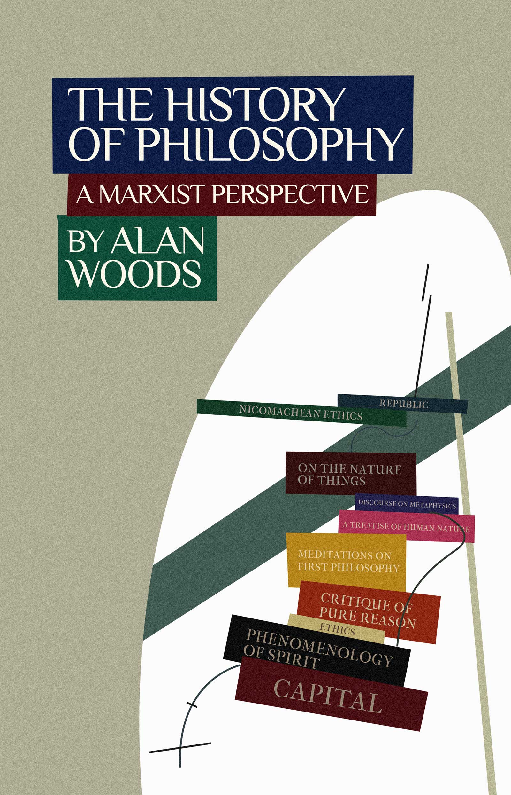

# 马克思主义视角下的哲学史

艾伦·伍兹著。中文校对稿；页码标注采用英文原书PDF页序。

<!-- hp-front-001 -->

〔原书 PDF 1〕

原书封面：《马克思主义视角下的哲学史》，艾伦·伍兹著。封面书名自上而下为：《理想国》《尼各马可伦理学》《物性论》《形而上学论》《人性论》《第一哲学沉思集》《纯粹理性批判》《伦理学》《精神现象学》《资本论》。

<!-- hp-front-002 -->

〔原书 PDF 2〕

韦尔雷德出版社标志。

<!-- hp-front-003 -->

〔原书 PDF 2〕

《马克思主义视角下的哲学史》
艾伦·伍兹
版权 © 韦尔雷德出版社
保留所有权利。

<!-- hp-front-004 -->

〔原书 PDF 2〕

英国发行：Wellred Books，wellredbooks.net
PO Box 50525
London, E14 6WG
books@wellredbooks.net

<!-- hp-front-005 -->

〔原书 PDF 2〕

美国发行：Marxist Books，marxistbooks.com
WR Books
250 44th Street #208
Brooklyn
New York, NY 11232
sales@marxistbooks.com

<!-- hp-front-006 -->

〔原书 PDF 2〕

封面由杰西·默里-迪恩（Jesse Murray-Dean）设计，基于埃尔·利西茨基（El Lissitzky）的《无题，1919—1920》（公有领域作品）。电子书由马丁·斯韦恩（Martin Swayne）制作，2021年9月出版。

<!-- hp-front-007 -->

〔原书 PDF 3〕

## 原书目录

<!-- hp-front-008 -->

〔原书 PDF 3〕

- 导言
- 1. 哲学的兴起
- 2. 最早的辩证法家
- 3. 亚里士多德与古典希腊哲学的终结
- 4. 基督教的兴起
- 5. 伊斯兰哲学
- 6. 中世纪的哲学
- 7. 文艺复兴
- 8. 笛卡尔、斯宾诺莎和莱布尼茨
- 9. 康德主义的死胡同
- 10. 黑格尔的哲学革命
- 11. 从黑格尔到马克思
- 参考文献

<!-- hp-intro-001 -->

〔原书 PDF 4〕

# 导言

<!-- hp-intro-002 -->

〔原书 PDF 4〕

## 起点

<!-- hp-intro-003 -->

〔原书 PDF 4〕

大约二十七年前，当我撰写《理性的反抗》一书时，便开始着手《哲学史》。该书讨论马克思主义哲学与现代科学之间的关系。它获得了很大成功，但篇幅远超我最初的预计。出于篇幅考虑，我不得不遗憾地删去第一部分；这一部分论述哲学史，一直写到马克思那场伟大的革命：辩证唯物主义理论。

<!-- hp-intro-004 -->

〔原书 PDF 4〕

我原本打算在将来某个时候把《哲学史》作为独立著作出版。但由于种种原因，这一决定被推迟，以便腾出时间处理更紧迫的任务。二十多年来，手稿被搁置一旁，任由老鼠的牙齿去批判——正如马克思谈到《德意志意识形态》未发表手稿时所说。它最终在我们的网站上发布，并获得了好评，但把它作为独立书籍出版的初衷，直到现在才实现。

<!-- hp-intro-005 -->

〔原书 PDF 4〕

多亏若干对哲学特别感兴趣的同志敦促，我才被激励起来着手出版这部作品。它代表了国际马克思主义趋势在反对资产阶级意识形态、捍卫和传播马克思主义思想这一持续斗争中的一项贡献。这是一个及时而必要的决定。在资本主义制度陷入走向终结的危机的当下，现行秩序的破产必然体现在智识生活各个方面的明显衰退上。

<!-- hp-intro-006 -->

〔原书 PDF 5〕

这一点在哲学领域尤为突出，资产阶级思想正以最令人发指的方式表现其腐朽。争取社会主义的斗争不仅限于政治和经济领域。必须在各个层面展开，首先从思想层面开始。如果本书能帮助工人和青年在这场必要的斗争中武装自己，那么我的目的就达到了。

<!-- hp-intro-007 -->

〔原书 PDF 5〕

读过原稿的人会发现，所有实质性内容都得以保留。但我已在同志们的协助下彻底修订了文本，并增补了新的小节，尤其是在论述中世纪的那一章中，还增加了最后一章，阐明为什么哲学——至少在该词的旧义上——随着马克思主义而终结。

<!-- hp-intro-008 -->

〔原书 PDF 5〕

你们可能还注意到，此前作为附录收录的关于印度哲学的增补章节在本版中被省略，而关于伊斯兰哲学的章节则被缩减，主要论述它在中世纪所扮演的角色。这既非偶然，也非因为我对该主题缺乏兴趣。恰恰相反。你们会理解，呈现两千五百年的哲学是一项非常艰巨的任务，出于篇幅原因，我不得不省略该主题的许多重要方面，只保留最基本的要素。

<!-- hp-intro-009 -->

〔原书 PDF 5—PDF 6〕

东方哲学的发展（其中必须包括中国哲学——这本身就是一个巨大的主题）与西方哲学的发展路线相当不同，西方哲学在黑格尔那里达到顶峰，并在马克思和恩格斯带来的哲学革命中达到顶点。要充分论述那个主题，不仅需要对本书进行巨大（且完全没有必要）的扩充，而且需要另外一卷或多卷著作。因此，与其发表一篇对如此复杂主题的不令人满意的概述——这不会让任何人满意，尤其不会让我自己满意——我决定把这个主题放在一边，打算在时间和工作的压力允许时也许再回到它。

<!-- hp-intro-010 -->

〔原书 PDF 6〕

## 什么是哲学？

<!-- hp-intro-011 -->

〔原书 PDF 6〕

马克思主义最初是一种哲学，而马克思主义的哲学方法对于理解马克思和恩格斯的思想具有根本性的重要意义。但什么是哲学？

<!-- hp-intro-012 -->

〔原书 PDF 6〕

哲学是一种思维方式，不同于我们日常生活中习惯的那种思维。它并不局限于日常生活中的眼前问题，而是试图探讨生死、宇宙、思想与物质的本质，以及何为善、何为恶等重大问题。这些问题对我们每个人来说，归根结底都至关重要。然而，它们通常并不占据大多数人思想中的核心位置。

<!-- hp-intro-013 -->

〔原书 PDF 6〕

纵观整个历史，至少直到今天，大多数人的心思主要都沉浸在日常的生存斗争中。他们完全被诸如“下周我还有工作吗？”“手头的钱够撑到月底吗？”“我还有栖身之所吗？孩子能上学吗？”等等琐碎的问题所占据。

<!-- hp-intro-014 -->

〔原书 PDF 6〕

然而，人类的思想能够成就远为宏大的事业。思想史涵盖了艺术史——始于拉斯科和阿尔塔米拉那些精美的洞穴壁画；科学史——它使我们能够征服自然，将手伸向群星；以及哲学史——其中蕴含着许多惊人的洞见。

<!-- hp-intro-015 -->

〔原书 PDF 7〕

只要人类开始尝试在不借助超自然力量——诸如神灵以及从最原始时代沿袭下来的其他宗教迷信元素——的情况下解释世界，哲学便应运而生。这标志着对自然和我们自身的科学理解的开端。

<!-- hp-intro-016 -->

〔原书 PDF 7〕

## 一种革命性的世界观

<!-- hp-intro-017 -->

〔原书 PDF 7〕

马克思主义首先是一种世界观，或者如果你愿意，也可以称之为哲学。它的涵盖范围极其广泛。它既是一门历史理论和经济学理论，也是一部革命行动的指南。但马克思的思想从何而来？它们并非凭空而来。马克思本人曾解释说，他的思想主要有三个来源：一是英国古典资产阶级经济学（亚当·斯密和大卫·李嘉图）；二是空想社会主义的勇敢先驱：法国人圣西门和傅立叶，以及我的威尔士同胞罗伯特·欧文。

<!-- hp-intro-018 -->

〔原书 PDF 7〕

但在马克思和恩格斯思想形成初期，首要且最重要的因素无疑是德国古典哲学，尤其是黑格尔。而这又是一段漫长时期内多种不同哲学流派发展的产物。现在，要否定空想社会主义者的思想（就像杜林所做的那样）其实很容易。但更恰当的做法，难道不是应该赞扬他们对社会主义历史的非凡贡献，并承认他们的思想在马克思主义形成阶段所发挥的作用吗？

<!-- hp-intro-019 -->

〔原书 PDF 8〕

我最近重读了罗伯特·欧文的部分著作，可以告诉大家，他的一些思想在今天看来依然颇具革命性。这是否意味着，我们在向欧文致敬的同时，就主张回归空想社会主义的思想？当然不是！但无法否认的是，这些思想在科学社会主义的发展过程中发挥了重要作用。这是一个简单的事实。

<!-- hp-intro-020 -->

〔原书 PDF 8〕

我偶尔会遇到一种相当幼稚的偏见，认为马克思和恩格斯之前的一切都可以被视为保守和反动而予以抛弃。确实，不仅黑格尔，亚当·斯密和李嘉图也是“上层阶级思想家”。有些愚蠢的人以为，仅凭这一事实就足以剥夺他们作为伟大革命思想家的资格。确实，其中一些人（尽管绝非全部）所持的政治观点倾向于保守主义，甚至反动。黑格尔本人在政治观点上就是保守的，尽管他年轻时曾同情法国大革命。但这并不改变这样一个事实：他的辩证方法包含着非常革命性的要素——这一事实甚至被反动的普鲁士当局所承认，他们对黑格尔心存疑虑，甚至怀疑他持有无神论和颠覆性观点。

<!-- hp-intro-021 -->

〔原书 PDF 8—PDF 9〕

马克思很久以前就指出，每个时代的统治思想就是统治阶级的思想。这些人代表了他们那个时代最先进的思想，而马克思正是以这些思想为基础的。由亚当·斯密发现并由李嘉图发展的价值规律，直接通向马克思的剩余价值理论；而黑格尔的唯心主义辩证法则催生了辩证唯物主义。认为马克思主义者可以无视过去的思想，这种观点与某些极端无政府主义者的偏见同样愚蠢——他们认为，为了建立一个新的无阶级社会，必须摧毁一切过去的事物并从头再造。这是空想主义的精髓所在，若我们接受这一观点，便会彻底排除在实践中进行社会主义革命的可能性。

<!-- hp-intro-022 -->

〔原书 PDF 9〕

社会主义革命不会摧毁资本主义现有的成就，相反，它将以此为基础，赋予其截然不同的社会和阶级内涵。科学技术成就将不再服务于微小的寄生统治阶级的利益，而是会根据全社会的利益进行协调规划。我们将利用旧社会留下的“砖块”来建设新社会，原因很简单：没有其他现成的“砖块”可以用于此目的。

<!-- hp-intro-023 -->

〔原书 PDF 9〕

正如我们要利用从旧社会继承下来的现有生产力——土地、工厂、科学技术——一样，我们也应当以过去发展起来的最先进思想为基础。马克思主义否定了黑格尔的唯心主义，同时保留了其辩证法中一切进步和革命的内容。科学社会主义的奠基者们挽救了辩证法——这种辩证法在黑格尔手中被扭曲为一种唯心主义的形态——并首次将其建立在坚实的唯物主义基础上。通过这样做，他们创造了一种强大的武器，用于按照革命路线改变社会。

<!-- hp-intro-024 -->

〔原书 PDF 9〕

## 为什么要学习哲学史？

<!-- hp-intro-025 -->

〔原书 PDF 10〕

马克思和恩格斯的全部著作都基于一种明确的哲学方法——辩证唯物主义，若脱离这一方法，便无法理解这些著作。二十世纪马克思主义思想最杰出的代表——列宁和托洛茨基的作品也是如此。古希腊人早已知晓辩证法，后来黑格尔对其进行了发展。辩证唯物主义的基本思想并不难理解。像所有伟大的思想一样，它们本质上是简单的，而且正因其简单而美丽。

<!-- hp-intro-026 -->

〔原书 PDF 10〕

然而，太多自认为是马克思主义者的人满足于重复几个基本观点，却从未思考过自己所言的深层含义。这样的“马克思主义者”就像一个死记硬背乘法表的小孩，或者更确切地说，像一只通过模仿人类语言学会重复某些句子、却对其含义一无所知的鹦鹉。要想全面理解辩证唯物主义，必须进行大量细致的研究。目前，我正在撰写一部关于马克思主义哲学的更全面的著作，希望它能帮助阐明其中涉及的更为复杂的问题。

<!-- hp-intro-027 -->

〔原书 PDF 10〕

但在研究哲学（尤其是马克思主义哲学）时，存在一个难题，而这个难题正是本书的核心所在。当马克思和恩格斯论述辩证唯物主义时，他们可以预设，至少当时受过教育的读者具备哲学史的基本知识。如今，这种预设已不再可能。

<!-- hp-intro-028 -->

〔原书 PDF 11〕

## 黑格尔的《哲学史》

<!-- hp-intro-029 -->

〔原书 PDF 11〕

我十七岁还在上学时，便开始阅读黑格尔那部鸿篇巨制——三卷本的《哲学史》。上大学前，我读完了第一卷全书和第二卷的一半。我发现这本书绝对引人入胜。就在我眼前，两千五百年来最深刻的人类思想，以一种极具说服力、清晰而全面的辩证方式展现在我面前。

<!-- hp-intro-030 -->

〔原书 PDF 11〕

我至今仍保留着几本学生时代的笔记本，里面满是我当时对《哲学史》、《历史哲学》和《精神现象学》所做的笔记。我甚至还有一本笔记本，里面抄录了黑格尔《哲学科学百科全书》中《小逻辑》的大段内容。我曾四处寻找这部杰作却一无所获，但当我最终从一家参考图书馆借到一本时，却发现竟是德文原版！不过，这样的细节并没能让我却步。当时我的德语水平相当不错，于是便开始阅读并做笔记。遗憾的是，那本笔记本在我旅途中遗失了。

<!-- hp-intro-031 -->

〔原书 PDF 11〕

自那以后，我对黑格尔的热情便一直延续至今。关于《哲学史》，最令我印象深刻的是黑格尔处理这一主题时极具原创性的方式。他并未将其呈现为一系列偶然的发展，而是视为一个有机整体——一个通过一系列矛盾而演变的过程，其中一套思想似乎否定了前一套，从而导致人类思想发展形成一个无尽的螺旋。

<!-- hp-intro-032 -->

〔原书 PDF 11—PDF 12〕

当然，人们或许会对黑格尔处理哲学史的唯心主义方法提出批评。但最重要的是要看到贯穿他所有著作的辩证方法。当其他人只看到一堆互不关联的思想、偶然事件和个别天才时，黑格尔却率先洞察到一个具有自身规律和内在逻辑的有机过程。

<!-- hp-intro-033 -->

〔原书 PDF 12〕

在哲学通过一系列矛盾发展的过程中，黑格尔不仅将其视为一种否定过程——即一套思想消灭另一套思想的过程。他认识到，这种否定过程同时也意味着对前一阶段中一切有效且真实内容的保留。这种既否定又保留的观念，就是他所说的“扬弃”，并在《精神现象学》的序言中以最崇高的语言表达出来：

<!-- hp-intro-034 -->

〔原书 PDF 12〕

> 花蕾在花朵绽放时消失，人们可以说花蕾被花朵否定了；同样，当果实出现时，花朵就被宣告为植物的一种虚假的定在［形式］，而果实则取代花朵，成为植物的真理。这些形式不仅彼此不同，而且作为互不相容的东西相互排斥。然而，与此同时，它们流动的本性使它们成为有机统一体的环节，在其中它们不仅不相互冲突，而且每一个都同样必要；正是这种共同的必要性，构成了整体的生命。[^introduction-1]

<!-- hp-intro-035 -->

〔原书 PDF 12〕

恩格斯在评论黑格尔的《历史哲学》时指出，这种方法代表了一次巨大的进步：

<!-- hp-intro-036 -->

〔原书 PDF 12—PDF 13〕

> 他是第一个试图证明历史中存在发展、存在内在连贯性的人；尽管他的历史哲学中有些内容在今天看来或许有些奇怪，但与他之前或之后敢于对历史提出一般性见解的人相比，其基本构想的宏伟气魄至今仍令人钦佩。[^introduction-2]

<!-- hp-intro-037 -->

〔原书 PDF 13〕

尽管存在种种缺陷，黑格尔《哲学史》的宏伟——其恢弘的气魄与深刻的洞见——至今仍令我惊叹不已、钦佩万分。至于那些对黑格尔持后现代批判态度的评论家，我将重申列宁曾论及罗莎·卢森堡时写下的话，其中引用了一则古老的俄罗斯谚语：“雄鹰有时可能飞得比母鸡还低，但母鸡永远无法飞到雄鹰的高度。”[^introduction-3]

<!-- hp-intro-038 -->

〔原书 PDF 13〕

## 马克思主义的哲学史观

<!-- hp-intro-039 -->

〔原书 PDF 13〕

在本著作中，我试图利用黑格尔的创新，但始终坚持唯物主义的立场。这并非经验性意义上的哲学史，也不是对历代所有人关于哲学的所有论述的汇编。例如，凡是试图在这部著作中寻找对柏拉图《理想国》的详细研究的人，都会大失所望。对于这样的人，我必须建议他们前往最近的一家正规的公共参考图书馆，我相信在那里他们能找到足够多的博学之作，以满足他们的求知欲。这是一部把握哲学史本质的著作。也就是说，我试图追踪思想发展中的主线，而这条主线有着其自身的内在规律。

<!-- hp-intro-040 -->

〔原书 PDF 13—PDF 14〕

另一方面，我担心本书无法满足那些机械式的“马克思主义者”——他们幻想世间万物皆可归结为生产力和/或阶级斗争的发展。当然，归根结底，这些确实是人类历史的基本驱动力，决定了国度、国家和帝国的命运。但若试图通过强行将其与这一基础建立直接联系，来解释艺术和音乐作品，或是哲学与宗教中那些奇幻的曲折，那将是一种愚蠢的浪费时间。

<!-- hp-intro-041 -->

〔原书 PDF 14〕

不过，哲学家（如同其他人一样）可能受到社会总体状况——即生产力的兴衰及其引发的社会与政治紧张局势——的影响；就此而言，在某些阶段，这种关系是可辨识的，尽管是间接的，正如我的研究将指出的那样。

<!-- hp-intro-042 -->

〔原书 PDF 14〕

正如恩格斯在给德国经济学家康拉德·施密特的信中所写：

<!-- hp-intro-043 -->

〔原书 PDF 14〕

> 至于那些在空中飞得更高的意识形态领域——宗教、哲学等等——它们有一批史前遗留下来的材料，在进入历史时期时就已存在并被继承下来，即我们今天会称之为“胡说八道”的东西。这些关于自然、人类自身、鬼神、魔法力量等等的各种错误观念，在很大程度上只有否定性的经济基础；但史前时期低下的经济发展水平，又被这些错误的自然观念所补充，并且在某种程度上受到其制约，甚至由其所导致。而且，尽管经济必要性是自然知识进步的主要驱动力，并且越来越如此，但如果试图为所有这些原始的无稽之谈寻找经济原因，那无疑是迂腐的。科学史就是逐步清除这些无稽之谈，或者用新的、但已经不那么荒谬的无稽之谈取而代之的历史。

> 校注：“否定性的经济基础”对应原文 negative economic basis，紧接着的原文将它与史前经济发展的低下水平联系起来。

<!-- hp-intro-044 -->

〔原书 PDF 15—PDF 16〕

> 从事这一领域研究的人，在劳动分工中又属于特殊领域，并且在他们自己看来，是在一个独立领域中工作。而且，只要他们在社会分工中形成一个独立群体，他们的产品——包括他们的错误——就会反过来对整个社会的发展，甚至对它的经济发展产生影响。但尽管如此，他们本身仍然受经济发展的主导影响。例如在哲学中，这一点在资产阶级时期最容易得到证明。霍布斯是第一个现代唯物主义者（按十八世纪的意义），但在他那个时代，绝对君主制在整个欧洲正处于顶峰，而在英国，绝对君主制与人民之间的斗争刚刚开始，而他本人是一个君主专制主义者。洛克无论在宗教还是政治上，都是1688 年阶级妥协的产物。英国自然神论者及其更彻底的继承者法国唯物主义者，是资产阶级的真正哲学家，法国唯物主义者甚至是资产阶级革命的哲学家。德国小资产阶级则从康德到黑格尔贯穿德国哲学，有时是正面地，有时是负面地。但是，每个时代的哲学，由于它是劳动分工中的一个确定领域，都以先辈传给它的某些确定的思想材料为前提，并从那里出发。正因如此，经济落后的国家仍然可以在哲学上起主导作用：18 世纪的法国与英国相比——法国哲学正是以英国哲学为基础——以及后来的德国与英法两国相比。但是，法国和德国的哲学，以及当时文学的普遍繁荣，同样也是经济日益发展的结果。我认为，经济发展在这些领域中也具有最终的支配作用，这一点是确定的，但它是在这些领域本身所强加的条件下实现的：例如在哲学中，是通过经济影响（这些影响通常又只是在政治等等的伪装下起作用）作用于先辈传下来的现有哲学材料来实现的。在这里，经济并没有创造任何绝对新的东西（a novo），但它决定了现有思想材料被改变和进一步发展的方式，而且多半是间接地决定的，因为对哲学产生最大直接影响的是政治、法律和道德的反映……这些先生们所缺乏的正是辩证法。他们除了此处的因和彼处的果之外，什么也看不见。他们从未开始看到：这是一种空洞的抽象；这种形而上学的两极对立只在危机时期才存在于现实世界中，而整个广大的发展过程是以相互作用的形式进行的（尽管力量极不平衡，经济运动是最强、最根本、最具决定性的）；在这里，一切都是相对的，没有什么是绝对的。对他们来说，黑格尔从来不存在。[^introduction-4]

<!-- hp-intro-045 -->

〔原书 PDF 16〕

我在此试图做的，是勾勒出知识进步过程的本质和总路线；这一过程在历史的每个时代得到充分发展，从而为人类思想迈向下一阶段奠定基础。

<!-- hp-intro-046 -->

〔原书 PDF 16—PDF 17〕

马克思主义者的任务不是肯定并仅仅剖析曾经存在过的每一个思想学派。相反，它的任务是从无数相互冲突的潮流和观念中，提炼出那些推动人类发展到我们今天这个阶段的本质的、理性的原则。这一过程为科学技术的巨大进步作出了巨大贡献，而这些进步又为人类在社会主义下迈向一个质上更高的发展阶段奠定了基础。

> 校注：原文使用 assert and merely dissect，措辞略显生硬；译文保留其肯定／剖析的表述。

<!-- hp-intro-047 -->

〔原书 PDF 17〕

## 后现代主义对过去的态度：若无知是福，明智便是愚蠢

<!-- hp-intro-048 -->

〔原书 PDF 17〕

辩证法有着非常悠久的历史，始于希腊人、前苏格拉底哲学家，尤其是赫拉克利特。它在黑格尔的著作中达到最高表现。但现代资产阶级哲学的主导潮流却蔑视所有过去的哲学。不仅马克思主义，而且过去的一切伟大思想都被轻率地抛弃，被贴上“元叙事”的标签，毫不犹豫地扔进历史的垃圾堆。

<!-- hp-intro-049 -->

〔原书 PDF 17〕

过去，当资产阶级仍然能够发挥进步作用时，它拥有革命性的意识形态。它产生了伟大而原创的思想家：洛克和霍布斯、卢梭和狄德罗，以及法国启蒙运动的其他革命思想家；康德和黑格尔、亚当·斯密和大卫·李嘉图、牛顿和达尔文。但在衰落时期，资产阶级的智识生产显示出晚期衰老的一切证据。

<!-- hp-intro-050 -->

〔原书 PDF 18〕

历史上有些时期以悲观、怀疑和绝望的情绪为特征。在这样的时期，人们已经对现存社会及其意识形态失去信心，只有两种选择。一种是挑战现存秩序，走革命道路。另一种是向内退缩，徒劳地试图无视社会中的矛盾，在宗教或极端哲学主观主义中寻求个人救赎。

<!-- hp-intro-051 -->

〔原书 PDF 18〕

旧社会正在垂死挣扎，但它顽固地拒绝接受自己的命运。强大的物质利益继续竭力支撑它，它们掌握着可畏的资源，并对社会和智识生活的每一个方面施加不可抗拒的影响。今天，资产阶级的意识形态正在瓦解，不仅在经济和政治领域，而且在哲学领域。它没有产生任何有价值的东西。它不再能赢得积极的支持、尊重或权威，而是散发出消极的情绪，就像尸体散发恶臭。这些情绪不可避免地表现在流行的哲学中。阅读大学哲学系那些贫瘠的产品，不可能不感到同样程度的厌倦和恼怒。不用说，这种普遍倒退也反映在对待哲学史的态度上。

<!-- hp-intro-052 -->

〔原书 PDF 18—PDF 19〕

那些怀着启蒙希望、眼神明亮地进入哲学系的年轻学生，要么迅速幻灭，要么被拖入后现代胡言乱语的毒粪坑，从此无法逃脱。无论哪种情况，他们出来时都没有从过去的伟大思想家那里学到任何有价值的东西。哲学系不满足于用后现代主义垃圾填满年轻人的头脑，还胆敢把同样的垃圾引入对过去的研究。显然，后现代学术帮派不喜欢被提醒这样一个事实：曾经有一个时代，哲学家们实际上对现实世界说过一些深刻而重要的话。

<!-- hp-intro-053 -->

〔原书 PDF 19〕

## 哲学史的扭曲

<!-- hp-intro-054 -->

〔原书 PDF 19〕

最近有人向我指出，一本新出的（且备受赞誉的）黑格尔译本包含一个严重的德文误译，竟把后现代主义术语放进这位伟大辩证法思想家的口中。剑桥大学出版社新出的、正被全世界大学奉为经典的《逻辑学》英文译本，始终把德文词Denken 和Denkend（英文直译就是“思想”和“思考”）译成“话语”和“话语的”。

> 校注：本段对译本的批评及对德文词的解释均为原作者的论断，按原书保留。

<!-- hp-intro-055 -->

〔原书 PDF 19〕

这是对黑格尔思想的公然伪造，是对一切翻译伦理规范的违背。这是一种犯罪式的行为，试图把后现代主义主观主义偷偷塞进黑格尔。译者乔治·迪·乔瓦尼在为这一选择辩护时，毫无证据地随口断言：“《逻辑学》的主题不是‘物自体’或其现象表现，无论人们把它的‘自在’理解为实体还是自由，而是话语本身。”[^introduction-5]

<!-- hp-intro-056 -->

〔原书 PDF 19〕

这简直是一桩丑闻。然而，那些“批评家”却对此视而不见，他们都为这种新“叙事”而欣喜。这是一种破坏行为，大致相当于在蒙娜丽莎的脸上画一撮小胡子。仅这个小细节就应让我们警惕。

<!-- hp-intro-057 -->

〔原书 PDF 20〕

## 虚假的客观性

<!-- hp-intro-058 -->

〔原书 PDF 20〕

我毫不怀疑，大学里那些自作聪明的人会立刻指责我呈现了哲学史的片面版本。对于这一指控，我认罪。作为一个坚定的马克思主义者，我完全打算捍卫一个特定的哲学立场——辩证唯物主义的立场。

<!-- hp-intro-059 -->

〔原书 PDF 20〕

大学哲学系不是知识和文化的象牙塔，而只是阶级战争中的战壕。这些战壕被精心构筑的伪科学虚假客观性伪装巧妙地掩盖起来。但在这张错综复杂的谎言网背后，人们总能发现物质利益、阶级偏见和对现状的犬儒式辩护。

<!-- hp-intro-060 -->

〔原书 PDF 20〕

整个哲学史一直是两种敌对而互不相容的观点之间不断斗争的历史：哲学唯物主义和哲学唯心主义。也就是说，科学态度与试图把人类意识拖回宗教神秘主义世界的企图之间的斗争。既然哲学领域一直被划分为一系列“片面的版本”，那么完全不可能避免站在这种或那种世界观一边。本书作者与批评者之间的唯一区别是：我足够诚实，从一开始就表明了自己的立场，而我的批评者则总是躲在虚伪且完全虚假的“客观性”背后，这种客观性只是用来掩盖他们的有倾向性的观点和阶级立场。

<!-- hp-intro-061 -->

〔原书 PDF 20〕

时至今日，哲学仍然是唯物主义和唯心主义之间一场不择手段的战斗，唯物主义的敌人众多且拥有许多优势。但是，采取明确的哲学和政治立场这一事实，是否就排除了客观性呢？

<!-- hp-intro-062 -->

〔原书 PDF 21〕

这是一个与事实相矛盾的假设。伟大的马克思主义者列昂·托洛茨基曾这样回答这些反对意见：

<!-- hp-intro-063 -->

〔原书 PDF 21〕

> 在庸人眼中，革命观点几乎等同于缺乏科学客观性。我们的想法恰恰相反：只有革命者——当然，前提是他掌握了科学方法——才能揭示革命的客观动力。认识性思维一般说来不是静观的，而是能动的。意志要素对于穿透自然和社会的秘密是不可或缺的。正如外科医生的手术刀关乎人的生命，他会极其谨慎地区分有机体的各种组织，革命者如果严肃对待自己的任务，也必须以严谨负责的态度分析社会的结构、功能和反射。[^introduction-6]

<!-- hp-intro-064 -->

〔原书 PDF 21〕

## 关于我的批评者

<!-- hp-intro-065 -->

〔原书 PDF 21〕

自从马克思主义作为挑战现存秩序的重要力量出现以来，当权派就一直对马克思主义意识形态的每个方面——首先是辩证唯物主义——处于持续战争状态。只要提到马克思主义，就必然会在这些圈子里引起条件反射式的反应。“过时”、“不科学”、“早已被驳倒”、“形而上学”，以及所有其他陈腐而令人厌倦的反动老调。

<!-- hp-intro-066 -->

〔原书 PDF 21—PDF 22〕

我毫不怀疑，本书也会受到同样的一片反对声。这丝毫不困扰我。过去六十年里，我一直听着同样冗长乏味的谩骂洪流，而马克思的批评者们的论点，并不会因为被如此频繁而单调地重复而变得更有力。我明白我的对手会因此不快。他们会翻查旧文本，试图证明黑就是白、白就是黑，以此反驳我的论点。这是很自然的反应，因为他们自己捍卫着一种与我的立场完全不相容的特定哲学立场。我指的是哲学唯心主义立场——无论是客观唯心主义还是主观唯心主义。

<!-- hp-intro-067 -->

〔原书 PDF 22〕

我当然对此没有异议。他们完全有权捍卫任何吸引他们的神秘和非理性观念。但让他们不要试图用虚假客观性的外衣掩盖自己的偏袒，也不要试图歪曲过去伟大思想家的思想，以迎合他们自己狭隘而反动的观点。

<!-- hp-intro-068 -->

〔原书 PDF 22〕

## 哲学作为革命武器

<!-- hp-intro-069 -->

〔原书 PDF 22〕

尽管官方哲学摆出一副高高在上、蔑视阶级斗争的神气，但它只是统治阶级手中的又一件武器，被蓄意用来迷惑和误导青年，使他们偏离革命道路。用老约瑟夫·狄慈根的话说，哲学不是科学，而是防范社会主义的屏障。

<!-- hp-intro-070 -->

〔原书 PDF 22—PDF 23〕

从前，哲学家是反叛者，是危险异端，一心要颠覆现存的道德和社会秩序。苏格拉底被迫饮下毒堇汁；斯宾诺莎被指控为无神论，被逐出教门并遭到辱骂；乔尔达诺·布鲁诺被宗教裁判所烧死在火刑柱上；18 世纪法国哲学家们为攻占巴士底狱铺平了道路。然而在我们自己的时代，大多数人对哲学和哲学家要么漠不关心，要么蔑视，而这完全是咎由自取。但最令人深感遗憾的是，人们在避开当今哲学荒漠时，却忽视了过去的伟大思想家——与现代的侏儒相比，他们是人类思想的巨人。

<!-- hp-intro-071 -->

〔原书 PDF 23〕

旧的唯心主义哲学顽固地维持着一种想象中的、独立于社会生活的地位。直到今天，学术界的哲学家们仍声称自己超脱于真实人类、社会生活与政治的肮脏世界。但这是一种幻觉。实际上，他们只是那个世界的反映，尽管是以神秘化的形式。归根结底，无论他们是否意识到，他们所捍卫的观念都是对现存社会略加掩饰的辩护，而其基础则是最卑劣、最犬儒的个人利益。

<!-- hp-intro-072 -->

〔原书 PDF 23〕

就我而言，我无意与那些只受对马克思主义的盲目仇恨和维持现状的热切愿望所驱使的学者跳一场复杂的小步舞。只有清除这些意识形态垃圾，我们才能为成功进行阶级斗争扫清场地。马克思主义有责任为陈旧而信誉扫地的观念提供一个全面的替代方案。但我们无权背弃过去的伟大思想家：希腊人、斯宾诺莎、启蒙运动时期的法国唯物主义者，尤其是黑格尔。这些人是英勇的先驱，为马克思主义哲学的辉煌成就铺平了道路，完全可以被视为我们革命遗产的重要组成部分。

<!-- hp-intro-073 -->

〔原书 PDF 24〕

我们有责任从哲学史中拯救一切有价值的东西，同时摒弃一切虚假、过时和无用的东西。正如十月革命、巴黎公社和攻占巴士底狱为将改变整个世界的未来社会主义革命指明了道路，过去那些伟大的哲学战斗也为辩证唯物主义——未来的哲学——奠定了基础。正如我们认真关注过去阶级斗争提供的教训，我们也有责任研究构成哲学史本质意义的那场伟大观念战斗。

<!-- hp-intro-074 -->

〔原书 PDF 24〕

* * *

<!-- hp-intro-075 -->

〔原书 PDF 24〕

## 本杰明·法林顿教授：个人回忆录

<!-- hp-intro-076 -->

〔原书 PDF 24〕

在本书前几章中，你会注意到我引用了一本名为《希腊科学》的书，这是本杰明·法林顿教授所写的一部享有盛誉、实至名归的研究著作。这是一部开创性著作，在论述这一主题方面从未被超越。如今它一般被视为经典，但它曾引起相当大的争议，因为它是从马克思主义历史唯物主义的立场写成的。我有幸在1963 年见到法林顿教授，那一年我离开斯旺西，进入刚刚开办的苏塞克斯大学。这次会面的原因如下。

<!-- hp-intro-077 -->

〔原书 PDF 24—PDF 25〕

法林顿教授出生于爱尔兰，但曾到许多国家教授古典学（希腊语和拉丁语），这是他的主要专长，尽管他也写了关于哲学的重要著作，例如他对英国唯物主义者弗朗西斯·培根的研究。他在南非任教，并很快因其激进观点而闻名。后来他移居英格兰，在布里斯托大学任教，最后定居在我的家乡斯旺西，从1936 年到1956年担任古典学教授，直到退休。三十年代是南威尔士严重萧条、大规模失业和贫困的时期。这也影响了我的家庭，我的祖父——一个马口铁工人——常常很难养活自己的孩子。他是一位活跃的工会活动家，也是共产党的一名坚定成员。

<!-- hp-intro-078 -->

〔原书 PDF 25〕

虽然许多人知道本杰明·法林顿是马克思主义者，但很少有人知道他也是一名共产党员。由于他的职位，这一事实没有公开，这是当时共产党的规矩。他认识了我的祖父和我的母亲，我母亲年轻时曾在斯旺西卖《每日工人报》。他很快成为我们家的挚友。

<!-- hp-intro-079 -->

〔原书 PDF 25—PDF 26〕

当我准备去苏塞克斯时，我母亲没有对我说一个字，就给他写了一封信，骄傲地宣布我要上大学了（这在我们家是闻所未闻的事），并附上了我寄给《南威尔士晚邮报》的两封信，支持古巴革命。鉴于法林顿教授已经退休，而且据我所知已和我家失去一切联系，我惊讶地得知他不仅回了信，还邀请我在去布莱顿的路上到他那里喝茶。他当时已退休，和妻子住在利明顿温泉，我便去那里见他。他非常热情地迎接我，并询问我母亲的情况（我祖父最近去世了）。我记得他是一个非常迷人、友好的人，丝毫没有许多自命不凡的学者那种高高在上的优越感。他说话带着那种柔和、温和的南爱尔兰口音，对我们这些生活在这几个小岛上的非爱尔兰人来说，那简直是音乐。他问起我在苏塞克斯大学的学业，并对我寄给《晚邮报》的信给予非常慷慨的赞扬。他注意到我被四周装满书的书架吸引。看到我对哲学感兴趣，他问我最喜欢的哲学家是谁。我毫不犹豫地回答：黑格尔。他立刻站起来，伸手取下一本灰色旧书，递给我。那是黑格尔的《法哲学原理》。我打开书，开始翻阅，他制止了我。“它是你的了，”他说。“你可以留着。”

<!-- hp-intro-080 -->

〔原书 PDF 26〕

我确实一直保存着那本书，写这些文字时它就放在我的书桌上。这是我的书中唯一一本没有用无数下划线标出、没有在页边写满评论的书。它仍然是一个珍贵纪念，纪念与一位伟人的短暂相遇——一个在现实生活中实属罕见的人：一位学者，不仅是一个真正的知识分子，而且是一个坚定的马克思主义者，不怕独自对抗庸俗之徒。

<!-- hp-intro-081 -->

〔原书 PDF 26〕

本杰明·法林顿早已去世，但他的精神激励着本书的每一页。直到今天，对于任何认真研究古希腊历史的人，《希腊科学》都是必读之作。

<!-- hp-intro-082 -->

〔原书 PDF 26〕

伦敦，2021 年8 月20 日

[^introduction-1]: G. W. F. 黑格尔，《精神现象学》，第5—6 页。〔校注：卷页信息按英文原书所引版本保留，不能据此定位中文版本。〕

[^introduction-2]: F. 恩格斯，《卡尔·马克思〈政治经济学批判〉》，《马克思恩格斯全集》（以下简称MECW），第16 卷，第474 页。〔校注：卷页信息按英文原书所引版本保留，不能据此定位中文版本。〕

[^introduction-3]: 引自V. I. 列宁，《一个政论家的札记》，《列宁全集》（以下简称LCW），第33 卷，第210 页。〔校注：卷页信息按英文原书所引版本保留，不能据此定位中文版本。〕

[^introduction-4]: F. 恩格斯，《致康拉德·施密特，1890 年10 月27 日》，《马克思恩格斯书信选集，1846—1895》（以下简称MESC），第482—484 页。〔校注：卷页信息按英文原书所引版本保留，不能据此定位中文版本。〕

[^introduction-5]: G. W. F. 黑格尔，《逻辑学》，第xxxv 页，着重号为本书作者所加。〔校注：页码按英文原书所引版本保留。〕

[^introduction-6]: L. 托洛茨基，《中国革命》，第xi—xii 页。〔校注：页码按英文原书所引版本保留。〕

<!-- hp-ch01-001 -->

〔原书 PDF 28〕

# 1. 哲学的兴起

<!-- hp-ch01-002 -->

〔原书 PDF 28〕

在开始之前，你可能会忍不住问：“那又怎样？”我们真的有必要费心研究科学和哲学这些复杂问题吗？对于这样的问题，有两种可能的回答。如果问题意在询问：我们是否需要了解这些内容才能处理日常生活事务，那么答案显然是否定的。但如果我们希望理性地理解我们所生活的世界，以及自然、社会和我们自身思维方式中起作用的基本过程，那么情况就截然不同了。

<!-- hp-ch01-003 -->

〔原书 PDF 28〕

实际上，每个人都拥有一套“哲学”，因为哲学就是一种观察世界的方式。我们都认为自己懂得如何区分是非、善恶。然而，这些却是极其复杂的问题，历史上最伟大的思想家们都曾为此倾注心力。当面对伊拉克和阿富汗同胞相残的战争、大规模失业的重新出现，或叙利亚内战等可怕现实时，许多人会承认自己无法理解这些现象，并常常含糊地将其归咎于“人性”。但这种被视为万恶之源、且据称永恒不变的神秘“人性”究竟是什么？这是一个深刻的哲学问题，鲜有人敢妄加回答——除非他们具有宗教思维，那样的话，他们会说这是上帝以其智慧造就了我们。至于为何有人要崇拜一个对自己的造物耍这种花招的存在，那就另当别论了。

<!-- hp-ch01-004 -->

〔原书 PDF 28—PDF 29〕

那些顽固地坚持自己没有哲学观的人是错误的。据说，自然厌恶真空。那些缺乏一套系统完善的哲学立场的人，不可避免地会反映出他们所生活的社会和环境的观念与偏见。这意味着，在特定语境下，他们的脑海中充斥着从报纸、电视、布道坛和课堂上吸收的观念，而这些观念忠实地反映了现存资本主义社会的利益和道德观。

<!-- hp-ch01-005 -->

〔原书 PDF 29〕

大多数人通常在生活中浑浑噩噩地过日子，直到某种巨大的动荡迫使他们重新审视自己从小接受的思想和价值观。社会的危机迫使他们对许多曾视为理所当然的事情提出质疑。在这样的时刻，那些看似遥远的思想突然变得格外切合实际。任何希望理解生活——而非将其视为一系列毫无意义的偶然事件或不假思索的例行公事——的人，都必须投身于哲学，即超越日常生活中眼前的问题，进行更高层次的思考。唯有通过这种方式，我们才能提升自己，达到一个新的高度，从而开始发挥作为有意识的人的潜能，既愿意也能够掌控自己的命运。

<!-- hp-ch01-006 -->

〔原书 PDF 29〕

人们普遍认为，生活中任何有价值的事物都需要付出一定的努力。哲学研究因其本质而涉及某些困难，因为它所探讨的问题远离普通经验的世界。就连所使用的术语也会带来困难，因为词语的用法未必与日常惯用语相符。但从工程学到心理学，任何专业学科都是如此。

<!-- hp-ch01-007 -->

〔原书 PDF 29—PDF 30〕

第二个障碍更为严峻。如前所述，在十九世纪，当马克思和恩格斯首次发表关于辩证唯物主义的著作时，他们可以假设许多读者至少对古典哲学（包括黑格尔的思想）具备基础了解。如今，我们已无法再作此种假设。哲学不再占据以往的地位，因为关于宇宙和生命本质的思辨早已被科学所取代。凭借强大的射电望远镜和航天器，我们已无需再对太阳系的性质和范围进行猜测。就连人类灵魂的奥秘，也正随着神经生物学和心理学的进步而逐渐被揭示。

<!-- hp-ch01-008 -->

〔原书 PDF 30〕

在社会科学领域，情况则远不如人意，这主要是因为当科学触及支配人们生活的强大物质利益时，人们对准确知识的渴望往往就会随之减弱。马克思和恩格斯在社会历史分析和经济学领域取得的巨大成就，超出了本书的讨论范围。只需指出：尽管马克思主义的社会理论自诞生之初就遭受了持续且往往恶意的攻击，但它们仍是现代社会科学发展的决定性因素。这些思想的活力体现在：针对它们的攻击不仅持续存在，而且随着时间的推移，其强度甚至有增无减。

<!-- hp-ch01-009 -->

〔原书 PDF 30〕

在过去的时代，科学的发展——它始终与生产力的发展紧密相连——尚未达到足够高的水平，无法让人类理解他们所生活的世界。在缺乏科学知识或获取科学知识的物质手段的情况下，他们不得不依靠自己所拥有的唯一能够帮助他们理解世界、从而获得支配世界的力量的工具——人类的头脑。理解世界的斗争，与人类挣脱单纯动物性生存状态、驾驭自然的盲目力量、并在实际意义上（而非法律形式的意义上）获得自由的斗争紧密相连。这一斗争是一条贯穿整个人类历史的主线。

<!-- hp-ch01-010 -->

〔原书 PDF 31〕

## 宗教的作用

<!-- hp-ch01-011 -->

〔原书 PDF 31〕

> 人类简直疯了。他连一只蛆都造不出来，却能成批地创造神明。[^chapter1-1]

<!-- hp-ch01-012 -->

〔原书 PDF 31〕

> 所有神话都在想象之中、通过想象来克服、支配并塑造自然之力；因此，随着人类真正掌握自然力量的到来，神话便随之消逝。[^chapter1-2]

<!-- hp-ch01-013 -->

〔原书 PDF 31〕

动物没有宗教，过去人们曾说，这正是人类与“野兽”的主要区别。但这只不过是另一种说法，即只有人类才拥有真正意义上的意识。近年来，针对“人类是特殊而独特的造物”这一观念，出现了一种反对意见。从人类源于动物，且在许多重要方面仍属动物这一意义上讲，这种观点无疑是正确的。我们不仅与其他动物共享许多生理功能，而且人类与黑猩猩之间的基因差异还不到2%。这对创世论者的无稽之谈给出了驳斥性的回答。

<!-- hp-ch01-014 -->

〔原书 PDF 31〕

最近对倭黑猩猩的研究已无可置疑地证明，与人类最接近的灵长类动物在某些方面能够表现出与人类儿童相似的心理活动水平。这是人类与高等灵长类动物之间亲缘关系的惊人证明，但类比到此便开始失效。尽管科学家们付出了种种努力，圈养的倭黑猩猩仍无法说话，也无法制作出哪怕是与早期人科动物所创造的最简单工具相似的石器。人类与猿类之间2% 的基因差异，标志着从动物到人类的质的飞跃。这一飞跃并非由“造物主”完成，而是通过体力劳动推动大脑发展而实现的。

<!-- hp-ch01-015 -->

〔原书 PDF 32〕

即使是制作最简单的石器，也需要极高的智力水平和抽象思维能力。能够挑选合适的石料并排除其他石料；选择正确的打击角度，并施加恰到好处的力道——这些都是极其复杂的智力活动。它们蕴含着一种连最先进的灵长类动物都不具备的规划能力和预见性。然而，石器的使用与制造并非有意识规划的结果，而是人类远古祖先在生存必要性驱使下被迫采取的行动。创造人类的并非意识，而是人类生存的必要条件——正是这些条件促成了大脑体积的增大、语言的产生以及包括宗教在内的文化发展。

<!-- hp-ch01-016 -->

〔原书 PDF 32〕

理解世界的需要与生存的需要紧密相连。那些最早发现利用石刮器处理皮厚的动物的尸体的人类祖先，相较于无法获取这种丰富脂肪和蛋白质资源的同类，获得了显著的优势。那些完善了石器制作技术、并摸清了最佳材料产地的人，比那些没有做到的人拥有更大的生存机会。随着技术的进步，思维也随之发展，同时产生了解释支配他们生活的自然现象的必要性。在数百万年的时间里，通过反复试错，我们的祖先开始建立事物之间的某些联系。他们开始进行抽象思维，即从经验和实践中进行概括。

<!-- hp-ch01-017 -->

〔原书 PDF 32—PDF 33〕

几个世纪以来，哲学的核心问题一直是思维与存在的关系。大多数人过着相当幸福的生活，甚至从未考虑过这个问题。他们思考、行动、交谈和工作，都毫无困难。此外，他们根本不会认为这两种最基本的人类活动是相互矛盾的——实际上，这两者是密不可分的。即使最基础的行动——如果我们排除单纯由生物机制决定的反应——也需要一定程度的思考。在某种程度上，这不仅适用于人类，也适用于动物，观察一只猫潜伏等待捕鼠的情景便可看出这一点。然而，人类的这种思考和规划在质上远高于任何灵长类动物（即使是最高等的猿类）的任何精神活动。

<!-- hp-ch01-018 -->

〔原书 PDF 33〕

这一事实与抽象思维能力密不可分，正是这种能力使人类能够远远超越感官所呈现的当下情境。我们不仅能设想过去的情境（动物也有记忆，比如看到棍子就畏缩的狗），还能设想未来的情境。我们能够预见复杂的情况，进行规划，从而决定结果，并在一定程度上决定自己的命运。

<!-- hp-ch01-019 -->

〔原书 PDF 33〕

尽管我们通常不会去思考这一点，但这代表着一项巨大的成就，使人类从自然界中脱颖而出。著名史前史学家戈登·柴尔德教授指出：“人类推理的独特之处在于，它能够从实际的当下情境中走得比任何其他动物的推理似乎所能达到的距离要远得多。”[^chapter1-3] 正是这种能力孕育了文明、文化、艺术、音乐、文学、科学、哲学和宗教等丰富多彩的创造。我们也理所当然地认为，这一切并非从天而降，而是数百万年发展的产物。

<!-- hp-ch01-020 -->

〔原书 PDF 33—PDF 34〕

古希腊哲学家阿那克萨戈拉曾通过精妙的推论指出，人类的智力发展取决于双手的解放。恩格斯在其重要文章《劳动在从猿到人的过渡中所起的作用》中，阐明了这一过渡的具体实现过程。他证明，直立行走——它使双手得以解放用于劳动——以及手部形态——特别是拇指与其余手指相对、从而能够抓握——正是制造工具的生理先决条件，而制造工具反过来又成为大脑发展的主要刺激因素。语言本身——它与思想密不可分——源于社会生产的需求，源于通过合作实现复杂功能的需要。恩格斯的这些理论得到了古生物学最新发现的有力证实，这些发现表明，人科猿类出现在非洲的时间远早于此前认为的，而且它们的大脑体积并不比现代黑猩猩的大。也就是说，大脑的发展发生在工具制造之后，并且是工具制造的结果。因此，“起初有道”这一说法并不正确，而是正如德国诗人歌德所宣称的那样：“起初有行动。”

<!-- hp-ch01-021 -->

〔原书 PDF 34〕

抽象思维能力与语言密不可分。戈登·柴尔德指出：

<!-- hp-ch01-022 -->

〔原书 PDF 34—PDF 35〕

> 推理，以及我们所称的一切思考活动——包括黑猩猩的思考——都必须涉及对心理学家所称的“意象”进行的心理运算。视觉意象——例如对一根香蕉的心理图景——往往只是特定环境中某根特定香蕉的画面。相反，正如前文所述，词语则更为普遍和抽象，它恰恰排除了那些赋予任何真实香蕉以个体性的偶然特征。词语的心理意象（即发音时所涉及的声音或肌肉运动的图景）构成了思考时非常便利的工具。借助它们进行的思考必然具备那种抽象性和普遍性，而动物的思考似乎恰恰缺乏这一点。人类不仅能谈论，还能思考被称为“香蕉”的物体类别；而黑猩猩的思考却永远停留在“那个管子里的那根香蕉”的层面。由此可见，被称为语言的社会工具，促成了那个被冠以宏大名称的过程——“人类从具体事物的束缚中解放出来”。[^chapter1-4]

<!-- hp-ch01-023 -->

〔原书 PDF 35〕

早期人类经过漫长的时间，形成了对植物或动物等事物的普遍观念。这种观念源于对许多具体植物和动物的具体观察。但当我们得出“植物”这一普遍概念时，我们眼前看到的已不再是某一朵花或某一丛灌木，而是它们所共有的本质。我们把握的是植物的本质，即其最深层的内在本质。相比之下，个别植物的特殊特征显得次要且不稳定。永恒而普遍的特质蕴含在一般概念之中。我们实际上永远看不到一种与具体花朵或灌木相区别的“植物本身”。它是一种思维的抽象。然而，当剥离所有次要特征后，它却是对植物本质的更深刻、更真实的表达。

<!-- hp-ch01-024 -->

〔原书 PDF 35〕

不过，早期人类的抽象概念远未具备科学性质。它们只是试探性的探索，如同孩童的印象、猜测和假设，有时虽不准确，却总是大胆而富有想象力。对早期人类而言，太阳是一个伟大的存在，有时温暖他们，有时灼伤他们；大地是一个沉睡的巨人；火则是一头凶猛的野兽，一旦触碰便会咬伤他们。

<!-- hp-ch01-025 -->

〔原书 PDF 35—PDF 36〕

早期人类曾亲历雷电现象。这必然令他们感到恐惧，正如今天它依然令动物和人类感到恐惧一样。但与动物不同，人类试图为这一现象寻找一个普遍的解释。鉴于缺乏任何科学知识，这种解释无一例外都是超自然的——某个神明正用锤子敲击砧铁。在我们看来，这样的解释似乎只是可笑的，就像孩子天真的解释一样。尽管如此，在那个时期，它们却是极其重要的假说——这是人们试图为这一现象寻找理性原因，在此过程中，人们把直接经验与某种完全不同于它的东西区分开来，并认识到后者。

<!-- hp-ch01-026 -->

〔原书 PDF 36〕

早期宗教最典型的形式是万物有灵论——即认为一切事物，无论是有生命的还是无生命的，都拥有灵魂。当孩子撞到桌子后，又拍打那张桌子时，我们也能看到类似的反应。同样地，早期人类以及当今某些部落，在砍伐一棵树之前，会先请求树的灵魂原谅他们。万物有灵论属于人类尚未完全脱离动物世界及自然界整体的时期。人类与动物世界的亲近关系，从洞穴艺术的鲜活与美感中可见一斑——其中的马、鹿和野牛被描绘得如此自然，这种自然感是现代艺术家再也无法捕捉的。那是人类种族的童年时代，如今已经一去不复返。我们只能想象这些遥远的祖先的心理状态。但通过将考古学与人类学的发现相结合，我们至少可以大致重构出我们所诞生的那个世界。

<!-- hp-ch01-027 -->

〔原书 PDF 36〕

詹姆斯·弗雷泽爵士在其关于巫术与宗教起源的经典人类学研究中写道：

<!-- hp-ch01-028 -->

〔原书 PDF 36—PDF 37〕

> 野蛮人几乎无法理解更先进民族通常所划分的自然与超自然之间的区别。对他而言，世界在很大程度上是由超自然力量所支配的，即由一些具有人格的实体所支配，它们像他一样受冲动和动机驱使，也像他一样容易被诉诸其怜悯、希望和恐惧的呼吁所打动。在这样构想的世界里，他认为这种为了自身利益而影响自然进程的力量是无穷无尽的。祈祷、许诺或威胁都可能使他从诸神那里获得晴好天气和丰收；而如果某位神灵——正如他有时所相信的那样——恰好化身为他自己，那么他就无需向更高层的存在祈求；他——这位野蛮人——自身便拥有促进自身及同胞福祉所需的一切力量。[^chapter1-5]

<!-- hp-ch01-029 -->

〔原书 PDF 37〕

灵魂独立于身体之外存在的观念，可追溯至最遥远的野蛮时期。其依据十分明确：当我们入睡时，灵魂似乎会离开身体，在梦中四处游荡。由此延伸，死亡与睡眠之间的相似性（正如莎士比亚所言，睡眠是“死亡的另一个自身”），让人产生了灵魂在死后仍能继续存在的想法。因此，早期人类得出结论：体内存在某种与身体分离的东西。这就是灵魂，它支配着身体，即使在身体沉睡时，也能完成各种不可思议的事情。他们还注意到智慧之言常从老人口中说出，于是推断：身体虽会消亡，灵魂却继续存在。对于习惯于“迁徙”这一概念的人来说，死亡被视为灵魂的迁徙，而灵魂需要食物和器具来完成这段旅程。

<!-- hp-ch01-030 -->

〔原书 PDF 37〕

起初，这些灵魂没有固定的居所。它们只是四处游荡，通常会制造麻烦，这迫使生者不惜一切代价来安抚它们。宗教仪式的起源便源于此。最终，人们产生了一种观念：可以通过祈祷来寻求这些灵体的帮助。在这个阶段，宗教（巫术）、艺术和科学尚未区分开来。由于缺乏真正掌控环境的能力，早期人类试图通过与自然进行巫术交往来达到目的，从而使自然服从于他们的意志。

<!-- hp-ch01-031 -->

〔原书 PDF 37—PDF 38〕

早期人类对待他们的神灵和崇拜物的态度非常务实。祈祷的目的是为了获得结果。一个人会亲手制作一个偶像，并在其面前俯首膜拜。但如果期望的结果未能实现，他便会诅咒并殴打它，企图通过暴力手段夺取那些恳求未果之物。在这个充满梦境与鬼魂的奇异世界——这个宗教世界里，原始人的思维将每一件事都视为无形灵体所为。每一丛灌木、每一条溪流都是有生命的生物，或友善或敌对。每一个偶然事件、每一个梦境、每一阵疼痛或感觉，都是由某种灵体引起的。宗教解释填补了因缺乏对自然规律的了解而留下的空白。甚至死亡也不被视为自然现象，而是因冒犯了神灵而导致的后果。

<!-- hp-ch01-032 -->

〔原书 PDF 38〕

在人类漫长的历史长河中，绝大多数时间里，人们的头脑都充斥着此类观念。而且不仅存在于人们惯常视为“原始社会”的群体中。同类迷信观念至今仍以略有不同的形式存在。在文明那层薄薄的外衣之下，潜伏着原始的非理性倾向和观念，它们的根源可追溯至那个已被遗忘大半、却尚未被彻底克服的遥远过去。除非人类能够对自身的生存条件建立起牢固的掌控，否则这些观念也绝不会从人类意识中被彻底根除。

<!-- hp-ch01-033 -->

〔原书 PDF 38〕

## 劳动分工

<!-- hp-ch01-034 -->

〔原书 PDF 38〕

弗雷泽指出，早期人类社会中体力劳动与脑力劳动的分工，总是与祭司、萨满或巫师阶层的形成紧密相连：

<!-- hp-ch01-035 -->

〔原书 PDF 38—PDF 39〕

> 众所周知，社会进步主要体现在职能的逐步分化上，或者用更通俗的话说，就是劳动分工。在原始社会中，原本人人都做、且完成得同样糟糕（或几乎如此）的工作，逐渐被分配给不同类别的劳动者，并被执行得越来越完美；只要这种专业化劳动所产生的物质或非物质产品能由全体成员共享，整个社区便能从日益加深的专业化中获益。如今，巫师或巫医似乎构成了社会演化过程中最古老的人为形成的阶层或职业阶层。因为在我们所知的每一个原始部落中都能找到巫师；而在最原始的部落中……他们是唯一存在的职业阶层。[^chapter1-6]

<!-- hp-ch01-036 -->

〔原书 PDF 39〕

当然，弗雷泽所使用的语言并非我们今天所用的语言，但其基本思想仍然正确。将灵魂与身体、精神与物质、思考与行动割裂开来的二元论，在社会演化的某个特定阶段，因劳动分工的发展而获得了强有力的推动。脑力劳动与体力劳动的分离，是与社会阶级分化相伴生的现象。它标志着人类发展的一大进步。社会中的一小部分人首次摆脱了为获取生存必需品而劳动的必要性。拥有这种最珍贵的商品——闲暇，意味着人们可以将一生奉献给对星辰的研究。正如德国唯物主义哲学家路德维希·费尔巴哈所解释的，真正的理论科学始于宇宙学：

<!-- hp-ch01-037 -->

〔原书 PDF 39—PDF 40〕

> 动物只能感知那些直接影响其生命的光束；而人却能感知到最遥远恒星发出的、对其身体而言无关紧要的光线。唯有人拥有纯粹智性的、不涉利害的喜悦与激情；唯有人之眼才能举办理论的盛宴。那凝视星辰苍穹的眼睛，那注视着那既无用又无害、与地球及其生存需求毫无关联的光芒的眼睛——这双眼睛在那光芒中看到了自身的本质，其自身的起源。眼睛本质上是属天的。因此，人唯有通过眼睛才能将自己提升到超越尘世的高度；因此，理论始于对天体的观照。最早的哲学家都是天文学家。[^chapter1-7]

<!-- hp-ch01-038 -->

〔原书 PDF 40〕

尽管在这一早期阶段，这仍与宗教以及祭司阶层的需求和利益交织在一起，但它同时也标志着人类文明的诞生。亚里士多德早已认识到这一点，他写道：

<!-- hp-ch01-039 -->

〔原书 PDF 40〕

> 此外，这些理论学科是在人们拥有充裕闲暇时间的地方发展起来的：例如，数学起源于埃及，那里有一个神职阶层享有必要的闲暇。[^chapter1-8]

<!-- hp-ch01-040 -->

〔原书 PDF 40〕

知识是权力的源泉。在任何艺术、科学和政权被少数人垄断的社会中，这一少数群体都会为了自身利益而运用并滥用其权力。尼罗河的年度泛滥对埃及人民而言是生死攸关的大事，因为他们的农作物完全依赖于此。埃及祭司们能够根据天文观测预测尼罗河何时会漫过河岸，这一能力必然极大地提升了他们在社会中的威望和权力。文字这一最强大的发明，是祭司阶层严加守护的秘密。正如普里戈金和斯滕格斯所评论的：

<!-- hp-ch01-041 -->

〔原书 PDF 40〕

> 苏美尔人发明了文字；苏美尔祭司推测，未来或许以某种隐秘的方式铭刻在当下我们周围发生的事件之中。他们甚至将这一信念系统化，将巫术与理性因素融合在一起。[^chapter1-9]

<!-- hp-ch01-042 -->

〔原书 PDF 40—PDF 41〕

劳动分工的进一步发展，在知识精英与被迫亲手劳动的人类大多数之间，造成了一道无法逾越的鸿沟。知识分子——无论是巴比伦祭司还是现代理论物理学家——只知一种劳动，即脑力劳动。在数千年的历程中，脑力劳动相对于“粗鄙”的体力劳动的优越性已深深植根于人心，并演变为一种偏见。语言、词语和思想被赋予了近乎神秘的力量。文化成为特权精英的垄断品，他们严密地守护着自己的秘密，并为了自身利益而利用和滥用其地位。

<!-- hp-ch01-043 -->

〔原书 PDF 41〕

在古代，知识分子贵族从不掩饰其对体力劳动的蔑视。以下摘自一部约公元前2000 年撰写的埃及文本《职业讽刺诗》，据称是一位父亲对儿子的告诫——他正将儿子送往书写学校接受书吏的培训：

<!-- hp-ch01-044 -->

〔原书 PDF 41—PDF 42〕

> 我曾目睹劳苦之人如何受苦——你应当全心致力于书写之道。我也曾观察到人如何能从职责中解脱出来［原文如此！］——看啊，没有什么能胜过书写……
> 
> 我曾目睹金属匠在熔炉前劳作。他的手指宛如鳄鱼；他散发的臭味比鱼子还要难闻……
> 
> 小建筑承包商搬运泥土……他踩在泥里，比葡萄藤或猪还要脏。他的衣服被泥土弄得僵硬……
> 
> 制箭匠，当他走进沙漠［去采集燧石箭头］时，显得十分凄惨。他给驴子的那份报酬，远比驴子此后所做的活计［所值］的还要多……
> 
> 洗衣工在［河］岸边洗衣服，与鳄鱼为邻……
> 
> 看哪，没有哪种职业能免于受老板管束——唯有书吏：他自己就是老板……
> 
> 看哪，没有哪位书吏会缺乏来自王室财产的食粮——生命、繁荣、健康！……他的父母赞美神，因他已被引上生者的道路。看哪，这些事——我［已将它们摆］在你和你子孙的子孙面前。[^chapter1-10]

> 校注：原文将泥工与 vines or pigs 相比，其中 vines（葡萄藤）照录；[sic!]及其他方括号来自英文底本。

<!-- hp-ch01-045 -->

〔原书 PDF 42〕

这种态度在希腊人中也很普遍，正如雅典的色诺芬在这段文字中所显示的：

<!-- hp-ch01-046 -->

〔原书 PDF 42〕

> 所谓“手工技艺”，在我们的城邦中背负着社会污名，理应受到鄙视，因为这些技艺损害了从业者或监工的身体——迫使他们过着久坐不动、闭门不出的生活，有时甚至整日守在炉火旁。这种身体的退化也会导致灵魂的堕落。此外，从事这些行业的工人根本没有时间履行友谊或公民义务。因此，他们被视为不称职的朋友和不称职的爱国者；在某些城邦——尤其是好战的城邦——公民从事手工业是违法的。[^chapter1-11]

<!-- hp-ch01-047 -->

〔原书 PDF 42〕

脑力劳动与体力劳动之间的彻底割裂，加深了这样一种错觉：即观念、思想和言语具有独立的存在。这种误解是所有宗教和哲学唯心主义的核心。

<!-- hp-ch01-048 -->

〔原书 PDF 42〕

并非上帝按照自己的形象创造了人，恰恰相反，是人们按照自己的形象和模样创造了诸神。路德维希·费尔巴哈曾说，如果鸟类有宗教，它们的神就会长着翅膀。

<!-- hp-ch01-049 -->

〔原书 PDF 43〕

> 宗教是一种梦境，在其中，我们自身的观念和情感似乎成了独立的存在，成了我们自身之外的实体。宗教心态不区分主观与客观——它毫无怀疑；它所具备的能力，并非辨别自身以外的事物，而是将自身的观念视为自身之外的、独立的实体。[^chapter1-12]

<!-- hp-ch01-050 -->

〔原书 PDF 43〕

科洛丰的克塞诺芬尼等先贤早已洞悉这一点，他写道：

<!-- hp-ch01-051 -->

〔原书 PDF 43〕

> 荷马和赫西俄德将人类之间一切可耻且不光彩的行为都赋予了诸神：偷窃、通奸以及相互欺骗……埃塞俄比亚人将他们的神描绘成黑皮肤、扁鼻子的形象，而色雷斯人则将他们的神描绘成灰眼睛、红头发的形象……如果动物也能像人类一样绘画和制作物品，那么马和牛也会按照它们自己的形象来塑造诸神。[^chapter1-13]

<!-- hp-ch01-052 -->

〔原书 PDF 43〕

几乎所有宗教中都存在的创世神话，其意象无一例外地取材于现实生活，例如，陶工将尚未成形的泥土塑造成型的形象。戈登·柴尔德认为，《创世记》第一卷中的创世故事反映了这样一个事实：在美索不达米亚，“起初”大地确实与水分开了，但这并非由神明干预所致：

> 校注：英文底本写作“the first book of Genesis”，译文保留其“《创世记》第一卷”的表述。

<!-- hp-ch01-053 -->

〔原书 PDF 43—PDF 44〕

> 巴比伦那些伟大城市将要崛起的土地，从字面上说必须被创造出来；《圣经》中埃雷克城的史前前身，便建在一种由芦苇交错铺在冲积泥土上形成的平台上。希伯来《创世记》让我们熟悉了关于苏美尔原始状态的更古老传统——那是一种“混沌”状态，其中水与陆地的界限仍未定型。创世中的一个关键事件便是将这些元素分隔开来。然而，创造这片土地的并非神明，而是原始苏美尔人自己；他们开凿渠道以灌溉田地、排干沼泽；他们修建堤坝和堆砌平台，以保护人和牲畜免受洪水侵袭，并将他们抬升至洪水之上；他们在芦苇丛中开辟了第一片空地，并探索了芦苇丛之间的水道。传统中对这场奋斗的记忆之所以如此顽强地延续下来，在某种程度上反映了古代苏美尔人所承受的艰辛。他们的回报是源源不断的营养丰富的椰枣、从他们排干的田地里收获的丰硕庄稼，以及供羊群和牛群永久放牧的牧场。[^chapter1-14]

<!-- hp-ch01-054 -->

〔原书 PDF 44〕

人类最早试图解释世界及其在世界中的位置时，这些尝试往往与神话交织在一起。巴比伦人相信，神马尔杜克“从混沌中创造了秩序”，将陆地与水、天与地分隔开来。《圣经》中的创世神话是由犹太人从巴比伦人那里借鉴而来，后来又融入了基督教文化。科学思想的真正历史始于人类学会摒弃神话，并试图在不依赖神明干预的情况下，对自然进行理性理解之时。从那一刻起，人类为摆脱物质和精神枷锁而进行的真正斗争便拉开了序幕。

<!-- hp-ch01-055 -->

〔原书 PDF 44〕

## 思想的革命

<!-- hp-ch01-056 -->

〔原书 PDF 44—PDF 45〕

哲学的出现标志着人类思想中一场真正的革命。正如现代文明的许多方面一样，我们要归功于古希腊人。尽管印度人、中国人以及后来的阿拉伯人也取得了重要进展，但在文艺复兴之前，正是希腊人将哲学和科学发展到了巅峰。从公元前七世纪中叶起长达四百年的希腊思想史，构成了人类历史长河中最壮丽的篇章之一。

<!-- hp-ch01-057 -->

〔原书 PDF 45〕

这里有一长串开拓思想发展道路的英雄人物。早在哥伦布之前，希腊人就发现世界是圆的；早在达尔文之前，他们就解释了人类是从鱼类进化而来的；他们在数学领域，尤其是几何学方面，取得了非凡的发现，此后一千五百年间，人们在这些发现的基础上都未能取得多大进展；他们发明了力学，甚至发明了蒸汽机。

<!-- hp-ch01-058 -->

〔原书 PDF 45〕

这种观察世界的方式之所以令人惊叹，在于它并非基于宗教。与埃及人和巴比伦人截然不同——尽管他们从后者那里学到了很多——希腊思想家并不借助神灵来解释自然现象。人类首次试图纯粹从自然的角度来阐释自然的运作规律。这是整个人类思想史上最重大的转折点之一。真正的科学由此开始。

<!-- hp-ch01-059 -->

〔原书 PDF 45〕

## 哲学的诞生

<!-- hp-ch01-060 -->

〔原书 PDF 45—PDF 46〕

西方哲学诞生于早期爱琴海时代那片晴朗湛蓝的天空之下。公元前八世纪至七世纪，地中海东部正经历着经济快速扩张的时期。那是一个令人振奋的时代。位于今土耳其海岸外的爱奥尼亚群岛上的希腊人，与埃及、巴比伦和吕底亚开展了繁荣的贸易。约公元前625 年，吕底亚人发明的货币经由埃伊纳岛传入欧洲，极大地刺激了贸易，随之而来的是，有些人获得了巨大财富，而另一些人却陷入了债务和奴役。

<!-- hp-ch01-061 -->

〔原书 PDF 46〕

最早的希腊哲学标志着哲学真正的起点。这是人类试图挣脱迷信与神话的古老桎梏，摒弃众神与女神，从而首次能够直面自然以及真实的男女。

<!-- hp-ch01-062 -->

〔原书 PDF 46〕

经济革命催生了新的社会矛盾。旧的父权制社会的瓦解引发了贫富之间的冲突。旧贵族阶层面临着民众的不满以及“僭主”们的反对——这些“僭主”往往正是持异议的贵族本人，他们总是乐于站在民众起义的前列。一个动荡不安的时期由此开启，人们开始对旧有的信仰提出质疑。

<!-- hp-ch01-063 -->

〔原书 PDF 46〕

以下段落描述了当时雅典的状况：

<!-- hp-ch01-064 -->

〔原书 PDF 46—PDF 47〕

> 在歉收之年，他们［农民］不得不向富有的邻居借粮；但随着货币的出现，这意味着：人们不再像过去那样以邻里互助的方式借一袋谷物，而是必须在收成前谷物价格低廉时，借够维持生计所需的谷物金额；或者，支付高额利息——正是这种利息曾在梅加拉引发了如此强烈的愤慨。到公元前600 年，富人将货物出口到埃伊纳岛或科林斯等畅销市场，而穷人却在挨饿。许多人还因土地被拿作债务抵押而失去土地，甚至失去自由；因为债权人对无力偿还债务的债务人所能采取的最后手段，就是将他及其家人作为奴隶扣押。这条法律很严苛；它是富人的法律。[^chapter1-15]

> 校注：英文底本写作“the debtor’s last recourse against the insolvent debtor”，前一个debtor疑为creditor之误。此处按语境及已有译稿译为“债权人”，英文照录，特此说明。

<!-- hp-ch01-065 -->

〔原书 PDF 47〕

这些法律由德拉科编纂成法典，由此衍生出的“德拉科式法律”一词已成为严刑峻法的代称。

<!-- hp-ch01-066 -->

〔原书 PDF 47〕

动荡的公元前六世纪是小亚细亚希腊爱奥尼亚共和国衰落时期，其特征是社会危机以及富人与穷人、主人与奴隶之间激烈的阶级斗争。罗斯托夫采夫写道：“在米利都［小亚细亚］，民众起初获胜，并杀害了贵族们的妻儿；随后贵族们占据上风，将对手活活烧死，用活人火炬照亮了城市的空地。”[^chapter1-16]

<!-- hp-ch01-067 -->

〔原书 PDF 47〕

当时小亚细亚其他大多数希腊城邦的情况也与此类似。这个时代的英雄与后来那种将哲学家视为与世隔绝、蜗居象牙塔中的形象毫无共同之处。这些“智者”不仅是思想家，更是行动者；不仅是理论家，更是通晓世事的实干家。关于其中首位——米利都的泰勒斯（约公元前640—546 年）——我们几乎一无所知，但有明确记载表明，他直到晚年才投身哲学。他还涉足商业、工程学、几何学和天文学（据说他曾预言过一次日食，该日食应发生于公元前585 年）。

<!-- hp-ch01-068 -->

〔原书 PDF 47—PDF 48〕

无可争议的是，所有早期希腊哲学家都是唯物主义者。他们背离神话，试图通过观察自然本身来寻找自然运作的一般规律。后世的希腊人称他们为“物活论者”，可译为“认为物质具有生命的人”。这种将物质视为具有自发运动能力的观念，其现代性令人惊叹，且远胜于十八世纪的机械物理学。鉴于缺乏现代科学仪器，他们的理论往往带有灵感臆测的性质。但考虑到资源匮乏，令人惊叹的是，他们竟如此接近对自然运行规律的真正理解。因此，哲学家阿那克西曼德（约公元前610—545 年）推断出，人类和所有其他动物都是由一种鱼类演化而来的，这种鱼类离开了水，登上了陆地。

<!-- hp-ch01-069 -->

〔原书 PDF 48〕

仅因这些哲学家在论及第一实体时使用了“神”（theos）一词，就认为他们信奉宗教，这种看法是具有误导性的。J. 伯内特指出，这只不过相当于荷马诗中“不衰老的”、“不朽的”等古老的修饰语。即使在荷马的作品中，该词也被赋予了多种不同的含义。从赫西俄德的《神谱》中可以清楚地看出，许多“神”从未被崇拜过，而仅仅是自然现象甚至人类情感的便利拟人化。原始宗教将天空视为神圣的，并与大地区分开来。爱奥尼亚哲学家们彻底打破了这一观点。虽然他们以巴比伦和埃及宇宙学的诸多发现为基础，但他们摒弃了将天文学与占星术混为一谈的神话元素。

<!-- hp-ch01-070 -->

〔原书 PDF 48〕

苏格拉底之前的希腊哲学总体倾向于探索自然的根本原理：

<!-- hp-ch01-071 -->

〔原书 PDF 48〕

> 正是自然——那最直接呈现在我们面前、最贴近视线、最可感知的存在——首先唤起了探究精神。人们认为，在其千变万化的形态和纷繁复杂的现象之下，必定存在着一个最初且恒久不变的基本原理。这个原理是什么？人们问道：万物的原始根基是什么？或者更确切地说，哪种自然元素是基础元素？[^chapter1-17]

<!-- hp-ch01-072 -->

〔原书 PDF 49〕

对此，他们给出了不同的解释。例如，泰勒斯主张万物的基础是水。这对人类思想而言是一次巨大的进步。诚然，早在很久以前，巴比伦人在他们的创世神话中就提出了“万物源于水”的观点，而《创世记》第一卷中的希伯来创世故事正是以此为蓝本。传说中说：“所有陆地原本都是大海”，直到巴比伦的创世神马尔杜克将陆地与大海分开。这里的区别在于，这里没有马尔杜克，也没有站在自然之外的神圣创世者。相反，自然首次被用纯粹的唯物主义观点来解释，即从自然本身的角度来解释。

<!-- hp-ch01-073 -->

〔原书 PDF 49〕

将自然归结为水的观点，其实并没有表面上看起来那么牵强。撇开地球表面绝大多数由水构成这一事实不谈——这一点爱奥尼亚希腊人尤为清楚——水对所有生命形式都至关重要。我们身体的大部分由水构成，一旦缺水，我们将很快死亡。此外，水会改变形态，从液体转变为固体，再转变为蒸汽。对此，伯内特评论道：

<!-- hp-ch01-074 -->

〔原书 PDF 49—PDF 50〕

> 不难看出，气象方面的考量可能促使泰勒斯采纳了他的观点。在我们所知的一切事物中，水似乎能呈现出最多样的形态。我们熟悉它的固体、液体和气态形式，因此，泰勒斯很可能认为，他亲眼目睹了世界从水产生、又回归水的过程。蒸发现象自然让人联想到，天体的“火”是由它们从海中汲取的水分维持的。即使在今天，人们仍会说“太阳把水吸上去”。水又以雨的形式降落；最后，正如早期宇宙学家所认为的那样，它化作了泥土。对于那些熟悉埃及河流——正是这些河流形成了三角洲——以及小亚细亚的湍急河流冲积下大量沉积物的人来说，这或许显得足够自然。[^chapter1-18]

<!-- hp-ch01-075 -->

〔原书 PDF 50〕

## 阿那克西曼德

<!-- hp-ch01-076 -->

〔原书 PDF 50〕

泰勒斯之后，其他哲学家提出了关于物质基本结构的不同理论。据说阿那克西曼德来自萨摩斯岛，著名的毕达哥拉斯也曾居住于此。据称他撰写过关于自然、恒星、地球球体及其他问题的著作。他绘制了一幅类似地图的图示，标明了陆地与海洋的边界，并发明了多项数学工具，包括日晷和天文图。

> 校注：“来自萨摩斯岛”为本书原文的表述，译文照录。

<!-- hp-ch01-077 -->

〔原书 PDF 50〕

与泰勒斯一样，阿那克西曼德也思考过现实的本质是什么。他同样从严格的唯物主义角度来探讨这个问题，不诉诸神灵或任何超自然因素。但与同时代的泰勒斯不同，他并未试图从某种特定的物质形式（如水）中寻找答案。据第欧根尼记载：

<!-- hp-ch01-078 -->

〔原书 PDF 50〕

> 他将“无限”（即未被确定的）作为本源和元素；他既未将其界定为空气，也未将其界定为水，或任何类似的事物。……它是万物生成与消亡的根本；在漫长的间隔中，无穷的世界或神明由此诞生，又重新消逝于其中。[^chapter1-19]

<!-- hp-ch01-079 -->

〔原书 PDF 50—PDF 51〕

这首次将宇宙研究置于科学基础之上，并使早期希腊哲学家得以做出远超其时代的杰出发现。他们首先发现世界是圆的，并不依附于任何事物；地球并非宇宙的中心，而是与其他行星一同围绕着中心旋转。据另一位同时代人希波利托斯所述，阿那克西曼德认为地球自由悬浮，不受任何事物束缚，因为它与万物等距，且形状呈圆形、内部中空，如同柱子一般，因此我们位于地球的一侧，而其他人则在另一侧。他们还发现了日食和月食的真实理论。

> 校注：原文称希波利托斯为“另一位同时代人”，并作出本段天文学归属判断；这些均按底本保留。swings free译为自由悬浮，不据旧译增添旋转之意。

<!-- hp-ch01-080 -->

〔原书 PDF 51〕

尽管存在种种漏洞和不足，这些思想仍展现出对自然与宇宙惊人地大胆而独创的构想，无疑比中世纪那种目光短浅的神秘主义更接近真理——那时人类的思想再次被宗教教条所束缚。此外，这些重要的进步并非仅仅源于猜测，而是经过深思熟虑、调查研究和实验得出的结果。在达尔文之前2000 年，阿那克西曼德就凭借其在海洋生物学方面的惊人发现，预见了进化论。历史学家A. R. 伯恩认为，这绝非偶然，而是科学探究的结果：“看起来他似乎曾对胚胎和化石进行过观察——正如他的某位继任者确实做过的那样；但我们没有得到明确的记载。”[^chapter1-20]

<!-- hp-ch01-081 -->

〔原书 PDF 51〕

阿那克西曼德在人类思想史上引发了一场伟大的革命。他不再局限于某种具体的物质形态，而是提出了“物质”这一普遍概念——即作为哲学概念的物质。这种普遍的物质是永恒的、无限的，处于不断变化与演化的过程中。我们通过感官所感知到的万千存在形式，都是同一基本实体的不同表现。这一思想如此新颖，以至于许多人难以理解。普鲁塔克曾抱怨说，阿那克西曼德没有明确指出他的“无限”究竟是哪一种元素——水、土、气还是火。但正是在这一点上，该理论才具有划时代的意义。

<!-- hp-ch01-082 -->

〔原书 PDF 52〕

## 阿那克西美尼

<!-- hp-ch01-083 -->

〔原书 PDF 52〕

爱奥尼亚唯物主义“三大巨头”中的最后一位是阿那克西美尼（约公元前585—528 年）。据说他出生于泰勒斯“鼎盛”之时，而他自己的“鼎盛”之时恰逢泰勒斯去世。他比阿那克西曼德年轻。与阿那克西曼德不同，他追随泰勒斯，将单一元素——空气——视为绝对实体，万物由此产生，最终亦归于此。事实上，阿那克西美尼对“空气”（aer）一词的用法与现代用法有实质区别。它包括蒸汽、雾气，甚至黑暗。许多译者更倾向于使用“雾”一词。

<!-- hp-ch01-084 -->

〔原书 PDF 52〕

乍看之下，这一思想似乎较之阿那克西曼德所提出的关于物质的一般性观点有所倒退。但实际上，他的世界观却是向前迈进了一步。

<!-- hp-ch01-085 -->

〔原书 PDF 52〕

阿那克西美尼试图阐明，作为普遍实体的“空气”如何通过他所称的“稀化”与“凝聚”过程发生转化。当它稀化时，便成为火；当它凝聚时，便成为风。通过进一步的凝聚，我们便得到了云、水、土和石头。然而，尽管就细节而言，他的宇宙观与阿那克西曼德的相比略显逊色（例如，他认为世界呈桌子状），但他的哲学仍代表了一种进步，因为他试图超越对物质本质的笼统陈述。他试图通过稀化与凝聚的过程，不仅在质上，而且在量上，对物质进行更精确的界定。用法林顿教授的话说：

<!-- hp-ch01-086 -->

〔原书 PDF 52—PDF 53〕

> 在追溯这一系列思想家的历程时，请注意观察：随着他们不断钻研问题，其逻辑思维、思想储备和抽象能力是如何不断提升的。当泰勒斯将万物的多种表象归结为一个“第一本原”时，人类思维取得了重大进步。当阿那克西曼德选择的“第一本原”不是像水那样可见的事物形态，而是一个像“不定者”这样的概念时，又迈出了重要一步。但阿那克西美尼仍不满足。当阿那克西曼德试图解释不同事物如何从“不定者”中产生时，他给出的答案仅仅是一个比喻。他说这是一个“分离”的过程。阿那克西美尼认为还需要更多内容，于是提出了“稀化”和“凝聚”这两个互补的概念，从而解释了量变如何产生质变。[^chapter1-21]

<!-- hp-ch01-087 -->

〔原书 PDF 53〕

鉴于当时的技术水平，阿那克西美尼无法对所探讨的现象给出更精确的描述。人们很容易指出其观点中的缺陷甚至荒谬之处，但这恰恰偏离了重点。不能责怪早期希腊哲学家未能为其世界图景提供详细的内容，因为这只有在随后2000 多年的经济、技术和科学进步的基础上才成为可能。这些人类思想的伟大先驱为人类做了一件无与伦比的贡献：他们摆脱了宗教迷信的陈旧习俗，从而奠定了基础——没有这一基础，一切科学和文化进步都是不可想象的。

<!-- hp-ch01-088 -->

〔原书 PDF 53—PDF 54〕

此外，这些伟大的革命性思想家所阐述的关于宇宙和自然的总体观点，在许多方面都接近真理。他们的问题在于，鉴于当时生产力和技术的发展水平，他们缺乏验证假设并使其建立在坚实基础上的手段。他们预见了许多只有现代科学——以远更高水平的科学技术发展为基础——才能充分阐明的东西。因此，对于阿那克西美尼而言，“空气”仅仅是物质在其最简单、最基本形式下的简写。正如现代物理学的奠基人之一埃尔温·薛定谔机智地指出的那样：“倘若他当时说的是‘解离的氢气’” （虽然很难指望他会这么说），“他的观点就不会与我们当今的观点相去甚远”。[^chapter1-22]

<!-- hp-ch01-089 -->

〔原书 PDF 54〕

早期的爱奥尼亚自然哲学家们，可能已经尽其所能地通过思辨理性来解释自然的运作机制。这些确实是伟大的概括，指明了正确的方向。但为了将这一进程推进得更远，有必要更详细地考察事物，逐步对自然进行逐一分析。这一工作后来由亚里士多德和亚历山大里亚的希腊思想家们开创。而这项任务的一个重要部分，是从定量角度来考察自然。在这方面，毕达哥拉斯学派的哲学家们无疑发挥了重要作用。

<!-- hp-ch01-090 -->

〔原书 PDF 54〕

早在阿那克西美尼试图提出自然界中量与质的变化（稀化与凝聚）之间的关系这一问题时，就已经指向了这一方向。但这种方法到此时已达到极限，并已穷尽其可能性。正如J. D. 伯纳尔所言：

<!-- hp-ch01-091 -->

〔原书 PDF 54〕

> 爱奥尼亚学派的成就在于，它勾勒出一幅关于宇宙如何形成以及如何运行的图景，其中既没有神的干预，也没有预先的设计。其根本缺陷在于其模糊性和定性特征。仅靠它本身，无法取得进一步进展，也无法做出任何具体成果。当时所需要的，是将数字和数量引入哲学。[^chapter1-23]

<!-- hp-ch01-092 -->

〔原书 PDF 55〕

## 从唯物主义到唯心主义

<!-- hp-ch01-093 -->

〔原书 PDF 55〕

古希腊哲学兴盛的时期，正值社会面临深刻危机，人们普遍对包括既定宗教在内的旧有信仰提出质疑。宗教信仰的危机催生了无神论倾向，并催生了基于唯物主义的真正科学世界观。然而，正如社会中一贯如此，这一过程是以矛盾的方式展开的。在理性主义和科学倾向的同时，我们也看到了与其相反的趋势——神秘主义和非理性思潮日益高涨。在罗马社会危机时期，曾发生过非常相似的现象，东方宗教迅速传播，而基督教最初只是其中之一。

<!-- hp-ch01-094 -->

〔原书 PDF 55〕

对于生活在社会危机时期的广大农民和奴隶来说，奥林匹斯山的众神显得遥不可及。这是一种属于上层阶级的宗教。在来世，他们无法指望因现世的苦难而获得未来的回报。希腊的冥界是一个由迷失灵魂栖居的阴郁之地。而新兴的宗教崇拜，凭借其模仿性的舞蹈和合唱（希腊悲剧的真正起源）、神秘仪式（源自动词myo，意为“守口如瓶”），以及对死后生命的承诺，对大众而言要吸引人得多。其中尤为流行的是酒神狄俄尼索斯（罗马人称之为巴克斯）的崇拜，其仪式包含酩酊大醉的狂欢。这比奥林匹斯的旧神要吸引人得多。

<!-- hp-ch01-095 -->

〔原书 PDF 55—PDF 56〕

正如罗马帝国衰落时期，以及当今资本主义衰落时期一样，各种神秘教派开始蔓延，其中掺杂了从色雷斯、小亚细亚乃至可能来自埃及的异域新仪式。其中尤为重要的是奥尔甫斯教派，该教派是狄俄尼索斯教派的进一步发展，与毕达哥拉斯学派有许多共同点。与毕达哥拉斯学派一样，奥尔甫斯教派的信徒相信灵魂转世。他们有净化仪式，包括禁食肉类，但用于圣礼的除外。他们对人的看法基于二元论——即身体与灵魂分离的观念。在他们看来，人一部分属于天，一部分属于地。

<!-- hp-ch01-096 -->

〔原书 PDF 56〕

这些思想与毕达哥拉斯学派的教义如此接近，以至于一些学者（如伯里）认为，毕达哥拉斯学派实际上是奥尔甫斯运动的一个分支。这种说法有些夸大其词。尽管带有神秘主义色彩，毕达哥拉斯学派仍为人类思想的发展，尤其是数学领域，做出了重要贡献。它不能被简单地归类为一个宗教派别。尽管如此，我们不得不承认，毕达哥拉斯主义的唯心主义观念不仅是对宗教世界观的回响，而且直接源于宗教世界观。伯特兰·罗素将唯心主义的发展追溯到奥尔甫斯宗教的神秘主义：

<!-- hp-ch01-097 -->

〔原书 PDF 56〕

> 这种神秘主义元素是随着毕达哥拉斯进入希腊哲学的，他正如奥尔甫斯是狄俄尼索斯宗教的改革者一样，是奥尔甫斯教的改革者。从毕达哥拉斯那里，奥尔甫斯教的元素进入了柏拉图的哲学，又从柏拉图那里传入了后来大多数在某种程度上带有宗教色彩的哲学。[^chapter1-24]

<!-- hp-ch01-098 -->

〔原书 PDF 56—PDF 57〕

随着奴隶制的扩张，脑力劳动与体力劳动之间的划分达到了极致的表现。这一现象与奥尔甫斯教的传播直接相关。奴隶制是异化的极端形式。在资本主义制度下，“自由”的劳动者与其劳动力相异化，劳动力对他而言呈现为一种独立且敌对的力量——资本。然而在奴隶制下，奴隶甚至丧失了作为人的存在本身。他什么也不是。他不是一个人，而只是一个“会说话的工具”。他劳动的产物、他的身体、他的思想、他的灵魂都属于他人，而那人会不顾他的意愿随意处置这些。奴隶未得到满足的欲望，以及他对世界和自身的极度异化，催生出对世界及其一切造物的排斥感。物质世界是邪恶的。生活是一片眼泪之谷。幸福无法在那里找到，唯有死亡才能带来解脱，使人从劳苦中解脱出来。灵魂一旦从肉体的牢笼中解放出来，便能获得自由。

<!-- hp-ch01-099 -->

〔原书 PDF 57〕

在社会衰落的所有时期，人们都有两种选择：要么直面现实，为改变它而奋斗；要么认定无路可走，并顺从命运。这两种截然不同的世界观不可避免地体现在两种对立的哲学之中——唯物主义与唯心主义。如果我们渴望改变世界，就必须理解它。我们必须直面现实。早期希腊唯物主义者那欢快的乐观主义正是这种态度的典型体现。他们渴望求知。后来，这一切都发生了变化。旧秩序的瓦解、奴隶制的兴起以及普遍的不安全感，导致了某种向内退缩与悲观的倾向。在缺乏明确替代方案的情况下，逃避现实、在神秘主义中寻求个人救赎的倾向逐渐占据上风。下层民众投身于神秘教派，例如谷物之神得墨忒尔、葡萄酒之神狄俄尼索斯，以及后来的奥尔甫斯教派。但上层阶级也未能免于这一时期的困境。那是动荡不安的时代。繁荣的城市可能在一夜之间化为灰烬，其市民或被杀害，或被卖为奴隶。

<!-- hp-ch01-100 -->

〔原书 PDF 57—PDF 58〕

克罗通强大的商业竞争对手西巴里斯城，以其财富和奢华而闻名。上层阶级如此富庶，以至于关于“西巴里斯式”生活方式的各种离奇传说不绝于耳。一个典型的例子是，一位年轻的西巴里斯人起床时，竟抱怨床上有片皱巴巴的玫瑰叶。据说他们甚至用管道将葡萄酒输送到码头。尽管其中难免有些夸张，但显然这是一座极其繁荣的城市，富人过着极尽奢华的生活。然而，不平等现象的加剧引发了激烈的阶级斗争。

<!-- hp-ch01-101 -->

〔原书 PDF 58〕

这一时期，劳动分工极度加剧，伴随着奴隶制的迅速扩张，贫富差距日益扩大。工业区与居民区完全隔离。但高墙与守卫并未能拯救西巴里斯的富人。与其他城邦一样，一场革命爆发了，其中“僭主”泰利斯在民众的支持下夺取了政权。这给了克罗通一个借口，使其得以向因内部分裂而实力削弱的宿敌宣战。经过七十天的战役，这座城市落入了克罗通之手。A. R. 伯恩评论道：

<!-- hp-ch01-102 -->

〔原书 PDF 58〕

> 他们将城市彻底摧毁，将当地河流改道，使其流经城址，而幸存者则四散逃亡，大多前往西海岸。若将这场战争视为一场阶级战争，其特别的残暴性便更易理解。[^chapter1-25]

<!-- hp-ch01-103 -->

〔原书 PDF 58—PDF 59〕

我们必须在这个特定的背景下看待毕达哥拉斯学派的兴起。正如罗马帝国衰落时期一样，统治阶级中的一部分人充满了焦虑、恐惧和困惑。无论是富人还是穷人，旧神都无法给予他们任何慰藉或解脱的希望。对于那些感觉自己正站在深渊边缘的人们来说，就连生活中的美好事物也失去了部分吸引力。在这种普遍不安全的环境下，即便是最强大、最繁荣的国家也可能在短时间内被推翻，毕达哥拉斯学说尽管具有苦行主义的特征——或者正因如此——却引起了统治阶级中一部分人的共鸣。这一运动的秘传性和智性特征使它无法吸引大众——而奥尔甫斯教派却在大众中赢得了庞大的追随者。

<!-- hp-ch01-104 -->

〔原书 PDF 59〕

## 毕达哥拉斯及其学派

<!-- hp-ch01-105 -->

〔原书 PDF 59〕

与其谈论其创始人，不如谈论该学派更为稳妥，因为很难将毕达哥拉斯的哲学思想与追随者的神话和蒙昧主义区分开来。他的著作没有留下任何残篇，甚至这些文字是否曾经存在都值得怀疑。就连毕达哥拉斯本人的存在也曾遭到质疑。然而，他的学派对希腊思想的影响是深远的。

<!-- hp-ch01-106 -->

〔原书 PDF 59〕

据说毕达哥拉斯出生于萨摩斯岛，该岛与米利都一样，是一个繁荣的商业强国。当地的独裁者（“僭主”）波利克拉特斯推翻了土地贵族，并在商人阶级的支持下执政。历史学家希罗多德记载，他曾不分青红皂白地掠夺所有人的财产，因为他声称，如果他把财产归还给朋友，朋友会比他从未拿走时更加感激！据称，毕达哥拉斯年轻时曾在波利克拉特斯的庇护下作为一名“爱智慧者”（philo-sophos）活动。他曾前往腓尼基和埃及，据说在那里被接纳为埃及祭司阶层的一员。公元前530 年，为躲避内乱以及波斯人对爱奥尼亚的威胁，他逃往意大利南部的克罗通。

<!-- hp-ch01-107 -->

〔原书 PDF 59—PDF 60〕

由于神话与传说层层叠加，几乎无法对这个人做出任何确切的论断。他的学派无疑是数学与科学探索以及宗教修道派别的一种非凡融合。该团体按照修道院模式运作，并设有严格的戒律，例如：不吃豆类；不捡拾掉落之物；不用铁器拨动火堆；不跨过撬棍等。其核心理念在于超脱尘世，通过基于数学的宁静沉思来寻求救赎——数学被赋予了所谓的神秘特质。可能受东方思想影响，毕达哥拉斯学派还宣扬灵魂转世说。

<!-- hp-ch01-108 -->

〔原书 PDF 60〕

与爱奥尼亚唯物主义者那种欢快世俗的态度形成鲜明对比的是，这里已经具备了后来由柏拉图发展出来、并被基督教所继承的未来唯心主义世界观的所有要素——这种世界观在随后的许多个世纪里，一直阻碍着科学探究精神的成长。J. 伯内特用以下文字精辟地表达了这种意识形态背后的核心思想：

<!-- hp-ch01-109 -->

〔原书 PDF 60〕

> 我们是这个世界的过客，肉体是灵魂的坟墓，然而我们绝不能通过自杀来寻求解脱；因为我们是上帝的产业，他是我们的牧人，若无他的命令，我们无权逃离。在这世上，有三类人，正如参加奥林匹克运动会的人也有三类。最低等的是来买卖的，次等的是来参赛的。然而，最优秀的是那些仅仅来观赛的人。因此，最伟大的净化莫过于不涉利害的科学研究，而那些致力于此的人——真正的哲学家——才最有效地从“轮回”中解脱出来。[^chapter1-26]

<!-- hp-ch01-110 -->

〔原书 PDF 60—PDF 61〕

这种哲学带有浓厚的精英主义和修道院色彩，在克罗通的富裕阶层中颇受欢迎，尽管究竟有多少人真的放弃了吃豆子或其他食物，恐怕值得怀疑！这一切的共同点在于将灵魂与身体的彻底分离。这一思想源于史前时期关于人类在自然界中地位的观念，在历史上以不同形式流传至今。它甚至在希波克拉底的一部论著中再次出现：

<!-- hp-ch01-111 -->

〔原书 PDF 61〕

> 当身体清醒时，灵魂并不受自身控制，而是分裂为多个部分，每个部分都专司某种特殊的身体功能，如听觉、视觉、触觉、运动以及身体的各种动作。但当身体处于静止状态时，灵魂便被唤醒并苏醒，成为自己的主人，并亲自执行身体的所有功能。当身体入睡时，它不会产生任何感觉，但此时醒着的灵魂却能感知一切；它看见可见之物，听见可闻之声，行走、触摸、感受疼痛并进行思考。简而言之，在睡眠期间，灵魂履行着身体与灵魂的所有功能。能正确理解这些事物，便意味着具有相当的智慧。[^chapter1-27]

<!-- hp-ch01-112 -->

〔原书 PDF 61〕

与那些刻意背离宗教和神话的爱奥尼亚唯物主义哲学家不同，毕达哥拉斯学派继承了奥尔甫斯秘仪教派的观念，即灵魂可以通过“出神”（ekstasis 一词意为“步出”）来摆脱躯体的束缚。只有当灵魂脱离了躯体的牢笼，才被认为能够展现其真实本性。死亡即是生命，生命即是死亡。因此，从其诞生之初，哲学唯心主义就与其孪生兄弟——宗教——一样，颠倒了思想与存在、人与自然、人与万物之间的真实关系。这种唯心主义以各种形式延续至今，带来了极其恶劣的后果。

<!-- hp-ch01-113 -->

〔原书 PDF 62〕

## 毕达哥拉斯学说

<!-- hp-ch01-114 -->

〔原书 PDF 62〕

尽管毕达哥拉斯学说具有神秘主义色彩，但它在哲学发展史上仍标志着向前迈出了一步。这并不奇怪。在人类思想的演进过程中，有许多例子表明，对非理性且不科学目标的追求，反而推动了科学事业的发展。几个世纪以来，炼金术士们为寻找“哲学家之石”而徒劳地努力，最终以失败告终。但在这一过程中，他们在实验领域取得了极其重要的发现，这些发现为现代科学——尤其是化学——日后的发展奠定了基础。

<!-- hp-ch01-115 -->

〔原书 PDF 62〕

爱奥尼亚哲学的基本倾向是试图从现实世界的经验中进行概括。毕达哥拉斯及其追随者则试图通过另一条途径来理解事物的本质。施韦格勒对此这样阐述：

<!-- hp-ch01-116 -->

〔原书 PDF 62〕

> 我们同样进行抽象，但处于更高的阶段：当人们不再关注一般物质的感性具体形态；当注意力不再聚焦于物质的质的方面——如水、空气等——而是转向其量的尺度与关系；当思考不再指向物质本身，而是指向事物在空间中存在的形式与秩序。[^chapter1-28]

<!-- hp-ch01-117 -->

〔原书 PDF 62—PDF 63〕

人类思想的总体进步与从现实中进行抽象的能力密切相关，即能够从众多特殊事例中得出普遍结论。由于现实是多方面的，因此可以以多种不同的方式来诠释它，从而反映真理的这一或那一要素。我们在哲学史上屡见不鲜：伟大的思想家抓住现实的一个方面，将其奉为绝对且最终的真理，却被下一代思想家所推翻，而后者又重复这一过程。然而，各大哲学流派和科学理论的兴衰，恰恰体现了人类思想通过无休止的连续逼近过程而发展与丰富。

<!-- hp-ch01-118 -->

〔原书 PDF 63〕

毕达哥拉斯学派从数字和数量关系的角度来理解世界。对毕达哥拉斯而言，万物皆为数字。这一思想与对宇宙内在和谐的探索密切相关。他们认为数字是万物发展的源头。尽管其中带有神秘主义色彩，但他们仍取得了重要发现，极大地推动了数学——尤其是几何学——的发展。他们创造了“奇数”和“偶数”这两个术语，认为奇数代表男性，偶数代表女性。由于该团体不允许女性加入，他们自然将奇数视为神圣，而将偶数视为世俗！同样，我们所说的“平方”和“立方”这两个术语也源自毕达哥拉斯学派，他们还发现了音阶中的调和数列，将琴弦的长度与其振动音高的关系联系起来。

<!-- hp-ch01-119 -->

〔原书 PDF 63〕

毕达哥拉斯学派并未将这些重要发现应用于任何实际用途，他们纯粹从抽象的神秘主义角度对几何学感兴趣。然而，这些发现对后世的思想产生了决定性的影响。数学作为一门深奥学科、普通凡人难以企及的神秘色彩，一直延续至今。这种观念通过柏拉图的唯心主义哲学得以传承，他在学园入口处刻下了这样的铭文：“凡不懂几何者，不得入内。”

<!-- hp-ch01-120 -->

〔原书 PDF 63〕

法林顿教授写道：

<!-- hp-ch01-121 -->

〔原书 PDF 64〕

> 毕达哥拉斯学派的宇宙观既奇特又重要。他们不像爱奥尼亚学派那样，试图通过某些物质元素和物理过程的行为来描述宇宙，而是完全通过数字来描述宇宙。很久以后，亚里士多德曾指出，他们将数字视为宇宙的质料与形式。数字构成了他们世界所由之成的实际物质。他们将点称为“一”，线称为“二”，面称为“三”，立体称为“四”，这依据的是定义这四种维度所需的最小点数。[^chapter1-29]

<!-- hp-ch01-122 -->

〔原书 PDF 64〕

他们赋予特定数字——三、四、七——以神奇的意义。其中，数字十尤为重要，它是1、2、3 和4 的总和。这些迷信观念至今仍存在于圣三位一体、启示录中的四骑士、七宗罪等概念中。“同样明显的是，”伯纳尔补充道，“在现代数学物理学中，每当其行家试图将上帝塑造成至高无上的数学家时，这种倾向便显露无遗。”[^chapter1-30]

<!-- hp-ch01-123 -->

〔原书 PDF 64〕

科学史的特点在于，人们为捍卫特定的思想学派而表现出极其强烈的派别立场，有时甚至近乎狂热。这些学派自诩为绝对真理的捍卫者，实际上确实体现了人类知识在特定时间点所达到的最高水平。只有科学本身的进一步发展，才能揭示特定理论的局限性和内在矛盾，该理论随后会被其对立面所否定，而对立面又会被进一步否定，如此循环往复，无穷无尽。这一过程正是科学史的辩证法，几个世纪以来，它始终与哲学史并行发展，起初几乎难以区分。

<!-- hp-ch01-124 -->

〔原书 PDF 65〕

## “万物皆数”

<!-- hp-ch01-125 -->

〔原书 PDF 65〕

自然研究中定量方面的发展显然具有至关重要的意义。没有它，科学将停留在单纯的一般性层面，无法进一步发展。然而，当这样的突破发生时，人们不可避免地会倾向于对其做出夸大的断言。在这里所讨论的科学仍与宗教纠缠不清的情形中，这一点尤为明显。

<!-- hp-ch01-126 -->

〔原书 PDF 65〕

毕达哥拉斯学派将数——即数量关系——视为万物的本质：万物皆为数。的确，许多自然现象都可以用数学来解释。然而，即便是最先进的数学模型，也只是对现实世界的近似描述。然而，纯粹定量方法的局限性早在很久以前就已显而易见。黑格尔作为一位坚定的唯心主义者和杰出的数学家，本应对毕达哥拉斯学派充满热情。然而，事实却远非如此。黑格尔对“世界可以归结为定量关系”这一观点嗤之以鼻。

<!-- hp-ch01-127 -->

〔原书 PDF 65—PDF 66〕

从毕达哥拉斯开始，人们就以数学的名义提出了最夸张的主张，将数学描绘成“科学的女王”，是开启宇宙所有大门的神奇钥匙。数学摆脱了与粗糙物质现实的一切联系，仿佛飞升至天界，在那里获得了神一般的存在，只遵循自身法则。因此，二十世纪初，伟大的数学家亨利·庞加莱曾断言，科学定律与现实世界毫无关联，而是任意约定，旨在对相应现象作出更便捷、更“有用”的描述。如今许多物理学家公开宣称，其数学模型的有效性并不取决于经验验证，而是取决于方程的美学品质。

<!-- hp-ch01-128 -->

〔原书 PDF 66〕

因此，数学理论一方面是巨大科学进步的源泉，另一方面却也是众多错误和误解的根源，这些错误和误解曾带来、且至今仍在带来深远的负面影响。其核心错误在于试图将自然界复杂、动态且充满矛盾的运作归结为静态、有序的定量公式。从毕达哥拉斯学派开始，自然就被以形式主义的方式呈现为一维的点，进而演变为线、面、立方体、球体等等。乍看之下，纯数学的世界是一个绝对思想的世界，未受物质接触的玷污。但正如恩格斯指出的那样，这与事实相去甚远。我们使用十进制，并非源于逻辑推导或“自由意志”，而是因为我们有十根手指。“数字”（digital）一词就源自拉丁语中表示“手指”的词。时至今日，一个小学生在求解抽象的数学题之前，仍会在实体的课桌下偷偷数着自己实体的手指。通过这种方式，孩子在无意识中重现了早期人类学习计数的过程。

> 校注：原文将点称为single-dimensional（一维的），这里照录；通常几何学中的点没有维度。

<!-- hp-ch01-129 -->

〔原书 PDF 66〕

数学抽象概念的物质起源对亚里士多德来说并非秘密：

<!-- hp-ch01-130 -->

〔原书 PDF 66〕

> 数学家研究的是抽象概念。他剔除所有可感知的属性，如重量、密度、温度等，仅保留数量属性、连续性（一维、二维或三维）及其本质的属性。[^chapter1-31]

<!-- hp-ch01-131 -->

〔原书 PDF 67〕

在另一处，他指出：

<!-- hp-ch01-132 -->

〔原书 PDF 67〕

> 数学对象不能脱离可感（即物质）事物而独立存在。[^chapter1-32]

<!-- hp-ch01-133 -->

〔原书 PDF 67〕

> 我们没有经验到任何仅由线、面或点构成的东西，如果这些事物是物质实体的话，我们本应有这样的经验；线等概念在定义上或许先于物体，但并不因此就在实体上先于物体。[^chapter1-33]

<!-- hp-ch01-134 -->

〔原书 PDF 67〕

数学的发展源于人类非常现实的需求。早期人类起初只有十个数字发音，这正是因为他们像小孩子一样用手指计数。例外是中美洲的玛雅人，他们的计数系统基于二十进制而非十进制，这可能是因为他们不仅用手指，还用脚趾计数。早期人类生活在简单的狩猎采集社会中，没有货币也没有私有财产，因此不需要大数。要表达大于十的数，他们只需将与手指相关的十种发音进行组合即可。因此，比十大一的数用“一十”（拉丁语为undecim，早期日耳曼语为ein-lifon——“多出一”——即现代英语中的eleven）来表示。除“百”、“千”、“百万”、“十亿”和“万亿”这五个附加单位外，所有其他数字都只是这十种原始发音的组合。

<!-- hp-ch01-135 -->

〔原书 PDF 67〕

十七世纪伟大的英国唯物主义哲学家托马斯·霍布斯早已洞悉了数字的真正起源：

<!-- hp-ch01-136 -->

〔原书 PDF 67—PDF 68〕

> 似乎曾有一段时期，这些数字名称尚未被使用；人们不得不借助一只或两只手上的手指，来清点他们想要计数的事物；正因如此，如今在任何国家，数字词都只有十个，而在某些国家只有五个，之后又重新开始。[^chapter1-34]

<!-- hp-ch01-137 -->

〔原书 PDF 68〕

阿尔弗雷德·胡珀解释道：

<!-- hp-ch01-138 -->

〔原书 PDF 68〕

> 仅仅因为原始人发明的数字发音数量与他手指的数量相同，我们今天的数制才成为十进制，即以十为基础的数制，由前十个基本数字发音的无尽重复组成……如果人类被赋予十二根手指而不是十根，那么我们今天无疑会采用十二进制数制，即以十二为基础的数制，由十二个基本数字发音的无尽重复组成。[^chapter1-35]

<!-- hp-ch01-139 -->

〔原书 PDF 68〕

事实上，与十进制相比，十二进制具有某些优势。十只能被2 和5 整除，而十二则能被2、3、4 和6 整除。这一论点的证明可从古代苏美尔人的六十进制中找到，该体系将太阳年划分为十二个月、360 天，而我们现行的24 小时制和60 分钟制正是由此演变而来。最近对一块来自森克雷（今伊拉克境内）的、距今3,700 年的泥板的研究证明，古巴比伦人基于这一计数系统，早在希腊人之前1,000 多年就发展出了一种比我们更先进的三角学形式。

<!-- hp-ch01-140 -->

〔原书 PDF 68—PDF 69〕

尽管古代苏美尔人并没有十二根手指，但人们仍认为，这一看似违反十进制规则的现象，其起源在于通过手指和脚趾进行计数——先数到二十，再数到四十，接着数到六十，然后循环往复。苏美尔楔形文字中的一至九，是手指的图示，这与罗马数字系统颇为相似——在罗马数字中，一至四代表手指，而五的符号很可能代表拇指与食指之间的缝隙。词汇“calculus”（英语calculate（计算）由此衍生）在拉丁语中意为“小石子”，与在算盘上数石珠的方法有关。这些以及无数其他例子都说明，数学并非源于人类思维的自由运作，而是社会演变、试错、观察和实验这一漫长过程的产物，最终逐渐分离出来，形成了一套看似抽象的知识体系。

<!-- hp-ch01-141 -->

〔原书 PDF 69〕

同样，我们现行的度量衡体系也源于物质对象。英语中的度量单位“英尺”（foot）的由来不言自明，西班牙语中表示“英寸”的词“pulgada”意为“拇指”，其由来亦然。最基本的数学符号+ 和− 的起源与数学毫无关系。它们是中世纪商人用来计算仓库中货物数量多余或短缺时所使用的标记。

<!-- hp-ch01-142 -->

〔原书 PDF 69〕

为了建造住所以抵御自然环境的侵袭，早期人类不得不寻找最佳且最实用的木材切割方法，使木料两端能够紧密契合。这促成了直角和木工角尺的发现。在平地上建造房屋的需求，催生了埃及和罗马墓葬中描绘的那种水平仪——它由三块木头拼接成等腰三角形，顶点处系有一根绳子。金字塔的建造就使用了这类简单实用的工具。埃及祭司们积累了大量数学知识，这些知识最终都源于此类实践活动。

<!-- hp-ch01-143 -->

〔原书 PDF 69—PDF 70〕

“几何学”一词本身就揭示了其实践起源。它简单地意味着“大地测量”。希腊人的贡献在于为这些发现提供了完整的理论表述。然而，在将他们的定理呈现为纯粹的逻辑演绎产物时，他们误导了自己和后世。归根结底，数学源于物质现实，事实上，若非如此，数学便毫无应用价值。就连每个学生都熟知的著名毕达哥拉斯定理——即在直角三角形最长边上画的正方形面积等于另外两条边上所画正方形面积之和——其实早已被古埃及人通过实践推导出来。

<!-- hp-ch01-144 -->

〔原书 PDF 70〕

毕达哥拉斯学派背离了试图基于现实世界经验进行概括的爱奥尼亚唯物主义传统，他们断言，数学中的更高真理无法从感性经验的世界中推导出来，而只能通过纯粹理性的演绎推导出来。哲学家从某些必须被视为真实的“第一原理”出发，仅使用公认的第一原理或由此推导出的事实，通过一系列逻辑推演，最终得出结论。这被称为“先验推理”，源自拉丁语中“源于最初”的短语。

<!-- hp-ch01-145 -->

〔原书 PDF 70〕

毕达哥拉斯学派利用演绎法和先验推理，试图建立一个基于完美形式、受神圣和谐支配的宇宙模型。问题在于，现实世界中的形式远非完美。例如，他们认为天体是沿完美圆周运动的完美球体。这对当时而言是一项革命性的进步，但这两项断言实际上都不属实。试图将完美的和谐强加于宇宙、使其摆脱矛盾的尝试，甚至在数学层面上也很快就破产了。内部矛盾开始浮出水面，这导致了毕达哥拉斯学派的危机。

<!-- hp-ch01-146 -->

〔原书 PDF 70—PDF 71〕

大约在公元前五世纪中叶，梅塔庞图姆的希帕索斯发现，在正方形和正五边形等简单图形中，边与对角线之间的数量关系是不可通约的，也就是说，无论整数多大，都无法用整数比来表示。2 的平方根无法用任何数表示。事实上，这就是数学家所说的“无理数”。这一发现使整个理论陷入混乱。此前，毕达哥拉斯学派一直主张世界是由具有大小的点构成的。虽然可能无法确定一条给定直线上有多少个点，但人们仍假设其数量是有限的。如今，如果正方形的对角线与边长是不可通约的，那么由此可推断，直线是可以无限分割的，而构成宇宙的那些微小点并不存在。

> 校注：底本写作Hippius，旧译作希帕索斯，沿用旧译名并保留英文。原文“平方根2无法用任何数表示”措辞不确切；按紧邻的整数比及无理数讨论，应理解为不能表示为两个整数之比。译文照录原句，不以旧译的“整数”替代。

<!-- hp-ch01-147 -->

〔原书 PDF 71〕

自那时起，毕达哥拉斯学派便走上了衰落之路。该学派分裂为两个对立的派别：其中一派沉溺于日益深奥的数学思辨之中，另一派则试图通过精妙的数学创新来化解这一矛盾，这些创新为定量科学的发展奠定了基础。

[^chapter1-1]: M. 德·蒙田，《为雷蒙·塞邦辩护》，第103 页。〔校注：页码按英文原书所引版本保留。〕

[^chapter1-2]: K. 马克思，《政治经济学批判大纲》（Grundrisse），第110 页。〔校注：页码按英文原书所引版本保留。〕

[^chapter1-3]: V. G. 柴尔德，《历史发生了什么》（What Happened in History），第19 页。〔校注：页码按英文原书所引版本保留。〕

[^chapter1-4]: 同上，第19—20 页。〔校注：页码按原书所引版本保留；注4“同上”承接注3的柴尔德著作。〕

[^chapter1-5]: S. J. G. 弗雷泽，《金枝》，第13 页。〔校注：作者缩写、书名及页码按英文原书所引版本保留。〕

[^chapter1-6]: 同上，第138—139 页。〔校注：页码按英文原书所引版本保留；注6“同上”指注5《金枝》。〕

[^chapter1-7]: L. 费尔巴哈，《基督教的本质》，第5 页。〔校注：作者缩写、书名及页码按英文原书所引版本保留。〕

[^chapter1-8]: 亚里士多德，《形而上学》，第53 页。〔校注：作者缩写、书名及页码按英文原书所引版本保留。〕

[^chapter1-9]: I. 普里戈金和I. 斯滕格斯，《混沌中的秩序：人类与自然的新对话》，第4 页。〔校注：作者缩写、书名及页码按英文原书所引版本保留。〕

[^chapter1-10]: 引自M. 唐纳森，《儿童的心智》，第84 页。〔校注：页码按英文原书所引版本保留。〕

[^chapter1-11]: 引自B. 法林顿，《希腊科学》，第28—29 页。〔校注：页码按英文原书所引版本保留。〕

[^chapter1-12]: L. 费尔巴哈，《基督教的本质》，第204—205 页。〔校注：页码按英文原书所引版本保留。〕

[^chapter1-13]: 引自A. R. 伯恩，《鹈鹕希腊史》，第132 页。〔校注：页码按英文原书所引版本保留。〕

[^chapter1-14]: V. G. 柴尔德，《人塑造自己》，第107—108 页。〔校注：页码按英文原书所引版本保留。〕

[^chapter1-15]: A. R. 伯恩，《鹈鹕希腊史》，第119 页。〔校注：页码按英文原书所引版本保留。〕

[^chapter1-16]: 引自B. 罗素，《西方哲学史》，第44 页。〔校注：页码按英文原书所引版本保留。〕

[^chapter1-17]: A. 施韦格勒，《哲学史手册》，第6 页。〔校注：页码按英文原书所引版本保留。〕

[^chapter1-18]: J. 伯内特，《早期希腊哲学》，第48—49 页。〔校注：页码按英文原书所引版本保留。〕

[^chapter1-19]: 引自G. W. F. 黑格尔，《哲学史讲义》第1 卷，第186 页。〔校注：页码按英文原书所引版本保留。〕

[^chapter1-20]: A. R. 伯恩，《鹈鹕希腊史》，第130 页。〔校注：页码按英文原书所引版本保留。〕

[^chapter1-21]: B. 法林顿，《希腊科学》，第39 页。

[^chapter1-22]: 引自A. R. 伯恩，《鹈鹕希腊史》，第131 页。

[^chapter1-23]: J. D. 伯纳尔，《历史中的科学》，第122 页。

[^chapter1-24]: B. 罗素，《西方哲学史》，第39 页。

[^chapter1-25]: A. R. 伯恩，《鹈鹕希腊史》，第140 页。

[^chapter1-26]: 引自B. 罗素，《西方哲学史》，第52 页。

[^chapter1-27]: 《梦》（《养生法》第四卷），《希波克拉底文集》，第252 页。

[^chapter1-28]: A. 施韦格勒，《哲学史》，第11 页。

[^chapter1-29]: B. 法林顿，《希腊科学》，第47 页。

[^chapter1-30]: J. D. 伯纳尔，《历史中的科学》，第124 页。

[^chapter1-31]: 亚里士多德，《形而上学》，第120 页。

[^chapter1-32]: 同上，第251 页。

[^chapter1-33]: 同上，第253 页。

[^chapter1-34]: T. 霍布斯，《利维坦》，第14 页。

[^chapter1-35]: A. 胡珀，《数学先驱》，第4—5 页。

<!-- hp-ch02-001 -->

〔原书 PDF 73〕

# 2. 最早的辩证法家

<!-- hp-ch02-002 -->

〔原书 PDF 73〕

在达尔文之后一百多年的今天，“万物皆变”这一观念已在受过教育的人群中被普遍接受。但情况并非一直如此。自然选择的进化论曾不得不与那些捍卫《圣经》观点的人进行一场漫长而激烈的斗争——这些人认为上帝在七天内创造了所有物种，且物种是固定不变的。

<!-- hp-ch02-003 -->

〔原书 PDF 73〕

几个世纪以来，教会主导着科学界，宣称地球是静止的、位于宇宙中心。持不同意见者被处以火刑。

<!-- hp-ch02-004 -->

〔原书 PDF 73〕

然而，即便是今天，“变化”这一概念仍被以片面且肤浅的方式理解。进化被解释为缓慢、渐进的变化，排除了突变的可能性。人们认为自然界中不应存在矛盾，而人类思想中出现的矛盾则被归因于主观谬误。事实上，矛盾在自然界的各个层面比比皆是，并且是所有运动与变化的基础。这一事实早在远古时代就被思想家们所理解。这一观点体现在佛教哲学的某些要素中，也是中国古代“阴阳”原理思想的基础。公元前4 世纪，惠施写下如下文字：“天低如地，山平如沼。正午日落，生时即死。”[^chapter2-1]

<!-- hp-ch02-005 -->

〔原书 PDF 73〕

将此与希腊辩证法哲学奠基人赫拉克利特（约公元前544—484 年）的以下片段相比较：

<!-- hp-ch02-006 -->

〔原书 PDF 73—PDF 74〕

> 火以气的死亡为生，气以火的死亡为生；水以土的死亡为生，土以水的死亡为生。在我们体内，生与死、睡与醒、年轻与年老，皆为同一事物；二者互换位置，转化为另一者。我们踏入而又不踏入同一条溪流；我们存在，又不存在。[^chapter2-2]

<!-- hp-ch02-007 -->

〔原书 PDF 74〕

在赫拉克利特那里，爱奥尼亚哲学家们那些相互矛盾的论断首次得到了辩证的表达。“在这里我们看到陆地，”黑格尔评论道，“在我《逻辑学》中，没有哪一条赫拉克利特的命题是我没有采纳的。”[^chapter2-3]

<!-- hp-ch02-008 -->

〔原书 PDF 74〕

尽管赫拉克利特的重要性不言而喻，但他的哲学思想仅以约130 段残篇的形式流传至今，且采用晦涩的格言体风格。甚至在他生前，赫拉克利特就因其言论晦涩难懂而被称为“晦暗者”。这几乎就像是他刻意选择让自己的哲学难以理解。苏格拉底曾诙谐地评论道：“他所理解的极好，他未理解的他也认为同样极好；但这本书需要一位强健的游泳者。”[^chapter2-4]

<!-- hp-ch02-009 -->

〔原书 PDF 74〕

在《反杜林论》中，恩格斯对赫拉克利特的辩证世界观作了如下评价：

<!-- hp-ch02-010 -->

〔原书 PDF 74—PDF 75〕

> 当我们考察并思考广阔的自然界、人类历史或我们自身的智力活动时，起初映入眼帘的是一幅联系与相互作用、排列与组合无休止交织的图景，其中没有任何事物能保持原样、原处和原貌，一切都在运动、变化、产生和消亡。［因此，起初我们看到的是整体图景，其各个部分或多或少仍处于背景之中；我们观察的是运动、转变和联系，而不是那些运动、组合和相互联系的事物。］这种原始的、朴素的但本质上正确的世界观属于古希腊哲学，并由赫拉克利特首次明确阐述：万物既存在又非存在，因为万物皆如流水，不断变化，不断生成与消亡。[^chapter2-5]

<!-- hp-ch02-011 -->

〔原书 PDF 75〕

赫拉克利特生活在公元前五世纪动荡不安的以弗所，那是一个战乱频仍、内乱不断的时期。关于他的生平所知甚少，只知道他出身于一个贵族家庭。但他所处时代的本质在他的一段残篇中得到了很好的体现：

<!-- hp-ch02-012 -->

〔原书 PDF 75〕

> 战争是一切事物的父亲，也是万物的君王；它使一些人成为神，一些人成为凡人，使一些人成为奴隶，一些人获得自由。[^chapter2-6]

<!-- hp-ch02-013 -->

〔原书 PDF 75〕

但赫拉克利特在此所指的不仅是人类社会中的战争，还包括自然界各个层面内在矛盾所起的作用。事实上，将其译为“纷争”更为贴切。他指出：

<!-- hp-ch02-014 -->

〔原书 PDF 75〕

> 我们必须明白，战争是万物共有的，纷争即是正义，万物皆通过纷争而生灭。[^chapter2-7]

<!-- hp-ch02-015 -->

〔原书 PDF 75〕

万物皆蕴含着矛盾，正是这种矛盾推动着它们的发展。事实上，若无矛盾，便不会有运动，也不会存在生命。

<!-- hp-ch02-016 -->

〔原书 PDF 75〕

赫拉克利特是最早对“对立统一”这一思想进行清晰阐述的人。

<!-- hp-ch02-017 -->

〔原书 PDF 75〕

毕达哥拉斯学派曾制定了一份包含十组对立面的表格：

<!-- hp-ch02-018 -->

〔原书 PDF 75—PDF 76〕

1. 有限与无限
2. 奇数与偶数
3. 一与多
4. 右与左
5. 男性与女性
6. 静与动
7. 直与曲
8. 光明与黑暗
9. 善与恶
10. 正方形与平行四边形

<!-- hp-ch02-019 -->

〔原书 PDF 76〕

这些都是重要的概念，但毕达哥拉斯学派却没有将它们进一步发展，该学派仅满足于对这些概念的简单罗列。事实上，毕达哥拉斯学派主张通过“中道”来融合对立面，即通过寻求中间立场来消除矛盾。赫拉克利特在反驳这一观点时，运用了一个极为鲜明而优美的意象：

<!-- hp-ch02-020 -->

〔原书 PDF 76〕

> 人们并不明白，相互矛盾的事物如何能自成一体。这是一种对立张力的协调，就像弓和里拉琴各自体现的协调一样。[^chapter2-8]

<!-- hp-ch02-021 -->

〔原书 PDF 76〕

矛盾是一切事物的根源。想要消除矛盾，实际上就预设了消除一切运动和生命，因此：

<!-- hp-ch02-022 -->

〔原书 PDF 76〕

> 荷马说：“但愿争斗从神与人之间消失！”这是错误的。他没有意识到，自己是在祈求宇宙的毁灭；因为，如果他的祈祷被应允，万物都将消逝……[^chapter2-9]

<!-- hp-ch02-023 -->

〔原书 PDF 76〕

这些思想虽深邃，却显然与日常经验和“常识”相悖。一件事物如何能同时既是它自身，又是其他事物？一件事物如何能既活着又死了？对于这种论调，赫拉克利特嗤之以鼻：

<!-- hp-ch02-024 -->

〔原书 PDF 76—PDF 77〕

> 明智之举是倾听——不是听我，而是听我的“道”，并承认万物皆为一体……尽管这一“道”永远真实，但人们初次听到它时，却如同从未听过一般无法理解。因为，尽管万物皆依此“道”而发生，当人们尝试我所阐述的言行——将万物按其种类划分并揭示其真实本质时——他们却似乎对此毫无体验。但另一些人在醒着时却不知自己在做什么，正如他们会忘记自己在睡梦中的所作所为……愚人即便听见，也如同聋子一般；那句谚语正是对他们的见证：他们虽在场，却心不在焉……若人的灵魂无法理解感官的语言，那么眼睛和耳朵对他们而言便是不可靠的见证。[^chapter2-10]

<!-- hp-ch02-025 -->

〔原书 PDF 77〕

这是什么意思？“道”的希腊语是“Logos”，逻辑一词即由此衍生。尽管看似神秘，赫拉克利特的开篇之语实则是在呼吁理性的客观性。他在说：不要听我的，而要听我所描述的自然客观法则。这就是其本质含义。而“万物皆一”又意味着什么？在整个哲学史上，对现实有两种解释方式——要么将其视为一种单一的实体，以不同的形式体现（一元论，源自希腊语中“单一”之意）；要么将其视为两种截然不同的实体，即精神与物质（即二元论）。早期希腊哲学家是唯物主义的一元论者。后来，毕达哥拉斯学派基于心灵（精神）与物质之间所谓不可逾越的鸿沟，采纳了二元论立场。这是所有唯心主义的标志。正如我们所见，其根源在于野蛮人的原始迷信——他们相信灵魂会在梦中离开身体。

<!-- hp-ch02-026 -->

〔原书 PDF 77—PDF 78〕

上述段落是对毕达哥拉斯学派哲学二元论的论战，赫拉克利特捍卫了早期爱奥尼亚一元论的立场——即自然界存在一种根本的物质统一性。宇宙并非被创造出来的，而是自古以来就存在，处于持续流变与变化的过程中，万物由此转变为其对立面，原因变成结果，结果又变成原因。因此，矛盾是万物的根源。为了探求真理，必须超越表象，揭示特定现象内在的矛盾趋势，从而理解其内在的驱动力。

<!-- hp-ch02-027 -->

〔原书 PDF 78〕

相比之下，普通人的思维往往满足于表面现象，对感官知觉所呈现的现实、所谓“所与”和“事实”不加思索地全盘接受。然而，这种认知充其量是有限的，甚至可能成为无尽谬误的根源。仅举一例：在“常识”看来，世界是平的，太阳绕着地球转。事物的真实本质并非总是显而易见。正如赫拉克利特所言：“自然喜欢隐藏。”为了抵达真理，必须懂得如何解读感官信息。“如果你不期待意料之外之事，你就无法发现它，”他写道，并再次指出：“那些寻找黄金的人，挖出许多泥土，却只找到一点点。”[^chapter2-11]

<!-- hp-ch02-028 -->

〔原书 PDF 78〕

“万物皆流”，这是他哲学的基础。“人不能两次踏入同一条河流；因为新鲜的河水正不断涌向你。”[^chapter2-12] 这是对宇宙的一种动态看法，与毕达哥拉斯学派静态的唯心主义观念截然相反。当赫拉克利特追随泰勒斯和阿那克西美尼的脚步，寻找支撑宇宙的物质实体时，他选择了那种最难以捉摸且转瞬即逝的元素——火。

<!-- hp-ch02-029 -->

〔原书 PDF 78—PDF 79〕

万物处于不断流变之中，除了运动与变化之外，没有任何事物是固定和永恒的——这一观念对于普通人的思维方式来说难以接受。人类的思维，总体而言，天生就是保守的。那种渴望紧抓坚实、具体且可靠事物的愿望，植根于一种深层本能，类似于自我保全的本能。对来世的期盼、对不朽灵魂的信仰，源于对“万物皆生，万物皆亡”——“panta rhei”（万物皆流）这一事实的抗拒。人类顽固地试图通过否认自然法则、为自己虚构某些特权来获得自由。然而，正如黑格尔所阐释的，真正的自由在于正确理解这些法则，并据此行事。赫拉克利特所发挥的伟大作用，在于首次提供了关于辩证世界观的、或多或少较为完整的图景。

<!-- hp-ch02-030 -->

〔原书 PDF 79〕

赫拉克利特的哲学甚至在他生前就遭到了怀疑和敌视。它不仅挑战了所有宗教和传统的假设，也挑战了那种目光短浅的“常识”思维。在随后的2500 年里，人们一直试图推翻这一理论。正如英国哲学家伯特兰·罗素所评论的：

<!-- hp-ch02-031 -->

〔原书 PDF 79—PDF 80〕

> 科学与哲学一样，都试图通过在不断变化的现象中寻找某种恒常的基质，从而摆脱“万物流变”的学说。化学似乎满足了这一渴望。人们发现，看似具有破坏性的火，其实只是将物质转化：元素重新组合，但在燃烧过程中，燃烧前存在的每个原子在过程完成后依然存在。因此，人们认为原子是不可毁灭的，物理世界中的所有变化仅仅是持久元素的重新排列。这一观点一直占主导地位，直到放射性被发现，人们才意识到原子会发生衰变。
> 
> 物理学家们并未因此气馁，而是提出了构成原子的新的、更小的单位——电子和质子，并曾有数年时间认为这些基本单位具备了此前归属于原子的不可毁灭性。遗憾的是，质子和电子似乎能够相互碰撞并发生爆炸，形成的并非新物质，而是以光速在宇宙中传播的能量波。能量不得不取代物质，成为永恒的存在。但能量与物质不同，它并非对“事物”这一常识概念的细化；它仅仅是物理过程的一种特征。人们或许会天马行空地将其等同于赫拉克利特的“火”，但它只是燃烧的过程，而非被燃烧之物。“被燃烧之物”已从现代物理学中消失。
> 
> 从微观转向宏观，天文学不再允许我们将天体视为永恒的存在。行星诞生于太阳，而太阳则诞生于星云。它已经存在了一段时间，还将继续存在一段时间；但迟早——大概在一百万百万年后——它会发生爆炸，摧毁所有的行星。至少天文学家是这么说的；也许随着那致命之日的临近，他们会在自己的计算中发现某些错误。[^chapter2-13]

> 校注：本段为原书转引罗素的历史文字；质子与电子、行星起源及太阳寿命的表述均照底本保留，不作为当前科学结论。

<!-- hp-ch02-032 -->

〔原书 PDF 80〕

## 埃利亚学派

<!-- hp-ch02-033 -->

〔原书 PDF 80—PDF 81〕

过去人们认为，赫拉克利特的哲学是对巴门尼德（约公元前540—470 年）观点的一种反拨。如今的主流观点恰恰相反，认为埃利亚学派是对赫拉克利特思想的反拨。埃利亚学派试图通过主张与其截然相反的观点——即万物不变，运动只是幻象——来反驳“万物流动”的观点。这很好地体现了演变过程的辩证性质。一般而言，人类思想的发展，尤其是哲学史的发展，并非沿直线展开，而是通过矛盾不断发展：一种理论被提出后，会受到与其对立的理论的挑战，直到该理论又被新的理论所推翻——而新理论的出现往往看似意味着回归起点。然而，这种看似回归旧观念的现象，并不意味着思想发展仅仅是一个封闭的循环。恰恰相反，辩证过程绝不会以完全相同的方式重复，因为科学争论、讨论以及对立场的不断重新审视——这些过程都以观察和实验为依据——会促使我们的理解不断深化，并使我们更接近真理。

<!-- hp-ch02-034 -->

〔原书 PDF 81〕

埃利亚（或维利亚）是位于意大利南部的一座希腊殖民地，约于公元前540 年由逃离波斯入侵爱奥尼亚的移民建立。据传统说法，埃利亚学派由克塞诺芬尼创立。然而，他与该学派的关联尚不明确，且其贡献被该学派最杰出的代表——巴门尼德和芝诺（生于公元前460 年）所掩盖。毕达哥拉斯学派从物质中抽去除数以外的一切确定属性，而埃利亚学派则更进一步，将这一过程推向极致，最终形成了一种完全抽象的“存在”概念——这种概念剥离了除纯粹存在之外的所有具体表现形式。唯有“存在”是真实的；“非存在”（即“生成”）则根本不存在：纯粹、无限、不变、无特征的“存在”——这正是埃利亚思想的本质。

> 校注：英文底本人名拼作Xenophones，译文沿用同书前文的克塞诺芬尼；芝诺出生年份照原书保留。

<!-- hp-ch02-035 -->

〔原书 PDF 81—PDF 82〕

这种宇宙观旨在消除一切矛盾、一切可变性和运动。在其自身的参照框架内，这是一种非常自洽的哲学。唯有一处绊脚石：它与整个人类的经验直接相悖。不过这并未让巴门尼德感到担忧。如果人类的理解力无法把握这一理念，那也是理解力的损失罢了！芝诺提出了一系列著名的悖论，旨在证明运动的不可能性。据传说，犬儒学派的第欧根尼仅凭在房间里来回走动，就驳倒了芝诺的论点！然而，正如几代逻辑学家所痛切体会到的那样，在理论层面上要驳斥芝诺的论点并非易事。

<!-- hp-ch02-036 -->

〔原书 PDF 82〕

黑格尔指出，芝诺的真正意图并非否认运动的现实性，而是要揭示运动中存在的矛盾，以及这种矛盾在思想中的反映。从这个意义上说，埃利亚学派——尽管听起来有些矛盾——也是辩证法哲学家。在为芝诺辩护、反驳亚里士多德关于他否认运动存在的批评时，黑格尔解释道：

<!-- hp-ch02-037 -->

〔原书 PDF 82〕

> 关键不在于运动是否存在以及这一现象是否存在；运动的存在与大象的存在一样，是感性上确凿无疑的；芝诺并非在此意义上否认运动。问题的关键在于其真理性。然而，运动被认为是不真实的，因为对其的构想包含着矛盾；他以此意在表明，无法将任何真实的“存在”归于它。[^chapter2-14]

<!-- hp-ch02-038 -->

〔原书 PDF 82〕

要驳斥芝诺的论点，仅像第欧根尼那样通过四处走动来证明运动的存在是不够的。必须从他自己的前提出发，穷尽他对运动的分析，将其推向极限，直至其转化为自身对立面。这才是辩证论证的真正方法，而非仅仅断言相反的结论，更不应诉诸嘲讽。事实上，芝诺悖论确实有其理性依据，这无法通过形式逻辑的方法来解决，而只能通过辩证法来解决。

<!-- hp-ch02-039 -->

〔原书 PDF 83〕

## “迅捷的阿基里斯”

<!-- hp-ch02-040 -->

〔原书 PDF 83〕

芝诺曾以多种方式“证伪”运动。例如，他论证道：一个运动中的物体在到达某一点之前，必须先走完一半的距离。但在那之前，它必须先走完那一半的一半，如此无限循环往复。因此，当两个物体沿同一方向运动，且后面的物体起初与前面的物体相隔一定距离，且运动得更快时，我们通常认为它会追上前面那个。但芝诺指出并非如此：“较慢者绝不可能被较快者超越。”[^chapter2-15] 这就是著名的“迅捷的阿基里斯”悖论。设想阿基里斯与一只乌龟进行赛跑。假设阿基里斯的奔跑速度是乌龟的十倍，而乌龟拥有1,000 米的领先优势。当阿基里斯跑完1,000 米时，乌龟将领先100 米；当阿基里斯跑完这100 米时，乌龟将领先1 米；当他跑完这一段距离时，乌龟将领先十分之一米，如此循环往复，直至无穷。

> 校注：原文由领先100米直接写到1米，译文照录。按本段十倍速度的设定，阿基里斯再跑100米时，乌龟应再前进10米，故该步应为领先10米，下一步才为1米。

<!-- hp-ch02-041 -->

〔原书 PDF 83〕

从日常常识的角度来看，这似乎荒谬。当然，阿基里斯会追上乌龟！亚里士多德指出：“这一证明同样主张无限可分性，但它是错误的，因为如果允许快速物体穿越既定的距离，它终将追上缓慢的物体。”[^chapter2-16]

<!-- hp-ch02-042 -->

〔原书 PDF 83〕

黑格尔引用了这些话，并评论道：

<!-- hp-ch02-043 -->

〔原书 PDF 83〕

> 这一回答是正确的，且已涵盖了所有可说的内容；也就是说，在这个表述中存在两个时间段和两个距离，它们彼此分离，即它们彼此限定……

<!-- hp-ch02-044 -->

〔原书 PDF 83〕

但他随后又补充道：

<!-- hp-ch02-045 -->

〔原书 PDF 84〕

> ……相反，当我们承认时间与空间作为连续体相互关联时，它们虽为二，却非二，而是同一的。[^chapter2-17]

<!-- hp-ch02-046 -->

〔原书 PDF 84〕

芝诺悖论并未证明运动是一种幻觉，也未证明阿基里斯实际上无法追上乌龟，但它们确实精彩地揭示了如今被称为“形式逻辑”的思维方式的局限性。像埃利亚学派那样试图从现实中消除一切矛盾，不可避免地会导致这种无法解决的悖论，或者如康德后来所称的“二律背反”。为了证明一条直线不可能由无限多个点组成，芝诺声称，如果真是如此，那么阿基里斯就永远无法追上乌龟。这里确实存在一个逻辑问题。正如阿尔弗雷德·胡珀所解释的：

<!-- hp-ch02-047 -->

〔原书 PDF 84〕

> 即使那些知道可以求出无穷等比级数之和的人，也会被这个悖论所困惑——该级数的公比小于1，其各项因此越来越小，从而“收敛”到某个极限值。[^chapter2-18]

> 校注：此处引文以公比小于1描述收敛条件，按原文保留；一般实数等比级数的收敛条件为公比绝对值小于1。

<!-- hp-ch02-048 -->

〔原书 PDF 84〕

事实上，芝诺揭示了数学思维中的一种矛盾，而这一矛盾直到2000 年后才得到解决。这种矛盾与“无限”概念的使用有关。从毕达哥拉斯一直到17 世纪微积分的发现，数学家们不遗余力地避免使用“无限”这一概念。唯有伟大的天才阿基米德曾触及这一主题，但他仍通过迂回的方法来规避它。

<!-- hp-ch02-049 -->

〔原书 PDF 84—PDF 85〕

毕达哥拉斯学派偶然发现，2 的平方根无法用一个数表示。他们发明了巧妙的方法来求其逐次近似值。但无论这个过程进行到何种程度，你永远无法得到精确的答案。结果总是处于两个数的中间。你进行的迭代次数越多，就越接近2 的平方根的值。但这种逐次逼近的过程可以无限延续下去，却无法得到一个可以用整数表示的精确结果。

> 校注：原文先写as a number，段末又写in a whole number，均照录。无理数的关键在于不能表示为两个整数之比，而不是不能表示为数或整数；“总在两数中间”也是底本表述。

<!-- hp-ch02-050 -->

〔原书 PDF 85〕

因此，毕达哥拉斯学派不得不放弃“直线由有限个极小点组成”的观念，转而接受“直线由无限多个无维度的点组成”这一观点。巴门尼德则从另一个角度切入这一问题，主张直线是不可分割的。为了证明这一观点，芝诺试图揭示“无限可分”这一概念所导致的荒谬后果。此后数个世纪，数学家们都对“无限”这一概念避之唯恐不及。

<!-- hp-ch02-051 -->

〔原书 PDF 85〕

归根结底，所有这些悖论都源于连续统问题。所有试图通过数学定理（如收敛级数理论和集合论）来解决这些悖论的尝试，都只引发了新的矛盾。最终，芝诺的论点并未被推翻，因为它们基于一个真实的矛盾，而从形式逻辑的角度来看，这个矛盾是无法解答的。

<!-- hp-ch02-052 -->

〔原书 PDF 85〕

胡珀接着写道：

<!-- hp-ch02-053 -->

〔原书 PDF 85〕

> 即使是戴德金（1831—1916）、康托尔（1845—1918）和罗素（1872—1970）为理清“数”的概念所引发的关于无限的悖论问题而提出的深奥论证，也最终导致了更多悖论的产生。[^chapter2-19]

<!-- hp-ch02-054 -->

〔原书 PDF 85—PDF 86〕

突破发生在十七、十八世纪，当时开普勒、卡瓦列里、帕斯卡、沃利斯、牛顿和莱布尼茨等人决定无视形式逻辑所提出的种种困难，转而处理无穷小量。其成果具有划时代的意义。如果不借助无穷的概念，整个现代数学——以及随之而来的物理学——都将无法运转。

<!-- hp-ch02-055 -->

〔原书 PDF 86〕

芝诺悖论所凸显的根本问题在于，形式逻辑无法把握运动。芝诺的“箭悖论”以飞行中的箭所描绘的抛物线为例说明运动。在这条轨迹的任何给定点上，箭都被视为静止的。但由于根据定义，一条直线由一系列点组成，而在每个点上箭都是静止的，因此运动不过是一种错觉。黑格尔给出了这一悖论的解答。

<!-- hp-ch02-056 -->

〔原书 PDF 86〕

运动的概念必然包含一种矛盾。试想一个物体（例如芝诺的箭）从一点移动到另一点的过程。当它开始运动时，它已不再位于点A。与此同时，它也尚未到达点B。那么，它究竟在哪里？若说它“在中间”，这种说法毫无意义，因为那样它仍处于某一点上，因此处于静止状态。“但是，”黑格尔说，“运动意味着既处于此处又不处于此处，从而同时处于两者之中；正是这种时空的连续性，才首先使运动成为可能。”[^chapter2-20] 正如亚里士多德敏锐地指出的：“这源于人们理所当然地认为时间由‘当下’构成；因为如果不承认这一点，就无法得出相应的结论。”但这个“当下”究竟是什么？如果我们说箭在“这里”、“当下”，它就已经过去了。

<!-- hp-ch02-057 -->

〔原书 PDF 86〕

恩格斯写道：

<!-- hp-ch02-058 -->

〔原书 PDF 86—PDF 87〕

> 运动本身就是一种矛盾：即便是简单的机械性位置变化，也只能通过一个物体在同一时刻既位于一处又位于另一处、既位于同一位置又不在该位置来实现。而对这一矛盾的持续肯定与同时化解这一矛盾，正是运动的本质。[^chapter2-21]

<!-- hp-ch02-059 -->

〔原书 PDF 87〕

## 最早的原子论者

<!-- hp-ch02-060 -->

〔原书 PDF 87〕

克拉佐梅纳的阿那克萨戈拉出生于公元前500 年左右，当时小亚细亚正处于与米底人的战争时期，雅典也在伯里克利领导下崛起。阿那克萨戈拉迁居雅典，与埃斯库罗斯、索福克勒斯、阿里斯托芬、第欧根尼和普罗泰戈拉是同时代人。他是一位远比他们更具原创性和思想深度的思想家，对雅典的哲学产生了巨大影响。亚里士多德曾说，他就像“醉汉中的清醒之人”。[^chapter2-22] 阿那克萨戈拉秉承最优秀的爱奥尼亚传统，崇尚实验与观察。本杰明·法林顿指出：“毫无疑问，他将感官证据视为探究自然的不可或缺之物，但与恩培多克勒一样，他致力于证明存在一些过于微妙的物理过程，以至于我们的感官无法直接感知。”[^chapter2-23]

<!-- hp-ch02-061 -->

〔原书 PDF 87〕

他的科学发现堪称一流。他认为太阳是一团熔融的元素，恒星也是如此，尽管恒星距离太远，无法感受到它们的热量。月亮离我们更近，且由与地球相同的物质构成。月光是太阳光的反射，日食则是月亮遮挡太阳光所致。与后来的苏格拉底一样，他被指控为无神论者，这一指控可能属实，因为他在其宇宙论中几乎未提及宗教。这些革命性的思想震惊了保守的雅典人，最终导致阿那克萨戈拉被流放。

<!-- hp-ch02-062 -->

〔原书 PDF 87—PDF 88〕

与巴门尼德相反，阿那克萨戈拉认为万物皆可无限分割，甚至最微小的物质都包含着每种元素的成分。他还认为物质由多种粒子组成。因此，他提出疑问：面包被吃下后，为何会转化为骨骼、肌肉、血液、皮肤及其他组织？唯一的解释是，小麦粒子中必定以某种隐蔽的形式包含了构成身体所需的所有元素，这些元素在消化过程中被重新排列。

<!-- hp-ch02-063 -->

〔原书 PDF 88〕

他认为存在无限多的元素或“种子”。但其中有一种元素扮演着特殊角色，那就是“努斯”（nous），通常被译为“心灵”。它比其他元素更轻，与其他元素不同，它未被混合，并作为一种组织和赋予生命的原则渗透于所有物质之中。正因如此，阿那克萨戈拉通常被视为唯心主义者。但这远非定论。作为彻底的唯心主义者的黑格尔认为，尽管“努斯”是迈向唯心主义的重要一步，“但在阿那克萨戈拉那里，这一思想尚未得到充分发展。”[^chapter2-24] 阿那克萨戈拉的“努斯”也可以作唯物主义的解释，将其视为物质的内在驱动力，或者更准确地说，是能量。黑格尔本人也理解到，这并不意味着一种外部的智慧，而是发生在自然内部、赋予自然以形式和规定性的客观过程。

<!-- hp-ch02-064 -->

〔原书 PDF 88—PDF 89〕

物质由无数肉眼不可见的微小粒子组成的观点，代表了一种极其重要的概括，也是向原子论的过渡——原子论是对现代科学的一次非凡预见，最早由留基伯（约公元前500—440 年）和德谟克利特（约公元前460—370 年）阐述。若考虑到这些思想家既没有电子显微镜，也没有任何其他技术辅助手段，这一突破就显得更加惊人。因此，当时既无办法证实该理论，更遑论进一步发展它。更重要的是，它招致了宗教界的愤怒，以及唯心主义者的蔑视，最终在中世纪漫长而黑暗的岁月里悄然湮没。直到后来，如同许多古代思想一样，它被文艺复兴时期的思想家（如伽森狄）重新发现，并在激发新的科学视野方面发挥了重要作用。

<!-- hp-ch02-065 -->

〔原书 PDF 89〕

关于留基伯，人们所知甚少，甚至有人怀疑他是否真实存在，不过赫库兰尼姆出土的纸草文书证实了他的存在。他的大部分言论是通过其他哲学家的著作流传至今的。留基伯提出了一个惊人地现代的假说：整个宇宙仅由两样东西构成，即原子和虚空（一种绝对真空）。他也是首位确立后来被称为“因果律”和“充足理由律”的哲学家。现存的唯一一段确凿的残篇写道：“没有任何事情是无缘无故发生的，一切皆有其依据且必然发生。”[^chapter2-25] 早期原子论者是决定论者。他们将因果关系坚定地置于所有自然过程的核心，但采取的方式却十分僵化，令人联想到拉普拉斯后来的机械决定论。这种早期原子论者的僵化观点后来被伊壁鸠鲁所修正，他提出原子在虚空中下落时会发生轻微偏转，从而在必然性的框架中引入了偶然性这一要素。

<!-- hp-ch02-066 -->

〔原书 PDF 89—PDF 90〕

原子论者认为万物皆源于无数的基本粒子——原子（atoma，意为“不可分割之物”）。这些原子在性质上相同，但在量上不同，仅在大小、形状和重量上有所差异，尽管它们极其微小，以至于肉眼无法看见。从本质上讲，这一观点是正确的。整个物理世界，从煤炭到钻石，从人体到玫瑰的香气，都是由大小和重量各异的原子组成，并排列成分子。现代科学能够对这一论断给出精确的定量表述。古希腊原子论者却无力做到这一点，因为奴隶制生产方式固有的技术发展局限性，阻碍了当时那些卓越发明的合理利用——包括蒸汽机，这些发明大多仍停留在玩具和奇珍异物的层面。正因如此，他们能够预见二十世纪科学最重要的原理之一，就显得尤为了不起。

<!-- hp-ch02-067 -->

〔原书 PDF 90〕

著名美国物理学家理查德·P. 费曼强调了原子理论在当代科学中的地位：

<!-- hp-ch02-068 -->

〔原书 PDF 90〕

> 倘若因某种大灾难，所有的科学知识都被摧毁，而只能向后代生物传递一句话，那么哪句话能用最少的词语包含最多的信息？我相信那就是原子假说（或者说是原子事实，或者无论你愿意称它为什么）——万物皆由原子构成，这些微小的粒子永不停息地运动着，当它们相距不远时会相互吸引，但一旦被挤压在一起就会相互排斥。你会发现，只要稍加想象并进行思考，这一句话中就蕴含着关于世界的海量信息。[^chapter2-26]

<!-- hp-ch02-069 -->

〔原书 PDF 90〕

他又说：

<!-- hp-ch02-070 -->

〔原书 PDF 90—PDF 91〕

> 万物皆由原子构成。这是关键的假设。例如，在整个生物学领域中最重要的假设是：动物所做的一切，原子也能做到。换言之，生物所做的任何事情，都可以从“它们由遵循物理定律的原子构成”这一视角来理解。这一点并非一开始就为人所知：需要经过一些实验和理论推导才能提出这一假设，但如今它已被广泛接受，并且它也是在生物学领域产生新思想的最有用的理论。
> 
> 如果一块钢或一块盐——它们由彼此紧邻的原子构成——都能具有如此有趣的特性；如果水——它不过是这些微小的液滴，在地球上绵延数英里、千篇一律——能够形成波浪和泡沫，并在流过水泥时发出湍急的声响并呈现奇特的图案；如果这一切，包括水流中的所有生命迹象，都不过是一堆原子，那么还有多少可能性是可能的呢？如果我们不再将原子排列成某种固定模式——那种不断重复、绵延不绝的模式，甚至不再形成像紫罗兰香气那样复杂的小团块——而是让原子在不同位置呈现出截然不同的排列，让不同种类的原子以多种方式组合，持续变化而不重复，那么这种“事物”的行为方式，又会有多么不可思议呢？难道在你面前来回走动、与你交谈的那个“东西”，可能是一团由这些原子以极其复杂的排列方式组成的巨大团块，其复杂程度之高，甚至让人难以想象它究竟能做什么？当我们说我们是一堆原子时，并非指我们仅仅是一堆原子，因为如果这堆原子的排列并非处处重复相同模式，那么它完全可能具备你在镜中看到的那些可能性。[^chapter2-27]

<!-- hp-ch02-071 -->

〔原书 PDF 91—PDF 92〕

古希腊原子论者的世界观自然是唯物主义的。这使他们招致了唯心主义者和宗教倾向者的憎恨。针对伊壁鸠鲁展开了一场尤为恶毒的诽谤运动，几个世纪以来，他的哲学观点被严重歪曲，以至于在大众的想象中变成了与其完全相反的内容。他们是自认的无神论者。在这种宇宙观中，没有上帝的容身之地。德谟克利特在原子本身的性质中发现了变异与变化的原因：原子在真空（“虚空”）中下落时相互碰撞，以不同方式排列组合，同类与同类结合。

<!-- hp-ch02-072 -->

〔原书 PDF 92〕

通过无穷无尽的各种组合，我们得到了自然界中随处可见的持续变化，这也导致了世间万物的无常。有无数个世界在“诞生与消亡”，它们并非由上帝创造，而是根据自然法则，出于必然性而产生并毁灭。对这些事物的认识主要源于感官知觉，但这只能让我们对自然有“模糊”的理解。必须通过“明晰”的理性来补充并超越这种认识，从而认知事物的本质——原子与虚空。科学唯物主义世界观的基本要素，都蕴含在这几行文字之中。

<!-- hp-ch02-073 -->

〔原书 PDF 92〕

德谟克利特的哲学思想由伊壁鸠鲁进一步发展和深化。与他的导师一样，他明确否认神明对世间事务的干预，其理论基础是物质的永恒性及其持续运动的状态。然而，他拒绝了留基伯和德谟克利特的机械决定论，提出了原子会自发地（受内部条件制约）“偏离”其运行轨道的观点，以此解释在真空空间中以相同速度运动的原子之间发生碰撞的可能性。这是向前迈出的重要一步，提出了必然性与偶然性之间的辩证关系——这是现代物理学至今仍在苦苦思索的关键理论问题之一，尽管黑格尔早已找到了答案。

<!-- hp-ch02-074 -->

〔原书 PDF 92—PDF 93〕

伊壁鸠鲁的认识论完全基于对感官所提供信息的接受。“所有感官都是真实的传报者”，[^chapter2-28] 也没有任何东西能够反驳感官。在此，他的论述虽然基于一个正确的假设——我通过感官来解读世界——但相对于德谟克利特而言，这却是一种倒退。这种观点过于片面。感官知觉无疑是所有知识的基础，但必须懂得如何正确解读感官信息。这就是赫拉克利特所说的：“如果人的灵魂无法理解感官的语言，那么眼睛和耳朵对人来说就是糟糕的见证者。”[^chapter2-29] 狭隘的经验主义方法必然导致错误。因此，据西塞罗所述，德谟克利特认为太阳巨大无比，而伊壁鸠鲁则认为其直径仅约两英尺。然而，在其他方面，伊壁鸠鲁却做了一些惊人的发现。伽森狄——他可被视为现代原子论之父——曾盛赞伊壁鸠鲁，因为后者仅凭推理就揭示了后来通过实验证实的事实：所有物体，无论其质量和重量如何，从高处向下坠落时都具有相同的速度。

<!-- hp-ch02-075 -->

〔原书 PDF 93〕

## 卢克莱修论宗教

<!-- hp-ch02-076 -->

〔原书 PDF 93〕

伊壁鸠鲁及其追随者向那种以人们的恐惧和无知为生计的宗教宣战。卢克莱修那部伟大的哲学诗作《论宇宙的本质》的第一卷，实质上是一份唯物主义和无神论的宣言：

<!-- hp-ch02-077 -->

〔原书 PDF 93—PDF 94〕

> 当人类的生命在众目之下卑微地匍匐，被迷信的沉重枷锁压倒在地——那迷信的狰狞面孔从天空四面八方阴森地俯视着凡人——一位希腊人率先昂起凡人的目光予以反抗，率先挺直身躯勇敢地迎接挑战。诸神的传说未能将他击垮，闪电的劈啪与天穹的咆哮威胁亦未能使他屈服。相反，这些反而激发了他的男子气概，使他成为人类中第一个渴望击碎自然之门上束缚锁链的人。他心灵中蓬勃的生命力最终占了上风。他大胆地越过世界燃烧的城墙，在思想中穿越了无限的宇宙。凯旋而归后，他向我们宣告了何为可能、何为不可能：万物之力皆有定界，皆有不可动摇的边界。因此，迷信反倒被他踩在脚下，而我们因他的胜利，得以升至与天空齐平。[^chapter2-30]

<!-- hp-ch02-078 -->

〔原书 PDF 94〕

即便在此处，译者的宗教偏见也显而易见。他始终不愿将“religio”一词译为“宗教”，而宁愿将其译作“迷信”。这可是1951 年的事！伊壁鸠鲁的唯物主义哲学对年轻的卡尔·马克思产生了巨大影响，他在大学期间便选择以此作为博士论文的主题。马克思认为，罗马哲学家兼诗人卢克莱修是“古人中唯一真正理解伊壁鸠鲁物理学的人”，他写下了“更深刻的阐述”。[^chapter2-31]

<!-- hp-ch02-079 -->

〔原书 PDF 94〕

卢克莱修以极富感染力的诗意语言，捍卫了物质不可毁灭的观点——即物质既不能被创造，也不能被毁灭这一正确理念：

<!-- hp-ch02-080 -->

〔原书 PDF 94—PDF 95〕

> 这种心灵的恐惧与黑暗，无法被阳光——那些白昼中闪耀的光束——驱散，而只能通过理解自然的外部形态和内在运作机制来消除。在探讨这一主题时，我们的出发点将是这一原则：神圣的力量绝不可能无中生有。所有凡人之所以如此深陷恐惧，是因为他们看到天地间发生种种现象却找不到明显的原因，于是便将这些归因于神的意志。因此，当我们认识到“无中生有”绝无可能时，便能更清晰地看清前方的道路，即在没有诸神协助的情况下，万物如何被创造并产生的问题。[^chapter2-32]

<!-- hp-ch02-081 -->

〔原书 PDF 95〕

十九世纪中叶，迈耶、焦耳、赫尔姆霍兹等人证实的能量守恒定律表明，当能量从一种形式转化为另一种形式时，其总量既不会消失，也不会凭空产生。这为“物质既不能被创造，也不能被毁灭”这一唯物主义立场提供了坚不可摧的基础。卢克莱修也精彩地阐述了这一思想：

<!-- hp-ch02-082 -->

〔原书 PDF 95〕

> 第二个伟大原理是：自然将万物分解为构成它们的原子，但绝不会使任何事物归于虚无。如果万物的各个部分都是易朽的，那么任何事物都可能突然消亡并从视野中消失。届时便无需任何力量来分离其各部分并松动它们的联系。事实上，由于万物皆由不可毁灭的种子构成，自然显然不会允许任何事物消亡，除非它遭遇了一种力量——这种力量要么一击将其击碎，要么潜入缝隙中，将它拆解开来。[^chapter2-33]

<!-- hp-ch02-083 -->

〔原书 PDF 95〕

伊壁鸠鲁的世界观认为，宇宙是无限的，物质无论在外部还是内部都无边无际：

<!-- hp-ch02-084 -->

〔原书 PDF 95—PDF 96〕

> 如果不存在这样的最小部分，那么即使是最小的物体也将由无限多的部分组成，因为它们总能被一分为二，而其每一半又可以无限次地继续一分为二。依此推论，整个宇宙与最微小的物体之间会有什么区别呢？根本没有。因为，无论宇宙多么无穷无尽，最微小的物体同样由无限多的部分组成。[^chapter2-34]

<!-- hp-ch02-085 -->

〔原书 PDF 96〕

而且：

<!-- hp-ch02-086 -->

〔原书 PDF 96〕

> 因此，请明白：宇宙在任何方向上都是无边界的。倘若它有边界，就必然在某处存在一个极限。但显然，除非有外部之物加以限制，否则事物不可能有极限——这样，视线才能追随它到某一点，却无法越过该点。既然你必须承认宇宙之外一无所有，那么宇宙就不可能有极限，因而也是无尽的、无法衡量的。[^chapter2-35]

<!-- hp-ch02-087 -->

〔原书 PDF 96〕

如果我们这个时代的科学家能拥有同样扎实的哲学视野，我们本可以避免那些最显而易见的方法论错误，例如寻找“物质的基元”、主张有限宇宙的“大爆炸”理论、“时间的诞生”，以及同样荒谬的“物质的持续创造”等观点。关于时间，德谟克利特指出，时间没有起源，它本身并不独立存在，而是依附于事物的运动或静止状态。这比某些当今物理学家所宣称的二百亿年前所谓的“时间的开端”要科学得多！在仪器设备方面，他们固然更先进，但在思维方式上，却远远落后于早期的唯物主义者。

> 校注：二百亿年对应底本twenty billion；此处宇宙论评价和年代均为作者原文的论断，按底本保留。

<!-- hp-ch02-088 -->

〔原书 PDF 96—PDF 97〕

伊壁鸠鲁一贯的唯物主义世界观，使他自古以来就遭受了教会最恶毒的攻击。使徒保罗在《使徒行传》中专门提到了他们。[^chapter2-36] 在但丁的时代，被指控为伊壁鸠鲁主义者，意味着此人否认圣灵和灵魂的不朽。总体而言，人们认为伊壁鸠鲁倡导一种无道德的享乐主义哲学，其中各种暴食和放荡行为皆被容许。这一切不过是对伊壁鸠鲁及其哲学的粗鄙诽谤。

<!-- hp-ch02-089 -->

〔原书 PDF 97〕

就道德和伦理而言，伊壁鸠鲁哲学代表了人类精神最崇高的产物之一。它与斯宾诺莎的那句名言如出一辙：“既不哭泣，也不欢笑，而是理解。”伊壁鸠鲁致力于通过对自然及其间人类地位的清晰理解，使人类摆脱恐惧。他自问：一切恐惧的根源是什么？并回答道：是对死亡的恐惧。他的主要目标是消除这种恐惧，他解释道：死亡对我而言，在当下毫无意义，因为我尚在人世；在将来也与我无关，因为死后，我将对此一无所知。因此，他敦促人们抛开对死亡的恐惧，充分地生活。这种美好而人道的哲学，一直被那些企图将人们的目光从现实世界的问题上转移到所谓“死后世界”的人所唾弃——据称那个世界会根据我们的所作所为给予奖赏或惩罚。

<!-- hp-ch02-090 -->

〔原书 PDF 97—PDF 98〕

针对伊壁鸠鲁的“粗俗”和“享乐主义”指控，源于基督教护教者对一种乐观且颂扬生命的哲学所持的报复性态度——这种哲学与他们的立场截然相反。他们企图用一堆诽谤将对手埋葬。事实上，伊壁鸠鲁与斯宾诺莎一样，将“善”等同于快乐，或无痛苦的状态。他从效用的角度审视人际关系，而友谊正是这种观点的最高体现。在社会动荡不安、充满不确定性的时期，他倡导超脱尘世，过一种宁静冥想的生活。他建议人们将需求降至最低，远离充满纷争、竞争和战争的世界。这当然是一种乌托邦式的想法，但与唯物主义的反对者们散布的丑陋而恶毒的讽刺形象毫无关系。伊壁鸠鲁直至临终仍坚守自己的理想，他在病榻上写道：

<!-- hp-ch02-091 -->

〔原书 PDF 98〕

> 今天是我写信给你们的幸福日子……我所感受到的痛苦……已无法更甚。但这一切都被灵魂所体验的幸福所抵消，因为它忆起了我们过去的谈话。[^chapter2-37]

<!-- hp-ch02-092 -->

〔原书 PDF 98〕

## 唯心主义的兴起

<!-- hp-ch02-093 -->

〔原书 PDF 98〕

“辩证法”一词源自希腊语“dialektike”，由“dialegomai”（交谈或讨论）衍生而来。最初，它指代辩论的艺术，其最高形式可见于柏拉图的《苏格拉底对话录》。这绝非偶然，而是源于雅典民主制度的本质——在公民大会上，演说与辩论拥有广阔的空间。这催生了一批新型公众人物、职业教师及各类演说家，从勇敢的自由思想家和深邃的哲学家，到不择手段的煽动家，不一而足。

<!-- hp-ch02-094 -->

〔原书 PDF 98〕

在现代人听来，“诡辩家”和“诡辩”这两个词听起来极不光彩，暗示着以巧妙的措辞掩盖的思想上的不诚实、诡计和谎言。事实上，诡辩最终确实沦落至此。但情况并非一直如此。从某种意义上说，他们可以与十八世纪法国启蒙运动的哲学家相提并论。他们是理性主义者和自由思想家，反对一切现有的教条和正统观念。他们的信条是“对一切持怀疑态度”。所有现存的事物和思想都必须接受最彻底的批判。这无疑蕴含着革命性和辩证法的内核。

<!-- hp-ch02-095 -->

〔原书 PDF 98〕

施韦格勒写道：

<!-- hp-ch02-096 -->

〔原书 PDF 99〕

> 在这一新开拓的领域里，智者们如今尽情嬉戏，以少年般的热情享受着行使主体性的力量的乐趣，并通过主观辩证法，摧毁了一切曾经被客观确立的东西。[^chapter2-38]

<!-- hp-ch02-097 -->

〔原书 PDF 99〕

智者学派的活动反映了雅典与斯巴达之间伯罗奔尼撒战争时期的雅典生活。他们既是学者，也是实干家，是首批收取教学费用的教师。柏拉图在《理想国》中指出，智者学派的教义所表达的，不过是指导大众在公民和社会关系中行为的那些原则罢了。政界人士对他们的迫害之深，恰恰证明了这些政界人士对智者的嫉妒之深。智者们之所以遭到攻击，是因为他们主张道德和真理是主观概念，任何人都可以根据自己的个人偏好和利益来加以界定。但他们只不过是道出了实践中早已确立的规范罢了。今天我们也能看到同样的情况。职业政客们并不喜欢被人提醒那些在权力走廊中真正起作用的道德准则！

<!-- hp-ch02-098 -->

〔原书 PDF 99〕

施韦格勒继续写道：

<!-- hp-ch02-099 -->

〔原书 PDF 99—PDF 100〕

> 公共生活已沦为激情与私欲的角斗场；伯罗奔尼撒战争期间动荡雅典的党派纷争，已使道德情操变得迟钝并遭到扼杀；每个人都习惯于将个人私利置于国家利益和公共福祉之上，并以自身的意志和利益作为行动的标准与指导原则。普罗泰戈拉那句“人是万物的尺度”的格言，在实践中被奉行得再真实不过；而修辞学在公众集会和决策中的影响力，民众及其领袖的腐败，以及贪婪、虚荣以及党派之风所暴露的弱点，都为这种行为提供了太多施展的机会。那些既定并沿袭至今的规范已丧失权威，政治法规被视为任意的限制，道德原则被视为精心策划的政治训练的结果，对神明的信仰被视为人类为威慑自由活动而发明的东西，虔诚则被视为源于人类的法规，每个人都有权通过说服的艺术来改变它。将自然与理性的必然性与普遍性降格为纯粹人为规定的偶然性，这正是智者学派与当时有教养阶层普遍意识产生共鸣的关键所在；且无法断定其中理论与实践各占多少比重；究竟是智者们仅仅仅把现实生活表述为理论公式，还是社会腐败更多是源于智者们对其同时代人整个思想领域所施加的破坏性影响。[^chapter2-39]

<!-- hp-ch02-100 -->

〔原书 PDF 100〕

那个动荡的时代——伴随着不断的变迁、战争、破坏与不安——在辩证矛盾的躁动精神中得到了映射。这种颠覆既有观念、令人不安的思想运动，恰恰反映了伯罗奔尼撒战争时期希腊的实际状况。同样，为了通过巧妙的论辩在民众大会或法庭上赢得支持，这一需求为一代职业演说家和辩证学家的崛起提供了物质基础。但这并不意味着智者学说的最初内容是由个人利益或金钱利益的考量所决定的，正如加尔文主义并非如此一样。然而，鉴于当时盛行的社会条件，智者学说后来的发展早已注定。

<!-- hp-ch02-101 -->

〔原书 PDF 101〕

第一代智者是真正的哲学家，他们往往与民主政治以及对自然的唯物主义理解联系在一起。他们是理性主义者和通才，正如1789 年前几十年里的法国同行一样。同样地，他们机智过人，能够从问题的各个方面进行论证。普罗泰戈拉以道德导师著称，高尔吉亚以修辞家和政治家闻名，普罗迪库斯以语法学家和词源学家著称，希皮亚斯则被视为博学者。他们在各行各业和知识领域中均有身手。但这一运动——其实从未真正形成一个学派——逐渐开始走向堕落。那些四处游走、为谋取高薪和富有的赞助人而从一个城镇到另一个城镇的“智者”，逐渐成了令人鄙视和嘲笑的对象。

<!-- hp-ch02-102 -->

〔原书 PDF 101〕

本文所探讨的所有先前思想学派的共同特征在于其客观性，即认为我们的观念是否有效，取决于它们与客观现实——即我们身外的世界——的契合程度。智者们完全背离了这一点，转而主张哲学上的主观性。普罗泰戈拉（公元前481—411 年）那句著名的格言很好地概括了这一点：“人是万物的尺度；有的，就是有的；没有的，就是没有的。”[^chapter2-40]

<!-- hp-ch02-103 -->

〔原书 PDF 101〕

关于这句话的确切含义存在一些争议，它也可以被解释为普罗泰戈拉是一位唯物主义者——这一观点与塞克斯图斯·恩皮里科斯的一段评论相吻合，即普罗泰戈拉曾指出万物的主要原因（“逻各斯”）在于物质。但毫无疑问，智者学说的大体趋势是朝着极端主观主义的方向发展的。由于他们对现有信仰和偏见进行了猛烈抨击，因此在保守派圈子里被视为颠覆分子。普罗泰戈拉本人因无神论而被驱逐出雅典，他的著作《论诸神》也被焚毁。

<!-- hp-ch02-104 -->

〔原书 PDF 102〕

宗教信仰及其哲学对应物——教条主义——并非文化。就连赫拉克利特，尽管智慧非凡，也未能摆脱教条主义和狭隘的思维定式，这从他言论的语气中便可看出。但沿着这条道路，不可能取得真正的进步。因此，智者学说——至少在其早期阶段——在将旧有的普遍教条分解为各个组成部分，并使各部分相互对立方面，发挥了积极的作用。其消极一面在于，这些孤立的要素容易被以典型的“诡辩家”方式曲解并脱离语境。然而，正如黑格尔所言：“一个有教养的人……懂得对任何事物都说出一番道理，在一切事物中找到不同的视角。”[^chapter2-41]事实上，黑格尔认为，在柏拉图同名对话录中，普罗泰戈拉的论点优于苏格拉底的论点。

<!-- hp-ch02-105 -->

〔原书 PDF 102〕

这种“机智”（esprit）与盎格鲁-撒克逊的传统和思维方式完全格格不入，后者通常对此怀有难以掩饰的怀疑和厌恶。然而，正如黑格尔所深刻指出的，智者学说标志着现代意义上文化的开端。因为文化预设了对事物的理性考量和选择。

<!-- hp-ch02-106 -->

〔原书 PDF 102—PDF 103〕

> 事实上，一个有教养的人或一个有教养的民族最引人注目之处，在于其善于言辞的艺术，或者说善于从多角度审视和探讨问题。未受教养的人会觉得，与那些能轻松把握并表达各种观点的人交往令人不快。从这个意义上说，法国人是优秀的演说家，而德国人却称他们的谈话为“闲聊”；但带来这种效果的并非单纯的谈论，因为这还需要教养。我们或许已完全掌握了一篇演讲，但若缺乏教养，那便算不上是好的演讲。因此，人们学习法语，不仅是为了能说好法语，更是为了获得法兰西文化。因此，从智者那里所能获得的，正是将多种视角时刻铭记于心的能力，从而使审视某物时所能运用的丰富范畴，能立即浮现在脑海中。[^chapter2-42]

<!-- hp-ch02-107 -->

〔原书 PDF 103〕

尽管诡辩术在当今社会声名狼藉，但它却是现代职业政治、法律和外交的真正鼻祖。我们以令人厌倦的规律性观察到，资产阶级政客们总是准备好以看似完全确信的态度，时而捍卫一种立场，时而又捍卫与其截然相反的立场，无论哪种情况，他们都会援引最令人信服的道德和实际论据。同样的套路在法庭上每天都能看到。何必再向读者罗列世界各国政府外交使团所施行的那些炉火纯青的谎言、诡计与欺骗的例子呢？这些人兼具诡辩家的一切缺点，却毫无其美德！

<!-- hp-ch02-108 -->

〔原书 PDF 103〕

诚然，智者们靠着敏捷的头脑和几乎能为任何事情辩护或反驳的能力谋生，就像律师代表辩方或控方进行论辩一样，而不顾案件本身的对错（动词“sophizesthai”意为“靠聪明谋生”）。他们是精明律师和职业政客的原型。但他们远不止于此。即便在智者那些在道德上更值得商榷的行为中，也蕴含着真正的哲学原则。正如黑格尔机智地指出的：

<!-- hp-ch02-109 -->

〔原书 PDF 103—PDF 104〕

> “在最恶劣的行为中，也存在一种本质上真实的观点；如果将这一点凸显出来，人们就会为该行为开脱并加以辩护……”一个人无需在学识上取得多大进步，就能为最糟糕的行为准备好正当理由；自亚当时代以来，世间发生的一切，都曾被某种正当理由所辩护。[^chapter2-43]

<!-- hp-ch02-110 -->

〔原书 PDF 104〕

智者派辩证法背后的基本思想是：真理是多方面的。这是一个极其重要的真理，也是整个辩证法的基础。区别在于它的运用方式。科学、客观的辩证法力求全面地把握每一个现象。主观辩证法，即智者派的辩证法，则从整体中选取某一方面，并将其与其他方面对立起来。通过这种方式，便有可能通过坚持某一部分——该部分本身完全合理——来否定整体。这是法律骗子、折中主义者的方法，也是“常识”以一种更粗糙的方式所采用的方法，即基于个别现象作出武断的假设。

<!-- hp-ch02-111 -->

〔原书 PDF 104〕

他们试图利用芝诺和赫拉克利特的论点来为其观点辩护，但采取的却是一种消极且片面的方式。例如，赫拉克利特曾说，人不可能两次踏入同一条河流。他的一个弟子更进一步，声称人甚至无法踏入同一条河流一次！然而，这是错误的。赫拉克利特的思想是：万物既存在又不存在，因为万物都在流变之中，不断变化。后一种观点仅仅抓住了这一命题的一半——即“万物不存在”。这完全不是赫拉克利特的本意。客观世界当然存在，但它处于永恒的运动、发展和变化之中，其中没有任何事物能保持原样。

<!-- hp-ch02-112 -->

〔原书 PDF 104〕

智者学派是怀疑论者。普罗泰戈拉写道：

<!-- hp-ch02-113 -->

〔原书 PDF 104—PDF 105〕

> 至于诸神，我无法断言他们是否存在；因为有许多因素阻碍着这种知识，既因事物的晦涩难明，也因人的生命如此短暂。[^chapter2-44]

<!-- hp-ch02-114 -->

〔原书 PDF 105〕

正是这句话导致他被逐出雅典。与早期哲学的根本区别在于智者派世界观的主观性。“人是万物的尺度”——这一论断可从实践和理论两个层面来理解。从第一层意义上说，它可被视为对利己主义、私利等观念的辩护；从第二层意义上说，它代表了一种主观的认识论。人将自身与客观世界对立起来，并至少在想象中将其置于自身掌控之下。他凭借自己的理性来判定事物的本质。关键不在于事物本身是什么，而在于我如何看待它。这是从普罗泰戈拉到贝克莱主教，从康德到维尔纳·海森堡，一切形式的主观唯心主义的基础。

<!-- hp-ch02-115 -->

〔原书 PDF 105〕

从根本上说，主观唯心主义者主张世界是不可知的。我们无法真正把握真理，只能基于主观标准形成观点。“真理？”彼拉多讽刺地问道，“什么是真理？”这是玩世不恭的政治家和官僚的言辞，他们将自身利益隐藏在“有教养”的诡辩这层薄薄的遮羞布之后。然而从哲学角度而言，这正是主观唯心主义的体现，它否认了真正认识我们外部世界的可能性。这种观点最清晰地体现在最著名的智者之一——莱昂蒂尼的高尔吉亚（公元前483—375 年）身上，他写了一本标题颇具挑衅性的书：《论自然，或论那不存在之物》。书名本身已道尽一切。高尔吉亚的论点基于三个命题：a）没有任何事物是真实的；b）即使有事物是真实的，也无法被认知；c）即使能够被认知，也无法被表达。

<!-- hp-ch02-116 -->

〔原书 PDF 105—PDF 106〕

这些观点看似荒谬。然而，它们在哲学史上却以各种形式反复出现，包括我们这个时代——即便是备受尊敬的科学家，也敢断言人类无法理解亚原子粒子的量子世界，并认为光子和电子只有在被某人观测时才会出现在特定位置；也就是说，观察者通过主观的观测行为创造了结果。在此，我们再次脱离了客观世界，并通过主观唯心主义的“后门”，回到了宗教神秘主义的领域。

<!-- hp-ch02-117 -->

〔原书 PDF 106〕

当今主张此类观点的科学家，远不如智者们那样情有可原——那些智者毕竟是其所处时代的产物。早期为自然过程寻找理性解释的尝试，已达到仅凭思想无法再进一步的境地。那个时期的思想家们对宇宙的本质得出一系列精辟的概括。但为了检验并进一步发展这些概括，必须对其进行详细考察，将其分解为各个组成部分，逐一加以分析。这项工作由智者们开创，后来由亚里士多德将其建立在更严谨的基础上。伟大概括的英雄时代逐渐让位于对事实、实验和观察的缓慢而艰苦的积累。只有这样，才能最终证明各种假说的真伪。然而，在达到这一阶段之前，我们首先迎来了古典哲学唯心主义的高峰。

<!-- hp-ch02-118 -->

〔原书 PDF 106〕

## 苏格拉底与柏拉图

<!-- hp-ch02-119 -->

〔原书 PDF 106—PDF 107〕

智者们将客观世界从属于主观性，从而剥夺了客观世界的一切内在规律和必然性。秩序、理性与因果关系的唯一来源是感知的主体。一切都被宣称为相对的。例如，他们认为道德和社会行为取决于是否便利（实用主义者也持类似观点，这一哲学流派在美国曾广受支持，且与使道德与“自由企业”丛林法则相容的需求十分契合）。公元前5 世纪末，来自卡尔凯冬的色拉西马库斯公开宣称：“正义或权利，无非就是符合强者利益之事。”[^chapter2-45]

<!-- hp-ch02-120 -->

〔原书 PDF 107〕

这又是一个充满战争、革命与反革命的时期。公元前411 年，在经历了100 年的奴隶主民主制之后，雅典爆发了一场革命，两年后又发生了反政变。随后爆发了与斯巴达的灾难性战争，斯巴达强加了“三十僭主”的统治，执政的贵族派在此期间犯下了无数暴行。但到公元前399 年，“三十僭主”已被推翻，而苏格拉底——不幸的是，其中数人曾是他的学生和朋友——被送上法庭并判处死刑。

<!-- hp-ch02-121 -->

〔原书 PDF 107〕

苏格拉底（公元前469—399 年）虽未收取授课费用，却被同时代人视为智者。尽管他本人未留下任何著作——其思想是通过柏拉图和亚里士多德的著作流传至今的——但他对哲学的发展产生了巨大影响。他的出身卑微，父亲是石匠，母亲是助产士。他一生的驱动力是对追求真理的炽热渴望，通过无休止的问答过程，撕开一切伪装和诡辩。据说，为了引导人们思考普遍原理，他走遍工匠和商人的作坊，以及智者和年轻人的聚集地，对所有人采用同样的方法。

<!-- hp-ch02-122 -->

〔原书 PDF 107—PDF 108〕

他的方法始终如一：从某个具体的想法或观点出发——通常源自当事人具体的生活经验和问题——他会通过一个严谨的论证，逐步揭示原命题所蕴含的内在矛盾，指出其局限性，并将讨论提升到更高层次，涉及一个截然不同的命题。这就是讨论中辩证法的经典形式。首先提出一个初始论点（正题），随后以相反的论点（反题）予以回应。最后，在对问题进行彻底考察、剖析以揭示其内在矛盾之后，我们便得出了更高层次的结论（合题）。这可能意味着双方达成一致，也可能并非如此。但在讨论发展的过程中，双方的理解都得到了深化，讨论也从较低层次提升到了较高层次。

<!-- hp-ch02-123 -->

〔原书 PDF 108〕

在科学和哲学史上，同样可以观察到这种通过矛盾发展思想的辩证过程。黑格尔在其开创性著作《精神现象学》的序言中对此作了生动的阐述：

<!-- hp-ch02-124 -->

〔原书 PDF 108〕

> 花蕾在花朵绽放时便消失了，可以说花蕾被花朵所“驳倒”；同样，当果实出现时，花朵就被宣告为植物的一种虚假的定在［形式］，而果实则取代花朵，成为植物的真理。这些形式不仅不同，而且作为互不相容的形式而彼此取代。然而与此同时，它们流动的本质使它们成为有机统一体的各个环节，在其中它们不仅不相互冲突，而且彼此同样必要；而唯有这种共同的必要性，才构成了整体的生命。[^chapter2-46]

<!-- hp-ch02-125 -->

〔原书 PDF 108—PDF 109〕

可以说，在苏格拉底的对话录中，我们虽未发现对辩证法的系统阐述，但确实发现了许多辩证方法付诸实践的重要实例。例如，著名的苏格拉底式反讽，并非仅仅是一种修辞手法，更是辩证法本身的体现。苏格拉底希望让他人意识到自己思想、信念和偏见背后潜藏的矛盾。对于每一个明确的命题，他都会直接推导出与该命题所述内容完全相反的结论。他并非仅仅攻击对手的观点，而是将他们置于一种境地，使他们自己得出相反的结论。这正是反讽的基础所在，不仅限于此处，更是普遍的规律。这种辩证讨论的艺术，是由苏格拉底臻于完美的。他本人将其比作助产术，并开玩笑说这是从母亲那里学来的。用黑格尔的话来说：

<!-- hp-ch02-126 -->

〔原书 PDF 109〕

> ［将］已经蕴含在个体意识中的思想助其诞生——即从具体而未经反思的意识中，揭示具体事物的普遍性；或者从普遍地被设定的事物中，揭示其内部已经存在的对立面。[^chapter2-47]

<!-- hp-ch02-127 -->

〔原书 PDF 109—PDF 110〕

同样地，马克思主义者的任务并非像某些人想象的那样，从“外部”向工人阶级灌输社会主义意识，而是要从该阶级现有的意识状态出发，具体而逐步地展示：工人面临的问题唯有通过社会的根本性变革才能得到解决。这并非从外部进行说教，而是要使劳动人民改变社会的无意识愿望变得有意识。不同之处在于，这一过程并非仅在辩论厅中得以实现，而是通过实践活动、斗争以及该阶级自身的经验来实现的。尽管如此，问题本质上仍然相同：如何打破现有的偏见，让人们看到矛盾不仅存在于他们的脑海中，也存在于他们所生活的世界中——让他们看到事物的本来面目，而不是他们想象中的样子。

<!-- hp-ch02-128 -->

〔原书 PDF 110〕

苏格拉底会从我们感官所感知到的最显而易见、最日常、甚至最琐碎的事实入手。然后，他会将这些事实与其他事实进行比较，从一个细节推向另一个细节，以此方式逐步剔除所有偶然的和次要的方面，直到最终使我们直面问题的本质。这就是归纳法，即从特殊推向普遍，这是科学发展中至关重要的一种方法。亚里士多德明确将归纳法及其密切相关的逻辑定义的发明（或至少是完善）归功于苏格拉底。

<!-- hp-ch02-129 -->

〔原书 PDF 110〕

探索隐藏在个别事物之中的普遍性，是人类思想发展过程中最重要的方面之一。从记录个别事实和情境的初级感官知觉出发，人的思维开始缓慢而艰难地从这些个别事物中进行抽象，剔除非本质的部分，直至最终得出一系列或多或少抽象的概括。尽管这些“普遍性”无法脱离体现它们的具体事物而独立存在，但它们确实代表了事物的本质，表达了比具体事物更深邃、更深刻的真理。人类思想的总体进步，与基于经验进行概括、并得出符合现实本质的抽象观念的能力密切相关。

<!-- hp-ch02-130 -->

〔原书 PDF 110〕

托洛茨基在他的自传中曾提及这个问题：

<!-- hp-ch02-131 -->

〔原书 PDF 110—PDF 111〕

> 后来，一般性优于特殊性的这种感觉，成了我文学和政治工作不可或缺的一部分。那种呆板的经验主义，那种对事实毫不掩饰、卑躬屈膝的崇拜——这些事实往往只是虚构的，甚至被错误解读的事实，都令我深恶痛绝。在事实之外，我寻求的是规律。自然，这曾不止一次地使我陷入草率且错误的概括，特别是在我年轻的时候，那时我从书本上获得的知识和生活经验还远远不够。但在每一个领域，无一例外，我都感到只有当我掌握了普遍性的线索时，才能前进和行动。[^chapter2-48]

<!-- hp-ch02-132 -->

〔原书 PDF 111〕

苏格拉底的目标是通过逻辑论证，从特殊推向一般，从而抵达“普遍”。对他而言，这已不再是像早期希腊哲学家那样去探求支配自然的最普遍规律，而是让人去审视自己、自己的本性、自己的思想和行为。苏格拉底的哲学不是自然哲学，而是社会哲学，尤其是伦理与道德哲学。他最关注的问题是“什么是善？”实际上，这个问题只能结合社会的历史发展来具体回答，因为根本不存在超历史的道德。这一点在古希腊的案例中表现得尤为明显，那里的语言本身就暴露了道德的历史相对性。希腊语中表示“善”的词“arete”，与其拉丁语对应词“virtus”（英语“virtue”即由此衍生）一样，最初意指一种好斗的男子气概。正如J. D. 伯纳尔所指出的：“它花了很长时间才逐渐软化为公民理想的温和形态，而转变为基督教顺从的形态则耗时更久。”[^chapter2-49]

<!-- hp-ch02-133 -->

〔原书 PDF 111—PDF 112〕

尽管如此，重要的并非这些对话的主题，而是其方法。这实际上标志着逻辑学的诞生，逻辑学最初就是对词语（希腊语“logoi”）的处理。因此，逻辑与辩证法原本是一回事——一种探求真理的技术。该方法涉及将概念分解为构成部分，揭示其内在矛盾，然后将其重新组合。这是一个动态的过程，甚至带有某种戏剧性和意外性。当发现先前持有的观念中存在根本性矛盾时，最初的反应往往是惊讶。例如，运动意味着同时在同一地点而又不在这一地点这一观念。辩证法不断挑战那些乍看之下似乎无可置疑的观点。它揭示了庸俗思维、“常识”以及对“事实”的肤浅诉求的局限性——正如托洛茨基正确指出的那样，这些“事实”往往只是虚构的，且被错误地解释了。

<!-- hp-ch02-134 -->

〔原书 PDF 112〕

超越个别现象、分解感官所提供的信息并得出抽象概括的任务，是人类思想发展与成长的根基，这不仅体现在历史层面上，也体现在每个个体从童年走向自觉成熟的艰辛奋斗过程中。在柏拉图（公元前428—348年）的著作中，对普遍性、对“普遍概念”的追寻成为了哲学的核心议题，排斥了一切其他内容，甚至可以说几乎成了一种执念。在这些著作中，深刻的思想、灿烂的文风以及辩证讨论中的一些精妙范例，与人类思想所产生过的最赤裸裸、最令人费解的唯心主义交织在一起。

<!-- hp-ch02-135 -->

〔原书 PDF 112—PDF 113〕

对柏拉图而言，思想中的普遍性——例如“圆”的理念——具有独立的存在，与具体的圆形物体相互分离、独立于它们。正如我们所见，从唯物主义的角度来看，“圆”的理念最初源于对圆形物体长期观察的积累。但柏拉图却不这么认为。如果观察任何一个圆形物体的实例——例如这张桌子上的盘子——就会发现它并不完美。因此，它仅仅是世界开天辟地之前就已存在的完美圆的拙劣复制品。对于一群习惯于仅在思想和语言中进行活动的富裕知识分子来说，这些思想和语言在他们眼中似乎具有自身生命和力量，这在逻辑上是合乎情理的：

<!-- hp-ch02-136 -->

〔原书 PDF 113〕

> 对词语及其真实含义的强调，往往赋予词语一种独立于其所指事物和行为的现实性。既然有“美”这个词，那么“美”本身就必须是真实的。事实上，它必须比任何美丽的事物都更真实。这是因为没有任何美丽的事物是完全美丽的，因此它是否美丽只是见仁见智的问题；而“美”本身除了自身之外别无他物，必须独立于这个变化无常且不完美的物质世界而存在。同样的逻辑也适用于具体事物：一般意义上的“石头”必然比任何特定的石头更真实。[^chapter2-50]

<!-- hp-ch02-137 -->

〔原书 PDF 113〕

## 柏拉图的唯心主义

<!-- hp-ch02-138 -->

〔原书 PDF 113〕

在《斐多篇》中，柏拉图系统地阐述了这一思想。如果我们追问事物的成因，最终将抵达其本质——希腊语称之为“eidos”，可译为“形式”或“理念”，尽管亚里士多德将其解释为“种”，从唯物主义的角度来看，后者显然更可取。回到我们的餐盘，是什么让它呈圆形？或者——用柏拉图的语言来说——它圆形的根源是什么？有人可能会回答：是因为陶工在转轮上旋转一团黏土，并用手将其塑形。但对柏拉图而言，餐盘与所有其他粗糙的物质对象一样，仅仅是“理念”的一种不完美的体现；通俗地说，这个“理念”就是上帝。

<!-- hp-ch02-139 -->

〔原书 PDF 114〕

柏拉图的知识论——亚里士多德认为它与苏格拉底的知识论不同——基于这样一种观点：知识的对象必须是恒久、永恒的；既然世间万物皆非恒久，我们就必须在这个转瞬即逝且虚幻的物质世界之外寻求稳定的知识。当第欧根尼嘲讽“理念论”时，他说自己能看见杯子，却看不见“杯性”，柏拉图反驳道，那是因为他虽有眼睛能看，却缺乏理性。确实，仅凭感官知觉是不够的。必须从个别走向普遍。这里的基本谬误在于认为，理性的概括可以独立存在，脱离并对抗于物质世界——而这些概括归根结底正是源自物质世界。

<!-- hp-ch02-140 -->

〔原书 PDF 114〕

马克思和恩格斯在《神圣家族》中解释道：在唯心主义哲学中，思想与存在之间的真实关系被彻底颠倒了：

<!-- hp-ch02-141 -->

〔原书 PDF 114〕

> ［对］绝对唯心主义者而言，为了成为绝对唯心主义者，就必然必须不断经历这样一个诡辩过程：首先将自身之外的世界转化为一种表象——即大脑中的一种纯粹幻想；随后又宣称这种幻想正是其真实本质，即一种纯粹的幻想；最终才能宣称其唯一且排他的存在，这种存在甚至不再受到外部世界的表象的干扰。[^chapter2-51]

<!-- hp-ch02-142 -->

〔原书 PDF 114〕

同一著作中机智地阐明了实现这一目的的诡辩伎俩：

<!-- hp-ch02-143 -->

〔原书 PDF 114—PDF 115〕

> 如果我从真实的苹果、梨、草莓和杏仁中形成“果实”这一普遍概念，如果我更进一步，设想这个源自真实水果的抽象概念“果实”是一个存在于我之外的实体，确实是梨、苹果等的真实本质，那么——在思辨哲学的语言中——我便是在宣称“果实”是梨、苹果、杏仁等的“实体”。因此，我是在说：是一个梨这一点对梨而言并非本质性的，是一个苹果这一点对苹果而言也非本质性的；对这些事物而言，其本质并非感官所能感知到的真实存在，而是我从它们身上抽象出来并强加给它们的本质，即我观念中的本质——“果实”。因此，我宣称苹果、梨、杏仁等不过是“果实”的单纯存在形式（modi）。我那依靠感官支撑的有限知性，当然能将苹果与梨区分开来，将梨与杏仁区分开来，但我的思辨理性却宣称这些感性差异是非本质的、无关紧要的。它在苹果中看到与在梨中看到的一样，在梨中看到与在杏仁中看到的一样，即“果实”。个别真实的果实不过是表象，其真正的本质是“实体”——“果实”。[^chapter2-52]

<!-- hp-ch02-144 -->

〔原书 PDF 115〕

唯心主义的方法非但未能促进人类理性的发展，甚至未能让我们向前迈进一步。唯有对现实的——即物质世界——的研究，才能加深我们对自然及我们在其中的位置的理解。唯心主义者将人们的目光从“粗鄙”的物质事物转向所谓的“纯粹”抽象领域，几个世纪以来严重阻碍了科学的发展。

<!-- hp-ch02-145 -->

〔原书 PDF 115〕

> 通过这种方法，无法获得任何丰富的具体规定。如果一位矿物学家的研究仅限于断言“所有矿物实际上都是‘矿物’”，那么他充其量只是在想象中才算得上矿物学家。对于每一种矿物，这种思辨式的矿物学家都称之为“矿物”，而他的“科学”也就沦为将这个词重复多少次，就等于有多少种真实的矿物。[^chapter2-53]

<!-- hp-ch02-146 -->

〔原书 PDF 116〕

与早期希腊哲学家不同——他们大多是唯物主义者，并以研究自然为出发点——柏拉图有意识地背离了感官世界。通往真理的道路不是实验和观察，而是纯粹的演绎和数学。他在雅典学园的入口上方刻下铭文：“凡不懂几何者，不得入内。”例如，柏拉图鼓励他的学生研究星辰，不是研究它们的实际状态，而是研究它们“理应”有的状态。他追随毕达哥拉斯学派的脚步，声称行星通过其永恒不变的轨道展现了神圣的本质，其圆周运动的完美规律性正是宇宙和谐的体现。这种宇宙论，连同他的伟大继任者亚里士多德的宇宙论，在2000年间阻碍了天文学的发展。它标志着科学向毕达哥拉斯神秘主义的倒退。因此，在盖米努斯所著的亚历山大里亚天文学手册中，我们读到：

<!-- hp-ch02-147 -->

〔原书 PDF 116—PDF 117〕

> 整个天文学的根基……在于这样一个假设：太阳、月亮和五颗行星以恒定速度沿完美的圆周运动，其方向与宇宙的运转方向相反。正是最早探讨这些问题的毕达哥拉斯学派，提出了太阳、月亮和行星作圆周匀速运动的假说。他们认为，对于神圣而永恒的存在而言，假设这些天体时快时慢，甚至停滞不动——正如所谓的“行星停滞”现象——是不可接受的。即便在人类领域，这种不规则性也与绅士有条不紊的行事方式不相容。而且，即使粗鄙的生活必需常常迫使人们不得不匆忙或拖延，也不能认为此类情况存在于恒星那不朽的本质之中。正因如此，他们将研究问题界定为：在圆周匀速运动的假设下解释这些现象。[^chapter2-54]

<!-- hp-ch02-148 -->

〔原书 PDF 117〕

开普勒发现，行星的运动轨迹并非圆形，而是椭圆形。正如牛顿后来所证明的，这一发现也并非完全正确。这些椭圆轨迹本身也并非完美无缺。但在此前两千年的时间里，这种唯心主义的宇宙图景却具有着无可置疑的教条般的权威。在此期间的大部分时间里，它还得到了教会那股强大势力的支持。

<!-- hp-ch02-149 -->

〔原书 PDF 117〕

值得注意的是，在中世纪，人们仅通过柏拉图的一部著作——《蒂迈欧篇》（他最差的一部著作）——来了解他的思想。这标志着哲学领域的一场彻底的反革命。从泰勒斯开始，希腊哲学的特点就是试图用自然的因素来解释世界，而不诉诸神灵或任何超自然现象。《蒂迈欧篇》并非哲学著作，而是一篇宗教小册子。正如马克思曾言，我们在此看到“全部陈旧的垃圾”的死灰复燃。实际上，这是对古老创世神话的复兴。世界是由一位至高无上的工匠创造的。物质由三角形构成，因为立体由平面界定，而平面可以分解为三角形。

<!-- hp-ch02-150 -->

〔原书 PDF 117〕

世界呈球体并沿圆周运动，因为圆形是最完美的形态。行为不端的男人在下一世会转世为女性，诸如此类。

<!-- hp-ch02-151 -->

〔原书 PDF 117〕

在一段与当今“大爆炸”理论支持者的某些论述惊人相似的段落中，柏拉图这样描述“时间的开端”：

<!-- hp-ch02-152 -->

〔原书 PDF 117—PDF 118〕

> 因此，时间与天穹在同一瞬间诞生，以便它们既然一同被创造，倘若将来有解体之日，它们便能一同消亡。它是按照永恒本性的模式构筑的，以便尽可能地与之相似；因为该模式自永恒以来便存在，而被创造的苍穹在所有时间里都曾存在、正在存在并将继续存在。这就是上帝在创造时间时的意念与思想。[^chapter2-55]

<!-- hp-ch02-153 -->

〔原书 PDF 118〕

难怪基督教会会张开双臂欣然接纳这一思想！

<!-- hp-ch02-154 -->

〔原书 PDF 118〕

尽管具有辩证的一面，柏拉图哲学本质上仍是一种保守的哲学，反映了贵族精英的世界观——他们正确地感觉到，他们所处的世界正在分崩离析。背离现实、否认感官所见、在动荡与剧变中执着于某种稳定、否定变化——所有这些都显然满足了一种强烈的心理和道德需求。

[^chapter2-1]: 引自G. 汤姆森，《最早的哲学家》，第69 页。

[^chapter2-2]: 引自J. 伯内特，《早期希腊哲学》，第135—139 页。

[^chapter2-3]: G. W. F. 黑格尔，《哲学史讲义》，第1 卷，第279 页。

[^chapter2-4]: 引自A. 施韦格勒，《哲学史手册》，第20 页。

[^chapter2-5]: F. 恩格斯，《反杜林论》，第30 页。

[^chapter2-6]: 引自J. 伯内特，《早期希腊哲学》，第136 页。

[^chapter2-7]: 引自同上，第137 页。

[^chapter2-8]: 引自同上，第136 页。

[^chapter2-9]: 引自同上。

[^chapter2-10]: 引自同上，第132—133 页。

[^chapter2-11]: 引自同上，第133 页，所有引文。

[^chapter2-12]: 引自同上，第139 页。

[^chapter2-13]: B. 罗素，《西方哲学史》，第64—65 页。

[^chapter2-14]: G. W. F. 黑格尔，《哲学史讲义》第1 卷，第266 页。

[^chapter2-15]: 引自同上，第272 页。

[^chapter2-16]: 引自同上，第272—273 页。

[^chapter2-17]: 同上，第273 页。

[^chapter2-18]: A. 胡珀，《数学先驱》，第237 页。

[^chapter2-19]: 同上，第238 页。

[^chapter2-20]: G. W. F. 黑格尔，《哲学史讲义》，第1 卷，第273—274 页。

[^chapter2-21]: F. 恩格斯，《反杜林论》，第144—145 页。

[^chapter2-22]: G. W. F. 黑格尔，《哲学史讲义》第1 卷，第319 页。

[^chapter2-23]: B. 法林顿，《希腊科学》，第62 页。

[^chapter2-24]: G. W. F. 黑格尔，《哲学史讲义》，第1 卷，第330 页。

[^chapter2-25]: J. 伯内特，《早期希腊哲学》，第340 页。

[^chapter2-26]: R. P. 费曼，《费曼物理学讲义》，第1–2页。〔校注：保留原注带连接号的页码1–2／1–8／1–9，不将其改写为起讫页范围。〕

[^chapter2-27]: 同上，第1–8、1–9页。〔校注：保留原注带连接号的页码1–2／1–8／1–9，不将其改写为起讫页范围。〕

[^chapter2-28]: 引自K. 马克思，《德谟克利特自然哲学与伊壁鸠鲁自然哲学的区别》，《马克思恩格斯全集》，第1 卷，第48 页。

[^chapter2-29]: 引自J. 伯内特，《早期希腊哲学》，第133 页。

[^chapter2-30]: 卢克莱修，《论宇宙的本质》，第29 页。

[^chapter2-31]: K. 马克思，《德谟克利特自然哲学与伊壁鸠鲁自然哲学的区别》，《马克思恩格斯全集》，第1 卷，第48 页。

[^chapter2-32]: 卢克莱修，《论宇宙的本质》，第31 页。

[^chapter2-33]: 同上，第33 页。

[^chapter2-34]: 同上，第45 页。

[^chapter2-35]: 同上，第55 页。

[^chapter2-36]: 参见《使徒行传》17:18。

[^chapter2-37]: 引自《新大英百科全书：大百科》，第574 页。

[^chapter2-38]: A. 施韦格勒，《哲学史》，第30 页。

[^chapter2-39]: 同上，第31—32 页。

[^chapter2-40]: 引自G. W. F. 黑格尔，《哲学史讲义》第1 卷，第373 页。

[^chapter2-41]: 同上，第356 页。

[^chapter2-42]: 同上，第359 页。

[^chapter2-43]: 同上，第369 页。

[^chapter2-44]: 引自同上，第373 页。

[^chapter2-45]: 引自柏拉图，《理想国》，第77 页。

[^chapter2-46]: G. W. F. 黑格尔，《精神现象学》，第5—6 页。

[^chapter2-47]: G. W. F. 黑格尔，《哲学史讲义》第1 卷，第402 页。

[^chapter2-48]: L. 托洛茨基，《我的生活》，第75—76 页。

[^chapter2-49]: J. D. 伯纳尔，《历史中的科学》，第135 页。

[^chapter2-50]: 同上，第138 页。

[^chapter2-51]: K. 马克思和F. 恩格斯，《神圣家族》，《马克思恩格斯全集》，第4 卷，第140 页。

[^chapter2-52]: 同上，第57—58 页。

[^chapter2-53]: 同上，第58 页。

[^chapter2-54]: B. 法林顿，《希腊科学》，第95—96 页。

[^chapter2-55]: 柏拉图，《蒂迈欧篇》，第457 页。

<!-- hp-ch03-001 -->

〔原书 PDF 121〕

# 3. 亚里士多德与古典希腊哲学的终结

<!-- hp-ch03-002 -->

〔原书 PDF 121〕

马克思称他为“古代最伟大的思想家”。[^chapter3-1] 亚里士多德生于公元前384 年，卒于公元前322 年，出生地并非雅典，而是色雷斯的斯塔吉拉。他最初是柏拉图的学生，在二十年的时间里对柏拉图的哲学进行了深入研究，但显然后来对之感到不满。柏拉图去世后，他离开了学园，后来成为亚历山大的导师。公元前335 年，他回到雅典，创立了自己的学派——吕克昂学园。他拥有百科全书式的博学，涉猎范围极其广泛——逻辑学、修辞学、伦理学、政治学、生物学、物理学以及形而上学（“物理学之后之学”——对第一原理和前提的探究）。他是逻辑学、博物学、道德理论，甚至经济学的真正奠基人。

<!-- hp-ch03-003 -->

〔原书 PDF 121〕

亚里士多德的哲学与柏拉图的哲学有着鲜明的断裂。在许多方面，两者截然相反。柏拉图采用的是唯心主义方法，背离现实，以在完美理念和形式的世界中寻求庇护；而亚里士多德则从感官知觉的具体事实出发，进而推导出最终的依据和原则。柏拉图从理念出发，试图据此解释现实；而亚里士多德则立足于现实，仔细考察大量事实和现象，从而从中推导出一系列普遍的推论。也就是说，他采用了归纳法。

<!-- hp-ch03-004 -->

〔原书 PDF 121—PDF 122〕

亚里士多德对物理学和生物学的兴趣，正是他这种总体研究方法的体现，也彰显了他将实验与观察视为知识主要来源的热忱。由此可见，他堪称现代科学方法的先驱。当亚历山大大帝进行征服战争时，他特意安排将所有新发现的动植物的详细资料和图画送回给亚里士多德。这与柏拉图形成了何等鲜明的对比——后者竟认为自然界那粗陋的物质世界不值得他关注！亚里士多德花费了多年时间，从各个领域收集、整理和分类信息。

<!-- hp-ch03-005 -->

〔原书 PDF 122〕

然而，亚里士多德并非仅仅收集事实。他以客观物质世界中获得的信息为基础，进而进行概括。在他最深刻的著作《形而上学》中，他对普遍概念的含义进行了思辨。在此过程中，他总结并批判了先前的哲学思想，因此也可被视为第一位哲学史家。需要指出的是，这与马克思和恩格斯著作中“形而上学”一词的用法毫无关系——在他们的著作中，该词具有完全不同的含义，即用来描述十八、十九世纪非辩证唯物主义哲学家那种狭隘的机械论观点。事实上，亚里士多德的“形而上学”所占的地位，与辩证法在柏拉图哲学中所占的地位相似。

<!-- hp-ch03-006 -->

〔原书 PDF 122—PDF 123〕

在《形而上学》中，亚里士多德首次系统阐述了辩证法的一些基本范畴。这一事实常被忽视，因为他还提出了形式（“亚里士多德式”）逻辑的规律，这些规律乍看之下似乎与辩证法相矛盾。事实上，对亚里士多德而言，逻辑与辩证法都是有效的思维方式。情况确实如此。辩证思维并不与形式逻辑相矛盾，而是对其的补充。更准确地说，形式逻辑的法则在一定限度内成立，一旦超出这一限度，它们便不再适用。特别是，基于同一律的形式逻辑无法充分处理运动问题，因为运动涉及一种矛盾——而形式逻辑明确排除了这种可能性。对于日常生活中的一系列操作，形式逻辑的规则是有效的，并发挥着有益的作用。但当试图将这些规律和思维形式应用于它们同现实相冲突的领域时，它们就会变成其对立面。它们非但不能帮助我们理解自然的运作规律，反而成为无穷无尽的错误来源，阻碍了科学和知识的发展。

<!-- hp-ch03-007 -->

〔原书 PDF 123〕

整个形式逻辑基于三个命题，它们构成了亚里士多德基本三段论：

> 校注：原文将三条逻辑规律称作“基本三段论”，并把排中律写成“A不是B”；此处照录。通常，三段论是由两个前提推出结论的推理形式；排中律表述为一个命题与其否定至少有一个成立，并非任意两个不同命题的二选一。

<!-- hp-ch03-008 -->

〔原书 PDF 123〕

1. 同一律（“A” = “A”）
2. 矛盾律（“A”不是“非A”）
3. 排中律（“A”不是“B”）

<!-- hp-ch03-009 -->

〔原书 PDF 123〕

两千多年来，这一直是所有逻辑的基石。到了十八世纪末，康德甚至能够断言，自亚里士多德以来，逻辑既没有向前迈进，也没有向后退步。尽管在此期间科学经历了种种变革，逻辑规则却依然僵化地停留在亚里士多德所确立的形式中，并后来被中世纪教会转化为教条。然而，作为整个逻辑体系基石的亚里士多德基本三段论，其前提本身却是错误的。首先，尽管表面上看似存在逻辑推演，但这不过是一种错觉。事实上，这三个断言早已包含在第一个断言之中：“A”等于“A”。一切皆系于此，即“同一律”。

<!-- hp-ch03-010 -->

〔原书 PDF 123〕

乍看之下，这一命题的真理性似乎不言自明。就像矛盾律——它只不过是以否定方式表达同一内容——一样，它似乎不容置喙。正如亚里士多德所言：

<!-- hp-ch03-011 -->

〔原书 PDF 123—PDF 124〕

> 有些人坚持认为：（a）同一事物可以既存在又不存在，以及（b）这样判断是可能的。许多物理学家也曾使用过表达这一意思的语言。而我们刚才已经假定，一件事物不可能既存在又不存在，并且也证明了这是所有原则中最无可置疑的。要求我们证明这一法则，恰恰说明了逻辑教育上的缺陷——而逻辑这门科学正是让人能够辨别哪些需要证明、哪些不需要。要对一切事物都进行证明是绝对不可能的：这个过程将无限延续下去，结果却根本无法证明任何事情。另一方面，假设确实存在某些无需证明的事物，那么我问，还有什么原则比矛盾律更不言自明呢？[^chapter3-2]

<!-- hp-ch03-012 -->

〔原书 PDF 124〕

值得注意的是，亚里士多德通常极为注重通过严谨的论证过程来证明其每一项公设，但在此处，他却并未试图证明矛盾律，而是仅以教条式的方式断言了它。这被视为理所当然的“常识”。但仔细推敲之下，此事绝非表面上看起来那么简单。在现实生活中，一件事物既等同于自身，又不等同于自身，因为它时刻都在变化。你无疑确信自己就是自己。但在你阅读这些文字的这段时间里，你的身体已经发生了数十亿次变化——细胞死亡并被新细胞取代。身体由组织构成，这些组织不断分解并被更新，排出废物和细菌，通过肺部排出二氧化碳，通过汗液和尿液流失水分，等等。这些持续的变化是所有生命的基础。这意味着，在任何时刻，身体既是它本身，又与它本身有所不同，因此你已不再是曾经的那个你。即使辩称“在这一确切时刻，你就是你”，也无法规避这一事实，因为即便在极短的时间片段内，变化也在发生。

<!-- hp-ch03-013 -->

〔原书 PDF 125〕

在通常情况下，我们可以接受“A” = “A”，即你就是你，而不是别人。原因在于，我们所指的那种变化极其微小，在通常情况下可以忽略不计。然而，在更长的时间跨度内——例如二十年——差异就会显现出来。而到了100 年后，这种差异将足以让人得出结论：你根本就不是你自己了！此外，这不仅适用于生物。无机物也处于不断变化的状态，因此万物既存在又不存在，正如赫拉克利特那句精彩的表述：万物皆在流变。

<!-- hp-ch03-014 -->

〔原书 PDF 125〕

对于普通的日常用途，我们可以接受同一律。事实上，如果不想让思维陷入彻底的混乱，这一法则是绝对不可或缺的。但对于更精确的计算、接近光速的高速运动，或者一系列关键情境而言，它显然是不够的。在某个临界点上，微小的量变不断积累，最终会引发根本的质变。这一切对形式逻辑而言仍是未解之谜，而形式逻辑的根本弱点就在于无法处理事物在运动和生命中的状态。

<!-- hp-ch03-015 -->

〔原书 PDF 125〕

同样，排中律也存在类似问题，该定律主张必须或肯定或否定，即事物非黑即白，非生即死，非“A”即“B”。它不可能同时兼具两者。对于日常的普通用途而言，我们可以认为这是正确的。事实上，如果没有这样的假设，清晰而一致的思考将无法实现。在智者学说衰落的时期，人们习惯于以任意的方式玩弄辩证法，这扭曲了推理的方法，以至于几乎可以证明任何观点。亚里士多德决心清理智者学说的主观辩证法所造成的混乱，因此他坚持基本逻辑命题。

<!-- hp-ch03-016 -->

〔原书 PDF 126〕

然而，当我们脱离日常经验的范畴，去考察更为复杂的过程时，要区分“A”与“B”绝非如此简单。正如《反杜林论》中所阐明的，那种教条式地坚持消除矛盾的做法，恰恰会导致马克思和恩格斯所理解的、在特定意义上的形而上学思维模式。该著作指出了形式逻辑规律在面对自然的矛盾现实时所存在的局限性：

<!-- hp-ch03-017 -->

〔原书 PDF 126—PDF 127—PDF 128〕

> 对形而上学家来说，事物及其在精神上的反映——即观念——是孤立的，必须逐一且相互分离地加以考虑，是固定、僵化、一次给定便永远不变的研究对象。他的思维停留在绝对不可调和的对立之中。“他的言语是‘是，是；非，非’；因为凡超过这些的，都是出于邪恶。”对他来说，事物要么存在，要么不存在；事物不可能同时既是它本身又是其他东西。肯定与否定绝对相互排斥；原因与结果彼此处于僵化的对立之中。乍看之下，这种思维方式似乎非常清晰明了，因为它正是所谓“健全的常识”所采用的思维方式。只是这种“健全的常识”，在自家四壁之内的日常领域里虽是个值得尊敬的家伙，一旦冒险进入广阔的研究世界，便会遭遇十分奇妙的冒险。而形而上学的思维方式，尽管在许多领域中是合理甚至必要的——这些领域的范围因具体研究对象的性质而异——但迟早会达到一个极限，一旦越过这个极限，它就会变得片面、局限、抽象，并陷入无法解决的矛盾之中。在审视个别事物时，它忽略了事物之间的联系；在审视事物的存在时，它忽略了这种存在的“开始”与“结束”；在审视事物的静止状态时，它却忽略了它们的运动。它只见树木，不见森林。
> 
> 就日常用途而言，我们知道并能判断，例如，一只动物是否还活着。但经仔细探究，我们会发现，在许多情况下，这是一个非常复杂的问题，法学家对此深有体会。他们绞尽脑汁却仍无法确定一个合理的界限——超过这个界限，杀害母体中的胎儿便构成谋杀。同样，要绝对确定死亡的瞬间也是不可能的，因为生理学证明，死亡并非瞬间即逝的现象，而是一个非常漫长的过程。
> 
> 同样地，每一个有机体在每一刻既相同又不同；每一刻它都在吸收来自外界的物质，并排出其他物质；每一刻它体内的某些细胞死亡，而另一些细胞则重新生成；在较长或较短的时间内，其身体的物质会完全更新，被其他物质分子所取代，因此每一个有机体始终是它自己，却又与它自己不同。
> 
> 此外，经仔细考察，我们发现对立面的两极——例如正与负——既相互对立，又密不可分；尽管存在对立，它们却相互渗透。同样，我们发现“原因”与“结果”这些概念仅在应用于个别案例时才成立；但一旦我们将个别案例置于与整个宇宙的普遍联系之中，它们便相互交融，当我们审视那种普遍的“作用与反作用”——其中原因与结果永恒地互换位置——时，二者便变得难以区分，以至于此时此地作为结果的事物，在彼时彼地将成为原因，反之亦然。
> 
> 这些过程和思维方式无一符合形而上学的推理框架。相反，辩证法则从事物及其在思维中的反映的本质联系、相互关联、运动、起源和终结等方面来把握事物。因此，上述诸般过程恰恰印证了辩证法自身的思维方法。[^chapter3-3]

<!-- hp-ch03-018 -->

〔原书 PDF 128〕

一位天才那卓越而独创的思想在其后继者手中变得僵化且贫乏，这虽令人遗憾，却并非孤例。亚里士多德方法中灵活的辩证方面——尤其是其对观察和实验的重视——长期以来被忽视了。中世纪的经院哲学家们只关心为教会的教义提供意识形态基础，他们将注意力集中在亚里士多德的逻辑学上，并以一种死板形式主义的方式进行解读，几乎排除了其他所有内容。因此，本应为科学发展提供健康推动力的思想体系，却被扭曲成了其对立面——一套束缚智力的枷锁，直到文艺复兴时期的革命浪潮才将其打破。

<!-- hp-ch03-019 -->

〔原书 PDF 128〕

教会对亚里士多德思想的“劫持”具有深刻的讽刺意味。事实上，他的著作浸透着强烈的唯物主义精神。列宁认为，“亚里士多德非常接近唯物主义”。[^chapter3-4]

<!-- hp-ch03-020 -->

〔原书 PDF 128〕

因此，与柏拉图不同，在亚里士多德那里，形式逻辑与存在论和认识论紧密相连，因为他把思维形式看作在人类意识中表现出来的存在形式，而不是独立存在的现象。

<!-- hp-ch03-021 -->

〔原书 PDF 128—PDF 129〕

亚里士多德彻底否定了柏拉图关于“理念”作为脱离物质的纯粹形式的理论。科学的目的，当然是在经验的基础上进行概括。但一般仅存在于感官知觉呈现给我们的物质事物之中，并通过这些事物而存在。他正确地认识到早期唯物主义者（如泰勒斯）的局限性——这些人试图用单一的具体表现形式（如水）来阐释物质世界。他将物质视为一种永恒的实体，它始终处于变化之中，既不能被创造也不能被毁灭，既无始也无终，但始终处于不断变化和转化的过程中。他对柏拉图唯心主义的主要反对意见之一是，非物质的（“不可感”的）事物不可能具有运动：“但这完全不可接受；一个……没有运动的天界是不可想象的；然而，一个不可感的天界不可能具有运动。”[^chapter3-5]

<!-- hp-ch03-022 -->

〔原书 PDF 129〕

亚里士多德那敏锐的头脑在柏拉图的唯心主义中察觉到了一种无法化解的矛盾。如果真的存在不变的、永恒的“形式”，它们又是如何产生我们眼前这个不断运动、不断变化的物质世界的呢？从这样一种静止不动的理念——它完全缺乏任何运动原理——中，除了彻底的静止之外，根本无法推导出任何东西。没有一种事物能脱离运动力量而产生，无论是来自其自身内部还是外部——正如牛顿所发现的那样，他将赋予机械宇宙初始动力的任务交给了上帝。但在这里，根本不存在这样的力量。柏拉图的“理念”本身毫无运动可言。然而，既然万物都在运动和变化，这些所谓的完美理念便存在最严重的缺陷：它们并不存在。更准确地说，它们除了作为哲学家脑海中的幻影之外，并不存在于任何地方。

<!-- hp-ch03-023 -->

〔原书 PDF 129〕

思想与存在之间的绝对分离——这种困扰着所有流派唯心主义的奇特精神分裂症——最终导致了其无力。这是因为，那个据称凌驾于粗糙物质现实世界之上的“绝对理念”，实际上没有任何切实可行的途径能够影响后者，或以任何方式对其产生作用。正如施韦格勒所言：

<!-- hp-ch03-024 -->

〔原书 PDF 130〕

> 因此，理念论的支持者在逻辑上无法界定任何理念；他们的理念是无法定义的。柏拉图将事物与理念之间的一般关系置于完全的晦涩之中。他将理念称为“原型”，并假设事物分有其中；但此类表述不过是空洞的诗意隐喻。我们该如何理解这种对如此遥远、存在于异域之中的范式的“分有”或“模仿”？在柏拉图那里寻求任何明确的解释都是徒劳的。物质究竟如何以及为何得以分有理念，这一点完全无法理解。[^chapter3-6]

<!-- hp-ch03-025 -->

〔原书 PDF 130〕

在反对智者主观主义的斗争中，苏格拉底强调必须寻求普遍的理念，并得出真正与所讨论的对象相符的正确概念和定义。这相对于智者的任意方法而言是一项进步。事实上，如果没有这些普遍概念，科学本身便无从谈起。然而，柏拉图试图将这些一般概念转化为独立实体的做法，却直接陷入了宗教神秘主义的泥沼。我们在此以“普遍概念”为题所探讨的，实际上是事物的属与种。认为一个属或种可以独立于构成它的个体而存在，或者反之，这种观念显然是无稽之谈。亚里士多德驳斥了“形式和理念可以独立于物质事物而存在”的观点：

<!-- hp-ch03-026 -->

〔原书 PDF 130—PDF 131〕

> 虽然“理念论”使我们陷入诸多困境，但其最大的荒谬之处在于：主张除了可感世界中的实体之外还存在其他实体，且它们与可感事物并无二致，只是前者是永恒的，而后者是易逝的。坚持这一观点的人实际上是在说，存在一个绝对的“人”、一个绝对的“马”以及一个绝对的“炉灶”。他们紧随那些宣称存在具有人类形态的神明之人的脚步；因为后者仅仅设想了永恒的人，而前者所做的也不过是使理念成为永恒的感性事物。[^chapter3-7]

<!-- hp-ch03-027 -->

〔原书 PDF 131〕

亚里士多德以极大的耐心和严谨的思辨精神，系统梳理了所有思维范畴，其表述方式比此前任何时候都更为深入和明确。后来黑格尔在《逻辑学》中发展的许多辩证思维范畴，亚里士多德早已进行了概要性的论述——如“存在”、“量”与“质”、“部分”与“整体”、“必然性”与“偶然性”、“潜能”与“现实”等等。其中蕴含着许多重要的洞见。例如，在探讨潜能（“dynamis”）与现实（“energeia”）之间的关系时，亚里士多德预见了物质与能量的统一这一思想。对亚里士多德而言，物质由两个方面构成：质料——其本身蕴含着无限多种转化的潜能；以及一种能动原则“energeia”——这是一种与生俱来且自发的运动力量。在阐述潜在存在向现实存在的运动这一思想时，亚里士多德对赫拉克利特的“生成”理论给出了更具体的阐释。这正是亚里士多德哲学与柏拉图哲学的主要分歧所在。取代了静止、无生命的“理念”，我们看到物质具有一种内在的运动与发展倾向，它通过不断从潜能向现实转变来实现自身。

<!-- hp-ch03-028 -->

〔原书 PDF 131〕

在时间问题上，亚里士多德不仅比柏拉图更胜一筹，甚至比许多关于“时间的开端”大谈玄奥无稽之谈的现代科学家更为高明。他指出，时间如同运动一样，始终存在，因此谈论时间的开端或终结是荒谬的：

<!-- hp-ch03-029 -->

〔原书 PDF 132〕

> 然而，运动不可能产生或消亡；它必然一直存在。时间也不可能产生或消亡；因为在没有时间的地方，就不可能有“之前”或“之后”。因此，运动在与时间相同的意义上也是连续的，因为时间要么与运动是同一事物，要么是运动的属性。[^chapter3-8]

<!-- hp-ch03-030 -->

〔原书 PDF 132〕

这是一个深刻的见解，预示了辩证唯物主义的立场——即时间、空间和运动是物质的存在方式，尽管亚里士多德未能将这一思想发展得尽如人意。

<!-- hp-ch03-031 -->

〔原书 PDF 132〕

虽然亚里士多德是从客观唯心主义的立场出发的，但他已经相当接近唯物主义，尽管他始终未能同唯心主义彻底决裂；正如列宁所评论的：“亚里士多德在唯心主义和唯物主义之间摇摆不定”。[^chapter3-9] 在亚里士多德的著作中，我们可以发现以唯物主义理解历史以及思想和文化发展的萌芽。他解释道，动物的行为虽由直接的感官印象（它们所能看到、听到的事物等）和记忆所决定，但唯有人类才依靠共同的社会经验、艺术和科学来生活。虽然一切知识的出发点都是经验和感官知觉，但这还远远不够：

<!-- hp-ch03-032 -->

〔原书 PDF 132〕

> 同样，智慧不能等同于感官知觉——尽管感官知觉是我们认识具体事物的首要来源，但它永远无法告诉我们事物为何如此（例如，为什么火是热的），而只能告诉我们事实本身是如此。[^chapter3-10]

<!-- hp-ch03-033 -->

〔原书 PDF 132—PDF 133〕

亚里士多德的认识论也接近于唯物主义立场。其出发点是事实以及通过感官知觉呈现给我们的现象，并由此从特殊推向普遍：

<!-- hp-ch03-034 -->

〔原书 PDF 133〕

> ［因］此，在这种情况下，我们必须从对自己而言更易理解的事物（即经验中的复杂事实和对象）出发，进而理解那些本质上可理解的事物（即科学知识的简单、普遍原则）。[^chapter3-11]

<!-- hp-ch03-035 -->

〔原书 PDF 133〕

亚里士多德立场的自相矛盾，体现在他对宗教所作的让步上，即赋予上帝“第一因”的角色。他预见了牛顿的观点，认为必定存在某种引发运动的事物，而这种事物本身必须是不动的。然而，这种“事物”必须是一种永恒的实体和现实性。这一概念含糊不清，颇似斯宾诺莎的“实体”。它同样面临着亚里士多德曾针对柏拉图提出的那些质疑。因为如果宇宙曾经处于静止状态——尽管这是不可能的——那么除非受到外部推动，否则它绝无可能被赋予运动。但如果“不动的第一推动者”并非物质的，它就不可能将运动传递给物质宇宙。

<!-- hp-ch03-036 -->

〔原书 PDF 133—PDF 134〕

此外，这一论证并未解决所提出的问题，而只是将其向后推了一步。假设“第一因”使宇宙运动起来。那么，是什么导致了“第一因”？这个问题被认为是不该提出的。据称，“不动的第一推动者”这一短语已经预先给出了答案，但这当然什么也没回答。整个论证的薄弱之处显而易见，源于亚里士多德对“目的因”的执着追求（与他所称的“质料因”、“形式因”和“动力因”相对）。在一定范围内，出于日常目的，这种做法尚能令人相当满意。例如，一栋房屋存在的成因可以追溯到建筑材料、建筑工人、建筑师等等。

<!-- hp-ch03-037 -->

〔原书 PDF 134〕

然而事实上，即便是最简单的现象，其成因也可以无限追溯下去。即使在上述例子中，我们还可以进一步追溯到住房需求、世界经济状况、砖块和水泥的原子组成、所有相关人员的父母和祖父母等等，不一而足。出于实际考虑，我们选择不这样做，从而对因果关系设定了明确的界限。但在现实中，因果链是无穷无尽的，原因变成结果，结果又变成原因，如此循环往复，永无止境。因此，“第一因”这一概念本身就是不科学的、神秘主义的。自然，亚里士多德的这一最大弱点被教会抓住，并被提升到了教条的地位。

<!-- hp-ch03-038 -->

〔原书 PDF 134〕

亚里士多德的另一个与上述观点相关的误解，是对自然作出的目的论解释。目的论（源自希腊语telos，意为“终点”）认为，包括人在内的所有自然现象，都是由一个最终目标或目的所决定的。这种错误观念在阻碍科学发展方面起到了消极作用，因为它实际上无法解释任何问题。此外，它还会导致宗教性的结论，因为人们必须解释这个“目的”从何而来。最终得出的结论是：万物之目的由上帝决定。

<!-- hp-ch03-039 -->

〔原书 PDF 134—PDF 135〕

亚里士多德本人并未以这种方式看待事物，尽管后来给予它宗教解释符合教会的需要。对他而言，万物自身都蕴含着一种能动原则，即“灵魂”（“entelechy”），而整个自然界都受单一至高目标的指引。这一思想很可能源于亚里士多德对生物学的探究。在他的著作中，他提到了约500 种不同的动物，其中他亲自解剖了约50 种。通过仔细观察，他注意到动物的身体结构是如何完美地适应其环境和生存方式的。达尔文正是基于此类观察提出了进化论。但亚里士多德得出了不同的结论，即每种动物的本性都是由自然按照既定的秩序——几乎可以说是一种计划——所预先决定的，这种秩序内在于万物的本性之中。因此，亚里士多德将身体归因于神圣的计划：

<!-- hp-ch03-040 -->

〔原书 PDF 135〕

> 在所有动物中，唯有人类能够直立，因为其本性与实体都是神圣的。思考与运用智慧，是神性最显著的特征。若身体的大部分位于上半身，这便并非易事。因为重量会使思考和感知变得迟钝。因此，如果体重和身体的物质成分增加，身体就必然会向大地俯伏；此时，为了安全起见，自然必须用前肢代替手和手臂，于是便有了四足动物……但人类因为直立行走，并不需要前肢；取而代之，自然赋予了他手和手臂。阿那克萨戈拉曾说过，正是拥有双手，才使人类成为动物中最聪明的。更有可能的是，正因为人类最为聪慧，才获得了双手。因为双手是一种工具，而自然界如同一个聪慧的人，总是将工具分配给那些能够使用它们的生物。正确的做法是给真正的笛手一支笛子，而不是给一个碰巧拥有笛子的人赋予演奏的技巧；因为那样做是把较小的东西加给较大、更崇高的，而不是把较大、更珍贵的东西加给较小的。因此，如果这样才是最好的，而自然总是在可能的范围内选择最佳方案，那么人类之所以睿智，并非因为他拥有双手，而是因为他作为动物中最睿智者，才拥有了双手。[^chapter3-12]

<!-- hp-ch03-041 -->

〔原书 PDF 135—PDF 136〕

阿那克萨戈拉的观点——即人类智慧的发展得益于双手的解放——这一观点虽是绝妙的洞见，但亚里士多德却将其彻底颠倒。尽管他的研究范围极其广泛，但其目的论方法却使他无法对自然做出真正科学的评估。这一观点被托马斯·阿奎那和教会所继承，导致自然研究在数个世纪里停滞不前，直到达尔文的发现才对生物的相对目的给出了合理的解释。即便如此，生物学中的目的论观念仍以不同形式卷土重来——如新生机论、新拉马克主义等。时至今日，这种倾向依然时常表现出来：当人们试图描述自然现象时，往往会不自觉地赋予“自然”以人类特征，仿佛是“自然”创造了动植物，并使它们以某种特定方式行事。实际上，动植物所表现出的“目的性”，是生物体对其环境进行最优适应的过程，绝非预先设定计划的产物。

<!-- hp-ch03-042 -->

〔原书 PDF 136〕

## 亚历山大里亚时期的希腊科学

<!-- hp-ch03-043 -->

〔原书 PDF 136—PDF 137〕

唯心主义哲学的贫瘠之处在于它无法进一步发展。柏拉图的哲学随着柏拉图的去世而终结。他的学园被一系列二流人物接管，这些人对思想的发展没有任何新的贡献。而亚里士多德的吕克昂学园则并非如此。他强调探究，激励学生们开展富有成果的实践研究。这位大师留下的各领域浩瀚著述，为各类科学的发展奠定了基础。亚历山大里亚的伟大博学园是吕克昂学园的分支，该学园孕育了关于植物学、物理学、解剖学、生理学、数学、天文学、地理学、力学、音乐和语法的重要论著。

<!-- hp-ch03-044 -->

〔原书 PDF 137〕

亚里士多德的第一位继任者特奥弗拉斯特在生物学领域取得了突破，他率先明确区分了植物与动物，从而确立了植物学这门科学。特奥弗拉斯特还开始质疑目的论的有效性，并提议对其在生物学中的应用加以限制：

<!-- hp-ch03-045 -->

〔原书 PDF 137〕

> 我们必须设法为归因于目的因的做法设定一个界限。这是所有关于宇宙的科学探究的前提，即对实在之物的存在条件及其相互关系的探究。[^chapter3-13]

<!-- hp-ch03-046 -->

〔原书 PDF 137〕

他回溯到前苏格拉底哲学家的唯物主义解释，以此来克服亚里士多德在物质与运动问题上所陷入的矛盾。

<!-- hp-ch03-047 -->

〔原书 PDF 137〕

斯特拉托于公元前287 年至267 年担任吕克昂学园的校长，可被视为科学实验之父。据波利比乌斯称，他获得了“物理学家”的绰号，当时这个称谓指代任何对自然研究感兴趣的人。西塞罗以一种不赞成的语气说，他“抛弃了伦理学——这是哲学中最必要的一部分——而全身心投入对自然的探究”。[^chapter3-14] 1893 年，赫尔曼·迪尔斯分析了一段据称出自亚历山大的希罗之手的残篇《气动力学》，该文写于公元一世纪下半叶，其中明确阐述了斯特拉托所制定的实验方法的基础。

<!-- hp-ch03-048 -->

〔原书 PDF 137—PDF 138〕

亚历山大里亚时期（约公元前330 年至30 年）的科学家们在所有知识领域都取得了巨大进步。例如，在力学方面，他们对一系列操作给出了数学解释：杠杆、天平、滑轮、陶轮、楔子、船桨、惯性问题等。在植物学领域，据法林顿所言，特奥弗拉斯特的研究成果直至近代仍无人能及。斯特拉托如今被认为是《机械问题》一文的作者，该文最初被归于亚里士多德名下，其中蕴含着力学一项重要原理的萌芽——虚速度原理（即虚位移原理）。埃拉托色尼运用科学方法计算出了地球周长，其结果与正确值的误差似乎仅为0.4%。

<!-- hp-ch03-049 -->

〔原书 PDF 138〕

亚历山大里亚时期的伟大发现为罗马帝国时期进一步的科学成就奠定了基础。亚历山大的希罗（公元10—70 年）曾发明了一台著名的蒸汽机，尽管它未能投入实际使用。在此期间，希腊科学家甚至成功制造了有史以来第一台模拟计算机——“安提基特拉机械”，其设计基于亚历山大里亚时期的天文学和数学理论。我们心中总会产生一个疑问：为什么如此非凡的发现没有在2000 年前引发一场技术和工业革命？这个问题的答案在于奴隶制经济本身的性质。

<!-- hp-ch03-050 -->

〔原书 PDF 138〕

恩格斯在一封信中曾指出：

<!-- hp-ch03-051 -->

〔原书 PDF 138〕

> 如果说，正如你所言，技术在很大程度上取决于科学的发展状况，那么科学则在更大程度上取决于技术的发展状况及其需求。[^chapter3-15]

<!-- hp-ch03-052 -->

〔原书 PDF 138—PDF 139〕

总体而言，除采矿、战争器械和公共工程等少数例外，希腊和罗马的统治者对将科学发现应用于生产毫无兴趣。在奴隶制成为主导生产方式的时期，科学与技术之间的分离几乎完全。哲学和科学思辨被视为富人的智力消遣。哲学家和数学家对实务人士不屑一顾。当一位不慎的弟子问伟大的几何学家欧几里得，学习几何能获得什么益处时，他命令一名奴隶给他几枚硬币，“因为他必须从所学中获利”。[^chapter3-16] 事实上，直到十七世纪，当伽利略发现抛射物沿抛物线运动，开普勒发现行星沿椭圆轨道运动时，欧几里得的理论才被发现具有实际用途。

<!-- hp-ch03-053 -->

〔原书 PDF 139〕

## 奴隶制

<!-- hp-ch03-054 -->

〔原书 PDF 139〕

尽管古代地中海地区存在着庞大而发达的贸易网络，但当时的生产仍主要以使用为目的，而非交换；资本主义社会中那种为了尽可能高效地生产日益扩大的商品总量而产生的竞争压力，在当时几乎完全不存在。马克思在《资本论》中评论道：

<!-- hp-ch03-055 -->

〔原书 PDF 139〕

> ［在］任何特定的社会经济形态中，当产品的使用价值而非交换价值占主导地位时，剩余劳动将受到特定需求范围的限制——这种需求可能多也可能少——而生产本身的性质并不会在此产生对剩余劳动的无止境渴求。[^chapter3-17]

<!-- hp-ch03-056 -->

〔原书 PDF 139—PDF 140〕

此外，由于廉价奴隶劳动力充裕，人们没有动力去采用节省劳动力的技术。即使在农业领域——罗马历史后期农业主要基于大规模的大庄园制度——也存在引入机械的阻碍。其一，是因为奴隶供应充足；其二，是因为奴隶与自由劳工不同，无法指望他们照料精密且昂贵的机器。在《资本论》第一卷的一条富有洞见的脚注中，马克思解释了在奴隶制基础上无法引入先进技术的原因：

<!-- hp-ch03-057 -->

〔原书 PDF 140—PDF 141〕

> 这正是导致奴隶劳动生产成本如此高昂的原因之一。用古人一个生动的表述来说，这里的劳动者仅能被视为“有声的工具”（instrumentum vocale），区别于作为“半有声的工具”（instrumentum semi-vocale）的动物，以及作为“无声的工具”（instrumentum mutum）的农具。但他自己却刻意让牲畜和工具都感受到，他既非前者亦非后者，而是一个人。他通过无情地对待前者、充满“爱意”（con amore）地损坏后者，从而满怀满足地确信自己是一个截然不同的存在。因此，这种生产方式普遍遵循的原则是：只使用最粗糙、最笨重且因其笨拙而难以损坏的工具。在毗邻墨西哥湾的奴隶制州，直至内战爆发之时，唯一可见的犁具仍是仿照古老中国样式制造的，它们像猪或鼹鼠一样翻动土壤，而非开垄。（参见J. E. 凯恩斯，《奴隶制势力》，伦敦，1862 年，第46 页及以下。）奥尔姆斯特德在其著作《沿海奴隶州》中写道：“这里向我展示的工具，在我们那里，任何头脑清醒的人都不会允许自己付钱雇来的劳动者去使用；我判断，这些工具过重的重量和笨拙的构造，会使工作量至少比我们通常使用的工具多出百分之十。而且有人向我保证，鉴于奴隶们必然以粗心而笨拙的方式使用工具，若提供更轻便或工艺更精良的工具，从经济角度看是不划算的；而我们常给雇工且从中获利的那些工具，在弗吉尼亚的玉米地里——尽管那里的土壤比我们这里更疏松、石块更少——连一天都撑不下去。同样，当我询问为何农场里骡子如此普遍地取代了马时，人们给出的首要理由——也是公认最具说服力的理由——是马无法承受黑人必然施加的虐待；马匹在他们手中很快就会患上蹄叶炎或瘸腿，而骡子则能忍受棍棒殴打，或偶尔少吃一两顿饭，也不会受到实质性伤害；即使被忽视或过度劳累，它们也不会着凉或生病。但我只需走到我正在写作的房间窗前，几乎随时都能看到对牲畜的这种对待方式——若在北方的任何农场主那里，这种对待方式都会导致赶牲口的人立即被解雇。”[^chapter3-18]

<!-- hp-ch03-058 -->

〔原书 PDF 141—PDF 142〕

奴隶制生产方式的兴起动摇了罗马共和国自由农民的根基，他们最终被兵役、债务以及与奴隶制的竞争所压垮。矛盾的是，奴隶劳动的生产率反而低于他们所取代的小农。但凭借从对外征服战争中获得的庞大奴隶供应，单个奴隶低下的生产率被大量被迫劳动的奴隶所提供的廉价劳动力所抵消。小农经营的土地被由奴隶大军耕作的庞大庄园所取代，只要廉价奴隶的供应持续，就会产生巨大的剩余产品。在奴隶制作为主要生产方式的地方，“劳动”这一概念本身便遭到贬损，在人们心中与一切卑贱和堕落的事物联系在一起。难怪亚里士多德无法接受阿那克萨戈拉“人类智慧源于双手”的理论！

<!-- hp-ch03-059 -->

〔原书 PDF 142〕

这里无意详细分析奴隶制生产方式的矛盾——正是这些矛盾最终导致了它的灭亡。只需指出，尽管人们常试图将奴隶制与现代资本主义相提并论，但在许多方面，它们恰恰是截然相反的。例如，如今，无产阶级与自然共同创造了社会的全部财富。然而，在罗马帝国时期，无产阶级却是一个寄生阶级，靠剥削奴隶和帝国的被统治民族为生。另一方面，现代资本家依赖于不断寻找再投资的途径，而罗马资本家的投资机会则受到奴隶制生产本身性质的限制。

<!-- hp-ch03-060 -->

〔原书 PDF 142〕

资本主义下生产力扩张的关键，在于将剩余再投资于新的生产资料——即制造新机器，从而导致资本的不断增长。然而在古代，机械的发展和应用却缺乏必要条件。首要条件是存在一个庞大的自由劳动者阶级，他们被迫向工业所有者出卖自己的劳动力。对于无法投入实际使用的机器，人们没有发明它的动力。规模相对较小的工匠阶层致力于生产奢侈品，以取悦富人；这些富人不同于现代资本家，由于无法将剩余产品投入生产，便致力于大规模的炫耀性消费。

<!-- hp-ch03-061 -->

〔原书 PDF 142—PDF 143〕

当帝国扩张至极限，廉价奴隶劳动力的供应枯竭时，整个体系便开始崩溃。在缺乏革命性颠覆的情况下，整个社会进入了一个漫长的衰落与腐朽阶段。蛮族入侵并非导致崩溃，而是奴隶制体系已然耗尽自身活力的体现。然而，那个庞大而寄生的帝国国家依然存续，扼杀了新社会关系的进步。无处不在的衰败感影响着各个阶级的观念。那种疲惫感、道德堕落感，以及对一个已过时世界的厌恶感，都体现在当时盛行的哲学思想中——其中两种哲学的名称，即“犬儒主义”和“怀疑主义”，已融入我们这个时代的词汇中，尽管其含义与原意截然不同。

<!-- hp-ch03-062 -->

〔原书 PDF 143〕

## 犬儒派与怀疑论派

<!-- hp-ch03-063 -->

〔原书 PDF 143〕

犬儒派是“安提斯泰尼的第欧根尼”的追随者，而安提斯泰尼是苏格拉底的学生，他公开宣称蔑视一切现存的道德和习俗。他那位更为著名的弟子——同样名叫第欧根尼、来自西诺佩——将这一思想推向了极致，希望“像狗一样”生活，因此“犬儒”（cynic）一词便源自希腊语中“狗”的词根。据说他曾住在一个木桶里。这种思想，与当今“退出主流社会者”的理念相似，旨在将对物质的依赖降至最低。据传说，当亚历山大大帝承诺满足他任何愿望时，他回答道：“别挡我的光。”与现代犬儒主义者不同，其核心思想在于鄙视世俗之物。

> 校注：原文此处写作“Diogenes of Antisthenes”，随后又说其更著名的弟子“也叫第欧根尼”，人名及师承表述有混乱。译文保留该原文表述，不将它默改为已核实的史实。

<!-- hp-ch03-064 -->

〔原书 PDF 143—PDF 144〕

这种背离尘世、在自身内寻求精神救赎的思想，反映了希腊城邦衰落所引发的深刻社会与文化危机。即便是毕达哥拉斯和柏拉图，尽管秉持唯心主义哲学，实际上也并未完全放弃尘世。两人都试图通过说服统治者将他们的哲学观点付诸实践来影响尘世。他们都诉诸逻辑与理性。而我们在此所见到的，则是截然不同的另一种境地——对尘世的彻底舍弃，以及对任何认知可能性的完全否定。

<!-- hp-ch03-065 -->

〔原书 PDF 144〕

尽管亚里士多德的吕克昂学园取得了重要的科学成果，但柏拉图的学园却日益受到怀疑论的影响。以皮罗、塞克斯图斯·恩皮里库斯等人为代表的怀疑论哲学，质疑了客观认识现实的可能性。我们永远无法认识任何事物，甚至无法认识到我们一无所知：这就是他们的核心信条。在某种程度上，这是演绎法的逻辑结果——唯心主义者曾将演绎法奉为通向真理的唯一途径。真理并非通过参照观察和实验的现实世界来发现，而是通过从其他观念、公理和“第一原理”中推导出观念，例如欧几里得几何学中的那些被视为不言自明、无需证明的原则。

<!-- hp-ch03-066 -->

〔原书 PDF 144〕

像提蒙这样的怀疑论者否认能够找到此类原理。一切都必须由其他事物来证明，而这些事物又必须由其他事物来证明，如此循环往复，无穷无尽。因此，任何事物都无法被确知。

<!-- hp-ch03-067 -->

〔原书 PDF 144—PDF 145〕

这标志着从客观唯心主义——尽管它有种种缺陷，但仍能得出一些重要结论——向主观唯心主义的退化，后者是唯心主义中最低级、最原始且毫无生机的形式。最终，它会导致唯我论，即认为只有“我”存在。一切都取决于“我的”主观印象。没有客观真理。例如，我不能断言蜂蜜是甜的，只能说它在我看来是甜的。对大多数人来说，这似乎是荒谬的。但这基本上与休谟和康德后来提出的观点并无二致，而这些观点已被现代资产阶级哲学家和科学家广泛接受。例如，怀疑论者提出的观点——即你无法对世界做出任何确定的断言，只能说某些事情是“或然的”——正是对量子力学结果的错误解释的哲学基础，这种解释由维尔纳·海森堡等人提出，并被许多科学家不加批判地接受了。

<!-- hp-ch03-068 -->

〔原书 PDF 145〕

这类思想并非凭空而来。它们是现存社会现实在大脑中产生的间接而混乱的反映。怀疑论，无论以何种形式出现，包括现代形式，都是特定社会进入不可逆转的衰落时期的体现——此时旧的理想正在瓦解，而新的理想尚未确立。一种普遍的不确定感和不安情绪在社会中蔓延，首先从受过教育的阶层开始，他们感到自己迷失了方向。这种情绪最常见的表现形式正是怀疑主义：坚持认为一切人类知识都是相对的，持怀疑态度，以及不可知论。在十八世纪——即资产阶级革命崛起的时期——蒙田等人所倡导的怀疑主义，在批判神学家的宗教教条方面发挥了进步作用。然而，休谟和康德的怀疑主义试图对人类理性的可能性加以限制，这为宗教信仰的卷土重来敞开了大门。并非偶然，正是后一种变体被现代资产阶级哲学以逻辑实证主义的面目所继承。

<!-- hp-ch03-069 -->

〔原书 PDF 145—PDF 146〕

奴隶社会衰落时期所有这些哲学的共同特征，是“退隐尘世”的思想。这是一种绝望的哲学。世界被视为眼泪之谷，人们必须从中逃离，并通过各种手段寻求个人的救赎。在罗马帝国衰落时期，自公元一世纪起占据主导地位的伊壁鸠鲁学派和斯多葛学派哲学也展现出同样的倾向，尽管正如常有的情况那样，理论与实践之间往往存在脱节。例如，斯多葛学派的严厉道德哲学家塞涅卡，曾担任皇帝尼禄的伦理导师，却通过收取高额利息放贷而积累了巨额财富，这甚至引发了不列颠的布狄卡反抗罗马人的起义。这位“贫穷的先知”身后留下了当时最大的财富之一——3 亿塞斯特尔斯。

<!-- hp-ch03-070 -->

〔原书 PDF 146〕

卡尔·考茨基在其关于古代的杰出研究著作《基督教的根基》中，描述了这些思想生根发芽时的思想与道德氛围：

<!-- hp-ch03-071 -->

〔原书 PDF 146—PDF 147〕

> 伊壁鸠鲁将哲学称为一种通过概念和论证来实现幸福生活的活动。他认为，这可以通过追求快乐来实现，但仅限于理性的、持久的享受，而非转瞬即逝的感官放纵——后者会导致健康和财富的丧失，进而带来痛苦。
> 
> 这种哲学非常适合于那些除了消费财富之外找不到其他用途的剥削阶级。他们所需要的，是对享乐生活的理性规范。但这一理论既无法安慰那些在身体、精神或经济上已经遭到毁损的人——而这样的人数正在不断增加；也无法安慰穷人和可怜人，更无法安慰那些对享乐感到厌倦、心生反感的人。同样，它也无法抚慰那些依然对传统的社群形式抱有兴趣、依然追寻超越个人目标的人——那些目睹国家与社会衰落却无力阻止、因而深感悲痛的爱国者。对所有这些群体而言，尘世的享乐显得陈腐而虚妄。他们转而投向斯多葛学派的教义——该学派不将享乐，而是将美德视为至高善、唯一的幸福，并将健康、财富等外在利益视为与外在灾祸同样无足轻重之事。
> 
> 这最终导致许多人彻底背离尘世，鄙视生命，甚至渴望死亡。自杀在罗马帝国时期变得司空见惯；它实际上甚至成为了一种时尚。[^chapter3-19]

<!-- hp-ch03-072 -->

〔原书 PDF 147〕

此刻，我们正站在哲学与宗教的交界处。一个在经济、道德和智力上已然耗尽的社会，其状态体现为一种普遍的悲观与绝望情绪。当现存的秩序本身就充斥着非理性时，逻辑与理性便无法提供答案。这种环境不利于科学思想和大胆的哲学概括的发展。它更可能催生一种内省的倾向，反映出社会的原子化、神秘主义和非理性。我们对这个世界既无所期待，也无法理解。不如背弃它，为即将到来的更美好的来世生活做好准备。哲学被宗教取代，理性被神秘主义取代。

<!-- hp-ch03-073 -->

〔原书 PDF 147〕

在希腊城邦衰落时期，我们已经看到了这种现象。用吉尔伯特·默里教授的话说：“占星术降临在希腊化时期的思维之上，就像一种新疾病降临在某个与世隔绝的岛屿人身上一样。”[^chapter3-20]

<!-- hp-ch03-074 -->

〔原书 PDF 147〕

在罗马帝国漫长而缓慢的衰落过程中，这种现象被放大了一千倍。当时席卷罗马社会的东方宗教与教派的“流行病”有充分的文献记载——不仅包括基督教和犹太教，还有密特拉教、伊西斯与奥西里斯教，以及其他成千上万种异国教派，它们以牺牲官方宗教为代价而蓬勃发展。

<!-- hp-ch03-075 -->

〔原书 PDF 147〕

其中许多教派有着相似的仪式和礼节。密特拉教的圣礼包括一场神圣的餐宴，在餐宴中，信徒们会领受经祝圣的面包和盛有葡萄酒的圣杯，以此期盼来世。事实上，基督教的许多元素都是从其他宗教中借鉴而来的，其大部分教义则源自异教哲学家。

<!-- hp-ch03-076 -->

〔原书 PDF 148〕

普罗提诺（公元205—270 年）——这位希腊神秘主义者兼新柏拉图学派创始人——发挥了特殊的作用。这标志着古典唯心主义的最终衰落。据认为，世界由“太一”构成，而“太一”是不可知且不可言说的。我们只能通过神秘主义手段——如狂喜的交融、入定等——来认识它。而要达到这种境界，则需通过苦修肉身，使我们更崇高的自我从物质的束缚中解放出来。普罗提诺的论述始于“圣三一”的概念。物质本身并无独立的实在性，而是灵魂的创造物。唯一的问题是：灵魂当初为何要费心创造这些东西？但在此不应提出此类问题，而应将其视为“奥秘”予以接受。这一切都被基督教护教者原封不动地照搬过来，他们由此构建出一种神学，这神学实为东方宗教与希腊唯心主义在其衰落时期所孕育的私生子。这便成为了欧洲文化两千年来主要精神食粮，却给科学带来了极其负面的影响。

[^chapter3-1]: K. 马克思，《资本论》第1 卷，MECW 第35 卷，第411 页。

[^chapter3-2]: 亚里士多德，《形而上学》，第125 页。

[^chapter3-3]: F. 恩格斯，《反杜林论》，第31—33 页。

[^chapter3-4]: V. I. 列宁，《黑格尔〈哲学史讲义〉概要》，《列宁全集》，第38 卷，第287 页。

[^chapter3-5]: 亚里士多德，《形而上学》，第94 页。

[^chapter3-6]: A. 施韦格勒，《哲学史》，第104 页。

[^chapter3-7]: 亚里士多德，《形而上学》，第93—94 页。

[^chapter3-8]: 同上，第342 页。

[^chapter3-9]: V. I. 列宁，《黑格尔〈哲学史讲义〉概要》，《列宁全集》，第38 卷，第286 页。

[^chapter3-10]: 亚里士多德，《形而上学》，第52 页。

[^chapter3-11]: 同上，第172 页。

[^chapter3-12]: 亚里士多德，《动物的部分》，引自法林顿，《希腊科学》，第129—130 页。

[^chapter3-13]: 引自B. 法林顿，《希腊科学》，第163 页。

[^chapter3-14]: 引自同上，第171 页。

[^chapter3-15]: F. 恩格斯，《致H. 施塔肯堡的信，1894 年1 月25 日》，MESC，第517 页。

[^chapter3-16]: 引自T. 希思，《希腊数学史》，第1 卷，第25 页。

[^chapter3-17]: K. 马克思，《资本论》第1 卷，MECW 第35 卷，第243—244 页。

[^chapter3-18]: 同上，第207 页注。

[^chapter3-19]: K. 考茨基，《基督教的根基》，第89 页。

[^chapter3-20]: 引自B. 罗素，《西方哲学史》，第237 页。

<!-- hp-ch04-001 -->

〔原书 PDF 150〕

# 4. 基督教的兴起

<!-- hp-ch04-002 -->

〔原书 PDF 150〕

## 日趋黑暗的时代

<!-- hp-ch04-003 -->

〔原书 PDF 150〕

基督教的兴起是历史上最非凡的现象之一。它发生在与奴隶社会解体相关的动荡与变革时期，这种动荡与变革在旧的道德、哲学和宗教的危机中得到了体现。处于衰落阶段的罗马帝国，为神秘主义思想的传播提供了肥沃的土壤。这在一定程度上解释了来自东方的新宗教为何能迅速传播。旧的宗教和道德体系所代表的世界已经过时，即将成为历史。

<!-- hp-ch04-004 -->

〔原书 PDF 150〕

神庙空无一人，人们寻求一种能为他们无尽的苦难提供些许慰藉、并带来救赎希望的宗教。在此背景下，“救世主”、“救赎者”的理念具有显而易见的吸引力。要通过革命推翻奴隶制，唯一的真正希望本应是让奴隶与罗马无产阶级——即罗马那些没有财产的自由公民大众——联合起来。但罗马无产阶级与现代工人阶级不同，是一个非生产性的、寄生于国家的阶级。真正的生产阶级是奴隶，整个压迫体系正是建立在他们的背上。

<!-- hp-ch04-005 -->

〔原书 PDF 150—PDF 151〕

在《路易·波拿巴的雾月十八日》中，卡尔·马克思引用了西斯蒙迪的论断：“罗马无产阶级靠社会养活，而现代社会则靠无产阶级养活。”[^chapter4-1] 从心理特征来看，罗马无产阶级与美国内战时期南方各州的贫困白人颇为相似。尽管他们是社会最底层的人，被富有的奴隶主蔑称为“白人垃圾”，但归根结底，他们却站在奴隶主一边，反对奴隶。因此，尽管在伟大的革命领袖斯巴达克斯的领导下取得过一些辉煌的胜利，但作为罗马共和国晚期标志的众多奴隶起义，最终还是不可避免地以失败告终。

<!-- hp-ch04-006 -->

〔原书 PDF 151〕

## 早期基督徒

<!-- hp-ch04-007 -->

〔原书 PDF 151〕

早期基督徒构成了一个以社会中的贫穷和受压迫阶层为基础的革命运动。早期基督教的阶级性质在《福音书》中得到了如实反映。《使徒行传》表明，早期基督徒信奉平等。信徒们的团契以原始共产主义的形式体现出来。

<!-- hp-ch04-008 -->

〔原书 PDF 151〕

所有加入这一团契的人，首先必须放弃他们所有的世俗财产。德尔图良（约公元155—220 年）写道：

<!-- hp-ch04-009 -->

〔原书 PDF 151〕

> ……我们的兄弟情谊是由家庭财产维系的，而这种财产在你们中间通常会瓦解兄弟情谊。因此，我们这些在思想和灵魂上团结一致的人，毫不犹豫地分享财产。在我们中间，一切都是共有的——除了我们的妻子。在这一点上，我们终止了共有，而这恰恰是其他人实行共有的唯一领域。[^chapter4-2]

<!-- hp-ch04-010 -->

〔原书 PDF 151〕

约翰·阿莱格罗指出：

<!-- hp-ch04-011 -->

〔原书 PDF 151〕

> 早期教会也实行了一种形式的共产主义，与以耶路撒冷教派为代表的犹太教正统势力针锋相对，举行某种形式的仪式性餐宴，为入教者施洗，并特别重视圣经先知们的教导——人们认为先知们的每一句话都能为人类的未来提供洞见。[^chapter4-3]

<!-- hp-ch04-012 -->

〔原书 PDF 152〕

早期基督徒深信，社会的深刻危机预示着世界末日的临近、基督的再临以及新耶路撒冷的降临。对他们而言，这并非云端之国，而是在地上真实存在的上帝之国。他们致力于与现存秩序进行不懈的斗争——《启示录》（现存基督教文献中最早且最真实的一部）将现存秩序描述为“巴比伦大淫妇”。他们秉持着一种自豪而顽强的革命立场。

<!-- hp-ch04-013 -->

〔原书 PDF 152〕

面对异教法官，他们依然顽强坚定，拒绝放弃信仰，甘愿接受殉道，并对最终的胜利充满信心。他们迫切地期待着基督的即将来临和千年王国的降临，相信那即将破晓。最初，基督教是一个犹太教派。正是保罗提出了使非犹太人皈依的主张，废除了割礼和饮食禁令——这些曾是争取非犹太人皈依的严重障碍。这一举措被证明极为成功。

<!-- hp-ch04-014 -->

〔原书 PDF 152〕

弗里德里希·恩格斯解释道：

<!-- hp-ch04-015 -->

〔原书 PDF 152—PDF 153—PDF 154〕

> 最早的基督徒是从什么样的人群中招募而来的？主要是来自“劳苦和受压迫者”，即社会最底层的成员，这正符合革命力量的特征。而他们又由哪些人组成呢？在城镇里，是贫困的自由民——形形色色的人，比如南方奴隶州的“卑微的白人”，以及殖民地和中国海港里的欧洲流浪汉和冒险家；还有获释的奴隶，尤其是奴隶；在意大利、西西里和非洲的大型庄园里，有奴隶；而在各省的农村地区，则有因债务而日益陷入奴役状态的小农。对于所有这些人来说，根本不存在一条通向解放的共同道路。对他们所有人而言，天堂都已沦为身后的往事；对那些破产的自由人来说，那是昔日的城邦——既是城镇，也是国家——他们的祖先曾是那里的自由公民；对战俘奴隶来说，那是他们被征服和囚禁前的自由时光；对小农来说，则是已被废除的氏族社会制度和公社土地所有制。这一切都被征服者罗马那只抹平一切的铁拳摧毁了……
> 
> 在纯粹或以自然经济为主的地区，税收的压力及其引发的货币需求，使农民陷入对高利贷者日益加深的束缚之中，导致贫富差距巨大，富者愈富，穷者则彻底赤贫。孤立的小部落或城镇对庞大的罗马世界强权所作的任何抵抗都毫无希望。对于那些被奴役、受压迫和贫困的人们来说，出路和救赎在哪里？对于这些利益互不相通甚至相互对立的各异群体而言，又何处存在一条共同的出路？然而，若要让一场伟大的革命运动将他们全部囊括其中，就必须找到这条出路。
> 
> 这一出路被找到了。但并非在现世。就当时的情况而言，它只能是一种宗教层面的出路。于是，一个新世界被接纳了。肉体死亡后灵魂的永生，已逐渐成为整个罗马世界公认的信仰条目。对亡者灵魂在世时所作所为予以某种报偿或惩罚的观念，也获得了越来越广泛的认可。就报偿而言，诚然，前景并不乐观：古代社会那样朴素的唯物主义倾向，使其必然将尘世生活视为比阴间生活具有无限更大的价值；对希腊人而言，死后继续存在反而被视为一种不幸。随后基督教兴起，它严肃对待来世的奖赏与惩罚，创造了天堂与地狱，并找到了一条出路，将那些劳苦负重的人们从这充满悲痛的尘世引向永恒的乐园。事实上，只有凭借来世奖赏的希望，斯多葛派和斐洛派所倡导的超脱尘世与苦行主义，才能被提升为一种新的世界性宗教的基本道德原则，从而激发受压迫的大众的热情。[^chapter4-4]

<!-- hp-ch04-016 -->

〔原书 PDF 154〕

教会具有显而易见的吸引力：在一个动荡不安、充满焦虑的时代，它为每个人提供了得救的希望和死后生命的承诺。相比之下，旧神显得冷漠而疏远。但当新宗教脱离其最初的犹太语境时，它便被扭曲、改变得面目全非，变成了截然不同的东西。这导致了新的矛盾。尽管新宗教最初最狂热的信徒来自社会中最受压迫和边缘化的群体（奴隶和妇女），但它逐渐吸引了一批受过教育且享有特权的阶层的关注——这些人因衰败社会中的精神空虚而日益感到疏离。随着时间的推移，早期教会调整并规范了其教义，以适应其在社会中的新地位。

<!-- hp-ch04-017 -->

〔原书 PDF 154—PDF 155〕

国家镇压试图扼杀基督教运动的所有努力均告失败。尽管遭受了最残酷的迫害，基督徒仍赢得了大众的支持。因此，统治阶级采取了他们在这种情况下惯常的做法。如果无法用武力击败一场运动，压迫阶级就会诉诸诡计。他们收买领袖。那个无原则的玩世不恭者君士坦丁（公元306—337 年）意识到，基督教无法通过镇压被扼杀，于是决定，最佳策略是通过贿赂其领袖——主教们——并将其收编，从而消解这一运动的反抗力量。

<!-- hp-ch04-018 -->

〔原书 PDF 155〕

在公元100 至300 年左右的时期，我们看到主教们的权力逐渐巩固，一个享有特权的官僚阶层逐渐形成。基督教教会逐渐建立起一套官僚机构，并与罗马国家融为一体。

<!-- hp-ch04-019 -->

〔原书 PDF 155〕

主教们最初是司库。他们开始将大量财富和权力集中于自己手中。英国历史学家爱德华·吉本在其鸿篇巨著《罗马帝国衰亡史》中，在一则尖锐的脚注中写道：

<!-- hp-ch04-020 -->

〔原书 PDF 155〕

> 我曾在某处听闻或读到一位本笃会修道院院长的坦率自白：“我的贫穷誓言使我每年获得十万克朗；我的服从誓言则使我升至君主之位。”[^chapter4-5]

<!-- hp-ch04-021 -->

〔原书 PDF 155〕

吉本以其一贯的讽刺口吻，不禁好奇这位修道院院长的贞洁誓言究竟会将他引向何等放纵的行为。

<!-- hp-ch04-022 -->

〔原书 PDF 155〕

## 君士坦丁

<!-- hp-ch04-023 -->

〔原书 PDF 155〕

当新宗教最终被君士坦丁皇帝承认后，它便转变为与其截然相反的存在。教会从一个由穷人和受压迫者组成的革命运动，被国家所吸收，进而成为富人和权贵手中的一件强大武器。君士坦丁准确地算计到，放弃旧宗教可能带来的任何不利影响，都将被拥有教会这一盟友所带来的好处所抵消——教会拥有强大的组织体系，并能控制大众。

<!-- hp-ch04-024 -->

〔原书 PDF 156〕

这位机会主义者利用宗教来巩固自己的权力。基督教早期教义带有强烈的革命和共产主义色彩，一旦基督教被接纳为国教，这些教义便被作为异端加以迫害并彻底铲除。为此，教会必须作为帝国国家的一部分实现中央集权。结果，罗马主教——原本并无特殊地位（且本应隶属于耶路撒冷主教）——如今被提升为教会的最高领袖——教皇。

<!-- hp-ch04-025 -->

〔原书 PDF 156〕

正是君士坦丁在耶路撒冷建造了圣墓教堂及其他“圣地”，尽管声称这些地方就是传说中的圣地，实际上毫无依据。据说君士坦丁的母亲海伦娜是某位鱼贩的女儿，她曾前往耶路撒冷，试图获取据称用于钉死基督的钉子、原始十字架的木片，甚至还有他母亲乳房里流出的乳汁！

<!-- hp-ch04-026 -->

〔原书 PDF 156〕

天主教会至今仍掌控着这些“圣地”，每年从中获利颇丰。教会及其统治精英开始积累巨额财富。事实上，推行独身制其实是一项旨在保护教会财产、防止其通过继承流向子女的措施。

<!-- hp-ch04-027 -->

〔原书 PDF 156〕

## 正统

<!-- hp-ch04-028 -->

〔原书 PDF 156—PDF 157〕

在公元二世纪的前几十年里，存在着大量相互对立的基督教派，各派都有自己的福音书和礼仪，彼此之间冲突激烈。这造成了一个问题。必须只有一位皇帝、一个国家、一种宗教、一位神和一个教会。若否认其中任何一项，就必须否定所有这些。为了巩固自己的权力，君士坦丁不得不铲除基督教内部所有相互竞争的派别，并确立正统教义。铲除这些“异端”经历了一系列血腥战争。君士坦丁通过国家暴力强行建立秩序，同时借助教会当局所施加的“永恒惩罚”这一更严峻的威胁——此时的教会已沦为国家权力的附庸。

<!-- hp-ch04-029 -->

〔原书 PDF 157〕

经文被反复清洗，以抹去早期基督教原始革命和共产主义信息的任何痕迹，如今流传的《新约》版本中仅存寥寥残迹。但要彻底清除其中的革命内容是不可能的。后来，在西欧，教会以一种非常简单的方式绕过了这一难题：《圣经》仅以拉丁文提供，而绝大多数人根本不懂拉丁文。唯一被允许解释经文的是神职人员，他们逐渐作为一种特殊的特权阶层与社会隔绝开来。

<!-- hp-ch04-030 -->

〔原书 PDF 157〕

从一开始，福音书的权威就逐渐通过传统确立起来。福音书甚至并未声称是由基督的门徒所写，但人们逐渐接受了这一说法——这完全是传统力量使然，别无其他原因。到三世纪末，流传的福音书至少有二十部，此外还有大量书信、耶稣基督的生平传记及箴言等，总数超过八十部。这种状况令君士坦丁无法容忍，他决定一劳永逸地终结这一切。

<!-- hp-ch04-031 -->

〔原书 PDF 157〕

## 尼西亚大公会议

<!-- hp-ch04-032 -->

〔原书 PDF 158〕

正是由君士坦丁组织的尼西亚大公会议（公元325 年），正式解决了所有争议问题，例如耶稣的神性。但如今鲜有人知晓这一结果是如何达成的。在比提尼亚的尼西亚城，由君士坦丁亲自监督的一支由基督教主教及其随从组成的代表团，花了许多天的时间，深入探讨了基督的本质和三位一体这一棘手问题。圣子如何同时也是圣父？圣灵又该如何理解？即使在会议结束时，这些问题仍未得到令人满意的解决。当时仍未达成一致的文本，但这对他们中的大多数人来说可能并不重要，因为他们根本不识字。

<!-- hp-ch04-033 -->

〔原书 PDF 158〕

关于这次著名的会议，我们知之甚少，因为它已被教会从历史记载中抹去——教会希望掩盖当时发生的事情的真相。会议现场挤满了君士坦丁的爪牙，他们乐于执行皇帝的意志。与会的主教们是一群乌合之众：其中一些是前奴隶或前囚犯，来自印度边境、埃及、撒哈拉沙漠、波斯、英格兰、非洲、希腊等遥远而陌生的地方。许多人支持各种异端教派：阿里乌派、多纳图斯派、诺斯替派等。

<!-- hp-ch04-034 -->

〔原书 PDF 158〕

这些人与支持君士坦丁的那些受过良好教育的阴谋家相比，根本无力在辩论中与之抗衡。当时有若干问题令皇帝深感恼火，例如基督徒拒绝服兵役或崇拜皇帝。但这些问题可以通过明智的策略加以应对。况且，所有试图通过镇压摧毁教会的尝试都已失败。皇帝的亲临本身就足以让在场者吓得双腿发抖。许多人可能从未见过他，更不用说如此近距离了。如果心理威慑还不够，还有其他更直接的方法可用。

<!-- hp-ch04-035 -->

〔原书 PDF 159〕

在场的一些人曾奉他的命令遭受过酷刑。这些酷刑包括用烙铁挖出眼睛，或割断腿部韧带，以及其他令人“愉悦”的“劝说”手段，这些手段会让人失明或致残。这些人自然不愿重蹈覆辙。但为了确保投票结果，在会议结束前，一些代表因过于直率地表达了自己的想法，遭到了谋杀或失踪，从此杳无音讯。

<!-- hp-ch04-036 -->

〔原书 PDF 159〕

最终，仅剩寥寥数部被认可的著作流传至今，即我们所知的《圣经》。人们能读什么、不能读什么，是由无休止的宗教战争、清洗、迫害和殉道所决定的。镇压异端的斗争漫长、残酷且血腥，持续了数百年之久。其残暴程度远超异教徒对基督教发起的任何迫害。

<!-- hp-ch04-037 -->

〔原书 PDF 159〕

## 迫害与毁灭

<!-- hp-ch04-038 -->

〔原书 PDF 159〕

对其他宗教的迫害几乎立即开始。公元386 年，一项法律通过，宣布那些“因宗教问题争论不休者……应以生命和鲜血来承担叛国罪的惩罚”。[^chapter4-6] 书籍被系统性地焚毁。耶路撒冷的埃利亚·卡皮托利纳军事殖民地为建造一座基督教教堂而摧毁了一座异教神庙。这仅仅是长达数个世纪的漫长运动的开端，该运动最终导致世界各地许多辉煌文明被彻底铲除。

<!-- hp-ch04-039 -->

〔原书 PDF 160〕

西班牙征服者在基督的旗帜下，在其美洲殖民地屠杀了数百万男女老幼。他们将无价的艺术品熔化成黄金，并在玛雅人和阿兹特克人的神庙废墟之上建造了基督教教堂和大教堂。基督徒随后在欧洲、中东、非洲、澳大利亚及其他地区摧毁了数千种古老的宗教和文化。罗马帝国晚期对异教徒的迫害始于君士坦丁统治时期。基督徒对任何稍带理性思考和哲学色彩的事物都怀有刻骨的敌意。他们不遗余力地要将旧世界连根拔起。吉本指出：

<!-- hp-ch04-040 -->

〔原书 PDF 160〕

> 基督徒们——他们借助恶灵的干预，便能轻而易举地解释一切超自然现象——不仅愿意，甚至渴望接受异教神话中最离奇的虚构故事。但基督徒的信仰却伴随着恐惧。他认为，对本民族宗教崇拜所表现出的哪怕是最微不足道的敬意，都是对恶魔的直接膜拜，也是对上帝威严的叛逆行为。[^chapter4-7]

<!-- hp-ch04-041 -->

〔原书 PDF 160〕

基督徒自己也公开承认了对旧宗教的这种憎恶。试看圣奥古斯丁的以下言论：“消灭异教徒和异教信众的所有迷信，正是上帝所愿、上帝所命、上帝所宣告的！”[^chapter4-8]

<!-- hp-ch04-042 -->

〔原书 PDF 160—PDF 161〕

那是一个充满迷信的时代，人们相信通过使用魔法符号、咒语和仪式，便能召唤出超自然的力量。他们相信奇迹。为了赢得民心，教会必须提供大量奇迹。凯撒利亚的优西比乌——一位撰写了第一部君士坦丁传记的基督教圣经学者兼历史学家——将十字架描绘成一个魔法符号，其效力据称由以下故事所证实——显然，这个故事是他为了自身目的而杜撰的。

<!-- hp-ch04-043 -->

〔原书 PDF 161〕

篡位者君士坦丁于公元312 年10 月28 日取得了一场重大胜利。米尔维安桥之战是内战的最后一场战役，通过这场战役，他成为了皇帝。优西比乌声称，在战斗开始前，君士坦丁和他的军队在太阳上方的天空中看到了一道光之十字架，上面有希腊文，通常被翻译成拉丁文为“In hoc signo vinces”——“凭此标志，你必得胜”。当晚，君士坦丁做了一个梦，梦中基督告诉他，应以十字架的标志对抗敌人。随后，他下令士兵们在盾牌上绘制这个基督教符号，这自然使他取得了压倒性的胜利。

<!-- hp-ch04-044 -->

〔原书 PDF 161〕

这个故事的真实性——就像优西比乌所写的一切一样——值得怀疑。关于这场战役的最早记载可追溯至公元313 年，其中并未提及任何异象或梦境。但无论如何，显而易见的是，这场战役的胜利并非源于十字架的标志，而是源于锋利的钢刃以及挥舞这些武器的战士们强健的臂膀。

<!-- hp-ch04-045 -->

〔原书 PDF 161〕

公元315 年，元老院在罗马为君士坦丁竖立了一座凯旋门，其铭文赞颂他“在神明的启示下”率军取得了胜利。铭文巧妙地避开了具体是哪位神明提供了“启示”，市民们可以将其归功于“不败之太阳神”、基督教神明，或是他们选择的任何神明。实际上，没有任何历史证据表明君士坦丁曾皈依基督教。他生前从未自称是基督徒，据说他只是在临终时才皈依。但我们对此仅能依据优西比乌的说法，而他几乎在所有事情上都在说谎。早期基督教完全浸透了此类迷信。

<!-- hp-ch04-046 -->

〔原书 PDF 162〕

教会教父们摒弃理性，宣扬盲目信仰，这可概括为据称出自德尔图良的那句名言：“Credo, quia absurdum est”——“我信，正因其荒谬”。科学被视为可疑之物，是异教的遗产。在所讨论的这一时期，异教祭司和哲学家是早期基督徒的主要攻击目标，因为他们深知这些人是异教社会和文化中的精神和知识精英。一旦消灭了他们，使异教徒皈依的任务就会变得简单得多。而他们正是这样做的。

<!-- hp-ch04-047 -->

〔原书 PDF 162〕

他们对犹太人的态度，可从一位最著名的早期教会教父——圣约翰·克里索斯托（“金口”之名由此而来）——的一段话中体现出来：“……会堂……是强盗的巢穴，是野兽的栖身之所……是恶魔的居所……”[^chapter4-9] 1500年后，纳粹德国曾赞同地引用了这些话。

<!-- hp-ch04-048 -->

〔原书 PDF 162〕

今天，当我们漫步于雅典那些令人惊叹的国家博物馆，欣赏古希腊雕像那奇迹般的艺术造诣时，我们的赞叹之中却掺杂着一种深切的悲痛——因为古典希腊的艺术瑰宝已大量失传。在整个希腊，肆意破坏的痕迹随处可见：残破的神庙、失去头颅的神祇雕像，都在无声地见证着那场破坏狂欢。人们或许会认为，这种蓄意破坏文化的行径是野蛮人的所作所为。但这种推测是根本错误的。这一罪行是由基督徒在狄奥多西皇帝（公元392—395 年）的唆使下实施的。

<!-- hp-ch04-049 -->

〔原书 PDF 162—PDF 163〕

在此之前，罗马仍以异教徒居多，而非基督徒。在高卢、西班牙和意大利北部，除城市地区外，其余地区仍顽固地效忠于旧神。就连米兰也仍有一半人口信奉异教。但这一切即将改变。公元392 年，狄奥多西成为罗马帝国东西两部分的皇帝；他是最后一位统治帝国全境的皇帝。同年，他下令摧毁帝国各地的异教神庙。他颁布了一项全面法令，禁止进行任何形式的异教祭祀或崇拜。异教被定性为“religio illicita”（非法宗教）。

<!-- hp-ch04-050 -->

〔原书 PDF 163〕

狄奥多西坚定不移地致力于将尼西亚基督教确立为国家唯一认可的宗教，镇压持不同信仰主张的基督徒（异端），并颁布明确的法律措施以废除异教。为了完成这项工作，他征召了大批狂热的僧侣，这些人以狂热的热情投入了破坏工作。凯瑟琳·尼克西在其著作《黑暗时代：基督教对古典世界的毁灭》中，对教会针对古代世界的宗教与文化所发动的野蛮灭绝战争，进行了犀利而真实的记述。

<!-- hp-ch04-051 -->

〔原书 PDF 163〕

她以一段描述开篇：身着黑袍的狂热分子手持铁棒，摧毁了叙利亚帕尔米拉圣殿中那尊美丽的雅典娜雕像。不久前，伊斯兰国（ISIS）完成了这场破坏行为。雅典娜是智慧之神。但不仅象征这一美德的雕像遭到了残害和斩首，安提阿及其他地方的知识分子也遭到了基督徒的酷刑和斩首。尼克西写道：

<!-- hp-ch04-052 -->

〔原书 PDF 163〕

> 达马斯基乌斯［一位希腊哲学家］的亲兄弟曾被逮捕并遭受酷刑，只为迫使他供出其他哲学家的姓名……达马斯基乌斯所在的哲学家圈子中，还有其他人曾遭受酷刑；他们被缚住手腕吊起来，直到供出其他学者的名字。几年前，一位哲学家同伴曾被活活剥皮。还有一位在法官面前遭到殴打，直到鲜血顺着他的背部流下。[^chapter4-10]

<!-- hp-ch04-053 -->

〔原书 PDF 164〕

## 希帕蒂娅被害

<!-- hp-ch04-054 -->

〔原书 PDF 164〕

在哲学史上，我们很少见到女性的名字。但至少有一个值得注意的例外。亚历山大的希帕蒂娅是历史上最杰出的女性之一。

<!-- hp-ch04-055 -->

〔原书 PDF 164〕

这位非凡的女性是当时世界顶尖的数学家和天文学家。她可能是唯一一位能获得这一称号的女性。作为最后一批异教哲学家之一，她出生于公元355 年左右，尽管确切日期已不可考。然而，她于公元415 年3 月遇害，其遇害经过却众所周知。希帕蒂娅是亚历山大里亚辉煌科学学派培养出的杰出人物——这里曾是罗马帝国的知识中心，其举世闻名的图书馆中保存着古希腊罗马时期宝贵的知识遗产。

<!-- hp-ch04-056 -->

〔原书 PDF 164〕

她的父亲同样是一位数学家和天文学家，最广为人知的是他在保存欧几里得《几何原本》方面所发挥的作用，他还著述颇丰，曾对托勒密的《天文学大成》和《便捷表》进行过评注。他毕生致力于保存希腊的数学和天文学遗产。希帕蒂娅继承了他的事业。她的哲学观点促使她选择了一生恪守贞洁的生活。她还是一位广受欢迎的教师，其关于哲学主题的讲座吸引了大批听众，并拥有众多忠实的追随者。但那是一个极其危险的时代，乌云正笼罩着希帕蒂娅及其所处的世界。她的成就引起了基督徒的怀疑。正是她的人气注定了她的命运。

<!-- hp-ch04-057 -->

〔原书 PDF 165〕

希帕蒂娅是新柏拉图主义这一哲学流派的追随者——而这一流派实际上正是早期基督教教义的主要源泉。但亚历山大的狂热基督徒暴民对此一无所知，在他们眼中，任何哪怕稍带异教哲学气息的事物，都直接源自魔鬼之口。亚历山大与当时许多其他城市一样，是激烈宗教冲突的舞台，基督徒们在此宣泄着盲目的仇恨，时而针对犹太人，时而针对“异端”基督徒，当然，也针对所有异教徒。

<!-- hp-ch04-058 -->

〔原书 PDF 165〕

亚历山大主教西奥菲勒斯摧毁塞拉皮斯神庙——即希腊-埃及神塞拉皮斯的庙宇——便是早期的预警。这一事件标志着伟大的亚历山大图书馆的最终覆灭，因为塞拉皮斯神庙似乎收藏了该图书馆的部分书籍。然而，西奥菲勒斯与希帕蒂娅的仰慕者兼学生西内西乌斯关系友好，因此她本人并未受到这一事态的影响，仍被允许不受阻碍地继续她的学术事业。但她已随时面临死亡。她的生命悬于一线，随时都可能断裂。

<!-- hp-ch04-059 -->

〔原书 PDF 165〕

这种脆弱的平衡因西奥菲勒斯的去世以及凶残的狂热分子西里尔继任亚历山大主教而突然被打破。原本不安定的宽容氛围随之消散，不久之后，希帕蒂娅便成为了一起特别残暴的谋杀案的受害者。

<!-- hp-ch04-060 -->

〔原书 PDF 165〕

她被一群被盲目仇恨和嗜血狂热所煽动的基督徒暴徒以难以言喻的残忍手段残杀。索拉亚·菲尔德·菲奥里奥如此描述当时的情景：

<!-- hp-ch04-061 -->

〔原书 PDF 165—PDF 166〕

> 公元415 年早春的一天，在亚历山大城——这个日渐衰落的罗马帝国的文化中心——异教哲学家希帕蒂娅被一群基督教男子杀害。这些人，即“帕拉巴拉尼”，是一支由僧侣组成的志愿民兵，充当大主教的打手。他们被征召的初衷是照料死者和垂死之人，但更常见的是他们恐吓敌对的基督教派，并夷平异教神庙。在亚历山大主教西里尔的怂恿下，他们早已摧毁了亚历山大图书馆的残骸。帕拉巴拉尼摧毁异教神庙，袭击犹太人聚居区，并通过残害雕像、熔化取金的方式，玷污了他们视为恶魔附体的古代艺术杰作。如今，他们将目光投向了这座城市备受爱戴的数学与哲学教师——她的社会地位与亚历山大最显赫的人物并驾齐驱。这些人对她的哲学一无所知，却称她为女巫。当这位年迈的教师驾着马车穿行于城市时，他们将她从车上拽下，拖拽至一座神庙。她被剥得一丝不挂，皮肤被参差锋利的牡蛎壳碎片剥下，四肢被从躯干上扯下，在街头游街示众。她的遗体被焚烧，这简直是对异教祭祀的嘲弄。希帕蒂娅之死标志着异教的终结与基督教的胜利，也是新宗教与古老世界之间长达百年恩怨的最终篇章。[^chapter4-11]

<!-- hp-ch04-062 -->

〔原书 PDF 166〕

就这样，古希腊罗马时代最后一位杰出的哲学家逝去了。随着她的离世，一个充满光明与文化的世界也随之消逝。欧洲陷入了长达千年的黑暗、无知与迷信之中。用威廉·曼彻斯特的话来说，那是一个仅靠火焰照亮的世界。

[^chapter4-1]: K. 马克思，《〈路易·波拿巴的雾月十八日〉第二版序言》，《马克思恩格斯全集》，第21 卷，第57 页。

[^chapter4-2]: 德尔图良，《护教论》，第XXXIX 章，10—12 节，第177—179 页。

[^chapter4-3]: J. M. 阿莱格罗，《死海古卷与基督教神话》，第4 页。

[^chapter4-4]: F. 恩格斯，《论基督教的早期历史》，《马克思恩格斯全集》，第27 卷，第460—461 页。

[^chapter4-5]: E. 吉本，《罗马帝国衰亡史》，第2 卷，第13 页注。

[^chapter4-6]: 《罗马法大全》，第1 卷，《狄奥多西法典》，16.4.1，第449 页。

[^chapter4-7]: E. 吉本，《罗马帝国衰亡史》，第1 卷，第395—396 页。

[^chapter4-8]: 引自C. 尼克西，《黑暗时代：基督教对古典世界的毁灭》，第xxv 页。

[^chapter4-9]: 引自同上，第133 页。

[^chapter4-10]: 同上，第xxvii 页。

[^chapter4-11]: S. F. 菲奥里奥，《希帕蒂娅之死》，《拉帕姆季刊》，2019 年1 月16 日。

<!-- hp-ch05-001 -->

〔原书 PDF 168〕

# 5. 伊斯兰哲学

<!-- hp-ch05-002 -->

〔原书 PDF 168〕

在缺乏革命性替代方案的情况下，奴隶社会的瓦解导致欧洲文化遭遇了可怕的崩溃，其影响持续了几个世纪。在被称为“黑暗时代”的时期，古代的科学和艺术成就大多失传了。知识的火种在拜占庭、爱尔兰，尤其是伊斯兰世界得以延续。欧洲的大部分地区则长期深陷野蛮状态。

<!-- hp-ch05-003 -->

〔原书 PDF 168〕

伊斯兰教诞生于公元7 世纪的阿拉伯半岛，当时阿拉伯民族正处于从原始公社制度向阶级社会过渡的时期。它标志着阿拉伯人团结在一个共同的国家（哈里发国）之下。伊斯兰教的出现从根本上改变了数百万人的生活。在希吉拉时期（公元622 年穆罕默德迁往麦地那），东罗马帝国和萨珊波斯正处于危机之中，经受了数世纪的冲突而疲惫不堪，其受压迫的臣民则在沉重的税负下苦不堪言。伊斯兰教以其简明、倡导平等的信息，特别引起了最贫穷、最受压迫的民众阶层的共鸣，他们将阿拉伯入侵者更多地视为解放者，而非压迫者。从其起源来看，伊斯兰教代表了一场革命运动，也是阿拉伯民族的觉醒。穆罕默德的最后几次演讲中的一次以如下话语结尾：“众人啊！请聆听我的话语并加以领会。要知道，每个穆斯林都是其他穆斯林的兄弟。你们所有人都是平等的。”[^chapter5-1]

<!-- hp-ch05-004 -->

〔原书 PDF 168—PDF 169〕

与四、五世纪的哥特人入侵颇为相似，早期的阿拉伯征服运动摧毁了帝国那腐朽的体制。但与哥特人不同——哥特人征服了一个正在瓦解且以农业为主的经济体，阿拉伯人则接管了罗马帝国最富庶的行省，包括亚历山大和安提阿这两座宏伟的大都市。这在新成立的帝国范围内引发了一场深刻的精神与思想觉醒，穆斯林征服者自身也不例外。尽管后来的所谓“原教旨主义者”屡屡试图以狭隘而狂热的精神来诠释伊斯兰教，否定独立思考和文化探索，但在其早期，伊斯兰革命却为文化、艺术和哲学注入了强劲的动力。赛义德·阿米尔·阿里在其经典著作《撒拉逊人简史》中，对先知的侄子、第一个阿拉伯共和国的领袖阿里有如下评价：

> 校注：原文在此将阿里称为先知的“nephew”（侄子），译文照录这一亲属称谓，未作静默订正。

<!-- hp-ch05-005 -->

〔原书 PDF 169〕

> 当伊斯兰教……在遥远之地扩展其影响力时，阿里正在麦地那努力引导撒拉逊民族新涌现的活力。在麦地那的公共清真寺里，阿里和他堂亲、阿巴伊斯之子阿卜杜拉讲授哲学、逻辑学、圣训（历史）、修辞学和法学，而其他人则讲授其他科目。由此形成了那场知识运动的核心，该运动在后来的巴格达展现出了巨大的力量。[^chapter5-2]

<!-- hp-ch05-006 -->

〔原书 PDF 169—PDF 170〕

早在七世纪，情况便是如此。与现代原教旨主义者的观点相反，伊斯兰教在其起源之初，绝非对无知和狭隘狂热的崇拜。与中世纪欧洲大学中所谓“哲学”——其完全屈从于天主教会——截然不同，伊斯兰哲学并非神学的附庸。伊斯兰哲学的形成期始于八世纪末，延续至九世纪中叶。在哈里发（尤其是马蒙）的支持下，它以宽容和科学探究的自由而著称。来自被阿拉伯人征服的各国的学者，都受到国家资助的学术机构的欢迎。人们鼓励自由开放的理性主义辩论。一个重要特征是研究希腊文本的译本。当欧洲沉溺于黑暗时代之时，文化与文明的火炬在伊斯兰国家依然熠熠生辉。巴格达是这一浩瀚文明的中心，其版图从西班牙的科尔多瓦延伸至印度。

<!-- hp-ch05-007 -->

〔原书 PDF 170〕

这确实是一种具有普遍性的文明。例如，生活在中亚重要大学城布哈拉的伊斯兰思想家伊本·西那（在西方以拉丁名阿维森纳闻名），他不仅是一位哲学家，还是一位医生和自然科学家。尽管他虔诚地信奉伊斯兰教，却为将古希腊的科学与哲学知识传播至整个阿拉伯世界，进而传入欧洲做出了巨大贡献。尽管欧洲对伊斯兰教心存畏惧，却仍将阿拉伯人视为知识与教育的源泉。还有许多其他伟大的思想家，例如法拉比（活跃于9 世纪末至10 世纪初），他是伊斯兰教背景下首批政治哲学著作（《幸福的获得》和《政治体制》）的作者。伊本·西那及其同类人物帮助巩固了理性主义思想，并传播了自然科学和数学——阿拉伯人在这两个领域都取得了重大发现。

<!-- hp-ch05-008 -->

〔原书 PDF 170〕

## 西班牙与阿拉伯人

<!-- hp-ch05-009 -->

〔原书 PDF 170—PDF 171〕

公元711 年开始的西班牙征服标志着世界历史的转折点。最初从北非入侵的阿拉伯人原本只打算进行一次掠夺性突袭，但西哥特王国内部的腐朽导致其迅速崩溃。阿拉伯人——或者摩尔人，正如西班牙人所称——征服了几乎整个伊比利亚半岛，并深入法国境内。征服速度之快，主要归因于受压迫的西班牙民众纷纷投奔入侵者，因为入侵者对待他们的确比那些同为基督徒的地主要好得多。

<!-- hp-ch05-010 -->

〔原书 PDF 171〕

在西班牙农奴眼中，阿拉伯人并非外来征服者，而是社会解放者。他们废除了有产阶级——即封建地主和神职人员——的压迫性特权，并将沉重的税负替换为一项单一税种，该税不仅相对较轻，而且妇女、儿童、病人、盲人、乞丐或奴隶均免于缴纳。就连基督教修道院也享有免税待遇。大多数西班牙城市都获得了优待条款，而征服者也恪守了这些承诺。唯一被没收的土地，是那些逃亡投靠敌人的贵族和神职人员的土地。

<!-- hp-ch05-011 -->

〔原书 PDF 171〕

本质上，伊斯兰教蕴含着一种民主和平等的理念，主张无论种族或肤色，所有人都应平等。对于所讨论的那个时代而言，这可谓极为先进。西班牙的阿拉伯人非但没有迫害其他信仰，反而比阿拉伯统治前后时期的基督徒都要宽容得多。他们保护所有宗教，并立即允许遭受迫害的犹太人自由礼拜。让我们回顾一下，后来西班牙宗教裁判所曾残酷地将犹太人驱逐出西班牙。与印度的莫卧儿统治者一样，他们鼓励征服者与被征服者通婚，以促进两个民族的融合。他们发展农业，并在格拉纳达、科尔多瓦和塞维利亚创造了建筑奇迹。难怪西班牙的大部分人口皈依了伊斯兰教，并通过与北方基督教封建反动势力作战，捍卫自己的家园和自由，以此表明他们的忠诚。

<!-- hp-ch05-012 -->

〔原书 PDF 171—PDF 172〕

W. C. 阿特金森引用科尔多瓦的阿尔瓦罗那段著名的哀叹，描述伊斯兰文化对西班牙人思想的影响：

<!-- hp-ch05-013 -->

〔原书 PDF 172〕

> 唉，所有因才华而闻名的基督教青年，只通晓阿拉伯人的语言和文学；他们热忱地阅读和研习阿拉伯书籍，不惜重金建立起庞大的图书馆，并四处高声宣扬这种文学值得钦佩。[^chapter5-3]

<!-- hp-ch05-014 -->

〔原书 PDF 172〕

同一位作者概述了阿拉伯人在西班牙取得的经济进步：

<!-- hp-ch05-015 -->

〔原书 PDF 172〕

> 灌溉工程——其遗迹至今仍存——使大片降雨不规律或不足的地区变得肥沃；水稻、甘蔗及其他外来作物被引进；尽管《古兰经》禁止饮酒，但葡萄仍被大规模种植。
> 
> 工业也获得了与之相媲美的繁荣，涵盖了金银开采、羊毛和丝绸织造、造纸（由阿拉伯人传入欧洲）以及九世纪在科尔多瓦发明的玻璃制造，此外还有金属加工、陶瓷和皮革制品。这些产品的声誉远播四方，为应对由此带来的繁荣贸易，一支以塞维利亚、马拉加和阿尔梅里亚为主要基地的庞大商船队应运而生。[^chapter5-4]

<!-- hp-ch05-016 -->

〔原书 PDF 172〕

由此开启了一个持续数个世纪的经济和社会进步时期，同时也翻开了人类文化、艺术和科学史上辉煌的一章。一位评论家写道：

<!-- hp-ch05-017 -->

〔原书 PDF 172—PDF 173〕

> 摩尔人建立了那座令人惊叹的科尔多瓦王国，它是中世纪的奇迹；当整个欧洲都深陷于野蛮无知与纷争之中，唯有他们将知识与文明的火炬高举，在西方世界前熠熠生辉。[^chapter5-5]

<!-- hp-ch05-018 -->

〔原书 PDF 173〕

今天，任何人只要参观一下格拉纳达的阿尔罕布拉宫或科尔多瓦的大清真寺，就会立刻明白，西班牙的阿拉伯人远远领先于中世纪的欧洲，不仅在科学技术方面，而且在美术、雕塑和绘画方面都远胜于中世纪的欧洲。阿拉伯人的文化传统十分广泛：其中包括逻辑学、自然科学（包括心理学和生物学）、数学科学（包括音乐和天文学）、形而上学、伦理学以及政治学。无论城镇规模多小，都至少有一所学校或学院；而每个主要城镇都拥有自己的大学，包括科尔多瓦（在整个欧洲享有盛誉）、塞维利亚（伊什比利亚）、马拉加、萨拉戈萨、里斯本（阿利什布纳）、哈恩和萨拉曼卡——后者后来成为了西班牙所有大学中声望最高的学府。当时涌现出众多杰出的作家、诗人、历史学家和哲学家。

<!-- hp-ch05-019 -->

〔原书 PDF 173—PDF 174〕

与人们的预期相反，当时有许多著名的女性知识分子。在基督教欧洲将“女性平等”视为禁忌的时代，科尔多瓦和格拉纳达却有许多杰出的女诗人和有教养的女士备受推崇。诗人阿布·侯赛因之女哈萨娜·塔米米耶和乌姆·乌拉，均出生于瓜达拉哈拉，在希吉拉历第六世纪大放异彩。来自阿尔梅里亚省的阿姆马特·乌尔·阿齐兹（先知的后裔，因此被尊称为“阿什-沙里法”）和阿尔-古萨尼耶，都是当时学界的第一流女性学者。此外还有许多其他女性。玛丽亚姆是阿布·雅库布·阿勒-安萨里的女儿，出生于塞维利亚，她在那里教授修辞学、诗歌和文学，“这些才华，加上她的虔诚、良好的品德、美德和可亲的性格，赢得了同性的喜爱，并为她赢得了许多学生。”[^chapter5-6]

<!-- hp-ch05-020 -->

〔原书 PDF 174〕

## 落后的欧洲与先进的亚洲

<!-- hp-ch05-021 -->

〔原书 PDF 174〕

因此，伊斯兰思想远非仅限于神秘主义和宗教狂热，它展现出对理性主义和科学的天然倾向——在这些领域，阿拉伯人曾引领世界数个世纪之久。特别是在数学和天文学方面取得了巨大进步，在科学和技术的许多其他领域也同样如此。阿尔弗雷德·胡珀在其数学史著作中指出了这一点：

<!-- hp-ch05-022 -->

〔原书 PDF 174〕

> 我们有很多要感谢摩尔人。他们带来了关于医学和医学知识的新理念；他们传授了更先进的金属和皮革加工方法；他们在西班牙修建了水利工程、水闸和运河；总之，他们将印度和东方的智慧带给了那个已重新陷入无知和野蛮状态的欧洲。阿拉伯人熟悉那些伟大的希腊数学家的著作——正是这些数学家在希腊那脆弱而美妙的文明被极为务实且注重功用的罗马人同化之前，开创了“希腊数学的黄金时代”；他们还将从印度人那里学到的、崭新而革命性的数字书写法引入西班牙，这种方法为我们的现代科学、工程学以及航空学铺平了道路。[^chapter5-7]

<!-- hp-ch05-023 -->

〔原书 PDF 175〕

整个中世纪，数学领域唯一的真正进步都来自印度人和阿拉伯人。正是他们发现了三角学。正是阿拉伯人发现了代数。这个词本身就是阿拉伯语——“al-jabr”——它与许多其他事物一样，是从西班牙传入欧洲的。阿拉伯数学家花拉子米不仅撰写了一本关于印度-阿拉伯数字系统的著作（印度人在数学发展中也发挥了至关重要的作用，而阿拉伯人正是向他们学习的），还撰写了另一本关于方程处理的著作，他将其命名为《al jabr w'al muquabalah》——即“还原与对消”。该书后来被翻译成拉丁文，从而为欧洲人所熟知。

<!-- hp-ch05-024 -->

〔原书 PDF 175〕

阿尔弗雷德·胡珀评论道：

<!-- hp-ch05-025 -->

〔原书 PDF 175〕

> 大约从800 年到1450 年这段被称为中世纪的时期，其特征是独立思想几乎完全停滞，这不仅瘫痪了数学的进步，也像笼罩在其他所有思想家头上那样，给欧洲数学家蒙上了一层阴影。[^chapter5-8]

<!-- hp-ch05-026 -->

〔原书 PDF 175〕

同一位作者补充道：

<!-- hp-ch05-027 -->

〔原书 PDF 175〕

> 在阿拉伯人将新的数字符号引入欧洲数个世纪后，许多人仍然固守着熟悉的老式罗马数字，对新系统敬而远之，因为他们将新系统与商人和异教徒联系在一起。然而到了十三世纪，这种新的数字书写系统已在欧洲各地确立。直到那时，我们如今称为“初等算术”的计算方法才得以真正发展。[^chapter5-9]

<!-- hp-ch05-028 -->

〔原书 PDF 175—PDF 176〕

中世纪世界主要是通过阿拉伯渠道接触到亚里士多德和柏拉图的思想。在众多对中世纪欧洲产生影响的杰出思想家中，最杰出的是伊本·鲁什德·穆罕默德，西方人称其拉丁名阿威罗伊。他是一位科学家、博学者，也是一位勇敢的激进理性主义者。这位伟大的阿拉伯哲学家生活于1126 年至1198 年间，当时正值科尔多瓦哈里发统治时期的西班牙。在他的著作中，我们可以看到源自对亚里士多德深入研读的唯物主义哲学要素。尽管他始终是一位虔诚的穆斯林，但伊本·鲁什德试图证明物质和运动既不能被创造，也不能被毁灭，从而预见了现代物理学的守恒定律。他同样否认了灵魂的不朽。

<!-- hp-ch05-029 -->

〔原书 PDF 176〕

阿威罗伊否认世界是被创造出来的。相反，他认为世界永恒地存在，且与创世神话相反，世界上从未存在过第一个人类。他一再对官方宗教的教义发起猛烈抨击，主张人类的行为不受神意支配。

<!-- hp-ch05-030 -->

〔原书 PDF 176〕

遵循亚里士多德的观点，阿威罗伊主张知识源于感官经验；他公开将这一信念与对宗教机构和经文的盲目信仰加以对比：

<!-- hp-ch05-031 -->

〔原书 PDF 176〕

> 因此，我们明确断言：每当论证的结论与经文的字面含义相冲突时，该字面含义便可依据阿拉伯语中关于此类解释的规则，进行寓意解读。这一命题未曾遭到任何穆斯林的质疑，也未曾被任何信徒所怀疑。[^chapter5-10]

<!-- hp-ch05-032 -->

〔原书 PDF 176—PDF 177〕

通过采取这一立场，阿威罗伊将宗教经文降格为不应字面理解的隐喻。这公开挑战了宗教当局，而当局对阿威罗伊怀有深深的疑虑。因此，这些思想如此激进，以致他的理论不仅遭到正统穆斯林的迫害，而且正如我们稍后将看到的，也遭到了天主教会的迫害。阿威罗伊著作的影响力和重要性不容低估。正是主要通过这位杰出哲学家的著作——尤其是他对亚里士多德的注释——欧洲人才最初得以接触到那个早已被遗忘的古典希腊哲学世界。

<!-- hp-ch05-033 -->

〔原书 PDF 177〕

这一知识的主要源泉是伊斯兰西班牙——在被基督徒摧毁之前，那里曾是一个繁荣昌盛、文化昌明的国度。格拉纳达、塞维利亚和科尔多瓦都是举世闻名的学术重镇。所有宗教都受到开明的宽容对待——直到西班牙人，在那些目光短浅、狂热的偏执狂卡斯蒂利亚的费尔南多和阿拉贡的伊莎贝拉的带领下，着手将阿尔-安达卢斯的精华化为一堆血腥的灰烬。

<!-- hp-ch05-034 -->

〔原书 PDF 177〕

所谓的“十字军东征”——关于它已写下太多浪漫的废话——不过是野蛮人对在各方面都优于他们的民族所发动的无数次破坏性且嗜血的突袭罢了。一位记录格拉纳达围城战的基督教编年史家阿加皮托神父，曾用轻蔑的语气描述阿拉伯人的洗漱习惯：

<!-- hp-ch05-035 -->

〔原书 PDF 177〕

> ［对］这些异教徒而言，水比面包更不可或缺，他们将其用于可诅咒的宗教所乐见的每日反复净身，还用于沐浴以及其他千百种我们西班牙人和基督徒所不屑一顾的闲散奢靡之举。[^chapter5-11]

> 校注：原文此处作“enjoyed by their damnable religion”（为其宗教所乐见）；底稿译作“所要求”，可能按“enjoined”理解。此处按所给英文照译。

<!-- hp-ch05-036 -->

〔原书 PDF 177—PDF 178〕

十字军东征的反动与野蛮本质，已被斯蒂芬·朗西曼等现代历史学家充分揭示。以下是另一位作家的典型摘录：

<!-- hp-ch05-037 -->

〔原书 PDF 178〕

> 在每座被攻占的城市里，塔富尔人［贫穷的十字军战士］洗劫了所有能抢到手的东西，强奸穆斯林妇女，并进行肆意屠杀。十字军的正式领导人对他们完全无法管束。当安提阿埃米尔就塔富尔人的食人行径提出抗议时，诸位亲王只能歉疚地承认：“我们所有人联合起来，也无法驯服塔富尔国王。”[^chapter5-12]

<!-- hp-ch05-038 -->

〔原书 PDF 178〕

还有：

<!-- hp-ch05-039 -->

〔原书 PDF 178〕

> 耶路撒冷陷落之后，一场大屠杀随之而来；除了总督及其卫队……每一位穆斯林——无论男女老幼——都被杀害。在所罗门圣殿内及周边地区，“战马在血泊中跋涉，血深及膝，甚至及至马嚼子。同一处圣地曾长期将那些亵渎之人的罪孽呈献给上帝，如今却要承受他们的鲜血，这正是上帝公正而奇妙的审判。”至于耶路撒冷的犹太人，当他们躲进主会堂时，建筑被点燃，他们全都被活活烧死。十字军一边喜极而泣，一边唱着赞美诗，列队行进至圣墓教堂。“啊，新的一天，新的一天与欢欣，崭新而永恒的喜乐……那一天，将载入未来所有世纪的史册，将我们所有的苦难与艰辛化作了喜乐与欢欣；那一天，是基督教的巩固，是异教的覆灭，是我们信仰的复兴！”[^chapter5-13]

<!-- hp-ch05-040 -->

〔原书 PDF 178—PDF 179〕

颇具讽刺意味的是，时至今日，欧洲人仍自诩为人类文化的唯一传承者，而事实上，在整个中世纪时期，他们充当的却是东方文化的掘墓人。实际上，现实情况与西方编造的神话恰恰相反。正是伊斯兰世界维系着艺术、科学和哲学的火种，当欧洲开始走出“黑暗时代”时，这些火种才逐渐传入欧洲。

[^chapter5-1]: 引自A. C. 布凯，《比较宗教》，第274 页。

[^chapter5-2]: S. A. 阿里，《撒拉逊人简史》，第47 页。

[^chapter5-3]: W. C. 阿特金森，《西班牙与葡萄牙史》，第60 页。

[^chapter5-4]: 同上，第58 页。

[^chapter5-5]: 引自S. A. 阿里，《撒拉逊人简史》，第115 页。

[^chapter5-6]: 同上，第578 页。

[^chapter5-7]: A. 胡珀，《数学先驱》，第24—25 页。

[^chapter5-8]: 同上，第84 页。

[^chapter5-9]: 同上，第26 页，强调为笔者所加。

[^chapter5-10]: 阿威罗伊，《决定性论著》，载于《论宗教与哲学的和谐》，第51 页。

[^chapter5-11]: 引自W. 欧文，《格拉纳达的征服》，第269 页。

[^chapter5-12]: N. 科恩，《对千禧年的追求》，第66—67 页。

[^chapter5-13]: 同上，第68 页。

<!-- hp-ch06-001 -->

〔原书 PDF 180〕

# 6. 中世纪的哲学

<!-- hp-ch06-002 -->

〔原书 PDF 180〕

随着西罗马帝国在五世纪的崩溃，欧洲大部分地区进入了一个被称为“黑暗时代”的野蛮阶段，其特征是文化的悲剧性衰落。希腊人和罗马人在艺术、科学和哲学领域取得的所有巨大成就，在数百年的时间里都付诸东流。人类不得不经历一条长达近1000 年的痛苦道路，才能重新找回这些成就。

<!-- hp-ch06-003 -->

〔原书 PDF 180〕

渐渐地，一种新的社会形态从旧制度的废墟中应运而生，其基础是对农民的剥削——这些农民虽不再是奴隶，却在世俗领主和宗教领主的统治下被束缚于土地之上。社会金字塔式的结构反映了这种统治关系，其中包含一套针对所谓“天然上级”的僵硬义务与权利体系。然而，作为一切基础的根本义务，是农奴必须为其领主和主人提供无偿劳动服务。这正是这种社会形态区别于其之前的将奴隶当作财产的奴隶制及其之后的资本主义之处。整个制度由教会赋予神圣性；教会掌握着巨大权力，其自身也按类似的等级体系组织起来。

<!-- hp-ch06-004 -->

〔原书 PDF 180—PDF 181〕

封建制度所特有的僵硬社会等级制度，在教会的固定教条中找到了意识形态上的体现，这些教条要求人们根据对神圣经文的官方解释给予不加质疑的服从。教会教父们摒弃理性，宣扬盲目信仰，这可概括为据称出自德尔图良的那句名言：“Credo, quia absurdum est”——“我信，正因其荒谬”。科学则被视为可疑之物，是异教的遗产。

<!-- hp-ch06-005 -->

〔原书 PDF 181〕

古希腊哲学的遗产一度失传，直到十二世纪才在西欧部分复兴。这种状况不利于思想和科学的发展。J. D. 伯纳尔写道：

<!-- hp-ch06-006 -->

〔原书 PDF 181〕

> 封建生产条件将对实用科学的需求降至最低。直到中世纪后期，随着贸易和航海催生出新的需求，这种需求才得以回升。智力活动转向了其他方向，并在很大程度上服务于文明中一个彻底崭新的特征——有组织的宗教信仰。[^chapter6-1]

<!-- hp-ch06-007 -->

〔原书 PDF 181〕

据福布斯和迪克斯特胡伊斯所述：

<!-- hp-ch06-008 -->

〔原书 PDF 181〕

> 总体而言，基督教在其诞生的最初几个世纪里并不利于科学探索。由于科学源于异教，因此备受怀疑；此外，当时盛行一种观念，认为若深入探究自然的奥秘，超出《圣经》所允许的范围以及理解这些经文所需的程度，对基督徒的精神福祉并无裨益。[^chapter6-2]

<!-- hp-ch06-009 -->

〔原书 PDF 181—PDF 182〕

当古典文化的残余最终传入西欧时，是以从阿拉伯语转译而来的译本形式出现的。正如我们在上一章所见，阿拉伯人在征服北非和西班牙直至比利牛斯山脉的过程中展现出的巨大活力，与其对被征服民族文化所采取的明智而灵活的态度相得益彰，这与基督徒在收复安达卢斯后所表现出的无知野蛮形成了鲜明对比。几个世纪以来，西班牙的伊斯兰大学，尤其是科尔多瓦的大学，是西欧唯一真正的学术中心——若排除爱尔兰的话，该地因地处偏远而始终游离于主流之外。阿拉伯人在众多领域取得了巨大进步——包括数学、天文学、地理学、医学、光学和化学，以及重要的技术进步，这体现在那些被基督徒肆意破坏的庞大灌溉工程上。但这些知识渗透到西欧却花了数百年时间。

<!-- hp-ch06-010 -->

〔原书 PDF 182〕

由于教会对文化的垄断，所有智力活动都必须通过教会进行。几个世纪以来，教育仅限于修道院，并受到教会官僚机构的严格控制。对于中世纪的经院学者——即官方知识分子——而言，哲学是“神学的婢女”。科学被压缩到最低限度：“算术仅限于计数；几何学仅限于欧几里得的前三卷；天文学几乎仅止于历法和如何计算复活节日期；而物理学则远离实际，而且是柏拉图式的。”[^chapter6-3] 人们对科学研究和实验毫无兴趣。

<!-- hp-ch06-011 -->

〔原书 PDF 182〕

## 实在论与唯名论：共相问题

<!-- hp-ch06-012 -->

〔原书 PDF 182—PDF 183〕

中世纪神权政治的思想支柱是希波的圣奥古斯丁（公元354—430 年）的思想，他是“黑暗时代”最具影响力的哲学家。奥古斯丁立足于新柏拉图主义思想中最反动的要素。他的哲学是基督教神秘主义与一种粗糙且贫乏的柏拉图唯心主义的混合体。由于奥古斯丁思想是罗马天主教会的主要意识形态，任何反对它的观点都被视为本质上的异端并遭到迫害。

<!-- hp-ch06-013 -->

〔原书 PDF 183〕

效法柏拉图，奥古斯丁认为所有存在物都是按照普遍的原型形成的，这些原型是超越我们物质世界而真实存在的实体。在柏拉图的体系中，这些原型——或如他所称的“理念”——存在于另一个领域，人类只能通过纯粹的哲学思考才能触及。然而对于奥古斯丁而言，这些原型——或如他所称的“理则”——存在于神的思想之中，人类只能通过信仰才能触及。

<!-- hp-ch06-014 -->

〔原书 PDF 183〕

奥古斯丁的“共相”理论构成了中世纪哲学中被冠以“实在论”这一易引起混淆的名称这一思潮的基础。实在论者追随奥古斯丁和柏拉图，认为我们所拥有的“人”、“动物”、“树”、“岩石”等一般概念，是基于真实存在且恒常不变的原型事物。这些共相进而构成了我们生活中所体验到的那些个别且不断变化的“人”、“动物”、“树”和“岩石”的基础。但我们如何认识这些共相呢？根据奥古斯丁的观点，事物的真正本质存在于上帝的意念之中。因此，在人间寻找它们毫无意义：相反，我们应当将目光投向上帝所在的天国。

<!-- hp-ch06-015 -->

〔原书 PDF 183—PDF 184〕

奥古斯丁的世界观中没有科学或探究的余地，最终甚至连理性思考也无立足之地。在此，理智是被动的，仅凭借信仰来接受知识。根据基督教教义，奥古斯丁认为一切物质和世俗之物本质上都是低等的，甚至是罪恶的。男女（尤其是女性）的身体是罪的载体，应当被视为可憎之物。真正的生活始于死亡的瞬间，那时灵魂终于从物质的牢笼中获得解放。从这一视角来看，真理无法在物质世界中被发现，这便顺理成章：“……任何真正意义上的真理，都不应指望从肉体的感官中获得。”[^chapter6-4]

<!-- hp-ch06-016 -->

〔原书 PDF 184〕

因此，客观世界充其量只是次要的，而我们的感官在引导我们走向真理方面毫无用处。“Crede, ut intelligas”——“先信，然后才能理解”——奥古斯丁曾有此名言。真理仅存于上帝那静止且永恒不变的心智之中，而上帝又会以其真理照亮我们的心智——前提是我们足够“纯洁”且“圣洁”。因此，对一切真理的最终裁决权掌握在至圣中的至圣者手中：即天主教会的神职精英。这一认识论被称为“神圣光照论”，它与奥古斯丁实在论共同为中世纪反动思潮奠定了哲学基础。

<!-- hp-ch06-017 -->

〔原书 PDF 184〕

这一思想学派在欧洲称霸了数百年，当时科学与文化似乎已失去一切希望。然而，在表面之下，历史的鼹鼠仍在默默掘进。生产力正在发展——尽管非常缓慢——科学技术也随之发展。

<!-- hp-ch06-018 -->

〔原书 PDF 184—PDF 185〕

在十二世纪和十三世纪，欧洲的封建社会达到了顶峰。几乎所有的耕地都被利用起来，土地生产力以及农业总产量都达到了最高水平。在此基础上，人口不断增长，中世纪早期人口稀少的大陆逐渐演变为由众多小镇乃至少数大城市组成的庞大网络。巴黎、佛罗伦萨、威尼斯和热那亚的人口达到约10 万，而伦敦、根特和科隆则达到约5 万。国家机器和城市机构日益庞大，对专业人才的需求随之增加。传统的修道院教育机构已无法满足需求。因此，我们见证了大学的兴起，在那里，法学和医学独立于神学而发展。

<!-- hp-ch06-019 -->

〔原书 PDF 185〕

在修道院的教育传统中，学生不被允许发言，甚至不能提问。但在大学里，情况则大不相同。在这里，主要的学习方法之一是“辩论”，即围绕神学主题进行的公开辩论。另一门与辩论同时发展起来的重要学科是辩证法，即理性论证的学科。这些辩论所涉及的主题仍然极具神秘主义和宗教色彩。不允许偏离基督教权威。唯一的例外是柏拉图和亚里士多德，以及对他们的注释——教会不得不勉强接受这些内容。

<!-- hp-ch06-020 -->

〔原书 PDF 185〕

尽管如此，这种思想上的部分解放使哲学重获新生。在关于“天使是个体还是种”、“上帝是单纯的还是复合的”以及“神圣意识中的共相”等议题的辩论之下，中世纪经院哲学家们正在慢慢重新发现哲学。

<!-- hp-ch06-021 -->

〔原书 PDF 185〕

与此同时，另一件重要事件为这一发展提供了强有力的推动力。为了充实大学的课程设置——特别是文学院和医学院的课程——人们开始认真致力于将科学和哲学著作从阿拉伯语翻译成拉丁语。几乎所有的古希腊经典作品都在“黑暗时代”中失传了，但如今它们开始与阿拉伯科学家和哲学家的著作一起重返欧洲。

<!-- hp-ch06-022 -->

〔原书 PDF 185—PDF 186〕

这标志着哲学与科学从宗教中分离出来的进程刚刚拉开序幕。数百年来，笼罩在欧洲上空的黑暗中首次透出了一丝曙光。在哲学领域，矛盾开始层出不穷，而旧有的奥古斯丁范式已无法加以解释。

<!-- hp-ch06-023 -->

〔原书 PDF 186〕

与旧有道路——即所谓的“via antiqua”（古道）——的首次决裂，源自法国经院哲学家彼得·阿伯拉尔（1079—1142）。阿伯拉尔因与当时另一位杰出思想家爱洛伊丝的悲情恋事而闻名。这往往让人忽略了一个事实：他是一位富有创新精神且勇敢的思想家，因被誉为当时最杰出的辩论家和辩证法大师而在整个欧洲声名远扬。

<!-- hp-ch06-024 -->

〔原书 PDF 186〕

阿伯拉尔还是“唯名论”的奠基人。这一学派与“实在论”相对立，主张“共相”并不作为真实事物存在于上帝的意识中，也不存在于任何其他地方。他以亚里士多德的理论和严谨的逻辑为基础，驳斥了奥古斯丁的实在论，并证明了共相并不是那种真实存在、由世间个别事物分有或以其他方式反映的原型。相反，他坚持认为所有存在都是个体的：一个人就是那个特定的人，一块石头也仅仅是一块特定的石头。

<!-- hp-ch06-025 -->

〔原书 PDF 186〕

他认为，“人”、“动物”等概念仅仅是人类通过约定俗成演变而来的词语，用于指代现实世界中的事物，但这些概念在人类意识之外并不具有现实性。据阿伯拉尔所言，物质对象的形式——除上帝、天使和人类之外——仅仅是土、气、火、水这四种元素不同组合的结果。在这个等式中，共相并不作为独立的组成部分出现。

<!-- hp-ch06-026 -->

〔原书 PDF 186—PDF 187〕

但这并不意味着阿伯拉尔认为我们的一般普遍概念与任何事物都不对应。在他看来，个别事物具有相似的本质。例如，产卵和长有翅膀是鸟类的本质——这是我们可以从对鸟类的经验中推导出来的。他说，我们的普遍词语对应于他所说的事物的“状态”——这个术语我们可以广义地理解为事物的存在方式或其内在规律。因此，例如动物所共有的特征并非任意而为，而是反映了导致动物产生的相似自然过程。

<!-- hp-ch06-027 -->

〔原书 PDF 187〕

这与传统的教会信仰截然不同，几乎没有给超自然现象留下任何空间。据阿伯拉尔所言，上帝在此过程中唯一的作用，是在时间的开端定义这些自然法则。这也意味着，人类获取知识并不需要神圣光照。相反，我们的知识是通过感官体验，以及我们对现实世界中现象进行抽象和概括的能力而获得的。

<!-- hp-ch06-028 -->

〔原书 PDF 187〕

这种偏离官方教义的观点在天主教当局中引发了强烈愤怒，但阿伯拉尔顽强地坚持了自己的立场。尽管敌人竭力试图让他噤声，他仍对通过神圣光照获取知识的理论给予了致命一击。在他之后，知识通过感官经验和抽象思维获得这一观点几乎被普遍接受。后来，这将导致奥古斯丁思想的彻底瓦解。

<!-- hp-ch06-029 -->

〔原书 PDF 187〕

阿伯拉尔是一位虔诚的基督徒，但他更忠于自己的信念和理性思考，这使他一再与教会发生冲突。由于多次偏离官方教义，阿伯拉尔曾多次遭到教会当局的迫害、绝罚，并被定为异端。有一次，他的著作甚至被下令焚毁，多亏一位富有的赞助人出面干预，才侥幸逃过这一劫。尽管如此，阿伯拉尔在年轻学生中依然极具人气，成千上万的学生蜂拥而至，聆听他的讲座。

<!-- hp-ch06-030 -->

〔原书 PDF 187—PDF 188〕

虽然阿伯拉尔绝非革命者，但他的思想被视为对天主教会对中世纪社会的意识形态垄断构成了存在性威胁。但教会这场斗争注定要失败。阿伯拉尔预见了十三世纪的发展趋势——那时，奥古斯丁式的旧思想体系将进入彻底衰落的时期。这一发展进程的最后一个关键环节，是亚里士多德著作的复兴，这些著作在修道院教育传统中早已被遗忘。

<!-- hp-ch06-031 -->

〔原书 PDF 188〕

在十二世纪之前，只有亚里士多德的《范畴论》和《论解释》有拉丁文译本，而这两部恰恰是亚里士多德最平庸的作品。然而到了十三世纪中叶，他现存的几乎所有著作都已从阿拉伯语翻译成拉丁语，同时还包括了伊本·西那等伊斯兰思想家——尤其是阿威罗伊——的注释。事实上，阿威罗伊已成为解读亚里士多德的主要向导，以至于当人们称亚里士多德为“哲学家”时，阿威罗伊则被称为“注释家”。基于阿威罗伊的著述，经院哲学家们之中开始形成一种激进的亚里士多德主义思潮。

<!-- hp-ch06-032 -->

〔原书 PDF 188〕

这些新发掘的文献彻底革新了整个哲学和宗教思想，并导致了当时主流意识形态的全面危机。亚里士多德的科学探究方法与奥古斯丁的柏拉图式教条形成了鲜明对比。教会试图通过审查来摆脱这一困境。在1210年、1270 年和1277 年的谴责令中，教会列出了禁书和禁论清单，主要目的是审查亚里士多德的自然哲学以及阿威罗伊对亚里士多德思想的激进诠释。

<!-- hp-ch06-033 -->

〔原书 PDF 188—PDF 189〕

但教会无法阻挡历史的进程。阿伯拉尔的认识论此时已被普遍接受，并因亚里士多德思想的重新发现而得到支持。随着科学缓慢的进步，奥古斯丁学说中的漏洞开始日益显现。在此背景下，阿威罗伊主义迅速扩大影响。因此，一种试图融合柏拉图主义与亚里士多德主义世界观的思潮应运而生，旨在对抗阿威罗伊对亚里士多德的激进诠释。

<!-- hp-ch06-034 -->

〔原书 PDF 189〕

这一思潮最杰出的代表是托马斯·阿奎那（1225—1274），他或许是中世纪最著名的经院哲学家。阿奎那不得不承认，对普遍概念的认识是通过感官经验获得的，随后由心灵进行抽象。然而，他坚持认为，这种抽象能力是灵魂的功能，灵魂从上帝那里获得了“理智之光”，从而能够理解共相。阿奎那认为，通过这种方式，可以调和亚里士多德的唯物主义与柏拉图的唯心主义之间的矛盾。当然，实际上，他是在篡改亚里士多德的思想，并利用这些思想来维护教会的柏拉图主义。

<!-- hp-ch06-035 -->

〔原书 PDF 189〕

他还承认，世界中只有个别存在物，但这些存在物是由物质与独立的普遍本质组合而成的，而只有理性——无需借助经验——才能理解这种普遍本质。同样，阿奎那认为这将使在欧洲日益兴起的科学方法与古老传统相协调。但实际上，阿奎那仍然是一个实在论者，他的思想只不过是试图支撑当时的主流思想。

<!-- hp-ch06-036 -->

〔原书 PDF 189〕

起初，阿奎那遭到了许多教会精英的敌视。然而后来，随着科学进步日益揭露旧有观点的谬误，教会不得不让步，将托马斯主义——即阿奎那的哲学——纳入其正统教义。奥古斯丁思想注定要消亡。因此，阿奎那的思想便成了以准科学外衣兜售旧教条的最佳途径。事实上，时至今日，新托马斯主义仍是罗马天主教会的基本立场。

<!-- hp-ch06-037 -->

〔原书 PDF 190〕

为反对阿奎那，苏格兰哲学家约翰·邓斯·司各脱（1265—1308）提出了“存在的一义性”理论。所谓“一义性”，是指仅具有一种含义的特性，该理论主张：我们用来描述自然世界的那些命题，同样可以用来论述上帝。这与官方教义相悖，后者声称上帝与我们用来描述他的命题属于截然不同的领域。本质上，司各脱的观点暗示，上帝与其他受造物之间的差异仅仅是程度上的问题。马克思曾这样评价司各脱：

<!-- hp-ch06-038 -->

〔原书 PDF 190〕

> 唯物主义是英国的嫡出之子。就连英国伟大的经院哲学家之一邓斯·司各脱，也曾自问“物质是否不能思考”。为了实现这一奇迹，邓斯诉诸了上帝的全能，也就是说，他让神学本身宣扬了唯物主义。[^chapter6-5]

<!-- hp-ch06-039 -->

〔原书 PDF 190〕

这种观点在许多方面可视为斯宾诺莎后来所发展的泛神论的早期预兆。

<!-- hp-ch06-040 -->

〔原书 PDF 190〕

最后一位重要的经院哲学家是奥卡姆的威廉（1287—1347），他将阿伯拉尔开创的唯名论发展到了极致。与其他唯名论者一样，他坚持认为世界仅由个别事物构成，其中没有普遍实体的容身之地。事实上，他甚至将实在论关于共相的立场斥为“哲学中最严重的谬误”。[^chapter6-6] 相反，奥卡姆认为共相仅仅是人类心灵基于经验形成的概念。因此，根据奥卡姆的观点，当我说“人”时，我只不过是在谈论自己通过所有关于人的经验所形成的概念。正是基于这些经验，科学才能确立普遍真理。

<!-- hp-ch06-041 -->

〔原书 PDF 191〕

奥卡姆还坚持认为，上帝的存在及其他宗教教条无法通过理性证明，因此完全建立在信仰之上。这是一种危险的学说，因为它意味着将哲学与宗教分离，使其得以摆脱教会的束缚而独立发展。1328 年，奥卡姆被教会开除教籍，但他逃离了教皇位于阿维尼翁的领地，投奔了同样被开除教籍的法国国王路易寻求庇护。随后，路易向大公会议提出上诉，结果教皇反而被指控为异端。据说，当奥卡姆见到神圣罗马帝国皇帝时，他对皇帝说道：“您用剑来保卫我，我就用笔来保卫您？”归根结底，这并非一场关于哲学的抽象辩论，而是教会与皇帝之间、法国、英格兰与德国之间生死搏斗的反映。围绕看似抽象观念的斗争本身，就是十三世纪——甚至在黑死病爆发之前——就已显现的封建秩序总体危机的一部分。

> 校注：本段原文先写“Louis, King of France”（法国国王路易），后又称“Holy Roman Emperor”（神圣罗马帝国皇帝）。两种称谓均按原文保留，未静默统一。

<!-- hp-ch06-042 -->

〔原书 PDF 191〕

虽然唯名论哲学蕴含着正确唯物主义思想的萌芽，但它走得太远，认为一般概念（“共相”）仅仅是名称，除此之外别无其他。事实上，它们反映了客观存在事物的真实属性；这些事物除了其特殊特征外，自身还蕴含着普遍性的要素，正是这些要素使它们被归入特定的属或种。这些并非超自然的普遍特征，而是反映自然本身普遍规律的特征。这种对普遍性的否定和对个别性的执着，是经验主义思维方式的独特特征，此后这一特征一直贯穿于盎格鲁-撒克逊哲学传统之中。作为对中世纪教会那些贫瘠的唯心主义学说的反拨，它代表了一次重要的进步——是朝着科学实验方向迈出的一步。

<!-- hp-ch06-043 -->

〔原书 PDF 192〕

唯名论蕴含着唯物主义的萌芽，但这是一种片面且肤浅的唯物主义，后来在贝克莱、休谟以及现代语义哲学家那里走入了哲学死胡同。然而，在当时，它代表了一次巨大的进步。奥卡姆是最后一位伟大的经院哲学家，但他的思想方法鼓舞了一代新思想家，他们后来在科学领域取得了重要发现。实际上，奥卡姆的唯名论为经院哲学本身敲响了最后的丧钟。从这一刻起，科学与哲学便踏上了与神学截然不同的道路。

<!-- hp-ch06-044 -->

〔原书 PDF 192〕

尽管中世纪经院哲学家中确实不乏杰出的思想家，但由于教会强加的官方教条，他们的成就受到限制。即使是当时最伟大的思想家的著作，也蒙上了宗教神秘主义的阴影。因此，总体而言，经院哲学并未超越古希腊哲学的成就。尽管如此，它在恢复过去的进步方面发挥了重要作用，为文艺复兴时期的进步奠定了基础。

<!-- hp-ch06-045 -->

〔原书 PDF 192〕

## 科学与宗教的对抗

<!-- hp-ch06-046 -->

〔原书 PDF 192—PDF 193〕

在此之前的数百年间，科学的进步一直受到教会“精神警察”的扼杀。经院哲学家们大部分（且非同小可）的智力精力，都耗费在关于“天使的性别”等主题的无休止且复杂的辩论中。任何人都不被允许超越教会教条规定的界限，而那些试图越界者则会面临严厉的报复。但这种局面开始走向终结。罗伯特·格罗斯泰斯特、大阿尔伯特以及后来让·布里丹等人，也对科学的发展以及基于观察和实验的科学方法的普及作出了贡献。

<!-- hp-ch06-047 -->

〔原书 PDF 193〕

尽管如此，当英国经院哲学家罗杰·培根（约1214—1292 年）竟敢挑战经院哲学家的教条主义和对权威的崇拜时，这仍需要极大的勇气。他逆时代潮流而行，预见了科学方法，主张对自然进行实验研究。鉴于当时科学尚未与炼金术和占星术完全分离，培根的著作中出现这些元素也就不足为奇了。同样不足为奇的是，他因这种大胆而“获得”了“奖励”——因持异端观点被解除了牛津大学的教职，并被囚禁于修道院。考虑到当时的情况，他的下场还算轻了。

<!-- hp-ch06-048 -->

〔原书 PDF 193〕

奥雷姆的尼古拉是奥卡姆的学生，他比哥白尼更早地探讨了以地球为宇宙中心的“地心说”。他将这一观点与主张太阳位于宇宙中心的日心说进行比较后得出结论：这两种理论都能解释所有已知的事实，因此无法在二者之间做出选择。这一看似谨慎的结论实际上却是一个相当大胆的举措，因为它对教会的正统立场打上了问号，从而挑战了教会的整个世界观。

<!-- hp-ch06-049 -->

〔原书 PDF 193〕

中世纪教会的宇宙论是其整体世界观的重要组成部分，绝非次要问题。宇宙图景被视为世界的镜像，具有同样的静态、一成不变的特征，以及同样僵化的等级制度。它并非源于观察，而是承袭自亚里士多德和亚历山大里亚学派的宇宙论，并被教条式地接受。伯纳尔评论道：

<!-- hp-ch06-050 -->

〔原书 PDF 194〕

> 社会等级制度在宇宙等级体系中得到了再现；正如世上有教皇、主教和大主教，有皇帝、国王和贵族，天界也有由九品天使组成的等级体系：炽天使、智天使、座天使；主天使、力天使和能天使；权天使、大天使和天使（这些全是伪狄奥尼修斯想象力的产物）。这些天使在宇宙的运转中各自承担着明确的职能，并按应有的等级隶属于各行星天球，以维持其恰当的运动。隶属于月球天球的最低阶普通天使，自然与紧随其下的人类秩序关系最为密切。总体而言，存在着宇宙秩序、社会秩序以及人体内部的秩序，它们都代表着自然界在受到扰动时倾向于回归的状态。万物皆有其位，万物皆知其位置。[^chapter6-7]

<!-- hp-ch06-051 -->

〔原书 PDF 194〕

若要挑战这种宇宙观，就不得不质疑教会的整个世界观及其所捍卫的社会形态。围绕哥白尼和伽利略思想的冲突，并非一场抽象的智力辩论，而是两种对立世界观之间的生死之战，这最终反映了两种相互排斥的社会秩序之间的殊死搏斗。

<!-- hp-ch06-052 -->

〔原书 PDF 194〕

## 资产阶级的兴起

<!-- hp-ch06-053 -->

〔原书 PDF 194—PDF 195〕

在中世纪后期，随着城镇和贸易的兴起，社会格局中出现了一股崭新而充满活力的力量。这一发展具有不均衡的特征。有些地区的增长速度快于其他地区。托尼揭示了新社会的胚胎如何在旧社会的子宫中逐渐成长：

<!-- hp-ch06-054 -->

〔原书 PDF 195〕

> 尽管庄园和行会无处不在，但像15 世纪的佛兰德斯这样的资本主义工业中心，或像15 世纪的佛罗伦萨这样的资本主义金融中心，与像中世纪英格兰那样出口原材料和少量粮食的牧业社会之间的差异，就如同现代的兰开夏郡或伦敦与现代的丹麦之间的差异一样。[^chapter6-8]

<!-- hp-ch06-055 -->

〔原书 PDF 195〕

在此背景下，新兴的富裕商人阶层开始展现实力，要求获得相应权利。商业的扩张、新贸易路线的开辟、货币经济的兴起、新需求的产生及其满足手段的创造、艺术与手工业的发展、新民族文学的兴起：所有这些发展都预示着社会中一股革命力量——资产阶级的诞生。其利益不仅在于打破阻碍其发展的人为封建壁垒，而且在日益加剧的程度上，还在于发展和利用技术创新。

<!-- hp-ch06-056 -->

〔原书 PDF 195—PDF 196〕

例如，远洋航行的发展要求制作基于精确天文观测的新型、更精确的海图，以及更先进的导航仪器。纸张和印刷术的引入对思想的传播产生了革命性的影响——此前，这些思想仅限于极少数神职人员。首次出现用本土语言创作的文学作品也产生了同样的影响，薄伽丘、但丁、拉伯雷、乔叟以及最终的路德等杰出的、具有民族代表性的作家相继涌现。火药的引入不仅彻底改变了战争形态并有助于削弱贵族的权力，还为物理学和化学的研究注入了新的动力。

<!-- hp-ch06-057 -->

〔原书 PDF 196〕

先是在意大利，随后在低地国家、英国、波希米亚、德国和法国，这个新兴阶层开始挑战旧秩序——该秩序在延续近千年后已日渐衰竭，进入了一个衰落阶段。这一时期无休止的战争和内战，印证了封建制度的僵局。十四世纪席卷欧洲、导致人口锐减的黑死病，加速了土地上封建关系的瓦解。法国的雅克里起义和1381 年英格兰的农民起义，预示着封建秩序即将瓦解。在许多人看来，世界末日似乎近在眼前。这种末日将至的预感催生了“自鞭教派”等现象——这些宗教狂热分子游走全国各地，通过鞭打等自虐行为来迎接即将到来的“审判日”。这不过是民众在面对现有社会秩序即将瓦解时，在想象中产生的混乱反映罢了。

<!-- hp-ch06-058 -->

〔原书 PDF 196〕

## 意识形态危机

<!-- hp-ch06-059 -->

〔原书 PDF 196—PDF 197〕

官方道德与意识形态的危机预示着社会制度的崩溃，二者与已经变化的社会关系之间的冲突日益加剧。一部分知识分子中开始涌现批判精神，这成为社会深层日益加剧的紧张局势的晴雨表。封建制度的道德和意识形态基础是教会的教义。任何对现有秩序的严重挑战都意味着对教会的攻击，而教会则动用一切手段捍卫其权力和特权，包括绝罚、酷刑和火刑。

<!-- hp-ch06-060 -->

〔原书 PDF 197〕

中世纪通常被描绘为一个宗教虔诚与敬神之情极盛的时代。但这种描述显然不适用于我们正在探讨的这一时期。教会作为一个富庶而强大的机构，给社会带来了沉重负担，其声誉已广受质疑。赫伊津哈写道：

<!-- hp-ch06-061 -->

〔原书 PDF 197〕

> 在那个时代宗教生活所呈现的所有矛盾中，或许最难以调和的，便是对神职人员的公然蔑视——这种蔑视被视为贯穿整个中世纪的一股暗流，与人们对神职的神圣性所表现出的极大尊重并存……正因如此，贵族、市民和农奴们长期以来一直通过嘲讽放纵的修士和暴饮暴食的教士，以此来滋养他们的仇恨。在此语境下，“仇恨”一词用得恰如其分，因为这确实是仇恨——虽是潜藏的，却普遍而持久。民众听闻神职人员的恶行被控诉，却从未感到厌倦。任何抨击教会现状的布道者都必定会赢得掌声。锡耶纳的伯纳迪诺指出，一旦讲道者触及这一话题，听众便会忘却其他一切；当会众开始打瞌睡，或因酷热或严寒而苦恼时，再没有比这更有效的唤醒注意力的手段了。每个人都会立刻聚精会神，心情愉悦。[^chapter6-9]

<!-- hp-ch06-062 -->

〔原书 PDF 197〕

就连教会内部也感受到了异议的暗流，这反映了社会施加的压力。阿尔比派等异端运动遭到了血腥镇压。但新的反对思潮接踵而至，有时还伪装成神秘主义的外衣。一位十九世纪的意大利历史学家写道：

<!-- hp-ch06-063 -->

〔原书 PDF 198〕

> 曾激励阿尔比派的同一股改革精神已蔓延至整个欧洲：许多基督徒因厌恶神职人员的腐败与恶习，或因内心反抗教会对理性的压制，便投身于静修生活，摒弃一切野心与世俗享乐，并试图通过将信仰与理性相结合，寻求一条通往救赎的新道路。他们自称“卡塔尔派”（cathari），即“净化者”；或称“帕特里尼派”（paterini），即“超脱者”。[^chapter6-10]

<!-- hp-ch06-064 -->

〔原书 PDF 198〕

多明我会和方济各会成立于十二世纪初，旨在打击异端、反教权主义以及新的哲学思想。西斯蒙迪在谈到教皇英诺森三世时说：

<!-- hp-ch06-065 -->

〔原书 PDF 198〕

> 他创立了方济各会和多明我会这两个乞食修会；这些作为教会新卫士的修会，被赋予了压制一切思想活动、对抗日益增长的智慧以及铲除异端的使命。他将自己设立的宗教裁判所那骇人的权力托付给了多明我会：他命令他们查出并追捕至灭绝那些以“帕特里尼派”之名在意大利迅速蔓延的新改革者。[^chapter6-11]

<!-- hp-ch06-066 -->

〔原书 PDF 198—PDF 199〕

正如教皇制的历史所显示的那样，对任何形式的反对意见进行暴力镇压，一直是最高层教会当局行为中的一贯特征。教皇乌尔班六世在无法获得枢机主教们支持时，仅凭指控他们密谋反对自己这一简单手段便解决了问题。他让许多枢机主教在他面前遭受酷刑，而他却若无其事地诵念着玫瑰经。他还下令将其他人装进麻袋，扔进海里淹死。改革派修士吉罗拉莫·萨沃纳罗拉——这位意大利的“路德先驱”——遭受了酷刑，直到他供认了被强加的所有罪行，随后与另外两名修士一同被活活烧死。此类例子不胜枚举。

<!-- hp-ch06-067 -->

〔原书 PDF 199〕

但无论多么严厉的镇压，都无法维系一种已经过时的思想。一种不再反映现实的意识形态和道德观，已经过时，注定会被推翻。历史上一场最伟大的革命的土壤已然形成。1517 年10 月31 日，一位名叫马丁·路德的默默无闻的修士将他的《九十五条论纲》钉在维滕贝格诸圣教堂的大门上，他点燃的导火索将旧的封建秩序炸得粉碎，为一个新时代——资产阶级革命时代——拉开了序幕。

[^chapter6-1]: J. D. 伯纳尔，《历史中的科学》，第254 页。

[^chapter6-2]: R. J. 福布斯与E. J. 迪克斯特胡伊斯，《科学与技术史》，第1 卷，第101—102 页。

[^chapter6-3]: 同上，第218 页。

[^chapter6-4]: 圣奥古斯丁，《八十三种不同问题》，第41 页。

[^chapter6-5]: K. 马克思，《英国与唯物主义哲学》，载于《马克思主义的革命哲学》，第252 页。

[^chapter6-6]: 引自R. 帕斯瑙，《中世纪后期的认知理论》，第280 页。

[^chapter6-7]: J. D. 伯纳尔，《历史中的科学》，第227 页。

[^chapter6-8]: R. H. 托尼，《宗教与资本主义的兴起》，第29 页。

[^chapter6-9]: J. 赫伊津哈，《中世纪的衰落》，第172—173 页。

[^chapter6-10]: J. S. 西斯蒙迪，《意大利共和国史》，第66 页。

[^chapter6-11]: 同上，第60 页。

<!-- hp-ch07-001 -->

〔原书 PDF 200〕

# 7. 文艺复兴

<!-- hp-ch07-002 -->

〔原书 PDF 200〕

> 那时我仿佛一位守望苍穹的人，  
> 当一颗新行星游入他的视野；  
> 又仿佛勇毅的科尔特斯，以鹰隼般的目光  
> 凝望太平洋——他的全体部下  
> 带着狂放的猜想彼此相望——  
> 静立于达里恩的一座山巅。  
> 约翰·济慈，《初读查普曼译〈荷马〉》

<!-- hp-ch07-003 -->

〔原书 PDF 200〕

> “Eppur si muove。”［但它确实在转动。］——伽利略

<!-- hp-ch07-004 -->

〔原书 PDF 200〕

现代科学以文艺复兴为起点——那个精神与思想重获新生的奇妙时期，它终结了长达一千年的无知与迷信统治。人类再次以不受教条蒙蔽的目光审视自然。他们重新发现了古希腊哲学的奇迹，这些哲学思想直接译自可靠的版本——这些版本是在君士坦丁堡被土耳其人攻陷后传入意大利的。古爱奥尼亚学派和原子论者的唯物主义世界观，将科学引向了正确的道路。

<!-- hp-ch07-005 -->

〔原书 PDF 200〕

这在任何意义上都是一段革命性的时期。路德不仅在宗教领域发起了宗教改革，还改革了德语。与此同时，德国那场带有共产主义色彩的农民战争，为未来的阶级斗争指明了方向。引用恩格斯的话：

<!-- hp-ch07-006 -->

〔原书 PDF 200—PDF 201〕

> 教会对人们思想的专制统治被粉碎了；绝大多数日耳曼民族直接摆脱了这种统治，转而信奉新教；而在拉丁民族中，一种从阿拉伯人那里继承而来、并由新发现的希腊哲学所滋养的欢快自由思想精神，日益扎根，为十八世纪的唯物主义铺平了道路。[^chapter7-1]

<!-- hp-ch07-007 -->

〔原书 PDF 201〕

美洲的发现以及通往东印度群岛的海路，为贸易和探索开辟了新的视野。但在思想领域，更广阔的视野已然显现。旧有的狭隘与片面已无立足之地。为了探求真理，必须打破所有旧有的藩篱。正如所有革命时代一样，人们心中燃烧着强烈的求知欲。

<!-- hp-ch07-008 -->

〔原书 PDF 201〕

科学的发展与技术进步紧密相连，而技术进步又与生产力的发展息息相关。以天文学为例。古希腊人的宇宙学推测因缺乏能辅助观测的望远镜而受到限制。公元137 年，观测者记录了1,025 个天体的存在。到了1580年，这一数字依然完全相同，且同样是通过同一“仪器”——肉眼得出的。

<!-- hp-ch07-009 -->

〔原书 PDF 201〕

如今的天文学家借助强大的射电望远镜，能够观测到数量庞大的恒星和星系。这一事实彻底改变了天文学。遗憾的是，技术的进步远比人们思想观念的发展要快得多。在许多方面，当今某些科学家的世界观与中世纪教会的观点更为接近，而非那些为对抗哲学蒙昧主义而奋斗、从而使现代科学成为可能的文艺复兴英雄们。

<!-- hp-ch07-010 -->

〔原书 PDF 201—PDF 202〕

阿那克西曼德和阿那克萨戈拉认为，宇宙是无限的——它没有开端，也没有终结。物质既不能被创造，也无法被毁灭。这一思想得到了许多其他古代哲学家的认同，并被概括为那句著名的格言：“Ex nihilo nihil fit”——“无不能生有”。因此，寻找宇宙的开端或创世是徒劳的，因为宇宙始终存在。

<!-- hp-ch07-011 -->

〔原书 PDF 202〕

对教会而言，这种观点是异端，因为它将造物主排除在外。在一个无限的物质世界里，没有上帝、魔鬼、天使、天堂或地狱的容身之地。因此，他们热切地抓住了柏拉图著作中最薄弱、最幼稚的一部——《蒂迈欧篇》，该书实际上是一个创世神话。另一方面，他们拥有托勒密宇宙体系，该体系还与亚里士多德的宇宙学体系相吻合，而亚里士多德在当时拥有绝对的权威。这描绘了一个封闭的宇宙图景。地球位于中心，被七重水晶天球所环绕，太阳、月亮和行星在这七重天球上沿完美的圆形轨道绕地球运行。这一概念在现代人看来似乎很奇怪。但实际上，它足以解释许多可观测的现象。事实上，从简单的“常识”角度来看，似乎是太阳绕着地球转，而不是相反。

<!-- hp-ch07-012 -->

〔原书 PDF 202〕

尽管如此，即使在托勒密时代，地心说也已受到质疑。萨摩斯的阿里斯塔克斯（约公元前310—230 年）捍卫了另一种太阳中心说理论，他提出了哥白尼的完整假说：所有行星（包括地球）都沿圆形轨道绕太阳运行，而地球每二十四小时自转一周。这一卓越的理论最终被摒弃，取而代之的是托勒密学说，因为后者更符合教会的世界观。地球位于宇宙的中心，而教会则位于世界的中心。

<!-- hp-ch07-013 -->

〔原书 PDF 202—PDF 203〕

伟大的波兰天文学家哥白尼（1473—1543）年轻时曾旅居意大利，深受国外那种新的求知精神与自由思想的影响。他很快便接受了太阳位于宇宙中心的观点，但因担心教会的反应，一直将自己的想法藏在心里。直到临终之际，他才决定出版自己的著作《天体运行论》（De Revolutionibus Orbium Coelestium），并将该书献给教皇，以期免遭谴责。他暂时成功了。直到伽利略时代，当宗教裁判所和耶稣会——这些反宗教改革的先锋力量——正处于鼎盛时期时，该书才遭到谴责。

<!-- hp-ch07-014 -->

〔原书 PDF 203〕

丹麦天文学家第谷·布拉赫（1546—1601）则持中间立场，他认为，虽然太阳和月亮绕地球运转，但行星却绕太阳运转。更为重要的是德国天文学家约翰内斯·开普勒（1571—1630）的作用，他利用布拉赫的计算结果纠正了哥白尼模型中的某些不准确之处，并提出了他的三条定律：行星的运行轨迹不是圆形，而是椭圆形；连接行星与太阳的连线在相等的时间内扫过的面积相等；行星公转周期的平方与它到太阳的平均距离的立方成正比。

<!-- hp-ch07-015 -->

〔原书 PDF 203〕

这些论断对教会的正统立场造成了沉重打击。行星必须沿圆周运动，因为圆是完美的形状。自毕达哥拉斯以来，这一直是所有唯心主义者公认的观点。而开普勒的第一定律现在却意味着行星沿椭圆运动——这远非完美的形状！从“官方”角度来看，他的第二定律更是离经叛道。行星在轨道上的速度并非平稳均匀，而是在靠近太阳时加快，远离太阳时减慢。这怎么可能与宇宙“神圣和谐”的观念相容呢？

<!-- hp-ch07-016 -->

〔原书 PDF 203—PDF 204〕

关键在于，开普勒的理论基于布拉赫的严谨观测，而教会的立场则建立在一种被简单假定为真实的唯心主义理论之上。在现代观察者看来，哥白尼和开普勒反对者的立场显得荒谬。然而，这种唯心主义方法的回声至今仍能听到：当严肃的物理学家和数学家为他们的方程辩护时，依据的并非其与已知观测事实的吻合，而是其所谓的审美价值。

<!-- hp-ch07-017 -->

〔原书 PDF 204〕

## 伽利略

<!-- hp-ch07-018 -->

〔原书 PDF 204〕

文艺复兴时期最伟大的科学家恐怕当属伽利略（1564—1642）。伽利略在抛射体和落体领域已取得重大发现，作为哥白尼学说的坚定支持者，他是首位利用新发明的望远镜探索天体的天文学家。他的观测彻底推翻了旧有的宇宙观。月球远非完美的球体，而是表面不规则、布满山脉和“海洋”的天体。金星像太阳一样有盈亏变化，而最重要的是，木星拥有四颗卫星。教会坚持认为只有七大行星，因为七是一个神秘数字。怎么可能有十一颗呢？那位拒绝通过伽利略望远镜观察的教授的形象，已成为科学史上的经典轶事，概括了两种对立世界观的激烈冲突。

> 校注：原文写“Venus had phases like the sun”（金星像太阳一样有盈亏变化），此处照译；作为相位变化的比较对象，这里应为月亮。

<!-- hp-ch07-019 -->

〔原书 PDF 204〕

在不久前，人们曾试图淡化教会对科学的迫害。教皇约翰·保罗二世对“伽利略事件”展开了调查。该调查报告于1992 年公布，揭示了“双方严重的相互误解”以及双方都存在的错误。但这一切都发生在“与我们截然不同的文化背景下”。[^chapter7-2]

<!-- hp-ch07-020 -->

〔原书 PDF 204—PDF 205〕

1993 年10 月，教皇在哥白尼的母校——费拉拉大学举行的会议上发表了一篇致辞，以纪念这位波兰天文学家著作《天体运行论》出版450 周年。教皇表示，哥白尼既是一位科学家，也是一位信仰者。事实上，哥白尼之所以能逃脱教会的迫害，唯一的原因是确保自己的著作面世时，他本人已经身处一个非常安全的地方——墓地！

<!-- hp-ch07-021 -->

〔原书 PDF 205〕

伽利略曾两次被宗教裁判所审判，一次是秘密审判（1616 年），一次是公开审判（1633 年）。第二次审判中，他被迫收回自己的观点。他承诺永远不再声称地球绕太阳运转或自转。就这样，教会让那个时代最伟大的科学家噤声，同时也使意大利的科学发展长期陷入停滞。其他人则遭遇了更悲惨的命运。乔尔达诺·布鲁诺（1548—1600）在罗马被监禁八年后，最终被处以火刑。

<!-- hp-ch07-022 -->

〔原书 PDF 205〕

布鲁诺是一位毫不妥协的唯物主义者。他深受尼古拉·库萨的影响，后者主张宇宙在空间和时间上既无始亦无终。布鲁诺的唯物主义带有某种泛神论色彩，即认为上帝无处不在又无处可寻——也就是说，上帝与自然本为一体。他提出一种类似古爱奥尼亚学派“物活论”的概念，认为物质是一种具有活性、能够自发运动的实体，而人类及其意识是自然的一部分，自然本身是一个整体。他论证宇宙是无限的，并由此推断宇宙还由无数个世界组成，其中一些世界可能存在生命。不难理解，教会为何将这些惊人地现代的思想视为颠覆性的。布鲁诺毫不畏惧地为此付出了生命的代价。

<!-- hp-ch07-023 -->

〔原书 PDF 205—PDF 206〕

罗马教会并非唯一迫害新思想的势力。新教徒路德曾谴责哥白尼是“一个狂妄自大的占星家，竭力证明地球在运转，而非天穹、太阳和月亮。”[^chapter7-3] 正如恩格斯所指出的：

<!-- hp-ch07-024 -->

〔原书 PDF 206〕

> 当时，自然科学也在普遍革命的浪潮中发展，其本身也具有彻底的革命性；它确实必须通过斗争来赢得自己的生存权利。与现代哲学的奠基者——那些伟大的意大利人并肩而立，自然科学也为宗教裁判所的火刑柱和地牢提供了殉道者。而具有代表性的是，新教徒在迫害对自然的自由探究方面甚至比天主教徒更为甚之。当塞尔维图斯即将发现血液循环时，加尔文将他处以火刑，而且确实让他活活被烧了两个小时；而对于宗教裁判所来说，仅仅将乔尔达诺·布鲁诺活活烧死就已足够了。[^chapter7-4]

<!-- hp-ch07-025 -->

〔原书 PDF 206〕

尽管遭遇种种挫折，这种新的思维方式仍稳步发展，直到十七世纪末，它才取得了决定性的胜利。那些曾以正统之名谴责伽利略思想的科学家们，实际上却悄然摒弃了早已声名狼藉的托勒密宇宙论。威廉·哈维（1578—1657）对血液循环的发现彻底革新了人体研究，摧毁了旧有的神话。科学的发现比哲学家的逻辑辩论更有力地使旧有观点难以维系。

<!-- hp-ch07-026 -->

〔原书 PDF 206—PDF 207〕

尽管经院哲学家的传统方法长期存在，但人们越来越认为它们与现实脱节。科学的发展沿着其他路径、采用其他方法——即观察和实验——向前推进。在倡导经验主义方法方面，英国再次走在了前列。这一方法最杰出的倡导者是弗朗西斯·培根（1561—1626）。他曾在詹姆斯一世统治时期担任过一段时间的英格兰大法官，但最终因接受诉讼当事人的馈赠而中饱私囊，最终失去了这一职位。此后，他将才华用于更有益的事业——著书立说。

<!-- hp-ch07-027 -->

〔原书 PDF 207〕

培根的著作充满了稳健、务实的常识，且在英国式的——即经验主义的——意义上具有唯物主义色彩。其作品的整体精神体现了一位性情温和、机智幽默的世故之士的风范。与托马斯·莫尔爵士不同，培根并非殉道者的料。他接受正统宗教，仅仅是因为他不太重视普遍原则。但宗教在他的哲学中并未扮演任何角色，他的哲学灵感源于将发展学问作为增强人类对自然掌控力的手段这一理念。

<!-- hp-ch07-028 -->

〔原书 PDF 207〕

他反对经院哲学家的教条主义，谴责他们那些“不健康”且“蠕虫般”[^chapter7-5]的争论，这些争论最终演变成“怪诞的争吵和吠叫的问题。”[^chapter7-6] 他唯一表现出真正愤慨的时候，就是谈及这个话题时：

<!-- hp-ch07-029 -->

〔原书 PDF 207—PDF 208〕

> 这种堕落的知识主要盛行于经院哲学家之中：他们虽拥有敏锐而强大的智慧，且闲暇充裕，但阅读范围狭窄；他们的智慧被禁锢在少数几位作者（主要是他们的“独裁者”亚里士多德）的牢笼中，正如他们的身体被禁锢在修道院和学院的牢笼里一样；他们对自然的历史和人类的历史知之甚少，却凭借为数不多的素材和智慧的无限翻腾，编织出了那些至今仍存于其著作中的繁复学说之网。因为人的智慧与心智，若作用于物质——即对上帝造物的考察——便会受物质的性质所制约，并因此受到限制；但若作用于自身，如同蜘蛛编织蛛网一般，则便无穷无尽，确实会编织出学识的蛛网，虽因线迹细腻、工艺精湛而令人赞叹，却毫无实质内容，也毫无益处。[^chapter7-7]

<!-- hp-ch07-030 -->

〔原书 PDF 208〕

这里展现了针对唯心主义这种无益方法的一种健康反应。唯心主义背离现实世界，凭空编造幻想，并仅仅因为这些幻想符合被视为公理的一套先入为主的偏见，就将其视为真理。与此相反，培根敦促我们“效法自然，自然所作无一徒劳之事。”[^chapter7-8] 值得注意的是，他更推崇原子论者德谟克利特，而非柏拉图和亚里士多德。当他以讽刺的口吻谈及那位据称从无中创造世界的至高工匠时，他提出了一个切中要害的问题：

<!-- hp-ch07-031 -->

〔原书 PDF 208〕

> 因为倘若那位伟大的工匠具有人类的性情，他本会将星辰铸造成一些悦目而优美的作品和秩序，就像房屋屋顶上的花格装饰一样；然而，在如此无穷无尽的星辰之中，却几乎找不到任何正方形、三角形或直线的形态；由此可见，人的精神与自然的精神之间存在着如此巨大的差异。[^chapter7-9]

<!-- hp-ch07-032 -->

〔原书 PDF 208〕

这是一个非常重要的观点，却常常被科学家和数学家所遗忘，他们误以为自己的方程代表了终极真理。自然界中并不存在如此完美的形态，没有三角形、没有圆形、没有平面，只有真实的物质对象和过程，而这些理想的表述不过是对它们的粗略近似。培根对此理解得很透彻，他在著作中写道：

<!-- hp-ch07-033 -->

〔原书 PDF 208—PDF 209〕

> 正因如此，数学家们除非将天体的运动归结为完美的圆，排斥螺旋线，并竭力摆脱偏心圆，否则便无法使自己满意。正因如此，尽管自然界中存在许多事物，它们仿佛是“自成一体、独立自主”的；然而人类的思辨却为它们虚构出“相关项”、“平行项”和“共轭项”，而实际上并不存在。[^chapter7-10]

<!-- hp-ch07-034 -->

〔原书 PDF 209〕

科学（包括数学）的抽象概括，只有在与现实世界相符并能应用于现实世界时才有价值。即便是最富有成果、最精妙的概括，也必然只能以不完美且片面的方式反映现实。当唯心主义者夸大理论的地位，将其提升为要求现实服从的绝对原则时，问题就产生了。

<!-- hp-ch07-035 -->

〔原书 PDF 209〕

现代混沌理论正在更高层次上回归培根和文艺复兴时期唯物主义者的富有成果的论述脉络，而他们又代表着对更古老传统——即爱奥尼亚学派和原子学派的希腊唯物主义——的重新发现。培根基于“物质由具有多种性质的粒子组成”这一思想，发展出了他自己的唯物主义自然观，其中运动是这些性质之一，而他并未将运动局限于机械运动。他提出了“热本身就是一种运动形式”这一精妙的假说。在此，运动不仅被视为一种外部冲力——即机械力——更被视为物质的固有属性，一种生命之气或内在张力。马克思将其比作德国哲学家雅各布·伯梅所用的术语“Qual”，该词虽难以直译，但意指极端的内在张力，或如活物般的“煎熬”。因此，物质的基本形态被赋予了运动和能量，几乎像一种生命力。如今我们会使用“能量”一词。与下一世纪那些死气沉沉、僵化的机械论观念相比，这种物质观显得格外现代，且接近辩证唯物主义的立场。

<!-- hp-ch07-036 -->

〔原书 PDF 210〕

这一最后的观察使我们接近了问题的核心。培根哲学的真正意义在于它指明了前进的方向。尽管其本身尚不完善，但其中蕴含着未来发展的种子，正如马克思在《神圣家族》中所阐述的那样：

<!-- hp-ch07-037 -->

〔原书 PDF 210〕

> 在培根——这一思想的最初奠基者那里，唯物主义仍以一种朴素的方式，在其内部蕴藏着多方面发展的萌芽。一方面，物质被一种感性的、诗意的魅力所环绕，仿佛正以微笑吸引着人的整个存在；另一方面，这种以格言形式表述的学说却充斥着从神学中引入的矛盾之处。[^chapter7-11]

<!-- hp-ch07-038 -->

〔原书 PDF 210〕

培根的认识论是严格经验主义的。他像邓斯·司各脱一样，断然否认“共相”的存在。他发展了被称为“归纳法”的推理方法，这种方法在亚里士多德的著作中已有体现。这是一种通过实验研究事物的途径，其中我们从一系列个别事实推导出一般命题。作为对经院哲学家枯燥唯心主义的解药，这虽是一项重要进步，但存在严重局限，后来这些局限成了思想发展的障碍。由此可见，那种特有的盎格鲁-撒克逊式对理论的排斥、倾向于狭隘经验主义、对“事实”的盲目崇拜，以及顽固拒绝接受概括化结论的倾向，自此便主导了英国乃至美国受过教育阶层的思想。

<!-- hp-ch07-039 -->

〔原书 PDF 210—PDF 211〕

严格归纳法的局限性不言而喻。无论考察多少事实，只要出现一个例外，就足以动摇我们据此得出的任何一般性结论。如果我们见过一千只白天鹅，并据此得出“所有天鹅都是白色的”这一结论，随后却看到一只黑天鹅，那么我们的结论便不再成立。这些结论是假设性的，需要进一步的证明。归根结底，归纳法是所有知识的基础，因为我们所知的一切最终都源于对客观世界的观察和经验。通过长期的观察，结合能够让我们检验自身观念正确与否的实践活动，我们发现现象之间存在一系列本质的联系，这些联系表明它们具有共同特征，并属于特定的属或种。

<!-- hp-ch07-040 -->

〔原书 PDF 211〕

在人类漫长的发展过程中得出的概括，其中一些被视为公理，在思想发展中起着重要作用，不能轻易被抛弃。传统逻辑的思想形式也起着重要作用，它确立了基本规则，以避免荒谬的矛盾并遵循内部一致的论证逻辑。辩证唯物主义并不认为归纳与演绎相互排斥，而是将其视为辩证认识过程的不同方面，二者密不可分，相互制约。人类的认识过程既从特殊走向普遍，也从普遍走向特殊。因此，将二者对立起来是错误且片面的。

<!-- hp-ch07-041 -->

〔原书 PDF 211—PDF 212〕

尽管有人持相反观点，但不可能在没有任何先入之见的情况下从“事实”出发。这种所谓的客观性从来不存在，也永远不会存在。在面对事实时，我们总会带着自己的观念和范畴。这些观念和范畴可能是自觉的，也可能是无意识的，但它们始终存在。那些以为自己可以完全不依赖哲学而过得很好的人——许多科学家便是如此——只不过是在无意识地重复当下的“官方”哲学以及他们所处社会的现行偏见。因此，科学家以及所有有思想的人，都必须努力构建一种连贯的世界观，一种能够作为分析事物及过程的有效工具的、自洽的哲学。

<!-- hp-ch07-042 -->

〔原书 PDF 212〕

黑格尔在《历史哲学》的序言中，正确地嘲讽了那些（在英国极为常见的）历史学家：他们假装只局限于事实，摆出一副虚假的“学术客观性”姿态，却任由自己的偏见肆意妄为：

<!-- hp-ch07-043 -->

〔原书 PDF 212—PDF 213〕

> 我们必须以历史的——经验的方式——进行研究。在诸多需注意的事项中，我们必须谨防被那些自称历史学家的学者误导……他们恰恰犯了他们指责哲学家所犯的同样错误——将自己先验的杜撰引入过去的记载……因此，我们可以将“忠实采纳一切历史事实”作为首要遵守的条件。但诸如“忠实”和“采纳”这类笼统表述本身，就蕴含着歧义。即便是那些普通而“不偏不倚”的史学家——他们自认为并宣称自己保持着单纯的接受态度，仅顺从于所提供的资料——在运用思维能力方面也绝非被动。他们带着自己的范畴而来，并完全通过这些媒介来观察呈现在其精神视野中的现象。而且，特别是在一切以科学之名自居的领域中，理性绝不能沉睡——反思必须充分发挥作用。对于以理性眼光审视世界的人来说，世界反过来也会呈现出理性的面貌。这种关系是相互的。但反思的各种实践——不同的视角——以及如何判定事件的“相对重要性”这一简单问题的各种方式（这是历史学家关注的首要范畴）并不属于此处。[^chapter7-12]

<!-- hp-ch07-044 -->

〔原书 PDF 213〕

伯特兰·罗素的观点与辩证唯物主义截然相反，但他对经验主义局限性的批评是中肯的，这与黑格尔的论述一脉相承：

<!-- hp-ch07-045 -->

〔原书 PDF 213〕

> 通常而言，假设的构建是科学工作中最困难的部分，也是必须具备卓越能力才能胜任的部分。迄今为止，尚未找到一种能够按规则提出假说的方法。通常，某个假说是收集事实的必要前提，因为事实的选择需要某种确定相关性的方法。如果没有这种方法，单纯的事实之多反而会令人困惑。[^chapter7-13]

<!-- hp-ch07-046 -->

〔原书 PDF 213〕

因此，培根学派的思想对后来的发展产生了矛盾的影响。一方面，它通过强调观察和实验的必要性，刺激了科学研究；另一方面，它又催生了狭隘的经验主义观点，这对哲学思想的发展产生了负面影响，尤其是在英国。在《自然辩证法》中，恩格斯指出了这样一个悖论：这一经验主义学派自以为已一劳永逸地消除了形而上学，实际上却最终接受了各种各样的神秘主义思想；而且这种思潮“推崇单纯的经验，对思想极尽轻蔑，实际上已将思想的空洞化推向了极致。”[^chapter7-14]

<!-- hp-ch07-047 -->

〔原书 PDF 213—PDF 214〕

与宗教的直接斗争已经取得胜利。科学摆脱了长期束缚它的神学枷锁。这是下一时期实现巨大飞跃的先决条件——在那一个时期，一个世纪内取得的成就，远超过此前整整一千年的总和。但新的世界观仍未充分发展，总体上仍带有肤浅而朴素的经验主义色彩，这远不足以一劳永逸地摆脱宗教和唯心主义。

<!-- hp-ch07-048 -->

〔原书 PDF 214〕

> 自然科学从神学中解放出来始于此时，尽管双方围绕具体主张的斗争一直延续到今天，在许多人心中，这场斗争仍远未完成。[^chapter7-15]

<!-- hp-ch07-049 -->

〔原书 PDF 214〕

如今，100 多年过去了，尽管科学和人类知识取得了超乎想象的进步，这场斗争仍未取得决定性的胜利。

<!-- hp-ch07-050 -->

〔原书 PDF 214〕

## 不变性的时代

<!-- hp-ch07-051 -->

〔原书 PDF 214〕

在文艺复兴时期，正如古代一样，哲学与科学——二者当时基本上是同一回事——将自然视为一个相互依存的整体。关于宇宙的本质，人们提出了一系列精妙的假说，但由于当时技术和生产水平的限制，这些假说既无法得到验证，也无法进一步发展。直到资本主义的诞生，特别是随着工业革命的兴起，人们才得以详细探究自然在不同表现形式下的运作规律。这深刻改变了人们看待世界的方式：

<!-- hp-ch07-052 -->

〔原书 PDF 214—PDF 215〕

> 真正的自然科学始于十五世纪下半叶，此后便以不断加快的速度发展。将自然分解为各个组成部分，将不同的自然过程和对象归入明确的类别，研究有机体在多种形态下的内部构造——这些正是过去400 年来我们在自然知识方面取得巨大飞跃的基本条件。但这种研究方法也给我们留下了这样一种习惯：将自然物体和过程孤立观察，脱离它们与广阔整体的联系；观察它们的静止状态，而非运动状态；将其视为常量，而非本质上的变量；关注它们的死亡，而非生命。当培根和洛克将这种观察事物的方式从自然科学转移到哲学领域时，便催生了上个世纪特有的那种狭隘的形而上学思维模式。[^chapter7-16]

<!-- hp-ch07-053 -->

〔原书 PDF 215〕

在托马斯·霍布斯（1588—1679）的著作中，培根的唯物主义得到了更系统化的发展。霍布斯生活在一个革命的时代。作为一名坚定的君主主义者，他亲身经历了英国内战的动荡与风暴。议会即将取得的胜利迫使他逃往法国，在那里他结识了笛卡尔并与之发生过冲突。他的保皇主义信念本应使他受到所处环境中那些流亡的君主主义者的欢迎（有一段时间，他还曾为查尔斯王子讲授数学）。但正如黑格尔那样——尽管其保守的政治立场并未阻止他的哲学招致当局的怀疑——霍布斯的思想对同时代人而言仍显得过于激进。他于1651 年出版的《利维坦》所体现的唯物主义基调，激怒了法国教会和政府；而其社会理论因其理性主义色彩，又冒犯了流亡在外的英国人。极具讽刺意味的是，霍布斯被迫逃回英格兰，克伦威尔虽接纳了他，但条件是他必须远离政治活动。

<!-- hp-ch07-054 -->

〔原书 PDF 216〕

克伦威尔去世后君主制复辟，导致思想自由受到严厉限制。培根学派成员被逐出牛津和剑桥，这实际上削弱了这两所大学作为科学中心的地位。根据《出版许可法》（1662—1695 年），严苛的审查制度再次被强行实施。霍布斯担心主教们会试图将他处以火刑。他被怀疑是无神论者，甚至在一份关于该主题的议会报告中被提及。他的著作《贝希摩斯》直到1679 年才获准出版。此后，出于对教会镇压的恐惧，他再也无法在英国出版任何重要著作。

<!-- hp-ch07-055 -->

〔原书 PDF 216〕

不难理解他为何会招致如此声名。从《利维坦》的第一页起，他就以最不妥协的精神宣扬唯物主义学说。对他而言，人类心灵中绝对没有任何东西不是源于感官的：

<!-- hp-ch07-056 -->

〔原书 PDF 216〕

> 关于人的思想，我将首先单独考察它们，随后考察它们之间的关联或相互依存关系。单独来看，它们每一个都是我们体外某个物体某种性质或偶然属性的表象或现象；该物体通常被称为“对象”。该对象作用于人的眼睛、耳朵及其他身体部位；并通过不同方式的作用，产生多种多样的现象。
> 
> 它们的源头，就是我们所说的“感觉”；（因为人的心中没有一种观念，不是最初在感觉器官上产生的，无论是整体上还是部分上。）其余的观念都源于这一源头。[^chapter7-17]

<!-- hp-ch07-057 -->

〔原书 PDF 216—PDF 217〕

在其他地方，他几乎将宗教的起源归因于源于诸如梦境等现象的原始迷信，尽管出于显而易见的原因，他将这一观点的适用范围限定在非基督教宗教之上！

<!-- hp-ch07-058 -->

〔原书 PDF 217〕

> 正是由于不知道如何将梦境及其他强烈的幻想与视觉和感觉区分开来，才导致了过去异教信仰的大部分内容——那些崇拜萨提尔、法翁、仙女等神灵的信仰；以及如今粗野之民对仙女、鬼魂和妖精的看法，还有对女巫力量的迷信。[^chapter7-18]

<!-- hp-ch07-059 -->

〔原书 PDF 217〕

追随培根的脚步，霍布斯直接诉诸自然，将其视为一切知识的源泉：

<!-- hp-ch07-060 -->

〔原书 PDF 217〕

> 自然本身不会出错：正如人们语言越丰富，就越可能比常人更睿智，或更疯狂。若不通文字，任何人都不可能变得极其睿智，也不可能（除非其记忆因疾病或器官畸形而受损）变得极其愚蠢。因为词语是智者的算筹，他们只是用它们来计算；但它们却是愚者的货币，愚者依据亚里士多德、西塞罗、托马斯，或任何其他学者——只要是人——的权威来衡量它们的价值。[^chapter7-19]

<!-- hp-ch07-061 -->

〔原书 PDF 217〕

而且，他像培根和邓斯·司各脱一样，遵循唯名论的传统，否认共相的存在，除非是在语言中：

<!-- hp-ch07-062 -->

〔原书 PDF 217—PDF 218〕

> 关于名称，有些是专有名词，仅指一件事物；如彼得、约翰、这个人、这棵树；有些则是通用名称，指代许多事物；如人、马、树；其中每一个名称，尽管仅有一个名称，却是指代多种个别事物的名称；就所有这些事物的总和而言，它被称为“共相”；因为世上除了名称之外，没有任何东西是普遍的；因为那些被命名的，每一个都是个别且单一的。[^chapter7-20]

<!-- hp-ch07-063 -->

〔原书 PDF 218〕

与培根相比，霍布斯的方法更为完善，但与此同时也变得越来越片面、僵化、缺乏灵性——简而言之，越来越机械论化。这并非偶然，因为当时发展最迅速的科学正是力学。人们越来越倾向于用从力学中借来的术语来理解世界的全部运作。因此，在霍布斯看来，社会就像人体，而人体本身又不过是一台机器：

<!-- hp-ch07-064 -->

〔原书 PDF 218〕

> 自然（即上帝创造并治理世界的艺术）在许多方面都被人类的技艺所模仿，在此亦不例外，以至于人类能够制造出人造动物。既然生命不过是四肢的运动，而这种运动的起始源于体内某个主要部分；那么，我们为何不能说，所有自动机（像怀表一样依靠发条和齿轮自行运转的机器）都拥有一种人造的生命呢？心脏不就是弹簧吗？神经不就是无数根弦吗？关节不就是无数个齿轮吗？它们使整个身体按照制造者的意图运动起来。技艺更进一步，模仿了自然界那理性而最卓越的杰作——人类。因为正是通过技艺，才创造出了那个被称为“共同体”或“国家”（拉丁语为CIVITAS）的伟大利维坦，它不过是一个人造的人类。[^chapter7-21]

<!-- hp-ch07-065 -->

〔原书 PDF 218〕

马克思和恩格斯在《神圣家族》中的以下段落总结了霍布斯的贡献：

<!-- hp-ch07-066 -->

〔原书 PDF 218—PDF 219〕

> 霍布斯作为培根思想的继承者，如此论证：如果人类的一切知识都来自感官，那么我们的概念、观念和思想不过是现实世界的幻影，或多或少已剥离了其感官形式。哲学只能给这些幻影起个名字。
> 
> 一个名称可能适用于多个概念。甚至可能存在“名称的名称”。但如果一方面我们坚持认为所有观念都源于感觉世界，另一方面又认为一个词不仅仅是一个词——即除了我们通过感官所认识的、无一例外都是个体的存在之外，还存在着具有一般性而非个体性的存在——这将意味着一种矛盾。无形体的实体与无形体的物体同样荒谬。物体、存在、实体，不过是同一现实的不同称谓。思想不可能与进行思考的物质分离。这种物质是世界上所有变化的基底。“无限”一词毫无意义，除非它表明我们的思维能够进行无休止的加法运算。由于只有物质事物才可被我们感知和认知，因此我们无法知晓上帝的存在。唯有我自身的存在是确定的。人类的每一种激情都是一种具有始末的机械运动。冲动的对象就是我们所称的“善”。人类受制于与自然相同的法则。力量与自由在本质上是同一的。[^chapter7-22]

<!-- hp-ch07-067 -->

〔原书 PDF 219〕

从某种意义上说，这种机械论的世界观相对于培根而言，是一种倒退。

<!-- hp-ch07-068 -->

〔原书 PDF 219—PDF 220〕

> 基于感官的知识失去了其诗意的绽放，转而成为几何学家那样的抽象体验。物理运动被牺牲给了机械或数学运动；几何学被尊为科学之王。唯物主义走向了厌弃人。如果它要战胜其对手——那种厌弃人、脱离肉体的唯灵论，而且要在对方自己的阵地上取胜，唯物主义就必须克制自身的肉欲，走上禁欲之路。由此，它转变为一种理智的存在物；但正因如此，它也具备了理智所特有的那种不顾后果的彻底性。[^chapter7-23]

<!-- hp-ch07-069 -->

〔原书 PDF 220〕

然而，这种机械唯物主义在随后的一个半世纪里，在英国和法国占据了主导地位。

<!-- hp-ch07-070 -->

〔原书 PDF 220〕

约翰·洛克（1632—1704）沿袭了霍布斯的思路，宣称经验是观念的唯一来源。那句著名的格言“nihil est inintellectu, quod non prius fuit in sensu”——“凡未先存于感官之物，皆不存在于理智之中”——即出自他之口。正是洛克凭借其《人类理解论》（《人类理智论》），为培根的基本原则提供了证明，即一切人类知识和观念的起源，皆源于感官知觉所呈现的物质世界。他是具有健全常识的哲学家，曾“间接指出，任何哲学都不应与健全的人类感官以及基于其上的理性相悖。”[^chapter7-24] 他说：“理性必须是我们一切事务的裁判者和向导。”洛克的著作被译成法语，并启发了孔狄亚克等人开创了法国唯物主义哲学学派，为1789—1793 年的法国大革命奠定了思想基础。

<!-- hp-ch07-071 -->

〔原书 PDF 220〕

## 科学的进步

<!-- hp-ch07-072 -->

〔原书 PDF 220—PDF 221〕

17 世纪末至18 世纪初这一时期，科学界发生了彻底的变革，其根源在于前一时期取得的成就。在英国，资产阶级在内战中的胜利，以及1688 年后达成的君主立宪制妥协，为科学研究与探索的发展提供了相对自由的条件。与此同时，贸易的增长以及制造业的日益兴盛，催生了对更先进技术的需求，同时也催生了支付这些技术所需资金的资本。这是一个创新与科学进步空前蓬勃的时期。

<!-- hp-ch07-073 -->

〔原书 PDF 221〕

光学领域的进步使得显微镜的发明成为可能。在法国，伽森狄重新提出了德谟克利特和伊壁鸠鲁的原子理论。在德国，冯·格里克发明了空气泵。罗伯特·波义耳在化学领域取得了重大进展。哥白尼、第谷·布拉赫、开普勒、伽利略和惠更斯的发现，为牛顿在天文学领域的革命奠定了基础，而对更精确导航的需求使这些进展成为必要。当时科学的主流方法是机械论的：即认为自然现象应通过微粒的形状、大小、位置、排列和运动来解释，其行为也应完全通过与其他粒子的接触来阐明。

<!-- hp-ch07-074 -->

〔原书 PDF 221〕

新科学的主要代表是艾萨克·牛顿爵士（1643—1727）。牛顿于1703 年当选为皇家学会主席，不仅在科学领域，而且在他所处的时代及后世的哲学和普遍思维方式上，都产生了巨大的影响。诗人亚历山大·蒲柏用他的诗句概括了当时英国人的崇拜态度：

<!-- hp-ch07-075 -->

〔原书 PDF 221〕

> 自然及其法则曾隐于黑夜：  
> 上帝说：“让牛顿出现吧！”万物顿时光明。[^chapter7-25]

<!-- hp-ch07-076 -->

〔原书 PDF 221—PDF 222〕

牛顿出生于1642 年圣诞节，这一年伽利略去世，查理一世与议会之间爆发内战。1687 年，他出版了著名的《自然哲学的数学原理》，其中提出了三条运动定律——惯性定律、力和速度成正比定律、作用与反作用定律，由此推导出了经典物理学和力学的基本原理。在此书中，他阐述并证明了万有引力理论。这标志着与旧有的亚里士多德-托勒密世界图景的彻底决裂。牛顿摒弃了由天使驱动的天球体系，提出了一个完全遵循力学定律运行的宇宙模型——除了启动整个体系所需的初始冲量外，该模型完全无需任何神明的干预。

> 校注：原书将牛顿第二定律写作“力和速度成正比”，译文照录。质量不变时，牛顿第二定律应为合力与加速度成正比（F = ma），不是与速度成正比。前文1643年与本段1642年圣诞节的出生日期分别使用新历与旧历。

<!-- hp-ch07-077 -->

〔原书 PDF 222〕

作为英国经验主义学派的典型代表，牛顿对此并不十分在意，他更倾向于不对全能者在其机械宇宙中的角色提出任何质疑。而以斯普拉特主教为代表的宗教权威机构，则顺应了不可避免的趋势，主张与科学达成妥协（这与威廉国王和议会之间的妥协颇为相似）。这种局面维持了大约一个世纪，直到被达尔文的发现所推翻。资本主义的需求确保了科学得以安然无扰地继续其探索。

<!-- hp-ch07-078 -->

〔原书 PDF 222〕

与文艺复兴时期的伟大思想家一样，牛顿时代的科学家们大多具有广阔的科学视野。牛顿本人不仅是一位天文学家，还是一位数学家、光学家、力学家，甚至是一位化学家。他的同时代人兼挚友罗伯特·胡克，不仅是法拉第之前最伟大的实验物理学家，还是一位化学家、数学家、生物学家和发明家，他与帕潘共同为蒸汽机的诞生铺平了道路。

<!-- hp-ch07-079 -->

〔原书 PDF 223〕

## 微积分的发明

<!-- hp-ch07-080 -->

〔原书 PDF 223〕

微积分的发现彻底改变了数学，其功劳有的归于牛顿，有的归于莱布尼茨。两人可能是在独立研究中得出了相同的结论。在《流数法》中，牛顿从将线视为“流动量”（“流量”）的概念出发，并将线“流动”的速度描述为其“流数”。牛顿将“瞬量”定义为：在无限短的时间内，流量增加的无穷小长度。这标志着与传统数学方法的彻底决裂——传统数学完全排除了无限与无穷小量这一概念，认为它们根本不存在。该方法的巨大优势在于，它首次使数学能够处理运动问题。事实上，牛顿将其称为“运动与增长的数学”。正是这一工具，使他能够将开普勒发现的行星运动定律归纳为运动与物质的一般定律。

<!-- hp-ch07-081 -->

〔原书 PDF 223〕

微积分的发现对整个科学的发展具有根本性意义。然而，它涉及一种矛盾，这种矛盾立即引发了争议，并持续了很长时间。微积分的第一位批评者正是贝克莱主教，他反对使用无穷小的量。他认为，这与逻辑相悖，因此不可接受。

<!-- hp-ch07-082 -->

〔原书 PDF 223—PDF 224〕

> 这些“流数”究竟是什么？是瞬息即逝的增量所对应的速度。而这些瞬息即逝的增量又是什么？它们既不是有限量，也不是无穷小的量，也并非虚无。我们是否可以称它们为已逝量的幽灵？[^chapter7-26]

<!-- hp-ch07-083 -->

〔原书 PDF 224〕

在此，我们再次看到了形式逻辑方法的根本局限。其基本前提是消除矛盾。然而，运动本身就是一种矛盾——即在同一时间、同一地点既存在又不存在的矛盾。黑格尔在其《逻辑学》第一卷中详细论述了微积分，并指出它所处理的量正处于消逝的过程中，既非其作为有限量时的“之前”，也非其作为虚无时的“之后”，而处于一种既是又非的状态。这显然与形式逻辑的法则相矛盾，因此招致了正统数学家和逻辑学家的愤慨抨击。尽管遭到种种反对，这种新数学在解决传统方法无法解决的问题时，仍取得了辉煌的成果。然而，当牛顿出版《自然哲学的数学原理》时，他觉得有必要将其改写成古希腊几何学的形式，以此掩盖他在所有计算中都使用了新方法这一事实。

<!-- hp-ch07-084 -->

〔原书 PDF 224〕

牛顿还提出了光由粒子组成的理论，认为光是由发光体向空间发射的微小微粒。十九世纪初，这一理论被摒弃，取而代之的是惠更斯的波动理论。该理论与“以太”的概念相关联——以太是一种假想的、无重且不可见的介质，它与现代天文学家所说的“暗物质”颇为相似，虽无法被我们的感官察觉，但据称充斥于整个空间，填补了空气与其他物质之间的空隙。

<!-- hp-ch07-085 -->

〔原书 PDF 224—PDF 225〕

这一理论似乎解释了当时所有已知的光学现象，直到1900 年，马克斯·普朗克提出光是以微小的能量包或“量子”形式传播的。于是，旧的牛顿粒子理论得以复兴，但有一个显著的不同之处。人们发现亚原子粒子既表现出波的特性，又表现出粒子的特性。这种自相矛盾且“不合逻辑”的概念，给形式逻辑学家带来的冲击，不亚于微积分当年带来的冲击。最终，他们不得不勉强接受这一理论，纯粹是因为——正如微积分的情况一样——该理论得到了实践结果的支持。但在每一个决定性的转折点上，我们都能看到科学的真正进步与过时的思维方式所设置的障碍之间，总是发生着同样的冲突。

<!-- hp-ch07-086 -->

〔原书 PDF 225〕

牛顿对科学的革命性贡献毋庸置疑。然而，他的遗产并非全是福泽。他在生前于英国所受到的不加批判的吹捧，掩盖了其同时代人的重要作用——例如胡克，他比牛顿的《自然哲学的数学原理》早了七年提出相关理论，尽管缺乏必要的数学支撑；还有德国哲学家莱布尼茨，他很可能是微积分的真正发现者。事实上，牛顿的若干最重要理论早已由伽利略和开普勒提出。他的主要作用在于将过去时期的发现系统化、总结，并赋予其一种由数学计算支撑的普遍形式。

<!-- hp-ch07-087 -->

〔原书 PDF 225〕

从消极方面来看，牛顿巨大的权威催生了一种新的正统观念，这种观念在很长一段时间内都抑制了科学思维的发展。伯纳尔写道：

<!-- hp-ch07-088 -->

〔原书 PDF 225〕

> 他的才能如此卓越，其体系看似如此完美，以至于在随后的一个世纪里，这些成就实际上阻碍了科学进步，或者只允许在牛顿尚未涉足的领域进行探索。[^chapter7-27]

<!-- hp-ch07-089 -->

〔原书 PDF 225—PDF 226〕

英国经验主义学派的局限性，在他那句著名的格言中得到了概括：“hypothesis non fingo”——“我不提出假说”。这一口号虽成为经验主义的战斗口号，却与实际的科学方法，包括牛顿的方法，完全不符。例如，牛顿在光学领域就提出了：

<!-- hp-ch07-090 -->

〔原书 PDF 226〕

> 关于光学及其他现象的物理成因提出了诸多推测，甚至部分将其作为事实加以阐述。因此，在解释后来被称为“牛顿环”的现象时，他将光线沿途交替出现的易透射与易反射状态视为实验证实的事实，并据此加以利用。[^chapter7-28]

<!-- hp-ch07-091 -->

〔原书 PDF 226〕

科学取得了巨大的进步。然而，这一时期留下的总体世界观却是保守的。正如恩格斯所指出的，这种静态的、机械论的视角影响了几代人的思维：

<!-- hp-ch07-092 -->

〔原书 PDF 226—PDF 227〕

> 但这一时期最突出的特征，是形成了一种独特的普遍世界观，其核心在于认为自然具有绝对的不可改变性。无论自然本身是如何产生的，一旦存在，只要它继续存在，就始终保持原样。行星及其卫星一旦被神秘的“第一推动力”启动，便会永远沿着注定的椭圆轨道周而复始地运转，或者至少会运转到万物终结。恒星则永远固定在各自的位置上纹丝不动，并通过“万有引力”相互维持着这种位置。地球自亘古以来——或者说自被创造的第一天起——便始终如一，未曾改变。当今的“五大洲”自古便存在，它们一直拥有相同的山脉、山谷和河流，相同的气候，以及相同的动植物群，除非是因人类之手而发生的变化或移植。动植物的物种在诞生之时便已一劳永逸地确定下来；同类不断产生同类，而林奈已算相当宽容地承认，或许在某些地方新物种可能通过杂交产生。与在时间中发展的人类历史不同，自然史被认为仅在空间中展开。自然界中的一切变化、一切发展都被否定了。自然科学，尽管在最初是如此具有革命性，却突然发现自己面对的是一片彻头彻尾的保守自然，其中即使在今天，一切仍如起初一般，而且——直到世界末日或永恒之久——一切都将保持自起初以来的原样。[^chapter7-29]

<!-- hp-ch07-093 -->

〔原书 PDF 227〕

## 经验主义的衰落

<!-- hp-ch07-094 -->

〔原书 PDF 227〕

尽管培根的唯物主义反映了文艺复兴和宗教改革时期充满希望、展望未来的思想，但十七世纪末至十八世纪初的哲学却是在截然不同的氛围中形成的。在英国，富人和权贵在内战时期及其伴随的“过激行为”中遭受了冲击。资产阶级在实质上摧毁了绝对君主制的权力后，便不再需要革命小资产阶级和社会底层——即克伦威尔“新模范军”的先锋部队——的服务了。这些群体不仅在宗教领域，甚至在质疑私有财产的存在方面，都开始表达其独立诉求。

<!-- hp-ch07-095 -->

〔原书 PDF 227—PDF 228〕

克伦威尔本人虽然镇压了以“平等派”和“掘地派”为代表的左翼势力，但伦敦金融城的富裕长老会商人直到克伦威尔死后，将查理从法国请回，才感到安全。与斯图亚特王朝的妥协并未持续多久，资产阶级被迫将查理的继任者詹姆斯逐下王位。但这一次，他们根本无意向群众寻求支持。取而代之的是，他们邀请荷兰新教徒奥兰治的威廉登基，条件是其必须接受议会的权力。这一被称为“光荣革命”（尽管它既不“光荣”也不“革命”）的妥协，一劳永逸地确立了资产阶级在英格兰的统治地位。

<!-- hp-ch07-096 -->

〔原书 PDF 228〕

这为工商业的迅猛发展奠定了基础，同时伴随着科学的巨大进步。然而，在哲学领域，它并未产生重大的成果。这样的时期并不利于提出广泛的哲学概括。普列汉诺夫写道：“新时代催生新的渴望，而新的渴望又催生新的哲学。”[^chapter7-30] 英雄般的革命时代已经过去。新的统治阶级再也不愿听闻此类言论。他们甚至将那场粉碎了敌人势力的真正革命，冠以“大叛乱”之名。有钱人受狭隘的实用考虑所驱使，对理论抱有怀疑态度，尽管他们鼓励那些能产生实际效果、可转化为英镑、先令和便士的科学研究。这种狭隘的利己主义渗透了该时期的哲学思想——至少在英国如此——唯有斯威夫特和谢里丹等讽刺作家的著作才为其注入了一丝生机。

<!-- hp-ch07-097 -->

〔原书 PDF 228—PDF 229〕

经验主义思潮的进一步演变暴露了其局限性，最终将盎格鲁-撒克逊哲学引入了一条死胡同，至今仍未能走出。这种“感觉主义”的消极一面，在大卫·休谟（1711—1776）和乔治·贝克莱的著作中已显露无遗。后者是爱尔兰克洛因教区的主教，他所处的时代正值动荡时期的尾声——当时爱尔兰被卷入了英格兰内战及其后王朝更迭和宗教动荡的漩涡之中。这一时期以“光荣革命”和博因河战役告终，在这场由英格兰和荷兰两位“王位觊觎者”（二者均与爱尔兰人民毫无瓜葛）之间的斗争中，爱尔兰人民的利益遭到了背叛。

<!-- hp-ch07-098 -->

〔原书 PDF 229〕

反映当时盛行的哲学保守主义思潮，贝克莱一心要反对当代科学中那些被他视为颠覆性、威胁宗教的趋势。作为一位敏锐（尽管未必独创）的思想家，他很快意识到，可以抓住现有唯物主义的薄弱环节，将其转化为与其完全相反的观点。他在其最重要的著作《人类知识原理》（1734 年）中，非常有效地做到了这一点。

<!-- hp-ch07-099 -->

〔原书 PDF 229〕

他以洛克的哲学前提为出发点，试图证明物质世界并不存在。洛克的经验主义认识论始于一个不言自明的命题：“我通过感官来理解世界。”然而，必须补充一个同样不言自明的陈述：世界独立于我的感官而存在，而我通过感官获得的印象源自我体外的物质世界。除非接受这一点，否则我们很快就会陷入最荒诞的神秘主义和主观唯心主义之中。

<!-- hp-ch07-100 -->

〔原书 PDF 229—PDF 230〕

贝克莱深知，一种前后一致的唯物主义立场将导致宗教的彻底覆灭。例如，他对新兴科学深怀疑虑，因为这种科学似乎没有为造物主留下任何容身之地。牛顿自称是信徒。但他将宇宙解释为一个由运动物体构成的庞大系统，所有物体都按照力学定律运行，这令这位主教大为震惊。他问道：“上帝在这一切中扮演什么角色？”诚然，牛顿将“给予一切以初始推动”的任务赋予了全能者，但此后，上帝似乎已无太多作为！

<!-- hp-ch07-101 -->

〔原书 PDF 230〕

洛克和牛顿一样，从未放弃宗教，但仅仅宣称上帝存在（自然神论），却不赋予祂在人类或自然事务中任何实质性的作用，这不过是掩饰不信的方便借口。正如马克思和恩格斯所言：“对唯物主义而言，自然神论不过是摆脱宗教的一种轻松方式。”[^chapter7-31] 效仿牛顿，洛克乐于理所当然地认为，有一位乐于助人的神明存在——祂在给宇宙轻轻推了一把之后，便退居天界一隅，在余下的永恒时光里静观其变，任由科学家们继续开展工作。这在哲学上相当于1688 年“光荣革命”后，作为议会与威廉三世之间妥协而建立的君主立宪制——顺便提一句，这正是洛克的政治理想。

<!-- hp-ch07-102 -->

〔原书 PDF 230—PDF 231〕

然而，这种自然神论的伪装丝毫没能蒙骗住贝克莱。其中显然存在一个薄弱环节：倘若宇宙并非以这种方式开端的呢？倘若它永恒地存在呢？洛克和牛顿假设，根据基本力学定律，一个钟表般的宇宙必然始于外部的推动力。但他们根本无法反驳相反的论断——即宇宙永恒地存在。在这种情况下，造物主所扮演角色的最后一丝痕迹便彻底消失了。洛克还认为，除了物质之外，宇宙中还包含“非物质”的实体，即心灵和灵魂。但他自己也承认，这一结论并非必然源于他的理论体系。意识可能仅仅是物质的另一种属性——事实上它确实如此：即以某种特定方式组织起来的物质的属性。在这方面，洛克对宗教的让步也与他的唯物主义前提显得格格不入，仿佛是事后才勉强附加上去的。

<!-- hp-ch07-103 -->

〔原书 PDF 231〕

贝克莱与休谟的哲学，都是对前一时期革命风暴与动荡的反应，在他看来，这些风暴与动荡与唯物主义密不可分，而唯物主义正是无神论的根源。贝克莱有意识地决心通过最激进的手段——否认物质本身的存在——一劳永逸地根除唯物主义。从“我通过感官来解读世界”这一无可辩驳的断言出发，他得出结论：世界只有在我感知它时才存在：“esse is percipi”——“存在即被感知”。

<!-- hp-ch07-104 -->

〔原书 PDF 231〕

> 我写字用的这张桌子，我说它存在，也就是说，我看到并感觉到它；如果我不在书房里，我也会说它存在——这意味着，如果我在书房里，我可能会感知到它，或者说，有另一个精神确实在感知它……
> 
> 因为，上述对象不正是我们通过感官所感知的事物吗？除了我们自己的观念或感觉之外，我们还能感知到什么呢？而且，这些观念或感觉中的任何一个，或它们的任何组合，在未被感知的情况下就存在，这难道不是明显自相矛盾的吗？[^chapter7-32]

<!-- hp-ch07-105 -->

〔原书 PDF 231〕

因此，当经验主义——这种不彻底的唯物主义——被推向其逻辑的（或者更确切地说，是非逻辑的）结论时，结果便是如此。除非我观察它，否则世界便无法存在。因为这正是贝克莱所说的。事实上，他认为任何人若持相反观点都十分奇怪：

<!-- hp-ch07-106 -->

〔原书 PDF 231〕

> “人们中间确实盛行着一种奇怪的观点，认为房屋、山峦、河流，简而言之，所有可感知的对象，都具有一种独立于被知性所感知这一事实的、自然的或真实的存在。”[^chapter7-33]

<!-- hp-ch07-107 -->

〔原书 PDF 232〕

随之而来的问题是：究竟是什么，仅凭感知这一行为，就使世界变得真实？贝克莱回答道：“这种能主动感知、具有能动性的存在，就是我所说的‘心’、‘精神’、‘灵魂’或‘我自己’。”[^chapter7-34]

<!-- hp-ch07-108 -->

〔原书 PDF 232〕

这一切都清晰明了，毫无歧义。这就是主观唯心主义学说，没有任何“如果”或“但是”。现代逻辑实证主义各学派的哲学家们也遵循着同样的思路，却既缺乏贝克莱的文风，也缺乏他的诚实。这种论证思路的后果是极端的神秘主义和非理性。最终，这导致了“只有我存在”的观念，即世界仅在我作为观察者存在时才存在。如果我走出房间，它便不再存在，诸如此类。贝克莱是如何应对这一反驳的呢？非常简单。或许存在一些未被我的心灵所感知的事物，但它们被上帝的“宇宙心灵”所感知，并存在于其中。因此，全能者——这位曾被贬低为在机械宇宙边缘岌岌可危的存在——一举被重新确立为“天上的群星和地上的万物”，[^chapter7-35] 在一个完全没有物质的世界中。通过这种方式，贝克莱认为自己已对“每一个可悲的无神论教派”取得了“世上最廉价、最轻松的胜利”。[^chapter7-36]

<!-- hp-ch07-109 -->

〔原书 PDF 232—PDF 233〕

从纯粹哲学的角度来看，贝克莱的哲学面临许多质疑。首先，他对洛克的主要批评在于洛克将世界“复制”了一遍，即洛克假设在感官知觉（根据经验主义，这是我们唯一能够认识的事物）的背后，存在着一个由物质事物构成的外部世界。为了消除这种二元性，贝克莱干脆否认了客观世界的存在。但这根本没有解决问题。我们仍然面临着感官知觉之外的某种存在。唯一的区别在于，这种“某种存在”并非真实的物质世界，而是——根据贝克莱的主张——由上帝的“宇宙心灵”所创造的、由非物质精神构成的世界。换言之，一旦将我们的感官印象视为独立于我们之外的客观物质世界、与之分离且截然不同的存在，我们便迅速陷入了唯灵论的领域——这是最糟糕的一种神秘主义。

<!-- hp-ch07-110 -->

〔原书 PDF 233〕

只有当人们接受贝克莱最初的前提——即我们只能认识感官印象，却永远无法认识自身之外的真实世界——时，他的论点才具有一定程度的一致性。这一前提在开篇就被教条式地提出，而其余所有论点均由此推导而出。换言之，他预设了本应被证明的内容，即我们的感觉和观念并非外界世界的反映，而是独立存在的实体。它们并非能够通过科学手段探究和理解的、“会思考的物质”——即人类大脑和神经系统——的属性，而是精神世界中神秘的事物，源自上帝的心灵。它们并非将我们与世界联系起来的纽带，而是构成了一道不可逾越的屏障，在这道屏障之外，我们无法确切地认识任何事物。

<!-- hp-ch07-111 -->

〔原书 PDF 233〕

通过将经验主义的论点推向极致，贝克莱成功地将其转化为其对立面。恩格斯指出，就连培根在他的《自然史》中也提供了制造黄金的配方，并且：

<!-- hp-ch07-112 -->

〔原书 PDF 233〕

> 同样，艾萨克·牛顿在晚年也极力致力于阐释《圣约翰启示录》。因此，近年来，以某些代表人物（且并非其中最差的那几位）为代表的英国经验主义，似乎已沦为源自美国的“招魂”与“见灵”之风的无可救药的牺牲品，这也就不足为奇了。[^chapter7-37]

<!-- hp-ch07-113 -->

〔原书 PDF 233—PDF 234〕

正如我们将看到的，神秘主义思维的倾向并未消失，反而似乎随着科学进步呈几何级数增长。这就是我们必须为科学家那种傲慢的态度所付出的代价——他们错误地以为自己可以不依赖任何一般的哲学原则而独善其身。哲学被从前门赶出去后，立刻又从后窗飞了回来，而且总是以最倒退、最具神秘化色彩的形式出现。

<!-- hp-ch07-114 -->

〔原书 PDF 234〕

正如所有思想最终都源于这个客观物质世界——贝克莱却声称它并不存在——一样，归根结底，这些思想的真伪也是在实践中，通过实验、无数的观察，尤其是通过人类在社会中的实践活动来决定的。贝克莱所处的时代，科学已在很大程度上成功摆脱了宗教的致命束缚，从而促成了最伟大的进步。贝克莱的思想如何与这一切相契合？贝克莱的思想对物质世界给出了怎样的解释？它们与伽利略、牛顿和波义耳的发现有何关联？例如，根据贝克莱的观点，物质的微粒说不可能是正确的，因为根本不存在它所描述的实体。

<!-- hp-ch07-115 -->

〔原书 PDF 234〕

贝克莱拒绝了牛顿的万有引力理论，因为该理论试图通过“物体的原因”来解释事物。这自然不难理解：既然太阳和月亮作为物质具有质量，而我对它们的感官印象却毫无质量可言，因此只能对我的想象力产生引力作用。他同样不认同有史以来最重要的数学发现——微积分，若没有微积分，现代科学的成就便无从谈起。但这无妨。由于“真实空间”可无限分割的概念与他的哲学基本公设相悖，他对此进行了猛烈抨击。在与当时的主要科学发现针锋相对之后，贝克莱晚年致力于颂扬焦油水的特性，将其奉为能治愈一切疾病的灵丹妙药。人们或许会认为，如此离奇的哲学思想理应销声匿迹。

<!-- hp-ch07-116 -->

〔原书 PDF 235〕

事实并非如此。贝克莱主教的思想至今仍对资产阶级哲学家产生着一种奇特的吸引力，它是逻辑实证主义和语言哲学中认识论的真正起源和基础。列宁在其著作《唯物主义与经验批判主义》中对此进行了精辟的论述，我们稍后将再次提及。

<!-- hp-ch07-117 -->

〔原书 PDF 235〕

尽管听起来难以置信，但这种彻头彻尾的非理性、反科学的哲学，却通过逻辑实证主义以各种形式渗透到了许多科学家的思想中。在贝克莱在世时，他的思想并未引起多大反响。这些思想不得不等到我们这个充满矛盾的时代——人类知识的最大进步与最原始的文化倒退并存——才得以在体面社会中被接受。正如G.J. 沃诺克在《人类知识原理》序言中所指出的，贝克莱的哲学“在当今时代获得了比以往任何时候都更广泛的支持”。因此，“如今一些物理学家……倾向于像他一样论证，物理理论并非关乎事实真相，而本质上关乎数学和预测上的便利。”[^chapter7-38] 科学家兼唯心主义哲学家爱丁顿曾宣称，我们：

<!-- hp-ch07-118 -->

〔原书 PDF 235〕

> 有权相信，例如，存在他人能看见而我们自己看不见的颜色，他人感受到的牙痛，他人享受的快乐和忍受的痛苦等等，但我们无权推断那些无人经历且不构成任何“心灵”一部分的事件。[^chapter7-39]

<!-- hp-ch07-119 -->

〔原书 PDF 235〕

像A. J. 艾耶尔这样的逻辑实证主义者接受这样一种论点：我们只能认识“感觉内容”，因此关于物质世界是否存在的问题是“无意义的”。诸如此类。老贝克莱在坟墓里肯定笑翻了！

<!-- hp-ch07-120 -->

〔原书 PDF 236〕

任何理论或假说的价值，归根结底取决于它能否成功地应用于现实，能否增进我们对世界的认识以及对我们生活的掌控。一个无法做到这些的假说毫无用处，只是无谓的空想产物，就像中世纪经院哲学家们关于“针头上能有多少个天使跳舞”的争论一样。大学里浪费了大量时间，无休止地争论这类问题。就连伯特兰·罗素也不得不承认，像贝克莱那样的理论——“会禁止我们谈论任何我们自己没有明确察觉到的东西。如果是这样，这是一种在实践中无人能坚持的观点，而对于一个以实践为依据的理论来说，这是一种缺陷。”然而，紧接着下一句，他却不得不补充道：“关于验证的整个问题及其与知识的联系，既困难又复杂；因此，目前我将暂且搁置这一问题。”[^chapter7-40] 这些问题之所以“困难又复杂”，只是对于那些接受“我们所能知道的仅限于感觉材料，且这些数据与物质世界相互分离、彼此独立”这一前提的人而言。既然这是许多现代哲学家的出发点，无论他们如何狡辩，都无法从贝克莱主教设下的陷阱中脱身。

<!-- hp-ch07-121 -->

〔原书 PDF 236〕

## 走投无路

<!-- hp-ch07-122 -->

〔原书 PDF 236—PDF 237〕

经验主义哲学最初曾寄予厚望，但最终在大卫·休谟（1711—1776）手中戛然而止。作为一名铁杆托利党人，休谟忠实地遵循了贝克莱开辟的道路，尽管他走得更为谨慎。他的最著名著作《人性论》于1739 年在法国出版，却反响平平。对休谟而言，现实仅仅是一串印象的串联，其成因既未知亦不可知。他认为世界是否存在是一个无解之谜，并成为首批将这种无知用希腊语表述、称之为“不可知论”的哲学家之一。本质上，这是一种对古希腊怀疑论者“世界不可知”观点的倒退。

<!-- hp-ch07-123 -->

〔原书 PDF 237〕

他之所以闻名于世，主要归功于其著作中题为《论知识与概率》的一章。在这方面，他同样缺乏原创性，只是进一步发展了贝克莱早已提出的观点，即因果关系并不存在。他反驳当时新兴的力学科学的发现，试图证明机械因果关系并不存在，我们不能说某一特定事件导致了另一事件，而只能说一事件紧随另一事件之后。因此，如果我们将一壶水烧至100 摄氏度，我们不能说这一行为导致了水沸腾，而只能说水在我们加热之后沸腾了。或者，如果一个人被一辆十吨重的卡车撞倒，我们无权断言他的死亡是由卡车造成的。死亡只是在时间上紧随其后发生，仅此而已。

<!-- hp-ch07-124 -->

〔原书 PDF 237〕

这听起来难以置信吗？但这正是严格应用此类狭隘经验主义的必然结果——这种经验主义要求我们“只看事实，仅看事实”。我们所能说的，仅仅是某个事实紧随另一个事实之后。我们无权断言一件事物确实导致了另一件事物，因为这将超出我们双眼和双耳在特定时刻所记录的单一事实。这一切不禁让人想起古哲人赫拉克利特的警告：“如果人的灵魂无法理解感官的语言，那么眼睛和耳朵对人来说就是糟糕的见证者。”[^chapter7-41]

<!-- hp-ch07-125 -->

〔原书 PDF 237—PDF 238〕

再次令人惊讶的是，在过去两个多世纪所产生的所有奇妙哲学思想中，现代哲学家和科学家竟然选择将……休谟的著作作为他们的出发点和灵感来源！他对于因果关系的否定，被人们热切地拿来作为某种意识形态支撑，以佐证海森堡等人试图从量子力学中得出的某些错误哲学结论。我们稍后将对此进行讨论。本质上，休谟主张，当我们说“A”导致“B”时，我们只是指这两件事在过去曾多次同时出现，因此我们相信它们未来可能会再次发生。然而，这并非确定性，而仅仅是一种信念。这不是必然性，而仅仅是概率。因此，“必然是存在于思想中的，而非存在于事物本身。”

<!-- hp-ch07-126 -->

〔原书 PDF 238〕

首先，否认因果关系会使我们进而否认科学和理性思维本身。科学的全部基础和存在意义，就在于试图对观察到的自然现象给出合理的解释。通过对大量事实的观察，我们得出一般性结论；如果这些结论经过充分检验并被证明具有广泛适用性，就会升华为科学定律。当然，所有这些定律都反映了人类发展特定阶段上的知识水平，因此，随后会被能够更好地解释事物的其他理论和假说所取代。在此过程中，我们对自然和自身都逐渐有了更深刻的理解。这一过程如同自然本身一样无边无际。因此，寻找能够解释一切的“绝对真理”，或者用时下流行的说法，寻找“普遍大理论”（Grand Universal Theory，GUT），其成效大概与寻找“哲学家之石”相差无几。

> 校注：原文将GUT展开为Grand Universal Theory，译文据此保留；通常物理学缩写GUT对应Grand Unified Theory（大统一理论），二者不应静默混同。

<!-- hp-ch07-127 -->

〔原书 PDF 238—PDF 239〕

某项概括在特定时刻可能被证伪，并不意味着我们可以完全摒弃概括。这也不意味着我们必须放弃对客观真理的探索，而去寻求像休谟那样的怀疑论立场——这种立场因其与我们的实际实践——无论是科学还是日常生活——完全无关，实际上不过是一种故作高深的姿态。这是一种愚蠢的做作，就像那些否认物质世界存在的人一样：他们虽持此观点，却并未因此停止饮食；他们虽坚称因果关系不存在，却会非常小心，避免在不恰当的时刻与十吨卡车发生物理碰撞。

<!-- hp-ch07-128 -->

〔原书 PDF 239〕

所有自然法则都基于因果关系。海洋潮汐是由太阳和月亮的引力引起的。原子裂变会引发核爆炸。长期缺乏食物和饮水会导致死亡，而被卡车碾压则是以另一种方式导致了同样的结果。在这个充满罪恶的物质世界里，因果关系的存在是再确定不过的了。但这对休谟的追随者来说仍不够确定。若采纳他的论证思路，所有未来预测都将变得不合逻辑，因为事情总有可能出现不同的结果。伯特兰·罗素据称一本正经地解释道：

<!-- hp-ch07-129 -->

〔原书 PDF 239〕

> 我的意思是，即便是我们最坚定的预期——例如明天太阳会升起——也没有丝毫理由认为其实现的可能性比不实现的可能性更大。[^chapter7-42]

<!-- hp-ch07-130 -->

〔原书 PDF 239〕

随后他进一步指出：

<!-- hp-ch07-131 -->

〔原书 PDF 239〕

> 例如：（重申前文的比喻）当我看到一个苹果时，过往的经验使我预期它尝起来会像苹果，而不是烤牛肉；但这种预期没有任何理性的依据。[^chapter7-43]

<!-- hp-ch07-132 -->

〔原书 PDF 239—PDF 240〕

根据休谟的观点，既然我们无法确知任何事物，他便得出结论：“我们关于因果关系的全部推理，无非源于习惯；而且信念更准确地说是我们本性中感性部分的行为，而非理性部分的行为。”[^chapter7-44] 换言之，知识被摒弃，取而代之的是信念。

<!-- hp-ch07-133 -->

〔原书 PDF 240〕

应该牢记的是，所有这些的明确意图是消除思想中的形而上学，从而将思想限制在对“事实”的简单且（希望是）科学的罗列上。曾有位机智之士将形而上学定义为“一个盲人在黑暗的房间里寻找一顶并不存在的黑帽子”。这句话恰如其分地描述了那些人的形而上学摸索——他们通过否认因果关系，立即为非理性敞开了大门。随着休谟的出现，经验哲学完成了一个完整的循环。正如罗素正确指出的：

<!-- hp-ch07-134 -->

〔原书 PDF 240〕

> 休谟对所谓“知识”的探究所得到的最终结果，并非我们所设想的他所期望的。他的著作副标题是：《尝试将实验推理方法引入道德领域》。显然，他起初相信科学方法能揭示真理、全部真理，且唯有真理；然而，他最终却确信，信念绝非理性，因为我们一无所知。在阐述了怀疑论的论据（第一卷，第四部分，第一节）之后，他继续论述，并非为了反驳这些论据，而是退而诉诸天生的轻信。[^chapter7-45]

<!-- hp-ch07-135 -->

〔原书 PDF 240〕

人们可能会忍不住问，这种哲学的实际价值何在。对此，休谟并未给出答案，他仅以一种极尽轻浮、略带玩世不恭的语气评论道：

<!-- hp-ch07-136 -->

〔原书 PDF 240—PDF 241〕

> 这种针对理性和感官的怀疑，是一种病症，永远无法彻底治愈，无论我们如何驱散它，它都会时时卷土重来，即便我们有时似乎已经完全摆脱了它……唯有漫不经心和心不在焉才能为我们提供任何解药。正因如此，我完全依赖它们；并且理所当然地认为，无论读者此刻持何种观点，一小时后他都会被说服，相信既存在外部世界，也存在内部世界。[^chapter7-46]

<!-- hp-ch07-137 -->

〔原书 PDF 241〕

这并非真正的哲学，而恰恰是一个形而上学的死胡同。它既未能向我们揭示任何关于世界的事实，也无法引领我们走向任何地方。这正是人们对一个认为“学习哲学除了作为一种消遣时光的愉快方式之外别无理由”的人所抱有的预期。事实上，学习休谟的哲学除了作为一种毫无意义的浪费时间的方式之外，确实没有任何理由。

<!-- hp-ch07-138 -->

〔原书 PDF 241〕

有一点我们可以认同伯特兰·罗素的观点：休谟的哲学“体现了十八世纪理性思想的破产。”[^chapter7-47] 休谟的思想，如同贝克莱一样，代表着向主观唯心主义方向的转变。这是一种被彻底颠倒的经验主义。从“一切皆源于经验”这一出发点出发，我们得出的结论却是“无法从经验和观察中获得任何知识”。这与该时期伊始所秉持的进步科学精神背道而驰。从这种观点中无法获得任何积极的成果。因此，对于那些无法确信明天太阳还会升起的人，我们可以放心地让他们留在原地——留在黑暗之中，在那里，他们可以寄希望于某一天能吃到一个尝起来像烤牛肉的苹果，以此来缓解自己的困境。

<!-- hp-ch07-139 -->

〔原书 PDF 241〕

## 法国唯物主义的诞生

<!-- hp-ch07-140 -->

〔原书 PDF 242〕

从这一刻起，英国哲学进一步发展的道路便被阻断了，但在那之前，它已为后来在法国被称为“启蒙运动”的思潮提供了强有力的推动力。人们有时将英国经验主义与法国唯物主义的差异归因于民族气质的不同。例如：

<!-- hp-ch07-141 -->

〔原书 PDF 242〕

> 将洛克的经验主义推向其最终归宿——即感觉主义和唯物主义——这是法国人承担的任务。尽管经验主义生长在英国原则的土壤上，并在那里很快普遍流行，但它绝不可能在英国发展成后来在法国显现的极端形式——即彻底摧毁道德和宗教生活的所有根基。这一最终结果与英国人的民族性格并不相符。[^chapter7-48]

<!-- hp-ch07-142 -->

〔原书 PDF 242〕

正如马克思和恩格斯在《神圣家族》中所指出的，不同民族的性情和传统无疑起到了重要作用：

<!-- hp-ch07-143 -->

〔原书 PDF 242〕

> 法国唯物主义与英国唯物主义之间的差异，反映了两国之间的差异。法国人赋予了英国唯物主义机智、血肉和雄辩之辞。他们赋予了它原本所缺乏的气质与优雅。他们使它变得文明。[^chapter7-49]

<!-- hp-ch07-144 -->

〔原书 PDF 242—PDF 243〕

尽管如此，仅凭民族特性还不足以解释重大的历史运动。一百年前，法国人和英国人的性格也各不相同，却并未孕育出休谟或伏尔泰——他们是其所处时代的产物，或者更准确地说，是特定社会、经济和文化条件相互交织的产物。贝克莱和休谟的哲学诞生于资产阶级已经取得胜利、并试图平息革命的时期。孔多塞、狄德罗和伏尔泰则属于一个截然不同的时期——即通向1789—1793 年革命的社会与思想动荡时期。从一个重要意义上说，“哲学家们”反对宗教和正统思想的斗争，正是攻占巴士底狱的铺垫。事实上，在旧秩序被推翻之前，首先必须在人们心中证明它已然过时。

<!-- hp-ch07-145 -->

〔原书 PDF 243〕

普列汉诺夫在他那篇关于霍尔巴赫和爱尔维修的精彩论文中，曾这样论述十八世纪法国哲学：

<!-- hp-ch07-146 -->

〔原书 PDF 243〕

> 十八世纪的唯物主义哲学是一种革命哲学。它仅仅是革命资产阶级反对神职人员、贵族和绝对君主制斗争的意识形态表现。不言而喻，在反对过时制度的斗争中，资产阶级不可能尊重那种从过去继承而来、并将该被鄙视的制度奉为神圣的世界观。“时代不同，形势不同，哲学也不同”，正如狄德罗在《百科全书》中关于霍布斯的条目中所精辟指出的那样。[^chapter7-50]

<!-- hp-ch07-147 -->

〔原书 PDF 243—PDF 244〕

洛克的思想对孔狄亚克神父（1715—1780）产生了巨大影响。孔狄亚克接受了洛克“一切知识源于感官”的学说，但更进一步主张，所有精神过程，甚至意志，都只是经过加工的感觉。他实际上从未否认上帝的存在，但仍然坚持认为只有物质才真实存在；对于一位神父来说，这是一个非常引人注目的结论。洛克的另一位门徒克劳德·阿德里安·爱尔维修（1715—1771），马克思曾说，正是通过他，“唯物主义才真正具有了法国特色。”[^chapter7-51] 爱尔维修言辞如此直率，以至于连他的唯物主义同道们都感到震惊，不敢追随他得出那些大胆的结论。

<!-- hp-ch07-148 -->

〔原书 PDF 244〕

霍尔巴赫男爵（1723—1789）虽为德国人，但一生大部分时间都在法国度过，并在法国的唯物主义运动中发挥了重要作用。与爱尔维修一样，他也遭受了教会的迫害，其著作《自然体系》曾被巴黎高等法院下令公开焚毁。作为一位坚定的唯物主义者，霍尔巴赫抨击宗教和唯心主义，尤其是贝克莱的思想。洛克早已认为物质可能具有思维能力，霍尔巴赫对此表示热烈赞同，但与洛克不同的是，他准备将这一观点推向极致，将宗教和教会彻底抛弃：

<!-- hp-ch07-149 -->

〔原书 PDF 244〕

> 如果我们参考经验，就会发现，我们所见到的、无处不在、压倒全人类的种种灾祸的真正根源，就在于宗教的幻觉和观念之中。对自然原因的无知促使人类创造了神明；欺骗使这些神明变得可怕；对神明的有害观念一直困扰着人类，却并未使人类变得更好，反而让人们无谓地战栗，使他们的头脑充满幻象，阻碍了理性的进步，也妨碍了对幸福的追求。这些恐惧使人类沦为那些以关心其福祉为借口欺骗他们之人的奴隶；当被告知诸神要求他犯下罪行时，他便行恶；当被灌输诸神已将他判处于苦难之中时，他便在逆境中苟活；他从未敢反抗诸神或挣脱枷锁，因为人们不断向他灌输：愚昧、摒弃理性、精神麻木以及灵魂的屈辱，才是赢得永恒极乐的最佳途径。[^chapter7-52]

<!-- hp-ch07-150 -->

〔原书 PDF 245〕

拉美特利（1709—1751）更进一步指出，所有生命形式——无论是植物还是动物（包括人类）——都由以不同方式组织起来的物质构成。他的主要著作是著名的《人即机器》（L'Homme Machine）和《伊壁鸠鲁体系》（Le Système d'Epicure）。拉美特利在某种程度上是笛卡尔的追随者，后者曾指出，动物之所以是“机器”，是因为它们无法思考。拉美特利将此话字面理解，进而认为既然人与动物之间不存在质的区别，那么人同样也必须是机器。这仅仅反映了当时力学对科学思维的主导影响。

<!-- hp-ch07-151 -->

〔原书 PDF 245〕

拉美特利的意图是反对这样一种观点：即人类是上帝的特殊造物，凭借不朽灵魂这一特殊特权，与自然界的其他部分完全割裂开来。实际上，这一论点早已被英国唯物主义者兼科学家约瑟夫·普利斯特里驳斥，他如今主要以氧气的发现者而为人所知：

<!-- hp-ch07-152 -->

〔原书 PDF 245〕

> 剃刀的切割能力取决于其组成部分之间的一种特定凝聚力及其排列方式。如果我们假设这把剃刀完全溶解在某种酸性溶液中，它的切割能力肯定会丧失或消失，尽管构成剃刀的金属颗粒在该过程中并未被消灭；而且在金属沉淀出来后，它的原有形状、切割能力等都可以恢复。因此，当身体因腐烂而溶解时，其思维能力便完全消失了。[^chapter7-53]

<!-- hp-ch07-153 -->

〔原书 PDF 245〕

拉美特利认为，思维是物质的属性之一：

<!-- hp-ch07-154 -->

〔原书 PDF 245—PDF 246〕

> 我认为思维与有组织的物质并不矛盾，以至于它似乎是后者的属性，正如电、运动能力、不可穿透性、广延等属性一样。[^chapter7-54]

<!-- hp-ch07-155 -->

〔原书 PDF 246〕

从启蒙运动的激进唯物主义和理性主义出发，很容易得出革命性的结论，而人们也确实这样做了。伏尔泰（1694—1778），尽管并非真正的哲学家，但作为作家、历史学家和小册子作者，他在这一运动中发挥了重要作用。他因政治讽刺作品两次被捕，一生的大部分时间都不得不在法国境外度过。伏尔泰最伟大的贡献是他与狄德罗合作编纂的《百科全书》（1751—1780），这项浩大的工程系统地总结了当时的所有科学知识。众多最伟大的法国思想家参与了这项独一无二的任务：孟德斯鸠、卢梭、伏尔泰、霍尔巴赫、爱尔维修以及其他进步的唯物主义哲学家们齐心协力，共同创作了一部针对现有社会秩序的基础、其哲学和道德观的激进著作。

<!-- hp-ch07-156 -->

〔原书 PDF 246〕

与法国唯物主义者的著作相比，让-雅克·卢梭的哲学观点代表了一种倒退。尽管如此，在社会批判领域，他创作了多部杰作，恩格斯特别点名赞扬了他的著作《论人类不平等的起源》。不过，由于他严格来说也不是一位真正的哲学家，我们在此就不深入探讨他的思想了。

<!-- hp-ch07-157 -->

〔原书 PDF 246〕

总体而言，这些作家为1789—1793 年的资产阶级革命铺平了道路。他们激烈的抨击矛头直指封建制度和教会的弊端。对他们中的大多数人来说，立宪君主制是理想的选择。尽管如此，不难看出，后来人们是如何从他们的著作中得出社会主义和共产主义结论的：

<!-- hp-ch07-158 -->

〔原书 PDF 247〕

> 无需多深思即可从唯物主义的教义中看出：人类生而善良且智力天赋平等；经验、习惯和教育具有无上力量；环境对人的影响；工业的重大意义；享乐的正当性等等——由此可见，唯物主义与共产主义及社会主义之间有着必然的联系。如果人的所有知识、感觉等都源于感官世界及其中的经验，那么需要做的是这样安排经验世界：使人能够在其中体验并习惯于真正合乎人性的事物，并使人意识到自己作为人的存在。
> 
> 如果正确理解的利益是所有道德的原则，那么就必须使人的私利与全人类的利益相一致。如果人在唯物主义意义上是不自由的，即自由并非源于避免这样或那样的消极能力，而是源于彰显其真正个性的积极能力，那么就不应通过惩罚个人来惩治犯罪，而必须摧毁犯罪的反社会根源，并赋予每个人在社会中充分展现其生命本质的空间。如果人是受环境塑造的，那么环境就必须变得人性化。如果人是受自然塑造的，他只有在社会中才能发展出自己的真实本性，而其本性的力量不应以孤立个体的力量来衡量，而应以社会的力量来衡量。[^chapter7-55]

[^chapter7-1]: F. 恩格斯，《自然辩证法》，第21 页。

[^chapter7-2]: 引自A. P. 巴尔克，《圣徒与罪人：西方文明史》，第587 页。

[^chapter7-3]: 引自A. D. 怀特，《基督教世界中科学与神学之争史》，第1 卷，第126 页。

[^chapter7-4]: F. 恩格斯，《自然辩证法》，第22 页。

[^chapter7-5]: F. 培根，《学识的增进》，第26 页。

[^chapter7-6]: 同上，第55 页。

[^chapter7-7]: 同上，第26 页。

[^chapter7-8]: 同上，第201 页。

[^chapter7-9]: 同上，第133 页。

[^chapter7-10]: 同上，第133 页。

[^chapter7-11]: K. 马克思和F. 恩格斯，《神圣家族》，《马克思恩格斯全集》，第4 卷，第128 页。

[^chapter7-12]: G. W. F. 黑格尔，《历史哲学》，第10—11 页。

[^chapter7-13]: B. 罗素，《西方哲学史》，第529 页。

[^chapter7-14]: F. 恩格斯，《自然辩证法》，第51 页。

[^chapter7-15]: 同上，第22 页。

[^chapter7-16]: F. 恩格斯，《反杜林论》，第31 页。

[^chapter7-17]: T. 霍布斯，《利维坦》，第3 页。

[^chapter7-18]: 同上，第7 页。

[^chapter7-19]: 同上，第15—16 页。

[^chapter7-20]: 同上，第13 页。

[^chapter7-21]: 同上，第1 页。

[^chapter7-22]: K. 马克思和F. 恩格斯，《神圣家族》，MECW，第4 卷，第128—129 页。

[^chapter7-23]: 同上，第128 页。

[^chapter7-24]: 同上，第129 页。

[^chapter7-25]: A. 蒲柏，《墓志铭：献给艾萨克·牛顿爵士》。

[^chapter7-26]: 引自A. 胡珀，《数学先驱》，第321—322 页。

[^chapter7-27]: J. D. 伯纳尔，《历史中的科学》，第343 页。

[^chapter7-28]: R. J. 福布斯和E. J. 迪克斯特胡伊斯，《科学与技术史》，第1 卷，第247 页。

[^chapter7-29]: F. 恩格斯，《自然辩证法》，第24—25 页。

[^chapter7-30]: G. V. 普列汉诺夫，《唯物主义史随笔》，《哲学文选》第2 卷，第78 页。

[^chapter7-31]: K. 马克思和F. 恩格斯，《神圣家族》，《马克思恩格斯全集》，第4 卷，第129 页。

[^chapter7-32]: G. 贝克莱，《人类知识原理》，第66—67 页。

[^chapter7-33]: 同上，第66 页。

[^chapter7-34]: 同上，第65 页。

[^chapter7-35]: 同上，第67 页。

[^chapter7-36]: 同上，第111—112 页。

[^chapter7-37]: F. 恩格斯，《自然辩证法》，第51 页。

[^chapter7-38]: G. 贝克莱，《人类知识原理》，第25 页。

[^chapter7-39]: B. 罗素，《西方哲学史》，第631 页。

[^chapter7-40]: 同上，第632 页。

[^chapter7-41]: 引自J. 伯内特，《早期希腊哲学》，第133 页。

[^chapter7-42]: B. 罗素，《西方哲学史》，第641 页。

[^chapter7-43]: 同上，第643 页。

[^chapter7-44]: D. 休谟，《人性论》第1 卷，第179 页。

[^chapter7-45]: B. 罗素，《西方哲学史》，第644 页。

[^chapter7-46]: 同上，第645 页。

[^chapter7-47]: 同上，第718 页。

[^chapter7-48]: A. 施韦格勒，《哲学史》，第184 页。

[^chapter7-49]: K. 马克思和F. 恩格斯，《神圣家族》，《马克思恩格斯全集》，第4 卷，第129—130 页。

[^chapter7-50]: G. V. 普列汉诺夫，《唯物主义史随笔》，《哲学文选》第2 卷，第45 页。

[^chapter7-51]: K. 马克思和F. 恩格斯，《神圣家族》，《马克思恩格斯全集》，第4 卷，第130 页。

[^chapter7-52]: 引自G. V. 普列汉诺夫，《唯物主义史随笔》，《哲学文选》第2 卷，第72 页。

[^chapter7-53]: 引自同上，第82 页注。

[^chapter7-54]: 引自同上，第333 页。

[^chapter7-55]: K. 马克思和F. 恩格斯，《神圣家族》，《马克思恩格斯全集》，第4 卷，第130—131 页。

<!-- hp-ch08-001 -->

〔原书 PDF 251〕

# 8. 笛卡尔、斯宾诺莎和莱布尼茨

<!-- hp-ch08-002 -->

〔原书 PDF 251〕

十八世纪伟大的爱尔兰剧作家理查德·谢里丹在他的一部喜剧中，让其中一个角色——一个老赌徒——说道：“我打牌从来不输——或者说，至少我从来不觉得自己在输，这其实是一回事。”当然，我们知道这两者并非一回事，正如认为自己有一百万英镑，与实际拥有这笔钱，也是截然不同的两回事。对大多数人来说，思想与存在是两回事，这是不言而喻的。但思想的本质究竟是什么？它与存在究竟有何关系？这些棘手的哲学问题，曾让那个时代一些最杰出的头脑为之苦思。

<!-- hp-ch08-003 -->

〔原书 PDF 251〕

尽管一些机械唯物主义者竭力证明思想是一种物质实体——就像胆汁由肝脏分泌出来一样，思想由大脑分泌出来——但思想本身是非物质的。思想是以特定方式组织起来的物质所具有的属性，但它本身并非物质。一旦思想开始发展，它便具有了某种独立的生命力，这种生命力随着劳动分工的发展和文明的进步而加速，而这一进程恰与社会阶级分化相吻合。思想本身成为了研究的对象。人们逐渐忽视了它的物质起源。它呈现为一种神秘的存在，与物质分离且独立，一种与上帝相连的神圣实体，一种不朽的灵魂，独立于我们的身体，即使我们死去，它也不会消亡。

<!-- hp-ch08-004 -->

〔原书 PDF 251—PDF 252〕

由此产生了一个问题：如果思想与物质现实截然不同，为何它们却如此频繁地被发现是一致的？思想与存在之间的确切关系，在两年半间是所有主要哲学争论的根源，最终只有辩证唯物主义才对此给出了令人满意的解答。文艺复兴时期一种新型唯物主义的兴起，是科学在质上更高水平上重获新生的一项先决条件。但正如我们所见，这种唯物主义以经验主义的形式存在某种片面性，从而带来了极其负面的后果。人被视为单纯的观察者，其思想既与自身生活隔绝，也与外部世界隔绝。

> 校注：所给英文原文作“two-and-a-half years”（两年半），与上下文所述的漫长哲学史不符，疑有脱词或排印错误。底稿译作“两千五百年”，但所给原文不足以确认这一补正；此处照录原文并提示。

<!-- hp-ch08-005 -->

〔原书 PDF 252〕

否认一切非直接观察所得的结论的有效性，拒绝理论和广泛的概括（正如牛顿所言：“我不提出假说”），注定了这种唯物主义的贫瘠。主要结果是，这一学派的代表们无法超越当时科学世界观的局限——这种世界观在性质上本质上是机械的、静态的。这一缺陷不仅适用于英国经验主义者，甚至也适用于法国唯物主义者，尽管后者的视野要宽广得多，且偶尔在辩证法领域有过精彩的探索。

<!-- hp-ch08-006 -->

〔原书 PDF 252〕

旧唯物主义片面地理解人的思想，以静态、被动和直观的方式看待它。人只是在观察自然，记录“事实”。这种狭隘的唯物主义观念，虽然出发点是正确的，但最终却走入了死胡同，无法进一步发展。事实上，在马克思和恩格斯凭借其唯物辩证法理论带来革命性变革之前，唯物主义并未取得进一步的发展。就连费尔巴哈，其实也并未超越十八世纪的法国唯物主义者。

<!-- hp-ch08-007 -->

〔原书 PDF 252—PDF 253〕

因此，我们面临着哲学史上最大的悖论之一——洛克之后时期思想上的真正重大进步，并非由唯物主义者，而是由唯心主义者所实现。他们不受经验主义自我设限的束缚，得出一系列精彩的理论概括，尽管这些概括基于错误的假设，因而不可避免地带有幻想色彩。这一奇特现象在黑格尔的哲学中达到了极致——这是历史上最“巨大的失误”[^chapter8-1]——正如马克思所言，辩证法的所有主要要素虽以系统化的形式呈现，却完全倒置了。

<!-- hp-ch08-008 -->

〔原书 PDF 253〕

关于思想与存在之间关系的问题，法国哲学家笛卡尔（1596—1650）提出的观点与英国经验主义者有所不同。他出生于一个中等富裕的家庭，曾师从耶稣会士。这种枯燥正统思想的熏陶，使他终生对任何形式的教条主义深恶痛绝，并对既有观念不耐烦。与休谟那种愤世嫉俗的悲观主义不同，他的怀疑主义具有生动而积极的特征。他开始怀疑的，并非知识的一般可能性，而仅仅是那些被当作无误真理提出的现有观点。从很小的时候起，他的座右铭就是：“对一切都持怀疑态度”。

<!-- hp-ch08-009 -->

〔原书 PDF 253〕

> ……而且，由于我习惯于在每件事上都特别思考哪些内容可以合理地被怀疑、哪些可能成为错误的根源，我逐渐从脑海中根除了此前潜入的所有谬误。这并非说我在效仿那些仅为怀疑而怀疑、除了不确定性本身之外别无所求的怀疑论者；恰恰相反，我的目的仅在于寻找确信的依据，并剔除松散的泥土和沙砾，以便触及岩石或黏土。[^chapter8-2]

<!-- hp-ch08-010 -->

〔原书 PDF 253—PDF 254〕

> 基于这些原因，一旦我的年龄允许我摆脱导师的管束，我就彻底放弃了书本学问的研究，并决心不再追求任何其他学问，只求认识自己，或是认识世界这本伟大的书。[^chapter8-3]

<!-- hp-ch08-011 -->

〔原书 PDF 254〕

为了获取知识并开阔眼界，他在三十年战争爆发之初先是加入了荷兰军队，随后又加入了巴伐利亚军队。还在军中服役时，他就写了一本哲学著作，但听说伽利略受审的消息后，他担心会激怒教会，便决定暂不出版。此后，他的著作中随处可见旨在安抚宗教当局、避免被指控为“无神论者”的措辞。即便如此，他仍像洛克一样，不得不迁居荷兰——这是欧洲唯一一个言论和写作氛围相对自由的国家。即便在这里，他仍面临宗教狂热分子（此处指新教徒）的攻击，他们指控他无神论。唯有奥兰治亲王的亲自干预，才使他免于被起诉。即便如此，莱顿大学当局仍对他实施全面禁令，甚至禁止提及他的名字。最终，他不得不迁居瑞典，并在那里去世，部分原因在于当地气候对其体弱多病的身体造成了影响。

<!-- hp-ch08-012 -->

〔原书 PDF 254〕

尽管笛卡尔极有可能是个信徒，但阅读他的著作时，人们会觉得他仿佛时刻都在提心吊胆。为了绕过教会的束缚，笛卡尔承认上帝的存在，但随即又表示，宗教是一个过于崇高的主题，不应“交由我们无力的理性来判断”。在探讨自然史时，他承认上帝创造了世界，但随后又仿佛在提出假设般补充道：

<!-- hp-ch08-013 -->

〔原书 PDF 254—PDF 255〕

> 可以相信——这并不贬损创造奇迹的意义——仅仅通过这种方式，纯粹物质的事物就可能随着时间的推移，逐渐演变为我们所观察到的模样；当人们看到万物以这种方式逐渐产生时，其本质要比仅将其视为瞬间产生于一种完备且完美的状态时，更容易被理解。[^chapter8-4]

<!-- hp-ch08-014 -->

〔原书 PDF 255〕

这位最伟大的法国哲学家为了发表自己的思想，不得不诉诸这些迂回手段。

<!-- hp-ch08-015 -->

〔原书 PDF 255〕

## 笛卡尔与科学

<!-- hp-ch08-016 -->

〔原书 PDF 255〕

笛卡尔是理性主义与经验主义之争、演绎法与归纳法之争的主要代表人物之一。英国人罗杰·培根是经验主义和归纳推理法的奠基人，该方法试图仅从观察到的事实中推导出理论。对培根而言，对观察的痴迷最终酿成了悲剧；他因早期一项将雪塞进鸡腹中的制冷实验而患上支气管炎，最终因此去世。

> 校注：原文写“Roger Bacon”（罗杰·培根），但随后以雪填鸡、试验冷藏而致病的叙述指向弗朗西斯·培根，与本书第七章所论人物也相应。此处保留原文人名，并提示混用。

<!-- hp-ch08-017 -->

〔原书 PDF 255〕

理性主义者则从截然相反的立场切入科学，而笛卡尔更关注一般原理，而非具体的观察工作。他以欧几里得几何学为范本，试图发展出一套源于纯粹理性的、自洽且连贯的定理体系，而不依赖于不可靠的感官证据。理性主义成为法国的主流思潮，而培根的经验主义则在英吉利海峡对岸大获全胜。这两位学者虽以不同方式，却都推动了科学事业的发展，并都取得了重要的发现。

<!-- hp-ch08-018 -->

〔原书 PDF 256〕

笛卡尔对科学的贡献卓尔不凡，尤其在数学领域，他可被视为解析几何的奠基人之一。他最伟大的贡献是发明了“坐标几何”，该理论通过点与两条固定直线的距离来确定该点在平面上的位置。在物理学方面，正如马克思和恩格斯所指出的，他是一位唯物主义者：

<!-- hp-ch08-019 -->

〔原书 PDF 256〕

> 笛卡尔在他的物理学中赋予物质以自我创造的力量，并将机械运动视为其生命的表现。他将物理学与形而上学完全分离。在他的物理学中，物质是唯一的实体，是存在和知识的唯一基础。[^chapter8-5]

<!-- hp-ch08-020 -->

〔原书 PDF 256〕

然而，笛卡尔未能解决思想与存在之间关系的根本问题。在他著名的《谈谈方法》中，他寻求一种人人都能接受且无可置疑的真理。他提出了那句名言：“我思故我在。”[^chapter8-6] 这是他哲学的基石。然而，这一结论并不能由此前提推出。他至多只能断言：“我思，故思想存在。”这个“我”究竟是什么？显然，是人类的神经系统、大脑、身体等等。法国唯物主义者伽森狄提出异议，认为同样可以从人类的任何其他功能推导出存在。唯心主义者则反驳说，如果没有思想，就无法感知这些功能中的任何一种。但同时也必须阐明思想的本质。

<!-- hp-ch08-021 -->

〔原书 PDF 256—PDF 257〕

从一致的唯物主义立场来看，思想就是会思考的物质。它不会也不可能脱离物质而独立存在。在这个决定性的问题上，笛卡尔采取了一种令人不满意且自相矛盾的立场，最终导致了各种矛盾。他说，思想与物质之间的根本区别在于：物质具有广延，而思想、精神和灵魂则没有。这直接将我们引向二元论的立场。根据笛卡尔的观点，思想与物质之间没有任何共同之处。它们不仅不同，而且截然对立。因此，灵魂与身体的结合完全是一种机械性的结合。灵魂作为一种异物栖居于身体之中，这是一种机械的、完全人为的关系。没有灵魂，身体就像一台没有生命的机器或自动机。即使构造最精良的机器人也无法获得人类的意识，即使它被编程为能够说话（这段文字写于1637 年，但其主题却非常现代）。

<!-- hp-ch08-022 -->

〔原书 PDF 257〕

例如，一台机器可以被教导说话，甚至表达“情感”：

<!-- hp-ch08-023 -->

〔原书 PDF 257〕

> ［但］它无法像智力水平最低的人那样，灵活地组织语言，以恰如其分地回应当面所说的话。第二个检验标准是：尽管此类机器在执行许多事务时，其完美程度可能与我们任何人相当甚至更胜一筹，但它们无疑会在某些其他事务上失败，由此便可发现它们并非基于知识行事，而是完全依赖其器官的运作方式；因为理性是一种普适的工具，在任何场合都能同样发挥作用，而这些器官却恰恰相反，每项具体行动都需要特定的安排；因此，就实际可能性而言，任何机器都不可能拥有足够多样化的器官，使其能够像我们的理性使我们能够那样，在生活中的一切情境中采取行动。[^chapter8-7]

> 校注：引文的“morally impossible”在此指实际上不可能，不是道德上不允许。英文末尾作“occurrences of like”，疑为“life”的排印误差，中文依语境译作“生活中的一切情境”。

<!-- hp-ch08-024 -->

〔原书 PDF 257〕

低等动物之所以被归类为“自动机”，正是出于同样的理由。值得较长地引用这段文字，因为它展现了一种鲜明的唯物主义论证思路，而且无疑远胜于当今某些科学家所谈论的神秘主义胡言乱语：

<!-- hp-ch08-025 -->

〔原书 PDF 258〕

> 因为值得特别注意的是，没有哪个人——哪怕是白痴——会愚钝到无法将不同的词语组合起来，从而构建出一种能表达其思想的陈述；而另一方面，没有任何其他动物——无论多么完美或处境多么优越——能够做到这一点。这种无能并非源于器官的缺失：因为我们观察到，喜鹊和鹦鹉虽能像我们一样发出词语，却无法像我们那样说话，即无法表明它们理解自己所说的话；相反，那些先天聋哑的人，虽然比野兽更缺乏他人用于说话的器官，却习惯于自发地发明某些手势，借此向那些通常与他们相处、且有闲暇学习其语言的人表达自己的思想。这不仅证明了兽类比人类理智更少，而且证明它们根本没有理智：因为我们看到，要使一个人能够说话，所需的条件非常少；而且既然在同一种类的动物中，正如在人类中一样，可以观察到某种能力上的差异，而且有些个体比其他个体更容易接受教导，那么，除非野兽的灵魂本质上与我们的灵魂截然不同，否则很难相信，同种中最完美的猿猴或鹦鹉，在这一点上竟不能与人类中最愚蠢的婴儿，或者至少与一个脑子有问题的婴儿相提并论。[^chapter8-8]

<!-- hp-ch08-026 -->

〔原书 PDF 258〕

笛卡尔的唯心主义使他陷入了将心灵与身体割裂的陷阱，并将身体视为一个单纯的自动机，灵魂就栖居于其中。这成为一种相当大的困惑之源，并对科学界对心灵真实本质及其与身体、大脑和神经系统之间关系的理解产生了有害影响。

<!-- hp-ch08-027 -->

〔原书 PDF 259〕

尽管《谈谈方法》一书总体上带有唯心主义倾向，但笛卡尔的唯物主义物理学和生物学思想却不断渗透其中。例如，他无法掩饰自己对哈维发现血液循环这一成果的热情，为此他专门用了不下六页的篇幅。然而，当涉及心与身关系这一棘手问题时，他却退守于非科学且形而上的概念之中。他将灵魂定位于大脑中央所谓的“松果体”中，纯粹是因为大脑的其他部分都是成对存在的，因此不具备作为灵魂器官的资格——否则灵魂恐怕会因此患上严重的复视症！

<!-- hp-ch08-028 -->

〔原书 PDF 259〕

这一切的问题在于：如果思想与物质被视为完全分离的，那么它们又是通过何种方式结合并维系在一起的呢？笛卡尔唯一可行的选择是引入一个外部作用者——即神的干预。即便如此，也无法理解它们如何能相互影响。它们究竟通过何种机制相互渗透？例如，心灵可以意愿我抬起手臂，但它如何才能真正地抬起手臂呢？笛卡尔的弟子赫林克斯以令人钦佩的坦率回答说，心灵无法做到这一点，我的手臂恰好在我意愿的同时抬起，这纯属巧合。这凸显了笛卡尔哲学的矛盾之处——即未解决的二元论，这也是其致命弱点。

<!-- hp-ch08-029 -->

〔原书 PDF 259〕

尽管存在这些弱点，笛卡尔的哲学仍具有显著的进步性。他在科学领域的突破促进了法国自然科学的发展。在哲学层面，笛卡尔的唯心主义虽被启蒙运动盛行的唯物主义思潮所推翻，但他仍对拉美特利等人产生了影响。而在法国以外，他的思想却成为了两位最伟大的哲学家——斯宾诺莎和莱布尼茨——的起点。

<!-- hp-ch08-030 -->

〔原书 PDF 260〕

## 斯宾诺莎

<!-- hp-ch08-031 -->

〔原书 PDF 260〕

贝内迪克图斯（巴鲁赫）·斯宾诺莎于1632 年出生在阿姆斯特丹，父亲是一位犹太商人，是众多为逃避宗教迫害而从葡萄牙和西班牙逃亡至此的人之一。斯宾诺莎自幼便展现出无畏追求真理的品质，无论后果如何，他都准备捍卫自己的观点。原本他应继承家业，但1656 年，尽管他曾勤勉研读《圣经》和《塔木德》，却与正统拉比们发生了冲突。有人曾以每年1,000 弗罗林为条件要求他保持沉默，但他予以拒绝，并因其“错误观点”和“可怕的异端”而遭到诅咒并被逐出犹太社区。因担心性命不保，他不得不逃离阿姆斯特丹。他定居在莱顿附近的莱茵斯堡，靠打磨透镜谋生，同时利用闲暇时间从事哲学写作。

<!-- hp-ch08-032 -->

〔原书 PDF 260〕

作为一名被社会排斥的人，斯宾诺莎与一些较小的新教教派成员交好，这些教派与再洗礼派有关联，他们自身也是迫害的受害者，并且对讨论新思想持开放态度。当时，笛卡尔的思想在荷兰正引发一场激烈的争议。1656 年，大学教授被要求宣誓，承诺不会宣扬那些引发争议的笛卡尔思想。在斯宾诺莎周围的小圈子里，笛卡尔被视为灵感的源泉，是一位拒绝仅凭传统来形成观点的勇敢者，他断言我们所知的一切都是通过理性的“自然之光”所认知的。笛卡尔虽给斯宾诺莎带来了启发，但后者拥有过于敏锐的思维，不会不加批判地接受他的观点。

<!-- hp-ch08-033 -->

〔原书 PDF 260—PDF 261〕

这是一个伟大发现的时代。科学正开始展翅高飞，旧有的亚里士多德世界观正被新的科学-机械论的自然观所取代。伽利略本人曾写道，他相信自然的书是用数学语言写成的。斯宾诺莎的整个世界观都贯穿着对自然和科学的热忱。他与英国化学家罗伯特·波义耳保持书信往来，与皇家学会秘书亨利·奥尔登堡讨论彗星，并评论了笛卡尔的运动定律和惠更斯的理论。

<!-- hp-ch08-034 -->

〔原书 PDF 261〕

当时，荷兰共和国是欧洲最自由的国家。荷兰资产阶级通过一场革命斗争，在依靠下层中产阶级和半无产阶级群众的支持下，成功地摆脱了西班牙统治的枷锁。1579 年，新教荷兰的北部各省联合起来，组建了乌得勒支联盟，荷兰共和国由此诞生。该联盟的第三条将宗教宽容确立为基本原则。然而，从一开始，这一原则就遭到了强大的“严格”或“严谨”加尔文主义教派的反对，他们只希望在荷兰有一个官方教会——那就是他们自己的教会。

<!-- hp-ch08-035 -->

〔原书 PDF 261〕

在多德雷赫特宗教会议（1618—1619 年）上，他们成功地使加尔文主义被承认为国教。但自由派的约翰·德·维特——他于1653年至1672年间领导荷兰——坚决反对宗教不容忍。斯宾诺莎并未置身于这场政治斗争之外。他搁置了《伦理学》的撰写工作，转而出版了一本捍卫言论和思想自由的著作——《神学政治论》，该书于1670 年问世。这使他招致了严格加尔文主义者的刻骨仇恨，他们对他试图证明《圣经》不应被视为包含哲学或科学真理的观点感到震惊。

<!-- hp-ch08-036 -->

〔原书 PDF 261—PDF 262〕

1670 年7 月，教会会议宣布该《神学政治论》是一本“邪恶且亵渎的书”。一份攻击德·维特的匿名小册子将该书描述为“由一个叛教的犹太人与魔鬼在地狱中孕育的产物”，并称其出版是“在约翰·德·维特先生知情的情况下进行的”。[^chapter8-9] 1672 年，法军入侵荷兰共和国，德·维特在海牙被暴民杀害。出于机会主义的考虑，执政官奥兰治的威廉三世站在了加尔文主义者一边。两年后，《神学政治论》一书被禁。在余下的短暂生命中，斯宾诺莎被迫低调行事。令人痛心的是，他的杰作《伦理学》因担心教会的反应，生前从未出版。该书直到1677 年才问世，那一年，这位伟人因肺结核去世。

<!-- hp-ch08-037 -->

〔原书 PDF 262〕

斯宾诺莎是那些在哲学领域掀起真正革命的真正天才之一。他以笛卡尔的哲学为出发点，对其进行了彻底的改造，从而为以真正科学的方式研究自然奠定了基础。“因此值得注意的是，”黑格尔写道，“思想必须首先站在斯宾诺莎主义的立场上；成为斯宾诺莎的追随者，是所有哲学的本质开端。”[^chapter8-10] 不仅黑格尔，歌德、席勒、马克思以及年轻时的谢林也都深受斯宾诺莎的影响。当爱因斯坦与尼尔斯·玻尔就量子力学的根本问题展开哲学争论时，他曾写道，他宁愿请“老斯宾诺莎”来担任仲裁者，也不愿请伯特兰·罗素或鲁道夫·卡纳普。

<!-- hp-ch08-038 -->

〔原书 PDF 262〕

也许正因如此，伯特兰·罗素才以他一贯的傲慢态度，在《西方哲学史》中写道，斯宾诺莎的整个“形而上学”是：

<!-- hp-ch08-039 -->

〔原书 PDF 262—PDF 263〕

> ［它］与现代逻辑和科学方法不相容。事实必须通过观察来发现，而不是通过推理；当我们成功推断未来时，所依据的原理并非逻辑上必然的，而是由经验数据所提示的。而且，斯宾诺莎所依赖的“实体”概念，是当今科学和哲学都无法接受的。[^chapter8-11]

<!-- hp-ch08-040 -->

〔原书 PDF 263〕

关键在于，斯宾诺莎没有将自己局限于经验哲学的狭隘范畴，因而能够超越当时机械论科学的局限。当贝克莱和休谟将哲学引向死胡同时（如果科学曾听从他们的意见——所幸并未如此——科学也会步其后尘），斯宾诺莎却以卓越的智慧指明了前进的方向。尽管罗素及其逻辑实证主义同道们提出了荒谬的自命不凡——他们毫无依据地自诩为由自己任意定义的所谓“科学方法”的至高守护者——但科学的发展方式与上述论述所指出的大相径庭。

<!-- hp-ch08-041 -->

〔原书 PDF 263〕

特别是，伟大假说在引导科学研究走向正确方向方面发挥了至关重要的作用。而且，根据定义，一个假说只能基于数量有限的“事实”。它必须包含推理，同时也需要勇气和想象力。例如，如果科学家们当初重视康德关于太阳系起源的星云说，本可以节省多少时间和精力？反过来说，如今在寻找“冷暗物质”的过程中又浪费了多少时间——这种物质既没有任何“观测事实”作为依据，其目的却在于支持一种比斯宾诺莎所设想的任何事物都更离奇的宇宙学假说。

<!-- hp-ch08-042 -->

〔原书 PDF 263〕

> 那个时代的哲学之所以备受赞誉，正在于它没有被当时自然知识的局限所误导，而且——从斯宾诺莎到伟大的法国唯物主义者——它坚持从世界本身来解释世界，并将详细的论证留给未来的自然科学。[^chapter8-12]

<!-- hp-ch08-043 -->

〔原书 PDF 264〕

斯宾诺莎凭借理性的力量，仅凭当时极为有限的科学成果，便提出了有史以来最伟大的假说之一。他与笛卡尔决裂——后者主张“无灵魂的身体”与“无身体的灵魂”——进而提出，身体与心灵是同一事物的两个属性。宇宙并非如笛卡尔二元论所宣称的那样由心灵和物质组成。只有一个实体，它自身包含了思想与存在的所有属性。它是无限的、永恒的，并拥有产生我们所见宇宙中丰富现象的一切潜能。

<!-- hp-ch08-044 -->

〔原书 PDF 264〕

斯宾诺莎将这一实体命名为“上帝”。但实际上，将上帝等同于自然，就等于废除了上帝——斯宾诺莎的对手们在指责他无神论时，对此心知肚明。在斯宾诺莎的宇宙中，它是无限的、永恒的，因此既非被创造的，也不受天堂或地狱的束缚，其中没有独立神明的容身之地。事实上，除了实体之外，没有任何事物能存在于其中——而实体不过是自然的另一种表述方式。

<!-- hp-ch08-045 -->

〔原书 PDF 264〕

因此，从某种奇特的角度来看，斯宾诺莎的哲学尽管表面上具有唯心主义的外观，却是在辩证意义上（即非机械意义上）的唯物主义真正的出发点。只需将“上帝”一词替换为“物质”，我们便得到一个完全自洽的唯物主义立场。正如马克思在1858 年5 月31 日致拉萨尔的信中写道：

<!-- hp-ch08-046 -->

〔原书 PDF 264〕

> 即使对于那些将自己的著作系统化了的哲学家——例如斯宾诺莎——该体系的真正内在结构也与他有意识地呈现的形式大相径庭。[^chapter8-13]

<!-- hp-ch08-047 -->

〔原书 PDF 264—PDF 265〕

马克思和恩格斯对斯宾诺莎的崇高敬意由普列汉诺夫揭示出来，他回忆起1889 年与当时已年迈的恩格斯的一次谈话：

<!-- hp-ch08-048 -->

〔原书 PDF 265〕

> “那么你认为，”我问道，“老斯宾诺莎说‘思想和广延不过是同一个实体的两个属性’，这种说法对吗？”“当然，”恩格斯回答道，“老斯宾诺莎是完全正确的。”[^chapter8-14]

<!-- hp-ch08-049 -->

〔原书 PDF 265〕

物质宇宙的存在被视为一个公理。斯宾诺莎的范式是几何学，它以公理为出发点：这些“不言自明”的断言无需证明。然而，那些愿意不加质疑地接受欧几里得公理（顺便说一句，这些公理远非不言自明的真理，反而面临着严重的质疑）的人，却对承认物质世界的现实性表现出极度的抗拒，声称这超出了我们知识的范畴，无法断言。然而，正是这个物质世界，才是我们一切经验和知识的起点。“上帝，或者说由各种属性构成的实体——其中每一项属性都表达着永恒且无限的本质——必然存在”，斯宾诺莎如是宣称。[^chapter8-15] 此外，物质既不能被创造，也不能被毁灭，只能发生变化：

<!-- hp-ch08-050 -->

〔原书 PDF 265〕

> 物质在任何地方都是一样的，其各部分之间并无区别，除非我们认为物质以各种方式受到影响；由此，其各部分在样式上相互区别，但在现实中并不区别。例如，我们可以将水——就其作为水而言——理解为可被分割且其各部分彼此分离；但就其作为物体性实体而言则不然，因为此时它既未被分离也未被分割。同样，水就其作为水而言，可以被创造和毁灭；但就其作为实体而言，既不能被创造，也不能被毁灭。[^chapter8-16]

<!-- hp-ch08-051 -->

〔原书 PDF 266〕

因此，上帝并不存在于物质世界之外，而物质世界并未被创造，因为它始终存在。他是“自由”的——自由地遵循自然法则，等等。换言之，“上帝”即自然本身。斯宾诺莎的这种泛神论实际上是一种伪装得并不高明的唯物主义。尽管其形式颇为独特（这或许是试图抵御无神论指控却未果的尝试），但这远比同时代科学家的机械论观点高明得多。与物质受外部力量驱动的机械论观念不同，这里所说的物质是按照其自身固有的规律运动的，它是“其自身的原因”。

<!-- hp-ch08-052 -->

〔原书 PDF 266〕

思想若脱离实体（物质）便无法存在。它是以某种特定方式组织起来的物质所具有的属性，“因此，思维实体与广延实体是同一个实体，时而通过这个属性，时而通过那个属性来理解它。”换言之，思想与物质是“同一事物，只是以两种方式表现出来”。[^chapter8-17] 这确实是一个重大突破。本质上，这里对思想与存在之间的关系做出了正确的评估；并非像笛卡尔那样将二者彻底分离，而是将其视为辩证的统一体。不是思想与物质对立，而是会思考的物质。在此，斯宾诺莎接近于一种公开的唯物主义立场：他说：“心灵只有在感知身体各种变化的观念时，才认识自身。”。[^chapter8-18] 他还指出：“因为人的身体……以多种方式受到外部物体的影响，也倾向于以多种方式影响外部物体。但人的心灵……必须感知发生在人体内的一切事物。”[^chapter8-19]

<!-- hp-ch08-053 -->

〔原书 PDF 266—PDF 267〕

这种论述远胜于机械唯物主义那种粗鄙的观念——后者将思想视为大脑分泌的一种物质，就像汗腺分泌的汗水一样。斯宾诺莎追随笛卡尔的观点，指出思想与物质的区别在于它没有广延。它不是物质，而是大脑本身的功能，是其本质属性。思想不仅仅是一种抽象的沉思活动，更是思考者以有意识的方式对其环境作出反应的方式。思想无法与人类的其他所有活动相分离。正如斯宾诺莎所理解的，思想是高度组织化的物质——即“会思考的自然”——的一种属性，而非与自然相对立的事物：

<!-- hp-ch08-054 -->

〔原书 PDF 267〕

> 如果真是这样，那么意识与自然、思维与存在、思维规律与自然规律之间竟如此紧密地对应，这无疑显得极为奇怪。但如果我们进而追问思想和意识究竟是什么、从何而来，就会发现它们是人类大脑的产物，而人类本身也是自然的产物，是在环境中并随着环境的发展而形成的；由此不难看出，人类大脑的产物——归根结底也是自然的产物——并不与自然界的其他相互联系相矛盾，而是与之相契合。[^chapter8-20]

<!-- hp-ch08-055 -->

〔原书 PDF 267〕

在此，思想与物质虽有区别，但并非机械对立、互斥的对立面。斯宾诺莎认识到，物质（“实体”）本身就包含着产生思想所需的一切要素。只要各种因素以恰当的方式相互关联，无机物质便会演化出有机物质。甚至最原始的生命形式也能进化为具有思维能力的生物。并不像笛卡尔所认为的那样，存在一条将有机物质与无机物质、或人类与动物绝对分隔开的界线。在所有这些思想中，斯宾诺莎都展现出了远超其时代的远见。

<!-- hp-ch08-056 -->

〔原书 PDF 267—PDF 268〕

斯宾诺莎认为，征服自然和完善人类是追求知识的主要目的。在伦理与道德领域，他也倡导了非常先进的思想。他正确地认识到，道德是相对的：

<!-- hp-ch08-057 -->

〔原书 PDF 268〕

> 至于“善”与“恶”这两个术语，就事物本身而言，它们也并不表示事物本身的任何实在性质，它们只不过是思维的方式，或是我们通过将事物相互比较而形成的观念。因为同一事物可以同时是好的、坏的，也可以是无所谓的。例如，音乐对忧郁者来说是好的，对哀悼者来说是坏的，对聋子来说则既非好也非坏。尽管如此，我们仍必须保留这些词语。[^chapter8-21]

<!-- hp-ch08-058 -->

〔原书 PDF 268〕

他否定了自由意志的观念，转而主张一种彻底的决定论立场。不存在所谓的“自由”行为，因为所有行为都有其原因，无论我们是否意识到这一点。斯宾诺莎是第一个对自由与必然性之间的关系进行辩证评价的人，他指出，真正的自由在于对必然性的理解。真正的自由并不在于否认客观自然规律的存在，而在于努力理解这些规律，从而掌握它们。

<!-- hp-ch08-059 -->

〔原书 PDF 268〕

他无论在何处发现偏见和迷信，都会予以反对，并且早在法国启蒙运动之前，就决定将所有偏见都召至“理性的法庭”受审。对于那些躲藏在“无知的避难所”——上帝意志之中的人，他除了蔑视之外别无他感。在以下这段话中，他无疑是基于痛苦的亲身经历而发出的感叹：

<!-- hp-ch08-060 -->

〔原书 PDF 268—PDF 269〕

> 因此，当他们看到人体时，又会感到惊叹；由于他们不知道如此精妙的造物之因，便断定这并非机械技艺所为，而是神圣或超自然的技艺所为，且构造得使得各部分互不伤害。因此，凡是想要探究奇迹的真正原因，像学者一样理解自然之事，而不是像傻瓜一样惊愕地盯着它们的人，都会被广泛视为异端和不虔诚，并被那些被民众奉为自然与诸神解释者的人所指责。[^chapter8-22]

<!-- hp-ch08-061 -->

〔原书 PDF 269〕

斯宾诺莎哲学的基本思想是一元论——即万物归一。存在的万千形态、形状、色彩、运动形式，不过是同一“实体”的不同表现，该实体能够呈现出无限多样的形式。他将这些偶然的、暂时的现象称为“样式”（modi，单数形式为modus）。它们是物质所呈现的形式，如同浩瀚海洋上永不停息的波涛，不断产生又消逝。但这些转瞬即逝的存在形式无法脱离实体而独立存在——实体是无边无际且永恒的，它遵循自身的法则运作，必然会产生无数具体的、有限的形式。而这些形式本身并非自由的行动者，而是受制于决定万物存在的自然法则。借助理性的力量，我们能够理解这些法则，从而获得自由，有意识地决定我们的行动，并领悟我们在宇宙中的真实位置。

<!-- hp-ch08-062 -->

〔原书 PDF 269—PDF 270〕

这一宏伟的哲学与现代科学的发现完全一致。我们在宇宙中看到的有机和无机物质的无穷无尽的形式，都可以归结为同一种实体——分子、原子和亚原子粒子。根据现代物理学，少数夸克以不同的方式组合，形成数百种强子，这些强子又结合起来构成约一百种化学元素的原子核。它们与轻子共同构成原子，原子进而结合形成分子，而万物皆由分子构成。因此，宇宙中所有存在形式的基础都是同一种物质。当然，这一图景比斯宾诺莎描绘的要复杂得多——当时他所依据的信息极其有限。在科学取得长足进步之前，他的宇宙图景无法得到充分证实。但他提出的“万物源于同一物质”这一假说，在很大程度上已得到证实。

<!-- hp-ch08-063 -->

〔原书 PDF 270〕

一元论原则既可以从唯物主义的角度，也可以从唯心主义的角度来解释。柏拉图和黑格尔也是一元论者，因为他们认为宇宙及其中的万物归根结底是“绝对理念”的体现。马克思和恩格斯则是唯物主义的一元论者。斯宾诺莎的情况则较为特殊。虽然从形式上讲他必须被视为唯心论者，但他的“实体”概念中存在某种模糊性，这无疑为唯物主义的解释留下了空间。这一点很快就被他的同时代人——无论是犹太人还是基督徒——所察觉，他们因此指控他无神论。各种骇人听闻的罪行和不道德的思想都被归咎于他。在他去世后的很长一段时间里，上流社会几乎不敢提及他的名字。德国作家莱辛曾说，在他那个时代——即一个世纪之后——人们对待斯宾诺莎“就像对待一条死狗一样”。

<!-- hp-ch08-064 -->

〔原书 PDF 270〕

尽管遭受了种种诽谤，斯宾诺莎的哲学依然作为一座丰碑，见证了孕育它的伟大而崇高的精神。他的哲学非常接近唯物主义，这不可避免地使他得出了最先进的社会结论，这与休谟和贝克莱那反动的厌弃人类的思想形成了鲜明对比。这一点在他杰作《伦理学》的篇章中表现得十分清楚：

<!-- hp-ch08-065 -->

〔原书 PDF 270—PDF 271〕

> 人对人而言即为神。然而，人们极少在理性的指引下生活，反而在彼此之间，世事往往演变为彼此嫉妒或相互骚扰。然而，他们几乎无法过独居生活，因此对许多人而言，将人定义为“社会性动物”这一说法极具吸引力；事实上，世事本就如此安排：人类共同生活所带来的便利远多于不便。因此，让讽刺家们尽情嘲笑人间事务吧，让神学家们诋毁它们吧，也让忧郁者们尽可能地赞美那种粗野而未经教养的生活：让他们鄙视人类、推崇野兽——尽管如此，人类仍将通过经验发现：通过互助，他们能更轻松地获得所需之物；通过联合力量，也能更轻松地避开四面八方的危险；更不用说，关注人类的作为而非野兽的行径，是多么优越，也更值得我们去了解。[^chapter8-23]

<!-- hp-ch08-066 -->

〔原书 PDF 271〕

## 莱布尼茨

<!-- hp-ch08-067 -->

〔原书 PDF 271〕

> 在一粒沙中看见一个世界，  
> 在一朵野花中看见一片天堂，  
> 把无限握在你的掌心，  
> 将永恒容于一小时。  
> 威廉·布莱克，《纯真预言》

<!-- hp-ch08-068 -->

〔原书 PDF 271—PDF 272〕

斯宾诺莎的一元论观点遭到了他那位伟大的同时代人戈特弗里德·莱布尼茨（1646—1716）的挑战，后者同样是一位博学多才的学者。莱布尼茨身兼数学家、物理学家、地质学家、生物学家、外交官、图书馆员和历史学家等多重身份。他发明了微积分，尽管牛顿声称自己更早便已发明。在物理学领域，他预见了能量守恒定律。他还被视为数学逻辑的奠基人，尽管他并未发表过关于该主题的著作。

<!-- hp-ch08-069 -->

〔原书 PDF 272〕

尽管莱布尼茨是一位客观唯心主义者，但他仍发展了辩证法。列宁在《哲学笔记》中写道：“莱布尼茨通过神学得出了物质与运动不可分割（且普遍、绝对）的联系这一原则。”[^chapter8-24] 马克思也表达了对莱布尼茨的钦佩之情。[^chapter8-25] 斯宾诺莎哲学的基础是单一的普遍实体。莱布尼茨同样从实体的概念出发，但对其定义有所不同。他将实体视为一种生命活动、内在运动和能量。与斯宾诺莎的根本区别在于：斯宾诺莎强调存在的单一性，而莱布尼茨则将全部重点放在宇宙的多样性上。对他而言，整个宇宙由无数实体组成，他称之为“单子”。莱布尼茨的单子与原子概念相似。在巴黎期间，莱布尼茨结识了唯物主义者伽森狄并受到其影响，后者曾重新唤起了人们对德谟克利特和伊壁鸠鲁原子论哲学的兴趣。对莱布尼茨而言，万物皆由单子构成，包括我们自身。然而，这一理论存在一些独特之处。首先，没有两个单子是相同的。每个单子都是一个独立的特殊世界，外界无法穿透。莱布尼茨认为，世上没有两样事物是完全相同的。每个单子（且其数量是无限的）也是一个小宇宙，反映着整个宇宙。它是万物总体的某种胚胎。因此，个别包含普遍。

<!-- hp-ch08-070 -->

〔原书 PDF 272—PDF 273〕

整个宇宙不过是所有单子的总和。万物都是单子的集合，甚至包括人的灵魂。此外，这些单子并非死物，而是充满生命活力的中心，处于不断的运动与变化之中。从许多方面来看，这一图景惊人地预见了现代原子论的宇宙观。莱布尼茨的想法很可能源于通过显微镜的观察。因此，他将物体比作一个鱼塘：其中最微小的水滴都充满生机，尽管不能说鱼塘本身是活的。费尔巴哈将斯宾诺莎的哲学比作望远镜——它使那些因距离遥远而肉眼不可见的物体变得可见；而莱布尼茨的哲学则像显微镜——它使那些因极其微小而难以察觉的物体变得可见。单子就像一个单独的细胞，其中包含构建整个身体所需的所有信息。同样，在《资本论》中，马克思从一个单独的细胞——商品——推导出资本主义的所有矛盾。

<!-- hp-ch08-071 -->

〔原书 PDF 273〕

尽管其形式带有唯心主义色彩，但其中蕴含着深刻思想的萌芽，以及一种基于运动、无限联系、变化以及从低级阶段向高级阶段演化的自然辩证概念。例如，他区分了不同层次的单子：从最低等级——类似于无机自然的阶段，在此阶段，单子的生命仅以运动的形式表现出来。还有更高层次，类似于植物、动物，最终达到人类灵魂的阶段。“这是一种辩证法，”列宁评论道，“尽管带有唯心主义和教权主义色彩，但非常深刻。”[^chapter8-26] 上帝在单子中扮演什么角色？看来并不大。莱布尼茨将上帝视为所有单子的“充分理由”。费尔巴哈认为他只是半个基督徒、无神论者，或是基督徒与自然主义者的混合体。正如施韦格勒所言：“对莱布尼茨而言，在不放弃两者的前提条件下，将他的单子论与有神论协调统一起来，是一件困难的事。”[^chapter8-27]

<!-- hp-ch08-072 -->

〔原书 PDF 273—PDF 274〕

从客观唯心主义的立场来看，莱布尼茨的认识论与洛克的经验主义相对立。莱布尼茨可被视为德国唯心主义之父。他最著名的学说当属“最优可能世界”学说，该学说认为，不可能存在比现存世界更完美的世界。对于莱布尼茨效力的那些富裕贵族而言，这无疑是一种令人欣慰的想法。但从哲学角度来看，他们的这种满足感其实并无充分依据。在莱布尼茨看来，虽然存在无穷多的可能世界，但只有一个被上帝选中。换言之，我们此刻所生活的世界之所以是“最好的”，仅仅是因为它是唯一的。然而，同一位莱布尼茨在其《单子论》第22 节中写道：“简单实体的每一个当下状态都是其先前状态的自然结果，其当下状态已蕴含了其未来。”[^chapter8-28]

<!-- hp-ch08-073 -->

〔原书 PDF 274〕

莱布尼茨的辩证哲学既呼应了赫拉克利特，又预示了黑格尔，它绝非在捍卫一成不变的现状，“因为所有物体都像河流一样处于永恒的流变之中，其组成部分也在不断地涌入或流逝。”[^chapter8-29]

<!-- hp-ch08-074 -->

〔原书 PDF 274〕

在笛卡尔、斯宾诺莎和莱布尼茨的著作中，我们可以看到基于科学发展所得出的卓越结论。然而，这些成就却因当时科学仍从属于传统哲学而受到制约。费尔巴哈洞察到了这些思想家著作中的这一矛盾，他指出：“莱布尼茨和笛卡尔仅在一般意义上属于唯心主义者，但涉及具体事物时，他们却是唯物主义者。”[^chapter8-30] 为了使科学——以及随之而来的哲学——得以进步，它必须摆脱所谓“自然哲学”和“形而上学”的束缚，从而使思想从思辨的领域转向实践的领域。特奥多尔·奥伊泽曼评论道：

<!-- hp-ch08-075 -->

〔原书 PDF 274—PDF 275〕

> 笛卡尔、莱布尼茨和斯宾诺莎的理性主义体系，尽管包含各种神学假设，却与实证科学息息相关。十七世纪的形而上学“在数学、物理学及其他精确科学中做出了发现，这些发现似乎属于其研究范畴。这种表象早在十八世纪初就被消除了。实证科学脱离了形而上学，划定了自己的独立领域。正当现实存在与世间事物开始成为所有关注的中心之时，形而上学的全部财富却仅剩思想中的存在与天界之事。”
> 
> 因此，形而上学（主要是唯心主义）体系与实证科学之间的联系，绝非源于唯心主义的本质，而是源于实证科学当时尚未从哲学中分离出来这一事实。但当这一过程基本完成后，人们发现，那些声称能够认识某种超物理现实并建立起一个封闭的、完美的知识体系的形而上学体系，与日益集中于现实生活和世俗问题的科学知识的实际发展发生了冲突。这些形而上学体系因此声名狼藉，并被十八世纪法国的唯物主义所击败。[^chapter8-31]

[^chapter8-1]: F. 恩格斯，《反杜林论》，第35 页。

[^chapter8-2]: R. 笛卡尔，《谈谈方法》，第23 页。

[^chapter8-3]: 同上，第8 页。

[^chapter8-4]: 同上，第36 页。

[^chapter8-5]: K. 马克思和F. 恩格斯，《神圣家族》，《马克思恩格斯全集》，第4 卷，第125 页。

[^chapter8-6]: R. 笛卡尔，《谈谈方法》，第167 页。

[^chapter8-7]: 同上，第44—45 页。

[^chapter8-8]: 同上，第45—46 页。

[^chapter8-9]: R. 斯克鲁顿，《斯宾诺莎》，第14 页。

[^chapter8-10]: G. W. F. 黑格尔，《哲学史讲义》，第3 卷，第257 页。

[^chapter8-11]: B. 罗素，《西方哲学史》，第560 页。

[^chapter8-12]: F. 恩格斯，《自然辩证法》，第25—26 页。

[^chapter8-13]: K. 马克思，《致费迪南德·拉萨尔的信，1858 年5 月31 日》，《马克思恩格斯全集》，第40 卷，第316 页。

[^chapter8-14]: G. V. 普列汉诺夫，《哲学文选》，第2 卷，第339 页。

[^chapter8-15]: B. 斯宾诺莎，《伦理学》，第9 页。

[^chapter8-16]: 同上，第16 页。

[^chapter8-17]: 同上，第42 页。

[^chapter8-18]: 同上，第59 页。

[^chapter8-19]: 同上，第53 页。

[^chapter8-20]: F. 恩格斯，《反杜林论》，第44 页。

[^chapter8-21]: B. 斯宾诺莎，《伦理学》，第141 页。

[^chapter8-22]: 同上，第34—35 页。

[^chapter8-23]: 同上，第161—162 页。

[^chapter8-24]: V. I. 列宁，《费尔巴哈对莱布尼茨哲学的阐述、分析和批判的概要》，《列宁全集》，第38 卷，第379 页。

[^chapter8-25]: 参见《1870 年5 月10 日致恩格斯的信》。

[^chapter8-26]: V. I. 列宁，《费尔巴哈对莱布尼茨哲学的阐述、分析和批判的概要》，《列宁全集》，第38 卷，第383 页。

[^chapter8-27]: A. 施韦格勒，《哲学史》，第198 页。

[^chapter8-28]: G. W. F. 莱布尼茨，《形而上学论：与阿诺的通信及〈单子论〉》，第256 页。

[^chapter8-29]: 同上，第267 页。

[^chapter8-30]: L. 费尔巴哈，《未来哲学原理》，《火之溪》，第185 页。

[^chapter8-31]: T. 奥伊泽曼，《马克思主义哲学的形成》，第293—294 页。

<!-- hp-ch09-001 -->

〔原书 PDF 278〕

# 9. 康德主义的死胡同

<!-- hp-ch09-002 -->

〔原书 PDF 278〕

德国哲学家伊曼努尔·康德（1724—1804）标志着哲学史上一个转折点的开始。他出生于普鲁士的柯尼斯堡，并在那里度过了生命中的大部分时光。在政治上，他是一位自由主义者，受到卢梭思想的影响，并同情法国大革命——至少在革命的早期阶段是如此。对他思想产生另一重大影响的是科学，当时科学正在取得惊人的进步。康德本人也为科学做出了重要贡献，特别是在其《自然通史与天体理论》（1755 年）一书中，他提出了关于太阳系形成的星云假说，这一理论后来由拉普拉斯进一步发展，现已被普遍接受。

<!-- hp-ch09-003 -->

〔原书 PDF 278〕

当康德开始其学术活动时，德国哲学已陷入僵局。莱布尼茨思想中那些闪耀的灵光，并未真正形成一个连贯的哲学学派。莱布尼茨去世后，克里斯蒂安·沃尔夫曾试图将其系统化，但结果只是将其庸俗化了。在沃尔夫手中，莱布尼茨对世界的深刻直觉被转化为最枯燥的形式主义。康德对这种形而上学的思辨深感反感，因为它试图通过无休止的抽象推理——而非观察自然——来解开宇宙之谜。与此同时，现实世界中正涌动着一股新思潮。自然科学发展迅猛，尤其在英国和法国。即便是在因三十年战争而进步停滞的沉寂德国，随着“启蒙运动”（德语称Aufklärung，相当于法国的“启蒙运动”）的兴起，文化也焕发了新生。康德是那个时代的真正产物。

<!-- hp-ch09-004 -->

〔原书 PDF 279〕

他的最重要著作《纯粹理性批判》于1781 年首次出版，当时他已五十七岁，尽管该书随后在1787 年的第二版中进行了修订。在这部著作中，康德试图解决知识问题——这一问题曾引发哲学危机，其最鲜明的表现便是贝克莱的“主观唯心主义”和休谟的“怀疑论”。康德明确的目标是彻底终结旧的形而上学，因为：

<!-- hp-ch09-005 -->

〔原书 PDF 279〕

> ［它］似乎提供了一个特别适合在模拟竞赛中展示技巧或施展力量的竞技场——在这个领域中，至今尚无任何竞争者成功取得过一寸进展，至少，至今尚无任何胜利能获得持久的所有权。[^chapter9-1]

<!-- hp-ch09-006 -->

〔原书 PDF 279〕

自然科学取得的巨大成就——尤其是在英国——意味着知识不能仅局限于纯粹的抽象思辨，那种凭空捏造理论的做法。康德决心与这种“形而上学”决裂，认为有必要回归根本。他决定着手解决一个棘手的问题：如何获得真正的知识。一方面，自然科学的显著进步指明了前进的方向。关于宇宙的本质以及人类在其中的地位的所有这些问题，无法通过抽象的思辨来解决，而只能依靠观察和实验。

<!-- hp-ch09-007 -->

〔原书 PDF 279—PDF 280〕

科学任务不仅在于收集大量事实，更在于对自然的运行规律获得理性的洞察。为此，单纯的概括是远远不够的。正如康德所理解的那样，思维绝不能是被动的，而必须是主动的。他的最伟大著作的标题提及“理性”（Vernunft），并将之与单纯的“知性”（Verstand）明确区分开来，这绝非偶然。但理性的形式是否足以把握现实？康德对这些逻辑形式进行了深入的批判，并指出传统逻辑陷入了自相矛盾（二律背反）的状态。康德表明，从同一命题中可以推导出截然相反的结论。但在康德那里，这种矛盾仍未得到解决。

<!-- hp-ch09-008 -->

〔原书 PDF 280〕

## 康德的认识论

<!-- hp-ch09-009 -->

〔原书 PDF 280〕

主体与客体的关系几个世纪以来一直是哲学的核心问题。为了简化问题，机械唯物主义者将全部重点放在客体（物质现实、自然）上，不给思考的主体留有任何作用，将其描绘成一个被动的容器；而唯心主义者则将全部重点放在主体（心灵、理念等）上。

<!-- hp-ch09-010 -->

〔原书 PDF 280—PDF 281〕

康德探讨了“我们能知道什么”以及“我们如何知道”。这是哲学的核心问题之一——即知识论或认识论（epistemology）。我们的大部分知识都源于对现实世界的观察。从幼年起，我们就通过看、听、触摸等方式感知世界。渐渐地，我们构建起对自己所处世界的认知图景。这种知识就是感官知觉的知识。对于洛克这样的经验论者而言，除此之外别无其他。康德对此持不同意见。在认识世界时，心灵并非仅仅是一个可以被填入任何内容的空容器（洛克将其描述为“tabula rasa”——一张白板）。对康德而言，认知行为并非被动的，而是主动的。我们并非简单地罗列所见之物，而是有意识地进行选择、排序和解释。为此，心灵拥有其自身的方法和规则。当我们试图理解感官提供的信息（“感觉材料”）时，无论是有意识还是无意识，都会运用某些思维形式。

<!-- hp-ch09-011 -->

〔原书 PDF 281〕

康德认为，知识分为两类。虽然大多数知识源于经验，但我们的一部分知识是先天的（源自拉丁语，意为“从一开始”），并不源于经验。在康德看来，我们只能认识感官经验中呈现给我们的内容。然而，那些引发我们感觉的“物自体”，却无法被认识。在此，康德可谓是在走钢丝。尽管他本人予以否认，但这些观点似乎与休谟和贝克莱的“主观唯心主义”颇为相似。康德在第二版中修改了部分表述，试图避免这一结论。在第一版中，他的一些表述若被解读，似乎暗示思考主体可能与其所感知到的对象是同一事物。后来，他修改了这一观点，坚持认为我们自身之外的事物确实存在，但它们向我们显现的只是现象，而非其“物自体”的真实面目。

<!-- hp-ch09-012 -->

〔原书 PDF 281〕

根据康德的观点，有些观念并非源于感官知觉。这凸显了康德哲学与洛克哲学之间的差异——洛克认为一切知识均来自感官。相比之下，康德主张某些知识是与生俱来的，例如对时空的认识。他说，如果我们撇开现象的所有物理方面，最终只剩下两样东西——时间和空间。时间、空间以及运动，是物质最普遍、最根本的属性。理解它们的唯一途径是将其与物质事物联系起来。但康德是一位唯心主义者。他坚持认为，时间和空间的概念是先天的。它们并非源于经验，而是他所说的“先天”概念。

<!-- hp-ch09-013 -->

〔原书 PDF 282〕

为了支持自己的观点，康德采用了一种非常奇特的推理方式。他认为，虽然无法想象没有时间的物体，但完全可以想象没有物体的时间；关于空间也是如此。事实上，空间和时间与物质密不可分，无法将它们与物质分离来理解。

<!-- hp-ch09-014 -->

〔原书 PDF 282〕

康德声称，可以想象一个空无一物的空间，但无法想象没有空间。但事实并非如此。没有物质的空间，与没有空间的物质一样，都只是空洞的抽象概念。事实上，时间、空间和运动是物质的存在方式，无法以其他方式加以理解。康德关于时间和空间是主观现象的观点，已被科学的发现所驳斥。

<!-- hp-ch09-015 -->

〔原书 PDF 282〕

在《反杜林论》中，恩格斯指出，先天知识这一概念本身就是错误的。所有观念最终都源于现实，甚至包括数学公理。诚然，如果我们撇开事物的所有物质属性，剩下的只有空间和时间。

<!-- hp-ch09-016 -->

〔原书 PDF 282〕

然而，这些现在已成为空洞的抽象概念。它们无法独立存在，正如没有苹果、梨、橙子等，就不可能有“水果”；没有具体的人，就不可能有“人类”，以此类推。唯一的区别在于，“水果”或“人类”的概念是某种特定物质的抽象，而时间和空间则是物质的最一般特征，或者更准确地说，是一般物质的存在方式。

<!-- hp-ch09-017 -->

〔原书 PDF 282〕

## “物自体”

<!-- hp-ch09-018 -->

〔原书 PDF 282—PDF 283〕

所有人类知识（认知）都是两个因素的产物——认知的主体和被认知的客体。知识的原材料由外部客体（物质世界）提供，而主体（思维的头脑）则为感官信息赋予形式和意义。康德与贝克莱不同，他承认外部世界的存在，因为若无外部世界，知识或经验便无从谈起。尽管如此，康德否认我们能够认识事物“自身”的真实面目。我们只能认识现象。他的根本错误在于没有看到现象与本质之间的关系。认为我们只能认识“现象”是错误的。当我认识到事物的属性时，我就认识到了事物本身。除此之外别无他物可知；没有“彼岸”，也没有“物自体”。

<!-- hp-ch09-019 -->

〔原书 PDF 283〕

事实上，历代以来人们一直坚信，认识事物的唯一途径正是通过感官所提供的材料，并借助反思对其进行分析。这，且仅此而已，便是认知的过程。在此，我们首次面对这样一种断言：我们所能看到和体验到的，与事物的“真实”本质之间存在某种差异。这是一个极其奇特的观念，与所有人类经验背道而驰。因此，它需要非常明确的论证。但事实是，康德根本没有对此进行论证。他只是以一种教条主义的方式断言了这一点，这与他最初设定的目标背道而驰。

<!-- hp-ch09-020 -->

〔原书 PDF 283〕

> “当我们看到这个时代采纳了这样一种绝望的信条——即我们的知识仅是主观的，而我们无法超越这种主观性——这标志着时代的病态，”黑格尔评论道。[^chapter9-2]

<!-- hp-ch09-021 -->

〔原书 PDF 283—PDF 284〕

黑格尔和康德一样都是唯心主义者，但他属于客观唯心主义者，从未否认认识现实世界是可能的。这种客观唯心主义尽管存在种种缺陷，却远胜于主观唯心主义所带来的彻底混乱。因此，在我们这个时代的“病态”中，获得哲学家和科学家青睐的竟是康德而非黑格尔，也就不足为奇了，他们试图说服我们：我们其实无法断言物质世界确实存在；无法知晓“大爆炸”之前发生了什么（也不应去追问）；或者亚原子粒子的行为完全取决于我们是否在场进行观测。

<!-- hp-ch09-022 -->

〔原书 PDF 284〕

对此，我们完全赞同黑格尔的观点，正如他所言：

<!-- hp-ch09-023 -->

〔原书 PDF 284〕

> ［我］们所了解的关于外在自然和内在自然的一切——简而言之，即客观世界——在其自身中与思想中的表现并无二致；而思考，就是揭示对象的真理，无论该对象是什么。哲学的任务仅仅是将世人自古以来关于思想的信念，明确地带入意识之中。因此，哲学并未提出任何新东西；而我们目前的讨论已使我们得出一个结论，该结论与人类的自然信念相一致。[^chapter9-3]

<!-- hp-ch09-024 -->

〔原书 PDF 284〕

显然，在任何特定时刻，我们都无法完全了解一个现象。真理如同宇宙本身一样无限。但整个人类思想史的特点，正是从无知向知识的不断迈进。今天我们所不知道的，明天终将发现。因此，将“未知”与“不可知”混为一谈是一个严重的错误。康德的“物自体”仅仅是指出我们当前局限的一种方式。它并非一个谜团，而是一个待解决的问题。今天作为“物自体”的存在，明天将成为“为我之物”。这正是整个思想史——尤其是科学史——所传达的信息。

<!-- hp-ch09-025 -->

〔原书 PDF 284—PDF 285〕

实际上，“物自体”是一个空洞的抽象概念。如果我们将一个对象中所有可知的属性都剔除掉，最终剩下的将是一无所有。正如J. N. 芬德利（J. N. Findlay）呼应黑格尔的观点所正确指出的：“物自体——康德认为‘不可知’的这一概念本身，实际上却是所有抽象概念中最能被完全认识的；它是当我们刻意剔除所有经验内容以及范畴结构的任何痕迹时所得到的。”[^chapter9-4] “未知”与“不可知”之间存在着根本区别。康德在此滑向了不可知论——这种无力的学说宣称，有些事物无法被认识，因此有些问题无法被提出。芬德利得出的结论虽严厉却不失公允：“简而言之，康德始终处于一种永久的哲学迷雾之中，既不知道自己身在何处，也不知道自己将去向何方。”[^chapter9-5] “不可知之物自体”这一概念无疑是康德哲学中最薄弱的部分，而正因如此，它实际上也是现代哲学家和科学家所继承的唯一部分。

<!-- hp-ch09-026 -->

〔原书 PDF 285〕

康德错误的根源在于将现象与本质视为互不相容的两者。思想本应被视为连接思维主体与世界的桥梁，却被视作一道屏障，横亘于主体与客体之间。康德将思想视为我们用来理解世界的工具。正如黑格尔所解释的，这种表述是令人不满意的：

<!-- hp-ch09-027 -->

〔原书 PDF 285—PDF 286〕

> “批判哲学”（即康德哲学——AW）的一条主要论证脉络要求我们在探究上帝或事物的真实存在之前先暂停脚步，并告诫我们首先应审视认知能力，以确认它是否足以胜任此类努力。康德说，在着手进行需要使用该工具的工作之前，我们应当先熟悉该工具；因为如果工具不够完善，我们所有的努力都将白费。这一建议貌似合理，因而赢得了普遍的认同和赞赏；其结果是使认知从对客体的关注及对客体研究的沉迷中抽身，转而回溯自身；从而将其转向形式的问题。[^chapter9-6]

<!-- hp-ch09-028 -->

〔原书 PDF 286〕

黑格尔指出，思想并非一种“工具”，不像在开始工作前可以先加以检验的器具。我们将面临这样一个悖论：即“工具”必须自我检验，因为思想只能通过思考来检验。在尚未知晓之前就试图去知晓，就像一个人拒绝在学会游泳之前下水一样。早在逻辑学被构想出来之前，人类就已经在思考了。事实上，包括逻辑在内的各种思维形式，都是人类在精神和实践方面长期发展的产物。物质世界中的对象通过感官知觉直接呈现在我们面前。但事情并不止于此。知性会对感官提供的信息进行加工，将其分析并分解为各个部分。这在哲学中被称为“中介”。

<!-- hp-ch09-029 -->

〔原书 PDF 286〕

马克思的女婿、法国社会主义者保罗·拉法格，曾以极富机智的方式阐释了“物自体”理论的实际后果：

<!-- hp-ch09-030 -->

〔原书 PDF 286—PDF 287〕

> 那个吃香肠、每天领一百苏的工人非常清楚：他被雇主剥削了，从猪肉获得营养；雇主是个强盗；而香肠味道鲜美，对身体有益。“绝非如此，”资产阶级的诡辩家们——无论他们叫皮罗、休谟还是康德——都会说。他的看法只是个人观点，完全是主观的；他完全可以同样有理地坚持认为，雇主是他的恩人，而香肠是由切碎的皮革制成的，因为他无法认识“物自体”。
> 
> 问题本身就没提对，这正是整个问题的症结所在……为了认识一个对象，人必须首先验证自己的感官是否欺骗了他……化学家们则走得更深——他们深入研究物质，对其进行分析，将其分解为基本元素，然后进行逆向操作，再将这些元素重新组合起来。正如恩格斯所言，从人类能够利用这些元素制造出供自己使用的物品的那一刻起，他就可以断言自己认识了“物自体”。基督教的上帝，倘若他存在且创造了世界，也做不了更多的事了。[^chapter9-7]

<!-- hp-ch09-031 -->

〔原书 PDF 287〕

尽管康德无疑具有非凡的天才，但他通过隐含地为人类知识设定界限，反而给哲学和科学带来了损害。所谓“不可知论”——康德哲学中本应悄无声息地销声匿迹的那一部分——恰恰是当今时代那些希望将神秘主义引入科学的人（如海森堡）所继承的康德思想。虽然康德曾尝试对逻辑形式进行批判（这是他的巨大功绩），但他表现出某种前后不一致之处，例如在接受矛盾律这一点上。这使他陷入了新的问题。

<!-- hp-ch09-032 -->

〔原书 PDF 287〕

## 逻辑的形式

<!-- hp-ch09-033 -->

〔原书 PDF 287〕

《纯粹理性批判》最重要的方面，是康德对逻辑的批判：

<!-- hp-ch09-034 -->

〔原书 PDF 287—PDF 288〕

> 逻辑自古以来便沿着这一确凿的道路不断发展，这一点从以下事实便可显而易见：自亚里士多德以来，逻辑便未能更进一步，因此从表面看似乎已达到其完善。[^chapter9-8]

<!-- hp-ch09-035 -->

〔原书 PDF 288〕

康德探究的重要部分涉及一般思维形式的本质，特别是逻辑形式。它们从何而来？它们代表什么？它们在多大程度上反映了真理？康德提出这些问题值得称道，尽管他并未给出充分的答案，而是满足于将这个问题留给后人。这个问题实际上直指所有哲学的根本问题——思想与存在、精神与物质之间的关系。与黑格尔一样，康德对形式逻辑评价极低，认为它是一种“似是而非的技艺……使我们的一切认知都具有知性的形式”。[^chapter9-9]康德是首位将“知性”（Verstand）与“理性”（Vernunft）区分开来的人。尽管知性发挥着重要作用，但在康德看来，它是理性思维的最低形式。它接受事物本来的样子，并基于对纯粹存在事实的记录和肤浅分类。这是形式逻辑的基础，也是“常识”的基础——后者认为事物就是它们所呈现的样子。

<!-- hp-ch09-036 -->

〔原书 PDF 288〕

但思维过程并不止步于知性和直接感官经验的层面。为了迈向辩证理解，我们需要理性的介入——理性超越直接给定的内容，将其分解为构成部分，并重新组合起来。这就是辩证法的作用。在康德之前，辩证法的艺术几乎已被遗忘。它曾被视为纯粹的诡辩和谬论，即“幻象的逻辑”。康德的伟大成就在于将辩证法恢复到它在哲学中应有的地位，即作为逻辑的一种更高形式。

<!-- hp-ch09-037 -->

〔原书 PDF 288—PDF 289〕

康德试图将人类知识建立在坚实的基础上，他坚持认为，人类知识必须以经验为基础。然而，这还远远不够。最初，在认知过程中，我们面对的是一大堆杂乱无章的数据，其中既无逻辑线索，也无必然联系。这通常不会被视为真正的知识，更遑论科学知识了。我们期待着更多。为了理解感官提供的信息，理性必须发挥主动作用，而不能仅仅被动接受：

<!-- hp-ch09-038 -->

〔原书 PDF 289〕

> 他们［自然科学家］认识到，理性只能感知其按照自身设计所创造的事物；它绝不能像被牵着缰绳一样追随自然，而必须依据不变的法则，凭借判断原则先行一步，并迫使自然对其问题作出回应。因为那些没有预先设想的计划而进行的偶然观察，无法归纳为一条必然的规律。但这正是理性所寻求和要求的。只有理性的原则才能赋予相互吻合的现象以规律的有效性，也只有当实验由这些理性原则指导时，它才能具有真正的实用价值。理性的确必须以从自然中获取信息为目的去接近自然，但并非以学生的身份——像学生那样听从老师所讲的一切——而是以法官的身份，迫使证人回答他自己认为有必要提出的问题。[^chapter9-10]

<!-- hp-ch09-039 -->

〔原书 PDF 289—PDF 290〕

康德与亚里士多德对逻辑规律的理解存在一个重要区别。对亚里士多德而言，这些是事物的规律；而对唯心主义者康德来说，它们仅仅是思维的规律。问题的关键在于，对康德而言，例如同一律，无法在事物本身中找到，它仅仅是由意识强加于事物的。因此，对康德来说，逻辑仅仅是一种用于整理和分类事物的便捷方法，而辩证法——正如马克思主义者所见——则从现实世界中推导出其规律，并将其重新应用于现实世界。康德的这一错误观念已被带入现代逻辑学和数学领域，在那里人们常常断言：规律、定理等仅仅是出于方便而使用的形式概念，但与客观世界并无实际联系。

<!-- hp-ch09-040 -->

〔原书 PDF 290〕

## “二律背反”

<!-- hp-ch09-041 -->

〔原书 PDF 290〕

《纯粹理性批判》中最引人入胜的部分被称为“二律背反”。在这些论述中，康德揭示了思维中存在的矛盾。因此，康德从形式逻辑的规律出发，将其应用于经验世界，进而揭示由此产生的矛盾。康德将此视为“物自体”不可知性的证明，却未能认识到这些矛盾是客观的，且存在于现象本身之中。

<!-- hp-ch09-042 -->

〔原书 PDF 290〕

这里的基本问题是：逻辑形式与现实世界之间有何关系？形式逻辑的范畴对现实世界毫无说明作用。科学的任务正是通过观察和实验来发现现实世界的规律。然而，对世界的认识图景从未完整过，因为科学不可避免地会不断发现新的领域，并不得不持续调整其理论和命题。这才是真实的进程。然而，康德得出了截然不同的结论。

<!-- hp-ch09-043 -->

〔原书 PDF 290—PDF 291〕

直到黑格尔出现，这些矛盾的原因才得以阐明。问题源于形式逻辑本身的性质，它将对立面视为互斥的。例如，同一性的逻辑范畴预设了其对立面——差异。当我们说某物“是”时，我们以为已经确定了它的同一性。然而，它只有在与其他事物比较时才具有同一性。约翰之所以是约翰，是因为他不是彼得、保罗等。因此，同一性预设了差异，孤立来看毫无意义。一般而言，事物除非与其对立面结合起来，否则就没有意义。没有死亡，就无法理解生命。南北、左右、男女、善恶，只有在与它们的对立面相关联时才具有意义。对立面的统一是存在的根本事实。

<!-- hp-ch09-044 -->

〔原书 PDF 291〕

黑格尔后来解释说，纯粹的、未分化的“存在”等同于“无”。如果我们仅仅局限于断言某物“存在”，却不阐明其具体属性、内在矛盾、运动与变化以及多方面的关系，我们就无法真正把握关于它的真理。如果没有进一步的具体化，单纯的“存在”最终不过是一种空洞的抽象。这种特殊的矛盾（“二律背反”）只能通过理解“存在”与“非存在”并非相互排斥，而是在“生成”的过程中相互结合来解决。

<!-- hp-ch09-045 -->

〔原书 PDF 291〕

同样，作为对立面的“因”与“果”也必须作为相互作用而统一起来。如果我们试图孤立某个特定的因与果，就会立即陷入矛盾，因为在给定事例之前总有无穷多的原因；事实上，每一个孤立的事实背后都蕴含着整个宇宙的历史。同样，如果我们试图将某个特定事实理解为原因，就会进入一个无尽的现象链，沿着时间追踪下去，直至无限。

<!-- hp-ch09-046 -->

〔原书 PDF 291—PDF 292〕

如何解决这一矛盾？如果我们遵循形式逻辑的规则，解决康德二律背反的唯一方法就是否认其范畴中恰好一半的有效性，而只承认另一半。例如，中世纪经院哲学家们宣称偶然性（偶然事件）是一个纯粹的主观概念，是无知于原因所产生的产物。事实上，宇宙中的一切都是绝对确定的，从始至终都由至高存在者预先注定。同样，传统逻辑宣称同一性是绝对的，而矛盾则被严格禁止。

<!-- hp-ch09-047 -->

〔原书 PDF 292〕

康德在论及二律背反的章节中指出，矛盾不仅是诡辩家的把戏，更是不可避免的。在二律背反中，他为两个相互对立的命题提供了两套证明，这些证明“并非单纯的诡辩——并非谬误，而是基于理性的本质……”[^chapter9-11]

<!-- hp-ch09-048 -->

〔原书 PDF 292〕

> 对于思辨而言，这或许是不幸的——但对人类的实践利益而言，这或许是幸运的——理性在最高远的期许之中，发现自己被一连串对立且相互矛盾的结论所包围，无论是出于尊严还是安全，她都无法从中退缩。她也不能对这些相互冲突的推理链视若无睹，将其视为单纯的交锋，更无法强求和平；因为在冲突的对象上，她有着深切的利害关系。她别无选择，只能自我反思这种理性分裂的根源——它是否仅仅源于一场误解。经过这样的探究，双方都不得不放弃傲慢的主张；但理性对知性和感官的主导地位，将建立在坚实的基础之上。[^chapter9-12]

<!-- hp-ch09-049 -->

〔原书 PDF 292〕

真正的解决之道在于永无止境地深化认识：

<!-- hp-ch09-050 -->

〔原书 PDF 292—PDF 293〕

> 因为它［理性］无法回答我们关于其综合条件的问题——除非给出一个必须由另一个问题来补充的答案，如此循环往复，直至无穷。根据它的逻辑，我们必须从一个既定的起点上升到一个更高的起点；每一部分都将我们引向更小的部分；每个事件之前都存在另一个作为其原因的事件；而存在的条件总是建立在其他更高层次的条件之上，既无法在某种自存之物——作为原初存在者——中找到终点，也无法在其中找到基础。[^chapter9-13]

<!-- hp-ch09-051 -->

〔原书 PDF 293〕

每一个答案只会引发一个新问题，如此循环往复，无穷无尽。没有最终的答案，这一过程也没有终点。因此，辩证思维是不教条的、开放式的。所谓“不可解”的问题，其解决方案由科学史以及人类思想史这一永无止境的过程所提供。解决思想中矛盾的唯一途径，是对逻辑进行彻底的革新，打破那些陈旧僵化的模式——这些模式既未能也无法忠实地反映一个运动、变化、充满生命力且充满矛盾的现实世界。黑格尔赞扬康德将“矛盾”这一概念重新引入逻辑学。

<!-- hp-ch09-052 -->

〔原书 PDF 293〕

> 而提出“由知性范畴引入理性世界的矛盾是不可避免且本质的”这一观点，是近代哲学发展进程中最重要的步骤之一。[^chapter9-14]

<!-- hp-ch09-053 -->

〔原书 PDF 293〕

然而，康德虽然提出了这个问题，却无力或不愿给出答案：“但由此提出的问题越重要，其解决方案就越微不足道。”[^chapter9-15]

<!-- hp-ch09-054 -->

〔原书 PDF 293—PDF 294〕

康德并未实现这场革命。但他最大的功绩在于指明了前进的方向。康德通过对旧有思维形式的彻底批判，揭示了其内在的不完善和矛盾之处，从而使哲学焕发了新的生机。《纯粹理性批判》表明，矛盾是思维中固有的。《纯粹理性批判》由此将辩证法重新引入了哲学。在此之前，辩证法一直被视为一种纯粹主观的推理方法。康德则表明，辩证法既非任意也非主观，而是一种完全有效的推理方法。

<!-- hp-ch09-055 -->

〔原书 PDF 294〕

尽管在当时堪称革命性，但康德的哲学并不能被视为对其所提出的问题的满意解答。最重要的是，康德的辩证法更类似于古老的苏格拉底式讨论辩证法。这其中确实有其可取之处。在对立观念的斗争中，若能充分重视对方的论点，并以严谨的方式提出正反双方的论据，便能促使人们对相关问题有更全面的认识。然而，这种方法也存在不足之处：一种不可知论；一种“真理绝不会完全站在某一方”之类的肤浅观念，等等。

<!-- hp-ch09-056 -->

〔原书 PDF 294〕

康德的二律背反只有四条。黑格尔则指出，事实上万物都包含一种“二律背反”（矛盾）：

<!-- hp-ch09-057 -->

〔原书 PDF 294〕

> 二律背反的真正且积极的含义在于：每一个实际事物都包含着对立要素的共存。因此，认识——或者换言之，理解一个对象——等同于将其作为对立规定性的具体统一体加以意识。[^chapter9-16]

<!-- hp-ch09-058 -->

〔原书 PDF 294—PDF 295〕

康德的功绩在于对传统逻辑形式进行了彻底的批判。他的缺陷则在于其在认识论上的主观主义立场。这正是他主要弱点——模棱两可、前后矛盾和不可知论——的根源。康德在揭露传统逻辑局限性的同时，却未能与其彻底决裂，结果使自己陷入了各种无法解决的矛盾之中，而他却未能解决这些问题。主体与客体（思想与存在）之间的关系问题，直到马克思和恩格斯才最终得到解决，他们指出，归根结底，所有哲学问题都在实践中得到解决：

<!-- hp-ch09-059 -->

〔原书 PDF 295〕

> 一切社会生活在本质上都是实践的。所有使理论陷入神秘主义的谜团，都在人类实践以及对这种实践的理解中找到了理性的解决之道。[^chapter9-17]

[^chapter9-1]: I. 康德，《纯粹理性批判》，第11 页。

[^chapter9-2]: G. W. F. 黑格尔，《哲学科学百科全书》，第一部：《逻辑学》（以下简称《小逻辑》），第35 页。

[^chapter9-3]: 同上，第35 页。

[^chapter9-4]: 同上，第xii 页。

[^chapter9-5]: 同上，第xiv 页。

[^chapter9-6]: 同上，第14 页。

[^chapter9-7]: P. 拉法格，《马克思的唯物主义与康德的唯心主义》，载于《社会主义者》杂志，1900 年2 月25 日。

[^chapter9-8]: I. 康德，《纯粹理性批判》，第8 页。

[^chapter9-9]: 同上，第68 页。

[^chapter9-10]: 同上，第10—11 页。

[^chapter9-11]: 同上，第304 页。

[^chapter9-12]: 同上，第282 页。

[^chapter9-13]: 同上，第284 页。

[^chapter9-14]: G. W. F. 黑格尔，《小逻辑》，第77 页。

[^chapter9-15]: 同上，第77 页。

[^chapter9-16]: 同上，第78 页。

[^chapter9-17]: K. 马克思，《关于费尔巴哈的提纲》，《马克思恩格斯全集》（英文版，MECW），第5 卷，第5 页。

<!-- hp-ch10-001 -->

〔原书 PDF 296〕

# 10. 黑格尔的哲学革命

<!-- hp-ch10-002 -->

〔原书 PDF 296〕

> 顺便说一句，不难看出，我们所处的时代是一个诞生与向新时期过渡的时代。精神已经与其以往的生活和思想世界决裂，并即将把它淹没在过去之中；它正在进行自身的转变。事实上，精神从未停歇，而是始终在向前发展。但正如婴儿在经历了漫长而平静的滋养后吸入的第一口气，打破了单纯量变增长的渐进性——这是一次质的飞跃——婴儿由此诞生；同样，自我修养的精神也正缓慢而平静地成熟为新的形态，一点一点地瓦解着它先前世界的结构，而该结构的不稳定性仅通过零星的征兆得以显现；侵蚀既定秩序的轻浮与厌倦，以及对未知事物的模糊预感，都是即将到来的变革的先兆。这种并未改变整体面貌的渐进式瓦解，被日出所中断——日出如闪电般，霎时间揭示出新世界的轮廓。[^chapter10-1]

<!-- hp-ch10-003 -->

〔原书 PDF 296〕

## 黑格尔的“探索之旅”

<!-- hp-ch10-004 -->

〔原书 PDF 296—PDF 297〕

格奥尔格·威廉·弗里德里希·黑格尔于1770 年出生于斯图加特。青年时期，他先是追随谢林，随后成为其合作者；谢林因其激进观点而小有恶名，直到晚年才与普鲁士当局和解。但黑格尔很快便超越了早期的探索。黑格尔对哲学的原创性贡献始于1807 年《精神现象学》的出版。这一时期正值风起云涌、动荡不安的年代。当他还是十九岁的学生时，法国革命已然爆发。法国大革命和拿破仑战争给整个时代留下了不可磨灭的印记。用黑格尔自己的话来说，“该书的撰写是在耶拿战役前夕的午夜完成的。”

<!-- hp-ch10-005 -->

〔原书 PDF 297〕

这部被黑格尔称为“探索之旅”的作品，却遭到了他昔日的恩师和朋友们的冷遇与不满。

<!-- hp-ch10-006 -->

〔原书 PDF 297〕

《精神现象学》追溯了思想在各个阶段的发展历程，从最低层、最一般和最抽象的形式，逐步发展到最高形式，即黑格尔所称的“概念”。每一种认识形式都在其自身的条件和局限内加以考察，从而揭示出它与其他思想形式之间的辩证关系。在此，黑格尔的方法阐明了哲学的重要性：唯有哲学必须审视并论证其自身的概念，这与数学截然不同——数学是从被不加批判地接受的既定公理出发的。哲学不预设任何东西，甚至不预设它自身。

<!-- hp-ch10-007 -->

〔原书 PDF 297〕

对于现代读者而言，黑格尔的著作颇具难度——恩格斯曾称其为“抽象而晦涩”。《精神现象学》无疑正是如此。有时，人们会觉得黑格尔是在刻意故弄玄虚，仿佛在挑战读者去穿透辩证思维那复杂而艰深的体系。事实上，困难的很大一部分源于黑格尔是一位唯心主义者，因此，辩证法在这里呈现为一种神秘化的形式。《精神现象学》就是这一点的典型例证。

<!-- hp-ch10-008 -->

〔原书 PDF 297—PDF 298〕

在这里，历史发展以一种唯心主义的方式呈现，即作为自我意识（或精神）的发展。尽管如此，我们仍可以像马克思那样，从唯物主义的视角来解读黑格尔，从而揭示其思想中的理性内核。在《精神现象学》中，“自我意识”通过感觉、知觉以及观念等多种方式展现其活动。在这一切之中，我们可以窥见发生在自然、社会和人类精神中的真实过程的模糊轮廓。与先前的唯心主义哲学不同，黑格尔对自然事实、人性及人类历史表现出了浓厚的兴趣。在他抽象的表述背后，蕴藏着关于历史、哲学和当代科学各个方面的丰富知识。马克思称他为当时最具百科全书式博学的人。

<!-- hp-ch10-009 -->

〔原书 PDF 298〕

一旦剥离了唯心主义的神秘化包装，在“抽象而晦涩”的语言背后，我们便会看到一场人类思想的全面革命。俄罗斯激进民主主义者赫尔岑将黑格尔的辩证法称为“革命的代数”。[^chapter10-2] 在代数方程中，必须填入缺失的量。后来，马克思和恩格斯做到了这一点：他们在黑格尔去世后挽救了其哲学中的理性内核，并将其置于唯物主义基础上，赋予其科学性质。恩格斯在评论黑格尔哲学时写道：

<!-- hp-ch10-010 -->

〔原书 PDF 298—PDF 299〕

> 这种新的德国哲学在黑格尔体系中达到了顶峰。在这个体系中——这正是它的巨大功绩——整个世界，无论是自然的、历史的还是思想的，首次被呈现为一个过程，即处于不断的运动、变化、转化和发展之中；并且试图追溯使所有这些运动和发展构成一个连续整体的内在联系。从这一角度来看，人类历史不再呈现为毫无意义的暴力行径的狂乱漩涡——在成熟的哲学理性审判席前，这些行径皆应受到同等谴责，最好尽快被遗忘——而是人类自身的进化过程。现在，理性的任务就是追踪这一过程在所有曲折道路上的渐进行进，并揭示贯穿所有看似偶然现象的内在规律。[^chapter10-3]

<!-- hp-ch10-011 -->

〔原书 PDF 299〕

## 今天的黑格尔

<!-- hp-ch10-012 -->

〔原书 PDF 299〕

黑格尔是一位远超其时代的天才。遗憾的是，十九世纪初自然科学的水平尚不足以提供充分的信息，使他能够充分发挥其革命性新方法的作用，尽管他曾有过一些卓越的洞见。恩格斯在《自然辩证法》这部辩证写作的杰作中，将这一方法应用于科学领域。但在我们这个时代，科学已经提供了大量材料，证明了黑格尔基本思想的正确性。二十世纪缺乏一位黑格尔来为这些伟大的发现提供必要的洞见，这真是一场悲剧。

<!-- hp-ch10-013 -->

〔原书 PDF 299—PDF 300〕

如今，许多科学家对哲学抱有轻蔑的态度，认为哲学对他们的研究是多余的。他们认为，科学所取得的实际进步使他们远远凌驾于哲学之上。然而实际上，他们甚至远不及哲学最原始的水平。常言道，自然厌恶真空。在缺乏一套连贯且成熟的哲学体系的情况下，他们便沦为各种偏见和错误观念的牺牲品——这些观念是他们从所处社会的流行趋势和氛围中无意识地吸收而来的。这些浮渣与残骸，加之大学时期汲取的关于拙劣哲学的零星模糊记忆，构成了许多所谓受过教育的人（包括科学家）全部的智力行囊。正如黑格尔幽默地指出的，这些“完全等同于这次旅程，可以同样好地替代它，正如据说菊苣可以替代咖啡一样”。[^chapter10-4]

<!-- hp-ch10-014 -->

〔原书 PDF 300〕

在过去一个半世纪里，黑格尔一直被可悲地忽视。西方哲学的主流学派——后现代主义、分析哲学和逻辑实证主义（后者部分是作为对黑格尔主义的反动而诞生的）——对待黑格尔的态度，恰如极端新教徒对待罗马教皇一般。反过来，这一哲学派别的观点又影响了许多科学家。西方现代科学家中，极少数愿意给予黑格尔应有评价的，当属比利时科学家伊利亚·普里戈金。他提出了混沌与复杂性理论，这一思想脉络与辩证法有着诸多共通之处。否定黑格尔（或恩格斯）其实非常简单，因为他们关于科学的论述必然受到当时科学实际发展水平的限制。然而，令人惊叹的是，黑格尔的科学观点实际上是多么先进。

<!-- hp-ch10-015 -->

〔原书 PDF 300〕

普里戈金和斯滕格斯在《混沌中的秩序》一书中指出，在牛顿思想被普遍奉为圭臬的时代，黑格尔就已拒绝了古典牛顿物理学的机械论方法：

<!-- hp-ch10-016 -->

〔原书 PDF 300—PDF 301〕

> 黑格尔的自然哲学系统性地包容了牛顿科学所否定的一切。特别是，它立足于力学所描述的简单行为与生物等更复杂实体的行为之间的质的差异。它否认将这些层次还原的可能性，驳斥了“差异仅是表象”以及“自然在本质上同质且简单”的观念。它肯定了层次结构的存在，每个层次都以之前的层次为前提。[^chapter10-5]

<!-- hp-ch10-017 -->

〔原书 PDF 301〕

普里戈金和斯滕格斯指出，恰恰在黑格尔对牛顿机械论的批判已被证明是正确的时候，他却遭受了不公正的忽视：

<!-- hp-ch10-018 -->

〔原书 PDF 301〕

> 从某种意义上说，黑格尔的体系为时间与复杂性这两个关键问题提供了一种自洽的哲学回应。然而，对于几代科学家而言，它却是极度厌恶与蔑视的对象。短短几年内，黑格尔自然哲学固有的困难因其体系所依据的科学背景过时而进一步加剧——毕竟，黑格尔对牛顿体系的否定正是基于他那个时代的科学观念。而正是这些观念，以惊人的速度被遗忘了。很难想象还有比十九世纪初更不合时宜的时期，去为古典科学的替代方案寻求实验和理论支持。尽管这一时期以科学实验范围的显著扩展以及看似与牛顿科学相矛盾的理论层出不穷为特征，但其中大多数理论在问世仅数年后便不得不被放弃。[^chapter10-6]

<!-- hp-ch10-019 -->

〔原书 PDF 301—PDF 302〕

对此只需补充几点。首先，黑格尔哲学的价值不在于其体系，而在于辩证法。黑格尔著作之所以晦涩难懂，部分原因恰恰在于他试图将自己所发展的、极为精妙的辩证法，强行塞进一个任意的唯心主义哲学体系的枷锁之中。当辩证法无法契合该体系时，他便诉诸各种诡辩手段和奇特的推理方式，这使得整套理论变得极其曲折晦涩。

<!-- hp-ch10-020 -->

〔原书 PDF 302〕

然而，我们坚信，针对黑格尔的那场可耻阴谋的主要原因，与他文风晦涩毫无关系。这在100 年前并未让大学教授们感到担忧。此外，与逻辑实证主义者那些毫无意义的语言迂回相比，黑格尔文风的晦涩根本不值一提——尽管无人知晓原因，这些逻辑实证主义者却被奉为“连贯思维”的典范。不，黑格尔成为一个被抹去地位的人物的真正原因，在于人们意识到他的辩证法哲学是马克思和恩格斯革命思想的出发点。可怜的老黑格尔，现实生活中是个保守派，却因牵连而在缺席审判中被定罪。

<!-- hp-ch10-021 -->

〔原书 PDF 302〕

对黑格尔思想的恐惧既非偶然，也非错误。即使在十九世纪，有些人已经清楚地认识到辩证法所构成的危险。杰出的英国“黑格尔主义者”詹姆斯·斯特林在1867 年写道：“在我看来，这种辩证法不仅在黑格尔那里，也在其他人那里导致了许多模棱两可之处，未来还可能成为一种祸患。”[^chapter10-7] 甚至在黑格尔生前，其哲学所蕴含的革命意味就已开始令普鲁士当局感到不安。1815 年法国战败后，整个欧洲迎来了一段反动时期。1819年的所谓《卡尔斯巴德法令》将普鲁士管辖范围内所有地区的大学置于宗教裁判所式的控制之下。最微小的异议都被视为颠覆行为。在马克思后来讽刺地称为“卷心菜容克贵族”的普鲁士封建贵族统治的土地上，弥漫着一种令人窒息的狭隘地方主义氛围。

<!-- hp-ch10-022 -->

〔原书 PDF 302—PDF 303〕

在柏林——黑格尔任教的大学所在地——他的敌人散布恶毒的谣言，称他的思想违背基督教教义，甚至根本就是无神论。从那时起，他就成了众矢之的。面对理性主义者和福音派人士的双重攻击，黑格尔进行了有力的辩护，指出：“关于宗教的所有思辨哲学都可能走向无神论：这完全取决于谁来阐述；我们这个时代特有的虔诚以及煽动者的恶意，将使我们不乏这样的阐述者。”[^chapter10-8]

<!-- hp-ch10-023 -->

〔原书 PDF 303〕

迫害氛围如此浓重，以至于黑格尔甚至考虑过移居比利时——正如马克思后来所做的那样。1827 年，他在给妻子的信中提到，他考察了列日大学和鲁汶大学，觉得这些地方或许有朝一日能成为他的避风港，“当柏林的牧师们让库普费尔格拉本对他来说完全无法忍受时”。“罗马教廷，”他补充道，“比柏林那些可悲的神职人员们所形成的卑劣阴谋集团，是一个更值得尊敬的对手。”[^chapter10-9] 颇具讽刺意味的是，在生命晚期，这位保守且虔诚的黑格尔竟被视为危险的激进分子。然而，反动派们的怀疑背后，确实不无道理。黑格尔的哲学中隐藏着革命思想的萌芽，这种思想将改变世界。这本身就是辩证矛盾最显著的例证！

<!-- hp-ch10-024 -->

〔原书 PDF 303〕

在《哲学史》中，黑格尔揭示了不同思想学派之间隐含的辩证关系，阐明了各种理论如何揭示真理的不同方面——这些方面与其说是相互矛盾，不如说是相互补充、相互完善。在《哲学科学百科全书》中，黑格尔同样试图将整个科学呈现为一个有机统一的整体。它不仅仅是一门科学汇编或一部哲学知识词典，而是作为辩证相互关联的总体而呈现的科学。这是一个非常现代的概念。

<!-- hp-ch10-025 -->

〔原书 PDF 304〕

黑格尔并非意图否定或推翻先前的哲学，而是旨在总结所有先前的思想学派，从而达成一种辩证的综合。但在这一过程中，他将哲学推到了极限。超越这一界限，若不将其转变为另一种形态，便无法继续发展哲学。可以说，自黑格尔以来，关于主要哲学问题，实际上已无新论。此后那些自诩新颖独创的哲学流派，只不过是在翻炒旧观念，而且无一例外地以更肤浅、更令人不满意的方式进行。自黑格尔以来，哲学领域唯一的真正革命是由马克思和恩格斯发起的，它突破了哲学作为单纯智力活动的局限，将其带入了实践的领域以及改变社会的斗争之中。

<!-- hp-ch10-026 -->

〔原书 PDF 304〕

黑格尔在《哲学史》中指出：“精神的存在就是它的活动，而它的活动就是对自身的认识。”但在黑格尔那里，思考不仅仅是一种沉思活动。思维的最高形式——理性——并非仅仅接受既定事实，而是对事实进行加工并加以转化。在黑格尔那里，思维与存在之间、“主体”与“客体”之间的矛盾，是通过认识过程本身得以克服的，这一过程不断深入地渗透到客观世界之中。然而，从唯物主义的角度来看，思维并非一种孤立的活动，而是与人类的整体存在密不可分。人类是通过具体的、感性的活动来发展思维的，而不仅仅是通过智力活动。通过劳动改造物质世界，人们同时也改造着自己，并在此过程中发展和拓展了思维的视野。这种辩证观念的要素在黑格尔那里已经初见端倪。马克思所做的，就是剥去其唯心主义的外衣，并以清晰而科学的方式加以阐述。

<!-- hp-ch10-027 -->

〔原书 PDF 305〕

## 认识论

<!-- hp-ch10-028 -->

〔原书 PDF 305〕

正如我们所见，哲学的基本问题之一是思想与存在之间的关系。意识（知识）与客观世界之间是什么关系？康德主张，思考的主体与不可知的“物自体”之间存在着无法逾越的鸿沟。黑格尔则以不同的方式提出这一问题。思维过程就是主体与客体的统一。思维并非将人与客观世界隔开的屏障，相反，它是将二者联系起来（“中介”）的过程。以感官知觉中直接给定的现实为出发点，人类思维并非像洛克所设想的那样被动地接受，而是开始运作，对这些信息进行转化，将其分解为各个组成部分，然后重新组合起来。人运用理性思维超越直接现实。辩证思维在分析给定现象时，将其分解为各个组成部分，并揭示赋予该现象以生命和运动的那些矛盾特征与趋势。

<!-- hp-ch10-029 -->

〔原书 PDF 305〕

科学知识并非仅仅由具体事物的目录构成。如果我们说“所有动物”，这还算不上动物学。在事实之上，必须发现规律和客观过程。必须揭示事物之间的客观关系，并解释一种状态向另一种状态的过渡。科学史，如同哲学史一样，是一个永恒的肯定与否定的过程，是一个无休止的进程与发展，其中一种思想否定另一种思想，而自身又被否定，形成了一个在深化我们对自身和宇宙认识的永无止境的过程。在婴儿的智力发展中也可以看到类似的现象。

<!-- hp-ch10-030 -->

〔原书 PDF 306〕

黑格尔的伟大功绩在于揭示了人类思想发展的辩证性质：从胚胎阶段开始，经历一系列阶段，最终抵达理性的最高阶段——概念。用黑格尔的术语来说，这就是从“自在”到“自在自为”的过程，也就是说，从未发展、隐含的存在到发展、显性的存在。人类胚胎在潜能上是一个人，但它还不是“自在自为”的人。为了实现其全部潜能，需要经历一个完整的发展时期，其中婴幼儿期、青春期和中年期构成了必要的阶段。儿童的思想显然具有不成熟的特征。但即便是青年表达出的正确观点，其分量也远不及由一位饱经人生沧桑、因而对这些话语的实际含义有着更深刻理解的老人所表达的相同观点。

<!-- hp-ch10-031 -->

〔原书 PDF 306〕

在黑格尔那里，人类的实际发展被以一种神秘的形式呈现出来，即作为精神的发展。作为一位唯心主义者，黑格尔对社会的发展并没有真正的认识，尽管他的著作中对历史唯物主义有一些精彩的预见。思想在这里被呈现为“绝对理念”的表达，这是一个神秘的概念，正如恩格斯讽刺地指出的那样，我们唯一了解的，就是他对此绝对什么也没告诉我们。实际上，思想是人类大脑和神经系统的产物，与人体密不可分；而人体又依赖于食物，食物的获取则以人类社会和生产关系为前提。

<!-- hp-ch10-032 -->

〔原书 PDF 306—PDF 307〕

思想是“会思考的物质”的产物，是自然的最高成就。无生命物质具有产生生命的潜能。即便是最低等的生命形式也具备感觉性和兴奋性，这些特质在高等动物身上，具有形成神经系统和大脑的潜能。黑格尔的“自我意识”不过是一种奇幻的方式，来表达真实的人类如何逐步意识到自身及其所处世界的历史过程。这一过程既非易事，也非自动发生，正如个体人在从婴儿期过渡到成年期时，意识也不会自动形成。在这两种情况下，该过程都是通过一系列漫长且往往充满创伤的阶段来实现的。人类思想的发展——正如哲学、科学以及整个文化史所反映的那样——展现为一个充满矛盾的过程：一个阶段取代另一个阶段，而它自身随后又会被新的阶段所取代。这不是一条直线，而是一条不断中断的轨迹，其中夹杂着停滞、踉跄甚至倒退的时期，但这些时期不过是为新的进步铺平了道路。

<!-- hp-ch10-033 -->

〔原书 PDF 307〕

## 思想是如何发展的

<!-- hp-ch10-034 -->

〔原书 PDF 307〕

人类思维的最初起源，即处于直接而原始阶段的思维，就是感官知觉：原始人类通过感官，首先记录并记忆环境直接提供的信息，却尚未理解这些信息背后的真实本质、因果关系和规律。基于观察和经验，人类思维逐渐开始进行一些或多或少具有抽象性质的概括。这一过程经历了一段长达数百万年的漫长而艰辛的历程，起初极其缓慢，但在最近一万年中却迅速积聚了势头。然而，尽管思想和科学取得了巨大的进步，普通人的思维仍停留在相当原始的水平上。

<!-- hp-ch10-035 -->

〔原书 PDF 308〕

当我们初次思考任何课题时，首先形成的是对整体的观念，而未能把握所有具体内容和细微的相互联系。这仅仅是一个大致的轮廓和赤裸裸的抽象概念。因此，爱奥尼亚学派的哲学家们，甚至佛教，都直觉地将宇宙把握为一个不断变化的辩证整体。但这种初步概念缺乏任何定义和具体性。有必要更进一步，为这一总体图景提供明确的表述，分析并阐明其内容之间的精确关系。它必须经过分析和量化。没有这一点，科学便无从谈起。这就是粗糙、直接、未发展的思维与科学本身之间的区别。

<!-- hp-ch10-036 -->

〔原书 PDF 308〕

在人类意识的曙光中，男女并未将自身与自然明确区分开来，正如新生婴儿无法将自己与母亲区分开来一样。在漫长的岁月中，人类逐渐学会了区分，学会了通过在周围令人困惑的自然现象网络中发现焦点来认识世界，学会了观察、比较、概括并得出结论。就这样，在无数个千年里，一系列重要的概括从经验中逐渐形成，并最终凝结成我们所熟悉的思维模式——正因为我们对它们如此熟悉，才往往视其为理所当然。

<!-- hp-ch10-037 -->

〔原书 PDF 308—PDF 309〕

常见的日常思维在很大程度上依赖于感官知觉、直接经验、表象，以及那种被称为“常识”的、由经验与肤浅思考混合而成的独特产物。这些通常足以让我们度过一生。但它们不足以达到科学的理解，而且在某个阶段，它们会失效，甚至在实际应用中也变得毫无用处。我们必须超越感官知觉的直接经验，去把握常具欺骗性的表象背后的普遍过程、规律和隐蔽联系。

<!-- hp-ch10-038 -->

〔原书 PDF 309〕

普通人的思维倾向于固守具体而熟悉的事物。接受那些看似固定且众所周知的观念，要比接受那些挑战熟悉与惯例的新思想容易得多。惯例、传统、习俗和社会规范在社会中代表着一股强大的力量，类似于力学中的惯性力。在正常时期，大多数人都不愿质疑他们所生活的社会：其道德、意识形态和财产形式。各种偏见、政治观念、“科学”正统论都被不加批判地接受，直到人们生活中发生某些深刻变化，迫使他们对现状提出质疑。

<!-- hp-ch10-039 -->

〔原书 PDF 309〕

社会和思想上的从众心理是最常见的自我欺骗形式。人们仅仅因为熟悉，就认为熟悉的思想是正确的。因此，尽管与真理毫无关系，但私有制、金钱和资产阶级家庭是生活永恒且不变的特征这一观念，却已深深植根于大众意识之中。辩证法与这种肤浅而平庸的思维方式截然相反。正因为它挑战了熟悉的观念，所以常常会引起激烈的反对。怎么可能挑战同一律呢？这一法则陈述了看似显而易见的事实，即“A”等于“A”。这一所谓的法则是某种普遍偏见的逻辑反映，即认为万物就是其本身，绝非其他；认为万物一成不变。相反，辩证法则从截然相反的观点出发，认为万物都在变化，都在产生和消亡。

<!-- hp-ch10-040 -->

〔原书 PDF 309—PDF 310〕

经验主义思想家声称要“如实”看待事物，自以为非常务实和具体。但实际上，事物并不总是表象那样，往往会变成其对立面。这种直接的感性认识是最低级的认识，就像婴儿的认知一样。对现实的真正科学理解，要求我们对感官知觉提供的信息进行分解，从而揭示所考察事物的真实本质。更深入的分析总会揭示出，即使是最看似固定、坚实且不可改变的事物，其背后也存在着矛盾的趋势，这些趋势最终将导致它们转变为其对立面。正是这些矛盾，构成了整个自然界中一切生命、运动和发展的源泉。为了获得真正的理解，我们必须不仅将事物视为“它们现在的样子”，还要将其视为“它们曾经的样子”，以及“它们必然会成为的样子”。

<!-- hp-ch10-041 -->

〔原书 PDF 310〕

对于简单的日常事务，形式逻辑和“常识”就足够了。但一旦超越了某些界限，它们就不再适用。此时，辩证法就变得绝对必要。与无法把握矛盾并试图消除矛盾的形式逻辑不同，辩证法代表着矛盾的逻辑，而矛盾是自然和思维的一个基本方面。通过分析过程，辩证法揭示了这些矛盾，并展示了它们是如何得到解决的。然而，新的矛盾总是不断出现，从而催生出一个永无止境的发展螺旋。这一过程在科学和哲学的整个发展历程中都可见一斑，它们正是通过矛盾而发展的。这绝非偶然。它反映了人类知识作为无限过程的本质：一个问题的解决会立即引发新的问题，而这些问题又会被解决，如此循环往复，无穷无尽。

<!-- hp-ch10-042 -->

〔原书 PDF 310—PDF 311〕

如果我们从感官经验层面上最基础的知识形式出发，形式逻辑和“常识”的局限性很快就会显露出来。思维只是将我们所发现的事实如实记录下来。乍看之下，感官知觉的真理似乎简单而不言自明。人们可以自信地依赖它们，但经仔细考察，事情并非如此简单。那些看似坚实可靠的事物，结果却并非如此。我们脚下的立足点开始动摇。

<!-- hp-ch10-043 -->

〔原书 PDF 311〕

感性确信始于“此处”与“当下”。对此，黑格尔指出：

<!-- hp-ch10-044 -->

〔原书 PDF 311〕

> 因此，我们必须向感性确信本身提出这个问题：什么是“此”？如果我们将“此”以其存在的双重形态——即“现在”和“此处”——来理解，那么它所蕴含的辩证法将获得一种与“此”本身同样可理解的形式。对于“什么是现在？”这个问题，我们例如可以回答：“现在是夜晚。”为了检验这种感性确信的真实性，一个简单的实验就足够了。我们将这一真理记录下来；真理因被记录下来而不会失去任何东西，也不会因我们保存它而失去任何东西。如果现在，就在今天中午，我们再次审视这段写下的真理，我们就不得不说它已经变得陈旧了。[^chapter10-10]

<!-- hp-ch10-045 -->

〔原书 PDF 311〕

黑格尔的这一评论让人联想到芝诺关于运动的著名悖论。例如，如果我们想要确定一支飞箭的位置，说出它此刻所在之处，就在我们指向它的那一瞬间，它已经飞过去了，因此“此刻”并非某种“存在”，而是某种“曾经存在”过的事物。如此一来，起初看似为真的，最终却被证明是假的。原因在于运动本身的矛盾性质。运动是一个过程，而不是孤立点的集合。同样，时间是由无限多个“现在”汇聚而成的。同样地，“此处”原来并非单一的“此处”，而是包含前方与后方、上方与下方、右侧与左侧。此刻作为一棵树存在于此的事物，下一分钟便会作为一栋房子，或是其他什么东西，依然存在于此。

<!-- hp-ch10-046 -->

〔原书 PDF 312〕

## 辩证思维与形式思维

<!-- hp-ch10-047 -->

〔原书 PDF 312〕

正确运用辩证法，意味着研究者必须完全沉浸于对研究对象的探究之中，从各个方面对其进行考察，以确定其存在的内在矛盾及其运动的必然规律。这种方法的经典范例可见于马克思的《资本论》三卷本。马克思并非任意地发明了支配资本主义生产方式的规律，而是通过对资本主义各个方面的细致入微的辩证分析，追溯其历史发展，并追踪商品生产过程的各个阶段，从而得出了这些规律。

<!-- hp-ch10-048 -->

〔原书 PDF 312〕

列宁在其《哲学笔记》中——该著作对黑格尔的《逻辑学》进行了详细研究——指出，辩证思维的首要条件是：“从概念自身出发对概念进行规定（必须在事物本身的关系和发展中考察事物本身）。”[^chapter10-11] 或者换一种说法，辩证法以“考察的客观性（不是例子，不是差异，而是物自体）”为出发点。[^chapter10-12]

<!-- hp-ch10-049 -->

〔原书 PDF 312—PDF 313〕

思维的第一种也是最低级的形式是感性知觉，即我们的感官直接向我们提供的信息——我们所看到、听到、触摸到的等等。紧随其后的是知性（Verstand），它试图解释“是什么”，但这种解释是片面的，仅记录孤立的事实。广义而言，此处的知性与形式逻辑、日常思维以及“常识”是相同的。我们看到某物存在，它就是它本身，且除了它本身之外别无他物。似乎无需多言。但实际上，还有许多话要说。知性将事物呈现为孤立、固定且一成不变的。然而，现实却完全不是这样。

<!-- hp-ch10-050 -->

〔原书 PDF 313〕

一种更高级的思维形式，正是黑格尔（以及康德）所称的“理性”（Vernunft）。理性试图超越知性所确立的直接事实，将其分解、消解，并在看似坚实的外部表象背后，揭示内在的矛盾趋势——这些趋势迟早会导致深刻的转变。黑格尔说：“理性的斗争，就是为了打破知性将一切所归结的僵化状态。”[^chapter10-13]

<!-- hp-ch10-051 -->

〔原书 PDF 313〕

辩证思维的第一原则是绝对客观性。必须客观地对待研究对象，且不得预先设想最终结果。我们必须全身心投入研究对象，直到不仅掌握一系列孤立的事实，而且把握它们的内在联系和规律性。辩证法的规律，与形式逻辑不同，并非可以从外部任意套用到任何具体内容上的任意构造。它们源于对自然、社会和人类思想发展的仔细观察。

<!-- hp-ch10-052 -->

〔原书 PDF 313〕

以形式逻辑为代表的常规思维形式，可以以一种外部的、任意的方式应用于任何研究对象。事实上，研究对象的实际内容与之完全无关。形式逻辑，正如抽象的同一律（“A”等于“A”）所表达的那样，似乎表述了一个无可争议的真理。实际上，这不过是一个空洞的同义反复，一种“单色形式主义”，或者正如黑格尔机智地所言：“那黑夜里……所有的牛都是黑的——这就是认知的空洞天真。”[^chapter10-14]

<!-- hp-ch10-053 -->

〔原书 PDF 313—PDF 314〕

所谓的同一律仅仅是一种没有实际内容的抽象形式，既无法运动也无法进一步发展。它无法应用于一个永不停息的宇宙的动态现实之中——在这个宇宙中，万物不断变化、产生并消亡，因此不能被视为自相等同。同样，矛盾律也是错误的，因为每一个真实存在的事物都同时包含肯定与否定。它既是又非，正因为它处于持续的运动与变化之中。唯一不变的，就是变化本身。所有试图将真理固定为一种片面且静止的事物的尝试注定要失败。矛盾的存在在大众意识中以谚语和俗语的形式得到了直观的反映，然而，由于其缺乏系统性而具有直觉性的特点，这些谚语和俗语往往相互矛盾。例如，“甲之肉，乙之毒。”

<!-- hp-ch10-054 -->

〔原书 PDF 314〕

在科学中，我们同样可以在各个层面看到矛盾，例如吸引和排斥、磁性的南北极、电的正负、力学中的作用与反作用、收缩与膨胀等。与形式逻辑不同，辩证法并非强加于自然，而是从现实本身中推导出其范畴。真正的辩证法与其批评者所描绘的讽刺性形象毫无共同之处——这些批评者试图将其描绘成一种主观而任意的文字游戏。这实际上是诡辩法的辩证法，它与形式逻辑一样，也是以一种外部的方式应用于任何既定内容，意图以主观的方式操纵矛盾。辩证法也与康德所采纳并将其变成死板的公式的“三段式”（正题、反题、合题）这种粗糙的简化毫无共同之处。真正的辩证法试图通过严谨客观的分析，发现特定现象的内在逻辑和运动规律。

<!-- hp-ch10-055 -->

〔原书 PDF 314〕

## 黑格尔的《逻辑学》

<!-- hp-ch10-056 -->

〔原书 PDF 315〕

黑格尔的《逻辑学》是人类思想的巅峰之作之一。它系统地阐述并发展了所有思维形式，从较为原始、未成熟的思维，直至黑格尔所称的“概念”这一最高形式的辩证推理。

<!-- hp-ch10-057 -->

〔原书 PDF 315〕

他从尽可能普遍的命题——“纯粹存在”——出发，这一命题似乎无需进一步证明。从这一极其抽象的概念出发，他循序渐进，沿着从抽象到具体的进程不断推进。

<!-- hp-ch10-058 -->

〔原书 PDF 315〕

这一推理过程分阶段进行，每个阶段都否定前一阶段。思想史，尤其是哲学和科学史，表明知识正是通过这种方式获得的——在一个永无止境的过程中，我们对宇宙运行规律的认识日益精确。在黑格尔的理论中，每个阶段刚被肯定便随即被否定，其结果是形成一个更高、更丰富、更具体的概念。

<!-- hp-ch10-059 -->

〔原书 PDF 315〕

从总体框架来看，黑格尔的《逻辑学》可分为三个主要部分：《存在论》、《本质论》和《概念论》。黑格尔从思维中最根本的范畴——“存在”这一范畴——开始阐述他的哲学。显然，我们所考虑的任何事物，在其他一切之前都必须存在。这似乎是我们一切知识的基础。但事情并非如此简单。如果仅仅陈述“存在”这一事实，而不提供进一步的细节，我们便无法深入理解。我们渴望了解更多。但一旦我们从“一般存在”这一抽象概念转向更具体的概念，存在便会转化为它的对立面。黑格尔指出，一般意义上的存在等同于——无。

<!-- hp-ch10-060 -->

〔原书 PDF 315—PDF 316〕

这一观点看似奇怪，但实际上在许多不同层面上都能被证明是正确的。如果我们试图从事物中消除一切矛盾，并固守“事物仅仅是存在”这一观念，最终将得出截然相反的结论，因为没有“非存在”就不可能有“存在”，正如没有死亡就不可能有生命，没有黑暗就不可能有光明。长期在北极生活的人都知道，对人的视觉而言，无尽的白色与绝对的黑色所产生的效果是相同的。

<!-- hp-ch10-061 -->

〔原书 PDF 316〕

事实上，这是一种空洞的抽象，因为它缺乏一切具体性。在现实中，存在与无的辩证统一就是“生成”，即变化的过程。这就是赫拉克利特所说的“万物既存在又不存在”的含义，因为万物都在流变之中。每个人都从经验中知道，事物往往并非表面所见到的那样。那些看似稳定、以至于我们可以断言“它们是”的事物，经仔细考察后却发现其实并不稳定，最终会转变为其他事物，从而“不是”。此外，这种“有”与“无”之间的矛盾正是所有生命与运动的基础。

<!-- hp-ch10-062 -->

〔原书 PDF 316〕

在黑格尔的理论中，“存在”这一范畴代表着原始、未发展的思维阶段。它仅被视为一种潜能，如同幼儿或早期原始人类的思维。这是一种胚胎期的思维。胚胎最初仅是一个单独的细胞，没有明确发育的特征。它尚无法被明确识别为人类。为了发育，它必须首先否定自身。在细胞内部，存在着相互矛盾的倾向，这些倾向引发了内部分化的过程。当这些相互冲突的倾向达到一定程度时，细胞便分裂为两个。最初那个未分化的细胞已不复存在。它已被消除、被否定。然而与此同时，它也被保留下来，并提升到了更高的层次。这一过程反复进行多次，从而产生日益完善的组织结构和更高的复杂性，特征也愈发清晰可辨，最终孕育出一个完全成熟的人。

<!-- hp-ch10-063 -->

〔原书 PDF 316—PDF 317〕

关键在于，在现实生活中，事物的否定方面与肯定方面同样重要。我们习惯于将生与死视为截然相反的两极。但在实际上，它们是同一个过程的两个部分，密不可分。生命、生长和发展的过程，只能通过有机体所有细胞的不断更新来实现——有些细胞死亡，有些细胞诞生。即使在最原始的层面上，生命也涉及持续的变化：有机体不断从环境中吸收养分并利用它们来构建自身，同时排出废物。因此，每一个生命体既存在又不存在，因为万物都处于持续变动的状态。没有矛盾就意味着缺乏一切内在的差异，没有运动，处于静态平衡的状态——简而言之，就是死亡。

<!-- hp-ch10-064 -->

〔原书 PDF 317〕

用普里戈金和斯滕格斯的话来说：

<!-- hp-ch10-065 -->

〔原书 PDF 317〕

> 活细胞展现出永不停息的新陈代谢活动。其中同时发生着成千上万种化学反应，以转化细胞摄取的物质、合成基础生物分子并排出代谢废物。无论是反应速率的差异还是细胞内的反应位点，这种化学活动都高度协调。因此，生物结构兼具秩序与活性。相比之下，平衡状态即使具有结构，也依然处于惰性状态，例如晶体便是如此。[^chapter10-15]

<!-- hp-ch10-066 -->

〔原书 PDF 317—PDF 318〕

乍看之下，这些观察似乎只是无谓的琐碎之谈。事实上，它们是极其深刻的思考，不仅适用于思维，也适用于自然。而且，尽管并不总是显而易见，但无生命的大自然也是如此。事实上，黑格尔认为二者是密不可分的。“万物皆流，无物常驻”，赫拉克利特如是说。“我们既踏入又不踏入同一条河流。”[^chapter10-16] 黑格尔在此表达的正是同样的观点。这种哲学的核心是一种动态的宇宙观；这种观点将事物视为有生命的进程，而非死物；着眼于它们本质的相互关系，而非孤立的碎片或任意的罗列；将其视为一个整体，它大于各部分之和。

<!-- hp-ch10-067 -->

〔原书 PDF 318〕

## 量与质

<!-- hp-ch10-068 -->

〔原书 PDF 318〕

万物都可以从两个角度来看待——质和量。世界由不断变化的过程总和构成这一事实，并不意味着现实事物没有明确的存在形式，即同一性。无论一个对象发生多大变化，在一定限度内，它仍然是一种在质上与其他事物有别、且与之不同的存在形式。正是这种质的规定性赋予事物以稳定性，使它们相互区别，并使世界如此丰富且变化无穷。

<!-- hp-ch10-069 -->

〔原书 PDF 318〕

事物的属性使它成为它自身。但这种质不能还原为其各个单独的属性，而是与事物作为整体紧密相连。因此，人不仅仅是由骨骼组织、血液、肌肉等组成的集合体。生命本身是一种复杂的现象，不能简单归结为其各个分子的总和，而是源于它们之间的相互作用。用现代复杂性理论的术语来说，生命是一种涌现现象。

<!-- hp-ch10-070 -->

〔原书 PDF 318〕

黑格尔曾对整体与部分的关系进行了详尽论述，他写道：

<!-- hp-ch10-071 -->

〔原书 PDF 318—PDF 319〕

> 例如，有机体的四肢和器官并非仅仅是其组成部分：只有在统一性中，它们才是它们本身，而且它们无疑受到这种统一性的影响，同时也反过来影响着它。这些四肢和器官只有在解剖学家的手中，才成为单纯的组成部分，而须知，其研究对象并非活体，而是尸体。并非说这种分析不合理：我们只是要说明，若要从真实层面研究有机生命，仅凭整体与部分之间的外部机械关系是远远不够的。[^chapter10-17]

<!-- hp-ch10-072 -->

〔原书 PDF 319〕

值得注意的是，那些最近引起科学界重要群体关注的新思想——混沌理论和复杂性理论——早在很久以前就被黑格尔预见了，而且在许多方面，黑格尔对此进行了更为全面的论述。一个典型的例子是他对“量变引起质变”的解释，即微小变化的积累会引发质的突变。

<!-- hp-ch10-073 -->

〔原书 PDF 319〕

除了界定事物本质特征的“质”之外，万物还具有“量”的特征——即确定的大小、数量、体积、过程的速度、性质的发展程度等等。事物的量的一面，使其能够（实际或思想上）被分解为构成部分，并重新组合起来。与质不同，量的变化不会改变整体的性质，也不会导致其毁灭。只有当达到一个确定的限度——这个限度在每种情况下都不尽相同——量上的变化才会引发突如其来的质的飞跃。

<!-- hp-ch10-074 -->

〔原书 PDF 319—PDF 320〕

在数学中，事物的定量方面与其内容相分离，并被视为独立的存在。数学之所以能广泛应用于内容截然不同的自然科学和技术领域，正是因为它纯粹处理定量关系。据此，人们声称可以将质还原为量。这就是马克思和恩格斯所指的“形而上学的思维方式”，而如今则被称为还原论。现实世界中没有任何事物仅由量构成，正如没有任何事物是纯粹的质一样。现实中的万物都由量与质的统一体构成，黑格尔称之为“度”。

<!-- hp-ch10-075 -->

〔原书 PDF 320〕

“度”即量与质的有机统一。正如我们所见，每一个在质上截然不同的对象，都包含着可变且动态的量的要素。生物体以一定的速率生长；气体和液体受温度变化的影响；一滴水或一堆沙子的行为由其大小决定，诸如此类。然而，这些变化必然受到明确界限的约束，这些界限在每种情况下各不相同，但在实践中通常可以被发现。一旦超越这一界限，量变就会引发质变。而质变反过来又会导致其量属性的变化。不仅存在量变到质变的过程，还存在相反的过程，即质变导致量变。从一种状态向另一种状态过渡的临界点，在黑格尔的“度的节点线”中被表述为节点。

<!-- hp-ch10-076 -->

〔原书 PDF 320〕

## 本质

<!-- hp-ch10-077 -->

〔原书 PDF 320—PDF 321〕

“本质论”是黑格尔哲学中最重要的一部分，因为正是在这里，他详细阐释了辩证法。人的思想并不止步于感官知觉中直接呈现的内容，而是试图超越它，把握“物自体”。在现象之外，我们寻求事物的本质。但这并非立即可及的。我们可以看见太阳和月亮，却无法“看见”万有引力定律。为了超越现象，必须积极调动思维，分解我们先前通过知性所认识的内容。如果知性是肯定的，即断言某事物“是”，那么辩证推理本质上是否定的，因为它瓦解了“是”，并揭示出必然会摧毁它的内在矛盾。

<!-- hp-ch10-078 -->

〔原书 PDF 321〕

存在于万物核心的矛盾，被表述为“对立统一”这一理念。从辩证角度看，那些看似相互排斥的现象实际上是不可分割的，正如黑格尔所解释的：

<!-- hp-ch10-079 -->

〔原书 PDF 321〕

> “肯定”与“否定”本应表达一种绝对的差异。然而，二者从根本上说是一样的：其中一方的名称可以转用于另一方。例如，债务和资产并不是两种具体的、自存的财产种类。对债务人而言是“否定”的，对债权人而言就是“肯定”的。通往东方的道路也是通往西方的道路。因此，“肯定”与“否定”在本质上相互制约，并且仅在相互关系中才存在。磁铁的北极不能没有南极，反之亦然。如果我们将一块磁铁切成两半，其中一块不会只有北极，另一块只有南极。同样，在电学中，正电荷和负电荷也不是两种不同且独立的流体。[^chapter10-18]

<!-- hp-ch10-080 -->

〔原书 PDF 321—PDF 322〕

在分析过程中，黑格尔列举了一系列重要阶段：肯定与否定；必然与偶然；量与质；形式与内容；吸引与排斥；等等。“本质”的一个核心特征在于它的相对性——万物都与其他事物相关联，构成一个普遍的相互作用网络。初级知识（知性）的基本法则是同一律（“A”=“A”）。这通常被视为我们一切认知的基础。在某种程度上，这是正确的。如果没有同一律，连贯的思考将无法实现。我们确认存在的基本事实，并将注意力集中于某一特定事物。然而，同一性预设了差异。猫之所以是猫，正是因为它不是狗、老鼠、大象等等。为了确立同一性，我们必须将某物与另一物进行比较。

> 校注：原文列举中写作 action and repulsion；结合上下文的成对范畴，action 疑为 attraction 之误，中文作“吸引与排斥”，英文保留底本。

<!-- hp-ch10-081 -->

〔原书 PDF 322〕

在现实生活中，尽管同一律看似具有绝对性，却没有任何事物像它所暗示的那样纯粹是其自身。万物都由其他一切事物所决定。从这个意义上说，万物都是相对的。正如恩格斯所指出的：

<!-- hp-ch10-082 -->

〔原书 PDF 322〕

> “本质”的各种规定性的真正性质，黑格尔本人曾这样表述（《百科全书》，第一部，第111 节，附释）：“就本质而言，一切都是相对的”（例如，肯定与否定，它们只有在相互关系中才有意义，而并非各自本身）。[^chapter10-19]

<!-- hp-ch10-083 -->

〔原书 PDF 322〕

不仅如此。没有任何事物像同一律所暗示的那样简单。正如我们在讨论简单细胞或胚胎时所见，具体存在——与单纯“同一性”的纯粹抽象存在相对——必须包含内在的差异性。此外，这种分化蕴含着矛盾的种子。为了发展，为了生存，细胞必须包含向自我瓦解、向分裂、向否定的倾向。这种内在张力，事实上是所有生命的基础。但它也存在于非生命物体中，例如水滴中的表面张力现象——它使分子保持某种秩序——以及无数其他例子。

<!-- hp-ch10-084 -->

〔原书 PDF 322—PDF 323〕

几个世纪以来，试图将矛盾从思想中驱除一直是逻辑学家们的一种执念。黑格尔是第一个指出，事实上，矛盾是所有真实存在事物的核心的人。如果我们试图像传统形式逻辑那样去构想一个没有矛盾的世界，我们所能达到的无非是将无法解决的矛盾引入思想之中。这就是康德“二律背反”的真正含义。将同一性与差异性割裂开来，试图否认矛盾的存在，都会将思想引向贫瘠而空洞的形式主义。

<!-- hp-ch10-085 -->

〔原书 PDF 323〕

## 现象与本质

<!-- hp-ch10-086 -->

〔原书 PDF 323〕

大多数人都意识到“现象具有欺骗性”。然而，这仅在相对意义上成立。为了理解事物的本质，我们必须首先彻底熟悉正是这些“现象”，即我们所能观察到的所有物理特征、属性和倾向。在这样的分析过程中，我们会清楚地看到某些事实可以作为“非本质”而被省略，并逐渐抵达所考察对象的最根本特征。

<!-- hp-ch10-087 -->

〔原书 PDF 323〕

人们常对某人说：“是啊，但他其实并非那样。”这暗示着人并非表面所见到的那样。表象是一回事，而本质则被认为截然不同。然而，这种说法并不完全正确。如果我们对某人只是略有了解，那么确实无法仅凭其行为来对他或她形成准确的印象。这种行为可能完全不符合其典型特征。但如果我们与某人相识已久，就有充分的理由相信我们了解其真实面目。我们之所以依据“表象”，恰恰是因为别无他法。圣经上说：“凭着他们的果子，你们就认出他们来”，[^chapter10-20] 这话是正确的。一个人如何生活、如何行事，他就是怎样的人。除此之外，别无他求。

<!-- hp-ch10-088 -->

〔原书 PDF 323—PDF 324〕

这正是康德的根本谬误——他试图在表象与某种超出经验的神秘“事物”之间划清界限——该“事物”被认为永远超出了人类的认知范围。事实上，一旦我们掌握了事物的所有属性，就等同于认识了事物本身。虽然在特定时刻，我们可能因信息匮乏而受到限制，但原则上，没有任何事物永远无法被人类认识，唯有一件事例外——那就是全面了解无限的宇宙。这并非真正的局限，而仅仅是个人有限性与不断揭示新奥秘的无限宇宙之间辩证关系的体现。尽管个人的具体知识是有限的，但一代又一代，全人类的知识与理解的总和却在不断增长。学习的过程永无止境。这恰恰是其魅力与美之所在。

<!-- hp-ch10-089 -->

〔原书 PDF 324〕

我们从已知出发，去探索未知。一事引出另一事。医生凭借其医学知识和过往经验，仔细考察所有可观察到的症状，从而得出诊断结论。水手则会研究风向和潮汐，以推测出海的可能性。以此方式，本质通过现象得以显现，尽管要从现象过渡到本质，需要一定的技巧和理解力。

<!-- hp-ch10-090 -->

〔原书 PDF 324—PDF 325〕

在处理社会中发生的各种过程时，可能犯下的最大错误之一，就是将其视为静态且固定的——也就是说，从形式逻辑的角度去看待它们。人们经常会遇到这种情况——以“实践智慧”为幌子的狭隘偏见。人们常说“人永远不会改变”、“世事永远如此”以及“太阳底下无新事”。这种肤浅的思维假装深刻，但实际上只是暴露了那种自满的无知。对于此类断言，并未给出任何合理的依据。偶尔会有人试图为其提供生物学依据，含糊地提及所谓“人性”，而我们立刻就能推断出，提出这种观点的人对人类及其本性一无所知。

<!-- hp-ch10-091 -->

〔原书 PDF 325〕

这种心态严格地局限于其自身对表象世界最肤浅层面的狭隘体验。这很像一个人一直在冰面上滑行，却懒得去探查冰层的厚度。这样的人十次里可能有九次都能安然无恙。然而有一天，他发现自己正在溺于冰冷的水中。就在那一瞬间，他开始意识到，也许那层冰并没有看起来那么坚固。

<!-- hp-ch10-092 -->

〔原书 PDF 325〕

“A”就是“A”。你是你。我是我。人就是人。一美元就是一美元。社会就是社会。工会就是工会。这类句子看似令人安心，但实际上毫无实质内容。如果它们真能表达什么的话，那也只是“万物皆如其本然，一切永恒不变”这一观念。然而，经验告诉我们事实并非如此。万物时刻都在变化，而在某个临界点上，微小的量变便可能引发巨大的质变。

<!-- hp-ch10-093 -->

〔原书 PDF 325〕

## 形式与内容

<!-- hp-ch10-094 -->

〔原书 PDF 325—PDF 326〕

事物中存在着许多矛盾。例如，形式与内容之间的矛盾。每个园丁都知道，一粒精心种在花盆里的种子会长成一株植物。起初，花盆保护着幼苗，帮助它茁壮成长。但在某个阶段，根系会变得过大，超出了花盆所能容纳的空间。园丁必须将它移出花盆，否则它就会死亡。同样，人类胚胎在母亲的子宫里受到九个月的保护。到了这个时刻，便会到达一个关键阶段：要么将婴儿从母亲体内分离出来，要么双方都将丧生。这些都是形式与内容之间矛盾的例子，人们很容易理解。另一个例子是，地壳下方积聚的力量最终会引发地震。

<!-- hp-ch10-095 -->

〔原书 PDF 326〕

社会内部也会积聚类似的力量，社会同样存在其“断层线”。这些力量的作用与引发地震的力量一样，是肉眼无法察觉的。对肤浅的观察者而言，一切看似平静。一切看似“正常”。然而，有经验的观察者能够察觉社会中地下活动的征兆，正如称职的地质学家能够解读地震仪一样。托洛茨基曾将理论定义为“预见胜于惊愕”。肤浅和经验主义的思维注定会不断陷入惊愕，就像那个掉进冰窟窿里的人一样。这是将现象与本质、形式与内容混为一谈所付出的代价。

<!-- hp-ch10-096 -->

〔原书 PDF 326〕

事物的本质是其最根本属性的总和。辩证分析的任务就是确定这些属性。在每一种情况下，都会发现现状与那些趋向于瓦解现状的趋势之间存在着潜在的矛盾。在经典力学中，“完美平衡”的概念起着核心作用。事物往往趋向于回归平衡。至少在理论上是如此。在现实生活中，完美的平衡却极为罕见。每当达到平衡时，它往往只是暂时的、不稳定的。发展和变化正是以此为前提的。在医院的重症监护室里，当心电监护仪达到“平衡”状态——即显示一条直线时，这标志着机体的死亡。

<!-- hp-ch10-097 -->

〔原书 PDF 326—PDF 327〕

在谈论事物的属性时，通常使用动词“拥有”：火具有燃烧的属性；人具有呼吸、思考、进食等属性。这种表述会产生误导。一个孩子“拥有”一支冰淇淋；一位女士“拥有”一只狗。此处的关系是偶然的、外在的，因为无论孩子还是女士，即使没有这些东西，依然是孩子和女士。事物并不“拥有”属性——它本身就是其属性的总和。一旦剥离这些属性，我们就一无所有，这正是康德所说的“物自体”的真实含义。这是一个极其重要的观念，科学家们直到现在才开始理解它。整体不能还原为其各部分之和，因为当各部分进入动态关系时，它们自身会发生转变，并产生一种完全新的状况，受质上不同的规律所支配。

<!-- hp-ch10-098 -->

〔原书 PDF 327—PDF 328〕

这种现象在社会中随处可见。托洛茨基指出，没有组织的工人阶级，只不过是“剥削的原料”。[^chapter10-21] 在像当下这样的时期，许多工作场所的工会被取缔或遭到削弱，这一事实显得尤为突出。从历史上看，工人组织起来的运动会彻底改变这种局面。量转变为质。个别工人虽然无力，但作为阶级组织起来的工人阶级却拥有巨大的力量，至少在潜在意义上如此。没有工人阶级的“慷慨允许”，没有一个齿轮会转动，没有一部电话会响，没有一盏灯泡会发光。用黑格尔的术语来说，尚未组织起来的工人阶级仅仅是一个“自在”的阶级——也就是说，是一种未实现的潜能。一旦它组织起来并意识到自己的力量，它就成为“自为”的阶级。当然，黑格尔远未从他的辩证法中得出如此明确的革命性结论。作为一位唯心主义者，他主要关注的是将辩证法呈现为“精神”的发展过程。现实关系被颠倒过来，现实世界被呈现为一种神秘化的形式。但真实的内容却总能穿透唯心主义的浓雾，如同阳光穿透云层一般。

<!-- hp-ch10-099 -->

〔原书 PDF 328〕

本质上，万物都是相对的；也就是说，万物都与一个“他者”处于关系之中，这个“他者”既决定着它，又反过来受其决定。事物之所以是它们本身，正是因为它们与其他事物的相互关系。这一点在社会中同样可见。那些通常被认为是真实实体的事物，实际上是特定关系的产物，这些关系已经深深植根于人们的意识之中，以至于具有了偏见的力量。君主制就是这样一个例子：

<!-- hp-ch10-100 -->

〔原书 PDF 328—PDF 329〕

> 天真的人认为，王权就存在于国王本人身上，存在于他的貂皮斗篷和王冠之中，存在于他的血肉之躯之中。事实上，王权不过是人际关系的一种体现。国王之所以成为国王，仅仅是因为数百万人的利益与偏见通过他的个人形象折射出来。当发展的洪流冲刷掉这些相互关系时，国王便显得只是一个面容憔悴、下唇松弛的凡人。那个曾被称为阿方索十三世的人，可以凭新近的切身感受来谈论这一点。
> 
> 由人民意志推举的领袖与由上帝意志指定的领袖之区别在于：前者不得不为自己开辟道路，或者至少要协助事件的交汇来发现自己。尽管如此，领袖始终是人与人之间的关系，是个体对集体需求的回应。关于希特勒人格的争议，越是试图从他自身寻找成功的秘诀，就越显得尖锐。与此同时，很难再找到另一位政治人物，能像他一样成为匿名历史力量的焦点。并非每个愤懑的小资产阶级都能成为希特勒，但每个愤懑的小资产阶级身上，都蕴藏着希特勒的一粒微尘。[^chapter10-22]

<!-- hp-ch10-101 -->

〔原书 PDF 329〕

## 必然性与偶然性

<!-- hp-ch10-102 -->

〔原书 PDF 329〕

在进一步分析存在及其各种表现形式的本质时，黑格尔探讨了潜在与现实之间的关系，以及必然性与偶然性（“偶然性”）之间的关系。关于这个问题，有必要澄清黑格尔最著名（或最臭名昭著）的一句话：“凡是合乎理性的都是现实的；凡是现实的都是合乎理性的。”[^chapter10-23] 乍看之下，这一论断似乎令人费解，甚至带有反动色彩，因为它似乎暗示一切存在的事物都是理性的，因此都是正当的。然而，正如恩格斯所解释的那样，这绝非黑格尔的本意：

<!-- hp-ch10-103 -->

〔原书 PDF 329—PDF 330〕

> 然而，根据黑格尔的观点，现实性绝非在任何情况下、任何时候都能赋予任何既定社会或政治状况的属性。恰恰相反。罗马共和国是现实的，但取而代之的罗马帝国同样是现实的。1789 年，法国君主制已变得如此不现实——也就是说，它已完全丧失了必然性，变得如此不合理，以至于必须被“大革命”所摧毁；黑格尔始终以极大的热情谈论这场革命。因此，在此情况下，君主制是不现实的，而革命才是现实的。于是，在发展过程中，一切先前现实的事物都变得不现实，丧失了其必然性、其存在的权利及其合理性。而取而代之的，是一种崭新且充满活力的现实——如果旧现实具备足够的常识，能够不作抵抗地走向消亡，就会和平地完成替代；若它抗拒这种必然性，则将以暴力方式取而代之。因此，黑格尔的命题通过黑格尔辩证法本身转化为其对立面：人类历史领域中一切现实的事物，随着时间的推移都会变得不合理，因此按其自身的规定就注定变得不合理，从一开始就背负着不合理；而人们心中一切合理的事物，无论它与现存的表象现实多么矛盾，都注定会成为现实。按照黑格尔思维方法的所有规则，“一切现实皆具理性”这一命题被消解，从而转化为另一命题：一切存在之物都理应消亡。[^chapter10-24]

<!-- hp-ch10-104 -->

〔原书 PDF 330〕

一种既定的社会形式，其“合理性”程度取决于它能否实现其目的，即能否发展生产力、提高文化水平，从而推动人类进步。一旦它无法做到这一点，就会与自身产生矛盾——也就是说，它便变得不合理且不现实，不再具有任何存在的权利。因此，即使在黑格尔那些看似最反动的言论中，也隐藏着革命的思想。

<!-- hp-ch10-105 -->

〔原书 PDF 330〕

显然，一切存在都是出于必然性。但并非一切都能存在。潜在的存在还不是现实的存在。在《逻辑学》中，黑格尔仔细追溯了事物从仅仅可能的状态，到可能性变成概率，进而概率变成必然性（“必然性”）的过程。鉴于现代科学在“概率”问题上产生的巨大混乱，研究黑格尔对这一主题的透彻而深刻的论述具有极高的启发性。

<!-- hp-ch10-106 -->

〔原书 PDF 330—PDF 331〕

可能性与现实性标志着现实世界的辩证发展以及事物的产生与发展所经历的各个阶段。一种以潜在形式存在的事物，在其内部蕴含着客观的发展趋势，或者至少不存在会阻碍其产生的条件。然而，抽象可能性与现实潜在性之间存在差异，二者却常被混为一谈。抽象或形式上的可能性仅仅表明不存在任何可能排除特定现象出现的条件，但并不假定存在会使其出现成为必然的条件。

<!-- hp-ch10-107 -->

〔原书 PDF 331〕

这会导致无休止的混淆，实际上是一种诡辩伎俩，旨在为各种荒谬而武断的想法提供依据。例如，有人说，如果让一只猴子在打字机上敲打足够长的时间，它最终会写出一首莎士比亚的十四行诗。这个目标似乎太过保守了。为什么只是一首十四行诗？为什么不是莎士比亚的全集呢？事实上，为什么不直接涵盖整个世界文学，再顺便把广义相对论和贝多芬的交响曲也一并算进去呢？仅仅断言这是“统计上可能的”，并不能让我们向前迈进一步。自然、社会和人类思想的复杂过程并非都能用简单的统计方法来处理，而且，无论我们等待那只猴子产出杰作多久，伟大的文学作品都不会仅仅凭偶然出现。

<!-- hp-ch10-108 -->

〔原书 PDF 331—PDF 332〕

要使潜在的成为现实的，需要特定的条件组合。此外，这并非一个简单的线性过程，而是一个辩证的过程，其中微小的量变积累最终会产生质的飞跃。与抽象的可能性相对，现实的可能性意味着所有必要因素都已具备，在此基础上，潜在的才会摆脱其暂时的性质，从而成为现实的。而且，正如黑格尔所阐释的，它只会在这类条件存在期间保持为现实，一旦条件不复存在，现实性便随之消逝。无论我们讨论的是个体的生命、某种社会经济形态、科学理论，还是任何自然现象，这一规律都成立。变化变得不可避免的临界点，可以通过黑格尔所创立的、被称为“度的节点线”的方法来确定。如果我们将任何过程视为一条线，就会发现发展轨迹上存在特定的点（“节点”），在这些点上，该过程会经历突然的加速或质的飞跃。

<!-- hp-ch10-109 -->

〔原书 PDF 332〕

在孤立的案例中，如用球棒击打球时，识别因果关系很容易。但在更广泛的意义上，因果关系的概念则变得复杂得多。个别的原因和结果在巨大的相互作用之海中消失了，在那里，原因会转化为结果，反之亦然。试着将即使是最简单的事件追溯到其“最终原因”，你就会发现，即使永恒的时间也不足以完成这项工作。总会涌现出新的原因，而这个原因又需要进一步解释，如此循环往复，无穷无尽。这一悖论已通过如下谚语深入大众意识：

<!-- hp-ch10-110 -->

〔原书 PDF 332〕

> 因缺了一枚钉子，丢了一只马蹄铁；  
> 因缺了一只马蹄铁，丢了一匹马；  
> 因缺了一匹马，丢了一名骑手；  
> 因缺了一名骑手，输了一场战役；  
> 因输了一场战役，丢了一个王国；  
> ……而这一切，皆因缺了一枚钉子。

<!-- hp-ch10-111 -->

〔原书 PDF 332—PDF 333〕

由于无法确立“终极原因”，有些人干脆彻底放弃了“原因”这一概念。一切都被视为随机且偶然的。在二十世纪，许多科学家——至少在理论上——基于对量子物理学结果——尤其是维尔纳·海森堡的哲学立场——的错误解读，采纳了这一立场。我们此前已对此进行了详尽探讨。[^chapter10-25] 这里只需指出，黑格尔在阐释偶然性与必然性之间的辩证关系时，早已预先回应了这些论点。

<!-- hp-ch10-112 -->

〔原书 PDF 333〕

黑格尔阐明，就孤立的原因与结果这一意义而言，并不存在真正的因果关系。每一个结果都有其反作用，每一个作用都有其反作用。孤立的因果关系这一概念，是源自古典牛顿物理学的抽象概念，尽管当时它享有极高的声望，但黑格尔对此却提出了严厉的批评。在这方面，黑格尔再次领先于他的时代。他摒弃了力学中的“作用-反作用”原理，提出了“交互作用”的概念，即普遍的相互作用。万物相互影响，同时又被万物所影响和决定。因此，黑格尔重新引入了“偶然性”这一概念——该概念曾被牛顿和拉普拉斯的机械论哲学严格排除在科学之外。

<!-- hp-ch10-113 -->

〔原书 PDF 333〕

乍看之下，我们似乎迷失在无数偶然之中。但这种混乱只是表象。秩序从混沌中显现。那些如同海面波涛般不断闪现又消逝的偶然现象，表达着一个更深层的进程——这个进程并非偶然，而是必然的。在决定性的时刻，这种必然性通过偶然性显现出来。

<!-- hp-ch10-114 -->

〔原书 PDF 333—PDF 334〕

这种关于必然性与偶然性辩证统一的观点或许显得陌生，但来自科学和社会各领域的一系列观察结果却有力地证实了这一点。进化论中的自然选择机制便是最广为人知的例子，但还有许多其他例子。在过去的半个世纪里，混沌理论和复杂性理论领域取得了许多发现，这些发现恰恰详细阐述了“秩序如何从混沌中产生”，这正是黑格尔一个半世纪前所阐明的。

<!-- hp-ch10-115 -->

〔原书 PDF 334〕

“经典”化学反应被视为高度随机的过程。参与反应的分子在空间中均匀分布，其分布呈“正态”分布，即高斯曲线。此类反应符合玻尔兹曼的理论，即反应的所有支路最终都会消失，反应将趋于一种稳定的反应状态——即静止平衡。然而，在近几十年间，人们发现了一些偏离这一理想且简化的概念的化学反应。最著名的例子是贝洛索夫-扎博廷斯基反应，以及混沌理论学家伊利亚·普里戈金提出的布鲁塞尔模型。

<!-- hp-ch10-116 -->

〔原书 PDF 334〕

线性热力学描述了系统趋向于最低可能活动水平的稳定、可预测行为。然而，当作用于系统的热力学力达到超越线性区域的临界点时，便无法再假设系统处于稳定状态。此时，湍流便产生了。长期以来，湍流一直被视为无序或混沌的同义词。但如今人们发现，那些在宏观（大尺度）层面看似纯粹的混沌无序，实际上在微观（小尺度）层面却具有高度的组织性。

<!-- hp-ch10-117 -->

〔原书 PDF 334—PDF 335〕

如今，对化学不稳定性的研究已十分普遍。其中，在布鲁塞尔由伊利亚·普里戈金指导进行的关于“化学时钟”现象的研究尤为引人关注。从辩证法的角度来看，对化学不稳定性开始的临界点之后所发生现象的研究具有巨大的研究价值。布鲁塞尔模型（被美国科学家昵称为“布鲁塞拉托”）描述了气体分子的行为。假设存在两种分子——“红色”和“蓝色”——它们处于混沌的、完全随机的运动状态。人们会预期，在某个特定时刻，分子的分布会不均匀，从而呈现“紫色”，偶尔闪现红色或蓝色。但在化学钟中，超过临界点后情况并非如此。系统会先全部呈蓝色，随后全部呈红色，且这些变化以固定间隔发生。

<!-- hp-ch10-118 -->

〔原书 PDF 335〕

> 源自数十亿分子活动所产生的这种秩序程度似乎难以置信，事实上，如果未曾观测到化学钟，没有人会相信这样的过程是可能的。要瞬间改变颜色，分子必须有一种“沟通”的方式。该系统必须作为一个整体来行动。我们将反复提及这个关键词——“沟通”，它在从化学到神经生理学的众多领域中显然具有重要意义。耗散结构可能为这样的沟通提供了一种最简单的物理机制。[^chapter10-26]

<!-- hp-ch10-119 -->

〔原书 PDF 335〕

“化学时钟”现象展示了自然界中秩序如何在某个节点自发地从混沌中产生。这是一个重要的观察结果，特别是在生命如何从无机物中产生这一问题上。

<!-- hp-ch10-120 -->

〔原书 PDF 335〕

> “通过涨落产生秩序”的模型描绘了一个不稳定的世界，其中微小的原因可能产生巨大的影响，但这个世界并非任意而为。恰恰相反，微小事件得以放大的原因，是理性探究的正当对象。[^chapter10-27]

<!-- hp-ch10-121 -->

〔原书 PDF 335—PDF 336〕

我们必须记住，黑格尔写作于上个世纪初，当时科学完全受古典力学物理学的支配，而且比达尔文通过随机突变提出自然选择理论还要早半个世纪。他没有任何科学证据来支持其理论——即必然性通过偶然性来表现这一理论。但这正是科学领域最新创新思维背后的核心思想。

<!-- hp-ch10-122 -->

〔原书 PDF 336〕

这一深刻规律对于理解历史同样至关重要。正如马克思1871 年在致库格尔曼的信中写道：

<!-- hp-ch10-123 -->

〔原书 PDF 336〕

> 如果斗争仅在绝对有利的条件下进行，那么世界历史确实会非常容易创造。反之，如果“偶然”不发挥任何作用，世界历史又将具有非常神秘的性质。这些偶然本身自然地融入了总体的发展进程，并又被其他偶然所抵消。但进程的加速与延迟在很大程度上取决于此类“偶然”，其中包括那些最初站在运动最前沿的人的性格这一“偶然”。[^chapter10-28]

<!-- hp-ch10-124 -->

〔原书 PDF 336〕

恩格斯在几年后谈及“伟人”在历史中的作用时，也表达了同样的观点：

<!-- hp-ch10-125 -->

〔原书 PDF 336〕

> 人自己创造历史，但还不是凭借集体意志，也非按照集体计划，甚至不是在明确界定的、既定的社会中进行。他们的努力相互冲突，正因如此，所有这样的社会都受制于必然性，而这种必然性又通过偶然性得到补充，并以偶然性的形式呈现出来。在此所有偶然性之中彰显出来的必然性，归根结底仍是经济必然性。这就是所谓“伟人”需要加以探讨的地方。某个人——而且恰恰是那个人——在特定时间、特定国家出现，当然纯属偶然。但如果将他剔除，就会产生对替代者的需求，而这个替代者终将被找到，无论好坏，但从长远来看，他终将被找到。[^chapter10-29]

<!-- hp-ch10-126 -->

〔原书 PDF 337〕

## “概念”

<!-- hp-ch10-127 -->

〔原书 PDF 337〕

在黑格尔的辩证法中，思维的最高成就便是“概念”。黑格尔将“概念”的发展描述为一个从抽象到具体的进程。它意味着知识的深化，以及理解从较低层次向较高层次的发展，即从潜在到现实的发展。起初，“概念”被称为“自在的”，或隐含的。随后，它得到发展，成为“自为”的概念，即显性概念。在其最高形式中，它是这两个方面的统一，即“自在自为”。在概念中，发展过程达到了顶点。起初仅为隐含的内容，如今变得显性。这是一种回归起点，但处于质上更高的层面。

<!-- hp-ch10-128 -->

〔原书 PDF 337〕

在黑格尔的主要著作《逻辑学》中，他并未止步于“概念”，而是继续探讨“绝对理念”——关于这一点，唯一能说的是，他对此完全未作任何阐述。这正是黑格尔唯心主义所陷入的矛盾的典型体现。辩证法无法导向“绝对理念”，也无法导向任何其他最终的解决方案。暗示人类认识过程存在终点，这与辩证法的字面意义和精神相悖。因此，黑格尔哲学最终陷入了无法化解的矛盾。要解决这一矛盾，唯有彻底决裂于此前的一切哲学。

<!-- hp-ch10-129 -->

〔原书 PDF 337—PDF 338〕

黑格尔哲学的划时代意义在于：他以如此全面的方式总结了整个哲学史，使得沿袭传统哲学路线再难向前推进。其次，他所完善的辩证法，为一种全新的世界观奠定了基础——这种世界观不局限于对思想的分析和批判，还涉及对社会历史的分析，以及对现有社会秩序的革命性批判。恩格斯在《反杜林论》中很好地阐明了黑格尔的伟大贡献：

<!-- hp-ch10-130 -->

〔原书 PDF 338—PDF 339〕

> 黑格尔体系没有解决它所提出的那个问题，这一点在这里并不重要。它的划时代功绩在于提出了这个问题。这个问题是任何单个人都永远无法解决的。尽管黑格尔——与圣西门一样——是当时最具百科全书式学识的思想家，但他仍受到两方面的限制：第一，他自身知识的范围必然有限；第二，他所处时代知识和观念的广度与深度也有限。除此之外，还必须加上第三个局限。黑格尔是一位唯心主义者。对他而言，脑海中的思想并非对实际事物和过程或多或少抽象的再现，相反，事物及其演变仅仅是“理念”的实现，这种“理念”早在世界存在之前就已永恒地存在于某处。这种思维方式将一切颠倒过来，彻底扭转了世界上事物的实际联系。尽管黑格尔对许多个别事实群的把握既准确又精妙，但基于上述原因，其中仍有许多地方处理得笨拙、生硬、牵强——简而言之，在细节上存在谬误。黑格尔体系本身就是一场巨大的失败——但它也是同类体系中的最后一个。事实上，它正遭受着一种内在的、无法治愈的矛盾。一方面，其基本命题是认为人类历史是一个演化过程，而这种过程就其本质而言，不可能在发现任何所谓的“绝对真理”中找到其智识上的终点。但另一方面，它却声称自己正是这一绝对真理的本质。一个包罗万象且永恒终极的自然与历史知识体系，这与辩证推理的基本法则相矛盾。事实上，这一法则绝非排斥——恰恰相反，它包含着这样一种观念：对外部宇宙的系统性认识可以在各个时代之间取得巨大飞跃。[^chapter10-30]

<!-- hp-ch10-131 -->

〔原书 PDF 339〕

黑格尔的辩证法构思精妙，但终究存在缺陷，因为它仅局限于思想领域。尽管如此，它蕴含着思想领域重大突破的潜力，这种突破不仅将彻底改变哲学史，还将彻底改变世界史。借用黑格尔的话来说，在他著作中“自在”（即潜在）的观念，在马克思主义这一革命性学说中成为了一个实现的观念——一个“自在自为的”观念；在此，哲学终于摆脱了作为片面抽象的思维活动的性质，进入了实践的领域。

<!-- hp-ch10-132 -->

〔原书 PDF 339〕

亚里士多德早已阐明了“潜能”与“现实”之间的关系。在自然、社会、思想的各个层面，甚至在个体从童年到成熟的发展过程中，我们都能看到同样的过程。一切存在之物都蕴含着进一步发展的潜能，即完善自身、蜕变为与当下不同的存在。整个人类历史可以被视为人类为实现自身潜能而进行的斗争。归根结底，社会主义的目标是创造必要的条件，使这一目标最终得以实现，让男女都能真正成为他们潜在的模样。然而，此时我们已经离开了哲学家那间光线昏暗的书房，步入了人类生活、活动与斗争的灿烂阳光之下。

[^chapter10-1]: G. W. F. 黑格尔，《精神现象学》，第8 页。

[^chapter10-2]: A. 赫尔岑，《往事与随想》，第237 页。

[^chapter10-3]: F. 恩格斯，《反杜林论》，第34 页。

[^chapter10-4]: G. W. F. 黑格尔，《精神现象学》，第31 页。

[^chapter10-5]: I. 普里戈金和I. 斯滕格斯，《混沌中的秩序》，第89 页。

[^chapter10-6]: 同上，第90 页。

[^chapter10-7]: A. 施韦格勒，《哲学史》，第445 页。

[^chapter10-8]: G. W. F. 黑格尔，《小逻辑》，第xxxix 页。

[^chapter10-9]: 同上。

[^chapter10-10]: G. W. F. 黑格尔，《精神现象学》，第44 页。

[^chapter10-11]: V. I. 列宁，《黑格尔〈逻辑学〉概要》，《列宁全集》（英文版，LCW），第38 卷，第221 页。

[^chapter10-12]: 同上。

[^chapter10-13]: G. W. F. 黑格尔，《小逻辑》，第53 页。

[^chapter10-14]: G. W. F. 黑格尔，《精神现象学》，第10 页。

[^chapter10-15]: I. 普里戈金和I. 斯滕格斯，《混沌中的秩序》，第131 页。

[^chapter10-16]: 引自伯内特，《早期希腊哲学》，第139 页。

[^chapter10-17]: G. W. F. 黑格尔，《小逻辑》，第191—192 页。

[^chapter10-18]: 同上，第173 页。

[^chapter10-19]: F. 恩格斯，《自然辩证法》，第216 页。

[^chapter10-20]: 《马太福音》第7 章第10 节。

[^chapter10-21]: L. 托洛茨基，《接下来怎么办？德国无产阶级面临的生死攸关的问题》，载于《在德国反对法西斯的斗争》，第210 页。

[^chapter10-22]: L. 托洛茨基，《什么是国家社会主义？》，载于《在德国反对法西斯的斗争》，第522—523 页。

[^chapter10-23]: G. W. F. 黑格尔，《法哲学原理》，第20 页。

[^chapter10-24]: F. 恩格斯，《路德维希·费尔巴哈与德国古典哲学的终结》，《马克思恩格斯全集》（英文版，MECW），第26 卷，第358—359页。

[^chapter10-25]: 参见A. 伍兹和T. 格兰特，《理性的反抗》。

[^chapter10-26]: I. 普里戈金和I. 斯滕格斯，《混沌中的秩序》，第148 页。

[^chapter10-27]: 同上，第206 页。

[^chapter10-28]: K. 马克思，《致库格尔曼的信，1871 年4 月17 日》，《马克思恩格斯通信选集》（英文版，MESC），第310—311 页。

[^chapter10-29]: F. 恩格斯，《致施塔肯堡的信，1894 年1 月25 日》，《马克思恩格斯通信选集》（英文版，MESC），第518 页。

[^chapter10-30]: F. 恩格斯，《反杜林论》，第34—35 页。

<!-- hp-ch11-001 -->

〔原书 PDF 342〕

# 11. 从黑格尔到马克思

<!-- hp-ch11-002 -->

〔原书 PDF 342〕

## 黑格尔主义的死胡同

<!-- hp-ch11-003 -->

〔原书 PDF 342〕

到了黑格尔这里，作为一种思想体系的哲学史达到了顶峰。在这个体系中，各个分支的发展是如此完备和全面，以至于人们感觉该说的话都已经说尽了。剩下的只是围绕同一主题进行无穷无尽的变奏，就像J. S. 巴赫那错综复杂的音乐世界一样。

<!-- hp-ch11-004 -->

〔原书 PDF 342〕

然而，就在其取得最大胜利的时刻，黑格尔体系却开始走向不可逆转的衰落与瓦解。黑格尔主义的危机可以简单地解释：黑格尔将他包罗万象的体系推向了极致，以至于真正耗尽了哲学本身的所有可能性。他所提出的问题无法在纯粹观念体系的范围内得到解决。黑格尔方法的内在弱点在于：作为一位唯心主义者，他并非从真实、具体、感性的人类思想出发，而是从一种他称为“自我意识”的唯心主义抽象概念出发。在《精神现象学》中，黑格尔从意识的初级、胚胎阶段出发，经历了一系列阶段，这些阶段在总体上涵盖了人类思想的整个历史，从宗教，到哲学史，再到科学。

<!-- hp-ch11-005 -->

〔原书 PDF 342—PDF 343〕

黑格尔的辩证法相较于先前的哲学是一个巨大的进步，其中包含许多深刻的洞见和天才的灵光。在某些地方（尤其是《历史哲学》中），他几乎接近唯物主义。但由于他的出发点是唯心主义，现实世界在这里只能以间接且扭曲的方式得到体现。正因如此，尽管黑格尔哲学无疑具有深邃的内涵和诸多精辟见解，黑格尔哲学最终仍陷入了僵局。

<!-- hp-ch11-006 -->

〔原书 PDF 343〕

《逻辑学》的出发点和顶点是“绝对理念”。这里的问题在于，黑格尔将主体与客体之间的关系彻底颠倒了。他的方法在某种意义上是客观的，因为它清晰地确立了现实事物和过程与其在意识中的反映之间的关系。然而，在黑格尔的理论中，思想与自身相异化，进入物质世界并在其中发展和展开，最终在漫长的演化之后回归自身，成为“绝对理念”——一种已吸纳了所有特殊性丰富内涵的普遍性。

<!-- hp-ch11-007 -->

〔原书 PDF 343〕

“绝对理念”是已意识到自身的思想。但实际上，情况恰恰相反。在这里，现实仅仅是异化的思想，而现实状况却恰恰相反。说实话，整个理论体系不过是现实的幽灵般的回声。思想是已意识到自身的物质。我们不仅用头脑思考，还用所有的感官——事实上是用整个身体来思考。将人类与外部世界（自然）联系起来的，不是个体的抽象思维，而是人类集体的感性活动——社会劳动，它既改造自然，同时也改造人类自身。

<!-- hp-ch11-008 -->

〔原书 PDF 343〕

## 黑格尔之后的黑格尔主义

<!-- hp-ch11-009 -->

〔原书 PDF 343—PDF 344〕

一些哲学家试图按照黑格尔自己的思路，即在传统哲学的框架内，延续黑格尔未竟的事业。黑格尔主义右派的主要代表人物包括卡尔·弗里德里希·格歇尔、约翰·菲利普·加布勒、约翰·卡尔·弗里德里希·罗森克朗茨和约翰·爱德华·埃尔德曼等人。他们立足于黑格尔思想中最薄弱、最保守的一面。

<!-- hp-ch11-010 -->

〔原书 PDF 344〕

在他们看来，黑格尔的辩证法已经发展到了极致，所需要的只是机械地重复陈词滥调，这些陈词滥调可以以一种外在的方式应用于任何内容。这比其他任何因素都更导致了辩证法的声名狼藉，许多人开始将其视为一种纯粹的言辞诡辩和狡辩。这些自诩为黑格尔门徒的人，既继承了恩师的所有缺点，却毫无其美德。他们的尝试显然未能产生任何有价值的东西，其水平远逊于这位伟人的著作。如今，他们已不再是历史的脚注。他们的著作毫无可取之处，其名字也早已被理所当然地遗忘。

<!-- hp-ch11-011 -->

〔原书 PDF 344〕

## 黑格尔主义作为反动工具

<!-- hp-ch11-012 -->

〔原书 PDF 344〕

对于右派黑格尔主义者而言，专制的普鲁士国家代表了社会发展的最高点。在这方面，他们似乎正追随其导师的脚步。但实际上，这仅仅代表了黑格尔思想的一面——最薄弱、也最无趣的一面。黑格尔的哲学观点无疑既带有神秘主义色彩，又具有唯心主义倾向；他在政治立场上（至少在晚年）持保守立场，倾向于支持普鲁士专制国家。是的，这一切都是事实，也是众所周知的。但这并不能穷尽我们正在讨论的问题，也未能如实反映黑格尔思想中本质性的、辩证的性质。

<!-- hp-ch11-013 -->

〔原书 PDF 345〕

事实上，德国当局很快就意识到了黑格尔辩证法所蕴含的颠覆性和革命性含义。德国哲学界意识到其构成的危险，竭力与黑格尔划清界限，转而支持“回归康德”运动。但在其他国家，黑格尔主义却因其保守的一面而受到热烈欢迎。英国的情况尤为如此，在那里，黑格尔思想中的神秘主义和唯心主义元素被视为对抗唯物主义的有效解药。

<!-- hp-ch11-014 -->

〔原书 PDF 345〕

## 盎格鲁-撒克逊世界中的黑格尔主义

<!-- hp-ch11-015 -->

〔原书 PDF 345〕

此时，宗教正在面对科学的前进——尤其是查尔斯·达尔文的进化论思想——展开一场绝望的后卫战，这些思想对“创世”观念乃至至高无上的造物主上帝的存在构成了直接威胁。正是对唯物主义——及其所蕴含的颠覆性和革命性内涵——的恐惧，才解释了19 世纪最后几十年里黑格尔主义在英国大学中本难以解释的流行现象。

<!-- hp-ch11-016 -->

〔原书 PDF 345—PDF 346〕

英国学术界寻求一种哲学武器来击溃唯物主义这头怪兽，最终在黑格尔唯心主义中找到了它。正如约翰·帕斯莫尔所指出的：“在德国，黑格尔主义完全未能遏制唯物主义的进步；但事实是，它被引入英国正是为了实现这一目的。”[^chapter11-1] 同样，在美国，圣路易斯黑格尔学派认为，他们在黑格尔的哲学中找到了“一把剑，用来击溃政治中的无政府主义、宗教中的传统主义以及科学中的自然主义这头三头怪兽”。[^chapter11-2]

<!-- hp-ch11-017 -->

〔原书 PDF 346〕

我们目睹了这样一幕令人惊叹的景象：德国哲学（或者更准确地说，是德国哲学的讽刺画）被引入英国大学，而“认识论”——这一英国经验主义的附庸——却被输出到德国，并在那里受到了同样热烈的欢迎。有一段时间，传统的角色发生了逆转，但无论哪一方，结果都并不理想。J. H. 斯特林的著作《黑格尔的秘密》（1865）便是英国庸俗化黑格尔主义的典型代表，有人对此评论道：“如果黑格尔有什么秘密，斯特林确实守得很好！”这位伟人尚在世时，却鲜少受到英国哲学界主流的关注。该界对经验主义的痴迷，滋生了对抽象思维和广泛理论概括的根深蒂固的不信任，这已成为迄今为止所有盎格鲁-撒克逊哲学的持久弱点。

<!-- hp-ch11-018 -->

〔原书 PDF 346〕

## 黑格尔学派的瓦解

<!-- hp-ch11-019 -->

〔原书 PDF 346〕

在德国，黑格尔学派因内部腐朽而分裂为若干相互争斗的派别，情况则有所不同。1831 年黑格尔去世后，他的学派不可避免地解体并分崩离析，成为自身内部矛盾的牺牲品。黑格尔主义的衰落注定会引发反响，而事实也确实如此。黑格尔学派分裂为左右两派。其中一种表现形式就是马克思主义，它彻底脱离了哲学（至少是迄今为止所理解的哲学）。

<!-- hp-ch11-020 -->

〔原书 PDF 347〕

正是马克思和恩格斯将黑格尔思想中健康的内核从被遗忘的境地中拯救出来，并将其恢复为辩证唯物主义和历史唯物主义。科学社会主义奠基人的早期著作清楚地展现了其黑格尔主义的渊源。与黑格尔的真正清算，可追溯至《神圣家族》、《德意志意识形态》，尤其是著名的《关于费尔巴哈的提纲》。但马克思主义并非像雅典娜从宙斯头中诞生那样，一蹴而就、全副武装。马克思和恩格斯首先必须经历黑格尔左派的预备学校。

<!-- hp-ch11-021 -->

〔原书 PDF 347〕

## 黑格尔左派

<!-- hp-ch11-022 -->

〔原书 PDF 347〕

正如我们所指出的，黑格尔右派中没有一位值得一提的人物。远比他们更有意思的是围绕一群激进的德国自由思想家而凝聚起来的左翼，该派系是为反对保守反动派而形成的。这些勇敢的年轻人被称为“青年黑格尔派”（Junghegelianer）、“左派黑格尔派”（Linkshegelianer）或“黑格尔左翼”（die Hegelsche Linke），他们试图从黑格尔的哲学中得出激进的结论。

<!-- hp-ch11-023 -->

〔原书 PDF 347—PDF 348〕

这绝非偶然。“青年黑格尔派”是当时德国宗教、哲学和政治动荡的产物。这一时期介于1830 年法国革命（该革命推翻了反动的波旁王朝君主查理十世）与1848 年至1849 年席卷欧洲（包括德国）的革命浪潮之间。“黑格尔左派”代表了黑格尔追随者中的激进派。他们在19 世纪30 年代和40 年代十分活跃，本着德国自由主义的精神来诠释黑格尔的思想。其主要成员包括大卫·施特劳斯、阿诺德·鲁格、马克斯·施蒂纳以及布鲁诺·鲍尔和埃德加·鲍尔。但其中也包括路德维希·费尔巴哈和摩西·赫斯。年轻时的马克思和恩格斯起初也曾参与这一运动。

<!-- hp-ch11-024 -->

〔原书 PDF 348〕

尽管该学派标榜革命，但其关注点完全集中在抽象的哲学问题和宗教批判上，这体现在大卫·施特劳斯1835年出版的《耶稣生平》（Das Leben Jesu）一书中。该书对《圣经》进行了批判性分析，将耶稣描绘成一位普通的历史人物。施特劳斯将此归因于神话观念的传统延续。后来，布鲁诺·鲍尔主张宗教是一种“虚假意识”，而耶稣这一人物则是虚构的。施特劳斯和布鲁诺·鲍尔对《新约》进行的激进批判，标志着圣经研究领域的重要进步。这为马克思和恩格斯关于宗教的著作奠定了基础，也为考茨基后来那部历史唯物主义的杰作《基督教的根基》铺平了道路。

<!-- hp-ch11-025 -->

〔原书 PDF 348〕

对于那个时代而言，这些理论非常大胆且先进。在普遍的反动思潮和令人窒息的审查制度背景下，挑战教会的观念需要极大的勇气。但尽管他们取得了一些进展，其总体方法论仍停留在唯心主义层面，因此注定无法产生实质性成果。一个主要关注点是：虚假意识如何在社会中产生，并成为支配人们思想的力量。青年黑格尔派讨论的抽象性，部分源于严格的审查制度。但艺术、文学和宗教是唯一允许存在一定程度批判性思考的领域。

<!-- hp-ch11-026 -->

〔原书 PDF 348—PDF 349〕

大约在1840 年，随着弗里德里希·威廉四世登基导致新闻审查有所放松，青年黑格尔派内部开始出现政治争论。尽管如此，他们关于宗教、哲学和政治的论述仍被晦涩抽象的术语所掩盖，其特征是反复使用“批判”一词。这种风格后来在马克思和恩格斯的著作中，如《德意志意识形态》和《神圣家族》，遭到了讽刺。尽管措辞听起来颇具激进色彩，但两位主要的青年黑格尔派代表——施特劳斯和鲍尔——之间的辩论仍未超出黑格尔唯心主义体系的范畴。施特劳斯认为，福音书中的传说源于早期基督教群体的自发、潜意识的神话创造，是人民精神的体现。

<!-- hp-ch11-027 -->

〔原书 PDF 349〕

另一方面，鲍尔则认为《圣经》故事的起源在于某些杰出的宗教传道者的活动，他们有意识地创造了这些神话，而这些神话是人类自我意识历史发展中不可或缺的要素。鲍尔最终在与施特劳斯的论战中取得了胜利。他关于自我意识的主观唯心主义哲学成为了左派黑格尔主义的主要理论支柱。但本质上，一切都没有改变。施特劳斯和鲍尔虽然从不同的角度批评黑格尔，却始终未能摆脱唯心主义的基本立场。

<!-- hp-ch11-028 -->

〔原书 PDF 349〕

## 左派黑格尔派的局限性

<!-- hp-ch11-029 -->

〔原书 PDF 349—PDF 350〕

黑格尔哲学的革命性内涵早已隐含在左派黑格尔主义者的著作中，尽管表现得混乱且仍带有唯心主义色彩。为了将这一思想进一步发展，需要彻底的颠覆：完全摒弃唯心主义，转向唯物主义。但左派黑格尔主义者无力完成这一转变。事实上，他们正朝着完全相反的方向前进。黑格尔至少是一位客观的唯心主义者，其思想不仅深刻，而且在许多场合实际上接近现实。从黑格尔出发的出路——唯一可能的进步之路——就是唯物主义。

<!-- hp-ch11-030 -->

〔原书 PDF 350〕

在试图建立一种与黑格尔相抗衡的理论时，左派黑格尔派陷入了极端主观主义的陷阱。主观唯心主义并不优于客观唯心主义，反而远逊于后者。它是所有哲学流派中最空洞、最肤浅、最无益的。而它却在整个二十世纪主导了所谓“哲学”的领域。左派黑格尔派著作的主要特征是极端个人主义，据此，历史的驱动力是“具有批判性思维的个体”。相比之下，他们将群众视为“精神的敌人”和进步的阻碍，对真正的社会或经济发展毫无概念。这使得他们所有的革命言论都沦为空洞的套话。

<!-- hp-ch11-031 -->

〔原书 PDF 350〕

他们的“批判”一方面使他们拒绝任何形式的基督教，另一方面则使他们接受了马克斯·施蒂纳在其著作《唯一者及其所有物》（Der Einzige und sein Eigentum）中倡导的一种极为奇特的哲学变体——“激进利己主义”。这是无政府主义的奠基文献之一，也是其与资产阶级个人主义之间关系的明确证明。本质上，这实际上仅仅是对自由主义（资产阶级）民主的一种理想化向往。

<!-- hp-ch11-032 -->

〔原书 PDF 350〕

但这堆听起来激进却混乱杂乱无章的思想，当进入一位名叫米哈伊尔·巴枯宁的年轻俄罗斯激进分子的脑海时，却产生了深远的影响——他宣称“破坏的喜悦本身就是一种创造性的喜悦”。这一混乱的思想学派完全是一条死胡同，到1844 年，它已不再作为一种连贯的力量而存在，尽管鲍尔的一些著作仍有些值得关注之处。黑格尔左派的破产最终在路德维希·费尔巴哈的著作中暴露无遗。

<!-- hp-ch11-033 -->

〔原书 PDF 351〕

## 路德维希·费尔巴哈

<!-- hp-ch11-034 -->

〔原书 PDF 351〕

在黑格尔与马克思之间，矗立着路德维希·费尔巴哈（1804—1872）这一悲剧性人物。他是第一个从唯物主义立场挑战黑格尔的人。在《黑格尔哲学批判》中，他将黑格尔主义定性为“神学的最后避难所，最后的理性支柱”。[^chapter11-3] 费尔巴哈出生于巴伐利亚的兰茨胡特，年轻时曾在海德堡攻读神学，但不到一年便放弃了，二十岁时前往柏林师从黑格尔学习哲学。他立刻被这位伟人所折服，成为了一名狂热的黑格尔主义者。后来，他成为埃尔朗根大学的哲学教授。

<!-- hp-ch11-035 -->

〔原书 PDF 351〕

尽管他被归类为“黑格尔左派”，但费尔巴哈对其空洞的言辞和抽象的唯心主义感到疏离，最终对整个思潮感到不满。他着手从唯物主义的立场出发，对黑格尔哲学进行彻底批判，并将黑格尔唯心主义描述为：“通过哲学来恢复一种已经丧失且消亡的基督教的最后一次宏大尝试”。[^chapter11-4] 费尔巴哈正确地认识到，黑格尔唯心主义（实际上，所有唯心主义）的根源在于宗教：他写道：“近代哲学源于神学；它本身无非是神学被分解并转化为哲学。”[^chapter11-5]

<!-- hp-ch11-036 -->

〔原书 PDF 351—PDF 352〕

于是，他决定通过攻击宗教本身，用斧头砍向唯心主义的根源。他在《基督教的本质》一书中付诸了这一行动。这部划时代的著作于1841 年问世，产生了革命性的影响。费尔巴哈在《基督教的本质》中对宗教的唯物主义解读是一个重要的进步，为最终与唯心主义决裂指明了方向。该书当时产生的影响之大，难以言过其实。在同时代人眼中，他仿佛是普罗米修斯——那位敢于从众神那里偷取火并将其赐予人类的泰坦神。这标志着一场伟大的哲学革命。

<!-- hp-ch11-037 -->

〔原书 PDF 352〕

他对年轻的马克思和恩格斯的影响尤为深远。恩格斯后来写道：“热情是普遍的：在那一瞬间，我们全都成了费尔巴哈主义者。”[^chapter11-6] 唯独他愿意与黑格尔的唯心主义公开决裂。他大胆地以一种全新的视野——人类与自然统一的唯物主义学说——取代了旧有的神秘主义：

<!-- hp-ch11-038 -->

〔原书 PDF 352〕

> 物质是理性的本质对象。如果没有物质，理性就不会有刺激，就没有思考的素材，因此也就没有内容。不能放弃物质而不放弃理性；不能承认物质而不承认理性。[^chapter11-7]

<!-- hp-ch11-039 -->

〔原书 PDF 352〕

他转向唯物主义的举措十分大胆。这需要极大的勇气，尤其是在当时欧洲普遍反动和普鲁士专制统治的背景下。这给年轻的马克思和恩格斯带来了启发。但最终，这一尝试还是失败了。费尔巴哈主要将人的意识视为自然的反映，同时强调人能够理解自身的本性及其与他人的关系。然而，归根结底，他的结论极其薄弱。他提出的对抗宗教统治的唯一替代方案是教育、道德、爱，甚至是一种新的宗教。

<!-- hp-ch11-040 -->

〔原书 PDF 352—PDF 353〕

尽管费尔巴哈的唯物主义仍存在缺陷，使他无法进一步发展自己所发现的极具前景的前提，但他为辩证唯物主义这一革命性哲学指明了方向，该哲学最终由马克思和恩格斯所发展完善。起初，马克思和恩格斯深受费尔巴哈的影响。但很快，他们便意识到了他的不足。他们对费尔巴哈不愿从自己的思想中推导出所有结论的态度感到失望。他的著作，尤其是《基督教的本质》，在异化以及唯心主义与宗教之间的联系等问题上，包含着宝贵的见解。他对黑格尔辩证法的唯心主义性质提出了极其尖锐的批评。

<!-- hp-ch11-041 -->

〔原书 PDF 353〕

费尔巴哈让哲学从思辨的云端降临到人类层面——降临到那些源于自然、是自然不可分割组成部分的普通、物质的人身上。这是向前迈出的一步。但他的唯物主义无法回答它自己提出的问题。费尔巴哈哲学的核心是人。但费尔巴哈所理解的人，并非作为社会存在，而是作为抽象的个体。正因如此，这种哲学与现实中男女所处的真实世界几乎毫无关联。在费尔巴哈的著作中，真实的历史和真实的社会发展明显缺席。

<!-- hp-ch11-042 -->

〔原书 PDF 353〕

尽管存在局限，《基督教的本质》因其对宗教的社会和历史根源所作的深刻洞见，至今仍具有相当大的研究价值。费尔巴哈将宗教视为人的异化，在此过程中，人的特质被对象化，并被视为超自然的存在。这仿佛是人患有一种人格分裂，并在上帝身上审视自身的本质。对费尔巴哈而言，异化的核心问题是宗教性的——在崇拜上帝时，人们实际上是在崇拜自己异化了的存在：

<!-- hp-ch11-043 -->

〔原书 PDF 353〕

> 人——这就是宗教的奥秘——将自己的本质对象化，然后又使自己成为这个已化为主体、化为人格的对象化本质的对象。他成了另一个存在者的对象。[^chapter11-8]

<!-- hp-ch11-044 -->

〔原书 PDF 353—PDF 354〕

这一观点无疑是正确的，但完全忽略了所有异化的真正动力和根源——即在资本主义生产过程中，劳动以剩余价值的形式与其自身相异化。工人通过集体劳动创造了一种异化的力量——资本——它与工人对立并奴役他们。在费尔巴哈的著作中，“人”以片面、抽象且不真实的方式出现。真实的历史上的男女，只有在马克思主义哲学出现后才真正显现。

<!-- hp-ch11-045 -->

〔原书 PDF 354〕

费尔巴哈及某些其他左派黑格尔主义者（如摩西·赫斯）的问题在于，他们仅仅对黑格尔说“不”，通过简单地否定黑格尔哲学来否定它。用德语的说法，他的主要错误就是“把婴儿和洗澡水一起倒掉”。在拒绝黑格尔哲学的同时，他也拒绝了其理性的核心——辩证法。这解释了费尔巴哈唯物主义的片面性，这也导致了它的失败。

<!-- hp-ch11-046 -->

〔原书 PDF 354〕

费尔巴哈为其激进观点付出了沉重代价。他遭到了当局的残酷迫害。1830 年被大学解雇后，他在一个偏僻的村庄度过了晚年，成为一个悲剧性的、几乎被世人遗忘的人物。有人曾指出，任何语言中最令人悲伤的短语莫过于“本可以……”。对于费尔巴哈而言，这句话比对任何其他哲学家都更为贴切。他一生的大部分时光都在离群索居中度过，最终，他的命运就像一位哲学界的施洗约翰，是为他人铺平道路。他对唯物主义的捍卫，为马克思和恩格斯发起的哲学革命铺平了道路。他最重要的作用，就是作为这一新运动的催化剂。

<!-- hp-ch11-047 -->

〔原书 PDF 354—PDF 355〕

1848 年的革命将费尔巴哈和黑格尔左派的思想送入了历史的尘埃。那些曾经看似激进的思想，如今显得无关紧要。唯有马克思和恩格斯的革命纲领经受住了严峻考验。费尔巴哈并不理解这场革命，始终与马克思和恩格斯创立的新运动保持距离，尽管值得称道的是，他在晚年加入了德国社会民主党。

<!-- hp-ch11-048 -->

〔原书 PDF 355〕

## 一次非凡的合作

<!-- hp-ch11-049 -->

〔原书 PDF 355〕

> 1844 年夏天，当我前往巴黎拜访马克思时，我们发现双方在所有理论领域都完全一致，我们的合作便始于那时。[^chapter11-9]

<!-- hp-ch11-050 -->

〔原书 PDF 355〕

恩格斯这寥寥数语，标志着有史以来最著名且成果非凡的合作之一——卡尔·马克思与弗里德里希·恩格斯之间的合作——的开端。多年来，马克思主义的敌人（甚至包括一些自诩为马克思主义者的人）一直试图在这两位巨人之间制造隔阂。他们不择手段地“证明”，例如恩格斯在哲学领域所写的并非马克思的观点，诸如此类。

<!-- hp-ch11-051 -->

〔原书 PDF 355—PDF 356〕

哪怕只是粗略地阅读一下两人之间浩如烟海的书信往来，也能立即驳斥这种愚蠢的歪曲。这些书信填满了《马克思恩格斯全集》（英文版）中九卷厚重的卷册，时间跨度从1844 年一直延续到1883 年马克思逝世。这些书信充分展现了两人合作之紧密，以及他们如何共同构建和发展科学社会主义理论。由于马克思和恩格斯在所有理论问题上都极其严谨，两人绝不会对任何分歧置之不理。但其中根本找不到任何实质性的分歧。唯一的分歧仅出现在次要或战术性质的问题，例如美国内战中哪一方最终会取得胜利。

<!-- hp-ch11-052 -->

〔原书 PDF 356〕

这些事情并未暴露出马克思和恩格斯之间在理论原则或方法论上存在任何严重分歧。他们的思想如此紧密地交织在一起，以至于马克思经常请恩格斯以他的（马克思的）名义撰写文章。这种紧密的合作——由一生的个人友谊所巩固——始于这两位年轻人满怀热情地投身于思想斗争之时：他们不仅与“青年黑格尔派”展开论战，同时也指出了费尔巴哈思想的局限性和缺陷。

<!-- hp-ch11-053 -->

〔原书 PDF 356〕

马克思和恩格斯的联合阵线立即结出了硕果，即马克思主义哲学的奠基性著作之一《神圣家族，或对批判的批判所做的批判》的出版。该书写于1844 年9 月至11 月，于1845 年2 月首次出版，对左派黑格尔派给予了致命一击。

<!-- hp-ch11-054 -->

〔原书 PDF 356〕

马克思和恩格斯对左派黑格尔派的哲学思想进行了尖锐的批判，其中夹杂着最辛辣的讽刺。他们推翻了主观唯心主义的自我意识观念，阐明通过感官所感知到的现实，无论观察者的意识是否存在，都客观地存在着。他们指出，即使主体不在场进行感知，世界依然存在。这一点是大多数人毋庸置疑的。但哲学家本就是一类奇怪的人，而主观唯心主义者则比大多数人更奇怪。关于布鲁诺·鲍尔，他们写道，他“将自身之外的世界转化为一种现象，一种大脑中的纯粹幻想，随后又宣称这种幻想就是它的真实本质，即一种纯粹的幻想”。[^chapter11-10]

<!-- hp-ch11-055 -->

〔原书 PDF 356—PDF 357〕

他们指出，主观唯心主义不可避免地会走向极端的个人主义，将个人英雄奉为历史的动力源泉，并轻蔑地否定群众作为历史主体所扮演的角色。对此他们写道：“批判的批判将整个人类归为一个没有灵魂的群体，这最鲜明地证明了，在思辨中，真实的人类是多么微不足道。”[^chapter11-11] 1844 年8 月1 日，马克思就布鲁诺·鲍尔的月刊《文学报》致信费尔巴哈：

> 校注：底本正文写信日期为1844年8月1日，但原注12列作8月11日。两处各依底本保留。

<!-- hp-ch11-056 -->

〔原书 PDF 357〕

> 在我那位相识多年的朋友——但如今已有些疏远——布鲁诺·鲍尔的批判性刊物《柏林文学报》中，他再次证明了德国人要摆脱这种对立的片面性是多么困难。我不知道你是否读过这本杂志。其中包含许多针对你的隐晦论战。
> 
> 《文学报》的性质可归结为以下几点：“批判”被转化为一种先验的存在。这些柏林人并不把自己视为进行批判的人，而是视为批判者——只是碰巧不幸地身为人类。因此，他们只承认一种真实的需求，即理论批判的需求。因此，像蒲鲁东这样的人被指责为是以某种“实践”的“需求”作为出发点。这种批评因而沦为一种可悲且傲慢的唯智主义。意识或自我意识被视为人类唯一的品质。[^chapter11-12]

<!-- hp-ch11-057 -->

〔原书 PDF 357〕

马克思引用了鲍尔的观点，即哲学——或者更确切地说，用“青年黑格尔派”的术语来说，“批判”——不应流露情感或激情。鲍尔的原话是：

<!-- hp-ch11-058 -->

〔原书 PDF 357—PDF 358〕

> 批评家既不应参与社会的苦难，也不应参与社会的欢乐；他既不应了解友谊和爱情，也不应了解仇恨和嫉妒；他应高坐于一片孤独之中，唯有奥林匹斯众神对世间颠倒错乱的嘲笑，偶尔从他的唇间回响。[^chapter11-13]

<!-- hp-ch11-059 -->

〔原书 PDF 358〕

马克思接着说：

<!-- hp-ch11-060 -->

〔原书 PDF 358〕

> 例如，爱情被否定，因为被爱者仅仅是一个“客体”。打倒客体！因此，这种批判自诩为历史中唯一的积极因素。它面对的是作为一个群体的整个人类——一个惰性的群体，其价值仅在于作为理性的对立面。因此，如果批评家流露情感或激情，便被视为最大的罪行；他必须是一个充满讽刺意味、冷若冰霜的智者。[^chapter11-14]

<!-- hp-ch11-061 -->

〔原书 PDF 358〕

对“批判的批判”的这一批判在《神圣家族》中得到了系统阐述，马克思和恩格斯在该书中证明，鲍尔的主观主义哲学只不过是将黑格尔《精神现象学》的基本思想推向了逻辑极致：实体必须升华为自我意识。

<!-- hp-ch11-062 -->

〔原书 PDF 358〕

科学社会主义的奠基者们摒弃了这些死气沉沉的抽象概念，而是以社会中真实的、物质的男女为出发点，以真实的历史为依据，而非唯心主义“自我意识”的精神世界。

<!-- hp-ch11-063 -->

〔原书 PDF 358〕

## 马克思的哲学革命

<!-- hp-ch11-064 -->

〔原书 PDF 358〕

马克思的唯物主义与旧的机械论（“形而上学”）唯物主义毫无共同之处。事实上，它深受黑格尔思想的影响。但黑格尔将主体与客体之间的真实关系彻底颠倒了，而马克思则将这种关系重新倒转过来，使其再次牢牢立足于物质基础之上。

<!-- hp-ch11-065 -->

〔原书 PDF 359〕

1859 年8 月20 日，恩格斯在《人民报》第16 期上发表的一篇关于黑格尔的文章中，对卡尔·马克思所进行的哲学革命作了简短但极具启发性的阐述：

<!-- hp-ch11-066 -->

〔原书 PDF 359—PDF 360—PDF 361〕

> 自黑格尔去世以来，几乎没有人试图按照各门科学特有的内在逻辑来发展任何一门科学。官方的黑格尔学派只吸收了大师辩证法中最简单的手段，并将它们套用到一切事物上，往往表现得荒谬可笑。就他们而言，黑格尔的全部遗产仅限于一个简单的模板——借此可以正确地塑造任何主题——以及一串词语和短语，其唯一目的就是在缺乏思想和实证知识时，于恰当的时刻派上用场。因此，正如一位波恩大学教授所言，这些黑格尔主义者一无所知，却能对一切事物大书特书。事情最终就演变成了这样。尽管这些先生们自视甚高，但他们也足够清楚自己的弱点，因此尽可能地回避重大问题。旧式的迂腐学问凭借其优越的实证知识保住了阵地，随后随着费尔巴哈对思辨方法的摒弃，黑格尔主义逐渐沉寂，科学似乎又重新被那种拥有固定范畴的旧形而上学所支配……
> 
> 因此，这里有一个亟待解决的问题，它与政治经济学本身并无直接关联。该如何对待科学？一方面是黑格尔留下的、相当抽象的“思辨”形式的黑格尔辩证法；另一方面则是普通且本质上属于沃尔夫学派的形而上学方法，这种方法再次盛行起来，并被资产阶级经济学家用来撰写那些冗长而杂乱的著作。该第二种方法早已被康德，尤其是黑格尔在理论上彻底驳倒，因此，它在实践中之所以仍被沿用，只能归因于惯性以及缺乏其他简单的替代方法。另一方面，黑格尔的方法以其现有的形式完全无法应用。它本质上是唯心主义的，而此处的任务却是构建一种比以往任何世界观都更具唯物主义色彩的世界观。黑格尔的方法以纯粹思想为出发点，而此处的出发点则必须是不可抗拒的事实。一种据其自身宣称“从无出发，经过无，达到无”的方法，以这种形态而言绝不合适。然而，在所有可用的逻辑材料中，它却是唯一至少可以作为出发点的要素。它未曾受到批判，也未曾被推翻；这位伟大辩证法家的任何反对者都未能在其宏伟的理论大厦上打开一道缺口。它之所以被遗忘，是因为黑格尔学派不知道如何运用它。因此，首先必须对黑格尔的方法进行彻底的批判。
> 
> 黑格尔的思维方式之所以有别于所有其他哲学家，在于其背后蕴含着非凡的历史感。无论采用何等抽象和唯心主义的形式，他的思想发展始终与世界历史的发展并行不悖，而世界历史实际上被视为前者的证明。尽管这颠倒了实际的关系并将其彻底扭转，但真实的内容始终融入了他的哲学之中，尤其是因为黑格尔——与他的门生不同——并不依赖于无知，而是有史以来学识最渊博的思想家之一。他是第一个试图证明历史中存在发展、存在内在连贯性的人。无论他的历史哲学中的某些内容今天看来多么奇怪，其基本构想的宏伟气魄在今天看来依然令人钦佩，无论是与他的前辈相比，还是与那些在他之后敢于对历史提出普遍见解的后人相比。这一宏伟的历史观贯穿于《精神现象学》、《美学》和《哲学史》之中，其中的内容无处不在以历史的方式呈现，即使是以抽象且扭曲的形式，也始终置于明确的历史语境之中。
> 
> 这一划时代的史观是新的唯物主义世界观的直接理论前提，而这本身也构成了与逻辑方法之间的纽带。既然即使从“纯粹思维”的角度来看，这种被遗忘的辩证法也已取得了如此成果，而且还轻而易举地应对了整个旧逻辑和形而上学，那么它无论如何都不可能仅仅是诡辩和吹毛求疵。但对这种方法的批判——整个官方哲学曾回避且至今仍在回避——绝非小事。
> 
> 马克思是过去和现在唯一能够承担起这项工作的人：从黑格尔逻辑中提取包含黑格尔在此领域真正发现的核心，并将辩证法——剥离其唯心主义的外衣——确立为一种简明形式，使其成为思想发展的唯一正确方式。我们认为，马克思在《政治经济学批判》中所阐述的这一方法，其重要性丝毫不亚于其基本的唯物主义世界观。[^chapter11-15]

<!-- hp-ch11-067 -->

〔原书 PDF 362〕

## 《关于费尔巴哈的提纲》

<!-- hp-ch11-068 -->

〔原书 PDF 362〕

马克思早期著作中最重要的或许是《关于费尔巴哈的提纲》。这是在与费尔巴哈的片面的唯物主义决裂并开辟新方向的道路上迈出的重要一步。这寥寥数句浓缩的文字蕴含着一场哲学革命。让我们从第一条提纲开始：

<!-- hp-ch11-069 -->

〔原书 PDF 362〕

> 一切迄今为止的唯物主义（包括费尔巴哈的唯物主义）的主要缺陷在于：事物、现实、感性仅被理解为客体或观照的形式，而未被理解为感性的人类活动、实践，也未从主观角度加以理解。因此，与唯物主义相对，唯心主义抽象地提出了能动的一面——当然，唯心主义并不认识真实的、感性的活动本身。[^chapter11-16]

<!-- hp-ch11-070 -->

〔原书 PDF 362〕

马克思的这一句话常常引起某种困惑。其含义并非一目了然，除非将其置于哲学史的语境中，否则也无法阐明。然而，其中所蕴含的思想正是辩证唯物主义乃至整个马克思主义发展的出发点。

<!-- hp-ch11-071 -->

〔原书 PDF 362〕

旧唯物主义之所以片面，在于它以静态、被动和沉思的方式看待人类思想。人仅仅是自然的观察者，记录“事实”：

<!-- hp-ch11-072 -->

〔原书 PDF 362—PDF 363〕

> 在它看来，精神本身是空的，只是外部世界的镜子，是一个暗室，外部事物的影像投射其中，而精神本身既不作任何贡献，也不行动；其全部内容皆源于物质事物对其产生的印象。[^chapter11-17]

<!-- hp-ch11-073 -->

〔原书 PDF 363〕

早期的机械唯物主义无法解决这一问题，也无法对主体与客体之间的真实关系达成科学理解。这就是马克思在其《关于费尔巴哈的提纲》中所探讨的问题。早期的唯物主义受限于当时科学所达到的水平，而当时的科学本质上非常僵化且机械（恩格斯将其称为“形而上学的观点”，尽管今天我们对“形而上学”一词的用法有所不同）。

<!-- hp-ch11-074 -->

〔原书 PDF 363〕

力学以简单化、静态且片面的方式看待主体与客体之间的关系：推、拉、举、惯性、杠杆、滑轮等。一切运动都由外部赋予。牛顿的机械宇宙需要全能者给予一推才能启动，但此后它便像钟表一样运转得完美无缺。这种关系是被动的、片面的。

<!-- hp-ch11-075 -->

〔原书 PDF 363〕

在这个钟表般的宇宙中，主观活动和创造性主动性几乎没有或根本没有容身之地。每一项行动都由自然的永恒法则所预先决定。相比之下，唯心主义者则夸大了主体的作用，将其视为至关重要。他们甚至将客体的存在归因于主体。

<!-- hp-ch11-076 -->

〔原书 PDF 363〕

客观唯心主义者黑格尔对主体活动的概念进行了总结和深化。这就是马克思所说的“主体要素是由唯心主义者而非唯物主义者所发展的”的含义。将这两个要素——即唯心主义者所主张的主体活动概念与物质世界的客观性观念——结合起来，才是解决这一问题的关键。

<!-- hp-ch11-077 -->

〔原书 PDF 364〕

## 第二条提纲

<!-- hp-ch11-078 -->

〔原书 PDF 364〕

> 人类思维能否被赋予客观真理，这不是一个理论问题，而是一个实践问题。人必须在实践中证明真理，即证明其思维的现实性、力量及其此岸性。关于脱离实践的思维是否真实的争论，是一个纯粹经院式的问题。[^chapter11-18]

<!-- hp-ch11-079 -->

〔原书 PDF 364〕

几个世纪以来，认识论问题一直占据着哲学的核心地位。但所谓认识论问题，只有在将人类知识视为a）与肉体分离之物，以及b）与物质世界分离之物时，才会产生。

<!-- hp-ch11-080 -->

〔原书 PDF 364〕

马克思和恩格斯揭露了唯心主义认识论根源中的错误前提。这实际上是一种欺骗手段：它首先将个别事物的普遍定义与其具体现实分离，然后进一步将这种普遍定义呈现为感官知觉对象的来源和第一因。

<!-- hp-ch11-081 -->

〔原书 PDF 364〕

例如，将“水果”这一一般概念与真实的水果分离出来，并宣称它是梨、苹果和橙子的真正实体。从思辨唯心主义的立场来看，苹果、梨和橙子之间的区别无关紧要。但在现实生活中，情况却完全不是这样。没有人吃过抽象的“水果”，人们吃过的只有苹果、橙子等等。恩格斯指出，一位矿物学家如果只满足于宣称所有矿物都是“一般矿物”的变体，而不去研究它们真实的质的区别，“那他也就只是在想象中才算得上是矿物学家。”[^chapter11-19]

<!-- hp-ch11-082 -->

〔原书 PDF 364—PDF 365〕

但这是否意味着抽象概念毫无价值，仅仅是我们想象力的任意产物呢？绝非如此！抽象思维是揭示自然奥秘、使人类能够征服自然的极有力的工具。在界定事物的本质时，我们可以揭示其隐藏的本质，即赋予事物特定身份的普遍特征。没有这种抽象的概括，理性思维便无从谈起。事实上，正如黑格尔所指出的，如果不将个别转化为普遍，就连最简单的句子（玛丽是个女人，这是一所房子，菲多是一只狗）都无法说出口。

<!-- hp-ch11-083 -->

〔原书 PDF 365〕

然而，思维中的抽象概念并非从天而降。它们最终都源于对物质事物的观察和对现实世界的体验，除非它们与真实的物质世界紧密对应，否则将毫无价值。这一过程历经了极其漫长的时间——事实上，如此漫长，以至于人类思维和语言的真正起源早已湮没在历史长河中。

<!-- hp-ch11-084 -->

〔原书 PDF 365〕

早在人类形成“圆”这一概念之前，他们就已经观察到了无数圆形物体：太阳、月亮、被截成两段的树干等等。通过这些观察，我们最终形成了“圆形”的观念，并由此产生了圆这一概念。没有人曾在现实生活中见过抽象的“圆”，因为这样的东西从来不存在，将来也不会存在。唯心主义者将抽象概念视为具有现实存在。对他们而言，物质世界不过是对“理念”的一种粗糙且不完美的模仿。实际上，情况恰恰相反。正如“伟大的定义者”亚里士多德很久以前指出的那样：“当然，脱离了具体的房屋，就不可能存在一般的房屋。”

<!-- hp-ch11-085 -->

〔原书 PDF 366〕

## 黑格尔思想中的理性内核

<!-- hp-ch11-086 -->

〔原书 PDF 366〕

马克思和恩格斯将黑格尔对康德的批判推向了逻辑的极致——即与唯心主义彻底决裂。但与费尔巴哈全盘否定黑格尔思想不同，马克思和恩格斯认识到，黑格尔哲学中蕴含着一个非常重要的真理：辩证法。在黑格尔那里，辩证法仍被遮蔽，其深刻的真理隐藏在大量抽象而晦涩的推理之中。当黑格尔的辩证法摆脱了神秘主义和唯心主义的外衣，并建立在坚实的科学（唯物主义）基础上时，它便为一场真正的哲学革命提供了起点。

<!-- hp-ch11-087 -->

〔原书 PDF 366〕

这需要马克思这样的天才，才能发现隐藏在黑格尔《逻辑学》篇章中的理性内核，并将其应用于真实的物质世界。他还阐明，费尔巴哈“人类学唯物主义”的缺陷在于，它将个人视为一个抽象实体。但真实的人类活动（劳动）并非孤立个体的活动，其本质必然是集体的。

<!-- hp-ch11-088 -->

〔原书 PDF 366—PDF 367〕

主体与客体（思想与存在）之间的关系问题最终由马克思解决了，他指出，归根结底，所有哲学问题都在实践中得到解决：“关于脱离实践的思维是否真实的争论，是一个纯粹经院式的问题。”[^chapter11-20] 唯物主义否定了“精神”、“意识”、“灵魂”等概念与物质相分离的观点。思想仅仅是大脑的一种存在方式，而大脑，就像生命本身一样，只是以某种方式组织起来的物质。精神就是我们所说的脑和神经系统活动的总和。但从辩证法的角度来看，整体大于部分之和。

<!-- hp-ch11-089 -->

〔原书 PDF 367〕

唯心主义者执意将意识描绘成一种“谜”，一种我们无法理解的东西。这种顽固地试图为凡人所能知晓的范围设定绝对界限的企图背后，潜藏着宗教迷信那阴暗的灵界，以及科学本应早在很久以前就将其送入博物馆的所有其他可悲的胡言乱语。尽管如此，科学仍在继续前进，逐一推翻所有陈旧的谜团，迫使宗教一步步退却，尽管宗教仍在高声抗议，声称自己有存在的权利。

<!-- hp-ch11-090 -->

〔原书 PDF 367〕

唯物主义观点与科学的结论高度契合，科学正在逐步揭示大脑的运作机制并揭开其奥秘。而人类发展的这一进程没有最终的界限。我们今天所不知道的，我们确信明天或后天定会知晓。唯物主义的最终真理，并非来自大学研讨室里的抽象辩论，而是来自社会发展和科学史。人类不仅只是观照自然，而且积极地改造自然，而这种永无止境的生产活动，正是检验思想正确与否的标准，正如恩格斯所解释的：

<!-- hp-ch11-091 -->

〔原书 PDF 367—PDF 368〕

> 对这一观点以及所有其他哲学怪论最具说服力的反驳就是实践，即实验和工业。如果我们能够通过亲手引发某种自然现象、在其条件下将其产生，并顺便使其为我们的目的服务，从而证明我们对该现象的认识是正确的，那么康德那难以捉摸的“物自体”就彻底终结了。在动植物体内产生的化学物质，一直都是这样的“物自体”，直到有机化学开始逐一合成它们为止，此后，“物自体”便成为了为我之物……[^chapter11-21]

<!-- hp-ch11-092 -->

〔原书 PDF 368〕

## 主观唯心主义

<!-- hp-ch11-093 -->

〔原书 PDF 368〕

当我们进入主观唯心主义阶段时，情况变得更加复杂。这一思潮随着贝克莱和休谟的出现而形成明确的趋势，并延续到康德的哲学中，在那里它继续引发无尽的混乱。康德是一位卓有声望的哲学家。他的巨大功绩在于对传统逻辑形式进行了彻底的批判。但他的致命弱点在于他在认识论上的主观主义立场——不幸的是，这一立场正是他从庸俗经验论者大卫·休谟那里继承而来的。

<!-- hp-ch11-094 -->

〔原书 PDF 368〕

这正是他主要弱点——模棱两可、前后矛盾和不可知论——的根源。如前所述，康德在揭示传统逻辑局限性的同时，却未能与其彻底决裂，结果使自己陷入了各种无法解决的矛盾（二律背反），而他最终也未能解决这些问题。在康德的认识论中，我们看到一种对意识的片面看法，它被呈现为一道屏障，据称将我们与“外部”世界隔绝开来。事实上，我们是这个世界的一部分，并非与之分离，而意识并非将我们与世界隔绝，而是将我们与之联系在一起。人类与物质世界的关系从一开始就不是观照的，而是能动的。正如德国伟大诗人歌德所言：“Am anfang war die Tat！”——起初是行动！

<!-- hp-ch11-095 -->

〔原书 PDF 368—PDF 369〕

我们不仅用大脑思考，更用整个身体思考。思考不应被视为一种孤立的活动（正如吉尔伯特·赖尔对勒内·笛卡尔“心灵与身体”二元论的讽刺性描述——“机器中的幽灵”）[^chapter11-22]，而应被视为整个人类体验的一部分，是人类感性活动以及与世界和他人互动的一部分。思考行为必须被视为这一复杂且持续互动过程的一部分，而非机械地并列于其旁的孤立活动。伟大的天才黑格尔曾接近发现这一真理，但尽管他拥有巨大的智力，却未能从理论到实践实现决定性的飞跃，因为他被自己的唯心主义先入之见蒙蔽了双眼。

<!-- hp-ch11-096 -->

〔原书 PDF 369〕

康德的主观唯心主义曾被黑格尔从客观唯心主义的立场上彻底推翻。但在这位伟人去世后，它又卷土重来，并自此以来，以各种伪装的形式，一直是资产阶级哲学的主流趋势。马克思在《关于费尔巴哈的提纲》的第二条中，对此给出了决定性的驳斥。只有当我们站在实践的立场上，从具体的、历史的视角来探讨认识论，而不是从空洞而静止的抽象立场上出发，才能彻底驳斥主观唯心主义的论点以及主体-客体问题。

<!-- hp-ch11-097 -->

〔原书 PDF 369〕

这种辩证观念的雏形在黑格尔那里就已经存在了。马克思所做的，就是剥去其唯心主义的外衣，并以清晰而科学的方式加以阐述。黑格尔在《哲学史》中说：“精神的存在就是它的活动，而它的活动就是对自身的认识。”但在黑格尔那里，思考不仅仅是一种沉思活动。他所称的“理性”——即思维的最高形式——不仅接受既定事实，而且对它们进行加工和转化。

<!-- hp-ch11-098 -->

〔原书 PDF 369—PDF 370〕

在黑格尔那里，思想与存在之间、“主体”与“客体”之间的矛盾，是通过认识过程本身得以克服的，这种过程不断深入地渗透到客观世界之中。然而，在黑格尔的理论中，我们看到的不是真实的人，而是“自我意识”这一抽象概念。历史力量的真实斗争，被表述为思想斗争的虚幻形式。若不彻底决裂于黑格尔唯心主义，便不可能取得进一步的进步。马克思和恩格斯在与费尔巴哈的抽象唯物主义决裂后，完成了这一转变。

<!-- hp-ch11-099 -->

〔原书 PDF 370〕

## “革命的代数”

<!-- hp-ch11-100 -->

〔原书 PDF 370〕

19 世纪俄罗斯革命民主主义者亚历山大·赫尔岑曾将辩证法描述为“革命的代数”。[^chapter11-23] 当马克思和恩格斯将黑格尔哲学中理性的核心从其唯心主义的牢笼中解放出来时，他们便将辩证法转化为革命行动的强大武器：

<!-- hp-ch11-101 -->

〔原书 PDF 370〕

> 因此，辩证法归结为一门研究外部世界和人类思维的普遍运动规律的科学——这两套规律在实质上是一致的，但在表现形式上有所不同：人类思维能够有意识地运用这些规律，而在自然界中，以及迄今为止人类历史的大部分时期，这些规律则以外部必然性的形式，在无尽的一系列看似偶然的事件中无意识地显现出来。由此，概念的辩证法本身仅仅成为了现实世界辩证运动的自觉反映，黑格尔的辩证法因此被“倒置”了；或者更确切地说，是被从它原本所立的“头”上移开，置于“脚”上。而这种唯物辩证法，多年来一直是我们最好的劳动工具和最锋利的武器……[^chapter11-24]

<!-- hp-ch11-102 -->

〔原书 PDF 371〕

## 《关于费尔巴哈的提纲》第三条

<!-- hp-ch11-103 -->

〔原书 PDF 371〕

马克思在《关于费尔巴哈的提纲》第三条中写道：

<!-- hp-ch11-104 -->

〔原书 PDF 371〕

> 关于环境变化和教育的唯物主义学说，却忘记了环境是由人改变的，而且教育者本身也必须接受教育。因此，这种学说必须将社会分为两部分，其中一部分凌驾于社会之上。
> 
> 环境改变与人类活动或自我改变的重合，只有作为革命实践才能被构想和理性地理解。[^chapter11-25]

<!-- hp-ch11-105 -->

〔原书 PDF 371〕

在这里，思想终于与活动结合在一起——不是学者那种片面的、纯粹的智力活动，而是真实、感性的人类活动。但这不可避免地将我们引向革命性的结论。从唯物主义的立场来看，男女的发展是由其存在的物质条件决定的。这实际上是一个不言而喻的命题，即使我们考虑到遗传因素——它无疑在这种发展中起着一定作用。

<!-- hp-ch11-106 -->

〔原书 PDF 371—PDF 372〕

出生时的生物学偶然性为个体男女的体质和智力发展提供了基本原料。但最终决定这种发展进程的，是客观环境。阿尔伯特·爱因斯坦是一位天才，不能排除这样一种可能性：无论其生活条件如何，他的天才迟早都会以某种方式展现出来。但如果他出生在印度某个村庄，是无地劳动者的儿子，他的天才能否充分发挥其全部潜力呢？他或许能在种稻方面掌握令人印象深刻的技艺，甚至可能晋升为村里的手工艺人。也许会，也许不会。但他会提出那项彻底改变二十世纪科学的相对论吗？这个问题不言自明。仅仅断言物质条件决定着人们的生活，并不能穷尽问题的全部。如果群众的物质条件构成了一道无法逾越的障碍，阻碍了数以百万计的人实现作为人类的真正潜能，如果它扼杀了存在于每个人身上、或多或少的创造火花，那么这些客观条件就必须加以改变。

<!-- hp-ch11-107 -->

〔原书 PDF 372〕

改革派为反驳革命思想而经常提出的论点是，必须“教育群众”。有时甚至会听到所谓的“马克思主义者”表达这一谬论的变体。他们试图以群众所谓的“不成熟”来解释为何尚未发生成功的社会主义革命——声称群众尚不配进行革命，大概是因为他们还没读完马克思的三卷本《资本论》！为了取得成功，工人必须聚集在宗派分子的讲台周围，由他们来“教育”工人，并最终向工人颁发一份“成熟证书”。凭借这份庄严的文件，群众便可以在第二天早上九点整夺取政权。

<!-- hp-ch11-108 -->

〔原书 PDF 372〕

针对这种荒谬的胡言乱语，马克思机智地指出：需要这种证书的不是群众，恰恰是那些“教育者”自己才需要接受教育。这些诡辩论调不过是对现状的一种狡猾而玩世不恭的辩护。因为正是资本主义制度下的客观生活条件，构成了阻隔广大民众获取文化的不可逾越的屏障。

<!-- hp-ch11-109 -->

〔原书 PDF 373〕

社会被划分为“思想家”和“行动者”，《圣经》将后者描述为“砍柴的和打水的”。[^chapter11-26] 对体力劳动的蔑视既反映了资产阶级的偏见，也是试图为资产阶级社会的结构、道德和价值观辩护——在这个社会里，据称“自我”（即“个人”）至高无上。人类历史的驱动力被描绘为个体主角的行动与意志，无论他们是英雄还是恶棍。

<!-- hp-ch11-110 -->

〔原书 PDF 373〕

然而实际上，绝大多数人的个性被压制，沦为极少数人的奴隶——这极少数人拥有并控制着生产资料，从而掌握着生命本身的关键。而且说句实话，就连这一少数群体也受制于他们无法掌控的力量。尽管创造社会财富的群众构成了人类的压倒性多数，但他们没有历史，也没有名字；他们的声音被压制，他们的存在大多被忽视。一万多年来，社会一直被极少数特权阶层所支配，他们垄断了文化。

<!-- hp-ch11-111 -->

〔原书 PDF 373〕

马克思指出，社会存在决定意识。要改变人，就必须改变他们的生存条件。但社会该如何改变？这才是关键问题！社会的根本变革无法通过被动的沉思，也无法通过大学哲学系里无休止的思辨讨论来实现，而只能依靠被压迫群众自身的集体革命行动。而且，群众不是从书本上学习，而是从阶级斗争的具体经验中学习。

<!-- hp-ch11-112 -->

〔原书 PDF 374〕

## 《关于费尔巴哈的提纲》第八条：迈向《共产党宣言》

<!-- hp-ch11-113 -->

〔原书 PDF 374〕

> 一切社会生活在本质上都是实践的。所有使理论陷入神秘主义的谜团，都在人类实践以及对这种实践的理解中找到了合理的解决之道。[^chapter11-27]

<!-- hp-ch11-114 -->

〔原书 PDF 374〕

这些话标志着与过去的决定性决裂。它们承认有必要发展一种全新的思维方式：一种新型的哲学，实际上是一种非哲学的理论。

<!-- hp-ch11-115 -->

〔原书 PDF 374〕

从唯物主义的角度来看，思维并非一种孤立的活动，而是与人类的整体存在密不可分。马克思指出，劳动——即物质生产——是人的类生活。也就是说，劳动是人类的存在方式。人类与动物的这一特定区别并非天生的，而是贯穿整个人类历史的生产过程中产生并发展的，从制作第一把粗糙的石斧，到制造计算机、机器人以及进行太空旅行。

<!-- hp-ch11-116 -->

〔原书 PDF 374—PDF 375〕

人类通过具体的、感性的活动发展思想——这不仅是智力活动，更是集体的人类劳动。通过劳动改造物质世界，人们同时也改造着自己，并在此过程中发展和拓展了思维的视野。劳动的力量在于无数个体的努力、奋斗和创造力的结合。正是这种神奇的结合，造就了文明的一切奇迹。

<!-- hp-ch11-117 -->

〔原书 PDF 375〕

在人类劳动的力量中，我们看到了黑格尔所称的“特殊与普遍的统一”的具体体现。然而，这种必要的统一却一直遭到顽固的否认。人类的思想和行动并非被呈现为一种集体活动，而是被视为孤立个体的作为。这种片面观点的背后，隐藏着一种根深蒂固的偏见：它将脑力劳动奉为人类进步中最重要的——甚至可以说是唯一的——要素，而将体力劳动的作用贬低到微不足道的地步。

<!-- hp-ch11-118 -->

〔原书 PDF 375〕

一个阶级对另一个阶级的奴役并非源于资本主义。数千年来，它以各种形式存在，马克思和恩格斯在其关于历史唯物主义的著作中对此进行了详尽的探讨。这一理论的轮廓在《德意志意识形态》（尤其是题为“费尔巴哈”的第一章）中已初见端倪。这一理论最终以成熟的形式出现在世界历史上最伟大、最具影响力的文献之一——《共产党宣言》中。该宣言首次将人类历史置于科学基础上，开篇便提出了一个大胆的论断：“迄今为止一切社会历史，都是阶级斗争的历史”。[^chapter11-28]

<!-- hp-ch11-119 -->

〔原书 PDF 375〕

该文以一段振聋发聩的宣言作结：

<!-- hp-ch11-120 -->

〔原书 PDF 375〕

> 让统治阶级在共产主义革命面前颤抖吧！无产者失去的只是锁链，他们将赢得整个世界。全世界的工人，联合起来！[^chapter11-29]

<!-- hp-ch11-121 -->

〔原书 PDF 375〕

## 一个衰落的时期

<!-- hp-ch11-122 -->

〔原书 PDF 376〕

在过去一个半世纪里，哲学领域犹如一片荒芜的沙漠，仅偶有生命迹象。巨人的时代已悄然消逝。过去的宝库——连同其古老的荣光与智慧的闪光——已不复存在。它的火焰已彻底熄灭。这片仍自称“哲学”的荒漠，如今栖息着一群太监和争吵不休的侏儒。在这片思想荒原上，人们无论如何寻找，都找不到任何启迪之源。现代资产阶级哲学的彻底空洞，甚至连哲学家们自己也日益察觉到了这一点。彼得·昂格曾在纽约大学担任著名分析哲学家数十年，师从该学派的宗师A. J. 艾耶尔。他最终得出了什么结论？

<!-- hp-ch11-123 -->

〔原书 PDF 376〕

2014 年，他出版了一本题为《空洞的思想：对分析哲学的批判》的著作，书名颇为耐人寻味。在一篇为该书辩护的文章中，他指出：

<!-- hp-ch11-124 -->

〔原书 PDF 376〕

> ［在］过去的五十年里，几乎没有出现过任何新的思想，其真伪对具体现实中事物的本质有何影响或意义——除了无数极其狭隘的思绪，那些无非是关于“哪些人使用哪些词语”以及“这些人如何使用他们的词语”的观念——而其深度也仅止于此。[^chapter11-30]

<!-- hp-ch11-125 -->

〔原书 PDF 376〕

我只想补充一点：现代资产阶级哲学的其他所有产物也同样如此，而且这种情况持续的时间远不止五十年。

<!-- hp-ch11-126 -->

〔原书 PDF 376—PDF 377〕

这种对词语含义的无休止的语义钻牛角尖和纠缠，就像一只永不厌倦地追逐自己尾巴的狗。这让人联想到中世纪经院哲学家那些曲折离奇的辩论——他们无休止地争论天使的性别，以及有多少个天使能站在针尖上跳舞。很难说哪一种更糟：是所谓后现代主义那令人无法忍受的故作高深，还是其内容显而易见的空洞。这种乏味的文字游戏竟然能被冠以“哲学”之名，恰恰证明了现代资产阶级思想已经堕落到何种地步。

<!-- hp-ch11-127 -->

〔原书 PDF 377〕

黑格尔在《精神现象学》中写道：“从人类精神所满足的微不足道之事，我们可以判断其损失的程度。”这句名言堪称黑格尔和费尔巴哈之后所有资产阶级哲学的恰当墓志铭。资产阶级哲学早已步入衰老阶段，只能发出语无伦次的呓语，不断乏味地重复那些老生常谈，这些陈词滥调除了引发烦躁和厌倦之外，已无法激起任何反应。用莎士比亚的话来说：无牙、无眼、无味，一无所有。

<!-- hp-ch11-128 -->

〔原书 PDF 377〕

## 哲学的终结

<!-- hp-ch11-129 -->

〔原书 PDF 377—PDF 378〕

> 新精神的开端是各种文化形式中广泛革命的产物，是复杂而曲折的旅程以及同样巨大而艰辛的努力所带来的回报。开端就是从相继展开和广泛展开中回归自身的整体，是由此形成的整体的简单概念。但这个简单整体的现实性在于：这些已然成为环节的形态再次发展并取得新的形态，但如今在它们新的元素中，在已经显现的意义上。[^chapter11-31]

<!-- hp-ch11-130 -->

〔原书 PDF 378〕

我们现在来到了最后的岔路口。我们追踪了哲学在两千五百年间的所有沧桑变迁。我们见证了它的辉煌与失败。我们曾有机会惊叹于人类智慧的巨大成就，并钦佩其视野的惊人广度与大胆。我们曾与历史上一些最伟大的思想家为伍。但如今，哲学史已走完其历程，而走完之后，又重新回到了起点。

<!-- hp-ch11-131 -->

〔原书 PDF 378〕

正如我们所见，哲学始于古希腊。早期的爱奥尼亚哲学家是唯物主义者，他们认为物质对象具有生命，或者更确切地说，物质被赋予了一种与生俱来的生命力或能量。这正是“物活论”的确切含义。当泰勒斯说“万物皆充满神灵（daimon）”时，他指的就是这一点。所有早期希腊哲学家都主张，所有物质对象中都存在某种生命形式。他们认为磁铁因其吸引力而具有生命。这显然表明物质具有固有的运动能力。这一惊人的洞见比现代科学的发现早了两千五百年。

<!-- hp-ch11-132 -->

〔原书 PDF 378—PDF 379〕

看起来，我们似乎已经完成了一个巨大的循环，如今又回到了出发点。但思想和科学的演进并非一个无尽的循环，而更像是一条螺旋——其中一种理论否定另一种理论，同时保留了早期阶段中所有可行且具有进步意义的内容。以旧有意义而言，哲学已经说尽了它所能说的一切有价值的内容。它已经完成了自己的使命，在此过程中，也耗尽了它曾经所拥有的一切进步潜力。今天的哲学，不过是昔日辉煌的可怜影子罢了。

<!-- hp-ch11-133 -->

〔原书 PDF 379〕

这绝非偶然。科学通过实验和观察这些可靠的手段，取代了空洞的推测和神秘主义这些无益的消遣，从而在很大程度上解开了人类曾经苦思冥想的重大谜团。古希腊前苏格拉底哲学家的唯物主义是一种卓越的预见，但实际上更像是一种灵感迸发的猜测。他们缺乏支持其主张的必要科学证明，因为当时的生产力尚未达到提供此类证明所需的水平。我们无需再回溯泰勒斯、阿那克西曼德和赫拉克利特的奇思妙想，因为我们掌握着科学在数十年乃至数个世纪的进程中所积累的丰富信息。

<!-- hp-ch11-134 -->

〔原书 PDF 379〕

## 新的起点

<!-- hp-ch11-135 -->

〔原书 PDF 379〕

正是在这一点上，我们抵达了一个全新的出发点，与以往所有哲学发生了根本性的分道扬镳。这一点在马克思《关于费尔巴哈的提纲》中或许最为宏大且重要的论述中得到了体现：那著名的第十一条提纲。这些话语如同号角般穿越时代回响，犹如一股清新的空气。哲学终于从那个被经院式思辨囚禁了几个世纪、阴暗而窒息的地窖中走出来，眯着眼被拖到了阳光之下。

<!-- hp-ch11-136 -->

〔原书 PDF 379—PDF 380〕

在此，哲学思想——人类精神最高、最崇高的成就——首次不再仅仅是一种沉思活动，而是成为改变社会斗争中的一件利器。我们如今已离开哲学家那昏暗的书房，步入人类生活、活动与斗争的灿烂阳光之下。哲学终于不再是少数特权思想家的专利。它在实践中实现了它潜在的全部可能。

<!-- hp-ch11-137 -->

〔原书 PDF 380〕

马克思指出，思想本身既没有历史，也没有现实存在。它们既不打仗，也不赢得胜利。历史上的真正战斗是由男男女女进行的。在大多数情况下，推动他们行动的首要因素，并非仅仅是思想，而是物质条件。群众那种本能的、原始的革命运动，是社会主义革命的动力源泉。但整个历史都表明，自发行动是有限的。

<!-- hp-ch11-138 -->

〔原书 PDF 380〕

为了取得成功，无产阶级必须武装自己，掌握必要的思想、方法和纲领。马克思曾阐明，当思想深入群众心中时，便会成为一种物质力量。正是在这里，科学思想不再是无谓的消遣，而是与人类携手并进——不是“自我意识”或“世界精神”这类毫无生气的抽象概念，也不是费尔巴哈的抽象人类学构想，而是真实、鲜活、充满生命力、在斗争中奋战的男女。而我们——新世界观的战斗捍卫者——在汲取过去各种哲学中一切进步、真实和持久的内容的同时，也自豪地在我们的旗帜上高举马克思的箴言：

<!-- hp-ch11-139 -->

〔原书 PDF 380〕

> “哲学家们只是用各种不同的方式解释世界；问题的关键在于改变它。”[^chapter11-32]

[^chapter11-1]: J. 帕斯莫尔，《百年哲学》，第51 页，强调为笔者所加。

[^chapter11-2]: 同上，第51 页。

[^chapter11-3]: L. 费尔巴哈，《关于哲学改革的初步论纲》，《火之溪》，第168 页。〔校注：本条底本书名作 The Fiery Book，与后续原注的 The Fiery Brook 不同；英文照录。〕

[^chapter11-4]: L. 费尔巴哈，《未来哲学原理》，《火之溪》，第206 页。

[^chapter11-5]: 同上，第202—203 页。

[^chapter11-6]: F. 恩格斯，《路德维希·费尔巴哈与德国古典哲学的终结》，《马克思恩格斯全集》（英文版，MECW），第26 卷，第364 页。

[^chapter11-7]: L. 费尔巴哈，《未来哲学原理》，《火之溪》，第198 页。

[^chapter11-8]: L. 费尔巴哈，《基督教的本质》，第1 章。

[^chapter11-9]: F. 恩格斯，《论“共产主义者同盟”的历史》，《马克思恩格斯全集》（英文版，MECW），第26 卷，第318 页。

[^chapter11-10]: K. 马克思和F. 恩格斯，《神圣家族》，《马克思恩格斯全集》（英文版，MECW），第4 卷，第140 页。

[^chapter11-11]: 同上，第40 页。

[^chapter11-12]: K. 马克思，《致路德维希·费尔巴哈的信，1844 年8 月11 日》，《马克思恩格斯全集》（英文版，MECW），第3 卷，第356 页。

[^chapter11-13]: 引自同上，第356 页。

[^chapter11-14]: 同上，第356 页。

[^chapter11-15]: F. 恩格斯，《卡尔·马克思〈政治经济学批判〉》，《马克思恩格斯全集》（英文版，MECW），第16 卷，第472—475 页。

[^chapter11-16]: K. 马克思，《关于费尔巴哈的提纲》，《马克思恩格斯全集》（英文版，MECW），第5 卷，第3 页。

[^chapter11-17]: A. 施韦格勒，《哲学史手册》，第180—181 页。

[^chapter11-18]: K. 马克思，《关于费尔巴哈的提纲》，《马克思恩格斯全集》（英文版，MECW），第5 卷，第3 页。

[^chapter11-19]: K. 马克思和F. 恩格斯，《神圣家族》，《马克思恩格斯全集》（英文版，MECW），第4 卷，第58 页。

[^chapter11-20]: K. 马克思，《关于费尔巴哈的提纲》，《马克思恩格斯全集》（英文版，MECW），第5 卷，第3 页。

[^chapter11-21]: F. 恩格斯，《路德维希·费尔巴哈与德国古典哲学的终结》，《马克思恩格斯全集》（英文版，MECW），第26 卷，第367—368页。

[^chapter11-22]: 参见G. 赖尔，《心灵的概念》。

[^chapter11-23]: A. 赫尔岑，《往事与随想》，第237 页。

[^chapter11-24]: F. 恩格斯，《路德维希·费尔巴哈与德国古典哲学的终结》，《马克思恩格斯全集》（英文版，MECW），第26 卷，第383 页。

[^chapter11-25]: K. 马克思，《关于费尔巴哈的提纲》，《马克思恩格斯全集》（英文版，MECW），第5 卷，第4 页。

[^chapter11-26]: 《约书亚记》9:21。

[^chapter11-27]: K. 马克思，《关于费尔巴哈的提纲》，《马克思恩格斯全集》（英文版，MECW），第5 卷，第5 页。

[^chapter11-28]: K. 马克思和F. 恩格斯，《共产党宣言》，《马克思主义经典著作》第一卷，第3 页。

[^chapter11-29]: 同上，第35 页。

[^chapter11-30]: P. 昂格，《空洞思想的滋味》，《3 Quarks Daily》，2014 年6 月30 日。

[^chapter11-31]: G. W. F. 黑格尔，《精神现象学》，第9 页。

[^chapter11-32]: K. 马克思，《关于费尔巴哈的提纲》，《马克思恩格斯全集》（英文版，MECW），第5 卷，第5 页。

<!-- hp-bib-001 -->

〔原书 PDF 383〕

# 参考文献

<!-- hp-bib-002 -->

〔原书 PDF 383〕

阿里，阿米尔·赛义德，《撒拉逊人简史》，麦克米伦出版社，1955 年。

<!-- hp-bib-003 -->

〔原书 PDF 383〕

阿莱格罗，约翰·M.，《死海古卷与基督教神话》，阿巴库斯出版社，1979 年。

<!-- hp-bib-004 -->

〔原书 PDF 383〕

亚里士多德，《形而上学》，J. M. 登特与桑斯出版社，1961 年。

<!-- hp-bib-005 -->

〔原书 PDF 383〕

阿特金森，威廉·C.，《西班牙与葡萄牙史》，企鹅出版社，1961 年。

<!-- hp-bib-006 -->

〔原书 PDF 383〕

圣奥古斯丁，《八十三种不同问题》，美国天主教大学出版社，1982 年。

<!-- hp-bib-007 -->

〔原书 PDF 383〕

阿威罗伊，《决定性论著》，载于《论宗教与哲学的和谐》，卢扎克出版社，1961 年。

<!-- hp-bib-008 -->

〔原书 PDF 383〕

培根，弗朗西斯，《学识的增进》，J. M. 登特与桑斯有限公司，1962 年。

<!-- hp-bib-009 -->

〔原书 PDF 383〕

安蒂，巴尔克，P.（底本署名：Antti, Balk, P,.），《圣徒与罪人：西方文明史》，忒勒玛出版社，2008 年。

<!-- hp-bib-010 -->

〔原书 PDF 383〕

贝克莱，乔治，《人类知识原理》，丰塔纳文库，1962 年。

<!-- hp-bib-011 -->

〔原书 PDF 383〕

伯纳尔，J. D.，《历史中的科学》，瓦茨公司，1954 年，第122页。

<!-- hp-bib-012 -->

〔原书 PDF 383〕

布莱克，威廉，《纯真预言》。

<!-- hp-bib-013 -->

〔原书 PDF 383〕

布凯，A. C.，《比较宗教》，企鹅图书，1971 年。

<!-- hp-bib-014 -->

〔原书 PDF 383〕

伯恩，A. R.，《鹈鹕希腊史》，企鹅图书，1966 年。

<!-- hp-bib-015 -->

〔原书 PDF 383〕

伯内特，约翰，《早期希腊哲学》，亚当与查尔斯·布莱克出版社，1963 年。

<!-- hp-bib-016 -->

〔原书 PDF 383〕

柴尔德，戈登·V.，《历史发生了什么》，企鹅出版社，1965 年。

<!-- hp-bib-017 -->

〔原书 PDF 383〕

—— 《人塑造自己》，丰塔纳文库，1966 年。

<!-- hp-bib-018 -->

〔原书 PDF 384〕

科恩，诺曼，《对千禧年的追求》，牛津大学出版社，1970 年。

<!-- hp-bib-019 -->

〔原书 PDF 384〕

笛卡尔，勒内，《谈谈方法》，J. M. 登特与桑斯有限公司，1969 年。

<!-- hp-bib-020 -->

〔原书 PDF 384〕

唐纳森，玛格丽特，《儿童的心智》，丰塔纳出版社，1978 年。

<!-- hp-bib-021 -->

〔原书 PDF 384〕

《新大英百科全书：大百科》，大英百科全书出版社，1993 年。

<!-- hp-bib-022 -->

〔原书 PDF 384〕

恩格斯，弗里德里希，《反杜林论》，韦尔雷德出版社，2017 年。

<!-- hp-bib-023 -->

〔原书 PDF 384〕

—— 《自然辩证法》，韦尔雷德出版社，2012 年。

<!-- hp-bib-024 -->

〔原书 PDF 384〕

法林顿，本杰明，《希腊科学》，企鹅出版社，1963 年。

<!-- hp-bib-025 -->

〔原书 PDF 384〕

费尔巴哈，路德维希，《基督教的本质》，普罗米修斯出版社，1989 年。

<!-- hp-bib-026 -->

〔原书 PDF 384〕

—— 《火之溪》，Verso 出版社，2012 年。

<!-- hp-bib-027 -->

〔原书 PDF 384〕

费曼，理查德·P.，《费曼物理学讲义》，艾迪生-韦斯利出版社，1965 年。

<!-- hp-bib-028 -->

〔原书 PDF 384〕

菲奥里奥，索拉亚·F.，《希帕蒂娅之死》，《拉帕姆季刊》，2019 年1 月16 日。网址：https://www.laphamsquarterly.org/roundtable/killing-hypatia（访问日期：2021年8月20日）。

福布斯，R. J.，与迪克斯特胡伊斯，E. J.，《科学与技术史》，企鹅出版社，1963 年。

<!-- hp-bib-029 -->

〔原书 PDF 384〕

弗雷泽，詹姆斯·G. 爵士，《金枝》，麦克米伦出版社，1983 年。

<!-- hp-bib-030 -->

〔原书 PDF 384〕

吉本，爱德华，《罗马帝国衰亡史》，现代图书馆，1932 年。

<!-- hp-bib-031 -->

〔原书 PDF 384〕

希思，托马斯·L.，《希腊数学史》，牛津大学出版社，1921 年。

<!-- hp-bib-032 -->

〔原书 PDF 384〕

黑格尔，G. W. F.，《精神现象学》，牛津大学出版社，2018 年。

<!-- hp-bib-033 -->

〔原书 PDF 384〕

—— 《逻辑学》，剑桥大学出版社，2010 年。

<!-- hp-bib-034 -->

〔原书 PDF 384〕

—— 《哲学史讲义》，内布拉斯加大学出版社，1995 年。

<!-- hp-bib-035 -->

〔原书 PDF 384〕

—— 《历史哲学》，多佛出版社，1956 年。

<!-- hp-bib-036 -->

〔原书 PDF 385〕

—— 《法哲学原理》，剑桥大学出版社，2003 年。

<!-- hp-bib-037 -->

〔原书 PDF 385〕

—— 《哲学科学百科全书》第一部：《逻辑学》，牛津大学出版社，1978 年。

<!-- hp-bib-038 -->

〔原书 PDF 385〕

赫尔岑，亚历山大，《往事与随想》，加利福尼亚大学出版社，1982 年。

<!-- hp-bib-039 -->

〔原书 PDF 385〕

《希波克拉底文集》，企鹅出版社，1983 年。

<!-- hp-bib-040 -->

〔原书 PDF 385〕

霍布斯，托马斯，《利维坦》，J. M. 登特与桑斯有限公司，1962 年。

<!-- hp-bib-041 -->

〔原书 PDF 385〕

胡珀，阿尔弗雷德，《数学先驱》，费伯出版社，1961 年。

<!-- hp-bib-042 -->

〔原书 PDF 385〕

赫伊津哈，约翰，《中世纪的衰落》，企鹅出版社，1972 年。

<!-- hp-bib-043 -->

〔原书 PDF 385〕

休谟，大卫，《人性论》，J. M. 登特与桑斯出版社，1968 年。

<!-- hp-bib-044 -->

〔原书 PDF 385〕

欧文，华盛顿，《格拉纳达的征服》，A. L. 伯特出版社，1900 年。

<!-- hp-bib-045 -->

〔原书 PDF 385〕

康德，伊曼努尔，《纯粹理性批判》，J. M. 登特与桑斯有限公司，1959 年。

<!-- hp-bib-046 -->

〔原书 PDF 385〕

考茨基，卡尔，《基督教的根基》，S. A. 拉塞尔出版社，1953 年。

<!-- hp-bib-047 -->

〔原书 PDF 385〕

济慈，约翰，《初读查普曼译本的荷马》。

<!-- hp-bib-048 -->

〔原书 PDF 385〕

莱布尼茨，G. W. 冯男爵，《形而上学论：与阿诺的通信及〈单子论〉》，Open Court 出版社，1916 年，第256页。

<!-- hp-bib-049 -->

〔原书 PDF 385〕

列宁，弗拉基米尔·伊里奇，《列宁全集》（英文版），劳伦斯与威沙特出版社，1960 年。

<!-- hp-bib-050 -->

〔原书 PDF 385〕

卢克莱修，提图斯·C.，《论宇宙的本质》，企鹅出版社，1952 年。

<!-- hp-bib-051 -->

〔原书 PDF 385〕

马克思，卡尔，《政治经济学批判大纲》，企鹅出版社，1973 年。

<!-- hp-bib-052 -->

〔原书 PDF 385〕

马克思，卡尔，与恩格斯，弗里德里希，《马克思恩格斯全集》（英文版），劳伦斯与威沙特出版社，1975 年。

<!-- hp-bib-053 -->

〔原书 PDF 385〕

—— 《马克思恩格斯通信选集，1846—1895》（英文版），劳伦斯与威沙特出版社，1936 年。

<!-- hp-bib-054 -->

〔原书 PDF 385〕

—— 《马克思主义经典著作》第一卷，韦尔雷德出版社，2017 年。

<!-- hp-bib-055 -->

〔原书 PDF 386〕

蒙田，米歇尔·德，《为雷蒙·塞邦辩护》，企鹅出版社，1987 年。

<!-- hp-bib-056 -->

〔原书 PDF 386〕

尼克西，凯瑟琳，《黑暗时代：基督教对古典世界的毁灭》，潘氏出版社，2018 年。

<!-- hp-bib-057 -->

〔原书 PDF 386〕

奥伊泽曼，特奥多尔·I.，《马克思主义哲学的形成》，进步出版社，1981 年，第293—294页。

<!-- hp-bib-058 -->

〔原书 PDF 386〕

帕斯瑙，罗伯特，《中世纪后期的认知理论》，剑桥大学出版社，1997 年。

<!-- hp-bib-059 -->

〔原书 PDF 386〕

帕斯莫尔，约翰，《百年哲学》，企鹅出版社，1972 年。

<!-- hp-bib-060 -->

〔原书 PDF 386〕

彼得森，约翰（主编），《马克思主义的革命哲学》，韦尔雷德出版社，2018 年。

<!-- hp-bib-061 -->

〔原书 PDF 386〕

柏拉图，《理想国》，企鹅出版社，1987 年。

<!-- hp-bib-062 -->

〔原书 PDF 386〕

—— 《蒂迈欧篇》，洛厄与布赖登出版社，1892 年。

<!-- hp-bib-063 -->

〔原书 PDF 386〕

普列汉诺夫，格奥尔基·V.，《哲学文选》，进步出版社，1976 年。

<!-- hp-bib-064 -->

〔原书 PDF 386〕

蒲柏，亚历山大，《墓志铭：献给艾萨克·牛顿爵士》。

<!-- hp-bib-065 -->

〔原书 PDF 386〕

普里戈金，伊利亚，与斯滕格斯，伊莎贝尔，《混沌中的秩序：人类与自然的新对话》，火烈鸟出版社，1985年。

<!-- hp-bib-066 -->

〔原书 PDF 386〕

罗素，伯特兰，《西方哲学史》，劳特利奇出版社，1991 年。

<!-- hp-bib-067 -->

〔原书 PDF 386〕

赖尔，吉尔伯特，《心灵的概念》，哈钦森大学图书馆，1951 年。

<!-- hp-bib-068 -->

〔原书 PDF 386〕

施韦格勒，阿尔伯特，《哲学史手册》，奥利弗与博伊德出版社，1890 年。

<!-- hp-bib-069 -->

〔原书 PDF 386〕

斯克鲁顿，罗杰，《斯宾诺莎》，牛津大学出版社，2002 年。

<!-- hp-bib-070 -->

〔原书 PDF 386〕

西斯蒙迪，让，《意大利共和国史》，彼得·史密斯出版社，1970 年。

<!-- hp-bib-071 -->

〔原书 PDF 386〕

斯宾诺莎，巴鲁赫，《伦理学》，J. M. 登特出版社，1993 年。

<!-- hp-bib-072 -->

〔原书 PDF 386〕

托尼，理查德·H.，《宗教与资本主义的兴起》，鹈鹕出版社，1948 年。

<!-- hp-bib-073 -->

〔原书 PDF 386〕

德尔图良，《护教论》，威廉·海涅曼有限公司，1931 年。

<!-- hp-bib-074 -->

〔原书 PDF 387〕

《罗马法大全》第1 卷，《狄奥多西法典》，普林斯顿大学出版社，1952 年。

<!-- hp-bib-075 -->

〔原书 PDF 387〕

汤姆森，乔治，《最早的哲学家》，劳伦斯与威沙特出版社，1955 年。

<!-- hp-bib-076 -->

〔原书 PDF 387〕

托洛茨基，列昂，《中国革命》，海马克特出版社，2010 年。

<!-- hp-bib-077 -->

〔原书 PDF 387〕

—— 《我的生活》，韦尔雷德出版社，2018 年。

<!-- hp-bib-078 -->

〔原书 PDF 387〕

—— 《在德国反对法西斯的斗争》，探路者出版社，1971 年。

<!-- hp-bib-079 -->

〔原书 PDF 387〕

昂格，彼得，《空洞思想的滋味》，《3 Quarks Daily》，2014 年6 月30 日。网址：https://3quarksdaily.com/3quarksdaily/2014/06/a-little-taste-of-some-empty-ideas.html（访问日期：2021年8月20日）。

怀特，安德鲁·D.，《基督教世界中科学与神学之争史》，D. 阿普尔顿公司，1910 年。

<!-- hp-bib-080 -->

〔原书 PDF 387〕

伍兹，艾伦，与格兰特，泰德，《理性的反抗》，韦尔雷德出版社，2012 年。

<!-- hp-publisher-001 -->

〔原书 PDF 388〕

# 韦尔雷德出版社出版书目

<!-- hp-publisher-002 -->

〔原书 PDF 388〕

韦尔雷德出版社是一家总部位于英国的国际出版机构兼书店，专门出版马克思主义理论著作。其姊妹出版机构及书店位于美国。韦尔雷德出版社出版的图书包括：

<!-- hp-publisher-003 -->

〔原书 PDF 388—PDF 389〕

- 《反杜林论》，弗里德里希·恩格斯
- 《布尔什维主义：通往革命的道路》，艾伦·伍兹
- 《宪章派革命》，罗布·苏厄尔
- 《中国：从不断革命到反革命》，约翰·罗伯茨
- 《法兰西内战》，卡尔·马克思
- 《1848—1850 年法国的阶级斗争》，卡尔·马克思
- 《马克思主义经典著作：第一卷和第二卷》，多位作者
- 《自然辩证法》，弗里德里希·恩格斯
- 《路易·波拿巴的雾月十八日》，卡尔·马克思
- 《共产国际的前五年》，列昂·托洛茨基
- 《第一次世界大战：对这场大屠杀的马克思主义分析》，艾伦·伍兹
- 《德国：从革命到反革命》，罗布·苏厄尔
- 《1918—1933 年的德国：社会主义还是野蛮》，罗布·苏厄尔
- 《英国托洛茨基主义史》，泰德·格兰特
- 《哲学史》，艾伦·伍兹
- 《俄国革命史：第一至第三卷》，列昂·托洛茨基
- 《俄国革命史：至布列斯特-立托夫斯克》，列昂·托洛茨基
- 《卡尔·马克思的思想》，艾伦·伍兹
- 《帝国主义：资本主义的最高阶段》，弗·伊·列宁
- 《捍卫马克思主义》，列昂·托洛茨基
- 《为劳动事业而战》，罗布·苏厄尔
- 《列宁与托洛茨基：他们真正所代表的立场》，艾伦·伍兹和泰德·格兰特
- 《列宁、托洛茨基与不断革命理论》，约翰·罗伯茨
- 《马克思主义与无政府主义》，多位作者
- 《马克思主义与美国》，艾伦·伍兹
- 《唯物主义与经验批判主义》，弗·伊·列宁
- 《我的生活》，列昂·托洛茨基
- 《无罪》，杜威委员会报告
- 《家庭、私有制和国家的起源》，弗里德里希·恩格斯
- 《不断革命与〈结果与前景〉》，列昂·托洛茨基
- 《拉丁美洲的不断革命》，约翰·罗伯茨和豪尔赫·马丁
- 《理性的反抗》，艾伦·伍兹和泰德·格兰特
- 《改良主义还是革命》，艾伦·伍兹
- 《西班牙的革命与反革命》，菲利克斯·莫罗
- 《被背叛的革命》，列昂·托洛茨基
- 《马克思主义的革命哲学》，约翰·彼得森（主编）
- 《俄罗斯：从革命到反革命》，泰德·格兰特
- 《西班牙反对佛朗哥的革命》，艾伦·伍兹
- 《斯大林》，列昂·托洛茨基
- 《国家与革命》，弗·伊·列宁
- 《泰德·格兰特：永恒的革命家》，艾伦·伍兹
- 《泰德·格兰特文集：第一卷和第二卷》，泰德·格兰特
- 《Thawra hatta’l nasr！——革命直至胜利！》，艾伦·伍兹等人
- 《什么是马克思主义？》，罗布·苏厄尔和艾伦·伍兹
- 《怎么办？》，弗·伊·列宁

<!-- hp-publisher-004 -->

〔原书 PDF 389〕

如需订购上述图书或了解韦尔雷德出版社的更多信息，请访问 wellredbooks.net，发送电子邮件至 books@wellredbooks.net，或致函：Wellred Books, PO Box 50525, London E14 6WG, United Kingdom。

> 校注：本段为原书出版时的订购信息，依底本保留。
