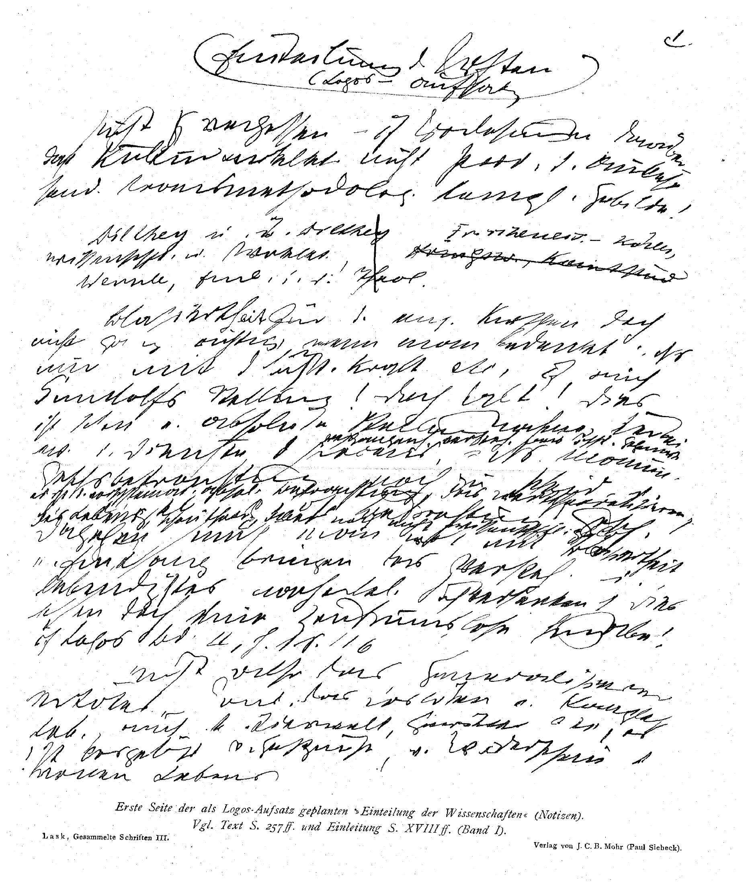

# 拉斯克文集：第三卷

Emil Lask / 埃米尔·拉斯克 · Eugen Herrigel / 欧根·赫里格尔 编 · 1924

本阅读版收录原书手稿影印、扉页及版权页、目录、正文和书评书目（原书第1—294页）；未收三卷合编的人名及主题索引、出版广告和数字化封面。页边“S.”标记为原书印刷页码，页底数字为本阅读版页码。目录页码指向本版相应章节；双语版的原页标沿中文栏定位。原注保留底本页内编号，置于各小节末；中文原注附德文原文。校读说明另列，并与原注区分。手稿影印按原图保留，未另行猜写转录。

拟作为《逻各斯》论文的《科学的划分》（笔记）手稿第一页。参见本卷正文第257页以下及第一卷导言第XVIII页以下。

## 目录 / Inhalt

- [柏拉图](#zh-platon-h)

  - [希腊哲学直至柏拉图的发展](#zh-platon-entwicklung-h)

    - [一、前苏格拉底的自然哲学](#zh-platon-vorsokratiker-h)

  - [人类学时期或启蒙](#zh-platon-anthropologie-h)

    - [智者派与苏格拉底](#zh-platon-sophisten-sokrates-h)

      - [1. 智者派](#zh-platon-sophisten-h)

      - [2. 苏格拉底](#zh-platon-sokrates-h)

  - [柏拉图](#zh-platon-platon-h)

  - [理念论](#zh-platon-ideenlehre-h)

  - [作为世界因果原则的理念](#zh-platon-ursache-h)

  - [柏拉图讲稿的补充说明](#zh-platon-nachtrag-h)

- [论逻辑学体系](#zh-logik-h)

  - [一、有效性哲学的基本概念](#zh-logik-grundbegriffe-h)

  - [二、作为形式的有效性](#zh-logik-form-h)

  - [三、有效（价值）。含义。意义。](#zh-logik-wert-sinn-h)

  - [第二部分 逻辑学作为关于特定的理论或逻辑有效领域的学说](#zh-logik-teil2-h)

    - [A. 真理概念](#zh-logik-wahrheitsbegriff-h)

    - [B. 逻辑形式的多样性](#zh-logik-vielheit-h)

      - [提纲](#zh-logik-disposition-h)

  - [出自《逻辑学体系》附页](#zh-logik-beiblaetter-h)

    - [关于导论](#zh-logik-ad-einleitung-h)

- [论哲学体系](#zh-philosophie-h)

  - [一、](#zh-philosophie-1-h)

  - [二、价值体系笔记](#zh-philosophie-werte-h)

- [论科学体系](#zh-wissenschaften-h)

  - [一、科学的划分](#zh-wissenschaften-einteilung-h)

    - [经验科学的自然概念](#zh-wissenschaften-naturbegriff-h)

    - [对感性材料的理论加工](#zh-wissenschaften-bewaeltigung-h)

    - [一般化](#zh-wissenschaften-generalisieren-h)

    - [量化倾向](#zh-wissenschaften-quantifizieren-h)

    - [第二编：哲学](#zh-wissenschaften-zweite-abteilung-h)

    - [哲学的科学品格](#zh-wissenschaften-wissenschaftscharakter-h)

    - [价值探究与价值判断](#zh-wissenschaften-wertergruendung-h)

    - [哲学的系统学](#zh-wissenschaften-systematik-h)

    - [纯粹的和应用的系统哲学](#zh-wissenschaften-reine-angewandte-h)

    - [经验的文化科学](#zh-wissenschaften-kulturwissenschaften-h)

  - [二、科学划分笔记](#zh-wissenschaften-notizen-h)

    - [关于方法论](#zh-wissenschaften-methodologie-h)

- [书评](#zh-besprechungen-h)

- 人名索引（未收）

- 主题索引（未收）

〔p. I〕埃米尔·拉斯克 全集 由欧根·赫里格尔编 第三卷 附一份影印件 1924 出版者：J. C. B. 莫尔（保罗·西贝克） 图宾根

〔p. II〕版权所有。H. Laupp jr. 印刷，图宾根。

## 柏拉图〔p. 1〕

〔p. 3〕首先只极简短地谈谈柏拉图在世界史上的地位。他应被称为思辨之父，而且作为这样的人，今天仍然完全是活生生的。因为哲学并不是以简单地把旧说抛在身后的方式前进的；它根本上只有少数几个论题，而柏拉图简直已经表述了那个论题。它就藏在他所谓“理念”之中。关键在于究竟应如何理解它。其中包含着对哲学基本问题最伟大、最具范型意义、最源初也最简单的回答。凡以柏拉图的理念为取向者，事实上就站在一切哲学的中心。没有一个文化人，其言谈中不会不断透出对柏拉图理念论的回响，无论他谈的是理想或理想世界，是范型还是规范。每个人眼前都模模糊糊地浮现着“较高者”与“较低者”、超感性者与感性者、超尘世者与尘世者的二重性。而在柏拉图看来，生命的一切“意义”都源自非感性者，源自受到它的触动。所以，说人是两个世界的公民，这完全习以为常：一个是感性的、植物性的、自然的世界，另一个是非感性的、超自然的世界。而细看之下，这个超自然者又分裂为不同的王国：他投身其中的“真理”王国，他预先体验或重新体验的〔p. 4〕艺术王国，以及道德、宗教——它们共同构成非感性者。[^platon-n0015]

哲学的基本论题因而可以简短地标为“两个世界理论”。于是，人们立刻会想到千百种变式，例如：感性—超感性、可感者—可知者、可感者—可理知者、现象—真实现实、物质—精神、有限—无限、经验的—超经验的、相对—绝对、自然—理性、自然—自由。所以最终的问题始终是：除了这个时空世界，还有某种别的东西；这个别的东西究竟是怎么回事？——这就是一切哲学的主题，是永不衰老的永恒任务！谁若要抗拒这一点，就必须是最严格、最诚实的“感觉论者”，只固守味觉、视觉和触觉。

但首先，这种态度意味着与日常意识决裂；因为其中包含两件事：其一是对感性者、自然者的评价发生彻底倒转，而感性者、自然者本来显得是最切近、最可把握、最可靠的东西，甚至仿佛是唯一的东西！而现在，柏拉图带来了巨大的翻转：“在你的虚无中，我希望找到我的全部”！非感性的、理念的世界恰恰是真正的现实，是现实，是本真存在者，ὄντως ὄν，是真正的家园。相反，感性世界只是它的影子，纯粹的“现象”，与本质异质。但其次：直接的体验所得根本不是统一的东西，而是一种融合、一种混合物，是感性者与非感性者未分裂的统一。因此，一切感性者都只是基底，是价值与意义的承载者。

但这个两个世界理论不仅显得悖谬，也显得非希腊的。因为希腊人生来就有的，是自然神化、自然宗教。也就是自然与精神的和谐。就此而言，最真实的古希腊文化代表不是柏拉图，而是前苏格拉底哲学家；以他们为尺度衡量，柏拉图突破了希腊生活方式的界限，超出了希腊性，并且——不是作为非希腊的，而是作为超希腊的——属于那些属于全人〔p. 5〕类的极伟大的精神。他不可能看不到：一切和谐都以某种相互和谐的二重东西为前提。

但在他二元论内部，毕竟又显出一个完全希腊式的音调，即在于这个问题：两个世界的相互作用对整个世界观会得出什么后果。这里尤其取决于其中一个领域、即感性领域的角色。固然，这一点已经一劳永逸地得到认识：感性者作为非感性者的对立极，自在地与意义和价值无涉。但现在涉及的是基本问题：这种接触只是敌对的，还是感性者服务于非感性者，即作为承载者、基础、场所，从而适合被贯穿、被赋形，最终被神化？因为只有这样，感性的时间性定在才有任务、目标和劳作；才对它提出整理与预备的要求，因为它应当成为场所；才有召唤、改革的使命。——或者，感性并不扮演这个角色，而是敌对地面对非感性者，只意味着对它的偏离。印度两个世界理论的某种类型便与柏拉图形成对立。基督教世界观的某些方向亦然。

与之相对，在柏拉图那里，尽管鸿沟持续存在，感性者及其与非感性者的结合仍然得到承认。最深层的当然是分离，这种对希腊性的超出不可收回。但另一方面，时间性者毕竟是永恒者的余晖和摹本，因此现实是一种混合物。

这种接触最好通过一个常被用来比喻理念世界与感性世界关系的形象来说明：艺术作品。艺术作品确实是一种混合物，因为它不仅是一块木头、青铜、大理石，而且体现着非感性者。或者，柏拉图通过巨匠造物主的神话表达这种接触的源初秘密：理念于是成为不朽的形式，在永恒变换的质料上施展其赋形力量。这里恰恰显出那个源初希腊的问题：把〔p. 6〕混沌塑造为宇宙。于是，这种无杂多性的非感性者要求塑造无形式者的冲动，又一再地把柏拉图引回感性者的多。但在此过程中，有两种倾向并存。由于两个世界的截然分离，非感性的理念本身也与现实分离：由此产生世界逃离的非希腊特征。人应当只转向“较高”世界，背对时间性的一切事务，从尘世中解放自己，为死亡作准备。原型超越尘世上的一切实现。但与此同时又有：对理念的“分有”毕竟存在，它给感性定在带来尺度与和谐；现实通过理念而获得荣化，ἔρως，对分有其不朽的渴望。因为原型同时是推动性的力量。由此奠立的是统治世界而非佛教式背离世界的思想。所以哲学家应当统治！

但在另一种意义上，柏拉图也是思辨之父！对于贯穿万有的鸿沟、深渊的意识，在柏拉图之外和之前就已存在。除了印度宗教，希腊也有，尤其见于俄耳甫斯教派。与这一切相比，柏拉图的新颖之处究竟何在？柏拉图寻求清晰性，寻求对那种二重性的知识，而后者只是被那些人直接体验、“感受”到的。如果说此前所宣告的只是直接被体验者，那么在柏拉图这里，哲学认识开始了，两个世界的“理论”产生了。自苏格拉底和柏拉图以来，人类便处在科学与真理的魔力与魅惑之下，处在对真理的激情和对清晰性的需求之下。与基督教完全不同——在那里，信仰、直接的献身并不追问——这里发生的是追问、沉思、在知性面前辩护。因为在柏拉图看来，要完整地把握和掌握非感性者，单纯直接地、未经反思地、本能地生活于其中远远不够；真正的德性恰恰是知识。清晰的知识必须伴随并贯穿行动。唯有通过真理和清晰性，才有“善”。这简直意味着把哲学思辨对世界的统治〔p. 7〕插入其间——一种我们所陌生的理智主义！但无论这种理智主义色彩情形如何，以下一点毕竟是历史使命：知识与真理作为自身目的出现，为真理而认识真理。

于是，我们在这里看到了思辨冲动的一幕：它不受神学家的看守，也不受宗教前提的束缚；这种思辨的独特清新与无偏见正植根于此。因此，柏拉图树立了这样一种思辨的典范：它已获得解放，独立于前柏拉图一元论思辨及生活的一切势力。

### 希腊哲学直至柏拉图的发展

#### 一、前苏格拉底的自然哲学

这里只限于最重要的内容。应当区分一般的科学史意义、精神史意义和哲学史意义。从大多数叙述中，通常只能读出其科学史意义，即科学精神从神话的、尤其是宇宙论的想象中挣脱出来。与这类神话式历史相对，作为真正自然科学的问题，出现了关于变化中的持存者、关于作为基础的实体的问题。自然科学的研究便以古典的单纯性产生；但就其中涉及专门自然科学的问题而言，它们并不是哲学问题：两者相互排斥！因为就自然科学只研究感性者而言，它涉及的是专门与价值和含义相异的东西。而所谓自然科学，确实应理解为对一种材料加以加工，人心和情感并不依恋这种材料；它是自然被祛神之后残留下来、不可解释的沉淀，是赤裸事实性的总括。

〔p. 8〕但前苏格拉底哲学家对世界的最终而完整的态度就是这样吗？不是！若如此，他们就不是自然哲学家，而是自然科学家了。他们的自然仍然是自然者与超自然者的一元统一。因此不是二者分离，而是超感性者与感性者的直接融合。前苏格拉底哲学家固然想做一元论者；但例如他们所说的“生命”并不简单是生物学—有机体概念，而是“更高的”原则；他们所说的“灵魂”是相对于肉体的“更高者”。或者，赫拉克利特的世界过程同时具有λόγος、理性、秩序的含义。阿那克西曼德和色诺芬尼那里的θειον（神性者）具有美、完善、和谐的含义。于是又出现艺术作品的图像！所以“生命”和“精神”这些概念也只是图像。λογος（逻各斯）和νομος（法则）亦然。于是世界具有一种与人相对而立的、彼岸的秩序，一种非人格地自足静止的内容。神性及价值的充实便这样被描入这种自然形而上学之中。

### 人类学时期或启蒙

#### 智者派与苏格拉底

重心既如此落在超主体者之中，那么在公元前5世纪的过程中便产生了某种全新的东西：重心的转移，从客体转向主体，从宇宙转向人。由此，在自然之外发现了第二个研究对象；相对于早先的一元论，这是哲学研究对象的二重性。

这种向主体性的转向绝不只意味着心理学的发现。因为若如此，这个时代就只具有一般的科学意义，而不具有专门的哲学意义，不是世界观的新时代。所以这里的“主体”不应理解为时间性、与价值无涉的过程之总括，而应设想为朝向非感性者、作为与非感性者发生接触的点。因此，转向主体性也就意味着〔p. 9〕转向价值主体性。因为在这一时期的前台，是对人的定在之一切文化价值与目的之正当性的追问，是对习俗与传统、法、国家与宗教之有效性的追问，也就是对规范有效性的追问。通过迈向主体性这一步，价值问题便被发现。

从前人们天真地相信的东西，在这里被拉到知性、清晰性（“启蒙”）的法庭之前。历史地形成的、有机地生长的、由不言自明的权威所认可的东西，都被置于疑问之中；而这一革命性行动是哲学思维的行动！

这里应区分两个阶段：一个纯粹破坏性的阶段，它只使人摆脱盲目服从之不正当性，却未引向自由，而是引向放任。第二阶段同样经过追问与审查，但建立起绝对有效的规范；服从这些规范不再是盲目屈服之事，而是自由决定之事——苏格拉底。

然而整个这一时期只能评价为前厅、准备期，因为价值问题虽然成为哲学的猎物，但尚未作为自身、尚未作为两个世界“理论”而进入意识。唯有柏拉图才明确地把价值问题置入整个世界图景，为哲学思辨赢得了万有这一对象。

（文献：文德尔班（Windelband），《古代哲学史》（Gesch. d. alten Philos.）；《前奏曲》（Präludien）中的《苏格拉底》（Sokrates）；柏拉图专著。——策勒（Zeller），《希腊人的哲学》（Philos. d. Griechen）。——倭铿（Eucken），《人生观》（Lebensansch.）。——当心贡佩尔茨（Gomperz）。——当心帕特（Pater）与纳托尔普（Natorp）。——译本：施莱尔马赫（Schleiermacher）；卡斯纳（Kassner）、普赖森丹茨（Preisendanz）在迪德里希斯（Diederichs）出版的译本艺术上很美，但夹有糟糕的现代化处理。）

##### 1. 智者派

智者派的文化史发生原因：公元前5世纪的急剧变化。战争、荣耀、伯里克利时代精神生活的繁荣，菲狄亚斯、索福克勒斯、欧里庇得斯、〔p. 10〕阿里斯托芬的时代。民主制。自信意识、行动欲望、对自由、荣誉和权力的热烈追求。

与这种提高了的教养欲求不相称的是教育：于是智者派作为这样一些人登场——他们把智慧当作职业和行当来经营，也就是作为所谓“高等”教养所属各科目的教师。科学由此完全服务于实践生活；实践得到理论的支撑。在这种意义上的启蒙因此意味着在实践生活中辨明方向，为公共活动作科学与修辞的准备。

无可置疑，智者派的伟大而正当的使命正在于此，他们因此成为希腊的教师、教养的传播者。

但由此也清楚了这一时期的人类学重点：既然知识被置于实践生活的服务之中，它的主要论题就是“人的”事情。

启蒙的典型问题主要应在伦理和政治领域中寻找。一切显得是人为之作的东西都失去其光环，必须在理性法庭面前为自己负责。于是φυσει（依自然）与θεσει（依人为设定）的对立便具有这样的含义：人应当更多地服从理性而非人，更多地服从自在有效的规范而非实定有效的规范。

但在智者派的多数人那里，这些概念立刻发生了转变。“自然”不再被理解为与人类约定相对的理性，而是与人为设定相对的人性。于是发生向庸俗低下的个人主义的倾覆，转向功利、自然冲动、利己权力的主体性，取代那种承认自身上方之价值、因而自身有价值的主体性。因此，若一切绝对的和自在有效的秩序都被否认，那么人就被宣布为万物的尺度；但这意味着：最高尺度是个体的任意与偏好。于是不存在真理，不存在自在的有效性，而只有主观—心理的事实：某物显得〔p. 11〕真，因此只有有效性意识和有效性妄想。越是远离有效价值，便越只能剩下一种与它疏离、因而与价值无涉的主体性。于是认识论也变成感觉论的了。

##### 2. 苏格拉底

他的生活方式是他的哲学渴望的化身：对生命意义的追问和寻求，他的使命，即唤醒那沉睡着的、朝向最高知识对象的冲动。因此，对他而言，出发点是一般而言的一切人类活动，每一种行业和共同体，每一种艺术和科学。不是孤独中的系统研究，而是被驱向公共领域，这才是他的特征，这种他不得不从事的街头哲学。他也不像智者派那样提供公共课程，因为他自己首先要在共同研究中找到道路。

所以，他也同样关心从天真束缚中的解放，关心主体的主权；但如此从人类权威中解放出来的意志，同时却服从一种绝对规范，而且是因其自在价值，不是因其被强加。

苏格拉底式的自律原则就在于此；但在他那里，它始终只是无内容的原则，并暴露于相对化的危险，因为内容上最不同的东西都能获得这种最高的主体性神圣化。如果说苏格拉底从信念与意向的主体价值出发——这是该时代唯一已知的价值——但他毕竟不能在其中找到唯一的价值，因为它的价值恰恰在于服从非人格的秩序和有效性，那么他固然达到对某种绝对者的承认，却不能说明它究竟在于什么。因此，随着主体的解放，他固然也解放了客体，但尚未认识它。

然而，他的自律原则若不连同其理智主义便无法理解。因为他的自由意味着理智的“审查”，良知就等于知识！他所理解的自律，〔p. 12〕是知性的自律。自在有效者应当被实现，而实现它的手段是洞见、知识、沉思、清晰性。因此，洞见是通往一切才能和德性的道路。认识之所以恰好扮演这一角色，可由他与智者派相对主义的斗争、由对确保、规训、秩序的需求来理解。苏格拉底和柏拉图的整个确保性理智主义，根本上都应从这里理解。理智主义按其深层意义是一种斗争手段。它作为唯一的救治手段，既针对相对主义，也针对本能、含糊的热情或习惯性的熟练。

由此在苏格拉底那里产生完全反思性的要求。寻求理解一切！与此相连的是对一般知识全能性的信仰。知识也是行动的安全而可靠的手段！虔敬者，是知道应向诸神奉献什么的人；正义者，是知道如何正当地对待他人的人；罪过是错误，德性可教。每个人都有德性的禀赋，因此：通过良好的教育、通过“启蒙”来培养这种禀赋！

因此，人们不应在出发点的平庸之下忽视首次提出之任务的巨大性！尽管一切清醒冷静，这整个关于知识之力量与荣耀的说教仍然如此强大，这种对生命作哲学理解的要求，这种促使人们回到自身的呼吁，以至于通过这种新发现的知识力量，一切都受到挤压，生命无疑被强暴了。生命与思辨之间尚未建立起平衡，甚至根本尚未认识到：两者不必相互敌对。

因此，尼采的刻画完全夸张了；他只看到反面，即庸常的一面。他在苏格拉底所反对的本能中，根本看不到盲目、偶然、不负责任、伦理上不成熟和无所分辨的东西，而是过于生机论地只看到源初的、活生生的东西；因此在苏格拉底身上只看到一切直接性的破坏者。

〔p. 13〕对苏格拉底而言，最高的问题并不是知识问题，而是一般哲学的有效性与绝对性问题。绝对者的“正当性”必须是一种可认识的正当性，因此绝对性问题必须成为认识问题。在通往绝对性问题的道路上，他于是撞上了认识问题。最值得深思的是：他是在绝对性问题的场合、也就是恰恰在其服务性地位中发现认识问题的。因此，他最终是理论性本质之认识的奠基者，“逻辑学”真正积极的开端可追溯到他。而原则上重要的是：这种对统治千年的逻辑学的推动——我们和过去的世纪一样都是它的学生——并非来自自然科学和数学，而是来自苏格拉底那指向生命价值的认识冲动。关于善、关于目的的知识，这种价值科学，我们要归功于希腊性；它就是这样产生的，产生于世界观认识的问题。对我们而言，这超出历史之外还包含着一种告诫：不要过于狭窄地理解知识和认识的概念，不要以为真正的科学只有自然科学，不要跟着那种可悲的二分法走，以为其他一切都只属于“心灵”“情感”“直觉”。

无论如何，当时哲学的价值认识被视为更本真、更可靠的认识，在柏拉图那里甚至被视为最高的超感性规定和世界理性。所以，苏格拉底是知识之力量与荣耀的宣告者，部分正因为它不应为自身之故而受追求，而应因其在生命中的效用；因为它是生命的立法者。知识关涉某种在它之外的东西。正因为道德被理智化，认识才获得伦理色彩，成为道德任务，成为公民的道德和政治义务。

这就是苏格拉底式对话的更深意义：一切相互理解都以某种共同之物为前提，双方都必须把这一共同之物当作〔p. 14〕规范来服从。理解以单纯感受状态的可传达性为前提，而苏格拉底在概念中找到了达到它的手段。通过概念性的铸造，模糊的印象变得可固定、可分离：苏格拉底的伟大发现就在于这一洞见。因此，一切概念思维的目标是概念规定，即把被规定者从模糊而含混的表象团块中突出出来。由此获得单义性和恒定性：概念作为同一者，在整个思维过程中持存。

但还需补充：这里涉及的是普遍概念。其背后是这样的观点：只有属类性的东西才能被科学地规定，个体性的东西则不可把握。只有通过普遍性秩序、筛选、抽象，才可能驾驭生活。所以苏格拉底在普遍概念中发现了各门科学用以把握对象的强大手段。而他的另一个观点也在数千年中保持活力：这个为穿越体验迷宫指路的普遍者，同时也是支配性的、本质性的东西。

因此，他的“方法”在于把个别者回溯到普遍者，即把握寓于众多个别事例中的普遍者。寓于一切个别者之中并在那里施行统治的东西，其实每个人都知晓，只要他对此加以沉思。对话（参见助产术）就是用来这样追问出来的。

### 柏拉图

他与苏格拉底交往约八至九年。这是师生关系最伟大、最美好的典范，是一座闻所未闻的感恩纪念碑：他终其一生不是宣告自己，而是宣告苏格拉底。苏格拉底教学的巨大印象，起初也把柏拉图对自然哲学的兴趣压了下去。清醒与概念上的严格，是他大概在苏格拉底生前或死后不久所写的最初几篇对话的特征。在这种强大影响下，形成了柏拉图哲学的典范方式：沉思〔p. 15〕世界观、生命意义与生命使命这些终极问题，同时又保持沉思性的概念性和科学性。

他的体系展开固然以某种实事性的指导为基础，但旁边仍有空间容纳各种启发；或者反过来说：外来影响固然重要，但对他说来并非决定性的，它们只是被采纳并加工进总体计划之中。这些启发必然会出现；但它们仅仅构成对沉思和系统安置的刺激。每个体系哲学家都必须以这种方式行事。毕达哥拉斯的影响对他并不意味着偏离自身的发展，而只是迎向他那种系统性的需求：补充、驾驭、更全面地理解万有，征服并拥抱过去一切曾冲破到意识之光中的肯定性东西。因此不是可悲的历史主义！

现在要理解，人类学时期如何应被视为两个世界理论的准备期。主体性已被征服为自然科学之外的第二个对象，价值问题也随之被征服。但两者仍未经反思地并列，而非感性者仅仅在其与主体性的关联中、也就是恰恰作为价值、规范、要求被考察，因此只是作为主体性的反射。因此，它与体验融合，成为体验的成就价值、行为价值、德性与才能。与此相对，应提出柏拉图的超主体主义。凡对我们才成为价值的东西，也必须自在地是某种东西。所以，在可思维者的万有中，有某种东西在关联思考中对于感性之外的某个第二者而言是“价值”。这意味着：自在地“有”二重东西，向主体性的狭窄化被蜕去，而这导向某种超主体者。于是尖锐地认识到，宇宙中包含二重东西；就人和灵魂而言，它们只在其对伟大世界力量的服从下才被考虑，而这些力量本身是无灵魂的、超灵魂的、超精神的、非人格的。所以最高者就是实事性东西！

〔p. 16〕但另一方面，这个立场既然经过了人类学时期，便因此带上色彩；非感性者获得了色彩和性格。因为也许它的价值性根本不是关于它所能说的最终东西，而非感性者已经掺入了人类学的余味，是从仅仅朝向我们的一面被看的。但这样已经可以理解“善”的概念。

现在也可以说明柏拉图如何完成统一：1. 接纳主体性，但只作为环节；2. 返回宇宙，而且 a) 返回超主体的非感性者，但也 b) 明确返回自然。因为一旦超感性者被把握为宇宙对象，也就必须注视感性者与之的关系，注视它相对于超感性者所扮演的角色；因此也必须涉及自然哲学，即不是自然科学，而是从超感性者出发照亮感性者。

### 理念论

所以，尽管柏拉图的哲学是世界观，他从理论哲学出发这一点却极有特征。他首先在理论领域沉思到：有某种超出感性者的东西；而这里又显出向超主体者转折的特征。因为在苏格拉底那里，认识论是关于主体行为的学说；知识与概念对他而言是把握那些“在那边”的事物的主体性占有手段。于是整个理念论由以下论证产生：如果在感性的知觉和如此显现——它们对应于感性者的纷乱——之外，还应有概念性的认识、甚至有价值的认识，那么这第二种主体行为也必须面对一个第二对象，一个与感性世界不同的非感性世界。所以典型之处在于从主体性的神圣化迈向超主体者。如果在与价值无涉的行为之外还有有价值的理论行为，那么就必须有一个〔p. 17〕超感性对象在其中被把握。这种柏拉图式的客观主义包含对理论性本质的最深刻洞见，涉及主体性与价值构成物之间、人格者与非人格者之间的深刻鸿沟。所以真正的价值在于客体；根本不存在行为的独立价值，只有获得的价值，而且后者也仅因为被把握者本身是价值。

所以柏拉图第一次把沉思转向这一点：认识在于有某种东西迎面注视，即一种非人格的实事内容。某种超出感性者、自在持存的非感性者迎面而来，主体只是它的发现者；因此只能被找到的东西，是从一个完全不同的、无时间的区域伸入认识之中。因此，柏拉图可以说是在真理王国中学会了无时间者的本质，把它视为一种自在的秩序，只需加以指明。在这里，真理的超主体性完全清楚：理念世界不是一个“精神”世界，不是精神者构成与物体者的对立，尽管理念被称为“无形体的”（ἀσωματον）；相反，心理的东西与物理的东西一样，都属于感性—时间世界。

因此必定存在某种无时间的、独立于主体性的逻辑秩序，而柏拉图在普遍者与特殊者的关系中找到它。

因此，每一种可在印象中体验的性质，例如白这一性质，始终只是个别者；然而我们仍觉得最可靠地拥有这一点：作为普遍者的白“存在”。固然不是作为感性的猎物，却是作为精神的、“可思的”猎物；即使不是作为ὁρατόν，也是作为νοητόν，只有通过思维才能把握。人如何达到这一点？感性的白毕竟不能分裂为一般的白和这个白。更确切地说，如人们所说，通过抽象思维、比较等等。但在超主体的转向中，这意味着：把握感性内容与那些被发现的普遍者之间的关系。因为“自在地”存在着这样的关系：它们之中寓有“共同的东西”，它们部分相同、部分相异。于是，一种感性上根本不存在、只有通过非感性途径、通过单纯思维才能被发现的划分和〔p. 18〕秩序得以完成。

我们于是遇到一种在距离上高踞于感性者之上、性质完全不同的内容，一种仅仅可思的存立。因此毫不奇怪，在柏拉图那里，非感性有效的思想恰恰与属类内容结合，因为逻辑的使命在这里确实最显眼地映入眼帘。至少在他看来，与感性的蓝相对应的是理想之蓝的升华形态，即蓝这一无时间的含义统一体。因为无论蓝在空间和时间中重复多少次，就其内容而言，此处与彼处都是同一个东西。所以就其内容而言，它完全不同于其时空中的实现；它的如此这般存在、即恰恰构成这一内容，毕竟意味着某种东西，完全不管它此时在此、彼时在彼以及在那里持续多久。它是众多相同者旁边的那个同一者。这个一者与同一者根本不可重复；唯一能重复的只是影子图像，是它的摹本。总之，我们在空间和时间中体验到的一切，都只是余晖、双重影像，是相对于καθ’ αὑτο（自身而在）的ἐν ἡμιν（在我们之中）。感性世界是一个混合物（μικτον），但不是由感性材料和理念构成，而是由感性材料和理念的时间性摹本构成，分化为无穷多的形态。理念本身则处于“非空间的”和“非时间的”之中。

不应把理念设想为现实的影子相关物，恰恰相反，应把现实设想为理念的影子相关物；《斐多》99/100明确如此说。所以感性者应被理解为单纯的影子图像，它只是指示、模仿（μίμησις）、分有（μετεχειν）；它是灵魂转向理念的契机和推动。因此这里涉及的是原型与摹本的关系。

因此，理念不应按通常意义被理解为属类内容，仿佛它们作为共同者寓于一切感性个别物之中、可通过抽象取出；它们毋宁说“悬临”于个别物之上。与属类〔p. 19〕性的东西交织在一起的，毋宁是两个世界的问题；属类仅仅是具有非感性有效性的东西的代表。这里不是简单地对属类内容作“实体化”，而是在普遍性问题上，有效性问题显露了出来。因此，把理念理解为“概念”、把λογοι理解为“语词含义”，也是错误的；理念其实是它们的相关物。

两个世界是独立的、分离的（χωρισμός）或超越的，只有理念的摹本是“内在的”。不是因为柏拉图把理念称为“ὄν”——那只是语词智慧——而是因为他把理念确立为“对象”、把超感性者发现为某种分离者，这是他不朽的功绩。是的，它们不仅独立，而且构成事物的真正源初根据。柏拉图特别强调这种自为持存：“静止”和“永恒”是它的图像。这种自为持存者，即καθ’ αὑτο（自身而在），作为完全独立者，与ἐν ἡμιν（在我们之中）相对立。

由此再次显明其超主体性！它不是任何精神性的东西，也不是“思想”，至多是可思者，即νοητόν，因此不是思维的产物，恰恰相反！它不在别处，也不在灵魂中；柏拉图明确反对这样的说法：理念只是νοηματα（思想），并且οὐδαμου ἀλλοθεν ἢ ἐν ψυχαις（除了在灵魂中之外不在任何地方）（《巴门尼德》132B）。而在《会饮》中关于理念说：它们既不像面容或手，也不像任何有形体之物，也不像言说或认识（οὐδε τις λογος οὐδε τις ἐπιστημη）。与之相对，一切主体性的或人格性的东西都是向它们屈服、承认它们的东西。所以，理念既高踞于分有它们的杂多之上，也高踞于理念体验的杂多之上。

理念固然被说成属、普遍概念，被说成εἶδος、τὸ αὐτὸ ἐπὶ πᾶσιν、γένος ἑκάστου；但它们并不是通常意义上的属，也不是对一切事物而言的属。作为这样的东西，“纯粹内容”固然是属；与此相应，在柏拉图那里，既有最微小、最无价值之物的理念，也有最完善者的理念。

〔p. 20〕但如果只在理念论中看到这一倾向，就会误解它。因为那样的话，对纯粹内容及其逻辑普遍性的逻辑迷醉就足够了；但若某些理念享有优先和特殊地位，情形就不同了。事实上正是如此；某些完全确定的概念，如αὐτο το καλον（美本身）、ἀγαθον（善）、δικαιον（正义）、ὁσιον（虔敬），它们的特性显然不在于其逻辑有效性，而在于其一般的价值性，却被特别突出。它们才是囊括生命与世界全部意义的理念；只有以它们为基础，理念论才可理解。在这里，理念不再仅仅是属类性的东西、普遍者本身；逻辑的纯粹性和普遍性的逻辑形式不再足够。普遍性只是一种手段，用以把它们的价值性纯然剥离出来，把它们从与价值无涉者中提取出来。因为在柏拉图看来，生命与世界最终是感性者与非感性者的混合物。感性是一种无限的、不可计算的多，而赋予它意义的东西则是有限的、可总览的。例如在伦理领域，有数量封闭的生活善、制度、义务，它们赋予每一时刻和每一行动以价值，因此伦理学体系是一个价值含义的“宇宙”。或者在理论领域：概念、判断、推理是在加工材料的不可总览的众多活动中相同的“形式”。简言之，一个价值形态的宇宙贯穿生命的无限杂多。所以，生命作为感性者与非感性者的这种交织，就是同样的价值形态在材料的无限充实中一再重复的实现。若试图从逻辑上刻画生命的这一源初构成部分，那么价值形态显得是支配性的普遍者、属，而诸实现则显得是个别事例；它们身上的价值性东西是处处相同者，感性者则是各自个体性的剩余。

因此，善与美的属或理念意味着：〔p. 21〕那种纯粹的、摆脱了感性附加物的非感性价值形态本身。这里显出这样一种理念与例如蓝的理念之间的巨大差异。普遍的蓝无论多么升华，仍与个别的蓝同属一类，只是逻辑上被净化了；而在那里，理念并不与个别者同类，而是处于彼岸。在这个意义上，《会饮》中美的理念极具特征：年轻时追逐美的身体，但随后发觉一个身体的美与每个其他身体的美是姊妹，于是获得身体美的理念。然后觉察到灵魂、行为、习俗的美；然后根本不再允许停留在个别的美（τὰ καλά）上，只有这样才撞上αὐτὸ τὸ καλόν，εἰλικρινές、καθαρόν、ἄμικτον。所以这里着眼点不是普遍性的探究、一般化，而是价值的探究。

所以认识者必须看透：生命的意义毕竟来自生命的彼岸。因此，不混杂的价值含义与各个感性化之间的关系，犹如哲学与生命、间接的、认知的、反思的行为与直接行为的关系。对个别者，两种行为都存在。但一旦把其中的价值内容孤立出来，生命就转变为哲学反思。我们毕竟不能对善的理念采取“道德”行为。直接行为只存在于材料参与其中的地方；这只在摹本性的东西那里，即在ἐν ἡμῖν的领域。相反，被剥离者才是最高者！一切实现都是下降！因此，认识在柏拉图那里也是最高者！现在也可以理解，为什么德性必须是知识。真正的德性是洞见、ἔρως，是对自在之善的把握；人确实只有以认知方式才能占有它；只有在哲学认识性的行为和沉思中才能达到它。“理智主义”只在于：这种非生命被宣布为最高生命。与此相联的还有超人格的脱主体化、对最直接生命之杂多的逃离，以及对处于生命彼岸的认识的称福。

〔p. 22〕但这一点仍不足以理解理念论。不仅有理论性的原型性，而且独立于它还有一种特有的价值原型性；而后者同样只能通过概念把握来揭示。理论性在这里又只服务于明确的区分。正因如此，整个原型性思想变得双义。于是“原型”一词有时不是指理想要求本身，而是指其圆满实现。据此，美的原型是一个具体的范本形象，“理想国”亦然；即现实与理想要求的和谐，“存在”与“应当”的一致，“充实”与贯穿。但超人格者并不处于这个“生成”的领域！因为充实毕竟是肉身化和人格化。因为这些实现的承载者并不是某种“理想的”现实，而恰恰是我们感性的、人格的现实；唯独它履行这种承载使命。诚然，原型在某种意义上是想象和构想的产物，因而与现实相异，但它仍符合其方式、结构类型，即符合一切实现构成物的混合性。所以它是属类理想、具体原型，但不是善本身的原型，而是善人的原型；不是δίκαιον的原型，而是正义国家的原型，因此是范型！因此，具体原型根本不纯粹、不源初，而只是事后从混合物中取出，仍粘着一块感性。[^reading-note-platon-ideenlehre-p0070]

但现在说原型性的第二重含义！这里不再涉及一种经过了实现、从实现中取出并被树立为范型的实现，与不充分实现相对。相反，原型在这里意味着：一切实现之前的单纯而纯粹的价值含义。在这里，价值的世界和与价值无涉的世界作为两极相对；价值含义是在进入实际实现的平面和战场之前被考察的，而只有在这个平面中才有价值对立。所以这里是ἀμικτον（未混合者）与μικτον（混合者）相对，而此前涉及的是〔p. 23〕完善的和不完善的μικτόν的对置。感性作为实现场所，同时也是对立的源初场所！只有通过主体对价值的行为，才产生价值与负价值的对立。通过意志对朝向意志的要求的转向与背离，产生善与恶。相反，在进入感性之前的价值领域则高踞于对立性之上。[^reading-note-platon-ideenlehre-p0071]

由此，柏拉图哲学的整体图景通过以下决定性规定而获得生命：感性、时间性就其自身而言与价值无涉、与对立无涉，然而在与非感性者的接触和混合中，它是负价值的源初场所。由此也可以理解，有时单纯的与价值无涉性被掩盖，感性者显得是恶的、魔性的，时间性显得是不完善的。但在柏拉图那里，感性者仅被视为恶的起源；纯粹感性作为“质料”，与生成、与μικτόν、与ἐν ἡμιν（在我们之中）的领域、与善恶的战场完全不同。于是，生成是分裂和不完善的领域，即不完善实现的领域；因此可以理解：当不完善实现与完善实现相对置时，完善者只表现为一种提升，即肯定者的最高峰。所以有这样的话：没有任何个别事物纯粹地表现理念，而总是也带有其反面（《理想国》479）。现在才能把生成、μικτόν完全刻画为介于感性质料的纯粹虚无与本真存在之间的分裂者和中间者，一种来回飘荡者（πλανητόν）。现在，指示和分有、παρουσία和κοινωνία才获得确切意义：非感性者只是部分地实现自身。相反，源初的美、绝对的美并不是“在某方面”美的。

不过，原型的第二重含义并不总是被纯粹保持；无疑第一重含义也掺入其中，自在的善与美从具体〔p. 24〕原型中被抽象出来，以致“先于实现”和“实现之圆满”两条思想系列相互过渡。

关于感性之贬损力量的整个学说还需要若干修正。此前只把主体行为的某种不充分性说成负价值的来源。但按柏拉图的观点，贬损的领域应理解得更广，即整个感性。负价值通过价值含义与感性的单纯接触和交织而产生，即使没有主体性的参与。在伦理、政治、宗教中，柏拉图固然知道由人类灵魂造成的贬损；但此外也知道那种交织中的贬损：感性作为“材料”呈现给纯粹价值含义。例如，相对于美的原型，感性材料或多或少适合、僵硬、扭曲；而在自然美中，毕竟没有艺术家作为主体在背后。或者，正义是国家的秩序和均衡、力量的平衡；这里也涉及和谐秩序的超主体、非人格价值；对于这种秩序，灵魂不被视为主体，而被视为依附于它的价值的材料，犹如美依附于自然。凡要刻画两个世界之间接触的这一源初秘密之处，便以神话方式——否则怎么可能？——引入巨匠造物主，他着眼于理念来塑造抗拒的质料。

既然原型在其分离状态中、并且尽管有这种分离，仍圆满地自足静止，那么人们所谓的它们的“充实”对它们而言就意味着下降。所以，原型是一个自为地纯粹的区域，但它此外还能向我们这些在下方者散发光辉。[^reading-note-platon-ideenlehre-p0075]

甚至在纯理论领域也可以证明这一点。例如几何学中那不可直观、因而理论性的东西，在柏拉图看来确实是范型性的。感性中一切三角形、球形、圆形等等对象固然实现数学构成物，但只是不完善地实现。所以，原型一方面自为地是某种东西，另一方面又是对象上的一个环节，而对象的不完善性独立于主体〔p. 25〕。我们在对象上感性体验到的东西，恰恰是以感性上不可体验的原型来衡量，而原型只能在其纯粹本质中被把握。所以，感性中呈现出某种客观的东西，它却指向感性之外、引向那里，真正说来只是模仿，却永远达不到，而始终是不完善的摹本。

同样的道理也可以在纯逻辑形式上——用我们现代人的说法——例如在“相等”上显示出来。纯粹的相等——被体现的相等。其经典段落见《斐多》74以下。在感性中，相等永远不能被体验为完全精确的、绝对的相等。而我们之所以知道那些相等的东西从不是绝对相等，只因为预设了作为原型尺度的绝对相等。于是一个单纯的“形式”在这里被提升为理想和尺度，并被明确置于最高价值理念之列（《斐多》75）。由此得出：感性本身、在无主体介入的情况下，也在理论方面是某种被贬损的、逻辑上错乱的东西。所以它不包含真正的、本真的、在这个意义上“真实的”对象，不包含原型性的πράγματα。

这被概括为一条原则（《理想国》523以下）：凡感性世界中存在对立性之处，凡一种知觉同时转变为相反知觉之处，就有一种吸引者（ἑλκτικον），召唤本质（παρακαλουν οὐσιαν）；因为这一切不完善都指向无对立的原型。感性中的对立性总是与对感性的超出指引相关联。所以例如实际的算术单位也总同时是非统一的，即多。

这一观点应推广到全部理念。任何理念的一切感性实现都分裂为对立；《理想国》479明确以美—丑、偶—奇、众多的双倍、大、重为例；正如在柏拉图那里一切属类内容都被升华为原型性的价值内容，另一方面，一切理念的实现也带有价值对立性的印记。

但正因为柏拉图把一切属类内容都打上价值内容的印记〔p. 26〕，就产生了价值领域的巨大扩展，连与价值无涉者也获得价值生命，价值概念也伸入感性之中。既然全部感性—质性的内容都被转化为价值内容，那么作为纯粹感性，必留下一个无性质、无形体的残余。这一一切内容实现的最终基底本身必须无内容、无色彩，同时又是个体化原则，即无限多的源泉。于是，就充实空间的一切事物的实现而言，只剩下空间作为最终基底。

所以理念是对一切东西的升华和加倍，当然只就其在属类上可把握而言。但并非因为它们普遍才有价值，而是因为它们有价值才普遍。它们的普遍性只是把它们解释为价值性的理由，只是它们的逻辑尊严。属于价值内容之本质的是：具有属类性。因为属于原型性之本质的是：为无数个别实现提供尺度。因此，如果在柏拉图和亚里士多德那里，一与多、普遍与特殊的关系表现为基本关系，这恰恰不是形式逻辑的狂热，也不是偏爱一般化、因而对个体者缺乏理解，而毋宁是那种实事性源初关系的逻辑伴随现象：超感性者是一个封闭者，被感性的无限杂多所分散。因此在感性化时，理念相对于无限可重复的实现，显得是一者，同时又是普遍者。

与上述内容直接相联的是主体问题。因为当我们以原型尺度衡量时，我们毕竟知道某种超出一切可经验性之物；我们毕竟在比较，因而把尺度放在旁边。《斐多》73以下如此说：当我们不仅体验这个，而且在此之际体验另一个东西时，我们所体验到的是一种并不在此的东西；而原型在摹本体验之际被牵引出来，柏拉图称之为〔p. 27〕ἀνάμνησις（回忆）。所以我们需要感性，它必须给我们发现非感性者的契机。于是我们体验到某种在尘世生命中根本不可能经验到的东西；所以我们必是在一种超尘世生命中接受过它，在出生时遗忘，后来才逐渐苏醒并回想起它。整个ἀνάμνησις学说有一种反感觉论倾向：存在一些内容，它们不在感性中，更尖锐地说，不在γένεσις中。

这一理解表达了无疑深刻的发现：我们拥有“原型”，尽管它们从未在经验中实现。另一方面，它只是把探究中的谜团向后推。但首先可以不管这一点；因为这里涉及的毕竟不是小事，而是灵魂概念。在两个世界理论中，灵魂应安置于何处？当然不在理念世界，因为理念不是精神性的东西，两个世界的对立不是灵魂与肉体的对立。因此唯一的结论是把灵魂安置在感性世界或μικτόν中。但柏拉图给出的说法是：灵魂不是理念，但最相似于理念。为什么？因为理论行为是理想对象的纯粹而不混杂的相关物。于是，灵魂概念和精神概念历来都从客体方面染上价值色彩。因此，当灵魂以感性世界为对象时，它已经编织进感性世界，被束缚于物体之中。

ἀνάμνησις学说同时是古代θεωρία理解的最深表达。认识是被动接受、发现。正如被认识者摆脱了一切介入、创造、生产，一切创造性塑造和改造的主体行为也必蒙上阴影。一切被创造者都是人造物，一切技能和艺术构成物都是人工制品。一切创造都只是再造，因而也是贬损。所以一切艺术都是对世界理性与荣耀的拙劣复制。此外，艺术产生的是混合物的影子图像，因此只是摹本的摹本。如同〔p. 28〕改造性的实践生命，艺术也活动于感性现实的范围之内，只有理论处于纯粹非感性者之中。

于是三分法得到正当性：理论的—实践的—审美的。理论行为是最高的，因为它在于让对象保持不变而献身于它。艺术相对于它，则是一种任意扭曲的游戏。

因此，ἀνάμνησις学说是客观指向关系——相似、摹本性、对应性——的主观反射。现在，与它相联的还有另一现象（《斐德若》）：那服务于ἔρως（爱欲）的ἀνάμνησις（回忆）。后者也是那种客观指向——努力——的主观反照，这种努力更接近客观关系，几乎与之重合。与这种ἔρως必然相联的是：1. 渴望、不拥有、需求之标志；2. 方向不可逆转，因而单向性，因为这只是从有需求者向无需求者的牵引。无需求者本身不可能被爱欲推动。因此，ἔρως是虚无与神之间、完全无接触与宁静拥有之封闭之间、πορος（丰足）与πενια（匮乏）之间的中间者。相对于有需求者的这种爱，另一方——再次作为柏拉图超主体主义的表达——没有回爱。神是非人格的理念，是美与善的非人格原型。若剥去ἔρως学说的一切神话，它恰恰包含尘世者与神性者、与非感性者的关系问题。

但同时，ἔρως学说最大限度地贴近世界和生命。于是ἔρως意味着：使一切神圣化。最终，对人的爱（因而不只是对非人格者的爱）也只是把握神性和善的借口。当说“在美中生育和诞生”时，ἔρως的面向世界倾向就更加清楚。这毕竟意味着：把神性者塑造进现实生命，把不朽者塑造进有死者。在此，生育性的、创造性的东西在最一般意义上不应理解为改造，而应理解为成就，因此也恰恰包括〔p. 29〕认识。这种科学与智慧的传授和繁衍，这种点燃和不朽化，正是最高的生育方式。所以，创造性应这样理解：被创造者作为非人格的成就立于人类的记忆之中；政治—社会塑造与科学、艺术的生产和传统同样属于此列。

整个认识论现在只是对象万有的主体相关物。感性世界和非感性世界分别对应于“知觉”和“思维”。这是两个极端：完全虚无者（μὴ ὄν）和真正存在。但日常生活世界不是两者中的任何一个，而毋宁是μικτόν。因此，对它的行为是世俗之子的行为，是听觉和视觉爱好者的行为，他把影子世界当作真实世界，这就是“意见”。于是δόξα处于无知与知识之间，是对γένεσις的行为。

因此，与柏拉图极端对立的是那种把αἴσθησις当作认识的观点。在《泰阿泰德》中，反对感觉论和相对主义的论战与此相联；其中包含两点：1. 知觉对应于感官错觉的世界，而知觉本身没有某种人们必须服从的共同者；2. 直接印象性的东西在严格意义上是非理性的、逻辑上不可把握的，因而是“坏无限”：关于这种流逝者，自在地没有真理。

因此，对认识论而言只有δόξα和νόησις被考虑。一般可以说：μικτόν是被应用者、被降至下界者、分散于多之中者。相对于它，重要的是推进到纯粹的、原型性的、本质性的东西。停留在μικτόν那里就是ἀληθης δοξα（真实意见），即日常生活的立场，但同时也是一切我们所谓“经验科学”的立场：在这个世界中整理和辨明方向，单纯接受而不向上推进；天真、未经反思。与之相对，认识是对最终意义的哲学探究，是转向原型。这才是知识、把握、〔p. 30〕给出根据（λόγον διδόναι）；即看出这个世界锚定于原型之中。理念世界是一切生成的核心和根据、源初根据。根据也可称为无条件者（与这个世界的条件性相对），于是产生同义的术语：ὑποθεσις—ἀνυποθετον。因此，λόγον διδόναι意味着：论证性的、推进到根据的认识；一种συλλογισμός，不只是形式逻辑性质的，而是包含γένεσις的真实前提、即οὐσία。由此显明，逻辑的东西如何完全从形而上学中涌出，逻辑的东西如何与形而上学—实事性的东西交织。

与ὁρατόν—νοητόν的对立相应的是γένεσις（μικτόν）—οὐσία的对立，以及δόξα与νόησις的对立，因此αἴσθησις作为认识来源根本不予考虑。数学处于δόξα与νόησις之间；因为尽管它与非感性者打交道，却仍不是哲学。柏拉图在这里比许多后人有更深刻的洞见，后者因数学的非感性而把它与逻辑学等同。只有数学的逻辑学才引向更高阶段，对此给出根据。因此，在柏拉图那里，数学也只是一段前奏，而非真正的旋律和曲调！（这与康德何等不可逾越地对立——对康德而言，真正的科学只有那种具有自然科学—数学倾向的科学！）在柏拉图那里，人必须从“经验”转向构成经验根据的东西；但不是为了由此以另一种眼光、即“有根据地”看经验本身，而毋宁是为了背离经验，纯粹沉入这个根据。在数学的“坏无限”中，毕竟还保存着对感性—直观者的记忆！所以，柏拉图式的“前提”不是“开端”或“原则”或最终者，而只是通向无前提者、通向一切设定之终止的起跑；因此必须一直推进到抵达者获得宁静之处，即推进到世界的源初根据、神性者。

但至少清楚的是：哲学不仅收集〔p. 31〕世界中分散于生命里的非感性价值形态，而且正是在其孤立化的知识——只有这种知识才能孤立化——中，它们的原型纯粹性才被揭示出来。考虑到这一点，哲学就不是与其他科学并列的一门科学，而是所有其他科学都从属于它的科学。

在此再次验证了柏拉图的理智主义：最纯粹、最具原型性的东西完全可以被知性贯穿，是一个完全透明的“νοητόν”“intelligibile”，因此不是只能被直观的东西——若如此，直观将始终是非理性的；相反，这个非感性世界是理性可把握的。

若追问理念世界内部秩序与划分的原则，就会发现所给出的是普遍者与特殊者的关系。毫不奇怪！因为这种划分究竟基于什么？基于ἕν与τὰ πολλά的对立！换言之：理念世界中也有“多”。但不仅是多，而且还有距离关系，即上下隶属关系。在这里，形式逻辑的装置也只是实事性等级秩序的伴随现象。因此，理念世界中也有ἄπειρον，因而有πέρας—ἄπειρον的关系。所以显然有一个可理知的ἄπειρον，它几乎只能被理解为感性方面的反照、侵入。因此，既是“一”又是“多”，属于本质性者的本质。

“辩证的”划分就其最主要的图式性划分而言，已经可以总览。为此有两条道路：上升与下降（《斐德若》265以下、277B；《智者》253及下一页）。

κοινωνία：有些属愿意彼此共有，有些则不愿意！在柏拉图看来，尊严的高度与普遍性之间存在预定和谐；这可以理解，因为对他而言，最低的理念也是价值理念。

不过，某处被明确标为μέγιστα γένη的东西（《智者》254），并没有现代〔p. 32〕“范畴”的含义，而毋宁是一般的理念。因此柏拉图可以毫无顾虑地把善与美置于它们旁边。ὄν相当于“对象性”，ταὐτόν—θάτερον则与一和多对立相应；这种对立如此与源初分裂交织，以致ταὐτόν简直意味着理念世界、持存者，成为非感性者的专门范畴，而θάτερον则标识具有差异、多的东西。《蒂迈欧》35A在这个意义上把μικτόν由ταὐτόν和θάτερον调和而成（亦见《巴门尼德》164以下）。但同时，θάτερον有更专门的含义，即在理念世界内部相当于ἕν—πολλά。正如不仅有一种经验的，而且有一种可理知的运动（κινησις），即从一个到另一个的关系进展。《泰阿泰德》185：οὐσία—μὴ εἶναι，ὁμοιοτης—ἀνομοιον，ταὐτόν—ἕτερον，ἕν—ἄλλος ἀριθμός（其他数）。

由此同时产生理念世界内部的最后问题，即关于“最高”理念的问题。这个问题在《智者》中安排得特别精妙。那里问：欺骗与妄想、虚假究竟是什么？谈论虚假，毕竟敢于预设非存在者终究是某种东西；犯错意味着：对非存在者的表象；所以非存在者作为表象对象，毕竟是认识的对象。既然存在囊括一切，那么非存在者——只要它不只是纯粹虚无而是别的什么——究竟如何可能是某种东西？τὶ（237）毕竟总以某种方式归入存在者、持存者；但非存在者毕竟是存在一般的反面！因此，为了论证虚假，必须坚持论证非存在之存在。

然后是242以下：绕道而行：存在者同样成问题；例如只有热和冷，但两者毕竟都应当存在！所以还有第三者，即存在！现在埃利亚学派说：世界根本上只是一。但这个“一”存在吗？“存在”与“一”是同一个吗？所以，把一个最高者置于顶端是矛盾的；只要它应当存在，它就必须分有存在的本质，而存在因此是不同于它自身的东西！这里已经显出多的不可逃避性〔p. 33〕。人不能停留在单纯的一上。换种说法：某物的存在是不同于该物本身的东西。但又是伴随一切的东西。（这里有巨大困难，只有看透这类概念作为“范畴”的特殊性才能着手；而在柏拉图那里，它们只是与其他属无差别的属。）

另一方面，不能把存在与分有它的某物割裂开来思考，因为那样它既不能自身是某种东西，也不能是另一个某物。谁断言某物存在，就已经必须承认共联。于是柏拉图达到概念本身之普遍关联与分离的思想。

存在如此，同一与差异亦然；静止和运动分有同一者和差异者。同一者与存在者不是一，存在者与差异者等等也不是一。于是结论是：非存在者既与运动相关，也与一切其他概念相关；因为它们作为非存在者都不同于存在者，却仍然存在！就连存在者本身也在无数方面是非存在者。据此，μὴ ὄν不是存在者的对立面，而只是一个ἕτερον，即仅仅是另一种非存在者！所以它是相对的非存在者，不是绝对的非存在者；它不是绝对虚无（=《蒂迈欧》的质料），而属于存在者，只是相对地非存在。一般非存在者如此，个别非存在者亦然，例如不美者、不大者。这一切的存在丝毫不亚于美者和大者。结论：非存在者是存在者，就它不同于存在者而言；而存在者是非存在者，就它不同于其余一切而言。

不能脱离与非存在的关系来思考存在，也不能脱离与存在的关系来思考非存在。这也是理念世界中与静止并列的运动的更深意义。与“某物是什么、意味着什么”并列的“运动”，只是非存在或处于关系之中的另一种表达。

〔p. 34〕如果关系如此成为述谓的前提，那么它也就成为一般λόγος的前提。因为只有通过τῶν εἰδῶν συμπλοκή，λόγος才产生。只有从“συμπλοκή”才形成判断。这里有深刻洞见：只有通过结构，才断言某种与对象一致或不一致的东西。尤其因为判断同时是形而上学—辩证关系的摹本，而συμπλοκή是概念之μῖξις的摹本。

但由此也可以理解，为什么存在虚假！真判断说出存在者如其所是，假判断则说出不同于存在者的东西；所以它把非存在者断言为存在者，但因此也断言了一个存在者，只是它不同于存在本身。在这一联系中，μὴ ὄν的概念被用于虚假。因为μὴ ὄν确实存在，所以才有虚假。因为虚假意味着：表象一个不同于存在者的存在者；也就是把一个不同于存在者的东西当作存在者。因此是混淆，ἑτεροδοξία。

（但恰恰这个最终解决完全失败了。μὴ ὄν的概念不足以解释错误。在错误中，我不仅误取了存在者储备中的东西，而且产生一种在完全不同的意义上的非存在者！有一种不一致，它表现为对一切现实的贬损，表现为一些元素的组合，而这一组合与存在者的一般平面相隔一定距离。相反，柏拉图所谈的东西处于存在者的平面之内，因此他认为只需加上混淆即可。）

如果考虑到判断学说预设理念的杂多，重点落在多上，那么就要问：柏拉图最终毕竟占上风的统一倾向如何与此相容。整个辩证法毕竟证明多的存在；但按柏拉图，凡有多之处，其上就有统一和普遍性。可理知的多与感性世界的多之间的关系，正如可理知的统一与可理知的多之间的关系。

只要研究朝价值性东西的方向运动，就只有一种手段：普遍性这一特征〔p. 35〕。但现在我们处于价值领域本身之内；这里又取决于普遍性倾向吗？只剩下一点：最高者必须是纯粹的非感性或作为自身的价值性，撇开各个价值形态的规定性。只有这样，最高者才原则上通过结构距离与一切其他东西区分开；因此它不同于μικτόν，后者由一般纯粹价值性和黑暗附加物组成。最高者必须是作为自身的价值性。“一般价值性”毕竟作为共同者寓于一切理念之中；但绝不是作为抽象的一般价值环节，而是按原型的方式，最高价值同时是价值的原型，即源初价值。正如理念是生成（γένεσις）的理念，最高理念就是理念的理念，是理念性的理念。而且，既然理念同时是原型，最高理念就是原型性的原型。

所以，即使在最高阶段也重复这一点：最抽象者（以及被认为一般化者）必须按具体者的范型来思考！尽管绝不是人格性的存在者，最高理念仍是自足的、实在的、形而上学的力量。正如各个理念不是单纯的“形式”，最高理念也不是仅仅寓于理念世界中的一个内容；它是原因的原因，是世界的超感性源初根据，是源初本质，因而是神性的原则。

与此相联的是对两个世界理论的修正：不仅γένεσις应被理解为由纯粹感性（μὴ ὄν）和οὐσία的摹本构成的μικτόν，而且理念世界本身还必须再次分解为神圣的统一原则和可理知的多之原则。

《理想国》504以下极其庄严地把这个问题作为μέγιστον μάθημα引入，它还超出正义和此前所处理的一切。善的理念作为αἰτία，甚至相对于理念世界而言！所以美、正义只是善的特殊形态！因此，善（ἀγαθον）就是人们甚至用以接近理念世界的最高ὑπόθεσις。这里最重要的是看出：这个概念尽管〔p. 36〕看似取自一个特定领域，即伦理价值领域，却标识价值本身，即作为形而上学最高者的“最高善”，即ἐπέκεινα τῆς οὐσίας、ἀνυπόθετον、后来的ἕν。

这个ἀγαθὸν ἐπέκεινα οὐσίας与神同一，可由以下一点看出：如果善是神的产物，它就不可能是最高者；同样也不能颠倒关系，否则神就不是最好的神。此外：《理想国》卷十把神称为理念的起作用原因，却没有范型；所以要么没有理念的原型，要么这个原型本身就是起作用者。但毕竟有一个原型，即善的理念，因此它必是理念的塑造者。与此一致，《蒂迈欧》37把原型性的多之王国称为“永恒的诸神”（ἀϊδιοι θεοι），并谈到“神的思量”（λογισμος θεου）。《菲莱布》中说：只有善能够作为绝对无条件者、并规定一切本质性者的东西，成为自足者（ἱκανόν）。绝对善的只是神圣的、王者般的理性，其中“理性”意味着客观秩序。

但如果善的理念确实是最高的一般价值性，那么必有一个起下降作用的特殊化与多的原则；因此，在理念世界内部也必有作为贬损性增殖原则的“质料”。可理知的运动预设一个媒介，仿佛一个可理知的空间，使它得以在其中发生。我们毕竟把一切多、一切并列和可计数者都表象在空间中（参见逻辑学中概念的“外延”等）。因此必须谈一个“可理知的”空间，它要充当多的原则。而且在另一方面，这个原则是感性质料的类似物，简直是其双重影像，即ἄπειρον、ἀόριστον，与规定性和可传达性相对。《智者》中说：理念世界中的每个个别者都因非存在者而是ἄπειρον πλήθει（数量上无限）。所以那里有一个ἄπειρον！《菲莱布》中说：一切，包括理念世界，都由ἄπειρον和πέρας组成。于是《菲莱布》的ἄπειρον处于《智者》的θάτερον和《蒂迈欧》的χώρα之间。此外《政治家》283以下把ἄπειρον刻画为μέγα καὶ μικρόν、πλέον καὶ ἔλαττον。结〔p. 37〕论：理念世界也是由ἄπειρον和πέρας构成的μικτόν，即进入多的统一。

所以善在一方，另一方是两种质料，它们分别在γένεσις和οὐσία中析出。不可忘记，最高者只是一；为了分裂自身，它必须掺入黑暗成分、被搅浑，带有一个质料性环节。可理知世界（κοσμος νοητος）的多形性，根本不能从唯一无形体的神性和善性来理解。理念毕竟只是承受质料负担的一般善的个别化。

这里有些地方也许刻画得过于尖锐；但亚里士多德的报道使人推断，柏拉图本人后期也推进到了这一结论。这里以大师般的尖锐说出如此引人注目之事：原型世界也被量化了（988a）。亚里士多德在此甚至不区分感性质料和可理知质料，因此只知道两个原则：概念性的和质料性的。善在此被称为ἕν，质料被称为μέγα καὶ μικρόν——与《菲莱布》关于感性—连续性无限所说完全一致。在柏拉图那里叫ἕν—πολλά，在亚里士多德那里叫ἕν—δυάς。为什么是δυάς？因为μέγα καὶ μικρόν是对方向对立的描述！因为一切质料性实现同时都是对立地分裂的。所以可以说：质料的本质是分裂为对立；因此δυάς是二重化的原则！ἕν—δυάς因此意味着：无对立性—对立性。所以量的无限同时是一切对立性的源初根据。“恶”的源泉甚至也适用于数学本身：每个确定的数都是有限的，但数世界的无限指向一种δυας ἀοριστος（不定二元），即作为原则的“二”，有别于数字二。因此，除了ἕν，没有任何东西摆脱质料因素（因而也摆脱恶）。

那么两种质料彼此独立吗？这大概无法断定！如果可以假定只存在〔p. 38〕ἕν和感性ἄπειρον作为唯一元素，那么就会得到善的无数感性实现，却得不到原型世界的多形性。相反，理念世界只能通过某种接近善本身、却不在感性世界中的东西产生。否则就必须放弃理念世界的原型性，放弃“这个”世界的摹本性。

柏拉图理念论这一重要的最后阶段之所以较少为人所知，是因为我们恰好不再从对话中知道它，而只能依赖亚里士多德。但在他那里，恰恰是这一最终形态仍然活着，甚至在他看来是最本真、最成熟的柏拉图主义。

这种对一的神化确实对整个柏拉图主义发生了作用，首先是对学园，然后是对新毕达哥拉斯派和新柏拉图主义者。它到处以三个世界理论出现，尤其在普罗提诺那里，他的“ἕν”处于οὐσία之上（ἐπέκεινα τῆς οὐσίας），而οὐσία意味着理念的多之王国、即κόσμοςνοητος（可理知世界）。同样，它处于νοῦς之上，处于主客分裂之上，如同在柏拉图那里；因此它超出一切感性和可理知的多，作为无规定者、无限者、超越限度者、无质性（ἀποιοτης）。这一切都孕育在柏拉图之中，尤其是这个思想：除神之外，一切都带有质料。与可理知质料思想相应，在学园、整个希腊化世界、教父学和经院哲学中，也有实在层次之阶梯、神性与受造世界之间中间环节的思想。其基本思想始终是：从神首先流出理念的可理知世界，再从那里流出感性。同样，后来尤其在斯宾诺莎那里，属性高于样式，神性高于属性；在谢林那里，理念世界作为神的无时间启示处于神与有限世界之间；在叔本华那里，理念是源初意志的定在与被创造世界之间的中间区域。

### 过渡到自然哲学。〔p. 39〕

#### 作为世界因果原则的理念

在摹本对原型、不完善者对完善者的渴望中，理念的自足静止、封闭和自足，确实与它对感性世界的作用得到调和。这正是该学说的深刻意义：ἔρως作为中介，并不寓于纯粹感性者，而寓于理念的摹本、影子图像之中。因此，这种从感性世界束缚中解放的渴望预设了μικτόν，因而也预设了理念的下降；那么，世界的摹本性——即模仿（μιμησις），通过它才形成μικτόν——如何可能被思考？很清楚，这个问题触及最后的秘密，即接触的源初秘密。柏拉图的观点确实是：μικτόν是一个整体，由纯粹感性和παρουσία两个因素组成；凡不能记在一方账上的，就记在另一方账上。因为质料也是一种αἴτιον，或者更好说是ξυναιτιον，即为理念的真正αἰτία充当场所（δεκτικόν）的辅助手段。所以，理念尽管自足静止，却在感性世界中有效；最简单的是用照耀的光这一图像来说明：光射入黑暗，质料承接阴影和映象，同时使之浑浊。由此产生理念的较低双重影像。理念不减少自身存在，却在下方获得余晖，这可称为它的“下行”。另一方面，理念是朝向它的努力的原因，即目的因，由此标出“上行”之路。

由此可以理解《斐多》中的原因学说。接触之事既可就理念的下降、也可就质料的迎受来描述：两者归根结底同样不可理解。柏拉图宁愿从理念方面解释接触：据此，一切变化可以说是〔p. 40〕παρουσία的活动；以这种方式，形态被描入虚空，超越的原型成为内在的。它们作为世界的目的，要印入世界；质料则作为场所或副因、作为必要条件参与，即οὗ ἀνευ το αἴτιον οὐκ ἂν ποτ’ εἴη αἴτιον（没有它，原因就不能成为原因）。因此主动权来自理念。

由此已经得出柏拉图自然概念的决定性规定：不仅一般生命、人的生命和历史，而且自然也是μικτόν。因此分界线穿过自然之中，一切事件及其秩序都已归因于非感性世界的伸入！因此，就结果而言，柏拉图的自然概念与自然哲学一元论的自然概念并无不同，与后者共有把非感性价值解释进自然之举。但在柏拉图那里，这一思想立足于两个世界理论，而在后者那里只有一世界。如此把握的自然构成γένεσις的一个分区，因为除理念论之外，一切都必涉及γένεσις的不同领域。

此前重点在于理念的超越、因而在于其自足静止；现在则取决于对世界的统治；这也是理念作为αἰτία的意义。

就伦理学而言，这意味着它在这里第一次在西方被纳入一个宏大的系统联系。苏格拉底的价值主体性被置入宏大的超人格价值联系，主体被置于与超人格价值的关系之中。但同时，道德生命在其整体性和具体性中被把握，即“最高善”不仅在于作为客体与意志相对的东西，而且在于生命本身。其中包含这样的观点：道德生命也并非没有感性色彩；因此感性作为超感性者的承载者得到正当性和尊贵化：每一种至福都包含一段感性生命、感性“快乐”，即对超感性者的快乐迎受。

生命作为μικτόν，因此是一般μικτόν〔p. 41〕的一个亚种；既然后者是πέρας和ἄπειρον的混合，那么感性快乐由于必须归入ἄπειρον概念，就被鲜明地标识为感性者。《菲莱布》中有其经典段落。

πέρας—ἄπειρον：前者是赋形、塑造的原则，后者是无形式、混沌的质料，无尺度、无计数者。由此，善是限定性的尺度，恶是无尺度、无约束的元素性东西；同时宇宙关系被转移到灵魂本身。真理由此也显得是和谐，与数的本性相近；谎言则是不和谐。这种理解方式的出发点是数与空间的关系：空间是被几何图形限定的ἄπειρον。与此交织的是价值规定，而其基础应视为音乐和谐。因此可以理解：在数的秩序之下，人们理解的是世界的意义和价值本身；伦理价值和审美价值与之相联，而数学关系却只是理论性的。ἄπειρον于是不仅意味着无界限，而且意味着不可通约意义上的无尺度！后期柏拉图用尺度和数囊括整个παρουσία问题，大概可追溯到毕达哥拉斯派的影响。但这些数学规定归根结底也只是形式性的改写。[^reading-note-platon-ursache-p0130]

因此，尽管与ἄπειρον概念相联的连续性思想可能意味着不合法的掺入，其中毕竟含有对整个世界图景具有特征意义的观点：一切连续性都带有感性方面的成分，构成一切感性者的特殊标志。于是在道德生命中，快乐的成分应被思考为流逝的生命连续性之ἄπειρον的成分。在《斐多》中，理念世界也被称为αἴτιον、主动的赋形原则，μικτόν则被称为ποιουμενον（被制作者）和γεγενημενον（已生成者）。此外那里说：ἡγειται το ποιουν（制作者居先），主动权在理念一方。相对于它，感性者只是场所，54C明确称之为〔p. 42〕ὕλη，并且是为γένεσις而存在，正如后者为οὐσία而存在。同样，快乐本身是无尺度的，只有通过理念，尺度才进入其中。[^reading-note-platon-ursache-p0131]

如果理念世界作为赋形原则也被称为“理性”，那么就必须区分世界之外的理性与世界之内的理性。世界之内的理性不可能直接寓于身体，这里毋宁以灵魂为中介，灵魂是理念的真正所在和对应物。因为灵魂比属于身体的东西更古老（《法义》891以下，《蒂迈欧》34B—37C）。按照《斐德若》，并与柏拉图深深植根于其中的古希腊学说一致，灵魂是一切运动的泉源和开端。这种推动者既不能消亡也不能生成，它照料无生命者，穿越世界并统治世界。于是在γένεσις中两者结合在一起：灵魂必须在身体中发挥作用，而身体仅仅是灵魂的产物和摹本，是γένεσις的边缘区域。

这一规定可以转用到整个生命上；整个世界身体的运动越是壮丽，世界灵魂就越是神圣！星辰的旋转是世界灵魂理性思维的流露。因此天文学也属于世界灵魂的学说。它是可分者（μεριστον）与不可分者（ἀμεριστον）、同一者（ταὐτον）与差异者（θατερον）的混合。

关于生成的灵魂的学说涉及两个主题：灵魂一般的无家可归状态（不死性！）以及灵魂的各部分。

不死性问题由《斐多》处理。首先，不死性构成哲学追求的前提，因为一切哲学活动都意味着灵魂从身体中解脱，灵魂只有在与身体分离之后才达到其真正规定。因此它仅仅被束缚于身体，本身却是无形的、非感性的、“不可见的”。这里已经埋藏着一个巨大困难：尽管是非感性的，它却无疑属于γένεσις，正如世界灵魂相应地属于被创造的世界。因此它的不死性必须区别于〔p. 43〕作品的不死性（《会饮》！），后者恰恰在灵魂主体的更替中长存！

联系理念论，也可以从ἀνάμνησις引出一种证明：灵魂在此作为超感性者的对应物起作用，因此必须把感性身体世界不对它发生影响的状态视为它真正的家园。因为它恰恰能够观照感性世界中从未实现的东西，即完全超出此生之外的东西。但尽管如此，灵魂在这里只是最接近理念者，而理念恰恰是超灵魂的原则！

主要证明则在于指出理念的不变性。某个概念不能容忍其上位概念的对立面，灵魂只要“活着”也正如此。但显然，在这一证明过程中，灵魂本身被暗中替换成了灵魂的理念。总体而言，柏拉图意识到“不死性”有不同概念：1.《会饮》中的；2.《蒂迈欧》中的，a）时间上的无限（摹本），b）不可分解性；3.《法义》304把ἀθανατον（不死的）与αἰωνιον（永恒的）联系起来。于是，在可逝的γένεσις与无时间的永恒理念之间，被置入了一个时间上不灭的、理念性的“承担者”。所以灵魂完全悬在空中。它虽然是ὁμοιοτατον（最相似者），却仍必须带有感性材料的成分。[^reading-note-platon-ursache-p0136]

接下来是灵魂各部分的学说。按照《蒂迈欧》，可朽的部分不属于灵魂的本质，因为它们是由身体对灵魂的感性影响而产生的。但这样一来，灵魂概念的统一性就被完全破坏了。因为灵魂的感性部分在更宽泛的意义上仍是“灵魂性的”，即一种无形的感性者，它插入身体的感性性与灵魂的非感性性之间。

德性论建立在灵魂学说之上，由此获得统一性和有机的多样性；另一方面，柏拉图未能清晰地界定伦理领域，因为他还没有亚里士多德式的认识与意欲之分。此外还有他的超人格主义：〔p. 44〕从直接的人格性东西转向那种以“客观精神”之名获得超人格伪装、并在功能上作为客体、制度、组织出现的东西，从人与人的直接行为中脱离出来。因此，政治领域阐述得最为详尽。

国家概念包含着对人格主义类型的彻底铲除，以及将其扭转为超人格的东西。只有从这种超人格主义出发才能理解：国家生活的秩序与和谐本身具有价值，犹如艺术作品中的情形。因此，在这个国家内部，每个人也只得到他必须占据、而非被允许占据的位置。于是到处都是个人对非人格者的无限牺牲。其中包含着对个人价值的原则性漠视，对个人自由的不信任。

无论治国术在细节上究竟由什么构成，在柏拉图那里，一切都建立在关于生命意义的理论性定向、建立在对“善”的认识之上。生命只能从其终极目的出发得到引导，因此只有哲学家才能是统治者。与此携手并进的是按禀赋与教养进行的分工；没有公民有权超出其特殊任务。于是主体性与生命成了纯粹被动的质料，应被压上非感性的超人格秩序的印记。

但即便在此，也必须区分对世界的回避与转向。哲学家在生活中的“统治”意味着转向世界。与《菲莱布》和《蒂迈欧》一致，可以说：γένεσις的哲学就是生命的哲学，但生命构成一个较低的区域，尽管最高的认识恰恰应当在其中统治。生命毕竟意味着：站在实践地实现了的生命之中，因而与身体性交织在一起。在“洞穴”中的生命，只应理解为包括一切国家生活在内的实践生活，在那里只能有影子。因此柏拉图也正确地说：既未受教育、不熟悉真理的人，以及那些不〔p. 45〕断忙于自身精神教养的人，都不能充分治理国家；前者不能，因为他们没有给其行动指明方向的目标；后者不能，因为他们自以为此生已置身彼岸，便会不经强迫而放弃一切行动。现在可以理解，理念在大地上的统治究竟应当叫什么：尽管世界只是影子，生命是洞穴中的生命，但它仍是原型世界在大地上实现的最佳影子世界，而这种实现的中介者必须是哲学家。因此两件事必须同时发生：从洞穴上升以观照善的理念，但不是停留于此，而是重新下降到被束缚的同胞那里，分担影子世界的一切辛劳。

因此，与世界逃离并列，世界的神圣化也得到强调，而柏拉图从未放弃这一二律背反。既然国家是一种粗暴的必然性，甚至对智慧的存在而言也是如此，那么它就必须是最好的国家，而只有这样的国家才能保障教育与教学。

于是柏拉图的《理想国》成了不同世界观的战场：个人在国家之外不应是什么、也不应拥有什么，然而恰恰是其公民中最优秀者，又不应对为这个国家效力感到满足。国家是一切生命形式中的最高者，却属于现实、属于时间性。国家应当成为善的理念最纯粹的实现，成为德性的王国，建立在公民的德性之上；但这种公民德性并不穷尽于获取世间的善，而恰恰在于获取超世间的善与目的。于是，处处在背景中都站着一个不死生命和一种道德世界秩序。

因此，国家应同时是上帝之国与世界之国，从而是使此岸世界与彼岸世界得以中介的机构。柏拉图说，除非神性在国家中执掌统治，否则国家无救。由此，国家肩负起更新全人类的任务。

不能因为理念世界应当渗透并和谐地塑造感性世界这一思想，〔p. 46〕就让自己被驱使去认为理念不过是不独立的“形式”（如亚里士多德那里那样）；相反，理念世界始终处处都是具体原型的世界，而感性世界的一切和谐只是非感性和谐的摹本。与这一始终被坚持的思想相联系的是对世界的回避，而这也制约着柏拉图式的对历史的回避。任何世界史式的视角都付之阙如。

相反，柏拉图教给人类的整个考察方式，他的超人格主义，直至当代仍具典范意义。因为无论人们可能对细节提出什么异议，决定性的哲学定向毕竟是由柏拉图赢得的。各种精神按其是柏拉图主义者还是反柏拉图主义者而排列等级。

谁注视柏拉图，谁就注视着哲学的永恒主题！

### 柏拉图讲稿的补充说明

关于前智者派的一元论：除爱利亚派和毕达哥拉斯派那里的开端之外，还必须提到奥尔菲斯派，即通过灵魂学说而引入的二元论。这一切对柏拉图而言都是要素。

关于价值问题：理念之所以优越于任意，是因为它们是力量！

关于和谐，也参见政治领域中道德世界秩序与正义的思想，它同时伸入超人格主义之中。

关于不死性，也适用于关于不逝性所说的话。它根本不只是指永恒持存，而是从整个可逝性与生成的领域中被抽离出来。

柏拉图的两个世界学说在理论领域正是客观主义从理论人类学主义和主体主义中生长出来。

关于价值主体性：这绝不只是价值问题，而完全是价值问题内部的主体性问题；因为界限、相对性、态度、意向等等都记在主体性账上，正如在伦理事物中一样。〔p. 47〕与此相应，所涉及的始终是成就价值和行为价值，而不是超越者本身！

如果柏拉图像我一样是意义区分论者，那也不会与χωρισμός一致，因为分离（χωρισμος）毕竟意味着：那整个壮丽景象已经存在，完全独立于同感性世界的一切接触，也先于在其中建立秩序与和谐的使命；正如辩证方法所要求的那样。

什么是柏拉图的政治信念和价值哲学戏剧的最后一幕？大概是：自愿服从内容上善的东西，因此自主价值只是其中的规范。

关于价值—负价值问题：负价值概念的理念原则上违背纯粹的价值—原型—摹本学说，因为按照后者，负价值恰恰只有通过感性才产生；而这样的理念只能在纯粹逻辑的意义上被把握为未遭贬损的理念！因为理念领域毕竟屡屡被描绘为无缺陷的。一切负价值都只在我们之中。

关于马堡学派的看法，完全清楚它从何而来：非感性者一般而言被等同于知性，而这受到柏拉图理智主义的助长。因此才有“一切理念论=科学论”这种荒谬说法。

关于理念作为原因，自然也要以《斐多》100为基础。一切美的东西都因美本身而美（μετεχειν，分有），一切都由此推出！因为那个世界内在于这个世界！因果性纯粹是两个世界之间的关系，并强调那个世界的优先性！

《智者》236/237。错误建立在不存在的存在之上。理由大概如此！因为错误就是表象不存在者；但可被表象的东西毕竟存在，是“对象”。其中涉及“某物”（τί）的范畴。

这种荒谬在纳托尔普著作第215页偏下处表现得最为赤裸：理念论——现象研究的基础！理念——规定研究之路的目标！！！！

《智者》248再次从主体—客体关系出发论证。被认识是一种遭受。因此“理念”并非静止者！它被卷入一种关系之中！这里有一个困难问题：主体—客体关系属于何种类型！

〔p. 48〕263以下：真与假的定义。假的东西——与对象不同的东西！自然不精确！虚假性尚未在单纯的差异性中表达出来！所意指的其实是“偏离”！但归根结底这仍是正确的！错误在于：这个完全特殊的非存在者，没有与早先谈到的对象性非存在者区分开来！由此造成一种假象，仿佛整个虚假性问题都能通过差异概念解决！所以最终目的：智者的定义。但为此需要虚假。而虚假又以非存在者的概念为前提。为了使其正当化，便走向最深处，即走向最高辩证法的那一部分。

善的理念——一切原型中的纯粹原型性，但正因此同时又是原型性之原型的具体原型！是未败坏者！而且绝不仅仅作为被分离出来的价值形态！这里一切先前的东西都在重复！

既然它是纯粹理念，并就此而言本身是一个存在者，那么ἐπέκεινα也只能意味着：在多样性之οὐσία之外。而这恰恰是善，这一事实证明了价值倾向的优先地位。

无论如何，《智者》中的μὴ ὄν在过渡到ἐπέκεινα学说时必须得到处理，或者干脆在随后重新纳入。于是它将是理念世界内部的μὴ ὄν，简言之，可理知的μὴ ὄν。

这里也必须处理数的学说、学园和普罗提诺。这里已经有流溢式产生的类型！当然，在流溢式产生中，多样性原则的统一性必须与可理知多样性和感性多样性的独立性统一起来。在柏拉图那里，对此尚无清晰性和决断。

柏拉图的数的学说：总体而言又等于对实事内容的形式逻辑的、或者更好说是形式的改写。非常正确：δυάς=分裂，即对立性、在诸对立之间的摇摆。于是原初的二元=对立的分裂，就此而言它与一切多样性结盟，它干脆就是多样性的原则！在价值概念中的多样性原则！

尽管是原初的丰盈，至少对我们而言仍必然有〔p. 49〕抽象性的危险，因为超出一切感性者、超出了一切可理知者之外，还有一个超美者等等。所以，在柏拉图那里已如在任何新柏拉图主义者那里一样，有一种否定神学的倾向！

空间是可理知多样性原则的摹本，还是反过来，后者是空间的反光？后者会更彻底，因为毕竟应当有一种质料！当然，就此而言同样彻底的说法是：感性的与可理知的多样性原则完全分离！

关于范畴学说：《泰阿泰德》185以下作为最普遍者具有特征意义的是κοινόν。事实上，柏拉图不能察觉μετάβασις εἰς ἄλλο γένος，不知道这是特定的逻辑—理论性的，而非简单的至为普遍者，不知道是在特定视角下进行的概括。

关于向范畴的过渡：理念不是范畴，而是被升华的内容连同范畴性的形式外衣==普遍性要求。关于纳托尔普：根本谈不上《泰阿泰德》中的范畴以某种方式与判断或谓词发生了联系。因为187A的δοξαζειν（持有意见）恰恰被否定了！此外，纳托尔普——例如参见第112页中间——始终持有一个错误看法：对象由范畴构成。1. 根本谈不上；2. 完全错误的一世界理论（参见第215页偏下处）。竟然有骇人听闻的断言说，在柏拉图那里存在由思维产生！

关于理念作为原因：这是自然的独立性问题，或者更确切地说，是两个世界之间关系的更深问题。运动被看作一种“发展”，或者更确切地说，被看作两个世界之间往复关系的一个环节。中介当然是人的目的设定；这又从主体性扩展到一般感性！感性收缩为完全被动的材料。连自然也不是独立的自然！但这样一来，感性本身在其固有领域中确实受到了损害！这里同样有越界，有那种在范畴上被触及、被称为事件、生成、发展的东西的材料！所以是二元论，但带有错误的划界。当然，即便对于正确的划界，这里也有无法解开的谜。

〔p. 50〕原因问题首先是实现的秘密。这里实现同样独立于主体性！一切东西之所以如其所是，都是通过分有或παρουσία。只有在这个更深、更素朴的问题之后，整个事件问题才能连同其越界得到处理。因为这里被致因的并非属于纯粹感性世界的东西，而是μικτόν，即被实现的超感性者！被实现的美、善等等从何而来？只能来自原初的美等等。下降与进入的秘密在这里表现为因果关系！分有=被致因。

《菲莱布》23以下。同时，质料作为无限者以及多与少，已经在此起作用！于是质料在这里被引介为坏无限，完全一般地，是流逝者，即连续者的不确定者，与离散者的确定性相对。离散者、πέρας，就是数学和整个理念世界：这完全类似于一与多，仅仅是形式逻辑的改写！只有数学，在这个改写意义上的πέρας，与整个理念区域重合；众所周知，在较窄的意义上它是一个中间物！一是持存者，另一是流逝者！连续性也是感性者、且仅仅是感性者的本质！当然它并不穷尽感性者！但在柏拉图那里，它偏偏必须穷尽感性者！自然包括强度差异！被流溢出来者=最后的个体性。

αἰτία始终作为事物的本质、创造性的原初根据。正如自亚里士多德以来，最高者=无条件者！又是绕道普遍性！普遍者是根据和本质！但价值与普遍者纠缠在一起！αἰτία正是=世界的根据；而且只是根据、原初根据、奠基者。

πέρας正如灵魂和数学一样，悬在γένεσις与οὐσία之间。无论如何，πέρας是限定并塑造连续者的离散者！最好大概应把πέρας理解为παρουσία意义上的赋形原则，而把这一切都理解为πέρας，已经是一种开始中的毕达哥拉斯主义！我〔p. 51〕把它理解为一般的限定原则，尤其是因为它也出现在理念世界中。《菲莱布》毕竟同时适用于γένεσις和οὐσία。关于πέρας更一般的含义，见16D：这里是理念的确定数目，一个ἀριθμός，理念的数之确定性。当然又只是数！但这要记在毕达哥拉斯主义账上！同样进一步：节拍与尺度！ἄπειρον造成不能到达终点！

它完全一般地是每一种确定性相对于不可把握的不确定性，而且每一种进入ἄπειρον的确定性在其规定功能中，都是限定者、规定者。

> “……我完全同意您：柏拉图的核心功绩是发现了‘无形体的’或‘非感性的’（同时也是非心理的，如柏拉图明确所要求）世界，是有意识地阐发了两个世界理论。若问柏拉图如何达到这一发现，那么始终必须从苏格拉底的概念哲学出发。因此首先必须取向于类概念的‘有效性’。冷的雪变成温水，但冷性意味着无时间的冷性，有别于此时此地出现的可逝的冷（胡塞尔所说作为种的冷性（Kaltheit in specie））。在数目上‘一个’且与自身同一的冷性，那个在永恒中始终意味着冷性的那个一，却不可能等同于无限次重复的、即一切个别冷现象共有的抽象冷要素。就此而言，在感性世界中实现的根本不是冷性理念，而只是其较低的摹本。反过来，人们也不是通过单纯分析感性可体验材料的抽象而找到理念，而是此外还需要借助ἀνάμνησις，从在此可体验的普遍者、从‘我们之中的理念’，即已经降入感性世界并在感性世界中可体验的理念，上升到摆脱了这种〔p. 52〕混合的、在感性世界中根本不可体验的理念本身，上升到在其逻辑纯粹性中的理念原型，后者只能在思维中被把握。感性世界或γένεσις是纯粹感性材料与理念反光的混合物。

> 因此，仅从纯粹逻辑的动机就可以理解原型与摹本的区别。在先前所述中已经直接包含：理念并非概念思维的某种产物，相反，是某种“自在地有效”的东西，只是被发现而已。

> 仅凭先前所述，非感性世界的发现便已完成，而且是在理论哲学的基础上完成的。然而这一切毕竟只是逻辑动机，是理念论的逻辑经纬。如果柏拉图满足于这种对“纯粹含义”的逻辑热情，那么他大概就不是神圣的柏拉图，而是胡塞尔《逻辑研究》的作者了。

> 我本来还可以事先提醒：柏拉图自然不会反思到，是普遍性的逻辑“形式”把内容带入那个理念王国；他自然把整个类内容都升华为理念的蔚蓝。于是理念构成一个原型内容的王国，而其原型性与感性世界混合物之间的距离，连同通过内容升华而获得的独立性，构成了著名的χωρισμός。

> 由此已经可以理解，对柏拉图而言，逻辑的原型性与“内容性的”原型性融合在一起。为了超出单纯逻辑的动机，必须考虑：理念论是对苏格拉底概念的客观主义式形而上学化。但苏格拉底的概念是价值概念，因此某些精英理念在柏拉图那里占据优势，如善、美、神圣、正义的理念。这些理念的个别实现由感性世界提供，由血肉之躯的活人的感性生命提供。无限的多样性、个体化原则、个体的剩余，由与价值无涉的感性提供；而普遍者则〔p. 53〕处于单纯的价值之中。于是，特殊性明确地同价值无涉性纠缠在一起，普遍性与价值纠缠在一起。但是，按柏拉图，承载着个体规定性的、被感性化的价值，显然表现为一种败坏；因而逻辑上普遍的、从而摆脱了感性的价值，同时就表现为价值的纯粹性、价值的原型性。起初，在单纯逻辑的狂热之下，某物显得纯粹、原型性、有价值，乃是由于其逻辑的普遍性；它有价值，因为它是普遍的。现在则认识到：它是普遍的，因为它是价值性的。然而，无论这一点究竟如何解释，结果——而且是理念的统一把握——就是价值原型性与普遍性、单纯逻辑的原型性与内容性价值原型性的这种纠缠。价值理念成为一般理念的范型和图式。其后果是：一切内容都无差别地成为价值内容。当然，必须在某处停下，否则我们就不会有与价值无涉的、向下拉扯的原则。这就是空间。它是感性化的原则，把理念分裂为坏无限（ἄπειρον）的原则，是迟钝的抵抗，是自在地与价值无涉的、一切不完善和一切负价值的泉源。如果理念并非统一地是价值原型性，它怎么能是这一切呢？我们必须把原型的记忆作为尺度带在自身之中；否则，我们在自己的生命中始终只发现被实现了的摹本，又怎能将这些认作单纯的摹本呢？（尤其参见《斐多》。）

> 整个行动的生命都是卷入γένεσις之中；相反，唯有从感性生命转开的认识才沉入被隔离、因而原型性的理念。因此才有对认识的巨大理智主义评价，以及认识论的重要性。感性的ἄλογον自然不能被认识，所以某物越纯粹地是理念性的，就越可认识。认识是主体对宇宙各种客体的态度。认识论简单说来就是两个世界理论的主观方面。正如理念世界通过射入感性世界，成为在空间性的幽暗基底和镜子中栖居着原型世界反光的〔p. 54〕“原因”，认识的任务也是“说明”一切现象，即把它们回溯到其真正的“根据”，把“有条件者”回溯到“无条件者”，即回溯到理念，最终回溯到善的理念。因此，各门科学必须从幽暗的洞穴被拉上陡峭的道路，走向超感性者的太阳。由于普遍性与特殊性的对立，以及柏拉图那里与之相联的一与多的对立，与原型性和展开的摹本性纠缠在一起，所以他那里一切逻辑关系都获得直接的世界观意义和形而上学意义。逻辑的东西在他那里没有任何独立性。

> 柏拉图最不可能对“范畴”有丝毫概念。他谈到它们时（例如差异性、同一性、相等性等等），它们对他始终只是非感性理念的例子，他心中甚至没有一丝怀疑：它们可能来源于一个特殊的、理论性的价值领域，可能是“知性”“思维”“认识”的形式。他到处都天真地说：我们如同谈论自在的相等者一样，谈论自在的善与美。有原型性的相等，正如有原型性的白与红、美与正义。当然，同一性、差异性等等属于最普遍的理念（《智者》中的μέγιστα γένη），这一点柏拉图已经注意到了。

> 当然，我在前面把柏拉图描述得还太过逻辑主义和冷静。当我把理念称为价值原型时，您还必须向这些与感性世界隔离的至福形象注入柏拉图赋予它们的形而上学生命，由此它们便表现为未生的神，但它把自己印入作为顽梗材料的感性原则，从而成为世界的赋形造物主，而世界则是神的独生子。”……[^platon-nachtrag-n0184]。

> 〔p. 55〕“诚然，我的柏拉图也不完全是那个‘客观的’柏拉图……我的柏拉图仅仅是那个柏拉图，只是稍带西南德意志的术语的装饰，是数千年来的柏拉图，是亚里士多德所继续、并以无可比拟的奇妙连续性——这种连续性只有在希腊精神中才可设想，并在希腊艺术中找到其类似物——进一步发展了的柏拉图。我能够这样把握亚里士多德与柏拉图的关系，这本身就证明了我的正确，证明我恰恰停留在那个归根结底从未真正有过争执的柏拉图那里。只是目前遗憾的是，似乎有必要重新凸显那些自明之事……除了马堡学派以外，我不知道有哪一种柏拉图阐述偏离我的理解（我指的是中心思想，即便新柏拉图主义的扭曲也不能从中脱落），无论它来自亚里士多德还是新柏拉图主义，来自经院哲学还是文艺复兴，来自黑格尔、谢林或19世纪任何一位哲学史家。就此而言，我的理解还远未独特到有理由发表。我现在不能详谈亚里士多德。我只想扼要且不精确地暗示这一点。我上一封信中关于柏拉图所说的几乎一切都适用于亚里士多德。因为您只要删去原型——作为‘不必要的重复’——并满足于感性世界中的摹本，即只承认多中的一、而不承认多旁的一（παρὰ τὰ πολλά），您就从柏拉图得到了亚里士多德。这就是那句著名说法：亚里士多德的内在论，对立于柏拉图式的超越或柏拉图式的χωρισμός（即理念与感性世界、与γένεσις的分离，理念独立成为一个原型世界）。于是，取代理念的是‘形式’！而这些形式也完全像处于摹本性中的理念一样，作为‘目的因’贯穿一切；爱欲的比喻——κινει ὡς ἐρωμενον（作为被爱者而推动）——完全像柏拉图！甚至在神的概念上，亚里士多德还重新落入超越性……

> 〔p. 56〕柏拉图理念中包含着价值原型性，这大概是我们关于柏拉图所知道的少数可靠之事。顺便说，我们的术语‘价值’在文献上正是经由洛采对柏拉图ἀγαθόν的翻译。那么，为什么ἀγαθόν站在理念世界的顶端呢？”……[^platon-nachtrag-n0186]。

## 论逻辑学体系〔p. 57〕

### 一、有效性哲学的基本概念〔p. 59〕

通过19世纪末的哲学运动，我认为一切哲学思辨的最终定向已经被赢获。我把这看作解放性的、澄清性的事件：以闻所未闻的峻峭，整个可思之物的总体被归结为一种终极对立，即认识到存在一种最终的区分与甄别，也就是存在者与有效者之间、现实与价值之间、在此存在并发生的东西与无需存在而有效的东西之间的原始对立。随着可思领域中的这一最终澄明与秩序，一切科学认识的根本对立也被揭示出来，一切可能提问与研究的视角之无政府状态被彻底终结。在德国唯心主义哲学中曾被意指、并濒于僵化为“自然与理性”套语的东西，在整个哲学史中曾在诸如现象与真实现实（物质与精神）、有限与无限（感性与超感性）、经验与超经验、时间性与无时间—永恒等对峙中被预感的东西，现在获得了最尖锐、最清晰的形态。这一洞见一下子把我们带出了哲学追求的混乱，给哲学带来了对自身的清晰认识，认识到并说出了它一切时代所做的、并在暗中想要的东西。在探究有效的价值、意义、含义[^logik-grundbegriffe-n0200]中，哲学被赋予了一项统一而明确的任务。只有通过这一认识，〔p. 60〕逻辑学才第一次获得真正的立足点，并被理解为对理论有效性的沉思，从而被理解为一种哲学反思。尽管自古以来“真理”就已被认作一种价值，但逻辑学直到当代都未能让自己被价值思想所支配和渗透。逻辑形式王国是价值形式的王国——逻辑学几乎从未能奋起达到这一点。

19世纪逻辑学与认识论的整个觉醒、它们从心理学和形而上学中的挣脱，在此也还不表现为完全清醒的状态。那里仍是单纯的字词结巴和在黑暗中摸索。当人们断言，问题不在于经验的发生而在于其概念，不在于经验的原因而在于其根据，不在于心理学的而在于“逻辑的”刻画，不在于主观意义上的认识而在于“客观”意义上的认识——那么这一切都是些词语，带着恳求：请去想那正确的东西（我则更简单、更根本、更彻底、更透明）。尤其“逻辑的”一词本身承载着古老而可敬的魔力。什么是逻辑的？它被说成某种终极的、不可比较的、不可归入系列的东西，不允许追问其背后。逻辑的就是逻辑的，不是心理学的。但它究竟由什么材料织成？它无处同类吗？概念和根据究竟是什么？同一性、三段论、物与因果性是什么？它们是实在物，还是观念性的、无时间性的构成物？而“实在性”意味着什么，“观念的”或“无时间的”又意味着什么？当代哲学的决定性步骤在于：把逻辑的东西的王国明确地、无可置疑地、不可回避地安置在真正的两个世界理论中，安置在存在者与有效者的二元性中，为它确定在内容上的归属。我们必须在某种终极者处停步。但逻辑的东西本身还不是这样的终极者。它可以被归入更高的东西，即：有效、价值（意义、含义）。它是其中一个特定的亚种，是理论有效性。只有由此才达到对逻辑学〔p. 61〕的真正理解。我们看到它被置入与其余价值科学那照亮性的联系之中。

（过渡：关于原始对立的一些预备性说明。）

事实上，很容易让素朴意识也明白：可思之物的总括并不穷尽于存在的总体以及在时间中展开的事件。贯穿时间之流的世界事件的总体，包括在一切有意识存在者中进行的心理过程，并不是唯一存在的东西，不是可思之物的全部。从存在者进至非存在者，从整个现实进至非现实，这是理解哲学思辨唯一所指向之物的最原始开端。因为哲学的本职不是揭示宇宙的构造与设施，描述无生命与有生命存在者的一切种类和属，把握其合规律的机制。它的任务毋宁是深入那完全超出存在平面的东西，那不同于现实者的东西，一个非现实者，却又不是一个虚无。

（只是从头对这个对立所作的预备性引导。）

物存在，事件发生，其方式是存在者发生变化。这里可以立即插一句：我们的存在概念和事件概念同样涵盖物理之物与心理之物。正如星辰、石头、山、台球、有机体是实在物，感觉和情感也是实在物。正如前者那里可以发生某种事情，如运动、下落、滑动、崩碎、生长、跳跃、飞翔，心理领域也有事件发生。有感知活动、意志过程、情感波动。如果我用一个小时苦思哲学问题，那么在这段时间里就有一小时的心理过程发生。这些是实际发生过的、充满一段可测量时间的事实，是真实过程，是普遍宇宙事件的一个片段。

相反，当我们想到某个命题的真理〔p. 62〕时，目光就转向非感性者的全然不同区域。真理（在洛采那里被混淆）有效；说它存在或发生，是荒谬的。一个命题的真理从其“根据”、从其前提的真理中“推出”。这样一种有效性联系，是一种与实在物之间的事件联系无可比拟地不同的关系。不同的事件，例如一块石头从火山中被抛出，以及风暴的吹拂，“造成”第三个事件，比如被石头击中的房屋被摧毁。难道是前提的真理造成了结论的真理吗？前提的有效真理毕竟不是实在的力量、不是充满时间的事件，它们相遇并把结论的真理实在性地放入世界，作为第三个事件因果地产生出来。相反，被奠基状态的依赖性——如果一些命题有效，那么另一些也有效——，这种在意义上互相制约、在有效性上互相推出并联合在一起的关系，与实在事件之间的因果链条无可比拟地不同。谁理解了这样的有效性关系，就知道我们由此被指向一种无时间的秩序。这无非是说：把时间规定应用于处于实在事件之外的东西，同样是荒谬的。一个真理从另一个真理推出、在后者中被共同包含、被后者共同要求，这种在意义上互相束缚的关系不是时间先后关系，而是那种独特的就内容而言的有效性关系，每一个洞察三段论真理结构之真理的人都理解它。当然，语言只能用取自存在者世界的比喻来表达这些关系。它使用空间和时间的图像：“推出”“根据”“产生”等等。但正如真理不会像楼层一样在根据之上空间性地层层叠起，它们也不在时间中一个接一个。或者可以想想两个矛盾对立的命题之间的不相容关系。正如先前的归属关系不是联结，〔p. 63〕排斥关系也不是实在物之间的排斥，不是“实在的冲突”（Realrepugnanz）。这里语言同样只有取自直观实在领域的图像可用，即空间上分离或碰撞、斗争的图像：ἀντινομια（二律背反）、oppositio、冲突、不相容等等。甚至把艺术作品的各个部分——如果“部分”不是指外部表现手段的组成部分——结合为统一体的东西，也把我们带出时间性地流逝、因果地联结的事件区域。如果一部已经开始的戏剧要求某个特定结局，那么前面的各幕并不是最后一幕的原因，并不作为因果性的先行事件在时间过程中拖出后来发生的事件；相反，这里发生的是审美整体内容各要素之间的相互制约。通过一种统摄性的意义归属，一些组成部分被要求与其余部分相联。

前面强调的重点是：存在领域与意义领域的分离一般而言是存在的，可思之物的全部不能一元地、而只能二元地把握。如果我们把其中一个领域称为现实、存在与事件的领域，那么这不过是为整个领域本身给出一个名称。那些没有独立存在的东西，例如一般的蓝，或某种动物属共有的特征复合体，以及在这个意义上缺乏现实性——现实性只属于具体者——的东西，绝不落在这一领域之外。抽象的类内容与完全现实的活生生的具体者一样属于现实领域。即便它们只是现实性的类，它们毕竟仍属于现实性，取自现实性的丰富内容；无论经过多么精细的过滤，也仍保留着现实性的残余。相反，当我们使某种有效者、某种有意义者呈现于心中时，我们就整个被抛出这一领域。因此不能以为：意义如同属性属于物一样属于现实。这是不可能的。现实不能包含任何意义，正如意义不能包含任何现实。

〔p. 64〕意义在另一种意义上非现实，不同于依附于现实性的抽象属性，即：它被移出、被抽离出了现实领域。

对于两个领域的完全异质性而言，时间性与无时间性是突出的、或诊断性的标志。正如无条件的有效通过不可动摇性、坚固性这类感性图像得到象征性表达，无时间性、非时间性恰恰通过永恒持存这一表达时间规定的比喻得到表达。非生成性、非可逝性=时间规定。但按照柏拉图（《蒂迈欧》37）的正确看法，永恒持存只是真正永恒的摹本，时间的无限只是无时间性的象征（斯宾诺莎《伦理学》）。我们相信一个命题的真理独立于其被发现的那一刻，在此之前已经有效，并且即便再没有思维知道它，也仍然有效，简言之，它不系于任何时间点或任何时间延续。但这样的象征会诱使想象力把真理思考为一种持续地、不动地充满时间的东西，一种非生成、非可逝的东西。于是混入了错误的附带意义：有效的无条件性被转化为一种抵御世界变化、不受时间暴力威胁的实体。要从思维被禁锢于时间性之中的状态得救，唯有反思：任何种类的时间规定，无论是持存还是占据时间中的某个位置，都同其余一切时间关系一样，是现实领域特有的、排他的属性。只有完全被逐出充满时间的领域，才能带来清晰。而对“意义”之独特关系的不断回忆，或许有助于熟悉“在永恒的视角下”（sub specie aeterni）这一真正考察方式。我们只有把无时间者肯定地理解为有效、意义的王国，才能超出对时间性的单纯否定；赋予时间性与无时间性之间的原始对立以这种生动性和色彩，通过意义与非意义的对照来解释〔p. 65〕它。因为，一切可思之物之间真正的裂隙确实是存在者与有效者、现实与意义之间的裂隙；于是立刻表明：正如意义是非现实的、非存在的、与现实相对立的，现实也必然是非意义的、非有效的、与意义相对立的。意义干脆就是非现实者的肯定表达，正如现实不过是无意义者的概括名称。

意义领域中的中心概念是有效性。但按照目前的暗示，它几乎还没有向我们敞开其本质。我们必须超越“有效”这个单纯词语的不确定性和苍白。我们必须更紧迫地追问：一个真理“有效”究竟意味着什么？三段论结构的统摄性有效性、多个真理的归属关系又意味着什么？从这些有效性关系中朝我们凝视的“必然性”是什么？艺术作品的本质又是什么——它作为统一体在意义上把各组成部分强行结合，支配它们的归属与秩序？只有当我们把价值理解为意义之多彩性中的统一原则时，才能达到回答的全部肯定性，无时间的有效才获得色彩。一个命题的真理、有效性就是价值，是正确成立的崇高与尊严，是绝对正当性。美的价值同样是决定性原则，它要求艺术作品各组成部分的归属。与单纯存在者相对立的东西，非现实的、超现实的东西，就是价值。价值的有效与非价值者的存在——我们如今把可思之物的最终二元性表述为如此。我们将逐渐认识到：整个意义领域在其千重分裂、阴影和褪色中，无非就是价值……（也许这里还根本不该说！）

既然按我们的看法，哲学认识指向非存在者的领域[^logik-grundbegriffe-n0202]，而逻辑学又应被理解为〔p. 66〕哲学学科，那么本来可以期待我们立刻不加迂回地开始证明：逻辑学或理论哲学也无非在于探究某种特定的价值内容、有效性内容或意义内容。然而，在人们能够转向这一任务——从一般可发现的内容多样性中提炼出理论有效性的精纯内容——之前，在人们能够就纯粹意义内容本身进行考察之前，还必须为一般的、并非专门属于逻辑学的有效性学说再补充一些东西。但在此必须料到：“价值”和“有效”是最终的、简单的、不可分解的、不可还原的概念；因此，一切定义、更具揭示性的规定和逼近的尝试都只是在绕圈子，只能满足于对所定义者作单纯改写性的复合。所以并不奇怪：为了获得关于有效性一般本质的进一步阐明，我们今后不应孤立地考察有效性，而应把它与相反的领域、与与它异质的事实性[^logik-grundbegriffe-n0210]对照起来考察。

因此，本节进一步阐述的主题，简言之，将是价值与现实之间、有效者与存在者之间的关系。两个对立领域之间是否存在某种接触、某种相遇？我们将看到，如果把有效性思考为与事实领域相关联，就能为有效性的基本概念获得新的照明可能。届时将表明：当人们不是纯粹、隔离地考察有效性本身，而是仿佛已经着眼于事实性来使其呈现时，各种附带含义、严格说来已经异质的附加物就围绕在单纯有效性的原初概念周围。我们将把一般有效性概念这些独特的阴影和伴随含义——如“关于……的意义”、含义、对象、规范——理解为包裹有效性的〔p. 67〕含义层；只有当有效性被思考为与事实性相联、转向事实性时，这层含义才在素朴的有效性概念上显露出来。我们如此小心地提防把有效性思想的诸多狭窄化——在其中它已经显得是裁剪到存在者诸规定性上、与异质材料发生联系、穿过了改变性的媒介——当作最终和最简单的东西，这已经表达了我们的倾向：深入到非存在者王国中的最远点，在未混杂的纯粹性中、在无中介的最简单形态中把握有效性（也要把握它）。

在探究有效者与存在者之间关系时，我们总会遇到一个根本事态，两个对立领域的一切相互关联最终都归结于此：多样的有效性内容可在体验的事实性中被发现。我们必须把有效性之可体验性、有效性在体验中之可遇性这一命题置于考察的开端。有效性被置入体验事实性之中，是有效者与存在者之间“关系”最原始、最谦逊的形式。谁把认识说成对某种特定真理的把握，他所指的就是：一块理论有效性内容、某种自在地有效的东西，站在属于现实的体验面前，被禁锢进体验实在性，在其中呈现而可被遇到。（例子！）有效者在此获得了一种实现，也就是说，在不损害其有效性及其对一切实在的陌生性的情况下，从而不消解为属于实在的组成部分、不因此成为实在这一类东西的情况下，它踏上了现实的地面作为舞台，在实在中找到了实现场所。尽管它在此保持着与存在者的对立，却仍系于存在着的体验，照进事实性并呈现于它面前。那有效而不存在的东西，毕竟以某种方式“显现”于存在者之上。

〔p. 68〕有效性成为某个主体、某个实际体验的“意识内容”“内在对象”“被给予者”，这被证明与它相对于事实领域的完全异质、殊异和独立并非不可相容。

与对有效性可体验性的怀疑相对立的，是反对一切怀疑论的古老论证。谁若只承认自在的真理是有效性内容的总体，却宣称有效性的可体验性、有效与存在的这种碰撞、这种“接触”不可能，那么他就与自身矛盾，与自己的“断言”、与自己的真理体验、与自己对“只有自在真理”这一可宣告真理的体验相矛盾。

同样错误的是，一开始就想通过把有效性体验概念宣布为仅有心理学意义的事情，来剥夺它的哲学意义。但并非每一个关于被体验的问题都是心理学问题。相反，心理的东西对我们而言是一个实在性概念，因此心理学的标准就是停留在纯事实性的范围之内。但有效性体验问题明确地指向事实领域之外，因为它恰恰是两个对立领域“接触”的问题。在有效性体验概念中，包含着一个超出单纯事实性的加项：其中除了体验事实性的环节，还共同意指站在其面前的有效性内容。

稍后才要谈论那种妄想：仿佛有效性体验的类型，如“认识”或审美行为，表现的是心境的心理状态；并要指出，在其中起决定作用的恰恰是有效的意义内容，而不是不具意义的事实性。目前我们只是暂时提示这一点。不能通过劝说我们，说我们的意义体验就把我们关在单纯体验的世界、我们意识状态的世界、我们〔p. 69〕心境和情感之奇特性的世界里，从而一劳永逸地堵死从体验到有效性的通道。因为这种预先假定待证结论的做法（petitio principii）已经包含在未经反思的预设中：这种意义体验代表单纯心理实在。相反，真正说来，那种仅仅伪装出单纯心理心境的统一性的东西，必须被击裂为二元性，分解为一个体验环节——当然是最低限度的心境——和站在其面前、与其焊接在一起的意义内容的二重性。在此，甚至不取决于绝对有效者是否向体验敞开，或体验是否永远困于错误与不确定之中。因为真正的意义体验——从而包含着超出纯心理东西的加项——也包括自我欺骗的体验，例如不正确的理论行为、仅仅自以为是的真假体验（把真当作假、把假当作真），或仅仅自以为是的理论行为（例如生产出的不是理论内容而是审美幻想内容）。关键只在于：某种意义内容——无论它带有多少缺陷，也无论它是否由妄想产生——浮现在体验面前。于是，至少那个唯一本质性的东西、这个加项、非存在者与存在者、体验环节与意义内容的二重性和联结，就呈现出来了。[^reading-note-logik-grundbegriffe-p0208]

从单纯有效性内容到有效性体验的步骤如此近便，以致人们可能想把单纯有效性内容的概念视为某种人为的东西。然而有效性体验并非就事物本身而言的在先者，而只是对我们而言的在先者（προτερον προς ἡμας）。我们是通过有效性体验才达到单纯有效性的。当然，一旦对有效性进行反思，它就必须成为被思考的对象，与之相关的真理内容必须成为体验。尽管如此，被体验对有效性而言只是一种从外部降临的命运，是它遭遇的事情。但这是它唯一能进入的状态，因而具有无可比拟的意义。此外，被体验还是通向有效性的道路。于是，被置入体验之中便很容易成为一种再也无法设想其缺席的〔p. 70〕处境。仿佛有效性内容的原始天职就是朝向体验。有效性内容与体验基底于是显得互相归属，像某个统一构成物的两面，只能通过人为或强力的干预才能分开。（参见李凯尔特！也许这里已经涉及一元论。）我们就这样在思想中不断从单纯有效性内容被驱向那个体验性的承担者，有效性附着于其上。

从单纯仿佛悬在空中的有效性内容，到它找到自己位置的体验基底，这一步是多么近便，历史可以轻易提供见证。每当人们试图探究逻各斯、理性、规范、有效者，研究的对象从来都不是单纯被剥离的实事内容，不是非存在者的单纯宝藏和库存[^logik-grundbegriffe-n0213]。向我们迎面而来的不是单纯意义内容的种类，而是事态领域、活动和体验领域、行为和功能的总体，认识、意欲、感受、直观的领域。有价值的行为、献身、把意义接纳进体验、承载意义、成就的领域，在其中应当达到某些有价值的目标。这些领域无疑由意义内容的支配性原则所包围和界定，但它们毕竟是事态领域、行为领域，从而是基底的总体，在其中意义内容已经被思考为实现了的。这是存在者的一个环节，非存在者已经在其上找到支撑。这是活动性的环节，从而是事实性的环节，已经被加到单纯意义内容之上。只要看看一切逻辑学的定义就够了，其中总是谈论思维、认识、知识、判断等等，或谈论观念性活动、先验主体和自我概念。即便就“视角”和兴趣而言，考察完全指向意义，但任何地方都没有把单纯意义内容剥出来、解放出来，使它摆脱总是被附加给它的活动性附属物。〔p. 71〕意义内容显得被移植到纯粹的活动性中，被嵌入功能并由功能承载。而且人们常常谈的并不是意义内容本身，而是明确地谈行为的意义，即谈有意义的功能，谈肯定、否定、推论、推理等等。意义内容在这里始终与主动的承担者不可分割地锁链在一起。

对我们而言，面对这一习惯，本质性的任务在于：在此揭示一种联结、一种复合性，确认一个事实性环节已经熔接上去，无论它多么深地藏在“观念性承担者”的面具后面。对我们来说，这里已经存在着从单纯意义内容到第二站、到实现场所的一步。当我们在这样的构成物中认识到某种复合物时，也就表达了我们的纲领：哲学研究必须把单纯（成分）意义内容提炼出来，使之摆脱黏附于其上的事实性成分。而要消除的行为环节，是一个主体环节或体验环节。

现在，我们必须从我们的二元论基本观点出发，进一步刻画哲学学科迄今几乎无例外地活动于其中的概念世界。在所有这些概念中，如对真理的认识、对理论意义内容的肯定性、否定性、追问性行为、对审美价值内容的态度，我们发现某种新东西，它不同于我们先前如此尖锐地区分开的东西，是单纯存在者和单纯有效者之外的第三种东西。我们已经暗示地拒绝把这些构成物要么只归给一边、要么只归给另一边。我们既反对在其中看到纯粹现实、无非不具意义者和事实性（例如纯心理的东西），也反对把它们消解为纯粹的、不带任何事实性附加物的意义内容。从我们的立场看，它们因此不能作为一个第三种统一体，与单纯意义内容和单纯存在成分并列。如果有效者与存在者之间的对立确实是最终的裂隙、是一切〔p. 72〕可思之物之间的鸿沟，那么我们就必须努力把一切不纯粹消融于这一边或那一边的东西，都理解为由存在者和有效者作为最终成分以某种方式建造起来的。因此，理论和审美行为的那些构成物，对我们而言也只能表现为一种复合物，一种由一般存在之物的原元素构成的混合物。事实上，在它们所有之中，意义都显得系于一个作为接受者的、存在着的体验。但两个成分，即意义成分和存在成分，我们思考为结合成一个结构的统一体。它应当是对于一个意义内容的行为，应当是一个意义内容被置于一个行为面前。这样一种二重性的、可分裂的、消解为终极对立却又通过联结带结合在一起的构成物，这样一种原始对立地彼此裂开却又互相束缚的存在，我们称之为“复合构成物”[^logik-grundbegriffe-n0214]。因此，凡是我们形成这样的概念——其中纯粹意义的内容被显示为系于体验事实性的舞台——我们面前就有复合构成物。而且可以轻易逐一表明：无论这一个还是另一个成分，在这里都不能被设想掉。

〔p. 73〕我们首先想确定意义性在构造这类构成物中的份额，以防止那个错误：认为它们表现纯粹的事实性和纯心理的东西。当我们把某物刻画为认识、把另一物刻画为审美行为时，我们难道是指出了两种不同的心理状态、指纯粹心理的东西、纯事实的东西、某种彻头彻尾非有效性且无意义的东西吗？绝非如此！事实上，我们在这里两次就有效性内容的存在作出了断定。否则我们从哪里获得标准，怎敢把其一称为认识、另一称为审美行为，若不是我们暗中已经决定：一次是理论有效性内容，另一次是审美有效性内容？仅仅因为某种浮现在体验面前的有效性内容，我们才把与这个意义内容相对的体验称为“认识”或“审美行为”：是意义才使它成为这样。我们确立了复合构成物，对突入其中的意义内容作出了决定，正如对体验的存在作出决定一样。它们是理想构成物、理想的范型构成物，而这无非意味着：其中包含着一个意义内容的成分[^logik-grundbegriffe-n0216]。它们仿佛是从上方被规定的，即从意义出发被构造和被要求的，通过价值概念的权力判决而被召唤出来。我们还必须把这一点提升为：意义在此是占优势和起引导作用的原则。因为（在一个价值领域内部）在意义方面存在着形式的多样性，而附加给它的事实性成分只是一个常数，即〔p. 74〕处处相同的体验环节，作为意义内容的承担者和接受者。始终是那一个齐一的行为环节附加进来，意义内容的多样性才显得被引入体验功能、转化为行为形式，并在诸如同一化、等同、区分、推论、因果关联、综合等动词性表述中出现。因此，我们不应指向现实体验的某些具体物，以为在其中把握到了复合构成物的成分。相反，在一切具体体验上，人们都从中汲取某种体验或“行为”的抽象物，并把它思考为作为接受者站在意义内容对面。当我们谈论判断、区分、因果关联等等时，我们用每一个这样的词简短地暗示：我们从具体事实性的充实中剪出某个体验环节作为实现场所，并把它加到意义内容上，从具体充实中选定它作为意义内容的舞台。所以其中全是意义内容，只额外加上这种属类性的最低限度体验事实性。如果我们真的严肃对待有效者与存在者的异质性和互相排斥，就不能不把这类构成物纯然地分解为其成分，二元论地分析出二重东西，把它们思考为如此接合起来、却又不互相消融。

我们恰恰只允许构造性地提炼出体验实在性的这样一个最低限度，而不允许提炼更生动、更充实的体验成分。只有这样，我们才正确解释认识、审美行为这些不可回避的概念；它们其中无非是：在一般体验中的单纯实现，浮现于体验面前，以某种方式触及体验实在性的地面，单纯进入体验；而这种体验是一种单纯的拥有，作为“主体”让一个“对象”站在自己面前，是对它的单纯“把握”和“意识”[^logik-grundbegriffe-n0222]。我们在这里还〔p. 75〕不能设想更复杂、更具预设的行为因素，而必须排除一切对第一步、对从单纯有效性内容到在存在者中实现的决定性一步并非不可缺少的东西。为此，完全抽象、被掏空的体验环节本身就已足够。在这里，实在者一方还没有任何自主性和功能；它的角色仅限于作为体验站在意义内容对面。现实具体体验中的一切，例如在连贯的科学活动中也许与之不可分割地结合在一起的、由各种表象过程、意欲和寻求的驱动力、动机、意图构成的运转机制，在这里都应完全排除；因为当我们只关注意义内容之可实现性、被接纳、被嵌入体验这一伟大事实时，我们并不需要这些。那些复合构成物中存在的，无非就是体验事实如此熔接在意义内容上。因此我们也必须提防：不要直接为进入复合构成物的单纯意识到有效性内容，换上那些更生动的表述——一旦我们想到对价值内容的拥有和把握、想到对它的“行为”，这些表述就立刻不由自主地出现，如采取立场、献身、服从、隶属、为价值本身而承认和意欲价值。正如稍后还要表明的，这里总是额外加入了超出所需最低体验基础的一个余量。

尽管我们必须把复合构成物的实在性成分限制为单纯的抽象实在性环节，另一方面却必须始终作为另一面坚持：其中确实包含一个不可消解的实在性环节。加到意义内容上的，是某种纯事实的、不具意义的、与意义无涉的东西，即来自存在者这一相反领域的、不可设想其缺席的体验事实性。也就是说，从存在着的体验材料中取出的一种抽象物，不具意义的心境的〔p. 76〕最低限度，一般体验。我们必须从另一面、从存在者领域把这一环节引进来，在构造复合构成物时借助它！那些概念完全是沿着意义内容形成的，却又使用了体验这一原事实。其中掺入的那么一点活动性和事件性、其中包含的事实性痕迹，都要记在它账上。

［这里缺了一页手稿。］

……（这里必须极有力地强调：整个刻画都从可分离的意义出发。人们取来意义并审视它。体验者当时心境如何，完全无关紧要。就此而言，可分离性、可固定在某个持存承担者上，确实具有巨大意义。因为正是由此才使意义的单独检验成为可能。）反之，如果我说“a是b的原因这一判断”，我虽然意指某种完全确定的、涉及a和b的理论有效性，某种确定的“真理”，但并不是指某种确定的判断活动；相反，我把完全一般地保持着的体验环节附加到这种确定的理论有效性上，我构造出那个复合构成物，其表述是：思考这个确定的真理。一切个别判断，无论正确还是不正确，都不是仅仅自以为是的判断，而是真正的判断，是对理论有效性的献身（这一点稍后才会更确切地论证）。即便从实际判断出发，也不是从单纯事实性和纯心理东西出发。仅是对判断特性的确定，就已经包含了对理论有效性和复合构成物之存在的决断。

要求性的有效性与体验事实性的绑定，最好的保证在于它可以从一个时间上确定的舞台被分离出来。被禁锢在时间性中的东西，可以从复合构成物的个别事例、从时间事件的特定片段中重新分离出来。有效意义的内容，例如真理的总体，可以作为实际判断的意义、作为实际意指所意指的东西，从实际判断中分离出来。一场三刻钟的演讲，是一条充满三刻钟时段的心理生理过程链条〔p. 77〕。我们如何能谈论这场恰恰构成时间事件结构的演讲的意义？这个意义内容是一个由诸有效真理的细节构成的构造，这些细节彼此处于完全不同于时间先后关系的关系中。然而一个被思考、说出和听到得较早，另一个较晚；而设想一个较早有效、另一个较晚有效，即意义的各部分也处于时间展开中，却是荒谬的。因此，结合为无时间意义联系的东西，可以稳妥地归属于占据时间中特定位置的体验过程[^logik-grundbegriffe-n0224]。正如演讲由个别判断行为构成，个人、世代、整个历史发展的一切科学工作都由意义体验建立起来。但一切艺术、道德、宗教生活，乃至全部生活和一切文化事件，也都归结为意义体验。“生活”和“历史”同样全部由复合构成物组成。在这里，分析性的深入也必须把无忧无虑地被统一把握为现实的东西，分解为事实事件的基础与其中实现的意义内容和收益。（尽管要复杂得多！）

人们可能试图用这样的反驳来对抗这一主张：除存在着的体验之外，其他现实成分也用于容纳实事内容；在符号性的和其他表现、储存手段中，如语言、造型艺术中的材料、风俗、习惯、制度、符号性物品和行为、工具等等，意义（内容）、实事性被投入并体现出来，价值实现被体现出来。例如，理论意义内容的直接沉积手段、直接分离场所，就是语言记号、说出的和写下的词、声音复合体和文字符号。它们是非感性者的象征、图像性、感性的表现〔p. 78〕手段，是实在记号作为非实在者的代表，例如演讲中被意指的真理的代表。它们的功绩在于：使意义从复合构成物、从体验行为中的分离在特定方面真正可执行。它们赋予意义内容相对于体验的独立性，一种不依赖于个别实现体验的普遍可体验性和可遇性，因为它们让意义内容在不仅是实在的、而且是物体性的承担者中获得支撑。于是，语言沉积手段服务于被体验意义的传达性和保存性独立化。因此，我们确实在实在承担者上拥有可发现的意义，我们能够从实在基底上取下意义内容，而不必从体验基础中提取它[^logik-grundbegriffe-n0227]。

如果我们这样通过从语言表现手段这一事实出发，能够把实事内容作为已从体验环节分离出来的东西来遇见，那么就可以理解并且值得称赞：较新的逻辑学家如博尔扎诺和胡塞尔（也参见李凯尔特），在逃避心理主义、寻找纯粹实事内容时，试图抓住纯粹词语含义和“陈述含义”，抓住自在的名称和自在的命题。因为命题的意义与心理者之间的距离，比它与复合形成的判断之间的距离还远，后者毕竟还拖带着最低限度的体验。如果我们只关心语言表达与词语、命题意义之间的关系，我们就幸运地避开了意义与体验之间那个如此神秘的关系。

〔p. 79〕因此，尽管在这里我们面前仍然有意义栖息于实在基底之上的情形。呈现给我们的不是单纯实事内容，而是实事内容连同符号性沉积手段。但完全没有危险把这种符号性基底、这些死记号，像体验行为那样与实事内容融合成模糊的理想构成物，比照超个体的精神来构造超个体的字母。在这里，二元论地分开要容易得多；这里清楚的是：承载意义的实在性环节只是分离场所，不得妄自作为超经验成分进入哲学对意义的探究所关注的东西。就此而言，必须承认上述思想家：从命题出发，而不是绕道行为的复合构成物，是通向单纯实事内容的最近道路。

因此，术语上应当——这里可以插入一句——区分判断行为或认识行为、命题与单纯理论实事内容或真理构成物：具有内容“a是b的原因”的判断行为，是复合构成物，是对这个特定真理内容的思考、对它的行为，是这个作为被意指者的真理内容连同对它的意指。相反，“a是b的原因”这一命题，意味着某种真理内容连同其语言表达。因此，从命题出发不能被视为严格的方法论出发点[^logik-grundbegriffe-n0240]。与就内容而言唯一具有决定性的东西——把超主体的意义内容从背后行为的一切残余中区分出来——相比，它完全降为次要之事。正如在“认识”之下既可以理解一种理论行为连同其中把握到的意义内容（即复合构成物的总体），也可以仅仅理解对理论实事内容的单纯行为；同样，〔p. 80〕用“命题”既可以指语言表达手段连同其意义，也可以指单纯语言构成物，但后者作为意义的表达，指语言东西的单纯实在性，但已经被思考为意义承担者的角色。于是λόγος既指词、作为意义沉积手段的言说，也指语言表达出来的意义。真理内容现在是复合认识构成物（判断）的意义，同样是复合命题构成物的意义。

相反，术语上不正确的是，把单纯真理内容、即“诸真理”称为“命题”（如胡塞尔所为），而不是区分作为陈述的命题与“观念性的陈述含义”，即区分命题与命题的意义。同样，当人们仅仅意指单纯理论判断内容、即真理内容而不是理论行为时，也不应像逻辑学迄今惯常那样使用“判断”这一名称。由此简直产生一种双义性：在逻辑学的某些部分，“判断”被理解为单纯意义内容，在另一些部分则恰恰共同意指行为；因此判断的分类也不是按照统一原则，而是时而按照意义内容的种类，时而按照行为的种类来进行。

我们因此承认，在符号记号中也发生意义内容的实现。但我们马上补充：这并不触动我们的论点——一切在事实性中可遇的意义都是系于实际体验的意义。因为意义内容沉积于其中的符号记号，只是意义内容与体验之间的中间站。（这里还有疑虑！）它们在双重意义上指向自身之外：第一，作为“表达”指向它们所象征的意义；第二，仅仅通过它们的存在，作为痕迹、征兆、标记、“宣示”，指向背后的体验（参见胡塞尔关于宣示与表达之区别的论述）。恰恰是语言表述，是语言沉积的意义（？）系于体验的无可置疑的症状。语言记号作为任意设定的记号，是某种被体验意义〔p. 81〕被记录下来的证据。语言上“表达出来的”意义必须是宣示出来的、因而是被体验过的意义。如果我们在语言承担者上遇到意义，我们同时也就把它从我们意义上的复合构成物、即从背景中的体验承担者那里取了出来。一切以某种方式被发现的意义，都是在体验中被发现的意义，是带有属于某个复合构成物、浮现于某个体验面前、被实际意指之标记的意义。艺术中类似。

［然而这里我们必须作一限制。符号性表现手段的存在只是某种意义体验存在的征兆，却不保证沉积意义中真正包含的东西确实是曾被体验的意义。现有的意义表达手段固然始终是意义体验的宣示，但并不证明所表达的意义在其确切内容上与沉积所针对的、真正“被意指”的体验意义一致。（这一点留待误认学说再谈。）］

这里不是意义有较宽和较窄的含义之别，而是：被体验（？）意味着意义被承载。意义由此进入一种“呈现于……面前”的关系（Vorverhältnis），而意义关系同时也总是这种关系。因为，词的意义就是对体验（设定）这个词的人而言的意义。因此，回到体验领域来说：体验领域的意义，是对体验者而言的意义。不过，谈词语等的意义时，还没有断言它就是绝对意义上的意义；谈历史和生命的意义时则确实如此。

所以结论是：“……的意义”是在复合构成物中体验的意义。关于“含义”（Bedeutung）所说的，也适用于“意义”（Sinn）。

当然，“意义”这一术语在这个较窄的意义上，尤其在这一方面同义的“含义”一词（着眼于……），恰恰指向记号与意义的关系。最常见的是谈论词语（判断）的意义和含义。意义和含义是记号（作为单纯承担者和代表）所指向、所暗示的东西，是通过记号被意指的东西；最初始终要想到记号与被意指者之间的〔p. 82〕这种关系（significare）。首先是：某个记号与某个被意指者的关系。

但现在，被指向的东西往往是事物的本质，而记号只是把它表达出来的不起眼手段。因此，就词语而言，“意指”意味着标识、表达；就事物而言，意味着象征性代表，例如“代表世界的木板”、“愿它预示这座城市的欢乐”、“这由圆帽来表示”……记号通过指向别的东西，自身获得某种分量：意指别的东西意味着：自身意谓某种东西、自身含有、道出、代表；于是“意谓某物”“意谓很多”“毫无意义”“意味深长”“含义”等说法获得一种绝对的本质性含义，这尤其通过歌德的语言而通行（参见格林词典）；在这种含义中，指向别的东西（“意味深长的脸”即“让人预感的”）或由别的东西被意指的关系部分消失了。在某些思想家如洛采那里，“意指”采用了较窄的、即纯粹理论—绝对的含义。在这里，“意指”就是理论有效、是“个别概念”的理论意义（参见洛采《逻辑学》例如15、521）。在胡塞尔那里，在一套我们稍后还要批判的详尽含义学说中，洛采式的“含义”的绝对意义与“作为语言表达之含义”的相对意义被统一起来，由此表达出这样的观点：词语在相对意义上的含义，即通过词语表达出来的东西，就是绝对意义上的含义，即理论有效、理论意义。被指向的东西，就是含义。

所以，“是某物的意义”一般在应用中最先大致等于“是一个记号的含义”。然而“某物的意义”同时也被用在完全不同的含义中，如“生命的意义”“历史的意义”等表达所证明的。我们刚才只表明：这一术语的前一种用法与另一种用法虽不重合，却回指着后者。恰恰就某物是暗示性的记号的意义而言，它由此宣示自己是复合体验结构的〔p. 83〕意义性组成部分。恰恰在一个方面的意义位置，即通过指示性象征而被意指，正是另一个方面意义位置——被置入实际体验——的可靠标志。词的意义=设定该词的体验的意义。因此我们由此遇到“某物的意义”就内容而言最广、最重要的概念，相比之下，作为“（记号的）含义”的意义才显得是派生的。有效性从绝对性和无关系中进入“意义”的阶段、某物之意义的阶段，当人们把它思考为被推入这样一个位置：在复合行为中给出一个环节，而且是赋予意义的环节。于是，有效真理被思考为站在“判断”对面，成为知识、真理把握的意义；具体地说，某些无时间有效的真理被选定来构成一场三刻钟演讲的意义。由此，意义才成为事实性。因为一场演讲的意义无疑由所陈述的真理总体构成。（“某物的意义”=被明确地归属。）类似地，人们可以把审美有效性内容、艺术作品的收获称为审美体验、创造性预先体验以及享受性再体验的意义。“某物的意义”这一表达还有某种多义性，因为它不仅可以指单纯赋予意义的成分，也可以指复合体验的整个承载意义的功能，指它的角色：成为意义体验、对意义的行为、被意义激活的舞台。如果有人定义说，哲学判断学说涉及的不是判断的心理存在，而是判断的逻辑意义（例如李凯尔特的《认识的对象》），并且在承认与拒斥、在对某个要求的立场中找到了这种意义，那么这里所说的“意义”不是有效真理，而是对真理之行为的有意义的功能。于是人们把复合构成物的事实性环节也算作对象，但只是把它依据意义的先行判断来刻画，即只关心它作为〔p. 84〕意义承担者的天职。人们面前正是一个复合构成物，也就是说，不仅是有效者，而且是一种“观念性的”成就、结构、设施，一种服务于某项任务的工具。“历史的意义”等一切说法也处于同样的多义性之下。由此又可以要么理解曾在历史中获得承认的有效价值的总内容，要么理解历史发展所具有的意义——即历史发展作为无时间有效者在时间中逐渐实现、逐渐充实的过程所具有的意义。[^reading-note-logik-grundbegriffe-p0236]

现在可以总结先前所述：“意义”这一术语对我们而言结合了绝对含义的环节和相对含义的环节。它是某种被绝对看待的东西，因为它不像“含义”（在原初意义上）那样消尽于：成为指示的对象、某物身上的某物、相对于承担者而被承载者。它毋宁标识整个可理解者的领域，与不可解释的事实性相对，因而是可思之物原初二重性中的一个半球。但这个被绝对看待的东西被思考为带有关系环节。因为当我们把有效者思考为被拉向一个体验舞台时，我们称之为“意义”。“意义”中已经含有附带含义：它虽然与存在者对立，但同时处于与某个存在的关联和归属之中，它是这个存在的意义。

对于被禁锢在体验中、对于陷入“某物的意义”这一位置，还有一种简单而近便的表达。我们可以把浮现于体验面前、站在对面的有效性称为体验的“对象”。当然，即便在“对象”或“投置于前者”（Vorwurf）这一称呼中，我们也满足于一个不充分的图像来表达有效性被系于体验事实性。然而它对于我们所意指的东西并非不合适的图像；相反，我们所意指的东西始终是这一比喻表达的真正含义。因为对象始终意味着浮现于体验面前、因而与体验相关并指向体验的东西。但不止于此！它〔p. 85〕同时意味着某种尽管站在对面却独立、自主的东西，某种迎面而来、对立的东西[^logik-grundbegriffe-n0241]。而这种迎面抵抗、从体验中挣脱、作为独立对象（更清楚地说：造成主体—客体二元性）而站到对面的最深层根据，一切“客观性”的最深层根据，就是有效性相对于体验之单纯事实性的固有性、异质性和不可消解性。因为现实、世界、物、直观对象的独立性，正如这里只能断言的那样，也不外在于有效性、即有效真理的独立性和自主尊严。因此，作为对象并不是一种偶尔也落到有效性头上的角色，仿佛也能落到别的什么头上。相反，作为对象就在于：是对体验浮现着的有效性。在“对象”中结合了两个方面：被置于体验面前，objectum esse，站在体验对面、呈现（被意指！简单地说！），与那种仅仅自在地、不被置于体验面前、不被吸引过来的有效性相对；另一方面，是在这种可置入性和被置入状态中保持的、相对于体验的异质性和独立性。

成为意义的有效性就是成为对象的有效性，因此我们也可以把它称为客观有效性或客观意义。

如果“对象”中包含着对着体验而有效的价值，那么“主体”的含义以及主体—客体相关性的意义也就以最简单、最统一的方式得到澄清。“主体”[^logik-grundbegriffe-n0250]是体验，但不是那种无害的、完全未被意义触及的事实性，不是那种纯事实性的成分，而恰恰是被意义触及、〔p. 86〕捕捉并承载有效性的体验，是就其在有效性对面而言的体验。只有把主体理解为带有这种附带含义的体验，“主体”才与对它有效的“客体”相对应。现在我们可以把复合构成物也称为主体—客体结构。

复合构成物是体验构成物、主体构成物。从客观有效性到复合构成物的一步，是走向主体化的一步。当哲学以复合构成物为取向时，它必须从观念性的主体构成物出发，如康德和费希特先验哲学所做的那样。“主体”在这里处处是一个构成物，不是单纯的生物学和心理学上的自我性，而是“观念性的”体验、纯粹自我、一般意识。复合构成物由客观成分和主观成分组成。因此，主体构成物并不等同于整个复合构成物；它只是后者的主观成分，即体验，但不是被置入复合构成物之前的体验，而是被置入之后的体验，因而已经包括它在复合构成物内部被分派的角色。我们先前把献身、认识、观照称为复合构成物。现在我们必须更精确地区分。复合构成物是献身连同其对象、认识连同被认识的理论有效性内容、观照连同被观照的审美有效性内容。相反，主体构成物是献身于对象的状态、站在理论有效性和审美有效性对面的体验。“判断”和“观照”是主体概念，是站在理论有效性和审美有效性对面的体验的简短表达。它们不是（单纯）心理实在的名称，其中暗示着不同的意义内容。但明确被称呼的不是客观意义、不是有效性，而是站在对面的体验；它在这里显得被染上了某种从客观有效性那里来的、与它相对应的、在主体方面与它相对的意义性。价值似乎〔p. 87〕转移到站在有价值有效性对面的体验上，而且正是由于这种对面而立。这样的体验接受价值：成为有价值有效性的承担者。但我们必须清楚：我们由此并未前进到某种新东西。对于“被赋予价值的主体性”这种说法，固然不能再反对什么。只是不能忘记：被赋予价值承担者之价值，不过是站在复合构成物框架内、具有成为价值承担者之功能的另一个名称。它恰恰就是我们先前所谓的“观念性”体验，即完全从价值承担性角度考察的体验（单纯作为接受者站在对面）。人们尽可以谈论作为意义承担者的意义、作为价值承担者的价值，谈论让有价值的有效性站在自己对面这一角色、功能、任务、天职、荣誉和功绩。人们尽可以顾及并暗示客观上浮现于主体面前的有效性，而赋予主体一个带有价值色彩和意义色彩的修饰语。但事实上，这一切语言上的尊称所依据的，无非是被思考为在主体位置上站在有效性对面的体验。

从沉浸于单纯有效性到这一考察的进展，无疑是存在的。人们不仅对有效性、也对已成为有效性体验舞台的现实产生了兴趣。但并没有——除非在词语上——产生一种新的、从客观者派生的主观价值，一种为了浮现的有效性而悬在体验上方的价值（以致有两个价值和两种意义）。当然，以下看似明了：有效客观实事内容本身的价值，不同于首先从它那里借取含义的拥有、持守、发现、体验有效性的价值；例如认识所寻求的有效真理的价值，不同于把握真理之判断的正确性价值，后者在此归于认识。但是，这样一种带有价值、成功的拥有和把握，除了是实事内容与体验事实性的单纯对面而立、除了是〔p. 88〕素朴的复合构成物，还能是什么？被价值装饰的体验，无非就是有价值实事内容站在其对面的体验；而这种站在对面的体验确实不同于客观有效性本身。人们尽可以说，价值从客观有效性“转移”到有效性的舞台上，但这只是对以下情况更迂回的表达：体验恰恰是舞台。当人们说某物具有成为承担者、手段、工具的价值时，情形也一样。完全一般地说，以下听起来合理：我们行为之对象所具有的价值，不同于我们对这个对象之行为的价值；被爱对象的价值，不同于对它的爱的情感价值；争取得来的善的价值，不同于这种斗争之功绩价值。但先前所说也可类似地扩展到这些情形：一切带有主观价值品质的构成物，无非是那样的体验规定性、行为方式、生命力表现，其优点恰恰在于面对并对待某些有价值的对象。一切可设想的带有价值和被价值染色，一切成就价值、优点、功绩、能力、完善，一切高贵、尊严、高度、崇高、伟大——这一切都可回溯到面对价值的体验规定性；关于人格价值，稍后还要用几句话更确切地确认。（更容易表明：判断的意义相对于意义是派生的。）

一旦看穿了那些意指主体价值的称呼的真正含义，就可以放心地把它们当作方便而无害的表达，用来指被有效性触及、被价值染色、作为有效性内容之时间性实现场所的体验事实性。正如哲学史所表明的，人们几乎从来不是从客观意义出发，而几乎总是从嵌入主体性的有效性内容出发；不是从客观理论意义出发，而是从判断形式出发；不是从客观的〔p. 89〕“审美”意义出发，而是从“直观”“感受”出发。带有价值和意义的主体性恰恰是更近便的东西，是对我们而言在先者（πρότερον πρὸς ἡμᾶς）。大多数情况下人们根本没有深入到单纯客观有效性，而是把附着于体验事实性、在术语上已经与它融合为统一构成物的有效性，直接当作一般价值的代表。由此造成：主体性的、自我性的、精神性的东西，理性、知性，不仅被视为舞台，而且简直被视为价值本身的领域和核心。正如我们先前必须反对精神和心灵东西的完全心理学化，现在则要反对相反的过错：把它升华并消解为单纯有效者，忽视其中毕竟共同包含的事实性环节。完全不可理解的是：在涉及探究客观有效性内容时，为什么偏偏把第二阶段、复合构成物的区域、共同熔接的体验提供给我们，为什么始终拖带着体验事实性这一完全不必要的负担，为什么总要把主体性挂在客观有效性上。通过这种持续的主体性外衣，原初的有效性层次被完全遮蔽，而我们恰恰必须把它揭示出来，使它非主体化。

我们的一切阐述都基于一个草案：一切价值性都在一种超越主体的有效性中有其原初位置，这种有效性作为迎面而立的对象站到体验对面。据此，一切超个体的主体构成物，如先验哲学构造中出现的那样，都应统一地解释为主体—客体结构。它们的主体特性以及它们的观念性，都应归功于它们作为迎面而立之有效性之接受者的角色。一切价值承担者都必须是价值体验。然而恰恰在古典先验哲学中，这种分解为接受性体验和有效客体的做法并不突出；行为之先验性并不归结为对某种东西的行为类型，至少不是在这种意义上：〔p. 90〕客体中包含着给出方向的有效性。我们暂且不谈这些构成物的复合特性甚至并非处处都清晰显现。我们暂且假定，以下已被普遍承认：不存在超经验行动的一元论概念，相反，先验行为必须二元地解释，必须分裂为行为基底和某种由它承载的、赋予价值的环节。因为我们毕竟需要一个区别于单纯活动的价值环节，以便把行为的“观念性”和“范型性”记在它账上。用一元地理解的单纯行动，我们无论如何无法应付。任何单纯的做，除了做、成就、发生、造成一个结果之外别无其他，无论称之为加工、赋形、组合，还是对刺激作出反应的摹写，都只是现实运动、现实变化、充满时间的过程，永远不可能是范型性的；因为作为纯现实、作为单纯存在内容，它按定义就与一切有效、价值和意义相对立。无论如何，行为必须与某种非事件性、非活动性的东西相结合。但即便这样假定行为基底与价值环节的区分不可或缺，也并不意味着在先验哲学中价值环节必须被置于客体位置。相反，按照康德主义的理解方式，一边是后天的、被给予的内容材料，另一边是带来有效性的先天功能。贯穿材料内容的对象性特征，被归因于承载“必然性”和客观性的综合行为。但根本谈不上：把客观性带入直观内容的“知性”以对象的方式让客观性环节站在自己对面。它始终只被刻画为有效性的携带者，而从未被刻画为对有效性的行为。有效性站在客体一方，这被视为后来才出现的现象；在此安心，恰恰证明人们已经忘记了它真正的先验〔p. 91〕起源。于是这里假定了价值与价值承担者之间另一种不同于主体—客体关系的联系。价值以某种不同于对象的方式降落在其行为基底上。

然而这种理解方式给我们带来了完全不必要的纠葛。它毕竟也不能否认我们意义上的主体构成物的存在，例如不能否认认识是对浮现于其面前的客观有效性的体验性行为，不能否认从认识行为中可以分离出作为其所属客观意义、作为被它们体验、意指的东西，其中包含着理论有效性。因此，完全无权抗拒这种由复合构成物结构迫使我们接受的考察方式。相反，假定价值环节原初以某种别的方式与认识行为结合，只是后来才与特定内容材料联合而转到客体方面，这倒是无谓的游戏。我们毋宁坚持这一点：投入客观理论意义中的有效性内容，才使本身无差别的体验成为认识、补足为复合构成物。我们由此回到历来主张的观点，按经院哲学以及19世纪布伦塔诺及其学派（不过参见混乱之处）的表达方式：认识在于对某个对象的行为，在于意向性行为。我们赞同温德尔班德和李凯尔特较新的判断理论，他们认识到，“采取立场”所针对的客体是一个价值。

因此我们遵循严格的客观主义倾向。最终者、无中介者对我们而言是对着主体性而有效的意义。其余一切价值构成物、一切被价值触及的现实、一切完善和德性概念，对我们而言都只是中介性价值性的第二阶段；它来源于无中介的、原初赋予意义的有效性，从那里借来含义。这个派生的价值站点指向自身之外，对我们而言是一种要求：把原初者分离出来；因为它恰恰是在人们把〔p. 92〕客观有效性补足为复合构成物、加进体验事实性时才产生的；因此它是价值与意义更复杂的站点，比仅仅对着体验而有效的意义多一层色彩、更具预设，因为后者尚未加进背后的体验。必须有可能通过去除这种主观附加、扣除这种主观相关物，深入到客观有效性。

在客观有效性之外引入第二个概念即朝向有效性的行为，这有多么正当，价值学说中历来用于描述有效价值的改写提供了极好的证明。几乎不可能用比“要求”“索取”“命令”“规范”这些熟语更贴切的表达，来道出价值的独特特性、有效性的崇高性和无条件性。有效价值就是值得承认性、承认价值，是值得献身、理应获得献身、甚至要求或索取献身的东西；有效就是价值、要求、规范。按照前面的阐述，我们现在可以完全精确地理解这些表达。我们只需想到：只有（已成为某物之意义的）对象化了的、被思考为站在体验对面的、迎面而立的有效性，才能成为要求着的、迎面要求的有效性。要求无非是被思考为置入复合构成物中的有效性（只是特别强调有效性特征）。因为要求特性的前提也是主体—客体结构。所有那些术语，如“值得”“应得”“理应”“要求”，都是相关概念，指向与有效性相对应的主体行为：值得以某种方式被对待或看待、应得、理应被承认、要求某种行为；简言之，所有这些表达都是关系表达，指向自身之外，指向关系的对极，若没有某种做——值得做、应得、要求，正是有效性的本质——就完全不可理解。我们这里始终有主体—客体结构的两面或两个成分〔p. 93〕：一面有其应得之物，另一面则给予所应得的东西；有要求着的行为和被要求的行为，有规范和规范所指向的地址。为了刻画有效性的绝对尊严，这里创造了一种可能性，它只有借助站在对面的体验才显现出来。有效性通过指向自身之外的领域来显示自己的本质。价值、要求，是通过附带思想而被轻微修改了的有效性。它是这样的有效性：自身带有被置于对面状态的症状、对另一面——体验——的提示；关系环节进入其中，它通过这种转向对面主体领域的做法，仿佛被触动、被触及[^logik-grundbegriffe-n0255]。因此，有效性的规范特性只有当我们不仅注视有效性，同时带有对那种对它陌生却又能被它触及的体验事实性的附带思想时，才得到揭示。有效性只能对不同于它自身的某种东西而言才是规范。

因此，要求无非是有效性中蕴含的必需，我们只需在思想中附加一个“相应的”、也就是站在对面的体验。例如我们说，结论从前提中“推出”；与这种有效性关系同义的是：前提“要求”结论。更确切地说：三个真理之间的有效性联系要求：在献身于前提真理时，也让结论真理作为有效对象浮现出来。于是，〔p. 94〕推论关系就其对一种把“推出”接纳进体验的、“一贯的”、“推论的”行为而言，显得是要求着的。由此可以看出逻辑学中“规范性转向”的究竟。当人们把有效性关系思考为面对可能主体行为的赋予价值的对象时，它们就被规范性地说出。从有效性出发的要求，仅仅指向：给予它一个主体行为、一个体验场所，使它成为某个主体的对象，把它置入复合构成物。实事本身，即逻辑有效性内容本身，提出了这种要求，而它所要求的仅仅是它在时间性、体验事实性中的实现。我们不应想别的，只应想这种实现可能性，而还不是追求认识的人。规范在一切科学生活中的地址，毋宁只是由此构造性地汲取出来的理论“智性”主体行为的观念构成物，是逻辑实事内容在对面体验中的单纯实现。因此，规范“要求”“承认”，已经是对“拥有有效性作为对象的体验必须站在对面”这一情况的表达上一种容易误导的生动化。也不能把规范性转向的理论有效性理解为一种发给认识者的规定：如果他想达到把握真理的目标，就应遵循它；更不能把它等同于作为技艺论逻辑学的规范性技术规则。因为逻辑上被要求这一概念的前提，仅仅是有效性的可实现性、复合观念构成物的存在，而不是寻求目标的人。

与“要求”完全一样，价值学说的另一个主要概念“应当”也是如此。按照应当判断的方式去判断，等于“合乎规范地判断”。所以应当“符合”有效性，也就是应当为它产生一个主体行为。

要求与应当的相关关系——这两个词在最广意义上——因此就内容而言〔p. 95〕并不把我们带出先前讨论的复合构成物概念，并不超出素朴的体验环节[^logik-grundbegriffe-n0256]。

但恰恰是向规范性的转折诱使我们超出主体—客体结构的素朴意义，威胁到这一洞见：主体面对有效性内容的处境，就是最极端素朴意义上的单纯体验和拥有；有效意义的规范特性，仅仅意味着着眼于它之可实现性、可被体验接纳。于是，在感性者与非感性者、“经验”与“超经验”、实际体验与非现实且超现实的有效性内容之单纯“接触”的位置上，立刻挤进一种更具预设、更充实的主体性献身于价值性，这种献身在个别情况下固然可能与素朴体验在体验的完全现实中紧密长合，以致人们容易想把它与素朴体验融合成一个价值构成物。

面对价值性的一切主体性，于是显得是“实践的”、“自律的”行为，是意志为价值本身而献身于价值，是为应当本身而屈从于应当。由此产生“实践理性优先”的学说（参见温德尔班德、李凯尔特）。其本质在于：它跳过并遮蔽了我们素朴的体验概念，在要求着的有效性内容中把意志的道德性投入[^logik-grundbegriffe-n0260]直接设置为主体相关物[^logik-grundbegriffe-n0263]。3）参见下一页！

〔p. 96〕我们则以一个主体性概念来对抗它：这种主体性无非是客观价值内容的实现场所。

顺带说明，这尚未决定这种主体行为是否以绝对被动性面对一个以完成形态迎面而来的意义内容。因为体验对个别意义内容的一切可能的引发和生产，也可以始终是把各要素彼此结合起来的一并体验，可以保持单纯让某物浮现的类型。关键只在于：体验仅仅显示出角色、成就、功绩，即通过单纯转向其对象的媒介，实现系于存在者的意义内容的产生。我们主张，存在一个实现层次，其中除了这种最苍白、最稀薄的体验成分——被思考为加到客观意义内容之上——之外，别无其他（原关系的秘密）。

为了理解“认识”或“判断”这类观念构成物，我们需要主体价值实现的第一站概念，其中除了特定意义内容被置于体验面前之外，别无其他。相反，“实践的”行为，即便在最广意义上理解，也已经把我们置入一个新站点，置入价值与意义的另一个世界，即“主观价值”的世界；而这对我们无非意味着：一个区别于其最低限度、被增强了的、更有力、更果敢的体验成分，被思考为面对客观价值性。这样一种更生动、更主动的主体成分，被思考为迎向某个有价值对象，就构成主观价值的另一个区域，也就是说，其中呈现另一种被价值染色的主体实在性。这里同样必须把一切尖锐地把握为主体—客体结构，并把区别看作：一边是更强的体验内容、自我性、主体性，不只是那种阴影般的体验基底，而是主观行为提高了的本质性和独特性，因而可以〔p. 97〕说更多地是从真实生命中剪出来的，作为迎向者。把这样一种更生动、更主动的主体成分思考为迎向某个有价值的对象，就得到了“主观价值”的另一个区域；按照我们先前的讨论，这就是一种仿佛穿过、浸透了另一种主体成分的价值特性。它的特定色彩来自相应主体成分的特殊性，因而应归因于某种实在内容。这里绝不是我们的任务去精确界定实践领域，去确切而穷尽地规定构成它的主体性内容。毋宁说，我们只需指出行为中的意志环节，作为这里附加进来的主体层次的代表。不是那苍白的体验最低限度，而是一个意欲，被思考为面对有价值对象、献身于它，才把我们带入最广义的道德领域。为某个有价值对象之绝对价值而献身的意志，就是道德行为、道德人格的行为。我们或许可以把这一新的主体领域称为人格领域，把它的“主观价值”称为人格尊严。

正如先前在主体最低限度那里一样，我们在这里看到某种东西：若就其自身、处于其基底或主体角色之外来思考，它是单纯实在性内容、赤裸事实性，例如表现为单纯“欲求”“冲动”或其他单纯“自然的”规定性，却与有价值对象发生“接触”。通过被推入主体价值承担者的位置，它在其基底之前的赤裸和粗野中作为赤裸事实性的成分几乎不再被认出。于是出现了某种看似全新的东西。一个从前的“自然基底”显得被“高贵化”了，因为它完全服务于这种成就、这种天职。但这里同样必须严格二元地思考，摧毁“意义”（无时间）与“存在”（时间性）之混血构成物的假象。正如不存在观念构成物（一般意识），也不存在这样被〔p. 98〕提升的自然构成物。相反，某物作为赤裸事实性继续存在；作为赤裸事实性，它保持自身，并鲜明地与价值对象区分开来，即便在它被置入基底角色之后也是如此。我们必须始终把表面统一的东西击裂为价值与对面实在基底这二重东西。我们必须以计算的方式把一个单纯实在性环节钉死为复合构成物中的因素，不要被以下情况迷惑：它在结果中，即在我们用一个词如“道德的”所暗示的特定价值性格中，只是隐隐透出、躲在后面，被悬在其上的“主观价值”实体仿佛升华并照耀。另一方面，我们必须把有价值对象作为赋予价值的因素置于对面（我们的超感性本质与尊严=交织在一起）。正如先前观念性的主体性、认识和审美行为的原型与观念构成物，意味着一个被思考为单纯而纯粹有效性承担者的实在性环节；相应地，观念性的人格性、被高贵化的、纯粹的、自由的道德意志，也应解释为观念构成物，解释为本身不具价值的意志环节（wertbares Willensmoment），但它被纯粹思考为有价值对象的主体，在意志实在性上，一切具体化的意志内容都被清除，只留下并被取出那么多：仅仅在于朝向有价值对象。于是，一切都归结为对面而立与相互接触的秘密。我们之中并无超凡的本质，而是有尘世的东西，超尘世者站在其对面。（此处 A. 提示会议报告。）

我们由此同时获得关于伦理东西在价值序列中位置的重要洞见。（这里仅从主体方面作区分！）伦理的东西是“纯主观”价值的领域，即这样一个价值领域：其独特性完全基于面对价值性的行为的特殊性，其中只存在行为价值、主体价值[^logik-grundbegriffe-n0265]。

〔p. 99〕人格价值领域是只包含人格价值的领域。伦理价值领域就此而言不与理论领域和审美领域并列。因为尽管理论和审美的特殊之处由某种体验类型所规定，通过着眼于特定体验方式而带有一丝痕迹，但这里毕竟始终有一种即使被主体性触及、却仍是非主体的、非人格的、超主体的有效性内容，某种有效性规定性，它如同对现实一般也对主体性保持陌生的对立。所以这里有单纯的——尽管以某种方式被负载、并因此指向主体性的——有效性内容。相反，在伦理价值领域中缺少这样一种超主体有效性内容，它本可以作为第三种类型与另外两种并列[^logik-grundbegriffe-n0266]。〔p. 100〕当然，也有具有特定伦理特征的对象、伦理的“善”和“目的”，它们因而以对象方式迎面朝向伦理主体（以及一切要求）。但伦理的善只在功能性意义上是对象，就其内容而言却并非超主体性质，例如人的尊严按其内容仍是主观价值，即便它作为应受尊重的善而与道德行为相对。按其材料，伦理性质的对象始终是沉淀在人格基底或人格基底之关系统一体上的价值性。或者更确切地说：被思考为面对某个有价值对象的人格基底。（例子！）整个伦理世界不仅按其形式原则、也按其内容原则，都由主体价值性的材料构成。由于伦理的标准完全在于主体行为的特殊之处，伦理立场的对象就不能像理论行为和审美行为那样只是一个特定意义内容[^logik-grundbegriffe-n0267]——无论它多么独立化为客观伦理风尚[^logik-grundbegriffe-n0270]——而是任何意义内容都可以无差别地被道德行为当作对象把握。并不存在如同特定理论和审美对象内容那样的特定伦理对象内容；最多是特定伦理主体价值可以承担伦理对象的功能，作为一切其他伦理对象中的一个。因此，三个价值领域只包含两种有效意义内容，伦理领域在此之外只带来一种被思考为〔p. 101〕面对意义内容的特定行为。然而这里还必须补充以下限制。伦理行为面前作为对象站着的，从来不是单纯超主体意义内容，而最多是超主体有效性内容的实现，即有意义的事件、实现意义的行动。例如，认识（以及在反思中的理论哲学）在直接体验中确实指向有效真理内容；但自律的、为价值本身而意欲价值的行为，并不指向单纯真理内容，而是指向无时间有效者在时间现实中的充实。因此，我们作为认识者在素朴体验中当然可以个别地把握真理内容，也可以“评价”和“承认”它，把它认作价值，沉入其价值性格，即在哲学反思中就真理的价值方面思考它；但“把它作为价值来意欲”，在这两种情况下都不存在。一旦我们“意欲”某物是为了它的价值，那就不可能是真理内容，而最多是认识。我们之中的人格性从来不面对单纯真理内容，最多面对认识。对价值内容的肯定性献身，始终是把价值内容作为生命内容来肯定，即献身于生命中可实现的东西、献身于生命以价值内容的充实、献身于一种在实现价值的过程中展开的生活；同样，意欲献身于价值内容，并不是献身于单纯价值内容，而是意欲以它充实自己、让它在自身中突破、让它统治自己，因此所意欲的不是单纯价值内容，而是在我们之中提供实现场所。简言之，伦理对象从来不是单纯意义内容、最终对象、绝对意义上的对象——后者由于其超主体特性而在任何方面都不表现主体构成物（这里顺便认识到“客观”的第三种含义，即与“主观”相对的（绝对意义上的）客观，最终对象的超主体性）——而只是功能性和相对意义上的对象，按其内容〔p. 102〕是主体构成物，或者是超主体意义的复合实现，或者是人格价值构成物。在原初主体—客体结构中属于主体构成物的东西，可以面对伦理行为而成为对象。成为理论主体，可以成为科学生活、科学人格的伦理对象。因此，我们必须把原初复合构成物中的对象化与面对伦理行为的对象化好好区分开来。正如单纯意义内容在着眼于素朴体验时带有“对象”“某物的意义”、规范或要求的标记，一切意义实现和人格价值构成物作为被伦理行为把握者，也获得“善”“目的”“目标”、狭义伦理意义上的规范或“要求”的色彩[^logik-grundbegriffe-n0271]。要求、规范等等的双义性，取决于它们处于哪一种支配范围内。

这一转向伦理价值领域的结果是：即便人们已经把价值概念认作一切哲学的中心概念，实践行为也不会进入那些研究超主体意义内容的哲学学科，即便在涉及主观实现的地方也不会；因此谈不上实践东西的优先地位。

我们现在回到素朴的主体—客体结构，并表明：关于体验作为有效性内容之实现场所的学说，使我们能够评价内在性命题以及一切内在性哲学究竟是〔p. 103〕怎么回事。我们可以把被封闭在复合体验构成物中、有效性浮现、被意指、意向性以及对象化的状态，也称为内在性状态，因为对一个主体而言作为对象、对一个意识而言的“意识内容”，可以被称为内在存在、内在性。相反，把超主体有效性思考为站在复合构成物之外、尚未被体验把握，那就叫把它思考为超越状态。因此，我们与关于有效性内容的内在性立场处于最尖锐的对立[^logik-grundbegriffe-n0272]：我们代表的不是内在性学说，而是超越性学说；我们主张有效性内容的超越性，并把它的对象化或内在化只看作一种从外部附加、可能降临于它的命运。因此，我们最多可以谈论自在超越的有效性内容之可体验性、内在化可能性，从而内在性只是这种独立于该处境的有效性内容偶然陷入的处境。因此，今后我们把在被意指这一事实性中遇到的意义简称为内在意义，暂时不管在内在意义内部是否还有重要区分，是否也许有两种情况：超越意义在内在化时，其超越内容或者不受触动，或者在某个方面受损——我们毕竟始终只把主体性当作接受性的[^logik-grundbegriffe-n0278]。

〔p. 104〕一旦试图追究我们主张超越性的哲学立场与内在性哲学之间的关系，我们就必须承认：在大部分内在性哲学家那里，我们的问题根本没有被触及。在许多这一学说的代表那里，有效性的超越性既未被主张也未被否认。在他们那里，问题大多不是有效性的内在性，而是处于一切意义内容——包括理论意义内容——之外的某物的内在性。由于“主体”或“意识”概念的多义性，内在性哲学根本不是一个可统一把握的理论。其中包含两个根本不同的论题，二者在舒佩那里融合为一个整体，在其他人那里则孤立出现。其中一个完全在单纯实际体验成分的界限内运动，完全不考虑意义有效性的突入。它根本不是理论有效性内容本身的事情，而是一个只涉及“材料”、即存在领域由之构成的“质料”的专门争论；是存在材料的内部事务。（这里到处占支配地位的那些表达如“事实的”“实在”“存在”“现实”等等的双义性，只能稍后揭示：时而理解为单纯“材料”，时而共同意指材料所服务的那个东西。）这个意义上的内在性学说，问题是：存在材料（与有效性无涉的某物）是否由体验材料构成〔p. 105〕，是否与体验材料重合。是否一切特定现实材料都是特定体验、特定心境、特定意识，一切具体规定性都是具体意识规定性，在这个意义上是意识的具体化。以至于可以抽象出“意识”这一标志作为抽象种类、共同本质，一切具体多样性都是意识多样性、具体意识。一切内容的内在性因此意味着：它们不是相对于意识而独立自存的东西，而是由人为孤立的意识具体环节构成，它们存在于具体意识材料中。（在这一整个内在性学说中，我们的主体—客体关系——它跨越存在者与有效者之间的裂隙——根本没有出现。）这种分析只在存在材料的范围内工作，只是把各成分在尽可能最广泛的刻画中相互界定（参见舒佩27以下、60以下）。它借“意识”、即意识中心，提炼出最抽象的存在材料成分，但后者因此仍不是现实成分，而是现实材料成分、存在材料成分。无论内容被稀释到何种程度，一个抽象环节也不会落出它由抽象而得的区域。于是抽象的意识环节固然区别于“我的”和“你的”意识的一切具体规定性，但它仍属于这个世界、我们意识的世界，因为它作为其中固有的抽象环节属于它。它“非人格”“超个体”，仅仅相对于单个人格和一切具体存在者的个体性而言，而不是超人格、超个体有效性内容意义上的。

某些内在性哲学家如舒佩那里主体概念的闪烁不定，导致内在性命题中除了这种一切内容包含在抽象自我环节中的学说之外，还藏着完全不同的学说：一切内容被“思维”或“认识”形式所把握、抓取。于是这里抽象意识突然〔p. 106〕转变为先验哲学的主体概念（站在对面的不再是“意识”，而是“我思”，即把它作为被思者来拥有），转变为相对于“被给予者”的“思维劳动份额”，即思维内容的形式、投入主体性的理论意义内容的形式（参见舒佩19以下、88以下）。这里突然出现一个完全不同的问题：内容对理论意义内容形式的依赖或独立，而不是对抽象体验环节的依赖。停留在一切意义内容之外的意识内在性学说，转变为有效性内容的内在性学说；意识唯心主义转变为“先验的”“认识论的”唯心主义。这种内在性学说并不与我们的超越性学说矛盾，因为它主张的是一个内容材料相对于超越理论意义内容形式的“内在性”，而在这个内容材料内部，就其成分而言已经存在意识内在性。这第二种学说超出了第一种学说未越出的内在性范围，事实上确立了内在者对超越者的内在性。无论如何，在两种情况下意义内容都不处于内在对象的地位；而且在第二种情况下，扮演内在性主体的根本不是体验，主体是……（？）有效性形式。

如果我们决定，不把内在性理解为通过被主体化伪装的意义内容之形式而被把握，而只理解为相对于体验、主体、意识而言的内在性，那么（也就是说，在主体即体验之处）就可以设想三种不同的内在性理论。一种理论主张存在材料的内在性，因而在有效性内容之外活动；另外两种则设定有效性内容的内在性（因而确实是我们原初意义上的内在性学说），但方式各不相同。其中一种认为，有效性内容的内在状态或作为对象的状态是它不可或缺的本质状态，而不只是偶然的命运。它满足于只在这个意义上否认有效性内容对体验的独立性，〔p. 107〕并不否认内在对象相对于主体的异质性。另一种则把有效性内容的依赖性加剧到取消它的地步（正如在那个领域里那样）。它把有效性内容变为内在的意识环节，其激进之处在于：不承认意识与意义内容之间存在任何鸿沟，把有效性内容贬低为单纯的意识组成部分，贬低为由体验质料构成的东西、作为体验质料的同类而归属于体验质料。对它来说，意义体验就是具体的体验，有效性内容就是“意识内容”，其意义等同于某种具体的体验规定性。这是一种针对有效性内容的虚无主义和破坏癖：它想把意义内容夷平到体验的地面、体验的场所，否认它从事实性平面凸显出来。当意识唯心主义不再停留为不具意义的材料的内部事务，而是自命为哲学的整体，把意义内容也一并攫住，像对待具体的存在材料那样，把它夷平为具体的意识规定性、贬为意识上的单纯环节、贬为一段具体体验、贬为单纯的体验事务时，意识唯心主义就转变为一种包罗万象的自然主义和心理主义理论，进而宣告唯事实者，走向体验实在与体验事实的一元论，走向否认“超经验的”和“非感性的”有效性内容的经验主义和感觉主义。对最严格意义上的心理主义来说，有效性内容完全在于：它是有效性体验之实际进程中的实在部分因素和具体组成部分，是实际地“认为”有效并且不得不认为有效这一过程中的组成部分。有效性内容相对于流逝事件的可分离性、异质性和独立性，在它看来是幻觉。（A. 必须仔细区分对有效意义内容的自然主义否认与对有效之绝对性的相对主义否认。后者容后再论。）面对这两种不同的内在性学说，我们在双重意义上捍卫有效性内容的超越性。我们首先主张它独立于〔p. 108〕相对于体验的对象地位，进而更主张它独立于体验质料，也就是说，主张它的异质性、它在体验之事实性中的不可消解性。后一种意义上的超越性，对我们来说只是有效者与存在者之原初对立的一个结果。我们不必操心体验概念与存在概念彼此如何关系，也就是不必把内在性问题当作存在材料的内部事务来操心，而是把意义作为某种陌生的、“超越的”、在其中无法被承接的东西，与体验（体验无论如何属于非有效者）相对置。

这一对意识内在性诸方式的概览——我们只承认意识内在性为内在性本身——表明，在“内在性”这个共同名称下，可能意指两种根本不同的关系。一种情形下，内在性是有效意义内容相对于体验主体的对象地位，也就是两个被最终鸿沟分隔开的环节之间的关系。另一种情形下，内在性则意指从内容上充实抽象自我环节的具体体验规定性与它的抽象属类之间的关系，即意识具体化 = 意识；这正如例如感觉规定性与“感觉”属类、个别快乐与不快情感的规定性与“情感”属类、冲动规定性与“欲求”属类之间的关系。这不是意向性！这里不存在鸿沟，而只是同类者之间的关系。（如果人们在第一种意义上把内在性看作主体与对象的二元性，那么就应避免用同一个表达来指抽象体验环节与具体体验环节之间的关系。）被拥有的感觉、情感、冲动并不像有效性内容相对于体验那样，作为“对象”与感觉、情感、冲动的“拥有”相对立。只有实事内容的体验才是对象体验、某物体验。其余一切都不是某物体验，而是具有某种规定性的体验；在其中被体验的不是作为对象的具体东西，而是具体地体验着，就这样生活过去……〔p. 109〕忘却对象。尽管语言表达并不恰当，人们仍必须把这样一种体验设想为一种无对象的活动。如果把体验的具体—边缘规定性[^logik-grundbegriffe-n0280]称为边缘性的意识具体化或体验具体化，即一种并非对象体验意义上的某物体验的体验，那么就必须区分体验对象与边缘性体验具体化，区分一方面的主体—对象关系（S-O关系）与另一方面体验中心同边缘性体验具体化、或意识同意识具体化之间的关系。

正如可以区分对象与具体化，也可以区分另外两个对立项：主体与意识。不过这里我们必须马上考虑到，这只是同一个体验环节的不同名称。当我们把它设想为与意义内容相对立时，我们称它为主体；当我们把它设想为由具体体验规定性、即由同类者加以补充时，我们称它为意识中心。因此，在哲学整体中，同样在单个哲学学科中，例如在理论哲学中，并不存在两个不同的“意识”概念，例如一个表象性的意识——一切内容都内在于它——和一个判断性的意识——它对某种超越的有效性内容采取立场。我们最多只能这样区分：当我们把某个体验环节设想为相对于存在材料之一切具体性的抽象物时，我们称它为“表象”；当我们把同一个体验环节设想为面对超越的有效性内容而投入其中的主体时，我们称它为“认识主体”。正如我们已说过的，这种内在性学说涉及的并不是理论意义内容的最高原则，而是“存在材料”的问题，而存在材料处于服务性的地位。因此，把抽象的意识环节〔p. 110〕称为“一般意识”也是误导性的。因为它只是在单纯最高抽象物“意识”的意义上才是“一般意识”，这个抽象物与一切有意识的内容性相对立，但并不是在“观念性”的意义上。它不过是由于内容被极度削减而产生的、被掏空的抽象意识环节。

### 二、形式的有效性[^reading-note-logik-form-h]

在此前的全部阐述中，我们考察的是意义内容之实现的可能性，而这无异于说，它同不具意义的事实性的某个完全确定而独特的环节、即同体验事实性、同主体性的种种方式发生某种完全确定而独特的“接触”。在此过程中，我们试图把单纯的意义内容从它同主体基底的缠绕中解出来，因为它有同主体基底融合成“精神内容”这一混合构造的危险。因此，意义内容的纯粹性与超主体性对我们来说是一回事。而“超主体性”这一命名只是暗示：要认真清除这个非存在内容上的一切实在性残迹、因而也是一切精神性残迹。

因此，我们此前所有的划界工作都只是消极的、清道式的清理工作。但我们由此获得的好处是，能更清楚地区分哲学思辨中那些总是相互纠缠的不同倾向，即它们对单纯意义内容的指向和对受意义触动的主体性的指向；此外我们还获得这样的确定性：从此可以把意义内容按其至少已摆脱主体性纠缠的形态置于眼前，或者至少能清楚地把一切主观行为伸入其中的痕迹识别为这样的痕迹。

于是我们现在终于推进到纯粹的意义内容，推进到按事情本身而言是本原性的东西；迄今我们只是宣告要把它从附着其上的异质附属物中清理出来，而除此之外，它作为一个单纯空洞的词语贯穿了此前的全部讨论。

〔p. 111〕任何试图在通观全部内容性时把其中纯粹意义内容的收获分离出来的尝试，都会把我们重新引向有效者与非有效者的原初对立。但现在我们不再满足于两个领域的单纯二元性和极端异质性。只要我们使超主体意义内容的任何一种方式、任何一个细节浮现于眼前，就会立刻碰到一个新的根本事态，一个最终不可推导的真理。整个关于有效的学说以这样一条命题为首：一切有效意义内容都超出自身而指向某个不同于它自身的东西，它是相对于这个东西而言的有效意义内容。并不存在一个由纯粹意义构成的领域，它自足静止、独立、与其余一切分离、不需要任何自身之外者。相反，一切意义内容都是需要依托、需要补充的东西，并不自足，只是某个他者之上的某物，是环绕这个他者飘荡的东西[^logik-form-n0288]。

［手稿此处缺失一段。］

……对我们来说并不进入形式阶段，它不是先被置于某些条件之下才成为形式，对我们来说，它在于成为形式、占据这一功能性位置。我们不能像早先谈论意义内容的“对象化”或“规范化”那样，谈论意义内容的“形式化”。我们不能思辨地追问：有效如何获得一种材料，并因此才在材料上取得形式的位置；我们所拥有和发现的它，只能已经处于抵达材料、依赖材料的状态。

〔p. 112〕于是我们得到有效所处于的两种最终而彼此不可还原的关系和关联方向：它朝两个方向的目光，即朝向体验和朝向材料；由此产生的主体—对象关系和形式—材料关系。其中，最后讨论的那一种是按事情本身而言的第一者，是本质性的、本原性的；另一种则是偶然附加的东西。凭借这两种原初关系，我们揭示了可思维者之结构骨架及其最终的功能差异。一切哲学问题最终都可以追溯到这些基本关系：一方面是S-O关系，它也可称为基底关系，或实现、内在化以及受意义触动的主体性的问题，另一方面是F-M关系。

迄今我们只是把有效的形式性格或关联特性暗示为功能环节，却不能断言形式—材料这一功能性的对立对子分配于有效与非有效这两个绝对对立项。我们固然已经为那种具有意义指向和包裹作用的性格确定了“形式”这一比喻性表达。正如早先的“对象”，在我们的术语中，“形式”也不是某种可以像陈述任意其他东西那样陈述有效的东西，相反，形式恰恰在于它是向他者而有效的特性。这样一来，形式的功能标志确实只与有效的绝对概念明确相连。但材料的情况并非如此。至于在内容地位中是否可以不加区分地容纳有意义者和无意义者，这一点还完全没有确定。也许意义内容又可以成为意义内容的材料，例如伦理构造物和理论有效性内容也许能够成为审美形式的材料，而任何意义内容都能够处于理论形式之中。但在这里我们似乎又必须考虑到：意义内容成为意义内容的材料，也就是说，形式成为形式的材料。或者说：意义内容固然可以进入材料的功能地位，但并不因此丧失对它而言本质性的功能形式性格。如果它向上是材料，〔p. 113〕它并不因此不再是向下的形式[^logik-form-n0290]。因此，如果意义内容按其本质是形式，那么至少看来它不可能始终是自己的材料，否则我们就会无休止地达到一种材料，而这种材料本身又是（？须考虑！）空洞的形式。于是我们被逼向一种最底层的材料，它按其本质不是形式，因而与意义内容相对立，因而就是不具意义者。因为绝对意义上的对立只有这一个。（论证是错的！只能推出非形式有效类型的东西，但这也可以是超感性者，当然也肯定是感性者，因为完全不是价值类型的东西也不是形式价值类型的！如果有人说“有效者”，那当然正确，但有效者 = 形式价值性的东西！）如果意义内容按其本质是形式，那么这已经意味着它是相对于不具意义者的形式，因而不具意义者按其本质是材料。因为如果意义内容本身是空洞的形式，那么它为了获得内容上的充实就需要非意义内容。意义内容的形式性格直接把我们引向不具意义者的材料地位。因此，尽管形式与材料并不简单地分配于意义与非意义——因为意义内容也可能进入材料地位——但本质上属于意义内容的只有〔p. 114〕形式特性，而材料特性只对不具意义者才是本质性的。因此，通过洞察意义内容的形式性格，不仅给它分配了相对于任意东西的某种功能角色，同时也给它指定了在一切可思维者之总体中的确定功能地位。于是，形式与材料的功能性对立终究汇入意义与非意义的绝对对立，而那原初对立地分裂开来的东西、即有效者与非有效者，也不再表现为单纯并列，而是被带入一种功能关系之中。这最后的二元性在功能上被激活之后，现在可以被理解为有意义的形式与不具意义的材料的对立性。不具意义者从功能上考察，就是可被意义形式披覆者、无形式者、供有效意义使用的材料、纯材料、单纯的“质料”、第一质料。我们从意义与非意义之间的这种关系中理解到：自柏拉图和亚里士多德以来，为什么在“赋形形式”与“无定形质料”这些最初只是功能性的、而且还是比喻性的、取自空间充实者的表达之对立中，如此轻易地就能塞入价值性与非价值性、有意义性与无意义性的绝对对立。我们到处发现形式作为价值原则，质料作为价值无差别的（不过也被视为恶的）团块。现在我们可以估量那些在质料与形式中看到原初对立划分的全部思辨的深刻意义，也赞同对形式的积极刻画：形式不是单纯的形式和外壳，而是以意义赋予生气的原则。

在此我们只需反对通常赋予形式原则的神话式理解。不可把意义内容实体化为一种超经验的存在和事件、一种贯穿材料团块的创造性力量。内容被那非存在、非事件的意义内容之具有意义的“朝向”所包围、所环绕，这种情形不可被转变为惰性质块被赋形力量所攫取。一种“质料”的无定形性和单纯可赋形性，对我们来说〔p. 115〕无非意味着：在一切“某物”的整体中，有一剩余部分是完全被剥夺意义的、在意义方面赤裸的、只能被意义披覆和包围的。在此我们同样反对对形式的客观主义神话化和主观主义神话化：既反对柏拉图那些超心灵的形式力量、希腊化思辨的精神形式权力，也反对现代先验哲学的主体形式。一方面是“被给予”主体的质料团块，另一方面是源自主体、贯穿这种原材料并嵌入其中的形式[^logik-form-n0292]。不具意义者并不是在与主体从自身产生和成就的东西相对立的意义上“被给予”主体的；相反，它要么作为内容充实被给予意义内容、即被给予作为其形式的意义内容，而后者在它那里遇到自己的界限；要么它被给予主体，但不是作为与主体的主动性贡献相对立的、只能被动接受地把握的东西，而是作为不可穿透的不具意义者的被给予性，与对“可理解的”意义内容的献身相对立。不具意义者的“被给予性”只能是对它相对于形式性含义内容而言的质料性格的一种同义比喻，是对以下情形的称谓：意义内容并非一切中的一切，而不具意义者广阔地、以无限丰富性立于那里，意义内容在它之上作为单纯形式起作用。因此，不可把内容处于向他者而有效的内容之诸形式之中、处于单纯被包裹状态，变成由主体活动对被给予者进行加工。我们早先要求的意义内容之去主体化，现在必须更精确地作为形式之去主体化重演。在整个康德主义中，主体形式本来就是被主体化伪装、被移置到主体舞台之中的意义内容形式。凡是像在先验哲学中那样，形式与主体融合，而不是以对象般的姿态与主体相对立，材料就必须占据对象地位：与进行把握的主体形式相对的，是被把握的对象材料。我们就得到一种〔p. 116〕完全不同的主体—对象（内容—非内容）对立，其中主体与形式、对象与材料合而为一[^logik-form-n0293]。

我们可以径直把意义内容也称为形式。因为这个功能性修饰语明确只属于意义内容。但我们不可相应地简单把不具意义者称为内容或材料。因为且不说我们这样一来只是按照某物所扮演的功能角色、而不是按照它独立于该角色之所是来命名它，这种命名甚至根本不正确。因为不具意义者不是那个材料，而是一种材料。因此，就不具意义者而言，只能谈一种纯材料、最底层材料、原始材料或最典型意义上的材料（κατ’ ἐξοχήν）。作为最底层材料之形式的意义内容，我们也可以称为最底层形式。我们由此已经得出一个后来会变得重要的东西：按意义内容的形式地位对它作出的穷尽划分。形式要么是最底层形式，要么是形式之形式，因而以不具意义者或意义作为自己的材料。形式的更进一步分层并不存在。因为形式之形式之形式会以形式之形式、因而无论如何又会以形式或意义内容作为自己的材料[^logik-form-n0297]。

〔p. 117〕只有逻辑学和美学已经完成的工作才能最终令人信服地表明：一切逻辑的和审美的有效性内容都统一地是与材料相结合、贯穿材料的形式。但即便粗略的思考也能暂时让我们接受这一点。究竟在哪里向我们开启纯粹的意义内容、纯粹不超出自身之外的意义性呢？不妨就此考察一下有效真理和有效美的区域，即从理论行为和审美行为中可分离出来的诸对象之总体。

在审美行为的对象中，也就是在我们早先简单视为单纯意义内容之领域的东西中，难道不是有一大量陌生的“质料”、来自别处的材料不可磨灭地持存着吗？审美对象，例如艺术作品，绝不是由纯粹审美意义内容构成；相反，整个非审美的世界都可能伸入其中，它们的统一意义在于：审美有效性内容在某个不同于它的东西上作为“赋形形式”起作用；因此其中特殊审美的东西只能是一种包围非审美者的形式。审美对象不可能彻头彻尾是审美意义，而只能彻头彻尾是被意义赋形的。风景、植物和动物自在地是某种非审美的东西；但这些构造物的某些要素不可摧毁地进入审美对象。它们在那里并不消解为审美意义内容，因此审美意义内容只是作为包围非审美存留物的形式，附加到保留下来的非审美成分上。非审美的价值构造物也是如此。所以，道德冲突在悲剧中被提升进审美有效之中。简言之，存在者与有效者的整体，无须先失去其非审美性格，就被审美含义内容单纯地包围起来。我们无论何处都超不出这种功能性二元性，即便审美者自身成为审美者的材料时也是如此。因为我们看重的不是非审美材料的必要性，而是一般形式与材料的功能性二肢性的必要性。〔p. 118〕审美对象表现出“处于一种形式之中的材料”这一类型。审美有效性内容是相对于某种质料而言的形式。

接下来的全部阐述会就逻辑的东西一再确认其形式性格。这里只想暂时指出：理论含义内容也表现出同样的充实需求，理论对象即“真理”也不是单纯的真理内容，而是处于真理形式中的材料；在此同样无关紧要的是，在一切可能的材料中是否也会出现逻辑含义内容本身。无论如何，整个非逻辑的内容性都进入理论对象，既包括非逻辑而不具含义者，也包括非逻辑而具有含义者。“认识”的对象不是摆脱材料的，而是与材料相结合、在内容上得到充实的真理内容。完整的真理不是单纯的真理形式，而是在材料中实现其意义的真理形式。认识恰恰寻求材料，但同样不是单纯的材料，而是浸入逻辑的向他者而有效的形式之中的材料。认识意味着：寻找处于逻辑形式之中的材料。认识始终——除了逻辑的东西自身成为材料之处——是对非逻辑者的寻找。在理论对象中，非逻辑者不可磨灭地持存，它不能被逻辑者穿透，只能被逻辑者镶边。一切都毕竟充满了非逻辑者，而特殊逻辑的东西、逻辑东西的精纯内容只能是一层薄薄的外壳，缠绕在非逻辑材料之上。（不可穿透性。）[^logik-form-n0300]

〔p. 119〕对有效之形式性格的洞察澄清了“对象”概念。早先对象对我们来说是被内在化的意义内容，现在我们可以更精确地把它规定为处于有效形式中的材料。这样一来，对象概念确实获得某种双重含义。必须区分内容上得到充实的有效形式和空洞的有效形式，即区分整体对象和单纯的对象形式。但只有已经成为对象的有效形式才是赋予整体对象以对象性格的环节。

### 三、有效（价值）。含义。意义。

#### a）有效（价值）与含义。

##### α）一般含义。

我们现在已经认识到意义被卷入他者之中的双重方式，即有效对自身之外者的双重指向，以及有效的对象地位和形式地位。现在我们要从一切内容这种超出自身的指向中引出最后结论，而这最终将把我们引向有效性领域自身内部的一种最后区分。我们必须把在一切东西上超出自身指向、进入不同地位、获得对象性格和形式性格的东西，与这种超出自身指向的诸征兆区分开来。我们必须一方面区分绝对的有效、完全自足静止的有效性和价值性，另一方面区分已经带有超出自身指向之暗示征兆的有效者。我们必须把单纯而纯粹的、既超脱于内在化也超脱于形式化、既超越又无束缚的（可谓超形式的、前形式的）价值环节或有效环节，从它在这两个方向上由外部所遭受的状态中提取出来[^logik-wert-sinn-n0304]。在“为……而有效”中，如同在〔p. 120〕“关于……而有效”中，在作为对象有效中，正如在作为形式有效中，在两种情形中都包含着一般有效环节，但在两种情形中也都已经有更多东西包含于其中。在两种情形中都有某种附加物生长到单纯的有效之上；在两种情形中都有一种来自外部、来自无涉者（也就是来自与有效性和价值无涉者）的指向环节附着于它，丰富了单纯的价值性和有效性。我们由此主张已经指出了有效性领域中的最后二元性，即单纯的价值环节或有效环节，以及丰富和加重它的含义环节。一切处于非存在领域之中、因而有效、但相对于单纯的价值环节和有效环节构成一种盈余的东西，我们称为“含义[^logik-wert-sinn-n0305]”。我们由此立刻获得对可能的含义负担之来源的穷尽概览。有效可以受到对象式的和形式式的加重。它可以在一个方向上指向被触及的一般某物，这时它具有形式含义；它可以在另一个方向上指向与价值无涉的抽象体验环节，这时它获得对象的含义色调。因此它要么被卷入F-M的相关性，要么被卷入S-O的相关性。带有含义负担的有效始终是处于某种相关性之中的有效。含义环节来自“外部”，因而在最底层形式那里来自与价值无涉者、来自“存在者”，但它始终处于有效性领域之中。因为它毕竟在有效上显露出来，尽管是由别处引起的。我们必须把向外指向者与它所指向的区域区分开来：把已内在化的、有效的对象与体验主体及复合构造物区分开来，把向他者而有效的形式与材料及内容上得到充实的形式区分开来。二者都〔p. 121〕属于有效者，尽管不同于一般有效[^logik-wert-sinn-n0309]。含义是一切超出单纯有效的丰富、充盈和规定性。对象有效，形式也有效，但按含义而言它们是不同的东西。于是，通过含义环节，在有效的统一性之外，一种二元性、一种杂多性进入有效性领域。对象分解为对象含义的杂多（如我们已看到的：价值、规范，最后是对象），形式分解为个别形式的多数，但不是一般形式，而是形式……有效的真理形式是价值，有效的美也是价值（有效），价值性格在二者中是同一个，但按含义的充盈而言，它们彼此有别。物性有效，因果性也有效，理论三段论的推论和矛盾都是有效性关系，然而它们构成有效含义的杂多。于是我们现在才开始研究和理解我们在此前说法中单纯预设的东西：确实存在有效性内容，也就是说，存在内容上确定而不同的有效性内容，存在一个完整的宇宙，一个也许可以在体系中表述的无时间有效者的王国。我们现在知道，有效性领域中存在这样一种杂多，有效者的多数，“非感性者”或“超感性者”的杂多；但它只是从外部进入的，有效性领域中的多数应归功于非有效者的多数。有效的杂多以某种方式依赖于非有效的杂多。独立而绝对纯粹的，只有作为这样的有效环节。我们早先只是把〔p. 122〕有效的杂多和存在的杂多作为两个王国相互对立起来。我们如今仍然坚持这一点，如今仍然承认在非有效者之外有一种有效的杂多。但同时我们也已明白：其中一个王国中的杂多最初来自另一个王国的杂多，因而表现为一种混合的、复合的东西，由自在地无杂多的单一有效和才把多数带进来的非有效杂多组成。因此，今后我们不可再把有效的杂多和存在的杂多，而应把绝对的有效（一方面）与非有效的杂多（另一方面）视为最后、最简单、未混合的对立性。这才是真正的最后原则，是一切可思维者的原初成分，是构成一切“某物”的原元素，是真正最后的、不再可还原为任何其他东西、不可消解为其他东西也不可相互消解的环节。因此，我们所意指的东西绝不穷尽于这样一个观察：在种种含义中包含着到处同一的价值环节；相反，我们尤其进一步主张：在“有效者的王国”中，唯有抽象的一般有效才代表来自一个方面、即来自非存在者的环节；而具体的含义盈余虽然构成有效者的多数，却已经包含多于仅仅记在一个方面、即非存在者或有效者账上的东西。有效者和非有效者二者都已经分有有效者的杂多。因此，我们还必须从那种虽然有效、却以某种方式被非有效者“触动”的含义杂多中，把无杂多的纯粹有效提取出来。纯粹性和不纯粹性恰恰分配于抽象环节和具体环节。绝对纯粹者不具有存在者或有效者的任何内容规定性，是一种甚至超脱于有效意义之最后区分的东西；在它面前，就连逻辑的和审美的有效性内容一般也已经降为浑浊的含义个别物。在有效者的多数王国中，只有〔p. 123〕唯一的、一般的有效环节才来自有效的领域。

于是，我们早先的论断——含义内容相对于整个可思维的内容性一般只扮演一种不独立的、依赖材料团块的形式角色——在这里获得一种巨大的、最终的提升。我们早先只是主张，在全部内容性中，其中的超经验内容、即含义内容，构成一个超出自身而指向的形式王国；那么我们现在从超经验内容的受束缚性中引出结论：含义内容的“王国”唯有凭借这种束缚才存在，超经验形态的全部总括和丰富性是由与价值无涉的材料促成的，因此在超经验形式的王国中，只有一个唯一的超经验环节来自超经验领域。甚至没有一个形式的王国作为从这一方面而来的东西立于一方。在超经验的多数上，一种被“经验的东西”触动并固定于其上的状态、一种带有它的状态，附着于超经验环节。然而，通过这种对经验成分的强调，超经验者并没有因此被拉低到经验者之中，也没有在经验主义意义上被拉近于它。它在超经验形态的多数中保持其全部纯粹性；在其中，它自身并未变暗，而仿佛只是周围被暗影围住，并未被排挤，而只是被加重。相反，含义的多数作为中介者立于单一有效与“存在者”的杂多之间。于是，绝对纯粹的有效、超出自身指向的有效含义和非有效者这三者，与有效者和存在者的原初二元性完全相一致。因此，有效扩展、膨胀为王国 = 相对于与含义无涉者扩展为含义性。按语言习惯我们也可以说：相对于非意义、不具意义者、与意义无涉者扩展为意义。但“意义”这个表达保留给别的东西。指出：在含义王国中，每个人都会碰到这个问题。

我们早先能够理解〔p. 124〕那些把超感性者和感性者带入形式与质料之功能关系的学说的深刻意义；现在则可以理解：在超感性者领域内，在形式或“理念”的王国之上，还被设置了一个完全超脱于理念世界之杂多的最高原则。因此，柏拉图把善的理念作为无杂多的“一”，置于理念世界之上，也就是说，置于个别超感性形态的王国之上——如他明确教导的，在其中一与多仍然混合——同样也置于认识与可认识者的对立之上，因而既置于作为形式（ἰδέα）的非感性者之上，也置于作为对象（γνωστόν、νοητόν）的非感性者之上；这个“一”还作为超感性者、价值性者、“善”的绝对原则立于理念世界之上。从二世界理论出发，我们现在可以理解柏拉图式的三分：ἀγαθόν、οὐσία和γένεσις（纯粹价值性、有效杂多的领域和存在者的领域）；这种三分在思辨的发展中广泛地起了示范作用。因此，斐洛在这样一个神性——它超越一切规定性以及一切完善性，如德性和知识、善和美——与物质之间，作为中介存在者、作为超感性者与感性者接触的原则，设置了λόγος，即理念的原型世界。通过把绝对者不仅推到一切感性特殊性之外，而且推到一切智性特殊性之外，就最高原则而言产生了“否定神学”，即关于上帝无形态性的学说。在斐洛那里，正如在后来的逻各斯思辨中，神性被提升到与感性者的双重接触之外，既超出与材料的接触，也超出与进行实现化的主体的接触。与此相应，逻各斯同时代表未展开的绝对者展开为智性王国的原则，以及无时间者在时间性中成为肉身和启示的原则。同样，在普罗提诺那里，“一”作为超真者和超美者，作为ἐπέκεινα τῆς οὐσίας，被提升到整个智性世界即κόσμος νοητός之上，也被提升到S-O二元性、即νοεῖν与νοούμενον的对立之上（因而始终是提升到这两个维度之上）。在经院哲学和神秘主义中，同一个〔p. 125〕三层学说以多种方式反复出现：超越一切、也超越一切智性特殊性的神性；其次是上帝在超感性形式的多数中、在“理念世界”等等之中的启示（按苏索的说法：“形式分别赋予本质”）；最后是受造物的世界。就连斯宾诺莎、谢林这样的形而上学体系，也以某种“否定神学”为顶峰：绝对者或无限者立于一切时间性规定和无时间性规定之外，立于一切有限和无限样态之外（？）。我们在这些思辨中到处发现，形而上学内容的等级按普遍性和特殊性程度在逻辑上分层。某物在概念金字塔中站得越高，其形而上学地位也就被看得越高。这绝不能只归咎于对逻辑普遍者的智性主义绝对化。相反，纯粹的价值性相对于浑浊含义的多数，而后者又相对于不具含义的团块，确实可以在形式逻辑上被刻画为普遍者，以至于特殊性的不同阶段确实对应着与价值无涉的不同程度。因此，不仅普遍者被视为有价值的，而且反过来，有价值者也确实被判定为普遍的。[^reading-note-logik-wert-sinn-p0308]

我们现在所进行的通向绝对纯粹有效的上升，也可以称为从双重指向的含义负担中解放出来，即从与S-O二元性相关的含义负担和与F-M关系相关的含义负担中解放出来。如果我们在第一节把“单纯的”、超越的意义内容，同复合构造物、同所谓主观价值性中带有内在化生成征兆的有效性内容相对立，那么我们现在就看出这个“单纯”的片面性。当时我们唯一关心的是把纯粹意义内容从与主体性的缠绕中拯救出来，并突出它那种与主体相对而有效的超主体性格，以区别于主观的和人格的价值性——后者不是意义，而只是受意义触动[^logik-wert-sinn-n0310]。现在我们认识到，〔p. 126〕超越的单纯意义内容并不是绝对纯粹的，而只是在某个方向上“纯粹的”，只是在某种视角下自足静止的；相反，作为杂多而确定的“有效性内容”，它在另一个视角下还没有摆脱一种含义负担，即形式负担[^logik-wert-sinn-n0314]。我们看出，我们当时的单纯意义内容仍然是含义内容。我们既可以谈单纯意义内容，也同样可以谈单纯的有效性格和形式性格，谈要求性的价值性一般伸入实际体验；事实上，我们在意义内容上始终只看到一般有效环节的内在化生成，只看到它的色调变化，否则我们就会碰到完全不同的东西。由于忽略了后者，我们在意义内容上只拥有一般有效的色调变化。这个“只”会像前一个“单纯”一样片面。在此我们固然克服了〔p. 127〕形式含义的多数，但仍然把“单纯的”价值性保留在它卷入主体—对象对立的纠缠状态中。只有在双重方向上摆脱含义负担的有效，才是绝对纯粹的。

##### β）对象含义。

在对含义概念作出这一一般确定之后，我们现在分别追踪含义负担的两种可能方向。

我们在第一节区分了各个阶段：超越的有效、主观成就价值性、人格价值领域——后者确实是由S-O关系产生的含义事务——并考察了超越的有效[^logik-wert-sinn-n0315]如何获得指向主体性的含义征兆和含义色调，即内在性格、对象性格、规范性格。然而，在S-O含义的领域中，比超主体有效的含义规定性起更大作用的，是“主观价值性”；不过它已经向我们显示为主体性的单纯受价值触动。但无论如何！我们毕竟是用主观价值性的表达来称呼受价值触动这一秘密。我们谈论认识的成就价值、道德献身的人格价值、德性、完善性[^logik-wert-sinn-n0332]。我们早先看到：体验基底之〔p. 128〕受价值触动进入关系，在这里表现为一种新的、悬浮于受价值触动基底之上的价值类型。翻译成我们现在的说法就是：一种基底生成的事务，表现为价值的一种新的、独特的含义规定性。主体的对面而立被表述为一种新价值，于是产生了这种新的、被解释进主体之中、与主体融合、把主体纳入自身之中的含义色调，它区别于那种仅仅指向主体的内在含义。结果：既不是真正的价值，也不是真正的含义规定性。因此不是同等地位的含义，但确实是同等地位的事务。因为正如含义 = 非感性者与感性体验的关系，这里也是从另一面来看同一个关系！正是对立环节：处于关系中 = 献身、指向等等。因此是含义的类似物，而不是含义的类似亚种！显然，主观含义也证实了：一切含义性的中心是价值性。主体毕竟只是从有价值的对象那里才获得某种含义性。只是这些主观含义并不是指向体验的有效，相反，是受价值触动的体验对有价值对象的指向。因此，一切含义性——只要它不是我们此刻不讨论的本身带有含义负担的有效——无论通过多少中介，最终都指向价值性。主观价值恰恰基于：我们把一种指向对象的含义解释进主体之中。不存在作为某种独立于价值之物的含义。有价值的有效毕竟是唯一从有效性领域中产生的东西。因此，其中出现的一切其他东西都必须归功于价值与与价值无涉者的共同作用。因此，在有效性领域中，除了〔p. 129〕有效之外不可能有任何独立的东西，其余一切都必须是次要的、复合的。在体验的整个纷乱中，凡是从不具含义者中作为有含义者凸显出来的东西，无不受价值触动，无不可还原为有价值的有效，无不可证明是由纯粹价值性与某种事实性环节的掺入而产生的。

适用于主观含义规定性一般之凸显的东西，在主观含义的多数方面重演。那唯一的一般价值环节，一旦被带入接触，仿佛与主体基底的杂多混合，就散裂为众多主观价值含义。我们早先已经看到：某种确定的、例如意志性的行为与价值性相对置，产生了人格价值领域的特殊东西。于是，这唯一的价值环节通过在此被纳入的“自然”即与价值无涉的基底的变异性，碎裂为一整群主观价值含义，例如多种多样的意志、性格、人格价值等等。生活关系也是如此。在这里，与价值无涉的体验质料也构成区分原则。含义的具体性和丰富性完全从基底的规定性中汲取养料。在这里，整个划分也是经验主义的，甚至是感觉主义的。

因此，所谓“转移到”主体上的价值，简单说来 = 主体被设想为与价值相对而立的承担者、基底。价值转移可以越过体验基底、即越过为了价值体验而有价值的主体性继续延伸。受价值触动的直接领域毕竟是在体验中的实现。

我们现在必须再次特别强调：那唯一的绝对纯粹有效环节本身并没有被拉低到含义的浑浊之中，相反，它在含义旁边保持纯粹，作为那唯一的环节持存，只是与附加进来的含义规定性相混合。无杂多的有效并未被多样化，不可分的价值性也未被分割，而是保持于“有效的”价值含义的多数之中；因此，在这些含义中，〔p. 130〕除了构成它们身上仅仅一个“环节”的含义浑浊之外，还包含着绝对纯粹的价值环节和有效环节。人们不应谈论纯粹的有效、不可分的价值性，仿佛还存在其他的有效和价值性。浑浊和分裂为多数在有效领域和价值领域中根本不属于本土，而是来自别处；它们根本不是有效事务和价值事务，而仅仅是含义事务。当我们谈论不同的价值时，我们指的是那唯一的价值性与不同的含义规定性相结合。此外，浑浊就是规定性。因此，同样的道理适用于含义的规定性，适用于它们受限于、专门指向与价值无涉者的特殊性。在被裁剪得适用于无论多么有限、多么短暂之个别事物的价值含义中，包含着超脱于一切规定性的、不受限制的、完整的价值性。这不是一种受限制的价值性，而是完整的价值性结合着含义上的专门规定。例如，某种社会制度被赋予一项任务、一种“规定”，作为促成某种有价值状态的手段。无论以下一点多么确定：这整个制度由于某些理由只能是一段世界史插曲。它也不会因持续时间短暂而较少成为某种无条件被要求的东西。属于它的价值性丝毫不丧失其无限制性。只要它是价值承担者，因而也只要它持续是价值承担者，它就具有无限制的价值性。不存在无限制的价值性和受限制的价值性。在我们的情形中，无限制性和受限制性是基底的存在差异和事件差异。把无限制者和受限制者的价值转化为无限制的价值和受限制的价值，是荒谬的。首先，基底的区别根本不区分价值，而只区分含义。因此，无限制性与受限制性的区别可以在含义领域中显露出来。但尽管如此，我们不可把不具含义者的属性简单转移到含义领域，因为含义领域只是某种〔p. 131〕指向它们、依赖于它们的东西，而不是与它们同一的东西。例如，在我们的例子中，受限制性和无限制性是持续时间的纯粹量的区别，然后也许还是坚韧性、在现实中贯彻自身等等的区别。从这些纯粹量的和动态的力量区别中，与它们相应、但也仅仅是相应的含义性区别，只能包含一种“反光”。毕竟不存在更长和更短、持久和短暂的含义性。这已经意味着，我们也必须拒绝价值的一切可分层性和可分级性，拒绝无条件价值与有条件价值、较高价值与较低价值的对立。首先，正如一切杂多性，程度区别也不可能是价值事务，而至多是含义事务。但在这里我们也必须注意，把它们哪怕只是移置到含义领域，是否始终已经是一种不真正的说法。因为在这里，我们也不断把价值含义承担者的关系转移到含义领域本身。某些基底与所谓终极价值的基底之间的遥远、它们与后者的巨大距离，因而又是基底的一种量的特性——在我们眼中转化为含义的遥远、减弱、无关紧要。一个基底的中介性在这里表现为较低的含义程度。被裁剪得适用于较远基底的含义，显得更为苍白。但无论如何，即便由此，价值性作为既不可分层也不可分割的东西，仍然不受所有这些依赖于非有效领域的含义征兆的触动。正如所谓受限制的价值性是完整、或者更确切地说不可分割的价值性处于被裁剪得适用于一个量的受限基底的含义规定性之上，所谓较低的价值也是最高的、或者更确切地说不可分层的价值，只是作为在一个仿佛地形不利的基底上的单纯反光；正如有效性格必须作为环节包含在有效含义之中，那唯一的、不可分割的〔p. 132〕价值品质也必须包含在一切按等级分层的“价值”之中。正如含义环节一般不是有效性领域中某种最终不可推导的东西，也不存在作为直接者和最终者的中间价值和较低价值。唯一的直接者（ἄμεσα）恰恰是一般价值与同价值无涉的杂多。我们必须认真对待：正如一切杂多性一样，程度区别也不属于价值领域的本土。

（在此还很重要：基底或材料的较大或较小被贯穿程度，例如献身、投入自身的不同程度，力量的不同程度等等，简言之，一切量的分层都来自基底。完全类似：献身 = 主体价值，那么较大或较小 = 较大或较小的价值。必然如此，因为一切杂多性都是如此。）

把无限制性、无条件性、未减损性归于价值，纯粹是同义反复，实际上已经是多余和造作，是把绝对的有效与某个他者相比较，是思想绕道经过含义领域、最终绕道经过与价值无涉的杂多，以便回到没有附加名的有效概念、价值概念。反过来，一切分级若无那个为其提供尺度的无条件者，就不可理解。也可以这样表述：无限制者正是单纯者，是唯一从价值领域和有效领域中产生的东西；一切限制、阴影化、扁平化，都是它通过“经验的”、即与价值无涉的成分的掺入而发生的复杂化。

必须把绝对性与相对性的对立，与刚才讨论的无条件性和有条件性、未减损性和减损性的对立严格区分开来。它也是绝对纯粹的有效与带有含义负担的有效之间的对立，但是一种完全特殊的对立。这是独立于意见与依赖于意见之间的对立，是自在有效与仅仅被以为有效之间的对立，因而也是超越与内在之对立的一个亚种；我们在此还不想进一步讨论它。先前讨论的价值的等级差异，与刚才暗示的相对性〔p. 133〕毫无关系；它们要提供的不是一种仅仅被以为的、相对的价值阶梯，而是一种绝对的、自在地有效的价值阶梯。因此，我们想在术语上把无限制性和最高程度意义上的无条件性，与绝对性意义上的无条件性区分开来。绝对性就是绝对的纯粹性，与相对性那种完全确定的含义负担状态相对照。把绝对性归于价值，同样意味着绕道回到没有附加名的价值和有效。

##### γ）形式含义。

关于形式的含义环节，一切更精确的讨论我们想留给接下来几章所处理的理论形式含义学说。这里只就与形式相关的东西、即材料说一句。在材料概念上，主体概念的困难重演。正如主体不是一个真正的含义概念，而只是表示与有效对象发生接触的与含义无涉的体验的词语，也就是表示体验在复合构造物中站位的词语，材料同样只是表示某个某物处于包裹性形式之中的词语，表示被置入形式—材料结构之中的词语。并不存在一种特殊的、悬浮于这个某物之上的材料含义。相反，“材料”这个表达中听起来具有逻辑含义、并附加到单纯逻辑上未被触及的某物之上的东西，与在把握这个某物的向他者而有效的形式中所包含的东西并无不同。材料地位恰恰是在形式中获得表达的那种包摄，只是从另一面来看，因而用被动语态表述为被包摄。从形式方面被称为逻辑包摄的东西，从逻辑上被触及的某物方面来看，就表现为被包摄。“材料”的意思就是：逻辑上未被触及者，连同对于“有效出发而触及它”这一关系的暗示。并不存在一种区别于涉及性有效形式的受触及含义。正如受触动状态一样，受触及状态在这里也不可冒充为新含义。

#### b）意义与含义。〔p. 134〕

在超越领域中，不仅有一般的有效，而且有已经成为形式的有效、对材料而有效、材料处于向他者而有效的形式之中的状态。整个形式含义内容、有效形式的整个“王国”都是超越的。无论有效转向材料，还是整个形式区分，都不是内在的征兆。但超越的也只是空洞的形式内容，而不是与有效性无涉的材料。只有有效者才是超越的。然而：形式作为单就自身而言恰恰空洞的形式、作为单就自身而言不完整的东西，其意义只有通过材料才获得充实。于是，非超越者作为形式的补充、并且就它被形式包摄而言，也在某种视角下显得被提升进超越领域。我们必须区分超越领域与超越领域中的超越形式成分，整个领域的超越性格只能记在这个成分账上。

我们把这整个领域称为超越的意义。超越的意义是超越的形式含义内容，包括被它触及的材料。意义多于有效含义的存立，它包含在被含义形式包裹的状态中仍然与含义无涉的材料。意义是内容上得到充实的含义；有效含义是意义的形式。语句和判断的意义、逻辑意义，同样还有审美意义，都是处于逻辑形式中的材料，不是空洞的逻辑形式和审美形式，而是被审美形式包裹的“质料”。语句“a 是 b 的原因”的意义，不仅包含逻辑形式“原因”，也包含材料 a 和 b。这个语句的意义不同于任何其他语句的意义，也不同于任何具有同一逻辑形式的其他语句的意义，例如不同于语句“c 是 d 的原因”的意义。简言之：确定的逻辑意义是处于逻辑含义形式中的确定材料；逻辑意义的总和是处于逻辑形式中的材料的总和；一般意义的总和是处于有效含义形式中的〔p. 135〕一般材料的总和。一般超越意义是一切处于一切向他者而有效的形式中的材料，因而是在按形式与材料进行划分中的一般“某物”的总和，是全体在其超越秩序中、在这种穷尽性的功能原初对立中的整体。然后还可以在超越意义中进一步区分不同的楼层。处于最底层形式中的原始材料是超越意义的下层，处于形式之形式中的最底层形式则是超越意义的上层。[^reading-note-logik-wert-sinn-p0327]

不可由于意义与含义的区分而误以为意义是一个包摄其各个要素、即形式和材料的整体，从而暗中把意义的统一性和不可分割性变成一种统摄性的含义统一，其组成部分是形式和材料。把单纯形式补充并圆成为意义的东西，并不是一种新附加进来的、包摄意义诸要素的含义内容。相反，包摄意义诸环节的含义内容已经不可分割地寓于单纯形式之中。因为形式与材料根本不是意义的原初环节，根本不是还有待结合为统一体的组成部分。意义最后的、真正的要素，毋宁说一方面是尚未成为形式的有效，另一方面尚未被有效触及的某物。意义是包摄这些要素的东西，凭借它，这些要素才作为那种独特原初关系的环节成为形式和材料。一旦我们谈论“形式”和“材料”，我们就已经一并说出并意指了它们之间存在的“关系”，即意义的原初关系。形式已经多于那一个要素、多于自足静止的有效；也就是说，它是作为关系环节的有效，而它与另一个要素之间存在的“关系”已经在此获得表达。在单纯形式本身中，并非仅仅包含一个环节即有效，而是这一个环节连同包摄两个环节的东西。因此，在意义或充实的形式那里，附加进来的并不是整个结构的统一〔p. 136〕包摄者，而只是被包摄的诸环节中的一个。

因此必须始终同时坚持这两点：在单纯形式中已经包含意义的全部统一性、其诸要素之间的“关系”——因为意义结构的包摄者恰恰只在于这种原初关系之中——然而它作为单纯形式仍是某种需要补充的东西。它之所以如此，是因为它虽然自身蕴含着两个要素的包摄者，却只代表关系环节中的一个，因而仍是某种不完整的、缺少另一个关系环节的东西。只有处于那种原初关系中的两个环节合在一起，才构成意义的完整性和封闭性。

内在的或对象性的意义，是附加了对象含义之负担的意义。“对象”是对象性意义，其形式是对象形式。“……的意义”中的“的”，最终总是回溯到“为……”，它是意义之上的含义征兆，是对主体的指向。（相反，主体构造物的“意义”，例如认识的“意义”，固然是一种意义承载，但不是伪意义，而只是一种伪含义；因为即便指向——可能是再专门不过的——意义，这样一种承载的价值和“意义”也不同于被承载的意义，并不划分为形式和材料，因而并不是富有意义的受意义触动，而是富有含义的受意义触动。）

只有沿着这条道路，我们才获得意义与含义之间的区别。因为在其余场合，这两个表达是混用的。把非有效的杂多称为不具意义的或与意义无涉的，把含义的王国称为意义的王国，把具有含义者称为具有意义者，这完全符合语言习惯。相反，诸如语句的意义、言说的意义、论文的意义之类的说法，则使我们有理由铸造一个区别于含义性和有意义性的意义概念。

### 第二部分 逻辑学作为关于特定的理论或逻辑有效领域的学说〔p. 137〕

逻辑学是关于某种特定类型的有效的学说，我们可以把这种有效称为理论的、逻辑的或真理的有效；在此，“真理”应理解为具有价值性的对向有效，而不是主观受价值触动的品质，不是认识的一种价值品质。我们现在能够以最简单的方式通观一切可设想的逻辑问题。如同每一门关于有效者的学科，逻辑学首先分为关于有效的学说和关于受有效触动的主体性、即对有效之态度的学说。据此，它的基本划分应当是真理学说和认识学说。不过，前一编第一章已经为逻辑学一并处理了主观价值承担的问题，因此也可以同时被视为最一般的认识学说。因此，以下阐述限于真理理论，只偶尔考虑那些虽不属于客观有效性领域、却完全应记在作为主观含义性表达出来的主体行为账上的东西。接着，逻辑真理学说可以首先一般地研究“真理的本质”，即一般逻辑意义，也就是理论领域中的F-M二元性；其次可以转向逻辑形式内容本身的独特性，并系统地探究它所分化成的各个形式。据此，它分为一般真理学说和关于范畴形式内容的系统学说。（前者是关于逻辑意义的学说，后者是关于逻辑含义内容的学说。）[^reading-note-logik-teil2-p0334]

#### 第一章 一般真理学说。（一般逻辑意义学说和含义学说。）

一般真理学说包括一切一般地涉及逻辑意义和逻辑含义内容的东西，也就是说，〔p. 138〕不依赖于逻辑个别形式之差异的东西。它首先是关于理论意义的结构、即真理由哪些要素统一而无差别地——完全不顾逻辑个别形式及其中材料的一切差异——组合而成的学说；其次是一般逻辑形式含义内容的学说。

但这完全不是说，在它的范围内只有仅仅涉及超越结构、并且完全涉及形式所造成的含义负担的问题。相反，它包括讨论超越意义的部分，也包括讨论内在意义的部分。因此，承载意义的主体性极大地伸入它的视野。作为关于意义的学说，它不关心“主观含义性”，而只关心在意义、即在内在的或对象性的意义上显露出来的指向主体性的征兆。不过，当它不再把一般单纯有效环节的内在化生成（如前编第一章所做的那样），而是明确把已经成为形式的有效、因而把划分为形式和材料的意义的内在化生成当作主题时，它就会碰到侵袭形式内容和F-M关系的内在征兆。它恰恰不是把内在化生成当作单纯有效的事务，而是当作含义和意义的事务来处理。在此将会表明，内在性问题只有在其被尖锐化为一种触动超越结构的事务时，才显示出它的全部意义。于是，尽管超越意义与内在意义之间的鸿沟恰恰在这里才完全显露出来，一般真理学说仍然作为一个统一的东西闭合起来。它讨论的是超脱于逻辑个别形式之区分的东西。如已说过的，逻辑含义内容究竟在于什么，我们在这一章中仍然悬置。我们暂时预设它存在，只追问：逻辑意义意味着“处于向他者而有效的逻辑形式中的材料”，由此一般地可以推出什么。

##### A. 真理概念〔p. 139〕

我们有意使用“真理”这一表达来指对向有效的逻辑价值，正是由于它具有价值性的色彩。因为逻辑价值环节毕竟必定已经处于超越的和客观的领域之中。必须有一种要求性的真理，才可能有“真正的”认识，才可能有成功把握、拥有、发现的成就价值。如果价值不是已经包含在与认识相对而立的客体之中，它无论如何都不可能进入认识。被认识所把握的东西必须已经是价值，这种把握才可能具有价值。如果客体不是有效者，而是与有效性无涉者，我们就永远走不出与价值无涉者的范围。

但“真理”这一表达仍然带有一种多义性。因为真理可以被意指为价值、意义和含义。我们必须首先区分抽象意义上的真理，即真理价值、一般抽象的逻辑有效——它作为特殊的一般逻辑有效，相对于一般有效固然已经带有含义负担，但在逻辑领域内部代表最抽象、最纯粹的环节，即在一切逻辑意义的杂多中到处同一的理论价值环节——与具体意义上的真理，即个别确定的真意义、个别的真理（它有复数形式），也就是处于逻辑形式中的确定材料；简言之，必须区分意义之真理与真意义。具体超越真理的总和就是处于逻辑形式中的材料的总和。

然而，正如我们必须从具体真理或个别真意义中区分出价值环节或有效环节、即一切真理中赋予价值的环节，我们也必须区分真理形式上的含义内容，即赋予含义的要素、特殊逻辑的东西、真理上的有效内容或真理内容，也就是真理中那个——包含着一般价值环节，使具体真理成为真理、使逻辑意义成为〔p. 140〕逻辑意义——的组成部分。我们把无附加语的“真理”始终理解为真意义，而把单纯的价值要素和单纯的含义要素明确标示为真理价值内容、真理有效内容、真理形式内容、真理含义内容。这样我们就必须同时注意两点。一方面，真理不可能是体验中任意遇到的对象，更不可能是单纯具体的体验规定性。赤裸的真理不可能是任意的某个某物。相反，只有在出现特殊有效含义内容的地方才可能有真理；凭借这种含义内容，真理才与一切不是真理的东西划界。但另一方面，真理又不可能是单一同质的纯粹有效性内容，不可能是由纯粹含义构成的自身封闭的总和。我们只需想到：一切有效都是形式。那么我们立刻就知道，真理意味着：一种材料，也许是某种非逻辑的东西，也许是某种与有效性无涉的东西，仅仅被逻辑有效所包围、所镶边。在我们称为真理的东西中，其中特殊逻辑的东西只能作为形式环节、作为贯穿某种其他东西的精纯内容与我们相遇。从以下两个命题——真理中包含着特殊内容，而这种内容必须具有形式性格——不可避免地得出：真理是被逻辑有效所包摄的材料，必然带有分裂为这两者的状态。即便在我们看来，我们只是揭示并摆出某个某物，并由此已经拥有真理，即便在那里，这个某物也必须已经不知不觉地作为逻辑上被触及者、被逻辑有效把握者、被提升进逻辑领域者立于我们面前，才作为真理与我们相对。反过来，真理始终必须包含一种关于某物、就某物而言、涉及某物的真理有效。没有受到真理触及的材料，就没有真理。遗憾的是，按照计划，我们在这一章中仍然完全不确定特殊逻辑含义内容在于什么，因而也不确定：那在逻辑上尚未被触及者，由于处于被逻辑有效触及的状态，虽然未被逻辑含义内容贯穿、照亮，但毕竟被其光辉环绕，〔p. 141〕被逻辑有效性内容的环节所丰富，究竟获得了什么。只有当我们下一章认识了逻辑有效性内容的特殊东西，它对被逻辑触及的材料的使命对我们才能意味着某种更有生命的东西。这里我们满足于以纯粹图式的方式把形式和材料展示为逻辑意义的要素，并把真理的本质看作：某种先前在逻辑上未被触及的东西处于逻辑有效之中。

因此，正如必须区分真理价值与真意义，也必须区分真理内容与真意义，或空洞的真理形式与材料充实的真理形式。真理价值、真理形式和真理材料是唯一而统一的真理概念分解成的三个环节。

逻辑意义的结构划分构成一切逻辑研究的出发点。如果不把真理把握为具有结构区分的逻辑意义，真理就变成单纯的空话。而逻辑意义意味着：被特殊逻辑含义内容所触及的某物。逻辑意义的特殊东西立足于逻辑含义内容的特殊东西。如果对特殊逻辑的含义王国视而不见，不把它认作逻辑科学的特殊对象，那么可以理解，人们在窘迫中会把逻辑学说成关于一切事物一般的学说。尽管我们在这一章还没有处理特殊理论有效性内容的独特性，但我们已经知道，真理仅仅在于被特殊逻辑的有效含义所触及。因此我们现在已经理解，逻辑学的最高事务必定是：从一般内容性的全体中分离出逻辑含义的精纯内容，确定逻辑东西在全部内容中所占的份额，在一般“某物”的全体中进行逻辑东西与非逻辑东西的划界。逻辑学家通观内容的全部存立，以找出其中特殊逻辑的含义内容；他把逻辑的东西、逻各斯、逻辑形式内容的王国从与非逻辑东西的缠绕中孤立出来，把它与之分离，他从事的是纯粹逻各斯的批判，而不是理性的批判。正如〔p. 142〕对全部哲学、因而当然也对逻辑学而言，原初对立是有效者与非有效者、具有含义者与与含义无涉者的对立，同样，在更狭窄的逻辑视角下，内容的全体区分为逻辑东西与非逻辑东西，或理性东西与非理性东西；但要注意，此时λόγος和ratio并不指整个κόσμος νοητός、即有效含义的整个王国，而是在更狭窄的意义上仅指特殊理论的、“逻辑的”有效性内容。按我们的术语，非逻辑东西和与含义无涉者并不重合；非逻辑东西也包括一切非理论的、有价值的含义。

这里在术语上插入以下说明。我们把逻辑形式内容、或者更确切地说，其中不落在内在征兆上而属于超越的部分，称为范畴内容；把个别真理形式称为范畴，把真理材料称为范畴材料。

显然，正如形式与材料的功能性对立并不与有效和非有效的绝对对立重合，范畴与范畴材料的功能性区别也不与逻辑东西和非逻辑东西的区别重合。正如形式始终是有效，而材料并不始终与有效性无涉，范畴也始终是一种逻辑有效含义，而范畴材料并不始终是非逻辑的。但正如我们把与含义无涉者称为最底层材料，我们也可以类似地把非逻辑东西称为最底层范畴材料，而作为特殊情况，逻辑形式作为逻辑形式的材料从中凸显出来。逻辑意义的楼层就这样建立起来。在下层，所有非哲学学科以及——唯独排除逻辑学——所有哲学学科都各得其所；相反，处于逻辑形式中的逻辑形式是逻辑学的对象。

真理的定义始终与认识的定义相应。因为认识是对真意义的行为，认识对象永远只能是这种分裂为形式与材料二元性的东西。但认识难道不能把个别内容孤立地〔p. 143〕摆在自己面前，把它们分开来思考吗？因此，难道不只是形式—材料结构，而且被撕扯下来的个别内容也是认识对象、从而是真理吗？哲学家不正是把形式和材料彼此分开，并分别对它们进行研究吗？这一反驳所依据的假象很容易揭穿。把某个孤立的、完全就其自身来考察的某物当作认识对象，永远不可能意味着体验这个某物而别无其他。因为如果这里不是一种对特殊理论有效性内容的行为、一种特殊理论的受意义触动、一种特殊理论上有含义的活动，我们就没有理由把它称为“认识”。在认识、思维——或者人们无论怎样称呼那种不确定一般意义上的理论行为——发生之处，对象必须是理论意义，必须是被范畴内容触及的某物。认识某物始终意味着：把某物作为被范畴包裹的材料置于面前。诸如反思某物、苦思、思索、思维某物、考察之类的一切表达，所有这些“主观含义性”的表达，无非是要说：我们面对的是对逻辑有效性内容的行为，因而逻辑有效包含在被人反思、被人思考等等的对象之中。如我们始终必须做的，我们要把这些表达中被主体化伪装的逻辑含义性去主体化，把它设想为对象般对向有效的东西，用对象性的、向他者而有效的逻辑形式取代思维形式、认识形式、反思形式等等。思维某物恰恰意味着把某物作为处于思维形式中、即被向他者而有效的逻辑形式包摄的东西置于面前；把握某物意味着体验某物被范畴环绕、被范畴包摄；简言之，对某物采取理论态度意味着：就某物而言听从逻辑有效，把握就这个某物而言的真理有效、即“关于”这个某物的真理。因此，在认识性的研究中划定某个某物的界限，并以某种方式在反思中把它孤立起来，意味着：永远不是把这个某物作为完全孤立的，而是始终把它作为孤立的材料、即作为处于真意义结构中的环节置于面前。

〔p. 144〕只把某种非逻辑的东西、且仅仅把这个非逻辑的东西（例如，它可以是有效者或非有效者）作为体验对象或体验规定性来拥有，还不能构成认识——这一点由此直接得到证明。但如果恰恰是逻辑含义内容成为体验对象，情况又如何呢？那么，特殊逻辑对象的要求毕竟已经得到满足。因此，难道不是单纯逻辑含义、而非唯独逻辑意义已经成为认识对象吗？对此必须回答：正如单纯体验非逻辑的东西并不是认识非逻辑的东西，单纯体验逻辑的东西——只要这里涉及的是体验某种未被范畴包裹的某物——也不是认识这种逻辑的东西。但我们有一个统一的认识概念。对我们来说，认识始终意味着——不依赖于材料的一切杂多：就某物而言把握真理内容，体验某物处于范畴包摄之中。认识始终不同于在体验中停留于某个某物，不同于单纯接受它、单纯投身于它；认识始终是：就某物而言把握逻辑有效，因而把它从单纯体验中提升出来，赋予它一种范畴标记，给它盖上逻辑印章，置于面前。在此，无论涉及的是非逻辑的某物还是逻辑的某物，都完全无关紧要。即便它是逻辑的东西，只要这种逻辑的东西不是作为处于逻辑内容之中而被体验，就谈不上认识。凡是没有“就……而言”、没有范畴性包裹的地方，即便涉及的是逻辑的东西、是范畴性包裹者，也不存在认识。认识的本质恰恰不在于体验逻辑的东西，而在于体验被逻辑包裹、处于逻辑领域、被范畴触及的东西，换言之，体验真理、真意义。认识、反思等等的本质必须始终相同，无论被认识、被反思的是非逻辑的东西还是逻辑的东西。因此，关于逻辑内容的知识，对它的认识或者哪怕最谦逊的思考，也不只是〔p. 145〕把它当作体验对象。在这里也必须以某种方式出现分裂为材料和范畴形式的状态。被体验的逻辑东西也还不是被认识的东西，这一点最简单地由一切非逻辑的认识、一切以非逻辑材料进行的认识所证明。因为否则每一种认识就不仅是对例如物理的、历史的、审美的对象的认识，而且此外还是对逻辑内容的认识，因而就是逻辑学。毕竟在所有这些具有非逻辑材料的对象上，范畴内容都被体验着。但并不因此就被认识！对逻辑东西的认识首先发生在逻辑学中。非逻辑学家用范畴来认识，但不认识范畴本身。为什么？因为在他那里，逻辑内容虽然是逻辑地包裹他物的东西，但正因如此，并不是又被逻辑包裹的东西，而是逻辑上赤裸的、逻辑地涉及他物但本身未被涉及的东西。在认识中，正如常用的主体化术语所说，认识本身不被认识，也就是说，特殊认识性格、用认识形式包裹材料这一活动本身不成为对象；或者用去主体化的说法，范畴形式不被认识，而只是被体验。我们只能说我们认识了那种作为处于范畴形式中而置于我们面前的东西。但在一切非逻辑认识中，恰恰对逻辑内容本身并不适用这一点。只有逻辑学家才认识逻辑内容，因为他把它变成材料，就它而言又体验逻辑内容。在非逻辑学家那里作为形式起作用的东西，对逻辑学家来说成为材料。但孤立的逻辑形式内容本身，无论在非逻辑学家那里还是在逻辑学家那里，都不是认识对象或真理。在两者那里，它都只是对象的一个环节：在非逻辑学家那里是形式环节，在逻辑学家那里是材料环节（后者的形式环节当然同样是一种逻辑内容）。对象只能是对象性意义或真理，单纯形式性的有效含义始终只是对象的组成部分，或是形式部分，或是材料部分。

除了逻辑—非逻辑、范畴—范畴材料这两对并不重合的对立，我们还必须设置逻辑上或范畴上被包裹与未被包裹（赤裸）的对立。〔p. 146〕与这最后一对对立相应，在片面理论的视角下，可以把主体行为分为认识性的和非认识性的、或单纯体验性的。这不是按逻辑东西和非逻辑东西划分，而是按真理和非真理划分。因此，除了受意义触动的主体行为与与含义无涉的体验这一基本划分，还有认识与单纯体验（“生活”）的对立；其中单纯体验除了与含义无涉的体验，还包括一切非理论的主体行为。

形式与材料的二元性对于最一般的真理概念既不可或缺，又穷尽无遗。

按前面所说，在认识上把某个某物置于面前，意味着：把它作为范畴材料或作为“内容”置于面前。我们想把逻辑上被触及的某物、范畴材料、真理材料，因而理论领域中的材料，称为“内容”。为逻辑上未被触及者找到一个语言表达极为困难；人们总是倾向于使用看似无害的术语“内容”，例如谈论逻辑上尚未被触及的内容。这样说话的人，当然已经从他那一方面把逻辑上未被触及者变成了逻辑上被触及者，不过是通过认识论的认识。因为内容只有作为与形式相对立的东西才有意义，因而已经暗示出相对于形式有效的材料地位。与它的内容生成相对，我们想把逻辑上未被触及者直接称为“某物”。内容性格恰恰如此容易出现，以至于我们不加区分地倾向于把一切某物一般径直作为“内容”置于面前，这与理论有效此处尚未被认识的特性有关。因此，恰恰把理论材料称为“内容”也是有理由的。［手稿缺若干页！］[^reading-note-logik-wahrheitsbegriff-p0349]

##### B. 逻辑形式的多样性

一旦认识到：一切超出一般抽象逻辑有效的逻辑含义规定性都归功于〔p. 147〕非逻辑的材料规定性，一旦一般材料被允许作为区分原则，那么原则上就没有任何界限，限制我们通过越来越精细的材料区别把逻辑内容分裂到何种程度。例如，如果我们把包裹“直观”内容的逻辑内容按照直观材料内部的某些区别分裂为物性和因果性，为什么我们恰恰在这里停止进一步分裂，而不类似地把物性和因果性再分裂为亚种？（例如实体、力！）范畴区分向下没有终点。逻辑内容可以任意地继续分叉为越来越特殊的范畴，以致我们可以让范畴的数目增长到骇人的程度，让每一种最小的材料差异都对应一个特殊范畴。是的，我们（在这里也再一次）不可回避这样的考虑：没有任何东西妨碍我们把逻辑内容设想为一直贴合材料的具体杂多之全部无限性、并据此进行区分。那样我们就会有一种逻辑内容，其含义规定性的丰富性不亚于材料的丰富性。如果有人反驳说，我们这样一来就会落到柏拉图式的对一切内容的加倍，那会是肤浅的异议。因为这里根本谈不上把被升华为理念、即有效含义的生成（γένεσις）的内容性移置到κόσμος νοητός之中。正如存在范畴并不重复内容的直观性，而只是在其含义规定性上受直观性触动、与它相应；完全类似，材料的全部内容性在其全部具体性中，在有效性领域里获得的不是一种复制，而只是一种相应的含义规定性。这恰恰就是每一范畴那里都存在的情形。只不过材料内容性上的一切，直到最个别、最微小之处，都会成为规定形式或含义的因素，因而那种独特的浑浊内容或含义内容会无限膨胀，〔p. 148〕但它在这里如同在别处、并且一般而言，会区别于非逻辑的、规定含义的内容性。

范畴分叉可以推进到何种程度并没有设定界限，其中存在任意性和相对性，这一点也表现在大多数范畴学说的尝试中。对这一可能性、即逻辑内容可以广泛特殊化和系统化的最重要见证见于康德，尽管他并未引出分裂可以无限继续的结论。他明确把自己的范畴或原始纯概念（Prädikamente）称为原初的、本源的，称为要素概念或基本概念；一个想要“完全描绘出纯粹理性谱系树”的完成了的体系，必须给它们添加上“大量”的派生纯概念（Prädikabilien），即派生的、从属的、但“同样纯粹的”知性概念。例如，康德把力和抵抗称为派生概念，而他在别处正是把这些名称视为先验原则对特殊经验对象的“应用”、通过“例子（具体场合）”进行的“实现”[^logik-vielheit-n0372]。事实上，二者之间的界限是流动的：我们究竟是拥有一个仅仅“应用于”特定材料的范畴，还是在这样的应用中已经由这种特殊材料触动而形成了一个更特殊的范畴。在物质、原子、能量、力等概念中包含的范畴内容，究竟仅仅是应用于某种抽象的可数学规定的内容层的物性、因果性，还是这里某种特定材料使我们有理由把逻辑有效设想为被铸成特殊的“方法论”范畴或“自然”范畴？质的差异性是一个特殊范畴，还是应用于直观质性东西的他者性？（并参见哈特曼《范畴学说》前言 VIII，以及〔p. 149〕克劳泽《基础真理》201。）因此，我们至少能够在一般层面洞察含义区分的来源，以及逻辑内容自行铸成范畴的流动性。

如果区分没有被推进到最远的界限，而是停留在最初阶段，因而范畴内容的多数相对于材料的无限杂多显得小到可以忽略，那么起范畴区分作用的就不是最具体的个别性，而只是材料上某些大的属类规定性。如果只有唯一一种逻辑形式，那么材料的差异性和多样形态就根本不被考虑。那时，材料只是以其不确定的普遍性——在其中一切区别都无关紧要——作为规定含义的环节起作用。任何材料个别性，无论其特殊的“恰好如此”，都始终只作为一般内容性被考虑。逻辑形式对一切材料个别性都会是同一个。这种逻辑形式的范围会是全部材料。如果材料内部的唯一一种差异在此起含义区分作用，那就会有两个范畴；由于这种材料差异，全部材料分为两组，每一组代表一个范畴的材料。但在每一组的所有个别性内部，涉及它们的逻辑内容又会是相同的，因为它是由它们的属类规定性、而不是由组内各环节之间的差异所确定的。涉及这一组每一个最具体个别性的逻辑内容，尽管这个别性具有最具体的个体性，仍然特殊化为如此这般的范畴，仅仅是因为它的组类规定性，也就是因为它全部内容性中的某个环节。我们想把材料内容性上这样一个环节——它仿佛对逻辑内容狭窄化为特殊范畴含义负有责任——称为含义区分环节或规定含义环节。在区分没有推进到无限的地方，规定含义环节以及与之〔p. 150〕相应的范畴含义内容，在内容丰富性上都落后于材料的全部内容性。但那时形式也必然具有支配性普遍性的性格，因为相对于一切承载规定含义环节的材料个别性，它必然都是同一个。区分未完成时的逻辑内容支配着无数内容个别情形。逻辑有效并不碎裂为不可通览的多样形态，而是聚集在少数几种基本形式中；这些基本形式作为在一切个别情形中重复出现的同一逻辑内容，范畴地包围无限杂多的材料。一再出现的是存在、物、因果性、同一性等等。由于我们大多不顾那种绝对区分的极限情形，我们便理所当然地赋予有效形式以支配性普遍性的性格。但我们应当考虑到：形式概念中仅仅包含有效含义对充实内容性的依赖，在最底层形式那里则包含含义内容相对于无定形的、与含义无涉的ὕλη的独特性；而普遍性只是作为某种新的、不与之重合的东西附加进来。

逻辑学迄今所处理的一切范畴都具有这种普遍性性格。例如，存在范畴恰恰是被裁剪得适用于直观性的一般逻辑有效。但存在范畴是被裁剪得适用于一般直观性的。一般直观性、而且无非是一般直观性，就是含义区分环节。因此，一切直观内容，尽管在其他方面有无限变化，作为直观内容都同样地、无差别地是“存在着的”，不是因为这种或那种质性规定性，而是因为它们的一般直观性。不同的直观内容是不同存在者，但不是以不同意义、而是在同一意义上存在着的。它们共同具有的直观性，是处于存在范畴之中的统一标准。那一次性的、个体的、具体的直观性团块（这是李凯尔特的巨大功绩，他为我们赢得了作为范畴材料的〔p. 151〕全部内容性）处于这一范畴之中；但在一切直观的最具体者上，正是一切共同承载的一般直观性这一抽象品质，使它们全都同样存在。每个范畴，例如因果性，情况也相应如此。在直观的、最具体的全部内容性中，必定有一种非逻辑的特性，它使得涉及它的逻辑有效恰恰狭窄化为因果性；就它而言，一般逻辑有效成为因果性。而这个“标准”——我们也可以这样称呼规定含义环节——在最具体者上又必须是一种属类现象：也就是说，正是由于这一环节，无数在最具体者之间有效的、在 a 与 b、c 与 d 等等之间的关系，才无差别地都是因果关系。a、b 处于因果范畴之中所凭借的东西，只能是与一切其他因果材料相一致的东西。

因此，尽管在逻辑形式相对于个别真意义的关系上，赋予它形式逻辑的、不顾并抹平形式与材料之鸿沟的普遍性品质，是完全正当的，但把普遍性变成范畴的诊断标志和真正标准，并且像思想史上自古以来屡见不鲜的那样，径直把范畴定义为πρῶτα γένη、πρῶτα κοινά、genera generalissima，即最初的属类、最高概念、最高普遍性，却是完全错误的。（关于柏拉图参见普兰特 I，73 页以下；亚里士多德见普兰特 198 页以下；斯多亚派见策勒 III，14、95；普罗提诺见普兰特 IV，162；特伦德伦堡《范畴学史》236；辛普里丘同上 218；中世纪见艾斯勒 608；笛卡儿《沉思集》第 3 页；西格瓦特 I，30，“表象的最高属类”。）它们确实是支配一切的概念，但我们必须补充：它们是逻辑内容的支配一切的概念，支配着一切范畴材料。范畴不是最普遍的概念，而是逻辑内容的概念。单纯上升到最高属类本身完全无方向，根本不是任何明确确定的东西。我们可以达到非逻辑内容性、逻辑〔p. 152〕内容和对象的最高属类。因此，单纯指出普遍性完全没有说明什么，恰恰隐瞒了本质的东西。（这一点由乌尔里奇出色地认识到，参见哈特曼《历史》II，398。）

但还不止于此！它简直是误导性的。因为它造成一种假象，仿佛只有一个概念金字塔，其最高顶端是范畴，仿佛其余“概念”的普遍性在范畴中单纯延续下去。但其余一切属类按普遍性程度进行的全部分层，恰恰是唯独按照非逻辑的范畴材料、简直排除了范畴内容而作出的划分。因此，在此即便在普遍性的阶梯上攀登得再高，也永远碰不到一个范畴属类。我们不妨以纯粹图式的方式按普遍性程度排列非逻辑东西的概念、即非逻辑东西的概念：马、哺乳动物、脊椎动物、动物、有机体、有形体、现实对象、一般存在者。这些非逻辑东西的属类概念，全都是处于范畴存在内容中的非逻辑内容；然而对于它们按普遍性程度的分层，起考虑作用的恰恰不是范畴内容，而唯独是范畴材料。较高的普遍性始终是较抽象的非逻辑内容性，最高的普遍性是最抽象的非逻辑内容性，即一切存在杂多共同具有的一般存在者；但不是存在范畴，而是存在者，即处于这一范畴中的东西，因而是一般直观者，是处于范畴中的、被保持在一般层面上的范畴材料。如果我们还想在普遍性上再上升一级，就会达到一般“某物”，但不会达到一个范畴。如果范畴本身要成为普遍内容，它首先必须进入处于普遍性关系中的内容之圆圈。但即便在那时，给它在概念金字塔中指定一个确定位置也是完全错误的，把它展示为最高普遍性更是根本错误。例如，把范畴存在的概念〔p. 153〕置于有形体之上，会完全没有说明什么并且误导人，因为一般直观者相对于有形体也构成紧邻的上位属类。而存在范畴恰恰和直观性一样普遍，两者的外延同样大。一般对象和一般对象性也是如此。唯一可以确定的是：范畴具有与其材料属类、或与其规定含义的环节相同的普遍性程度。但无论如何，把最高普遍性作为特征归给它，不仅误导，而且错误。

但这样一来，对那个错误意见所施行的就只是一种形式逻辑的批判。从方法论的观点看还须补充：由于被唤起的那种假象——仿佛存在一个由一切概念组成、一维地分级的普遍性序列——一切非逻辑概念与关于范畴内容的逻辑概念之间那巨大鸿沟被抹平了，理论意义的两个层级的不可并列性被误认了；也就是说，一方面是那样的真理：在它那里，逻辑内容只扮演包裹性的、因而自身始终赤裸的形式这一角色（最低的理论意义），所以在认识中仅仅被体验；另一方面是那样的真理：在它那里，逻辑内容本身在（逻辑学家的）认识中被范畴地包裹，因而被认识，因而被分离出孤立、纯粹的形式。因为我们上面已经暗示过：为了与一切非逻辑的种属相区别而获得范畴的种概念，我们必须把范畴设想为被纳入“内容”的范围，也就是说，又把它本身设想为处于逻辑有效之中，设想为范畴材料。因此，与被驳斥的论点在形式逻辑上的无根据性相连的，是所能设想的最大程度的 μετάβασις εἰς ἄλλο γένος〔向另一类的越界〕。正是同一种混乱，诱使人把属于逻辑学家认识领域的因果性原则当作一条最高的自然规律。（顺带说，李凯尔特反对这一点。）我们必须再次说：自然规律的系统按照非逻辑内容性的普遍性等级来排序。最高的自然规律只能是具有最抽象的非逻辑材料的规律〔p. 154〕。相反，因果性原则把在整个自然规律序列中、甚至在最高的自然规律中始终是形式的东西变成了范畴材料，因此完全落在那序列之外。两者之间横亘着把逻辑学与非逻辑学分开的鸿沟，但我们在本章还不能讨论这条鸿沟。（甚至康德也偶尔把知性原理作为“最高自然规律”置于较低的自然规律之上，例如参见 A 26 f.、B 198，与此相对照的是 B 871 f.、VIII, 584 所引的极好评论……）完全一般地，同一种不清晰性又出现在这样的意见中：每一种一般化和对某个一般部分的提取，都已经使考察转变为“哲学”（参见我的法哲学）。

我们现在可以总结一下。正如我们可以把材料整个儿地设想为处于逻辑形式之中，我们也可以把它设想为分裂为若干组、并处于与各组规定性相对应的各个范畴之中。而如果整个材料团块和各个组的集合体都处于逻辑有效之中，那么这已经说明了：材料以及材料组的一切细节，也都被多少已分化的范畴内容所包裹。因此，超越真理的王国看起来是这样的：一切特定的内容性，都处于特定的、为它裁制的范畴之中。这已经说明：如同材料组一样，在组内部，材料的各个细节也处于特定的范畴之中。人们可以把超越的真的意义设想为由超越的、按范畴划分的领域——例如存在真理、物真理、因果性真理的领域——构成，而各个真理领域又分裂为最后的真理个别项。就其规定含义的环节而言，甚至最个别的东西本身也处于特定的范畴内容之中。

［手稿缺一段。］[^reading-note-logik-vielheit-p0358]

通过我们关于材料规定逻辑内容的看法，那些经常被作出的思考——至少原则上——就都解决了：逻辑形式并不包含在它们为之提供逻辑内容的那个东西之中，而是恰恰作为“思维〔p. 155〕形式”加到单纯“被给予者”（即非逻辑材料）之上，但同时又以某种方式仿佛扎根于这个被给予者之中并依赖于它。特别是洛采，以及类似地文德尔班，曾指出：内容之间的关系，这个逻辑的“之间”——例如两个内容的差异、相异性——一方面并不藏在各个内容本身之中，不能从它们推导出来，而是作为超出其上的、悬浮于其上的东西附加进来；另一方面，这些关系又无疑按照它们的“在何者之间”（Wozwischen）来定向，以某种方式与之适配，正如每一个逻辑的“之间”都需要“在何者之间”的那些内容作为其内容性充实一样。（洛采，《逻辑学》第549页及以下；文德尔班，《范畴学》第44页。）红与绿的差异并不处于两个个别质性中的任何一个之中，但差异关系之所以正好是差异关系而非相同关系，又必定以某种方式取决于它们。如若内容不是恰好如此，它们之间也就不会恰好存在这些关系。改变内容，它们之间的关系就会立刻随之改变。（对于有效也是如此。）

这一困难按照我们的原则可以最简单地解释。新加到内容之上的、异类的东西，就是通过一道鸿沟与非逻辑者严格区分开、当然并不包含在非逻辑者之中的逻辑内容。关系问题不过是一般逻辑形式-材料问题（F-M-Problem）的一个特例，即一种并不存在于逻辑上未被触及者之中、却又依赖于它的逻辑内容的附加。因为关系，这个逻辑的“之间”，正如我们在这里还只是断言的那样，就是范畴；而相关联的内容则是关系的“内容”和范畴材料。在逻辑上未被触及的非逻辑者中，关系当然尚未包含在内；它们只有在非逻辑者浸入逻辑有效之中时才涌现出来。处于关系之中，就等于处于范畴内容之中。处于关系之中源于越过非逻辑者而来的逻辑有效。只有通过附加进来的逻辑内容，秩序、联系、关系才进入无定形的、因而也无秩序的〔p. 156〕质料（Hyle）。但是，如果某个某物以被逻辑触及的方式呈现，那么我们就会知道：与被触及的非逻辑者不同的逻辑内容，其特殊之处当然仍然扎根于非逻辑的内容性之中，也就是说，按照其规定含义的规定性，它应当被表述为如此这般的特定含义内容。于是，每一个特定的非逻辑者也按照其规定含义的、在这里也就是规定关系的规定性，处于某个特定的关系范畴之中；它决定逻辑内容被规定为这种特定的关系而非别的关系，例如相同、差异等等。[^reading-note-logik-vielheit-p0359]

因此，一切某物本身直至最个别、最微小者，都处于以范畴包裹的形式之中，它处于形式之中，不需要由认识来赋形。也许也存在一种赋形的认识，但迄今为止我们还没有理由去注意它。直到现在，我们所知道的不过是：认识就意味着——献身于真理，把握真的意义，倾听涉及材料的逻辑形式有效，为超越的意义提供一个内在化的场所，做接受性的主体性。因此，认识并不是一种赋形的、构形的、应用范畴的活动，而是献身于本身处于形式之中的材料，让超越意义的充实进入自己的视域，把本身有效者转化为对我们有效者，把它逼到体验面前，在符号中把它落实为可再体验的形态。认识意味着：发现、穷究、揭示真理那不可穷尽的王国，即真理个别项的总和；把在无时间的有效中涉及一切材料的逻辑含义内容——它来源于有效与某物之间本身存在、无需认识插手而成立的原初关系——把这无时间地已完成的东西在时间性的体验中实现出来。

---

关于基本概念的全部学说以及一般部分，即一般意义学说和含义学说，都要〔p. 157〕概括为关于有效领域中、并因而在理论有效领域中存在着的功能性原初关系的学说。在这方面，形式学说和意义学说完全一样。

与此相对，逻辑学的其余全部部分则应概括为关于理论者之特定含义内容的学说。因此，把逻辑学分为纯粹逻辑学与方法论是错误的；相反，方法论只是一个下属部分，与构成性的等等范畴学说并列。毋宁说，范畴学说应分为前方法论的范畴学说和方法论的范畴学说。不过这里还应考察：方法论是否也是关于理论形式世界之特定含义内容的学说。也许应当作出三个并列的部分！结构学说、范畴学说、方法论。

在结构学说内部，一般有效结构学说与特殊的理论有效结构学说之间的界限是任意的。因为后者也不过是一般结构学说在理论者上的应用。但人们可以区分：有些组成部分高居于理论者之上，有些则与理论者同其他领域共有。真正高居于特定理论者之上的，其实只有关于含义分化的学说。但它的两个维度已经是某种共同的东西了。因此，纯粹从事情上看，应当把关于含义分化的学说置于首位，也许随后再在其两个维度上加以讨论。但不可能在一般部分中先给出基本概念本身，然后再把它们应用到理论者上。所以如下：I. 一般部分。A. 有效性哲学本身的基本概念。B. 理论哲学的基本概念。

把这一切概括为一个部分并称之为一般部分，是有道理的。因为这些基本关系是整个领域共有的，而且在逻辑学的基本关系中，我们也没有处理任何从理论者的特殊性中产生的东西。理论者的特殊性〔p. 158〕寓于特殊的理论形式之中，而这要到范畴学说中我们才加以处理。

---

关于第一部分的划分：把意义和含义并列起来是完全错误的，因为与意义并列的是形式含义，即形式。

---

整体的主题：源初现象：价值性的有效，因此价值和有效都处于最顶端。但必须紧扣作为真正种类的有效（Gelten）。

于是导论：二世界理论；然后挑出有效领域。然后：正是理论哲学与有效领域打交道。然后就是一般有效学说。因此，主客关系已经可以伸入导论之中。至于其余，整个缠结以及反对激活化的论战，则应置于第一章的开头。

人们可以考虑，“关于……的意义”是否应放到意义学说之后。但它毕竟只涉及源初关系。这里的赋予意义是一种以赋予价值方式进行的赋予。

在反对激活化和视角哲学的论战中，从一开始就不能缺少主体构成物与复合构成物之间的区别。

---

对李凯尔特的内在意义的论战，只有到主体概念处才展开。

---

主客关系（S-O）的源初本质性表现在：它不被一并拖带。[^reading-note-logik-vielheit-p0371]

###### 提纲

第一部分：基本概念。

&emsp;第一节：有效性哲学的基本概念。

&emsp;&emsp;〔p. 159〕第一章：主客关系。下属划分。

&emsp;&emsp;第二章：形式-材料关系。

&emsp;&emsp;&emsp;1. 形式。

&emsp;&emsp;&emsp;2. 意义。

&emsp;&emsp;第三章：一般含义学说。

&emsp;第二节：一般逻辑学的基本概念。

&emsp;&emsp;第一章：超越者的逻辑学。

&emsp;&emsp;&emsp;A. 一般理论形式学说。分化。

&emsp;&emsp;&emsp;B. 一般理论意义学说。

&emsp;&emsp;&emsp;&emsp;1. 真理概念。

&emsp;&emsp;&emsp;&emsp;2. 认识概念。

&emsp;&emsp;第二章：内在者的逻辑学。关于内在意义的学说。

&emsp;&emsp;&emsp;A. 真理——虚假。

&emsp;&emsp;&emsp;B. 判断学说。主词-谓词。

&emsp;&emsp;&emsp;C. 纠缠。

A. 在第二节的第二章中，真理学说和认识学说彼此过渡得太过紧密，以致不应把它们分开。也许还是应当分开！

A. 还是应当把有效性哲学的基本概念与一般逻辑学的基本概念区分开来。这样做至少是为了标出：第一章（第一节）中的一切，例如内在性学说，都超出了逻辑学。

关于第二节的第二章。不存在关于内在形式结构的学说，只有关于内在内容的学说。形式按其结构并未被触及，而只是按其在意义内部的地位被触及；也就是说，被内在地触及的不是形式，而是意义。

---

这就是我目前把学说分为结构学说和形式学说的巨大优点：它根本上从 πρότερον πρὸς ἡμᾶς〔对我们而言在先者〕出发；因此当然不是从事情上在先者出发。它从复合构成物出发，也就是从主客关系出发，然后逐步向前建构出对我们而言在先的意义。它当然不是从后者出发，但毕竟一直推进到它！[^reading-note-logik-disposition-p0396]

〔p. 160〕因此，它首先必须统一地是一种意义学说和结构学说！它不能停留在超越的意义上，因为它需要内在的意义来稳定超越的意义。

但也必须标明：方法和道路就是只以 προτ.〔在先者〕为定向，并在它上面慢慢地把一个又一个环节提取出来。

---

基本区分：主观逻辑学或认识学说——客观逻辑学或真理学说（但真理绝不是主体方面的事！）纯粹真理学说分为准超越逻辑的真理学说和内在逻辑的真理学说。内在逻辑的真理学说又分为形式学说和意义学说，或意义个别项学说。纯粹的一般真理意义学说＝价值-负价值学说，但只是 a potiori〔就其主要方面而言〕，不，完全就是！其余附加的东西，毕竟属于认识学说！内在逻辑的形式学说＝关于反思范畴的学说。但超越逻辑的学说同样也分为形式学说和意义学说，从而分为意义个别项学说。

因此，一般（纯粹）真理学说（更确切地说，作为真理学说的逻辑学）应分为：a）超越逻辑的[部分]，它又分为意义学说＝关于真理概念，以及形式学说＝分化；b）内在逻辑的意义学说。而（？）内在逻辑的形式学说则留待以后处理，因为它不能独立于特定的理论内容来处理。

在意义学说中，含义的负担来自个别情形。在形式逻辑的名义下，一切不涉及构成性-对象性的东西都被归并在一起——所以我们在这里还完全无法理解它。因此，其中包括以下成分：1. 反思范畴学说，2. 一般范畴学说，3. 论证联系的内在性，4. 一般内在意义学说，相反，5. 一般超越意义学说和形式学说则大概很少包括在内。但3—5显然作为完全不同种类的意义学说，即交叉于构成性学说、而不涉及竞争现象。因此3—5也高居于构成性范畴与一般范畴的对立之上。

〔p. 161〕因此必须十分鲜明地得出：纯粹逻辑学分为一般纯粹逻辑学和理论形式-范畴学说的纯粹逻辑学。后者＝关于特定理论形式及其分化的全部学说，包括准超越者和内在者。因此，凡属理论意义学说、尤其属内在理论意义学说的东西，都不属于范畴学说，也就是说，凡在内在方面依赖于主体性的形式-材料结构学说的东西，从而质与模态的学说！也就是由意义个别项带来的全部形式负担；而范畴的分化仅仅来自一般的规定含义的环节。

从事情上看，次序大概应当这样：先分化学说，然后理论意义学说。

还应考虑：意义学说是否真的更一般，而不是与形式学说或范畴学说并列。

那样的话，也许可以把范畴分化纳入“基本概念”一节，而第二节“纯粹逻辑学”则分为意义学说和形式学说。

当然可以有一种整体逻辑学的建构方式，从构成性的东西出发，把它当作原初的、最源初的东西。不过，这个部分仍然必须先有一门一般结构学说。但只是超越者的结构学说，即形式与意义的学说以及一般地应用于其上的含义学说。不！这里也可以处理主客关系的学说和单纯的内在化，甚至可以让它居于首位。

第二步，在关于内在人为性的学说中，就会先触及形式，然后触及意义。但这里的缺点是：范畴学说会被撕裂。此外，在内在逻辑学中，会处理范畴学说的一个专章以及最一般的意义问题，如真理、虚假和谓述。可是！这两门学说都是普遍的，因为它们高居于构成性领域的特殊性之上。那么人们当然必须把关于一般理论本质的学说归入一般逻辑学。但这又会不是内在的了。

〔p. 162〕一般范畴根本只能继构成性范畴之后来处理。人们必须——也出于其他理由——先处理特殊部分，再处理一般部分。这样困难当然会小一些。这样，我目前的划分就会作为下属划分出现在两个部分中。每个部分都会分为一般结构学说和特殊形式学说。真理、虚假、谓述无疑属于一般结构学说。就意义而言，根本不存在别的东西！在形式那里则有区别：一方面是本质与构造，另一方面是形式的内容。相反，意义的内容则按照形式（和材料）的内容来定向。

因此我觉得，选择把学说分为结构学说和特殊内容学说，而不是分为一般逻辑学和认识论逻辑学，似乎更好。也许干脆不叫“一般”更好？不！即使在我的划分中，这样叫也是有道理的，因为结构相对于形式的多样性而言是普遍的。但又不完全严格！因为在第二部分中也出现纯粹的形式。所以，更精确的做法是把结构学说和内容学说区分开。

必须在某处更鲜明地强调：真正最狭小的主题是非感性者的主题，也就是形式的主题；而其余一切，例如所有意义学说，都已经是单纯的情境学说了！

还必须特别把意义王国与生活对立起来，因为呈现在体验面前的始终只有内在的摹本。被体验的意义总会成为摹写性的意义，尽管我们在此直接生活在形式和价值之中！

在我看来，分为结构逻辑学和内容逻辑学似乎还是最好的。

这使人想到，与其分为结构逻辑学和内容逻辑学，不如分为意义学说和形式学说，同时要注意：意义逻辑学只是结构逻辑学，形式之逻辑学是内容逻辑学。关于形式的结构逻辑学可以放在最一般的部分。这样就满足了它在更狭窄意义上也是普遍的这一要求。而且它会非常适合放在最一般的部分，作为在那里展开的主客含义学说的对应物。

〔p. 163〕从我的工作中可以看出，以哥白尼式的意义与对象的等同来开始是多么不合适。必须指出那无法驱除的“关于”来自何处；结构学说必须证明有权把那个东西已经称为意义，并指出“关于”关系存在于何者之间，以及是什么诱使人如此！我们必须先把非人为的东西与人为的东西划清界限，因此不能从事情上在先的东西出发！我们必须首先证明素朴的意义是原型！所以，分为意义学说和形式学说的分工是最好的！

顺带说，在结构学说本身中，我们根本不谈“关于”关系，只谈层面间的距离。只有在范畴学说中，我们才表明：素朴的对象与超越的意义相重合，“关于”关系源于层面间的距离，可以追溯到层面间的距离。因此，在结构学说中，我们还站在主题学说的立场上！[^reading-note-logik-disposition-p0415]

因此，大概应当这样进行：先借用素朴意义的源初划分，然后再加以确证。所以，首先无非是材料的被触及等等、被置入等等、被印上形态等等。这种受形式印铸的状态无论如何已经存在并且具有特征性；它是否足够，则是以后的问题。把这暂且不确定、还不充分的东西称为意义。（在整个逻辑学的一个部分中把这件事悬而不决、让它悬在空中，毕竟是很糟糕的。）

现在把学说分为意义学说和形式学说，而它们又与结构学说和内容学说完全重合，毕竟是非常清晰的做法。结构学说中也有分化学说，只是因为我们为结构学说需要它；另一方面，形式学说的开头也有意义，这只意味着把形式置入意义，从而修正早先的意义学说！

因为我整个结构逻辑学的要点就在于：一切其余东西都只是通过复杂化才从形式这一逻辑源初现象、乃至一般有效源初现象中产生出来。

〔p. 164〕因此唯一可能的做法是：先请求暂予接受地引入，并说明会有异议（主题学说），但这些异议只能在后来才加以反驳。

或者，人们必须把认识论的基本问题放在开头，然后才让它分叉，其中感性直观的对象只作为例子！这样，人们才从两个王国的摧毁中获得形式概念。

后者无疑有很大优点。

舒佩这一类型的人干脆默不作声地站到哥白尼式的对象性思想上，并在对象、物和事件身上研究逻辑的东西！

胡塞尔如何处理含义范畴和对象范畴的方式，有力地说明有必要先置一章讨论认识论的基本问题。这必须加以防范。因此，要把哥白尼式的问题先行置入，即使按照主题学说能够最美地展示形式-材料关系。尽管如此，如果形式在两边都存在，那仍然会对形式失去定向！人们根本无法不考虑这个认识论的基本问题！

因此，次序完全与论文相同。首先是哥白尼式的基本思想。然后人们看到，这种对象性只是对象身上的某种东西，是到处相同的东西，于是人们才由此达到形式概念。

因此，形式概念不是作为一般有效性哲学的概念获得的，而是已经在理论哲学中获得的。只是从那里出发，人们才推断：一切形式、而不只是理论形式，可能都是这样！

因此，整体上几乎不会有太大改变。保持同样的三分法和同样的次序，只是把一般结构学说也纳入一般部分。

这样，结构学说就会统一地成为内在摹本性学说，形式学说就会成为对象性学说（当然并不完全是构成性的）。

但由此已经可以看出：在一般部分中，1. 有效性哲学的基本概念与理论哲学的基本概念比早先更难分开。区分也许值得期望，但把范围限制在理论哲学所需要的东西上，也有其优点。〔p. 165〕人们可以不断指出更一般的含义，尤其关于主客关系和关于内在性学说；是的，指出这种更一般的含义已经是必要的。但此外还可以看出：2. 主客关系学说和“关于……的意义”的学说，只有到哥白尼式的基本问题之后才应当出现！不过这也并非必需！因为超越意义的概念、单纯内在化的概念等等，已经可以独立存在。不过，那样我们就还不能正确理解超越的意义，还会按照主题学说去解释它；就此而言，更彻底的做法是把这一切都放到哥白尼式学说之后来处理。那样，就只有导论中还会保留错误的主题学说，但随后会立刻得到纠正！

那么在导论之后就会是：

第一部分应称为：认识论的基础奠定；它将包含：

&emsp;1. 哥白尼式的创举。

&emsp;2. 形式概念。

&emsp;2a. 二要素理论与内在意义学说。

&emsp;3. 认识概念。

&emsp;4. 主客关系。

&emsp;5. 关于……的意义。

&emsp;6. 内在性学说。

6. 内在性学说。

它同时会与最一般有效性哲学重合，而后者只能从哥白尼式的创举、也就是从理论哲学出发获得。[^reading-note-logik-disposition-p0439]

然后是分叉：摹本意义的结构逻辑学，以及对象性形式学说。

在客体（Objekt）问题上很清楚：它完全独立于哥白尼式的论点，因为原初的对象（Gegenstände）正如影子般的真理一样都是客体。“对象”＝理论客体的原初亚种。因此并不等于理论客体一般！[^reading-note-logik-disposition-p0441]

关于“对象性”须注意：我并不是把每一个迎面而立的意义都这样称呼，而只把原初地迎面而立的意义这样称呼。因为摹本的意义也是迎面〔p. 166〕而立的，而且只是原初地迎面而立者的一个变式！

---

关于意义学说。我所提供的新东西，是一种建立在形式学说、建立在形式-材料二元性之上的意义学说，归根结底就是：我强调那个同样作为形式概念基础的关系，把一般有效者与存在者（？）之间的纽带看作已经包含在形式概念之中。这在李凯尔特那里还没有；在他那里，形式和内容完全无关系地并列着。这也正是我早先对李凯尔特提出的指责。形式与材料的这种扣合，在关于分化的个别形式的学说中得到进一步展开，而后者不过是把源初关系彻底贯彻下去。在李凯尔特那里，形式确实悬在空中！

我的意义学说恰恰有两个方面：1. 把材料纳入其中，2. 尽管如此仍只是被触及。

因此，内在性学说简直分布在最初三个部分，因而分布在全部四个部分中。它们是：摹本性内在性、结构内在性、形式内在性，最后是方法论内在性。

如果我们把哥白尼式的论点置于开头，那么我们就不把它当作关于范畴性理论内容的学说来处理，而首先只当作对象与真理之关系的基本问题，更确切地说，当作关于逻辑形式之原初位置的学说，并完全当作——这与此相关——关于理论者之单纯形式性格的学说。

也许应当完全另作划分。

认识论的基础奠定。哥白尼式的关于源初划分的对象位阶的学说。此时“意义”尚未出现。然后分叉：

1. 关于对象王国之内在状态的学说＝形式逻辑学，因为这是超越者陷入其中的内在状态。

&emsp;a）阴影化学说，

&emsp;b）结构学说，

&emsp;〔p. 167〕c）反思性，必须留而不填，因为只有在超越逻辑的形式学说之后才能被理解。

2. 关于对象性区域的学说＝先验逻辑学。由于关于意义学说已无可多说，它主要是范畴学说。

但也许也可以把1和2颠倒过来！那样首先有从事情上在先者出发、并沿着陷入内在性的方向逐步下降的优点；其次，c不必与a和b撕裂开来。

不过这里有一个困难：没有反思范畴，就无法展开范畴学说。但人们可以在这里预先处理它，并按《哲学的逻辑学》中的方式处理！事后在“形式逻辑学”条目下再简短补记一次！

---

要思考：一切内在意义又成为超越意义的材料＝对象，这就是迈农身上有道理的地方。那么就可以把“对象”这一术语保留给判断彼岸的意义。

无对立性问题完全独立于哥白尼式的论点。因为即使在哥白尼式之前，影子般的真理以及相应的理想认识也是无对立的原型。当然，如果对象本身也是原型，那就更加宏大！

### 出自《逻辑学体系》附页

#### 关于导论

基本思想：从源头开始的统一建构。为此先对两个世界理论作定向。然后把有效领域作为领地……结结巴巴地说。在此大概已经将有效概念与价值概念联结起来，即“真理”是价值。然后在有效领域内部进行建构。

〔p. 168〕第一部分。哲学作为价值与意义的学说。 
&emsp;第一章：有效内容作为客体。主客关系。 
&emsp;第二章：有效内容作为形式。形式-材料关系。 
&emsp;第三章：有效（价值）；含义；意义。

&emsp;&emsp;第一节：有效（价值）与含义。

&emsp;&emsp;&emsp;α. 一般的含义环节。

&emsp;&emsp;&emsp;β. 对象含义。

&emsp;&emsp;&emsp;γ. 形式含义。

&emsp;&emsp;第二节：意义与含义。 
第二部分。逻辑学作为关于特定理论的或逻辑的有效内容的学说。 
&emsp;第一章：一般真理学说（一般意义学说与含义学说）。

<table><tr><td>&emsp;&emsp;第一节：真理概念。 &emsp;&emsp;第二节：逻辑形式的多样性。</td><td></td><td>超越的真理</td></tr></table>

<table><tr><td>&emsp;&emsp;第一节：价值与负价值。 &emsp;&emsp;&emsp;a）真理与虚假。 &emsp;&emsp;&emsp;b）正确与不正确。 &emsp;&emsp;&emsp;肯定与否定。 &emsp;&emsp;&emsp;c）矛盾律。 &emsp;&emsp;第二节：判断学说：主词-谓词。概念与判断。</td><td></td><td>内在的真理</td></tr></table>

&emsp;第二章。 
大概应这样安排： 
第二部分。逻辑学。

&emsp;I. 纯粹逻辑学。

&emsp;&emsp;第一章：一般真理学说。

&emsp;&emsp;&emsp;（第一部分：一般逻辑学或形式逻辑学。）

&emsp;&emsp;第二章：理论含义内容。范畴学说。

&emsp;&emsp;&emsp;1. 特定的或构成性的、超越的范畴学说（＝“认识论”）。

&emsp;&emsp;&emsp;2. 一般的、内在的范畴学说。

&emsp;&emsp;&emsp;&emsp;（第二部分：一般逻辑学或形式逻辑学。）

&emsp;II. 方法论。

〔p. 169〕不如这样：第一部分：逻辑学的基本概念。 
&emsp;第一节：有效性哲学的基本概念。 
&emsp;&emsp;第一章：主客关系。 
&emsp;&emsp;第二章：形式-材料关系。 
&emsp;&emsp;第三章：一般含义学说。 
&emsp;第二节：一般逻辑学。

## 论哲学体系〔p. 171〕

### 一、〔p. 173〕

可以理解，人们曾试图把最高、最后的划分和划分结构追溯到最原始者的划分，即追溯到行为、“灵魂能力”的基本种类的划分。表象、意欲、感受；理论的、实践的、审美的。在此，宗教不是并列的，而是高居其上的。

但这只是一种划分；还有另一种在历史上影响很大的二分：理论的-实践的。一切都必须属于这一个或那一个领域；参见知-行、观-造、理论-实践、理论-生活、沉思-活动。而由于行动同时是一种意欲、一种介入，于是也有：理智主义-意志主义。亚里士多德：理论-实践哲学。奥古斯丁（更早是塞涅卡）：philosophia contemplativa-activa〔沉思的-活动的哲学〕。大阿尔伯特：notitia contemplativa-practica〔沉思的-实践的知识〕；托马斯与经院哲学：scientia theoretica-practica〔理论的-实践的科学〕。克里斯蒂安·沃尔夫、普拉特纳：沉思的-实践的。

即使可以把二分法视为穷尽的，也仍然产生一个问题：四分法的各个部分如何安置。有三种可能：1. “理论的”在两种划分中含义相同，那么“实践的”就必须在更广的意义上理解，即包括美学和宗教。2. “实践的”在两种划分中含义相同，那么“理论的”就有更广的含义，也包括美学和宗教。3. 两者都在更广的意义上理解，即“理论的”用于理论和宗教领域，“实践的”用于实践和审美领域（亚里士多德！）；或者“理论的”包括理论的和审美的，“实践的”包括实践的和宗教的。然而到处都找不到明确答案。

〔p. 174〕现在我相信，最后的定向是通过二分法进行的，进一步的下属划分只是随后才接上去。历史上沉思-活动的划分虽然不是唯一可能的划分，却非常深刻。

在亚里士多德那里，“实践的”领域是行动的生活，是作用于外部世界、改造外部世界的生活。对自身和对他人的工作；共同生活的组织。所以是伦理-政治-社会的实践善（πρακτὸν ἀγαθόν）：通过行动可产生的善的领域。与此相对，理论行为的本质则是：沉入一切作用与意欲所抽离的东西。献身于不可创造者、不变者、被抽离于主动干预的东西，亦即献身于不可触犯者：永恒秩序、神性。与行动的不安相对，是观照的至福安宁；沉思是转离、至福、安宁。参见亚里士多德的区分：ὄν〔存在者〕与ἐσόμενον〔将成者〕。存在者不能成为别的样子，不受行动作用的影响；将成者可以成为别的样子，受行动作用的影响。在亚里士多德那里，“实践的”同时意味着“制作性的”；因此，“理论的”在一侧，“实践-制作性的”在另一侧。

“理论的”因此应理解为一切避开伦理-政治-社会工作、转向一个被抽离的领域，即转向超出人类范围的、非实践的东西。因为宗教行为只要是超出人类范围的、非实践的，也就属于理论行为。所以“理论的”意味着：一切不在实践活动中安家的观照、沉思。由此产生“理论”的双义性：既指一般的沉思，也指狭义的（“真理”）理论。

然而，对把宗教视为“沉思”的异议是：1. 它毕竟是对一位活生生的神的个人行为。2. 它是实践-伦理的；因此必须归入实践-人格领域。沉思毕竟只适用于某些宗教状态，而不适用于一般宗教本身。在普罗提诺那里，智性直观毕竟是出神状态；此外尤其重要的是：无斗争的实现、与神合一之完成；不再有分离、〔p. 175〕疏异、救赎的渴望。在奥古斯丁那里也是如此，经过上升的许多阶段而达到完成的终极状态。所以，一般宗教生活绝不等于沉思；毋宁说，沉思只是一种行为，它由于其安宁和至福而确实与特定的理论行为显示出亲缘性。实际上，一道鸿沟把它与后者分开。所以普罗提诺：这里明确关涉的不是关于神性的单纯知识，而是真正的“接触”、对其临在的直接体验。在教父学和经院哲学中，关涉的也是与神的生命共同体和爱共同体。“Fides non est habitus speculativus……”〔信仰不是思辨的习性〕（邓斯·司各脱）。

因此必须承认，沉思-神秘的东西只表现宗教行为的一种特定方式，它与特定的理论行为最可比较，但严格说来并不是智性的。所以“沉思”无疑比智性-理论的东西范围更广。

但是，一旦把宗教行为称为沉思的，实践行为就与它对立，并且自立自足、独立于宗教的东西。“实践地”行动的宗教性（社会的爱的活动）于是就不仅仅是实践的，而是被置于宗教的服务之中。实践本身、单纯实践的东西并不宗教，宗教的东西也不仅仅是实践的。实践领域于是存在于伦理人格的生活与共同生活之中，始终带有感性的环节（“有限人格”）。这个整体于是显现为“尘世的”生活，显现为“世界”的生活。由此出发，宗教行为是一种向超世界者的倾靠，一种从实践的全部魔力圈中突破出来。

因此，宗教即使表现出伦理态度的成分，它的“增益”仍须在一切伦理、一切实践的生活塑造和世界塑造之外去寻找，因为对超世界者的献身表明自身是转离整个实践领域。

但是，尽管宗教作为这样的东西是沉思的、超〔p. 176〕实践的，仍然不难理解：有实践的宗教和沉思的宗教，肯定世界的和否定世界的，乐世界的和避世界的，内在的和超越的宗教，对世界的祝圣和转离世界，视实践的生活塑造或多或少地与宗教的终极目的（对现实者的圣化）相关联。然而，无论对世界的圣化多么强烈，仍然有效：我的国不属于这个世界。

最高的伦理价值可以被称为“尘世的”吗？可以！因为整个实践领域必须从伦理人格的源初价值出发，被推导为一个实践-人格的领域。到处关涉的都是人格与人格的关系，甚至直到生活最外围的组织；而且到处关涉的都是感性的塑造，即使在最高、最直接的伦理价值那里也是如此。

“自律的”意志是迎面而来的价值内容的感性承担者，是被价值印铸的感性；所以伦理的源初价值是一种感性生命性的价值。

但进一步说，人格对无条件要求的献身本身具有一种绝对的、自足的价值；伦理人格的“尊严”、自由价值就在于此。因此，伦理人格的价值是自立自足的、被解放的：伦理人格的自主、自足，源于人格的自律，即只服从自身法则的意欲的自律。

实践领域的一切“客观”善物都由人格的质料构成。所以“实践的”意味着：一切活生生的活动、一切人格的感性塑造；而一切实践活动都必须从主体价值出发来推导。

于是产生一个贯穿一切可思之物的鲜明横切面：一侧是作为与营求，是整个被价值触及的感性世界。它其实不是价值领域，不是非感性领域，而最多是被价值触及的领域；也就是说，是一个感性的领域，另有他者伸入其中。整个实践的“价值”消解为这种被把握状态的事实。另一侧，在沉思行为中，作为对象必须遇到某种另外的、被抽离的东西，亦即与〔p. 177〕行为不同的东西；因此它也不是人格性的。在这个意义上，宗教的东西也是非实践的；但它只是超世界者的一种方式。[^reading-note-philosophie-1-p0508]

在此，对于一切人格价值都适用：它们特定的价值性只有从基底出发才能被理解。此外，这里关涉的只是对一般价值环节的献身。因此，人格领域独立于人格外价值；它只依赖于一般的价值环节。

因此，如果实践-人格领域是行为（感性生命性、体验）在其中具有首要性、自足性的领域，那么沉思领域无论如何是人格外的。因为即使注意到人格本身也可以处于客体位置，例如在一切个体间-社会联系中，人格的框架也不会因此被炸开。所以，人格领域所包含的不仅仅是只处于主体位置的人格性；存在一种自身封闭的行为和行动，包括一个具有人格性的客体。因此可以区分各种主客结构，其客体要么是人格外的，要么是人格的。

迄今为止，宗教的东西和理论的东西一直被视为非实践-沉思东西的例子。只要它们关涉的是对非感性的、无时间者的献身，两者就必定有共同之处。两者都处于感性世界和世界的实践-人格营求之外；所以两者也许都要求转离生活和世界。但在这个共同性的框架内，仍有更深的区别。尽管两者也许都意味着转离，人们却从不谈论科学的“超世界性”，而谈论宗教的超世界性。此外，按照一种模糊的感觉，宗教也更靠近实践生活。无论如何，理论的东西构成非实践东西的一个特定亚种。

这一类型不必只由理论的东西来代表；也许审美的东西也属于其中。因为审美的东西也被理解为“沉思的”，而且即使最初只有宗〔p. 178〕教行为被称为沉思的，后来恰恰审美行为也被这样称呼（参见康德、席勒、叔本华）。也许理论的东西和审美的东西有一种奇特的亲缘关系，于是作为非超世界的、非宗教-沉思的东西靠拢在一起。也许它们靠得如此之近，以致形成一个自成一体的组，并通过一道决定性的鸿沟与其余一切分开，于是实践-人格的东西和宗教的东西在另一侧靠拢。

为了进一步定向，现在要注意：认识者所沉入的理论实事内容的世界，是一个单纯被思考的世界，其构成物并不处于生活之中；因此是一个主体所创造的、处于源初生活一旁的领域——生活的死影像，源初世界的人为影像。这个领域既然无生命，也就无人格；这一点之所以重要，是因为由此可以看出：它无疑要与实践-人格的世界相对立。相应地，认识既转离整个原初世界，也转离一切实践-人格的活动；因此，它可以和同样意味着转离世界的宗教行为一样，与实践-人格的行为相对立。

如果注意到认识意味着献身于一个单纯的影像王国，那么与理论行为相对立的就不仅是实践-人格的行为，而是一切对未被挤开的源初者的源初行为。从这个观点看，宗教和实践-人格的东西显然靠拢在一起；因为宗教行为毕竟是对神性本身——而不是对其影子般摹本——的直接行为，没有被任何插入其间的影像所挤开。

所以，要么科学和艺术与宗教归在一起，那么实践-人格的东西在另一侧；要么科学和艺术作为影像王国独自存在，那么实践-人格的东西〔p. 179〕和宗教的东西作为原初世界的区域靠拢在一起，而原初世界又分为一个世界内区域和一个超世界（原初）区域。如果人们把原初的东西径直称为“生活”，那么沉思严格说来意味着：转离生活。活生生的主体性使自己成为沉思的主体性，并由此创造出影像区域、无人格的实事区域。

审美行为也在同样的意义上如同理论行为一样是非生活；艺术作品正如科学作品一样，都不处于生活之中。审美世界正如理论世界一样是主体所创造的，它也只能作为影像而被思考，并且只为观照者而存在。

在此，即使作为“实事场所”的沉思主体只包含原初区域的最小值，它与生活的联系对它来说仍不可否认。而且，正如原初世界必须先存在，摹本-影像的世界才能产生，沉思行为也不能简单地与实践-人格行为并列，而是作为对生活的沉思性中断，是一种后起的行为。

即使采取特定的康德式态度，不是给原初者配上一个影子般的摹本，而是让源初的感性成分被沉思的形式媒介所包围，上述也仍然适用。因为在这种做法中，材料同样来自源初区域，而形式可以说是利用它，仅仅给它印上理论的印章。于是质料是源初地被给予者、预先被给予者，形式则是附加进来的东西。理论-沉思的形式因此是某种完全不自足的东西，只是附加到源初世界之上，因而以它为前提。在此，被给予者不仅是感性的东西，而是整个源初世界本身，沉思的形式世界就建立在它之上。所以，整个源初区域以其原初的、切实在场的完整状态作为材料进入沉思客体；但是，通过挤入其间的形式，它被从直接体验中挤开、被孤立。源初地根本不存在“对象”，〔p. 180〕而只有那个在范畴地被把握时成为对象的东西；那个源初的某物本身并不具有范畴，只有通过沉思、从外部并且事后才被范畴所触及。在此，理论媒介完全依赖于沉思主体；内容处于形式之中，没有这个主体就不存在！世界只有在单纯观照的主体性走向它时，才成为纯对象的世界！

因此，源初区域和沉思区域的区别在于：对象性世界是由献身于纯粹价值的主体行为创造出来的。于是，源初区域是前沉思的存立，是在沉思对它施暴之前已经存在的东西，因而并不是通过沉思才产生的。沉思行为走向源初区域，但它是献身于一般价值性的行为，由此作为客观沉淀形成了沉思媒介，作为形式插入其间。所以，沉思性的形式印铸应理解为一种环绕材料、仅仅浮现在前的媒介。

现在这个问题就可以理解了：在源初区域中，是否类似地存在一种同样仅仅浮现在前的、纯对象性的媒介，它像形式一样环绕着材料？如果世界不是通过理论或审美沉思被观看，而是伦理行为指向它，也就是说，如果它是通过特定的伦理态度被体验透的，那么世界会变成什么？正如那里出现理论澄清或理论澄明化的客观沉淀，这里整个世界也必定由于被伦理态度所把握而染上特殊性格。这里也会闪现某种新东西；这里也会产生伦理媒介，作为一般价值性与意志行为之特殊性的合成。再者，如果这种形式媒介要扮演与沉思领域的形式媒介相同的角色，那么它必定给相应领域一种价值印记，而该领域的价值性必须建立在这种形式上，并且只建立在这种形式上。

〔p. 181〕现在如果按照这种可能性搜索源初领域，宗教的东西立刻就被排除！否则，宗教对象也必定由此产生：某种非神的东西被宗教形式媒介所印铸；而这个媒介又由此形成：一般价值性浮现于一种完全特定的主体行为之前。这样一来，神性的特殊之处就要归因于一种完全特殊的行为。但这就否定了在神性之下所指的东西；那种一般价值性就会独立于神性，从而神性的要求被摧毁；抽象的价值性会被捧上王座。因此，不存在类比于理论和审美的形式-宗教先天，先验-先天的主体形式不能扩展到宗教的东西上。

这立刻导致如下思考：康德式主体形式、即创造性的主体的整个平行论，只延伸到主体自足性的范围，因而把宗教排除在外。与此相对，可以理解的是，实践-人格的理性会与理论理性和审美理性并列。因此，把这三个领域平行处理而排除宗教，确实包含某种正确的东西。

然而另一方面必须注意，这里存在一个深刻的区别：在沉思领域，关涉的毕竟是实事性的成果；而自律的意志行为是否也要退到产物背后，只作为场所和承担者？那将完全违背自律的精神！毋宁说，关键在于行为本身，而且首先是对义务的材料、或对是否根本形成某个对象漠不关心。不是世界应作为客观精神获得伦理的祝圣，而是主体应为了自身而给自己授予自律的祝圣[^philosophie-1-n0531]。

〔p. 182〕与此相联系，还应提出那种关于形式使命的源初看法，康德也持有这种看法：形式给出价值印记，是以价值赋予生气的原则；是对缺乏价值并需要价值者的贯透。是一种射入“意识”、“体验”的光照，而意识、体验属于感性团块；所以，两个世界通过体验而源初地联结在一起，而源初关系就是主客关系！感性的体验主体是中心基底，它的被把握、被支配、被征服状态要归因于它的形式。例如，自律价值、自律人格的价值，就是一种单纯感性的、自在地被神遗弃的、即被价值遗弃的行为的提升和印铸，而这种行为指向非感性的东西。所以，源初意义上的形式始终是贯穿、贯透、印铸的事情。

这就是源初区域中的“形式”，一种源初的、活生生的事情，也就是说，一种并非在纯对象性中进行的、两个世界之间的关系。它是一种高居于主体性之上的活生生的力量，而主体性被它直接把握并贯穿支配。

相反，沉思的形式-材料关系根本不是直接来自两个世界理论的源初关系！因为沉思价值媒介的走近，始终以主体的走近为基础。所以，这不是价值方面源初的、自行发生的走近，而是通过主体被携带过来，即一种由主体创造的价值媒介的压缩性走近。由此根本创造出另一种价值印铸方向，一种纯对象性的、后起的媒介。但另一方面，沉思形式也必须从最一般的形式概念中推导出来，以保持一般形式的本质。所以，沉思形式是一般形式概念的亚种。

现在区别必须清楚了：在源初〔p. 183〕区域中，生活本身被价值触及、被塑造，例如在伦理的自我塑造和自律中，但也在一切生活塑造中，其中包括在生活价值服务下对整个感性世界的塑造（参见费希特的义务材料）；在此，感性的东西始终作为有待加工的材料被给予，主体则应让自己被价值充实和贯透，把世界和生活变成理性的舞台。于是，作为生活任务就产生塑造任务，即对生活材料的塑造。因此，源初形式根本不显示那种主观色彩，而那种色彩是沉思形式的反面，并能导致对它的贬低。所以，有两种塑造和赋形：要么在生活本身中，要么在分离出去的沉思客体中！

但据此，两个世界理论的源初关系也存在于沉思领域中；因为这里同样有主体行为，即沉思主体面对客体。认识不是单纯感性，而是献身于价值的、被价值印铸的“理性”、纯粹自我，完全类比于纯粹意志！就此而言存在精确的平行论：在主体行为那里，正如在意志行为那里，也以源初意义的形式、即主体形式出现。所以，在沉思行为的每一个别情形中，显然都同时存在两种关系：1. 主体实现，即客体被体验，并由此同时以主体质料充实理论的主体形式；2. 以某种材料充实具体形式。（？）

因此，就主体形式而言，沉思领域和伦理领域存在平行论。两者关涉的都是一种献身于价值的行为：价值意义上的“认识”、伦理的意欲；在两个领域中，行为的特殊之处都是价值种类的决定项，一次沉淀在客体媒介中并在那里起决定作用，另一次则作为主体价值；由此，主体价值在这里是首要的，在那里是次要的。

宗教行为也关涉主体的献身、臣服、被伸入其中的〔p. 184〕神性所塑造，因而是宗教主体的形式！在这里，感性体验也获得印记。尽管有这种为各领域共有的主体行为，宗教相对于一切其他行为方式的区别仍未被抹平：宗教客体不像沉思客体那样是纯对象性的；在宗教行为中，重点不像在伦理行为中那样落在主体上。而且与沉思行为和伦理行为相反，宗教行为不是决定项，因为在这里主体的自足性终止了。所以，有“纯粹的”表象、“纯粹的”想象力观照、“纯粹的”意欲；但在宗教的东西那里，主体的总体性不是决定项，而是伴随现象。宗教行为的客体是超形式的（恰恰从严格二元论的立场看！），相反，一切非宗教领域都是形式领域。因为一切非宗教价值都是主体所决定的，就此而言存在主体形式。

### 二、价值体系笔记

对于人格与人格之间最直接的生活来说，感性的东西确实到处都起划分作用，而且是作为基底，不是作为材料！

关于理论领域最最一般的划界！划分为“现实”生活与对意义的献身是正确的。但是，是否一切现实生活＝直接生活，鉴于它自身包含的巨大区别，我完全怀疑。因为在现实生活中必须区分：一方面是人格对人格的直接行为（伦理、爱，也许还有社交——不！社交已经是中间物），另一方面是通过制度以某种方式中介化的、固定下来的、僵化的、变成传统的东西；关于这一点参见施塔尔、拉松论法权，西美尔论制度。所有这些都是沉积，但不是意义的沉积，而是生命活动的沉积、行动的沉积。它们的本质现在应更精确地〔p. 185〕研究，即研究这里的符号化如何以完全不同的方式进行。

应当追问：是否一切现实生活都是最广义上的人格行为。

此外毫无疑问：与一切直接的人格生活相对，以某种方式组织化的生活或制度性生活，会与对意义的工作靠拢在一起。两者都以某种——尽管不同的——方式是非人格的工作，例如职业。是成就的特殊性，区别于人格。此外还有黑格尔所划出的客观精神，它本身包含不同的东西（不过在“客观精神”那里，还有完全不同的划界观点起决定作用，即针对绝对精神；参见经验文化科学与哲学的类似区别。不，更确切地参见组织性的手段领域与终极目的！）。

最后，还有理论哲学、实践哲学和审美哲学之间的区分。只有通过与意义献身相对照，实践的东西才获得清晰的意义，正如亚里士多德已经为之开辟了道路。

还要考虑宗教哲学；它会是直接的，却又是超人格的。

在这一切之中，当然已经奠定了理论者的超离生活，但还必须检验：在理论行为面对对象时是否已经如此，换言之，是否被范畴所包围就足够，还是必须加上意义的影子性。因此不必求助于表象相对于意欲作为认识之个体化原则（principium individuationis），因为超离生活的根据是形式和意义所共有的！

认识＝顶峰；是唯一让万有保持其本来面目的行为。艺术在某种意义上也是如此，但艺术毕竟产生内在的偏差。

现在人们也看到，实践优先的学说是何等扭曲！

把自己塑造为艺术作品的类型，是类比于为生活服务的科学，例如技术；这里是〔p. 186〕为生活服务的艺术。建筑等等也是如此，正如生活到处都被内在意义的构成物所贯穿！

对于处于现实生活之中而言，人格概念毕竟还是必要的；至少在我看来，最直接生活的概念似乎是由人格对人格的行为来刻画的，而在一切中介化的生活中，人格与人格之间总插入某种东西，例如工具、手工业者的制品等等；所以一切中介化生活的共同之处在于：某些物体性的客观化产物被分离出来，或者各种组织体被分离出来。

中介化的现实生活确实涉及克里斯托弗罗斯（Christophoros），并因此涉及“客观精神”，但黑格尔犯了一个错误：把一切实践的东西都拉进去，包括属于终极目的的东西。

当然要考虑：最直接的主体行为内部有哪些区别；例如“伦理的”人格不同于“灵魂的”人格、不同于心灵（Psyche），两者合起来作为精神，于是有“人格”、“灵魂”和“精神”！

所以，实践哲学＝生活哲学！

只有从我的划分出发，才能清晰看出什么是实事性的、区别于人格性的东西。

关于伦理活动和理论活动，被区分为 εὐπραξία〔善的实践〕和“国王女儿”类型，我现在意识到这不精确，因为伦理行为也要求迎面而来的规范。这里会遇到一些论证，说明最终必须走向超主体（Transsubjektives）。

此外我根本没有想到，对象本身也扮演“国王女儿”的角色。

如果不介入不是标准，那么人们就只得完全回到被动性，正如它在原型性认识中所显示的那样。

整个影子般的-摹本的意义，不过是把握它的手段！也就是说，为了对对象的再体验！

客观精神的一切种类当然有许多共同之处，例如发生沉积、客观化，〔p. 187〕成为可继承的财产、代代相传；在此实事性的意义可以进入服务，这并不能说明什么。

其他一切都是在世界中的行动，唯独科学和艺术是一种非行动的、单纯对世界的摹写！当然，摹写只是一个比喻，因为镜子本身也属于现实发生过程。

当然，认识过程和艺术创造过程也是一块活生生的现实。区别只在于客体，在于一个内在客体的产生。所以“摹写”其实不精确，更精确地说：拥有摹本性的客体！

关于人格为何扮演如此大的角色，参见：一般感性，也就是那一侧＝体验，因而主体、基底；至少感性的东西，只要作为基底被考虑，就是主体！

“介入世界”对于一切实践的东西来说太狭窄；应当说：对世界的行为。

对科学、艺术、宗教的伦理行为始终是自身的生活塑造。但据此，原型-对象性的认识就根本不能属于生活，因为它是对超越意义的单纯行为的那种建构物，而不是对一个活生生者的行为。或者，人们应当把生活性格建立在对待材料组成部分的行为上？于是这里就出现原型-对象性认识的全部困难。

如果从事科学＝生活，那么生活的标准根本就不再是介入生活，而是意欲着和感受着的行为！是否应当说，有一个更广和一个更窄的生活概念？——对于更广的生活概念，必须考虑：伦理行为确实可以无差别地指向一切。最广义的生活活动的客体于是会分为：处于行动生活中的[客体]，以及非生活性的工作。事实上，科学家和艺术家也是活生生的人，而且不仅仅是因为他的客体也许与生活有联系，〔p. 188〕例如它服务于生活等等，或者像在艺术中那样，体验是前提。

也许应当术语上把狭义的生活分为最直接的生活和实践行动？

因此我的倾向是：不让理论的东西凌驾于实践的东西，也不让实践的东西凌驾于理论的东西，而是给各自分派不同的世界。

我仍然非常怀疑，能否把科学和艺术作为生活一旁的影像而概括起来。在知识那里，难道不必把原型-超越的认识概念一并纳入吗？以致区别已经必须放在那个对整个理论领域起含义决定作用的行为（“表象”）之中？它就是对万有的、让一切保持不变的、镜像式的关系！因此，范畴＝源初形式，如果不是唯一的内容形式的话！

那么，理论客体的非人格性就必定已经由范畴产生。但在“直接认识”这一类型中，我毕竟像在“散步”这一类型中一样，面前是活生生的人格！非人格性和无生命性在这里也必须完全被推进行为之中！

最后的哲学区别是源初关系的区别！即：在其中一种情形中，某种东西客观地沉淀下来，于是在主客结构之外还有意义个别项，作为一种全新的复杂化。

众所周知，人格-超人格就是据此区分的！（大概很难放在一篇论文的开头！）

在某种意义上，认识恰恰是最最直接的。参见源初形式；不过，一切意欲、愿望、命令并不一定必须建立在其上，也许可以像审美的东西那样直接贯穿过去！

客观精神只处于服务之中、属于单纯的手段领域，这一点我的观点根本没有决定；就超人格而言确实如此，但它也可以是人格的。

所以不是社会的东西，而是人格的东西，而且是狭义上的，即排除精神性的东西。只有这才构成这里所属的“生活”概念。但人们也可以把一切生活活动都称为社会的。错！最形式的主观意义上的伦理学〔p. 189〕不是社会的，只有一切实践行动才是！？再者，一切人对人的最直接生活也因此是社会的。

必须区分：对现实世界和生活采取的理论行为与实践行为，以及对非现实意义采取的理论行为。只有后者才是真正意义上的认识！

人们看到，对现实生活的行为与人格行为并不重合。但确实重合！

再者：在直接认识中，意义会成为客体，但却不是活生生的意义！所以，超人格的形式（和意义）不会与现实生活相对立！

当然，生活不断被意指着的认识所贯穿！

科学和艺术在一侧；在其余一切那里，关涉的是血肉、对感性的介入。然而这两者通过内在距离而远离这些。

我刚才谈到艺术和科学。而直接认识从来不是科学！考虑到这一点，根据就统一地是内在意义！显然，行动的生活、血肉、对感性的介入，无不包含直接认识。所以，最广义的直接者的领域就在与血肉有接触之处；而这也出现在直接认识这一类型中，因为感性行为进入了认识！

一切成就的共同之处大概是：不以自身为归宿，而是为了别的东西；这与自足于自身的行为价值相对立。

但是，如果重心在外面，那么非科学、非艺术的成就还能称为主体价值吗？然而这种成就却又有鲜明的区别：它不是意义承担者，即使它为意义承担服务时也不是，例如国家对科学的照料、国家的文化组织！它确实是一种完全不同种类的成就行为！同样清楚的是，它恰恰〔p. 190〕是手段领域意义上的客观精神！无论相对于实事性成就，还是相对于人格价值！无论如何，这样就清楚地确立了：1. 手段价值与终极价值的划分；2. 一方面自足于自身的人格价值和最直接生活，另一方面一切成就、工作、创造。然而，伦理学和实践哲学作为一个整体存在，这一点又变得不可理解了。只能这样理解：在这里，非实事性的成就本身又落上了一种价值音调，以致它们接近人格价值。这尤其容易，因为它们不是超人格的舞台。或者应当说，这里始终关涉的是人的行为状态？此外，这种划界可以理解为：行动生活的塑造，相对于不介入行动生活的实事性成就。即使是为科学和艺术而成就，也是为一种成就、而不是为非人格的实事而成就！所以是为最广义的活生生的活动！为活生生的人，也就是为科学和艺术营求背后的生活！参见教育学等等。当然，是为那种转向生活之外的生活的生活！是的，大概就是这样！由此，整个领域也被圈定为实践哲学，作为活生生生活的领域、活生生主体性的领域，与非人格的实事及其单纯主体相关项相对立。[^reading-note-philosophie-werte-p0574]

所以一切还是协调一致的！向人格性的跨越确实与向活生生主体性的跨越相连！参见：更多地被切割出来！在实事哲学中，主体性只作为建构主体性出现。不过，其他主体性也只是建构主体性！所以，实事性哲学——主体活动的哲学！

我上面谈到成就时，那大概始终已经处于现实生活的区域中。

所以必须从人格-超人格出发。从那里才能达到其余一切。把一切都按“行为”来划分是误导人的！

〔p. 191〕关于实事性：当然不能忘记，科学和艺术如何在其材料中扎根于生活，而生活只是被引入实事性之中。这适用于艺术和科学。在科学中，自然科学和哲学又有不同。总之必须考虑：实事性只是它们的“存在形式”，或者随便怎么称呼。它们的存在形式是可分离性和可沉积性。在那里，一切可能的个人表达都可以被熔铸进去！这里就遇到一般可传达性问题。究竟什么才是可传达的？大概一切都必须被浇铸进意义的结构形式之中！！！

是的，这是正确的！在一切生活中可保存、同样可传达、可理解等等的，只有进入摹本意义的东西！正因如此，意义到处都必须是生活中的中介者，贯穿生活，进入生活的服务。因此，进入摹本意义的不同可能性，也决定着各个历史文化生活在不同领域中的科学可表述性。传统、历史之所以存在，也要归功于此。从这里出发才能把握语言的绝对意义，正如赫尔德也已经做过的那样。

主体主义和超主体主义的问题由于康德而再次变得迫切，因为他的价值主体主义、他相对于客体主义形而上学的主体解放！

关于审美东西的被拔出状态，参见康德的无关利害性等等。

必须考虑到：超人格者的本质已经存在于原初的原型对象本身之中，而不是才存在于内在的距离平面中！所以，必须把后者与前者联系起来——这本来始终是我的倾向！因此，在直接认识中已经有一种包围着、封闭着的超人格东西！否则它与直接体验也就没有区别了。但另一方面，范畴功能和内在功能也是不同的！两者之间的联系在于：一方服务于对〔p. 192〕另一方的占有！所以，理论者的最终意义还是必须在对象性层次中寻找，也就是说，在超人格者中寻找，而不是在内在平面的被突出状态中寻找！那里也已经存在与主动介入的对立！完全类似的东西也适用于生活美！连直接认识和生活美，尽管涉及切实在场的对象，也已经从生活活动中被移出！所以，一切价值都附着于切实在场的直接现实，人们首先不能按现实和现实的摹本、而只能按处于生活和被抽出生活来划分＝人格-超人格。

如果按行为划分，那么主要划分＝生活——成就。但“成就”并不是好表达。成就就是我的实事性主体性，它不同于人格性主体性＝献身于客观作品。

---

生活——成就是生活的两种方式，即主体行为的两种方式！

---

人们只能把非生活领域和客观实事内容领域的特殊之处——这一点要针对柏格森和施特普恩说——看作通过超人格形式而被移出、进入受形式印铸和支配的状态。不是未减损的多样性，而是直接性、无定形状态，才是生活以及“直觉”再体验的本质。此外，把价值充实放入总体性和充实之中，是完全错误的！所以，关键只在于被移出状态，更确切地说，被印铸状态、浸入非人格氛围的状态。

对于艺术作品，施特普恩所说的一切当然也适用，因为艺术作品从一开始就是内在意义，正如方法论-科学的意义一样！

“状态价值”——“对象价值”是完全好的称呼。只是，如果把对象＝理论客体，那就必须叫客体价值。不过这里还有〔p. 193〕一个问题：功能性客体如何、在何种意义上成为客体？换言之，除了意义（和超感性者）之外，还有什么能成为客体？或者，它始终是在直接体验服务中被理论地对象化的？

在施特普恩那里，“成就”太宽泛；这一点也表现在第287页下，那里把一切文化成就都包括在内！这里恰恰透露出“成就”相对于沉思的更一般含义！对于审美东西从现实生活中的被抽出，康德是这样表述的：关键不在于定在。但他由此指的不是艺术的想象性，而是不纠缠于现实生活，因为他所说的也适用于生活美！

在康德那里，审美的东西简直是沉思。这里很好地显出了它与理论者的无关利害性的共同之处。这种无关利害性正是实事性或超人格性。在第二个环节中，则确定了无概念性意义上的直观性。

存在某种审美-沉思的态度，这已经说明：正如存在理论形式，也存在审美形式。

完全无联系、零散的东西，没有历史的东西，就是最直接的生活（与此相对的是“文化”？）。

但历史并不与成就区域重合，因为存在道德性的历史。或者那里关涉的是社会成就？是的，这大概是一个中间物，正如社交。

艺术和科学两者合起来作为“沉思的东西”。

---

在费希特那里，理论的东西与实践的东西、逻辑的东西与超感性东西尚未区分，但首先确实在一个先验-形而上学-超感性的“行动”概念中统一起来，首先是在两个导论中。

在浪漫派那里，艺术的生活，或者更确切地说，生活的陶醉本身，凌驾于艺术作品之上。

〔p. 194〕伦理行为通过一种对待前形式的、超感性东西的行为来刻画，这完全不对。例如，出于义务从事科学时，面前的并不是前形式的，而是形式的科学价值；在此以要求方式出现的价值性，恰恰是一种在形式上被弯曲的、在形式中透现出来并保持弯曲的价值性。

所以，主客关系与超感性者的关系，并不比与非感性者的关系更近。

人格价值和超人格价值的划分是正确的，但首先必须划分为非感性者和超感性者，而众所周知，这个区别在人格的东西中消失了。非感性者和超感性者可以被理解为超人格的。

相对于超感性者，形式价值是从属的。这是针对黑格尔的绝对精神！无论如何，可以把它们称为终极价值！

人格价值也是终极价值，这是因为终极目的恰恰是：主体性面对终极价值而站立！

形式的进入＝插入其间的、僵化的建构。原型性认识也是认识，而不是体验。

形式（？）把除科学和艺术之外的一切作为直接生活聚拢在一起：只有这样、而不是作为人格价值的区域，才能把它概括起来。

问题只在于：人格性的价值行为必须是直接行为吗？那么人格行为就只能以行为为客体，但有三类：人格性、面向实事的行为、对超感性者的行为。对超感性者的行为和面向实事的行为会是超人格行为。

直接行为会分为超人格的、超感性的行为与人格的行为。

无论如何，根本不能说主客关系明确对应于对超感性者的关系！

如果前面所说正确，最多只能说：一切人格的东西都对应着直接的东西，但这〔p. 195〕完全不必是超感性者，也可以是任何可能的行为。相反！超感性者本身与非感性者一样，都不能成为人格行为的直接客体。

关于所谓流逝着的价值生活，不要忘记：这里也存在主客二元性，只是在客体中没有形式-材料的分裂！此外，这里感性生活作为基底被纳入！只有在直接行为的区域中，现实生活、生活基底才被考虑！

这与任何种类的成就价值相对立！

一切意义和作品同时与连续不断的流逝相对立；参见施特普恩把“对象性”与选择联系起来的做法，这已经是对的。也参见历史：在反连续的希腊人那里，理论的东西和艺术的东西，此外还有第三样，即政治化的东西，也反对流逝的生活。

一切成就性东西的共同之处，是否就在于：被价值触及的并不是主体性本身？而后者恰恰是自律意志和人的一切其他直接的、流逝的“存在”所共有的。

西美尔，《歌德》第82页有一段很美的话，关于人心中最高者、即高贵行动的无形态性；因而是超出形式领域的！[^reading-note-philosophie-werte-p0611]

在柏拉图的爱若斯中，是从结果、从作品、“孩子”出发，而不是从生命源泉出发！

在柏拉图那里，宗教的东西也获得形式，因为它＝认识！因为古代的形式虽然不等于我们的（形式），却与它亲缘，是中间物！

反对行动与知识的对立，参见谢林 V, 218页及以下、276页及以下（完全一贯，因为就知识而言形式-材料二元性被否认）。

如果把宗教行为也算进来，那么很清楚：一切对超人格者的行为＝处于现实和实践生活之外。这一切合起来就是“沉思的”行为、单纯的“观照”。

毕竟不能划分为超人格的（＝具有可分离〔p. 196〕意义的领域）与人格的。因为宗教的东西＝超人格的、不可分离的意义！要表明并非如此！宗教的东西终究是人格的吗？这大概可以完全悬而不决！

也许对一切特定的价值行为来说，一种离散地划分出来的状态是特征性的；而对最直接的生活、“存在”等等来说，未被还原的基底是特征性的。完整的血肉！

关于柏拉图与歌德的对立，也参见柏拉图主义与血肉的对立。

在最直接的生活中，血肉也只是基底吗？还是这会导致前二元论的东西？

关于古代的完整的人＝职业的未分化、职业与人的未分裂：此外更一般地说：古代“自然”与“精神”是和解的。

但也许正因如此，缺少极端的内心性，而这种内心性要到分裂之后才产生。

柏拉图与古代必须严加区分，但参见古代的男性性格和政治性格！

关于对生活、血肉的评价，也参见对主体性的评价！也参见前二元论的主体性！

非感性者与分裂相关，超感性者与前二元论相关吗？

艺术远比科学更是“灵魂”、即人格东西的表达，而且是个别灵魂的表达。参见：艺术远比科学更多地表现生活的个别细节。

人格领域还包括如下一切：权力-无能、成功-失误、充足-不充足、欢呼-绝望、至福-痛苦、统一-分裂、能量等等。所以人格的东西绝不只朝向人格的东西。参见整个“灵魂”区域。还参见激情、情绪、态度、兴趣、一般献身。

与李凯尔特的完成和达到目标不同，我只有：不脱离出来成为作品！完成只是这种结构差异的后果！

宗教与“客观构成物”类型有相似之处吗：禁欲〔p. 197〕的、对另一个东西的献身；而“最直接生活”类型则完全不同，是对感性的祝圣、“内在宗教”？

整个分工问题在席勒《审美教育书简》第6封信中。个体们受世界目的的诅咒而受苦。

关于生活过程-作品，须十分注意：狄尔泰，创造性体验的概念。参见格罗特胡森《德意志评论》1913年2月，第250页：“正如生活在生产性体验中表现为一种不断的创造和塑造，把我们遭遇的东西塑造成有意义的联系，同样，另一方面，理念就其生成而言，是把生活经验创造性地塑造成统一构成物。”但这不外是说：“质料”取自生活！这种联系确实无疑！这种发生学的东西存在于一切现实生活的表述中！

如果超感性者是超人格的，那么把超人格者与形式-材料关系（区别于主客关系）等同起来就不再成立。

关于庸常禀性与优美禀性的二元论，参见席勒《审美教育》第21封信：完整的人与个别功能和成就相对。对此也参见第6封信关于分工的论述！只是这一切被错误地推入审美的东西之中。

---

西美尔以全新的思想世界把握歌德，不同于古典时代！那种古典理解尤其没有让古代与歌德之间的区别凸显出来。

海姆，《黑格尔》第51页：基督教与犹太教抽象道德主义的区别。生活的整体性、爱。同时与康德道德主义划界；对此参见第51/2页，由此可以看出＝更具体的立场，无论是在舞台意义上的和谐，还是超二元论的。

西美尔的“生活整体性”＝整个基底更强地被纳入和祝圣；按照我的原则，其中不可能有别的什么！这正是席勒以审美化方式想要的东西！

〔p. 198〕西美尔也超越了歌德那众所周知的宇宙主义泛神论和一元论——后者在他的表述中带上了某种柏格森式的色彩。也许可以表明：西美尔式的歌德处处是反柏拉图的！而且这是一条统一的线索！

在歌德那里，神性只是从源初的多数者中抽象出来的东西；是它们共有的一种性质。完全相应地，在歌德那里，超人格作品从生活基底中分离出来；而在柏拉图那里，一切相反，是一种παρουσία〔临在〕、射入黑暗深渊的光照，在其中折射！

《会饮》的超人格性完全统一地表现为逐渐上升的远离生活，最远者、远方者＝无世界的ἕν〔一〕，在苏格拉底讲话的结尾。

主要对立是敌视生活与神化生活，但后者又可以是二元论的或一元论的！不过，一元论属于宇宙主义！只有从肯定最直接的生活价值进一步推进到一元论，才能得到这些最后的对立。这才是完成。

相反必须承认，二元论也可以与肯定生活相容。但歌德恰恰超出了这一点，走向一元论！

因此，相对于柏拉图可能有双重对立：1. 对作为基底的感性者作完全不同的处理，此时二元论与感性者本身同含义无涉的性质仍然保留；2. 对生命流本身作一元论的神化。

这里我们也到达了我二元论总体图景的最后动机！因为从一侧的非感性者和另一侧的感性生活质料（作为 a）基底和 b）材料）中，产生并分裂出一切价值领域！因为经验的东西与连续者和活生生者是一回事！

永恒者也在主体中活现出来这一点，因而一切生活和一切历史、以及价值的整个分化，从严格的统一论立场看，都必须被鲜明地评价为某种〔p. 199〕次要的东西！即使怀着再高的生活和世界肯定，柏拉图也不会背弃统一论。因为世界永远不会成为神，而只会成为神的头生子！

在基督教哲学中，救赎事实、一切灵魂和人类的救赎历史，情况也是如此吗？

这整个困境总是超出强硬二元论。感性的东西必须以某种方式被提升进神性之中。但这种神化倾向毕竟朝向统一论。在统一论中，总是有一种神圣化与消失、感性被纳入神性之中；在宇宙主义中则不是。无论如何，统一论的一元论比柏拉图那不容妥协的、不允许任何神化和神圣化的二元论更接近宇宙主义。

斯宾诺莎否认世界在神之彼岸，歌德否认神性在世界之彼岸。

生活问题根本不能与存在论问题分开！

---

关于费希特、谢林，尤其是黑格尔的对立统一（coincidentia oppositorum），与柏格森！然而具体精神并未达到最后的、人格主义-连续的具体性，即这种浪漫的具体性；在黑格尔那里恰恰只有非人格精神的具体性！另一种东西毕竟被无世界地献祭掉了！

---

西美尔（《歌德》）是否充分评价了《亲和力》和《漫游年代》、“弃绝者”？在弃绝中毕竟包含着对客体、非人格力量的贡奉！但也有政治主义、社会主义的开端！还参见《浮士德》！活动、专门化的活动！在分工问题上似乎与赫尔德和席勒相对立！关于行动，鲍默尔《社会理念》第46页说得很好：社会不存在于人之中，而存在于他们行动的编织之中；但通过第47页：手工业高于〔p. 200〕艺术，证明了太多！关于第51/52页，被保存下来的是“可以传承的”东西。参见歌德的历史观。

那么性格与人的整体性关系如何？性格难道不属于人的“存在”吗！尽管如此，基底的连续性显然离得很远！这也只是基底的小颗粒！

西美尔本可以援引歌德的历史理论作为支持，来反对传统的 caput mortuum〔死东西〕！

康德式二元论的道德主义者也需要感性作为基底！

在伦理学和国家哲学中，到处都有方向的区别！要么通过客观要求压制感性的杂多，要么把感性杂多向上提纯到这些要求。但两种情形都以感性者作为基底。

席勒想以宇宙主义方式拯救活生生的人格充实，使之免遭强暴。他的美学哲学因此在明确二元论中带有宇宙主义倾向！

---

在柏拉图那里，生产性的爱若斯陶醉＝自我遗忘、出离自身、消融的陶醉！最高峰：献身于世界理性的非人格面容。但仍然必须研究：作品思想如何与爱欲-神秘的献身相结合，以确定爱若斯的本质。对他而言，一切献身、分有都是对超感性秩序和原型的回忆性把握，因此按科学的类比就是作品。参见沉思、观照！观照＝生产科学作品，而这对他而言是最高者和范型！所以，也许在最高者和神秘的东西中，直接性也被扬弃为僵化作品中的沉醉！参见整个理智主义，参见把λογιστικόν〔理性部分〕作为灵魂的最高者等等。不过这种理智主义是双面的！正如生活被理智化，理智也被生命化！但尽管如此！

〔p. 201〕在柏拉图那里，社会的东西无疑也属于“作品”类型！把永恒秩序的摹本塑造进人的基底之中！是的，这里总的来说要考虑：在古代，基底和材料（古代的形式始终是可贬损的原型）不可区分！一切在基底中实现自身的秩序＝作品！也参见巨匠造物主的形象！而哲学家正是社会生活的巨匠造物主。

作品因此是现实感性生活中最神圣的东西。

在柏拉图的政治中，也有整个感性生活的被吸纳和献身、自我失落、无世界倾向。参见：这只是对彼岸生活的准备！！

作品始终＝实现原型秩序的作品，这始终是对感性世界的积极神化态度，感性世界由此获得它唯一的不朽。参见《会饮》。所以在这里和《蒂迈欧》中，世界之乐最高，但始终只是反光。

亚里士多德的形式也是一个被实现-被贬损的原型。

尽管古代形式＝原型，它仍然具有现代形式、或更好地说意义的超人格性格！意义也是可贬损的原型，而且它是客体而不是形式！这大概更多适用于柏拉图，较少适用于亚里士多德！

正是在古代，一切都在作品、塑造、赋形、原型秩序的图像之下，不仅是政治的东西，还有伦理的东西：德性、灵魂等等。一切“生活”都获得这种作品式的、类似作品的性质！

而按照我的看法，只要某物是材料——即使在超越的对象区域中——它就不是主体；反过来说，主体本身不是材料（例如不是理论材料或对象材料）。也就是说，在材料类型中，主体根本不存在享受，它根本不是为自身，而是为形式和为他人！

相应地，古代形式也不对应于形式，而对应于意义，亚里士多德的形式也是如此，参见它是可贬损的！

〔p. 202〕也可以这样说：在柏拉图主义中，感性的东西只是材料，只是非感性者的居留场所！

必须区分：主体 a）只是作品、作品材料，b）只对作品采取行为。（后者在《会饮》中！）使自己成为作品的工具！只是在斯多亚派那里，人格的主体统一似乎才开始；而且凡主体性（例如快乐）起作用的地方，即已经在普罗塔戈拉、德谟克利特、斯多亚派、伊壁鸠鲁、一般希腊化时代。也参见社交、友谊、一般人格价值的凸显。

在完整的爱若斯（ἔρως）概念中，包含着非人格性以及不可能被所爱者（ἐρώμενον）反过来爱。

柏拉图那里的作品类型类比于理论作品，即带有最少的内在被创造性！（因此也反对艺术作品！）

柏拉图的 ἄπειρον〔无定〕当然只是无限流逝的主体性的一种被去除主体性的类比物，而且还是一种被数学化的类比物！

---

关于柏拉图主义和柏格森，也参见形式的绝对化问题！还参见体系问题。洛采＝一种非常独特的、反对形式的柏拉图主义！在柏拉图那里，整个价值理论、原型理论无疑也是理智主义的贯穿。在这方面确实与黑格尔辩证法相似，而洛采正是反对黑格尔辩证法的。

美学无疑属于形式类型，因为被它触及的东西并不是作为主体享受，而恰恰是作为材料被触及！

关于《会饮》，也参见可言说性和可传承性的倾向！确定的东西、可固定的东西，而连续的东西则是不可把握的东西！

人格行为不也始终是对人格、对生活和生命塑造的行为，即“社会的”吗？在从事科学等等时也是如此！生活始终＝从主体流出的东西。这个 terminus a quo〔起点〕柏拉图、亚里士多德根本没有，只有希腊化时代才有。在两人那里，一切都从 ad quem〔终点〕出发〔p. 203〕被解释！人格生活也是如此！当然，严格说来，起点从客体获得祝圣。参见与主体性相对而立的主体价值！所以是在人格领域！主体对主体、生活对生活、流动的主体对流动的主体。

柏拉图对生活和主体评价的不一贯之处，是灵魂的不朽！

柏格森的一元论宇宙主义当然同时是主体宇宙主义，即把一元论地把握的主体绝对化，反对主客二元性，也就是说，把客体（＝非感性者）同时移入感性主体之中。

一切主体流动、一切单纯的主体献身、主体价值，都被严格的超人格主义贬低为某种主观的东西。

柏格森《时间与自由意志》第134页很有特色地表明，柏格森式的“自由”如何与康德式自由相对立：在柏格森那里，自由是人格的充实整体；在康德那里，则是从材料充实中抽出的一个小粒子！

基底关系和有机体关系源于主客关系！

整个宇宙主义问题当然是主客问题！价值实现＝把感性作为基底加以“组织化”。也参见文化概念！在贡多尔夫那里，是对肉身化的价值性和精神性的一元论崇拜，所以贡多尔夫是内容化了的柏格森主义！此外还有英雄崇拜。

难道不存在一种生活意义，它证明反对系统化的论战有理，而且确实不可穷尽？不过，柏格森式的直觉在这里也帮不了忙！这正是西美尔在歌德那里所说的同一个区域！这也是不能进入普遍历史的东西！但也许这里正如伦理学中一样，关涉的是一个抽象价值＋不可穷尽的感性基底？生活意义的不可穷尽性是否到处都从这种综合中产生？

最直接生活的标准，是否由〔p. 204〕流动主体性的直接对面而立来刻画？那么它就会比西美尔的生活概念更广，因为它会包括一切伦理活动！

在认识中，直接的感性生活并不作为基底被置于服役和规训之中。这对实事性行为与人格行为的区别很重要！参见沉思-切割的性质！是的，它始终＝对一个被切割出来的客体的行为，即使在材料本身是从感性中切割出来的时候！正因为如此，这种材料才是被切割出来的。此外，它只是被触及！也参见：主体本身不能以被触及者的身份被原初地认识。在认识中，主体只是相对于被切割出来的、按形式-材料方式划分的客体才是基底。

如果主体中不应有原初的体验，那么人格对人格的直接行为究竟该如何设想？

从对象占有、从切割使命出发，人们必须以某种方式找到通向持存倾向的道路。首先很清楚：内在距离作品比范畴切割是一种更强的、孤立化的抽出，因此简直可以被理解为它的延续；所以超人格者的被抽出有两个阶段！第一个阶段＝瞬间的、沉默的、不可传达的体验的解放。

关于古代对连续者的评价：这个连续者同时是自身流动的主体世界，在柏拉图那里同时被贬损为相对主义的东西。

古代对可传承性的激情，当然也与对有限性的激情相关。参见反对 ἄπειρον〔无定〕的艺术和科学。参见直接的、奔腾的生活。

关于古代：那里没有完整的内心性，没有漫游式的无限者、不可把握者。抽象的道德人格也直到斯多亚派才出现；不要忘记主体主义最初在智者派中的兴起。

必须明确谈论关于形式〔p. 205〕概念的混乱，即它不扩展到伦理学等等。这当然尤其也扩展到什么是形式价值这一问题。这里我们恰恰有两种含义分化！（只能通过研究功能性客体来解决！）

西美尔在其《歌德》中的生活价值概念，显然与一切个别的、特定的、即有限的已分化价值相对立，不仅与整个“客观精神”相对立，还与特定作品框架中被强化的个体相对立。

关于对自身生活的艺术塑造，也参见舞蹈、戏剧等艺术！

必须考虑：关于流逝着的现象也有可固定的消息，也就是说，当它被理论化时＝关于它的理论意义！正如关于它有记忆一样！但它本身的行为方式如同感性的东西！当然，由于其复杂性格而与感性东西不同！但毕竟与一切可沉积者区别开来。为后世的不朽化并不与流逝相对立！一个只在理论摹本中延续，另一个已经作为原初者延续！

西美尔同时把形而上学的生活理解为形而上学-超二元论的；也许人们也会达到这一点，参见直接生活与宇宙主义的联系；但宇宙主义的联系其实不仅出现在直接生活中！也许在其他的宇宙主义问题中，也在最直接的生活中，通过我的含义分化理论仍可维持二元论。

必须具体确定物体世界是什么：是像优美风景中那样的材料，还是沉积手段，即为超人格价值内容充当主体基底的替代物，或是人格价值的外围基底。

这里也属于整个被加工的自然，作为最狭窄、最源初意义上的文化。参见一切经济加工！但经济毕竟从自然的〔p. 206〕需要出发，所以整个经济区域只是作为经济基础！

所以整个自然只有在其中印有某种生活的印记时才属于这里！也就是说，作为价值的中介化了的、被当作手段引来的基底。中心基底的辐射、扩展领域。

中心基底始终是体验；也就是说，是一块感性（“自然基底”），例如爱。在感性现实中，它然后走向外围：身体的结合、共同生活的共同体。外围基底是房屋。

习俗、风俗具有特别重要的意义＝纯粹外在的行动，常常是象征性的，然后尤其是各种组织，以及为其服务的机构。

在科学实验中，现实也是演示基底，而不是材料。

因此，凡现实被加工并以某种方式被引来之处，它大概始终是基底！这在生活价值、实践价值的领域中很清楚。所以“沉积手段”根本说明不了什么；它们虽然始终是基底，但时而属于人格价值，时而属于超人格价值。所以它是实事性主体性或人格主体性的代表，是意义或人格善物的承担者！

不要忘记，也存在次要的“主体价值”，即对实事内容的献身，此时献身不是“自身目的”，后者只在人格领域中才是如此。尽管人格价值独立于其功能性客体，后者作为附加环节仍然规定人格价值！

沉积手段是与流逝生活相对立的标准吗？战争行动和政治家的行动又如何？有公共的和私人的流逝生活吗？问题恰恰是：“社会的”等等是否通过沉积手段与最直接人性的东西划界。也许只是最广义客观精神中沉积手段占优势！

在社会的东西中，到处也有直接的、不只是通过沉积手段来代表的主体行为，但这是在〔p. 207〕已固化者的基础上！这适用于政治家流逝着的行动！

沉积手段的标准难道不是外在的吗？人们难道不必完全依据价值的含义来看，而不依赖这个外在标准？在被强化的个体中，到处大概都有直接的和流逝的主体性，尽管并非到处都有相应的沉积手段。

绝对流逝着的、连续的、未被拦蓄的和未被划界的东西，自然只有在根本没有任何专门化行为之处才存在！在其他一切情况下，毕竟还以某种方式作了切割！

正如上文已经提到的，宗教行为也不是对世界和生活的塑造，也不是实践性的，而具有非实践的性质；是的，人们大概必须说，它最广义上的沉思性质，可以与实事性-超人格的行为并列。即便“感性-非感性者的安乐死”，恐怕也改变不了这一点！还是说能改变？

关于整个人格领域必须说：它只是行为性的，因而还根本不是价值事务；并且必须说：所以最终会碰到非感性的和超感性的东西！一切“人格价值”始终只是＝一种献身的事实。当然独立于献身对象自身有效的价值，但并不独立于以下一点：有一个对象作为绝对者浮现在眼前！

这种划分其实是划分为价值和对价值的行为。价值不属于这个世界，因此必须处于生活之外，它是形式性的-非感性的或超感性的。只有当我们逗留于献身时，我们才来到这个世界！来到生活！作为对象的感性现实已经不再属于这个世界，所以“这个世界”只是赤裸裸的感性东西。价值仅仅作为非感性者而处于生活彼岸。

因此，就实事而言，正确的做法是从超人格价值开始！

李凯尔特的完成在二元论立场之内仅仅是行为的事情！也就是说，〔p. 208〕缺少那最后的、自足于自身的对象！只有在各方面都得到强化的个体中，才没有超出自身的指向！

不应当从实践性的介入出发，而确实应当从价值进入体验出发，然后才是主体被触动状态，其下位种类是人的价值，即人格性的被触动状态，而在此众所周知又有最纷繁多样的下位种类。对感性世界的介入，则可以从人格价值中导出，也就是从人格性体验的感性世界之被触动状态中导出！因为一切操劳、组织和全部生命力，都是为了人，也就是为了体验主体性、为了实事性场所和人格性献身而发生的！也可以说，是为了价值的实现！

古代（柏拉图，可能还有亚里士多德）有把一切人格性的东西转变为超人格性东西的倾向，康德则把一切超人格性的东西转变为人格性的东西。

只要人们停留在二元论中，一切主体性的和人格性的东西就必定未获救赎地落入感性之中，一切价值性的东西就必定保持为超主体的和超人格的。

形式一般的指向，也就是有效性的超人格方向，并不是内在地受负累的，至少不是通过理论性和审美性的特殊东西而受负累。所以，源自理论性与审美性之特殊性的，并不是一般的沉思性质，而只是沉思性的各个下位种类！因此，被排挤出去的情况在于形式性的向他者而有效，而不在于理论性或审美性的沉思行为。

摹本性的大使命，只有在作出修正之后，也就是把超人格性回溯到形式之后，才能加以描述！

超人格性的严格概念和限定如何，形式和意义的严格概念和限定自然也就如何！

实践领域在根源上与直接体验相联系。参见：这正与把它作为脱离直接体验之物摆在自己面前的情形相对立！不过由此会得出：人格行为的对象也永远不可能是单纯超人格的对象和事态！因为对于活生生的实践〔p. 209〕领域来说，行为=生活还不够，还必须加上：与生活的接触没有中断！

但始终可以设想一种主体的实践-人格行为，它在客体中没有接触。如果情况如此，那么与生活隔绝就不是实事性主体行为的特殊标志，而只是对超人格构成物及其对一切与之相关的主体行为之后果的描述！也就是说，只是描述超人格构成物自身对生活的疏离！并且人们可以马上补充说：也是描述那种完全归结于成为其主体相关项的行为！不！这里只是形成了这样一种实事性主体场所的概念。这个概念正是通过沉浸于其中而形成的！而如果在客体中必然有生活，那么众所周知，问题仍在于：是实事性场所还是人格行为。

必须极其一般、极其尖锐地说明：非感性东西对感性东西的塑造和支配是双重的，取决于它是作为材料还是作为基底！

所以整个人格领域都依赖于那一种原初关系，并与之相联系，依赖于那真正的实现性和时间化环节，而这个环节始终是通过主体性发生的。但实事性主体性对此还不够，只有人格性主体性才够！较狭义上的生活首先是人格性生活，并且必须考虑到，实事性主体性必须嵌入人格性生活之中！

一切都只是一个结构问题！

整个人格领域自然不能从道德主体性出发来建构！

难道惯例性的和实体性的东西不比沉积手段更重要吗？它们只是在沉积手段中为自己建造躯体。

也许完全适合把惯例性-实体性-僵化的东西称为社会-人格性的东西！因为 李凯尔特 把伦理性的和社会性的等同起来，我毕竟不能接受，顾及自律价值不含任何社会性！

〔p. 210〕在古代，整个可传递领域必定是统一的并且是超人格的，因为在古代一切人格性的东西都被扭转为超人格性的东西！

有机体只有依据古代形而上学观点才能进入价值学说。实际上它属于自然科学的逻辑学。

柏拉图、亚里士多德不仅反灵魂，而且反人格主义、反自律。

我必须强调，这两个阶段只是可以相互分开的环节。

因此，即便只可能有艺术美的东西，一般形式的环节与对某一意义的塑形环节也必须分开，尽管前者必定与后者相联结！

不要忘记，正如超人格性的东西一样，宗教也渗入人格-实践的生活。

关于灵魂三分，大概也必须以某种方式说些什么。当然也必须谈到认识最终的统一意义，但真正说来只谈范畴使命、秩序等等、大全等等的意义！

艺术的最终意义是某种超审美的东西吗？还是我错误地把提升解释为超审美的了？我相信是后者！提升和净化只在审美方面发生！被提升的不是典型的价值充实，而是一切典型价值充实中的审美环节！提升与选择关系如何？

西美尔 把最广义的客观领域与一切专门化等同起来，但对象化并没有延伸到那么远！

西美尔 又把一切客观化不加区分地看作对人格性东西的客观化。

在文章中根本上不应追求人格领域的划分，而只是把一切置于不可混淆性以及理解混淆的观点之下！

不可否认，有一种非常强烈的理智成分〔p. 211〕贯穿一切固化之物，尤其贯穿其蔓延，即机械化。

法权被沉积在符号中，这只是以下事实的扩展：到处都是通过符号进行的沉积，作为沟通手段贯穿一切！

大概还是保留“沉思”这个术语吧！

继“人格领域中没有形式”之后，自然还必须表明：也没有意义，即没有那些非现实的、纯粹有效的意义构成物；它们只能从沉思行为上剥离下来！

例如，如果 李凯尔特和明希 把一切都称为意义，那么他们大概是被以下情况迷惑了：我们或许通过语言和符号世界，把一切客观的东西都作为意义来体验，此时理论成分作为中介。只有对我们的沉思目光而言，它才成为意义！现实的生活联系永远不可能是意义联系，后者始终只出现在图像领域。

我的整个观点应当独立于以下问题：是把形式理解为超主体形式，还是理解为超人格的主体形式。后一种形式，就其是形式而言，也就是说就其与材料的关系而言，也并不深入主体性之中；必须区分形式与材料的关系和形式与经验主体的关系，因此在这里也必须像我那里一样，把两种原初关系分开！

关于形式的双重含义，当然不要忘记，相应地也有“形式的”价值的双重含义，此外还有与“质料的”价值相对立；这里指的是系统价值，这些价值要么是形式价值，要么是对象价值。

大概应当区分广义和狭义的社会性，或者区分个体间性和社会性，其中“个体间性”要么与社会性相对立——这会更好——，要么可以把它包含在内。

施塔尔 有个人伦理和共同体伦理，其中共同体伦理既作为社会性与个体性相对立，也作为固化者与流逝者相对立。但 施塔尔 知道，在〔p. 212〕固化者背后有原型，固化者只是替代物。参见例如 II，191，193 上，198 页以下。施塔尔也深刻领会到以下一点：恰恰是人格性的东西与固化者相互纠缠。

经济作为产物和印记，只作为惯例性权力而与之相对峙。

要思考社会性流逝着、却又持久的生命关系的建构！

就固化者和调节者而言，形式概念也再次出现。

即使在人格性的基底那里，意义也总是挤进来！总的来说，被理论意义贯穿，对整个人格领域的理论极为重要！

西美尔和卢卡奇 最广义的形式概念同样源于与流逝者的对立！一切固化=被形式印刻！

关键在于：没有什么东西从流逝者中脱离出来，而不在于在流逝者中找到满足。后者也许类似，但并不相同。原型浮现于眼前、并被追求，这与流逝者并不对立！

划分为流逝者和固化者，是按基底构成进行的划分，在我这里也不可能是别的样子！

习俗在某种意义上是人类的“作品”，尽管相对于它并不存在“职业”。职业只是参与社会“作品”的一种特殊下位种类。“职业”大概对整个成就领域来说都太狭窄了，尤其考虑到习俗！

切实在场的对象是最初和最直接的认识对象，这在康德之前人们当然知道，但人们不知道其中本身包含着沉思性的形式环节。

西美尔的教养概念（在《文化的概念与悲剧》中）完全按照以下图式：人此在通过接纳超人格性的东西而得到提升等等，例如生活通过科学和艺术而得到提升。只不过他接收一切可能的价值，而不只是超人格价值，换言之，〔p. 213〕他关注的是最广义“客观精神”对流逝着的（非专门化的）灵魂的作用。

我也许会把文化恰恰只理解为最广义的客观精神，并且把超人格性的东西拉进固化-人格性的东西之中；当然还要加上“文化”的字面意义！

在柏拉图那里，不朽=可传承，但灵魂也应当不朽啊！

固化-流逝又反映在“客观的”古代原则与较新的（“日耳曼”-“基督教”）内在性原则的对立中。参见 海姆《黑格尔》第375页以下。但这样一来，古代只是作为人格领域、而非整个被穷尽！此外还有超人格性的东西！

西美尔的“文化”难道不是人性文化吗？

“形式”的最广义用法也出现在 洛采的《微观宇宙》中。在那里是针对黑格尔的论战，而黑格尔实际上确实=最广义“客观精神”的代表：1. 理智-沉思的，2. 实体性-人格的。也就是说，古代式的。海姆 也一直在反对这两者。

我先前关于例如古代的理智主义品格所说的一切，现在同时可以从一种新的眼光来看，即看作人格性的东西被沉思性的、超人格性的东西所排挤。于是自律的觉醒随即被包裹进沉思性之中，并且不是屈服于人格性的规范与秩序，而是屈服于超人格性的规范与秩序。这在柏拉图、亚里士多德那里尤为如此。众所周知，亚里士多德也按理论秩序的类比来理解实体性-人格性的东西。

宗教也属于流逝者！关于“内在性与宗教”的关联，参见例如 米施《自传》第203、229页以下。

康德与黑格尔=流逝者与最广义对象化者的对立，只不过在康德那里流逝者过于狭窄。但在整个流逝领域中，关键在于我们最本己的价值。比康德走得更远的是早期洪堡和施莱尔马赫。在〔p. 214〕洪堡、施莱尔马赫和浪漫派那里，不是康德式的抽象人格主义，而是具体的人格主义。

固化者的问题最终归结为生活的机械化问题，尽管黑格尔也反对机械化。参见我的法哲学。

不过，在人文主义那里，直接-人格性的和灵魂性的东西与政治等等的固化者相对立；与此相对，把沉思性的东西（艺术和科学）纳入其中=“文化”、“教养”。

在费希特那里，国家也到处作为机器，也就是说与固化者相对立，而在费希特那里，自始至终背后都有一种乌托邦式的、个体间性的“社会性东西”，国家对它来说只是手段！

直接领域=我们纯粹自我的领域；我们最终的目的，我们智性的本质等等。

必须考虑，在个体对固化者的行为中，始终可能包含直接人格性的东西，例如自律、英雄主义等等！

必须强调，“文化”是材料价值而非基底价值，“教养”亦然，启蒙等等亦然。

统治世界的力量也可能是流逝者，但那时它与僵化者相结合。所以在僵化者中始终可能有最深的核，只是已经僵化。就此而言，这绝不只是通常意义上的手段领域。

此外这里必须考虑，一切最直接的东西都作为大众现象出现，而作为大众现象尚未固化；这一点也要就宗教加以考虑！

关于与客观精神的聚合，当然还要指出：与对人格性-客观精神的行为相应，对它的编织和继续建构，以及职业性的保存和继续塑造，自然与在科学和艺术上的继续工作有相似之处，但这里的区别也显而易见！例如在人格性-固化者那里，参与要广泛得多。

关于人与人之间未着形式的行为。难道那里不始终需要排挤性的理论形式，甚至〔p. 215〕提升到意义领域（因为对此没有直接认识）吗？

在我这里，简直可以说隐含着一场针对 西美尔 的论战：他把最直接的人格价值与最广义的客观精神混为一谈。

在人格领域中，我们也始终有双重系列的个别情形，只是这里客体性个别情形也是主客构成物并且是人格性的。

在自然形而上学中，并非只是设想绕过作为中心的主体而直接作用于一切事物，此外例如在古代，感性东西中被归到非感性东西账上的要多得多。最后一步则是取消感性东西的独立性，也就是取消二元论。

在分裂的领域中，分裂为两种原初分裂。必须说明，这里不处理有关纳入世界观的更深层问题，例如沉思具有何种世界观意义，而只处理诸结构的相互分开。

如果并且只要一般存在沉思与实践哲学的分裂，那么由此就必定发生向两种原初关系的分裂！

要以某种方式考虑主体性、也就是S-O行为的介入，甚至介入意义、形式-材料结构等等！

当我说排挤性的形式时，不仅是通过“形式”来反对泛逻辑主义和泛审美主义，而且已经暗示了一种形式哲学。参见《哲学的逻辑学》结尾和若干散页，尤其是洛采的《美学史》，论魏瑟的一节——第209页。参见关于康德美学的部分，第4页中部。（在魏瑟那里，天才高于艺术作品。）

在逻辑学和美学内部，人们恰恰停留在形式和无人格的东西之内；对逻辑学和美学来说，它们是最高者和绝对者。因此要反对作为世界观的逻辑主义和审美主义。

康德把理论和伦理同样视为形式，这也与以下一点相关：〔p. 216〕两者同样被理解为自发性！在他那里，一切形式都基于主体性式的自发性价值！因此，一切形式同时是某种主体性式的把握着的东西！好！但价值环节在这里与a)主体、b)材料的关系如何？！这样至多得出：受形式触及是通过主体的中介发生的；至于内容方面的被触动状态、因而非享受状态，则没有任何改变。关键不是非享受，而是被人为排挤出去的领域！而且，被触动不同于客体存在。它至多是一种被中介的客体存在。但它难道不就是一种属于价值所触动的主体性的客体吗？而在伦理行为那里难道不也是如此吗？只不过一次我们有的是伦理上被价值触动的主体性，它占有内容，另一次是理论主体性？所以关键在于表明：被伦理主体性把握与被理论主体性把握并不具有相同的意义——也就是说，必须表明：伦理客体中的感性成分，并不以理论客体被理论主体性把握的类似方式，被伦理主体性把握。因此必须表明：基底不同于被把握状态。而这一点很容易表明，只要把基底存在从享受者的主体中导出！

因此尽可把形式作主体主义理解，并且不说“被触动”，而说“被把握”。

还必须进一步表明，感性东西是因其基底特性才在伦理上被把握的！也就是说，要表明物体性基底也不同于可把握的材料。

---

至于形式哲学之外的东西，在某种意义上是形而上学。

形式的被排挤状态，难道实际上不就是已经穿过主体性、被主体性赋形吗？现在我倾向于这样的看法：超感性环节穿过主体性之后就变成形式！当它不是流入宗教之中，而是在沉思中被止住时，它〔p. 217〕就变成形式。而当它激发实践行为时，它就变成实践性的东西。但实践性的东西尽管如此仍然完全正确地与宗教性的东西一道属于直接者，因为它虽然是一种特殊的主体反应，却没有带来形式的缠绕。

我作为基础的是康德式的、主体性的形式概念。其中正包含着康德向主体主义的伟大转向。在理论领域中如同在审美领域中一样。就此而言，哥白尼式行动中毕竟有某种主体性的东西，但当然是先验主体性的、形式-主体性的东西！元逻辑的东西不仅变成了逻辑的东西，不仅逻辑的东西的势力范围被扩展了，而且这一点同样适用于此种意义上的主体性东西的势力范围！

补充说明：沉思性是一种排挤性的、僵化的东西，而在我所说的直接原初关系中，一侧是流逝的体验；参见《犹太教》（辛格）第85页下，那里把希腊人的僵化与沉思性的柏格森主义、与主动的、创造性的东西联系起来。第86页以下很好。希腊生活渴望约束、形式和塑形。与此同时，与不安、运动相对立的某种客观的、规范性的东西。对形式和尺度的倾向，很好！

基本对立：造型性-沉思的东西与直接体验的涌动，即“现实生活”。

正是因为古代把沉思性-造型性的形式强加给绝对原初关系，它才没有现代那种与绝对原初关系相区别的形式概念。

实践领域是在直接-未被排挤者中纯粹依靠自身的主体事务。在其中只有人和人对人的关系。人格价值在这里是唯一者和全部，非感性的和超感性的东西在这里只有被置于与人格性东西的关系中才被考虑。但还必须进一步说：主体方面不是单纯的容器，而是在此之外追加的意志〔p. 218〕活动。由于对超感性东西的献身不是实践性的，它很容易与沉思性的东西相混淆。它与实践性的东西共有直接性。

最终的区分其实是实践性的与非实践性的，其中对超感性东西和非感性东西的行为应当合并在一起。不过在超感性东西那里，各种二元论已经被放弃了。

在亚里士多德那里，独占统治的是被排挤状态、自足状态的沉思理想。

古代是沉思性的并且信仰形式，后来沉思性和形式作为一种特殊东西脱离出来！这一点在理论方面和审美方面都可以证明！

关于（现代意义上的）形式：它确实是介于诸世界之间的东西，难怪它在康德那里以及其他地方都没有家园，可以说根本不被算作独立的东西！

关于康德伦理学中的形式概念：康德难道对伦理形式领域、对自律的自我说了与先验统觉这单纯逻辑形式相同的话，即它悬在经验世界与智性世界这两个世界之间吗？

把沉思性的东西描述为面向第三者、面向旁观者的东西，这始终是正确的，但只有当我们把真正的原初关系视为S-O关系时，它才自然具有穷尽性和排他性的标识作用。更全面的描述是：被形式排挤或没有被排挤。

在康德伦理学中，形式常常明确地只意味着：普遍性、合规律性。

众所周知，我的基本划分根本不是人格性与实事性的划分，而是直接与非直接的划分。一切人格性的东西都是直接的，但反过来并不必然。

形式-材料关系根本不能与主体-客体关系平起平坐，因为它是在沉思性的、非直接领域内部的排他性关系。

不能因为形式不是主体价值、不是被主体享受的，而只是〔p. 219〕触及其他东西的，就把形式标识为非人格的。这固然是一个方面！但超感性东西与形式共有的正是：它不是主体价值，至少不是时间性体验的价值。人们恰恰不能从人格-非人格出发。必须从直接-沉思的东西出发！必须通过非直接性、被排挤状态等等来标识沉思领域！不能把不进入主体性的东西作为非主体价值来描述，而应作为使某物脱离主体的东西来描述！正是在这种被排挤状态中，才存在不属于直接生活这一情况，也就是实事性！实事性不是与人格性相对立，而是与直接性、生命性相对立。人格性=与实事性主体性相对立的直接主体性。不！这也不对！因为对超感性东西的献身并不是人格性！为此必须有某种特殊的东西被切割出来！

我们始终从体验出发、也就是作为被排挤者来描述非直接的东西，这有充分的理由：1. 感性东西=体验之总体；2. 原初联结因此是通过体验发生的！（从这里到形式的内在性品格也只有很近的一步！）所以它本质上回溯到体验。但必须从主体所造就性出发。

由于伦理的东西本身只是通过行为而分化，而不在价值客体中产生诸如形式性这样的特殊东西，所以伦理客体的价值性大概只能是一般的价值性，既不是超感性的也不是非感性的？或者更好地说：伦理客体获得了对伦理行为的注视关联！

在实践领域中行为占优势，在沉思领域中客体占优势，在超感性东西上则兼有两者，因为那是直接的整体生活。

为什么在沉思领域重心在客体？因为那里涉及沉思客体的形成。宗教行为中的献身价值是人格性价值吗，尽管不是伦理性的？正如一般说来〔p. 220〕存在多种独立自足的人格价值，例如此外还有灵魂性的价值！

当然，除了纯粹实事性沉思的概念之外，我还必须有献身于实事性沉思者的概念，即一种自身蕴涵实事性沉思的生活图像。

此外还要探究，通常的“沉思”这一术语的共同点究竟是什么！也就是对生活中外在行动的转离！

沉思与超感性东西无疑在以下一点上接近：两者最终都以客体为取向。唯一的对立面正是依靠自身的人格性，而且是“有限的”人格性。就此而言，众所周知，沉思只是超感性东西的一个分支。

因此，作为生活，人格行为和宗教行为接近；但作为对某一对象的献身，沉思行为和宗教行为接近。

沉思领域作为人造物，必定是内在的、由主体诞生的！

要就伦理学说明“形式的”最广义含义和有限的含义分化！

爱和一切灵魂性的东西自然也是依靠自身的主体事务。参见：在爱中关键不在于对象！

在康德那里，理论的和审美的自发性毕竟也完全不同于智性的自发性，前者是一种主体性-形式性的媒介，世界通过它如此这般地显现。此外参见实践东西对理论东西和审美东西的优先地位。所以在他那里，形式要么是超感性东西在感性东西中的内居，要么是内在的媒介！

关于形式概念，在康德那里还有一点平行之处，因为也存在伦理的“材料”，所以伦理的东西本身并不是形式！

关于伦理的形式概念，事情当然要复杂得多，因为这里“形式-材料关系”是在双重意义上使用的。1. 材料是伦理之外的感性东西，〔p. 221〕是有待赋形的感性；2. 被价值赋形的生命性成为形式性伦理价值的材料；参见康德晚期著作！（《道德形而上学》）。因此要区分人格性伦理价值和材料性伦理价值。总的来说，参见形式价值与材料价值的整个区分。这里是完全的μετάβασις〔转移〕，因为这里不再涉及原初关系！

通常意义上的“沉思”意味着一种生活方式，因此它绝对不能与我这宽泛得多的区分相重合。

---

但非常重要的是：伦理中的形式=形式性伦理价值，而理论中的形式则是理论成分和精纯内容。这里涉及的恰恰只是理论价值性最抽象的环节。

人格领域的独立化在于：主体性所献身的东西可能是妄想。如果撇开这种可能性，就会碰到一种超感性东西的必然性。

在康德美学中，审美的东西并未清楚地作为形式、而是作为不确定的、非概念性的形式被设定为内在的，与此同时，不仅感性东西和善，而且概念性的东西都被当作“客观的东西”。但概念性的东西真的指理论性的东西吗？不如说理论性的东西完全未被顾及；此外还要补充：理论性的东西对他来说确实是一种主体性形式！

古代形式概念与现代形式概念的区别处处表现在：在古代，感性东西是材料，而在现代，这绝非必然。但也要考虑，古代也有层级结构。在柏拉图、亚里士多德那里已经如此。

关于沉思领域中的突破界限，有两条道路：1. 从直接形而上学的情绪出发，沉思行为分离出来。2. 在材料中有素因。参见纽带等等！

〔p. 222〕所有里特尔式的理论都失败，因为它们主张存在一种预先倾向于审美的内容（而且是倾向于审美本身）。不！还要更一般地说！所有主张审美东西有某种超沉思此在的理论都失败。因为如果情况如此，那么为什么每一种沉思性表现、也就是理论表现不够呢！那样我们就会有两个审美现象，而其中一个只在沉思中才产生！

所以仍然可以说：审美的平衡、封闭和完成，与非审美的平衡、封闭和完成，必定是不同的。

也许可以把整体称为生活与沉思，也就是把非沉思领域称为生活领域，同时意识到生活概念本身的相对性，但在这里却把它弄成一个绝对概念！

沉思的积极面不仅是抽离，而且是永恒化。尤其参见作为aere perennius〔比青铜更长久〕的语言符号。

特定的理论沉思=抽离性的沉思、当下化、探究、摹本！

培根区分科学的沉思方面和活动方面。这涉及沉思与生活的关系。

莱布尼茨是古代形式概念与现代形式概念之间一个非常好的连接环节。

关于知识的单纯阴影性，费希特和我完全一致。参见无神论之争、我的费希特著作以及《哲学的逻辑学》中的暗示。

另一方面，尽管如此仍有巨大的沉思主义！参见例如《明如白昼的报告》。

我所称的生活，在费希特那里也叫作：“一切生活的脚与根”、“经验”。在他那里，经验从一开始就是总体经验，包括对超感性东西的经验，包括实践行为。

宗教所谓的沉思，是爱的结合的至福，不是至福的沉思，而是至福的生活。人们对超感性东西的“此在”有兴趣。

〔p. 223〕人们“相信”它！它恰恰属于切实在场的生活。

早先在费希特著作和《哲学的逻辑学》中处理的感性“感受”与超感性“感受”、“信仰”等等的并列，现在获得这样的意义：两者都处于切实在场的生活中，与一切沉思相对立。在费希特那里，这在他无神论之争时期很清楚：信仰与知识相对，以及在《指南》中：对上帝的爱——对世界的爱。

不过，费希特那里也有理智主义，正如神秘主义中经常如此！生活=知识、认识、思维！尤其参见《全集》V，473，那里明确说知识与宗教=仅仅直观和观照，绝非自身活动和实践的！

在神秘主义的所谓沉思中，必须区分爱的结合与真正的观照。这里众所周知又是术语的理智主义在造成混乱！

道德主义=主体普罗米修斯式的独立化！参见：恰恰在道德东西内部，甚至可能撇开超感性东西！

无意志、无需要的观照被与有需要的意志相对立。但一方面的安宁和至福的满足，另一方面的需要、不安，只是非沉思生活内部的区别！正如一方面是沉思性的不作为、转离生活，另一方面是对生活的介入，二者之间的对立一样！其中合理的内核是：只有感性的生命性对感性生命性的实践性献身，也就是停留在这一范围之内。

艾克哈特式的认识上帝应当是与上帝的生命共同体！

一切宗教性的东西、一切对彼岸的行为，无疑都是非实践的行为。参见逃离世界。而这个对立正是用历史性术语“沉思”来指称的！也就是宗教的沉思！现在，由于宗教的沉思被暗中理智化，就发生了那个重大的问题纠缠：宗教的献身〔p. 224〕与我所理解的沉思之间发生纠缠！于是，宗教性的沉思和排挤性的沉思被放在一起，并与实践的东西相对立。这当然是可能的。但这样一来，就遮蔽了另一个完全决定性的对立，在其中实践行为和宗教献身站到了一边！

另一方面，宗教行为与排挤性的沉思之间无疑有某种共同之处。两者都转离感性-现实的生活！因此两者经常被置于感性-现实生活之上！

问题纠缠之所以更强，是因为在希腊人那里，理论行为就是对智性东西的行为，因此理论沉思和宗教沉思融合在一起！宗教被理智主义遮蔽，因为理智性的东西被宗教地神圣化。

所以，西方最初的整个观照（Theoria）都具有后来沉思的双重含义。

不要忘记，神秘主义沉思只是宗教行为的一个下位种类。

神秘主义者当然也可能在同一个人身上兼具苦思者的身份！

也要考虑，神秘主义在宗教内部强调合一而非分离！

神秘主义不仅在实践生活面前是沉思性的，而且在宗教内部也是沉思性的，不过后者是由于宗教生活的实践方面！

李凯尔特 在论 里尔 的文章中，从“未被形式排挤”错误地推出感性基底与价值环节的相互渗透！

关于对神性献身的理智主义，当然还可参见佛教！

人格价值领域=实践领域，因为全都是由人格性创造出来的构成物＝一切在价值所触动的感性生命性范围内的行动，一切对感性基底的作用。

因此，一切非沉思或生活都分为有限的〔p. 225〕人格性生活，以及同超有限的生活根据之间的生活联系。

科学活动和艺术活动是生活，甚至可能是宗教生活！

如果区分实践与沉思，那么由于宗教行为是对实践的、即有限-人格性内部生活、感性时间性生命性的转离，宗教行为自然很容易与实事性沉思接近，于是人们就得到沉思的那种较宽含义。尤其在宗教那里，转离被特别强调，参见静观等等。但根本上，一切宗教行为都是如此，因为实践的东西始终至多是宗教行为的辐射。

作为非实践的（这比“非人格的”更明确），宗教性的东西与科学-艺术性的东西也接近起来。

因此，非宗教的、单纯实践的立场，必定只承认理论和美学是绝对客观的价值，而实践的东西作为人格行为本来还要依赖于这些价值。尽管如此，它仍可以主张实践的东西具有优先地位。它可以说，人格性的充实是最终目的。不！不是人格性的充实，而是一般的人格行为，不管其中被充实的是什么。那么科学和艺术就只是使人格性投入运作的、虽然不可缺少的诱因！

宗教的理智化和沉思化（=表象而非“心”的事务等等）在黑格尔那里也存在，以致黑格尔那里的绝对精神是统一的、沉思性的。这在黑格尔那里是必然的！因为正如在他那里，思维到处以非理论的内容充实自身并由此“具体化”，反过来，一切非理论行为在他那里也被理智化为思维。

用简短的话说，沉思领域的本质也可以这样表述：在那里，主体性环抱某个材料并触及它，而这种被〔p. 226〕如此投入的主体性所环抱的材料，又作为客体与主体性相对而立。这样一种环抱性的主体性是一种实事性主体性。一种死去的、并正因此致死性的、排挤性的主体性。对此的证明是可以提供的！

死去的、僵化的主体性还不够，本质在于对材料的形式性环抱，此时这种材料并不以主体性方式与主体价值相对。而在人格价值那里情况正是如此！

但人们可以反驳说：材料毕竟是以主体性方式被主体形式环抱的！好！但整个这种关系是人格价值那里所没有的。而且这种主体性不同于人格主体性，是一种使内容脱离人格性领域的主体形式！

沉思客体单独看来自然是人为的抽象，当然必须把背后的主体性一并纳入。就此而言，沉思客体也是某种不独立的东西，并回溯到沉思主体。“只为观看者而在。”

沉思主体性与人格主体性的区别在于：在前者那里，有一个客体脱离出来，在后者那里则没有。

所以重心要么在人格性的东西中，要么在超人格性的东西中。对古代来说，具有决定意义的是从有限生命性中抽离出来的东西，因此不仅是观照与纯粹沉思的问题纠缠，而且实际上也有某种共同的东西。参见阴影世界的良好反面！依附于有限的、感性的、时间性生命性的价值——依附于无时间超感性东西的价值。[^reading-note-philosophie-werte-p0853]

宗教和沉思领域的共同之处在于：处于中心的不是人格性，而是它所献身的东西！由此才能首先导出其余一切，尤其是共同的非实践品格、宗教的世界否定等等。重心不在有限生命性中，在这一点上三个领域是一致的。参见亚里士多德论观照！[^reading-note-philosophie-werte-p0854]

因为反过来，整个实践〔p. 227〕活动的世界也必须从人格性的独立性、从被价值触动的感性生命性中导出，同样最终也要导出一切“世界性”。

伦理东西的自身依靠最终也导致文化和世界性的自律。这就是伦理内部的狂热主义。

相反，沉思领域完全处于世界性与超世界性、世界性与逃离世界这一对立之外——这里是在文化哲学意义上说的，这种对立只意味着生活内部的对立。

对于最终形而上学的和宗教的立场来说，人格性领域和实事性-沉思领域的独立性必定显得是某种暂时的、人为的东西，因此在宗教中这些独立的主体能力也确实归于消失！

简单地把我所理解的沉思称为实事性沉思，以与人格-实践的沉思相对立。不！这并没有确定。因为宗教性的生活沉思也可能是一种实事性沉思。这一点恰恰应当保持开放。伦理学和其他学科一样，也可以不涉及形而上学、不涉及宗教哲学；另一方面，宗教哲学一旦存在，就能照耀到其他一切之中，这并不奇怪，而在这里最可理解的是照进生活哲学、实践哲学。

宗教否认独立性，把一切系于宗教的终极目的，其余一切都只处于服务地位。

要注意，宗教内部存在沉思与活动的区别，取决于超越世界的提升是否与世界塑造相结合。但向超世界者的提升本身，孤立地看，本质上带有转离世界的东西，因而带有沉思性的东西！

伦理的态度例如面对上帝的态度，自然会与宗教行为融合。但最终说来，这与面对科学〔p. 228〕的态度并无不同。当然，这里两者作为生活领域更为接近。

宗教性的东西也许在人格领域中有其基底，就像后者在感性东西中有其基底一样？

用主体语言来表达：价值构成物（但人们根本不能把沉思的“构成物”和人格的“构成物”相互比较！）在一种情形下是实事性主体性所环抱的材料，在另一种情形下是人格主体性所把握的基底。而且，主体性通过其僵化的沉思目光创造出人为的构造物，这些构造物本身不是生活。所以尽管背后有主体性，仍然不是“生活”。这里正是僵化目光的原初事实！

不必把人格主体性的规定含义的环节称为意志，这里涉及的正是两种主体性之间不可比较的区别。

文章大概要从主体所创造的、内在的单纯生活图像出发。

理论沉思服务于生活，审美性的美化生活的沉思也同样服务于生活。参见节日、习俗等等。大概也像审美的东西一样，由此生长出来。

要尖锐地看到：基底塑形与材料环抱根本不同。

在人格-康德意义上的形式，在一个复杂构造物那里是人格价值环节，也就是人格性的献身状态，而质料在这里是作为其“被塑形的”基础进入这种形式的东西！所以它来源于S-O关系！它不单纯是客体的形式，而是献身、受客体触动的状态才是形式！材料是献身的东西！也就是客体的主体把握者。

被价值触动的基底是一个有价值的构造物，同时是一个沉思构造物。后者分为生活的沉思构造物和具有单纯实事性主体场所的构造物。

生活中的客体要么是单纯超感性的东西，要么是某种复杂构造物、有价值的〔p. 229〕构造物，关键在于其“形式”，即人格价值环节。在整个实践哲学中，人们大概不可避免地围绕复杂构造物打转。到处都是感性、有限性、世界性的环节。客体中到处都有被价值触动的生命性！相应地，单纯非感性东西作为客体只存在于宗教中。

完全不能与之混淆的是沉思客体，它们确实是某种纯粹内在的和人为的东西，某种不独立的东西，甚至是通过一个挤入其间的媒介而产生的！它们的实存需要主体！是主体的产物！自在存在的不是它们自身，而只有它们的材料！

因此，如果愿意，也可以区分两种形式、两种形式印刻、两种塑形。两次都是非感性东西作为塑形的形式原则。

那么巨大的区别恰恰在于：一次并且仅仅一次是在“现实的”、“切实在场的”领域中发生，另一次是在人为创造出来的领域中发生，而此时那里的形式恰恰是其领域的界定者。因为它正是穿过沉思目光的非感性东西。

这种人为性不必被理解为贬低。因为正是这种人为性有其被抽离的反面！

在古代和现代，这两种形式概念总是混在一起。真正说来还从未被清楚分开。人们总是把沉思形式回溯到生活形式。其中也有合理的内核；因为沉思形式在注视上触及沉思性的献身！但请注意！是在注视上触及！所以不是主体价值，而是超主体价值！尽管如此仍来源于S-O关系！但并不停留在其中！后者反而变得残余化！并且增添了一种新的、不同的关系。一种特殊沉思性的关系！此时非感性东西获得一种全新的箭头方向和全新的对项！一种另类形式印刻！所以这里两种形式类型都有！

〔p. 230〕全新而不可比较的东西正是挤入其间的媒介！它挤在什么之间？挤在体验和宇宙其余要素之间！

所以如果从沉思领域出发，仍必须暗示性地描述切实在场的生活是什么样子，否则根本不能说它挤在什么之间。尤其必须说，其中一个环节是体验中心！

在沉思领域中，单纯出现了某种新东西，即挤入其间的媒介、客观沉淀物，它对应着沉思的僵化目光。取而代之，S-O关系萎缩、收缩。如果人们只把这种东西称为形式，那么在伦理中确实没有形式，而指出伦理中处处都没有这种形式，是很重要的。因此理论、美学、伦理学不可并列。两个领域之间的最高对立因此是非人为性与人为性的对立。人为的东西无疑是超人格-实事性的，在非人为的东西中无疑有一边是体验中心，也就是人格性的。这一边与人为的东西构成实事性与人格性的对立。但人们不可因此忘记更高层次上的最高对立！

完全相应地，现在也必须说：材料性的被触动当然是一种单纯的被触动，材料对此毫无感受，另一种是活生生的震撼，但上位概念又是：一方面是间接关系中的被人为把握，另一方面是在原初领域中的自行发生！尽管在这种情况下，对立对子确实相互吻合！

---

如果把宗教与艺术和科学放在一起，就得到流行的沉思概念，即转离。于是另一边是实践的东西。

如果把宗教与实践的东西放在一起，那么另一边是实事性沉思。与它相对的是“生活”。

〔p. 231〕然而在两部分中都存在不正确之处：宗教被归到一边，而它其实对两者都是上位者。我的划分就此而言也不正确。

即使在对比实践的宗教与沉思的宗教时，流行的实践与沉思的划分仍然是基础。

两种原初关系必须区分为原初的和派生-人为的原初关系。

人为的、悬浮的领域通过浮现的媒介而产生。其人为性的一个症状是：它缺乏自身生命，作为不独立的、悬浮的领域，它超出自身指向某种它为之而在的东西。它本质上是对某物的客体，是为观看者而存在的客体！[^reading-note-philosophie-werte-p0886]

也许必须从一开始就明确地或隐含地防止把生活之外的东西与机械化的僵化——后者是生活内部的东西——混为一谈。

一次是生活被塑形，另一次是单纯浮现在生活面前的东西被塑形，而且是在人为的抽离中，因而作为本身不是生活或生活成分的东西。单纯浮现还不够，因为浮现也可能是生活对生活的浮现。

整个物体世界作为被价值触动的生命性之有待塑形的场所。因此是被生活形式印刻的扩展基底。有待教化的扩展场所。

由此也清楚看出：被动地被取来并不是沉思材料的标准，关键在于由谁加以取用：由挤入其间的人为媒介及献身于它的主体性，还是由活生生的形式。因此关键在于它处于何种交互过程中。不过在这里又必须承认：一切内在创造的形式-材料行为都是未被感受到的，所以沉思材料即使是体验，也不会在体验上受到震撼。另一方面，实际上这里也发生了重〔p. 232〕合：在生活塑形中，体验中心也是中心基底！而且是唯一真正直接的基底！只有通过它，物体世界才是基底！

对实践-人格领域来说，被价值触动的感性生命性还不够，它必须是为了自身之故、并且停留在其自身范围之内！只有这样才有与宗教行为的区别！

由于对我来说，脱离出来的、被排挤的和排挤性的沉思客体是规定含义的沉思主体性的产物，所以这种主体性对我来说仍是最终者，最终必须从它的出现出发。在文章的描述中，可以从产物、从阴影世界出发，然后推进到原初的沉思客体、到排挤性的媒介，最后到把这媒介作为沉淀物产生出来的主体性。所以一切都置于沉思性、置于沉思态度之中！所以整个沉思领域都源于一种僵化、一种致死，更好地说一种停驻，或者——暗示其反面！——主体性的安息！这种主体性的停驻=从生命性中掉落出来。

两种形式类型的共同点：1. 印刻的指向、对一个对项的依赖，2. 未彻底分化。

因此，实践生活和宗教生活被尖锐地区分开。

“生活”这一表达对实践-人格领域完全贴切，因为在这里价值依附于行为、体验、生活、献身，而行为的客体也＝生活价值。相反，在宗教生活中，生活只是主体的一面，价值却安息在客体中。宗教价值不是生活价值，只要生活=感性生命性。但人们也可以谈活生生的原初根据。然而人们也可以把生活限制为献身性的感性生命性。即使在最后一种情况下，生活也会比实践-人格行为更广泛。但宗教行为将是对某种既在生命之外又超乎生命的东西的行为。

〔p. 233〕有鉴于实践中不存在宗教生活、只存在实践生活，“生活”这个术语是否并不合适？但人们毕竟可以回答：宗教生活无论如何是生活的一个截面。

---

所以总的来说，沉思的历史含义确有相当深刻的意义：从依附于易逝感性东西的价值转向依附于无时间-抽离者的无时间价值，甚至转向唯一真正的价值性，因为依附于时间性东西的价值性恰恰=对价值性和复杂（？）……构造物的献身，以致其中真正说来根本不必出现价值性。只不过两个沉思领域之间确实有巨大鸿沟，但另一方面也有平行性！两次都是真正超人格的价值性！

两个沉思领域是否也共同具有客体的优势地位，也就是主体的收缩？那么，在超人格客体那里是否始终出现主体的收缩？也就是在一切沉思领域中自我放弃？不，实际上大概并非如此！客体的优势地位大概是有的！

关于“僵化”与“生活之外-内在”的对立！！1. 不是在那种意义上的内在！不是不独立的沉思客体，不是被排挤的，因此等等，而是生活本身的一块！2. 流动的东西必须已经僵化，而那里并非如此！

关于宗教与思辨的关系，参见服务于目的的理论，由此两者相互接近：a) 宗教需要理论，b) 理论根本不是为自身之故，而是作为救赎手段。

关于宗教场所，必须彻底考虑到：宗教行为也是生活，而且并非一切生活=实践性的，只有一切在范围内停留的生活才是实践性的。也许实践生活相对于宗教生活反而是更抽象的概念！恰恰应以完整的感性东西献身于超感性东西。〔p. 234〕因此根本不存在宗教场所与实事性场所的平行关系。也根本不是一切被价值塑形的感性生命性，而只有依靠自身的感性生命性才应被称为实践性的。

相反，宗教性的东西和实事性-沉思性的东西，大概是平行地嵌入实践之中的。

关于服务于生活的审美沉思，众所周知尤其还要参见：服务于宗教！绝不是作为 l'art pour l'art〔为艺术而艺术〕而被意愿的！就此而言也不可能是纯粹艺术！它是艺术，但不断突破界限。参见一切节日等等。科学完全类似。

这就是亚里士多德那里为什么把它与技术放在一起的更深理由！也就是说，最广义的技术=接触面，是实事性沉思对生活的介入。技术=为生活制造工具！

其中存在某种双重性：一方面在实事性沉思中重心在客体、主体萎缩、单纯场所、在自身中的至福、沉思性的被排挤状态、封闭性、安宁，另一方面却只是为观看者而在！这也许是两个方面：a) 穿过主体，b) 不可摧毁的超主体价值存量，此外还有：献身于某种自己创造的东西！

反面还必须更强地表述：沉思性的解脱、封闭、至福、安宁、被提升状态、无利害性，这些在理论上和审美上都是共同的，由此整个古代的推崇才可以理解。这是内在类型的不朽，但这只在与生活（带有感性成分）的比较中成立，在与超感性东西的比较中则不成立。最普遍的毕竟还是被排挤状态，被排挤状态的反面：被抽离状态！参见席勒整个古代式的阴影沉思激情！

不仅应当生活，也应当退后一步加以观看。人为性并无害处。

而人为性大概不是合适的词！更应是内在性！

〔p. 235〕但那样人们就不能说，一切占据生活的日常劳作都是实践性的！那样人们只能说，从事科学是生活，但不能说它是实践生活！它或许可以是第三种生活，即沉思生活！当然，它无疑具有实践-组织-社会的一面。但确实也有自律-伦理的、狂热的等等方面！实践生活和沉思生活共同构成凡俗的世俗生活。

关于僵化者的问题。在人格性的东西中也有客体重心，其范围与客体（？）一样广，也与作为单纯工具、作为任务完成的献身一样广，所以这比僵化领域更广。参见关于爱。无论如何，这里有个体间性与僵化者之间的接触！

整个现代莱布尼茨-康德式的主体化形式概念，首先只是古代形式概念的主体化，不过部分带有强烈的贬低，并且带有一种——而且这恰恰尤其适用于沉思形式——内在-现象主义的余味！

狄尔泰在《体验》第197页以下也只在美学意义上使用“考察”和“沉思”。

古代理智主义说（苏格拉底、柏拉图、亚里士多德）：向绝对者的推进是沉思性-理论性的探究，因此生活本身是一种停滞、落后。

难道只有形式价值是二元论的并且是宇宙的要素，而超感性东西却不是？

其实更尖锐的做法是，从原初领域和沉思领域出发，而不是从生活和沉思出发，因为沉思作为单纯实事性场所也属于原初领域。

那么复杂的伦理客体如何能具有客体品格，我指的是作为整体、包括感性东西在内？为此必须假定沉思性的包裹吗？

单纯客体还不够，价值环节本身也从来只是客体，必须加上：一种行为的产物，主体所创造的单纯客体！

智力等等属于沉思活动、属于沉思生活！

## 论科学体系〔p. 237〕

### 一、科学的划分〔p. 239〕

唯一的认识任务：探究大全。因此，科学的划分看来只能按照被探究的东西，即按照“材料”，也就是按照原初领域的非理论区别来进行。也可以（依照较新的方法论）考虑另一种可能性，以反对材料性的划分原则；尤其是 温德尔班德、李凯尔特。这里关键不在于材料，而在于科学的形式区别，也就是逻辑形式媒介中的区别。但这个论证根本不成立：凡是有形式塑形的材料之处，都可能根本不存在形式上的区别；那样就必须按材料区别来划分。因此就要考察：在让不同的逻辑现象作用于同一质料时，是否每次都在质料上选取了不同的材料。

确实有这种情况：质料上的选择可以说是由逻辑东西的主动性带来的；也就是说，在那里，诸成分只有借助逻辑形式才能按属被隔离出来。这正是 温德尔班德和李凯尔特 的情形：一般化——个别化……自然——历史。但我相信，对于最终的划分没有类似情况，也就是说，不是使用不同的逻辑现象，因而并非同一意义上的“逻辑”划分。然而也不是“材料”划分，而是确实同一材料被置于不同考察方式之下。因此，划分是按理论考察、按态度进行的，也就是由理论主体性的特性〔p. 240〕所引起的。所以是主体所创造的区别。

很简单如下：认识=纯粹的沉思、探究、变得清楚。也就是探明原初领域的大全情况如何。大全=两个世界的共同作用：这是科学的一个大主题。也就是非感性世界以及感性东西作为场所的角色，包括整个物体世界。由此产生一切价值构造物……这种探究大全的科学就是科学，无附加称号的科学，κατ’ ἐξοχήν〔卓越意义上〕的科学：哲学是原初科学。

现在问题：除此之外怎么还能有其他科学？只有通过放弃理论、科学的真正任务，通过放弃最高的理论沉思。哲学科学与经验科学的区别就基于此。经验科学是准科学、半科学，其中知识的真正神经已被杀死；它们明确放弃绝对探究。所谓单纯描述事实而不作绝对评判。被阉割的、腻烦的认识。因为一切都有绝对含义，要么在自身中，要么通过关系。一切经验科学都放弃价值判断=不探究的流行后果。恰恰存在这种只有“四分之一教养”的浅薄哲学素养，其论证大概如下：理论行为应当无激情、无党派、漠不关心。这简直是平庸与琐碎的金羊毛，是我们整个当今教养低下的标志，说明我们对理论本质的看法堕落到何种地步。

一切都有绝对含义和含义，因此一切都是哲学的对象。不仅是无时间的价值，而且是价值在其中实现的、时间性-感性的质料。所以感性东西虽然本身不涉及价值，在哲学上却并非无关紧要，因为它扮演基底的角色。总有一块“自然”作为“自然基础”，而基底地位除感性体验之外，还直接转移到整个物体〔p. 241〕世界。一切价值哲学和生活哲学始终同时是“自然哲学”，因为感性自然是价值基底。所以到处都是联系之线、领域的层级、终极价值、手段领域、准备、预备；例如外在行为进行法律调节以保护、保障等等。但一切个别情形也可以按整体的意义和任务来衡量，因此直至最个别、最微小之处，一切都可服从绝对探究。所以直到一切细节都不存在“经验性的”细节，因为一切都有绝对含义。负价值者、失当者、失败者也一样，正如有价值者和实现一样：价值与负价值之间有绝对鸿沟。

所以，“哲学的”与“经验的”之间的区别绝不是这样：哲学只研究价值构造物的意义、一般生活的意义，而经验科学则从事无穷尽的个别工作和细节研究。相反，即使对个别东西最细微的渗透，也不与哲学考察方式相抵触。

因此，哲学不能通过材料来标识，也就是说，不能通过把它的对象说成非感性东西来标识。但如此一来，它不仅拥有非感性东西，也拥有作为基底的感性东西，因而拥有内容的大全，因而并不拥有某种确定的材料、确定的元素。所以哲学的标识是大全的诸要素在其原初联结中；也就是感性化的价值、被价值贯穿的感性。

于是经验科学的区别在于：一组（文化科学）在于非探究地保持原初联结，另一组（自然科学）则由于把感性东西撕扯出来、切断联系、取消其基底品格而非探究。两组共同具有经验态度，而不是材料。因此虽然 a) 经验品格为两者共有，因为二者都不探究；b) 但在经验品格内部有区别：文化科学的经验品格完全建立在考察之中，而自然科学的经验品格则是通过材料被强加的。这种材料〔p. 242〕作为世界的单纯感性“可经验”成分，本身又在另一种意义上是“经验性的”。于是“经验的”的多义性就清楚了。所以这里也有某种考察方式的区别，与部分材料区别相结合。由此已经可以看出，无论如何不能用一般化——个别化来说明这种区别；只有其余一切相同，这才可能。而本质区别恰恰在于其余的东西。现在已可看出：更悖论的经验性是文化科学的经验性，因为它们与哲学拥有完全相同的对象，即价值的一切实现：人类；这个绝对价值探究的主题被不加探究地处理。所以它们的经验品格完全在于削弱其意义的考察。

相反，在自然科学那里，分离要纯粹得多：处于价值领域之外。这造成自然科学的特殊地位。首先，感性东西是与含义无涉的残余=剩下的东西。在生活中从来不存在单纯自然、赤裸地被撕扯出来的心理物理事实性。凡在感性东西中有神化，它始终被设想为作为基底而处于关联之中；妖魔化亦然。于是自然科学任务：把感性成分抽吸出来，使之不再是价值意义上的承担者，也就是被去生命化、被杀死的感性。这就是文艺复兴以来近代的自然科学，其“自然”正是首先通过它而被祛魅。所以这种科学的材料是与价值无涉的；由此它区别于所有其他科学，简直必须与其他一切科学相对立。

因此，“逻辑的”区别本身简直是误导性的，而“材料的”区别本身则完全正确并且具有决定性。是否此外还加上逻辑区别，是次要问题。因为一切非自然科学的、价值实现类型学的考察也都在一般化地进行，例如关于一般主体、认识主体、人格-实践主体性、人格、性格等等的学说。所以即便一切自然科学都在一般化，也不能简单地从一般化〔p. 243〕出发，只有被杀死区域中的一般化才是自然科学的。自然品格不是一般化程序的产物，而是一种特定考察方式的产物。同样，在文化科学中也不能从个别化出发，而这里涉及的是活生生区域中的个别化。

所以自然科学在于无顾忌地理论性深入不具含义的东西，在于理论形式及其胜利占据优势。朝着那个材料越来越薄、越来越透明的层次奋进。因此有量化的倾向。在数学中，材料被淘空得最彻底、最阴影化，因此这里理论形式最无拘束的狂欢；但也是最精确的科学。然而这里也不进行探究；知性的磨坊越是辉煌，磨出的东西越少。何等狂妄，竟因这些优点而看不到缺点，并把数学和自然科学树立为科学性的典范。

#### 经验科学的自然概念

感性与自然要区分：感性仅仅是那个与价值无涉的成分的表达；自然是感性对象，也就是感性+范畴形式。更确切地说：不可解释的东西+单纯理论客观性。也就是仅仅用知性把握，但并不理解，而只是理论概念把握的东西。一切所谓“自然主义”形而上学，其实都是暗中超自然的。

对于没有自然哲学成分的自然科学来说，感性东西因此必须是一个独立的世界，尽管实际上它是双世界理论的原初结构中的一个环节。所以自然科学只把握感性成分，就此而言完全不独立，实际上只用于拖来一种“材料”，而对其所见证之物的探究才必须从这种材料开始。因此自然科学的结果可以作为前阶段来使用，作为沉默的材料，人们首先必须让它说话。

〔p. 244〕对于自然哲学，例如柏拉图这一类型来说，一切感性东西表现为直接由非感性东西塑形、把握；一切物体性事件也由伸入其中的理念世界规定。真正的αἰτία〔原因〕记在理念世界账上，感性世界只有συναίτιον〔共同原因〕的协助角色，是接受παρουσία〔临在〕的场所。亚里士多德那里是同一幅世界图景；在他那里，感性东西的自身规律性也收缩为完全无质的材料。

这种自然哲学绝不禁止纯粹经验-自然科学的考察；只是缺少对此的兴趣！第一个伟大的经验主义者开普勒，毕竟把他那些不朽的发现全都置于其宗教哲学-神秘-审美思辨的服务之中。所以自然哲学并不否认外部存在的任何东西，只是对它作了不同的解释。

因此，纯粹经验自然科学的方法论前提是：人为地切割出来并杀死感性东西。其中存在一种脱离，这只与逻辑学家有关，而与自然科学家无关。如果自然科学家否认这种人为脱离，并主张自然的实际独立性，那么他已经在搞自然哲学了。对彻底的自然科学家来说：自然哲学是私事。

在古代，之所以没有独立的自然科学，是因为例如德谟克利特的原子论是“世界观”，因此温德尔班德正确地把他说成柏拉图的对立面：唯心主义——唯物主义。所以德谟克利特的一切自然科学研究都意味着通过一切细节来实现他的世界观，因此个别研究根本不必与哲学发生对立，从自然科学的本质中并不产生对哲学的敌意。

但鉴于其中发生的干扰和迷误，自然哲学方法原则上遭到反对并被看作一种越界，这并不奇怪。在经验科学的凯旋进程中，凡在它内部不再显得合理的东西，随后就被普〔p. 245〕遍否认。但正因如此，自然科学不再保持为纯粹自然科学，而是被吹胀为世界观。参见对目的论的否认和causa efficiens〔动力因〕的独断统治。正是通过这种否定的独断论，才产生自然科学与宗教信仰之间的紧张。

但这只是某些潮流；在最伟大者那里（例如牛顿），恰恰有调和近代自然科学与古老超自然自然哲学的需要。正是通过他，那个“物理学”（较早：形而上学物理学）在现代意义上的整个脱离过程才得以完成。因为“归纳”是不含思辨的。然而牛顿把整个近代自然科学嵌入一种双世界理论联系中，把机械的东西置于在机械东西中实现的目的服务之中。机械进程的合目的性、机械现实的美与智慧。

在最成熟形态的哲学表述中，这种相容性见于莱布尼茨；可以说：亚里士多德主义，同时嵌入近代自然科学。整个感性世界被预先形成；由此机械机制服务于目的论。按照他的说法，亚里士多德的神把机械自然当作助手（συναίτιον）；非感性东西实现的可靠性，简直取决于自然必然性的不可违背性和无缝隙性。

在一切科学中，自然科学最晚从形而上学中脱离出来，而在它内部，心理学又最晚脱离。可以理解：因为灵魂性的东西是非感性东西最直接的场所，它与非感性东西的纠缠最紧密。这里“内感官”感性东西的“孤立化”也最困难。对于总体定向极为重要：感性-非感性的对立并不与身体-灵魂的对立重合。否则“灵魂”或“精神”概念就会产生双重含义（参见自然——精神科学）。例如在 冯特 那里，心理学仍作为精神科学。

与此相反，温德尔班德和李凯尔特 完全正确地主张：〔p. 246〕心理学属于自然科学！但不可由此得出错误结论：整个现实既是物理客体又是心理客体。实际上两者不同；因为“物理的东西”是被脱离出来的感性东西的总和，而在心理学中涉及的是对“实现场所”的“经验”考察。但这个纲领的实施非常困难！

#### 对感性材料的理论加工

一切都应从以下特性导出：感性环节必须进入逻辑东西的支配之下；这就是自然科学的理性主义。

一切科学本身都是“理性主义的”，也就是说，分解的、消解的。但自然科学的独特之处在于：它的划分以理性与非理性、可支配性与不可支配性为取向；所以材料是按片面的逻辑-理性观点被标识的。

因此涉及的是对已被撕扯出来的感性东西的加工。“广延的”和“强度的杂多”（李凯尔特 的功绩）。——这种不可穷尽性=“非理性”；但恰恰是感性东西、特定的、与价值无涉的非逻辑东西的特定非理性。因此，感性东西不是因为其不可穷尽的丰富性，而是作为这样的东西就是非逻辑的、非理性的。所以必须区分：一般非逻辑东西、特别是感性东西的不可描述性、不可言说性，与这种不可描述者的不可穷尽性。即使在最简单的感性东西——同质连续体——那里，也仍然有非理性的感性、流溢状态，尽管不可穷尽的异质性消失了。这里也有某种不可穷尽性：“无限性”，在异质连续体中只是又增添了新的不可穷尽性。所以归根结底，量化只能压制、缓和不可穷尽性，但永远不能消除它。

〔p. 247〕由此就得出“选择”的不可或缺性，而且不仅在纯粹脱离出来的环节那里，在感性东西作为基底起作用之处也是如此。参见历史：这里也不可能深入到最个别之处；专门化没有界限，但人们始终必须停在某个有限界限上。

由此触及一般选择问题。现在问：是否存在统一的“加工倾向”？以致朝这个方向前进就是朝更强支配前进？在这个意义上，温德尔班德和李凯尔特 认为：“制定法则的”规律研究、一般化，是朝更高支配前进的一切进步的手段。在两人那里，还由此标识自然科学程序相对于文化科学程序。所以问：自然科学的本质是否可以通过被杀死感性材料加上一般化的独断统治（作为感性材料的加工手段）来理解？

#### 一般化

个别——一般=空间时间上一次性——空间时间上重复出现？属——实例的特例。“红”是一种单个颜色，相对于“颜色”是一次性的。但它只是向上相对于更高、居于上位的属才是一次性的，向下相对于一切红色色调，它本身却是属。所以特殊或个别不必是绝对一次性的。质性上最低的颜色色调仍然可以在空间时间上无限次重复。严格说来，一切空间时间个体都可能是一次性的，要么就其构成，要么仅仅通过一次性的空间-时间充实；其余一切，即使最具体、最复杂的东西，也可能有一个副本。

但现在确实有进行个别化的自然科学。因此，即使在被杀死的感性范畴材料内部，一般化也不是不〔p. 248〕可省略的方法；自然科学内部就会有方法二元论。甚至可以更进一步，简直谈个别化方法的优先地位。那样一切一般化都只是个别化的准备工作；两者之间固然有鸿沟，但一般化仍可以是个别化描述的手段。如果没有一次性的总体现实，也就不会有这种规律性：所以归根结底仍涉及关于这个个别总体现实的陈述。

所以问：感性世界是否可以作为一次性过程、作为整体来把握？不可能，因为其广延的无限性。即使在自然科学似乎谈论一次性世界整体的地方（能量定律、热死），它实际上也着眼于关于有限、可耗尽的能量量的普遍规律，而这条规律的实例只能是宇宙的部分，因而是有限的和封闭的。因此自然科学在其最终目的上不能个别化。

顺便说：文化科学作为“历史”，由于其感性东西是一次性实现过程的基底，可以在某一相关性层次上停住，从而结束其任务。由此可以得出一切个别化自然科学的解释理由：它们的“自然”其实并未被杀死，而是暗中作为基底浮现；在地理学和地质学中，土地毕竟是最字面意义上的场所，否则就只应涉及最普遍的地质规律，而从这些规律永远无法推出各个地理构造物的形成物。在天文学中也有“月亮”；在这里个别化之处，暗中始终涉及人类中心主义的态度。

所以，如果自然科学不能通过一般化来标识，那么通过它的一般化仍然完成了对感性材料的总体加工（例如力学定律）。因此它也必须把不能从更高规律性推出的较低规律性置入更高规律性之中。

〔p. 249〕“规律”应理解为什么？属内容之间的范畴关系。所以规律性联系是范畴地联结起来的属内容，也就是处于特定范畴（物性、因果性）中的材料，此外还必须加上普遍性范畴。“规律性”范畴作为形式附着于一切规律。

所以自然科学必须建立这样最普遍的规律，否则根本缺少总体加工的可能性；一切更特殊的、不可推出的规律都必须被置入与最普遍规律的关系中。至此完全应当同意 李凯尔特。问题只在于：尽管如此，自然科学的建构是否仍有一种完全独立于一般化的倾向。现在我尖锐而片面地断言：排列和建构独立于一般化，毋宁说受量化倾向支配。

#### 量化倾向

从“力学”可以理解什么被视为理想：把整个现实理解为“机械机制”。这里显示出量化倾向十分天真而片面的爆发。如果力学真的只是一般化倾向的结果，如果质上的不变性和同质性应归因于它，那么在物理学和化学中——那里涉及的不是一般机械物体性，而是更大的质性特殊性和具体性——就必须研究质上的附加（例如化学亲和力）。但这里质的东西也被忽视，只挑出量的成分。不是着眼于量-质的特殊性，而只是着眼于量的特殊性，也就是量内部的、机械内部的特殊性。在超机械层次上的机械层次；于是有层次的层级、向最理性层次的上升。所有这些层次的隔离——它们按普遍性程度显得有层级——都不能从一般化倾向、而只能从量化倾向〔p. 250〕导出。从机械层次出发，一切都应被统一地理解为一种独立于一般化而存在的层次层级。

#### 第二编：哲学

哲学作为知识；对知识的反思。逻辑学本来首先应当要成为哲学的逻辑学。在哲学被视为知识的时代，在苏格拉底、柏拉图、亚里士多德那里，逻辑学就是：哲学的逻辑学！推动关于知识的研究的，不是自然科学和数学，而是苏格拉底式的认识渴望，它指向生活的价值，哲学是关于生活价值和目的的价值科学学说，而这种价值科学、科学学说、哲学的逻辑学，是希腊人的遗产。当今时代一如往常，仍被实证主义对“精确科学”、“science”的偏狭所麻醉，被那个令人沮丧的二选一：这边是科学——那边是“感受”、“心情”、“直觉”。当今处境完全要求反思哲学的科学品格。

##### 哲学的科学品格

如果哲学的任务在于探究大全，那么必定有一种关于一切的知识，一切都必须被沉思形式所包围，因而也包括非感性东西。现今人们仍坚持康德主义对范畴形式、理论先天的限制，即限于后天的、感性-“经验”的材料；其后果简直就是哲学的自杀，包括康德先验哲学的自杀。如果只有被杀死的感性东西才是可认识的，那么康德就有理！而哪怕仅仅有先验的“逻辑学”存在，那么就已经打破了这个教条。但在康德那里也有《实践理性批判》和《道德形而上学》。康德在那里从事的毕竟不是伦理行为，而是理论考察。而他要澄清的是什么？〔p. 251〕关于道德律的威严、人的尊严，因此一个非感性东西被弄成沉思客体，因此它作为范畴材料被纳入范畴的清晰形式。

所以必须有为非感性东西准备的范畴，既为“有效者”，也为“存在者”或现实存在者；这就是逻各斯的万有统治。

##### 价值探究与价值判断

上文已经谈到那种妄想，仿佛理论东西本身必定不关心价值、无党派、漠不关心、冷静。但冷静等等只是沉思的安宁，是非生活品格。关键在于用知性接近事物，而知性沉思也可以接近本身并非理论构造物的东西。确实有关于非理论东西的理论清晰性，例如在自然科学中；恰恰在理论上深入世界的非理论意义，才是理论沉思的真正意义。

哲学的特点正在于：理论价值行为建立在非理论价值行为之上。因此理论反思包含对非理论生活领域的裁决。哲学的这一特点取决于材料的特性，并反映在哲学的材料探究中。但凡涉及裁决之处，裁决就意味着对生活的历史性决定进行评判和纠正。例如整个“唯心主义哲学”包含“生活观”，隐含评判性：“价值判断”、对生活各个决定的评价，此外还有一般伦理学，与生活虚无主义相对立，全都是价值肯定。逻辑学肯定沉思价值，价值品格作为常量贯穿其中。经验文化科学只描述实际的决定，正如〔p. 252〕它们浮现并被意指的那样；而哲学要的是本质和客观情况本身，其中包含：原型性的正当性，也就是两个世界的共同作用，恰恰不是它们通过实际意指而被体验到的样子。

所以不应当说，意志的、人格性的决定与理论行为相对立。就“理论上未受影响”而言，这当然如此，正如自然科学的非理论材料也是如此。但作为“材料性的”成分，它并不与整体的理论品格相对立。在自然科学中，价值品格只在于形式，因此形式的激情面对的是收缩的材料。然而材料的威力越大、越原初，认识使命就越宏大：而这只有在哲学中才可能，因为正是在哲学中，大全成为材料。因此，把哲学作为世界观与作为严格科学对立起来，也是多么偏斜。“世界观”当然多义：它可以是完全非沉思的，可以凭借沉思反思而服务于生活，最后也可以是一种建立在生活行为之上的理论；在这个意义上，哲学是理论的世界观学说。胡塞尔在《逻各斯》（《哲学作为严格科学》）中认为，科学是“非人格的”。在哲学中确实涉及沉思的实事性，但一切恰恰都浸入其中！他认为哲学不需要智慧，而需要理论天赋。这是错误的对立！哲学两者都需要，毕竟需要一种材料！同样，深邃与“科学的清晰性”也并不对立，而是深邃作为材料被理论清晰性把握、系统化、排序、照亮。理论的特殊之处正在于：知性接近“深处”，深入其中，使之达到清晰。混乱的东西在此被摧毁，但其内容不可摧毁。

##### 哲学的系统学〔p. 253〕

系统是一个总体加工结构，是环绕性的统一；是内容大全的图像，每个内容都被置于其位置。

定向如下：作为感性的、占据空间时间的存在者，我们体验非感性东西，例如无时间的真理，但同样也体验其他领域的非感性东西。体验表现为两个世界之间的原初接触，而且在一切领域中都是如此，因为在一切领域中都有主体-客体关系，即范畴原初关系。

由此可以得出许多东西：“规范”概念通过关联于感性主体性而被唤起，于是非感性东西可以被标识为价值、善物、规范等等。

现在，对非感性东西的献身，绝对而毫无限制：宗教。神圣的原价值、原善物、原规范。但如何解释存在多个、而且是非宗教的价值领域和行为方式、献身方式？非感性东西的杂多、价值的多数，如何从这一整体中产生？

于是我的激进观点：一切通过感性“质料”、通过价值王国的这个principium individuationis〔个体化原则〕而分化。非感性东西始终保持同一；通过感性关系环节、感性主体性的可变性，产生不同的关系射线。现在已经可以预感到，一切如何是一张唯一的关系网；宇宙不可能不绕道感性决定因素（反对辩证法！），不可能没有经验主义、感觉主义的成分。

按照这个分化原则，例如整个实践-人格领域被界定出来；在这里，非感性东西完全且仅仅通过行为而被特殊化。所以自律价值的特殊色调在于：特定行为与一般价值环节处于关系中。完全类似地，通过加入能量、加入人格间的生活关系，又会有进一步的分化。一切都通过引入自然的“基底”而产生，〔p. 254〕所以到处都是同一结构。承担价值这一地位的价值现在可以转移到一切可能的机制上，转移到作为“善物”的物体上。这一切都统一地源自感性与非感性之间的原初关系。

这里，主体含义的特殊化分支被推进到多远，也就是基底有多少个别的具体性被价值性触动并能够作为含义规定性给出，暂置不论。但如果一般而言，以下设想是可允许的：在含义王国中仅仅反映出非有效的内容规定性，转化为含义规定性重新出现；那么给这一现象设定任何下限都是任意的。那么我们也不应退缩，而应这样思考：含义王国在其具体化中可以跟随可获含义规定的内容性，直至其整个无限的、不可穷尽的杂多性和个体性。由于不认识价值王国中一切杂多的真正起源，经验主义思辨在任何时代都固守着这样的信念：哲学研究在体系上可完结，与“经验”的“无限性”不同。无论如何，如果让分化停留在最初开端，只让某些属类的（“典型的”）基底规定性进入含义王国，就会得出有限数量的主体价值含义，而无限多样的生活的全部主体含义性对我们来说也就穷尽于其中。因为在不可支配的现实体验的杂多中，始终会重新实现同样的含义，可能直至最个别、最微小之处贯穿生活并赋予其含义色彩。[^reading-note-wissenschaften-systematik-p0978]

所以整个人格-伦理领域通过行为而分化。但沉思领域同样如此：这里价值不在主体中，而在客体中，而这必定取决于不同的行为。所以两个领域都是行为的产物。这就是它们基于灵魂解释的更深意义，〔p. 255〕而这套学说由此被纳入更大的联系之中。

在这种流逝的无限性中，价值环节被如此无限地分化，系统化自然不能迷失于其中，而必须停在有限的限定上：哲学系统学是一个不可一览无余的价值形式框架，而正因如此，总体加工才是可能的。[^reading-note-wissenschaften-systematik-p0980]

##### 纯粹的和应用的系统哲学

如果设想对非感性王国的系统研究已经完成，那么问题就出现了：实际的实现情况如何？价值就其实现而言的命运如何？所以涉及的是两个世界的实际碰撞、实际的斗争和搏斗、达到与失败、高峰与低谷、价值与负价值的问题。

这种实现研究是应用哲学。但一切系统价值的实现意味着：典型的实现；因此感性-时间因素在此被一般化地加工。于是问题：这里必须涉及一般化的还是个别化的加工方法？

具有决定性重要性的是：首先涉及典型的实现。但属类内容始终对应着实例的总和。所以，如果只涉及一般意义上的例示，就可以不管它：——但也可以，因为事情本身如此！——把它一并考虑。因为一种在价值实现方面不变的时间进程不会构成“历史”。永恒重复而无最深变化的思想，是一种非历史的世界观。价值实现毋宁说意味着：总有新东西，新价值在无时间者的逐渐时间性突破中实现。价值的这种向下落实、贯彻自身或消失，〔p. 256〕不必被称为“进步”；它只是使某种划分和时代形成成为可能。

手中有系统，就可以进行这样一种总览、一种对成果和成就的确认，估量每一个别实现，也就是绝对地“评判”它。一切个别东西都可以如此关联到整体的意义，关联到一切价值的实现。

在这种按典型基底裁制的价值出现时，一旦涉及首次性，就涉及历史。确认首次性意味着：按时间开端固定整个集体领域，也就是迈向空间时间上的一次性，其中时间进程始终通过无时间者的出现而被标识。

所以，生活的流逝丰富性若不在其系统成分上被把握，就无法加工，因为正是系统成分使定向成为可能。因为对五彩缤纷的丰富性作年代学确认并不是历史；历史毋宁要求把它理解为对哪怕最原始的系统化、价值实现的贡献（贡献个体性）。

那么，除了价值研究之外，是否还有作为独立倾向的实现研究？按照古代世界观，非感性东西始终对质料拥有不可逃避的支配力，因此只有系统-哲学的问题。相反，特殊的历史兴趣以未实现或尚未实现为前提。所以，如果实现事务一般而言可以独立化（作为应用哲学），那么就存在对一次性东西的兴趣。因此，只有在个别化态度的前提下才有实现兴趣，也就是说，在这种情况下，一切一般化只有在个别化的框架内才有正当性。所以只有个别化的绝对系统学。绝对历史因此是绝对评判性的，是穿过系统的。

##### 经验的文化科学〔p. 257〕

“经验的”，因为不探究那本身可探究的东西。所以是对实际行为的描述而不作价值判断，也就是说，并不意指真正存在什么，而是意指现存东西被体验为什么。所以是对实际实现的描述而不作评判，这就是经验文化科学的基础。因此它只是应用哲学的不作评判的替身，由此同时得出：它只以历史为取向。

但看起来情况恰恰相反：文化心理学、社会学等等毕竟在一般化。现在我断言：如果它们真的一般化，那是因为这里涉及的是已经成长为独立事务的系统哲学的事情。因为凡实际实现作为特殊事务被考虑之处，必定涉及世界史的一次性。例如法权价值显然是一种典型价值，它向通过共同体权威而被秩序化的意志提出，是一种普遍调节性的“保障”。这在系统哲学中推导出来并作为原型来设定。可以普遍史地追踪它如何作为新东西被加工出来，并如此与更特殊的事务相结合。相应地，经验文化科学必须关心实际行为，也就是历史的东西；此外还必须不作评判并且是前系统的，也就是从具体生活出发。因此，无论人们多么一般化、系统化地处理一切，行为的世界史事实性都笼罩在一切之上！所以一般化服务于个别化！

### 二、科学划分笔记

不要忘记，文化现实不是选择的产物，而是超方法论的复杂构造物！

〔p. 258〕不过，说经验文化科学“腻烦”，如果考虑到N.的（尼采？）“仅以最高力量”等等，恐怕不完全正确。但且慢！这已经是一种绝对立场了。在此也许可以说，在服务于生活时，从最高当下出发理解过去=尼采式的纪念碑式历史考察，仍须与真正哲学的历史考察区分开来。它是前系统的绝对考察，是对生活的价值理论化，已经是理论的，但还不是科学-哲学的。相反，人们大概必须把理解以及最生动地重新体验的沉浸与“腻烦”协调起来。这毕竟是一种无中心的献身！

所以，致死的不是一般化，而是从复杂生活中脱离出来，在动物世界等等那里也是如此；它脱离了生活的蛛网、脱离了完整生活的反光。

不是个别的东西才是活生生的，而是作为生活基底的现实才是活生生的，当然它作为这种基底是个别的；而尽管人们亲切地提到生活，它已经被意指为场所。

关于自然的祛魅和去含义化：这是加工出与含义无涉的东西，也就是隔离、撕扯出来，从而致死。这种致死也是正当的。自然确实也是与含义无涉的存立！同时，这也切断了通往形而上学的联系线。

在绝对评判中，必须区分穿过系统的评判和未穿过系统的评判。但两者都是价值判断、理论！

经验文化科学只是描述生活，让生活自己说话，根本不对它作评判，也就是哲学上完全未经加工的生活。也许可以与艺术比较，尽管在艺术中也可能出现服务于生活类型的哲学加工。但这一点大概大多也可以解释为对生活的单纯描述。不！还是不对！对艺术来说，唯一具有决定意义的是：不是脱离出来的系统价值含义，而是生活本身，至于是否作评判，甚至是否作穿过系统的评判，都无关紧要。

〔p. 259〕经验文化科学相对于生活的“人为性”和“腻烦”——除了单纯的重新体验和理论意指（这是所有理论共有的）之外——就是不采取立场、单纯沉浸于绝对之中。就此而言仍然是腻烦！尼采的纪念碑式历史书写当然服务于生活，因此带有绝对姿态。

哲学作为绝对评判，在一切理论行为中最接近生活。

所有活力论者，如叔本华、尼采、柏格森，都犯了这个错误：他们当然错误地把死的、与含义无涉的东西、生命性的东西等等，也就是生物学的生命，弄活了，因此犯了一元论自然主义的错误。不！其实可以简单地说：他们关注的是未被杀死的生活！

在某种意义上，经验-文化科学立场反而最接近生活，比哲学更接近，尽管哲学立场与生活立场共有采取绝对立场这一点。评判本身已经是一种与生活的某种距离，穿过系统的评判更是如此。这始终是回溯到客体之后，因而是一种摧毁。单纯的接受性理解最多地保留了直接性。

尽管经验文化科学具有最高度的生活接近性（这是个糟糕的表达！），但人们毕竟也从非系统哲学出发，已经到达现实的价值生活，也就是包含由血肉给出的事实性基础。

从历史上大概可以谈自然科学的近代解放、自然的祛魅。在柏拉图、亚里士多德那里则不是，尽管在柏拉图那里感性东西已被分离，但自然毕竟已经是更多的东西。

关于知性的胜利，要想到一切在构成性的东西中扎根的东西；所以自然毕竟包含数学秩序！

必须指出系统之前和之后对个别东西、对生活的评判的巨大区别。两者当然都无疑是哲学反思。

〔p. 260〕但单纯的理解是否也是应用哲学范畴，因而也是哲学认识呢？人们毕竟不能说，这里只是认识事实性基础，也就是范畴地包围它。而另一成分只是按生活本身中的样子加以陈述！那样的话，所认识的就只是它们被体验为价值！人们会被对单纯体验事实的认识所排挤，远离价值认识！还可以问，是否正是前二元论的特征造成这一点！那样的话，把文化科学作为现实科学与自然科学并列，就有深刻意义。但认识的毕竟始终是那些完整的复杂构造物。

也许从混合物（生活）、血肉出发。然后是两个伟大的抽吸任务。但在此感性东西被抽血。因此它成为单纯材料，成为理性主义的胜利。凡不是这种情况之处，总已经暗中是生命科学和文化科学的考察。参见 李凯尔特。——在生物学中，生活也被抽血，不被当作“生活”来处理。

只有在自然科学中，知性才生活和享受自身，此外在逻辑东西中！

---

关于历史客观性，不可把党派性与绝对评判混为一谈。

韦伯 现在区分：经验的-理性的-哲学的。

甚至为了规定自然科学，也必须把哲学一并纳入，只能从整体世界图景出发来理解！“经验科学”本身根本不是自明而单义的东西！

#### 关于方法论

整个改造（Umformung）思想在我这里被删去，只剩下选择。

到处都要坚持我的原二元性：价值与与价值无涉的东西，这是价值哲学的后果。一切概念都要回溯到这一点。〔p. 261〕

既然“现实”不是经验科学的共同点，那么一开始就清楚：一般化-个别化并不足够。因为这些标识只有在以现实科学为前提时才可能。就本身而言，一般化也不可能是唯一的标识特征。

关于非系统哲学，还要考虑现象学和文化心理学的类型。但现象学毕竟不是穿过系统的。

是否存在绝对评判的、但前系统的对直接印象的固定？一切贯穿生活的绝对评判都是如此！这种具有一般化倾向的类型，大概就是 施泰因式的现象学！

经验文化科学只是一种对内在显现者的描述，并不深入到内在现存者。绝对评判则深入到内在现存者。两者都是一种完全冷静的理论探究。不！这远远不够！文化科学也要描述内在的、单纯现存的东西，例如被成就的东西，不管它在成就者看来如何，必须沉浸于被成就的东西！沉浸的标准在这里完全失效，沉浸只是单纯描述的一个下位种类，即对内在显现者的描述。对于一切内在被体验的东西，描述本来就容易，参见宗教、法权中教义上被固定的东西，习俗中被遵守和尊重的东西。如果仅此而已，我们根本不需要“取用”（Entnehmen）。当然必须清楚：取用始终意味着我们实际承认的整个文化系统，而不是从各民族（？）那里取用！这当然不够，而且恰恰在我们需要它、即不只是描述被体验者等东西的地方不够，正如我早先指出的。我们到处通过取用来补充对内在显现者的描述！

这一切都不准确！取用是上位概念！也就是说，根据实际被承认的文化来描述。〔p. 262〕这确实是与绝对探究相对立的东西！也就是基于未经检验就被接受的文化价值的不作检验的描述。沉浸类型只是执行手段之一！通过上位概念“取用”，人们超越了单纯的沉浸，并确立了较大和较小的含义重要性！当然，限制在理解类型上是可能的。但历史研究的意义并不穷尽于此。在历史研究中，理解类型反而服务于另一任务。尽管如此，理解类型本身毕竟是腻烦的非绝对性的一个下位种类。

经验文化科学更接近生活，不仅因为非系统，而且因为沉浸、自我认同，因而并不摇动和干扰。难道不能首先简单地把它称为描述，与评判和关联于系统相对立吗？也许可以。但那样就必须描述与之相关的一切。它不是理论行为的全部，而是一种理论行为，即让东西不被探究的那种理论行为。例如生动的沉浸、高度测量，但最主要的是关联于——当然未经检验就被接受的——文化价值。于是单纯描述表现为哲学评判的被削弱的变种。

即使“单纯描述”这个说法正确，把它当作与自然科学并列的姐妹现实科学仍然显然是荒谬的；由此已经可以看出，人们同样可以把它放在艺术旁边！最简单地说：它毕竟不是单纯现实！因为不是感性现实。这已经足以说明不可并列。但现在还要加上：这种“描述”=节制、腻烦。

经验文化科学永远不可能在哲学意义上进行系统化。是的，非系统的东西始终是事实性、实现。但这只是作为非系统的。此外，就内在被体验的东西而言，是内在显现者的事实性基础而不深入：这适用于神学和法学。

---

〔p. 263〕自然科学的理性倾向，李凯尔特《界限》中的逻辑理论所反省的，当然必须加以奠基！（R. 毕竟也只注意普遍性手段！）

非系统哲学，由此后来产生文化科学=单个的体验实现，时间性体验基底的迎向。这也就是生活。所以血肉作为基底。

---

如果有一个与历史相对立的东西（历史是哲学和文化科学共有的），那么=系统哲学和自然科学。不能这样说！一次性毕竟是现实事务。所以首先在现实科学内部逻辑上是可能的。但它不构成科学的划分。没有历史的现实科学。毋宁说只有在价值实现时才可应用。

---

关于自然，我们知道的无非是：它是被隔离、被杀死的与含义无涉者。

前系统绝对评判的特征是反思智慧，尤其是诗人的反思智慧。参见例如歌德的一元论。“直觉哲学”！

对于一般科学之为科学来说——当然以从直接体验中解放出来的意指为前提——，超越一切渗透生活的零星东西的加工任务才是特征。这就是科学认识的最高意义！

---

在精确性问题中，众所周知人们指出，自然科学也只是安抚非逻辑材料等等。在此联系中也要说，哲学意义也许少得多地从心与灵魂中脱离出来。众所周知，哲学背后站着“完整的人”等等。这正是价值理论的问题：实事品格并不因此受损。同样，实事性、客观性、非相对性也不受损。

〔p. 264〕参见：一切科学都以既非逻辑又不可言说的东西为材料。众所周知，因此也有更多人格性的表达。由此，关于人格性的一切空谈就可以理解，同样，关于“完整的人”站在背后等等的空谈也可以理解。毕竟还只是纯粹理论性的探究和加工任务，因此才是科学。参见 Frischeisen-Koehler。自然，在非系统哲学中，摇摆和“个人的”决定比在系统中还要强得多，但最终只是程度差别。文化科学亦然。凡有“人的”材料之处，都是如此。

两种科学之间的这一区别必定存在，因为这里涉及的是我们心之所系的材料。

这样的论战，只有在我们的实证主义时代才需要！

凡对自然有某种参与之处，就总有某种夹带、活化、移情或与人的东西建立联系、审美化等等。参见例如 Kühnemann《赫尔德》第142页，第2段。

哲学也是可脱离的思想世界！无论如何都是如此！

一切科学都在于把直接体验的大全带向中介性和可传达性。（这顺便是最简短地表达正面和反面。参见《哲学的逻辑学》！）

赫尔德式的沉入个别者是什么？参见 Kühnemann 366，53页以下，参见56页最深的共同生活，尤其还参见59页以下。发生学地“在与整个时代的联系中”等等。——64，131，214页以下，220页以下，340页以下，224，237页以下，270，335/6，352，339（幸福=在自身中得到满足），——但仍处于超文化科学的观点之下。参见70，96，224（聚合力求世界的和谐），321页以下（340页以下，参见统一人类的观念），351，375页以下，611，447。

统一人类的观念是哲学和文化科学共有的。必须一般地指出一切历史东西的共同点。杂多性〔p. 265〕倾向在经验文化科学中自然更强，但哲学那里也有！在此必须充分承认 温德尔班德和李凯尔特 的功绩，即认识历史之逻辑结构。这一功绩在我这里不可萎缩！当然也被完全采纳！一次性等等。参见历史哲学！

“文化”=作为基底的感性，参见昏暗的底层，参见贯穿之斗争。关于作为因素或基础的前来充当基底的感性，参见众所周知的赫尔德论人类生活的最终条件。这也是对自然与人类之间隐秘关联的一点贡献；参见 Kühnemann《赫尔德》第324页以下，507。

早先的人类目的论自然观，也要由此来理解！

由此得出地质学和地理学的隐秘文化科学品格，正如赫尔德也曾想要的那样。所以一切都是——隐秘的——文化自然基底学说。正是通过我关于感性基底的学说、我关于——也是“主体的”——含义分化的经验主义倾向，文化在最大程度上受自然制约这一点必须被承认。据此也可以理解——参见 Kühnemann 329——赫尔德关于人凭何而在身体上出众的研究！

---

近代自然概念的先验逻辑自我意识，当然与反形而上学相联系。因此也与其他价值领域的主体化和从自然形而上学中解放出来相联系。参见 Kühnemann《赫尔德》第407页，也参见436页以下。在康德那里，它们成为主体性力量。但就实事而言正确的只是：它们通过主体性力量被嵌入现实。归根结底我们仍需要一种客观主义立场（同时也是纽带的问题！）。在康德那里，上帝公设扮演这一角色。无论如何，近代自然科学是方法论上的反形而上学。所以那种自然概念的加工，与最深的总体哲学〔p. 266〕问题相联系！因此，随着康德对自然概念的解放，同时也解放了各价值领域脱离形而上学。两者也许在最终意义上只是方法论上的！

不仅是柏格森式的“直觉”，而且审美的“直观”也必须通过前系统的目光、对未被撕裂的生活的目光来理解。这是历史与艺术相似的最深理由。但这个标准对艺术还不够。此外，这种前系统的目光毕竟只是被理解为一种认识，而相对于行动的生活本身，它确实也是认识。所以至多是conditio sine qua non〔必要条件〕！

但系统-前系统难道必然与二元论-前二元论重合吗？一切前二元论的东西都是非系统的。但并非一切非系统的东西都是前二元论的。参见一切一元论形而上学！（相反，另一种自然概念还不必源于一元论。参见柏拉图！）总的来说，前二元论只是前系统性的伴随现象！

---

对行为的一切道德评判，也就是贯穿生活的理论行为，显示了理论的使命：固定、钉住和定向！

---

关于前系统：可靠的出于本能的决定和评判，而哲学家们却为道德性的本质绞尽脑汁。这里可以看出那种理论行为与哲学之间的巨大鸿沟。那种东西根本不是哲学，却已经是理论的！也不是 李凯尔特 意义上先于科学性的前科学哲学，因为它不是非系统的方法论，而是根本没有方法论，甚至还不是哲学工作的开始。李凯尔特 正是针对这一点（针对“实践评判”）来界定文化科学。

关于自然科学，不要忘记：对与含义无涉者的加工=通过理论性的πέρας〔界限〕对连续东西〔p. 267〕、对感性东西因而也是生活之持续涌流者的加工，能达到多远。

在这方面，经验文化科学也许最接近现实。这就是 李凯尔特“现实科学”中的合理之处！但这里也不要忘记，其中有多少应归因于缺少致死的撕裂。后者要求前者！所以前者只能被理解为服务于后者！

关于歌德的自然科学！从歌德未被杀死的自然中产生其余一切。不过此外还有目的论（？）等等。

关于未被杀死的活生生自然，尤其参见心理性的自然！这里才是真正的纠缠中心，参见整个解释心理学和理解心理学的问题！后者是前二元论的（这里“理解”在更广意义上=除了面向感性现实的行为之外的一切行为。这种前二元论的东西正是 闵斯特伯格 和狄尔泰的直接性和主体化东西的更深意义。[^reading-note-wissenschaften-methodologie-p1049]

闵斯特伯格 的错误当然在于，他想把整个哲学限制在这种前二元论-直觉-哲学的东西上。但他本来就是原则性的前二元论者。

由此也可以理解 闵斯特伯格 的合理之处：心理学也与一个caput mortuum〔死东西〕打交道！

前二元论-精神性的东西是场所-精神性的东西！未被杀死的精神性的东西在前二元论中被与价值世界融合，这也不奇怪！

---

选择自然只发生在感性现实之处，或与感性现实相关之处。

---

必须在各方面清楚：价值关联不是选择的手段，1. 显然不是挑出个别现实碎片的手段，2. 参见：在历史中，把什么纳入进来只是详尽程度的问题。当然必须承认有划分！

---

〔p. 268〕必须承认，自然科学从不会、也原则上不描述个别的东西！还必须承认，个别的东西只有在非自然科学考察中才能成为科学目标！但仍然要问：是否一切个别化自然科学都暗中带有文化科学兴趣，暗中使其对象活起来，而不是杀死它？

---

历史科学和一般文化科学中的一切自然，都是生活中未被杀死的自然。应当讨论“逻辑的”和“材料的”划分。参见 李凯尔特，也参见《界限》导论。

李凯尔特 也承认，两种科学中有不同的对象、不同的材料！还必须承认，历史的逻辑概念即使只作为因素也参与其中：我反驳说，实事上的区别恰恰禁止从逻辑东西出发！

我承认纯粹逻辑的历史概念，但也承认纯粹逻辑的自然概念吗？不！在自然中，“材料性的”东西过于占优势。那么，与历史相对的纯粹逻辑对立面究竟是什么？

在《界限》导论结尾附近，李凯尔特 多次谈到文化要求个别描述。所以与我一样！

此外，在 李凯尔特 那里也不是一般化倾向，而是理性化和克服倾向；他只是断言，这一切始终是普遍性的！它从来不是个别化的，这大概也是对的！也参见《界限》第101页。

非常同意 李凯尔特 的理性化和数学化。注意：《界限》118，第2段及以下，尤其参见126，第1段，另一方面206。在 李凯尔特 那里很清楚：一般化的箭头方向来自不同的被强加（？）的出发点！

李凯尔特 对“说明”的定义不充分，缺少构成性范畴之类……！也参见 李凯尔特 关于无条件的普遍有效性的概念，〔p. 269〕就此参见关于归纳的部分。后者中确实有正确的东西！=真正的普遍性共属关系。参见138页有效性，但不是无条件的！偏斜！也参见144。

李凯尔特 所证明的只是：物理的和心理的之间没有实事上的区别！他做得好像由此就一般地证明了没有实事上的区别。参见《界限》147页以下。他在第2版中补充：一切要么是物体的，要么是精神的，只要它是经验现实。但历史恰恰涉及经验现实。这正是错误！

从心理学的不同种类可以很好地看出，本质的东西不是一般化！

不仅个别的东西是未被杀死的！当然，人们暗中恰恰把个别的东西在“未被杀死”意义上弄活了！人们必然要这样做吗？众所周知这仍是问题！我的意思是，对个别东西的科学描述必然要这样做吗？

《界限》211。艺术作品和其他文化产物属于经验现实！错！参见第2版补注。据此两者都是“经验科学”，同一材料！

自然真的必然是已经被加工过的感性现实吗？如果不是，自然当然就没有纯粹逻辑含义！但在那种情况下，如果个别化的现实考察（？）不可能，它就会有。

要指出，李凯尔特 也知道自然概念包含“不涉及价值”这一标准！因此我对自然科学的划界与 李凯尔特 的划界完全一样。

经验文化科学也描述某种不现实的和非感性的东西。因此众所周知，“经验的”在这里有不同含义！

根本错误在于：两种经验科学分割相同的对象、相同的材料。也参见227页上，256，298页下。始终的论证是：既然一切经验现实都可以用自然科学方式处理，就不可能是材料区别！

〔p. 270〕第2版关于227：历史的逻辑概念太宽，参见256，后面补遗。始终是颠倒的顺序！不能从逻辑意义上的历史出发！自然亦然！实事上的区别同时也是范畴的、因而逻辑的区别，这一点我根本不必坚持。实事上的区别就是这样插在中间！第2版关于228：李凯尔特 明确承认形式东西与材料东西之间的关系。[^reading-note-wissenschaften-methodologie-p1071]

所以在结果上与 李凯尔特 完全一致，从每一点出发都是范畴逻辑的加工冲动！所以自然科学胸中并不住着两个灵魂！

非常重要！不仅是由于与含义无涉而取得逻辑加工胜利，而且由于完全不可把握的无限性而进行加工。（李凯尔特 说得精彩！）

历史当然是个别东西的历史，但它是未被杀死的东西！

在非自然科学中，整个非理性-与含义无涉的现实始终只是被熔入的，只是承担者，而且是未被杀死的。这种“兼涉现实的科学”并不是现实科学！不是因为它进行改造，而是因为它只是兼涉现实的科学，我才否认历史是现实科学。第2版关于253又明确把经验现实作为出发点。关于256页以下：不是因为它一般化，而首先因为它把自然剥离出来并使之死去，所以它不可能是历史。此外当然还有另一面！如果人们把文化中的现实环节与自然相比较，一切就都是对的！但 李凯尔特 在这里根本不能顾及这一区别！也就是说：关于258页以下，因为个体是承担者，所以它对我们不只是属概念。

在社会学中，十分迫切的是要弄清楚：一般化还不够，必须加上与文化的无关联性，因为也可能存在一般化的文化科学=社会学。

关于历史的最广义概念，不要忘记启蒙和德国唯心主义。也参见整个问题圈：普遍主义与个人主义。

〔p. 271〕检查 李凯尔特 那里的特殊“材料”！形式与材料之间的关系，李凯尔特 在第2版关于307也承认。他明确强调与“价值无涉”的对立。

李凯尔特 完全具有价值联系的复杂构造物，只是他的方法论解释不同！

重要：309页以下“材料的”划分。问题在于：个别现实的哪一“部分”(!)要求历史描述，这里另外也说了！实事性的东西要求逻辑形式！所以与我完全一样！我只是从中引出结论！

文化科学的事实材料＝文化人类的整个生活！

文化科学中已经有选择，因为它是兼涉现实的科学！

待个体化者的统一纽带是范畴材料！

个体＝这个在其此性（？）中的、与含义无涉的存立，承担者！要思考对个体所做的选择，即价值仅仅附着于个体这一点。大概毫无疑问，生活本身作出的选择并非全部＝基底。选择是在强度和广延上进行的吗？

恰恰从354页以下可以看出，“价值关联”这一术语很糟糕，因为那也是对生活的直接评判！

357页以下：“一般价值”有双重含义！a）有效性，b）社会的或类似的性质。每个普通人都代表着普遍有效的价值！问题在于，什么构成历史！参见：每个人都是“概要”！

359：一般价值只是表现个体之物的手段，在第二版中则是前提！！科学方法＝“历史重要”。参见他始终说（例如365页）：通过价值关联才产生个体！是的，总体上作为简化原则，参见例如371页（也参见465页开头第二段）、382页以下关于直观性：因为它是兼涉现实的科学，而且具有未被杀死的、因而不可克服的直观性，此外还是前二元论的生活的血肉！387：直观性对历史学家而言只是手段吗？428：民族灵魂等等不是〔p. 272〕通常的属概念。李凯尔特在这里恰恰只知道自然科学的一般化。

一切——包括世界史——都消灭生活吗？参见“永恒寂静中的花环”！所以这还与非系统的哲学相联系！这种一定的生活疏远！一切与最直接的人性相对立的东西。这一点也适用于一切经验文化科学吗，因而也构成文化概念吗？

在李凯尔特那里，两种划分完全交叉！他并不在意个体性的文化科学和普遍性的自然科学这一情况。

然而我想指出，哪一种划分是最终、最原初的划分。其他的划分必须归入其中。

历史的逻辑含义作为构成性环节进入历史，这无可怀疑，也是温德尔班德和李凯尔特的决定性功绩。

关于“一般化＝自然”：这样一来，自然的逻辑概念简直是错误的！因为这里已经——正如在李凯尔特本人那里——预设了现实，并因此——这是李凯尔特没有考虑的——预设了不涉及价值。也就是说，只存在对“现实”的不涉及价值的处理。469：不作中介化，也源于非绝对性倾向。

在文化考察的地基上进行的一切一般化，都不是自然科学的组成部分。本来就应当根本否认自然的纯粹逻辑含义。这才是决定性的！

人们当然可以在任何地方“形式逻辑地”行事！但W（科学论）的最高意义在于方法论地行事！

历史性的中心，不是因为采取立场，而是更一般地因为它是被实现的。关于这一点，参见第560页较下方。562页以下非常可疑且人为。要考虑！565页以下那个（我尚未考虑到的）情况：这些价值不是历史学家的价值！那时必须利用那里的价值，我觉得可疑；他毕竟也可以从他自己的立场出发利用他们所代表的价值。只要他未经检验地接受这些价值，就足够了。这正确吗？

〔p. 273〕被代表的价值能够以经验文化科学的方式被描述吗？如果不能，那么李凯尔特关于必须采取立场的看法就是对的！但那样一来，面对复杂的总体存在，文化科学的态度的确不够。那样就只剩下再体验内在被意指性这一类型！那样就十分尖锐地只剩下一种意指的事实性。因此还更应是精神性的？所以事实并不够。因为事实也属于绝对历史。但是：意指和浮现于面前的事实，也就是已经无需探究等等的事实，因此也可以描述单纯意义。但这里意指的是：作为被意指者，按我的看法并不需要作为生活的运作！（？）

但把它仅仅作为被意指者来描述，毕竟不符合实际的历史科学，而且根本也不可能！或者难道不应把它设定为最高目标吗？这种完全的自我放弃，这种设身处地。诚然，他描写审美价值，但只是作为被意愿者的价值等等，在各个领域都是如此！

但选择该如何设想？一切划分呢？

顺序：先描述绝对历史：然后：这无论如何不是经验历史科学所做的。但它做的是什么？

所以这是一种潜入绝对评判、潜入文化生活的活动，但正因如此也就是放弃绝对评判。

把自然概念应用于文化所包含的现实成分，我简直认为是错误的。所以它最多从属于实事性的自然概念；但根本不存在自然的逻辑概念。

人们把这称为对文化生活的单纯描述。由此得出一个清晰的目标。它在多大程度上可行、纯粹可行，仍是另一个问题。被描述的并非已被实现者，甚至也不是实现活动，而仅仅是意指性的行为。在此过程中并且在这个框架内，被意指者也被作为被意指者一并描述。

如果超出这一点，那就只能这样解释：如同它向迄今整个文化生活显现的那样，包括我们在内。在这里，历史学家也仅仅取用这些价值。在这里他也仍然与作绝对评判者〔p. 274〕清楚地区别开来，他也只接受一个被意指者，一如它被意指的那样。自然，在文化生活中进行意指的人始终是前系统的。

李凯尔特心目中是这样的：描述一切相关者，与评价相对立！只从相关性的角度（sub specie）来描述，那就会是特有的文化科学程序，也就是描述相关者，并满足于单纯的相关性。这一点在路德等例子上尤其清楚，在《纪念文集》357页上更清楚：某种含义。这表明，文化科学家的任务是描述重要性刻度，而且他能够独立于价值评判来估量这种刻度。这就是我早先所说的中间层次的重要性。那样一来，被意指性标准，即从各民族那里取用，其实根本不必要，尽管李凯尔特还把它加上。对公认文化价值的关联就足够了。

这种相关性不是自成一体的、排斥其他标准的标准，而只是一个环节和一个维度。参见我们先前对选择和划分的追问！仅仅被意指性还不够，必须由文化科学家的相关性意识来主导一切。而谈到相关性，我们要求知道：什么作为相关者而可能，它在于什么，又如何更精确地呈现。

经验文化科学中历史性自身发展的整个枝干结构，与绝对历史中完全不同。

---

李凯尔特只是把经验历史与绝对评判的环节区别开来，因而也与“实践意愿”等等区别开来，也就是与生活的价值理论化、与对个别细节的前系统评判区别开来。然而这一切已经是理论性的。一切绝对政治皆如此。但尼采的纪念碑式历史也是如此。

---

从价值承担性的复杂构成物、从价值生活出发，就可以理解为何个体之物得到描述。这在绝对历史中已经如此。

〔p. 275〕与生活的亲近、与生活混合物的未经加工、与前二元论的立场相联系的是：体验（生活？）与价值之间的纽带没有被撕断；在前系统的绝对评判中就是如此。相反，在系统考察中已经是二元论的分离。相反，在经验文化科学中纽带被保留下来。凡在对象自身中发生某种分离之处（是意义的分离，不是形式的分离！），那里自然另当别论。但即使在那里，只要纽带仍然存在，它就被尊重。由此就可以理解被意指性和沉入！所以也许先描述被意指性，然后才描述相关性，相关性仅仅作为背后的、限制性的和划分性的、估量重要性的指导！这尤其因为，从意指中，即使在明确被意指的东西那里，也有许多东西独立地分离出来。这就过渡到那些只有成就、而没有被意指性的情况。人们大概可以完全统一地说“理解”，以与评判相对。处处都与体验的生命性存在联系，尽管往往只是松散的联系。但是否还必须加上对我们整个文化系统的关联，还有待考虑。因为理解毕竟始终意味着：描述被意愿者、被“尝试”者，而不涉入绝对评价，被意愿者是与历史整体的价值相关而被意愿的。而在我这里，理解只有作为绝对评价的对立面才被考虑。

所以总的出发点：两种进行剥离的科学，然后是血肉诸要素的交互作用。这就是绝对考察和经验考察共同的“材料”。经验文化科学＝一种经验的、但仍然停留在血肉之中的考察，简言之，最少干扰、任其存在的考察，这＝单纯描述。但关于描述：因为这里始终涉及绝对的价值构成物，涉及当时和现在都为之激战的东西，所以描述恰恰是一个问题！它只能这样解决：人们把它们简单地接受为它们所自认为的东西，或者更一般地说，人们以某种方式接受价值尺度。

〔p. 276〕被描述的并非完整的生活，而只是文化生活，这一点在我这里退居次要地位。

限制和划分，因而相关性的任务，难道不能也从质料中读出吗？那样人们也就把相关性取用过来了！历史学家处处服从历史生活的权威！所以“单纯描述”仅通过这种服从而得到解决。单纯的理解不够吗，也就是倾听它想成为什么？不，这不够。因为即使在单纯理解时，我们也完全一般地需要测量重要性刻度！我们需要对绝对价值进行后随评判。

是实事本身的力量把自然科学非常缓慢地带到它那个仿佛二元论的立场上。

经验文化科学并非在其倾向上，而是在其对象上更接近生活。

这就在于：理解它想成为什么。不过，人们起初当然可以反驳说：我们只是理解涉及哪些绝对价值，然后只需要估量刻度。不！这毕竟是错误的！这始终也包括评判，而且必须是取用来的评判。由这一切也就可以理解，为什么它会不断转入绝对评判。直接的献身恰恰是一项非常艰难的任务。当然，我们在此总是通过自己的估量来补充。凡应用绝对价值尺度之处，始终是从被描述生活的立场出发的后随评判。

所以顺序是：首先是不评判、不挑剔的单纯描述，任其存在、接受现有的东西——参见赫尔德等等。然后指出这包含着哪些困难。在此之前要证明：绝对考察＝对实际产生之物的探究。

---

必须断然拒绝这样的看法：历史学家在感性现实中通过文化含义进行选择。相反，必须弄清楚：那些复杂构成物才是未经〔p. 277〕加工的“材料”！至多在其内部才进行选择！

李凯尔特遮蔽了顺序，因为他总是说，个别化导致价值关联，也就是说，后者恰恰是前提、是被要求的。这究竟是否真实，当然也还可疑；只要存在个体性自然科学，就必须否定它！同样，当他说单纯一般化造成不涉及价值时也是如此。不涉及价值已经藏在“单纯”之中了！单纯的个别化也完全一样，而按照李凯尔特，这种个别化是存在的。所以，不涉及价值的把握是一般化方法的一个方面，这根本不对。（参见《纪念文集》第351/2页。）

关于相关性：任何历史学家都不会满足于单纯的相关性本身！对一般价值的关联也不够。

---

关于腻烦环节，参见尼采，尤其要注意这是衰老现象；此外还有整个历史主义问题，也参见歌德，WW 40, 120，又参见24, 268。

关于纪念碑式历史，歌德40, 206。

关于“永恒寂静中的花环”（《会饮》？以及与歌德的对立）。

历史理解也是对发展的无激情把握。本来如何存在和生成这件事，本身只是一项兼涉现实的科学的事务，也完全同样可以在绝对考察中做到。另一方面当然要理解，无论纪念碑式哲学还是应用哲学，主要都关注收获。那里也没有充满爱意的沉入。这恰恰是经验历史完全独特而不可替代的任务。但归根结底还是因为它是重要的。

对于经验历史科学来说，尤其具有特征性的是：它以意指的主体性、以主观的激动、主观的立场为取向，而且不仅是承担者本人的，还包括回声的。参见“在历史上〔p. 278〕起作用”。但这是一个循环，正如李凯尔特正确地指出的，也就是说，我们毕竟需要相关性作为指导，但这又意味着直接的估量！尽管如此，被意指性并非多余的弯路，为什么不是呢？无论如何，无疑要最大限度地把它推回去。

人们不断在两种类型之间摇摆：从材料中取用，还是从当下文化中取用。但后者几乎会归结为按“生活之人”的方式作绝对评价，以致它只是通过其前系统性质才与哲学区别开来。此外，这里应当以当下文化还是迄今的总体文化为尺度？关于这一点，参见历史书写如何作为时代的镜子而变化。在后一种情况下，当然也必须加上再体验。不。这不可能，那样就不再是单纯的再体验了。

经验历史最终只是绝对历史的手段吗？

在一个时代出现不一致时，必须把所有可能的情况并置起来。

最后一种关于文化之绝对含义的看法又如何？李凯尔特在这里是否正确，即文化只作为具有经验价值的构成物而被考虑？

这肯定够了！我想说，他也可以认为文化是无意义的，只要他不认为这种妄想是无意义的！

---

关于歌德与浪漫派历史观的区别，Meyer 626, 647页以下。参见Gundolf：《莎士比亚》231页以下。

要说明，在自然科学中理论环节也占最大份额。

在手段价值和终极价值之间存在区别。人们可以不自己作评价，甚至不必沉入其中所意愿的东西，就说明风俗和习惯、尤其是政治和社会制度在于什么。在艺术作品那里这不可能。在科学那里其实也不可能。那里无法分离出单纯的存立。一切存立都纯粹是价值！即使人们只是〔p. 279〕理解，而不对正确和错误作出裁决！这是对的，但为此这里恰恰有：作为价值来理解，而不对它采取立场。这种理解在这里服务于沉入。同样，在最直接的生活那里自然也没有这样的存立，简言之，凡价值自在地静息之处都没有！所以人们也把手段领域或客观精神称为真正的经验历史领域——因为它是“最客观的”——！

由于这个原因，也可以有一门纯粹的结构社会学！单纯的骨架是一座建筑，几乎像自然一样不涉及价值。但不可忘记：在文化的整体中，它是人为地剥离出来的底层建筑。一旦被置入整体、被关联到终极价值或终极欲求，激烈的争执、因而评价的对象就出现了。

完全可以不设定文化与最直接生活的对立，仅从兼涉现实的科学、从对“坏的”（！）无限性的必然克服中，推出对最直接生活的忽略。因为后者恰恰同时是以坏无限性为基底的东西。

---

在经验文化科学中，与生活的纽带从未被剪断，在科学和艺术那里也不是如此，两者反倒被看作生活的产物吗？它毕竟要描述生活，因而也描述实践生活。

几乎一切科学史和艺术史也具有纪念碑式历史的类型！

人们可以放心地把关联于自己时代价值的类型称为绝对的、前系统的评判，因为接受这些价值对于把握个别细节来说永远不够，始终还必须加上评判。所以不仅价值，而且个别的评判也都必须被取用。

必须逐一列举哪些做法不够：1. 关联于取用来的文化价值，或者对取用来的文化价值的相关性，因为这在个别之物的描述方面，就界定和划分而言，完全让我们无所依凭。

〔p. 280〕在取用来的文化价值的地基上，我们又会以前系统的方式作绝对评判。即使从各民族那里取用文化价值，这一点也没有改善。仍然可能产生一种完全以主宰姿态对待对象的历史书写。所以必须始终强调，任其存在、不加挑剔的描述是多么困难！这里又涌上这一点：最无偏见的描述，即描述它本来如何，恰恰是作绝对评判的描述！

意义与承担者之间的纽带没有被剪断，这也表现在：历史中有大量“因果说明”，其中或多或少大量地考虑到血肉的底层——例如作为情绪、情感等等。这里涉及的是活生生的行为。但单纯的说明，和单纯的描述或“分析”等等一样，说明不了什么。

韦伯所说的——例如关于Ed. Meyer，169页以下——解释与绝对评判、价值判断的对立，完全要按上面所说的类似方式来评判。即使他究竟认为古代的艺术创作、登山宝训的宗教情绪是“有效”还是“无效”仍悬而未决，他始终必须绝对地估量重要性刻度。不过，这并不简单地＝纪念碑式历史！它的意思无非是：在从质料中取用来的价值的地基上，它们是有重要性的。不！它此外还意味着：它们只是有重要性；并非它们有效或无效。取用越是深入个别细节，直接估量就越被推回去。但地基无论如何是一个腻烦的地基！这一点已经非常重要！

与这样一种价值地基的腻烦必然相联系的是：人们在个别情况下只确认相关性，而不作肯定和否定的绝对评判。李凯尔特对这一联系的设想是正确的。这最终足以构成经验科学的性质吗？无论如何，它已经会与纪念碑式历史的类型尖锐区别开来。如果人们认为，在这些前提下可以经验地单纯描述，那么这种情况之所以出现，要么是〔p. 281〕因为存立类型（例如社会性的东西），要么是因为被意指者作为它被意指的东西的类型（例如神学、法学）。所以这必须加上去！但法和神学有区别。法属于存立类型。在宗教描述中还必须加上与活生生的宗教者的纽带，以及对其献身于绝对者的同感。反过来，再体验等等始终＝腻烦地基。在文化科学中，被意指和被意愿的东西也很容易描述。只有在艺术中不是这样。这一区别大概没有这么大！在科学中其实和艺术中一样困难！

关于纽带，也可以这样表达：历史学家始终与事实打交道，与文化生活的各种事实打交道。但绝对历史也始终与之打交道！

被意指性原则的不可或缺性，必须从一开始就通过经验文化科学的统一意义而得到保证：不加挑剔地认识一切文化产品在其全部伟大中的样子。

不仅闵斯特伯格，而且狄尔泰和Gottl，都应当在其相对正当性中得到辩护。

---

对心理东西和物理东西的杀死，难道不应作不同的评判吗？因为只有心理东西处于与价值的实在交织中，而在物理东西之上则只飘浮着一张关联之网？但参见人的血肉！整个感性现实难道不是一个扩展了的有机体，并应算作扩展意义上的身体基底吗？所以一切都处于与价值世界的实在的、无论经过多少中介的“迎向”关系中。然而这里无疑仍存在区别。参见：在某些构成物那里，自然基底根本不能独立地把握！所以在这里，杀死是一种更加人为的做法。

由于感性世界和价值世界处于实在的相互关系中——参见刚才说的复杂构成物——，所以只能说：通过选择，“历史个体”以及〔p. 282〕一般而言文化科学的对象被挑出来，而不是被创造出来。“关联于价值”不是逻辑方法，这一点我早先已经看清楚。此外要注意：选择不是通过价值关联发生的，而是从本身已“与价值相关联的”构成物中发生的。

仅在最紧密交织的意义上属于前二元论的东西，闵斯特伯格却将其提升为前二元论的一元论！

相应地，对因果性的态度也必须固定下来！这里始终涉及一种被质料的复杂性所限制的因果性！因而始终是被与价值世界的交织所打断的因果性！

关于艺术作品中的被意指性，参见韦伯，第二篇论Roscher的文章，135页。

一切“评价”都是理论性的，非理论性的只是沉默的接受或献身！

韦伯，第二篇论Roscher的文章，139页上方：西美尔区分了对意义的理解和对“动机”即活生生的行为的理解。

韦伯说，如果取物体性的、或者更好说自然性的完整现实，那么文化科学的对象之间在本体论上没有区别，这是不对的。当然，物理东西和心理东西之间没有区别，但自然与文化对象之间有区别。W.（韦伯）恰恰不知道，那些复杂构成物就是对象！

关于价值关联，尤其参见第三篇，98页！它也不应是历史的组成部分，而应是塑形，这是什么意思？参见99页：无论直接评价还是价值分析＝历史哲学，都服务于历史。它们与因果解释处于什么关系？什么是因果解释？它包含什么？它毕竟以解释为前提！

绝对考察的自然性已经简单地由此得出：对象＝两个相互交织的世界！

恰恰在被意指性的立场上，人们始终需要一个用于估量高度的标准。这毕竟只能存在于“历史现实”中。李凯尔特根本没有触及这个问题！

〔p. 283〕关于艺术史：由于与生活的纽带没有被剪断，此外还出于另一个理由，参见J. Cohn，海德堡会议，1084页以下。

纪念碑式历史的类型，尽管并不＝应用的系统哲学，而是处于系统之前，仍必须被称为科学，因为它有统一的把握任务，并就此而言——在最一般的意义上——是“系统的”。即使它事后被置于生活的服务之中！

形式对象，也就是这些真正哲学性的对象，在前二元论的科学中根本不出现。但在纯粹前系统的科学中，它们只作为被意指者出现，并且总体上与现实交织在一起。所以也必须有一种原初的、因而由内在方面规定的前二元论范畴，与亲密交织、未被杀死等等相对应，也与模糊的区别性相对应，一种“muschliche”（纪念碑式历史的？）实在性范畴，以及进一步的“muschliche”关系范畴。[^reading-note-wissenschaften-methodologie-p1160]

纪念碑式历史也严格地是前二元论的，因此既不能把握孤立的主体价值，也不能把握孤立的意义！

---

即使没有绝对评判，每个时代都书写自己的历史，这也完全可以理解！

前二元论的立场也许归根结底只能通过一种超二元论的立场来奠基。参见迎向、自然基底等等问题。但为此，形而上学纽带的类型就足够了。

扬弃无关联性，也就是形而上学纽带的类型，还不是抹平差别的一元论、超二元论立场，而恰恰只是对无关联的二元论的突破。面对它，而不只是面对前二元论，自然科学也会是撕裂性的。但迄今为止我的哲学类型也会是撕裂性的。

前二元论＝哲学的无辜、天真！

〔p. 284〕在德国唯心主义的历史哲学中，纽带扮演最大角色。

关于被杀死、“抽象地”理论性的自然，参见Med(icus)《全部科学论原理》导论，VIII，还有XI（自然，类似地也参见闵斯特伯格）。参见《伟大思想家》II, 172, 175第2段，参见5, 240。

对柏格森式连续性的温柔，只有从未被杀死的感性出发才能理解；但这还不需要承认一种既包括感性又包括非感性的连续性一元论。但即使承认，二元的东西也会扎根！不管怎样！无论如何，以下一点本身是可以理解的：那种温柔一旦遇到被剥离状态就立刻冷却，于是那些无情的理性分解现在就像在自然科学中那样发生。这样就应当把柏格森问题与自然科学的杀死联系起来！正如李凯尔特的克服杂多性也必须被纳入其中一样！正如完全可以一般地认识到：具体的东西总是暗中立刻被当作生活的舞台来考虑！参见：我早先已经把被剥离的与含义无涉的状态当作基地，在此基地上，理性化的贫乏化和离散性才第一次变得可理解。抽象性＝离散性的原初类型！

参见68。在此，对于非原子化的东西，一如自古以来就使用有机体的形象，126页以下！有机体之所以与离散性相对立，是就它与部分的离散性相对立而言。此外还有塑形的（也许可以补充说：有机体论的）连续性倾向之间的冲突。

西美尔，《歌德》56页，论歌德自然科学中的不可分解倾向，此前50页以下论歌德的反二元论，参见97页以下和167页以下关于同一性哲学式的万物神化。参见艺术、直观中的绝对者。也不要忘记64页的动机：未被打碎的自然才是美的所在！但参见Steppuhn论艺术作品。固然是论艺术作品，但这里涉及的却是生活之美！

几乎不必说，有机的东西和具体的东西一样，多么强烈地趋向舞台考察！

〔p. 285〕选择所及之处，也就是连续性受触动之处。于是自然有一个主要问题：连续性延伸到多远，它延伸到非感性的东西吗？

关于哲学不是描述性的，而是以生活的决定为基础并且自身作出决定，参见费希特《论学者的使命》讲演，以及Spranger为Fr. 施莱格尔、Steffens所作的导论，XXVII页以下。参见《变迁》27页以下。

这个时代必须重新更高地评价知识的重要性！

Spranger，《变迁》30页，还不完全清晰，仍把客观认识和价值撕得太开。参见：一切认识都有非逻辑材料，这一洞见在这里显示出其全部重要性。因此30页以下有些失去方向。但在某些方面又恰恰过于理智主义！仿佛只有通过理智性，才会进入有效性意义上的客观性！32页又出现狄尔泰学派的典型错误：在评价时，“个人的”主体性才开始，与认识相对立！尽管如此，32页以下关于哲学任务、以及哲学与经验精神科学之区别的论述非常好。

从我的整个划分中最尖锐地可以看出，哲学多么少地归功于自然科学！

整个历史主义问题属于历史哲学还是历史科学哲学？

历史原初具有绝对意义的一个症候是：它在德国唯心主义中常常简直代表理念的方面，例如在谢林和施莱尔马赫那里！尤其参见谢林 V, 287页以下，整整八次讲演，基本思想始终是纽带意义上的神化学说。参见同上291页以下：“永恒事物秩序的工具”。这恰恰是基督教历史哲学的整个类型。也参见292页。

在历史性的完整哲学概念上，历史性的东西＝经验的东西只是一个环节。

谢林 V, 307页以下，极其典型且有趣：历史学＝历史性的艺术！参见：在两者中，个别的现实生活都被描述，而且是前系统地描述！

〔p. 286〕不过在谢林那里此外还有别的意思，如从310页所显示的，即在纽带的意涵中，一切经验的东西都是工具。参见黑格尔：理性就在其中！所以在谢林那里，历史思辨和个体生命性的统一。事实上两者也都只是分离的环节！

这种个体生命性也是历史概念的一个环节，它在浪漫派中（更早则在赫尔德那里）发挥作用，并且绝不能仅仅与“理解”的经验主义倾向相联系。

毫无疑问！与再生活相比，绝对评判中有某种距离立场！

也许应当从可体验者的原初大全出发！这样，最原初的就是生活的混合物。艺术最接近它。但艺术恰恰不是现实生活的摹本。然后是历史，作为对现实文化生活的描述。但只是这种生活，并排除a）自然，b）一切最私人的东西，c）一切沉入日常性的无关紧要者。b）和c）也许可以对调！a）、b）、c）也相应于三种选择方式！

关于历史哲学，参见克莱斯特的《木偶戏》。参见H. Hellmann, Kleist 14页以下（施莱格尔、谢林、诺瓦利斯），也参见16页以下关于卢梭，参见整个R.！也参见18页以下（席勒、谢林），2页以下诺瓦利斯。

自然科学和系统哲学也许二者都离生活最远！同样无可怀疑的是，两者的对象都失去了其直接的生活色彩。问题只在于，这种色彩和统一性究竟是否原初的东西！

关于赫尔德、浪漫派，可以看出历史性的、经验的文化科学如何完全从思辨地转向文化中诞生，作为一股哲学力量与18世纪的理性主义相对立！

人们不可仅按对象来规定哲学，还必须按倾向、方法来刻画它，因为它毕竟考察一切某物的大全！

这样一来，自然科学也不仅按〔p. 287〕对象，而且按一种非哲学地被刻画的方法环节来标识！

狄尔泰试图把历史尽可能远地从苍白阴影中拉出来！

关于统一性倾向，参见与艺术的关系。尤其参见谢林。这也是历史与艺术的联系！

关于是否存在伦理东西的世界史，必须问：在最深处究竟是否有发展。参见康德关于道德性中可完善性的问题！

关于自然科学的理智主义，参见Comte、Spencer、Dubois-Reymond的实证主义理智主义（参见Lorenz！）。然后也参见Ostwald等等。与技术主义相关联。当然始终是空洞化的理想！

历史并非在方法上建立关联，而是在对象中存在着与价值的关联。但人们也可以就范畴形式说同样的话：要点在于：它不是范畴形式，而是范畴材料。

必须承认，李凯尔特最尖锐地认识了不涉及价值。

生活和文化——但还不是历史——与每一种唯心主义世界观休戚相关，古代清楚地表明了这一点。

必须最尖锐地凸显出来：科学的意义恰恰也是绝对探究！

科学与艺术还共同具有一点：对生活的个别细节采取沉思的态度。在Kühnemann的《席勒》中，两者甚至被混在一起！也尤其参见谢林历史哲学中的审美色彩！

如果不把哲学纳入并加以考虑，就根本把握不到知识的世界地位。这在古代已经稳固。那里起稳定作用的不是数学自然科学，而是哲学。

不过，科学的窄化也由康德共同促成。在自然中，非感性的东西当然只有理论，但理论性的东西并不只有自然理论性的东西。参见〔p. 288〕康德：思辨理性＝自然（类似地参见费希特）。其理由可以理解，因为在自然科学中理论价值就是唯一的价值！无论如何，在康德那里有对现代自然概念的反思。不过康德的论点同时是：只有关于它才有科学！

关于浪漫派中历史性的发生，参见狄尔泰对此的评论（《施莱尔马赫传》262页以下）：他们并不生活，而是加工观看世界和诗性描述世界的方式。对此参见谢林关于文艺复兴历史主义的评论。参见关于衰老性。由此产生理解的艺术。这就是理解一切而非绝对评判的生活效果！尽管理解一切在某种意义上也是一种绝对态度。

---

数学大概只是自然科学的提升，是知性的凯旋和对与含义无涉的状态的克服。

---

关于相对于温德尔班德、李凯尔特改变了的基础：文化科学并非在现实科学的理性基础上存在，而是需要经由对哲学化的理性的批判而得到扩展和补充。

无论“历史的意义”、甚至整个人类生活的意义多么高，善与恶的整个斗争始终是次要的东西。但它毕竟被理解为上帝自身的自我外化。所以二元论的统一论从不是严格的二元论，一元论的统一论也从不是严格的统一论。这里其实只能谈倾向和箭头方向。

---

参见上文已经说过：在赫尔德那里，绝不仅仅是沉入等等的经验态度，而是一种世界和生活观，是开始形成的个体性哲学、萌芽中的生命哲学、杂多生活的哲学。强烈的多元主义色彩！所以〔p. 289〕在赫尔德那里到处都有自然底层、未被杀死的自然，是的，简直是一元论！所以赫尔德也反对国家，而主张人与人之间有机-自然的纽带。同样的倾向也见于费希特反对理性抽象性。但他从未达到最后的人格主义具体性！相反，是一种客观性的具体性！此外，赫尔德还有被动有机生长的激情。

---

柏拉图对数学的极高评价，例如在《法义》中（参见温德尔班德《古代哲学》17, 1），已经只是新毕达哥拉斯主义的动机。在《菲莱布》中，毕达哥拉斯主义已经作为限定性的、离散的原则＝实现了的理念世界！

在近代哲学史中，数学也以新毕达哥拉斯主义的方式代表一般理性东西。在笛卡尔那里很清楚（数学＝最高理性），斯宾诺莎则论及数学的单纯反思性质。参见有限-无限等等！

尤其要注意的也许是古代晚期历史科学的独立化！

关于柏格森反对概念性，参见前系统-系统。所以历史毕竟最接近对连续性生活的描述。柏格森恰恰也假定感性与非感性之间的连续性！但就算如此！仍然有提取！这就是离散者、πέρας〔界限〕的永恒权利。从范畴出发看，这完全是一个材料问题。不要把它与范畴的“理智连续性”这一范畴逻辑问题混为一谈！

众所周知，理论性东西一般的意义归根结底必定在于范畴使命，也就是说，在于成为对象。这就是摹本说的更深意义。某物必须成为对象。

系统性的提取与柏格森相对立；排序、定向，这些是特殊的下级事务。还要严格地与选择区分开来！

范畴使命＝被挪移、被提升进〔p. 290〕沉思性的东西。（众所周知，这并非首先通过摹本性的意义才发生！）

系统论还绝不是理性主义，理论性的东西和非感性的东西不可等同！

柏格森反对约定俗成的概念，仿佛哲学概念——那些提取性的概念——可以像自然科学概念一样被处理！

---

在哲学的高峰期，始终是从哲学出发的知识，不仅是古代，费希特、谢林、黑格尔（？）也完全如此；参见费希特《论学者的使命》！

按照我的划分，所有那些论据——即还存在其他划分，如（规律与事件）、存在与生成等等——都不再适用。

---

个体性概念应在哪里处理，在文化科学逻辑中还是在历史哲学中？

是否存在两种个体性？本真和绝对意义上的“不可系统化性”，即实事——意义、作品（艺术作品）——的个体性和人格的个体性？更宽泛的个体性概念，也是个别化方法所依据的概念，是由空间-时间上的一次性构成的！

哪一种个体性概念对历史概念而言是本质性的？

柏格森把理智限制在机械化的物体世界上，这有更深层的正当意义：这里确实是纯粹理智的最纯粹形态。柏格森在这里也把理智理解为理性化-数学化的！当然，说这是理智的唯一形态是荒谬的！此外，自然概念本身也把握得太窄！柏格森的实用主义论证也是错误的！

自然科学中整个一次性杂多和选择思想，必须通过始终创造新东西的生活的连〔p. 291〕续性而持续获得生命。通过运动、无限性，与概念和符号的僵硬、有限性相对。当然，在柏格森那里这始终同时被看作未被杀死的东西！——凡有历史之处！李凯尔特的强化：绝对连续性，即根本不存在孤立要素等等。

由于其基本观点，他把一切切割和打碎、一切离散性都只看作机械论，只看作数学！

柏格森完全错误地反对柏拉图，把他说成单纯的概念编目（参见《创造的进化》54页以下）；把柏拉图说成电影放映者！

错误恰恰在于把所有概念形成混为一谈！一切概念形成都是舍弃无限的剩余，这一看法从“词语哲学”的基本思想中获得支持！某种无限性大概到处都被消灭！柏格森只有对丰盈的狂热！而古代并没有对贫乏和空虚的狂热！

关于无限杂多！直接的东西是连续的东西，也是不可分的东西。参见《创造的进化》96页以下。

整个李凯尔特式的历史方法论以及同样柏格森的学说，自然都受益于人们始终把concretissima〔最具体者〕看作生活的基底。

事实上文化是一个主体概念，即使在涉及超人格领域时也是如此，cultura mentis〔心灵的文化〕，我早先已经这样说过。事实上文化始终是现实与主体的渗透。这与主观-客观文化如何协调？回答：客观文化也始终是内在的东西、被创造的东西、被主体创造的东西！

关于纪念碑式历史的问题，也是英雄问题，另参见Gundolf，《年鉴》1912，9页以下；也参见Carlyle的英雄崇拜！

关于现代自然概念，参见：与之携手并进的是蔓延的理性主义！！

通过现代自然科学的胜利进程，产生了方法论的自然主义。精确性成为科学的标准，〔p. 292〕一般而言还有“可证明性”、“强制”。但界限在哪里？它被扩展为：一切皆科学，减去世界观。但世界观也是理论认识，这一点被承认，也必须被承认。而且不是偶尔，而是方法论上自身封闭的，真理在此作为终极目的，理论的激情，并以统一把握任务在方法论上被操作。这里现在要概括地（？）指出：1. 它属于理论领域，由此区别于生活等等，并与一切其他理论构成统一整体；2. 更精确的类比：与沉思相对，一切直接非理论的体验，参见《哲学逻辑学》。摹本性的距离，向可传达-可保存区域的拯救等等。所以必须指出，直接的价值设定也是某种完全沉思性的、理智性的、然后甚至保存性的东西。反过来，众所周知，自然科学和文化科学都有非逻辑基础，但当然，在经验科学中缺少立场、决定。但众所周知，它出于不同理由而缺少：要么是无关决定的材料，要么虽然是可决定者，但决定被人工杀死。

因此，哲学与经验科学＝带有最终决定的科学——没有这一决定的科学，也许这是最好的对置，而自然科学只是非绝对考察、而是杀死性科学的一个亚种。

如果人们把一切经验科学称为事实科学，那么这仅仅意味着不探究和不决定，不可用它来掩盖完全的差异。人们不能用统一的事实概念或现实概念来囊括经验科学。因为自然科学的现实概念在经验文化科学中并不存在。

如果人们把经验文化科学严格地设定为描述被意指者作为什么而被意指，那么就会使文化科学的事实性概念尽可能接近〔p. 293〕自然科学的概念。不！不能这样说。人们毕竟永远绕不开这一点：被描述的是“单纯事实性”，也就是说，没有对事实性所承载的东西作出评判。

历史和文化——从整个生活的概念中获得，作为从其中凸显出来的东西，这里在双重意义上都是一个选择问题！1. 向下的特殊化有一个界限；2. 相对于最直接的生活。

我在1913年夏天根本没有处理逻辑装置的问题，或者只是极其仓促地处理。我忙于内容上的区别。对逻辑学而言，这些区别作为范畴材料而被考虑，但这样一来总是与诸范畴的差异化相联系；如果并非如此，那就有必要在这种情况下仅按范畴材料来区分各门科学，如果它们恰恰只是在这方面不同的话。

## 书评〔p. 294〕

Bergmann：《B. Bolzano的哲学著作》。《逻各斯》第I卷，1910/11，[^reading-note-besprechungen-p1237]第160页以下。

Gotthardt：《Bolzano的自在命题学说》。《逻各斯》第I卷，1910/11，第160页以下。

李凯尔特：《自然科学概念形成的界限》，第二版。《逻各斯》第IV卷，1913，第246页以下。

Schmidt, R.：《政治生活的共同基础》。一般国家学说I，1901。《社会科学与社会政策文库》第XIX卷，第2册，第460页以下。

## 原注 / Anmerkungen

[^platon-n0015]: [S. 3] 编者说明：编者说明：这份拉斯克讲稿（1911/12年冬季学期）我按如下方式付印：尽可能贴近其原话，但不逐字保留其中往往难以理解的缩写。我略去了所有传记性笔记，以及例如关于柏拉图对话真伪问题与顺序的那一节。因为拉斯克本人承认，他在这一点上完全不独立，而且事物的这一方面对于他所关心的那些问题来说，根本上无关紧要。

    原文：Anmerkung des Herausgebers: Diese Vorlesung Lasks (Winter-Semester 1911/12) bringe ich derart zum Abdruck, daß ich mich so nahe als nur möglich an ihren Wortlaut halte, ohne sie allerdings in ihren — oft unverständlichen— Abkürzungen wiederzugeben. Ausgelassen habe ich alle biographischen Notizen, sowie auch z. B. den Abschnitt über die Echtheitsfrage und Reihenfolge der platonischen Dialoge. Denn Lask gibt selbst zu, daß er hierin ganz unselbständig vorgehe und daß überdies diese Seite der Sache für die Probleme, auf die es ihm ankomme, im Grunde unerheblich sei.

[^platon-nachtrag-n0184]: [S. 54] 1：致海因里希·李凯尔特的信，1912年11月14日。

    原文：Brief an Heinrich Rickert vom 14. 11. 12.

[^platon-nachtrag-n0186]: [S. 56] 1：致海因里希·李凯尔特的信，1912年11月16日。

    原文：Brief an Heinrich Rickert vom 16. 11. 12.

[^logik-grundbegriffe-n0200]: [S. 59] 1：更一般地说：在对非存在者的探究中。

    原文：Allgemeiner: in der Ergründung des Nichtseienden.

[^logik-grundbegriffe-n0202]: [S. 65] 1：要考虑到，哲学并不只与意义打交道，也与被意义触及的现实打交道！

    原文：Zu bedenken, daß Philosophie es eben nicht bloß mit Sinn, sondern auch mit sinnberührter Wirklichkeit!

[^logik-grundbegriffe-n0210]: [S. 66] 1：这里“事实性”意味着什么，规定得太不确定。

    原文：Zu unbestimmt, was hier Tatsächlichkeit

[^logik-grundbegriffe-n0213]: [S. 70] 1：“从未”说得太过了！从未恰好是那种单纯的……——深入到那里才是我们的任务。

    原文：Niemals ist zu viel! Niemals gerade jenes bloße.... bis zu dem vorzudringen als unsere Aufgabe.

[^logik-grundbegriffe-n0214]: [S. 72] 1：我所谓的复合构成物是完全有根据的，即一种复合方式，而且是披覆着形式的复合，因而两面都处于材料的位置。被体验的只是对象的非感性者，而不是体验自身的非感性形式，体验材料正是受到后者的规定。于是，在我的复合构成物的客体一侧，对我这个考察者而言有两个层次！这里撇开了形式—材料的复合性。

    所以，如果现实的体验体验着诸现实，这并非一种现实性行为，无论在其赤裸状态中，还是在考察者眼中披覆着形式的状态中。因为在赤裸状态中，一边是意义，另一边是与含义无涉者；在披覆状态中，两者也就以披覆的形态相对，即一边有两个层次，另一边则是实在性＝意义。

    体验并不作为实在性，而只是由于其材料、并非由于其形式，才作为主体站在有效者对面。但这一点是必然的吗？当然不是由于其形式！但这并未证明只是由于材料。

    体验承担者与被体验的意义所面临的同样困难——即体验本身已是实在性，因而已是意义——也在象征性记号那里重现。这些记号同样是实在物，是物体性的实在物，所以存在代表意义，物体性的记号意义代表一般意义。

    原文：Was ich komplexes Gebilde nenne, ist etwas ganz Berechtigtes, nämlich eine Art der Komplexion, und zwar die bekleidete, also beide Seiten in der Materialsstellung. Erlebt wird das Unsinnliche nur des Objekts, aber nicht die eigene unsinnliche Form, wovon das Erlebensmaterial betroffen wird. Auf der Objektsseite meines komplexen Gebildes stehen also für mich als Betrachtenden zwei Stockwerke! Abgesehen ist dabei von der Form-Material-Komplexität.

    Wenn also das wirkliche Erleben Wirklichkeiten erlebt, so ist das nicht ein Wirklichkeitsverhalten, weder in seiner Nacktheit, noch bekleidet für den Betrachtenden. Denn in Nacktheit auf einer Seite Sinn, auf der anderen Bedeutungsfremdes bekleidet, steht dies sich eben bekleidet gegenüber, d. h. auf der einen Seite zwei Stockwerke, auf der andern Realität = Sinn.

    Das Erleben tritt nicht als Realität, sondern nur um seines Materials, nicht um seiner Form willen als Subjekt dem Geltenden gegenüber. Aber ist das zwingend? Nicht um seiner Form willen gewiß! Aber damit nicht bewiesen, daß nur um des Materials willen.

    Dieselben Schwierigkeiten wie beim Erlebensträger und erlebten Sinn, daß nämlich Erleben selbst schon Realität und also Sinn, wiederholen sich bei symbolischen Zeichen. Auch diese Realitäten, körperliche Realitäten, so daß also Sein Sinn vertritt, körperlicher Zeichensinn vertritt Sinn überhaupt.

[^logik-grundbegriffe-n0216]: [S. 73] 1：必须考虑到，这里涉及的不是原型性，而只是某个系统价值的纯粹典型（？）基底，即先验逻辑的形式。不：这也不能说！涉及的并非形式的内容充实，而是主体场所，形式纯粹事物性的主体场所！无论如何，它也不得带有任何具体原型的东西！在事物性的主体场所中大概没有这种东西，只有在人格领域才有！

    当然是超出形式的一个加项，但不是超出实现类型性基底的具体剩余，因此是一种与斯多亚式智者完全不同的理想构成物。

    原文：Man muß bedenken, hier handelt es sich nicht um Urbildlichkeit, sondern lediglich um reines typisches (?) Substrat eines systematischen Wertes, nämlich transzendentallogische Form. Nein: das kann man auch nicht sagen! Nicht um inhaltliche Erfüllung von Form handelt sich’s, sondern um Subjektsstätte, rein sächliche Subjektsstätte von Form! Jedenfalls darf auch sie nichts vom konkreten Urbild haben! Gibt’s wohl nicht in sachlicher Subjektsstätte, sondern nur auf personalem Gebiet!

    Gewiß ein Plus über die Form hinaus, aber eben kein konkreter Ueberschuß übers realisierungstypische Substrat, somit ein von stoischem Weisen ganz verschiedenes Idealgebilde.

[^logik-grundbegriffe-n0222]: [S. 74–75] 1：关于“一般意识”等等。在康德的概念中当然不能留下丝毫心理东西的残余；心理东西〔p. 75〕完全属于材料，主体形式仅仅是有效性的！因此把它称为主体是如此荒谬！

    原文：Ad »Bewußtsein überhaupt« usw. Es darf natürlich im kantischen Begriff nicht winzigstes Residuum von Psychischem bleiben, Psychisches gehört 〔p. 75〕 restlos zum Material, Subjektsform ist lediglich geltungshaft! Darum so unsinnig, das Subjekt zu nennen!

[^logik-grundbegriffe-n0224]: [S. 77] 1：更好地说：因此恰恰是彼此对立的东西被绑在一起。总得通过某种东西被绑定。回答：通过浮现于体验面前。

    原文：Besser: folglich gerade das Gegensätzliche aneinandergebunden. Durch irgend etwas muß doch gebunden sein. Antwort: Durch dem Erleben Vorschweben.

[^logik-grundbegriffe-n0227]: [S. 78] 1：只把艺术作为类似物来考虑：艺术作品也只是沉积手段，借此使创造性地预先体验过的东西可被再体验。符号性的物体承担者。在语言艺术中很清楚。但在造型艺术中也是如此。当然角色完全不同，例如绘画。甚至感性承担者也是美的材料，不同于印刷的书（这里撇开装帧和书籍装饰等的审美价值）。然而显然不是画布和颜料斑点，而是例如风景，即被表现的、非现实的、在艺术幻想中的风景。在雕塑中更强。但只是程度差异，参见材料的不同。所以也有分离。这里同样只是沉积手段，艺术作品是审美意义或实事内容、艺术性地被意指之物的承担者。

    原文：Als Analogon bloß Kunst berücksichtigen: auch Kunstwerk bloß Niederlegungsmittel, wodurch schöpferisch Vorerlebte nacherlebbar. Symbolische körperliche Träger. Klar bei redenden Künsten. Aber auch bei bildenden. Allerdings ganz andere Rolle, z. B. Gemälde. Selbst sinnliche Träger Material der Schönheit, anders als gedrucktes Buch (wobei von ästhetischem Wert der Ausstattung und Buchschmuck usw. absehen). Und doch offenbar nicht Leinwand und Farbenklexe, sondern z. B. Landschaft, d. h. die dargestellte und nicht wirkliche, sondern die Landschaft in künstlerischer Phantasie. Noch stärker bei Plastik. Aber nur Gradunterschied, vgl. Verschiedenheit des Materials. Also Auseinanderfallen. Auch hier lediglich Niederlegungsmittel, Kunstwerk Träger des ästhetischen Sinnes oder Sachgehaltes, des künstlerisch Gemeinten.

[^logik-grundbegriffe-n0240]: [S. 79] 1：这一点大概也要稍后才谈：中间站。从语言东西出发充其量是一种辅助手段，因为命题不仅是意义的表达，也是主体行为的表达。所以：1. 这一点；2. 如稍后将看到的，单纯中间站，即同时是宣示。

    原文：Dies wohl auch erst später ad Zwischenstation, Ausgehen von Sprachlichem höchstens ein Hilfsmittel, nämlich Satz nicht bloß Ausdruck von Sinn, sondern auch von Subjektsverhalten. Also 1. dies, 2. wie nachher sehen werden, bloße Zwischenstation, nämlich zugleich Kundgabe.

[^logik-grundbegriffe-n0241]: [S. 85] 1：一个“对象”=抵抗，这本来就是其原初含义。

    原文：einen »Gegenstand« = Widerstand, wie es ja ursprünglich.

[^logik-grundbegriffe-n0250]: [S. 85] 2：这里也要注明：主体、主体的，只意味着纯粹的体验接受者、承受者。相反，不含有任何“主观主义”意义上的“主观”：那种主观主义否认自在的有效性，认为只存在对体验成分的体验，或至少只承认依赖于实际体验的相对有效性（参见相对主义处）。因此不含任何主观主义色彩；于是也还不考虑主体是错误之煽动者、从而任意性之源泉。

    原文：Hier auch zu bemerken, daß Subjekt, subjektiv, nur den reinen Erlebensempfänger, den Geduldigen bedeutet. Dagegen nichts von »subjektiv« im Sinne eines Subjektivismus, der das Gelten an sich bestreitet und für den es lediglich Erleben von Erlebensbestandteilen gibt, oder der wenigstens nur vom tatsächlichen Erleben abhängige relative Geltung anerkennt (vgl. ad Relativismus). Also nichts von subjektivistisch, es kommt somit noch nicht in Betracht, daß das Subjekt Anstifter des Falschen, somit Quelle der Willkür.

[^logik-grundbegriffe-n0255]: [S. 93] 1：关于规范提出要求等等：正是通过“对象”把这一概念区分开来，它才被把握得更加精确。规范不是已成为内在的、被把握的有效性，而是着眼于被把握的有效性。我们必须在“对象”的含义下区分着眼与被把握这两回事。此外，规范作为规范，即已成为对象的规范，也可以浮现于面前。

    必须区分：面对行动的规范，以及作为尺度而面对意义的规范。前者不也是命令吗？

    这里要注明：有效性原初并非应当，也还不是意义，并非一种未充实状态以及对充实的渴求或要求；这毋宁只是一个附带思想。

    它只有在着眼于作为实现场所的另一面、成为规范和要求时，才成为那样！

    原文：Ad Norm fordert usw.: dadurch gerade wird dieser Begriff noch schärfer gefaßt, daß ihn »Objekt« trennt. Norm ist nicht immanent gewordenes, ergriffenes, sondern auf Ergreifen hinblickendes Gelten. Wir müssen unter der »Objekt«-Bedeutung Hinblicks- und Ergriffenheitsangelegenheit unterscheiden. Es kann außerdem Norm als Norm, also objektgeworden, vorschweben.

    Muß unterscheiden: Norm gegenüber Handlung und Norm als Maßstab gegenüber Sinn. Ist ersteres nicht doch auch Imperativ?

    Hier zu bemerken, daß das Gelten ursprünglich kein Sollen und noch nicht Sinn, eine Unerfülltheit und Verlangen oder Fordern von Erfülltheit ist, sondern das vielmehr ein bloßer Nebengedanke.

    Wird es ja erst als Norm, Fordern im Hinblick auf andere Seite als Realisierungsstätte!

[^logik-grundbegriffe-n0256]: [S. 95] 1：必须绝对预先说明：要求与应当是无对立的，不是肯定的。其次，它不等于“应当存在的东西”！这一点已经可以在此说，而不必预先说明什么。这个“是”与“应当”的对立！不，恰恰这一对立也与肯定价值相关！不，并不需要肯定的—应当，而可以是无对立的应当，面对作为基质的与价值无涉者。当然，生活中大多如此使用。所以要求更好，因为除了它是超主体的之外，它更容易被理解为无对立的规范！（稍后关于命令—禁止处再收。）

    关于有效—应当，也参见“被给予—被提出为任务”的错误对立！对立毋宁是：存在性地被给予与有效性地可被给予！只有经过规范性转向，它才成为被提出的任务。

    原文：Es muß unbedingt antizipierend gesagt werden, daß Fordern und Sollen gegensatzlos und nicht positiv. Ferner daß nicht = was sein sollte! Das kann ja schon hier, ohne daß etwas antizipiert wird, gesagt werden. Dieser Gegensatz von ist und sollte! Nein, gerade der hängt ja auch mit positivem Wert zusammen! Nein, braucht nicht positives-sollte, sondern kann gegensatzloses sollte gegenüber Wertfremdem als Substrat. Allerdings meist im Leben so gebraucht. Schon deshalb Fordern besser, weil, außer daß transsubjektiv, viel leichter als gegensatzlose Norm! (ist nachher ad Gebieten — Verbieten aufzunehmen).

    Ad Gelten-Sollen vgl. auch falschen Gegensatz von gegeben-aufgegeben! Vielmehr Gegensatz: seiend gegeben und geltend Gebbare! Aufgegeben ist es eben erst in normativer Umwendung.

[^logik-grundbegriffe-n0260]: [S. 95] 2：价值简直被定义为实践立场所针对的东西、被意志接纳的东西。

    原文：Wert geradezu definiert als das, worauf praktische Stellungnahme, was in Willen aufnehmen.

[^logik-grundbegriffe-n0263]: [S. 96] 3：从有效性内容到规范特性的步骤，带来进一步把主体行为伦理化的步骤……

    原文：Schritt vom Geltungsgehalt zum Normcharakter bringt den weiteren Schritt zur Ethisierung des Subjektverhaltens mit sich..............

[^logik-grundbegriffe-n0265]: [S. 98–99] 1：如果否认伦理东西的纯主观特性，那么伦理东西的最高者和出发点就应当是客观的目的（τέλη），而〔p. 99〕伦理行为就是派生的。但这根本不可能。因此我的看法必定正确！主体在这里根本不扮演被触动—接受的角色，而只是被触动的角色。这不对！错误的认识也是认识！关键毋宁在于：伦理东西不是一种内在的含义方式，而只是主体行为。

    人们把负价值完全归入单纯的心理事实性，是因为以“存在”与“应当”的对立为基础，即以实际的、已实现的东西与原型的对立为基础！这大概不与肯定—否定相关，也不与过高估计肯定者相关（参见关于存在—应当、规范处）。而只是被实现与应当被实现，即理想图像。

    原文：Bestreitet man den nur-subjektiven Charakter des Ethischen, dann müßte das Höchste und Ausgangspunkt des Ethischen die objektiven τέλη sein, und 〔p. 99〕 ethisches Verhalten sekundär. Das aber gar nicht möglich. Folglich muß meine Ansicht richtig sein! Subjekt spielt hier gar nicht die berührt-empfangende, sondern die bloß berührte Rolle. Das ist nicht richtig! Auch falsches Erkennen ja Erkennen! Kommt vielmehr darauf an, daß das Ethische nicht eine immanente Bedeutungsart ist, sondern nur Subjektsverhalten.

    Daß man Unwert der bloßen psychologischen Tatsächlichkeit preisgibt, liegt daran, daß man Gegensatz von »Sein« und »Sollen« zugrunde legt, d. h. von tatsächlichem, realisiertem und Urbild! Hängt wohl nicht mit positiv-negativ zusammen, nicht mit Ueberschätzung des Positiven (vgl. über Sein-Sollen ad »Norm«). Sondern einfach Realisiertsein und Realisiertseinsollen, d. h. Idealbild.

[^logik-grundbegriffe-n0266]: [S. 99–100] 1：在伦理学中，只有超人格的规范一般而言，但没有超人格的意义。而且始终是悬在某个实在、某个人格或某个行动之上的规范。这就给出功能性的对象。（当然，如果人们简单地通过意志的加入来解释伦理价值的特殊性，甚至让这种意志直接面对超人格意义，也就够了。但我们毕竟需要功能性对象，而如果始终让一个复合构成物站在对面，一切就统一了。此外，尽管如此，我们始终需要那个完全无色彩的规范。因为意志价值抽象地=不依赖于道德要求的内容，始终=意志性地把握一般应当。）所以，我们在伦理学中有抽象的一般规范！与特定的意欲相对照！认识中也有这种情况，只是在那里它恰恰成为特定地被着眼所触及的东西。伦理中缺少这一点。那里规范保持抽象。因此它也不成为形式，不成为特定形式！（这是否导致：形式特性也要内在解释，因而一切形式已经只是准超越的？）

    〔p. 100〕所以，道德意欲价值=意志性地把握一个完全一般有价值的、完全一般应当的实在，作为被应当的实在！

    原文：Bei Ethik nur transpersonale Norm überhaupt, aber nicht transpersonaler Sinn. Und zwar immer die über einer Realität, einer Persönlichkeit oder einer Handlung schwebende Norm. Das ergibt dann das funktionelle Objekt. (Es würde natürlich genügen, wenn man das Spezifische des ethischen Wertes einfach durch Hinzutritt des Wollens erklärte und diesem Wollen sogar direkt den transpersonalen Sinn gegenüberstehen ließe. Aber wir brauchen ja doch die funktionellen Objekte, und dann wird alles einheitlich, wenn man immer ein komplexes Gebilde gegenüberstehen läßt. Außerdem brauchen wir trotzdem immer die ganz farblose Norm. Denn Willenswert ist abstrakt = unabhängig von dem Was der sittlichen Forderungen, ja immer = willensmäßiges Ergreifen des Sollens überhaupt.) Also die abstrakte Norm überhaupt haben wir in Ethik! Konfrontiert mit dem spezifischen Wollen! Das ja auch beim Erkennen, bloß daß dort es eben zu einem spezifisch Hinblickstangierten wird. Das fehlt eben bei Ethik. Da bleibt die Norm abstrakt. Da wird sie also auch nicht Form und nicht spezifische Form! (Sollte das darauf führen, daß auch Formcharakter immanent zu erklären, also alle Form schon bloß quasitranszendent?)

    〔p. 100〕 Also sittlicher Wollenswert = willensmäßiges Ergreifen einer ganz allgemein wertvollen, ganz allgemein gesollten Realität als einer gesollten!

[^logik-grundbegriffe-n0267]: [S. 100] 1：功能性客观性要求最终对象在其内容上是迎面而立的有效性。但这就是一般的对向有效性。如果没有对向有效性以及可能的超主体、超存在者，整个伦理领域就不会存在！当然，并不需要有实事内容！

    原文：Die funktionelle Objektivität verlangt letztes Objekt, das seinem Gehalt nach entgegengeltend. Dieses ist aber das Entgegengelten überhaupt. Es gäbe die ganze ethische Region nicht, wenn es nicht Entgegengelten gäbe und ev. transsubjektiv Ueberseiendes! Allerdings brauchte es nicht sachlichen Gehalt zu geben!

[^logik-grundbegriffe-n0270]: [S. 100] 2：客观伦理风尚是人格主义僵化的领域。最多样的层级——参见社交性、习俗等等——在人格性格的直接性和灵魂性方面。一切事物都从它那里获得价值及其光辉。就此而言，其中寓有最多样的意义。但尽管如此，其中并没有任何超人格、超主体的东西。后者只存在于超越的真理、“美”、超现实中。

    原文：Das objektive Ethos ist die erstarrte Sphäre des Personalismus. Mannigfachste Abstufungen — cf. Geselligkeit, Konvention usw. — an Unmittelbarkeit und Seelenhaftigkeit des personalen Charakters. Davon empfängt alles Wert und Abglanz. Insofern wohnt ihnen mannigfachster Sinn inne. Aber es gibt eben trotzdem nichts Transpersonales, Transsubjektives in ihnen. Das vielmehr nur in transzendenter Wahrheit, »Schönheit«, Ueberwirklichkeit.

[^logik-grundbegriffe-n0271]: [S. 102] 1：无论如何，价值与要求似乎同一。只是，在人格主义和意志性东西内部，义务道德如何区别于其他人格性和意志性东西，仍是问题。也许区分为无对立的意欲与对立性的意欲？对立性与意志阻力相关？类似于和谐—不和谐。胜利—凯旋的意志与失败的意志？此外，美的灵魂与从事科学活动的人格主义欲求并不相同。无论如何，这里无对立性和对立性完全在主体中，而在理论东西中则在意义中！但问题是，美的灵魂这一整个类型是否只意味着：只意欲善！但它大概缺少善的无功绩性，即伦理的肯定性，而具有伦理的无对立性，即无对立的善！

    原文：Jedenfalls scheinen Wert und Fordern identisch. Nur wie innerhalb des Personalistischen und des Willensmäßigen die Pflichtsittlichkeit von anderm Personalen und Willensmäßigen sich unterscheidet, ist noch Problem. Vielleicht als gegensatzloses und gegensätzliches Wollen unterschieden? Gegensätzlichkeit mit Willenswiderständen zusammenhängend? Analog dem Harmonieren-Disharmonieren. Das siegend-triumphierende und das unterliegende Wollen? Uebrigens ist schöne Seele und personalistisches Begehren von Wissenschaftstreiben nicht dasselbe. Jedenfalls würde hier Gegensatzlosigkeit und Gegensätzlichkeit ganz im Subjekt liegen, während bei Theoretischem im Sinn! Aber es fragt sich, ob nicht der ganze Typus schöne Seele lediglich soviel bedeutet wie: nur das Gute zu wollen! Aber es fehlt ihr wohl die Verdienstlosigkeit des Guten, d. h. die ethische Positivität, und sie hat ethische Gegensatzlosigkeit, das gegensatzlos Gute!

[^logik-grundbegriffe-n0272]: [S. 103] 1：关于我们的术语必须说明：这里不以历史的、“malichen”（中世纪的？）以及康德的超越概念为基础，而以现代意识内在性学说的概念为基础，后者至多与前一种接触。[^reading-note-logik-grundbegriffe-n0272]

    原文：Es muß zu unserer Terminologie gesagt werden, daß nicht historischen, malichen (mittelalterlichen?) und kantischen Transzendenzbegriff hier zugrundelegen, sondern den der modernen Bewußtseinsimmanenzlehre, der sich höchstens mit jenem berührt.

[^logik-grundbegriffe-n0278]: [S. 103–104] 2：无对立的意义已经是某种内在的东西，它只是最接近超越者，是超越者即诸对象的摹本。只有当我并不把对象性的原型称为意义时，我才能把这种内在的摹本称为超越的意义。但即便在那时，把某种内在的东西称为超越的意义仍然是误导性的。

    非被造性还不是超越性的标准，这一点我此前弄混了！

    〔p. 104〕因此，也许最好在“结构”部分还完全不引入整套超越—内在的术语！

    我们在这里始终活动于对象的世界，而不是超越性的世界，而对象始终是纯粹内在的东西。但我只能把对象作为浮现于眼前者引入，而不能把它作为——相对于超越者——变成了对象的东西引入。最好不要谈超越者，而谈诸对象。

    因此我还必须完全用主题学说的语言说话。这整个意义世界从何而来，暂且让它留在幽暗之中！也就是说，它是在让诸对象浮现于眼前时作为摹本产生的。或者，这一点在这里已经可以用主题学说的语言说出。

    这里其实一切都已经可以说出，只是后来“诸对象”会得到不同的解释。

    原文：Der gegensatzlose Sinn ist doch bereits etwas Immanentes, er steht dem transzendenten nur am nächsten, ist das Abbild des Transzendenten, d. h. der Gegenstände. Dieses immanente Abbild kann ich transzendenten Sinn nur nennen, wenn ich das gegenständliche Urbild nicht Sinn nenne. Aber auch dann wäre es noch irreführend, etwas Immanentes transzendenten Sinn zu nennen.

    Ungeschaffenheit ist noch kein Kriterium der Transzendenz, das habe ich bisher verwechselt!

    〔p. 104〕 Vielleicht ist es infolgedessen besser, die ganze Transzendenz-immanenz-Terminologie im Struktur-Abschnitt noch gar nicht zu bringen!

    Wir bewegen uns eben hier immer in der Welt der Objekte und nicht der Transzendenz, und Objekte sind stets etwas Rein-Immanentes. Objekt aber kann ich auch nur als das Vorschwebende einführen, nicht aber als das — gegenüber dem Transzendenten — Objekt gewordene. Statt des Transzendenten ist am besten von den Gegenständen zu reden.

    Ich muß also völlig noch in der Sprache der Themalehre reden. Woher diese ganze Welt des Sinnes kommt, noch im Dunkel lassen! Daß sie nämlich als Abbild entsteht beim Sichvorschwebenlassen der Gegenstände. Oder das kann in der Sprache der Themalehre hier schon gesagt werden.

    Es kann ja hier alles schon gesagt werden, bloß daß nachher die »Gegenstände« anders interpretiert werden.

[^logik-grundbegriffe-n0280]: [S. 109] 1：“体验—体验规定性”这一说法也值得疑虑，因为体验是不真正的属类，体验与其诸体验规定性完全不同，而在诸体验规定性那里，体验本身恰恰被切掉了。它们之间毕竟存在某种关系，或许就是“战胜”的关系。

    知觉、情感等等与一般体验的关系则可能不同。它相对于它们是否也是不真正的属类，并且是在同样的意义上？[^reading-note-logik-grundbegriffe-n0280]

    原文：Erleben-Erlebensbestimmtheit ist auch bedenklich, denn Erleben ist ja uneigentliche Gattung, Erleben ja ganz anders als seine Erlebensbestimmtheiten, bei denen ja eben das Erleben selbst weggeschnitten. Es besteht zwischen ihnen doch irgendeine Beziehung, etwa die des »Besiegens«.

    Anders verhalten sich wohl Wahrnehmen, Gefühl usw. zum Erleben überhaupt. Ist es ihnen gegenüber auch uneigentliche Gattung und in demselben Sinne?

[^logik-form-n0288]: [S. 111] 1：以下内容仅涉及超越的结构。在其中只有形式和意义。而这一切已经在超越的自在中了！不过我们在这里毕竟跳过了某种东西！即可分离的意义！发现之路本来会是另一条！当我们审视真命题的真理时，我们发现分裂了的谓述意义！

    但我们完全可以这样来表述！迄今我们只关涉最低限度的无时间有效性，因此在（导论中）举了一些例子，无论从哪里把它们拿来，也无论此外还可能拖带什么。现在我们只再走一小步，也就是下一步。也就是更仔细地看，在那个王国、那些构造物上，究竟什么是真正具有无时间有效性的东西，结果发现：并非全部。或者这样说：看看有效者究竟是何种类型，结果发现：是形式性的类型。

    原文：Das Folgende betrifft lediglich transzendente Struktur. In ihr gibts nur Form und Sinn. Und dies alles in transzendentem Ansich bereits! Wir überhüpfen hier allerdings etwas! Nämlich den ablösbaren Sinn! Der Weg des Findens wäre ein anderer gewesen! Wenn wir uns die Wahrheiten der wahren Sätze ansehen, so finden wir gespaltenen Prädikationssinn!

    Aber wir können ja ganz folgendermaßen darstellen! Bisher kam es uns nur auf Minimum zeitloser Geltungshaftigkeit an, und da haben (i. Einl.) Beispiele genommen, wo wir sie auch herbekamen, und vor allem, was auch sonst noch mitgeschleppt werden mag. Jetzt gehen einen einzigen kleinen Schritt weiter, der der nächste ist. Sehen nämlich genauer zu, was denn an jenem Reich, an jenen Gebilden wirklich zeitlos geltender Art ist, und da finden: nicht alles. Oder so: sehen an, welcher Art denn das Geltende ist, und da finden: formaler Art.

[^logik-form-n0290]: [S. 113] 1：关于下文须注意：无疑只有一般有效环节（但这里还不能展开，只能在隐含中依此行事！），而一切含义区分都来自感性者和超感性者，也就是来自外部。不能论证说，理论形式也相对于单纯的有效而存在。因为既然有 a) 形式，b) 理论形式，那么在有效性领域里当然已经有了一种杂多性，但这种杂多性是从外部、从感性者那里进来的。那么当然也有形式和理论形式对一般有效的指向。尽管如此，仍然成立的是：向他者而有效这一性质必须容许它也以有效者为对象！

    因此必须把一般含义区分问题与形式问题分开！但我们必须考虑到，内在的含义负担消失了！那么，只有感性材料才能引出形式，这一点就无限制地成立！不过即便现在，我们仍有义务公正对待对有效者而有效的可能性。

    毕竟必须考虑到，形式之形式最终也总是——尽管是间接地——受到感性者的触动！因此，整个形式之形式的事务是一种复杂性，在这里根本无须考虑。

    原文：Ad Folgendem ist zu bemerken, daß es zweifellos nur Geltungsmoment überhaupt (hier aber noch nicht auszuführen, nur implic. danach zu handeln!) und alle Bedeutungsdifferenzierung vom Sinnlichen und Uebersinnlichen, d. h. von außerhalb herkommt. Man kann nicht argumentieren, daß es theoretische Form doch auch hinsichtlich des bloßen Geltens gibt. Denn wenn es schon a) Form, b) theoretische Form gibt, gibt es natürlich schon eine Mannigfaltigkeit in der Geltungssphäre, aber die ist ja von außen, vom Sinnlichen hereingekommen. Dann natürlich gibts auch Sichrichten von Form und theoretischer Form auf Gelten überhaupt. Trotzdem bleibt bestehen, daß Hingelten darauf angelegt sein muß, auch auf Gelten zu sehen!

    Man muß also Bedeutungsdifferenzierungsfrage überhaupt und Formfrage scheiden! Aber wir müssen bedenken, daß die immanente Bedeutungsbelastung wegfällt! Dann gilt es schrankenlos, daß nur sinnliches Material Form hervorlocken kann! Allerdings haben auch jetzt noch Pflicht, der Möglichkeit des Hingeltens zum Gelten gerecht zu werden.

    Es ist doch zu bedenken, daß auch Form der Form letztlich, wenn auch indirekt, immer durchs Sinnliche tangiert! Also die ganze F-d-F-Angelegenheit eine Komplikation, die hier gar nicht zu berücksichtigen erforderlich.

[^logik-form-n0292]: [S. 115] 1：我们本来就一直反对主体化。

    原文：Wir haben ja immer schon contra Subjektivieren.

[^logik-form-n0293]: [S. 116] 1：形式—材料关系是在意义内部进行的！

    原文：Das F-M-Verhältnis spielt sich im Sinn ab!

[^logik-form-n0297]: [S. 116] 2：现在看出，说不具含义者“创造”了，只是假象；说F-M“汇入”绝对对立，同样只是假象。不是一般意义上的M-F，而是原始材料—最底层形式。那原初恰恰停留在自身之处的形式之“朝向”，也延伸到与含义无涉者之上。因此，这一点也不正确。相反，原初的宽广恰恰延及一切：既延及自身，也延及与有效性无涉者。没有与含义无涉者的协助，当然只有相对于有效者一般而有效。但这已经足够了！这样一来，整个“有效作为形式需要与有效性无涉者”的论证就错了。只有当形式有效的材料始终必须是形式时，这才正确，但这一无限倒退并不存在。相反，一般有效也是一种并非形式的材料。换言之，我忽略了：尽管形式始终是有效，因而只有有效才是形式，但有效并不始终是形式。

    但问题在于，对自身而有效是否有意义。

    进一步的问题——而且这里也牵涉到它——原初的区分是否是内在地区分为理论的和审美的。只有先有这些最高的含义属类，一切其余者才作为他者与确定的、例如理论的或审美的有效相对立。但问题并不在这里！

    原文：Sehen jetzt bloßer Schein, daß Bedeutungsbare »schuf« und ebenso bloßer Schein, daß F-M in absoluten Gegensatz »mündet«. Nicht M-F überhaupt, sondern Urmaterial — unterste Form. Das ursprünglich gerade bei sich selbst bleibende Formhin überträgt sich auch hin aufs Bedeutungsfremde. Folglich ist auch das nicht richtig. Vielmehr die ursprüngliche Weite eben zu allem hin, zu sich selbst wie zu Geltungsfremdem. Ohne Mithilfe des Bedeutungsfremden gibt es natürlich nur das Hingelten hinsichtlich des Geltens überhaupt. Aber das genügt ja! Die ganze Argumentation, daß Gelten als Form das Geltungsfremde braucht, wird dadurch falsch. Das wäre nur richtig, wenn das Material des Formgeltens dann stets Form sein müßte, aber diesen regr. i. infin. gibt es nicht. Vielmehr ist auch das Gelten überhaupt ein Material, das nicht Form ist. M. a. W. ich habe übersehen, daß wenn auch Form stets Gelten, also nur Gelten Form, so doch nicht Gelten stets Form.

    Es fragt sich aber, ob das Hingelten zu sich selbst Sinn hat.

    Es fragt sich ferner, und es spielt hier mit hinein, ob die ursprüngliche Differenzierung die immanente in theoretisch und ästhetisch ist. Gibt es erst diese obersten Bedeutungsgattungen, dann steht bestimmtem, z. B. theoretischem oder ästhetischem Gelten alles übrige, als anderes gegenüber. Aber darum handelt es sich nicht!

[^logik-form-n0300]: [S. 118–119] 1：还必须比迄今更无情地贯彻这一点：正如意向性的心理东西已经是从心理东西走向二者之间“关系”的一种走出，同样，整个含义世界——至少就它指向与含义无涉者而言——也已经是超出纯粹有效性领域而走向“关系”。含义规定性确实只是有效与某个他者之关系的一个简短表达。含义学说恰恰 = 关于原初关系的学说，在此只须注意关系本身，还完全不必反思关系在什么之间进行。它可以指向存在者、有效者和超存在者。而整体构造是有效含义，这恰恰由此而来：因为在这种关系之外，有效本身始终存在。正如受意义触动的现实始终也是现实，因为在关系之外，现实本身始终存在。

    原文：Es muß noch unbarmherziger als bisher durchgeführt werden, daß ebenso wie das intentional Psychische schon ein Herausgehen aus dem Psychischen zum »Verhältnis« zwischen beiden, ebenso die gesamte Bedeutungswelt, soweit wenigstens hinweisend auf Bedeutungsfremdes, bereits Hinausgehen über reine Geltungssphäre zum »Verhältnis«. Die Bedeutungsbestimmtheit ist ja in der Tat nur ein kurzer Ausdruck für das Verhältnis des Geltens zu irgendeinem andern. Bedeutungslehre ja eben = Lehre von den Urverhältnissen, wobei nur auf Verhältnis als solches zu achten, aber noch gar nicht darauf zu reflektieren, wozwischen sie sich abspielen. Kann ja aufs Seiende, Geltende und Ueberseiende hindeuten. Und daß das Gesamtgebilde geltende Bedeutung ist, kommt eben daher, weil außer diesem Verhältnis eben das Gelten selbst immer vorkommt. Ebenso wie sinnberührte Wirklichkeit stets auch Wirklichkeit, weil außer dem Verhältnis Wirklichkeit selbst stets vorkommt.

[^logik-wert-sinn-n0304]: [S. 119] 1：关于绝对纯粹的有效等等：

    超越的只是绝对纯粹的有效，以及准超越形式的区分——只要它独立于内在负担而具有准超越性——同样，意义的更高层楼也在同样的限制下是超越的。

    原文：Ad schlechthin reine Gelten usw.:

    Transzendent ist nur das schlechthin reine Gelten und die Differenzierung der quasitranszendenten Form, soweit sie unabhängig von der immanenten Belastung zur Quasitranszendenz ist, und ebenso die oberen Stockwerke des Sinns mit derselben Einschränkung.

[^logik-wert-sinn-n0305]: [S. 120] 1：关于含义学说，应考虑：适用于主体含义和内容含义的东西，是否也必然适用于对象含义和形式含义，也就是说，二者应被同等对待，作为一些确实完全构成性的关系的单纯名称！但那样一来，含义就会是远为更普遍的东西，不仅存在于有效性领域，也存在于感性者和超感性者之中！

    我迄今一直片面地让含义只落在形式上！这一点之后在真理学说和虚假学说中也须考虑！[^reading-note-logik-wert-sinn-n0305]

    原文：Ad Bedeutungslehre überlegen, ob nicht, was den Subjekts- und Inhaltsbedeutungen recht ist, den Objekts- und Formbedeutungen billig sein muß, nämlich daß sie beide gleichmäßig zu behandeln sind, als bloße Namen für allerdings ganz konstitutive Verhältnisse! Dann wäre Bedeutung aber viel Allgemeineres, nicht nur in Geltungssphäre, sondern auch in Sinnlichem und Uebersinnlichem!

    Ich habe bisher einseitig die Bedeutung immer nur an der Form sich niederschlagen lassen! Dies ist auch nachher ad Wahrheits- und Falschheitsehre zu überlegen!

[^logik-wert-sinn-n0309]: [S. 121] 1：很值得考虑的是，以下说法是否仍然正确：我们在最终意义上需要与含义无涉的材料，因而另一个只是上层孤立的楼层，而前形式的有效也只是一个单纯抽象。就此而言，两个楼层之间确实有巨大差别。

    这固然正确，但尽管如此，仍然可能有相对于有效的有效！不！因为有效原初就指向与含义无涉的材料！但那样一来，相对于有效的有效又完全不可理解了。

    楼层之间的差别无论如何存在！

    应当始终用更普遍的非有效者来替换“与含义无涉者”！

    原文：Es ist doch sehr zu überlegen, ob es nicht doch richtig ist, daß wir im letzten Sinne bedeutungsfremdes Material brauchen, also das andere nur ein oberes isoliertes Stockwerk und auch das vorformale Gelten eine bloße Abstraktion ist. Insofern ist zwischen den beiden Stockwerken doch ein ungeheurer Unterschied.

    Das schon richtig, aber trotzdem könnte es doch Gelten hinsichtlich Gelten geben! Nein! Denn Gelten ursprünglich auf bedeutungsfremdes Material hinweisend! Aber dann wäre wieder Gelten hinsichtlich Gelten gar nicht verständlich.

    Der Unterschied zwischen den Stockwerken besteht auf jeden Fall!

    Statt bedeutungsfremd ist stets das allgemeinere nichtgeltend einzusetzen!

[^logik-wert-sinn-n0310]: [S. 125–126] 1：第一节所完成的东西，却具有不可比拟的更大意义。不只是单纯意义相对于一种复合性、意义相对于〔p. 126〕受意义触动状态，而是从内在化生成的征兆中解放出来，也就是超越的意义，以及其中所包含的东西——这要到后来在受干扰的内在意义、在仅仅内在的意义那里才会清楚！整个超越的意义，尽管它是意义而不是单纯的有效，却恰恰是自在地、无须我们参与而对材料有效的，而且采取理论的和审美的向他者而有效的形式。这就是无须我们参与的无对立意义。正是超越的意义。因此，这一切的重要性要到后来才阐明！

    这种相对于一种复合性的单纯性，只有通过超越性所具有的“无须参与”这一性质才获得意义。

    前者是超越性内部的指向，后者则是从超越性中出来的指向。

    我们迄今只把内在化生成的事务认识为对主体性的一种注视，要到后来才认识体验的引发性活动，迄今只把它当作实现的接受容器。只有到那时，这一个“往何处”的意义才会显现。

    原文：Was im 1. Abschnitt geleistet, doch von unvergleichlich größerer Bedeutung. Nicht bloß bloßen Sinn gegenüber der einen Komplexität und Sinn 〔p. 126〕 gegenüber Sinnberührtheit, sondern Befreiung von den Symptomen der Immanenzgewordenheit, also transzendenten Sinn, und was darin liegt, wird ja erst später klar beim gestörten immanenten Sinn, beim nur immanenten Sinn! Der ganze transzendente Sinn, mag er auch Sinn sein und nicht bloßes Gelten, ist doch eben das an sich ohne unser Zutun zum Material hingeltende, und zwar in theoretischer und ästhetischer Hingeltungsform. Es ist der gegensatzlose Sinn ohne unser Zutun. Eben der transzendente Sinn. Die ganze Bedeutung also erst später erhellen!

    Diese Bloßheit gegenüber der einen Komplexität bekommt erst Bedeutung durch das ohne Zutun der Transzendenz.

    Das Eine eben ein Hinweisen innerhalb der Transzendenz, andere aus der Transzendenz heraus.

    Wir haben bisher die Angelegenheit der Immanentwerdung immer nur als ein Hinblicken zur Subjektivität kennen gelernt, erst später lernen wir die anstiftende Aktivität des Erlebens kennen, bisher nur als Realisierungsrezeptakulum. Erst dann zeigt sich die Bedeutung dieses einen Wohin.

[^logik-wert-sinn-n0314]: [S. 126] 1：我们在这一节把有效的形式性格归结为受到与价值无涉者的附着。这也是完全合理的。因为要理解一般形式性格、理解有效的仿佛是形式生成，并进一步理解多数如何进入有效性领域，我们只需想到最底层形式，因而想到原始材料。至于也存在形式之形式，这只是随后告诉我们：那个首先使形式生成成为可能的指向环节，并不局限于最初创造一般形式性格的那一种情形，而具有远为更广泛的含义。对于形式之形式的含义规定性，或者更准确地说，对于其中落在形式性格上的那一部分，当然不适用适用于其余一切形式的同一说法，即含义内容来自不具意义者。

    原文：Wir haben in diesem Abschnitt den Formcharakter des Geltens auf eine Behaftung durchs Wertfremde zurückgeführt. Das war auch ganz berechtigt. Denn um den Formcharakter überhaupt, um gleichsam die Formwerdung des Geltens und ferner um das Hineinkommen der Vielheit in die Geltungssphäre zu verstehen, dürfen wir nur an die unterste Form und folglich ans Urmaterial denken. Daß es auch Form der Form gibt, belehrt uns sodann erst, daß das die Formwerdung erst ermöglichende Hinweisungsmoment nicht auf den einen Fall eingeengt ist, der den Formcharakter überhaupt erst schuf, sondern weit umfassendere Bedeutung hat. Für die Bedeutungsbestimmtheit der Form der Form oder vielmehr genauer für den auf den Formcharakter entfallenden Anteil daran gilt selbstverständlich nicht dasselbe wie für alle übrige Form, daß nämlich Bedeutungsgehalt vom Sinnbaren herstammt.

[^logik-wert-sinn-n0315]: [S. 127] 1：因此，超越的只是一般的形式生成。但我们不认识任何超越的形式，我们只认识受到内在负担的形式。然而这种内在负担作为常量贯穿整个个别形式的王国。个别形式的全部区分、关于意义的学说等等，是某种独立于此并与之交叉的东西。就此而言，我们在这些部分可以不顾整个理论含义内容的内在性格。

    原文：Transzendent ist also nur die Formwerdung überhaupt. Aber wir kennen keine transzendente Form, wir kennen nur immanent belastete Form. Diese immanente Belastung aber zieht sich durch das ganze Reich der Einzelformen als Konstante hindurch. Die ganze Differenzierung der Einzelformen, die Lehre vom Sinn usw. ist etwas davon Unabhängiges, damit sich Kreuzendes. Und insofern können wir den immanenten Charakter des ganzen theoretischen Bedeutungsgehalts bei diesen Partien außer acht lassen.

[^logik-wert-sinn-n0332]: [S. 127–128] 2：主体价值只是感性者的属类概念，即迎合活动的属类概念，因而根本不在同样的意义上就是含义！但确实如此！不过它们只是通过S-O关联才产生。它们和形式含义一样，也是单纯的关系！当然在这里也是关系！但恰恰是在另一面！不是在它们附着于纯粹价值类型的非感性者之处！就此而言，众所周知，它们根本不是价值！

    而系统哲学的任务恰恰又是收集这些含义，别的什么也不收集！不过，另一方面，在非系统哲学中，与它们相对的只是它们的实现个别情形，而不是材料性的个别情形！

    〔p. 128〕关于主体含义区分学说，必须严格贯彻那种巨大的经验主义：据此，正如伦理的东西一样，理论的东西或理性的东西——与一切非理性的东西相对——也是通过感性的（“非理性的”）掺入而产生的！因而也就是理论理性的特殊东西、一般逻辑东西的特殊东西。

    原文：Die Subjektswerte sind lediglich Gattungsbegriffe des Sinnlichen, nämlich des Entgegenkommens, folglich gar nicht in demselben Sinne Bedeutungen! Doch! Doch erst durch S-O-Bezogenheit zustande kommend. Es sind genau so bloße Relationen wie ja auch die Formbedeutungen! Gewiß auch hier Relationen! Aber doch eben auf der anderen Seite! Nicht da, wo sie sich ans rein wertartige Unsinnliche ansetzen! Insofern also eben bekanntlich überhaupt nicht Werte!

    Und Aufgabe der systematischen Philosophie ist es wieder genau, diese Bedeutungen und weiter nichts zu sammeln! Allerdings stehen ihnen, auf der anderen Seite, in der nichtsystematischen Philosophie lediglich deren Realisierungseinzelfälle gegenüber und nicht auch die materialen Einzelfälle!

    〔p. 128〕 Ad Subjektsbedeutungsdifferenzierungslehre ist streng der ungeheure Empirismus durchzuführen, wonach ebenso wie das Ethische auch das Theoretische oder Rationale — im Gegensatz zu allem Irrationalen — durch sinnlichen (»irrationalen«) Einschlag entsteht! Also das Spezifische der theoretischen Vernunft, des Logischen überhaupt.

[^logik-vielheit-n0372]: [S. 148] 1：《自然科学的形而上学初始根据》前言。不过，就基本的“综合统一之种类”本身而言，在康德那里，由于他从判断表推导范畴，关于存在于材料之中的划分原则的认识并未取得突破。关于这方面的尝试，参见里尔，《批判主义》I，517。

    原文：Metaphys. Anfangsgründe der Natw. Vorw. Hinsichtlich der element. »Arten der synth. Einh.« selbst kommt allerdings bei Kant infolge seiner Ableitung der Kategorien von der Urteilstafel die Erkenntnis des im Materialen liegenden Divisionsprinzips nicht zum Durchbruch. Ueber Ansätze dazu vgl. Riehl, Krit. I, 517.

[^philosophie-1-n0531]: [S. 181–182] 1：（出自附页）：必须考虑：把握材料的沉思主体性和把握材料的伦理主体性，尽管在后一种情形中缺少那种从不沉淀下来的媒介，是否仍然有某种共同之处！在两种情形中，献身的〔p. 182〕主体性都是纯对象的形式！而且关键绝不仅仅在于授予主体的祝圣，也在于材料在客体中成为被把握状态！所以这件事不能这样简单地打发掉！

    原文：(Aus Beiblättern): Es ist zu überlegen, ob nicht doch die das Material ergreifende kontemplative Subjektivität und die das Material ergreifende ethische Subjektivität trotz des im letzteren Falle fehlenden, sich nie niederschlagenden Mediums etwas Gemeinsames haben! In beiden Fällen ist die hin〔p. 182〕gegebene Subjektivität Form des Nur-Objekts! Und es kommt doch keineswegs bloß auf die dem Subjekt erteilte Weihe, sondern auch auf die Ergriffenheitswerdung des Materials im Objekt an! So einfach ist das also nicht abzutun!

## 校读说明 / Hinweise zur Lesart

[^reading-note-platon-ideenlehre-p0070]: [S. 22] 校读：原书印Fleich-，疑为Fleisch-（肉身）的排误。德文保留原字形，中文按肉身化理解。

[^reading-note-platon-ideenlehre-p0071]: [S. 22–23] 校读：原书印Willenseinwendungen，与-abwendungen对举；中文按意志的趋向与背离理解。

[^reading-note-platon-ideenlehre-p0075]: [S. 24] 校读：原书印verleiden；依Glanz zu …及上下文，疑为verleihen（赋予）的排误。德文照存。

[^reading-note-platon-ursache-p0130]: [S. 41] 校读：原书按Περας—ἀπειρον列词，继以dieses/jenes指代，通常读法与本段性质描述相反。德文保留；中文依上下文将赋形原则归于περας、无形式质料归于ἀπειρον。

[^reading-note-platon-ursache-p0131]: [S. 41–42] 校读：底本印Phaid.并引54 C；保留《斐多》及54C。此处只确认底本读法，不据语境改写引文出处。

[^reading-note-platon-ursache-p0136]: [S. 43] 校读：底本印Leg. 304，依原样保留《法义》304。

[^reading-note-logik-grundbegriffe-p0208]: [S. 68–69] 校读：sinnbar在此指本身不具意义内容，区别于sinnlich（感性的），不含荒谬、无用或负价值的判断；wertbar、bedeutungsbar相应译为“不具价值”“不具含义”。

[^reading-note-logik-grundbegriffe-p0236]: [S. 82–83–84] 校读：原书作“Dadurch wird erst Sinn zur Tatsächlichkeit.”（由此，意义才成为事实性）。虽与前面对意义和事实性的严格区分存在张力，仍保留此表述。

[^reading-note-logik-grundbegriffe-n0272]: [S. 103] 校读：原书印malichen (mittelalterlichen?)，保留未明词形及原括注。

[^reading-note-logik-grundbegriffe-n0280]: [S. 109] 校读：底本印Besiegens（战胜），依原词译出。

[^reading-note-logik-form-h]: [S. 110] 校读：正文标题作Das Gelten der Form（形式的有效性），原目录作Das Gelten als Form（作为形式的有效性）；分别保留。

[^reading-note-logik-wert-sinn-n0305]: [S. 120] 校读：原书跨行印作Falschheits- / ehre，疑漏排l。德文保留Falschheitsehre，中文按与Wahrheitslehre并列的“虚假学说”理解。

[^reading-note-logik-wert-sinn-p0308]: [S. 123–124–125] 校读：原书印Fleichswerdung；德文照存，中文按上下文的“成为肉身”理解（通常拼作Fleischwerdung）。

[^reading-note-logik-wert-sinn-p0327]: [S. 134–135] 校读：原书在并列逻辑意义与审美意义后，分别只写in logischer Form与mit ästhetischer Form，保留这一交错措辞。

[^reading-note-logik-teil2-p0334]: [S. 137] 校读：原书印Erlenntnislehre，疑为Erkenntnislehre的排误；德文照存，译作“认识学说”。

[^reading-note-logik-wahrheitsbegriff-p0349]: [S. 146] 校读：［手稿缺若干页！］是原书编者的告示。

[^reading-note-logik-vielheit-p0358]: [S. 154] 校读：段末［手稿缺一段。］是原书编者的告示。

[^reading-note-logik-vielheit-p0359]: [S. 154–155–156] 校读：此处采用省略式并列：关系是范畴，相关联的内容是关系内容及范畴材料；中文显明两项关系，德文保留原标点。

[^reading-note-logik-vielheit-p0371]: [S. 158] 校读：底本印Urwesentlichkeit（源初本质性），不是Unwesentlichkeit（非本质性）。

[^reading-note-logik-disposition-p0396]: [S. 159] 校读：原书后一句仍写προτ. πρ. ἡμ.-Sinn，保留这一与前句相同的措辞。

[^reading-note-logik-disposition-p0415]: [S. 163] 校读：Ueber-Verhältnis指摹本与原型之间的“关于”关系；参见第二卷《判断学说》第354页的定义。Flächendistanz指二者所在层面之间的距离。

[^reading-note-logik-disposition-p0439]: [S. 165] 校读：原书连续两次列出6. Immanenzlehre.，保留重复编号。

[^reading-note-logik-disposition-p0441]: [S. 165] 校读：原书的短线保留；依前句关于“原初亚种”的论述，此处理解为“并非理论客体一般”。

[^reading-note-philosophie-1-p0508]: [S. 176–177] 校读：原书跨行印作Verhal-halten，合行为Verhalhalten；德文保留重字，中文按Verhalten译为行为。

[^reading-note-philosophie-werte-p0574]: [S. 189–190] 校读：原书作dem außerhalb des Lebens stehenden Leben，保留“生活之外的生活”这一措辞。

[^reading-note-philosophie-werte-p0611]: [S. 195] 校读：also über Formregion!为省略式札记；依前句关于最高者无形态性的论述，将über理解为“超出”。

[^reading-note-philosophie-werte-p0853]: [S. 226] 校读：原书印ϑηωρία，通常拼作θεωρία；德文保留底本字形，中文依上下文译为“观照”。

[^reading-note-philosophie-werte-p0854]: [S. 226] 校读：原书印ϑηωρία，通常拼作θεωρία；德文保留底本字形，中文依上下文译为“观照”。

[^reading-note-philosophie-werte-p0886]: [S. 231] 校读：底本als bei Eigenleben entbehrend存在语法疑点；德文照存，中文依后文“不独立”及“为观看者而存在”，理解为缺乏自身生命。

[^reading-note-wissenschaften-systematik-p0978]: [S. 254] 校读：原书印empiristischen Spekulation（经验主义思辨），依底本保留。

[^reading-note-wissenschaften-systematik-p0980]: [S. 255] 校读：原书印unübersehbares（不可一览无余的），与本段“有限限定”的措辞并存，未改为übersehbares。

[^reading-note-wissenschaften-methodologie-p1049]: [S. 267] 校读：底本以(»Verstehen«…开头的左括号未见对应右括号，保留原状。

[^reading-note-wissenschaften-methodologie-p1071]: [S. 270] 校读：底本印päter，疑为später脱首字母；德文照存，中文译为“后面”。

[^reading-note-wissenschaften-methodologie-p1160]: [S. 283] 校读：原书两处均印muschliche，含义未明；保留德文及原有monumentalgeschichtliche?括注。

[^reading-note-besprechungen-p1237]: [S. 294] 校读：此页列四项书评的书目信息及刊载出处，未附书评全文。
