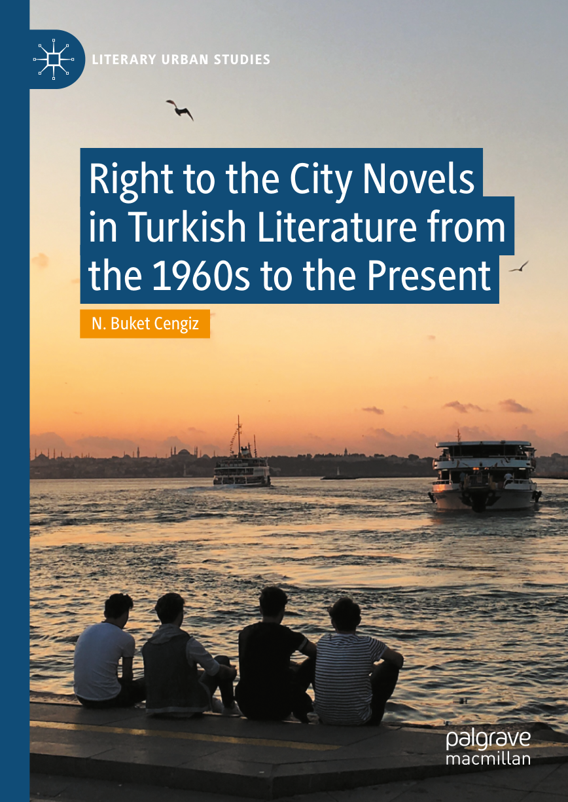
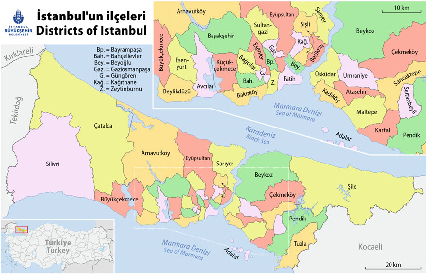

# 土耳其文学中的城市权利小说：从20世纪60年代至今

N. Buket Cengiz／N. 布凯特·坚吉兹

完整工作译本。

<!-- rtc-front-001 -->

〔原书第C1页〕

“文学城市研究”丛书。N. 布凯特·坚吉兹：《土耳其文学中的城市权利小说：从20世纪60年代至今》。

<!-- rtc-front-002 -->

〔原书第i页〕

### 文学城市研究

<!-- rtc-front-003 -->

〔原书第i页〕

丛书主编

<!-- rtc-front-004 -->

〔原书第i页〕

Lieven Ameel，图尔库大学图尔库高等研究院，芬兰图尔库。

<!-- rtc-front-005 -->

〔原书第i页〕

Jason Finch，奥博学术大学英语语言文学专业，芬兰图尔库。

<!-- rtc-front-006 -->

〔原书第i页〕

Eric Prieto，加利福尼亚大学圣巴巴拉分校法语与意大利语系，美国加利福尼亚州圣巴巴拉。

<!-- rtc-front-007 -->

〔原书第i页〕

Markku Salmela，坦佩雷大学英语语言、文学与翻译专业，芬兰坦佩雷。

<!-- rtc-front-008 -->

〔原书第ii页〕

“文学城市研究”丛书以城市状况的文学中介与再现为主题，尤其致力于发展研究文学城市的跨学科方法。呼应俄国形式主义对literaturnost，即文学性的关注，“文学城市研究”将强调研究对象的“城市特质”——那些属于城市及城市状况的独有要素——并关注这种特质为原始材料带来什么，以及它对研究的方法路径意味着什么。这一关注使丛书能够纳入城市史、城市规划和文化地理学等相关领域的视角。丛书对原始材料的时期、体裁、媒介、语言或地区不作限制。它以跨学科方法和全球范围，积极约请并征集能面向国际及跨学科读者的作品。

<!-- rtc-front-009 -->

〔原书第ii页〕

编委会

<!-- rtc-front-010 -->

〔原书第ii页〕

Ulrike Zitzlsperger，英国埃克塞特大学。

<!-- rtc-front-011 -->

〔原书第ii页〕

Peta Mitchell，澳大利亚昆士兰大学。

<!-- rtc-front-012 -->

〔原书第ii页〕

Marc Brosseau，加拿大渥太华大学。

<!-- rtc-front-013 -->

〔原书第ii页〕

Andrew Thacker，英国德蒙福特大学。

<!-- rtc-front-014 -->

〔原书第ii页〕

Patrice Nganang，美国石溪大学。

<!-- rtc-front-015 -->

〔原书第ii页〕

Bart Keunen，比利时根特大学。

<!-- rtc-front-016 -->

〔原书第ii页〕

本丛书更多信息：http://www.palgrave.com/gp/series/15888

<!-- rtc-front-017 -->

〔原书第iii页〕

N. 布凯特·坚吉兹

<!-- rtc-front-018 -->

〔原书第iii页〕

### 土耳其文学中的城市权利小说：从20世纪60年代至今

<!-- rtc-front-019 -->

〔原书第iv页〕

N. 布凯特·坚吉兹，卡迪尔·哈斯大学，土耳其伊斯坦布尔。

<!-- rtc-front-020 -->

〔原书第iv页〕

ISSN 2523-7888；电子版ISSN 2523-7896。“文学城市研究”丛书。ISBN 978-3-030-61220-7；电子书ISBN 978-3-030-61221-4。https://doi.org/10.1007/978-3-030-61221-4

<!-- rtc-front-021 -->

〔原书第iv页〕

© 编者（如适用）及作者，2021年，独家授权Springer Nature Switzerland AG。

<!-- rtc-front-022 -->

〔原书第iv页〕

本作品受版权保护。无论涉及全部或部分材料，所有权利均由出版商专有、独家许可，尤其包括翻译、再版、插图再利用、朗诵、广播、微缩胶片或任何其他物理方式复制，以及传输、信息存储与检索、电子改编、计算机软件，或使用现已知晓或今后发展出的相似或不同方法的相关权利。

<!-- rtc-front-023 -->

〔原书第iv页〕

本出版物使用的一般描述性名称、注册名称、商标、服务标志等，即使未作专门声明，也不意味着这些名称不受相关保护性法律法规的约束，因而可供普遍自由使用。

<!-- rtc-front-024 -->

〔原书第iv页〕

出版商、作者和编者有理由认为，本书中的建议与信息在出版之日被认为真实、准确。出版商、作者或编者均不对本书所含材料，或可能存在的任何错误和遗漏，作出明示或默示保证。对于出版地图和机构隶属关系中的管辖权主张，出版商保持中立。

<!-- rtc-front-025 -->

〔原书第iv页〕

封面摄影署名：Esra Karakose／EyeEm。

<!-- rtc-front-026 -->

〔原书第iv页〕

本书以Palgrave Macmillan品牌，由注册公司Springer Nature Switzerland AG出版。公司注册地址：Gewerbestrasse 11, 6330 Cham, Switzerland。

<!-- rtc-front-027 -->

〔原书第v页〕

献给所有在大城市的奋斗中，除了自己的劳动之外一无所有的人。

<!-- rtc-front-028 -->

〔原书第vii页〕

### 致谢

<!-- rtc-front-029 -->

〔原书第vii页〕

本书是我的博士论文的修订扩充版，论文于2017年在莱顿大学区域研究所完成。我要衷心感谢两位导师，他们的指导与陪伴为我的工作带来了巨大帮助。Petra de Bruijn凭借深厚的文本细读经验，帮助我运用叙事学方法，更深入地研究语料中的小说。她始终将我视为同事与朋友，尊重我写下的每一个字、与她分享的每一个想法。Eric Jan Zürcher以最好的方式指导我建立与历史语境有关的联系，作出解释与分析。他以广阔的视野、智慧和学术经验，以其独特、谦逊而深厚的方式，拓展了我的眼界。

<!-- rtc-front-030 -->

〔原书第vii页〕

从本书出版过程的第一天到最后一天，Eric Prieto给予了巨大帮助和鼓励，对此我致以深切而真诚的感谢。我也衷心感谢Jason Finch的帮助与支持。他们相信我的工作具有价值、切合当下，才使本书得以问世。

<!-- rtc-front-031 -->

〔原书第vii页〕

我由衷感谢Şükrü Aslan和Murat Cemal Yalçıntan，在研究期间，他们允许我旁听其在米马尔·锡南美术大学开设的城市研究课程。

<!-- rtc-front-032 -->

〔原书第vii—viii页〕

研究初期，我尝试运用米哈伊尔·M. 巴赫金的理论，Ken Hirschkop和Erol Köroğlu慷慨地分享了意见，我对此感激不尽。我也感谢Daniel Hartley，在我比较雷蒙德·威廉斯、弗雷德里克·詹姆逊和特里·伊格尔顿著作中的若干关键概念时，他回答了我的问题。

<!-- rtc-front-033 -->

〔原书第viii页〕

我感谢Ayşegül Baykan，对于与研究相关的各类问题，我总可以毫不犹豫地向她请教。我也感谢Emine Bogenç Demirel和Mel Kenne，在最终引向本项目的早期学习阶段，他们为我的学术成长作出了贡献。

<!-- rtc-front-034 -->

〔原书第viii页〕

研究期间，Murat Güvenç与我分享学术洞见，并赞许我的工作，我对此心怀感激。我感谢博士论文答辩委员会成员，包括他，以及Ivo Smits、Ann Rigney和Liesbeth Minnaard；他们的评议指导我将研究转化为图书提案。

<!-- rtc-front-035 -->

〔原书第viii页〕

卡迪尔·哈斯大学自2004年以来一直是我全职任教的地方，在我的学术工作中给予了宝贵支持。我感谢整个卡迪尔·哈斯大学共同体，尤其以下各位；其中有些人已离开学校，但在我心中仍属于这个共同体：Sondan Durukanoğlu Feyiz、Nüket Tan、Sinan Bayraktaroğlu、Elif Akkor、已故的Selhan Savcıgil-Endres、Mark Wyers、Mustafa Aydın、Serhat Güvenç、Yasemin Aydemir、Didem Kılıçkıran、Teoman Türeli、Serap Özyurt和Mehmet Manyas。

<!-- rtc-front-036 -->

〔原书第viii页〕

2018年夏天，我以短期博士后研究人员身份在柏林莱布尼茨现代东方研究中心（ZMO）工作，这段经历为本书带来了宝贵助益，我要为此感谢Ulrike Freitag和Sonja Hegasy。我也非常感激Zeynep Dinçer、Uğur Dinçer和Sinan Dinçer的友善与慷慨，他们在此期间为我提供了极好的住处；这一宝贵恩惠，我将永远铭记。

<!-- rtc-front-037 -->

〔原书第viii页〕

父亲Yaşar Baki Cengiz和母亲Mühübe Cengiz始终尽其所能支持我。Yaşar Baki Cengiz还将一篇文章从德语译为土耳其语，帮助了我的工作。多年来如姐妹般相伴的Gaye Eksen，让我在莱顿拥有一个温暖的家。我向他们致以真诚感谢。

<!-- rtc-front-038 -->

〔原书第viii—ix页〕

我感谢Özgür Orhangazi，在整个项目中，他给予学术建议，帮助我从国外获取资料，并指导我走过从论文到专著的道路。我也真诚感谢那些与我亲近的人；在漫长的研究岁月里，他们的友谊总能使我振奋。Sena Öksüz始终以同情心、智慧和极佳的幽默感陪伴我。Özgür Kalyoncu Akın不仅给予友谊，还送给我许多书，回答我关于出版业的问题。卡迪尔·哈斯大学卫生服务部门的医生Selçuk Uyanık，既作为医生，也作为朋友，给予关心与照料；她所做的远不止维护我的健康。Allison Jane Airhart、Nedime Gökmen和Esra Kurtuluş不仅以友谊丰富了我的生活，也在项目进行期间帮助我度过一些困难时刻。

<!-- rtc-front-039 -->

〔原书第ix页〕

我感谢Sarah Atkinson和Amber Çakar，她们细致地校读本书多个章节，回答了我关于语言细微差别的许多问题。我也感谢Şehnaz Şişmanoğlu Şimşek，她以敏锐反馈拓展了我的视角，并在研究的艰难阶段，以对我工作的赞许给予精神支持。我感激她们。

<!-- rtc-front-040 -->

〔原书第ix页〕

我由衷感谢Allie Bochicchio Troyanos，在本书整个出版过程中，她尽一切可能支持我；也感谢Rachel Jacobe，在我撰写书稿时，以极其细致、友善和温暖的态度回答我无休止的问题。我也感谢Lieven Ameel和Markku Salmela对提案持积极态度。最后，真诚感谢匿名同行评审者，正是他们富有洞见的建议，使书稿得以最终定形。

<!-- rtc-front-041 -->

〔原书第ix页〕

我感谢Saliha Paker从一开始就对项目表现出兴趣，与我分享宝贵意见，并以赞许使我安心。我也感谢Herkül Millas对研究表现出鼓舞人心的兴趣，在电子邮件往来中详细回答我的问题。

<!-- rtc-front-042 -->

〔原书第ix页〕

在项目的构思阶段，与Jean-François Pérouse、Rıfat Bali、Steven Richmond、İlay Örs、İmre Azem、Semih Gümüş和Levent Soysal见面，与Hande Tekdemir通电话，以及与Lieven Ameel和Nurdan Gürbilek通信，给予我的启发与鼓励，远远超出他们当时所能想到。我真诚感谢他们。

<!-- rtc-front-043 -->

〔原书第ix—x页〕

Didem Danış刚生下孩子不久，便花了整整一个下午与我讨论研究，我愿在此再次感谢她。我也感谢Murat Belge，他在比尔吉大学接待我，回答了我关于他一篇文章的问题。Abidin Parıltı和Sabri Gürses也抽空与我见面、讨论研究，我对此心怀感激。我还感谢通过电子邮件回答我问题的Tanıl Bora、Timour Muhidine、İdris Özyol和Ümit Kurt。

<!-- rtc-front-044 -->

〔原书第x页〕

我感谢Burcu Borhan Türeli、Banu Yıldıran Genç、Selin Gürdere、Nil Tonyalı和Hasan Tekgüç，他们就研究中的具体问题提供了宝贵反馈。我也感谢Nicola Verderame、Beki Haleva和Nil Senem Çınga Çarıkçı；他们的友谊与各方面支持，在我的研究岁月记忆中占有难忘的位置。我还要感谢Rob Lewis、Engin Kılıç、Emre Erol、Ecem Sarıçayır、Melis Behlil、Müge Özoğlu、Tahsin Demir、Umut Özkırımlı和Amy Spangler的热心支持。

<!-- rtc-front-045 -->

〔原书第x页〕

Alexander de Groot、Hans Theunissen、Clifford Endres和Burcu Kayışçı Akkoyun对我的工作表现出的兴趣十分珍贵，我愿在此再次感谢他们。我也想补充，能结识莱顿大学以下博士生同伴，我深感幸运：Sandra Sardjono、Behrouz Karoubi、Ben Austin、Xiao Ma、Akiko Tsujita和Dlshad A. Marf Zamua。在此感谢他们与我共度的美好时光。

<!-- rtc-front-046 -->

〔原书第x页〕

我感谢Fokke Gerritsen，在我博士论文答辩后不久，邀请我到荷兰驻土耳其研究所（NIT）作讲座。与学术同仁分享、讨论研究的机会，帮助我进一步完善书稿。我也感谢Güher Gürmen对这次活动的热心协助。

<!-- rtc-front-047 -->

〔原书第x页〕

最后，我要感谢以下图书馆的工作人员：卡迪尔·哈斯大学信息中心、博斯普鲁斯大学图书馆、莱顿大学图书馆、İSAM图书馆、巴赫切谢希尔大学巴巴罗斯图书馆、SALT研究中心，以及柏林国立图书馆。这些机构不仅为我提供资料，也提供了一个地方——冬暖夏凉——让我感到踏实、安全、安心，无论身体还是情感上都是如此。在学术工作的艰难时刻，这种意义远非这些简单的话语所能表达。

<!-- rtc-front-048 -->

〔原书第xi页〕

### 《土耳其文学中的城市权利小说：从20世纪60年代至今》赞誉

<!-- rtc-front-049 -->

〔原书第xi页〕

“把迁移与城市融入概念化为现实和想象之间的互动过程，将为文化与文学研究同城市研究的新近方法——如组装理论和／或行动者网络理论——开辟新的对话渠道。另一方面，丰富的阐释性批评分析与比较，将为那些希望运用文本挖掘、模式识别等数字人文新工具研究相同文本的人，提供有益洞见与关键词。对于所有希望在一般城市与文化研究、尤其迁移研究领域提出新研究问题的学生，《土耳其文学中的城市权利小说：从20世纪60年代至今》很可能成为极有价值的参考。”

<!-- rtc-front-050 -->

〔原书第xi页〕

——穆拉特·居文奇，卡迪尔·哈斯大学伊斯坦布尔研究中心主任，伊斯坦布尔。

<!-- rtc-front-051 -->

〔原书第xi—xii页〕

“N. 布凯特·坚吉兹以令人耳目一新的清晰笔触，分析现代土耳其小说中极具活力、复杂而令人印象深刻的乡城迁入者再现。对20世纪60年代至21世纪头十年间出版的七部小说的叙事学细读，借助与现代土耳其社会学、政治学、历史和城市研究的关联阐释而愈加丰富。坚吉兹这部巧妙而令人信服的作品表明，小说家并不满足于观察乡村迁入者在伊斯坦布尔充满挑战的历程，并以虚构再现其经验。这些小说家也为数百万市民——其中大多是迁入者的子女或孙辈——提供了探索更民主、更具分享精神的城市生活可能性的机会。N. 布凯特·坚吉兹以本书呈现了一项植根文学研究的扎实跨学科工作，并邀请读者想象一座不同的、宜居的城市。”

<!-- rtc-front-052 -->

〔原书第xii页〕

——埃罗尔·克勒奥卢，博斯普鲁斯大学土耳其语言文学系副教授，伊斯坦布尔。

<!-- rtc-contents-001 -->

〔原书第xiii页〕

### 目录

> 译校记：目录和索引中的数字均为原书页码。目录条目可跳转至本译本对应标题。

<!-- rtc-contents-002 -->

〔原书第xiii页〕

第1章　导论：现代土耳其小说中的城市权利小说 …… 1

<!-- rtc-contents-003 -->

〔原书第xiii页〕

城市权利 …… 5

<!-- rtc-contents-004 -->

〔原书第xiii页〕

城市权利小说 …… 7

<!-- rtc-contents-005 -->

〔原书第xiii页〕

本书的目标 …… 10

<!-- rtc-contents-006 -->

〔原书第xiii页〕

研究方法 …… 13

<!-- rtc-contents-007 -->

〔原书第xiii页〕

本书结构 …… 14

<!-- rtc-contents-008 -->

〔原书第xiii页〕

小说引文说明 …… 17

<!-- rtc-contents-009 -->

〔原书第xiii页〕

参考文献 …… 19

<!-- rtc-contents-010 -->

〔原书第xiii页〕

第2章　从街垒到作为艺术的城市：城市权利概念 …… 23

<!-- rtc-contents-011 -->

〔原书第xiii页〕

奥斯曼改造之后的巴黎 …… 23

<!-- rtc-contents-012 -->

〔原书第xiii页〕

漫游者 …… 26

<!-- rtc-contents-013 -->

〔原书第xiii页〕

大都市中的异化 …… 27

<!-- rtc-contents-014 -->

〔原书第xiii页〕

城市权利 …… 31

<!-- rtc-contents-015 -->

〔原书第xiii页〕

城市情境中的公民身份 …… 37

<!-- rtc-contents-016 -->

〔原书第xiii页〕

参考文献 …… 39

<!-- rtc-contents-017 -->

〔原书第xiii页〕

第3章　热切的归属与强烈的渴望：追寻伊斯坦布尔的城市权利 …… 43

<!-- rtc-contents-018 -->

〔原书第xiii页〕

伊斯坦布尔的复杂阶段 …… 44

<!-- rtc-contents-019 -->

〔原书第xiii页〕

城市化，还是伪城市化？ …… 46

<!-- rtc-contents-020 -->

〔原书第xiii页〕

多种城市性 …… 48

<!-- rtc-contents-021 -->

〔原书第xiv页〕

主张对城市的权利 …… 53

<!-- rtc-contents-022 -->

〔原书第xiv页〕

女性：“迁移的火车头” …… 56

<!-- rtc-contents-023 -->

〔原书第xiv页〕

参考文献 …… 61

<!-- rtc-contents-024 -->

〔原书第xiv页〕

第4章　伊斯坦布尔迎来新成员：从迁移视角概览伊斯坦布尔的历史 …… 65

<!-- rtc-contents-025 -->

〔原书第xiv页〕

20世纪50至60年代 …… 66

<!-- rtc-contents-026 -->

〔原书第xiv页〕

20世纪70年代 …… 68

<!-- rtc-contents-027 -->

〔原书第xiv页〕

20世纪80年代 …… 69

<!-- rtc-contents-028 -->

〔原书第xiv页〕

20世纪90年代 …… 70

<!-- rtc-contents-029 -->

〔原书第xiv页〕

20世纪90年代末与21世纪最初十年 …… 74

<!-- rtc-contents-030 -->

〔原书第xiv页〕

2010年及其后 …… 77

<!-- rtc-contents-031 -->

〔原书第xiv页〕

参考文献 …… 78

<!-- rtc-contents-032 -->

〔原书第xiv页〕

第5章　想象迁移经验：人文主义取向 …… 81

<!-- rtc-contents-033 -->

〔原书第xiv页〕

《思乡的鸟儿》：以共情的目光审视未来的城市性 …… 81

<!-- rtc-contents-034 -->

〔原书第xiv页〕

作为白板的迁入者 …… 86

<!-- rtc-contents-035 -->

〔原书第xiv页〕

迁移的性别化描绘 …… 94

<!-- rtc-contents-036 -->

〔原书第xiv页〕

结论 …… 100

<!-- rtc-contents-037 -->

〔原书第xiv页〕

《哈洛大叔与两头公牛》：以讥讽目光审视乡城迁移及其不满 …… 103

<!-- rtc-contents-038 -->

〔原书第xiv页〕

在公共领域中备受威吓的“公民” …… 107

<!-- rtc-contents-039 -->

〔原书第xiv页〕

结论 …… 112

<!-- rtc-contents-040 -->

〔原书第xiv页〕

《思乡的鸟儿》与《哈洛大叔与两头公牛》：比较分析 …… 113

<!-- rtc-contents-041 -->

〔原书第xiv页〕

参考文献 …… 116

<!-- rtc-contents-042 -->

〔原书第xiv页〕

第6章　内部人的知识：在伊斯坦布尔丛林中求生 …… 119

<!-- rtc-contents-043 -->

〔原书第xiv页〕

《贝尔吉·克里斯廷：垃圾山的故事》：对规范性城市观的讽刺性反驳 …… 119

<!-- rtc-contents-044 -->

〔原书第xiv页〕

不安的相遇：棚户共同体与激进左翼 …… 127

<!-- rtc-contents-045 -->

〔原书第xiv页〕

在求生斗争中，谁更像迁入者？ …… 129

<!-- rtc-contents-046 -->

〔原书第xiv页〕

结论 …… 133

<!-- rtc-contents-047 -->

〔原书第xiv页〕

《重罗曼》：酒神之城中的另类城市性 …… 134

<!-- rtc-contents-048 -->

〔原书第xv页〕

科莱拉的女性 …… 139

<!-- rtc-contents-049 -->

〔原书第xv页〕

世界主义的科莱拉 …… 141

<!-- rtc-contents-050 -->

〔原书第xv页〕

结论 …… 152

<!-- rtc-contents-051 -->

〔原书第xv页〕

《贝尔吉·克里斯廷：垃圾山的故事》与《重罗曼》：比较分析 …… 153

<!-- rtc-contents-052 -->

〔原书第xv页〕

参考文献 …… 159

<!-- rtc-contents-053 -->

〔原书第xv页〕

第7章　伊斯坦布尔的门槛：异化与边缘经验 …… 163

<!-- rtc-contents-054 -->

〔原书第xv页〕

《在边缘》：阴郁城市中的存在 …… 163

<!-- rtc-contents-055 -->

〔原书第xv页〕

另一个伊斯坦布尔 …… 168

<!-- rtc-contents-056 -->

〔原书第xv页〕

塔什勒巴的生活 …… 170

<!-- rtc-contents-057 -->

〔原书第xv页〕

在城中闲荡 …… 174

<!-- rtc-contents-058 -->

〔原书第xv页〕

结论 …… 181

<!-- rtc-contents-059 -->

〔原书第xv页〕

《人各有别》：被遗忘在“varoş”中的伊斯坦布尔 …… 183

<!-- rtc-contents-060 -->

〔原书第xv页〕

通过消费获得城市性 …… 186

<!-- rtc-contents-061 -->

〔原书第xv页〕

辨识科兹卢克 …… 189

<!-- rtc-contents-062 -->

〔原书第xv页〕

结论 …… 196

<!-- rtc-contents-063 -->

〔原书第xv页〕

《在边缘》与《人各有别》：比较分析 …… 198

<!-- rtc-contents-064 -->

〔原书第xv页〕

参考文献 …… 203

<!-- rtc-contents-065 -->

〔原书第xv页〕

第8章　变化中的迁入者，转型中的伊斯坦布尔：《我脑袋里的怪东西》——一个男人与他的城市的爱情故事 …… 205

<!-- rtc-contents-066 -->

〔原书第xv页〕

麦夫鲁特无尽的行走 …… 208

<!-- rtc-contents-067 -->

〔原书第xv页〕

城市中的家 …… 210

<!-- rtc-contents-068 -->

〔原书第xv页〕

被污名化的街区：虚构与实情之间 …… 212

<!-- rtc-contents-069 -->

〔原书第xv页〕

城市中的男人与女人 …… 217

<!-- rtc-contents-070 -->

〔原书第xv页〕

结论 …… 219

<!-- rtc-contents-071 -->

〔原书第xv页〕

参考文献 …… 225

<!-- rtc-contents-072 -->

〔原书第xv页〕

第9章　结论：在新的伊斯坦布尔阅读城市权利小说 …… 227

<!-- rtc-contents-073 -->

〔原书第xv页〕

参考文献 …… 238

<!-- rtc-contents-074 -->

〔原书第xv页〕

索引 …… 241

<!-- rtc-contents-075 -->

〔原书第xvii页〕

### 缩略语

<!-- rtc-contents-076 -->

〔原书第xvii页〕

Birds：《思乡的鸟儿》（Gurbet Kuşları）。

<!-- rtc-contents-077 -->

〔原书第xvii页〕

Hills：《贝尔吉·克里斯廷：垃圾山的故事》（Berci Kristin Çöp Masalları）。

<!-- rtc-contents-078 -->

〔原书第xvii页〕

Kinds：《人各有别》（İnsan Kısım Kısım, Yer Damar Damar）。

<!-- rtc-contents-079 -->

〔原书第xvii页〕

Oxen：《哈洛大叔与两头公牛》（Halo Dayı ve İki Öküz）。

<!-- rtc-contents-080 -->

〔原书第xvii页〕

Periphery：《在边缘》（Kenarda）。

<!-- rtc-contents-081 -->

〔原书第xvii页〕

Roman(i)：《重罗曼》（Ağır Roman）。

<!-- rtc-contents-082 -->

〔原书第xvii页〕

Strangeness：《我脑袋里的怪东西》（Kafamda Bir Tuhaflık）。

<!-- rtc-ch01-001 -->

〔原书第1页〕

## 第1章　导论：现代土耳其小说中的城市权利小说

<!-- rtc-ch01-002 -->

〔原书第1页〕

我是在2010年秋天萌生撰写本书的想法的：那一年，伊斯坦布尔是欧洲文化之都（ECoC），而当时已进入这一年的最后一个季度。城里正在举办许多特别活动：音乐会、展览、电影放映、专题讨论，等等。从外部看，一切都很美好：2010年伊斯坦布尔欧洲文化之都活动，似乎与这座城市日益上升的国际知名度完全合拍。与此同时，另一个故事也在展开。在迅速绅士化的市中心，租金与房价不断上涨，长期居住于此的居民正在搬离自己的家；苏卢库莱等历史街区正失去其全部特色，许多其他街区的居民则焦虑地等待着城市改造项目的到来。伊斯坦布尔正在争相成为全球城市，由此发生的剧烈变化使一些人承受着最深重的痛苦，这让我开始思考他们的处境：他们就是市中心贫困街区的居民，以及旧棚户区的居民——这些棚户区如今已使建筑承包商垂涎欲滴。

<!-- rtc-ch01-003 -->

〔原书第1—2页〕

与此同时，自20世纪90年代起，我一直观察到一种极为流行的、对世界主义伊斯坦布尔的怀旧，尽管这种怀旧可能是人为营造、刻意制造出来的。经精英主义者改造后，它便把矛头指向乡村迁入者，传递出这样的信息：在他们到来之前，伊斯坦布尔曾是一个美好得多的地方，人口具有世界主义色彩，其中非穆斯林少数群体占了相当大的比例。这套话语无视了一个事实：早在20世纪50年代乡村迁入者到来之前，伊斯坦布尔就已经失去了大部分少数群体人口；因此，它制造出一种错觉，仿佛是乡村迁入者挤走了这些人，好为自己腾出空间。[^ch1-1]这种精英主义、反迁入者的旧伊斯坦布尔怀旧，把城市几乎所有负面变化都归咎于乡村迁入者，并认定他们实际上并没有资格在这座城市立足。

<!-- rtc-ch01-004 -->

〔原书第2页〕

伊莱·厄尔斯将“世界主义怀旧”用作一个“统称”，指代“形形色色面向过去、热衷于把伊斯坦布尔描述为一座世界主义城市的话语”（2018b，174）。她在2018年写道，“世界主义怀旧”始于20世纪80年代，并一直延续至今（2018a，82）。她强调，虽然“伊斯坦布尔的新居民同样具有高度多样性，这却几乎从未被视为一种世界主义情境”（2018b，184）。厄尔斯恰切地指出：

<!-- rtc-ch01-005 -->

〔原书第2页〕

这些主要具有“安纳托利亚”背景、也就是来自乡村或东部地区的新居民，在被纳入本地伊斯坦布尔人群体时遭遇抵制；无论他们在这座城市已经生活多少年，由于无法将自己与任何原有社群联系起来，人们仍然怀疑他们能否成为名副其实的城市居民。换言之，在那些维护着上述怀旧式历史表象的城市精英看来，新来者也许不属于伊斯坦布尔，因为他们不懂这座城市的规矩，并不具备“世界主义知识”。（184）

<!-- rtc-ch01-006 -->

〔原书第2—3页〕

对旧伊斯坦布尔的怀旧，在大众文化与出版业中都有鲜明体现。到处都在出售装裱好的伊斯坦布尔老黑白照片；以琴盖尔柯伊、巴拉特和萨马蒂亚等原少数群体街区为背景的电视剧受到热烈欢迎；关于城市历史的书籍以及介绍各个街区的专著接连出版，引发读者兴趣；旧伊斯坦布尔的饮食习惯本身也成为美食研究的一个关注领域。[^ch1-2]当然，这并不是说上述所有文化产品都采取了精英主义、反迁入者的话语。更确切地说，怀旧是当时的一种时代精神，而社会中的一部分人以精英主义、反迁入者的态度回应了它。

<!-- rtc-ch01-007 -->

〔原书第3页〕

这种精英主义、反迁入者的态度表现为一种伊斯坦布尔人的身份优越感。正如伊佩克·蒂雷利恰切指出的，迁入者正是那个人：“伊斯坦布尔人的形象是在以他为镜像的对照中建构起来的”（2018，163）。有人声称，若要被认可为伊斯坦布尔人，自己的家族必须已经在这座城市扎根七代。杰姆·贝哈尔从数学上计算了这种可能性，解释说：“在当今拥有一千万人口的伊斯坦布尔，我们大约能找出五百个‘七代都是伊斯坦布尔人’的人”（2009，52）。实际上，“［伊斯坦布尔］是一座迁入者之城，其四分之三的人口出生于别处”（Öncü 1999，95），更遑论七代祖先了。艾谢·厄恩居指出，“谁是伊斯坦布尔人，这个问题是一个修辞性问题。真正的伊斯坦布尔人是一则‘神话’”（95）。她强调，“伊斯坦布尔人的神话已经失去了其在高雅文化所象征的品味与区分领域中的文化依托，归属感与本真性的意涵也被剥离。它只是否定和排斥。因而，它在日常生活层面运作，把现实生活的肌理裁剪、重塑成伊斯坦布尔人与迁入者之间僵硬的二分”（98）。下面，我将围绕这一二分的几个核心方面作简要讨论。

<!-- rtc-ch01-008 -->

〔原书第3页〕

正如穆拉特·居文奇所观察到的，批评迁入者及迁移现象的话语，甚至也得到了迁入者的支持（2009，130）。土耳其现任总统R. 塔伊普·埃尔多安的父母从里泽迁到伊斯坦布尔，而他担任伊斯坦布尔市长时，曾考虑实行进入该市须持签证的制度（Erdoğan 2013）。同样令人困惑的是，这类排斥性话语也可能出自左翼。奥娅·拜达尔题为《败给他者的伊斯坦布尔》的文章，就是一个醒目的例子：仅从标题看，它便为把迁入者他者化提供了正当性。拜达尔在文中梳理了乡城迁移的历程，也论及治理与规划低效所造成的城市规划问题，最后得出结论：“在1997年的伊斯坦布尔，主要矛盾并非阶级冲突，而是最广义的文化冲突”（1997，79）。在拜达尔这种极端二元对立的分析中，文化冲突显然发生于“伊斯坦布尔人”与“非伊斯坦布尔人”的文化之间。

> 译校记：“现任总统”是作者写作时的表述，译文保留其历史时点。

<!-- rtc-ch01-009 -->

〔原书第3—4页〕

让-弗朗索瓦·佩鲁兹这样阐明伊斯坦布尔人与迁入者之间的二分：“关于伊斯坦布尔的大多数研究都极具选择性，因此也具有遮蔽性。这些著作钟情于往昔生活过的人和空无一人的建筑，却攻击那座丑陋的、挤满了‘粗鲁’人群的当代伊斯坦布尔”（2011，21）。佩鲁兹指出，学术研究缺乏一种包容迁入者的视角（21）。因此，公共舆论与话语也有同样的问题，便不足为奇了。

<!-- rtc-ch01-010 -->

〔原书第4页〕

莱拉·内伊齐同样提醒人们注意，“伊斯坦布尔一直是一座迁入者之城”（2009，80），并强调，“‘身为老伊斯坦布尔人’所指涉的是一种文化与生活方式，而非在伊斯坦布尔度过的时间”（82）。“老伊斯坦布尔人”或许可以保留为一种精英生活方式的标志，但“伊斯坦布尔人”这一身份应当得到扩展，使其涵盖这座城市的全体居民。正如塞玛·埃尔德尔指出的，那些携带积蓄与技能从土耳其其他城市来到伊斯坦布尔、如今居住在市中心的人，已经顺利融入城市，成为伊斯坦布尔人（2015，238—240）。由于老伊斯坦布尔人在城中从来就不怎么显眼，这些迁入者很快便不再觉得自己是伊斯坦布尔的外省人了（240）。她补充道：“对他们而言，老伊斯坦布尔人不过是一个历史形象。或者，是一位古怪的主人，他们只是间接地从那些真正有机会见过他或她的人那里有所耳闻。今天，在他们看来，凡是在这座城市生活、工作的人，都是伊斯坦布尔人”（240）。

<!-- rtc-ch01-011 -->

〔原书第4页〕

埃尔德尔继而指出，乡村迁入者和贫困者的经历，与那些带着积蓄和技能来到城市的人大不相同。据埃尔德尔说，前者大多住在棚屋中，过去曾遭排斥，但如今“他们在各个方面都已成为这座城市的重要组成部分”（2015，242）。她将他们描述为“从边缘看伊斯坦布尔的人”（243），并补充说：“可以理解，他们在城中并不觉得自己是外人，却还不认为自己是伊斯坦布尔人；不过，也不存在一个被他们视作具体实在的伊斯坦布尔人形象”（243）。

<!-- rtc-ch01-012 -->

〔原书第4—5页〕

在这里，伊斯坦布尔大都市市政府于2003年发起的“我的城市伊斯坦布尔”（Kentim İstanbul）项目值得关注。“项目期间，伊斯坦布尔大都市市政府［……］组织了观光游览、咖啡馆谈话、研讨会和专题讨论，并制作了数不清的广告牌、书籍与小册子”（Özbey 2004）。项目的一项内容，是在市内广告牌上展示居住于伊斯坦布尔、却出生在别处的知名人士的照片，配上口号：“我是伊斯坦布尔人”（“Ben İstanbulluyum”）（同上）。项目的目标是“使伊斯坦布尔居民在对这座城市产生归属感的同时，承继其庞大的文化遗产，［……］认领这座城市，以它来界定自我，并代表它”（Genar）。围绕这一项目，人们开展了关于“城市文化与城市性意识”的调查（同上），结果显示，自称伊斯坦布尔人的城市居民比例相当低（Özbey 2004；IKSV 2005）。萨瓦什·厄兹贝伊指出，这个一开始雄心勃勃的项目很快就失去了吸引力，2004年也没有再次招标。他还说：“也许项目的出发点就是错误的，本应更加重视共同之处，应当根据在这个地方共同分享的东西来界定伊斯坦布尔人”（2004）。[^ch1-3]佩鲁兹同样认为，考虑到伊斯坦布尔的社会现实，这个项目若要发挥作用，设计时就应当提出这样的观念：“我是伊斯坦布尔人，同时也是锡瓦斯人；我是伊斯坦布尔人，同时也是马尔丁人，等等”（私人交流，2011年12月8日）。佩鲁兹的话，为设想一种超越伊斯坦布尔人与迁入者二分的城市身份提供了启发。通过这种视角，我们可以挑战上述二分，围绕容纳差异的城市性，以及多种城市性并存的可能性，展开更有成效的讨论。今天不自称伊斯坦布尔人的人，或许会由此愿意这样称呼自己。然而，那些从中心看伊斯坦布尔的人，必须欢迎并接纳他们。埃尔德尔以极为清晰的方式概括道：“那些自认为是伊斯坦布尔人的人［……］也许从现在起应当放弃寻找怀旧中的伊斯坦布尔人，或某一种单一类型的伊斯坦布尔人，而应学会欣赏伊斯坦布尔的多样性”（2015，244）。她的话令人想起理查德·桑内特的论述：“当人们的经验不再局限于与自己具有相同阶级、种族或生活方式的人时，社会同样会从中受益。同一性使头脑僵化，多样性则激发并拓展头脑”（2005，114）。

<!-- rtc-ch01-013 -->

〔原书第5页〕

### 城市权利

<!-- rtc-ch01-014 -->

〔原书第5—6页〕

于是，我决定运用城市权利这一概念，分析上述两种正在发生的现象：一种是评判人们是否“有资格”住在伊斯坦布尔的反迁入者话语，另一种则是威胁着城中大量居民的严酷绅士化进程。城市权利概念的核心，正是对把城市视为交换价值这一观念的强烈反抗。

<!-- rtc-ch01-015 -->

〔原书第6页〕

亨利·列斐伏尔在“他第一部关于城市的重要著作、也是论战色彩极强的《城市权利》（Le droit à la ville）中提出了城市权利概念；该书于1967年完成，以纪念马克思《资本论》出版一百周年，并在1968年事件之前问世”（Kofman and Lebas 1996，6）。列斐伏尔解释说，在城市中，除了财富之外，“知识（connaissances）、技术以及作品（艺术作品、纪念性建筑）”也不断积累（1996b，66）。他在概念上区分了“使用价值（城市和城市生活）与交换价值（被买卖的空间，对产品、商品、场所和符号的消费）”（1996b，86）。作为作品（oeuvre）的城市以使用价值为基础；它不是一种以交换价值为基础的产品，因为“城市的卓越使用——也就是对其街道、广场、大厦和纪念性建筑的使用”，所依托的不是生产，而是愉悦与声望（66）。如果我们能够使城市摆脱商品地位，就能够保障我们的城市权利；列斐伏尔将其描述为“一种经过改造与更新的城市生活权利”（158）。

<!-- rtc-ch01-016 -->

〔原书第6页〕

作为作品的城市，使我们有机会把日常生活体验为城市情境中的生活艺术。正如克劳斯·龙讷贝格尔指出的，“列斐伏尔设想，一种新的革命主体将会出现，它不仅反抗对劳动力的剥削，而且反抗对其整个生活环境的毁坏”（2008，135）。列斐伏尔强调，“在城市情境中，不同派别、群体和阶级之间的斗争会增强归属感”（1996b，67）。他明确指出，“一旦与城市隔绝，无产阶级就会失去对作品的感受”，由此，“城市意识也将消失”（77）。

<!-- rtc-ch01-017 -->

〔原书第6—7页〕

列斐伏尔解释说，栖居意味着“参与社会生活”（1996b，76），并提醒人们注意“栖居”（to inhabit）与“居所”（habitat）之间的区别（79）。正如梅里菲尔德所指出的，栖居意味着“对城市生活的一种更丰富的阐释：它把城市生活唤起为生成、成长，唤起为某种动态的、向前发展的事物”（2006，68）。梅里菲尔德接着强调，城市居民需要“创造性活动，需要作品（而不仅仅是产品和可消费的物质商品），需要信息、象征、想象界和游戏”（147）。这将促成“一种新的人道主义、一种新的实践，以及另一种人——城市社会的人”的出现（150）。城市权利远不只是城市情境中物质需求得到满足。“城市权利远远超出个人获取城市资源的自由：它是通过改变城市来改变我们自身的权利”（Harvey 2008，23）。列斐伏尔把城市权利描述为“一种更高形式的权利：获得自由的权利，在社会化中实现个体化的权利，获得居所的权利，以及栖居的权利”（1996b，173）。

> 译校记：本段把147、150页的引文接在Merrifield（2006）之后；此处按底本保留引注关系，尚未据所引原著独立核定。

<!-- rtc-ch01-018 -->

〔原书第7页〕

然而，如果基本物质需要得不到满足，以上这一切便无从实现。正如彼得·马尔库塞恰切指出的，对城市权利的要求“来自那些遭受排斥的人”，而对它的“向往则属于那些处于异化状态的人”（2012，31）。也就是说，“呐喊所要求的是生活所必需的物质条件”，而“向往则指向一种更广泛的权利，即获得物质以外那些为过上令人满意的生活所必需的东西”（Marcuse 2012，31）。他解释道：“这种要求来自直接陷于匮乏、直接遭受压迫的人，来自那些连最迫切的需求也得不到满足的人：无家可归者、饥饿者、被囚禁者，以及因性别、宗教、种族而遭受迫害的人。这是那些工作损害其健康、收入低于维持生计水平、被排除在城市生活的福祉之外的人提出的要求”（30—31）。他补充说，那些“表面上已融入制度，并分享着其物质利益”、却在创造性活动和社会关系方面感到不满足的人，就是制度中的异化者（31）。因此，“推动城市权利的，将是受剥夺者与不满者的联合”（33）。马尔库塞强调，城市权利是“一种处于更高道德层面的权利，它要求建立一个更好的制度，使城市生活所蕴含的潜在福祉能够得到充分、完整的实现”（34）。

<!-- rtc-ch01-019 -->

〔原书第7页〕

在这一语境下，2010年伊斯坦布尔那些用埃尔德尔的话说“从边缘看伊斯坦布尔”的人（2015，243），那些被精英视为不配在城中居住、又必须面对越来越多困难才能在此生存的人，用彼得·马尔库塞的术语来说，完全可以被界定为遭受排斥者。那么，是谁在替他们发声呢？这个问题开始萦绕在我的心头。我知道城市社会学家已经写了大量有关他们的研究，但我想要探寻，他们在文化生产中处于什么位置，尤其是在我的研究领域——文学——中处于什么位置。

<!-- rtc-ch01-020 -->

〔原书第7页〕

### 城市权利小说

<!-- rtc-ch01-021 -->

〔原书第7—8页〕

面对那些以老伊斯坦布尔人为人物、以旧伊斯坦布尔为背景的怀旧小说，我开始思考现代土耳其小说中的伊斯坦布尔迁入者。旧伊斯坦布尔始终为文学提供着富有创作潜力的背景与题材，而在20世纪90年代之后，它在这方面变得更加受欢迎。大量作品以老伊斯坦布尔人为人物，以旧城为背景。当然，如果说凡是采用这些人物和背景的小说都体现了对旧伊斯坦布尔的怀旧，那是不公允的；不过，其中有一些确实如此，而人们对它们的兴趣也十分浓厚。

<!-- rtc-ch01-022 -->

〔原书第8—9页〕

怀旧小说几乎总是以过去少数群体聚居的历史街区为背景，考虑到旧伊斯坦布尔怀旧对世界主义的强调，这并不令人意外。开列这类怀旧小说的书单超出了本书的范围，但以下几个例子应当足以使读者形成一个大致印象。德米尔·厄兹吕的《一个小资产者的青年时代》（Bir Küçükburjuvanın Gençlik Yılları，1979），发生于20世纪60年代后半期，当时乡村迁入者在城中变得越来越引人注目；故事的背景是吉汉吉尔和卡德柯伊等古老而享有声望、过去曾由少数群体聚居的街区。主人公塞利姆是一位伊斯坦布尔小资产者。书中怀念迁入者到来之前的伊斯坦布尔，但叙述者同时也赞扬迁入人口的左翼潜能。塞利姆·伊莱里的《往昔，那些不再回来的时光》（Geçmiş, Bir Daha Geri Gelmeyecek Zamanlar）由五部小说组成，背景也设在相似地区：吉汉吉尔、卡德柯伊、博斯普鲁斯沿岸和王子群岛。《但愿你带着蓝色的翅膀只属于我》（Mavi Kanatlarınla Yalnız Benim Olsaydın，1991）讲述了20世纪50年代形形色色伊斯坦布尔人的故事。《留声机仍在播放》（Gramofon Hâlâ Çalıyor，1995）也是一部片段式小说，以1955—1960年为背景，描写数位伊斯坦布尔人。《杰米尔·谢夫凯特先生：向镜柜开两枪》（Cemil Şevket Bey, Aynalı Dolaba İki El Revolver，1997）通过伊斯坦布尔的时代剪影，讲述了同性恋作家杰米尔·谢夫凯特先生从奥斯曼帝国末期直到1980年军事政变之后的经历。《索尔马兹女士：献给孤独的读者》（Solmaz Hanım Kimsesiz Okurlar İçin，2000）以《但愿你带着蓝色的翅膀……》中的人物索尔马兹女士为主人公，回望1920—1980年的伊斯坦布尔。《就在昨天》（Daha Dün，2008）是系列的最后一部。在这部小说中，从19世纪到20世纪90年代的伊斯坦布尔，通过前四部小说中人物的故事呈现出来。布凯特·乌祖内尔的《金发的阿达，蓝色的图纳》（Kumral Ada Mavi Tuna，1997），以库兹贡朱克为背景；那是博斯普鲁斯海峡安纳托利亚一岸一个风景如画、过去由少数群体聚居的街区。主人公是图纳、阿达和阿拉斯。阿达是出身精英家庭的伊斯坦布尔少女；图纳与阿拉斯是一对兄弟，可以视为第二代迁入者，因为他们的父亲从保加利亚迁来伊斯坦布尔，而母亲则来自东安纳托利亚城市厄德尔。不过，这部小说写的基本上仍是老伊斯坦布尔人。[^ch1-4]马里奥·莱维的《伊斯坦布尔曾是一个童话》（İstanbul Bir Masaldı，1999）以伊斯坦布尔多个少数群体街区为背景，讲述一个犹太家庭三代人从20世纪20年代到80年代的故事。事实上，莱维对于怀旧的态度具有两面性。在某些方面，正如小说标题本身所暗示的，他的语调会带有怀旧色彩；但在其他方面，他又倾向于反对怀旧话语，尤其是反对它关于城中少数群体文化与历史所制造的幻象。

<!-- rtc-ch01-023 -->

〔原书第9页〕

看到这些以老伊斯坦布尔人为主人公、以古老而享有声望的城市街区为背景的小说，我开始思考：土耳其文学作品中，是否也有以新伊斯坦布尔人——换言之，乡村迁入者——为主人公的重要小说？它们的背景，是否设在城中新兴而不受看重的地区，也就是城市郊缘的棚户区，或是市中心那些古老却贫困、遍布破旧公寓的街区？我想追踪这些迁入者自建棚屋或租住此类公寓的经验，从乡村人口开始迁往伊斯坦布尔之初直到今天，是如何进入文学小说的。

<!-- rtc-ch01-024 -->

〔原书第9页〕

本书的核心问题由此逐渐形成：正如怀旧小说把聚光灯投向老伊斯坦布尔人，是否也有小说把聚光灯投向新伊斯坦布尔人？正如前者暗示伊斯坦布尔属于老伊斯坦布尔人，是否也有小说传达这样一种信息：伊斯坦布尔属于每一个选择来到这里、在这里生活的人？换言之，是否存在以一种契合城市权利概念的方式来描写伊斯坦布尔迁入者的小说？

<!-- rtc-ch01-025 -->

〔原书第9页〕

如果这些问题的答案是肯定的，那么我接着想要了解这些小说的主题，以及它们在形式和风格上的特征。作者笔下的迁入者，只是身处城市的农民，还是新的城市居民？他们如何描绘迁入者的生存策略？他们是否将迁入者人物塑造成推动城市向更好方向变化的潜在行动主体？这些小说的背景设在伊斯坦布尔的哪些地区？作者采用了怎样的语言和叙事策略？

<!-- rtc-ch01-026 -->

〔原书第10页〕

开始研究后，我发现确实有一些小说以令人印象深刻的方式讲述了迁入者在伊斯坦布尔的经历。这些以迁入者为主人公的作品，其作者聚焦于迁移经验的不同侧面。这类小说可以被理解为对以老伊斯坦布尔人为主人公的怀旧小说的一种回应。从它们与反迁入者怀旧相遇并交锋的方式中，我发现了一种与城市权利概念相契合的信息。我决定从中选择一些小说加以分析，说明它们如何、又为何与这一概念相一致。用彼得·马尔库塞的说法，我将在这些作品中追寻城市情境里遭受排斥者的呐喊。城市权利并不是简单的居所权，它意味着在城市中栖居的权利。然而，这些小说的主人公是迁入者，他们连把城市作为居所的权利都受到质疑。因此，为迁入者在城中的存在——也就是他们的居所权——确立正当性，可以是争取城市权利的第一步，下一步才是在城中栖居的权利。于是，我把所选作品归为城市权利小说，依据就在于它们对于迁入者在城市中存在这一问题的总体表达，在于它们强调迁入者身在城中的正当性。为城中遭受排斥者确立正当性的过程，本身就蕴含着让他们在最充分意义上享有城市权利的潜能，无论这种潜能看起来多么乌托邦。

<!-- rtc-ch01-027 -->

〔原书第10页〕

### 本书的目标

<!-- rtc-ch01-028 -->

〔原书第10页〕

当我们试图通过理解过去来改善当下时，文化与艺术作品所能提供的知识量是极其巨大的。我以文化唯物主义为框架分析这些以迁入者为主人公的小说；作为一项关于土耳其文学、因而也是关于其文化产出的研究，这种分析可以帮助我们追踪人们对于城中迁入者的认识及相关话语策略的变化——这是艺术反映现实的层面。它也能帮助我们探讨这些小说在多大程度上影响了我们对城中迁入者的认识——这是艺术中介现实的层面。

<!-- rtc-ch01-029 -->

〔原书第10—11页〕

早在20世纪70年代，雷蒙德·威廉斯就提出了文化唯物主义这一概念，将其定义为“历史唯物主义内部关于物质性的文化与文学生产之特殊性的理论”（1977，5）。约翰·希金斯把文化唯物主义界定为“一个被有意识地用来替代现有马克思主义公式、并向其直接发起挑战的概念”（1999，41）；威廉斯提出这一概念，是为了在戏剧发生的各种变化之间建立联系，而“不诉诸‘基础与上层建筑’这一笨拙的比喻”（42）。安德鲁·米尔纳解释说，威廉斯在发展这一术语时，既与“较早的英国共产主义马克思主义传统”分道扬镳，也与F. R. 利维斯所代表的“英国式文学人文主义”分道扬镳（2002，18）。简言之，文化产品通常被归入上层建筑领域，而威廉斯反对把它们理解为经济基础的简单结果；他主张，文化产品不只是反映现实，也中介现实。

<!-- rtc-ch01-030 -->

〔原书第11页〕

沿着威廉斯的论述，我认为，社会、文化与经济生活中的历史发展，会表现于描写伊斯坦布尔迁入者的小说的主题和形式特征之中；与此同时，迁入者在这些作品中出现的方式，也会在一定程度上影响社会理解迁入者及其城市权利的方式。我主要关注前一个维度，但也会在多处、尤其是结论中讨论后一个维度。本书是第一部在文学分析中把乡城迁移置于城市权利语境下讨论的学术专著；从以上这些关切与问题出发，我为它设定了如下目标。

> 译校记：“第一部”是作者对本书研究位置的自述，译文予以保留，并不表示译者已独立穷尽核查相关文献。

<!-- rtc-ch01-031 -->

〔原书第11页〕

首先，在围绕急剧变化中的伊斯坦布尔展开的讨论中，我希望运用城市权利概念，分析所选小说对这座城市的再现，从而为关于城市的文学想象提供一种新的观察视角。我也希望本书能促使读者从文学领域走向事实领域，分析有关迁入者抗争，以及他们所居住的、遭受污名化和／或正在绅士化的街区的历史记录，并质疑相关的陈词滥调与刻板印象。因此，本书的考察范围从20世纪50年代一直延伸至当下。

<!-- rtc-ch01-032 -->

〔原书第11页〕

本书将城市权利小说置于怀旧式伊斯坦布尔小说的对位位置；我把后者看作伊斯坦布尔小说谱系中的一个支脉。这有助于在那些表面上彼此迥异的小说家之间建立联系，从而对现代土耳其小说研究作出有意义的贡献。我相信，这项研究也可能与研究其他国家小说的学者相关，因为他们或许会在所研究的作品中发现相似的模式。

<!-- rtc-ch01-033 -->

〔原书第11—12页〕

随着世界各地城市人口不断增长，城市生活正成为文化与文学中越来越重要的题材。因此，对于今天的文学与文化研究来说，分析城市生活如何通过无穷无尽的主题、人物与场景进入小说，并与不断演变的形式和风格要素相互作用，比以往任何时候都更加必要，也更有意义。无论在我研究的初始阶段，还是直到目前，我都没有见过这样的土耳其小说分析著作：从文学研究与城市研究交汇处的跨学科视角出发，把城市权利概念置于论证中心。我们现有的，只是数量有限、单纯讨论土耳其文学中迁移和／或城市化再现的研究。它们或以论文形式发表，或是未出版的博士、硕士学位论文。我也没有见过在其他国家文学与文化的框架内，探讨迁移与城市权利之间联系的英文专著。

<!-- rtc-ch01-034 -->

〔原书第12页〕

其次，文学城市研究是一门不断发展的分支学科，它需要独特的研究范式与概念路径，这也是我写作本书时的一项关切。世界各地的全球城市或正在全球化的城市，在所经历的迁移和城市改造／绅士化进程方面有许多共同之处。然而，这不应使我们忽视一个事实：每座城市都有基于其独特性的自身动力。要发展文学城市研究独有的研究范式与概念路径，就有必要在与这些城市相关的文学产出框架内分析上述动力。本书正是这样一种尝试：我通过考察各种经验进入文学小说的方式，研究伊斯坦布尔作为一座正在全球化的城市的经验。由此，本书填补了从城市文化语境研究土耳其文学的著作阙如所留下的空白。

<!-- rtc-ch01-035 -->

〔原书第12页〕

这种把城市权利的哲学概念与旧伊斯坦布尔怀旧并置的路径，可以超越国内人口迁往伊斯坦布尔的框架，运用于不同的情境：其他全球城市或正在全球化的城市中的国内迁移，以及国际迁移。虽然本书聚焦的是国内迁移，但“伊斯坦布尔一直是一座迁入者之城”（Neyzi 2009，80）这一事实处在我的论证核心，使本研究同样与国际迁移相关。[^ch1-5]此外，本书的方法也可以用于电影等文学之外的文化产品，因此，它能够在更广泛的层面为文化研究作出贡献。

<!-- rtc-ch01-036 -->

〔原书第13页〕

### 研究方法

<!-- rtc-ch01-037 -->

〔原书第13页〕

在以下各章中，我将分析现代土耳其文学作品中的七部小说。它们都以伊斯坦布尔为背景，主人公都是这座城市的乡村迁入者。我把它们归为现代土耳其文学中的城市权利小说，但并不声称它们构成一个文类；我所辨认的是伊斯坦布尔小说这一类别内部的一条支脉。同样，我在这里也不把伊斯坦布尔小说看作一个文类，而是将其视为绵延已久的小说谱系：在这些小说中，城市不只是背景，还成为情节和核心主题不可分割的部分。我将城市权利小说视为与怀旧式伊斯坦布尔小说形成对位的一类作品。

<!-- rtc-ch01-038 -->

〔原书第13页〕

我选入研究文本的作品分属四个时期：20世纪60至70年代、80至90年代、21世纪头十年，以及2010年以后。作者在这些小说中讨论的主题包括但不限于：迁入者的城市化、他们的生存策略及对各种排斥机制的抗争、边缘地区的生活，以及迁入者在城市中栖居的可能性或不可能性。对于乡城迁移这样的题目，性别角色的剧烈变化也自然进入了作者的关切范围。我将在分析中仔细考察与此类变化相关的主题。我对所有这些主题的分析与阐释，都将联系作品的形式和风格特征，考察二者的相互作用。换言之，我在全书中采用语境研究路径，同时不牺牲形式维度。有些研究以牺牲文本分析为代价采取语境视角，与之不同，我强调必须通过内容与形式的相互关系来分析二者。为实现这一目标，我将在文本分析中运用叙事学概念。

<!-- rtc-ch01-039 -->

〔原书第13—14页〕

需要说明的是，本书旨在辨认不同时期城市权利小说的实例。虽然并非所有以伊斯坦布尔为背景、以迁入者为主人公的小说，都可以直接被定义为城市权利小说，但我发现，这类小说通常都会涉及城市权利概念；尤其如此的，是主人公并不拥有丰厚积蓄和专业技能的那些小说。如前所述，塞玛·埃尔德尔恰切地指出了两类迁入者的差别：一类携带积蓄与技能迁入城市，能够轻易融入其中；另一类则是不具备此类积蓄和技能、从“边缘”观看城市的乡村迁入者与贫困者（2015，238—243）。不难理解，对旧伊斯坦布尔的怀旧话语所针对的，正是贫穷的乡村迁入者。为回应这种倾向，我选择聚焦于那些突出乡村迁入者视角的小说，尤其是以埃尔德尔所谓“从边缘”观看城市的迁入者为主人公的小说。希望本书能有助于说明，贫穷的乡村迁入者与其他群体一样享有城市权利，并能启发未来关于这一问题的研究。

<!-- rtc-ch01-040 -->

〔原书第14页〕

### 本书结构

<!-- rtc-ch01-041 -->

〔原书第14页〕

第2章题为“从街垒到作为艺术的城市：城市权利概念”。在这一章中，我将概述亨利·列斐伏尔的城市权利概念，并把它放回历史语境。我会追踪这样一条发展线索：从19世纪工人阶级被逐出巴黎市中心，到漫游者的形象；再由此走向格奥尔格·齐美尔对于现代城市生活的讨论，继而转入异化概念，最后抵达城市权利。我在整章中强调，列斐伏尔所设想的城市，只有在与资本主义经济制度决裂后才有可能实现。

<!-- rtc-ch01-042 -->

〔原书第14页〕

第3章题为“炽热的归属与强烈的渴望：追寻伊斯坦布尔的城市权利”。我将分析以下几者之间的联系：伊斯坦布尔作为一种非西方经验的城市化进程；工业化；20世纪50年代开始的大规模乡村人口迁入；以及与之相伴的住房与就业的非正规性。我将通过城市精英对于迁入者的歧视，讨论上述过程在象征领域产生的后果。我还会考察由此形成的、对一个半属想象的世界主义伊斯坦布尔的怀旧话语——它把乡村迁入者视为城市几乎一切问题的根源——以及乡村迁入者在棚屋中的生活和他们认领城市的方式。最后，我将简要涉及迁移的性别维度，尤其讨论女性把消费视为一种城市化途径的观念。

<!-- rtc-ch01-043 -->

〔原书第14—15页〕

第4章题为“伊斯坦布尔迎接新成员：从迁移角度概览伊斯坦布尔历史”。我将聚焦于以下现象之间相互关联的动力：20世纪50年代城市居民与乡村迁入者之间的分野；60至70年代影响乡村迁入者融入城市的经济与社会发展；激进左翼在1980年军事政变中的瓦解；1984—1987年大赦法令使在棚屋用地上兴建最高四层建筑合法化；90年代大量在国内流离失所的库尔德人从土耳其东部来到伊斯坦布尔；90年代及21世纪头十年全球化的影响、城市贫困的加剧与政治伊斯兰的兴起；城市改造与绅士化；2010年伊斯坦布尔欧洲文化之都活动；以及过去十年间对这座城市产生影响的重大历史事件。

<!-- rtc-ch01-044 -->

〔原书第15页〕

第5章题为“想象迁移经验：一种人道主义视角”，包括对研究文本中前两部小说的分析：奥尔罕·凯末尔1962年出版的《思乡的鸟儿》，以及穆扎费尔·伊兹居1973年出版的《哈洛大叔与两头公牛》。在20世纪60至70年代，占主导的是作者与迁移现象保持一定距离、从人道主义角度对它进行处理的方式。分析《思乡的鸟儿》时，我关注凯末尔在迁入者融入城市生活问题上的进步主义立场。凯末尔期待迁入者掌握读写能力，形成阶级意识，并以工人阶级成员的身份加入城市人口。小说明确支持迁入者的城市权利，视他们为未来的城市居民、城市社会的正当成员。至于《哈洛大叔与两头公牛》，它是从更广阔的公民权视野展开城市权利概念的小说；我将探讨伊兹居如何嘲讽法律公民身份下的权利在理论与实践之间的差距，直至公民权成为一个空洞能指：在这种语境下，城市情境中的权利、因而也是城市权利，简直显得无从谈起。我也会讨论伊兹居在小说中处理城乡分野的方式。本章最后将比较这两部小说。我认为，凯末尔聚焦于国内迁移、城市化与无产阶级发展之间的联系，而伊兹居主要关心的是：农民，尤其是土耳其东部的农民，如何在社会、文化与经济方面被隔绝于国家其余部分之外。不过，我也指出，两部小说都以相近的人道主义视角看待城中的迁入者。

<!-- rtc-ch01-045 -->

〔原书第15—16页〕

第6章题为“内部人的知识：在伊斯坦布尔丛林中求生”。这一章考察两部小说，它们的作者都在幼年时随家人迁来伊斯坦布尔：拉蒂费·泰金1984年出版的《贝尔吉·克里斯廷：垃圾山的故事》，以及梅廷·卡钱1990年出版的《重罗曼》（Heavy Roman(i)）。前者描写了一个虚构的棚户区，它坐落在某座未指名城市的垃圾堆上，这座城市可能就是伊斯坦布尔。在分析中，我将讨论泰金如何同时通过小说的内容与形式，巧妙地挑战强加给迁入者的进步主义城市性观念。我将分析她如何运用非自然的故事世界与口头文化要素，突出迁入者的民间文化；以及她如何呼吁肯定那些把这种文化包容在内的另类城市身份。泰金在小说中，通过迁入者争取基本物质生活条件的斗争触及城市权利。在分析《重罗曼》时，我试图阐明卡钱如何展示“非伊斯坦布尔人”也能在列斐伏尔意义上栖居于城市。与此相应，城市权利概念通过居住在市中心的权利进入这部小说；其故事发生在伊斯坦布尔中心一个充满紧张气息、独具特色的贫困街区。我还认为，这部小说证明，“非伊斯坦布尔人”能够、也确实已经从精英的霸权下夺回对少数群体遗产的认领权。在比较这两部同样基于内部人视角的小说时，我会强调，两部作品都让叙述者使用具有本真性的语言：前者使用民间语言，后者使用俚语，由此取消了城市叙述者相对于迁入者人物的优越地位。但我也认为，尽管存在这一相似之处，两部小说对于争取城市权利的斗争以及形成城市身份的过程，传达了不同的信息。

> 译校记：本稿以《重罗曼》为工作译名。原书第134页说明，Ağır Roman字面意为“沉重的小说”，同时与缓慢／沉重地演奏的罗姆音乐同音；Heavy Roman(i)保留了这一双关。

<!-- rtc-ch01-046 -->

〔原书第16页〕

第7章题为“伊斯坦布尔的门槛：异化与边缘经验”，包括对艾汉·盖奇金2003年出版的《在边缘》，以及哈蒂杰·梅里耶姆2008年出版的《人各有别》的分析。分析前者时，我指出，盖奇金既从基本物质需要的角度，也从在城市情境中获得社交与休闲机会的需要出发，涉及城市权利概念。这部小说以一个被忽视、阴郁的旧棚户区为背景。我将解释，盖奇金如何展现大都市中的异化与孤立，同迁入者缺乏社会和文化发展的机会之间的关联。意象与氛围，是盖奇金描写居住在边缘地区的迁入者所体验到的城市压抑面貌时，运用的核心形式要素。《人各有别》是一部描写旧棚户区黯淡楼群中的孤立处境的讽刺小说。在分析中，我指出，与城市权利直接相关的主题，主要体现在基本物质需要方面，尤其是市政服务与基础设施。小说中城市权利主题的另一个维度，是能否获得休闲空间与休闲机会。梅里耶姆在小说中敏锐地展现了迁入者，尤其是迁入女性，如何把消费视为城市化的途径；在分析时，我将对此给予充分关注。我还认为，梅里耶姆提出了一种可能：摆脱弥漫于公共舆论中的污名化与羞辱，重新看待那些外观杂乱、被贬称为varoş的旧棚户区，以及其中贫穷且大多未受过教育的人们。本章最后比较这两部小说时，我将说明，两者都把边缘置于中心——它既是主题，也是背景——因而，异化与孤立也是两者的核心主题。

> 译校记：varoş在本书讨论的伊斯坦布尔语境中带有贬抑性的城市边缘区意涵。正文保留土耳其语，以免将其所有用法一概等同于棚户区。

<!-- rtc-ch01-047 -->

〔原书第16—17页〕

第8章题为“变化中的迁入者，转型中的伊斯坦布尔：《我脑袋里的怪东西》——一个男人与他的城市的爱情故事”。我将在这一章分析奥尔罕·帕慕克于2014年末出版的《我脑袋里的怪东西》，考察城市权利概念如何呈现在非正规性作为迁入者生存策略这一主题之中。我也会通过分析小说中具有丰富内心层次的主人公麦夫鲁特，追踪列斐伏尔关于城市作为作品的观念；对麦夫鲁特而言，沿街叫卖、漫步城中的愉悦（jouissance），比谋生本身更为可贵。我将分析小说所传递的信息：城市权利不仅仅包含基本物质需要，还包括把城市作为作品来体验的权利。这个“非伊斯坦布尔人”麦夫鲁特深爱着伊斯坦布尔；漫步时，他对这座城市的美与遗产满怀赞叹。我认为，帕慕克通过塑造这样一个人物，向反迁入者的偏见提出了挑战。我也指出，帕慕克通过这部作品，为城市权利小说提示了新的方向，其中的主题包括库尔德人的非自愿迁移、城市贫困、伊斯兰主义的普及、全球化与城中的国际移民，以及城市改造。

<!-- rtc-ch01-048 -->

〔原书第17页〕

最后一章题为“结论：在新的伊斯坦布尔阅读城市权利小说”。我将简要比较这些小说如何展开迁入者在城市中具有正当性这一主题，因为这种正当性是他们享有城市权利的前提。分析沿两条轴线展开。首先是迁入者的城市化，因为人们期待他们以特定方式形成城市身份、融入城市，才会认可其为城市的正当成员。其次是他们的生存策略：这些策略可以是非正规的应对方式，也可以是政治参与与庇护依附关系，或城市运动。我指出，这些小说以现实主义方式展现了非正规策略在其中占据的主导地位。本章还将简要说明，研究文本中的小说如何影响公众对于迁入者的认识。

<!-- rtc-ch01-049 -->

〔原书第17页〕

### 小说引文说明

<!-- rtc-ch01-050 -->

〔原书第17—19页〕

除《贝尔吉·克里斯廷：垃圾山的故事》和《我脑袋里的怪东西》之外，所有来自土耳其语资料的摘录，包括小说摘录，都由我本人译成英文。翻译时，我的目的仅在于传达词语层面的内容，并未在译文中再现主人公的乡村口音。在这方面，我认为，只要在介绍小说风格时说明人物讲话中是否带有乡村口音，就已经足够。唯一的例外，是分析《重罗曼》时的两处引文：由于乡村口音决定了对话的内容，我在那里用括号加以标明（图1.1）。

> 译校记：本节“我”指原作者；所说的翻译是土耳其语至英语。本稿中文小说引文依本书英文引文转译，未另以现有中译本替换。底本在此处保留“图1.1”的指引，图本身为伊斯坦布尔区划图。

<!-- rtc-ch01-051 -->

〔原书第18页〕

图1.1　伊斯坦布尔各区。来源：Maximilian Dörrbecker（Chumwa），《伊斯坦布尔各区》，2020年5月31日；维基共享资源，访问日期2020年7月21日。https://commons.wikimedia.org/wiki/File:Map_of_the_Districts_of_Istanbul.png

<!-- rtc-ch01-bibliography -->

〔原书第19页〕

### 参考文献

> 译校记：为便于检索，参考文献保留底本作者、原题名、出版信息、页码与链接，并附中文题名。作者省略线按底本保留。中文题名是阅读用译名；所列访问日期不表示本稿已重新逐一访问这些网页。

<!-- rtc-ch01-ref-001 -->

〔原书第19页〕

Baudelaire, Charles. 1869. Paris Spleen, trans. Louise Varèse. New York: New Directions.〔题名译文：巴黎的忧郁。〕

<!-- rtc-ch01-ref-002 -->

〔原书第19页〕

Bayat, Asef. 2012. Politics in the City-Inside-Out. City and Society 24: 110–128. https://doi.org/10.1111/j.1548-744x.2012.01071.x.〔题名译文：城市政治：由内而外。〕

<!-- rtc-ch01-ref-003 -->

〔原书第19页〕

———. 2013. Life as Politics: How Ordinary People Change the Middle East. Stanford, CA: Stanford University Press.〔题名译文：作为政治的生活：普通人如何改变中东。〕

<!-- rtc-ch01-ref-004 -->

〔原书第19页〕

Baydar, Oya. 1997. Ötekine Yenik Düşen Istanbul [Istanbul Defeated by the Other]. İstanbul 23: 74–79.〔题名译文：败给他者的伊斯坦布尔。〕

<!-- rtc-ch01-ref-005 -->

〔原书第19页〕

Behar, Cem. 2009. Osmanlı Döneminde İstanbul’a Göçler ya da Göç Olmadan İstanbul İstanbul Olabilir Miydi? [Migrations to Istanbul in the Ottoman Period or Could Istanbul Be Istanbul Without Migration?] In Güvenç, Eski İstanbullulular, 45–53.〔题名译文：奥斯曼时期迁往伊斯坦布尔的人口，或者：没有迁移，伊斯坦布尔还能成为伊斯坦布尔吗？。〕

<!-- rtc-ch01-ref-006 -->

〔原书第19页〕

Benjamin, Walter. 2006 [1938]. The Writer of Modern Life: Essays on Baudelaire, ed. Michael W. Jennings and trans. H. Eiland, E. Jephcott, R. Livingstone, and H. Zohn. Cambridge, MA: Harvard University Press.〔题名译文：现代生活的作家：论波德莱尔。〕

<!-- rtc-ch01-ref-007 -->

〔原书第19页〕

Brenner, N., P. Marcuse, and M. Mayer (eds.). 2012. Cities for People, Not for Profit: Critical Urban Theory and the Right to the City. London and New York: Routledge.〔题名译文：为了人民而非利润的城市：批判城市理论与城市权利。〕

<!-- rtc-ch01-ref-008 -->

〔原书第19页〕

Erder, Sema. 2015. Yerlisi Yok Sahibi Çok [No Natives Many Owners]. In İstanbul Bir Kervansaray mı? [Is Istanbul a Caravanserai?], 235–244. Istanbul: Bilgi University Press.〔题名译文：没有本地人，主人却很多；所载书名：伊斯坦布尔是一座商旅驿站吗？。〕

<!-- rtc-ch01-ref-009 -->

〔原书第19页〕

———. 1999. Where Do You Hail from? Localism and Networks in Istanbul, trans. Ç. Keyder. In Keyder, Istanbul: Between, 161–171.〔题名译文：你来自哪里？伊斯坦布尔的地方主义与关系网络。〕

<!-- rtc-ch01-ref-010 -->

〔原书第19页〕

Erdoğan. 2013. İstanbul’a ‘vize uygulansın’ dedim karşı çıktılar, göç engellenmeliydi [Erdoğan: I Said ‘Visas Should Be Required’ for Istanbul, They Disagreed, Immigration Should Have Been Prevented]. T24. https://t24.com.tr/haber/erdogan-istanbula-vize-uygulansin-dedim-karsi-ciktilar-goc-engellenmeliydi,224412. Accessed 15 June 2020.〔题名译文：埃尔多安：我说“进入伊斯坦布尔应当实施签证制度”，他们反对；本应阻止人口迁入。〕

<!-- rtc-ch01-ref-011 -->

〔原书第19页〕

Erman, Tahire. 2001. The Politics of Squatter (Gecekondu) Studies in Turkey: The Changing Representations of Rural Migrants in the Academic Discourse. Urban Studies 38 (7): 983–1002. https://doi.org/10.1080/00420980120080131.〔题名译文：土耳其棚户区（Gecekondu）研究的政治：学术话语中乡村迁入者形象的变化。〕

<!-- rtc-ch01-ref-012 -->

〔原书第19—20页〕

Ertan, Kıvılcım. 2014. Kentsel Hareketlerden Yeni Toplumsal Hareketlere. Castells’in Sorgulanması ve Türkiye Örnekleri [From Urban Movements to New Social Movements: An Evaluation of Castells and Cases from Turkey]. Amme İdaresi Dergisi [Public Administration Journal] 32 (3): 115–128. https://doi.org/10.14782/sbd.201416304.〔题名译文：从城市运动到新社会运动：对卡斯特尔的评析与土耳其实例。〕

> 译校记：本条底本期刊名、年份、卷期与DOI的对应关系待外部核验，暂按底本完整保留。

<!-- rtc-ch01-ref-013 -->

〔原书第20页〕

Geçgin, Ayhan. 2003. Kenarda [On the Periphery]. Istanbul: İletişim.〔题名译文：在边缘。〕

<!-- rtc-ch01-ref-014 -->

〔原书第20页〕

Genar. Kent Kültürü ve Kentlilik Bilinci [Urban Culture and Awareness of Urbanity]. http://genar.com.tr/uygulama-modellerimiz/kent-kulturu-ve-kentllik-bilinci. Accessed 1 November 2010.〔题名译文：城市文化与城市性意识。〕

<!-- rtc-ch01-ref-015 -->

〔原书第20页〕

Goonewardena, Kanishka. 2012. Space and Revolution in Theory and Practice: Eight Theses. In Brenner et al., Cities, 86–101.〔题名译文：理论与实践中的空间和革命：八条论纲。〕

<!-- rtc-ch01-ref-016 -->

〔原书第20页〕

Güvenç, Murat. 1990. Sonrası İstanbul’a Göç, İstanbul’dan Göç [Post-1990 Migration to Istanbul, Migration from Istanbul]. In Güvenç, Eski İstanbullulular, 130–140.〔题名译文：1990年以后：迁往伊斯坦布尔，迁出伊斯坦布尔。〕

> 译校记：底本将“1990.”排在作者名后，看似出版年份，但1990 Sonrası是“1990年以后”这一题名开头；正文引作2009年，第17条同编者文集也标2009年。本条英文保持底本排法，不静默改订。

<!-- rtc-ch01-ref-017 -->

〔原书第20页〕

——— (ed.). 2009. Eski İstanbullulular, Yeni İstanbullular [Old Istanbulites, New Istanbulites]. Istanbul: Osmanlı Bankası Arşiv ve Araştırma Merkezi [Ottoman Bank Archive and Research Center].〔题名译文：老伊斯坦布尔人，新伊斯坦布尔人。〕

<!-- rtc-ch01-ref-018 -->

〔原书第20页〕

Harvey, David. 2008. The Right to the City. New Left Review 53: 23–40.〔题名译文：城市权利。〕

<!-- rtc-ch01-ref-019 -->

〔原书第20页〕

———. 2012. Rebel Cities: From the Right to the City to the Urban Revolution. London: Verso.〔题名译文：反叛的城市：从城市权利到城市革命。〕

<!-- rtc-ch01-ref-020 -->

〔原书第20页〕

Higgins, John. 1999. Raymond Williams: Literature, Marxism and Cultural Materialism. London and New York: Routledge.〔题名译文：雷蒙德·威廉斯：文学、马克思主义与文化唯物主义。〕

<!-- rtc-ch01-ref-021 -->

〔原书第20页〕

IKSV. 2005. That’s an İstanbulite. İstanbul Parallel Projects in the 9th International Istanbul Biennial. http://9b.iksv.org/english/?Page=Positionings&Sub=Istpp&Content=Obir. Accessed 15 June 2020.〔题名译文：那是一位伊斯坦布尔人；第九届伊斯坦布尔国际双年展的伊斯坦布尔平行项目。〕

<!-- rtc-ch01-ref-022 -->

〔原书第20页〕

İleri, Selim. 1991. Mavi Kanatlarınla Yalnız Benim Olsaydın [Only If You Were Mine with Your Blue Wings]. Istanbul: Can.〔题名译文：但愿你带着蓝色的翅膀只属于我。〕

<!-- rtc-ch01-ref-023 -->

〔原书第20页〕

———. 1995. Gramofon Hâlâ Çalıyor [The Gramophone Is Still Playing]. Istanbul: YKY.〔题名译文：留声机仍在播放。〕

<!-- rtc-ch01-ref-024 -->

〔原书第20页〕

———. 1997. Cemil Şevket Bey, Aynalı Dolaba İki El Revolver [Mr Cemil Şevket, Two Revolver Shots to the Mirrored Cupboard]. Istanbul: Oğlak.〔题名译文：杰米尔·谢夫凯特先生：向镜柜开两枪。〕

<!-- rtc-ch01-ref-025 -->

〔原书第20页〕

———. 2000. Solmaz Hanım Kimsesiz Okurlar İçin [Ms Solmaz, for Solitary Readers]. Istanbul: Oğlak.〔题名译文：索尔马兹女士：献给孤独的读者。〕

<!-- rtc-ch01-ref-026 -->

〔原书第20页〕

———. 2008. Daha Dün [Only Yesterday]. Istanbul: Doğan.〔题名译文：就在昨天。〕

<!-- rtc-ch01-ref-027 -->

〔原书第20页〕

İzgü, Muzaffer. 1974 [1973]. Halo Dayı ve İki Öküz [Uncle Halo and Two Oxen]. Ankara: Bilgi.〔题名译文：哈洛大叔与两头公牛。〕

<!-- rtc-ch01-ref-028 -->

〔原书第20页〕

Kaçan, Metin. 1999 [1990]. Ağır Roman [Heavy Roman(i)]. Istanbul: Gendaş.〔题名译文：重罗曼。〕

<!-- rtc-ch01-ref-029 -->

〔原书第20页〕

Karpat, Kemal. 2009 [1976]. The Gecekondu. Cambridge and New York: Cambridge University Press.〔题名译文：棚户区（Gecekondu）。〕

<!-- rtc-ch01-ref-030 -->

〔原书第20页〕

Kemal, Orhan. 2010 [1962]. Gurbet Kuşları [The Homesick Birds]. Istanbul: Everest.〔题名译文：思乡的鸟儿。〕

<!-- rtc-ch01-ref-031 -->

〔原书第20页〕

Keyder, Çağlar (ed.). 1999. Istanbul: Between the Global and the Local. Lanham, MD: Rowman & Littlefield.〔题名译文：伊斯坦布尔：全球与地方之间。〕

<!-- rtc-ch01-ref-032 -->

〔原书第21页〕

———. 2005. Globalization and Social Exclusion in Istanbul. International Journal of Urban and Regional Research 29 (1): 124–134. https://doi.org/10.1111/j.1468-2427.2005.00574.x.〔题名译文：伊斯坦布尔的全球化与社会排斥。〕

<!-- rtc-ch01-ref-033 -->

〔原书第21页〕

———. 2010. Capital City Resurgent: İstanbul Since the 1980s. New Perspectives on Turkey 43: 177–186. https://doi.org/10.1017/s0896634600005811.〔题名译文：都城复兴：20世纪80年代以来的伊斯坦布尔。〕

<!-- rtc-ch01-ref-034 -->

〔原书第21页〕

Kıray, Mübeccel. 2007a. Kentleşme Yazıları [Writings on Urbanisation]. Istanbul: Bağlam.〔题名译文：城市化论集。〕

<!-- rtc-ch01-ref-035 -->

〔原书第21页〕

——. 2007b [1972]. Gecekondu: Az Gelişmiş Ülkelerde Hızla Topraktan Kopma ve Kentle Bütünleşememe [Squatter Housing: Fast Depeasantisation and Inability to Integrate into the City in Underdeveloped Countries]. In Kıray, Kentleşme Yazıları, 90–104.〔题名译文：棚户住房：欠发达国家中迅速脱离土地却无法融入城市的现象。〕

<!-- rtc-ch01-ref-036 -->

〔原书第21页〕

———. 2007c [1996]. Topraktan Kopan Köylülerin Kentlerde Yaşama Stratejisi [Urban Living Strategy of Depeasantised Villagers]. In Kıray, Kentleşme Yazıları, 184–187.〔题名译文：脱离土地的农民在城市中的生活策略。〕

<!-- rtc-ch01-ref-037 -->

〔原书第21页〕

Kofman, Eleonore, and Elizabeth Lebas. 1996. Introduction: Lost in Transportation—Time, Space and the City. In Lefebvre, Writings on Cities, 3–60.〔题名译文：导论：迷失于迁移——时间、空间与城市。〕

<!-- rtc-ch01-ref-038 -->

〔原书第21页〕

Lefebvre, Henri. 1996a. Writings on Cities, trans. Eleonore Kofman and Elizabeth Lebas. Cambridge, MA: Blackwell.〔题名译文：城市论集。〕

<!-- rtc-ch01-ref-039 -->

〔原书第21页〕

———. 1996b [1968]. Right to the City. In Lefebvre, Writings on Cities, 61– 177.〔题名译文：城市权利。〕

<!-- rtc-ch01-ref-040 -->

〔原书第21页〕

———. 2003 [1970]. The Urban Revolution, trans. R. Bononno. Minneapolis: University of Minnesota Press.〔题名译文：城市革命。〕

<!-- rtc-ch01-ref-041 -->

〔原书第21页〕

Levi, Mario. 1999. İstanbul Bir Masaldı [Istanbul Was a Fairy Tale]. İstanbul: Remzi.〔题名译文：伊斯坦布尔曾是一个童话。〕

<!-- rtc-ch01-ref-042 -->

〔原书第21页〕

Marcuse, Peter. 2012. Whose Right(s) to what City? In Brenner et al., Cities, 25–41.〔题名译文：谁的权利，怎样的城市？。〕

<!-- rtc-ch01-ref-043 -->

〔原书第21页〕

Merrifield, Andy. 2006. Henri Lefebvre: A Critical Introduction. New York: Routledge.〔题名译文：亨利·列斐伏尔：批判性导论。〕

<!-- rtc-ch01-ref-044 -->

〔原书第21页〕

Meryem, Hatice. 2008. İnsan Kısım Kısım, Yer Damar Damar [It Takes All Kinds]. Istanbul: İletişim.〔题名译文：人各有别。〕

<!-- rtc-ch01-ref-045 -->

〔原书第21页〕

Milner, Andrew. 2002. Re-Imagining Cultural Studies: The Promise of Cultural Materialism. London and Thousand Oaks, CA: Sage.〔题名译文：重新想象文化研究：文化唯物主义的前景。〕

<!-- rtc-ch01-ref-046 -->

〔原书第21页〕

Neyzi, Leyla. 2009. Eski İstanbul’un Şehir Kültürünü Hatırlamak: Yaşanmışlıklar, Bellek ve Nostalji [Remembering the Urban Culture of Old Istanbul: Experiences, Memory and Nostalgia]. In Güvenç, Eski İstanbullulular, 78–83.〔题名译文：忆起旧伊斯坦布尔的城市文化：经历、记忆与怀旧。〕

<!-- rtc-ch01-ref-047 -->

〔原书第21页〕

Öncü, Ayşe. 1999. Istanbulites and Others: The Cultural Cosmology of Being Middle Class in the Era of Globalism. In Keyder, Istanbul: Between, 95–120.〔题名译文：伊斯坦布尔人与他者：全球主义时代中产阶级身份的文化宇宙观。〕

<!-- rtc-ch01-ref-048 -->

〔原书第21页〕

Örs, İlay. 2018a. Cosmopolitanist Nostalgia: Geographies, Histories, and Memories of the Rum Polites. In Istanbul: Living with Difference in a Global City, ed. Susan C. Pearce, Emin Fuat Keyman, and Nora Fisher, 81–96. New Brunswick: Rutgers University Press.〔题名译文：世界主义怀旧：伊斯坦布尔希腊人（Rum Polites）的地理、历史与记忆。〕

<!-- rtc-ch01-ref-049 -->

〔原书第22页〕

———. 2018b. Diaspora of the City: Stories of Cosmopolitanism from Istanbul and Athens. New York: Palgrave Macmillan US.〔题名译文：城市的离散：来自伊斯坦布尔与雅典的世界主义故事。〕

<!-- rtc-ch01-ref-050 -->

〔原书第22页〕

Özbey, Savaş. 2004. Ancak üç kişiden biri kendine İstanbulluyum diyor [A Maximum of One in Every Three Calling Themselves an Istanbulite]. Hürriyet, October 16. www.hurriyet.com.tr/ancak-uc-kisiden-biri-kendine-istanbulluyum-diyor-265210. Accessed 1 July 2020.〔题名译文：至多每三人中只有一人自称伊斯坦布尔人。〕

<!-- rtc-ch01-ref-051 -->

〔原书第22页〕

Özlü, Demir. 1979. Bir Küçükburjuvanın Gençlik Yılları [The Adolescent Years of a Petit-Bourgeois]. Istanbul: Derinlik.〔题名译文：一个小资产者的青年时代。〕

<!-- rtc-ch01-ref-052 -->

〔原书第22页〕

Pamuk, Orhan. 2014. Kafamda Bir Tuhaflık [A Strangeness in My Mind]. Istanbul: YKY.〔题名译文：我脑袋里的怪东西。〕

<!-- rtc-ch01-ref-053 -->

〔原书第22页〕

Pérouse, Jean-François. 2011. İstanbul’la Yüzleşme Denemeleri: Çeperler, Hareketlilik ve Kentsel Bellek [Attempts for a Confrontation with Istanbul: Peripheries, Mobility and Urban Memory]. Istanbul: İletişim.〔题名译文：直面伊斯坦布尔的尝试：边缘、流动与城市记忆。〕

<!-- rtc-ch01-ref-054 -->

〔原书第22页〕

Ronneberger, Klaus. 2008. Henri Lefebvre and Urban Everyday Life: In Search of the Possible. In Space, Difference, Everyday Life: Reading Henri Lefebvre, ed. K. Goonewardena, S. Kipfer, R. Milgrom, and C. Schmid, 134–146. New York: Routledge.〔题名译文：亨利·列斐伏尔与城市日常生活：探寻可能性。〕

<!-- rtc-ch01-ref-055 -->

〔原书第22页〕

Sassen, Saskia. 2003. The Repositioning of Citizenship: Emergent Subjects and Spaces for Politics. CR: The New Centennial Review 3 (2): 41–66. https://doi.org/10.1353/ncr.2003.0028.〔题名译文：公民身份的重新定位：新兴主体与政治空间。〕

<!-- rtc-ch01-ref-056 -->

〔原书第22页〕

Saunders, Peter. 2005 [1981]. Social Theory and the Urban Question. London and New York: Taylor & Francis e-Library.〔题名译文：社会理论与城市问题。〕

<!-- rtc-ch01-ref-057 -->

〔原书第22页〕

Seeman, Melvin. 1959. On The Meaning of Alienation. American Sociological Review 24 (6): 783–791. https://doi.org/10.2307/2088565.〔题名译文：论异化的意义。〕

<!-- rtc-ch01-ref-058 -->

〔原书第22页〕

Sennett, Richard. 2005. Capitalism and the City. In Future City, ed. S. Read, J. Rosemann, and J. van Eldijk, 114–125. London and New York: Spon Press.〔题名译文：资本主义与城市。〕

<!-- rtc-ch01-ref-059 -->

〔原书第22页〕

Simmel, Georg. 2002 [1903]. The Metropolis and Mental Life. In The Blackwell City Reader, ed. Gary Bridge and Sophie Watson, 11–19. Malden, MA: Blackwell.〔题名译文：大都市与精神生活。〕

<!-- rtc-ch01-ref-060 -->

〔原书第22页〕

Tekin, Latife. 1998 [1984]. Berci Kristin Çöp Masalları. Istanbul: Metis.〔题名译文：贝尔吉·克里斯廷：垃圾山的故事。〕

<!-- rtc-ch01-ref-061 -->

〔原书第22页〕

Türeli, İpek. 2018. Istanbul, Open City: Exhibiting Anxieties of Urban Modernity. New York: Routledge.〔题名译文：伊斯坦布尔，开放的城市：展示城市现代性的焦虑。〕

<!-- rtc-ch01-ref-062 -->

〔原书第22页〕

UNHCR (United Nations High Commissioner for Refugees). 2020. UNHCR Turkey Operational Update October 2020. https://reliefweb.int/sites/reliefweb.int/files/resources/UNHCR%20Turkey%20Operational%20Update%20October%202020.pdf. Accessed 18 November 2020.〔题名译文：联合国难民署土耳其行动情况更新：2020年10月。〕

<!-- rtc-ch01-ref-063 -->

〔原书第22页〕

Uzuner, Buket. 1997. Kumral Ada Mavi Tuna [Blond Ada Blue Tuna]. Istanbul: Everest.〔题名译文：金发的阿达，蓝色的图纳。〕

<!-- rtc-ch01-ref-064 -->

〔原书第22页〕

———. 2007. Istanbullular [Istanbulites]. Istanbul: Everest.〔题名译文：伊斯坦布尔人。〕

<!-- rtc-ch01-ref-065 -->

〔原书第22页〕

Williams, Raymond. 1977. Marxism and Literature. Oxford: Oxford University Press.〔题名译文：马克思主义与文学。〕

<!-- rtc-ch01-imprint -->

〔原书第1页〕

© 作者，2021年，独家授权Springer Nature Switzerland AG。N. 布凯特·坚吉兹，《土耳其文学中的城市权利小说：从20世纪60年代至今》，“文学城市研究”丛书。第1章DOI：https://doi.org/10.1007/978-3-030-61221-4_1

<!-- rtc-ch02-001 -->

〔原书第23页〕

## 第2章　从街垒到作为艺术的城市：城市权利概念

<!-- rtc-ch02-002 -->

〔原书第23页〕

亨利·列斐伏尔的城市权利概念构成了以下各章分析小说的框架。为了理解这一概念，首先回到19世纪的巴黎，讨论当时正在兴起的消费主义，再考察乔治-欧仁·奥斯曼对城市的改造，继而讨论1871年的巴黎公社，是很有意义的。由此，我们便可以讨论漫游、城乡分野、城市中的异化与无序等概念，并走向20世纪，走向巴黎起义——列斐伏尔正是在那场起义前夕提出了城市权利概念。本章将参照当代争论和阐释讨论这一概念，最后以一段关于公民身份与城市权利的简要论述收尾。

<!-- rtc-ch02-003 -->

〔原书第23页〕

### 奥斯曼改造之后的巴黎

<!-- rtc-ch02-004 -->

〔原书第23—24页〕

世界博览会是19世纪欧洲新兴消费主义的重要象征。瓦尔特·本雅明将其描述为“商品拜物教的朝圣之地”，在那里，“商品的交换价值”受到颂扬（2006，36）。本雅明指出，这些博览会“传播着商品的宇宙”（37）。拱廊是当时城市情境中消费主义的另一种现象。巴黎的拱廊大多于19世纪30年代末开设（30）。本雅明写道：“拱廊是奢侈品的商业中心”（30）。他指出，梦幻意象“由商品本身提供：商品作为拜物”，并补充说，“这样的意象由拱廊呈现出来”（41）。然而，在这些光彩夺目的场所中体验到的消费主义愉悦，很快便突然中断。1848年的经济危机在巴黎产生了剧烈冲击，导致“失业工人与［……］资产阶级乌托邦主义者”于1852年组织起义（Harvey 2012，7）。起义虽遭镇压，却使波拿巴于1853年通过政变夺取了权力（7）。波拿巴任命乔治-欧仁·奥斯曼为巴黎及其周边地区的行政长官。奥斯曼的任务是“通过城市化帮助解决剩余资本与失业问题”（7）。

> 译校记：底本将起义与政变分别记为1852年、1853年，正文按原文保留。法国总统府年表将政变记为1851年12月1—2日，第二帝国始于1852年12月2日；法国国家图书馆资料记奥斯曼自1853年6月起任塞纳省行政长官。来源：https://www.elysee.fr/louis-napoleon-bonaparte ；https://expositions.bnf.fr/les-nadar/les-innovations/le-paris-souterrain.html 。原文交替使用Haussman、Haussmann，英文照录，中文统一译“奥斯曼”。

<!-- rtc-ch02-005 -->

〔原书第24页〕

本雅明解释说：“［奥斯曼］想让巴黎从此永远不可能再筑起街垒”（2006，43）。他把街道设计得格外宽阔，以防抗议者设置街垒，并修建新街道，“为兵营与工人街区之间提供最短的通道”（44）。这些建设工程提供的就业机会，加上悬在工人阶级头上的铁腕，带来了波拿巴所期望的稳定（Harvey 2012，7）。奥斯曼推行的剧烈变革，使巴黎成为另一座城市。本雅明强调，随着居住成本上涨，无产阶级被挤到了郊区（43）。这是一项多维度计划的组成部分：

<!-- rtc-ch02-006 -->

〔原书第24页〕

奥斯曼以城市改善、环境修复和城市更新为名，动用号称服务公共利益的征收权力，把巴黎古老的贫困街区夷平。他有意安排大批工人阶级及其他难以管束的群体，连同有害卫生的产业，一起迁出巴黎市中心；在市中心，他们构成了对公共秩序、公共卫生，当然还有政治权力的威胁。（Harvey 2012，16）

<!-- rtc-ch02-007 -->

〔原书第24—25页〕

此后大约十五年里，这座新巴黎成为“消费、旅游和享乐的巨大中心——咖啡馆、百货商店、时尚产业”，在这种新的城市生活方式中，消费主义不断高涨（Harvey 2012，8）。然而，消费主义的辉煌岁月不可能永远延续而不抵达断裂点。又一场经济危机过后，紧接着发生了对德战争，并以战败告终；稳定随之瓦解，巴黎公社于1871年建立（8）。正如本雅明指出的，“公社结束了支配无产阶级早期岁月的幻景”（2006，44）。事实上，公社的根源不仅在于“对奥斯曼所摧毁的城市世界的怀念（1848年革命的回响），以及被奥斯曼的工程剥夺的人们夺回自己城市的愿望”，还在于社会主义的理想（Harvey 2012，8）。

<!-- rtc-ch02-008 -->

〔原书第25页〕

马歇尔·伯曼解释说，在奥斯曼创造的巴黎，穷人被逐出了中心，但矛盾的是，这反而使他们更为可见：“曾经使穷人消失于视野的物质与社会变革，如今又把他们直接带回每个人的视线之中”（1988，153）。之所以如此，是因为旧有的中世纪贫民区一旦被摧毁，“传统城市贫困那个自我封闭、密不透风的世界”就变得可见了（153）。在奥斯曼式巴黎的街道上，来自各个阶层的人们如今彼此相遇（151）。

<!-- rtc-ch02-009 -->

〔原书第25页〕

谈及夏尔·波德莱尔《巴黎的忧郁》（1869）中的《穷人的眼睛》时，伯曼指出，“现代城市中阶级分裂的显现，在现代自我内部开启了新的分裂”（1988，153）。在这首诗中，一对恋人突然遇见一个贫穷的家庭，后者正向他们所坐的咖啡馆里张望，这在两人心中激起了截然不同的感受（153—154）。伯曼认为，也许诗中同情穷人的叙述者，其实也在自身内部陷于分裂；也许他的内心有一部分，和伴侣一样，希望这些穷人“眼不见，心不烦”（154）。如果确实如此，我们就可以把这首诗理解为一种展现：它说明“赋予现代城市街道以生命的矛盾，如何在街上之人的内心生活中引起回响”（154）。

<!-- rtc-ch02-010 -->

〔原书第25—26页〕

伯曼接着分析了同一诗集中的另一首诗《失去光环》。他解释道：“我们在这里看到的典型现代人，是一个被卷入现代城市交通漩涡的行人”（1988，159）。诗的场景展示了林荫大道上人们之间——包括行人与驾驶者之间——互动所包含的混乱（159）。伯曼写道，“为了穿越流动的混乱”，“现代街道上的人”必须在人群中组织自己的行动，“不仅要依靠双腿与身体，也要依靠头脑与感受能力”（159）。他解释说，“现代主义者与反现代主义者的区别［……］在于，现代主义者让自己在此安居，而反现代主义者则在街道上寻找出路”（162）。现代主义者对街道的归属，在漫游者这一形象中得到了最充分的体现。

<!-- rtc-ch02-011 -->

〔原书第26页〕

### 漫游者

<!-- rtc-ch02-012 -->

〔原书第26页〕

瓦尔特·本雅明指出，在波德莱尔的作品中，巴黎第一次成为“抒情诗的主题”（2006，40）。本雅明把波德莱尔看作一位“寓言家”，并强调，他的目光“落在城市之上时，是异化之人的目光”（40）。在本雅明看来，“这是漫游者的目光”；漫游者“仍然站在门槛上——既站在大都市的门槛上，也站在中产阶级的门槛上”（40）。他解释道，无论大都市还是中产阶级，“都还未将他［漫游者］置于自己的支配之下”（40）。这个漫游者形象对二者都没有归属感，“在任何一方之中，他都无家可归”（40）。因此，“他在人群中寻求庇护”（40）。

<!-- rtc-ch02-013 -->

〔原书第26页〕

基思·泰斯特解释说，对于漫游者，“奥斯曼改造之前巴黎的拱廊”具有特殊的重要性，因为“这些公共空间受到保护，免于城市流通的干扰”（2006，15）。拱廊是“介于街道与室内之间的某种东西”（Benjamin 2006，68）。对于生活在“餍足的反动体制”之下的漫游者，拱廊起到消解无聊的作用（68）。本雅明把它们描述为“林荫大道向室内空间的转化”（68）。“当拱廊被拆除，漫游者便被抛到了流通的路径上”（Tester 2006，15）；换言之，被抛到了街道上。正如本雅明所解释的：“街道成为漫游者的居所；他置身房屋立面之间，就像市民置身自己的四壁之内一样自在”（68）。漫游者在城中无尽地行走，因而得以时时刻刻观察城市。

<!-- rtc-ch02-014 -->

〔原书第26页〕

泰斯特认为，“漫游的确切含义与意义，仍然相当难以捉摸”（2006，1）。他断言，“漫游者的形象及其活动，根本上涉及自由、存在的意义（或存在意义的匮乏），以及在现代城市空间中与他人共在”（8）。泰斯特还指出，“漫游者的历史特殊性”具有一种“模糊性”（16）。他解释道，“漫游者当然置身于19世纪巴黎这一特定的时空之中，但巴黎本身之所以重要，是因为它是现代性的一种表达”（17）。

<!-- rtc-ch02-015 -->

〔原书第26—27页〕

在波德莱尔的意义上，漫游是“自主的观看者在城中行走的活动，目的在于寻找那些能占据其目光的事物，从而使他原本不完整的身份变得完整，使他原本未获满足的存在得到满足，并以生命感取代丧失感”（Tester 2006，7）。然而，泰斯特通过分析萨特的《恶心》（1938）指出，在萨特式的漫游者形态中，“公共空间可能成为产生强烈存在恐惧的地方”（10），漫游者也成了“自身自由的受害者，而非其王子”（10）。他补充说，萨特运用漫游的模式，“试图讲述大都市存在本身的某些东西”（10）。泰斯特在罗伯特·穆齐尔的代表作《没有个性的人》（1954）中发现了类似的表达，穆齐尔于1930至1943年间撰写了这部作品。据泰斯特说，在作品开篇，“漫游的手法”与“城市中存在的普遍性问题”相联系（10）。他指出，与波德莱尔和萨特相似，穆齐尔所描写的城市生活也发生在外部空间，例如“公共空间、移动和仪式”（11）。然而，“穆齐尔的街道要嘈杂得多得多”，他“把这个形象带入了20世纪”（11）。泰斯特还在穆齐尔这里发现了另一个重要之处：“恰恰在穆齐尔把漫游者普遍化、使其由巴黎特有的形象变为一种一般性形象的时刻，漫游者开始消失。在具有普遍性的维也纳，作为漫游之本质的悠闲、从容的行走与观察，已变得可疑”（12—13）。原因在于，与漫游相对，“存在着交通问题”，而且“城市的神秘完全可能变得平庸无聊”；最后，“理性的支配，以及强加给城市的秩序的支配”，使漫游“越来越不可能发生”（13）。

<!-- rtc-ch02-016 -->

〔原书第27页〕

### 大都市中的异化

<!-- rtc-ch02-017 -->

〔原书第27—28页〕

格奥尔格·齐美尔著名的论文《大都市与精神生活》（2002）写于1903年，比波德莱尔的《巴黎的忧郁》（1869）晚约四十年；它也是一篇研究现代化生活的城市情境中个体精神状态变化的重要文献。在文中，齐美尔解释说，城市中存在“外部与内部刺激迅速而持续的变换”，这是小城镇与乡村生活中所没有的（11）。再加上城市里“经济、职业与社会生活的节奏和多样性”，便形成了“大都市精神生活的理智主义特征”，与“感受和情感关系”占据主导地位的小城镇精神生活相区别（12）。因此，大都市人的行为更多地遵循理性而非情感，“人格的深层”则隐而不显（12）。与此同时，在城市中，商品和服务的消费等无法回避的互动形式，还带来了以货币经济为基础的关系（12）。理智主义的精神状态与货币经济交织在一起（12）。在这一语境下，齐美尔认为，“与被琐事和偏见束缚的小城镇居民相比，大都市的市民是‘自由’的”（16）。大都市存在着“一种已经超越一切个人要素的文化”（18）。齐美尔主张，城市中充斥着“刺激、兴趣，以及对时间和注意力的占用”，使“生活变得无比轻松”（19）。然而，他接着指出，“所有这些非个人的文化要素，以及现成的物品和价值［……］压抑着独特的个人兴趣与不可比拟性”（19）。因此，在城市情境中，为保护属于个人的东西，我们就必须额外强调自身的“极端之处、特殊之处和个体化”（19）。

<!-- rtc-ch02-018 -->

〔原书第28页〕

齐美尔在弗里德里希·尼采等个人主义者著作的核心处，辨认出这种“客观文化膨胀导致的个体文化萎缩”（19）；这些人猛烈批判城市生活方式。不过，齐美尔也指出，这类著作在城市中拥有相当多的读者，后者把它们看作“自己未获满足的渴望的救赎者”（19）。他最后认为，在城市中，我们应当能够同时容纳18世纪所确立的每一个个体都具有“普遍人性”的观念，以及浪漫主义者所倡导的个体的“质的独特性与不可替代性”，并化解二者之间的冲突（19）。

<!-- rtc-ch02-019 -->

〔原书第28页〕

正如彼得·桑德斯所指出的，齐美尔在这篇论文中概括了“现代社会劳动分工的发展”带来的基本后果：“它使社会生活碎片化、分割化”（2005，58）；它“强化了规模扩大所产生的自我意识［……］，因为在高度分化的社会中［……］，［个人］自身独特的人格是唯一恒定的因素”；同时，“社会劳动分工的发展，促使个体异化于他们自己所创造的文化世界”（59）。换言之，这篇论文对城市生活方式带给个人的自由与独立作出了重要分析，同时也处理了异化问题，尽管它没有使用“异化”这一名称。齐美尔指出，个体作为城市庞大人口的一部分生活时，容易在精神上迷失，甚至疏远自身，因此需要记起并留意自己身上那些个人的、独特的东西。

<!-- rtc-ch02-020 -->

〔原书第29页〕

齐美尔论文中的城乡分野，是城市理论中的一个重要议题。然而，正如阿利米娅等人指出的，“城市性本身是一个关系性术语。在一个乡村占绝对主导的环境中，即便一座不大的城镇，也可以具有城市属性”（2018，3）。桑德斯同样提醒我们，在处理城市性问题时，要谨慎对待城乡分野以及对人口规模的关注；他强调，我们需要把规模因素与“各种随文化而变化的现象”结合起来考虑（2005，74）。

<!-- rtc-ch02-021 -->

〔原书第29页〕

与齐美尔相似，英国学者雷蒙德·威廉斯也在经济制度的背景下，通过城乡分野来展开对异化的分析。他提出，“非异化的经验是乡村的过去，而现实的经验是城市的未来”（1975，298）。正如卡尔·马克思在《1844年经济学哲学手稿》中所概括的，在资本主义制度下，“工人对自己劳动产品的关系，就是对一个异己对象的关系”（2009，29）。马克思解释说，“［工人］所创造并与自身相对立的异己对象世界越强大，他自身——他的内心世界——就越贫乏，作为他自己所有的东西就越少”（29）。他接着强调，“劳动对于工人是外在的［……］，因此，工人在工作中不是肯定自己，而是否定自己；不是感到幸福，而是感到不幸；不是自由地发挥自己的体力和智力，而是使自己的肉体受折磨，使自己的精神遭摧残”（30）。沿着这一异化理解，威廉斯邀请我们关注乡村与城市中“异化、分离、外在性、抽象的真实过程”。他强调，为了做到这一点，我们必须努力理解“乡村与城市资本主义的历史”，以及在真实关系中“无数人的生命往往在压力之下不断发现、重新发现的那些经验”；这些能够说明“真正的扭曲可能是什么”（1975，298）。

<!-- rtc-ch02-022 -->

〔原书第29—30页〕

在这里，理查德·桑内特关于城市无序未必是一种负面状态的观察值得一提，因为他对于这种无序在对抗异化时所具有的潜能，提供了独特的视角。桑内特在谈到弗里德里希·尼采的《悲剧的诞生》（1967）时解释说，酒神仪式“最适合在陌生人之间举行：如果没有人知道你是谁、来自哪里，饮酒、跳舞和性交就会更加激烈”（1992，238）。在桑内特看来，“错位、解构、迷失方向：这些词可以描述一座狂热的酒神式城市”（238）。他解释说，“差异、断裂与迷失方向，应当成为把人们彼此联系起来的伦理力量”（226）。这些力量进而引向“差异的伦理、向他人敞开的道德价值、迷失方向的创造性行为”，并“唤回启蒙运动所推崇的同情经验”（226）。桑内特承认，他对差异的强调具有解构主义的意涵；但他也提醒人们注意其方法中的人性维度，而这恰恰不会为解构主义者所赞许（225）。

<!-- rtc-ch02-023 -->

〔原书第30页〕

梅尔文·西曼概括了“异化概念被使用的五种基本方式”（1959，783）。第一种是无力感。西曼把马克思关于异化／疏离劳动的概念化归入这一范畴，并强调，这是当时文献中使用最广泛的异化含义（784）。这一形态的核心，是感到自己无法控制生活的某些方面（784）。西曼把第二种形态称为无意义感，其“特征是对自己能够满意地预测行为未来后果的期待很低”（786）。他解释说，“异化主题的第三种形态来自涂尔干对‘失范’的描述，指的是一种规范缺失的状态”（787）。在这种情况下，西曼指出，个体会倾向于认为“要达到特定目标，就必须采取社会所不认可的行为”（788）。西曼列出的第四类涉及孤立：“在孤立意义上处于异化状态的人，是那些像知识分子一样，对特定社会通常高度重视的目标或信念赋予较低奖赏价值的人”（789）。他将最后一种异化形态定义为自我疏离，并援引埃里希·弗洛姆《健全的社会》（1955）中的描述来解释这一概念：“一种经验方式，在其中，人把自己体验为一个异己者。可以说，他已经与自身相疏离”（弗洛姆，转引自Seeman 1959，789）。西曼解释说，“自我的异化”实际上是一个隐喻，“这里所预设的，是某种理想的人类状态，而个体与之发生了疏离”（790）。他补充道：“归根结底，自我异化意味着：与社会条件若有所不同、一个人在理想情况下可能成为的样子相比，他成了某种更不充分的存在——缺乏安全感、注重表象、随波逐流”（790）。

<!-- rtc-ch02-024 -->

〔原书第30—31页〕

我们不可能不注意到，城市维度正是把西曼如此清楚地概括的五种异化形态联结起来的线索。所有这些异化形式都会在城市情境中被体验到；这一事实引导我们走向亨利·列斐伏尔的论断：“城市异化包含并延续着其他一切形式的异化”（2003，92）。确实，在列斐伏尔几乎所有著作中，“马克思的异化概念都发挥着主导作用”（Goonewardena et al. 2008，128）。卡尼什卡·古纳瓦德纳等人解释说，“列斐伏尔对异化的阐述，所处理的是资本主义—工业理性中显现的‘抽象化意志’；他借助城市主义，对此作出了最有力的说明”（128）。本雅明·弗雷泽认为，列斐伏尔结合“经济、政治、社会、哲学”维度，尤其结合凌驾于其他维度之上的“城市”维度，实现了“对异化概念的重新校准”（2015，43）。对列斐伏尔而言，“日常生活中无处不在的异化，尤其是城市地区生活中的异化，反而使激进联盟的形成成为可能”（49）。20世纪60年代末的巴黎清楚地显现出这种异化，当时列斐伏尔写下了《城市权利》（Le Droit à La Ville）。哈维指出，“从20世纪60年代初起，巴黎显然就已身处一场存在危机之中。旧的无法继续下去，而新的看起来又实在过于可怕、没有灵魂、空空荡荡，令人不忍想象”（2012，x）。他还说，在他看来，“《城市权利》写于1968年五月那场爆发——列斐伏尔后来如此称呼它——之前，这极有意义。他的文章描绘了一种情势，在其中，这样的爆发不仅是可能的，而且几乎不可避免”（xi）。

<!-- rtc-ch02-025 -->

〔原书第31页〕

### 城市权利

<!-- rtc-ch02-026 -->

〔原书第31页〕

城市权利概念的核心，是列斐伏尔对把城市视为交换价值这一观念的反对。正如克里斯蒂安·施密德指出的，在资本主义制度中，“城市本身、城市生活变为商品”是不可避免的（2012，55）。他把这称为“城市领域的商品化”（55）。这一商品化过程处在列斐伏尔城市权利概念的中心：他提出这一概念，正是为了反对按照城市的交换价值来组织城市生活。由于交换价值占据支配地位，大多数城市居民被剥夺了过上充实城市生活的机会，因此，列斐伏尔主张向城市的使用价值转变。

<!-- rtc-ch02-027 -->

〔原书第31—32页〕

列斐伏尔提醒人们注意，在城市中，除了财富之外，“知识（connaissances）、技术以及作品（艺术作品、纪念性建筑）”也不断积累（1996，66）。在他看来，城市作为作品对应的是使用价值，而作为产品对应的则是交换价值。他认为，“城市的卓越使用——也就是对其街道、广场、大厦和纪念性建筑的使用”，所依托的不是生产，而是“愉悦与声望”（66）。他在艺术中看到了创造“魅惑结构”的能力（173），并断言资产阶级“用产品取代了作品”（75）。他强调，“那些仍然保有这种作品感的人，包括作家与画家，会把自己理解、看待为‘非资产阶级’”（75）。在一个经过改造的社会中，完全不同的城市与城市生活才可能存在；为此，艺术与哲学的动力也必须得到改造，因为“艺术的未来并非艺术性的，而是城市性的，因为‘人’的未来［……］在城市社会之中。［……］艺术与哲学必须根据这一前景重新思考自身”（173）。在这里，至关重要的是记住，“作品这一概念不只是等同于艺术实践，而是指一切自我实现或集体自我管理的活动——列斐伏尔称后者为autogestion”（Ronneberger 2008，135）。克劳斯·龙讷贝格尔指出，“［列斐伏尔］思想计划所宣明的目标，首先就是‘重新赋予主体性以价值’，并探寻能够使自主与创造成为可能的空间。作品概念在这一语境中发挥着核心作用；它旨在取代狭窄得多的马克思式劳动概念”（135）。因此，只有当城市不再是一种用于牟利的商品，城市权利——列斐伏尔将其描述为“一种经过改造与更新的城市生活权利”（1996，158）——才可能得到实现。

<!-- rtc-ch02-028 -->

〔原书第32页〕

列斐伏尔解释说，为此我们需要“一种运用科学与艺术资源、关于城市与城市社会的综合理论”，并补充道：“只有工人阶级能够成为这一实现过程的行动主体、社会载体或支撑者”（158）。他提醒我们，“在城市情境中，不同派别、群体与阶级之间的斗争会增强归属感”（67）。谈到工人阶级的郊区化，他指出，“一旦与城市隔绝，无产阶级就会失去对作品的感受”，因而“城市意识也将消失”（77）。龙讷贝格尔清楚地解释了，列斐伏尔如何把对工人阶级的期待与对主体性的重视结合起来：

<!-- rtc-ch02-029 -->

〔原书第32—33页〕

列斐伏尔认为，他对经济主义意识形态的批判——针对的是过分狭隘的生产概念，以及局限于工厂的阶级斗争观念——对于革命的概念化具有重要意义。随着社会全面城市化，产业无产阶级发现自己置身于一个消解过程之中，其作为变革主体的角色也因此受到侵蚀。列斐伏尔提出了“栖居”（habiter）这一新的颠覆性范畴：它指向一个对每个人都不可或缺的领域，但随着社会空间日益直接地被纳入资本增值过程，对其使用者而言，这一领域却变得越来越匮乏。在此基础上，列斐伏尔设想，一种新的革命主体将会出现，它不仅反抗对劳动力的剥削，而且反抗对其整个生活环境的毁坏。（2008，135）

<!-- rtc-ch02-030 -->

〔原书第33页〕

与这一立场相一致，列斐伏尔强调，栖居意味着“参与社会生活”（1996，76）。他提醒人们注意，第二次世界大战后巴黎的城市改造中，发生了“把‘栖居’缩减为居所”的过程；当时，“一切可感知、可辨读的城市现实都消失了：街道、广场、纪念性建筑、聚会场所”（79）。栖居这一概念意味着“对城市生活的一种更丰富的阐释：它把城市生活唤起为生成、成长，唤起为某种动态的、向前发展的事物”（Merrifield 2006，68）。

<!-- rtc-ch02-031 -->

〔原书第33页〕

安迪·梅里菲尔德指出，“栖居的丧失，是政治、社会与审美上的丧失”（68—69）。简言之，城市作为作品，正是把我们的日常生活转变为生活艺术的机会。梅里菲尔德提醒我们，“贬低栖居，把它缩减为仅仅是居所，意味着城市作为作品的丧失，意味着融入城市生活、参与城市生活的丧失”（69）。这将“贬损人类伟大的艺术作品之一——不是悬挂在博物馆墙上的作品，而是就在我们眼前的一幅画布；在这幅画布中，我们自己本可以成为艺术家，成为建筑师”（69）。

<!-- rtc-ch02-032 -->

〔原书第33页〕

列斐伏尔认为，“城市生活意味着相遇、差异之间的交锋、相互认识与承认（包括意识形态与政治上的交锋），意味着在城市中并存的生活方式与‘模式’”（1996，75）。基于对城市生活的这一阐释，他厘清了城市问题中的使用价值与交换价值之别：“使用价值（城市与城市生活）和交换价值（被买卖的空间，对产品、商品、场所和符号的消费）”（86）。作为使用价值的城市与城市生活，建立在社会联系、阶级斗争与劳动之上。列斐伏尔把“努力、意志、主体性与沉思的意象”同城市联系在一起（87）。

<!-- rtc-ch02-033 -->

〔原书第33—34页〕

列斐伏尔指出，除了安全与保障、社会联系及个人空间等“经社会塑造的人类学需要”之外，城市居民还有其他需要，诸如“创造性活动的需要，对作品的需要（而不仅仅是对产品和可消费物质商品的需要），对信息、象征、想象界与游戏的需要”（147）。城市权利包括获得满足此类需要的机会，在其中，“一种新的人道主义、一种新的实践，以及另一种人——城市社会的人”将会出现（150）。

<!-- rtc-ch02-034 -->

〔原书第34页〕

列斐伏尔认为，“城市领域只能归于一种将城市问题置于优先位置、强化城市生活、切实实现城市社会的战略”（132）。所谓“切实实现城市社会”，指的是“形态的、物质的和实践—物质的基础”（132）。总之，列斐伏尔所说的城市权利，其范围远远超出满足城中的基本物质需要。它是在一个完全不同的制度中，享有一种新型城市的权利。“城市权利远远超出个人获取城市资源的自由：它是通过改变城市来改变我们自身的权利”（Harvey 2008，23）。

<!-- rtc-ch02-035 -->

〔原书第34页〕

然而，也存在一种倾向：仅仅把城市权利理解为对现行社会经济制度之内既有城市生活所作的改善。2004年在厄瓜多尔基多举办的美洲社会论坛上首次提出的《世界城市权利宪章》，就是一个这样的例子。[^ch2-1]恩里克·奥尔蒂斯这样界定这份文件的范围：“制定并推广《世界城市权利宪章》的最终目的，是建立一种既具普遍性又简明扼要的工具，使联合国体系、区域性人权体系及各国政府能够将其采用为法律工具，或至少作为基本参照，以界定并采纳城市权利这一新的人权”（2006）。《宪章》将城市权利定义为“在可持续性、民主、公平与社会正义原则之内，公平地享用城市”，并将其描述为“城市居民，尤其是弱势和边缘化群体的集体权利”。它强调，这项权利包括“国际人权条约已经规定的所有公民、政治、经济、社会、文化与环境权利”（2004，2）。因此，在城市权利这一总括之下，列举出的权利包括：

<!-- rtc-ch02-036 -->

〔原书第35页〕

在公平、令人满意的条件下工作的权利；建立和加入工会的权利；获得社会保障、公共卫生、清洁饮用水、能源、公共交通及其他社会服务的权利；获得食物、衣物和适当住所的权利；获得优质公共教育和文化的权利；获得信息、参与政治、和平共处以及诉诸司法的权利；以及组织、集会和表达意见的权利。它还包括尊重少数群体，尊重族群、种族、性与文化的多元性，以及尊重迁入者。

<!-- rtc-ch02-037 -->

〔原书第35页〕

［……］发展的权利、享有健康环境的权利、享用并保护自然资源的权利、参与城市规划与管理的权利，以及享有历史与文化遗产的权利。（2）

<!-- rtc-ch02-038 -->

〔原书第35页〕

审视这份清单，我们不能忽视：在当前的资本主义经济制度中，城市是一种商品，这些权利根本无法实现；换用列斐伏尔的概念来说，在这样的制度中，有意义的是城市的交换价值，而不是使用价值。在我们所生活的制度中，城市是经济租金的生产场所，也就是无须任何生产性投资即可攫取投机收益的场所；在这一制度中提出所有这些权利，听起来实在不切实际。

<!-- rtc-ch02-039 -->

〔原书第35页〕

玛吉特·迈耶恰切地指出，城市权利“与其说是一项法理上的权利，不如说是一种反对性的诉求，它挑战富人和权势者的主张”（2012，71）。她承认《宪章》中的权利能够改善城市居民的境况，同时提醒人们注意：“不同于列斐伏尔的城市权利观念”，这些权利只能使人们“被纳入现存的城市”，却“无意改造既有的城市——以及在这一过程中改造我们自身”（74）。确实，我们不应忘记，列斐伏尔将城市权利定义为“一种更高形式的权利：获得自由的权利，在社会化中实现个体化的权利，获得居所的权利，以及栖居的权利”（1996，173）。

<!-- rtc-ch02-040 -->

〔原书第35—36页〕

古纳瓦德纳等人提醒我们，列斐伏尔在《现代世界中的日常生活》（1984）中发出了这样的呼吁：“让日常生活成为艺术作品！让一切技术手段都用于改造日常生活！”（转引自Goonewardena et al. 2012，98）。古纳瓦德纳等人指出，无论在那部著作中，还是在《城市革命》（2003）中，列斐伏尔都强调，“没有城市革命，就不可能有社会（主义）革命；没有社会（主义）革命，就不可能有城市革命；而没有日常生活的革命，二者都不可能发生”（98）。谈及上述《宪章》清单之类的文件，古纳瓦德纳等人强调，“必须把列斐伏尔的城市权利概念理解为——不是给那份自相矛盾的自由民主‘人权’清单再添一项，而是享有一个根本不同的世界的权利”（98）。

<!-- rtc-ch02-041 -->

〔原书第36页〕

彼得·马尔库塞同样通过城市权利实践维度与其总体哲学维度之间的相互关系，来阐明这一概念。他断言，对城市权利的要求“来自那些遭受排斥的人”，而对它的“向往则属于那些处于异化状态的人”。因此，“呐喊所要求的是生活所必需的物质条件”，而“向往则指向一种更广泛的权利，即获得物质以外那些为过上令人满意的生活所必需的东西”（2012，31）。他解释说：“这种要求来自直接陷于匮乏、直接遭受压迫的人，来自那些连最迫切的需求也得不到满足的人：无家可归者、饥饿者、被囚禁者，以及因性别、宗教、种族而遭受迫害的人。这是那些工作损害其健康、收入低于维持生计水平、被排除在城市生活的福祉之外的人提出的要求”（30—31）。马尔库塞将异化者描述为那些“表面上已融入制度，并分享着其物质利益”，却在“创造性活动”与“社会关系”方面感到不满足的人；也包括那些“或许因不应得的富足而感到内疚、人生愿望未获实现”的人（31）。他最后认为，“推动城市权利的，将是受剥夺者与不满者的联合”（33）。

<!-- rtc-ch02-042 -->

〔原书第36页〕

前面提到的权利，例如《宪章》中的权利，可以被视为马尔库塞所定义的“体面生活所必需的条件”；这些条件“必须得到优先考虑”，因为“它们是迫在眉睫、甚至关乎生存的需要”（34）。另一方面，马尔库塞与古纳瓦德纳等人一样，敦促我们不要忘记，城市权利概念的核心是争取一个不同世界的斗争。他明确指出：“城市权利是对一种广泛而彻底的权利的要求。这种权利不只是法律意义上享有特定利益的权利，而且是政治意义上的权利；它所要求的不只是既有法律制度内部某一项或一组获得正义的权利，而是一种处于更高道德层面的权利，要求建立一个更好的制度，使城市生活所蕴含的潜在福祉能够得到充分、完整的实现”（34）。有人也许会说，这是一种乌托邦，或者不切实际；但围绕这一问题的争论超出了本书范围。无论如何，记住列斐伏尔始终认为乌托邦具有启发性，也许是有益的。

<!-- rtc-ch02-043 -->

〔原书第37页〕

### 城市情境中的公民身份

<!-- rtc-ch02-044 -->

〔原书第37页〕

在结束本章之前，简要讨论公民身份也许会有所帮助。乔·佩因特指出，自20世纪80年代以来，相关学术研究中已经围绕公民身份展开了大量争论（2005，4）。他补充说，其中一个维度是把公民身份理解为“社会的充分成员资格”；通过这一资格，“文化上的承认与尊重、经济与工作场所的权利、社会福利权利，以及通常所强调的公民权利与政治权利”，都应得到落实（4）。他提醒人们注意，“法定公民身份（法律成员资格）与事实公民身份（社会实践）之间的不匹配”，并援引经验证据说明：“法定公民往往难以在实践中享有公民身份的利益，而其他在严格意义上不属于公民的人，有时却能够获得相当多的社会、文化甚至政治权利，尽管这些权利也许无法通过法律强制实现”（5）。萨斯基娅·萨森同样强调，“法律上的公民身份并不总能带来充分而平等的成员权利”（2003，49）。正如萨森指出的，“不同群体在民族国家内部的地位”，会对其公民权利的落实产生显著影响（49）。

<!-- rtc-ch02-045 -->

〔原书第37页〕

佩因特提醒我们，“‘公民身份’并没有一个普遍公认的定义”，而是存在“各种彼此竞争的规范性模式”：即“自由个人主义模式；社群主义／公民共和主义模式；激进多元主义／异议模式”（2005，10）。在第一种模式中，公民“可以自由参与各种合法的私人关系，但没有义务从事或推动公共活动”（10）。在第二种模式中，佩因特指出，人们期待公民“充分参与公共生活，并强调参与辩论和决策”。佩因特从于尔根·哈贝马斯对公共领域的分析出发，以“相互竞争的公众、多元身份以及伦理价值的分歧”来描述第三种模式（11）。他解释说，“激进多元主义强调主动协商社会多样性，强调为满足欲望与需要而自主行动，也强调强烈异议的正当性；这些共同拓展了公民主动创造城市的空间”（15）。这一模式最契合“在社会多样性的背景下强化有意义的参与”这一目标，但它也要求一个运作良好且富有活力的城市公共领域（15）。

<!-- rtc-ch02-046 -->

〔原书第38页〕

萨森在中世纪城市与现代全球城市之间发现了一种相似性，因为在二者之中，“公民身份等新的政治主体性形式，都是通过［政治］实践形成的”（2012，90）。她强调，这一行动的发生地是城市，而城市本身也部分地通过这些动力形成（90）。她指出，“与宁静和谐的郊区相比，充满争夺的城市才更是公民性得以构建的地方”（90）。

<!-- rtc-ch02-047 -->

〔原书第38—39页〕

萨森虽然指出了中世纪城市与当代城市在政治主体性方面的相似之处，却并未忽视当下城市经验的独特性质。她在一篇较早的文章中解释说，尽管“公民身份起源于城市，城市也在其演变中发挥了重要作用”，但我们这个时代的城市，作为“新型公民身份实践”以及“新型尚未完全制度化的政治主体”得以形成的场所，具有自身独特的动力（2003，58）。她认为，“当前的城市地方政府”制度，也不同于“描述欧洲古代与中世纪城市时所采用的早期公民身份和民主观念”（58）。萨森主张，今天城市与居民之间的关系，更符合列斐伏尔对于“城市作为作品”的理解（58）。换言之，城市居民有责任、也有力量，认领自己的城市，使其成为栖居的地方。在这一语境下，萨森提醒人们注意“能动性的重要性”（58）。她解释道，“列斐伏尔在20世纪巴黎的工人阶级中发现这种能动性”，而在今天的全球城市中，她“在两个具有战略意义的行动者中发现它——全球企业资本与移民”（58）。她恰切地指出，“当今的公民身份实践，涉及无权者对‘在场’的生产，也涉及一种主张城市权利的政治”（58）。在全球城市中，萨森认为，“弱势者能够与新型全球化企业权力交锋”；而且，“在这些条件下，这些城市中弱势者数量的增加与构成的多样化，形成了一种独特的‘在场’”（61）。她解释说，没有权力并不必然意味着不可见或无能为力，因为全球城市中不断变化的动力，既带来“新的权力结构化方式”，也为那些可能一直处于被淹没、不可见或无法发声状态的新型政治行动者，创造了“实践与话语上的开口”（61）。她指出，在今天的全球城市中，“无力状态与虽缺乏权力却成为行动者的状态，是有区别的”（62）。她把后者称为“在场”，并补充说：“在全球城市这种具有战略意义的空间中，这里所描述的各类弱势者并不只是边缘人；他们在一个超出正式政治体系边界的更广泛政治过程中获得了在场”（62）。她以美国为例，提到“反对绅士化的斗争［……］、争取无家可归者权利的斗争”，以及“反对警察残暴对待少数群体的示威”（62）；这些例子与全世界的全球城市或正在全球化的城市都有关。在全球化世界中，争取城市权利的斗争处在我们生活的中心，即使我们没有意识到这一点，或者因为自认为无力而没有作为行动主体参与其中。从亨利·列斐伏尔把城市概念化为作品的那一天起直到今天，权力结构一直在演变。然而，城市居民作为行动主体、把城市从仅仅是获得居所的地方转变为栖居之地的潜能，也随着新的团结形式不断演变和扩大。

<!-- rtc-ch02-048 -->

〔原书第39页〕

下一章将以伊斯坦布尔为背景，讨论自20世纪50年代大规模乡村人口迁入以来，那些无权者及其争取城市权利的尝试所构成的漫长故事。

<!-- rtc-ch02-bibliography -->

〔原书第39页〕

### 参考文献

<!-- rtc-ch02-ref-001 -->

〔原书第39页〕

Alimia, S., A. Chappatte, U. Freitag, and N. Lafi. 2018. In Search of Urbanity. ZMO Programmatic Texts 12. Berlin: Leibniz-Zentrum Moderner Orient (ZMO). https://nbn-resolving.org/urn:nbn:de:101:1-2018101812263989478587. Accessed 13 July 2020.〔题名译文：探寻城市性。〕

<!-- rtc-ch02-ref-002 -->

〔原书第39页〕

Baudelaire, Charles. 1869. Paris Spleen, trans. Louise Varèse. New York: New Directions.〔题名译文：巴黎的忧郁。〕

<!-- rtc-ch02-ref-003 -->

〔原书第39页〕

Benjamin, Walter. 2006 [1938]. The Writer of Modern Life: Essays on Baudelaire, ed. Michael W. Jennings and trans. H. Eiland, E. Jephcott, R. Livingstone, and H. Zohn. Cambridge, MA: Harvard University Press.〔题名译文：现代生活的作家：论波德莱尔。〕

<!-- rtc-ch02-ref-004 -->

〔原书第39页〕

Berman, Marshall. 1988. All that Is Solid Melts into Air: The Experience of Modernity. New York: Viking Penguin.〔题名译文：一切坚固的东西都烟消云散了：现代性体验。〕

<!-- rtc-ch02-ref-005 -->

〔原书第39页〕

Brenner, N., P. Marcuse, and M. Mayer (eds.). 2012. Cities for People, Not for Profit: Critical Urban Theory and the Right to the City. London and New York: Routledge.〔题名译文：为了人民而非利润的城市：批判城市理论与城市权利。〕

<!-- rtc-ch02-ref-006 -->

〔原书第39页〕

Fraser, Benjamin. 2015. Toward an Urban Cultural Studies: Henri Lefebvre and the Humanities. New York: Palgrave Macmillan.〔题名译文：走向城市文化研究：亨利·列斐伏尔与人文学科。〕

<!-- rtc-ch02-ref-007 -->

〔原书第39页〕

Fromm, Erich. 1955. The Sane Society. New York: Rinehart.〔题名译文：健全的社会。〕

<!-- rtc-ch02-ref-008 -->

〔原书第39页〕

Goonewardena, K., S. Kipfer, R. Milgrom, and C. Schmid (eds.). 2008a. Space, Difference, Everyday Life: Reading Henri Lefebvre. New York: Routledge.〔题名译文：空间、差异、日常生活：阅读亨利·列斐伏尔。〕

<!-- rtc-ch02-ref-009 -->

〔原书第39页〕

———. 2008b. Marxism and Everyday Life: On Henri Lefebvre, Guy Debord, and some others. In Goonewardena et al., Reading H. Lefebvre, 117–133.〔题名译文：马克思主义与日常生活：论亨利·列斐伏尔、居伊·德波及其他一些人。〕

<!-- rtc-ch02-ref-010 -->

〔原书第40页〕

——–. 2012. Space and Revolution in Theory and Practice: Eight Theses. In Brenner et al., Cities, 86–101.〔题名译文：理论与实践中的空间和革命：八条论纲。〕

> 译校记：底本沿用上一条的作者省略线，将本条接在Goonewardena等人之后；第1章同一文献明确署Kanishka Goonewardena。此处保留底本书目信息，尚未据文集目录外部核定作者项。

<!-- rtc-ch02-ref-011 -->

〔原书第40页〕

Habermas, J. 1996. Three Normative Models of Democracy. In Democracy and Difference: Contesting the Boundaries of the Political, ed. Seyla Benhabib, 21– 30. Princeton: Princeton University Press.〔题名译文：民主的三种规范性模式。〕

<!-- rtc-ch02-ref-012 -->

〔原书第40页〕

Harvey, David. 2008. The Right to the City. New Left Review 53: 23–40.〔题名译文：城市权利。〕

<!-- rtc-ch02-ref-013 -->

〔原书第40页〕

———. 2012. Rebel Cities: From the Right to the City to the Urban Revolution. London: Verso.〔题名译文：反叛的城市：从城市权利到城市革命。〕

<!-- rtc-ch02-ref-014 -->

〔原书第40页〕

Lefebvre, Henri. 1984 [1968]. Everyday Life in the Modern World, trans. S. Rabinovitch. New Brunswick: Transaction.〔题名译文：现代世界中的日常生活。〕

<!-- rtc-ch02-ref-015 -->

〔原书第40页〕

———. 1996 [1968]. Right to the City. In Writings on Cities, trans. Eleonore Kofman and Elizabeth Lebas, 61–177. Cambridge, MA: Blackwell.〔题名译文：城市权利。〕

<!-- rtc-ch02-ref-016 -->

〔原书第40页〕

———. 2003 [1970]. The Urban Revolution, trans. R. Bononno. Minneapolis: University of Minnesota Press.〔题名译文：城市革命。〕

<!-- rtc-ch02-ref-017 -->

〔原书第40页〕

Marcuse, Peter. 2012. Whose Right(s) to What City? In Brenner et al., Cities, 25–41.〔题名译文：谁的权利，怎样的城市？。〕

<!-- rtc-ch02-ref-018 -->

〔原书第40页〕

Marx, Karl. 2009 [1932]. Economic & Philosophic Manuscripts of 1844, trans. M. Milligan, rev. D. J. Struik. https://www.marxists.org/archive/marx/works/download/pdf/Economic-Philosophic-Manuscripts-1844.pdf. Accessed 19 May 2020.〔题名译文：1844年经济学哲学手稿。〕

<!-- rtc-ch02-ref-019 -->

〔原书第40页〕

Mayer, Margit. 2012. The ‘Right to the City’ in Urban Social Movements. In Brenner et al., Cities, 63–85.〔题名译文：城市社会运动中的“城市权利”。〕

<!-- rtc-ch02-ref-020 -->

〔原书第40页〕

Merrifield, Andy. 2006. Henri Lefebvre: A Critical Introduction. New York: Routledge.〔题名译文：亨利·列斐伏尔：批判性导论。〕

<!-- rtc-ch02-ref-021 -->

〔原书第40页〕

Musil, Robert. 1954. The Man Without Qualities, vol. 1, trans. E. Wilkins and E. Kaiser. London: Martin Seeker & Warburg.〔题名译文：没有个性的人，第1卷。〕

<!-- rtc-ch02-ref-022 -->

〔原书第40页〕

Nietzsche, Friedrich. 1967 [1872]. The Birth of Tragedy, trans. W. Kauffmann. New York: Vintage.〔题名译文：悲剧的诞生。〕

<!-- rtc-ch02-ref-023 -->

〔原书第40页〕

Ortiz, Enrique. 2006. Toward a World Charter for the Right to the City. Habitat International Coalition. https://www.hic-net.org/fr/toward-a-world-charter-for-the-right-to-the-city-by-enrique-ortiz/. Accessed 07 June 2021.〔题名译文：迈向世界城市权利宪章。〕

<!-- rtc-ch02-ref-024 -->

〔原书第40页〕

Painter, Joe. 2005. Urban Citizenship and Rights to the City. Project Report. International Centre for Regional Regeneration and Development Studies, Durham. http://dro.dur.ac.uk/5435/. Accessed 19 July 2020.〔题名译文：城市公民身份与城市权利。〕

<!-- rtc-ch02-ref-025 -->

〔原书第40页〕

Ronneberger, Klaus. 2008. Henri Lefebvre and Urban Everyday Life: In Search of the Possible. In Goonewardena et al., Reading H. Lefebvre, 134–146.〔题名译文：亨利·列斐伏尔与城市日常生活：探寻可能性。〕

<!-- rtc-ch02-ref-026 -->

〔原书第40页〕

Sartre, Jean-Paul. 1965 [1938]. Nausea, trans. R. Baldick. Harmondsworth: Penguin.〔题名译文：恶心。〕

<!-- rtc-ch02-ref-027 -->

〔原书第40页〕

Sassen, Saskia. 2003. The Repositioning of Citizenship: Emergent Subjects and Spaces for Politics. CR: The New Centennial Review 3 (2): 41–66. https://doi.org/10.1353/ncr.2003.0028.〔题名译文：公民身份的重新定位：新兴主体与政治空间。〕

<!-- rtc-ch02-ref-028 -->

〔原书第41页〕

———. 2012. Urban Capabilities: An Essay on Our Challenges and Differences. Journal of International Affairs 65 (2): 85–95.〔题名译文：城市能力：论我们的挑战与差异。〕

<!-- rtc-ch02-ref-029 -->

〔原书第41页〕

Saunders, Peter. 2005 [1981]. Social Theory and the Urban Question. London and New York: Taylor & Francis e-Library.〔题名译文：社会理论与城市问题。〕

<!-- rtc-ch02-ref-030 -->

〔原书第41页〕

Schmid, Christian. 2012. Henri Lefebvre, the Right to the City and the New Metropolitan Mainstream, trans. C. Findlay. In Brenner et al., Cities, 43–62.〔题名译文：亨利·列斐伏尔、城市权利与新的大都市主流。〕

<!-- rtc-ch02-ref-031 -->

〔原书第41页〕

Seeman, Melvin. 1959. On The Meaning of Alienation. American Sociological Review 24 (6): 783–791. https://doi.org/10.2307/2088565.〔题名译文：论异化的意义。〕

<!-- rtc-ch02-ref-032 -->

〔原书第41页〕

Sennett, Richard. 1992. The Conscience of the Eye. New York and London: W. W. Norton.〔题名译文：眼睛的良知。〕

<!-- rtc-ch02-ref-033 -->

〔原书第41页〕

Simmel, Georg. 2002 [1903]. The Metropolis and Mental Life. In The Blackwell City Reader, ed. Gary Bridge and Sophie Watson, 11–19. Malden, MA: Blackwell.〔题名译文：大都市与精神生活。〕

<!-- rtc-ch02-ref-034 -->

〔原书第41页〕

Tester, Keith. 2006. Introduction. In The Flâneur, ed. Keith Tester, 1–21. New York: Routledge.〔题名译文：导论；所载书名：漫游者。〕

<!-- rtc-ch02-ref-035 -->

〔原书第41页〕

Williams, Raymond. 1975. The Country and the City. Oxford: Oxford University Press.〔题名译文：乡村与城市。〕

<!-- rtc-ch02-ref-036 -->

〔原书第41页〕

World Charter for the Right to the City. 2004. Social Forum of the Americas. Quito. https://www.uclg-cisdp.org/sites/default/files/World%20Charter%20for%20the%20Right%20to%20the%20City.pdf. Accessed 17 July 2020.〔题名译文：世界城市权利宪章。〕

<!-- rtc-ch02-imprint -->

〔原书第23页〕

© 作者，2021年，独家授权Springer Nature Switzerland AG。N. 布凯特·坚吉兹，《土耳其文学中的城市权利小说：从20世纪60年代至今》，“文学城市研究”丛书。第2章DOI：https://doi.org/10.1007/978-3-030-61221-4_2

<!-- rtc-ch03-001 -->

〔原书第43页〕

## 第3章　热切的归属与强烈的渴望：追寻伊斯坦布尔的城市权利

<!-- rtc-ch03-002 -->

〔原书第43页〕

要对伊斯坦布尔的经验展开有意义的讨论，就必须通过这座城市独特的动力，以及它与西方进程的差异，来理解其城市化。彼得·桑德斯援引伊万·塞莱尼（1981）提醒我们，20世纪70年代进行的大量研究有一种“强烈倾向：把西方资本主义城市视为当代城市发展的范式，忽视资本主义与非资本主义社会（第三世界或东欧）之间的差异，也忽视不同西方资本主义国家中的差异”（2005，148）。同样，伊丽莎白·威尔逊强调，有必要避免一种“种族中心主义且过于简单化”的看法，它忽略了“不同第三世界国家及其城市之间的差异”（1991，122）。她补充说，“把所有第三世界城市混为一谈，也是一种非历史的做法”；例如，中东的许多城市比拉丁美洲的城市更古老，而拉美城市又比许多非洲城市更古老（122）。[^ch3-1]

<!-- rtc-ch03-003 -->

〔原书第43—44页〕

阿利米娅等人在针对北非与中东若干穆斯林城市的研究中强调，他们寻求“一种理解城市性的多学科视角”，避免把城市性理解为“单纯的量化指标”（2018，3）。他们指出，“是否存在一种普遍的城市性模式，是值得怀疑的”，并试图回答“为什么似乎存在多种随时间与空间而变化的城市性类型”（3）。桑德斯似乎为这一问题提供了答案。他解释说，“随着不同利益群体努力使自身的价值与抱负获得表达，城市生活的含义也会因时间与地点而异”；由此他断言，“因此，不可能存在一个概括一切的城市生活概念”（2005，148）。

<!-- rtc-ch03-004 -->

〔原书第44页〕

同样，萨斯基娅·萨森认为，“城市性”（urbanity）一词“承载着西方的世界主义观念，规定了公共空间是什么或应当是什么”（2005，1）。她指出，“有一些城市性类型，并不符合西方发展出来的这套极为庞大的城市论述”（1）。她以上海为例：人们晚间聚在一起打牌。她据此提出，“我们从西欧语境中发展出来的公共空间观念，未必能帮助我们以十分有用的方式解读上海这样的城市，甚至也未必能用于墨西哥城”（1）。萨森提出用“城市特质”（cityness）替代“城市性”（urbanity），以便“辨认那些可能以极为不同的方式构成的城市性”（1）。她希望形成一种概念化方式，使“在西方人看来可能是城市蔓延”的现象等种种可能性，都能够在不“局限于某些城市形态”的情况下得到考察，因为“还存在更多的可能性”（2）。

<!-- rtc-ch03-005 -->

〔原书第44页〕

### 伊斯坦布尔的复杂阶段

<!-- rtc-ch03-006 -->

〔原书第44页〕

众所周知，“第三世界的城市化并没有像西方国家那样，伴随着相应的经济繁荣”（Hay 1986，72）。因此，正如威尔逊所指出的，为了对第三世界城市作出有意义的分析，我们必须克服这样一种“潜在预设：城市化必然始终遵循同一条道路——即西方城市在工业化时期历史地走过的那条道路”（1991，122）。

<!-- rtc-ch03-007 -->

〔原书第44—45页〕

1976年，时任威斯康星大学中东研究项目主任的土耳其学者凯末尔·卡尔帕特，根据在伊斯坦布尔三个棚户区开展的大量田野调查，写出了一部研究该市棚户住房的奠基性著作。在这部著作中，卡尔帕特参照中东、非洲与拉丁美洲的经验，从与其他第三世界城市比较的视角，对伊斯坦布尔的城市化作出了深入分析。他的框架与解释成功避开了以西方为中心的狭隘城市化观所具有的缺陷。

<!-- rtc-ch03-008 -->

〔原书第45页〕

卡尔帕特强调，“第三世界的传统城市，尤其是穆斯林城市，与马克斯·韦伯所说的‘理想’西方城市几乎没有共同之处。它的政治与经济生活不同于乡村，但文化与宗教生活却并无不同”（2009，31）。他解释说，穆斯林城市的规划者意在提供“使乌玛（真主的共同体）臻于完满德性所必需的物质与道德条件”（31）。卡尔帕特接着强调，到了19世纪，以手工业生产为基础的穆斯林城市，在面对“西方以工业和市场为导向的经济所产生的政治与经济影响”时，已无法维系（32）。不过，他补充说，在这一形势下，中东与北非的多个穆斯林城市利用自己位于贸易路线上的地理位置，获得了城市增长的机会（32）。结果，“伊斯兰国家中一种新的村庄与城市的二分”出现了，其基础是“经济利益优先：经济利益不再被视为文化—宗教体系的一部分，而被严格地理解为市场关系”（32）。卡尔帕特认为，由此“村庄与城市之间旧有的文化与社会和谐被打破了”，这些城市，无论属于穆斯林还是非穆斯林的第三世界，最终都呈现出相似的特征（32）。“这些城市不是制造业中心，没有工业、高科技、通讯设施与固定资本，也无法为专门教育和科学研究提供施展的空间；与西方城市相比，它们不是创新中心，也不是技能高度集中的中心”（32）。

<!-- rtc-ch03-009 -->

〔原书第45页〕

卡尔帕特解释说，第二次世界大战以后，随着政治与经济的发展，这些城市开始引入“与工业发达国家相关联的技术、文化及科学特征”（32）。因此，“第三世界的‘城市’被迫沿着自身特殊的演化道路，最终通过获得某些技术，成为一种新的或现代的城市”（32）。由此，这些第三世界城市从“首位型、寄生型和正生型城市”，转变为“生成型和异生型城市——也就是现代的多功能城市”（33）。

<!-- rtc-ch03-010 -->

〔原书第45—46页〕

厄兹居尔·奥尔汉加齐指出，在19世纪奥斯曼时代，工业化十分有限；这种状况在1923年建立的土耳其共和国时期开始改变。他强调，在20世纪50至60年代乡城迁移的高峰期，土耳其多个城市，尤其是伊斯坦布尔，工业化发展迅速（私人交流，2020年5月14日）。卡尔帕特将“乡村迁移与城市化，以及二者的副产品——迁入者聚居区，或称棚户聚居区”，描述为土耳其“现代化”的内在组成部分（2009，7）。坦瑟·申亚珀勒对这一进程的概括值得长引如下：

<!-- rtc-ch03-011 -->

〔原书第46页〕

20世纪50年代，一场规模空前的迁移冲击了城市，迁入者主要是缺乏技能、不识字的原乡村居民。然而，在那个时期，无论投资、工业还是服务业，都尚未得到充分发展。因此，城市的经济空间还没有准备好接纳和雇用他们。临近1955年，在通货膨胀的经济政策影响下，加上对展示门面式城市投资的重视，边缘部门渐渐出现了面向棚户区（gecekondu）劳动力的就业机会，服务业也为受过教育的中产阶级女性提供了工作。（1981a，207）

<!-- rtc-ch03-012 -->

〔原书第46页〕

在这样的城市条件下，乡村迁入者的身份成为一个被广泛讨论的问题。下文主要参照凯末尔·卡尔帕特与缪贝杰尔·克赖的著作来分析这些讨论；他们是20世纪70年代土耳其两位重要的社会学家，都对迁移问题有大量论述。

<!-- rtc-ch03-013 -->

〔原书第46页〕

### 城市化，还是伪城市化？

<!-- rtc-ch03-014 -->

〔原书第46页〕

缪贝杰尔·克赖在1972年撰写的一篇文章中断言，“住在棚屋里的人，无论如何都不再是农民了”（2007b，98）。但是，她补充说，由于这个国家的工业化十分缓慢，组织化进程比工业化还要缓慢，“这批不得不离开土地的人口，没有机会获得一种工业—城市身份，只能从事零散、微小、非生产性的服务工作”（98）。她强调，“像样的工业岗位”数量有限；然而，“这些人没有一个从事农业生产，所以他们已经不再是‘农民’”（98）。她建议使用“伪城市化”和“伪城市居民”这两个概念，因为“城市中经济生产与职业所涉及的关系如此不定型，而这种不定型状态又延续了如此之久，以至于棚屋与手艺行业已经成为城市生活的重要方面”（99）。

<!-- rtc-ch03-015 -->

〔原书第46—47页〕

对于为强调第三世界城市化未伴随工业化而提出的“城市农民”和“伪城市化”等概念，卡尔帕特告诫我们，不要用“精英主义的或西方的城市观念”来评判第三世界城市（2009，20）。他承认这些第三世界城市存在“过度拥挤和经济发展不足”，但认为，与村庄中的生活相比，这里的生活水平仍然较高（2009，20）。针对土耳其的情形，坦瑟·申亚珀勒作了如下解释：“男人劳动得少一些，女人一般不劳动，孩子则享有教育与其他城市服务”（1981a，213）。

<!-- rtc-ch03-016 -->

〔原书第47页〕

此外，正如奥尔汉加齐所解释的，就伊斯坦布尔而言，20世纪50年代起，城市确实经历了工业化，但工业岗位的数量不足以满足大量迁入者的就业需要（私人交流，2020年5月14日）。卡尔帕特解释说，在土耳其，无法在城市“新建立的工业”中找到工作的迁入者，要么进入服务业，或进入依靠廉价劳动力运转的“第二（工业）部门”，要么通过沿街叫卖谋生（2009，22）。他补充说，第三世界城市存在对“无技能、低工资工人”的需求，乡村迁入者为小企业提供了廉价劳动力来源（22）。

<!-- rtc-ch03-017 -->

〔原书第47页〕

正如卡尔帕特指出的，推动乡城迁移的动机并不限于更高的收入和生活水平；其中还存在“一种对城市的文化与历史认同感”（27）。卡尔帕特观察到，第三世界国家的居民将城市看作“一种更优越的存在形式”，并补充说：“城市生活——şehir、madina、polis，或urbanismo——所被赋予的崇高地位，是亚洲、非洲与拉丁美洲文化中一个根深蒂固的要素。在穆斯林文化中，madaniyyat——即文明——一词源于madina，也就是城市”（244，注47）。

<!-- rtc-ch03-018 -->

〔原书第47页〕

卡尔帕特将土耳其的大规模乡城迁移描述为“根本性、持久性结构变迁”的结果，它有别于暂时性的迁移浪潮（33）。土耳其结构变迁的乡村维度，并不限于农业机械化；在迁移发生的不同年代，乡村中会出现不同的动力（Yıldırmaz 2017，71—99）。西南·耶尔德尔马兹认为，城市研究著作普遍忽略了这一事实，因为“研究者不关注乡村发生了什么，而主要把注意力集中在城市的发展与转型上”（98）。

<!-- rtc-ch03-019 -->

〔原书第47—48页〕

卡尔帕特解释说，如果这个国家的结构变迁不是持久性的，而只是一种暂时情况，那么“城市［伊斯坦布尔］或许能够把新来者吸纳进自身既有的结构和僵硬的城市文化之中，从而将他们同化”（2009，33）。卡尔帕特以“僵硬的城市文化”如此准确地描述的现象，正处于导论中所讨论的伊斯坦布尔人与非伊斯坦布尔人之分的核心。

<!-- rtc-ch03-020 -->

〔原书第48页〕

在解释了历史动力，以及由此带来的经济与结构变迁之后，卡尔帕特将穆斯林国家的第三世界城市概括为主要“在一定程度上兼具传统伊斯兰城市与欧洲城市的特征，同时又包含乡村的民俗文化、共同体情感、自然态度、实用主义与物质主义”（33）。他补充说，当居住在棚户聚居区的大量乡村迁入者加入城市人口时，多数中东穆斯林城市发生了显著变化，“失去了传统的精英主义特征”（34）。他提醒我们，这是一个双向过程。在指出“乡村迁移对第三世界城市化所起的作用”的同时，卡尔帕特也强调“城市对迁入者的改造性影响”（34）。正如萨森所观察到的，“城市生活的日常动力及其相互依赖关系，促成了一种城市主体的形成，它不同于族群主体、宗教主体或种族化主体”（2017，35）。这个城市主体，与刚刚来到城市时的乡村迁入者，已是大不相同的人。“城市对迁入者具有深刻的改变作用，尤其体现在职业习惯、社会和政治行动的组织形式、家庭规模与关系、抱负水平，以及与交流相关的价值观方面”（Karpat 2009，34）。卡尔帕特进一步强调，“这种变化之所以发生，很大程度上是因为城市本身也正在被工业化、技术与政治行动所改变。对于城市，这种情况可以被描述为‘现代化’；对于乡村迁入者，则可以被描述为‘城市化’”（34）。在伊斯坦布尔，既有精英群体强烈抵制将迁入者接纳为城市的新成员，尽管他们是城市现代化进程中不可避免的组成部分。正如卡尔帕特指出的，“新来者把自己对社会和世界的看法强加给了城市，这往往令老城里人既愤怒又沮丧”（2009，32）。随着棚屋在伊斯坦布尔蔓延，住在其中的乡村迁入者被这些既有居民轻蔑地视为城里的农民。

<!-- rtc-ch03-021 -->

〔原书第48页〕

### 多种城市性

<!-- rtc-ch03-022 -->

〔原书第48—49页〕

正如萨森所观察到的，“在城市中，我们可以看到新主体与新身份的生成，而在乡村地区或一个国家整体层面上，这种生成或许是不可能的”（2013，214）。城市经验本身具有改变其居民的潜能，城中的迁入者通过不同的适应阶段，成为一个新的人。“迁入者与棚户居民融入城市——换言之，他们的城市化”（Karpat 2009，230）是一个被广泛讨论的问题；而正如博·格伦隆德指出的，谁算是城市居民，是一个“过于模糊、过于复杂”（2007，112-02）的问题，无法用一个简单的答案加以回应。坦瑟·申亚珀勒根据迁入者非正规的就业和住房策略，将他们描述为边缘人口。她认为，他们“在文化与社会关系方面并未融入”，但却成功成为“经济与物质空间［……］的一部分”，其中“运用了理性的解决办法”（1978，44）。Wenfei Wang与Cindy Fan在研究中国乡村迁入者融入问题的文章中，将融入划分为三类：“经济融入”“社会／文化融入”和“身份认同融入”（2012，733）。T.申亚珀勒在上述引文中所指出的是，在她写作时，伊斯坦布尔的迁入者尚未在社会、文化或身份认同方面融入；但在寻找经济生存之道、创造栖身之所方面，他们凭借非正规的解决办法维持着自己的生活。

<!-- rtc-ch03-023 -->

〔原书第49页〕

一种被广泛接受的观点认为，那些使迁入者得以在城市环境中生存下来的策略，并不能让他们在文化和社会方面融入。按照这一观点，这又使得身份认同层面的融入不可能实现。T.申亚珀勒强调，从事一份被认为属于城市的工作，并不足以实现融入；迁入者还需要“足以［……］参与城市生活的收入”（1978，38）。厄恩代尔·申亚珀勒将经济困难描述为适应城市生活的一道障碍（1981b，101）。在他看来，“农民迁入城市时，因为他们的劳动变成了城市劳动，而且住在城市里，所以被接纳为‘城市居民’；但是，他们并不是真正意义上的‘城市居民’”，他将其描述为“正在城市化的农民”（128）。他补充说，如果“城市中的城市性活动（或非农业活动）”，以及那些“稳定、健康、能够带来足够收入”的工作有所增加，那么这一城市化进程也将获得更大的动力（128）。

<!-- rtc-ch03-024 -->

〔原书第49—50页〕

卡尔帕特将迁入者的城市化描述为“个体与集体在社会政治和心理层面的特定文化适应过程”（2009，137），他对融入抱有更为乐观的看法。在他看来，尽管城中的迁入者保留了“村庄文化与组织方式”，但“迁入者仍会使自己适应城市条件，并逐渐改变自身物质生活的面貌与文化观念”（138）。卡尔帕特如此概括这一过程：“城市化一词，既包含迁入者通过职业变化，以及逐渐接受城市生活的物质与文化方面而实现的‘融入’，也包含城市对民俗文化某些要素的吸纳”（138）。根据1968年在伊斯坦布尔三个棚户区进行的田野调查，卡尔帕特指出，迁入者有兴趣“与城市接触，并希望了解城中的居民”，这是“其城市化的重要组成部分”（150）。“然而，城市的既有居民并未表现出明显的愿望，要去了解棚户居民［居住在棚屋中的迁入者］并与之融合”（155）。他补充说，即使那些承认经济与社会原因使迁移不可避免的既有居民，也并未停止使用敌视迁入者的话语；他们认为迁入者对城市氛围产生了负面影响（155）。

<!-- rtc-ch03-025 -->

〔原书第50页〕

在被同化之前，迁入者在这个陌生、艰难、有时甚至充满敌意的城市环境中，始终面临着异化的风险。卡尔帕特认为，“经济与职业融入”的过程“是对边缘性的回应”，而“同化［……］则是医治异化的一种办法”（43）。在这样的语境中，棚户区对迁入者的意义远远超出了一个普通街区；正如卡尔帕特准确地观察到的，它成为城市中的“一块‘乡村’飞地”（36）。“共同体生活为棚户居民提供了一种心理上的安全感与归属感，以及群体认同；这也构成了他接受共同体至上地位的理由”（128）。他援引安德烈·西米奇（1973）的观察：“迁入者的异化问题，通过继续参与以村庄为基础的亲属网络而得到平衡；与此同时，新的联系也逐渐在城市共同体中建立起来”（转引自Karpat 2009，246，注69）。正如这段引文所阐明的，城市中的新联系与新网络，并非一夜之间便能出现，而是随着时间一步一步形成的。换言之，融入是一个长期过程。因此，对迁入者来说，共同体所提供的支持机制至关重要，使他们在充满挑战的适应过程中不至于迷失方向、丧失自身的完整性。卡尔帕特总结说，“对共同体文化的依恋、由此产生的归属感，以及通过所有权获得的安全感，防止了棚户居民的心理瓦解与异化，并间接促进了他们融入城市环境”（232）。

<!-- rtc-ch03-026 -->

〔原书第51页〕

在城市环境中，缺乏团结网络所造成的异化，可能导向虚无主义。例如，马尔科姆·詹姆斯指出，在东伦敦外围地区，“由于缺乏有关工人阶级团结或世界主义团结的替代性叙事”，出现了“种族化的、具有地域性的虚无主义行为，既表现于虚拟空间，也表现于现实空间”（2015，712）。土耳其的情形则并非如此。正如上文所述，棚户区中存在着某种世界主义式的团结。克赖指出，多项社会学研究表明，在土耳其的迁入者共同体中，“并未出现异化与失范”（1982，173—174）。这种使城市性能够拥有多种形态的复杂结构，也充当着抵御异化、失范与虚无主义的堤防。

<!-- rtc-ch03-027 -->

〔原书第51页〕

在这里，简要谈谈阿拉贝斯克（arabesk，亦作arabesque）或许有所帮助；这是一种流行于棚户区的音乐风格与亚文化。在音乐上，它被视为民间音乐的一种退化形式（Stokes 1992，92）。人们认为它形态不定，受阿拉伯影响，因此将其称为arabesque；其歌词则因宿命论倾向而受到批评。马丁·斯托克斯解释说，“将阿拉贝斯克与棚户区（gecekondu）联系起来，也就把这种音乐与城市流氓无产阶级的形象联系起来：他们在劳动迁移过程中发生了错位与异化”（108）。他补充说，这种音乐被理解为“来自土耳其城市社会边缘的一则异化讯息”（120）。然而，在阿拉贝斯克中，“迁移、东南地区与棚户区（gecekondu）的语言，提供了一种表达方式，使人们能够借此辨认和呈现自身生活中的问题、困难与挫折”（132）。[^ch3-2]同样，梅拉尔·厄兹贝克也批评将阿拉贝斯克等同于异化的倾向（2002，20—21）。厄兹贝克指出，从20世纪60年代到80年代末，这种音乐经历了不同阶段（23）。她解释说，“20世纪60年代的阿拉贝斯克音乐，并不是乡村迁入者在城市中‘与环境不相协调’的表现；恰恰相反，它成功地表现了他们与环境的协调，表现了他们寻找生存出路的方式”（27）。斯托克斯指出，阿拉贝斯克早期具有两个核心主题：“乡城迁移，以及一种跨越‘纵向’地域身份的阶级意识”（126）。斯托克斯强调，阿拉贝斯克是“一种属于城市、也为了城市的音乐”（1992，1）。

<!-- rtc-ch03-028 -->

〔原书第52页〕

安纳托利亚的传统民间音乐，是乡村迁入者带到城市的口头文化的一个核心组成部分；无论在阿拉贝斯克的鼎盛时期还是此后，它始终深受迁入者喜爱。民间音乐也不可避免地受到迁移现象的影响。阿斯勒·卡伊汉将20世纪70年代描述为“从传统吟游诗人过渡到关怀社会的现代诗人歌手的时期”，并将其认定为“实际上是大规模迁移的自然结果”（2014，157）。她总结说：“如今，叙述已在城市定居的安纳托利亚人命运的任务，落到了吟游诗人身上，而他们自己也参与着同一个故事”（157）。

<!-- rtc-ch03-029 -->

〔原书第52页〕

如前所述，反迁入者的话语与伊斯坦布尔人的势利心态，以及对世界主义往昔的怀旧，彼此交织。如果这种心态被一种对“伊斯坦布尔始终是一座迁移之城”的强调所取代，那么迁入者就能够与这座城市建立更牢固的依恋。这样，城市居民与乡村迁入者之间的二分便会消解，我们会将城市人口理解为由城市居民和正在成为城市居民的人组成；后者即处于城市化进程不同阶段的迁入者。不过，这种城市性概念应当是灵活的，而非僵硬的。当迁入者完成融入时，他们的城市性很可能包含其民俗文化中的要素。超越精英主义，以及僵硬、规范性的城市性理解，意味着把这些要素视为城市多样性带来的丰富性并予以接纳。这种包容性的取向，将会欢迎其他形态的城市性。

<!-- rtc-ch03-030 -->

〔原书第52页〕

在结束这一论述之前，再次参照卡尔帕特或许会有所帮助；他将土耳其乡村迁入者的城市化分为四个阶段。“第一阶段的标志，是采用城市服饰和一些城市习惯，为接受城市的观点与态度作准备”（2009，139）。卡尔帕特强调，由于女性迁入者与城市环境的接触较少，她们改变衣着所需的时间比男性更长（139）。在第二阶段，迁入者开始使用现有的“城市设施，如自来水、电力和交通，也开始定期到商店购买食物与衣服”（139）。在第三阶段，他或她倾向于“与其他城市居民建立关系”，其基础是“一种新的自我形象，以他认为更优越或更理想的城市形式为范本”（139）。卡尔帕特观察到，在城市化进程的最后阶段，迁入者达到“对城市的完全认同”，此时感到“自己不属于村庄，而属于城市”（140）。

<!-- rtc-ch03-031 -->

〔原书第53页〕

迁入者如何在城市中成为城市居民，是本书所选七部小说的一个重要主题，以下各章的分析将对此加以展示。“迁入者传统文化的变化，似乎不是以突然与过去决裂的方式发生的，而是缓慢地吸收城市影响，同时使民俗文化与之相适应”（40）。与精英对城市性的僵硬理解相反，欢迎那些融合民俗文化要素的其他城市性形态，是本书论证的核心。埃尔曼早在1998年就解释说，“随着世界范围内对多样性与族群身份的意识不断增强，一种针对‘谁是城市的、什么是城市的’这一问题的批判性取向正在形成。这有可能使城市居民的定义摆脱共和国精英的垄断”（1998a，542）。埃尔曼对这一问题的精准阐明，与萨森的观察相呼应：“通过主体与环境来界定城市性，并不是自然而然发生的；它往往来自艰辛的努力与痛苦的历程”（2012，85）。这样一条道路必须经过共情。正如理查德·桑内特指出的，“虽然共情一词是现代的，但这种观看行为却是由城市生活的特殊条件所要求的”（1992，233）。在土耳其乡城迁移的漫长历史中，共情在大多数时候都是一种稀缺的美德。

<!-- rtc-ch03-032 -->

〔原书第53页〕

### 主张对城市的权利

<!-- rtc-ch03-033 -->

〔原书第53—54页〕

通过街头贩卖等非正规谋生方式，以及棚屋等非正规住房，迁入者向城市提出了自己的权利主张。阿塞夫·巴亚特将这些策略描述为街头政治的一种形式（2012，119）。巴亚特在一篇文章中试图寻找出路，摆脱新自由主义城市性时代“精英统治与底层者失败”（110）的二分。他强调，左翼将“新自由主义城市［视为］一座失去的城市”：底层者不再期望更好的生活，“城市权利的理想在那里几乎已经消失”（117）。他赞同这些论点的若干方面，同时指出，有必要超越“被动—主动、胜利—失败这类截然分明的二分”，并考察“新自由主义城市可能无意间为底层斗争提供哪些可能性”（119）。他将街道定义为底层者“不可或缺的资产／资本”，他们可以在这里“维持生存，并再生产经济生活与文化生活”；他将这些活动视为街头政治的一种形式（119）：“在便道上摆摊做生意的街头小贩，把生活延伸到人行道上的穷人，占用公共土地的棚户居民，或在街头游行的抗议者，都参与着街头政治”（120）。

<!-- rtc-ch03-034 -->

〔原书第54页〕

巴亚特将他们的策略定义为“蚕食”（120），也称作“普通人的静默蚕食”（2013，80）。他解释说，“穷人通过蚕食、延展、活动与谋生重新占有公共空间，构成了街头政治的一种表达，同时也滋养并强化了政治性的街道。换言之，通过这种蚕食，被剥夺者不断参与围绕城市空间、并在城市空间之中展开的斗争”（2012，120）。迁入者为了在城市中生存而进行的这种静默蚕食，以这样或那样的方式，出现在以下各章分析的几乎所有小说中。通过搭建棚屋以求栖身而蚕食土地的行为，或有关这一经历的记忆，出现在所有这些小说里。沿街贩卖是静默蚕食的另一种形式，它始终是迁入者生活中的重要现象，因为在工作机会稀少的城市，这是一种自谋职业的方式。这两种现象，加上迁入者以合乘出租车（dolmush）形式自行组织的“公共交通”，共同出现在一本研究他们如何蚕食城市的著作标题中：《有合乘出租车、棚屋与街头摊贩的城市》（Dolmuşlu, Gecekondulu, İşportalı Şehir；Tekeli et al. 1976）。

> 译校记：本段所引土耳其语书名的词序与章末书目不同；两处均依各自底本保留。

<!-- rtc-ch03-035 -->

〔原书第54—55页〕

不过，迁入者的政治并不限于街头政治；他们也参与“我们通常所理解的政治”。卡尔帕特解释说，政治与政治行动在棚户区迁入者的融入／城市化进程中发挥着重要作用（2009，43）。他将“棚户聚居区中的政治组织与行动”描述为“与城市政府和国家政府互动时，迄今最富活力的形式”（43）。迁入者以聚居区改善协会的名义建立组织，以便“保护财产、发展共同体，并向城市当局争取供水、供电和公交服务等基本城市设施”（43）。此外，他们也意识到自己作为选民在选举中的力量，这有助于他们获得上述设施（43）。对他们而言，选择并支持一个政党意义重大，“不仅因为政党是沟通和向当局施压的渠道，也因为它们是融入城市的机制”（43）。卡尔帕特补充说，棚户区迁入者经常因其政治行动而被批评为机会主义者（43）。缪贝杰尔·克赖确实将“庇护主义”描述为迁入者的一项重要生存策略（2007c，185）。在卡尔帕特看来，被冠以迁入者机会主义之名的情况，是他们遭遇“来自警察、城市居民，有时还有新闻界的敌视态度”（2009，43）的必然结果。他们通过“联合起来，迅速发展组织技能，以及对政治精明而务实的看法”，寻找解决自身问题的办法（43—44）。卡尔帕特如此描述迁入者集体行动的能力，以及这种能力与他们融入城市的联系：“他们作为共同体和个人在城市中求生的斗争，最终形成了集体行动的习惯，以及共同体责任感和公民责任感。政治团体与协会也在无意间成为沟通渠道，棚户居民通过这些渠道，逐渐界定自己新的城市身份，并把自己与外部世界联系起来，其基础不仅是传统，也包括理性决策与利益”（44）。正如这一观察所阐明的，参与政治进程，是迁入者城市化不可分割的一部分。

<!-- rtc-ch03-036 -->

〔原书第55—56页〕

卡尔帕特认为，棚户区迁入者并不具有“浪漫的革命者所揣测和期待的那种对体制的仇恨与厌恶”（44）。因此，他补充说，激进派未能成功动员棚户居民从事“暴力和激进行动”（44）。相反，许克吕·阿斯兰将20世纪70年代描述为激进左翼在棚户区获得支持的时期，并强调，甚至有多个棚户区就是由激进左翼团体建立起来的，以践行他们对住房权利的信念（2004，85）。阿斯兰指出，这类街区约有十二个。此外，左翼在其他不受其控制的棚户区中，也拥有成员与组织（致作者电子邮件，2016年7月2日）。克维尔吉姆·埃尔坦解释说，应被视为“住房运动”的“棚户区运动”，是20世纪70年代在土耳其蓬勃兴起的“城市运动”的一部分（1999，126）。[^ch3-3]阿斯兰所描述的经验便属于这一范畴。尽管存在这些经验，但从宏观层面看，卡尔帕特的分析仍然成立：棚户聚居区的主导倾向，更多地指向民主参与，而非激进主义。卡尔帕特强调，“如果满足诉求和参与政治的正常渠道对棚户居民关闭”，激进意识形态“就可能在聚居区中得到接受”（2009，200）。就在这一刻，城中的乡村迁入者发现了一种潜能，而这种潜能是他或她在村庄时所不可能知晓的。用萨森的话说，“城市，尤其是街道，是一个无权者能够创造历史的空间，其方式是在乡村地区无法实现的”（2013，213）。阿斯兰所说的那些街区，就是这种创造历史的良好例子；然而，在伊斯坦布尔，这类经验并不占主导地位。

<!-- rtc-ch03-037 -->

〔原书第56页〕

除少数例外之外，进入下文所分析小说的，是静默蚕食，而不是参与式政治与城市运动。这些作品既没有将迁入者通过参与式政治采取直接行动的能力，也没有将他们建立城市社会运动的潜能，作为主题或信息加以表达。换言之，所选作品几乎没有一部强调这样的事实：迁入者作为行动主体，实际上能够在参与式政治与城市运动的框架下争取自己的城市权利，而非仅仅把自己局限于静默蚕食。

<!-- rtc-ch03-038 -->

〔原书第56页〕

### 女性：“迁移的火车头”

<!-- rtc-ch03-039 -->

〔原书第56页〕

本章最后一节聚焦迁移的性别维度。在这里，我们应当记住，在土耳其乡村社会，“女性处于男性的控制之下”，“地位与权力都很低”；伊斯兰的影响增强了父权制的力量，也强化了这一状况（Erman 1997，264）。

<!-- rtc-ch03-040 -->

〔原书第56页〕

正如塔希雷·埃尔曼准确指出的，在大量有关第三世界城市化与迁移的研究中，女性的角色并未获得多少位置（263）。埃尔曼指出，“女性被假定为纯粹被动的迁移者，只是跟随丈夫、父亲或儿子来到城市”；但她补充说，实际上，“女性在迁移中发挥的作用，比主流迁移文献所描绘的要积极得多”（263）。

<!-- rtc-ch03-041 -->

〔原书第56—57页〕

埃尔曼在1997年撰文，批评“大多数有关迁入者的社会学研究，都是以‘户主’为对象进行的，这通常意味着丈夫或父亲”（263）。然而，卡尔帕特早在1968年开展的研究，就没有这一盲点：他在伊斯坦布尔三个棚户区进行的田野调查中，男女受访者的数量大致相同，分别为467名女性与482名男性（5）。根据这项研究的数据，卡尔帕特认为，女性对于迁居伊斯坦布尔普遍持积极感受（130）。他断言，除了更好的生活水平与物质条件，对女性来说，迁移也是摆脱与夫家亲属密切接触的一种方式（131）。然而，与这种对城市生活的积极态度同时存在的，是女性对自己在城市社会等级中所处的低下位置表达出的强烈不满（131）。这很可能与女性比男性更能觉察并表达自身感受有关；这一问题超出了本书范围。卡尔帕特还补充说，“在棚户区（gecekondu）居民中，女性在观念、生活方式与抱负水平上的差异，比男性表现得鲜明得多”（131）。他观察到，棚户区中的女性“希望在选择未来丈夫时拥有发言权，表现出一种非同寻常的独立意识”（153）。他也强调，她们倾向于“嫁给城里的男人，因为城市中的成长经历使他们举止得体，尊重女性”（153）。

<!-- rtc-ch03-042 -->

〔原书第57页〕

同样，埃尔曼根据自己在土耳其首都安卡拉的迁入女性中开展的田野调查指出，“土耳其迁入女性对城市有着强烈的偏好”（1997，267）。她提到，在土耳其迁移的早期，男人先迁往城市，然后妻子跟随而来；但过了一段时间，“大多数迁入者开始以家庭为单位迁往城市”（264）。根据她在20世纪90年代末进行的研究数据，埃尔曼强调，女性并不总是仅仅跟随丈夫进城；在某些情况下，她们是迁移过程的发起者（268）。她的研究也表明，在一些家庭中，女性比男性更积极地推动家庭在城市安顿下来，运用人际关系与技能来创造收入机会（268）。她总结说，“与村庄中女性为丈夫及其家人付出的艰苦却不被认可的劳动，以及大家庭和村庄共同体对女性、尤其是儿媳的控制相比，土耳其农家女性更愿意生活在城市”（270）。

<!-- rtc-ch03-043 -->

〔原书第57—58页〕

在迁入家庭中，外出工作的女性人数相对较少（Kıray 1999，170；Erman 1997，265）。缪贝杰尔·克赖指出，在20世纪50年代的第一波迁移中，迁入女性主要从事家政劳动；此后几十年，她们则在作坊、仓库等地方找到低薪、缺乏保障的工作（1999，170）。在伊斯坦布尔第二代迁入家庭的就业女性中，进工厂做工相当普遍（171）。迁入女性也从事缝纫、编织等家庭生产（171）。克赖强调，以这些方式获得的收入，使家庭中男女之间的力量平衡发生了重大变化（171）。尽管如此，正如克赖所观察到的，“这些工作使迁入女性的劳动报酬远低于应有的水平”（171）。她补充说，迁入女性偏好工厂工作，因为它使人能够拥有家庭以外的生活；第二代女性则希望成为教师或白领，这些是第一代女性连想都不敢想的职业（171）。

<!-- rtc-ch03-044 -->

〔原书第58页〕

在迁移的早期阶段，男性的识字率有所提高，女性却没有；然而，过了一段时间，这种情况发生了变化：在第二代和第三代迁入人口中，女孩在学业上比男孩更为出色（172）。迁入女性支持并激励女儿接受良好的教育，因为这可能带来一份白领工作，以及／或者使她们嫁给从事白领工作或经营小企业的丈夫（172）。克赖认为，即使女性接受教育后并未就业，教育仍然会对她养育子女及与家人互动产生积极影响（173）。1981年，T.申亚珀勒援引一项1976年进行的调查，表示她预期男女棚户居民的识字水平将在短期内趋于相等（1981a，202—203）。她还指出，女孩“教育程度的提高，集中在小学与中学阶段，而不是学院或大学阶段”（203）。

<!-- rtc-ch03-045 -->

〔原书第58—59页〕

正如埃尔曼所指出的，“在城市生活，通常是以独立核心家庭的形式生活，使女性承担起组织家庭生活的责任，从而提高了她们的自主性。她们被赋予了——出于现实需要——管理城市家庭的更多责任”（1997，270）。克赖把迁入女性的这一角色置于城市中与迁移相关的消费动力框架下加以分析，强调“在城市经济中，迁入者首先是一个消费者。女人是将这一点付诸实践的人”（1999，173）。她认为，“对于迁入家庭来说，‘像城里人一样消费’是成为城里人的首要条件，而女人组织着这种消费”（174）。她解释说，迁入女性把消费分为两类：在第一类中，对于其他人看得见的物品，她实行炫耀性消费；而在第二类中，对于只有家庭成员看得见的物品，她则把消费压到最低限度（174）。她补充说，迁入女性从电视广告中获得大量有关消费品与风格的信息和启发（175）。除了电视之外，正如T.申亚珀勒所观察到的，“用图片讲述浪漫爱情故事的杂志”，也对迁入女性有重要影响（1981a，204）。她将消费定义为，城市社会向居住在棚户区的乡村迁入者“自愿而完整地提供的唯一融入渠道”（206）。她强调，居住在棚屋中的迁入女性，“比丈夫更加在意融入城市生活，因此愿意接受消费刺激和相关消费规范”；所以，她会“推动购置房产、消费品与现代器具，并宽容地对待想要追随城市最新时尚的孩子”（213）。

<!-- rtc-ch03-046 -->

〔原书第59页〕

在城市中，迁入女性在养育子女方面，比留在乡村时拥有更多自由，因为丈夫大多在工作，而老人留在了村里（Kıray 1999，175）。她们也善于建立和维持邻里关系（175）。克赖指出，迁入女性还负责安排与亲属及同乡迁入者之间的社会交往。她补充说，迁入女性会鼓励青春期的女儿适应城市生活；为此，她可能瞒着丈夫和邻居，允许女儿外出，并额外给她零花钱（175—176）。总之，“城中的迁入女性经历着积极的适应过程，并影响着第二代”（177）。

<!-- rtc-ch03-047 -->

〔原书第59页〕

威尔逊指出，“虽然女性与少数群体、儿童和穷人一样，仍然不是完整意义上的公民，因为她们从未被允许充分而自由地进入街道，但工业生活仍然将她们带入了公共生活；她们在城市的缝隙中生存并蓬勃发展，以自身独特的方式*应对城市的矛盾*”（1991，8）。[^ch3-4]如上所述，一些迁入女性有幸获得工业岗位，另一些则从事家政服务或家庭生产。无论如何，她们的生活都与留在村庄时截然不同。西蒙·帕克关于这些女性重新占有公共空间的解释——借用威尔逊的话说，即“*应对城市的矛盾*”——值得长引如下：

<!-- rtc-ch03-048 -->

〔原书第60页〕

对于工人阶级女性，或较不富裕阶层的女性而言，街道在更大程度上是一个共同体空间，甚至是一个女性化的空间，因为成年男性要么在工作，要么在酒馆或酒吧这个封闭的世界里享乐。因此，在工作日，公共设施、市场以及街道本身，主要成了女性的领域。所以，在讨论“城市景观的性别化”时，不能想当然地认为它意味着城市空间的“男性化”；还应记住，与男性一样，女性的城市经验也会因其社会身份及族群／文化身份而表现出相当显著的差异。（Parker 2004，144）

<!-- rtc-ch03-049 -->

〔原书第60页〕

帕克的观察非常适用于伊斯坦布尔的乡村迁入女性：她们为家人购物，步行送孩子上学，与邻居保持活跃的往来，等等。不过，我们不应忽视这一事实：与男性相比，融入和城市化对女性更具挑战性。正如埃尔曼所观察到的，“迁入女性只能以自己的居住环境、亲属和邻居作为自我认同的基础；迁入男性则有自己的职业，有时还会在工作中与原有城市居民互动，并与城市中早已发展起来的部分发生联系，这些都使他们有理由感到自己是城市居民”（1998a，550）。对于拥有正式工作的迁入女性而言，情况会有所不同，但她们只占很小的比例。

<!-- rtc-ch03-050 -->

〔原书第60—61页〕

迁入女性是一个高度异质的群体，其经济、社会、文化、族群和宗教背景各不相同，因而在适应过程、与父权制的斗争，以及最终争取到的自由方面，表现出巨大的差异。在城市中，“有些人在城市提出的苛刻条件与挑战面前变得主动，在家庭中获得了一定的权力和强烈的自我意识；有些人的生活负担较轻，却缺乏那种权力；有些人为家庭辛勤劳作，却仍然缺乏那些主动型女性所享有的权力；还有一些人，则努力挣脱传统的性别角色”（Erman 1998b，159）。城市生活对迁入女性是一场艰难的考验：她们应对着家庭生活中不断变化的角色与责任，努力维系微妙的平衡。女性这些变化中的角色与新责任，是迁移现象的一项重要动力。正如法特玛居尔·贝尔克泰指出的，“在迁移后于城市中求生的过程中，女性成为火车头”（2019，第93分钟）。贝尔克泰强调，“在与贫困和不利处境的斗争中，女性一直以来都更有韧性”（同上）。事实上，迁移带来了翻天覆地的变化，在这一过程中，女性对于维系家庭的完整发挥着巨大的作用。

<!-- rtc-ch03-051 -->

〔原书第61页〕

贝尔克泰补充说，“女性对城市权利的诉求，与一切受压迫、受剥削者对城市权利的诉求相呼应”（2019，第22—23分钟）。在下文对七部小说的分析中，我们将通过作品中的女性人物，考察这一事实如何在主题上得到展开，同时探讨有关迁入女性的其他问题。

<!-- rtc-ch03-bibliography -->

〔原书第61页〕

### 参考文献

<!-- rtc-ch03-ref-001 -->

〔原书第61页〕

Alimia, S., A. Chappatte, U. Freitag, and N. Lafi. 2018. In Search of Urbanity. ZMO Programmatic Texts 12. Berlin: Leibniz-Zentrum Moderner Orient (ZMO). https://nbn-resolving.org/urn:nbn:de:101:1-2018101812263989478587. Accessed 13 July 2020.〔题名译文：探寻城市性。〕

<!-- rtc-ch03-ref-002 -->

〔原书第61页〕

Aslan, Şükrü. 2004. 1 Mayıs Mahallesi: 1980 Öncesi Toplumsal Mücadeleler ve Kent [May Day Neighbourhood: Pre-1980 Social Movements and City]. Istanbul: İletişim.〔题名译文：五一街区：1980年以前的社会斗争与城市。〕

<!-- rtc-ch03-ref-003 -->

〔原书第61页〕

Bayat, Asef. 2012. Politics in the City-Inside-Out. City and Society 24: 110–128. https://doi.org/10.1111/j.1548-744X.2012.01071.x.〔题名译文：城市政治：由内而外。〕

<!-- rtc-ch03-ref-004 -->

〔原书第61页〕

———. 2013. Life as Politics: How Ordinary People Change the Middle East. Stanford, CA: Stanford University Press.〔题名译文：作为政治的生活：普通人如何改变中东。〕

<!-- rtc-ch03-ref-005 -->

〔原书第61页〕

Berktay, Fatmagül. 2019. Kent, Kadınlar, Özgürlük. [City, Women, Liberty]. Istanbul Perspectives Talks Series: 6, March 28. Istanbul Policy Center, Sabancı University. https://www.youtube.com/watch?v=dTYfcws_B5M&t=1395s. Accessed 13 July 2020.〔题名译文：城市、女性、自由。〕

<!-- rtc-ch03-ref-006 -->

〔原书第61页〕

Erman, Tahire. 1997. The Meaning of City Living for Rural Migrant Women and Their Role in Migration: The Case of Turkey. Women’s Studies International Forum 20 (2): 263–273. https://doi.org/10.1016/S0277-5395(96)00091-X.〔题名译文：城市生活对乡村迁入女性的意义及她们在迁移中的作用：土耳其案例。〕

<!-- rtc-ch03-ref-007 -->

〔原书第61页〕

———. 1998a. Becoming ‘Urban’ or Remaining ‘Rural’: The Views of Turkish Rural-to-Urban Migrants on the ‘Integration’ Question. International Journal of Middle East Studies 30 (4): 541–561. https://doi.org/10.1017/S0020743800052557.〔题名译文：成为“城市的”，还是保持“乡村的”：土耳其乡城迁入者对“融入”问题的看法。〕

<!-- rtc-ch03-ref-008 -->

〔原书第61页〕

———. 1998b. The Impact of Migration on Turkish Rural Women: Four Emergent Patterns. Gender and Society 12 (2): 146–167.〔题名译文：迁移对土耳其乡村女性的影响：四种新生模式。〕

<!-- rtc-ch03-ref-009 -->

〔原书第61页〕

Ertan, Kıvılcım. 1999. Kentsel Hareketlerden Yeni Toplumsal Hareketlere. Castells’in Sorgulanması ve Türkiye Örnekleri [From Urban Movements to New Social Movements: An Evaluation of Castells and Cases from Turkey]. Amme İdaresi Dergisi [Public Administration Journal] 32 (3): 115–128.〔题名译文：从城市运动到新社会运动：对卡斯特的评析与土耳其案例。〕

<!-- rtc-ch03-ref-010 -->

〔原书第62页〕

Grönlund, Bo. 2007. Some Notions on Urbanity. Proceedings, 6th International Space Syntax Symposium, 112-01–112-06. Istanbul. www.spacesyntaxistanbul.itu.edu.tr/papers%5Cshortpapers%5C112%20-%20Gr%C3%B6nlund.pdf. Accessed 7 December 2015.〔题名译文：关于城市性的若干观念。〕

<!-- rtc-ch03-ref-011 -->

〔原书第62页〕

James, Malcolm. 2015. Nihilism and Urban Multiculture in Outer East London. The Sociological Review 63: 699–719. https://doi.org/10.1111/1467-954X.12219.〔题名译文：东伦敦外围地区的虚无主义与城市多元文化。〕

<!-- rtc-ch03-ref-012 -->

〔原书第62页〕

Hay, Richard, Jr. 1986 [1977]. Patterns of Urbanization and Socio-economic Development in the Third World: An Overview. In Third World Urbanization, ed. Janet Abu-Lughod and Richard Hay, Jr., 71–101. New York: Methuen.〔题名译文：第三世界的城市化与社会经济发展模式：概述；所载书名：第三世界城市化。〕

<!-- rtc-ch03-ref-013 -->

〔原书第62页〕

Karpat, Kemal. 2009 [1976]. The Gecekondu. Cambridge and New York: Cambridge University Press.〔题名译文：棚户区。〕

<!-- rtc-ch03-ref-014 -->

〔原书第62页〕

Kayhan, Aslı. 2014. Musical Changes of Rural to Urban in Popular Culture. A Case Study: Turku Bars in Istanbul. International Review of the Aesthetics and Sociology of Music 45: 149–166.〔题名译文：大众文化中从乡村到城市的音乐变化：伊斯坦布尔民歌酒吧的个案研究。〕

<!-- rtc-ch03-ref-015 -->

〔原书第62页〕

Kıray, Mübeccel. 1982. Toplumsal Değişme ve Kentleşmede Düşük Gelirliler [Social Change and Low Income Groups in Urbanisation]. In Toplumbilim Yazıları [Sociology Writings], 161–176. Ankara: Gazi University Press.〔题名译文：社会变迁与城市化中的低收入群体；所载书名：社会学论集。〕

<!-- rtc-ch03-ref-016 -->

〔原书第62页〕

———. 1999 [1984]. Türkiye’de Kadının Rolü Nasıl Değişmiştir [How Has Women’s Role Changed in Turkey]. In Seçme Yazılar [Selected Writings], 168–178. Istanbul: Bağlam.〔题名译文：土耳其女性的角色如何变化；所载书名：文选。〕

<!-- rtc-ch03-ref-017 -->

〔原书第62页〕

———. 2007a. Kentleşme Yazıları [Writings on Urbanisation]. Istanbul: Bağlam.〔题名译文：城市化论集。〕

<!-- rtc-ch03-ref-018 -->

〔原书第62页〕

———. 2007b [1972]. Gecekondu: Az Gelişmiş Ülkelerde Hızla Topraktan Kopma ve Kentle Bütünleşememe [Squatter Housing: Fast Depeasantisation and Inability to Integrate into the City in Underdeveloped Countries]. In Kıray, Kentleşme Yazıları, 90–104.〔题名译文：棚户住房：欠发达国家中迅速脱离土地与无法融入城市。〕

<!-- rtc-ch03-ref-019 -->

〔原书第62页〕

———. 2007c [1996]. Topraktan Kopan Köylülerin Kentlerde Yaşama Stratejisi [Urban Living Strategy of Depeasantised Villagers]. In Kıray, Kentleşme Yazıları, 184–187.〔题名译文：脱离土地的乡村居民的城市生存策略。〕

<!-- rtc-ch03-ref-020 -->

〔原书第62页〕

Özbek, Meral. 2002 [1991]. Popüler kültür ve Orhan Gencebay arabeski [Popular Culture and the Arabesque of Orhan Gencebay]. Istanbul: İletişim.〔题名译文：大众文化与奥尔罕·根杰巴伊的阿拉贝斯克。〕

<!-- rtc-ch03-ref-021 -->

〔原书第62页〕

Parker, Simon. 2004. Urban Theory & the Urban Experience: Encountering the City. London and New York: Routledge.〔题名译文：城市理论与城市经验：遭遇城市。〕

<!-- rtc-ch03-ref-022 -->

〔原书第62页〕

Sassen, Saskia. 2005. Cityness in the Urban Age. Urban Age Bulletin 2: 1– 3. http://www.intelligentagent.com/ME/Saskia_Sassen_2005-Cityness_In_The_Urban_Age-Bulletin2.pdf. Accessed 19 July 2020.〔题名译文：城市时代的城市特质。〕

<!-- rtc-ch03-ref-023 -->

〔原书第62页〕

———. 2012. Urban Capabilities: An Essay on Our Challenges and Differences. Journal of International Affairs 65 (2): 85–95.〔题名译文：城市能力：论我们的挑战与差异。〕

<!-- rtc-ch03-ref-024 -->

〔原书第62页〕

———. 2013. Does the City Have Speech? Public Culture 25 (2): 209–221.〔题名译文：城市会说话吗？。〕

<!-- rtc-ch03-ref-025 -->

〔原书第62页〕

———. 2017. Beyond Differences of Race, Religion, Class: Making Urban Subjects. In Ethics of the Urban: The City and the Spaces of the Political, ed. M. Mostafavi, 35–46. Zurich: Lars Muller.〔题名译文：超越种族、宗教与阶级差异：城市主体的生成；所载书名：城市伦理：城市与政治的空间。〕

<!-- rtc-ch03-ref-026 -->

〔原书第63页〕

Saunders, Peter. 2005 [1981]. Social Theory and the Urban Question. London and New York: Taylor & Francis e-Library.〔题名译文：社会理论与城市问题。〕

<!-- rtc-ch03-ref-027 -->

〔原书第63页〕

Sennett, Richard. 1992. The Conscience of the Eye. New York and London: W. W. Norton.〔题名译文：眼睛的良知。〕

<!-- rtc-ch03-ref-028 -->

〔原书第63页〕

Şenyapılı, Tansı. 1978. Bütünleşmemiş Kentli Nüfus Sorunu [The Problem of Non-Integrated Urban Population]. Ankara: M.E.T.U. Faculty of Architecture Press.〔题名译文：未融入的城市人口问题。〕

<!-- rtc-ch03-ref-029 -->

〔原书第63页〕

———. 1981a. A New Component in Metropolitan Areas: The Gecekondu Women. In Women in Turkish Society, ed. N. Abadan-Unat, D. Kandiyoti, and M.B. Kıray, 194–219. Leiden: E.J. Brill.〔题名译文：大都市地区的新组成部分：棚户区女性；所载书名：土耳其社会中的女性。〕

<!-- rtc-ch03-ref-030 -->

〔原书第63页〕

Şenyapılı, Önder. 1981b. Kentleşemeyen Ülke Kentlileşen Köylüler [Non-urbanizing Country Urbanizing Peasants]. Ankara: M.E.T.U. Faculty of Architecture Press.〔题名译文：未城市化的国家，城市化中的农民。〕

<!-- rtc-ch03-ref-031 -->

〔原书第63页〕

Simić, Andrei. 1973. The Peasant Urbanites: A Study of Rural-Urban Mobility in Serbia. New York: Seminar Press.〔题名译文：农民城市居民：塞尔维亚乡城流动研究。〕

<!-- rtc-ch03-ref-032 -->

〔原书第63页〕

Stokes, Martin. 1992. The Arabesk Debate: Music and Musicians in Modern Turkey. Oxford and New York: Oxford University Press and Clarendon Press.〔题名译文：阿拉贝斯克之争：现代土耳其的音乐与音乐家。〕

<!-- rtc-ch03-ref-033 -->

〔原书第63页〕

Szelenyi, Ivan. 1981. Structural Changes of and Alternatives to Capitalist Development in the Contemporary Urban and Regional System. International Journal of Urban & Regional Research 5: 1–14. https://doi.org/10.1111/j.1468-2427.1981.tb00538.x.〔题名译文：当代城市与区域体系中资本主义发展的结构变迁与替代方案。〕

<!-- rtc-ch03-ref-034 -->

〔原书第63页〕

Tekeli, İlhan, Yiğit Gülöksüz, and Tarık Okya (eds.). 1976. Gecekondulu, Dolmuşlu İşportalı Şehir [The City with Gecekondu, Dolmuş and Stalls]. Istanbul: Cem.〔题名译文：有棚户区、合乘出租车与摊贩的城市。〕

<!-- rtc-ch03-ref-035 -->

〔原书第63页〕

Wang, Wenfei Winnie, and C. Cindy Fan. 2012. Migrant Workers’ Integration in Urban China: Experiences in Employment, Social Adaptation, and Self-Identity. Eurasian Geography and Economics 53 (6): 731–749. https://doi.org/10.2747/1539-7216.53.6.731.〔题名译文：中国城市中流动工人的融入：就业、社会适应与自我认同的经验。〕

<!-- rtc-ch03-ref-036 -->

〔原书第63页〕

Wilson, Elizabeth. 1991. The Sphinx in the City. Berkeley: University of California Press.〔题名译文：城市中的斯芬克斯。〕

<!-- rtc-ch03-ref-037 -->

〔原书第63页〕

Yıldırmaz, Sinan. 2017. Politics and the Peasantry in Post-war Turkey: Social History, Culture and Modernization. London and New York: I.B. Tauris.〔题名译文：战后土耳其的政治与农民：社会历史、文化与现代化。〕

<!-- rtc-ch03-imprint -->

〔原书第43页〕

© 作者，2021年，独家授权Springer Nature Switzerland AG。N. 布凯特·坚吉兹，《土耳其文学中的城市权利小说：从20世纪60年代至今》，“文学城市研究”丛书。第3章DOI：https://doi.org/10.1007/978-3-030-61221-4_3

<!-- rtc-ch04-001 -->

〔原书第65页〕

## 第4章　伊斯坦布尔迎来新成员：从迁移视角概览伊斯坦布尔的历史

<!-- rtc-ch04-002 -->

〔原书第65页〕

本章简要回顾20世纪50年代以后伊斯坦布尔的历史，将其置于人口迁入这座城市的背景中，尤其关注自50年代开始的大规模乡村人口迁移，以及迁入者融入城市生活、老伊斯坦布尔人如何看待他们等相关议题。

<!-- rtc-ch04-003 -->

〔原书第65页〕

埃里克-扬·祖尔歇在《土耳其：一部现代史》开篇强调，研究历史不可避免地需要分期；他将土耳其历史中20世纪50至90年代这一时期划分为：“民主党统治时期，1950—1960年；土耳其第二共和国，1960—1980年；以及第三共和国，自1980年起”（2004，v）。本章大体采用这一分期，同时参照塔希雷·埃尔曼对土耳其非正规棚户住房（gecekondu）研究所作的分期：20世纪50至60年代；70年代至80年代初；80年代中期至90年代中期；以及90年代末（2001，984）。

<!-- rtc-ch04-004 -->

〔原书第65—66页〕

伊斯坦布尔从公元330年至1453年是东罗马帝国的首都，从1453年至1923年则是奥斯曼帝国的首都。18至19世纪，这座城市成为欧洲重要的商贸中心，其世界主义特征也更加鲜明（Keyder and Öncü 1993，14）。由于皇宫与帝国行政机构设在伊斯坦布尔，大批西化的上层穆斯林居住在这里，这也增添了城市的世界主义氛围。直到第一次世界大战以前，城中仍有相当数量的少数群体人口，包括希腊人、塞法迪犹太人和亚美尼亚人（14—15）。[^ch4-1]据1885—1886年人口普查，截至1886年，在这座约有一百万人口的城市中，穆斯林土耳其人仅占44%（Toprak et al. 1997，201）。

<!-- rtc-ch04-005 -->

〔原书第66页〕

第一次世界大战之后的一系列事件，促使伊斯坦布尔的少数群体人口减少。尽管1923年希腊与土耳其之间的人口交换不包括伊斯坦布尔的希腊少数群体，但在两次世界大战之间，相当多不再觉得在这个国家安全、安稳的富裕非穆斯林家庭与外国人迁往了国外（Keyder and Öncü 1993，15）。凯末尔主义政权将安卡拉定为土耳其共和国首都后，伊斯坦布尔“成了衰颓的奥斯曼世界主义的象征性遗迹［……］，不仅在政治上，也在文化上被边缘化了”（15）。然而，第二次世界大战之后，受土耳其国际政治经济关系变化的推动，伊斯坦布尔成为扩张中的经济的“增长极”（16）。

<!-- rtc-ch04-006 -->

〔原书第66页〕

### 20世纪50至60年代

<!-- rtc-ch04-007 -->

〔原书第66页〕

1950至1970年间，私营制造企业在伊斯坦布尔广泛发展，“土耳其私营工业总就业人数的51%”集中于这座城市（17），由此产生了相当大的劳动力需求。此外，20世纪50年代后半期，时任总理阿德南·门德雷斯启动了一项大规模城市改造计划，给城市的历史与文化遗产造成了灾难性的影响，也将城市变成了一个巨大的工地，产生了对劳工的需求，其中包括无技能劳工。

<!-- rtc-ch04-008 -->

〔原书第66—67页〕

塞玛·埃尔德尔将过去与现在的伊斯坦布尔描述为“迁移人口的目的地，其人口构成不断变化，并具有世界主义特征”（1999，161）。她指出，直到20世纪50年代，城市人口都由穆斯林与少数群体组成；这些少数群体——即亚美尼亚人、希腊人和犹太人——不仅是城市中的宗教少数群体，也是族群少数群体（161）。埃尔德尔观察到，50年代以后，伊斯坦布尔人口几乎同时经历了两大变化。一方面，少数群体人口减少了。另一方面，城市迎来了两股主要迁移浪潮：受益于国际协定、来自巴尔干国家的土耳其迁入者，以及来自安纳托利亚的乡村迁入者，成为城市的新成员（161）。

<!-- rtc-ch04-009 -->

〔原书第67页〕

城市少数群体人口减少的第一阶段，源于1942年11月征收的财富税，其征收对象是那些从战争中获利的人。财富税法的实施令人震惊：“人数较少的非穆斯林群体［……］被征收的税率，比穆斯林高十倍”（Zürcher 2004，199—200）。1955年9月6至7日发生了针对城中希腊人的骚乱，既可耻又具有破坏性，一些亚美尼亚少数群体成员也遭到袭击；再加上1964年土耳其驱逐希腊公民的事件，城市失去了相当大一部分少数群体人口。

<!-- rtc-ch04-010 -->

〔原书第67页〕

就迁入城市而言，由于来自巴尔干的迁入者是在公共当局的监督下定居伊斯坦布尔的，因此他们被接纳并无困难。乡村迁入者则不同，他们试图自行寻找在城中生存的办法：在老城里人眼中，这些安纳托利亚迁入者是“农民”（Erder 1999，161）；老居民把“他们到来的方式、占用土地、建造住房、寻找工作以及生活方式［……］都看作异己之物”（162）。由此产生了“城市的农民化”话语，以及“城市居民—农民之分”（161）。埃尔德尔指出，被视为一个同质群体的乡村迁入者，被期望通过“改变［自身的］生活方式”来融入城市生活（162）。直到20世纪80年代，这种融入应当具有怎样的特征，始终是记者与学者热烈争论的话题；他们批评那些未能成功融入城市文化的人（162）。迁入者的融入，是城市问题讨论的焦点（162）。

<!-- rtc-ch04-011 -->

〔原书第67—68页〕

大多数乡村迁入者居住在棚屋中。土耳其语中指棚屋的词是gecekondu，意为一夜之间建成。棚户聚居区在20世纪40年代末开始出现，是“那些被正规住房市场和国家双双排除在外的人所采取的一种非市场解决办法”（Işık and Pınarcıoğlu 2001，112）。在棚户现象的初期，迁入者“在城市边缘的国库土地上”搭建棚屋（113）。奥乌兹·厄舍克与梅利赫·珀纳尔哲奥卢指出，这一时期的棚户聚居区没有造成严重冲突，原因有二。第一是“多阶段迁移”（114）：迁入者得以维持与故乡的经济和社会联系，可以暂时返乡，并在自己站稳脚跟后再把家人接到城市，这减轻了迁移的创伤（115）。第二个因素是土地所有权结构。在土耳其，国家拥有城市及周边地区土地的最大份额，这些土地被称为国库土地（115）。迁移的最初阶段，迁入者占用一块块国库土地搭建棚屋时，国家选择在这一过程中保持“一名沉默的合作者”的角色（115）。厄舍克与珀纳尔哲奥卢还强调，同乡关系网络是早期棚户生活的另一个关键特征（117）。正如恰拉尔·凯德尔指出的，由于国家在实践中并未履行福利国家的职能，城中的新来者便在一定程度上通过“亲属与邻里互惠”彼此支持（2005，127）。

<!-- rtc-ch04-012 -->

〔原书第68页〕

埃尔曼发现，在前述四个时期，人们看待棚户居民的方式发生了显著变化。她指出，在20世纪50至60年代，他们被视为“乡村他者”（2001，984）。在那些年，人们认为他们带着乡村文化来到城市，并将其视为农民。因此，“受［现代化］理论影响，土耳其学者期望乡村迁入者被同化到现代城市社会之中”（985）。这一取向既主导了公众舆论，也主导了城市规划与组织机构。

<!-- rtc-ch04-013 -->

〔原书第68页〕

凯德尔的分析清晰地概括了20世纪50至60年代。他指出，在门德雷斯的发展主义愿景中，伊斯坦布尔被视为“国家发展的政治经济”的火车头（2010，180）。凯德尔提到，这座城市的人口“从50年代到60年代翻了一番”，其增长的特征是缺乏秩序与规划，因为“棚户区出现在最容易占地和建房的地方，［而］工业则设在最容易排污的地方”（181）。这就是20世纪60年代末的城市图景。

<!-- rtc-ch04-014 -->

〔原书第68页〕

### 20世纪70年代

<!-- rtc-ch04-015 -->

〔原书第68页〕

20世纪70年代，随着一些棚屋所有者开始出租或出售棚屋，棚屋逐渐从贫困迁入者不得已解决住房问题的办法，演变为“能够获利的商品”（Erman 2001，986）。这一时期也恰逢人们开始关注城市郊区的高档住房，进而抬高了市中心以外地区的地价。尽管如此，执政党并未对棚屋建造者采取打击行动，因为这些年正值左翼积极活动的时期，而棚户居民是左翼的潜在支持者（987）。埃尔曼补充说，在70年代至80年代初的棚户研究中，棚户居民被视为“处于不利地位的他者”（984）。

<!-- rtc-ch04-016 -->

〔原书第69页〕

总体而言，正如埃尔德尔所解释的，在20世纪80年代之前，迁入者在城中的存在并未真正造成什么问题。迁入男性辛勤工作，工资低廉；他们的妻子则在中上阶层家庭中充当帮佣，发挥着作用。“对政治家而言，他们是可以开发的潜在票仓；对政府官员而言，他们是比公民要求更少的‘民众’”（1999，162）。然而，无论对于迁入者，还是对于老伊斯坦布尔人，城市都绝非一片乐土。凯德尔将70年代的伊斯坦布尔描述为“一座肮脏、疏于整治、昏暗的第三世界大都市”，并强调，这座城市到70年代中期已有约四百万人口，甚至上层阶级居住的区域也存在基础设施问题，建筑外立面“阴沉晦暗”（2010，181）。1974年土耳其入侵塞浦路斯后，更多希腊人离开伊斯坦布尔，进一步加重了这座城市在那个年代令人窒息的氛围。

<!-- rtc-ch04-017 -->

〔原书第69页〕

### 20世纪80年代

<!-- rtc-ch04-018 -->

〔原书第69页〕

1980年9月12日的军事政变残酷镇压了国内的左翼运动，此后一个新政府成立了。新任总理图尔古特·厄扎尔迅速推行自由主义经济政策。埃尔曼强调，这些政策对大多数人口产生了严重的负面影响：迁往大城市的人数增加，而“失业率以及随之而来的社会不满”也不断上升（2001，987）。她补充说，那些年收入分配的变化不利于穷人，使“经济上处于不利地位的阶层，尤其是城中的乡村迁入者”越来越不满（987）。与此同时，1984至1987年的赦免法使在棚屋用地上建造最高四层的楼房获得了合法性。这导致“棚户住房的商业化；这也可以再次被解释为，政府在‘收买’那些受其自由主义政策伤害最深的人”（987）。

<!-- rtc-ch04-019 -->

〔原书第69—70页〕

随着公寓楼开始取代原来的棚屋，棚户住房失去了最初作为栖身之所的意义和功能，转而成为利润来源，因为“棚户住房的‘公寓化’变得十分普遍”（987）。不过，并非所有棚户居民都能从住房中获利。埃尔曼指出，在20世纪80年代，一些人致富了，另一些人却陷入“日益加深的匮乏”（987）。因此，她把80年代中期至90年代中期棚户研究的视角描述为：“‘城市贫民他者’与‘不应享有优待的他者’、‘作为亚文化的文化低下他者’相对立”（984）；这意味着棚户居民内部出现了分化。埃尔曼观察到，这一过程引发了新富迁入者与城市精英之间的社会文化冲突。她认为，到80至90年代，人们已清楚地看到，“乡村迁入者／棚户居民［能够］迅速跃升至较高的经济阶层”，也能够“通过创造自身的生活方式与价值体系来塑造城市”——而他们的生活方式与价值观，同“追求现代化的城市精英”的生活方式与价值观有着天壤之别（987）。一些原先的棚户居民搬进了公寓，把“自身的文化”带入新的空间（987）。埃尔曼将这一时期界定为“乡村迁入者／棚户居民”被视为“作为亚文化的文化低下他者”的阶段（987）。总之，在80年代，社会分裂呈现出比单纯的“城市居民—农民之分”更复杂、更具多重维度的形态（Erder 1999，162）。此外，从80年代中期开始，城市的面貌随着全球化进程开始改变（Keyder 2005，128），下文将考察这一现象。

<!-- rtc-ch04-020 -->

〔原书第70页〕

### 20世纪90年代

<!-- rtc-ch04-021 -->

〔原书第70页〕

20世纪90年代，尤其是90年代中期以后，伊斯坦布尔的社会、经济、文化和政治生活，受到三种彼此关联、又与城中迁移和迁入者密切相关的现象的深刻影响：境内流离失所的库尔德人来到伊斯坦布尔；全球化、城市贫困与社会排斥；以及政治伊斯兰的兴起。

<!-- rtc-ch04-022 -->

〔原书第70—71页〕

自20世纪80年代起，库尔德工人党（Partiya Karkeren Kurdistan，PKK）为库尔德民族运动而与土耳其共和国交战。随着其游击袭击愈加猛烈，并演变为低烈度战争，国家开始疏散库尔德村庄，以阻止村民支持游击队。加上其他使当地生活无法忍受的政策与强制措施，估计有两百万至三百万公民在境内流离失所（Çelik 2005，980）；吉汉·艾哈迈特贝伊扎德将其描述为一种“内部离散”（2007，161）。尤其在90年代后半期，大量库尔德人从该国东部涌入大都市——主要位于西部——这不同于他们此前出于经济原因的迁移。如果我们把经济迁移视为“自愿的”，那么就可以把90年代的迁移称为“非自愿的”。贝迪兹·耶尔马兹认为，虽然这类迁移通常被称为“强迫迁移”，但“非自愿迁移”一词更为合适，因为它既包括被疏散村庄中的迁移者，也包括那些“由于与冲突环境相关的各种原因”而迁移的人（2008，135）。

<!-- rtc-ch04-023 -->

〔原书第71页〕

德尼兹·于克塞凯尔列举了20世纪90年代这种境内流离失所所引发的问题：“城市贫困、无法获得教育与医疗服务、缺乏社会保障、失业，以及城市空间中的歧视”（2007，256）。原先生活在乡村、以农业和畜牧业为生的库尔德人口，由于缺乏必要的教育或工作经验，在城市中心的就业市场中没有竞争的机会。此外，与经济迁移者不同，境内流离失所的库尔德人也无法享有多阶段迁移的好处。他们的居住条件十分恶劣，无法获得足够的食物，孩子大多没有机会上学（264）。于克塞凯尔补充说，在境内流离失所的情况下，“传统的团结网络”无法发挥作用，因为多数亲属也很贫困，而且同样在境内流离失所（264）。此外，在伊斯坦布尔，搭建棚屋也不是这些库尔德人的可行选择：城中可供建房的地方已所剩无几，他们没有经济能力在这些地方搭建棚屋。因此，他们只能租住没有基础设施的棚屋，或衰败街区中的公寓。如果有机会“在流离失所之前卖掉牲畜或部分财产”，其中一些人还能买下这样的住房（265—266）。

<!-- rtc-ch04-024 -->

〔原书第71页〕

境内流离失所的库尔德人从事“非正规且不稳定的工作”，如“间歇性地做街头小贩或建筑工人”；有些人则做“季节性农业劳工”。一些儿童在街头售卖“纸巾与瓶装水”，一些女性从事“照料儿童或房屋清洁”的工作，而相当多“十几岁的女儿则在服装作坊里工作”（267—268）。收集并出售原材料，也能提供一些非正规收入（Çağlayan et al. 2011，23）。

<!-- rtc-ch04-025 -->

〔原书第71—72页〕

许多境内流离失所的库尔德人缺乏用土耳其语交流所必需的语言能力。此外，随着公众舆论因库尔德工人党的游击战与恐怖袭击而对库尔德人日益敌视，城市中境内流离失所的库尔德人遭遇了歧视。于克塞凯尔指出，境内流离失所的后果之一，就是“在城市空间中受到歧视”，进而导致社会排斥（2007，257）。如前所述，乡村迁入者由于被污名化为农民而受到偏见；但库尔德迁入者则同时因其库尔德人身份和农民身份而遭受双重偏见（274）。哈姆扎·阿克坦强调，库尔德街区在贫困中挣扎，逐渐变得孤立；这种处境使库尔德人与土耳其人都远离了以共情为基础的共同心理立场（2012，64—65）。因此，在20世纪90年代的伊斯坦布尔，社会排斥是一个重要的社会问题。

<!-- rtc-ch04-026 -->

〔原书第72页〕

伊斯坦布尔的城市贫困，在20世纪80年代厄扎尔时代的新自由主义经济政策下已严重加剧；90年代，随着全球化的影响，贫困进一步增长。这导致了穷人的社会排斥，其中很大一部分是在城中境内流离失所的库尔德人。80年代以后，土耳其努力与全球化中的经济建立联系，伊斯坦布尔在这一过程中发挥了关键作用（Öncü 1997，57；Keyder 2005，124）。90年代，城市经济逐渐走向“非正规化”与“去工业化”（Keyder 2005，128）。服务业在很大程度上取代了城市中的制造业，工人阶级的劳动方式也发生了明显变化：能够加入工会的工人减少了，其中许多人甚至连“正式的社会保障安排”都没有（129）。

<!-- rtc-ch04-027 -->

〔原书第72页〕

凯德尔观察到，在这一过程中，新近来到城市的人已无法利用同乡与亲属关系寻找工作或建立社会联系。20世纪90年代，经济不平等加深，贫困在城市中变得清晰可见（124）。凯德尔指出，“两极分化”这个适用于第一世界全球化城市的概念，并不足以解释伊斯坦布尔这样的第三世界全球化城市的情况：这里的“两极分化”与“排斥”同时发生（128）。凯德尔将“社会排斥”定义为“在经济、政治和文化层面上社会融入的失败”，并指出，“福利体制的失灵和［……］文化融入的缺乏”是这一现象的重要催化因素（128）。

<!-- rtc-ch04-028 -->

〔原书第72—73页〕

得益于民粹主义政策，搭建棚屋的迁入者在20世纪90年代以前多少还受到公众的容忍；到了90年代，他们开始被视为“公共财产的侵占者，以及不公正特权的受益者”（130）。当搭建棚屋不再可能时，新来城市的人除租房以外别无选择，而他们负担得起的，只能是城市偏远地区或衰败街区中恶劣的住所（130）。凯德尔指出，先前官方对棚户住房的态度，使迁入者能够解决自己的住房需求；在整个发展主义时代，它是福利体制中最有效的非正规维度（131）。凯德尔准确地观察到，棚户住房及其相关机制的消失，对社会排斥的出现起到了重大作用，因为不能再建棚屋的迁入者不得不过着孤立的生活，甚至变得无家可归（131）。同样，厄舍克与珀纳尔哲奥卢认为，要理解促使土耳其城市贫困出现的动力，就需要理解“棚户现象的演变”（2001，103）。如上所述，迁移过程，以及迁入者的族群、社会、经济与文化背景，也是社会排斥出现的重要因素（Keyder 2005，131）。

<!-- rtc-ch04-029 -->

〔原书第73—74页〕

在这样的背景下，左翼在1980年军事政变中丧失了大部分力量，已无法继续在城市边缘的棚户区或市中心贫困街区的迁入者中发挥影响。这为一种新力量的兴起铺平了道路：政治伊斯兰。正如吉汉·图阿尔所解释的，“80年代以后，伊斯兰主义政党开始吸引乡城迁入人口——部分原因在于它的社会正义议程，也在于此前承载这一议程的左翼遭到了镇压”（2009，430）。他补充说，随着地方资产阶级变得强大，并开始在大城市开展更多商业活动，“到了90年代，这个政党也获得了大都市中心的选票”（430）。图阿尔强调，这使得对伊斯兰主义者而言，“‘城市’的意涵［……］变得更为正面”；他把伊斯兰主义政党在这一阶段的议程定义为“重新征服伊斯坦布尔”（430）。在1989年的地方选举中，伊斯兰主义者赢得了伊斯坦布尔外围的两个市镇——苏丹贝伊利与阿尔纳乌特柯伊；1994年，他们的候选人R.塔伊普·埃尔多安当选伊斯坦布尔市长。图阿尔在分析这一发展对伊斯坦布尔的影响时指出，当时伊斯兰主义政党内部存在两种倾向：具有“较强新自由主义倾向”的人“主张，伊斯坦布尔在被‘征服’后，将更加融入世界”；另一些人则“希望结束那种将大众阻挡在城市边缘的精英主义排斥”（431）。他解释说，伊斯兰主义者之所以赢得棚户区的选票，源于他们善于“动员各种棚户居民网络”（431）。他还提请注意“一个新的宗教中产阶级”的出现，尽管这一群体的人数远少于棚户区居民（431）。因此，“城市逐渐伊斯兰化”（431）便不可避免了。

<!-- rtc-ch04-030 -->

〔原书第74页〕

图阿尔解释说，政治伊斯兰的取向吸引了“乡城迁入者中的不同阶级”，同时也设法在某些方面帮助穷人（431）。政治伊斯兰成功地“回应了人们想在城市中找到自身位置的愿望，并表达了共同的、针对城市中心与城市精英的民粹主义反应”（431）。图阿尔指出，“两个要素对伊斯兰主义建构城市化主体至关重要：需要指引（处于‘迷失’状态），以及不同于精英”（431）。在相当大的程度上，“伊斯兰主义［……］赋予边缘聚居区和乡城迁入者一种新的认同感”（436）。图阿尔观察到，伊斯兰主义政党“培育、探索并塑造新的民众想象”；它“既塑造迁入者的身份认同与自我组织能力，也同样以这些为自身建构的基础”（436）。图阿尔强调，“当既有的迁入者身份与共同体有可能一直保持狭隘与弱小时，伊斯兰主义政治才真正介入”；他又补充说：“伊斯兰主义并不只是支持并包容迁入者的主体性与共同体，而是通过与它们互动，并重新界定它们，来改变城市”（436）。

<!-- rtc-ch04-031 -->

〔原书第74页〕

### 20世纪90年代末与21世纪最初十年

<!-- rtc-ch04-032 -->

〔原书第74—75页〕

凯德尔认为，只要市政政治涉及新的城市贫困人口，就会出现“人权、平等公民身份与承认的问题”（2005，133）。他指出，90年代以后，媒体采用了一种话语，暗示棚户区中正在滋长某种动荡（133）。也是在这些年，人们开始带着贬义将棚户区称为varoş。Varoş是匈牙利语város的土耳其语形式，字面意思是城市边缘的一个街区。在土耳其，它是“一种将低收入聚居区人为界定为同质空间的标签，近年来具有强烈的排斥潜能”（Demirtaş and Şen 2007，87）。与这些变化相应，埃尔曼将90年代末棚户居民的形象描述为“具有威胁性的／varoş居民他者”（2001，984）。凯德尔指出，主流媒体把“对完整公民身份权利——公民权利、政治权利与社会权利——的诉求”，描绘为文化差异的结果；这种差异主要带有阶级意味，其次带有族群意味，并且“叠加着现代／传统之分”（2005，133）。因此，他观察到，当人们无法实现现代化时，他们就会被指责过分固守自己的传统文化与价值观，而“融入机制的缺失”（133）却不被提及。此外，处于较富裕阶层或支配地位的人制造了一种幻觉：贫困是“一种暂时性的个人问题”，通过慈善机制提供支持，就足以与之斗争（133）。

<!-- rtc-ch04-033 -->

〔原书第75页〕

1999年伊斯坦布尔的地震几乎终止了向这座城市的迁移（Keyder 2005，125），但全球化与新自由主义政策的影响在21世纪最初十年仍在延续。2001年2月，一场严重的经济危机导致失业大幅增加。2002年，具有伊斯兰背景、自称保守民主派的正义与发展党（AKP）组建了单一政党政府。正发党政府实施了一系列改革，“使经济融入全球资本流动网络的过程更加稳定”（Keyder 2010，182）。凯德尔认为，奉行新自由主义的正发党很清楚伊斯坦布尔的商业与投资潜力，因此政府的下一步，就是让城市为承担新角色做好准备。伊斯坦布尔既要吸引外国企业家，也要吸引游客；于是，新的豪华办公楼与住宅，以及“酒店、文化中心、会议场馆、博物馆和餐厅”陆续开业（182）。城市改造因而加速。大众住房管理局（TOKİ）想方设法，以各种各样的理由清除城市中心地区所有剩余棚屋，“例如保护遗产、缺乏防震准备、环境保护和建立绿地”（182）。这些被“修复”地区的棚户居民，发现自己被安置到了城市偏远地区由TOKİ建设的集中住房中（182）。他们因新住所遭遇严重问题，例如高额月度管理费、严格的规定与孤立处境。

<!-- rtc-ch04-034 -->

〔原书第75页〕

随着旧街区成为投资者觊觎的对象，绅士化在城市全球化过程中成为一个重要议题（183—184）。与此同时，伊斯坦布尔的历史地标、美食以及不断发展的文化生活，开始受到世界各地越来越多的关注（184）。对外国游客而言，这是一座新兴的时髦城市；对国际企业家而言，这是一片沃土。

<!-- rtc-ch04-035 -->

〔原书第76页〕

如导论所述，对旧伊斯坦布尔的怀旧，是20世纪90年代日益兴盛的一种现象。凯德尔指出，像其他竞相成为全球城市的城市一样，伊斯坦布尔必须推介自身的历史遗产。古典主义者希望强调伊斯坦布尔的拜占庭身份，而认同伊斯兰主义文化的人，则倾向于将其呈现为“许诺给信徒的［……］虔诚者的伊斯兰之城”（185）。最终，世俗精英与具有伊斯兰主义倾向的人找到了共同点：“多种文化汇聚的奥斯曼首都”（185）。这种对伊斯坦布尔作为奥斯曼首都所具有的世界主义面貌的强调，催生了一股“极其流行的怀旧潮流，以某种理想化的19世纪末伊斯坦布尔形象为参照”；它出现在“小说、文章、学术项目，以及伊斯坦布尔人的日常话语中”（Örs 2002，134）。伊莱·厄尔斯强调，随着乡村迁入者到来，城市社会结构发生变化；作为对此的回应，人们开始“向往一种理想化的多元文化共存状态”，以及这种状态的象征（135）。如第1章所述，厄尔斯将其称为“世界主义怀旧”（2018，174）。里法特·巴利尤其通过大众媒体中的表现形式来追踪这种怀旧话语；他准确指出，90年代有相当多记者认为伊斯坦布尔已经失去了自身的特征与身份，并在写作中哀悼其少数群体遗产（2002，142）。

<!-- rtc-ch04-036 -->

〔原书第76页〕

这种怀旧所涵盖的，不仅是奥斯曼时期的伊斯坦布尔，也包括大规模乡村迁移发生之前共和国早期的伊斯坦布尔；因此，它忽视了一个事实：实际上，从1923年土耳其共和国建立，到50年代乡村迁入者到来之前，少数群体人口就已经在减少。换言之，持这种话语的人，将具有世界主义特征的少数群体的消失，与乡村迁入者在城中的出现并置，从而制造了一种幻觉，仿佛是这些乡村迁入者挤走了伊斯坦布尔的少数群体，为自己腾出空间。少数群体原先居住的街区，在原有居民离开之后日渐衰败；迁入者租住其中破旧的公寓，又在潜意识层面促使人们把少数群体消失与乡村迁入者到来之间这种虚幻的关联，当作现实来接受。[^ch4-2]

<!-- rtc-ch04-037 -->

〔原书第77页〕

### 2010年及其后

<!-- rtc-ch04-038 -->

〔原书第77页〕

“伊斯坦布尔2010——欧洲文化之都”的庆祝活动，使伊斯坦布尔全球化的成果达到顶峰。阿苏·阿克索伊指出，在筹备庆祝活动时，2010倡议小组曾对绅士化给较低社会经济阶层带来的负面影响表示关切（2012，94）。阿克索伊补充说，城市历史区域中的改造活动，造成了文化遗产的损害（95）。那些有争议的城市改造项目，尤其是苏卢库莱与塔尔拉巴舍的项目，引发了激烈争论。由于这些项目，罗姆人在苏卢库莱失去了家园。塔尔拉巴舍也经历了相似的过程：这个原先的希腊人街区，居住着罗姆人、库尔德人，以及没有居留许可的非洲迁入者（105）。改造始于2005年，并在2010年产生了实际影响，结果是塔尔拉巴舍的大多数公寓被腾空。与此同时，费内尔、巴拉特与艾万萨赖这些历史街区于2006年启动了一项更新计划。除这些历史悠久的中心地区以外，城市外围的棚户区，如菲基尔泰佩与阿亚兹玛，也开展了城市改造活动，以腾出土地用于大规模封闭式住宅社区项目。

<!-- rtc-ch04-039 -->

〔原书第77—78页〕

随着全球化的发展，土耳其早在20世纪80年代就开始接纳外国移民，“其迁移格局从60至70年代大规模人口迁出，转变为90年代及21世纪最初十年广泛的人口迁入”（İçduygu 2014，9）。艾哈迈德·伊奇杜伊古解释说，“21世纪最初十年的前半段，出现了四种不同类别的移民流动：（1）非正规劳工移民；（2）过境移民；（3）寻求庇护者与难民；（4）正规移民”（5）。不出所料，土耳其的大多数外国移民居住在伊斯坦布尔。随着叙利亚内战爆发，叙利亚难民自2011年4月起逃往土耳其，进入土耳其的国际迁移在性质和规模上都发生了剧烈变化。据联合国难民署2020年10月的情况更新，土耳其境内生活着约“400万难民和寻求庇护者，其中包括超过360万叙利亚国民，以及近33万其他国籍的登记难民和寻求庇护者”（UNHCR 2020，1）。截至2020年10月，难民与寻求庇护者援助和团结协会（RASAS）援引土耳其内政部公布的官方数字表示，在伊斯坦布尔登记的叙利亚难民约有五十万人，相当于该市人口的3.3%（RASAS 2020）。

<!-- rtc-ch04-040 -->

〔原书第78页〕

作为一座新兴全球城市，伊斯坦布尔不断上升的受欢迎程度，在2010年代前半期一直持续。然而，2016年的多起恐怖袭击，以及同年7月15日的未遂军事政变，使这座城市作为旅游与投资中心的吸引力骤然下降。经历四年没有恐怖袭击的和平时期之后，这一下行趋势走到了尽头；在连续二十五年由保守派市长执政之后，社会民主派的埃克雷姆·伊马姆奥卢当选市长，又带来了一丝积极气氛。因此，这座城市带着对恢复自身形象与吸引潜力的一定乐观情绪，进入了21世纪的第二个十年。

> 译校记：本段末句原文为“the second decade of the 2000s”，按原文译出；但上文已述及2016年及其后四年的情况，年代衔接存在疑点。此处保留底本，不擅自改为2020年代。所有“目前”等时间表述均对应作者写作时点。

<!-- rtc-ch04-bibliography -->

〔原书第78页〕

### 参考文献

<!-- rtc-ch04-ref-001 -->

〔原书第78页〕

Ahmetbeyzade, Cihan. 2007. Negotiating Silences in the So-Called Low-Intensity War: The Making of the Kurdish Diaspora in İstanbul. Signs: Journal of Women in Culture and Society 33 (1): 159–182. https://doi.org/10.1086/518315.〔题名译文：在所谓的低烈度战争中协商沉默：伊斯坦布尔库尔德离散群体的形成。〕

<!-- rtc-ch04-ref-002 -->

〔原书第78页〕

Aksoy, Asu. 2012. Riding the Storm: ‘New Istanbul’. City 16–1 (2): 93–111. https://doi.org/10.1080/13604813.2012.662373.〔题名译文：驾驭风暴：“新伊斯坦布尔”。〕

<!-- rtc-ch04-ref-003 -->

〔原书第78页〕

Aktan, Hamza. 2012. Kürt Vatandaş [Kurdish Citizen]. Istanbul: İletişim.〔题名译文：库尔德公民。〕

<!-- rtc-ch04-ref-004 -->

〔原书第78页〕

Bali, Rıfat. 2002. Tarz-ı Hayat’tan Life Style’a: Yeni Seçkinler, Yeni Mekanlar, Yeni Yaşamlar [From Way of Life to Life-Style: New Elites, New Places, New Lives]. Istanbul: İletişim.〔题名译文：从生活方式到Life Style：新精英、新空间、新生活。〕

<!-- rtc-ch04-ref-005 -->

〔原书第78页〕

Çağlayan, H. Ş. Özar, and A.T. Doğan (eds.). 2011. Ne Değişti? Kürt Kadınların Zorunlu Göç Deneyimi [What Has Changed? The Forced Migration Experience of Kurdish Women]. Ankara: Ayizi.〔题名译文：什么改变了？库尔德女性的被迫迁移经验。〕

<!-- rtc-ch04-ref-006 -->

〔原书第78页〕

Çelik, Ayse Betûl. 2005. Transnationalization of Human Rights Norms and Its Impact on Internally Displaced Kurds. Human Rights Quarterly 27 (3): 969– 997.〔题名译文：人权规范的跨国化及其对境内流离失所库尔德人的影响。〕

<!-- rtc-ch04-ref-007 -->

〔原书第78页〕

Demirtaş, Neslihan, and Seher Şen. 2007. Varoş Identity: The Redefinition of Low Income Settlements in Turkey. Middle Eastern Studies 43 (1): 87–106. https://doi.org/10.1080/00263200601079732.〔题名译文：Varoş身份：重新界定土耳其的低收入聚居区。〕

<!-- rtc-ch04-ref-008 -->

〔原书第78页〕

Erder, Sema. 1999. Where Do You Hail from? Localism and Networks in Istanbul, trans. Ç. Keyder. In Istanbul: Between the Global and the Local, ed. Çağlar Keyder, 161–171. Lanham, MD: Rowman & Littlefield.〔题名译文：你来自哪里？伊斯坦布尔的地方主义与关系网络；所载书名：伊斯坦布尔：全球与地方之间。〕

<!-- rtc-ch04-ref-009 -->

〔原书第78页〕

Erman, Tahire. 2001. The Politics of Squatter (Gecekondu) Studies in Turkey: The Changing Representations of Rural Migrants in the Academic Discourse. Urban Studies 38 (7): 983–1002. https://doi.org/10.1080/00420980120080131.〔题名译文：土耳其棚户区研究的政治：学术话语中乡村迁入者形象的变化。〕

<!-- rtc-ch04-ref-010 -->

〔原书第79页〕

İçduygu, Ahmet. 2014. Turkey’s Migration Transition and Its Implications for the Euro-Turkish Transnational Space. Global Turkey in Europe, Working Paper 07, 2–13.〔题名译文：土耳其的迁移转型及其对欧洲—土耳其跨国空间的意义。〕

<!-- rtc-ch04-ref-011 -->

〔原书第79页〕

Işık, Oğuz and Melih Pınarcıoğlu. 2001. Nöbetleşe Yoksulluk: Sultanbeyli Örneği [Rotating Poverty: The Example of Sultanbeyli]. Istanbul: İletişim.〔题名译文：轮替贫困：苏丹贝伊利案例。〕

<!-- rtc-ch04-ref-012 -->

〔原书第79页〕

Keyder, Çağlar. 2005. Globalization and Social Exclusion in Istanbul. International Journal of Urban and Regional Research 29 (1): 124–134. https://doi.org/10.1111/j.1468-2427.2005.00574.x.〔题名译文：伊斯坦布尔的全球化与社会排斥。〕

<!-- rtc-ch04-ref-013 -->

〔原书第79页〕

———. 2010. Capital City Resurgent: İstanbul Since the 1980s. New Perspectives on Turkey 43: 177–186. https://doi.org/10.1017/S0896634600005811.〔题名译文：首都城市的复兴：20世纪80年代以来的伊斯坦布尔。〕

<!-- rtc-ch04-ref-014 -->

〔原书第79页〕

Keyder, Çağlar, and Ayşe Öncü. 1993. Istanbul and the Concept of World Cities. Istanbul: Friedrich Ebert Foundation.〔题名译文：伊斯坦布尔与世界城市概念。〕

<!-- rtc-ch04-ref-015 -->

〔原书第79页〕

Örs, İlay. 2002. Coffeehouses, Cosmopolitanism, and Pluralizing Modernities in Istanbul. Journal of Mediterranean Studies 12: 119–145.〔题名译文：伊斯坦布尔的咖啡馆、世界主义与现代性的多元化。〕

<!-- rtc-ch04-ref-016 -->

〔原书第79页〕

———. 2018. Diaspora of the City: Stories of Cosmopolitanism from Istanbul and Athens. New York: Palgrave Macmillan.〔题名译文：城市的离散：来自伊斯坦布尔与雅典的世界主义故事。〕

<!-- rtc-ch04-ref-017 -->

〔原书第79页〕

Öncü, Ayşe. 1997. The Myth of the ideal Home Travels Across Cultural Borders to Istanbul. In Space, Culture and Power: New Identities in Globalizing Cities, eds. Ayşe Öncü and Petra Weyland, 56–72. London: Zed Books.〔题名译文：“理想家园”的神话跨越文化边界来到伊斯坦布尔；所载书名：空间、文化与权力：全球化城市中的新身份。〕

<!-- rtc-ch04-ref-018 -->

〔原书第79页〕

RASAS (Refugees and Asylum Seekers Assistance and Solidarity Association). 2020. Türkiyedeki Suriyeli Sayısı, Mayıs 2020 [Number of Syrian Refugees in Turkey, May 2020]. https://multeciler.org.tr/turkiyedeki-suriyeli-sayisi/. Accessed 18 November 2020.〔题名译文：土耳其的叙利亚难民人数，2020年5月。〕

> 译校记：正文引述2020年10月人数，底本书目题名却标2020年5月；此处分别保留原文日期。该网址为会更新的统计页面，本稿不以现时网页数值替换2020年的引述。

<!-- rtc-ch04-ref-019 -->

〔原书第79页〕

Toprak, Z., E. Eldem, O. Baydar, M. Koraltürk, and M. Güvenç (eds.). 1997. İstanbul: Kıtaların, Denizlerin, Yolların, Tacirlerin Buluştuğu Kent [Istanbul: The City Where the Continents, Seas, Roads, Merchants Meet] (bilingual book), trans. Adair Mill. Prepared by Tarih Vakfı [History Foundation]. Istanbul: ICOC (The Istanbul Chamber of Commerce).〔题名译文：伊斯坦布尔：大陆、海洋、道路与商贾交汇的城市。〕

<!-- rtc-ch04-ref-020 -->

〔原书第79页〕

Tuğal, Cihan. 2009. The Urban Dynamism of Islamic Hegemony: Absorbing Squatter Creativity in Istanbul. Comparative Studies of South Asia, Africa and the Middle East 29 (3): 423–437. https://doi.org/10.1215/1089201X-2009-029.〔题名译文：伊斯兰霸权的城市活力：吸纳伊斯坦布尔棚户居民的创造力。〕

<!-- rtc-ch04-ref-021 -->

〔原书第79页〕

UNHCR (United Nations High Commissioner for Refugees). 2020. UNHCR Turkey Operational Update October. https://reliefweb.int/sites/reliefweb.int/files/resources/UNHCR%20Turkey%20Operational%20Update%20October%202020.pdf. Accessed 18 November 2020.〔题名译文：联合国难民署土耳其业务情况更新，10月。〕

<!-- rtc-ch04-ref-022 -->

〔原书第79页〕

Yılmaz, Bediz. 2008. Türkiye’de sınıf-altı: Nöbetleşe yoksulluktan müebbet yoksulluğa [The Underclass in Turkey: From Rotating Poverty to Lifelong Poverty]. Toplum ve Bilim [Society and Science] 113: 127–145.〔题名译文：土耳其的底层阶级：从轮替贫困到终身贫困。〕

<!-- rtc-ch04-ref-023 -->

〔原书第79—80页〕

Yükseker, Deniz. 2007. Internal Displacement and Social Exclusion: Problems Encountered by Internally Displaced Persons in the Provinces of Istanbul and Diyarbakır. In Coming to Terms with Forced Migration: Post-Displacement Restitution of Citizenship Rights in Turkey, ed. H. Deniz Yükseker and Dilek Kurban, 256–276. Istanbul: TESEV.〔题名译文：境内流离失所与社会排斥：伊斯坦布尔省及迪亚巴克尔省境内流离失所者面临的问题；所载书名：面对强迫迁移：土耳其流离失所之后公民身份权利的恢复。〕

<!-- rtc-ch04-ref-024 -->

〔原书第80页〕

Zürcher, Erik-Jan. 2004. Turkey: A Modern History, v. London: I.B.Tauris.〔题名译文：土耳其：一部现代史。〕

<!-- rtc-ch04-imprint -->

〔原书第65页〕

© 作者，2021年，独家授权Springer Nature Switzerland AG。N. 布凯特·坚吉兹，《土耳其文学中的城市权利小说：从20世纪60年代至今》，“文学城市研究”丛书。第4章DOI：https://doi.org/10.1007/978-3-030-61221-4_4

<!-- rtc-ch05-001 -->

〔原书第81页〕

## 第5章　想象迁移经验：人文主义取向

<!-- rtc-ch05-002 -->

〔原书第81页〕

1962年出版的《思乡的鸟儿》和1973年出版的《哈洛大叔与两头公牛》，可以归入以迁入者为人物的伊斯坦布尔小说的第一阶段：在这些作品中，一位城市叙述者讲述乡村迁入者的故事。[^ch5-1]凯末尔在《思乡的鸟儿》中传达的核心信息是，迁入者将在成为无产阶级成员的过程中实现城市化。相比之下，在《哈洛大叔与两头公牛》中，伊兹居并不关注乡村迁入者在城市中的未来，而是关注农民，尤其是来自土耳其东部的农民所面临的歧视与孤立，并通过他们在城市中的经历描绘这一处境。不过，两部小说都以相似的人文主义态度看待城市中的迁入者，因此提供了丰富的比较基础。

<!-- rtc-ch05-003 -->

〔原书第81页〕

### 《思乡的鸟儿》：以共情的目光审视未来的城市性

> 译校记：小节标题原文为“Urbanities”，此处译“城市性”；本节正文中多次出现的“urbanites”则译为“城市居民”。

<!-- rtc-ch05-004 -->

〔原书第81—82页〕

土耳其语gurbet一词在英语中很难找到直接对应词，意思是一个使人思乡的地方，或身处这样的地方。奥尔罕·凯末尔1962年出版的小说Gurbet Kuşları，其书名的字面意思是“异乡的鸟儿”。这个标题带着怜惜之情，暗示了那些远离家园庇护、在严酷条件下努力生存的人们的挣扎。格尼尔·登梅兹-科林在谈到与小说同名的电影时，提出了“怀旧之鸟”“候鸟”和“流亡之鸟”这几个可供选择的英文译名，并偏向“怀旧之鸟”（2008，58）。我们在这里提出的英文译名是The Homesick Birds，即《思乡的鸟儿》。虽然标题暗示小说讲述的不止一位迁入者，但这本书主要围绕一个人——梅梅德——以及他在伊斯坦布尔成长与成熟的故事展开。不过，凯末尔并没有花太多笔墨描写梅梅德的心理变化；他主要通过梅梅德的迁移故事来构建其内心世界。因此，正如标题所暗示的，小说中梅梅德的经历似乎代表着迁入者的一般经验。

<!-- rtc-ch05-005 -->

〔原书第82页〕

《思乡的鸟儿》出版于1962年，反映了20世纪50至60年代的观念状态。塔希雷·埃尔曼将这个时期描述为乡村迁入者被视作“乡村他者”的时期（2001，984）。小说的信息很明确：乡村迁入者将在成为无产阶级成员的过程中实现城市化。学会识字是这一进程中的关键一步，也是成为有文化的工人阶级个体、获得阶级意识的前提。凯末尔在小说中的视角，可以被界定为共和国精英为乡村迁入者城市化开出的方案的一个马克思主义变体。埃尔曼指出，将迁入者视为“乡村他者”的观点，主导了50至60年代的棚户研究，而这正是凯末尔创作这部小说的时期。埃尔曼补充说，这种“结构功能主义—现代主义”的视角，在70年代至80年代初转向了“结构马克思主义解释”（1992）。不出所料，埃尔曼在这一马克思主义解释中发现的缺陷，也存在于《思乡的鸟儿》中：彻底否定“城市中的乡村价值观与共同体生活”（992），并且无法理解乡村迁入者可能具有其他“思考与生活方式”（993）。贯穿全书，主人公的发展取决于他在多大程度上接受城市价值观；而他从乡村背景中带来的东西，似乎对其身份毫无贡献。

> 译校记：底本此处括号为“1992”；前后均在讨论Erman 2001年文章，并引984、992、993页，故这里可能存在页码误排。正文按底本保留，未据所引文献作外部核定。

<!-- rtc-ch05-006 -->

〔原书第82—83页〕

在《思乡的鸟儿》中，凯末尔捍卫乡村迁入者的权利；如下文将讨论的，他主要是替他们说话，而不是让他们自己说话。凯末尔将迁入者的居所权置于这一辩护的中心，这与列斐伏尔将城市权利描述为“一种更高形式的权利：自由权、在社会化中实现个体化的权利、获得居所与栖居的权利”（1996，173）相一致。贯穿小说，他传达的信息是：迁入者作为这个国家的公民，有权居住在任何自己想去的城市，而迁移既有推力因素，也有拉力因素。住房权等物质需要也是作品的主题，与城市权利直接相关。凯末尔以人文主义的取向，把迁入者视为未来的城市居民并予以欢迎，倡导他们的城市权利，尤其强调他们有权被老城里人视为城市的正当成员。叙述声音所体现出的对迁入者的共情，是小说传达其信息的核心要素。如下文所述，叙述者运用双声话语，同时呈现反迁入者的情绪并对其提出质疑。叙述声音也带有一种权威性的语调，强调凯末尔期待迁入者通过成为觉醒的无产阶级成员来融入城市生活。

<!-- rtc-ch05-007 -->

〔原书第83—84页〕

《思乡的鸟儿》的背景设在20世纪50年代阿德南·门德雷斯掌权的民主党（Demokrat Parti）政府时期。小说开篇，库尔塔兰列车驶入伊斯坦布尔的海达尔帕夏火车站；这班列车从土耳其东南部城市锡尔特附近的偏远小镇库尔塔兰发车。[^ch5-2]海达尔帕夏是这座城市的一处地标，也是与安纳托利亚人口迁往伊斯坦布尔有关的图像中最突出的元素。这个场景的意象值得注意：火车站是一个介于两者之间的地方，既是伊斯坦布尔，又还不算伊斯坦布尔，这与迁入者处于乡村和城市之间、悬而未决的位置十分契合。在简短描绘车站及其中的人们之后，第三段以这样一句话开始：“‘思乡的鸟儿’从列车最后几节车厢里下来，黝黑而瘦削。没有人来接他们，大多数人连手提箱或手篮都没有，甚至没有一床被子”（Kemal 2010，3）。在第一句话里，我们听到了米哈伊尔·M.巴赫金所说的“叙述者的折射话语”（1981，324）。巴赫金解释说，这种叙述是“双声话语”的一个例子，其中“有两种声音、两种意义和两种表达”（324）。这里既有不欢迎迁入者到来的伊斯坦布尔人的声音，他们把迁入者看作“黝黑而瘦削”的人；又有另一种与这种态度相冲突、带着不赞同加以拒斥的声音。这里，“黝黑而瘦削”这两个形容词，似乎表明叙述者对迁入者的外貌抱有负面看法。但实际上，这种措辞反映的是精英主义者对迁入者的看法。紧接着的那句话，其语调揭示了这一隐藏的含义。叙述者在小说的多个地方运用了这种双声话语技巧，下文将讨论其例子与意义。

<!-- rtc-ch05-008 -->

〔原书第84页〕

叙述者在下面这段文字中继续运用双声话语：“他们带着挫败、困惑、羞怯、惊惶的脸四下张望，袜子上的绿、黄、紫、红全都脏兮兮的，狠狠地挠着自己，像牛群一样迟钝温吞地散布在车站宽阔的水泥地上，随着人群，混在人群中，慢慢向车站出口漂移”（Kemal 2010，2—3）。这句话既包含一种鄙视迁入者的精英主义声音，也包含另一种揭露并嘲弄这种敌视态度的声音。这一段之后，是城里人针对迁入者的几句辱骂：

<!-- rtc-ch05-009-a -->

〔原书第84页〕

“瞧瞧这些狗熊！”

<!-- rtc-ch05-009-b -->

〔原书第84页〕

“我发誓，他们就是一群牲口！”

<!-- rtc-ch05-009-c -->

〔原书第84页〕

“天天来，天天来。真不知道这些畜生怕自己村里什么？”（3）

<!-- rtc-ch05-010 -->

〔原书第84页〕

叙述者解释说，迁入者并未意识到自己受到侮辱；即使意识到了，也无法回应这些辱骂。接着他又说：“他们全都带着那种畜群般的温吞，找到了出口”（3）。这段叙述把动物与乡村迁入者作类比，类似于车站里城里人用“狗熊”辱骂迁入者，再次构成了双声话语的例子：乡村迁入者要成为城市居民，将是一项极为艰难的任务；而城市居民对他们怀有强烈偏见，这一点在小说开篇已经十分清楚。

<!-- rtc-ch05-011 -->

〔原书第84页〕

在小说第四页，叙述者把目光集中在梅梅德身上。他是从库尔塔兰列车下来、乘上海达尔帕夏—锡尔凯吉渡船的迁入者之一。接下来的四页，详细描绘了梅梅德来到城市后的最初几个小时。他是这一章的反映人物；如下文的例子所显示的，凯末尔用叙述化独白呈现他的内心世界，其中主要回响着他在村里时有关伊斯坦布尔的谈话。在这几页中，梅梅德仍然是一个无名的迁入者。叙述者最终给出他的名字时，并不是用名与姓的形式，而是采用村里人叫他的称呼：İflahsızın Memed，意思是“无可救药的优素福的儿子梅梅德”。

<!-- rtc-ch05-012 -->

〔原书第85页〕

在小说的这一开头部分，叙述者通过回响在梅梅德脑海中的昔日对话，将迁移现象呈现为农民把伊斯坦布尔视为梦想之地的结果，并强调他们对前往这座城市的热望。埃弗里特·S.李指出，既有吸引迁入者前往目的地的因素，也有促使他们离开原居地的因素（1966，50）。在这段文字中我们听到的农民对话里，安纳托利亚乡村的处境——即迁移的推力因素——几乎不给农民留下除前往大城镇找工作以外的机会；不过，这一处境多少被他们对伊斯坦布尔之梦的热情——即拉力因素——所遮蔽。叙述者借无名迁入者的自由间接引语，解释这片梦想之地所能提供的东西：“伊斯坦布尔修路、拆房、盖房的活儿多得很。一个人不但能养活自己，还能给家里寄钱”（Kemal 2010，2）。随后，他又补上了村里的情形：“总比待在村里好，给谁家的地干三天活儿，再在墙根儿下掷五天骰子”（2）。叙述者解释村里的男人大部分时间都没有工作，意在平衡对推力与拉力因素的描绘。然而，接下来，他又使用自由间接话语，继续呈现迁入者对伊斯坦布尔自由女性的幻想，这是又一个拉力因素：“那些露着胳膊和腿、笑起来脸蛋像玫瑰一样的女人”（2）。

<!-- rtc-ch05-013 -->

〔原书第85页〕

叙述者继续想象迁入者抵达时的言语：“我们到底也来了。那些笑起来脸蛋像玫瑰一样的女人在哪里？有轨电车、出租车、合乘出租车、公共汽车在哪里？”（2）。这些话再次多少强化了拉力因素强于推力因素的印象。随后，我们听到伊斯坦布尔经历在村里带来的声望：“那些想方设法去了的人，几个月后回来就变了样。他们梳着整齐的头发［……］，穿着从塔赫塔卡莱置办的衣服，在村里走来走去，在村里的咖啡馆、年轻人的圈子里兴致勃勃地谈论伊斯坦布尔”（2）。这句话存在问题，因为一般而言，迁入者在经济上不可能仅仅几个月后就回村休息。姑且把这个细节放在一边，这句话仍然重要，因为它反映了伊斯坦布尔经历对农民所具有的声望，以及这种经历在村里为他或她带来的地位；这再次显示，迁移的拉力因素压过了推力因素。

<!-- rtc-ch05-014 -->

〔原书第86页〕

### 作为白板的迁入者

<!-- rtc-ch05-015 -->

〔原书第86页〕

莫里斯·法尔希将奥尔罕·凯末尔称为“无声者的声音”（2009，130）；同样，奇门·居奈-埃尔科尔认为，凯末尔“降低了作者／叙述者的音量，通常让人物自己说话”（2014，8）。凯末尔当然创造了一个使无声者的声音得以被听见的空间。然而，他在多大程度上是通过让我们听到人物的声音来做到这一点，又在多大程度上是通过替他们说话来做到这一点，是一个重要的问题。

<!-- rtc-ch05-016 -->

〔原书第86页〕

奥尔罕·科恰克将凯末尔的人物描述为“半哑的”（1997，106），这似乎是一种挑衅性的表述，因为凯末尔恰恰以在小说中有力地运用对话而著称。科恰克的洞见，为仔细考察《思乡的鸟儿》中的叙述声音与人物声音，提供了极佳的出发点。乡城迁移语境中的语言与识字主题，与这一讨论密切相关。

<!-- rtc-ch05-017 -->

〔原书第86页〕

十分明显，正如第2章所解释的，小说与20世纪50年代对迁移现象的现代主义理解一致，将城市社会置于乡村社会之上，并相应地把城市居民的书面文化置于乡村居民的口头文化之上。因此，识字与使用“标准的”伊斯坦布尔土耳其语，成为贯穿全书的重要主题。在讨论这些主题之前，先分析小说中与语言母题相关的几个问题，会有所帮助。

<!-- rtc-ch05-018 -->

〔原书第86—87页〕

在《思乡的鸟儿》的开篇，凯末尔通过见过伊斯坦布尔的农民与没见过的农民之间的对话，引入了语言母题：“伊斯坦布尔，简直没法形容。那里的出租车、合乘出租车、有轨电车、公共汽车、渡轮……要是有人问：‘伙计，渡轮是啥？’他们就捂着嘴笑，回答说：‘光凭说可形容不出来！’然后就不再往下说了”（2）。见过伊斯坦布尔的人，找不到语言向没见过的人讲述它，因为后者并不具备理解它所需要的概念。这种情形与路德维希·维特根斯坦的著名论断相呼应：“想象一种语言，就是想象一种生活形式”（1986，8）。这种无法用语言描述伊斯坦布尔的情况，在小说中反复出现（4，11）。迁入者在遭遇城里人的敌意时之所以脆弱，语言的缺失起着核心作用。书中，对迁入者的攻击首先通过言语，以直接辱骂的形式出现；迁入者则被表现为不具备自我辩护所必需的语言，因为他们无法用同样的工具回应：“别说生气、还嘴，别说提起公民身份、旅行自由，别说作出足以叫那些胡说八道的人闭嘴的回答了”（3）。他们根本就不拥有那些能够使自己回应的概念。

<!-- rtc-ch05-019 -->

〔原书第87页〕

不出所料，在半哑状态的另一面，我们看到了通过语言冒认一种虚假身份的努力。加富尔使用伊斯坦布尔人反对迁入者的修辞，最能说明这一点：“苦力、佃农一窝蜂涌进伊斯坦布尔。伊斯坦布尔已经不再是伊斯坦布尔了。他们把整个伊斯坦布尔弄脏了、污染了”（23）。这鲜明地展示了被支配者如何通过采用支配者的话语，努力获取象征资本。在另一处，加富尔这样评论迁入者：“‘［他］不该来这里，应该像他父亲那样去丘库罗瓦。他们以为伊斯坦布尔遍地黄金。伊斯坦布尔的大街小巷、广场上全是乞丐！’他把目光投向那位文书——在他看来是个真正的伊斯坦布尔人——想看看自己的话有什么效果。但这纯属徒劳，那些话毫无作用”（43）。这些话在小说中具有幽默功能，因为加富尔显然就是一个乡村迁入者，根本不会有人把他的话当真。

<!-- rtc-ch05-020 -->

〔原书第87页〕

凯末尔把语言的空白当作更大范围的文化空白的一部分来提出问题；在小说中，他将从村庄来到城市的、不识字的农民，描绘成一张完全空白的纸，一块白板。这是因为他把书面文化置于口头文化之上。他几乎根本不把口头文化视为文化，这一点从他描绘梅梅德内心世界的方式中便可清楚看出。他所描绘的梅梅德从乡村文化中带来的东西，只是梅梅德对城市生活的错误认识；这些认识来自他从进过城的人那里听来的说法，例如对城市女性的偏见。凯末尔既没有赋予梅梅德，也没有赋予其他迁入者一种属于他们自己的、独特的乡村文化：他们甚至不拥有通过民间故事及其他口头文化产物传承下来的一点点智慧。当我们在小说中迁入者的话语里听到民间语言的惯用语与说法时，它们往往是暗示机会主义的伪俗语：“给魔鬼也点根蜡烛，装到成事那一天！”（23）是一例；“亲一亲手又不会弄脏嘴！”（27）则是另一例。

<!-- rtc-ch05-021 -->

〔原书第87—88页〕

在小说中，除了迁入者十分在意在女性面前受辱这一点——下文性别一节将作讨论——凯末尔并未涉及乡村男性的自尊。凯末尔笔下的迁入者人物，并没有一个乡村居民脱离自然与土地后会产生的情感和渴望。例如，棚屋实际上也是迁入者重新建立与土地的联系的地方，因为他们会在自家园子里种菜、种花。棚户现象的这一面，在书中从未得到表达。

<!-- rtc-ch05-022 -->

〔原书第88页〕

在小说以村庄为背景的段落中，凯末尔并未描绘当地的氛围。他只是呈现了一家咖啡馆，一群男人在里面谈论伊斯坦布尔，暗示安纳托利亚乡村中的人一心只想逃离那里。

<!-- rtc-ch05-023 -->

〔原书第88页〕

在整部《思乡的鸟儿》中，凯末尔将乡村迁入者描绘为在美德方面近乎一片空白，只有少数例外，例如“卡斯塔莫努人”和他父亲对梅梅德的支持，或艾谢与哈蒂杰之间的互助；不过，后一例还要附加一个限定：只要出现一点点利益冲突，艾谢对哈蒂杰的友好感情就可能改变。[^ch5-3]凯末尔主要把乡村迁入者描绘成在城市中谋生的、自私而机会主义的人。他并未涉及这样的冲突情形：迁入者在城中的求生斗争，使他们不得不对美德规范作出妥协。凯末尔以好迁入者与坏迁入者的对立，作为小说的基本框架：当故事中的好迁入者梅梅德学会识字、掌握砌砖技能，在城市中变得更有力量时，他就有勇气拒绝加入民主党，不肯以机会主义的方式行事。简言之，贯穿小说，凯末尔总是从“乡村迁入者缺少而城里人拥有的东西”来描绘他们，却从不反过来描绘“他们拥有而城里人缺少的东西”。

<!-- rtc-ch05-024 -->

〔原书第88—89页〕

与这一立场相应，在小说中，识字是成为城市居民的第一步。在第一章里，来到伊斯坦布尔的第一天，梅梅德便幻想着学习读写，因为现在他能在城市找到这样的机会。此时，他学习读写的主要动机，是识字能使他在服兵役时获得高于最低军阶的资格。随着时间推移，他开始享受读报，甚至读书。报纸与书籍作为母题不断出现在小说中，强调识字在成为城市居民的过程中所具有的意义。小说多次写到梅梅德读书，或别人因他读书而羡慕、批评他。这个反复出现的主题，有两个相互关联的例子值得注意：第一个例子中，梅梅德试图弄懂报纸上一句有关新闻自由的话。那句话中有一个奥斯曼语词，他向哈吉大叔（Hacı Emmi）询问它的意思；后者是一个狡猾的宗教人士，管理着梅梅德与其他单身迁入者居住的地方（171）。这是巴赫金所谓“嵌入体裁”的一个例子；巴赫金列举其形式为：“书信、发现的手稿、复述的对话、对高雅体裁的戏仿、经戏仿式重新阐释的引语”（1999，108）。在这里，一份体面报纸的高雅语言，以嵌入体裁的形式进入小说（这句话在第175页又重复了一次）。梅梅德提问之后，哈吉大叔大发雷霆，长篇谴责读拉丁字母而不读阿拉伯字母的邪恶（171—172）。由此，“权威话语”的观念进入了小说；这种话语只能不加质疑地接受，例如“宗教教义的权威话语，或公认科学真理的权威话语”（Bakhtin 1981，342—343）。因此，梅梅德试着读一份严肃报纸而陷入困惑的时刻，紧接着便出现了宗教教义的话语，咒骂他阅读拉丁字母。在这里，宗教话语被呈现为识字的障碍，因此也与迁入者的城市化相对立。

<!-- rtc-ch05-025 -->

〔原书第89—90页〕

当梅梅德发现加富尔并不识字，只是假装识字时，他对加富尔的感受发生了剧烈变化。加富尔对此极为敏感，而他起初躲避梅梅德的主要原因之一，便是真相有可能被揭穿。识字问题也在父亲优素福的形象于梅梅德眼中崩塌的过程中发挥着重要作用。经历父子之间的种种冲突后，梅梅德向妻子抱怨：“我从来不知道我父亲竟这么无知”，又说：“他不识字，却爱大发议论”（270）。儿子对父亲的尊敬，是封建家庭规范的主要准则之一，却在城市化过程中因识字问题而被摧毁，这是重要的一点。如果优素福被塑造成一个不识字却有智慧的人，会怎么样？那无疑会使故事中的关系更加复杂。然而，将无知与不识字结合在优素福这一人物身上，似乎更符合小说中书面文化高于口头文化的观念。对于梅梅德与父亲来到伊斯坦布尔后产生的冲突，解释显然不应局限于俄狄浦斯情结。如前所述，梅梅德在目睹父亲的无知后，对他的尊敬逐渐衰退；优素福则因自己不识字、以前从未来过伊斯坦布尔而缺乏安全感，其傲慢也因此加剧。这一冲突表明，封建价值观在城市环境中正在削弱。在一段叙述化独白中，优素福思索着儿子的变化：“他变成城里人了吗？大概吧”（285）。他把自己认为不敬的儿子行为，定义为“城里人的做派”（285）。当优素福试图施压，让梅梅德加入民主党，并企图诽谤艾谢时，冲突进一步加剧。随后，这对年轻夫妻租下一间棚屋，离开了原先靠近优素福的住处。这标志着梅梅德与父亲关系的终结；如果他们生活在乡村，这一步就不会走得如此顺利。

<!-- rtc-ch05-026 -->

〔原书第90页〕

如果说识字是获得城市身份的首要条件，那么说标准方言就是另一个条件。梅梅德在伊斯坦布尔发生转变之后，开始摆脱乡村口音，甚至纠正父亲的口音（269）。艾谢梦想自己的孩子说话能像“伊斯坦布尔人的孩子”（307）。文书希尔米纠正侯赛因的口音（43）；侯赛因的妻子内尔明嫌弃他的说话方式，也会纠正他的口音（55）。口音的象征价值，是小说中的一个重要主题。

<!-- rtc-ch05-027 -->

〔原书第90页〕

《思乡的鸟儿》的讽刺锋芒，在对侯赛因的描绘中尤为突出。他是执政民主党的腐败支持者，被塑造成一个受嘲弄的形象。侯赛因来自安纳托利亚的一个村庄，进城工作，凭借种种不道德行为实现了阶层跃升。妻子内尔明是一个追求地位的城市女性，因为他的财富与政治关系而嫁给他，却鄙视丈夫身上一切带有乡村色彩的东西，尤其是他的口音。她咄咄逼人地纠正他的口音，但毫无希望，因为侯赛因根本不打算改变。他相信，只要能交流，口音就无关紧要。相反，同样带着乡村口音的艾谢，却热切希望能像城里人那样说话。凯末尔在小说中强调，说标准土耳其语是获得城市身份的前提；艾谢被他塑造成一个想成为城市居民的好迁入者，因此认真对待这个问题。她想改变自己的说话方式；即使自己无法掌握标准方言，也确信自己的孩子能够做到。还应指出，侯赛因在举止、衣着上都像一个努力成为城里人的人，因此成为被戏仿的人物，他的口音也突显为一种喜剧因素；而在艾谢或梅梅德的塑造中，乡村口音并不引发幽默效果。

<!-- rtc-ch05-028 -->

〔原书第90—91页〕

奥尔罕·凯末尔在一次访谈中谈到作品如何使用乡村口音，他的以下说法值得引用：“不能仅仅因为有一天我们的人民会克服口音差异、说理想的土耳其语，我就假定他们现在已经这样说了”（转引自Bezirci 1984，59）。凯末尔说，小说家或短篇小说作者不应“纠正人物错误的说话方式”（59），又补充道：“在对话之外轮到他／她［作者］说话时，他／她将为自己的语言提供最正确、最好的范例。这样做，他／她既能展示自身语言的现状，也回答了它［语言］应当是什么样子的问题”（59）。这段话表明，凯末尔将乡村口音视为错误，而他在小说中创造的好迁入者也如此认为。他们尽最大努力摆脱乡村口音，像城里人那样说话；那些在城中仍然是农民的人，则既没有说标准方言的意愿，也没有这种能力。

<!-- rtc-ch05-029 -->

〔原书第91页〕

好迁入者与坏迁入者之间的区别，也表现在他们赚钱的方式上。在这一点上，下面这段描绘乡村迁入者咖啡馆的文字值得注意：

<!-- rtc-ch05-030 -->

〔原书第91页〕

留着大胡子的搬运工、建筑工、挑夫，身在伊斯坦布尔多年，甚至住在贝伊奥卢这样的地方，却始终没能适应伊斯坦布尔；还有在希什利、尼尚塔舍、马奇卡、奥斯曼贝伊这些高雅街区卖酸奶、卖蔬菜的小贩［……］。他们没有适应伊斯坦布尔，却眼里闪着精光，大胡子透着得意，也许比真正的伊斯坦布尔人更轻易地学会了伊斯坦布尔的精明，在银行开了账户。他们当中，有楼房门房，有赚得比房地产经纪人还多的房屋和店铺掮客，还有介绍女佣拿佣金的人，心满意足地啜着茶。（180—181）

<!-- rtc-ch05-031 -->

〔原书第91—92页〕

这段文字持反迁入者的立场，看不出双声话语的证据。不过，鉴于小说整体传达的信息并不反对迁入者，我们可以把这类段落理解为好迁入者与坏迁入者对立的一种表现。叙述者把希什利与尼尚塔舍这样的街区称为“文雅的”，而不是例如“富裕的”，这种措辞也值得注意：他似乎在强调这些地方居民的文化资本，以及那里既有的城市文化。“真正的伊斯坦布尔人”属于反迁入者修辞中的用语，而且如前所述，几乎是一个空洞的能指。叙述者使用这一说法，使乡村迁入者成为伊斯坦布尔人的他者。然而，如果把这段话放在小说整体信息的背景下分析，就可以推断，叙述者的负面态度针对的是坏迁入者，因为从房屋、店铺与女佣的介绍中抽佣，是寄生性的谋生方式。在这段文字中，能够发现作者与精英主义者的共同之处；不过，这种与精英主义者的契合，只在涉及坏迁入者时成立。与精英主义者不同，凯末尔在小说中并未将乡村迁入者看作和表现为一个同质群体；对于那些最终会组成工人阶级、接受城市价值观的好迁入者，他持积极态度。

<!-- rtc-ch05-032 -->

〔原书第92页〕

好迁入者与坏迁入者对立的另一个方面，涉及迁入者对城市之美与城市遗产的感受，或这种感受的缺失。梅梅德在建筑工地上的第一份工作，是拆除巴勒克帕扎勒。这个历史意义重大的地区，以鱼店和传统酒馆（meyhane）闻名；1955至1956年，为修建翁卡帕讷—埃米诺努道路，这里被拆除了，这是门德雷斯政府推行的激烈城市改造计划的一部分。[^ch5-4]萨利姆·乔诺卢认为，在小说中，迁入劳工对自己正在拆除的建筑的文化价值毫无意识（2008，153）。这在一定程度上属实，但这一主题并不限于此。例如，以下叙述化独白就表明梅梅德懂得欣赏城市。小说某处，他想到故乡，并将其与伊斯坦布尔作比较：“可是这伊斯坦布尔［……］。卡德柯伊的美真不一样。漂亮的宅邸、园子、树木，树旁穿着五颜六色短裙的姑娘和女人”（197）。梅梅德的感受，与广泛流传的反迁入者论调相反，后者认为迁入者无法欣赏城市之美及其遗产。凯末尔用梅梅德的例子反驳这种概括，并不是想传达所有迁入者都能够欣赏城市之美的信息，而是借这一母题比较不同的迁入者：有些迁入者确实欣赏城市之美，另一些则不然。下面这段文字就是很好的例子：一天夜里，加富尔听说梅梅德正努力学习读写，感到沮丧，于是走出工地：

<!-- rtc-ch05-033 -->

〔原书第92页〕

他离开了工地。外面满天星斗，天空下的伊斯坦布尔像一首民歌，一首轻柔的民歌，舒展开来！

<!-- rtc-ch05-034 -->

〔原书第92页〕

他没有看见。他从宅邸雕花的铁门走了进去，关上了门。（135）

<!-- rtc-ch05-035 -->

〔原书第93页〕

与加富尔相似，另一个坏迁入者侯赛因，对伊斯坦布尔也没有任何情感上的联系。他思念自己的村庄，并坦率地表达出来：“只要把溪边还给我，把溪边核桃树的树荫还给我，他们尽管留着他们的伊斯坦布尔、这座宅邸，还有这份批发生意吧！”（276）。他在第279页也说了类似的话；这些话都强调他与伊斯坦布尔的疏离，暗示他永远不会成为城市居民。不过，一个有趣的细节是，这也是凯末尔在书中唯一触及乡村迁入者对自然的思念的地方。与小说总体上的进步主义取向一致，对土地的思念在这里似乎与无法适应城市生活联系在一起。

<!-- rtc-ch05-036 -->

〔原书第93页〕

简言之，在小说中，通过比较迁入者对城市环境的感受，凯末尔反驳了将“非伊斯坦布尔人”同质化的话语。他指出，在与城市的关系上，不能将迁入者视为一个同质群体：有些迁入者欣赏城市之美及其遗产，有些则不然。

<!-- rtc-ch05-037 -->

〔原书第93页〕

凯末尔在小说中倾向于把好人物写成纯粹的好人，把坏人物写成纯粹的坏人。这是吉尔·特瓦克所说的社会主义现实主义二分式取向的一个例子：“反面人物存在的唯一目的，就是让人拒斥；而‘正面英雄’则供人效仿”（2007，16）。贯穿小说，凯末尔将那些会适应城市生活、成为工人阶级一部分的迁入者，与那些在城市中仍将保持农民身份、试图以寄生性乃至不道德的方式赚钱的人对立起来。书中只有一种情况使这组对立消失：迁入者对于1955年9月6至7日骚乱的态度。

<!-- rtc-ch05-038 -->

〔原书第93—94页〕

第4章简要提到的1955年9月6至7日骚乱，在作品中成为一个反复出现的母题。骚乱发生时，艾谢与梅梅德住在自己的棚屋里。叙述者没有提供关于骚乱的任何说明；读者只能通过人物的评论，获得有限的信息。虽然小说中没有任何人物真正参与骚乱，但他们却从遭抢掠的货物中得利，因为这些货物以极低的价格出售。骚乱中被抢走的物品，经常在意想不到的时刻出现（123、124、143、156、178、179、180、304、310），成为一个与小说多种关切相关联的突出母题。在骚乱中，有组织的群体袭击了希腊少数群体的商店，也沿途袭击其他非穆斯林少数群体——即亚美尼亚人和犹太人——的商店，洗劫货物。在书中，人物对骚乱的无知，与他们对此的麻木相结合。凯末尔在这个问题上没有运用好迁入者与坏迁入者的对立。他没有写坏迁入者参与骚乱、好迁入者谴责骚乱，而是创造了一个介于两者之间的位置，呈现迁入者对这一可耻事件的麻木。例如，艾谢觉得他们也该买一些被抢掠的货物时，她并不真正知道发生了什么；但其中也有麻木，因为她并未认真追问这些货物为什么、又如何变得如此便宜，以及购买它们是否合乎道德。

<!-- rtc-ch05-039 -->

〔原书第94页〕

### 迁移的性别化描绘

<!-- rtc-ch05-040 -->

〔原书第94页〕

在土耳其的乡城迁移现象中，无论对迁入者还是城市居民而言，一个格外棘手的维度，是性别价值观与观念之间的冲突。凯末尔并未忽视迁移过程的这一方面，并在《思乡的鸟儿》中围绕它展开了多种主题。

<!-- rtc-ch05-041 -->

〔原书第94页〕

在小说中，不仅城市女性，城市男性也成为以极端父权制、封建价值观为基础的偏见的对象。迁入者在这一意义上看待城市男性的方式，是他们认为城里人不值得信任、不诚实这一普遍偏见的一部分。小说中有些地方，迁入者声称城市男性不会因妻子而吃醋，例如艾谢的这句评论：“城里的男人全是戴绿帽子的”（280）。

<!-- rtc-ch05-042 -->

〔原书第94页〕

小说对于性规范的立场，并不建立在城市居民与乡村迁入者之分上，而是建立在道德与不道德之分上：只有不道德的人物才接受自由的性关系，而且其动机通常是获利，而非真挚的情欲。

<!-- rtc-ch05-043 -->

〔原书第94页〕

与性别和迁移有关的另一点，是封建式的自尊观念。如前所述，凯末尔从未把乡村迁入者描绘成一个有自尊的人。在小说中，迁入者只有在女性面前受到羞辱时，才会对自己的尊严感到敏感（7，11）。穆罕默德·N.居尔泰金指出这种羞辱，并认为在《思乡的鸟儿》中，迁入男性“对事件的感知与评价［……］基于性别，而非阶级”（2007，239）。居尔泰金的说法多少有些夸大；不过，基于性别的观念确实在迁入男性理解城市生活时发挥着重要作用。

<!-- rtc-ch05-044 -->

〔原书第95页〕

凯末尔在小说的几处写到伊斯坦布尔女性与迁入男性之间的冲突。早在第二页，我们就听到了在迁入者中流传的有关女性的都市传说：“还有，伊斯坦布尔有的是娘儿们。［……］谁过来，她们都随随便便地冲人家咯咯笑，谁招招手，她们就跟谁走”（2）。“只要你是个年轻小伙儿，马归你，姑娘也归你”（73）。在这段对无名迁入者想法的叙述中，双声话语不难辨认：叙述者呈现迁入者对城市女性的幻想，同时又以幽默的方式暗示这些幻想的荒谬。

<!-- rtc-ch05-045 -->

〔原书第95页〕

费里代·奇切克奥卢在《妓女之城》（Vesikalı Şehir）一书中，追索电影如何把城市与卖淫联系起来；她认为，“赋予伊斯坦布尔银幕面貌以身份的形象［……］，就是妓女”（2006，18）。凯末尔在这一点上的立场似乎颇为矛盾。一方面，他避免建立贞洁农家女性与不贞城市女性的对立，因为在小说中，他也把一些乡村迁入女性写得不贞。另一方面，小说中所有的城市女性人物都是不贞的：内尔明，以及她的朋友菲菲与玛丽。[^ch5-5]换言之，书中只有不贞的城市女性，却既有不贞、也有贞洁的乡村迁入女性：佩尔温“放荡”，于姆米被加富尔诱惑；加富尔把这一“成就”视为对梅梅德的报复，女性身体成了男性之间的权力领域。书中还涉及贞洁观念与利用这一观念对付女性的可能性之间的密切联系。当加富尔威胁要诽谤艾谢的贞洁时，凯末尔以强烈的心理深度，描绘了艾谢的恐惧与绝望（315）。

<!-- rtc-ch05-046 -->

〔原书第95—96页〕

显然，比较小说对城市女性与乡村女性的描绘，重要的不仅是放荡与贞洁人物各有多少，也在于她们在作品中的分量：凯末尔将城市女性内尔明与迁入女性艾谢构造为对立的一对，但书中的男性之间并没有这样一对人物。艾谢刚进入故事时，叙述者就解释，她不会泄露自己所打扫的那所房子的女主人内尔明的秘密，因为“她只是一个穷苦的迁入者”（110），无父无母，只有一个从不来看她的叔叔。艾谢与侯赛因简短交谈之后，我们通过一段叙述化独白熟悉了她的内心世界（111—113）。在想象中，艾谢责备内尔明不忠，并对她说，内尔明的丈夫身材魁梧、强壮有力，比她的情人好。随着叙述化独白继续，我们认识了小说中另一个好的农家女性哈蒂杰；她认为内尔明是个荡妇。在艾谢的幻想里，内尔明回嘴说，哈蒂杰自己才是荡妇。艾谢的回应，是一番激烈的长篇反驳，坚称绝不可能把哈蒂杰叫作荡妇。她在心中答复内尔明：“就算把娼妓那套抹到哈蒂杰身上，也沾不上她”，又说哈蒂杰多么顾家、肯帮忙，没有她的支持，家里的棚屋根本就建不起来；她还是个完美的家庭主妇，做饭也一流（112）。内尔明是个通奸的女人，而且宅邸中有艾谢做女佣，她从不下厨或做家务。因此，凯末尔通过内尔明与艾谢，建构不道德的城市女性与有道德的乡村迁入女性之间的对立；而对艾谢而言，这一对立则存在于她的雇主内尔明与朋友哈蒂杰之间。

<!-- rtc-ch05-047 -->

〔原书第96页〕

在这一关系中，有个微妙的细节值得注意。作为迁入者的好农家女性，恰好体现了伊丽莎白·威尔逊在概括城市中的女性呈现方式时所列的第二类：“女性在城市中作为诱惑者、妓女、堕落女性、女同性恋者而存在，也作为战胜诱惑与苦难的贤德女性而存在”（1991，6）。在小说中，凯末尔似乎格外注意，不让叙述者的声音与迁入男性评论城市男女的声音混在一起。在上文引用的例子中，他运用双声话语，把叙述者的意见与人物的意见区分开来。然而，当反映人物是艾谢、主题是女性身份时，就很难在艾谢的意见与叙述者的意见之间划出界线；叙述者似乎也在赞美她的纯洁，并把内尔明当作荡妇加以诅咒。

<!-- rtc-ch05-048 -->

〔原书第96—97页〕

如果说梅梅德迁居伊斯坦布尔之后，生命中第一个重大的跨越是学会读写，那么第二个就是遇见艾谢。他们的关系结构，以及这两个人物在关系中的位置，对于小说传达性别与城市化之间的联系而言，意义重大。在艾谢与梅梅德关系的开端，凯末尔似乎暗示，封建式的性别角色可以因城市经验而改变。艾谢长期生活在伊斯坦布尔，这使她充满自信；梅梅德在城市中缺乏经验，则使他羞怯、局促。叙述者第一次描述艾谢时，赋予她男性特征：“大手、大脚，还有［……］脸，看上去与其说像女人，不如说像男人”（110）；而梅梅德第一次遇见她时，却以女性化的方式被描述：工地上的工人都会去侯赛因宅邸的院子里接一罐水，只有梅梅德会先问一句是否可以，“羞得像个小姑娘”（191）。[^ch5-6]艾谢像她的雇主那样，故意不马上回答，直到走下楼梯才开口，这象征着她对梅梅德的优越感。梅梅德走进院子、走向水龙头时的怯生生模样，令她喜欢：“她喜欢他的举止，喜欢他那像女孩一样的羞涩”（191）；当两人目光相遇时，她感到激动。他们简短地聊了几句，由艾谢提问，梅梅德回答。艾谢被打动了：“艾谢出神地望着他，浓黑的眉毛使她的脸看起来像个男孩”（193）。与这一男性化的神态相应，她叫他以后代替工地上的其他工友来打水。她觉得，他刚来城市，所以还很纯真；但过一阵子，他就会“习惯这座城市和这里的人”（194—195），发生变化，开始与佩尔温这样的姑娘调情。艾谢的思路，与男人看待迁入女性的方式相似：她们会在城市中失去贞洁，开始四处调情。小说对艾谢与梅梅德关系的最初介绍，就以这种颠倒的性别角色结束。

<!-- rtc-ch05-049 -->

〔原书第97页〕

这段关系由艾谢主动发起。叙述者对此不作评论，人物之一韦利却有如下反应：“小伙子一点错都没有，是那姑娘缠上他的！”（229）。随着这段关系的发展及其在小说中地位的提高，凯末尔似乎感到困惑：艾谢主要因为城市经验更丰富而如此占据主导，他该如何处理，如何平衡这一局面，让性别角色回到原位？作为解决办法，他把梅梅德变成艾谢渴望的对象，从而赋予他强势地位。随着她对他的感情加深，他在她眼中的形象，也因而在读者眼中的形象，开始转变。下文艾谢的白日梦，就是这种转变的一个好例子。

<!-- rtc-ch05-050 -->

〔原书第97—98页〕

梅梅德与艾谢，是小说中仅有的两个以幻想和白日梦作为人物塑造重要部分的人物：梅梅德的幻想主要出现在小说前半部，他梦想着伊斯坦布尔的经历将在故乡为自己带来的声望；艾谢的幻想则主要围绕梅梅德、婚姻与孩子。在她的白日梦里，梅梅德开玩笑地捂住她的嘴，她则抓住他的手腕：“可是那粗壮的手腕，一个男人粗壮的手腕，一个男人有力的手腕。［……］那只因握泥刀、搬砖而磨出茧子的、威猛的男人手掌，抓住姑娘的手腕一拧，把姑娘压在身下”（203）。叙述者描写艾谢的幻想时，我们能在其叙述声音中感到一种赞美男性体力的语调，并将它视为不止是身体力量的东西：使用“威猛的”这个形容词，而非例如“强壮的”，就把心理上的力量赋予了身体上的强壮。这样，凯末尔使性别角色回到了通常的位置。在白日梦接下来的部分，艾谢的手腕开始疼痛，梅梅德最后松开了手，却并未在弄疼她之后表示任何爱怜。短短九页之内，梅梅德的形象就从一个带有女性特征、羞怯的男孩，转变为一个极具男性气概、几乎充满大男子主义的男人，这令人震惊。

<!-- rtc-ch05-051 -->

〔原书第98页〕

两人短暂地调情相处之后，梅梅德透露，计划结婚后把村里的家人接来同住，于是他们的关系遭遇危机。艾谢最终接受了这一计划，两人结了婚。关于艾谢与梅梅德关系的叙述，有个有趣的细节：他们的婚礼在情节中以省略的形式出现。热拉尔·热奈特在《叙事话语再探》中解释说，省略是“时间连续性的断裂”：事件在故事中发生，却没有被叙述，读者因而通过暗示推知这一发展（1980，51）。在艾谢与梅梅德讨论婚姻及其计划之后，我们突然发现两人已经结婚，因为梅梅德在海达尔帕夏火车站将艾谢作为优素福的儿媳介绍给他。凯末尔以现实主义美学创作《思乡的鸟儿》，却决定把婚姻这一重大事件藏在空白之中，颇有意味：按照安纳托利亚的文化传统，男方父母要向女方父母提亲。由于艾谢是孤儿，梅梅德的父亲本可以向她的雇主侯赛因提亲，至少象征性地如此。艾谢与梅梅德之间没有任何对话讨论这一问题，也没有讨论婚礼的程序；最终，婚礼本身也没有出现在话语层面。我们可以将这样的情节空白，理解为对一位独自在城市谋生的迁入女性所享有的自由的暗示。

<!-- rtc-ch05-052 -->

〔原书第99页〕

菲松·阿卡特勒指出，“‘女工’形象是由奥尔罕·凯末尔引入我们文学的”（1981，229）。小说前面，梅梅德还是个刚来的迁入者时，我们通过一段叙述化独白了解到他对女性工作的看法：“一个姑娘，要是父亲、兄弟还活着，就根本不该出去工作”（81）。过了一段时间，梅梅德与艾谢结婚；艾谢是个工作女性，也是孤儿，因此小说在这一点上避开了冲突。但如果有父亲或兄弟就足以成为女性不工作的理由，为什么有丈夫却不是？夫妻俩搬进租来的棚屋后，艾谢在工厂工作了一段时间；等他们开始建自己的棚屋时，她辞去工厂工作，转而按日给人打扫。显然，梅梅德对女性工作的看法发生了变化，但凯末尔没有直接处理这一转变，而只是加以暗示。

<!-- rtc-ch05-053 -->

〔原书第99页〕

接近小说结尾时，艾谢为了看守他们尚未建好的棚屋，不得不停止工作；叙述者如此描述她此前的日常生活：“丈夫整天手握泥刀在工地上砌墙，而直到昨天，她每天清早还得赶去上班。在工厂干到晚上，然后去巴克尔柯伊、耶希尔尤尔特那些人家擦木地板、洗单身汉的衣物，再回家，伺候丈夫的脚、做晚饭，最后才睡下”（359）。这套日常生活，鲜明地展示了女性在城市中获得解放的限度：即使女性在家庭之外工作，她在家庭内部作为主妇的角色也并未改变。表面上，叙述者描述这一日常程序时语气中立；但通过双声话语，我们能够感到其中的批评：艾谢下班回家后，家里的另一班劳动又开始了，丈夫却可以休息。阿卡特勒认为，凯末尔是土耳其小说中第一位描绘女工作为工人、也作为女性所受双重压迫的作者（1981，229）。凯末尔在《思乡的鸟儿》中也强调了这一压迫：艾谢永远不会追问，为什么自己下班回家后还得做家务，而不是与丈夫分担。只要丈夫忠诚可靠，把全部收入留作家用，艾谢就会心满意足。艾谢关于与梅梅德婚后生活梦想的叙述化独白，以及叙述者对她感情的描写，都带有过分浪漫的风格；这使我们注意到一种受意识形态渗透的浪漫主义观念，它使女性接受自身“颠覆性的”性别角色。

> 译校记：末句原文以“subversive”修饰“gender roles”，字面为“颠覆性的性别角色”，与上文关于女性承担家务和双重压迫的论述不易衔接。此处保留底本用词并标明疑点；是否为“submissive”（从属的）之误，尚未经作者勘误等资料核定。

<!-- rtc-ch05-054 -->

〔原书第99—100页〕

书中梅梅德的父亲、妹妹和弟弟们抵达城市的段落，是凯末尔唯一描绘女性迁入者来到伊斯坦布尔的地方。梅梅德与艾谢在海达尔帕夏火车站接到家人后，一行人来到侯赛因与内尔明的宅邸。梅梅德的妹妹于姆米环顾四周，看到与自己同龄的女孩穿着迷你裙和短袖，于是在稍稍犹豫之后摘下了头巾。艾谢称赞她说：“就该这样。姑娘，这里可是伊斯坦布尔”（264）。艾谢强调她们身在伊斯坦布尔的方式，听起来像是在自豪地邀请小姑子城市化。于姆米摘下头巾时，优素福对女儿突然改变打扮毫无反应；随后几页，也未提到父亲与这个性情自由、开始和一名店主发生情爱关系的女儿之间有任何冲突。凯末尔避而不谈他们之间潜在的争执，这并不令人意外，因为他在书中并未着重讨论迁入女性城市化时所面临的障碍。

<!-- rtc-ch05-055 -->

〔原书第100页〕

### 结论

<!-- rtc-ch05-056 -->

〔原书第100页〕

读到《思乡的鸟儿》第十五章，读者会产生一种似曾相识的感觉。叙述者解释，每周都有列车把新的乡村迁入者送到海达尔帕夏火车站，其中用了与小说第一章相同的一些词句。他描绘又一班来自库尔塔兰的列车抵达前的车站氛围。这段文字对于小说如何表达迁移现象至关重要，也是叙述者运用双声话语的鲜明例子，因此值得长引如下：

<!-- rtc-ch05-057 -->

〔原书第100页〕

像先前到达的列车一样，这一班［上午的列车］也会驶来，停在站台边，从里面下来一群黝黑、瘦削、毫无魅力的“思乡的鸟儿”。不会有穿着最体面的西装、外套、戴着绅士帽的人来接他们；他们会站在那里，惊奇地望着海达尔帕夏车站宏伟的建筑。那高高的屋顶，在不熟悉它的人眼里如此壮观，令外来者望而生畏，甚至感到恐惧。这些人不招大城市喜欢，甚至遭它憎恨。他们的衣着、野性的目光，破坏了伊斯坦布尔的面貌，甚至把它弄脏了。他们是公民，这呀那呀，没错，可他们没有权利让那些本就不太情愿前来的西方游客倒胃口，不能，也不该这样。政府应该认真对待，颁布一条法律，不准他们进入大城市！这种丑陋、这种锈迹与污秽，也许是我们的“民族耻辱”；那么，把这耻辱留在乡下，当它从那里挪出来时再把它赶回乡下，就该是我们的“民族任务”！

<!-- rtc-ch05-058 -->

〔原书第101页〕

“思乡的鸟儿”对这一切毫不知情，仍然随着“上午的列车”，一车厢接一车厢、一船接一船、一卡车接一卡车地，从海达尔帕夏涌向伊斯坦布尔。即便他们看伊斯坦布尔时用的不是眼睛，而是耳朵、鼻子，甚至谁知道呢，或许是后脖颈，但喝着伊斯坦布尔的水，呼吸着它的空气，吃着它的面包，他们也在成长，学习怎样用眼睛去看，怎样梳头，怎样读书写字，努力变得像伊斯坦布尔人。

<!-- rtc-ch05-059 -->

〔原书第101页〕

他们变得像了吗？即便新来的“思乡的鸟儿”还不像，比他们晚一代的人，尤其是上过学的人，已不像自己的父母，而像伊斯坦布尔人了。（247—248）

<!-- rtc-ch05-060 -->

〔原书第101页〕

与第一章一样，叙述者在这里描绘迁入者时，又用了“黝黑”和“瘦削”这两个形容词，再次构成双声话语的例子。

<!-- rtc-ch05-061 -->

〔原书第101页〕

这是书中叙述者唯一公开表明自己对城中乡村迁入者看法的段落；在这里，小说的核心信息变得清楚：如果迁入者的孩子有机会接受教育，他们就会成为城市居民。“像”这个词在这里至关重要。那些受过教育、看起来像伊斯坦布尔人的迁入者子女，很可能永远不会被城市的原有成员接纳为伊斯坦布尔人。与此相比，凯末尔更关心迁入者城市化的过程。他只是强调，受过教育的第二代迁入者将成功地成为城市居民。他并没有把“那些像伊斯坦布尔人的人，是否应当被当作伊斯坦布尔人接纳”作为问题加以探讨。

<!-- rtc-ch05-062 -->

〔原书第101—102页〕

如上所引，在小说第一章，梅梅德和其他迁入者在海达尔帕夏下车时，没有一个人能够回应伊斯坦布尔人的侮辱（3）。在城中生活了一段时间后，梅梅德再次来到海达尔帕夏，这一次是接父亲和弟妹；“城里人”（261）仍以同样的方式侮辱迁入者。但这一次，当一个男人叫他们“狗熊”时，梅梅德的反应截然不同：“‘你才像狗熊，’他说。‘我们哪里像狗熊了？’”（261）。出言侮辱的男人向梅梅德解释，他们的话并不是说他的；这表明，梅梅德看上去已不像刚刚来到城市的那些乡村迁入者。梅梅德告诉这些人，他们也不能这样说别人。他在城市生活期间获得了语言，因此现在的回应，与初来时的沉默正好相反。叙述者用赞赏的语气解释这一事件：“他怒气冲冲地重复了‘卡斯塔莫努人’曾经对城里人说过的话：‘他们和你们一样，都是这个国家的孩子！’”（261）。就在这一刻，梅梅德达到了“卡斯塔莫努人”的水平：一个意识到自己公民权利、并拥有语言来表达这一点的迁入者。如前所述，叙述者在第一章解释，迁入者无法就“公民身份、旅行自由”（3）说出任何话。凯末尔在小说第三页引入这一主题，在将近260页之后，通过梅梅德对敌视迁入者的伊斯坦布尔人的愤怒回应将其完成：梅梅德捍卫自己在城中存在的正当性，换言之，捍卫自己的城市权利。

<!-- rtc-ch05-063 -->

〔原书第102页〕

在《思乡的鸟儿》中，凯末尔在一定程度上成功地成为无声者的声音。如果他能更深入、完整地展开梅梅德的内心世界，纳入他从乡村背景中带来的东西，那么无声者在小说中的声音就会更响亮。雷蒙德·威廉斯讨论了托马斯·哈代1887年出版的小说《林地居民》，指出其中存在“将对自然的直觉和共同劳动的价值，与人的深度积极地联系起来”的倾向（1975，203）。《思乡的鸟儿》缺少这一维度：凯末尔欣赏梅梅德身份中城市化的一面，却完全忽略了他的乡村一面。

<!-- rtc-ch05-064 -->

〔原书第102—103页〕

小说的主导意象，是一座正在被拆除的城市。门德雷斯政府推行的大规模城市改造计划，导致伊斯坦布尔历史遗产被毁、多个街区人口被迁空。迁入者为这一过程提供劳动力，同时又在城市各处搭建自己的棚屋。贯穿小说，凯末尔对棚屋传达的是积极的信息。最后一章，叙述者怀着对棚户居民的同情，讲述艾谢与梅梅德居住的棚户区被拆除的情景：“他们在拆。他们毫不怜惜人的劳动，一省再省、一点点积攒起来的劳动，由人们眼中的光滋养出来的劳动，他们就这样拆着”（372）。凯末尔强调，棚屋作为迁入者栖身之所具有不可避免性，从而明确表达了自己关于住房权的信息。小说以棚户区被拆除的情景结束，既描写迁入者失去家园的绝望，也描写他们在城市中生存下去的决心。小说最后一句话出自艾谢，最有力地体现了这一决心：“起来呀，男人，起来。我们还会再盖的，我们再盖一间新的！”（372）。她的话呼应了一句著名谚语：筑巢的是雌鸟。这些充满意志与决心的话，具有弘扬女性力量的象征价值，也提示女性的潜能能够在城市生活中实现。小说的结尾，与法特玛居尔·贝尔克泰将女性称为迁移“火车头”的描述十分契合（2019，第93分钟）。在土耳其大规模乡城迁移的早期写成的《思乡的鸟儿》中，凯末尔强调迁入者在城市中的居所权。针对迁入者的象征暴力，是作品的重要主题。凯末尔并未质疑僵硬、规范性的城市性理解，只是以好迁入者与坏迁入者的对立，来回应精英主义者的反迁入者修辞。小说暗示，要在城市中正当地存在，迁入者必须实现城市化，而好的迁入者会成功做到这一点。他把识字与教育作为城市化的关键，却未着重讨论经济不平等与教育不平等之间的联系。因此，对于迁入者个人在城市化、融入城市及对抗排斥机制的过程中所具有的能力与意愿，他多少赋予了过大的意义。

<!-- rtc-ch05-065 -->

〔原书第103页〕

### 《哈洛大叔与两头公牛》：以讥讽目光审视乡城迁移及其不满

<!-- rtc-ch05-066 -->

〔原书第103页〕

在穆扎费尔·伊兹居1973年出版的《哈洛大叔与两头公牛》（Halo Dayı ve İki Öküz）中，约在20世纪70年代中期，主人公哈洛的独子伊迪里斯服完兵役，回到安纳托利亚村庄的家中。哈洛打算前往伊斯坦布尔工作，直到赚够买两头公牛的钱；他踏上旅途时，伊迪里斯也就成了他的同伴。这里的迁移方式十分独特，因为哈洛与伊迪里斯的主要目的不是迁居，而是暂时在伊斯坦布尔工作。不过，由于伊迪里斯留在了城市，小说至少部分地成为一个迁移故事。小说幽默的标题为读者提供了故事的线索，因为公牛是农耕与农民生活的象征。哈洛来到伊斯坦布尔，只是为了赚到购买两头公牛的钱。贯穿全书，他对公牛的痴迷，以及梦想和谈论公牛的方式，都为取得幽默效果而被夸大，强调了他的抱负与城中迁入者的抱负之间的深刻差异。

<!-- rtc-ch05-067 -->

〔原书第103—104页〕

在小说中，伊兹居通过更广阔的公民身份权利视角，来处理城市权利概念。小说强调土耳其在平等公民身份方面的严重缺陷，尽管是间接地，却展示出：在一个连基本权利都能轻易受到侵害的国家，城市权利何其遥远。国家东西部之间的分裂、生活在东部的公民受到的排斥，以及他们在20世纪70年代无力主张自身权利的处境，成为小说的主要主题。伊兹居在书中并不把城市化视为理想，而是传达这样的信息：对某些人而言，与自然和谐相处的生活，可能比城市生活更令人满足。

<!-- rtc-ch05-068 -->

〔原书第104页〕

这部以现实主义传统写成的小说，是一部苦乐交织的社会讽刺作品。小说在政治层面的讽刺对象，是土耳其的权利问题、该国官方话语与公民身份实践现实之间的落差，以及警察与军队的残酷。伊兹居也在书中间接批评国家东西部的社会文化鸿沟、文化匮乏，以及针对东安纳托利亚人的歧视。《哈洛大叔与两头公牛》在道德层面的讽刺对象包括：在生存斗争中，尤其是在城市环境中丧失尊严；针对迁入者与穷人的偏见；性欲成为某些男人的致命弱点，以及女人对此的操纵；还有家庭成员之间的不忠。伊兹居也间接嘲弄了男性对体力的痴迷。虽然伊兹居没有明确提出替代方案或治疗社会弊病的办法，但在政治上，他邀请我们改变对国家—公民关系的认识；在道德上，他则呼吁我们在社会与家庭关系中富有人情。伊兹居在全书中娴熟地运用幽默，使作品避免了说教的口吻。

<!-- rtc-ch05-069 -->

〔原书第104页〕

小说以这样一句话开头：“谁说的，谁叫出来的，已经无人知道，但这个村庄的名字就叫梅斯吉特利”（İzgü 1974，5）。叙述者解释，大雪封路时，村民要花六天才能到达镇中心，但他没有透露镇名。他说，这个村庄一直下雪到五月，甚至六月；因此，我们可以推断，这里位于安纳托利亚最东部。虽然提到了偏远地貌与严酷气候带来的困难，这并非一幅田园牧歌式的乡村生活图景，但我们仍能感受到这个地方独特的魅力：“到处一片纯白，一直到五月，一直到六月”（5）。在这寒冷的冬季，村民不仅被困在村庄中，也被困在各自家里；不过，只要有足够的东西活下去，他们就心怀感激：“要是有碎麦汤［……］，没有黄油，没有盐，可是热乎乎的”；“幸好我们有草皮燃料，有山羊，愿真主赐予那些露宿严寒中的人耐心与力量”（6）。

<!-- rtc-ch05-070 -->

〔原书第104—105页〕

简短描绘村庄之后，叙述者写了村中一户人家漫长的冬夜。家人挤在同一间屋里，合睡床铺，没有足够的取暖条件。梅斯吉特利的居民生活在赤贫之中，而我们听到其故事的这个家庭也不例外：由于灯油昂贵，点亮油灯成了只在特殊时刻才舍得享用的奢侈。通过这类细节，叙述者强调村里的生活条件极其贫困。尽管如此，小说开篇这一章的情绪却是愉快的。叙述者强调，在这个与外界隔绝的乡村地方，村民从口头文化中汲取力量：漫长的冬夜里，祖父的战争回忆与祖母的童话交织在一起，这些故事已经一遍又一遍地讲给家里人听，重复了不知多少次（5）。贯穿这一章，叙述者对村民的同情，以及他认为这个村庄的生活十分艰难却自有古朴韵味的看法，都表达得清楚而鲜明。

<!-- rtc-ch05-071 -->

〔原书第105页〕

叙述者讲述哈洛与伊迪里斯所忍受的艰辛时，语气中也有类似的怜悯。对哈洛的同情贯穿全书；而对伊迪里斯的同情，则在他于伊斯坦布尔抛弃父亲时终止。此后，叙述者采用中立的语调，把是否要为伊迪里斯的愚昧而怜悯他这一判断，留给读者。哈洛年老、诚实、守贞；伊迪里斯则年轻、不诚实、好色。对哈洛的幽默塑造，将男性对身体力量的痴迷漫画化：他从已故父亲那里汲取激励；父亲曾在年老时登上村中山峰的顶端，这连对年轻人来说，也是一项壮举。

<!-- rtc-ch05-072 -->

〔原书第105页〕

伊迪里斯出生于四个女孩之后，在这个重男轻女的环境中，这会使他在家里极其珍贵；但故事并未展开这一点。小说前面的部分暗示了他对性的执迷，预示着此后的事件，而这些事件将决定父子俩在伊斯坦布尔这个不友善环境中的命运走向。很难将哈洛与伊迪里斯这对人物界定为二元对立，因为伊迪里斯仿佛是哈洛的一部分，是他必须照看的孩子，而不是即将成年的少年。不过，对他们的性格特征与行为进行比较分析，仍然是合理的。

<!-- rtc-ch05-073 -->

〔原书第105—106页〕

对哈洛来说，伊斯坦布尔只是一个巨大的市场，他可以在那里出卖劳力，直到赚够买两头公牛的钱。在他看来，自己在伊斯坦布尔的日子，只是为了某个特定目的而暂时承担的一轮苦工。他对城市没有兴趣，反而感到畏惧。他把全部时间都耗在自己工作和居住的工地上。伊迪里斯则对城市感到好奇。不过，他的兴趣仅限于在城中游荡时遇到的女人，以及从外面窥见的妓院、阴暗夜总会等肮脏场所。

<!-- rtc-ch05-074 -->

〔原书第106页〕

伊兹居在塑造哈洛与伊迪里斯时，都运用了夸张技巧。不过，他邀请读者与哈洛一起笑，而不是嘲笑哈洛；对伊迪里斯则是嘲笑他，而不是与他一起笑。他同情地描绘前者，却嘲弄后者，尤其通过其性挫折，把他变成一个漫画式人物。吉尔·特瓦克指出，“同情式幽默被用来表现对其对象的同情”，并营造一种“与对象一起笑”的氛围（2007，15）。哈洛的情形便是如此。哈洛试图理解公共就业办公室是什么时遇到的困难（109—110），引发读者的同情，紧接着的却是对伊迪里斯窥淫与性执迷的描写。同样，在下文将讨论的火车站段落中（131—140），伊兹居把对贫困迁入者的同情，与伊迪里斯的性执迷引起的反感并置。这是贯穿全书的核心动力：哈洛引人同情，伊迪里斯引人厌恶；它是好迁入者与坏迁入者对立的一种变体。值得注意的是，在这部小说中，好的迁入者恰恰是最后返回故乡的人。

<!-- rtc-ch05-075 -->

〔原书第106页〕

伊兹居在小说中主要采用传统社会讽刺的方法，但在嘲弄伊迪里斯时，却接近黑色幽默。他把伊迪里斯描绘成一个满脑子都是性、毫无生活目标和道德价值观的人；简言之，除了性执迷，他没有任何内心世界。伊迪里斯与性有关的想法和行为，被伊兹居以极富幽默感的方式嘲弄，令人捧腹，却也带有令人不安的一面。此外，在处理性挫折时，作者越入了禁忌话题的领域，这也是黑色幽默的另一个特征。与传统社会讽刺不同，黑色幽默不提供解决办法；相反，它接受负面事物的不可避免性，将幽默作为应对可怕真相的工具。伊迪里斯的情形与这一立场相契合：某些迁入男性被城市女性的外表和姿态迷住，表现出令人不安的行为；伊兹居将这种行为视为不可避免，并以幽默来应对这一现实。

<!-- rtc-ch05-076 -->

〔原书第106—107页〕

不过，伊兹居嘲弄伊迪里斯的方式，也包含传统社会讽刺的要素：我们可以在其中看到一种呼唤其他可能性的批评。他讽刺乡村男性遭遇城市自由女性的方式，多少有一种对乡村迁入者“严厉是为了他们好”的意味；通过伊迪里斯向他们展示一个被戏仿的自我形象，他似乎意在促使他们改善行为。对于某些迁入男性给城市女性带来的困扰，城里人处于一种两难之中：既感到厌恶，又在一定程度上承认问题背后的成因。伊兹居的立场与这种两难相呼应。

<!-- rtc-ch05-077 -->

〔原书第107页〕

伊迪里斯对城市女性的执迷这一主题，构成了《哈洛大叔与两头公牛》中迁移现象的性别维度。伊兹居并未在小说中处理迁入女性生活的变化；他只是暗示，她们和男性一样，也在城市中学会自私，有时还学会狡诈。

<!-- rtc-ch05-e001 -->

〔原书第107页〕

### 在公共领域中备受威吓的“公民”

<!-- rtc-ch05-e002 -->

〔原书第107页〕

贯穿全书，当故事中的迁入者处于会给城市居民造成困扰的位置时，伊兹居便运用幽默，仿佛试图缓和针对迁入者的偏见。写到迁入者受害的情形时，他的态度则严肃而极为写实。这两种方式，都在呼吁对迁入者的共情。

<!-- rtc-ch05-e003 -->

〔原书第107页〕

伊兹居把城市权利置于更广阔的公民身份权利背景中，发展这一主题，并传达这样的信息：在一个人们缺乏自身作为公民的价值感、甚至不知道自己基本权利的国家，实现城市权利只能是一种乌托邦。不可避免地，公共领域成为小说的核心母题，与公民身份权利及其缺失这一主题相联系。由于有关公共领域的论述超出了本书范围，此处讨论只是将公共领域理解为：“村庄、城镇或城市中，供所有人无偿观看、使用和享有的部分——无论属于公共所有还是私人所有——包括街道、广场和公园；所有人一天24小时都能方便、自由、合法进入的一切土地”（Cowan 2005，312）。[^ch5-7]

<!-- rtc-ch05-e004 -->

〔原书第107—108页〕

在小说中，伊兹居讽刺国家通过其机构与代表威吓公民的方式。他描绘了出身不利的人如何不断感到受军队与警察威胁，如何在公共领域中畏缩不安，由此强调因社会经济与族群差异而造成的公民身份实践的不平等。他把伊斯坦布尔描绘成一个不欢迎外来者的地方：国家机关的威严，与城市居民的敌视态度融合在一起。

<!-- rtc-ch05-e005 -->

〔原书第108页〕

哈洛与伊迪里斯旅程的第一站，是最近的镇子。在六十三年的人生中，哈洛只去过这个镇子几次。除童年的一次以外，每次来访的原因都与军队有关，这个细节值得注意。第一次，是他入伍开始长达五年半的兵役；服役期间，他曾参与镇压谢赫·赛义德起义（50）。[^ch5-8]

<!-- rtc-ch05-e006 -->

〔原书第108页〕

实际上，当时宪兵的兵役期为三年。叙述者没有解释为什么哈洛服役的时间几乎长了一倍。他第二次到镇上，是作为预备役人员应征入伍。还有两次，他是被宪兵带去的，一次是去作证，另一次是为了一名藏匿的匪徒而接受盘问。后一次，哈洛被宪兵殴打了三天：“哈洛大叔一辈子都见惯了宪兵，因为他挨宪兵的打实在不少。尤其有一次，为了那匪徒把他带到镇上，他们整整打了他三天”（57）。这里看似中立的叙述，暗示着双声话语：叙述者对这一事件不加质疑的态度，实际上强调了哈洛经历这件事时同样毫不质疑。至于伊迪里斯，也相似：他对镇子的全部记忆，只有去服兵役以及退伍返乡途中在那里停留（51）。

<!-- rtc-ch05-e007 -->

〔原书第108页〕

哈洛、哈索、马莫和居洛等人物名字，以及村庄的地理背景，都强化了梅斯吉特利可能是一个库尔德村庄的推测；伊兹居在小说中从未说明这一可能性。此外，库尔德语词汇中有halo这个词，意思是叔叔。另一个重要细节，是梅斯吉特利究竟隶属于哪座城市始终成谜。通常，人们互问来自哪里时，会说出离自己的城镇和／或村庄最近的城市名称。有趣的是，在小说中，每当被问到这个问题，哈洛都只报出自己的村名梅斯吉特利，从不说城市的名字；有一次，一个男人理所当然地向他追问，他还恼火了：

<!-- rtc-ch05-e008 -->

〔原书第109页〕

——你是哪里人？他问。

<!-- rtc-ch05-e009 -->

〔原书第109页〕

——梅斯吉特利……

<!-- rtc-ch05-e010 -->

〔原书第109页〕

——那是哪里？

<!-- rtc-ch05-e011 -->

〔原书第109页〕

哈洛大叔一歪头，像是在说“关你什么事，老兄！”，一边把铁锹尖上那一大块土铲进车里。（153）

<!-- rtc-ch05-e012 -->

〔原书第109页〕

实际上，在埃尔祖鲁姆的伊斯皮尔县，确实有一个叫梅斯吉特利的村庄（İspirin Köyleri）。如果这不只是一个伊兹居自己也不知道的巧合，那么小说中的村庄应当就是这个村庄。埃尔祖鲁姆是土耳其最东部的城市之一，有相当数量的库尔德人口，因此这个村庄极有可能是库尔德村庄；于是，小说家选择不透露城市名称，便是在隐藏梅斯吉特利是库尔德村庄这一事实。如果把这一点与哈洛对国家机关的恐惧结合起来考虑，就更说得通了，因为对于库尔德人，这种恐惧更为强烈，尤其是在小说设定的20世纪70年代。

<!-- rtc-ch05-e013 -->

〔原书第109—110页〕

得知镇上旅馆的价格后，哈洛与伊迪里斯决定在公园过夜，结果被守夜人带到了警察局。这次与警察的遭遇，唤起哈洛被宪兵殴打三天的痛苦记忆。他们首次尝试享用的公共领域是公园，尝试失败之后，又来到第二处：咖啡馆。那里的人开着咄咄逼人的玩笑，惹恼了哈洛，他便挥起拳头吓住他们，父子俩得胜而去。第二天，他们又遇到一座公园，却连去长椅上坐一坐的勇气也没有。哈洛说：“谁知道呢，说不定坐也不许”（68）。“城里哪个地方不许去，哪个地方可以去，可说不准。你一坐下，就有人过来，好了，罚你一个坐着的款。所以，咱们还是往这坡上走吧”（68）。叙述者评论道：“谁也不知道，说不定从第一天起，哈洛就在逃离城市的气氛，逃离镇子的气氛”（68）。这句话采用倒装句法，唤起读者的共情；它暗示，对农民而言，城市甚至镇子都是一片战场，同时再次强调，在旅程的这一阶段，对哈洛与伊迪里斯来说，即使这样的小镇也是一个令人畏惧的地方。这与阿利米娅等人对城市性关系性质的论述十分一致：他们强调，“在一个乡村占绝对主导的环境中，即便一座不大的城镇，也可以具有城市属性”（2018，3）。在这段文字里，讽刺的对象，是农民对自身作为国家公民所拥有权利的一无所知。

<!-- rtc-ch05-e014 -->

〔原书第110页〕

父子俩先后搭乘两辆卡车，经由安卡拉来到伊斯坦布尔。旅程中，既有因为自己是来自东部的贫穷农民而感到受辱的时刻，也有许多有趣的第一次体验，比如看见化妆的女人、在公路上横穿马路、付钱上厕所，以及看见大海。叙述者讲述这些情形时，语气充满关爱，进而在读者心中唤起同情，同时又通过夸张手法保持幽默。

<!-- rtc-ch05-e015 -->

〔原书第110页〕

哈洛与伊迪里斯来到伊斯坦布尔后，开始寻找体力活。在求职过程中，有人建议他们去公共就业办公室。一想到国家机关，哈洛就心生畏惧：

<!-- rtc-ch05-e016 -->

〔原书第110页〕

——办公室？那是个什么地方？

<!-- rtc-ch05-e017 -->

〔原书第110页〕

——国家的，给你们找工作的……

<!-- rtc-ch05-e018 -->

〔原书第110页〕

——上头有个管事的？

<!-- rtc-ch05-e019 -->

〔原书第110页〕

——当然有……

<!-- rtc-ch05-e020 -->

〔原书第110页〕

——算了吧，儿子，那种有管事的、还有别的什么人的地方，我们去不了，我们害怕……（109—110）

<!-- rtc-ch05-e021 -->

〔原书第110页〕

对哈洛与伊迪里斯而言，公共领域带来的恐惧，不仅针对官员，也针对任何拥有某种社会或经济权势的人。有一次，父子俩来到锡尔凯吉，坐在人行道上，着迷地望着大海。就在这时，一辆车停下来，轮胎压住了伊迪里斯的被子。司机正和女朋友欣赏景色，哈洛与伊迪里斯却不敢请他稍稍挪车，把被子放出来，因为司机看上去是个有钱人（124）。

<!-- rtc-ch05-e022 -->

〔原书第110页〕

来到伊斯坦布尔的第一天结束时，哈洛与伊迪里斯开始寻找免费的栖身处，因为连最便宜的旅馆也超出了他们的预算。一个小贩给他们指路，他们便来到锡尔凯吉火车站的候车室，希望能在室内过夜。这个火车站场景延续了九页（131—140），是作品中两个关键段落之一，展开了国家机关与公共领域给农民带来的焦虑这一主题。

<!-- rtc-ch05-e023 -->

〔原书第110—111页〕

哈洛走进火车站时的反应，包含着小说的多个主题。进入车站，哈洛看见列车车厢，担忧地说：“哎哟，儿子，这地方是国家的，踮着脚走”（131）。哈洛坐在候车室的椅子上快要睡着时，邻座的男人提醒他，规定不准在车站睡觉。见哈洛惊讶，那人又补充道：“这是政府的决定。”叙述者强调，这些决定的执行，对哈洛这样的人影响更强：“一旦禁令成了政府的禁令，人就会服从裁决，尤其是哈洛大叔这样的人”（132）。这里再次呼吁人们，对穷人和未受教育者遭受的象征暴力抱有共情。不久，车站工作人员进来，叫醒所有在座位上睡着的人。他强调，如果再睡着，就会被赶出车站。这名工作人员一次又一次地走进房间，叫醒这些大多并非乘客的穷人；哈洛渐渐觉得，他是个“值勤军士”（137）。这一说法反映出，当年乡村居民心中国家与军队的边界十分模糊；对于土耳其东部居民，也就是土耳其最大的族群与语言少数群体库尔德人而言，这种认识更为强烈。

<!-- rtc-ch05-e024 -->

〔原书第111—112页〕

故事中第二个、也更为震撼地表现国家机关与公共领域给农民带来焦虑的时刻，是市政府来信的事件。哈洛与伊迪里斯开始在建筑工地干活后，住在工地一栋尚未完工的建筑里。一天，两名市政人员向他们递交了一份正式文件。父子俩到咖啡馆，请一位打领带的男人解释信件内容；这一细节表明，他们不识字，并把领带视为受教育的象征。那人解释，信中命令住在未完工建筑里的人到市政办公处去。哈洛与伊迪里斯吓坏了。叙述者怀着极大的同情，解释这封信给父子俩带来的困惑与恐惧。第二天早晨前往市政厅的路上，他们还以为“市政府”是一个人。他们终于找到市政厅，却不敢进去：“他们起初进不去，因为这座建筑太宏伟了”（225）。哈洛把文件给门卫看，询问自己该找谁，门卫便拿他取笑。楼里另一个人也斥责他们，因为他们不知道应该摘下帽子。等他们终于设法见到相关官员，才得知来信的原因是他们住在工地上；官员告诉他们：“那个地方不适合公民居住，这份报告就是因此而写的”（229）。哈洛与官员的对话，构成一个有力的讽刺场景：哈洛把工地与故乡村里的居住条件相比，觉得这一命令不可理解。官方话语声称国家关心公民的健康与安全，而安纳托利亚乡村的现实却与之形成鲜明反差，使这段对话产生了一种近乎荒诞的氛围。

<!-- rtc-ch05-e025 -->

〔原书第112页〕

### 结论

<!-- rtc-ch05-e026 -->

〔原书第112页〕

小说的结尾建立在一个逗趣的情境反讽之上：哈洛打算去伊斯坦布尔挣钱买两头公牛时，三个同村男人嘲笑他，说他这把年纪竟还想这么做。哈洛下定决心要证明他们错了，并最终实现了目标。然而，等他回到村里，三个人却都已经死了；于是，故事以哈洛完全没有料到的方式结束。

<!-- rtc-ch05-e027 -->

〔原书第112页〕

在书中，正派的人物哈洛从伊斯坦布尔返回了村庄。所有留在城市中的人物，都被伊兹居描绘得带有一定负面色彩。穆尔塔扎是伊迪里斯服兵役时的朋友，两人在伊斯坦布尔重逢；他装作支持伊迪里斯，实际上却是个背叛者。穆尔塔扎的妻子，以及伊迪里斯最终娶的她的姐妹，即使不算背叛者，也是自私、极不讨人喜欢的人物。

<!-- rtc-ch05-e028 -->

〔原书第112页〕

被描绘为缺乏美德的伊迪里斯，是留在城中的人之一。在穆尔塔扎夫妻的鼓动下，他接受一笔“不公平的交易”，娶了一个带孩子的年长女人；等他积累了城市经验，又促成自己带孩子的寡居姐姐嫁给伊斯坦布尔一个年轻、缺乏经验的迁入者。伊迪里斯刚到伊斯坦布尔时，还是个天真的乡村迁入者，却在城市里学会自私，至少在这件事上，从被操纵者变成了操纵者。此外，书中留在伊斯坦布尔的迁入者，并不努力成为城市居民。他们留下来的唯一动机，是这里的生活条件好于村庄。他们并不在城市语境中反思自己的习惯或价值观。伊迪里斯在伊斯坦布尔失去了尊严；城市夺走了他身上积极的封建价值观，例如对父亲的尊敬，却没有给他任何城市价值观作为补偿。换言之，他在城市中一旦失去传统价值观，就完全失去了价值观，因为他无法以新的价值观取而代之。通过这一切，小说对这座城市中的迁入者提出了严厉的批评。

<!-- rtc-ch05-e029 -->

〔原书第112—113页〕

萨斯基娅·萨森指出，公民身份权利的实现，与“不同群体在一个民族国家内部所处的位置”密切相关（2003，49）。在《哈洛大叔与两头公牛》中，伊兹居将纸面上的公民权利与实际权利之间的差距，以及迁入者在城市中面对的敌意，置于关注的中心。他通过国家机关、军队机构及其工作人员这些母题，以及“纸面公民”眼中它们之间模糊的边界，展开公民身份主题。安娜·西科尔在讨论伊斯坦布尔库尔德迁入者公民身份实践的文章中提醒我们：“城市作为‘公共空间’与相遇的主要场所，是日常生活中践行公民身份的重要地点”（2003，149）。伊兹居在作品中强调，城市作为公共空间与相遇的所在，如何揭示出：在土耳其，日常生活中的公民权利几乎只是一个神话，尤其在小说设定的年代，对于东安纳托利亚人更是如此。

<!-- rtc-ch05-e030 -->

〔原书第113页〕

伊兹居娴熟地描绘普通人在敌意来自多个方面的环境中挣扎求生，并由此处理迁入者在城市中遭遇的各种象征暴力与经济暴力。哈洛与伊迪里斯从不质疑自己受到的羞辱，而全书中不表态的叙述声音，也模仿着他们的顺从。伊兹居在小说中现实地描绘基本权利的缺陷，巧妙地表明：对于这个国家的某一类“公民”而言，城市权利甚至还没有进入视野。

<!-- rtc-ch05-f001 -->

〔原书第113页〕

### 《思乡的鸟儿》与《哈洛大叔与两头公牛》：比较分析

<!-- rtc-ch05-f002 -->

〔原书第113页〕

在《思乡的鸟儿》中，奥尔罕·凯末尔把迁入者视为自己的潜在读者。他将主人公梅梅德塑造为迁入者的榜样；这是一本迁入者能够阅读并从中得到启发的书。另一方面，在《哈洛大叔与两头公牛》中，主人公哈洛只是暂时的迁入者，而第二位主要人物伊迪里斯则远远称不上榜样。

<!-- rtc-ch05-f003 -->

〔原书第113页〕

从人物塑造来看，《思乡的鸟儿》近似一部成长小说，梅梅德的发展有迹可循；《哈洛大叔与两头公牛》却没有这样的人物成长过程：哈洛已经年老，城市并没有改变他的人生观。他的儿子伊迪里斯原本可以成为城市中人物成长的一个绝佳范例；来到城市后，他的确改变了，却不是向好的方向改变。他只是学会了以自私在城里求生。相反，在《思乡的鸟儿》中，梅梅德以成长与成熟为基础的转变，与他采用城市视角的过程同步发生。

<!-- rtc-ch05-f004 -->

〔原书第113—114页〕

伊迪里斯无法在伊斯坦布尔发展自己的人格，这与《哈洛大叔与两头公牛》的核心信息一致：对迁移能够为充实的人生带来多少机会持怀疑态度。此外，在《思乡的鸟儿》中，凯末尔强调，城市生活不仅对男性，也对女性具有解放的潜力；而在《哈洛大叔与两头公牛》中，伊兹居并没有从性别层面讨论迁移作为女性机遇的问题。

<!-- rtc-ch05-f005 -->

〔原书第114页〕

在《思乡的鸟儿》中，梅梅德追随另一位迁入者“卡斯塔莫努人”的脚步，开始认同一种城市身份，也逐渐意识到自己作为本国公民所拥有的权利。其中首要而且最明显的，就是他主张自己有权在本国任意一座自己喜欢的城市生活。正是这种意识，使他能够反抗城市居民对乡村迁入者的敌意。因此，他首先通过自己在公共领域中的自信，表现出作为城市社会一员的新身份。另一方面，哈洛与伊迪里斯都从未接近于能够抵抗城市居民敌意、为自己辩护的状态，因为他们从不觉得自己是享有权利的平等公民。

<!-- rtc-ch05-f006 -->

〔原书第114页〕

个体性是城市化的一个重要要素，而成为一个独立的个体又要求摆脱对父母的依赖，因此，必须在这一背景下评价两部小说中的父子关系。在《思乡的鸟儿》中，梅梅德独自来到伊斯坦布尔，并设法在城中生存下来，这使父亲优素福心生嫉妒。与优素福不同，梅梅德学会了读写，并在城市中的奋斗中保住了尊严。他由此独立于父亲，成为一个成年人。在《哈洛大叔与两头公牛》中，伊迪里斯切断与父亲的联系后，却又依赖起新结识的人。即便如此，两部小说中家庭纽带的瓦解，都暗示着城市环境中程度不同的个体化倾向。

<!-- rtc-ch05-f007 -->

〔原书第114页〕

《思乡的鸟儿》传达的是乡城迁移、城市化与无产阶级发展之间相互关联的动力，其故事场景的重心是城市。《哈洛大叔与两头公牛》的主旨，则主要在于乡村居民——尤其是东安纳托利亚居民——如何在社会、文化与经济上同这个国家的其他部分相隔绝。因此，尽管故事主要发生在城市，它更像一部旅途小说：结尾时，主人公返回家乡，而他的同伴留在了新的地方，也就是伊斯坦布尔。两本书的标题清楚地反映出各自的重心：《思乡的鸟儿》讲述的是在远方找到新家的迁入者；《哈洛大叔与两头公牛》主要讲述哈洛的故事，他来到城里只为短暂停留，并无迁居之意。在《思乡的鸟儿》中，凯末尔强调了国家结构变迁过程中乡城迁移的不可避免。在《哈洛大叔与两头公牛》中，伊兹居写出了东安纳托利亚村庄极为艰难的生活条件，却没有把乡城迁移当作补救之道。

<!-- rtc-ch05-f008 -->

〔原书第115页〕

《思乡的鸟儿》的场景遍布伊斯坦布尔多个街区；《哈洛大叔与两头公牛》的场景却主要局限于哈洛与伊迪里斯工作的建筑工地，突出了他们与城市联系的有限。在《思乡的鸟儿》中，社会与历史背景不断受到强调，尤其是对民主党政府的提及；这与将迁入者视为国家社会、政治与文化生活中潜在行动者的观念一致。《哈洛大叔与两头公牛》缺乏这样的关联，则与伊兹居将迁入者描绘为缺乏意识、消息闭塞、隔绝于自己工作工地上的人相吻合。在《思乡的鸟儿》中，梅梅德受到压力，被迫支持民主党；他能够拒绝，却必须付出代价。主要人物之一加富尔利用自己与民主党的关系，使梅梅德与艾谢的棚屋遭到拆除。另一方面，在《哈洛大叔与两头公牛》中，政治从来不是人物生活的一部分。《思乡的鸟儿》写于1960年5月27日军事政变之后仅一年；这场政变推翻了民主党政府，带来了土耳其历史上最民主的宪法。《哈洛大叔与两头公牛》则写于另一场军事政变——1971年3月12日政变——之后两年；后者带来了一个残酷的政权，对左翼尤其如此。这或许也是后一部小说具有非政治氛围的原因之一，反映出当时的时代精神。

<!-- rtc-ch05-f009 -->

〔原书第115页〕

住房权是《思乡的鸟儿》的一个主要主题，并在作为小说结尾标志的棚屋拆除事件中得到突出表现。在《哈洛大叔与两头公牛》中，哈洛与伊迪里斯住在自己工作的建筑工地上，条件艰苦；伊兹居借此间接触及住房问题。他只是承认，并非所有迁入者都幸运到能够住进棚屋。迁入者栖身建筑工地，也说明他们在城中的存在仍处于过渡状态。在《思乡的鸟儿》中，梅梅德初到伊斯坦布尔时也住在工地上，而艾谢以女佣身份住在一座宅邸里。标志着他们在城市中定居下来的发展，是他们建起了自己的棚屋。

<!-- rtc-ch05-f010 -->

〔原书第115—116页〕

在乡村口头文化与城市书面文化的对照，以及由此产生的乡村迁入者“缺乏文化”的问题上，两部作品立场不同。在《思乡的鸟儿》中，乡村迁入者是一张白纸，等待城市书面文化与城市生活方式给予他们的东西将其填满。在《哈洛大叔与两头公牛》的开头，伊兹居却把乡村居民的口头文化当作文化来呈现：“祖父的战争回忆”与“老妇人的童话”（İzgü 1974，5），暗示着一种深处自然之中的独特生活方式；他对此的描写令人动容。正如对两部作品的分析所述，《思乡的鸟儿》中梅梅德在锡瓦斯那个未具名的村庄，被描绘为一个阴沉的地方；而在《哈洛大叔与两头公牛》中，梅斯吉特利村尽管气候与生活条件极其严酷，却具有田园诗般的魅力。在这一背景下，或许可以认为，《哈洛大叔与两头公牛》即使并非有意，也契合一种反现代主义话语：相较于工业化与城市化的好处，它更偏爱身处自然怀抱、亲近自然的生活。

<!-- rtc-ch05-f011 -->

〔原书第116页〕

《思乡的鸟儿》与《哈洛大叔与两头公牛》都从未提到阿列维派。在《思乡的鸟儿》中，“库尔德人”一词出现过一次（Kemal 2010，121），在《哈洛大叔与两头公牛》中却完全缺席。在两部小说各自写作的年代，提及库尔德人都同样可能招致风险，因此，奥尔罕·凯末尔的做法是勇敢的。不过，《哈洛大叔与两头公牛》在当时也可以被视为一部勇敢的作品，因为它可以被读作两个库尔德男人在伊斯坦布尔的故事。

<!-- rtc-ch05-f012 -->

〔原书第116页〕

城市生活对于迁入者作为个体的成长可能作出的贡献，是《思乡的鸟儿》的核心。迁入者学会读写、阅读报刊书籍、采用标准方言并改变各种习惯之后，就会成为工人阶级中的一员，成为经过城市化的城市成员。他们将意识到自己的权利，包括城市权利，并能够为之斗争。《哈洛大叔与两头公牛》主要讨论国家与公民的关系。小说中的人物知道自己作为公民负有义务，却不知道自己拥有权利。这是作品首要关心的问题，而迁入者在城市语境中的斗争及其城市权利则居于次要地位。在这部作品中，通过公职人员表现出来的国家敌意，超过了城市居民对乡村居民的敌意；而在《思乡的鸟儿》中，迁入者遭遇的敌意仅限于来自城市居民的敌意。

<!-- rtc-ch05-f013 -->

〔原书第116页〕

总之，在《思乡的鸟儿》中，凯末尔把城市生活呈现为这个国家的乡村人口能够企及的理想；而在《哈洛大叔与两头公牛》中，对于那些甚至不能把自己视为享有某些权利的公民的乡村迁入者，城市生活方式究竟能给他们带来什么机会，伊兹居的看法带有几分冷峭的怀疑。

<!-- rtc-ch05-bibliography -->

〔原书第116页〕

### 参考文献

<!-- rtc-ch05-ref-001 -->

〔原书第116页〕

Akatlı, Füsun. 1981. The Image of Women in Turkish Literature. In Women in Turkish Society, ed. N. Abadan-Unat, D. Kandiyoti, and M.B. Kıray, 223–232. Leiden: E.J. Brill.〔题名译文：土耳其文学中的女性形象；所载书名：土耳其社会中的女性。〕

<!-- rtc-ch05-ref-002 -->

〔原书第116页〕

Alimia, S., A. Chappatte, U. Freitag, and N. Lafi. 2018. In Search of Urbanity. ZMO Programmatic Texts 12. Berlin: Leibniz-Zentrum Moderner Orient (ZMO). https://nbn-resolving.org/urn:nbn:de:101:1-2018101812263989478587. Accessed 13 July 2020.〔题名译文：探寻城市性。〕

<!-- rtc-ch05-ref-003 -->

〔原书第117页〕

Bakhtin, Mikhail Mikhailovich. 1981 [1941]. Discourse in the Novel. In The Dialogic Imagination: Four Essays, ed. Michael Holquist and trans. C. Emerson and M. Holquist, 259–422. Austin: University of Texas Press.〔题名译文：小说中的话语；所载书名：对话的想象：四篇论文。〕

<!-- rtc-ch05-ref-004 -->

〔原书第117页〕

———. 1999 [1963]. Problems of Dostoevsky’s Poetics, trans. C. Emerson. Minneapolis: University of Minnesota Press.〔题名译文：陀思妥耶夫斯基诗学问题。〕

<!-- rtc-ch05-ref-005 -->

〔原书第117页〕

Berktay, Fatmagül. 2019. Kent, Kadınlar, Özgürlük [City, Women, Liberty]. Istanbul Perspectives Talks Series: 6, March 28. Istanbul Policy Center, Sabancı University. https://www.youtube.com/watch?v=dTYfcws_B5M&t=1395s. Accessed 13 July 2020.〔题名译文：城市、女性、自由。〕

<!-- rtc-ch05-ref-006 -->

〔原书第117页〕

Bezirci, Asım. 1984. Orhan Kemal. Istanbul: Tekin.〔题名译文：奥尔罕·凯末尔。〕

<!-- rtc-ch05-ref-007 -->

〔原书第117页〕

Çiçekoğlu, Feride. 2006. Vesikalı Şehir [The Prostitute City]. Istanbul: Metis.〔题名译文：妓女之城。〕

<!-- rtc-ch05-ref-008 -->

〔原书第117页〕

Çonoğlu, Salim. 2008. Kültürün Merkezi İstanbul’dan Ekonomik Sosyal Çatışmanın Merkezi İstanbul’a: Kültürel Başkentten Gecekondu Şehrine Geçiş [From Istanbul, the Centre of Culture to Istanbul, the Centre of Economic and Social Conflict: Transition from the Capital City of Culture to the City of Shanty]. Balıkesir University Social Sciences Institute Journal 11 (19): 138–159.〔题名译文：从文化中心伊斯坦布尔到经济与社会冲突中心伊斯坦布尔：从文化之都向棚户之城的转变。〕

<!-- rtc-ch05-ref-009 -->

〔原书第117页〕

Cowan, Robert. 2005. Public Realm. In The Dictionary of Urbanism, 312–314. Tisbury, Wiltshire: Streetwise Press.〔题名译文：公共领域；所载书名：城市规划词典。〕

<!-- rtc-ch05-ref-010 -->

〔原书第117页〕

Dönmez-Colin, Gönül. 2008. Turkish Cinema: Identity, Distance and Belonging. London: Reaktion Books.〔题名译文：土耳其电影：身份、距离与归属。〕

<!-- rtc-ch05-ref-011 -->

〔原书第117页〕

Erman, Tahire. 2001. The Politics of Squatter (Gecekondu) Studies in Turkey: The Changing Representations of Rural Migrants in the Academic Discourse. Urban Studies 38(7): 983–1002. 10.1080/00420980120080131.〔题名译文：土耳其棚户区研究的政治：学术话语中乡村迁入者表征的变化。〕

<!-- rtc-ch05-ref-012 -->

〔原书第117页〕

Farhi, Moris. 2009. Orhan Kemal: The Voice of the Voiceless. Journal of Turkish Literature 6: 130–134.〔题名译文：奥尔罕·凯末尔：无声者的声音。〕

<!-- rtc-ch05-ref-013 -->

〔原书第117页〕

Genette, Gerard. 1980. Narrative Discourse: An Essay in Method, trans. J.E. Lewin. Ithaca, NY: Cornell University Press.〔题名译文：叙事话语：方法论研究。〕

> 译校记：本章正文原98页写作 Narrative Discourse Revisited（《叙事话语再探》），并标注1980年；本条书目题名却为 Narrative Discourse: An Essay in Method。此处保留原书正文与书目的题名差异。

<!-- rtc-ch05-ref-014 -->

〔原书第117页〕

Gültekin, Mehmet Nuri. 2007. Orhan Kemal’in Romanlarında Modernleşme, Birey ve Gündelik Hayat [Modernization, Individual and Daily Life in Orhan Kemal’s Novels]. Ankara: Ürün.〔题名译文：奥尔罕·凯末尔小说中的现代化、个体与日常生活。〕

<!-- rtc-ch05-ref-015 -->

〔原书第117页〕

Günay-Erkol, Çimen. 2014. Orhan Kemal’in ‘Edebi’ Romanları [Orhan Kemal’s ‘Literary’ Novels]. Evrensel Kültür 268: 7–9.〔题名译文：奥尔罕·凯末尔的“文学”小说。〕

<!-- rtc-ch05-ref-016 -->

〔原书第117页〕

İspirin Köyleri [Villages of İspir]. Mescitli Köyü Derneği [Association of Mescitli Village]. www.mescitlikoyudernegi.org/ispirin-koyleri-88991. Accessed 1 July 2016.〔题名译文：伊斯皮尔的村庄；网站机构：梅斯吉特利村协会。〕

<!-- rtc-ch05-ref-017 -->

〔原书第117页〕

İzgü, Muzaffer. 1974 [1973]. Halo Dayı ve İki Öküz [Uncle Halo and Two Oxen]. Ankara: Bilgi.〔题名译文：哈洛大叔与两头公牛。〕

<!-- rtc-ch05-ref-018 -->

〔原书第117页〕

Kemal, Orhan. 2010 [1962]. Gurbet Kuşları [The Homesick Birds]. Istanbul: Everest.〔题名译文：思乡的鸟儿。〕

<!-- rtc-ch05-ref-019 -->

〔原书第118页〕

Koçak, Orhan. 1997. Türkçe’de Eleştiri: Bir Tarihselleştirme Denemesi [Criticism in Turkish: An Attempt of Historicizing]. Interview by Semih Sökmen. Defter 31: 88–108.〔题名译文：土耳其语中的批评：历史化的尝试。〕

<!-- rtc-ch05-ref-020 -->

〔原书第118页〕

Lee, Everett S. 1966. A Theory of Migration. Demography 3 (1): 47–57.〔题名译文：迁移理论。〕

<!-- rtc-ch05-ref-021 -->

〔原书第118页〕

Lefebvre, Henri. 1996 [1968]. Right to the City. In Writings on Cities, comps. and trans. Eleonore Kofman and Elizabeth Lebas, 61–177. Cambridge, MA: Blackwell.〔题名译文：城市权利；所载书名：城市论集。〕

<!-- rtc-ch05-ref-022 -->

〔原书第118页〕

Sassen, Saskia. 2003. The Repositioning of Citizenship: Emergent Subjects and Spaces for Politics. CR: The New Centennial Review 3 (2): 41–66. https://doi.org/10.1353/ncr.2003.0028.〔题名译文：公民身份的重新定位：新兴的政治主体与空间。〕

<!-- rtc-ch05-ref-023 -->

〔原书第118页〕

Secor, Anna. 2003. Citizenship in the City: Identity, Community, and Rights Among Women Migrants to Istanbul. Urban Geography 24 (2): 147–168. https://doi.org/10.2747/0272-3638.24.2.147.〔题名译文：城市中的公民身份：迁往伊斯坦布尔的女性的身份、共同体与权利。〕

<!-- rtc-ch05-ref-024 -->

〔原书第118页〕

Şeyh Said Rebellion. Oxford Index. Oxford University. oxfordindex.oup.com/view/https://doi.org/10.1093/oi/authority.20110803100458394. Accessed 1 July 2016.〔题名译文：谢赫·赛义德起义。〕

<!-- rtc-ch05-ref-025 -->

〔原书第118页〕

Twark, Jill. 2007. Humor, Satire, and Identity. Berlin and New York: Walter de Gruyter.〔题名译文：幽默、讽刺与身份。〕

<!-- rtc-ch05-ref-026 -->

〔原书第118页〕

Williams, Raymons. 1975. The Country and the City. Oxford: Oxford University Press.〔题名译文：乡村与城市。〕

> 译校记：原书本条作者名拼作 Raymons，照录；正文所指为雷蒙德·威廉斯。

<!-- rtc-ch05-ref-027 -->

〔原书第118页〕

Wilson, Elizabeth. 1991. The Sphinx in the City. Berkeley: University of California Press.〔题名译文：城市中的斯芬克斯。〕

<!-- rtc-ch05-ref-028 -->

〔原书第118页〕

Wittgenstein, Ludwig. 1986 [1953]. Philosophical Investigations, trans. G.E.M. Anscombe. Oxford: Blackwell.〔题名译文：哲学研究。〕

<!-- rtc-ch05-imprint -->

〔原书第81页〕

© 作者，2021年，独家授权Springer Nature Switzerland AG。N. 布凯特·坚吉兹，《土耳其文学中的城市权利小说：从20世纪60年代至今》，“文学城市研究”丛书。第5章DOI：https://doi.org/10.1007/978-3-030-61221-4_5

<!-- rtc-ch06-a001 -->

〔原书第119页〕

## 第6章　内部人的知识：在伊斯坦布尔丛林中求生

<!-- rtc-ch06-a002 -->

〔原书第119页〕

拉蒂费·泰金1984年出版的《贝尔吉·克里斯廷：垃圾山的故事》，与梅廷·卡钱1990年出版的《重罗曼》，都是基于内部人视角的小说。它们可以被视为以迁入者为主人公的伊斯坦布尔小说第二阶段的例子：第一代或第二代迁入者作家，书写迁入者及其家人所经历的伊斯坦布尔生活。两部小说的叙述者都使用具有本真性的语言：《垃圾山的故事》使用民间语言，《重罗曼》使用俚语。因此，城市叙述者在这些小说中不再居于迁入者人物之上。尽管存在这一相似点，两部小说在如何看待争取城市权利的斗争以及获得城市身份的过程方面，仍有显著差别，为比较提供了丰富的基础。

<!-- rtc-ch06-a003 -->

〔原书第119页〕

### 《贝尔吉·克里斯廷：垃圾山的故事》：对规范性城市观的讽刺性反驳

<!-- rtc-ch06-a004 -->

〔原书第119—120页〕

拉蒂费·泰金的第二部小说《贝尔吉·克里斯廷：垃圾山的故事》（Berci Kristin Çöp Masalları）出版于1984年，讲述20世纪70年代一个名为“花山”（Çiçektepe）的虚构棚户区，在一座未具名城市的垃圾堆上诞生并成长的过程；书中将那里描述为“被称作这座城市垃圾山的地区内的各个街区，包括花山”（Tekin 2004，70）。泰金解释说，berci意为牧羊姑娘，同时也象征纯洁（Özer 2005，63）。在小说中，克里斯廷是棚户区第一位妓女的名字。因此，书名指向从牧羊姑娘变成克里斯廷的转变（63—64）。

<!-- rtc-ch06-a005 -->

〔原书第120页〕

小说出版后，研究者、评论者与读者都自然而然地认为，作品以伊斯坦布尔为背景。例如，塞米赫·居米什提到这部小说描写一个棚户区时，便在括号中补上一句：“当然在伊斯坦布尔”（2011，128）。然而，书中没有任何具体事实能够证明花山位于伊斯坦布尔。读者倾向于把故事背景与伊斯坦布尔联系起来，首先因为这座城市是迁移的中心，其次因为泰金童年时随家人从安纳托利亚的开塞利迁居伊斯坦布尔。

<!-- rtc-ch06-a006 -->

〔原书第120页〕

小说设定在土耳其一座接纳迁入者的虚构城市；如下引文所示，它是一座沿海城市：“委员会探访了城市远郊，找了三天，在松林间找到一处平坦的山顶，能俯瞰耀眼的碧蓝大海”（151）。他们寻找可以搭建棚屋的地方时找到的这个山顶，也完全可能位于伊兹密尔、阿达纳或梅尔辛等其他接纳迁入者的沿海城市。于是便产生一个问题：为什么小说不点明这座城市？这大概不只是作家为了让小说能够关联所有接纳迁入者的城市、而非其中某一座所作的简单决定。泰金不为城市命名，似乎是在突出乡村迁入者与其生活城市之间的脱节：他们被隔绝在棚户区里，住在这座还是那座城市，对他们的生活并没有太大差别。

<!-- rtc-ch06-a007 -->

〔原书第120—121页〕

在2012年的“成为伊斯坦布尔人”（İstanbullu Olmak）会议上，阿鲁斯·尤穆尔强调，所有关于成为伊斯坦布尔人的调查，都会问迁入者是否见过博斯普鲁斯海峡、托普卡帕宫等地方；然而，我们从不问自己是否见过苏丹贝伊利或城中类似的所谓varoş地区。尤穆尔在发言中援引理查德·桑内特，强调“城市是与差异相遇的地方”。桑内特把这种相遇界定为差异之间的互动（1989，83—84），并视其为最典型的城市经验，因为城市必须是“一个让彼此不同的人发现对彼此而言有某种重要性的地方”（84）。在小说中，城市里的差异互动极为有限。住在花山棚屋中的迁入者从不去看博斯普鲁斯海峡或托普卡帕宫，而城市中心地区的居民也不来花山。花山所在的城市，对读者而言始终是一个谜，就像它对这个棚户区的居民而言是一个谜一样。汉德·泰克代米尔恰当地指出：“泰金成功地把棚户区置于中心，却没能提供城市的整体图景。然而，文本中这一看似缺陷之处，恰恰就是泰金在小说中所追求的。她使城市背景去中心化，把目光投向边缘。这些阈限地带与其所在的城市，在心理上与物理上都只有极为松散的联系，有时甚至毫无联系”（2011，48）。

<!-- rtc-ch06-a008 -->

〔原书第121页〕

如下文将讨论的，泰金在《垃圾山的故事》中，以寻求基本物质生活条件为基础，展开了几个与城市权利直接相关的主题。她将乡村迁入者的城市化作为问题提出，挑战僵硬的规范性城市观。她在书的形式与内容中都运用了口头文化的要素，以此赞颂迁入者的民间文化，并呼吁人们肯定那些包含这种文化的另类城市身份。

<!-- rtc-ch06-a009 -->

〔原书第121页〕

小说以这样一句话开篇：“一个冬夜，在每日都有巨大的垃圾箱运来倾倒城市废物的山丘上，垃圾堆旁借着灯笼的光搭起了八间窝棚”（15）。最先注意到这些窝棚的是山上捡垃圾的人。随后，垃圾路尽头卖芝麻面包圈的小贩们也听说了它们。[^ch6-1]

<!-- rtc-ch06-a010 -->

〔原书第121—122页〕

从事各种工作的穷人，以及暂住亲戚家的迁入者，来到山上搭建棚屋；一夜之间就建起了一百间。然而，几天之后，棚屋便依照官方命令被拆除了。一个叫瑟尔玛的女孩因此失去家园，绝望成疾；居吕老爹用祈祷治好了她（11—12），这一事件引出了小说的魔幻现实主义。[^ch6-2]拆除后不久，棚户居民就开始利用餐具厂的废弃物重建棚屋。对他们艰难求生的悲惨经历的描写，融入了魔幻的成分，例如：“三个婴儿厌倦了严寒与拆毁，就在拆屋人眼前，展翅飞上了天堂”（22）。由于建材不足，新棚屋小得被风刮走；山上的人因此再次失去了栖身之所。于是，他们决定拾捡山上的垃圾，拿去出售，挣钱购买材料，再次搭建棚屋。

<!-- rtc-ch06-a011 -->

〔原书第122页〕

泰金采用陌生化手法，以独特方式描绘棚屋的建造与拆毁，而非重复写实性的描写。[^ch6-3]这一形式特征促使读者尝试以不同于主流认识的视角来看待棚户问题。这一形式上的安排，也强化了叙述者是山上居民的感觉。她似乎是这个共同体的一员，觉得必须创造一个魔幻的世界，才能应对讲述棚户区残酷现实的困难。泰克代米尔对此的阐释值得长引：

<!-- rtc-ch06-a012 -->

〔原书第122页〕

它［魔幻现实主义］经过本土化的改造，用以表现那些否则无法表现的东西。魔幻现实主义成为一种恰当的手法，填补现实生活与语言表述之间的空隙。迁入者如何在现代城市中生存，与作家如何［……］设法在写作中赋予他们声音，二者之间存在平行关系。城市的残酷现实渗入他们对世界的魔幻认识，而随之形成的混合体，为这个共同体提供了生存的力量。（2011，42）

<!-- rtc-ch06-a013 -->

〔原书第122页〕

在小说第一章描写从几间窝棚发展成棚户区的过程中，泰金就明确表明，她将通过一个非自然的故事世界讲述花山的生活。如阿尔伯等人所言，“非自然的故事世界包含物理上或逻辑上的不可能性，涉及被表现世界的时间或空间组织”（2010，116）。小说中非自然的故事世界，几乎成了城市生活对于乡村迁入者而言之“非自然性”的寓言，邀请读者从这些乡村迁入者的眼睛去看城市环境；在他们看来，城市中的事件与现象即使并非不可理解，也完全陌生。

<!-- rtc-ch06-a014 -->

〔原书第122—123页〕

穆拉特·贝尔盖在谈到泰金的第一部小说《亲爱的无耻的死神》（1983）时指出，泰金与亚沙尔·凯末尔相似，尝试把农民的头脑与心灵带到小说的纸页上；他又补充说，农民的思维方式与人生观，很难用西化主义—进步主义立场的理性主义去把握（1994b，223）。贝尔盖在泰金首部作品中识别出的这种态度，同样存在于《垃圾山的故事》。贝尔盖的观点简要阐明了一个复杂问题：泰金反对规范性的城市性观念，换言之，反对要求迁入者按既有体制所规定的方式实现城市化，这一立场是小说的核心。这实际上也是梅拉尔·厄兹贝克所描述的问题的一部分：土耳其的文化现代化未能“考虑地区、阶级与族群差异”，因为它没有实行“多元主义的文化政策”（2002，40）。

<!-- rtc-ch06-a015 -->

〔原书第123页〕

虽然此前各章已经讨论过，但不妨再次指出，正如塔希雷·埃尔曼所观察到的，在20世纪50至60年代，人们以一种“结构—功能主义—现代主义的解释”研究棚户居民，并期待他们在城中实现城市化（2001，992）。埃尔曼指出，到20世纪70年代及80年代初，这种方法让位于“结构马克思主义的解释”（992）。然而，马克思主义视角仍未能避免延续前一种认识的种种误解。首先，“它淡化了现代化研究取向对乡村价值观与共同体生活在城中延续所持的否定态度”（992），并且“并没有尝试关注乡村迁入者的经验，也没有把迁入者呈现为有权保持自己的思考与生活方式的个体”（993）。泰金巧妙地批评了马克思主义视角在城市问题上的不足：花山共同体与激进左翼成员的相遇，是小说的重要主题。

<!-- rtc-ch06-a016 -->

〔原书第123页〕

泰金以创新的方式，不仅通过小说的内容，也通过其形式，批评精英建制与激进左翼对于乡村迁入者城市化的看法。书中的对话采用转述话语的形式，其中可以听到乡村居民的词语与表达。不过，这部作品的独创性还在于*叙述者本身*对民间语言的运用。她采用民间口语中的词汇，句子简短，而且始终使用一般过去时，呼应口头文化传统。因此，叙述者听起来就像花山共同体中的一个人。泰金取消了小说中城市叙述者相对于迁入者人物的优越地位，由此挑战一种漠视多元性以及成为城市居民的其他方式的单一城市观。

<!-- rtc-ch06-a017 -->

〔原书第123—124页〕

口头文化传统的特征与叙事形式贯穿《垃圾山的故事》。例如，依照口头传统，叙述者借自然事件暗示时间的流逝，如用雪来表示冬天。民歌、民间诗歌等叙事形式在小说中占有核心地位。比如，在第一章中，飞过新建棚屋的鸟儿唱起了这样的歌：

<!-- rtc-ch06-a018 -->

〔原书第124页〕

小小的、小小的屋顶呀，／愿不愿跟我展翅飞？／把婴儿的摇篮抛下，／自在地飞远去。／给我们抛个小娃娃呀，／小呀，小呀，小娃娃！（18）

<!-- rtc-ch06-a019 -->

〔原书第124页〕

第二章中，花山的男人们发明了一个游戏，一边玩，一边唱歌：

<!-- rtc-ch06-a020 -->

〔原书第124页〕

啊，风呀，／我的眼睛泪不停，可怜的膝盖抖不休，／我的肩膀总在疼，／手臂抬不起，指头冷冰冰，／我们之中得有一个离开这座山。（34）

<!-- rtc-ch06-a021 -->

〔原书第124页〕

第三章中，我们听到居吕老爹唱了两首歌（40—41）。所有这些歌都采用türkü，也就是土耳其民歌的形式。有时，是人物唱出或吟诵这些歌谣和短诗；有时，则是叙述者。在第四章第一页，一位工人唱道：

<!-- rtc-ch06-a022 -->

〔原书第124页〕

叮叮，叮当叮，／化工工人去罢工，／接着唱吧，叮当叮，／工厂旁边开出一顶雪白的帐篷。／接着唱吧，叮当叮。（48）

<!-- rtc-ch06-a023 -->

〔原书第124页〕

隔了两段，我们又听到一首歌，这一次是在叙述之中：

<!-- rtc-ch06-a024 -->

〔原书第124页〕

工厂旁边开出一顶雪白的帐篷，／接着唱吧，叮当叮，／可风一起，把它吹得无影无踪。／接着唱吧，叮当叮。（49）

<!-- rtc-ch06-a025 -->

〔原书第124—125页〕

通过这些引用，泰金就棚户区乡村迁入者的文化传达了一个有力的信息。城市居民认为乡村迁入者没有文化，因为他们没有受过教育，无法接触城市环境中的书面文化。泰金在小说中让他们的口头文化变得可见，以此挑战这一偏见。她表明，城市中不识字或识字不多的迁入者并非没有文化；相反，他们确实拥有一种文化，那就是他们的口头文化。泰金不断强调口头文化在花山生活中的核心位置；小说甚至有一处直接提及这个概念。当花山共同体的一员拉多决定写一部关于棚户区的小说时，叙述者作出如下评论：“拉多的历险故事，作为棚户居民口头传统中最精彩的范例，流传了下来”（129）。

<!-- rtc-ch06-a026 -->

〔原书第125页〕

居内利·居恩认为，泰金的语言建立在这样的遗产之上：“她自己在安纳托利亚腹地的过去，也包括突厥人在中亚游牧的过去的语言，包括围着篝火讲述的故事、大话、传闻、哀歌、谜语、小调、闲话、夸张、笑话和历险”（1993，886）。在《垃圾山的故事》这部作品中，“［泰金］独特的、高度隐喻化、以诙谐方式非再现的语言的所有形式”汇集在一起（Seyhan 2008，171）。正如萨利哈·帕克尔指出的，借助这样的风格，泰金得以用“‘受剥夺者的语言’”写成小说，“这种语言不仅表达他们的生活方式，也表达他们的人生观、现实感知、幽默感与梦想”（2004，12）。总之，泰金不仅通过小说的内容，也通过形式与风格，批评规定性的城市观以及城乡分野。在《垃圾山的故事》中，她把民间口语与标准方言交织起来，并借助嵌入体裁，把民间文学引入现代叙事；由此，泰金通过这本书本身的美学，提出一种批判视角，针对埃尔曼所定义的20世纪50至60年代的“结构—功能主义—现代主义”方法，以及70年代与80年代初的“结构马克思主义的解释”（2001，992）。泰金赞颂的是*多样的城市性，而非单一的城市性*；她呼吁人们同情乡村迁入者在城市中的另类生活方式，以及他们的生存策略，其中有些策略受到精英鄙视和左翼批评。

<!-- rtc-ch06-b001 -->

〔原书第125—126页〕

泰金从这一视角出发，处理城市语境中的个体化问题：《垃圾山的故事》中谈不上人物成长；每一章都有自己的主要人物，他们可能在后续章节中再次出现，也可能不再出现。穆拉特·贝尔盖强调，《垃圾山的故事》“在结构上是一部全新的小说：它没有通常意义上的中心，也没有构成中心的人物”；他又补充说：“从某种意义上说，小说的主人公就是作为小说主题的棚户区”（1994c，224）。塞米赫·居米什却把这种人物实验视为《垃圾山的故事》的缺陷（2011，129）。他认为，书中各章出现的人物“远远算不上文学人格”，因为他们没有“不断成长的人格特征”，并主张“他们始终只是细节，只是文学要素”（129）。正如作品的情节结构并不走向高潮与冲突，其中的人物也不具有那种发展至顿悟的人物成长模式。小说的主人公是花山，这一点居米什也同意（129）。这一风格决定使泰金能够突出自己的个体化立场：“尽管泰金的小说中有［……］众多人物，他们却都服从于一种共同体的声音，而非个体的声音”（Tekdemir 2011，45）。泰克代米尔准确地指出：“每一个声音都不是为他自己或她自己发声［……］，而是由棚户居民的集体身份所代表”（45）。

<!-- rtc-ch06-b002 -->

〔原书第126页〕

花山居民生活在联系紧密的共同体中，并不在城市人群中寻找个体化的机会。然而，这未必应当成为他们以自己的方式实现城市化的障碍。正如吉尔伯特与古格勒所言，“并不存在一种与乡村生活方式相区别的城市生活方式，而是存在乡村共同体所不知的多种生活方式”；并且，“有些城市居民过着封闭的生活，几乎就像生活在村庄共同体中；另一些人却闯了出去［……］，成为个人主义者”（1987，124）。花山居民似乎更偏爱前者。泰金不去塑造独立的个体主人公，与这一偏好相吻合。这样一来，她再次强调了自己对多样城市性的开放态度；这一次，是通过她对城市化与个体化之关联的处理。

<!-- rtc-ch06-b003 -->

〔原书第126页〕

约翰·伯格在为《垃圾山的故事》撰写的序言中解释说，小说里的“棚户区共同体成为世界的中心，占据了舞台”（6）；他还把“传闻”称为这部小说的“讲故事者”（7）。事实上，全书始终反复出现新的口头传言（laf），在花山流传；每一则传言，都把一个新概念带进棚户区。然而，这些概念总是在流传过程中变形，开始带上新的意义。口头传言，或伯格所谓的传闻，是棚户共同体内部交流的基本要素，也是他们与极其陌生的城市文化交流或误解的基本要素；他们一直试图破译后者的符码。在小说中，这种交流或误解最清楚地体现在花山居民与激进左翼的相遇之中。

<!-- rtc-ch06-b004 -->

〔原书第127页〕

### 不安的相遇：棚户共同体与激进左翼

<!-- rtc-ch06-b005 -->

〔原书第127页〕

小说以高度政治化的20世纪70年代为背景，这个时代以1980年的军事政变告终。70年代，左翼能够在棚户区获得支持。那些年，一些相信住房权的激进左翼团体建立了多个棚户区（Aslan 2004，85）。许克吕·阿斯兰证实，这样的街区大约有十二个。此外，在那些不受左翼控制的棚户区，左翼也拥有成员和组织（电子邮件交流，2016年7月2日）。泰金在小说中对这一事实的处理，可以从两个方面分析：（1）山民与垃圾路各工厂中参加工会的工人及其罢工的相遇；（2）山民争取城市权利的斗争。

<!-- rtc-ch06-b006 -->

〔原书第127页〕

泰金通过山民与罢工者、进而与工会的关系，描写他们与无产阶级的相遇。在第四章中，垃圾路制药厂的工人举行罢工。山民试图弄懂罢工；有些人相信，罢工者抱有超自然的期待。他们猜测工会是什么意思：“当所有人都互相询问‘工会’（sendika）是什么意思时，居吕老爹解释，这个名字来自‘箱子’（sandık）一词”（53）。过了一阵，山民把“工作、道路、公共汽车和学校”（54）等愿望写在布条上，放在标语旁边。他们热烈地谈论工厂，而当“阶级”等新词开始流传时，他们困惑不已：“花山的人听说，垃圾路的工人是一个‘阶级’，工会将为他们夺取工厂。传闻说，工人拥有撼动世界的力量；卡拉·哈桑解释了纠察线上的标语后，共同体中故事四起，连同关于厂主的传说、工人的歌谣与习俗，以及各种无法想象的事情，一起蔓延开来”（55）。过了一阵，山民在家门口发现关于罢工的传单；他们不明白，为什么罢工工人留下这些东西，却不好好跟自己谈一谈，这令他们恼火。

<!-- rtc-ch06-b007 -->

〔原书第127—128页〕

最终，化工厂工人结束罢工，但垃圾路各工厂加入工会的工人数量却继续增加。与此同时，伊扎克先生工厂的新经理使工作条件进一步恶化，工人于是占领了工厂。占领结束后，棚户工厂时代也告终了，山民脑中却留下种种疑问。伊扎克先生的清真寺里的伊玛目宣称，罢工违背真主的意旨，而伊扎克先生则消失了。在这两个讨论工人受剥削与阶级斗争的章节里，工人的世界与山民的世界似乎彼此分离。我们得知，工厂的看守来自山民（97）。至于工厂工人之中是否也有山民，则并不清楚；可以推测没有。

<!-- rtc-ch06-b008 -->

〔原书第128页〕

伊扎克先生开办一家新的冰箱厂时，花山有十个年轻人到那里工作。不久之后，生产假冒产品的工厂在花山接连开张，山民在其中找到了工作。[^ch6-4]他们挣到了钱，却因有毒材料而开始长疮，正如居吕老爹在棚户区建立之初预言的那样。在第十三章的罢工工厂时代，雇用十名山民的冰箱厂工人举行抗议。山民听到抗议者的口号后，便传出流言，说这些抗议工人没有住房，打算袭击棚屋，把它们从屋主手中夺走。另一则传言又说，这些工人将攻击不参加抗议的人。

<!-- rtc-ch06-b009 -->

〔原书第128页〕

在花山居民与左翼工人的所有这些相遇中，两个群体之间缺乏交流这一点都受到强调。尽管如此，有些山民同情左翼工人，另一些则对他们抱有偏见。不论如何，泰金把左翼的语言描写为棚户区乡村迁入者所不熟悉的语言，因为他们还不是工人阶级的一员。在垃圾路的假货工厂或纺织作坊就业，并不会自动让花山的工人成为具有阶级意识的无产阶级成员。要做到这一点，他们需要身处工会力量强大的工厂。缺乏这些条件，乡村迁入者与左翼工人之间的交流就极其有限。乡村迁入者努力理解左翼工人有关罢工与抗议的陌生世界；于是，关于工会、罢工和标语等所有这些陌生“事物”，就有了种种牵涉超自然事件的传闻。

<!-- rtc-ch06-b010 -->

〔原书第128—129页〕

至于山民争取城市权利的斗争，我们可以看到，它明显与当时的城市社会运动相分离。《垃圾山的故事》中，将看似独立的各章连接起来的主线，就是山民争取城市权利的斗争；在这一范围内，各种问题接踵而至。山民的第一场战斗，是争取住房权。随后，他们为其他需求而斗争：礼拜场所，以及供水、供电、公共交通和学校等市政服务。山民自己修建清真寺和学校。他们正式申请开通公共汽车，却没有结果。为了获得水电，他们请穆赫塔尔帮忙。[^ch6-5]

<!-- rtc-ch06-b011 -->

〔原书第129页〕

在每一场斗争中，山民都孤军奋战，没有得到激进左翼成员的任何指导或支持，尽管当地有许多在垃圾路各工厂工作的左翼人士。小说没有提到激进左翼团体对棚户居民争取城市权利的斗争有何影响。泰金通过非自然的故事世界，真实地描绘了凯末尔·卡尔帕特所说的棚户居民与“浪漫革命者所猜测并期待的那种对制度的仇恨与厌恶”之间的距离（2009，44）。卡尔帕特解释说，尽管棚户居民曾在不同时刻与激进左翼合作，他们总体上更倾向于民主参与，而非激进主义（200）。在《垃圾山的故事》中，泰金不仅将这一事实视为棚户居民的偏好，也视为激进分子无法与他们形成共同语言的结果。

<!-- rtc-ch06-b012 -->

〔原书第129页〕

### 在求生斗争中，谁更像迁入者？

<!-- rtc-ch06-b013 -->

〔原书第129页〕

塔希雷·埃尔曼强调，主要由于“20世纪80年代中期土耳其社会身份政治的兴起”，学术研究“不再仅仅根据共同的乡村出身，将棚户居民视为一个同质群体；而是根据不同的族群与教派背景，把他们视为由各种不同次群体组成的人群”（2001，993）。如上所述，拉蒂费·泰金对于多元城市化视角的认识与偏好，是1984年写成的《垃圾山的故事》的核心。她的小说更接近“多样性与差异，而非相似性与一致性”；埃尔曼认为，这一取向是在80年代中期以后才出现在棚户研究中的（993）。

<!-- rtc-ch06-b014 -->

〔原书第130页〕

来自库尔德人、罗姆人等族群，或阿列维派等教派群体的乡村迁入者，在城市里受到城市居民的双重敌意：首先因为乡村出身，其次因为族群和／或教派背景。族群与教派差异也可能导致迁入者内部的歧视。书中有关罗姆人和阿列维派的章节呈现了这一问题。

<!-- rtc-ch06-b015 -->

〔原书第130页〕

如前所述，叙述者听起来像花山内部的一员。艾滕·森梅兹指出，无论在泰金的首部小说还是《垃圾山的故事》中，“叙述者在大多数时候都会给人一种自己属于这个集体的印象”（2004，29）；她还补充说，这些作品中不存在“一种居高临下的外部凝视，一边分类、绘图，一边把自己放在中心”（30）。在这一背景下，叙述者没有试图平衡花山居民的歧视性话语与偏见；遗憾的是，这导致小说在某些地方再生产了歧视性话语。

<!-- rtc-ch06-b016 -->

〔原书第130页〕

此外，情节结构与人物塑造中的种种选择，也与歧视性话语相吻合。例如，统治花山的黑帮头目是“库尔德人杰马尔”；除了这个恶人，小说中没有其他库尔德人物。花山各工厂以工业污水污染当地，其所有者伊扎克先生的名字暗示他是犹太人，而他是书中唯一的少数群体人物。[^ch6-6]阿扎德·塞伊汉也同意，伊扎克先生的塑造符合“贪婪的犹太人”这一刻板形象（2008，175）。

<!-- rtc-ch06-b017 -->

〔原书第130—131页〕

泰金对罗姆人的态度同样值得讨论。接近小说结尾时，花山分成了两部分：山民把原来的花山命名为“基金会山”（Vakıf Çiçektepe），而把新住地称为“团结山”（Birlik Çiçektepe）（155）。他们一度试图同时住在两地，最终大多数人集体迁往后者。叙述者解释说：“过了一阵，吉卜赛人的生活方式笼罩了住在基金会山的棚户居民。一些吉卜赛语词汇进入了棚户居民的俚语”（158）。一旦这个地方由罗姆人占据主导，它便成了毒品与卖淫的中心。因此，基金会山的故事再生产了关于罗姆人的主导性歧视话语。

<!-- rtc-ch06-b018 -->

〔原书第131—132页〕

泰金在对待阿列维派时也有类似倾向。第十五章开始于一个下雪的斋月日子，花山有人把一位斋月鼓手赶出了街区。[^ch6-7]流言开始传播，说做这件事的人是“克孜勒巴什”（Kızılbaş）（126）。在非阿列维派人士使用这一词语时，视具体语境而定，它可能是对阿列维派的贬称。[^ch6-8]人们本来会期待，小说仅在对话中使用这个词，而在叙述中使用“阿列维派”。令人惊讶的是，事实并非如此：山民*与叙述者*都把阿列维派称作克孜勒巴什。愤愤不平的斋月鼓手带着朋友回来，在阿列维派的棚屋前奏乐，以此骚扰他们。叙述者讲述这一事件时，以讥讽的口气谈论阿列维派的宽容：“那个辱骂鼓手的人慌了神，用木板封起门窗。他展示着克孜勒巴什著名的宽容，盖着五层被子躺下，汗流浃背，躲进了白日梦”（127）。最后，这件事引发一场斗殴；此后，街区居民按照各自的故乡村落结成群体。这样一来，迁入者之间基于教派差异的分裂，进一步扩展到基于地域差异的划分。结果，花山的阿列维派控制了棚户区唯一的咖啡馆。写到这里，叙述者插叙了一个关于阿列维派德德（长老）的故事。[^ch6-9]叙述者讲到“在棚屋间巡回、乞讨金钱和礼物的长老”（127），并解释其中一人“带着一根吓人的棍子，用来殴打不履行义务的克孜勒巴什”（127—128）。叙述者又补充说：“有一阵，他们四处游荡，出现在人们门口，指望得到施舍”（128）。这个故事的目的完全不清楚，只是使人对阿列维派产生负面印象。阿扎德·塞伊汉承认，小说对罗姆人与阿列维派存在这样的“表征偏见问题”；不过，她认为，至少前者“被描绘为遭受不公正迫害、却又才华横溢且多姿多彩的人”（2008，175），而书中对后者的态度更为严厉。

<!-- rtc-ch06-b019 -->

〔原书第132页〕

尽管如此，若认定泰金有意在小说中再生产歧视性话语与偏见，仍有失公平。她以讽刺笔法强调人物利用人们的敬重来操纵他人，这样描写的不只是阿列维派的圣者；小说中的宣礼员——一位逊尼派的宗教人士——同样是个骗子（147—148）。[^ch6-10]小说也有段落描写山民对初来乍到的罗姆人的偏见：赫讷克·阿赫拉斯（“喇叭嗓阿赫拉斯”）关于他们的长篇大论（110—111），戏仿了这个国家普遍存在的对罗姆公民的偏见。同样，山民之间流传的传闻（125—126），也嘲弄了那些围绕阿列维派传统与礼拜习惯的都市传说。综合来看，可以批评泰金在小说中对歧视问题不够敏感，而不是说她有意歧视。

<!-- rtc-ch06-b020 -->

〔原书第132页〕

至于花山的女性，小说中可以感受到对父权社会的讽刺目光。在第五章，我们遇见“身怀多技的菲丹［Tirintaz Fidan］，她给共同体的女人们开办传授床笫之术的‘夜课’”（60）。花山的女人们从她那里获得性方面的启蒙，得知不仅男人，女人也能享受性快感：“女人们每从她那里学到一点新东西，就会挨丈夫一顿打”（63）。于是，垃圾杂货商（Çöp Bakkal）的妻子向丈夫抱怨，自己从未得到过性满足；然而，丈夫激烈地发作起来，这个话题立刻结束了（64—65）。在第十八章，花山开了一家电影院；银幕上呈现的生活影响了女人们：

<!-- rtc-ch06-b021 -->

〔原书第132—133页〕

［女人们］在路上流了不知多少眼泪，直到发现电影明星并没有真的死去；然而，眼泪一干，年轻姑娘们就开始像电影明星那样露着胳膊和腿走来走去，女人们也摘掉了头巾。蒂林塔兹·菲丹的夜课点燃了她们对欢愉的渴望，如今她们抓住丈夫的手脚，乞求爱情。她们因为不被爱而浑身颤抖，翻着眼睛晕厥，呜咽着抽泣；可她们的男人在咖啡馆里把人生输在赌桌上，又用一顿殴打将她们打回现实。（146）

<!-- rtc-ch06-b022 -->

〔原书第133页〕

这两个带有黑色幽默的母题表明，小说传达了这样的信息：城市生活可能对女性产生解放作用，然而，她们生活中的男人会阻碍她们前进。泰金还简短而有力地处理了试图通过消费实现城市化的主题，这种倾向在女性中尤其强烈：“其中一个［商贩］设法给花山每个女人都卖了一套利口酒杯；另一个商贩则让所有棚户区女人都买了红色网纱窗帘”（142）。

<!-- rtc-ch06-b023 -->

〔原书第133页〕

### 结论

<!-- rtc-ch06-b024 -->

〔原书第133页〕

在这部具有内部人视角的书中，泰金为土耳其文学对迁移经验的表现带来了新的眼光。小说中，生活在棚户区的迁入者的世界丰富多彩，并通过非自然的故事世界加以描绘。这个故事世界暗示，正如迁入者面对城市居民的生活时感到困惑，城市居民遭遇迁入者的生活时也会困惑；迁入者努力理解城市居民，城市居民也应努力理解迁入者。如果城市是“差异互动”的场所（Sennett 1989，83—84），那么，仅凭新来者的努力就不可能实现这种互动；它必须是双向的，城市居民也必须尝试理解迁入者。

<!-- rtc-ch06-b025 -->

〔原书第133页〕

《垃圾山的故事》批评僵硬的规范性城市观。《思乡的鸟儿》中，凯末尔从现代主义／马克思主义立场出发，强调通往城市化的道路必须经过无产阶级化；与之不同，在《垃圾山的故事》中，泰金没有开出城市化的药方，而只是暗示存在另类城市性的可能，存在能够容纳乡村文化要素的多种城市化方式。她不仅通过小说内容，也通过其拥抱乡村迁入者口头文化的形式本身，传达了这一信息。

<!-- rtc-ch06-b026 -->

〔原书第133—134页〕

在《垃圾山的故事》中，泰金不断强调劳资之间持续的斗争。工人反抗他们所工作工厂的所有者，山民也有自己反抗资本家的斗争：当垃圾的所有者试图禁止他们拾捡他的垃圾时；当厂主用有毒工业污水毒害他们时；以及最终，当他们不再希望自己的街区周围有垃圾时。然而，他们反抗资本家的斗争并没有与工人的阶级斗争结合起来。同样，山民争取城市权利的斗争，也没有融入城市运动。在这两个过程中，他们都独自行动，与左翼相隔绝，因为他们与左翼的相遇，只是一种困惑且缺乏交流的经验。

<!-- rtc-ch06-b027 -->

〔原书第134页〕

山民与左翼相遇的潜力，在他们争取城市权利的斗争中并未实现。在城市化方面，这一潜力也未能实现：与工人为邻，原本可以通过城市工人阶级和激进左翼的文化，为他们搭起一座通往城市文化的桥梁；然而，由于缺乏与左翼成员的交流，他们无法利用这座桥。泰金把这些潜力未能实现的主要原因，描绘为左翼无法找到与乡村迁入者相通的语言。

<!-- rtc-ch06-b028 -->

〔原书第134页〕

小说中的生活似乎发生在三个领域。第一个是花山棚户区。第二个是垃圾路上有左翼工人的工厂领域。第三个是城市空间，除了山民几次拜访行政当局之外，它几乎从未在小说中出现。泰金以半隐喻的方式描绘迁入者在城中的处境：他们瘫在拒斥自己的城市领域与无法沟通的工人阶级之间，动弹不得。

<!-- rtc-ch06-b029 -->

〔原书第134页〕

小说的核心，是《世界城市权利宪章》所列的“尊重多元性”（2004，2）。这部小说以发人深省的视角和大胆创新的风格，在20世纪80年代被列入社会学课程的阅读书目（Özbay 2009，67）；时至今日，它仍被视为现代土耳其文学中探讨乡城迁移问题最独特的作品之一。

<!-- rtc-ch06-c001 -->

〔原书第134页〕

### 《重罗曼》：酒神之城中的另类城市性

<!-- rtc-ch06-c002 -->

〔原书第134—135页〕

梅廷·卡钱1990年出版的处女作《重罗曼》（Ağır Roman），随着时间推移获得了小众经典的地位；作者2013年的自杀又强化了这一地位。小说以科莱拉为背景，那是市中心一个贫穷的多元文化街区，稍作掩饰地再现了多拉普代雷及其毗邻街区。书名包含双关：其字面意思是“沉重的小说”，同时也是缓慢／沉重地演奏的罗姆音乐的同音词。与书名相呼应，作品的声景独具一格。卡钱借助听觉意象，并在故事中纳入与音乐有关的事件，创造了这一声景。因此，小说不断描写声音，音乐始终处于前景。杯形鼓是这种音乐的主要组成部分，这种乐器在土耳其罗姆人中十分流行。法提赫·厄兹居文对这本书作出如下评论：“梅廷·卡钱在《重罗曼》中抓住了这座城市极其重要的东西：城市的音乐［……］。的确，那是我们不太熟悉的街区的音乐。不过，与其说是内容，不如说是节奏”（引自Köksal 2013）。卡钱还在小说中反复使用嗅觉意象。通过这两种形式要素，他描绘科莱拉街区的现实，契合了萨斯基娅·萨森的如下观察：“同一座城市的不同街区，会散发出迥异的气息、声音、气味，以及人们穿行街区时的动作编排，还会呈现谁受欢迎、谁不受欢迎的差异”（2013，217）。赫尔屈尔·米拉斯把《重罗曼》描述为一部“诗性的氛围与本质占据主导”的作品，其中“每一刻都能感受到幽默与讽刺、浪漫主义与共情”（电子邮件交流，2016年9月21日）。小说的背景是20世纪70年代（Arslan 2009，122）；城市权利的概念在其中并非从物质必需品的角度出现，而是从列斐伏尔意义上的栖居城市的角度出现。在小说中，卡钱通过主人公格利的塑造，以及作为故事场景的科莱拉街区，传达这样的信息：居住在市中心的权利，不仅属于富人，也属于穷人。此外，他挑战精英在认领伊斯坦布尔人身份的世界主义遗产方面的霸权，强调少数群体遗产也可以成为那些被污名化为衰败之地的贫困街区文化的核心要素。

<!-- rtc-ch06-c003 -->

〔原书第135页〕

小说开头，叙述者把科莱拉描绘为一个多姿多彩的地方，善恶之间永恒的斗争在这里延续。这一母题在开篇章节中出现的方式，令人想到神话故事。科莱拉人在萨多的庇护下幸福地生活，直到恶人杀死他，企图统治街区。萨多留下格利作为自己的继承人。

<!-- rtc-ch06-c004 -->

〔原书第135—136页〕

小说乍看似乎歧视迁入者，因为叙述者嘲笑生活在科莱拉、外貌举止言谈仍如身在村中的迁入者。然而，叙述者实际上采取了一种不问出身的态度：一个人可以是在科莱拉出生的希腊人或亚述人，也可以像许多科莱拉人一样，以迁入者身份来到这里；只要适应科莱拉的生活，无论男女，都会作为科莱拉人受到欢迎。[^ch6-11]正如瑟尔玛·克克萨尔所言，科莱拉人“贫穷、没受过教育，是流氓无产者；然而，他们是城市居民”（2013，3）。身为科莱拉人的叙述者，不会仅仅因为某人具有乡村背景，就把他视为“农民”；只有那些举止仿佛仍在村庄里的人，才会被科莱拉人贴上农民的标签，从而被拒绝赋予科莱拉人的身份。

<!-- rtc-ch06-c005 -->

〔原书第136页〕

小说很早就让我们明白，语言是获得科莱拉人身份的根本条件。这种语言就是科莱拉俚语。文学批评家、诗人、梅廷·卡钱的挚友阿德南·厄泽尔，把科莱拉称为“一片*言语*与行动的地理空间”，并补充说：“在贫困街区［kenar mahalle］的神秘主义中，它对应着‘Âlem’”（1990，33）。[^ch6-12]厄泽尔准确地指出，这个“âlem对自己身处其边缘的那些世界作出批评”（33）。“Âlem”是一个多义词，不可能在英语中找到能够涵盖其全部含义的对应词。它首先意为宇宙、世界，也意为一个领域，并带有神秘主义意味。它还指饮酒和／或跳舞唱歌和／或吸毒后进入亢奋状态，类似酒宴或狂欢，却不一定喧闹。[^ch6-13]

<!-- rtc-ch06-c006 -->

〔原书第136页〕

俚语不仅是科莱拉人的语言，也是叙述者的语言，说明他是其中一员。科莱拉俚语包含街区内具有不同族群与宗教背景的居民语言中的词汇。因此，叙述者把街区共同体描述为“科莱拉那些说着八种语言的狂欢者”（Kaçan 1999，62）。小说作者在一次访谈中解释说：“我所使用的俚语，源于俄语、法语、希腊语、库尔德语、英语、罗姆语、西班牙语、保加利亚语、意大利语”（Kaçan 1991，14）。胡尔基·阿克通奇指出，“‘重罗曼’俚语——广泛用于卡瑟姆帕夏及其周边的俚语——在词源上主要来自罗姆语”（1991，13）。如雷菲克·杜尔巴什所言，卡钱本人也创造了一些科莱拉俚语词汇（14）。

<!-- rtc-ch06-c007 -->

〔原书第137页〕

叙述者根据农民说话的方式，或者说他们不会说话的样子，来界定他们：“连两个词都串不起来说的农民”（142）。不懂科莱拉俚语，与不具备科莱拉人身份，二者相互关联。阿克通奇指出，“可以把《重罗曼》中的人物分为两类：懂俚语的，以及不懂俚语的”（1991，13）。街区的农民可能尝试说俚语，但这种努力并不能赢得科莱拉人的好感；叙述者有一处把他们称为“试着说俚语的笨农民”（42）。由于农民无法领会科莱拉俚语，在某些场合，他们也就无法理解周围发生的事情。一个很好的例子，是格利承诺为女友蒂娜遭袭一事报仇时，他们的困惑；蒂娜是住在科莱拉的一位妓女：“格利按照科莱拉的规矩，用最明白的方式发誓报仇。有人把这话解释给农民和索夫塔听！”（105）“索夫塔”（softa）的字面意思是“与土耳其清真寺的宗教活动相关的人；尤其指神学学习的初学者”（《韦氏在线词典》）。在科莱拉俚语中，索夫塔是一个贬称，指一个与农民一样被拒绝赋予科莱拉人身份的群体，即伊斯兰主义狂热者。婚礼上的经历，恰好表现了农民与索夫塔在科莱拉的孤立处境。下面这段又是农民受孤立的生动例子；而在此处，科莱拉人努力把他们也带进欢乐之中，同样值得注意：

<!-- rtc-ch06-c008 -->

〔原书第137页〕

新郎新娘进入“祝你们白头偕老”的环节时，科莱拉那些才华横溢的乐手开始让他们独有的乐器哭泣。杯形鼓手“鱼儿艾汉”说：“老兄，这儿也住着农民呢，咱们也奏点他们听着顺耳的吧。那些傻瓜不懂罗姆曲风。比如说，咱们可以照自己的路子来一首《别走，我的鹤儿，别走》。”随后，他用神奇的手指让杯形鼓说起话来，把曲调一扭，开始奏出双方都能听懂的语言。（102）

<!-- rtc-ch06-c009 -->

〔原书第137—138页〕

这里，科莱拉人以友善、虽然略带居高临下的方式对待农民。不过，如果一个农民不懂自己的位置，人们就可能以令人难堪的方式提醒她或他。例如，蒂娜在婚礼上遭到前皮条客袭击，随后由两名科莱拉女人搀扶回家；此时，“一个自认为已经在街头长足见识的农妇［带着乡村口音］喊道：‘几点啦？’姑娘们中最精明的那个看都没看表，便以令人着迷的狡黠劲回答：‘六点过一槌。’那农妇羞得满脸通红，进屋去了”（105）。带乡村口音的“几点啦”，表明这个女人离成为科莱拉人还远，尽管她误以为自己已经做到了。“在街头长足见识”，恰好描述了成为科莱拉人的过程；如这段所暗示的，那是一个充满挑战的过程。

<!-- rtc-ch06-c010 -->

〔原书第138页〕

阿杰姆老爹（Acem Baba）的诗，又鲜明地展示了科莱拉人对农民的看法。格利的转变给了他灵感，他写了一首关于成为比蒂里姆的诗：[^ch6-14]

<!-- rtc-ch06-c011 -->

〔原书第138页〕

我们的少年郎，远远就能认出，

<!-- rtc-ch06-c012 -->

〔原书第138页〕

我们腋下夹着暗藏的家伙，

<!-- rtc-ch06-c013 -->

〔原书第138页〕

不管你怎么说，我们的农民朋友，

<!-- rtc-ch06-c014 -->

〔原书第138页〕

我们的每口气，从亘古就已数定！

<!-- rtc-ch06-c015 -->

〔原书第138页〕

我们的生命，怎能白白耗尽？（116）

<!-- rtc-ch06-c016 -->

〔原书第138页〕

阿杰姆老爹是一位诗人，觉得自己的人生观与比蒂里姆相近。在诗中，他明确表明，他们并不在意农民对这种生活方式的不赞同。

<!-- rtc-ch06-c017 -->

〔原书第138页〕

科莱拉人身份是一种不遵从精英建制所开药方的城市身份；它是一种有自身惯例的另类城市性。建制把标准方言规定为成为城市居民的先决条件；而在科莱拉，取代标准方言的是科莱拉俚语。正如在伊斯坦布尔，不能说标准方言的迁入者被视为农民，在科莱拉，不能说科莱拉俚语的人也被视为农民。

<!-- rtc-ch06-c018 -->

〔原书第138—139页〕

阿克通奇强调，“一种语言最丰厚的俚语宝藏，在使用这种语言的大都市中诞生并成长”（2015，383）。小说强调科莱拉俚语是一种城市语言，这暗示着科莱拉人的城市性，而且是一种另类城市性。科莱拉人把决定谁是城市居民、谁不是城市居民的权力，从精英霸权手中夺回：能否成为城市居民，取决于能否适应科莱拉的生活方式，而语言既是条件，也是象征。在小说中，卡钱既通过叙述声音，也就是形式，突出这一点，又通过把俚语问题作为主要主题，也就是内容，来加以突出。

<!-- rtc-ch06-c019 -->

〔原书第139页〕

如上面的例子所示，小说中的农民无论男女都粗鲁、无知，与科莱拉人差别极大。科莱拉女性与农民女性之间的差别尤其鲜明。

<!-- rtc-ch06-c020 -->

〔原书第139页〕

### 科莱拉的女性

<!-- rtc-ch06-c021 -->

〔原书第139页〕

对科莱拉的男人而言，适应城市文化比女性更容易，因为后者与街头、与家庭以外生活的联系极其有限。阿里与伊米内的差别，恰好表现了科莱拉城市化的这一性别维度。为了自由地与住在科莱拉的妓女发生性关系，阿里用城市的危险吓唬妻子，把她留在家中。阿里与儿子格利、雷乔都是科莱拉人，而伊米内虽然没有被归入农民一类，却常常与乡村文化联系在一起。例如，萨多被杀后，伊米内看到格利绝望不已，就为他唱了一首“她在村里学会的逗趣童谣”（32）。这首童谣构成巴赫金意义上的嵌入体裁，突出了口头文化在科莱拉和小说中的影响。下一页，伊米内又用香驱除雷乔身上的邪眼。对这种带有萨满色彩的仪式的细致描写，强调了伊米内源于乡村文化的超自然信仰。另一处，叙述者把她的剪刀称为“她从村里带来的大地毯剪”（20），再次暗示她的乡村背景。

<!-- rtc-ch06-c022 -->

〔原书第139页〕

阿里与伊米内迁入一个富裕街区后，伊米内开始化妆，言谈也像城市中产阶级女性。卡钱并没有把伊米内的“城市化”描绘为依次经历各阶段的进步过程。相反，这种变化更像一个滑稽因素，因为伊米内学会城市人的举止时，也失去了理智。在这个意义上，卡钱没有在书中就生活在科莱拉、过着幽闭生活的迁入女性如何获得城市身份提出论证。

<!-- rtc-ch06-c023 -->

〔原书第139页〕

至于科莱拉那些摆脱束缚、没有被“囚禁”在家中的女性，则完全是另一番景象。下面这段早在小说第二页就把这一点作为重要主题提出，值得讨论：

<!-- rtc-ch06-c024 -->

〔原书第140页〕

太阳正从云缝里钻出来，科莱拉的狂欢女客们已在那些仿佛肩膀一撞就会倒塌的房屋前，像狮子一样，和修车工、木匠、车工交谈起来。与此同时，她们开始为那些一边焊接一边双手发抖的手艺人制作过滤嘴，好让他们更尽兴地抽大麻烟。一些农妇像囚犯一样从窗口望着，因为她们被丈夫讲述的街区恐怖故事吓住了。（10）

<!-- rtc-ch06-c025 -->

〔原书第140—141页〕

“狂欢女客”指参与夜生活的女人。她们可能做过或正在做妓女、陪酒女、酒吧歌手或舞者，也可能与毒贩有过或仍有联系。[^ch6-15]这些并不确定。可以确定的是，她们喜欢酒精和大麻。后来，我们又听到“受敬重的狂欢大姐”（94）这一说法。叙述者并没有把所有狂欢女客都称为“受敬重的狂欢大姐”；这是一个声望更高的类别。狂欢女客坚强、受人尊重，实际上与受敬重的男人平等。小说后面出现连环杀手时，只有这些狂欢女客与比蒂里姆敢于出现在街上（94）。在上面这段中，叙述者用“像狮子一样”这一赞许的比喻，描写她们与男人交谈的方式。该段还让人注意到，她们通过帮助男人卷大麻烟，表现出支持性的行为。引文最后一句揭示了她们与农妇之间巨大的差异。这里有一点需要说明：“农妇”可能包括伊米内这样所有待在家里的女性。换言之，即使丈夫是科莱拉人，妻子也可能属于农妇一类。伊米内与阿里的关系就是这种情况。叙述者没有把伊米内归为农民，却强调她的乡村背景；她的丈夫阿里则显然是个科莱拉男人。之所以如此，是因为科莱拉的男人有种种走上街区街头的方式。如该段暗示，他们可以是修车工、木匠或车工等等。然而，这些男人却让妻子待在家中。因为与男人不同，女性并没有多种走上科莱拉街头的途径。于是，这些女人留在家中，仍然是农民；丈夫们却在街上变成了科莱拉人，获得城市身份。

<!-- rtc-ch06-c026 -->

〔原书第141页〕

小说进行到一半时，“美洲狮泽赫拉”，一位曾经做过陪酒女、在科莱拉十分受敬重的女性，决定献身于教育“科莱拉无知的女人们”：“她要让她们打破男人世界的残酷规矩”（60）。叙述者解释说，对于美洲狮泽赫拉登门拜访，这些女人的丈夫无从发作。“无知的女人”似乎指具有乡村文化、而丈夫已是科莱拉人的女性。换言之，科莱拉男人的妻子并不是农妇，而是无知的女人。经过美洲狮泽赫拉的教育，这些女人极短时间内就开始像比蒂里姆那样行动，出入地下咖啡馆：“她们成了那些连男人都得再三考虑、心怀畏惧才敢进去的咖啡馆的常客”（60），并且成了出色的赌徒。深夜，她们独自在街上行走，嘲弄那些试图骚扰她们的粗野家伙。如果不愿意，她们就拒绝与丈夫发生性关系。仅凭美洲狮泽赫拉的引导，就让女性发生这样的转变，听起来像基于夸张的幽默因素。因此，与伊米内的故事相似，科莱拉受隔绝女性的转变，再次作为一个处理得相当表面的滑稽因素出现。

<!-- rtc-ch06-c027 -->

〔原书第141页〕

总之，科莱拉有相当多坚强、受人尊重、丝毫不落后于男性的女性。她们不是平凡的家庭主妇，而是拥有独特生活方式的人。然而，对于那些被隔绝在家中、以家庭主妇身份度过一生的迁入女性而言，与自己居住的街区、进而与城市建立联系，几乎不可能。与住在普通贫困街区、可以安全出门的女性相比，生活在科莱拉这样紧张不安的地方，使她们的生活更加困难。卡钱突出了科莱拉女性被隔绝在室内的处境，却没有进一步讨论她们适应城市生活的可能性。他没有赋予她们科莱拉人身份，只把她们搁置为无知的女人，没有充分地把她们的处境作为问题提出。

<!-- rtc-ch06-d001 -->

〔原书第141页〕

### 世界主义的科莱拉

<!-- rtc-ch06-d002 -->

〔原书第141—142页〕

A. 厄梅尔·蒂尔凯什把科莱拉描述为“一个位于伊斯坦布尔心脏、却又离它十分遥远的街区”（1999，118）。与蒂尔凯什类似，耶尔德兹·埃杰维特把科莱拉人看作“尽管生活在文化大都市，却无法与那种文化建立联系的人”（1991，13）。虽然她赞扬这部小说，埃杰维特仍无法避免再生产一种精英主义且带有偏见的话语，蒂尔凯什的评论中也存在这种话语。首先，什么是伊斯坦布尔的文化？埃杰维特所说的“文化大都市”究竟指什么，并不清楚。如果她指的是精英学校、排他的社交圈，那么的确，科莱拉人无法与那种文化建立联系。又或者，如果她指参与城市中的艺术活动，如歌剧、戏剧或艺术展览，那么也的确如此。然而，与文化建立联系，并不是如此简单而确定的问题。比如，从雷蒙德·威廉斯把文化定义为“一种整体的生活方式”（2001，11）的角度来看，科莱拉人与他们生活的大都市文化有着紧密联系，甚至可能比许多就读名校、关注艺术的人联系得更深，下文将加以讨论。[^ch6-16]

<!-- rtc-ch06-d003 -->

〔原书第142页〕

具有不同宗教与族群背景的人在科莱拉共同生活。如前所述，科莱拉俚语包含街区内各种语言的词汇。迈克尔·赫斯解释，小说把罗姆人称为“şopar”，这是罗姆语中的“男孩”（1998，57）。他又补充说：“除罗姆人之外，还有说罗姆语的希腊人（Rum）、叙利亚人（Süryani）、亚美尼亚人（Ermeni）和犹太人（Yahudi）。与罗姆人不同，他们都明确以自己的族群名称被识别。犹太人只被顺带提过一次，而其余三个群体在全书中都发挥着重要作用”（58）。

<!-- rtc-ch06-d004 -->

〔原书第142页〕

小说开头，希腊少数群体的成员与科莱拉的索夫塔之间发生了冲突。格利坐在店前的椅子上，目睹索夫塔袭击正要去教堂的希腊人。对事件的描写突出了叙述者对希腊人的同情，以及对索夫塔的厌恶。“富人和那帮凡科莱拉发生什么都要插上一手的索夫塔，非得伤害那些衣着一尘不染、原本安然去教堂的希腊人，才觉得痛快”（15）。

<!-- rtc-ch06-d005 -->

〔原书第142—143页〕

赫尔屈尔·米拉斯让人注意到作品在少数群体问题上的现实主义，并将作者梅廷·卡钱与土耳其文学中杰出的短篇小说家萨伊特·法伊克相比较，以此赞美他；后者以笔下令人难忘的非穆斯林人物著称：“他像萨伊特·法伊克一样，准确地理解希腊人。而且接纳他们：蒂娜、木匠米米、通达人情的埃莱妮”（电子邮件交流，2016年9月21日）。小说特别强调，少数群体与来自安纳托利亚的迁入者在科莱拉共同生活。这一强调反驳了那种几乎暗示正是乡村迁入者把少数群体赶出伊斯坦布尔的怀旧话语。格利童年的一段记忆，鲜明地表现了作为科莱拉生活基本要素的世界主义遗产：“萨利赫小时候，走路还只是慢慢学会，就爬上钟楼，把光着的双脚垂在塔外，凝望着天空”（16）。科莱拉是伊斯坦布尔的世界主义仍然活着的地方。

<!-- rtc-ch06-d006 -->

〔原书第143页〕

卡钱通过让少数群体变得可见，强调科莱拉人拥有自己的文化；它融合了街区内的所有文化，而且是一种城市文化。科莱拉人与农民、索夫塔之间的对立，是小说的核心问题之一，因为科莱拉人包含街区内除农民和索夫塔以外的所有居民。[^ch6-17]卡钱不断提及科莱拉人这一概念，强调街区身份与世界主义的团结。

<!-- rtc-ch06-d007 -->

〔原书第143页〕

接近小说结尾时，在一场未具名战争的影响下，街区发生了小规模的族群迫害。[^ch6-18]在这一事件中，索夫塔与农民袭击科维诺人，[^ch6-19]将他们赶出科莱拉。描写这一事件的段落值得长引：

<!-- rtc-ch06-d008 -->

〔原书第143页〕

那些骗子天刚亮就开始实施前一晚准备好的诡计，恶狠狠地盯着科维诺人的脸，撒下苦难的种子。直到昨天还与科维诺人称兄道弟的商贩，为了财物，变成了变色龙。

<!-- rtc-ch06-d009 -->

〔原书第143—144页〕

科维诺人提着小小的行李箱，在比蒂里姆的保护下离开科莱拉，在通往未来的黑暗道路上磨破鞋子。离去时，他们回望自己付出一生的街区，看到衣服脱离晾绳、灰泥从楼上剥落、挂着风干的鱼也飞上了天空！

<!-- rtc-ch06-d010 -->

〔原书第144页〕

那些以区区小钱攫取科维诺人房产与财物的人，把自己的荣誉与调解人的处世准则全都抛到了九霄云外。而平时连两个词都串不起来的农民，却觉得科维诺人受到的不公对待是对的，用他们积攒许久的话赞同科莱拉的索夫塔：［带着乡村口音］“你说啥呀，老兄，现在已经太晚啦！事情就是这样嘛。”（142）

<!-- rtc-ch06-d011 -->

〔原书第144页〕

拥有非穆斯林居民的科莱拉，承载着伊斯坦布尔失去少数群体之前的身份。它是一座融合不同宗教与族群背景者的熔炉：非穆斯林、罗姆人，以及来自安纳托利亚各地的迁入者。小说开头，叙述者把格利的父亲阿里称为“Yıkıkköprülü Berber Ali”，即“来自耶克克桥的理发师阿里”（10），并解释说：“他再也离不开这个服兵役时见过的街区；后来，他离开了自己的同乡，与妻子一起在科莱拉定居”（14）。如前所述，伊斯坦布尔的迁入者通常住在同乡聚居的街区。阿里为科莱拉着迷，拒绝了城中同乡共同体的舒适地带。搬到科莱拉，是他城市化过程中的重要飞跃。像阿里一样能够适应科莱拉的街区居民，全都是科莱拉人。科莱拉人就是城市居民：一个人不可能既是科莱拉人，又是农民或索夫塔。

<!-- rtc-ch06-d012 -->

〔原书第144—145页〕

赫斯认为，“小说提到波兰诗人亚当·密茨凯维奇，足以使科莱拉就是多拉普代雷街区这一判断不容置疑”（1998，56）。[^ch6-20]科莱拉似乎是多拉普代雷的虚构版本，同时也从毗邻的几个街区汲取灵感。卡钱对此解释说：“我在小说中称为科莱拉的地方，实际上包含托普哈内、卡瑟姆帕夏、多拉普代雷、耶尼谢希尔、库尔图卢什、巴拉特和法提赫等街区”（Kaçan 1991，14）。作者本人来自多拉普代雷，他创造科莱拉，映照这些街区的世界主义特征。这样一来，他把城市的世界主义形象从精英主义者对旧伊斯坦布尔的怀念中夺回，并表明：世界主义的肌理，也可以存在于被当作贫困街区而看低、甚至被污名化为衰败之地的区域中。

<!-- rtc-ch06-d013 -->

〔原书第145页〕

科莱拉远远不只是一个供人居住的地方。要理解这一点，最好借助亨利·列斐伏尔的“栖居”概念；他将其解释为“参与社会生活，参与一个共同体、村庄或城市。城市生活在其他品质之外，还具有这一属性。它赋予栖居的权利，使城镇居民—公民能够栖居”（1996，76）。列斐伏尔解释说，城市“连同其街道与广场、建筑与纪念物”，首先应当服务于“节庆（la Fête，一种非生产性的消费庆典，耗费大量金钱和物品财富，除了欢愉与声望，并无其他益处）”（66）。格利居住的贫困街区，被精英视为与城市脱节；卡钱却动人地描绘了他感受到的这种欢愉。他对历史建筑的痴迷就是绝佳例子：“他是个建筑迷。他的营生，就是凝望那些带凸窗、带装饰的楼房，凝望石砌建筑镶饰的铁门，做白日梦”（35）。

<!-- rtc-ch06-d014 -->

〔原书第145页〕

叙述者在下面这段话中的愤怒与失望，同样与欣赏城市作为作品有关：“大选临近时，执政党为了赢取选票，装模作样地给街道铺上沥青，蒙蔽选民的眼睛。科莱拉街那些美好的老鹅卵石，就这样被可怕的沥青吞掉了”（50）。他对科莱拉露天电影院变成停车场的愤慨，表明他依恋的是作为作品的城市：“索夫塔与统治地下世界的头目勾结，又与基金会讨价还价，把电影院占着的地租了九十九年，在那些美好的地方停放有钱皮条客的车”（63）。[^ch6-21]拥有这处场地的慈善基金会，本应服务公共利益，却将其用于牟利；居民曾经把露天电影院当作接触文化、享受娱乐的地方，这种做法侵害了他们的城市权利。

<!-- rtc-ch06-d015 -->

〔原书第145—146页〕

在叙述者的话语中，城市空间被分为三部分：科莱拉所属的贫困街区、富裕街区，以及城市。叙述者把科莱拉描述为贫困街区（kenar mahalle）。这个词因用法不同可能带有贬义，但在小说中没有；相反，它有积极意味。例如，在下面的描写中，在贫困街区长大，暗示着经由艰难生活获得成熟的可能：“蒂娜，她是那些靠三颗橄榄和四分之一个面包长大的贫困街区女孩中，最热情似火的一个”（124）。贫困街区包含一种独特的生活方式；在叙述者的描写中，有些事件是“典型的贫困街区事件”（123）。叙述者强调科莱拉人丰富的生活知识，把他们视为有智慧的人，而把富裕地区的居民看作浅薄之辈。在这一比较中，正规学校教育毫无意义，重要的是街头学校。在贫困街区获得的街头知识无价，因为别处学不到。因此，叙述者形容把汽车开到哈米特修理铺的顾客，是在“免费获取边缘地区的生活知识”（56）。科莱拉人对这些外来者持负面看法。叙述者下面这句描写就是好例子：“那些来科莱拉买毒品的粗鄙家伙中的一个”（108）。

<!-- rtc-ch06-d016 -->

〔原书第146页〕

关于富裕街区的信息很简单：只要钱够，谁都可以搬进去并融入其中。阿里凭贩毒挣来的钱，与伊米内做到了这一点；伊米内也立刻变成了中产阶级女性。这一细节表明，小说传达的信息不仅针对富裕街区，也针对整个上层阶级生活方式：教育与出身没有任何意义，任何有足够钱的人都能成为上层阶级的一员。然而，在贫困街区，人需要街头知识与勇气。换言之，在《重罗曼》中，卡钱欣赏科莱拉人的文化资本与社会资本，而这些只能在科莱拉的街头获得；他却淡化了上层阶级的文化资本与社会资本，似乎认为他们除了钱一无所有。因此，他在小说中倾向于把精英、暴发户和拥有黑钱的人等同起来。

<!-- rtc-ch06-d017 -->

〔原书第146—147页〕

书中，贫困街区与富裕街区以外的地方被称为“城市”，意指市中心。科莱拉人与市中心相连，科莱拉与城市之间并不存在二元对立，下文将进一步讨论。二元对立存在于科莱拉这个贫困街区与富裕街区之间，如以下例子所示。科莱拉的第一台电视机，是费特希从富裕街区偷来的。叙述者形容那是费特希“从一个富人街区顺来的”（58）。连环杀手塔内尔被杀后，叙述者说：“要是塔内尔掷出了两个六点，一切都会不同。也许他现在正住在某个富裕街区，过着傻瓜的日子”（122）。另一处，他又评论说：“格利会到伊米内居住的那些富裕街区，去取人性命”（135）。

<!-- rtc-ch06-d018 -->

〔原书第147页〕

小说一开始，读者就能注意到科莱拉与市中心的联系。在第一章中，官员来到科莱拉，查抓未登记的工人，老板们便叫学徒当天躲起来；于是，奥尔罕与朋友们去看电影：“狐狸奥尔罕和他的工友们，穿着油腻的衣服，双手布满老茧，对人生却只懂个皮毛，朝城市心脏地带的电影院走去”（23）。市中心电影院集中的地方是贝伊奥卢；然而，叙述者宁愿称它为“城市的心脏”，而不直呼其名。同样，叙述者说“索夫塔为了庆祝赢得比赛，去了拱廊，坐下来喝酒”（66）；这个我们未能得知名字的拱廊，极有可能就是花拱廊（Çiçek Pasajı）。[^ch6-22]

<!-- rtc-ch06-d019 -->

〔原书第147—148页〕

小说几乎完全发生在科莱拉；人物前往贝伊奥卢时，叙述者就把那里称为“城市”，尽管实际上从科莱拉步行即可到达。读者第一次看到格利身处科莱拉之外，是在他刚成为比蒂里姆的时候；他和朋友们从头目的赌窟敲诈到钱后，“格利与朋友们带着从头目那里榨来的额外现钞，散进了城市的肚腹”（85）。书的第三部分用两页充满趣味的篇幅，讲述格利与朋友们的这段历险。他们先走进一家酒吧，几个喜欢年轻男孩的年长男同性恋者请他们喝啤酒。格利与朋友们以殴打回应这些男人的性挑逗，还打碎了杯盘。叙述者总结他们的历险：“四个伙伴正谈论着，他们怎样在城市香气扑鼻的街头，避免被人操了”（86）。随后他们去妓院：“他们吸着香水味，走进了城市中心的窑子”（86）。格利在这里有了人生第一次性经历，并偷走了妓女的漂亮拖鞋；小说前面，他母亲想买漂亮拖鞋，却买不起。叙述继续道：“格利和朋友们走到窑子通往城市的大门时，像狗一样大笑，笑得肚肠都疼了”（87）。这段以他们返回科莱拉告终：“四个伙伴在街上胡闹，直到狗群占据城市，才嚷叫着走下坡，回到科莱拉”（87）。格利把拖鞋扔上父母家的阳台，眼中噙着几滴泪，走向赌窟过夜。在这段中，格利与朋友们去找妓院的地方，显然是卡拉柯伊的一条街，城中所有妓院都在那里；然而，地名再次没有揭晓，叙述者只是把那里称为“城市”。

<!-- rtc-ch06-d020 -->

〔原书第148页〕

在这一背景下，另一个值得注意的问题，是雷乔（格利的兄弟）在科莱拉以外的社会交往。通过“他在街区外的朋友”，或“他从外部世界获得的知识”（55）等描述，叙述者强调科莱拉与其外部世界的区别。他这样解释雷乔离开科莱拉的时刻：“他用外套包起书和磁带，出发去见那些在科莱拉之外结交的朋友”（66）。这里，书与音乐磁带表明了他的兴趣。最终，他返回科莱拉，开办漫画图书馆，几乎构成了一个常见母题：一个来自贫困地方的人，最终回乡，通过教育、文化与艺术为乡人作贡献。遗憾的是，雷乔回来时，科莱拉并未热情欢迎他：“他离开任职的报社，奔回来寻找自己遗落在街上的灵魂。雷乔白跑了这一趟；他不知道，离开太久的灵魂，再也回不到身体里”（138）。当他走在科莱拉街头，醉醺醺的诗人高声朗诵诗作，罗姆人说着俏皮话；然而，雷乔再也听不见他们。

<!-- rtc-ch06-d021 -->

〔原书第148—149页〕

科莱拉人似乎把自己的街区视为自给自足的世界，无须城市其他部分的知识或文化。虽然科莱拉与市中心相连，像“穿着费特希衣服的小伙子们，走上城市的心脏地带，在那些阔佬蠢货面前摆起架子”（48），或“在科莱拉通往城市心脏的沥青路上”（127）这样的描述，却暗示了科莱拉作为自我封闭整体的身份。有一个例子中，叙述者把阿里与伊米内的新家称为“市中心的房子”（134），城市中心与富裕街区在某种程度上重叠了。然而，这里有一个或许值得一提的细节：在上面这类例子中，每当叙述者谈到城市，他都称之为şehir（城市）或şehrin göbeği（城市的心脏）；这是科莱拉人与之有密切联系的市中心，主要是贝伊奥卢——夜生活、文化与艺术的中心，从科莱拉步行即可到达。而当科莱拉之外的城市指的是富裕街区时，叙述者使用kent，而非şehir（127）。这两个词都意为城市，但şehir比kent更口语化。这样的用词或许与前面的论点一致：şehir似乎暗示包含贫困街区在内的城市，kent则似乎带有属于富人和精英的城市空间之意味。

<!-- rtc-ch06-d022 -->

〔原书第149页〕

简言之，科莱拉自成一个世界；但它是一个伊斯坦布尔的世界，与市中心紧密相连，尤其与贝伊奥卢——夜生活以及文化艺术的中心——紧密相连。科莱拉的大门为想出去的人敞开，却不向想进来的人开放。外人可以来科莱拉修车或买毒品，却无法成为科莱拉共同体的一员。

<!-- rtc-ch06-e001 -->

〔原书第149页〕

卡钱成功描绘出科莱拉独特的身份，对于他成功挑战“衰败街区”话语至关重要。这种话语使破败、贫困的街区容易遭到服务于资本家利益的严酷城市改造项目的侵袭。话语内含的犯罪问题，导致多拉普代雷、塔尔拉巴舍、苏卢库莱等街区受到污名化。政治人物与官员把这些地方描述为犯罪中心，为在那里推行城市改造项目制造借口。在主流媒体的支持下，这导致人们普遍对这些地方抱有偏见。在《重罗曼》中，卡钱以多拉普代雷及其邻近街区为基础，真实地创造出科莱拉这个包括罪犯在内的各种人共同生活的地方，借此反驳这种污名化。

<!-- rtc-ch06-e002 -->

〔原书第149页〕

下面这段描写街区寻常早晨的文字，在这一点上值得长引：

<!-- rtc-ch06-e003 -->

〔原书第149页〕

黑夜、大海的呼啸、马的嘶鸣、吗啡瘾君子发作时用剃刀割伤自己所发出的尖叫，渐渐变成了早晨。

<!-- rtc-ch06-e004 -->

〔原书第149页〕

太阳朝地平线上的屋顶揉着惺忪的睡脸，在酒吧里耗尽力气的陪酒女，接二连三地回到科莱拉。造船厂的大门尖厉地开启，像鳄鱼张开巨口，吞下了从金属街道出发的工人。金属街道上那些瘦小、黝黑、干瘪的孩子，怒气冲冲地推起工作坊的卷帘门，仿佛约好同时动手。（22—23）

<!-- rtc-ch06-e005 -->

〔原书第149—150页〕

显然，这个地方不是犯罪中心。虽然有些被社会排斥的人，如吗啡成瘾者或陪酒女，住在这里，但这段表明，码头工人、店主、学徒等等也在这里生活和／或工作。叙述者把他们全都作为科莱拉人来呈现，对任何人都不抱偏见，不加等级区分。他把科莱拉街区描绘为一个容纳各行各业之人、无人被排除的地方。科莱拉是对受到严重污名化的多拉普代雷及毗邻街区的虚构描写；这样的呈现方式，回应了那种为使这些街区全面绅士化、为严酷城市改造项目辩护而污名化它们的话语。

<!-- rtc-ch06-e006 -->

〔原书第150页〕

《重罗曼》写于这样一项暴力城市改造计划之前二十年；该项目于2010年在多拉普代雷—塔尔拉巴舍地区启动，得到“衰败街区”话语的支持。小说用广泛的人物谱系，以科莱拉之名生动描绘这一区域，是对所谓衰败街区污名化的一声抗议。科莱拉是一个色彩斑斓的舞台，善与恶并存。在小说中，卡钱并不把恶与涉足轻微犯罪或毒品的人联系起来。黑帮、为私利滥用权力的腐败官员和警察，以及与他们勾结的人，才是恶的化身。在科莱拉，也在小说中，判断善恶的标准不是犯罪，而是荣誉准则。

<!-- rtc-ch06-e007 -->

〔原书第150页〕

与那种只把科莱拉这样的地方污名化为犯罪中心的话语相反，卡钱强调科莱拉共同体的异质性。事实上，对于许多科莱拉人来说，街区内的犯罪与对于城市安静地带的居民而言同样可怕；许多段落描写了“科莱拉的好人不敢走进去的街道”（30），以及“那些没有面孔的人夜里游荡的街道，科莱拉的好人白天都不敢走”（40）。理发师阿里在街区生活的故事，同样是一个说明问题的例子。小说很早就写到，阿里还是个年轻小伙、正在服兵役时，就被科莱拉吸引；结婚后终于搬到这里。他在这里的生活并不轻松：“为了保护自己，不受药丸瘾君子、疯子、吃白食的无赖伤害，同时又能在科莱拉站住脚，他把命攥在手里，拼死搏斗”（14）。看到被头目的手下杀害的人流出的血就在自己店门前时，阿里忍无可忍：“这不是正经人住的地方！”（34）他大喊道。然而，直到妻子失去理智，他才终于采取最后的行动，离开科莱拉。这是一个难以生活下去、却更难割舍的地方。

<!-- rtc-ch06-e008 -->

〔原书第151页〕

叙述者清楚地描述了格利对科莱拉的感受：“尽管有这一切，这样的街区还是让人不可能离开”（106）。他的兄弟雷乔离开街区这一事件，暗示了科莱拉令人上瘾、不可或缺的特质：“雷乔走近科莱拉边缘时，百感交集。与这些把欢笑和热烈生活视作生命一部分的街坊分离，让他深深难过”（66）。

<!-- rtc-ch06-e009 -->

〔原书第151页〕

叙述者不断强调科莱拉及其居民的独特身份。他第一次讲到街区的夜晚时，赌徒来到奥尔索的咖啡馆，其秘密顶楼用作赌场；警察追赶妓女，抽大麻的人则跳舞取乐。小偷让猫跳上地毯，以便偷走地毯；阿里在自家阳台下逮住了他们，叙述者评论说：“对住在街区的人来说，这些事不过是午夜的乐子”（20）。正如下列引文所示，听觉与嗅觉意象是小说的核心特征，在描绘科莱拉这个充满个性、又让人紧张不安的街区时，发挥着重要作用：“在破碎针筒的阴影下长大的科莱拉孩子”（15）；“响着刀声、骰子声和诱人尖叫声的科莱拉街道”（55）；“科莱拉总有的油漆稀释剂、烧焦轮胎和油漆的气味”（43）；“响着杯形鼓声的科莱拉街道”（71）；“科莱拉严酷的日夜生活”（98）；“教堂钟声充满空气，与淡淡的大麻气味和宣礼声混在一起”（13）；“铁匠、废品商和‘皇帝们’有规律的锤击声，像一面上好杯形鼓的声音，散入空中”（23）。

<!-- rtc-ch06-e010 -->

〔原书第151页〕

如第2章所述，理查德·桑内特解释，酒神仪式“最适宜在陌生人之间进行：如果没有人知道你是谁、从哪里来，喝酒、跳舞与性交就会更加狂烈”（1992，238）。然而，在科莱拉，即使人们彼此十分熟悉，酒神仪式依然举行。科莱拉是桑内特的酒神之城的独特版本。与此同时，它也是一个普通的贫困街区，各行各业的人在这里共同生活，努力靠劳动求生。正如赫尔屈尔·米拉斯所言：“人们会以为这是个残酷的地方，可并非如此；若有需要，几乎每个人都会‘高尚地’接纳需要帮助的人”（电子邮件交流，2016年9月21日）。总之，科莱拉所怀抱的，远比“衰败街区”这个贬义概念暗示的要丰富。小说通过强调这一事实来抵抗污名化，大声疾呼穷人有权栖居在市中心自己的街区中。

<!-- rtc-ch06-e011 -->

〔原书第152页〕

### 结论

<!-- rtc-ch06-e012 -->

〔原书第152页〕

书中有一处，叙述者告诉我们：“不论在科莱拉，还是在世界其他边缘地带，都没有人敢对美洲狮泽赫拉说三道四”（60）。“世界其他边缘地带”是作者富于诗意的表述，承载着诸多含义：贫困街区在小说中表现为一种存在方式，一个自成一体的世界。另一处，叙述者把费特希形容为“科莱拉唯一拥有健康、闪亮牙齿的人”（34），令人心酸地暗示了科莱拉人的贫穷。小说中有大量这样的表达，描写贫困街区科莱拉居民的生活。奥尔罕·凯末尔等作家已经在现代土耳其小说中描绘过这样的生活。《重罗曼》的独特之处在于，叙述者用科莱拉俚语讲述，将自己呈现为贫困街区居民中的一员。

<!-- rtc-ch06-e013 -->

〔原书第152页〕

如上所述，作品拥有如此生动、多彩的人物群像，只有内部人才写得出来。在小说中，卡钱把所有人物都放在科莱拉生活不可或缺的位置上。在最后一次访谈中，他作出这样的评论：“作为一个在多拉普代雷长大的人，我从未评判或羞辱过同性恋者、杀人犯、宗教狂热者或妓女。对我来说，他们都有故事要讲。他们都是最初带着美好故事上路的人。接受他们本来的样子，不评判他们，是多拉普代雷的生活教给我的东西之一。随着时间推移，这些人中的大多数成了我的朋友”（Kaçan 2012，11）。“不曾看低他们中的任何一个”，在这里是重要的表述，突出了卡钱在作品中取得的成就。如上所述，卡钱在整部小说中都强调，已经适应城市生活方式的迁入者与尚未适应者之间存在对照。他“没有看低他们中的任何一个，也没有评判任何一个”，这是真的。不过，小说中科莱拉人与农民、索夫塔之间的对立，如果出现在另一种语境中，可能听起来像一种评判手段。它在《重罗曼》中并不显得是一种评判，因为卡钱把成为城市居民的道路设定为一条向所有人开放的道路：要成为城市居民，不需要父母出生于城市，不需要良好的学校教育，也不需要小资产阶级社交圈；一个人必须欣赏城市的多样性，才能成为城市居民。这是卡钱在字里行间传达的信息。

<!-- rtc-ch06-e014 -->

〔原书第153页〕

卡钱以反对精英主义态度的方式，将伊斯坦布尔一个贫困街区描绘为差异相遇的地方，而不怀恋旧伊斯坦布尔。在这一点上，作者在同一访谈中的如下话语值得长引：

<!-- rtc-ch06-e015 -->

〔原书第153页〕

我讲述的人、事、街道，我想要讲述的一切，都以伊斯坦布尔为主角。伊斯坦布尔是我的人物展示才华的舞台。它是一座宏大的舞台，会爱，会恨，会敞开胸怀，同时也会排斥。对我而言，我度过童年的多拉普代雷，在某种意义上就是伊斯坦布尔的缩影。杀人犯、窃贼、迁入家庭、亚美尼亚人、希腊人，所有人都在那里，活生生地存在，无法否认；他们被接纳，同时也被排斥、被他者化。（Kaçan 2012，11）

<!-- rtc-ch06-e016 -->

〔原书第153页〕

遗憾的是，这样的多拉普代雷在不久的将来就会只剩回忆。城市改造项目正以令人难以置信的力度与速度使这一区域绅士化，它也随之从视野中消退。《重罗曼》结尾时，阿里家已经没有一个人留在科莱拉：他已离开，妻子作为一个疯女人独自住在富裕街区，雷乔早已离开科莱拉，格利则已经自杀。科莱拉美丽的鹅卵石街道被沥青覆盖，露天电影院变成停车场。书中阴郁的结局，似乎预示了如今正在摧毁城市、尤其是多拉普代雷这类街区的无情城市改造。作者2013年追随自己那位特立独行的主人公的脚步自杀，又给这幅痛苦的图景添上一层暗色。

<!-- rtc-ch06-e017 -->

〔原书第153页〕

正如整个分析所强调的，在《重罗曼》中，卡钱超越城市权利的物质需求层面，从作品，以及对能够栖居其中、欣赏这一作品的市中心的诉求，来处理这一概念。凭借它传达的种种信息、独特的叙述声音以及敏锐的预见，《重罗曼》将永远作为一部关于伊斯坦布尔的重要小说，在现代土耳其文学中占据特殊位置。

<!-- rtc-ch06-e018 -->

〔原书第153页〕

### 《贝尔吉·克里斯廷：垃圾山的故事》与《重罗曼》：比较分析

<!-- rtc-ch06-e019 -->

〔原书第153—154页〕

在形式上，两本书截然不同。《垃圾山的故事》是一部高度实验性的小说，采用片段式结构；《重罗曼》则结构简单，沿直线展开。然而，两者的叙述声音相似。在《垃圾山的故事》中，叙述者使用民间口语中的词汇；在《重罗曼》中，叙述者使用科莱拉俚语。产生的效果，是一个内部人的声音，一个来自他们所描绘的共同体的人的声音。因此，内部人的感觉不仅存在于小说内容中，也存在于形式中。

<!-- rtc-ch06-e020 -->

〔原书第154页〕

在《垃圾山的故事》中，山民通过某种奇异的炼金术，在自己的魔幻宇宙里，把城市文化的概念变成自身的语言。城市要素以变形的方式进入花山，仿佛置身于幻景。这一虚构地方半乡村、半城市，没有固定形态，既半写实，又半超现实。这个环境的中心，是乡村居民的口头传统。然而，在《重罗曼》中，作为城市现象的俚语才是小说的精髓。在某些时刻，通过主人公母亲的信仰与传统，会出现对乡村口头文化的提及，却没有在书中留下印记。《重罗曼》面朝城市文化，而《垃圾山的故事》主要讲述乡村文化在城中的转变。

<!-- rtc-ch06-e021 -->

〔原书第154页〕

花山共同体全是第一代迁入者；而在科莱拉，许多人物，包括主人公格利，都是作为迁入者的子女在伊斯坦布尔出生的。此外，花山的山民刚刚来到城市，而住在科莱拉的第一代迁入者，如格利的父亲阿里，已在伊斯坦布尔生活很久。再者，花山是一个与城市其他部分隔绝的封闭圈子，而科莱拉就在市中心。这一差异深刻影响了两部小说中人物各不相同的城市化过程。

<!-- rtc-ch06-e022 -->

〔原书第154页〕

在《垃圾山的故事》中，泰金把山民描绘得困惑至极，对周围正在发生的生活完全陌生，仿佛来自另一个星球。他们试图理解工会、罢工、男女在纠察线上的交往方式、抗议等等。与此相反，科莱拉人——也就是科莱拉居民中除农民、索夫塔以及生活在室内的家庭主妇以外的人——在城市里感到自在。

<!-- rtc-ch06-e023 -->

〔原书第154—155页〕

由于泰金在小说中不聚焦某个特定人物，我们无法观察一个人物在城市身份方面的变化过程；而在《重罗曼》中，作为科莱拉人的城市身份，是格利与雷乔人物塑造的核心。成为科莱拉人就是成为城市人，但卡钱通过格利生活方式呈现的这种城市性带有几分虚无主义，与进步主义者所期待的城市身份不同。格利最后自杀，他的父亲则开始贩毒，以资助自己在富裕街区的新生活。另一方面，谈到雷乔时，卡钱没有把科莱拉人身份与虚无主义及危险躁动的生活方式等同起来；在雷乔身上，科莱拉人的城市性与进步主义视角相当一致。雷乔作为科莱拉人，充分利用生活在市中心的优势，结识来自伊斯坦布尔各地、生活方式不同的人，并参与文化艺术和左翼政治。然而，他在这样做的同时，离开了科莱拉。过了一阵，他回到街区，开办漫画图书馆，为科莱拉年轻人提供另一种存在方式，一条自我实现的通道，而不再只是在赌窟消磨时间。小说关于雷乔的信息是矛盾的。他是保留了科莱拉人身份，并将其扩展到包含新的生活方式与兴趣？还是仅仅以另一种城市身份取代了科莱拉人身份？有一点很清楚：一旦搬走，他就不再像过去那样属于科莱拉。不过，这并不意味着科莱拉因为他离开而惩罚他。此外，小说没有任何话表明雷乔觉得自己高于科莱拉共同体。书末，他是家中唯一没有悲剧结局的人物。我们不知道他此后的故事；它完全可能是积极的，这一事实给作品带来了一点希望。

<!-- rtc-ch06-e024 -->

〔原书第155—156页〕

此时，不妨就20世纪70年代末政治化的氛围与阶级斗争，对两部小说略作比较。在《重罗曼》中，身为劳动者的科莱拉人十分显眼。他们不是工厂工人，而是各种手艺师傅门下的学徒。在《垃圾山的故事》中，山民最初大多失业，靠拾荒求生；不过，过了一阵，他们开始在作坊与工厂找到工作。无论科莱拉人还是山民，都不是有阶级意识的无产阶级成员。《垃圾山的故事》与《重罗曼》似乎都以高度政治化的20世纪70年代为背景，激进左翼团体充满马克思主义术语的话语，在两部作品中都作为滑稽因素出现。在《垃圾山的故事》中，泰金展开这一主题，批评左翼无法找到与乡村迁入者相通的语言；卡钱则没有在小说中着力讨论这一点：《重罗曼》中它只出现一次，产生幽默效果，科莱拉的少年们听一群激进分子滔滔不绝地痛斥资本主义剥削时，完全不知所云（Kaçan 1999，62）。然而，在《重罗曼》中，并不是所有科莱拉人都被左翼话语弄糊涂。随着全国的政治两极分化进入街区，一些科莱拉人，如格利的父亲，开始同情左翼。另一方面，花山山民与左翼的关系要棘手得多，上文的分析已详细讨论过。这些主题在两部小说中出现的方式，与它们关于迁入者城市化的不同信息一致。

<!-- rtc-ch06-e025 -->

〔原书第156页〕

在《重罗曼》中，我们看到被称为“受敬重的狂欢大姐”（Kaçan 1999，94）的坚强女性；她们在街区中的存在，突出了科莱拉的城市文化。《垃圾山的故事》中没有这样的女性，只有蒂林塔兹·菲丹是例外。事实上，《垃圾山的故事》中的菲丹与《重罗曼》中的美洲狮泽赫拉十分相似；两人都在某一时刻觉得，有责任教育自己街区的女性。然而，她们的使命结束时，受到启发的女人们却面临相反的命运：花山女性接受菲丹的教导后，当她们表达对亲密等方面的期待时，遭到丈夫的敌视；而把泽赫拉奉为导师的科莱拉女性，却开始在某些方面获得与男人平等的对待。虽然这只是科莱拉女性中的一个小群体，卡钱展开这一主题的方式，仍然暗示科莱拉的性别角色内含一种城市所具有的进步潜力。

<!-- rtc-ch06-e026 -->

〔原书第156页〕

如上文所引，穆拉特·贝尔盖强调，花山是《垃圾山的故事》的主人公（1994a，224）。同样，耶尔德兹·埃杰维特强调，《重罗曼》中的科莱拉街区“几乎像一个会呼吸的有机生命”（2001，215）。不过，在《垃圾山的故事》中，花山是*主人公*；在《重罗曼》中，科莱拉则是一个*主要人物*。《垃圾山的故事》没有英雄，没有作为主人公的人，这强化了花山作为小说主人公的地位；而在《重罗曼》中，尽管科莱拉作为主要人物十分重要，格利才是主人公。与此在某种程度上相呼应，《垃圾山的故事》的读者跟随花山，从第一批棚屋建起之日，一直看到它失宠之日；而《重罗曼》中的科莱拉，则被描绘为一个成熟的街区。

<!-- rtc-ch06-e027 -->

〔原书第156—157页〕

值得记住的是，花山与科莱拉都是受真实街区启发而创造的虚构场景。然而，在《重罗曼》中，多拉普代雷及其毗邻街区对虚构科莱拉的启发直接而明确；《垃圾山的故事》中的花山则并非如此。尽管花山与科莱拉都是迁入者和穷人居住的街区，它们仍有显著差异。花山是远离市中心的棚户区，科莱拉则是市中心的贫困街区。两地的生活方式几乎完全不同。在花山，山民与市中心及其城市氛围相隔绝；而科莱拉人与贝伊奥卢——城市文化艺术与夜生活的心脏——有着极为紧密的联系。科莱拉不同宗教与背景的人毗邻而居，世界主义遗产是生活的核心要素。简单说来，相当数量的科莱拉人已经通过生活方式与观念，获得城市身份；而山民的城市化进程尚未开始。正如下文所论，这些核心差别，是两部小说以不同方式阐释城市权利概念的基础。

<!-- rtc-ch06-e028 -->

〔原书第157页〕

两部作品中都有争取地方的斗争。在《垃圾山的故事》中，住房权是斗争的核心：山民为保住自己的棚屋，与国家的力量，也就是拆屋者搏斗。在《重罗曼》中，同样存在争取地方的斗争；这一次，是科莱拉的好人反抗企图统治街区的黑帮的斗争。在前者中，山民被剥夺了能够在城市生活的最低物质条件。在后者中，科莱拉人早已达到这些最低标准：有些贫穷，有些家境尚可，但都有住处。他们在城中的存在，并不限于能够生存，而是超出了这一点。通过格利的生活与内心世界，卡钱描绘了在科莱拉的一种存在方式，接近列斐伏尔所说的“栖居”，即“参与社会生活”（1996，76）。格利把自己的街区、进而把整个伊斯坦布尔视为作品，视为所有居民共同创造的东西。如上所述，他对老建筑的赞赏，恰好表现了这一认识。然而，在《垃圾山的故事》中，城市远远还不是山民在这一意义上栖居的地方，他们只是在努力活下来；与城市更深的联系，尚未进入视野。

<!-- rtc-ch06-e029 -->

〔原书第157页〕

《垃圾山的故事》没有《重罗曼》中格利那样的人物主人公，这强化了小说的这一信息：城市并不是迁入者能够按照城市语境的匿名性所要求的方式发展身份的地方。他们像在乡村时一样，以共同体方式生活，并不寻求个体化。在《垃圾山的故事》中，共同体精神近似于乡村语境。《重罗曼》中也有共同体；然而，这个共同体的世界主义团结与个体性相容。格利在个体化道路上决定成为比蒂里姆时，只是搬到了街区的赌窟。科莱拉是寻求个体性的合适环境。格利的父亲阿里离开同乡聚居的街区，搬来科莱拉时，也是在朝个体化迈出一步。

<!-- rtc-ch06-e030 -->

〔原书第158页〕

两部小说处理被他者化群体的方式有显著差异。在《重罗曼》中，罗姆人创造了科莱拉的声景。他们主要是街区的乐手，却不是同质类别；其中也有窃贼，小说前面两个罗姆男人从阳台偷地毯的段落就表明了这一点。把他们描绘成异质群体，有些从事轻微犯罪，有些作为乐手丰富街区氛围，这是一种否定罗姆人污名化话语的现实主义视角。仅仅真实地描写这些人，就显得富于同情，因为人们实际上对他们的看法是负面的，不仅在土耳其如此，在全球也是如此。《垃圾山的故事》中却出现了这样的歧视性话语：罗姆人开始统治原来的花山后，它就变成了毒品与卖淫的中心。

<!-- rtc-ch06-e031 -->

〔原书第158页〕

在少数群体问题上，卡钱通过《重罗曼》的人物、故事和叙述声音，不带怀旧地赞美伊斯坦布尔的非穆斯林居民，把他们视为城市世界主义肌理的核心要素；而《垃圾山的故事》只用一个人物来表现少数群体：伊扎克先生，他极有可能是犹太人，被描绘为贪婪的厂主。《重罗曼》没有提及阿列维派；而在《垃圾山的故事》中，如上所述，对他们的描写略带歧视。两部作品处理毒品与卖淫的方式也相当不同。在《垃圾山的故事》中，泰金只把参与这些“活动”的人描绘为堕落的象征；而在《重罗曼》中，卡钱避免把他们描绘为同质类别，呈现了涉足毒品与卖淫的正面人物和负面人物。

<!-- rtc-ch06-e032 -->

〔原书第158页〕

两部小说看待城市性可能性的差异，与它们处理城市权利概念的方式相一致。在《垃圾山的故事》中，努力弄懂城市环境的迁入者，从城市权利的角度，为物质生活必需品而斗争；而在《重罗曼》中，城市权利意味着栖居城市、把城市作为作品来体验的权利。总之，两部作品都让叙述者使用具有本真性的语言，从而取消城市叙述者相对于迁入者人物的优越地位，在这一点上相似；但它们关于争取城市权利的斗争，以及获得城市身份的过程，传达了不同的信息。

<!-- rtc-ch06-bibliography -->

〔原书第159页〕

### 参考文献

<!-- rtc-ch06-ref-001 -->

〔原书第159页〕

Aktunç, Hulki. 1991. Ağır Roman ve Argo [Heavy Roman(i) and Slang]. Cumhuriyet Kitap 58 (28 March): 13.〔题名译文：《重罗曼》与俚语。〕

<!-- rtc-ch06-ref-002 -->

〔原书第159页〕

———. 2015 [1990]. Büyük Argo Sözlüğü (Tanıklarıyla) [The Big Dictionary of Slang (with Witnesses)]. Istanbul: YKY.〔题名译文：俚语大词典（附用例）。〕

<!-- rtc-ch06-ref-003 -->

〔原书第159页〕

Alber, J., Iversen, S., Nielsen, H. S., and Richardson, B. 2010. Unnatural Narratives, Unnatural Narratology: Beyond Mimetic Models. Narrative 18(2): 113–136.〔题名译文：非自然叙事，非自然叙事学：超越摹仿模式。〕

<!-- rtc-ch06-ref-004 -->

〔原书第159页〕

Alevism. Glossary of Terms. Harvard Divinity School, Religious Literacy Project. rlp.hds.harvard.edu/faq/alevism. Accessed 17 July 2020.〔题名译文：阿列维派。〕

<!-- rtc-ch06-ref-005 -->

〔原书第159页〕

Arslan, Sultan Birgül. 2009. Michel Houellebecq ve Metin Kaçan’da Çağdaşçılık Sonrası Yaklaşımların Karşılaştırılmalı Olarak İncelenmesi: Kuşatılmış Yaşamlar ve Ağır Roman [A Comparative Analysis of Postmodernist Approaches in Michel Houellebecq and Metin Kaçan: Whatever and Heavy Roman(i)]. Unpublished doctoral dissertation. Çukurova University, Institute for Graduate Studies in Social Sciences, Adana.〔题名译文：米歇尔·维勒贝克与梅廷·卡钱的后现代主义取向比较研究：《斗争领域的扩大》与《重罗曼》。〕

<!-- rtc-ch06-ref-006 -->

〔原书第159页〕

Aslan, Şükrü. 2004. 1 Mayıs Mahallesi: 1980 Öncesi Toplumsal Mücadeleler ve Kent [May Day Neighbourhood: Pre-1980 Social Movements and City]. Istanbul: İletişim.〔题名译文：五一街区：1980年以前的社会运动与城市。〕

<!-- rtc-ch06-ref-007 -->

〔原书第159页〕

Belge, Murat. 1994a. Edebiyat Üstüne Yazılar [Writings on Literature]. Istanbul: İletişim.〔题名译文：文学论集。〕

<!-- rtc-ch06-ref-008 -->

〔原书第159页〕

———. 1994b. Türk Roman geleneği ve Sevgili Arsız Ölüm [Turkish Novel Tradition and Dear Shameless Death]. In Belge, Edebiyat Üstüne, 215–223.〔题名译文：土耳其小说传统与《亲爱的无耻的死神》；所载书名：文学论集。〕

<!-- rtc-ch06-ref-009 -->

〔原书第159页〕

———. 1994c. Sevgili Arsız Ölüme Ek [Supplement to Dear Shameless Death]. In Belge, Edebiyat Üstüne, 224.〔题名译文：《亲爱的无耻的死神》补论；所载书名：文学论集。〕

<!-- rtc-ch06-ref-010 -->

〔原书第159页〕

Berger, John. 2004 [1993]. Rumour [Preface]. In Tekin, Berji Kristin: Tales, 5–8.〔题名译文：传闻〔序言〕；所载书名：贝尔吉·克里斯廷：垃圾山的故事。〕

<!-- rtc-ch06-ref-011 -->

〔原书第159页〕

Ecevit, Yıldız. 1991. Ağır Roman ve Estetik [Heavy Roman(i) and Aesthetics]. Cumhuriyet Kitap 58 (28 March): 12–13.〔题名译文：《重罗曼》与美学。〕

<!-- rtc-ch06-ref-012 -->

〔原书第159页〕

———. 2001. Metin Kaçan’dan Bir ‘New Age’ Anlatısı: Fındık Sekiz [A ‘New Age’ Narrative from Metin Kaçan: Fındık Sekiz]. In Türk Romanında Postmodernist Açılımlar [Postmodernist Expansions in the Turkish Novel], 209–236. Istanbul: İletişim.〔题名译文：梅廷·卡钱的一部“新时代”叙事：《榛子八》（Fındık Sekiz，题名暂作直译）；所载书名：土耳其小说中的后现代主义拓展。〕

<!-- rtc-ch06-ref-013 -->

〔原书第159页〕

Erman, Tahire. 2001. The Politics of Squatter (Gecekondu) Studies in Turkey: The Changing Representations of Rural Migrants in the Academic Discourse. Urban Studies 38 (7): 983–1002. https://doi.org/10.1080/00420980120080131.〔题名译文：土耳其棚户区研究的政治：学术话语中乡村迁入者表征的变化。〕

<!-- rtc-ch06-ref-014 -->

〔原书第159页〕

Gilbert, Alan, and Josef Gugler. 1987. Cities, Poverty and Development. Oxford and New York: Oxford University Press.〔题名译文：城市、贫困与发展。〕

<!-- rtc-ch06-ref-015 -->

〔原书第159页〕

Gümüş, Semih. 2011. Çağdaş Bir Anlatı Olarak Berci Kristin Çöp Masalları [Berji Kristin: Tales from the Garbage Hills as a Modern Narrative]. In Roman Kitabı [The Novel Book], 127–133. Istanbul: Adam.〔题名译文：作为现代叙事的《贝尔吉·克里斯廷：垃圾山的故事》；所载书名：小说之书。〕

<!-- rtc-ch06-ref-016 -->

〔原书第160页〕

Gün, Güneli. 1993. Review of Berji Kristin: Tales from the Garbage Hills by Latife Tekin. World Literature Today 67 (4): 886–887.〔题名译文：拉蒂费·泰金《贝尔吉·克里斯廷：垃圾山的故事》书评。〕

<!-- rtc-ch06-ref-017 -->

〔原书第160页〕

Hess, Michael. 1998. A Glance at the Wilder Side. Orientalia Suecana XLVII: 55–67.〔题名译文：向更狂野的一面望一眼。〕

<!-- rtc-ch06-ref-018 -->

〔原书第160页〕

Kaçan, Metin. 1991. Dil silahımdır, hürmet ederim [Language Is My Weapon; I Hold It in High Esteem]. Interview by Refik Durbaş. Cumhuriyet Kitap 58 (28 March): 14.〔题名译文：语言是我的武器，我敬重它。〕

<!-- rtc-ch06-ref-019 -->

〔原书第160页〕

———. 1999 [1990]. Ağır Roman [Heavy Roman(i)]. Istanbul: Gendaş.〔题名译文：重罗曼。〕

<!-- rtc-ch06-ref-020 -->

〔原书第160页〕

———. 2012. ‘Ağır Roman’ın Yazarı Metin Kaçan: Argo, Türkçe’nin Yan Dilidir Benim İçin [Metin Kaçan, Author of ‘Heavy Roman(i)’: For Me, Slang is the Subsidiary Language of Turkish]. Interview by Elif Şahin. Aydınlık Kitap 46 (11 January): 10–11.〔题名译文：《重罗曼》作者梅廷·卡钱：对我而言，俚语是土耳其语的旁支语言。〕

<!-- rtc-ch06-ref-021 -->

〔原书第160页〕

Kemal, Orhan. 2010 [1962]. Gurbet Kuşları [The Homesick Birds]. Istanbul: Everest.〔题名译文：思乡的鸟儿。〕

<!-- rtc-ch06-ref-022 -->

〔原书第160页〕

Köksal, Sırma. 2013. En ‘ağır’ İstanbul yazarı” [The ‘Heaviest’ Author of Istanbul]. Radikal, January 10. www.radikal.com.tr/hayat/en-agir-istanbul-yazari-1116124/. Accessed 17 July 2020.〔题名译文：最“重”的伊斯坦布尔作家。〕

<!-- rtc-ch06-ref-023 -->

〔原书第160页〕

Lefebvre, Henri. 1996 [1968]. Right to the City. In Writings on Cities, trans. Eleonore Kofman and Elizabeth Lebas, 61–177. Cambridge, MA: Blackwell.〔题名译文：城市权利；所载书名：城市论集。〕

<!-- rtc-ch06-ref-024 -->

〔原书第160页〕

Lorman, Yelena. 2012. Defamiliarization. In The Princeton Encyclopedia of Poetry and Poetics, ed. R. Green, S. Cushman, and C. Cavanagh, 343–344. Princeton: Princeton University Press.〔题名译文：陌生化；所载书名：普林斯顿诗歌与诗学百科全书。〕

<!-- rtc-ch06-ref-025 -->

〔原书第160页〕

Özbay, Ferhunde. 2009. İstanbul’da 1950 Sonrası Nüfus Dinamikleri [Population Dynamics in Istanbul After 1950]. In Eski İstanbullulular, Yeni İstanbullular [Old Istanbulites, New Istanbulites], ed. Murat Güvenç, 54– 77. İstanbul: Osmanlı Bankası Arşiv ve Araştırma Merkezi [Ottoman Bank Archive and Research Center].〔题名译文：1950年以后伊斯坦布尔的人口动态；所载书名：老伊斯坦布尔人，新伊斯坦布尔人。〕

<!-- rtc-ch06-ref-026 -->

〔原书第160页〕

Özbek, Meral. 2002 [1991]. Popüler kültür ve Orhan Gencebay arabeski [Popular Culture and the Arabesque of Orhan Gencebay]. Istanbul: İletişim.〔题名译文：大众文化与奥尔罕·根杰巴伊的阿拉贝斯克。〕

<!-- rtc-ch06-ref-027 -->

〔原书第160页〕

Özer, Adnan. 1990. Dilin Öteki Yüzü: Ağır Roman [The Other Side of Language: Heavy Roman(i)]. Varlık 993: 32–33.〔题名译文：语言的另一面：《重罗曼》。〕

<!-- rtc-ch06-ref-028 -->

〔原书第160页〕

Özer, Pelin. 2005. Latife Tekin Kitabı [The Latife Tekin Book]. Istanbul: Everest.〔题名译文：拉蒂费·泰金之书。〕

<!-- rtc-ch06-ref-029 -->

〔原书第160页〕

Paker, Saliha. 2004 [1993]. Introduction. In Tekin, Berji Kristin: Tales, 9–14.〔题名译文：导言；所载书名：贝尔吉·克里斯廷：垃圾山的故事。〕

<!-- rtc-ch06-ref-030 -->

〔原书第160页〕

Sassen, Saskia. 2013. Does the City Have Speech? Public Culture 25 (2): 209– 221.〔题名译文：城市会说话吗？。〕

<!-- rtc-ch06-ref-031 -->

〔原书第160页〕

Sennett, Richard. 1989. The Civitas of Seeing [The Mayors Institute on City Design]. Places 5 (4): 82–84.〔题名译文：观看的公民共同体〔市长城市设计研究所〕。〕

<!-- rtc-ch06-ref-032 -->

〔原书第160页〕

———. 1992. The Conscience of the Eye. New York and London: W. W. Norton.〔题名译文：眼睛的良知。〕

<!-- rtc-ch06-ref-033 -->

〔原书第160页〕

Seyhan, Azade. 2008. Tales of Crossed Destinies: The Modern Turkish Novel in a Comparative Context. New York: Modern Language Association of America.〔题名译文：命运交错的故事：比较语境中的现代土耳其小说。〕

<!-- rtc-ch06-ref-034 -->

〔原书第160—161页〕

Sönmez, Ayten. 2004. Latife Tekin’in romanlarında öznellik ve anlatı [Subjectivity and Narrativity in Latife Tekin’s Novels]. Unpublished MA thesis. Bosporus University, Institute for Graduate Studies in Social Sciences, Istanbul.〔题名译文：拉蒂费·泰金小说中的主体性与叙事性。〕

<!-- rtc-ch06-ref-035 -->

〔原书第161页〕

Tekdemir, Hande. 2011. Magical Realism in the Peripheries of the Metropolis: A Comparative Approach to Tropic of Orange and Berji Kristin: Tales from the Garbage Hills. The Comparatist 35: 40–54. https://doi.org/10.1353/com.2011.0019.〔题名译文：大都市边缘的魔幻现实主义：《橘子回归线》与《贝尔吉·克里斯廷：垃圾山的故事》的比较研究。〕

<!-- rtc-ch06-ref-036 -->

〔原书第161页〕

Tekin, Latife. 1983. Sevgili Arsız Ölüm [Dear Shameless Death]. Istanbul: Adam.〔题名译文：亲爱的无耻的死神。〕

<!-- rtc-ch06-ref-037 -->

〔原书第161页〕

———. 1998 [1984]. Berci Kristin Çöp Masalları. Istanbul: Metis.〔题名译文：贝尔吉·克里斯廷：垃圾山的故事。〕

<!-- rtc-ch06-ref-038 -->

〔原书第161页〕

———. 2004 [1993]. Berji Kristin: Tales from the Garbage Hills, trans. Ruth Cristie and Saliha Paker. London and New York: Marion Boyars.〔题名译文：贝尔吉·克里斯廷：垃圾山的故事。〕

<!-- rtc-ch06-ref-039 -->

〔原书第161页〕

Türkeş, A. Ömer. 1999. Romanda Kentleşme: Gecekondudan Villakentlere [Urbanisation in Novel: From Shanties to Villacities]. Birikim: 110–118.〔题名译文：小说中的城市化：从棚户到别墅城。〕

<!-- rtc-ch06-ref-040 -->

〔原书第161页〕

Williams, Raymond. 2001 [1958]. Culture is Ordinary. In The Raymond Williams Reader, ed. John Higgins, 10–24. Oxford and Malden: Blackwell.〔题名译文：文化是平常的；所载书名：雷蒙德·威廉斯读本。〕

<!-- rtc-ch06-ref-041 -->

〔原书第161页〕

World Charter for the Right to the City. 2004. Social Forum of the Americas. Quito. https://www.uclg-cisdp.org/sites/default/files/World%20Charter%20for%20the%20Right%20to%20the%20City.pdf. Accessed 17 July 2020.〔题名译文：世界城市权利宪章。〕

<!-- rtc-ch06-ref-042 -->

〔原书第161页〕

Yumul, Arus. 2012. Sosyolojik Açıdan Göç [Migration from a Sociological Perspective]. İstanbullu Olmak [Being an Istanbulite] Conference, 17 December. Istanbul Bilgi University.〔题名译文：从社会学视角看迁移；会议名：成为伊斯坦布尔人。〕

<!-- rtc-ch06-ref-043 -->

〔原书第161页〕

Karpat, Kemal. 2009 [1976]. The Gecekondu. Cambridge; New York: Cambridge University Press.〔题名译文：棚户区。〕

<!-- rtc-ch06-imprint -->

〔原书第119页〕

© 作者，2021年，独家授权Springer Nature Switzerland AG。N. 布凯特·坚吉兹，《土耳其文学中的城市权利小说：从20世纪60年代至今》，“文学城市研究”丛书。第6章DOI：https://doi.org/10.1007/978-3-030-61221-4_6

<!-- rtc-ch07-a001 -->

〔原书第163页〕

## 第7章　伊斯坦布尔的门槛：异化与边缘经验

<!-- rtc-ch07-a002 -->

〔原书第163页〕

艾汉·盖奇金的《在边缘》（2003）与哈蒂杰·梅里耶姆的《人各有别》（2008），是两部差别相当大的小说：《在边缘》严肃而阴郁，《人各有别》则幽默而轻快。然而，两者都以边缘概念为核心，既将其作为主题，也将其作为故事场景。因此，异化与隔绝的问题是两部作品的中心。尽管它们在情节、风格及其他形式特征上有所不同，这一相似之处仍提供了富于启发性的比较基础；两本书都以生活在伊斯坦布尔昔日棚户区的第一代和／或第二代迁入者的生活为题材。

<!-- rtc-ch07-a003 -->

〔原书第163页〕

### 《在边缘》：阴郁城市中的存在

<!-- rtc-ch07-a004 -->

〔原书第163—164页〕

艾汉·盖奇金2003年出版的处女作《在边缘》（Kenarda），在阴郁的氛围中讲述主人公的记忆，以及他的家人和大家族成员迁往伊斯坦布尔、在这座城市中奋斗的故事。书名既暗示贫困街区（*kenar mahalle*），也指作为城市边缘或郊区的外围（*kenar*）。它还在存在意义上暗示，身处生活的边缘。在小说中，盖奇金既从物质必需品方面，也从迁入者在城市环境中需要社会与文化发展机会的方面，讨论城市权利。他将异化和隔绝主题与这些机会的缺失联系起来，并用阴郁意象强化它们。

<!-- rtc-ch07-a005 -->

〔原书第164页〕

这部没有明确情节的小说，以20世纪90年代末为背景，但更早的几十年也通过倒叙出现。开头几页描绘了主人公乘坐的锡尔凯吉—哈尔卡勒铁路线上的车站。这条线路于1955年启用，也被称为伊斯坦布尔通勤铁路。[^ch7-1]列车停靠城市萨拉伊布尔努海岸沿线的詹库尔塔兰、库姆卡帕、耶尼卡帕街区，继续驶向包括历史城墙的科贾穆斯塔法帕夏与耶迪库莱，再停靠卡兹勒切什梅、泽伊廷布尔努、耶尼马哈莱和巴克尔柯伊；随后继续开往哈尔卡勒，在终点之前还停靠七站。全书多次出现这条铁路在卡兹勒切什梅—巴克尔柯伊一带的车站，都带着沉郁的色调，第一次出现时就是如此：“列车沿海岸从哈尔卡勒到锡尔凯吉往返行驶，从早到晚连接着无数几乎一模一样的街区。年复一年［……］，城市不断扩张，贫穷离开这里，又在那里加剧，棚屋［……］让位于几层或许多层的楼房”（Geçgin 2003，12）。叙述者补充说：“苦难［……］从一个街区奔向另一个街区”（12）。

<!-- rtc-ch07-a006 -->

〔原书第164页〕

第一章描写主人公居住的街区，并呈现关于城市的印象，介绍了作品的全部主要主题与形式特征：长而复杂的句子细致描绘环境，视觉与嗅觉意象强化了阴郁的氛围。本章提及主人公的家人与亲戚，强调他们是乡村迁入者。

<!-- rtc-ch07-a007 -->

〔原书第164—165页〕

盖奇金没有透露太多关于主人公的信息。通过“鬼魂”（Hortlak）的问题，我们推断他是男性。[^ch7-2]关于他的外貌、教育或职业，都没有信息。有关他父系与母系亲属，以及相关村庄或街区中其他人物的段落，贯穿全书。人物就是这样进入作品的：他们并不是在情节线中行动的角色，而是出现在经由记忆浮现的各个独立故事中。

<!-- rtc-ch07-a008 -->

〔原书第165页〕

小说没有交代主人公父母出身村庄的位置。这个村庄靠近几次被提到的达哲克镇（Dağcık）（78，119）；然而，它似乎是虚构的，因为土耳其市镇的官方数据库没有这个镇的记录（Belediyeler）。几处细节暗示，他们具有库尔德与阿列维派背景。在讲述祖父及近亲、远亲如何迁往伊斯坦布尔的段落中，叙述者解释说：“村庄要么渐渐空了，要么被疏空了”（35）。在土耳其现代史中，村庄人口流失主要发生在库尔德村庄，这是库尔德工人党与土耳其军队之间低烈度战争的结果。此外，“鬼魂”的问题中还有库尔德语词*bıra*。这里不妨指出，艾汉·盖奇金虽然母语是库尔德语，却是一位用土耳其语写作的作家（Üstündağ 2019，i）。

<!-- rtc-ch07-a009 -->

〔原书第165页〕

主人公、舅舅赛伊德，以及主人公外祖母的一位亲戚哈桑，一同去探望主人公姨母的丈夫比纳利；盖奇金借哈桑在谈话中使用的一种表达，揭示了他们的阿列维派身份。哈桑讲到自己的一次经历时，用下面这些话表达震惊：“我大吃一惊［……］，我说‘呀，穆罕默德，呀，阿里’，开始往回走”（91）。“Ya Muhammed ya Ali”是阿列维派在震惊或恐惧时表达信仰的说法。使用这一表达，暗示哈桑是阿列维派。哈桑与主人公母亲的家庭有亲属关系，因此，如果他是阿列维派，她也应是阿列维派。由于阿列维派，尤其乡村的阿列维派，通常与阿列维派通婚，这又意味着主人公的父亲及其家族也是阿列维派。

<!-- rtc-ch07-a010 -->

〔原书第165—166页〕

全书讲述的迁移故事极为相似。第一个是祖父的故事，出现在第一章最后一节。他迁往伊斯坦布尔时，把两个儿子留在村里照管土地，由一个姐姐照顾他们。在伊斯坦布尔，祖父白天在工厂工作，夜里看守一座客商旅店，住在里面一间狭小、阴暗的屋子里。他的长子，也就是主人公的父亲，结婚后独自迁往伊斯坦布尔，没有带上妻子，开始与父亲同住。祖父身体不好，被迫离开工厂；过了一阵，他与儿子凑起积蓄，开始经营旅店里的茶铺。他租下一间带花园的棚屋后，怀孕的儿媳也来到这里。与此同时，祖父结了婚。他的小儿子离开村庄，加入他们。祖父的弟弟和年长的侄子也迁来伊斯坦布尔。这个过程被描述为：“不只是他们，他们的妻子、儿子、女儿、儿媳、女婿也来了”（35）。他们的近亲、远亲随后也迁往伊斯坦布尔：“有些人在这里安家，有些人在别的地区安家。在那些地区，他们住在特定街区，房子彼此挨近。有些人住在其他大城市，在那里繁衍。村里只剩非常年老的人；他们一死，那里就再也没人了。城镇和城市变得更大，也更加拥挤”（35）。这段用几句话概括乡城迁移现象，其机械式的风格值得注意。

<!-- rtc-ch07-a011 -->

〔原书第166页〕

第一部的第三章讲述主人公母亲一家的迁移故事，重点在母亲的兄弟伊斯身上。父亲去世后，伊斯把村里的房地契留给三个妹妹和一个弟弟，来到伊斯坦布尔。这个过程被描述得简单而顺畅：“他从村子走了出来，来到这里”（62）。最终，他的弟妹和母亲都迁往伊斯坦布尔，在“城市边缘地区租下一栋半完工的房子”（62）。他的妹妹们开始在纺织作坊工作，弟弟则进了工厂。

<!-- rtc-ch07-a012 -->

〔原书第166页〕

主人公母亲的姐妹之一居利斯坦，嫁给了叔伯之子比纳利。居利斯坦怀着第二个女儿时，比纳利决定追随已经迁往伊斯坦布尔的兄弟。于是，比纳利带着妻子和女儿来到城市，在家人的棚屋里住了一阵。这期间，比纳利先在祖父的茶铺工作，后来在一家皮革作坊找到工作，一家人租下了棚屋。他们的四个女儿开始在纺织作坊干活，只有一个被允许读书。另一个迁移故事属于祖父的弟弟侯赛因叔公。他比祖父晚四五年来到伊斯坦布尔，开始住在哈尔卡勒附近。他在当地一家白色家电工厂找到工人工作，一直干到退休。他们兄弟的儿子也带着妻子来到这里，凭侯赛因的介绍进入同一家工厂，也在那里工作到退休。

<!-- rtc-ch07-a013 -->

〔原书第167页〕

这些讲述主人公家人与亲属迁移故事的段落，具有值得注意的现实主义特征。这些故事切合实际，触及迁移现象的核心方面，如亲属关系在迁移中的重要性、同乡之间的链式迁移、女性在迁移过程中的位置，以及棚户住房；读来仿佛是关于伊斯坦布尔乡村迁入者的社会学研究中的个案。下面这段关于在祖父茶铺工作的两名亲戚的叙述，就是很好的例子。这些年轻人初来时，先住在亲戚家，工作、存钱，然后结婚，搬进自己的家。叙述者以现实主义方式强调，他们余下的故事取决于能够在多大程度上融入城市经济：“有些人一辈子当工人，有些人一时有工作、一时失业；有些敢闯的人干一阵后会去经商，做起买卖，要是站稳了脚跟，就也成了老板，亲戚会来给他干活”（31）。

<!-- rtc-ch07-a014 -->

〔原书第167页〕

这些段落对城市中工人阶级迁入者生活的运行方式所作的洞察，也引人注意。有一处，叙述者把迁入者描绘为“一辈子都在劳动，把劳动当作美德，把全部价值观都建立在这上面”的人（60）。在这些解释中，叙述声音的语调是中性的，并不特别赞颂苦干。这里暗示，在20世纪70年代，经济地位向上流动是可能的，因为那时迁入者能得到的稳定工作比后来的几十年多：侯赛因和他的兄弟都在同一家白色家电工厂工作一生，并在那里退休。书中还提到棚户特赦使屋主获准拆掉棚屋、建起公寓，从而提高了他们的生活水平。

> 译校记：此处原文为“both Hüseyin and his brother”；前文相关迁移故事（原166页）写的是侯赛因及其兄弟的儿子。两处亲属关系表述按底本分别保留。

<!-- rtc-ch07-a015 -->

〔原书第167页〕

盖奇金没有把迁入者的社会与文化发展作为问题展开。他笔下主人公家人的社会网络，主要由亲戚构成。关于比纳利那个读大学的女儿，信息不足。侯赛因的儿子成了工程师，却是个几乎不出房间、不与人交往的人。主人公也在读书，但不清楚处于哪个教育阶段（34）。有关伊斯社会生活的信息，则相对详细，下文将加以讨论。

<!-- rtc-ch07-a016 -->

〔原书第167—168页〕

在《在边缘》中，男性故事多于女性故事。一些男人，如主人公的父亲、伊斯和“达伊奇人”（Dağiçili，来自达伊奇的人），曾沉迷于饮酒与夜生活。然而，来到城市的男人大多数都努力工作、节俭储蓄。在居利斯坦与比纳利、侯赛因及其家人的迁移故事中，女孩教育的主题短暂进入小说。比纳利让女儿们上小学，只因为这是义务教育（82）。他允许其中一个继续读书，另外三个则在纺织作坊工作。同样，侯赛因也不送女儿们上学。盖奇金在小说中暗示，女性的生活在迁移后并没有多大改变。作为重要母题出现的纺织作坊，似乎对应着乡村的田地：村里的女人整天在田间劳动，傍晚回家做所有家务、照顾孩子、做饭；换言之，在城里，作坊取代了田地。“几百个年轻女孩在其中工作的地下室纺织作坊”（18），简短而有力地描绘了工人阶级女性的环境。这些描写中，叙述声音冷淡的语调引人注意。小说中，盖奇金没有表现出对女性成为工人阶级成员时的心态的任何关注，也没有提及那些被丈夫禁止外出工作的迁入女性。他同样没有讨论女性因迁移而发生的观念变化。

<!-- rtc-ch07-a017 -->

〔原书第168页〕

### 另一个伊斯坦布尔

<!-- rtc-ch07-a018 -->

〔原书第168页〕

小说的主要场景，是主人公与家人居住的因吉尔柯伊街区、他的家人曾经工作的塔什勒巴街区，以及较为发达、因而成为邻近街区社会文化生活中心的巴克尔库莱。塔什勒巴再现的是泽伊廷布尔努区的卡兹勒切什梅街区。在20世纪90年代各工厂迁往伊斯坦布尔周边的科贾埃利与乔尔卢以前，它一直是皮革工业中心。“陵墓”（129）指阿里老爹陵墓，而带有鹅图案的“废弃喷泉”（130），指的是赋予这一区域名称的卡兹勒切什梅，即“鹅喷泉”。

<!-- rtc-ch07-a019 -->

〔原书第168—169页〕

因吉尔柯伊是“沿海岸像牙齿一样排开、处于一个并不存在的中心边缘的街区之一”（12），似乎再现了卡兹勒切什梅的住宅部分。虚构的因吉尔柯伊是一个典型的旧棚户区，正在经历转变：棚屋被拆除，原地建起底层开设商铺的公寓楼。叙述者解释说，“街区以绵延多年的缓慢速度，呈现出适合当今世界的模样”，随后继续描写其他使这里显得“几乎‘现代’”的发展（12）。

<!-- rtc-ch07-a020 -->

〔原书第169页〕

小说中的巴克尔库莱似乎是巴克尔柯伊的虚构对应地，火车站与林荫大道暗示了这一点。[^ch7-3]居兹科南是另一个位于城市边缘的棚户区，主人公的一些家人住在那里。它可能受到加齐奥斯曼帕夏区某个街区的启发，线索如下：伊斯与主人公从托普卡帕乘小巴去居兹科南；那里有一条溪流，“污水在里面流淌，散发令人难以忍受的臭味”（79）。叙述者描述当地的房屋，说它们“以不完整、半完工的外观，成为街区的典型建筑”（72）。然而，关于居兹科南现实对应地的这些线索，并不像因吉尔柯伊、塔什勒巴与巴克尔库莱的线索那样有力。

<!-- rtc-ch07-a021 -->

〔原书第169页〕

除上述场景外，书中还有伊斯坦布尔两个虚构地区。其中一个是托兹卡帕，再现锡尔凯吉—哈尔卡勒铁路沿线的一个街区。涉及托兹卡帕时，一个真实街区与一个虚构街区出现在同一句话里：“在库姆卡帕和托兹卡帕，挤作一团的工人会不耐烦地等着火车”（25）。作品中另一处虚构地区叫迪兹格尔，被描述为靠近真实的哈尔卡勒地区（118）。

<!-- rtc-ch07-a022 -->

〔原书第169页〕

于是问题来了：为什么小说中有些街区被掩去了真名？盖奇金将它们纳入书中，又加以伪装，或许是在暗示边缘街区既在城市之内、又在城市之外的矛盾位置。然而，书中以虚构名称出现的卡兹勒切什梅、巴克尔柯伊与加齐奥斯曼帕夏各有特征，很难归为一类。此外，巴克尔柯伊区的多个街区属于社会经济地位优越的居民，巴克尔柯伊广场也是重要的社会文化中心。总而言之，书中没有足够证据回答这个问题。

<!-- rtc-ch07-b001 -->

〔原书第169—170页〕

博斯普鲁斯海峡、金角湾、众多其他景观，以及迷人的历史遗产，使人们普遍认为伊斯坦布尔是一座美得令人惊叹的城市。盖奇金反驳这一看法。要做到这一点，只需把目光投向城中大量不堪入目的区域，并不困难。然而，盖奇金在小说中并不局限于描写昔日棚户区或郊外工业区的丑陋；他在城市最受赞赏的部分也找到了阴暗。例如，主人公坐在卡拉柯伊，凝望几乎让所有人着迷的加拉塔景观，眼前所见却被描述为：“僵局一直蔓延到视线尽头”（152—153）。同样，当叙述者讲述他坐在长椅上望向托普卡帕宫时，历史遗产的光晕完全缺席（156）。雄伟的加拉塔塔被描绘为“带着干瘪的骄傲耸立［……］，其黑暗时隐时现”（160）。历史遗产与遗物多次作为把城市描绘成鬼城的意象进入作品：“一座破败的宏伟建筑和一座五百年历史的老建筑，使荒凉感更加强烈”（20）；一座“带穹顶的废弃大理石喷泉，尽管体量庞大，却不值得注意”（192）；“远处破败的防御工事，墙壁开裂，塔楼磨蚀或毁坏，像生锈的锯子向海岸延伸”（67）；“灰泥与装饰剥落的加拉塔老建筑”（98）。

<!-- rtc-ch07-b002 -->

〔原书第170页〕

还应补充，在所有这些地方的描写中，无家可归者、流浪汉、吸胶者、卖纸巾的孩子和穷苦人，都是环境中的主要人物。各种乞丐纷纷出现，尤其在市中心；可怜的流浪动物也在画面之中。在小说中，盖奇金把伊斯坦布尔描绘为由丑陋、阴沉的边缘地带，以及混乱、阴郁的中心组成的城市。这些描写暗示了所谓“美丽”的城市，在穷人、无家可归者，以及所有被推到城市边缘的人眼中是什么样子。广受赞誉的《漫步伊斯坦布尔》的合著者约翰·弗里利，将这座城市称为“世界上最丑陋的美丽城市”（1999，29）。在《在边缘》中，盖奇金不断突出这座美丽城市的丑陋。

<!-- rtc-ch07-b003 -->

〔原书第170页〕

### 塔什勒巴的生活

<!-- rtc-ch07-b004 -->

〔原书第170—171页〕

盖奇金从多个方面处理城市空间中的生活。市政服务的缺乏与基础设施问题，主要作为意象而非主题进入小说。作品广泛运用视觉与嗅觉意象，使人注意到这个被市政当局忽视的地方的处境。例如，下面这句话对塔什勒巴的描述：“他走过［……］沿街沟渠中流淌的泥水，从一个洞里钻出来、又消失在另一个洞里的老鼠，臭味，像雾一样落下的浓厚尘埃，灰暗［……］，走进旅店”（49）；又如对居兹科南污水气味（79）以及塔什勒巴下水道老鼠（130）的提及。这仅仅是几个例子。有一处，对污水的提及紧接在海滨散步区的描写之后（150）。塔什勒巴公园出口处有一条地下通道，被描述为：“地下通道［……］弥漫着粪便的臭味，仿佛整个地区、整座城市都散发着同样的气味”（45）。这里可能存在双重含义：整个地区都这样臭，整座城市也如此，因为对这部分城市的居民来说，他们居住的街区就意味着整座城市；或者，它可能暗示整座城市都是这个味道，也许是在隐喻意义上。

<!-- rtc-ch07-b005 -->

〔原书第171页〕

如上所述，塔什勒巴再现了卡兹勒切什梅。图尔盖·格克钦指出，“1945年，人们在泽伊廷布尔努的卡兹勒切什梅发现了伊斯坦布尔第一间棚屋”（2011，196）。到1947年，这一区域成为伊斯坦布尔第一个棚户聚居地（Akbulut 2011，210）。在整部小说中，棚户住房都是当时迁入者的常态。对于居利斯坦与比纳利这样的乡村迁入者，拥有自己的棚屋，被现实地描绘为一项目标：“全家人这样干了很久，积攒了多年的钱，终于得到了他们最看重的东西，像其他迁到城市的人一样达成目标；他们成了屋主，在上面某个街区买下一所小房子”（82）。正如凯末尔·卡尔帕特强调的，棚户区是城市中的“‘乡村’飞地”（2009，36）。与租房相比，住在自己的房子里，会使人对存在世界主义团结感的棚户区产生更强的依恋，因而也对城市产生更强的依恋。

<!-- rtc-ch07-b006 -->

〔原书第171—172页〕

在小说中，盖奇金对作为栖身之所的棚屋持积极态度，认为它们因带有花园而与自然相和谐。另一方面，对于以牟利为目的的公寓楼取代了棚屋的旧棚户区，他强调半建成楼房的丑陋与基础设施的缺乏。主人公眼中的自己街区就是这样的地方，简直不堪入目。如果棚户区转变后还留有世界主义的团结，他也丝毫感受不到。他不与同街区居民交往；街区对他而言显然不是一个飞地。他在街区中孤立，在城市中也孤立。他的个体性似乎是以隔绝为代价获得的。

<!-- rtc-ch07-b007 -->

〔原书第172页〕

如前所述，过去与现在的塔什勒巴都出现在小说中。过去作为工业区的塔什勒巴，被描述为“一个只有男工人的巨大街区”；“一个与他们傍晚回去的房子、街区，或有些周末前去走访、散步的外部世界迥然不同的地方”（22）。工厂之外的生活就是“外部世界”。在这样的工作条件下，与外部世界极少接触，就意味着与城市生活极少接触。工人的个体化只是遥远的可能；下面这段关于在库姆卡帕或托兹卡帕候车的作坊工人的描写，暗示了这一点：“他们与多年前塔什勒巴皮革工厂的工人，或者与如今汇聚在乔尔卢、盖布泽的工厂里的工人，一模一样；这些人生活在工厂周围、由军事地区管控的聚居区中。他们有着同样的面孔、同样的姿态，仿佛一个模子，复制出越来越多的人”（25）。叙述者把工人描述为“一个无法区分的群体，由劳动着、并且仅仅为劳动而存在的身体组成”（25）。这里没有提及阶级；工人不是具有改变经济制度潜能的无产阶级成员。相反，叙述者以近乎冷嘲的方式，把他们比作机器人；在他看来，工人“只有劳动时才存在，而为了存在，他们必须劳动”（25）。这种机械的存在方式、阶级意识的缺乏，以及与城市生活的脱节之间，似乎存在关联：“他们在工厂工作，乘火车回家，睡觉，第二天早上起床，来上班，完成同一个循环［……］；他们以外那个巨大的世界，既不够有意义，也不够重要，更不够确定”（25）。大卫·哈维解释，奥斯曼如何“有意安排，把工人阶级的大部分以及其他不服管束的群体迁出［巴黎］市中心，因为他们在那里对公共秩序和政治权力构成威胁”（2008，33）。盖奇金没有讨论这一事实，他只是暗示工人与市中心的脱节，却没有表达看法：如果工人阶级身处市中心，会有什么不同？“他们以外那个巨大的世界”，就会变得“有意义”“重要”或“确定”吗？书中没有答案。

<!-- rtc-ch07-b008 -->

〔原书第173页〕

卡尔·马克思解释说：“［工人］在自身之外、与自身相对立地创造出来的异己的对象世界越强大，他自身——他的内在世界——就越贫乏，属于他自己所有的东西就越少”（2009，29）。小说中，工人将工厂称为“半开放监狱”（32），令人印象深刻地描述了这一过程。下面这段解释也具有类似意味：“孩子们在小型机器后面开始当学徒［……］，几年后就会到织机后面去，一直待到生命终结”（29）。

<!-- rtc-ch07-b009 -->

〔原书第173页〕

叙述者解释，在皮革工厂里，“独臂哈桑、缺指韦利、瘸子苏莱曼这样的绰号非常普遍”（29），由此表现了工作条件的残酷以及工人对此的默然承受。对皮革作坊与工厂（26—29、51），以及纺织作坊（76）的描写，是小说中生动而令人印象深刻的段落，以精细的细节呈现无产阶级生活的现实图景。

<!-- rtc-ch07-b010 -->

〔原书第173页〕

塔什勒巴的去工业化，是区分过去与现在的核心标志之一；卡兹勒切什梅工厂的拆除，通过一段令人心酸的文字进入作品。在阅读这段之前，不妨简要回顾历史背景。

<!-- rtc-ch07-b011 -->

〔原书第173页〕

到20世纪40年代末，卡兹勒切什梅已经成为工业街区；1949年，它被正式宣布为“重工业区”（Akbulut 2011，207）。1955至1973年间，这一区域建立了325家皮革行业的工厂与作坊（208）。按照1982年的规划，这些工厂在80年代末开始迁往图兹拉，从而结束了这一地区长达五百年的皮革工业史（209）。该区域剩余工厂的最后拆除发生在1993年（Kürkçüoğlu 2020）。

<!-- rtc-ch07-b012 -->

〔原书第173—174页〕

在相关段落中，主人公沿着历史城墙行走，直到塔什勒巴最后残存的一条街道。他在那里看到一栋只剩外墙的建筑废墟。他发现，无家可归者如今住在里面，搭起塑料屋顶，搬来一把椅子和一张桌子，用石头垒了炉灶。他继续行走，废墟意象愈发强烈：“［他］走在路上，两侧满是残骸、石堆与尘土，耳中的呼啸声越来越高”（129）。眼前是一片广阔空地，他继续行走，试图把握被城市改造抹去的城市记忆：“一种渴望从沙沙作响的草丛中升起，他试着回忆旅店从前的位置、入口、工厂间铺满皮革粉尘的狭窄街巷、店铺的位置，以及茶馆”（129）。他回想起街坊们当初如何好奇地期待拆除：“那件说了许多年的事［……］，以不可思议的速度完成了；机器只用几星期就拆完了。除了石头与下水道老鼠，什么也没有留下”（130）。广阔的空地是这段中有力的母题，强调街区历史被粗暴地切断。该地区的去工业化抹去了工人阶级文化，而拆除又抹去了它的记忆。应当指出，卡兹勒切什梅皮革工厂拆除后留下的空间，本来打算用作休闲区，却从未被市政当局妥善改造成这一用途（Akbulut 2011，209）。

<!-- rtc-ch07-b013 -->

〔原书第174页〕

### 在城中闲荡

<!-- rtc-ch07-b014 -->

〔原书第174页〕

在书中，边缘既是场景，也是意象，个人的孤立与被隔绝于城市边缘的主题由此交织。主人公是个闲荡者。年少时，他常与舅舅伊斯一起闲荡：“他们出发上路，像游魂一样在城里闲荡”（79）。主人公从伊斯那里学会闲荡；伊斯在外面总是很自在：“伊斯走得放松、挺直、自信，仿佛街道都属于他，每走一步，身体都向一侧倾斜”（86）。伊斯不工作，周围人似乎也接受他本来的样子。在他们歇脚的茶园或啤酒馆，伊斯认识店主或服务员。伊斯与主人公在人群中不停地走，直到筋疲力尽，停在公园里：“伊斯［……］在公园里如在家中”（65）。他们在所住的因吉尔柯伊及其周边街道闲荡，也在海岸、茶园与啤酒馆闲荡。有时乘小巴去居兹科南探亲，有时去巴克尔库莱。与伊斯闲荡的这些记忆，构成主人公童年与少年记忆的主要部分。在故事的当下，他独自闲荡。然而，这种闲荡有别于*漫游*。

<!-- rtc-ch07-b015 -->

〔原书第174—175页〕

第2章讨论过基思·泰斯特概括的几种*漫游形态*。波德莱尔式的*漫游者*在城中行走，寻找那些“能占据其目光，从而使他原本不完整的身份变得完整，使他原本未获满足的存在得到满足，以生命感取代丧失感”的事物（2006，7）。然而，在让-保罗·萨特于1965年写作的《恶心》所描绘的萨特式*漫游者*形态中，“公共空间可能成为产生强烈存在恐惧的地方”，*漫游者*也成了“自身自由的受害者，而非其王子”（10）。泰斯特分析罗伯特·穆齐尔于1930至1943年间写作的《没有个性的人》时指出，这部小说将“*漫游的手法*”与“城市中存在的普遍性问题”联系起来（10）。

> 译校记：底本此处写《恶心》作于1965年；本书第2章标1938年。法国国家图书馆明确列出其初版为Gallimard，1938年，并说明该年出版。正文保留底本年代，疑误在此说明。来源：https://expositions.bnf.fr/sartre/grand/045bis.htm

<!-- rtc-ch07-b016 -->

〔原书第175页〕

泰斯特指出，穆齐尔“把［*漫游者*］这个形象带入20世纪”（11）。他补充说，穆齐尔“使*漫游者*普遍化，使其由巴黎特有的形象变为一种一般性形象”（12）。然而，恰恰在穆齐尔做到这一点时，“*漫游者*开始消失”，因为“在具有普遍性的维也纳，作为*漫游*之本质的悠闲、从容的行走与观察，已变得可疑”（12—13）。在20世纪的维也纳，与*漫游*相对的是“交通问题”，城市也不再是那个充满神秘的地方（13）。此外，“理性的支配，以及强加给城市的秩序的支配”，使*漫游*“越来越不可能发生”（13）。

<!-- rtc-ch07-b017 -->

〔原书第175页〕

《在边缘》的主人公是一个孤立的人，似乎正经历着西曼所说的以“孤立”形式出现的异化（1959，789）。这种孤立及伴随的抑郁感刻画了他的内心世界：“他感到深深的悲伤，却不知道原因”（170）。他觉得自己与家人、亲属，与那些大多被描绘为勤劳且充满活力的工人阶级成员（25、32），以及与城市本身都脱了节：“他觉得自己像被流放在陌生土地上的人”（144）。这一描写既可能发挥字面作用，也可能发挥隐喻作用。然而，尽管感到流亡，他仍在长时间的城市步行中寻求庇护。很难把这些长途步行称为*漫游*：泰斯特在讨论穆齐尔时描述的那些使*漫游*走向终结的因素，在这里以强烈得多的方式存在。交通、城市神秘感的消失，以及“理性”与“秩序”的霸权，在穆齐尔笔下20世纪的维也纳与*漫游*相抵触（Tester 2006，13）；而在盖奇金笔下21世纪的伊斯坦布尔，它们以极端程度存在。盖奇金在整部小说中指出这一事实，把闲荡母题与作为城市权利的休闲空间和活动的可及性主题联系起来。

<!-- rtc-ch07-b018 -->

〔原书第175—176页〕

公园与海岸不断出现在书中，成为逃离城市阴郁、也在一定程度上逃离存在恐惧的庇护所（45、96—97、125、144、150）。主人公与伊斯经常走到自己街区的公园里。那里的一点自然气息对伊斯意义重大，他称其为“生活中最好的东西”（65）。因吉尔柯伊附近的海岸线，也是小说的重要场景：那里有茶园和啤酒馆，也可以散步（68）。同样，巴克尔库莱的主广场是两人闲荡时的重要地点：“快到巴克尔库莱，他们便下车。他们走过广场，走过拥挤的人群、坐在水泥长椅上晒太阳的人、在阴凉处寻求清爽的人、倚着柱子或树站着的人、在广场上闲荡的人，汇入午后外出购物或漫无目的游逛的人流，沿着拱廊、杂志和商店排列的街道，向海边走去”（85）。文本清楚表明，城市空间并未给他们提供活动或社会交往机会，只是提供了四处走动的场所。

<!-- rtc-ch07-b019 -->

〔原书第176—177页〕

小说第一部第五章以一段长文开篇，描述古城墙周边以及供野餐的小片绿地（125—126）。叙述者还补充说，附近山坡是流浪汉与无家可归者夜间睡觉的地方。城市中出现的小片自然，是生活在边缘地带的贫困迁入者的绿洲。在不欢迎他们的市中心，公园和海滨这些公共空间，是无力负担休闲活动者唯一可去的地方。在最后几章的场景中，盖齐公园与马奇卡公园占据突出位置，主人公用两天时间，从卡拉柯伊一路步行到埃米诺努。小说这一部分对马奇卡公园的描写，鲜明地表现了公园在低收入居民缺乏休闲机会的大都市中所发挥的作用：“来公园的通常是后街、希什利的贫困街区以及更远地方的人，尤其周末，他们把公园填满［……］；那些无法进室内坐坐的人，没钱看电影的穷人，都在这里闲逛。不论在哪里，公园都属于他们”（184）。他随后补充：“贫困街区的年轻男女来这里约会，在这里相见。无家可归者待在这里，只要警察没发现、没把他们赶走，或者对他们视而不见。失业者在这里度过白天”（184）。这部小说写于2013年盖齐公园抗议之前。[^ch7-4]在这些引文中，看到那个历史时刻的预兆，令人震动：全球化城市中经济地租的创造，导致公园遭到侵占，而公园是城市里唯一欢迎穷人的空间。还应指出，小说中伊斯与主人公闲荡的泽伊廷布尔努沿海多个地点，在过去十年间已被建筑公司占据。

<!-- rtc-ch07-b020 -->

〔原书第177页〕

如上一节所述，叙述者形容因吉尔柯伊位于“一个并不存在的中心的边缘”（12）。下面的引文也清楚地强调了这座没有中心的城市：

<!-- rtc-ch07-b021 -->

〔原书第177页〕

又或者，在公共假日，成百上千的少年离开自己的地盘，去塔克西姆或城市其他中心地带，享受城市生活的恩惠；在空荡荡的市中心，他们遇见与自己相似的人，便径直折返，从于克塞克卡尔德勒姆走下去，混进埃米诺努令人发狂的人潮。没有什么地方可去，也没有什么东西可达。没有城市中心。也许连城市都没有。（12—13）

<!-- rtc-ch07-b022 -->

〔原书第177—178页〕

边缘地区的居民前往城市中心区域时，遇到与自己相似的人，却彼此没有互动。他们怀着体验城市社会生活的期待与愿望前往市中心，上面的引文把这称为“享受城市生活的恩惠”。这些“城市恩惠”是什么？边缘地区的少年去塔克西姆这样的地方，会期待什么？他们大概期待与同龄城市居民交往，建立友谊，或彼此调情。他们期待愉快地散步、坐坐咖啡馆，观看体育比赛，或许亲自参与，在电影院看电影；对文化活动感兴趣的人，则期待看戏或听音乐会。引文强调，边缘居民不可能这样融入城市文化。而这种融入，是一种城市权利。在理想的城市环境中，即使只有少量零花钱用于娱乐的少年，也应能够负担上述大部分活动，这些活动应通过城市公共设施得到提供。青少年应有社会休闲中心及类似场所，可以参与体育或文化艺术，或在俱乐部里找到培养爱好的空间。这些场所也会成为与其他少年交往的地方。上面的引文表明，缺少这样的社会／福利组织，市中心就成了一片空洞；这或许正是叙述者形容中心“并不存在”的原因。城市中心的缺席，几乎被等同于城市本身的缺席：如果无法参与城市的社会文化生活，就无从感受城市的存在。

<!-- rtc-ch07-b023 -->

〔原书第178页〕

关于生活在城市边缘的贫困居民处境的段落，叙述声音乍听可能中立，对他们毫不同情。但事实并非如此。叙述声音中可见的，并非外部人用怜悯话语表达的同情，而是内部人的愤懑；“离开自己的地盘”“径直折返”这样的用词，正表现了这一点。

<!-- rtc-ch07-c001 -->

〔原书第178页〕

在故事的当下，主人公在全球化进程中的伊斯坦布尔闲荡。由此产生的多元文化，在下面这段关于中心旅游区卡拉柯伊的文字中，几乎呈现为一幅幻景：“他一头扎进声音的河流：有人在铺在地上的布上卖小饰品、皮革制成的小物件、鸟巢（这些人通常来自被称作突厥诸共和国的地方），还有钟表、香水、小雕像、面具（卖这些的通常是来自非洲的年轻人），有人卖外国香烟、来自凡城或乌尔法的手卷烟草，混杂在吆喝声、说话声、尖叫声、船的汽笛声和渡轮声中”（102）。这是一座迁移已不再局限于国内乡城迁移的城市；它也接收来自国外的移民。下面这段话清楚地强调了这一点：“街道上，俄罗斯、摩尔多瓦或罗马尼亚女人，在下等夜总会和酒吧工作、住在民宿或出租房里的年轻男孩，妓女、闲荡者、阿拉伯人、黑人、找各种活干的人、酒鬼、小偷、流氓、小贩，以及从全国各地迁来的人，都在走动”（107）。在小说中，多元文化似乎又为城市固有的混乱增添了一层。在描写主人公于加拉塔观察广场、游客从旁经过的这段文字中，盖奇金还提到了绅士化：

<!-- rtc-ch07-c002 -->

〔原书第178—179页〕

楼房向上伸展，灰泥剥落，浮雕褪色；它们一间间出租，被用作店铺、作坊或仓库，多子女家庭住在里面。演员、画家、音乐家、记者、历史场所爱好者、有些钱的人、外国人——这些整夜在酒吧里混的人，也在这一带租房、买房，于是街区就像一幅活动起来的阿拉伯图画，所有图案杂乱地交织在一起。（160）

<!-- rtc-ch07-c003 -->

〔原书第179页〕

虽然绅士化只在这一段中被提及，却是城市在20世纪90年代所经历转型的一个重要标志。

<!-- rtc-ch07-c004 -->

〔原书第179页〕

《在边缘》把闲荡的母题巧妙地同无家可归背景下的住房权主题联系起来。除了伊斯这样没有稳定工作、却有家的闲荡者，小说中也出现了无处可住的闲荡者。他们或者还能找到临时落脚之处，或者彻底无家可归、流落街头；在城市的描写中，他们随时都会出人意料地出现，例如：“无家可归者、被排斥的人，或者自身就仿佛某种垃圾的疯人”（11）；“一个有几个无家可归者冻死的冬天［……］过去了”（146）；“海岸上，除了几个晨行的人和睡在长椅上的无家可归者，空无一人”（149）。在小说中，闲荡者与无家可归者之间的界线似乎很薄，尤其对那些迁入城市、又缺乏亲属关系支持网络的人而言：“无家可归者栖身于废弃旅店、破败房间；失业者、做零工的落魄者、初来城市的人，住在廉价肮脏的旅馆和出租房里”（161）。在小说第二部中，主人公遇到一位过去的熟人。此人名叫恩金，“看经济状况，或住公寓，或住单间，或住旅馆”（164）。主人公请他吃午饭。恩金谈起自己离开伊斯坦布尔的打算时，“一个用头巾遮脸的乞讨女人”（166）被从餐馆门口赶走。恩金抱怨这座城市，说自己再也待不下去了，并提起几天前遭到袭击的事，作为这里多么糟糕的例证。他又说：“我要回老家”（167）。离开时，他开口借钱，好付所住旅馆的房费。这段约三页半长的文字，使焦点拉近到书中一个濒临彻底无家可归的闲荡者的故事上：一个被城市拒绝、无法在其中维生的人，除了回乡之外别无选择。

<!-- rtc-ch07-c005 -->

〔原书第179—181页〕

在这幅充满城市贫困、失业、排斥与无家可归现象的城市图景中，乞丐、卖纸巾的孩子和吸胶者也不断出现。无论是主要着眼过去的第一部，还是以当下为背景的第二部，都有这些人的身影。主人公在漫长步行途中，曾停在加拉塔塔脚下的一处茶园；对那里一个寻常下午的描写，将所有这些彼此纠缠的问题汇聚在一起，因而值得注意：“在那小小的空地上，一群吸胶的孩子拿着捡来的破球踢比赛。他们大多站在原地踢球，像梦游者一样，斜着眼踢向滚到脚边的球，不时闻一闻攥成拳头的手掌里”（159）。叙述者又说：“摆摊的孩子和乞丐追着旅游团。稍远处，几个孩子躺在长椅上望着天空；几个失业者在睡觉”（159—160）。傍晚，他继续沿独立大街行走：“卖纸巾、口香糖或鲜花的孩子，还有擦鞋童，走来走去；商店前、门前，没有手臂的、没有脚的、盲人、跛子、老人、脚肿的人、肢体畸形残缺的人、只剩半截身体的人、聋哑人、饥饿的人、患病的人和孩子，都在乞讨”（162—163）。有一次，在盖齐公园，主人公给了吸胶者一点零钱，随后又给了一个向他要钱的男人。另一次类似场景发生在马奇卡公园：一个吸胶男孩逗着一条狗玩，狗由它的上层阶级主人牵着散步。那人让男孩和狗玩了几分钟，随后粗鲁地叫他走开。于是男孩走到树下，继续远远地看着狗。主人公从他身边走过时，男孩讨一支烟；主人公给了他，继续走路（186—187）。在这类场景中，借用侯赛因·克兰的说法，叙述者以“金属般的语言”作出的描写，完全客观而中性。[^ch7-5]读来仿佛这一切在大都市中都是寻常情形。正如格奥尔格·齐美尔解释的：“大都市类型的人［……］为自己创造出一个保护器官，以抵御外部环境的波动与不连续所带来的深刻扰乱。大都市类型的人主要以理性的方式作出反应，而非情感反应”（2002，12）。然而，这些段落的内容暗示，《在边缘》的无名主人公，并没有那么能免受齐美尔所说的“外部环境的波动与不连续”的影响。他同情那些被排斥的人，而大多数城市居民甚至不曾注意他们。正因为主人公具有这种同情，书中许多时刻都凸显了这类人物。

<!-- rtc-ch07-c006 -->

〔原书第181页〕

如上所述，小说标题可以译作“在边缘”。在作品中，边缘呈现出多个层次：第一层，是主人公处于存在之边缘的总体主题。另一层，是边缘更直接、更字面的存在：位于城市边缘的街区。正如阿米尔、芬奇和萨尔梅拉恰当指出的，“研究城市的边缘性时，学者应当‘始终采取相对的视角’，其中包含‘这样一种意识：视角的转移，可能使支配与从属的地理关系发生颠倒’”（2015，8）。事实上，《在边缘》出版仅十三年后，泽伊廷布尔努的边缘地位便已发生相当大的变化：随着城市不断扩张，这一区域一天天“接近”中心。还有一层，则如前述例子所示，是那些困在城市社会、经济和文化生活边缘的人进入了小说。盖奇金描绘这些人的方式，与瓦尔特·本雅明看待城市局外人的方式相契合。

<!-- rtc-ch07-c007 -->

〔原书第181页〕

盖奇金向我们呈现了一张属于闲荡者、被排斥者、流浪汉和无家可归者的城市面孔。格雷姆·吉洛克清楚地解释，本雅明努力“为‘边缘者’发声，表达那些被现代秩序形式力图变成无声、不可见之人的经验”；他又补充：“闲步的*漫游者*、自觉展示自我的花花公子、大声嚷叫的乞丐、受苦的妓女、悲惨的拾荒者：这些边缘的、受忽视的人物，栖居在本雅明书写城市的篇页之中”（1996，9）。吉洛克将本雅明的目标描述为“赋予边缘者和被压迫者力量”，而且“为此，这些城市景观提供了一种大都市环境中边缘人物的现象学。它们讲述儿童、妓女、乞丐、拾荒者及其他人的经验”（15）。这类“边缘的、受忽视的人物”在《在边缘》中始终存在。他们作为主导母题反复出现，把住房权、劳动权等问题带进了小说。

<!-- rtc-ch07-c008 -->

〔原书第181页〕

### 结论

<!-- rtc-ch07-c009 -->

〔原书第181—182页〕

小说中有一处，叙述者强调主人公家族的村庄已经不复存在，因为留在那里的人全都迁到了镇上（116）。另一处，则把村庄描述为“要么自行空了，要么被清空了”（35）。主人公的祖父回村度过最后一个夏天，并葬在那里。这有力地象征着他与村庄、乡村背景、安纳托利亚土地的联系。对主人公的父亲而言，这同样具有象征意义：伊斯坦布尔不是他能够祭扫父亲坟墓的地方，而父亲的坟墓是根的隐喻。不过，他本人去世后却葬在伊斯坦布尔。因此，对主人公来说，伊斯坦布尔*是*他可以祭扫父亲坟墓的地方。这个细微的细节，动人地表现了城市在不同代际迁入者之间发生变化的象征意义。

<!-- rtc-ch07-c010 -->

〔原书第182页〕

主人公总会走到马奇卡公园：“他来来回回地走，最后发现自己又到了这座公园”（185）。如前所述，对于没有钱花在休闲上的城市居民，公园极为重要。小说中没有足够信息判断主人公是否也如此。然而，他与公园、绿地及大海的深厚联系，似乎暗示着多重动机。他对绿色的喜爱，在一定程度上可能意味着继承了父母的乡村背景；而城市绿地的缺乏，也可能是他疏离城市的原因之一。从这一角度看，末章中一段较长文字（179—182）里的盖齐公园，几乎预示了2013年的盖齐抗议——它发生于《在边缘》出版十年之后，是城市居民争取绿地权、也即城市权利的一个难忘时刻。

<!-- rtc-ch07-c011 -->

〔原书第182—183页〕

海是小说中重要的意象。它带有无限之感，召唤人对存在进行沉思。它也是多数居民都能享有的城市之美；只要坐在长椅上，或者沿海岸散步，就可以欣赏。小说以这一意象收尾：主人公坐在贝希克塔什港口，观察眼前景色。这是存在的沉思与城市日常生活相遇的时刻。一对情侣在长椅上相拥，三个人站在船边喝啤酒、低声交谈，另一头有个人在看海。如今，贝希克塔什港口旁的茶园已不复存在，由于总统接管了原先的市长办公楼，那里停满了警用巴士。院子里的公园，过去被贝希克塔什居民叫作市长公园，如今也不再向公众开放。购物中心和豪华酒店侵占城市最好的部分，那些曾经向所有人开放、供所有人享用的城市空间，一个接一个地消失；书中动人地表现了这些空间的形象。除了市政服务等基本需要，盖奇金还提醒人们关注作为城市权利的休闲场所与活动权。小说描绘了一幅全球化中的伊斯坦布尔的阴郁图景，读来如同对这一过程破坏性后果的警告。盖奇金把迁移、工人阶级生活、边缘街区、去工业化与无家可归的故事交织起来，透过居民未获承认的权利，呈现了新自由主义城市现实的一幅万花筒式图景。

<!-- rtc-ch07-d001 -->

〔原书第183页〕

### 《人各有别》：被遗忘在“varoş”中的伊斯坦布尔

<!-- rtc-ch07-d002 -->

〔原书第183页〕

哈蒂杰·梅里耶姆的《İnsan Kısım Yer Damar Damar》（《人各有别》）出版于2008年，是另一部以伊斯坦布尔边缘为背景的小说，这次的时间是21世纪头十年。[^ch7-6]它讲述了住在旧棚户区中的两姐妹的生活。书名是一句俗谚，直译是：人有多种，土有多脉。以俗谚——口头文化的一个要素——为标题，表明口头传统在主人公人生观中的重要性。标题与作品的叙事技巧结合起来，暗示人们彼此分隔、缺乏沟通，即便身处同一个家庭也是如此。

<!-- rtc-ch07-d003 -->

〔原书第183—184页〕

小说中，与城市权利直接相关的主题，表现为物质需要，尤其是市政服务与基础设施。梅里耶姆通过小说的场景设置，巧妙地把生活在城市郊外旧棚户区中的孤立状态，与居民不了解自己作为城市人口一员所享有的权利，这两个主题联系起来。大量使用自由间接话语，使她能够避免以权威姿态发言，而从亲历者的眼中描写旧棚户区的生活。[^ch7-7]在这部具有尖锐讽刺锋芒的小说中，梅里耶姆展开这些主题，却不流于鼓动；她邀请读者质疑关于所谓*varoş*街区及其居民的主导话语，却不武断地下断语。

<!-- rtc-ch07-d004 -->

〔原书第184页〕

言说的力量与对语言的掌握，是小说的核心主题之一，一开篇便已出现：妹妹埃尔马斯被描述为与姐姐、亦即主人公祖姆鲁特截然相反的人。埃尔马斯不善言辞，令祖姆鲁特反感，因为“有一件事她［祖姆鲁特］受不了，就是不说话的人”（Meryem 2008，20）。祖姆鲁特能把言辞用作武器，而“埃尔马斯害怕言辞”（24）。

<!-- rtc-ch07-d005 -->

〔原书第184页〕

在第五章中，叙述者提到一种语言：“这是一种也许只适合用来说话的语言”（36）。她解释，说这种语言的人以许多方式运用它，并补充：“然而，［说这种语言的人］从未想过，哪怕写下一行。他们也从未想到，自己这门用处如此之多的语言，会遭人记恨”（37）。有一天，说这种语言的地方起了火。人们无法扑灭火焰，便逃往其他城市。埃尔马斯的母亲是其中之一，她拒绝谈起这件事。除了生气时用这种语言骂人，她不再使用它。

<!-- rtc-ch07-d006 -->

〔原书第184页〕

这里即便谈不上真正的矛盾，也存在含混。叙述者一方面解释，埃尔马斯从母亲那里学会了这种语言；另一方面又解释，她的母亲与这种语言断了联系：“因为她摆出一种姿态，仿佛有意把母语留在那些熊熊燃烧的东西之中，她看上去就像一个除了骄傲之外已经失去一切的民族的最后代表”（37）。显然，故事中这门未被点名的语言是库尔德语。埃尔马斯的母亲及其他村民因为火灾而被迫逃离家园，明确指向土耳其东部库尔德村庄的人口清空：在这一过程中，村庄奉官方命令遭到焚烧（Cengiz 2013）。埃尔马斯认为这种未具名的语言只能说、从未被写下，这清楚地指向过去土耳其禁止用库尔德语出版的事实。这也就是她从未读过任何以这种语言写成的东西的原因。

<!-- rtc-ch07-d007 -->

〔原书第184—185页〕

对于这门未具名的语言，有几点值得分析。埃尔马斯和祖姆鲁特是姐妹，所以说这种语言的女人是她们共同的母亲；但被同这种语言联系起来的，只有较为沉默的埃尔马斯。读者几乎会忘记，那位不得不抛下母语的母亲，也是祖姆鲁特的母亲。祖姆鲁特精通土耳其语，熟练运用各种谚语、成语和俗话。小说并没有交代，祖姆鲁特是否也像埃尔马斯一样，曾从母亲那里学过那门未具名的语言。不论学过与否，似乎都无关紧要。在伊斯坦布尔住了很久的祖姆鲁特，与土耳其语相联系。她用丰富的土耳其语说个不停。与另一种语言相联系的埃尔马斯，最近才迁来伊斯坦布尔，而且始终沉默。可以从迁移与少数族群同化之间的联系，来理解埃尔马斯的沉默。在获得城市身份的道路上，来自少数族群的迁入者首先必须抛下自己的母语。否则，她或他就会受到排斥，无法在城市中生存。梅里耶姆通过两姐妹的性格塑造，含蓄地讨论了同化与迁移的这种关联。

<!-- rtc-ch07-d008 -->

〔原书第185页〕

小说中，梅里耶姆从女性视角观察一个名叫科兹卢克的旧棚户区的生活。这个虚构地点是城市郊外一个孤立的街区：小巴是这类区域连接市中心的主要交通工具，却从未在书中出现。主人公祖姆鲁特有四个儿子，连他们各自哪年出生都记不清。她不满丈夫贾维特旺盛的性欲，常找借口躲避性生活。贾维特的弟弟乔什昆看待祖姆鲁特的方式，是其人物塑造中重要的一面。他不赞同她对待丈夫贾维特的态度，又因她不遮住乳沟而极为恼火。在科兹卢克，如同所有贫困的边缘街区一样，父权规范在一定程度上延续了乡村观念的僵硬。“名誉”观念与乡村语境中的相似，很容易被操纵，用来对付女性。例如，街区里的詹森——他的母亲因所谓“名誉”被她的丈夫杀害——就污蔑做家政的女性，说她们除了打扫之外还干“别的”事（145）。据祖姆鲁特说，科兹卢克的男人全都打老婆，而女人则认为自己该挨打（153）。

<!-- rtc-ch07-d009 -->

〔原书第185—186页〕

消费主义与城市身份之间的关系，是《人各有别》的核心主题。科兹卢克的购物中心——科兹卢克中心——在小说的视觉意象中占据主导地位，是这种关系的主要象征。这一意象也指向购物中心为科兹卢克这样的旧棚户区等贫困区域所赋予的人造城市外观。书中几次隐约提及一个与这座购物中心有关的秘密，埃尔马斯也牵涉其中（100、237）。这也许不是卖淫，而可能是某种以调情换取物质利益的活动。购物中心是消费主义最鲜明的象征，因此，这种近似卖淫的活动以科兹卢克中心为场所，值得注意。

<!-- rtc-ch07-d010 -->

〔原书第186页〕

### 通过消费获得城市性

<!-- rtc-ch07-d011 -->

〔原书第186页〕

与科兹卢克旧棚户区毗邻的，是城市中产阶级的封闭式社区。科兹卢克的女人去那里做清洁工，因而见识到其中的生活。早在20世纪80年代初，坦瑟·申亚珀勒便如此描述棚户区女性与其服务的城市中产阶级女雇主的相遇：“［她们］进入中产阶级家庭，近距离观察中产阶级生活”；这“激发了新的渴求、希望和向往，却未能得到满足，因而使gecekondu［棚户区］女性更加不快乐”（1981，208）。梅里耶姆描绘了21世纪头十年伊斯坦布尔的类似处境，此时贫富鸿沟已大为加深；她以强烈的空间维度处理阶级问题。

<!-- rtc-ch07-d012 -->

〔原书第186页〕

如第3章详细讨论的，对于迁入女性而言，城市消费模式意味着城市化。“对于迁入家庭，‘像城市人那样消费’是成为城市人的首要条件，而这一点由女性来安排”（Kıray 1999，174）。在这样做时，女性将满足家庭基本需要的消费压到最低，却对能让别人看见的商品实行“炫耀性消费”（174）。克赖补充，“流动商贩与分期付款销售”使之成为可能（174）。坦瑟·申亚珀勒也指出，“电视和浅易读物渗入社会交往匮乏的棚户区环境，有效地灌输一套以消费为导向的价值体系，导致女性产生不必要的渴求、无法满足的欲望、对自身阶级的疏离，以及随之而来的不快乐”（1981，207）。小说家通过主人公祖姆鲁特的形象，以现实主义方式处理了这些欲望。

<!-- rtc-ch07-d013 -->

〔原书第186—187页〕

在为小说撰写的导言中，梅里耶姆说，许多科兹卢克女性追随一种“时尚”，去科兹卢克“每条街上如雨后春笋般冒出来的”私人医院生孩子（9）。这一描述也暗示了小说的时代背景，即21世纪头十年。记述科兹卢克发展过程的那一章结尾交代：埃尔马斯搬来科兹卢克的那一年，街区女人们给窗户挂上了凸花花边窗帘，认识了电视上的女性节目，有些人甚至去演播室当这些节目的现场观众，并且习惯了使用手机（34）。小说用整整一章写博尔贾姆——一种可以放进烤箱的玻璃器皿，祖姆鲁特把它视为精美的厨具（78）。她认为这是非常珍贵的东西，兴奋地盼望自己拥有它的那一天。最后，她在当地街市分期付款买了一个。当她把博尔贾姆捧在手里时，书中把她描写为“变成了一个完全不同的女人，一个住在离科兹卢克很远的地方的女人”（80）。不幸的是，这个炫耀性消费的故事悲伤收场：过了一阵，埃尔马斯不慎把它打碎了。

<!-- rtc-ch07-d014 -->

〔原书第187页〕

通过消费实现城市化的努力，与消费主义在当今世界达到的深广程度，相互放大了彼此的效果。这两种现象的交织在小说中多次出现。例如，科兹卢克人把棚屋换成公寓楼时，虽然连楼梯扶手、炉子烟管等建筑的基本设施都负担不起，却使用复合木地板、丝光涂料和PVC窗框（70）。在极富幽默感的“另一种生活的梦想藏在客厅里”一章中（94），这两个主题交汇。祖姆鲁特公寓的客厅，只有客人来访时才开门。房间里塞满她买下、保存却从未使用的东西：多莱斯茶杯、电动咖啡研磨机、吸尘器、仿银茶碟、套几、塑料花，等等。祖姆鲁特一进入这个房间，连走路和坐下的姿态都变了（95）。叙述者幽默地说，这个房间“变成了一家日用品商店的仓库”（95）。按祖姆鲁特的说法，房间里的东西是给配得上的人用的，而她家里人没有一个配得上（95）。小说的这一描写，直接表现了克赖所说迁入者家中“一屋屋从未使用的东西”（1999，174）。

<!-- rtc-ch07-d015 -->

〔原书第187—188页〕

与姐姐祖姆鲁特一样，埃尔马斯也梦想着中产阶级生活。一天，她在回家路上的街边捡到几本书：一本英语书、一本烹饪书，以及一本讲做母亲和养育孩子的书。这些被封闭式社区某位居民扔掉的书，让埃尔马斯得以一窥城市中产阶级的生活：它近在步行可及之处，却又远如另一个星球。埃尔马斯把烹饪书带回家，读遍所有食谱，幻想打开封面图片上的橱柜，取出自己从未听过名字的食材，在那些闪亮的锅里烹调。下一章中，她把书带进厨房。当她和祖姆鲁特开始为晚间野餐做葡萄叶包饭时，祖姆鲁特决定听埃尔马斯念书里的食谱，尽管她其实知道做法。然而，这份用到橄榄油和其他昂贵食材的食谱惹恼了她，埃尔马斯后悔没有预料到这一点。埃尔马斯望着书，开始幻想“那美好的一天”（44）。她不知道那一天自己将做什么、穿什么、吃什么，却知道自己会非常快乐。她也提醒自己，那一天之后，她绝不会再去科兹卢克中心。

<!-- rtc-ch07-d016 -->

〔原书第188页〕

小说中，科兹卢克中心大约建成于埃尔马斯搬进街区之时。科兹卢克的女人喜欢在里面闲逛，即便买不起其中的东西。乔什昆和朋友们也到这里扒窃。他们的一个朋友认为，这正是下手的好地方，因为没钱的人也成了“购物狂”（178）。叙述者把他们描写成这样一群人：“凭口袋里的信用卡，欠下比自己身体还大的债”，而且“除了钱和漂亮的新东西，什么都不想碰”（178）。科兹卢克中心作为消费主义最鲜明的象征出现，而小说对消费主义进行了尖锐批评。

<!-- rtc-ch07-d017 -->

〔原书第188—189页〕

科兹卢克迁入女性对城市中产阶级生活的仰慕，与安纳托利亚女性对肥皂剧所描绘生活的迷恋并不相同。科兹卢克的女人并非在电视上看到这种生活，而是就住在它旁边。因此，她们的处境远不止简单的仰慕：这是一个以空间要素为核心的身份问题。祖姆鲁特捧着博尔贾姆——她炫耀性消费的物件——时，看上去像个“住在离科兹卢克很远的地方”的女人（80）。对于生活在棚户区或旧棚户区的迁入女性，向往更高阶级的生活，不仅源于对奢华生活的欲望，也源于对城市身份的追寻，因为那些较富裕群体中的女性，是她们获得这种身份的唯一榜样。她们不熟悉那些具有城市身份、却与她们社会经济地位相近的女性，例如无产阶级中的进步成员，或在不同部门、不同层级工作、积极参与工会或其他进步事业的女性。没有这样的榜样时，成为城市女性，就等同于成为城市中产阶级女性，因为棚户区女性对城市女性的认识，仅限于这一类别中的例子。梅里耶姆以现实主义方式处理了这一困境，并巧妙地描写了祖姆鲁特和埃尔马斯由此产生的消费主义向往。

<!-- rtc-ch07-e001 -->

〔原书第189页〕

### 辨识科兹卢克

<!-- rtc-ch07-e002 -->

〔原书第189页〕

书中没有明确指明科兹卢克的位置。不过，这一虚构场景似乎受到阿尔纳武特柯伊区一些街区的启发，因为同属这个区的真实街区哈德姆柯伊出现在小说中（164）。对巴克尔柯伊（184）和耶尼卡帕（202）的提及，也支持这一可能性。让-弗朗索瓦·佩鲁兹将阿尔纳武特柯伊描述为位于伊斯坦布尔“断裂的边缘地带”的一个区（2018，34）。

<!-- rtc-ch07-e003 -->

〔原书第189—190页〕

第一部第十三章集中呈现祖姆鲁特对科兹卢克的看法；但在此前的一章，她已这样评论自己的街区：“整个科兹卢克，凡是住在科兹卢克的人，都是废物。［……］就算整个科兹卢克飞走了，也没人会察觉”（50）。在后面那一章，她的观察范围广得多。这里，埃尔马斯转述祖姆鲁特对科兹卢克的议论：“用姐姐绘声绘色的说法，这是懒汉和闲人、穷光蛋和倒霉鬼、贫嘴和小偷、落魄汉、坏种、无赖和光腿穷人落脚的地方”（67）。埃尔马斯接着说，在祖姆鲁特看来，“长着男人般面孔的科兹卢克女人”（67），操心晚上做什么吃的，把压力发泄到丈夫和孩子身上。她认为，科兹卢克的男人可分为“有工作的和没工作的”（67），而街区里后者很多。科兹卢克的女人把丈夫看成“没长成的男人”（68）。孩子们没有保暖衣服，冬天受冻；夏天却过得很快活，卖水、纸巾和公交车票赚些钱，一直玩到深夜。对年轻人，祖姆鲁特的评价很负面：“他们几乎没有一个会走上正路，不是成小偷，就是成坏蛋”（69）。她把科兹卢克早年住棚屋的日子与今天作比较。虽然过去常停水停电，道路没有铺沥青，每场暴雨过后街上都泥泞不堪，如今许多女人却怀念起自己从前看不起的棚屋。至少那时能养几只鸡，能在门前种些菜。而且，现在科兹卢克所有空地都成了废品堆场（70）。对棚屋尚未被公寓楼取代时的旧科兹卢克的怀念，是祖姆鲁特心中的核心情绪。后来她去拜访新邻居时，向他们讲述街区往事，怀念那个虽常停水停电、却绿意盎然、有鸡有羊的科兹卢克（103）。通过祖姆鲁特的这些评论，小说对棚户住房的积极态度变得清楚，涉及支持棚户住房论点的两个核心方面：第一，在缺乏福利住房政策的情况下，棚屋作为栖身之所具有必然性；第二，它与自然相和谐。这里再一次通过人物的评论传递信息，而非借助以权威口吻发言的叙述者。

<!-- rtc-ch07-e004 -->

〔原书第190页〕

在整部小说中，梅里耶姆运用对话、自由间接话语和心理叙述，呈现人物对科兹卢克的感受。临近结尾，乔什昆碰到有阵子没露面的朋友萨米。他们聊起来，萨米说“该死的科兹卢克”，又“痛苦地”说，“再也不会踏进这里一步”（264）。谈话结束时，萨米告诉乔什昆：“你也快逃出这地狱吧！”（265）。萨米害怕打算报复他的詹森，所以这样说；但这些话也表现了他对自己街区的感受。同样，对埃尔马斯而言，科兹卢克是一个将她困住的可怕地方：“她［……］明白了，科兹卢克这个地狱，没有一扇门通向‘美好的一天’”（270）。在詹森同戏剧圈来往的情节中，几次提及贝伊奥卢——伊斯坦布尔文化、艺术以及夜生活的中心。它在乔什昆、詹森与萨米的谈话中出现，是一个遥远的地方，一个与他们所处世界截然不同的世界。

<!-- rtc-ch07-e005 -->

〔原书第190—191页〕

乔什昆在狱中变成了一个很不一样的人，他想向所有人证明自己已经改变，想成为科兹卢克孩子们的榜样：“有时他甚至想，自己会成为榜样，成为那些同种种不可能抗争的科兹卢克孩子的纪元起点”（112）。在这集中呈现他内心世界的一章中，我们听到关于他对科兹卢克看法的心理叙述。对他来说，科兹卢克是个“懦夫聚集的地方”；这些人从不互相信任，什么都怕：“怕隔壁邻居、自己的母亲、父亲、自己的孩子，怕同自己挽着胳膊走路的最好朋友［……］，怕治安力量，怕市政当局［……］，谁都怕”（116—117）。乔什昆的这些想法呼应书名，突出科兹卢克人彼此隔绝。这是《人各有别》思想表达的重要一点，使它有别于许多以更早年代为背景、能感受到世界主义团结的街区小说。《人各有别》如书名所暗示的，特别强调这种世界主义团结的缺失。

<!-- rtc-ch07-e006 -->

〔原书第191页〕

关于科兹卢克的另一段文字由叙述者的评论构成，呈现出外部视角。住在城市中心地区的人，会以带有贬义的*varoş*来形容科兹卢克这类地方。佩琳·坦在讨论*varoş*概念时强调：“盗窃、谋杀、卖淫、毒品、激进左翼倾向和恐怖活动，是国家与媒体用来将*varoş*刑事化的话语代码”（2008，410）。伊斯兰主义原教旨主义也可能列入这份话语代码清单。如下面将讨论的，叙述者的方式有别于把科兹卢克这样的街区当作*varoş*、使之他者化的主导话语。在分析这一点之前，先看一看导言会有帮助。

<!-- rtc-ch07-e007 -->

〔原书第191页〕

在小说导言中，梅里耶姆把科兹卢克描述为“稍稍越过［伊斯坦布尔］，又稍稍在它前面，稍稍偏右，又稍稍偏左——但无论如何都不在中心”（9）；她把科兹卢克的居民称作科兹卢克人。这一称呼似乎并不暗示街区身份——例如《重罗曼》中科莱拉人的身份——而是在表明科兹卢克居民在城市中的局外人地位：科兹卢克人与中心地区居民形成对照，后者被她称作伊斯坦布尔人。当“科兹卢克的孩子”在博斯普鲁斯海峡游泳时，“乘坐市内渡轮、过着娇贵生活的伊斯坦布尔人”（10）对他们作出负面反应。

<!-- rtc-ch07-e008 -->

〔原书第191页〕

这篇充满苦甜交织的幽默的导言，以观察科兹卢克女性的潮流开篇，例如在私人医院生孩子。话题由此转向科兹卢克的婴儿和儿童；作者告诉我们，科兹卢克的孩子如何毫不犹豫地到受污染的溪流、水渠和博斯普鲁斯海峡等不适宜的地方游泳。作者解释，科兹卢克的母亲在孩子空闲时送他们去学《古兰经》或缝纫；孩子们梦想的，却是“柔道和跆拳道课程，以及大型购物中心闪亮的橱窗”（10）。这一观察表明，在科兹卢克，对中产阶级城市性的向往及其消费主义欲望，从童年就开始了。

<!-- rtc-ch07-e009 -->

〔原书第192页〕

作者继续说，科兹卢克的孩子很小就开始工作，无法上学，并补充，其中有些走向犯罪，有些则成为警察和军人。如前所述，在公众观念中，所谓*varoş*街区通常与犯罪联系在一起。它们当然不是犯罪中心，但确实可能找到与犯罪有关的人；考虑到这些地方的悲观氛围及改善生活机会的匮乏，这并不令人意外。梅尔文·西曼的“异化的第三种变体”（1959，787），为这类情况提供了有益解释。西曼说，这类异化“源自涂尔干对‘失范’的描述，指一种规范缺失的状态”（787）；在这种状态下，个人倾向于认为“要实现既定目标，就必须采取社会不认可的行为”（788）。如第3章所讨论的，社会学研究证明，伊斯坦布尔棚户区中并未出现异化和失范（Kıray 1982，173—174）。棚户居民对未来和向上流动抱有希望。然而，在21世纪头十年——即收入极度不平等的时代——伊斯坦布尔的旧棚户区中，城市贫困却是严峻现实，失业率高，在职贫困也存在。世界主义的团结本可为棚户区居民提供对街区及城市的依恋感；它的缺失，使这幅图景更加阴暗。梅里耶姆通过强调科兹卢克潜在的失范，现实地处理了这些事实。因此，一些读者可能认为，她在导言中谈到科兹卢克男人的犯罪倾向，或孩子不愿读书，是在再生产歧视性的*varoş*话语。然而，如果完整考察导言，并结合小说的总体立场来理解，其含义就清楚了：科兹卢克虽有一些失范情形，即有人涉入犯罪，但无论如何，这都只是街区中*少数人*的现实。

<!-- rtc-ch07-e010 -->

〔原书第192—193页〕

科兹卢克人大多数只是难以维持生计的穷人。导言以同情而幽默的方式讲述，他们很年轻便结婚、生子、抱孙子，随后就觉得人生不过如此。导言中引人注意的，是它强调，他们的生活方式是一场求生的斗争。导言并不以激起怜悯的方式描绘科兹卢克人。相反，幽默的运用使人们注意到，他们虽历经苦难，却仍有生存下去的能力。如下面将讨论的，小说的结尾尤其清楚地体现了这一点。

<!-- rtc-ch07-e011 -->

〔原书第193页〕

叙述者对主人公、其他主要人物以及科兹卢克人总体上都抱有同情。在题为“科兹卢克在哪里，埃尔马斯是谁？”的一章中，叙述者的存在感最强；这一章解释乡村迁入者如何建立街区，其中一段讲述科兹卢克的历史，以现实主义细节反映棚户区之间的相似性。如同导言，这里梅里耶姆所描绘的图景，并未把科兹卢克人表现为需要怜悯的人，也未把科兹卢克表现为令人沮丧的地方。相反，在这段幽默文字中，她将科兹卢克描写为极具活力的街区。科兹卢克最初几年开办的店铺，是很好的例子。叙述者一口气列出商店名称，仿佛重现它们在短时间内接连开张的情景。她列举种类繁多的商店，把这些商店带给街区的氛围也带入描写。从中可以推知，当地居民具有一定收入和生活水准，因为那还是信用卡尚未广泛普及的时期。简单说，叙述者对科兹卢克的看法，比上一节描述的科兹卢克人自己的看法积极得多。这些描写中的活力与能量，与亨利·列斐伏尔的评论相契合：“工人阶级街区具有一种‘活泼劲儿’，让它们富有趣味，也让我们希望在别处同样找到这种活力”（2003，157）。叙述者还强调，街区的物质条件与基础设施一直在随时间改善。这一章的某些部分再次出现犯罪话题，暗示当地住着一些罪犯，或者科兹卢克的生活可能导致犯罪倾向。然而，小说再一次明确表明，大多数科兹卢克人都与犯罪或粗暴行径无关。

<!-- rtc-ch07-e012 -->

〔原书第193—194页〕

科兹卢克的基础设施和环境问题，使这个旧棚户区的生活更加艰难。梅里耶姆主要通过这些问题展开小说的城市权利主题。书中一处，叙述者如此讽刺人们对科兹卢克这类区域的普遍看法：“那些把生在这座城市视为倒霉的现代城市规划者，不断组织一个又一个论坛，反复讨论这些一半像棚屋、一半像公寓楼的建筑如何破坏城市轮廓”（33）。这里讽刺的对象，是专家们只顾这些街区难看的外观，却不关心其严重的基础设施和环境问题，以及居民的权利与需要。

<!-- rtc-ch07-e013 -->

〔原书第194页〕

通过自由间接话语或人物对话引入这些问题，梅里耶姆得以立足人物经验，从人物立场处理城市权利问题；换言之，是从饱受这些问题之苦的人眼中来处理。有一处，祖姆鲁特把科兹卢克的两大根本问题概括为“废品堆场和臭屎沟”（36）。人们把金属废品扔到科兹卢克的一处空地，居民阻止这种行为的尝试毫无成效。他们向市政当局申请，甚至上电视节目反映，却都没有结果。同样，一条混着污水的溪流也是科兹卢克长期以来的问题。随着小说展开，我们得知，市长候选人曾来到科兹卢克，祖姆鲁特当面向他抱怨此事。提起这次相遇，她解释，市长忙着美化富人的街道，根本没时间管这个问题（63）。她补充，这条溪流里流的是附近昂贵封闭式社区的污水（63）。她指望其他科兹卢克人赞赏自己的反抗。然而，他们害怕这个人一旦当选市长，会断掉他们的供水。因此，他们感到担忧，并不赞赏祖姆鲁特勇敢的举动。这一担忧是关键细节，突出科兹卢克人如何理解自己在城市中的存在：他们把最基本的市政服务也看作恩惠，而不是权利。毫不奇怪，在恩惠的另一面，他们看到的是惩罚；哪怕稍稍抱怨，他们也料想会招致惩罚。

<!-- rtc-ch07-e014 -->

〔原书第194—195页〕

小说城市权利主题的另一维度，是休闲场所的可及性。小说以一次家庭野餐的准备和进行开篇。活动时间临近，祖姆鲁特担心他们抢不到海边公园前部的位置。叙述者详细解释，这座公园给科兹卢克女性的生活带来了多大改变：白天，她们喜欢带女儿去那里野餐（209）；晚上，则同丈夫一起去。在公共绿地稀少的伊斯坦布尔，公园全满时，有些城市居民甚至在路边小块绿地上野餐。在“不合适的地方”野餐，让精英主义者感到厌恶，他们认为这与城市礼仪相违背。他们不批评城市绿地的不可及，却攻击野餐者，说他们不懂城市文明。梅里耶姆从人物视角呈现对绿地的需要，把它表现为享有休闲场所的权利问题。

<!-- rtc-ch07-e015 -->

〔原书第195页〕

小说几乎完全以科兹卢克为场景，其中最重要的例外是“比宫殿还大的人”一章（202—208），讲述贾维特与一位阅历丰富、名叫希贾比的渔夫的友谊，后者最终自杀。这段友谊的片段，通过倒叙进入小说，置于贾维特从希贾比那里继承的蓝色皮卡的故事框架之中。

<!-- rtc-ch07-e016 -->

〔原书第195页〕

贾维特与希贾比初次见面是在耶尼卡帕的一家咖啡馆。他们立刻成为朋友，沿着海岸从耶尼卡帕走到恰特拉德卡帕。在那里，希贾比指着托普卡帕宫，问贾维特是否见过宫殿。随后，他邀请贾维特进入一座想象的宫殿，两人都假装身在托普卡帕宫。这个小游戏之后，他们继续散步，希贾比向贾维特讲述博斯普鲁斯海峡和渔船的故事。希贾比怀念旧伊斯坦布尔。贾维特引述他谈论这座城市的话：“那时候伊斯坦布尔才叫伊斯坦布尔”（204）；“*把那时候整个伊斯坦布尔凑在一起，一个小贩就能把它背走*”（205）。希贾比凭借旺盛的想象力编出关于那些日子的故事。随着友谊加深，贾维特得知希贾比过去热衷阅读，还参加过剧团。这让从未进过剧院的贾维特很惊讶。两人开着希贾比的蓝色皮卡，走遍伊斯坦布尔：“靠着这辆皮卡，他们一天去埃于普，在埋葬于那里的圣人墓前祈祷，一天又在萨勒耶尔同渔民举瓶喝葡萄酒。他们要么在希莱偏远岩石上方的弯道上急转，要么在恰塔尔贾一带村庄的咖啡馆里同农民聊天”（206）。因为与希贾比的友谊，贾维特体验到伊斯坦布尔不同的一面。换言之，在与希贾比相处的时间里，他通过城市景观与历史，对城市形成了某种依恋。

<!-- rtc-ch07-e017 -->

〔原书第195—196页〕

希贾比虽是次要人物，却对小说关于城市身份的表达至关重要。他是小说中唯一对城市怀有依恋的人。这个深深依恋城市的人怀念旧日时光，是重要细节。梅里耶姆以独特方式，通过希贾比这样一个普通民众人物，展开对过去伊斯坦布尔的怀旧主题。如前面多次讨论的，关于伊斯坦布尔的怀旧话语在精英中广泛流行，并把矛头指向城市中的迁入者。通过希贾比这一人物，梅里耶姆强调，人们可以怀念伊斯坦布尔消失的美，而不把这种损失归咎于迁入者；希贾比正是这样做的。通过引入这个人物，梅里耶姆挑战了伊斯坦布尔人与“非伊斯坦布尔人”二分法的两大基本陈词滥调。第一，为城市的负面变化感到悲伤的，并不只有精英。第二，并非出生于此的居民，也能通过欣赏城市之美与遗产、并感到有责任帮助保护它们，而对城市产生深厚依恋。

<!-- rtc-ch07-f001 -->

〔原书第196页〕

### 结论

<!-- rtc-ch07-f002 -->

〔原书第196页〕

《人各有别》前面的篇页中，叙述者评论道，迁入者起初在城市中感到不安，后来却“能够向伊斯坦布尔发起挑战”（32）。这样的措辞，乍看可能略微偏向反迁入者话语：迁入者到来，过了一阵便开始提出要求。然而，通观全书便会发现，这一说法指的是迁入者如何在城市中挣扎，争取自己的权利。梅里耶姆提醒人们关注乡村迁入者在城市中面临的艰难。她塑造小说人物时，强调他们在城市环境中生存下去的意志，而非呼唤怜悯。小说结尾在这方面尤其有力。

<!-- rtc-ch07-f003 -->

〔原书第196页〕

末章题为“生活像博斯普鲁斯海峡的水一样流淌”（284），时值宗教节日，科兹卢克人穿上最好的衣服，去拜访亲友邻里。[^ch7-8]祖姆鲁特、贾维特和孩子们坐在蓝色皮卡里，行驶在拜访的路上。在小说最后的场景中，皮卡开到了博斯普鲁斯大桥中央。贾维特驾车过桥，陷入沉思：“贾维特很满足。有那么一刻，他瞥了一眼那些在阳光下各自闪耀如珠宝的宅邸、宫殿，又望了望伊斯坦布尔城平静的海峡水面；这座城市铺展在两块巨大大陆的两岸”（285）。他想起自己听说，即便看上去平静，博斯普鲁斯海峡水面之下也总有强劲的水流；在他看来，这如同生活的流动：“生活不也像流过海峡的水一样奔流吗？”

<!-- rtc-ch07-f004 -->

〔原书第197页〕

通过自由间接话语和心理叙述呈现贾维特的思想与感受之后，轮到叙述者分享自己的想法。她解释，贾维特和祖姆鲁特这样的人，如何在宗教节日拜访亲人，恭敬有礼，“让廉价的薄荷糖或可可味糖果在口中融化”（286）。她补充：“他们在表明，自己能够顶住那股潮流，顶住所有这些苦难，此外还有种种烦恼和忧虑［……］，与其说生活压倒了他们，不如说他们压倒了生活，嗯，他们有点儿像在彼此较劲”（286）。这段解释之后，是全书的最后一句：“贾维特踩下油门”（286）。

<!-- rtc-ch07-f005 -->

〔原书第197页〕

叙述者描写贾维特在博斯普鲁斯大桥上沉思时，使用了奥斯曼语短语“şehr-i İstanbul”（伊斯坦布尔城）（285）。这一措辞似乎暗示贾维特那一刻的愉悦：他正在一座曾作为奥斯曼帝国首都近五百年的历史城市中，欣赏令人惊叹的景色。小说的两大核心意旨在结尾交织：科兹卢克人与城市的隔绝，以及他们为在其中生存而面对的艰难。在城市中、在与外界隔绝的科兹卢克旧棚户区里经历种种挣扎之后，他们也有时能够享受伊斯坦布尔的景观与历史遗产，至少在宗教节日这样的特殊时刻可以如此。这里的大桥仿佛是城市中心与边缘之间联系的隐喻：中心地区、历史建筑、宫殿和宅邸，以及城市郊外的旧棚户区，共同组成伊斯坦布尔。因此，无论住在哪里，城市都属于它的所有居民。

<!-- rtc-ch07-f006 -->

〔原书第197页〕

《人各有别》中有几处幽默，听来可能略微倾向反迁入者话语和／或精英主义话语。如前所述，关于科兹卢克孩子不愿读书、年轻人倾向犯罪的段落，就是主要例子。叙述者描写科兹卢克新娘发型时选用“*karikatürize*”（漫画化）一词，也带有类似语调（11）。然而，考虑小说的总体立场，这种幽默似乎出于*与科兹卢克人一起笑*的意图，而不是*嘲笑他们*。书写生活在城市偏远角落的迁入者时，梅里耶姆现实而客观，同时怀有同情，呼唤共情而非怜悯。

<!-- rtc-ch07-f007 -->

〔原书第197—198页〕

科兹卢克体现了那些在公众观念中遭到鄙视、被污名化为*varoş*的街区。梅里耶姆小说导言的最后一段，几乎诗意地描绘了那些不断被贬为*varoş*之流的城市居民的生活：“等到科兹卢克的父母们也抱上盼望已久的孙辈，他们便开始谈论来世，就像在谈论隔壁那条街”（12）。她又说：“当他们在沉重的羊毛被下，或在公立医院昏暗的走廊里悄然死去，没有人会察觉。这个故事属于他们”（12）。

<!-- rtc-ch07-f008 -->

〔原书第198页〕

《人各有别》中，梅里耶姆既不理想化科兹卢克，也不把当地人塑造成英雄或天使。她只是以共情接近他们，同时不牺牲对这个孤立旧棚户区生活负面方面、居民平庸之处，以及流氓无产阶级堕落行径的现实主义观察。她处理这些问题时不妄下道德判断，并通过巧妙运用幽默保持共情视角。她指出所谓*varoş*居民经历的种种匮乏，从基本市政服务，到休闲与社会交往的需要，从而明智地处理城市权利主题。因此，她邀请读者摆脱偏见，从另一角度看待那些外观杂乱无章、被贬斥为*varoş*的旧棚户区，以及其中贫穷且大多缺乏教育的人们。

<!-- rtc-ch07-f009 -->

〔原书第198页〕

### 《在边缘》与《人各有别》：比较分析

<!-- rtc-ch07-f010 -->

〔原书第198页〕

《在边缘》没有通常意义上的情节：盖奇金关注的是精神状态，而非事件。主人公的视角主导全书。他是一名男子，可能是知识分子，出身于乡村迁入家庭。他性格内向，与家人亲戚来往不密切。他在城市中感到异化，认为这里混乱而压抑。他的异化并不源于迁入家庭背景。他属于中心，也同样属于边缘；或者更准确地说，他对中心缺乏归属，对边缘也一样。作品让读者通过他的视角，看见一个令人感到幽闭的城市。叙述者始终保持距离，制造出一种感觉：仿佛这位冷淡、客观的主人公，以第三人称讲述自己的经验，由此让人接近真实的城市。这种叙述既没有局外人的共情，也没有明显的偏见。

<!-- rtc-ch07-f011 -->

〔原书第199页〕

《人各有别》有界定清晰的情节，包含中心事件与核心事件，通过倒叙和离题插叙，以非线性结构展开。梅里耶姆引入所有主要人物的视角，叙述者也始终有鲜明的存在感。全书以祖姆鲁特和埃尔马斯姐妹的视角为中心，打开了一扇通过女性眼光观察边缘生活的门。

<!-- rtc-ch07-f012 -->

〔原书第199页〕

比较两部作品人物的阶级位置，或许能说明这两种边缘形态中的隔绝与排斥机制。盖奇金在小说中并不把边缘等同于隔绝。因吉尔柯伊及同一铁路沿线的其他工人阶级街区，似乎彼此连接，也与城市相连，因为居民是劳动力队伍的积极组成部分：他们为城市生产。《人各有别》中的科兹卢克这样的地方，劳动潜力却是多余的，这导致街区及居民的隔绝。城市大体上不需要科兹卢克和它的居民，因此他们无法与城市相连，因为他们在其中没有角色。男人在附近找零工，女人到邻近封闭式社区的人家做钟点清洁工，仅此而已。

<!-- rtc-ch07-f013 -->

〔原书第199页〕

《在边缘》中因吉尔柯伊的原型卡兹勒切什梅，距离塔克西姆或贝希克塔什等城市中心地区约十公里，而《人各有别》暗示科兹卢克要遥远得多。科兹卢克似乎再现了距塔克西姆约四十公里的哈德姆柯伊附近的街区，用“边缘的边缘”来形容最为贴切。

<!-- rtc-ch07-f014 -->

〔原书第199页〕

《在边缘》的因吉尔柯伊靠近巴克尔库莱，后者以巴克尔柯伊这一重要的社会文化生活中心为原型；而《人各有别》中，没有这样一个可供科兹卢克人参与的城市中心。《在边缘》多次提及因吉尔柯伊原型卡兹勒切什梅的拜占庭与希腊历史。丰富的历史和世界主义遗产，使这里成为有自身身份的地方。科兹卢克的原型则是除了居民之外无人知晓的旧棚户区，它没有一段可以将自身与城市历史相连的历史。

<!-- rtc-ch07-f015 -->

〔原书第199—200页〕

盖奇金与梅里耶姆处理城市身份主题的方式不同。《在边缘》中，盖奇金主要将迁入者描写为工人阶级成员；梅里耶姆小说中的迁入者，则属于不稳定无产者或流氓无产阶级。虽然因吉尔柯伊和科兹卢克都再现了伊斯坦布尔那些在20世纪80年代以公寓楼取代棚屋的旧棚户区，但作为街区，它们的社会构成差异很大。《在边缘》的主要场景之一因吉尔柯伊，是老工人阶级街区，居民多为曾在塔什勒巴工厂工作的工人。那些工厂后来迁出此地，却没有改变因吉尔柯伊作为工人阶级街区的身份。换言之，因吉尔柯伊大多数人口是凭正规部门稳定的工人工作，成功在伊斯坦布尔建立生活的迁入者。另一方面，《人各有别》的场景科兹卢克，其居民则是只能找到不稳定工作的穷人。小说某处告诉我们，整个科兹卢克只有一个女人有“有文件的”（*kağıtlı*）工作（Meryem 2008，245），意思是雇主为她缴纳社会保险。科兹卢克男人通常失业，即使有工作也大多是临时的。简言之，因吉尔柯伊是无产阶级街区，而科兹卢克的共同体则由不稳定无产者与流氓无产阶级共同构成。因此，因吉尔柯伊居民的常态是努力工作，伊斯这样的闲荡者偏离了这一常态；科兹卢克的常态则是临时工作或失业，闲荡者几乎成了标准形态。

<!-- rtc-ch07-f016 -->

〔原书第200页〕

两处街区共同体面貌的差异，对犯罪问题具有根本意义。在两部小说中，闲荡者似乎都有犯罪倾向，主要是小偷小摸。《在边缘》中，盖奇金通过伊斯的故事简略处理这一主题。他没有披露伊斯犯罪的细节，但我们可以推知，伊斯从未加入街区内外的任何团伙。他的犯罪似乎与居住地无关，而是出于自身不循常规的偏离。然而，在《人各有别》中，犯罪在故事里占据重要位置，因为主要人物之一乔什昆刚刚出狱。他最亲近的朋友也涉及轻微犯罪，这一细节暗示科兹卢克青年有结成类似帮派群体的倾向。简言之，两部作品对阻止或导致失范的条件，都持现实主义态度。在《在边缘》中，盖奇金现实地将棚户区描绘为没有失范的地方；在《人各有别》中，梅里耶姆则指出，当向上流动的希望和世界主义的团结缺失时，旧棚户区存在失范的可能。

<!-- rtc-ch07-f017 -->

〔原书第200—201页〕

《在边缘》中，盖奇金呈现了多个父子故事，把家庭纽带和亲属关系描写为伊斯坦布尔迁入者的核心团结网络。然而，主人公过的是个体的生活，非常符合城市环境。书中没有他与亡父发生冲突或决裂的故事；他只是一个孤独的城市人。《人各有别》中，取代父子冲突的，是年长与年幼手足之间的紧张关系：祖姆鲁特与埃尔马斯、贾维特与乔什昆。最后，埃尔马斯和乔什昆一起逃走了；但这是否意味着个体化的行动，仍相当含混。

<!-- rtc-ch07-f018 -->

〔原书第201页〕

在《在边缘》中，盖奇金在一定程度上忽略了迁移的性别维度：他只是暗示，从乡村转到城市环境，女性生活并未发生多大变化。《人各有别》中，梅里耶姆描写了女性对消费主义的痴迷；在她们自己看来，这是获得城市身份的唯一方式。

<!-- rtc-ch07-f019 -->

〔原书第201页〕

尽管存在上述种种差异，两部作品场景中的生活，就未得到落实的城市权利而言，仍有显著相似性。在两部作品中，市政服务的获取受限，都作为重要主题浮现出来。与之相关，《人各有别》中的停水、停电和污染问题成为母题。盖奇金在《在边缘》中也运用污水问题、老鼠等类似母题，既展开这一主题，又强化压抑的氛围。简言之，《人各有别》以契合其幽默讽刺语调的方式容纳这一主题，并强调迁入者的求生斗争；而在《在边缘》中，这些细节则成为小说阴暗意象的核心要素。

<!-- rtc-ch07-f020 -->

〔原书第201页〕

享有公园等城市休闲空间的权利，是两位作者在小说中以相似方式处理的城市权利主题的另一面。能否利用公共空间，尤其是绿地，是两部作品的重要主题。《在边缘》中，公园在主人公的日常生活里处于中心位置。《人各有别》中，梅里耶姆既通过野餐事件，也通过将科兹卢克中心这一购物中心设定为街区居民、尤其年轻人闲暇活动的场所，强调对公园和类似区域的需要。两部作品中，缺少社区中心——城市居民，特别是年轻人，可以不用花钱便与同龄人见面、交往，通过爱好从事有创造性的活动，或者学习新技能的地方——成为城市权利未获充分承认的另一维度。因此，闲散在两部小说中都成为重要母题，也与劳动权主题相连。

<!-- rtc-ch07-f021 -->

〔原书第201—202页〕

还有一点或许值得补充：两部作品都以20世纪80年代末以后为背景，因此与伊斯坦布尔新自由主义化和全球化相关的多种母题，不可避免地进入作品。全球化城市中的经济租金创造，就是两部作品共有的主题之一：《在边缘》中，皮革工业迁出卡兹勒切什梅暗示了这一点；《人各有别》则更直接，祖姆鲁特解释，科兹卢克中心建成后，科兹卢克的公寓更值钱了（Meryem 2008，104）。在后者中，封闭式社区作为与经济租金创造和城市碎片化均相关的母题出现。在《在边缘》中，盖奇金描写主人公行走时看到的蒂内尔街区加拉塔周边的变化，简略触及绅士化（Geçgin 2003，160）。他还在小说中引入外国移民和大量游客，作为与城市全球化有关的母题。城市贫困作为新自由主义城市经济与社会弊病的另一面，也在两书中可见。在《在边缘》中，它通过贯穿全书的卖纸巾的孩子、吸胶者、乞丐和无家可归者的存在进入作品；在《人各有别》中，则从科兹卢克人的总体生活水准中清楚显现。

<!-- rtc-ch07-f022 -->

〔原书第202页〕

两部小说都在城市中心而非边缘结束，这是有趣的相似点。而且在两个结尾中，人物都凝望着伊斯坦布尔最鲜明的象征——博斯普鲁斯海峡——思索人生。《在边缘》中，主人公长途步行后抵达贝希克塔什，就在准备回家时改变主意，留了下来。他开始凝望码头、大海和周围的人。叙述者详细描述他看见什么，而非想些什么，邀请读者在海浪拍岸时同他一起欣赏景色，强调城市居民凝望同一景色、沉思人生时彼此之间的联系。《人各有别》结尾，祖姆鲁特、丈夫与儿子们乘着皮卡，在宗教节日期间去拜访亲戚。车子驶过博斯普鲁斯大桥时，贾维特被海峡水流的样子迷住，乐观地思索生活，想着尽管困难重重，自己和家人依然站立着。这部几乎完全以科兹卢克为场景、强调它同伊斯坦布尔中心脱节的小说，却结束在城市正中心，结束在连接两块大陆、强有力地象征融入的博斯普鲁斯大桥上。收束全书时，梅里耶姆将人物从科兹卢克带到博斯普鲁斯大桥，似乎暗示中心与边缘之间的联系。虽然两部作品展开中心与边缘主题的方式很不相同，其结尾却传达了相似的信息：边缘的人们属于伊斯坦布尔，伊斯坦布尔也属于他们，正如它属于中心的居民一样。

<!-- rtc-ch07-bibliography -->

〔原书第203页〕

### 参考文献

<!-- rtc-ch07-ref-001 -->

〔原书第203页〕

Akbulut, Rıfat. 2011. Zeytinburnu’nda Mekansal Dönüşüm [Spatial Transformation in Zeytinburnu]. In Evren, Surların Öte, 202–223.〔题名译文：泽伊廷布尔努的空间转型；所载书名：城墙之外：泽伊廷布尔努。〕

<!-- rtc-ch07-ref-002 -->

〔原书第203页〕

Ameel, L., J. Finch, and M. Salmela. 2015. Introduction: Peripherality and Literary Urban Studies. In Literature and the Peripheral City, ed. L. Ameel, J. Finch, and M. Salmela, 1–17. New York: Palgrave.〔题名译文：导言：边缘性与文学城市研究；所载书名：文学与边缘城市。〕

<!-- rtc-ch07-ref-003 -->

〔原书第203页〕

Aydoğan, İdil, and Amy Spangler (trans.). 2013. It Takes All Kinds (excerpt) by Hatice Meryem. In City-pick Istanbul, ed. Heather Reyes, 139–142. London: Oxygen Books.〔题名译文：哈蒂杰·梅里耶姆《人各有别》（节选）；所载书名：城市精选：伊斯坦布尔。〕

<!-- rtc-ch07-ref-004 -->

〔原书第203页〕

Belediyeler. Official Database of Municipalities in Turkey. Alphabetic Search: D. www.yerelnet.org.tr/belediyeler/index.php?harf=D. Accessed 13 July 2015.〔题名译文：市政当局：土耳其市政官方数据库，按字母检索：D。〕

<!-- rtc-ch07-ref-005 -->

〔原书第203页〕

Cengiz, Orhan Kemal. 2013. Köy yakma taburları [Village Cremation Battalions]. Radikal, November 11. www.radikal.com.tr/yazarlar/orhan-kemal-cengiz/koy-yakma-taburlari-1160094/. Accessed 19 August 2020.〔题名译文：焚村营。〕

<!-- rtc-ch07-ref-006 -->

〔原书第203页〕

Evren, Burçak (ed.). 2011. Surların Öte Yanı Zeytinburnu [Beyond the City Walls: Zeytinburnu]. Istanbul: Zeytinburnu Municipality.〔题名译文：城墙之外：泽伊廷布尔努。〕

<!-- rtc-ch07-ref-007 -->

〔原书第203页〕

Freely, John. 1999. İrlandalı Evliya Çelebi [Irish Evliya Çelebi]. Interview by Leyla Neyzi. In İstanbul’da Hatırlamak ve Unutmak: Birey, Bellek ve Aidiyet [Remembering and Forgetting in Istanbul: Individual, Memory and Identity], ed. Leyla Neyzi, 26–29. Istanbul: Tarih Vakfı [History Foundation].〔题名译文：爱尔兰的埃夫利亚·切莱比〔莱拉·内兹访谈〕；所载书名：在伊斯坦布尔记忆与遗忘：个人、记忆与归属。〕

<!-- rtc-ch07-ref-008 -->

〔原书第203页〕

Geçgin, Ayhan. 2003. Kenarda [On the Periphery]. Istanbul: İletişim.〔题名译文：在边缘。〕

<!-- rtc-ch07-ref-009 -->

〔原书第203页〕

Gilloch, Graeme. 1996. Myth and Metropolis: Walter Benjamin and the City. Cambridge: Polity.〔题名译文：神话与大都市：瓦尔特·本雅明与城市。〕

<!-- rtc-ch07-ref-010 -->

〔原书第203页〕

Gökçen, Turgay. 2011. Zeytinburnu Gecekonduları [Shanties of Zeytinburnu]. In Evren, Surların Öte, 96–99.〔题名译文：泽伊廷布尔努的棚屋；所载书名：城墙之外：泽伊廷布尔努。〕

<!-- rtc-ch07-ref-011 -->

〔原书第203页〕

Göle, Nilüfer. 2013. ‘Gezi’—Anatomy of a Public Square Movement. Insight Turkey 15 (3): 7–14.〔题名译文：“盖齐”：公共广场运动剖析。〕

<!-- rtc-ch07-ref-012 -->

〔原书第203页〕

Harvey, David. 2008. The Right to the City. New Left Review 53: 23–40.〔题名译文：城市权利。〕

<!-- rtc-ch07-ref-013 -->

〔原书第203页〕

James, Malcolm. 2015. Nihilism and Urban Multiculture in Outer East London. The Sociological Review 63: 699–719. https://doi.org/10.1111/1467-954X.12219.〔题名译文：东伦敦外围的虚无主义与城市多元文化。〕

<!-- rtc-ch07-ref-014 -->

〔原书第203页〕

Karpat, Kemal. 2009 [1976]. The Gecekondu. Cambridge and New York: Cambridge University Press.〔题名译文：棚户区。〕

<!-- rtc-ch07-ref-015 -->

〔原书第203页〕

Keen, Suzanne. 2003. Narrative Form. New York: Palgrave Macmillan.〔题名译文：叙事形式。〕

<!-- rtc-ch07-ref-016 -->

〔原书第203页〕

Kıran, Hüseyin. 2006. Kenarda kalmaması gereken bir kitap: Kenarda [A Book That Should Not Be Pushed to the Periphery: On the Periphery]. Virgül 102: 19–20.〔题名译文：一本不应被推到边缘的书：《在边缘》。〕

<!-- rtc-ch07-ref-017 -->

〔原书第203页〕

Kıray, Mübeccel. 1982. Toplumsal Değişme ve Kentleşmede Düşük Gelirliler [Social Change and Low Income Groups in Urbanisation]. In Toplumbilim Yazıları [Sociology Writings], 161–176. Ankara: Gazi University Press.〔题名译文：社会变迁与城市化中的低收入群体；所载书名：社会学论集。〕

<!-- rtc-ch07-ref-018 -->

〔原书第204页〕

———. 1999 [1984]. Türkiye’de Kadının Rolü Nasıl Değişmiştir [How Has Women’s Role Changed in Turkey]. In Seçme Yazılar [Selected Writings], 168–178. Istanbul: Bağlam.〔题名译文：土耳其女性的角色如何变化；所载书名：文选。〕

<!-- rtc-ch07-ref-019 -->

〔原书第204页〕

Kürkçüoğlu, Feza. 2020. 1940’lı yıllarda Yedikule’de deri işçileri: “Mikrop bile yaşayamıyor...” [Leather workers in Yedikule in the 1940s: “Even microbes cannot survive...”]. K24, October 14. https://t24.com.tr/k24/yazi/1940-li-yillarda-yedikule-de-deri-iscileri-mikrop-bile-yasayamiyor,2897. Accessed 08 June 2021.〔题名译文：20世纪40年代耶迪库莱的皮革工人：“连微生物也活不下去……”。〕

<!-- rtc-ch07-ref-020 -->

〔原书第204页〕

Lefebvre, Henri. 2003 [1975]. The Other Parises. In Henri Lefebvre: Key Writings, ed. S. Elden, E. Kofman, and E. Lebas, 151–159. New York and London: Continuum.〔题名译文：其他的巴黎；所载书名：亨利·列斐伏尔重要著作选。〕

<!-- rtc-ch07-ref-021 -->

〔原书第204页〕

Marx, Karl. 2009 [1932]. Economic & Philosophic Manuscripts of 1844, trans. M. Milligan, rev. D. J. Struik. https://www.marxists.org/archive/marx/works/download/pdf/Economic-Philosophic-Manuscripts-1844.pdf. Accessed 19 May 2020.〔题名译文：1844年经济学哲学手稿。〕

<!-- rtc-ch07-ref-022 -->

〔原书第204页〕

Meryem, Hatice. 2008. İnsan Kısım Kısım, Yer Damar Damar [It Takes All Kinds]. Istanbul: İletişim.〔题名译文：人各有别。〕

<!-- rtc-ch07-ref-023 -->

〔原书第204页〕

Musil, Robert. 1954. The Man Without Qualities, vol. 1, trans. E. Wilkins and E. Kaiser. London: Martin Seeker & Warburg.〔题名译文：没有个性的人，第1卷。〕

<!-- rtc-ch07-ref-024 -->

〔原书第204页〕

Pérouse, Jean-François. 2018. The Tremendous Making and Unmaking of the Peripheries in Current Istanbul. In Understanding the City Through Its Margins: Pluridisciplinary Perspectives from Case Studies in Africa, Asia and the Middle East, ed. A. Chappatte, U. Freitag, and N. Lafi, 33–44. London: Routledge.〔题名译文：当代伊斯坦布尔边缘地带的大规模建构与拆解；所载书名：从边缘理解城市：非洲、亚洲和中东个案研究的多学科视角。〕

<!-- rtc-ch07-ref-025 -->

〔原书第204页〕

Sartre, Jean-Paul. 1965. Nausea, trans. R. Baldick. Harmondsworth: Penguin.〔题名译文：恶心。〕

<!-- rtc-ch07-ref-026 -->

〔原书第204页〕

Seeman, Melvin. 1959. On the Meaning of Alienation. American Sociological Review 24 (6): 783–791. https://doi.org/10.2307/2088565.〔题名译文：论异化的含义。〕

<!-- rtc-ch07-ref-027 -->

〔原书第204页〕

Şenyapılı, Tansı. 1981. A New Component in Metropolitan Areas: The Gecekondu Women. In Women in Turkish Society, ed. N. Abadan-Unat, D. Kandiyoti, and M.B. Kıray, 194–219. Leiden: E.J. Brill.〔题名译文：大都市地区的新组成部分：棚户区女性；所载书名：土耳其社会中的女性。〕

<!-- rtc-ch07-ref-028 -->

〔原书第204页〕

Simmel, Georg. 2002 [1903]. The Metropolis and Mental Life. In The Blackwell City Reader, ed. Gary Bridge and Sophie Watson, 11–19. Malden, MA: Blackwell.〔题名译文：大都市与精神生活；所载书名：布莱克威尔城市读本。〕

<!-- rtc-ch07-ref-029 -->

〔原书第204页〕

Tan, Pelin. 2008. Varoş III. Becoming Istanbul: An Encyclopedia, eds. Pelin Derviş, Bülent Tanju, and Uğur Tanyeli, 408–410. Istanbul: Garanti Gallery.〔题名译文：Varoş III（城市边缘区之三）；所载书名：成为伊斯坦布尔：百科全书。〕

<!-- rtc-ch07-ref-030 -->

〔原书第204页〕

Tester, Keith. 2006. Introduction. In The Flâneur, ed. Keith Tester, 1–21. New York: Routledge.〔题名译文：导言；所载书名：漫游者。〕

<!-- rtc-ch07-ref-031 -->

〔原书第204页〕

Üstündağ, Seren. 2019. At the Intersection of Center and Periphery: Kurdish Language in the Turkish Monolingual Sphere. Unpublished MA thesis. Bilkent University, Institute for Graduate Studies in Economics and Social Sciences, Ankara.〔题名译文：在中心与边缘的交汇处：土耳其单语领域中的库尔德语。〕

<!-- rtc-ch07-ref-032 -->

〔原书第204页〕

Zileli, Gün, and Ceren Cevahir Gündoğan. 2015. Ayhan Geçgin Romanında Kent, Zaman, Birey [City, Time and Individual in the Novels of Ayhan Geçgin]. Mesele 97: 52–54.〔题名译文：艾汉·盖奇金小说中的城市、时间与个人。〕

<!-- rtc-ch07-imprint -->

〔原书第163页〕

© 作者，2021年，独家授权Springer Nature Switzerland AG。N. 布凯特·坚吉兹，《土耳其文学中的城市权利小说：从20世纪60年代至今》，“文学城市研究”丛书。第7章DOI：https://doi.org/10.1007/978-3-030-61221-4_7

<!-- rtc-ch08-a001 -->

〔原书第205页〕

## 第8章　变化中的迁入者，转型中的伊斯坦布尔：《我脑袋里的怪东西》——一个男人与他的城市的爱情故事

<!-- rtc-ch08-a002 -->

〔原书第205页〕

奥尔罕·帕慕克的第九部小说《Kafamda Bir Tuhaflık》（《我脑袋里的怪东西》）于2014年末出版，讲述了独特的街头小贩麦夫鲁特，从少年时迁往伊斯坦布尔，到年过五十的故事，时间跨度从20世纪70年代初一直到21世纪头十年末。帕慕克通过描写麦夫鲁特的内心世界，逐渐揭示标题中暗示的“怪”；这个内心世界的中心，是他对自己所生活的城市——伊斯坦布尔——的依恋。

<!-- rtc-ch08-a003 -->

〔原书第205页〕

在《我脑袋里的怪东西》中，帕慕克从多个方面处理城市权利概念。借用阿塞夫·巴亚特的术语，当“普通人的静默蚕食”（Bayat 2013，80）成为迁入者的生存策略时，城市权利便处于小说的中心。然而，由于主人公具有丰富的内心层次，借助列斐伏尔关于城市作为*作品*的观念，这在书中又演变为不普通者的静默蚕食。在小说场景中，被称为衰败、正处在城市改造前夕的塔尔拉巴舍街区，占据突出位置。某些与城市权利相关的主题，例如居住在市中心的权利，便通过这一地方得到讨论。帕慕克采用独特的叙事情境，让人物同叙述者共同承担叙述任务，邀请读者通过迁入者的眼睛看待小说的问题，而非追随一位城市叙述者的权威。

<!-- rtc-ch08-a004 -->

〔原书第206页〕

第一章的结尾，尤其是叙述声音的语调，为小说的核心主题提供了线索：

<!-- rtc-ch08-a005 -->

〔原书第206页〕

拉伊哈以前曾来过伊斯坦布尔一次，参加姐姐的婚礼。但她还是谦卑地问：“现在这里就是伊斯坦布尔了吗？”

<!-- rtc-ch08-a006 -->

〔原书第206页〕

“我想，卡尔塔尔也算伊斯坦布尔吧，”麦夫鲁特带着熟悉此地的自信说。“不过还得走一段。”他指着前方的王子群岛，发誓有一天要带她去。

<!-- rtc-ch08-a007 -->

〔原书第206页〕

在拉伊哈短暂的一生中，他们一次也没有去过。（Pamuk 2015，13—14）

<!-- rtc-ch08-a008 -->

〔原书第206页〕

“谦卑地”和“熟悉此地的自信”等措辞，暗示在伊斯坦布尔生活过所带来的声望。这里强调拉伊哈的谦卑，给了麦夫鲁特展示城市知识的机会，也预示两人关系将如何发展：善良而支持他的拉伊哈，会让麦夫鲁特感到被爱、被支持。此时的场景是城市郊外的卡尔塔尔。隔海相望的王子群岛，是伊斯坦布尔风景最美的地区之一。这幅图景仿佛一个意象，暗示伊斯坦布尔的不同面孔。生活在伊斯坦布尔，可能意味着每天从卡尔塔尔这样偏远的区域通勤数小时去市中心，却也可能意味着游览群岛的乐趣。这座城市将这一切都容纳其中，因为生活在伊斯坦布尔，既可能意味着无尽的挑战，也可能意味着独特的快乐。引文的最后一句，暗示拉伊哈的早逝。这句话或许也隐含着对反迁入者话语的反驳：那种话语认为，迁入者因无知而不去观光，也不参观伊斯坦布尔的历史场所。这里，叙述声音中的同情语调，暗示经济及其他因素使麦夫鲁特和拉伊哈始终未能游览群岛。这一语调表明了全书对伊斯坦布尔新居民的立场。

<!-- rtc-ch08-a009 -->

〔原书第206—207页〕

如第3章所讨论的，阿塞夫·巴亚特把搭建棚屋、沿街叫卖等生存策略，描述为“蚕食”（2012，120），也称为“普通人的静默蚕食”（2013，80）。巴亚特强调，“通过这种蚕食，被剥夺者不断地在城市空间之中、围绕城市空间展开斗争”（2012，120）。沿街叫卖作为静默蚕食的一种形式，是《我脑袋里的怪东西》的核心母题。与街头贩卖工作相关的经验和情感，处于主人公麦夫鲁特精神世界的中心。他是乡村迁入者，是试图在伊斯坦布尔生存的穷人，却也是被塑造成内心丰富的个体的独特虚构人物。奥尔罕·帕慕克在一次访谈中认为，作家并不写*作为个体*的穷人的小说（2014c）。梅廷·杰拉尔回应这一说法，指出来自包括土耳其在内的世界各地的多位作家，尤其那些遵循社会主义现实主义传统的作家，已经成功描绘过贫穷人物的个体性（2015，10）。很难不同意杰拉尔。不过，帕慕克其实并未声称，自己是文学史上第一个写出以穷人为个体的小说的人。他更像是在说明自己小说主人公的独特之处，下面将对此展开讨论。

<!-- rtc-ch08-a010 -->

〔原书第207页〕

临近全书结尾的第七部开头，有一句让-雅克·卢梭的题辞：“只有走路时，我才能思考”（561）。麦夫鲁特一生都觉得，在户外工作比待在室内更好受。他做街头小贩，白天卖酸奶或米饭，晚上额外出去卖钵扎。[^ch8-1]夜间卖钵扎，并不只是麦夫鲁特挣钱的方式，其中快乐的成分占据主导。事实上，卖钵扎并不是很赚钱的行当。当他紧张、不快或忧郁时，卖钵扎能抚慰他的心灵，因为这样一来，他便会在城市街道上走好几个小时。在这些漫长的夜晚，他觉得城市在对他说话。无论白天工作，还是夜间卖钵扎，他都享受待在外面的自由。从这个意义上说，麦夫鲁特像一个*漫游者*。

<!-- rtc-ch08-a011 -->

〔原书第207—208页〕

正如穆拉特·贝尔盖指出的，从文化和收入而言，无法把麦夫鲁特描述为*漫游者*（2014，21）。然而，无论他在社会与文化上离*漫游者*多远，在心理上却很接近。基思·泰斯特描写波德莱尔的诗人的话——后者也许是文化与文学史上最典型的*漫游者*——竟也适用于麦夫鲁特，这一点令人惊讶：“一个因寻求意义而被从私人领域驱向公共领域的人。只有身体不在家时，他在存在意义上才感到如在家中”（2006，2）。*漫游者*为了乐趣而漫步城中，麦夫鲁特却是作为小贩走上街头。这是外在现实。至于内在现实，麦夫鲁特拥有波德莱尔式诗人的灵魂。泰斯特强调，“波德莱尔式的诗人”有“为自己创造大都市空间与公共景象的意义和重要性的能力”（4）。小贩麦夫鲁特也是如此。他在行走时，以丰富深刻的眼光感知周围世界，许多受过教育的城市人也未必做得到。麦夫鲁特与*漫游者*之间的相似，不大可能只是巧合。正如贝尔盖承认的，很难设想，像帕慕克这样广泛了解世界文学的作家，会不知道麦夫鲁特与*漫游者*之间的相似（私人通信，2015年11月26日）。帕慕克让麦夫鲁特这个贫穷迁入者具有*漫游者*——一个多少带有精英色彩的人物——的眼光，从而模糊了城市精英与乡村迁入者之间的界线。

<!-- rtc-ch08-a012 -->

〔原书第208页〕

### 麦夫鲁特无尽的行走

<!-- rtc-ch08-a013 -->

〔原书第208页〕

帕慕克通过麦夫鲁特在城市行走的母题，突出他对伊斯坦布尔的热爱。夜间卖钵扎，对麦夫鲁特而言是一种生活方式：“每夜的漫长步行已不再只是工作的一部分；他觉得自己*需要*这样做”（350）；而在宾博姆咖啡馆工作时，他感到一种幽闭感：“简直就像被锁链拴在店里”（362）。叙述者这样传达麦夫鲁特夜间卖钵扎的感受：“现在他感觉到，那些他在夜间卖钵扎的街道，与他脑中的宇宙，是同一个东西”（363）。心理叙述继续讲述街道对他的意义：“当然，对街道孤独的唯一解药，就是街道本身”（373）。叙述者补充，在宾博姆干了五年，使麦夫鲁特变成一个忧郁的人。有一次，他告诉朋友费尔哈特，自己总想一直卖钵扎（382）。

<!-- rtc-ch08-a014 -->

〔原书第208—209页〕

城市的历史遗产滋养了麦夫鲁特丰富的幻想世界。叙述者带着共情解释，历史痕迹如何提醒他，“我们的世界中还存在另一个领域”（391）。小说里的其他迁入者为在城市中取得的物质成就感到自豪时，麦夫鲁特却全神贯注于同伊斯坦布尔的灵魂建立联系。所有历史遗存——那些反映城市丰富历史遗产的神秘遗物，例如“一堵生着苔藓的老墙”（271），或一块“一直追溯到奥斯曼时代”的墓碑（273）——都吸引着他。这一切让这个“非伊斯坦布尔人”麦夫鲁特兴奋；而许多伊斯坦布尔人甚至不会留意这些细节，或者因为太习惯了，便将其当作城市肌理中寻常普通的要素而忽略。帕慕克在很大程度上通过麦夫鲁特同城市的关系来塑造他。回到上面的争论，萨伊特·法伊克或奥尔罕·凯末尔这样的作家，当然塑造过像麦夫鲁特一样、具有城市身份和个体性的穷人角色。帕慕克前述言论，也许只是想说明自己塑造麦夫鲁特这一工程的规模：极为深入地刻画这个穷人的独特之处，把他塑造成一个深爱城市生活的独特个体。

<!-- rtc-ch08-a015 -->

〔原书第209页〕

有了麦夫鲁特这样的人物，我们便可以从新的维度看待巴亚特关于“普通人的静默蚕食”的概念化（2013，80）。帕慕克描写贫穷迁入者在城市中的静默蚕食：在他的棚屋里，在他推着摊车的街道上。然而，就麦夫鲁特而言，静默蚕食不仅使迁入者得以在城市中生存，也使他能够对城市形成依恋。迁入者麦夫鲁特并非只是为了谋生而选择住在城市的人。他与城市的联系建立在热爱之上。他爱城市的历史遗产，爱它作为*作品*的存在。帕慕克在书中不断强调麦夫鲁特内心世界的这一维度。因此，帕慕克并不只是从物质需要来讨论城市权利。麦夫鲁特的城市权利，还涉及与城市的社会文化联系，这可以通过城市作为*作品*来解释。他爱作为*作品*的城市。他既没有相应收入，也没有相应社交圈，无法成为城市高雅文化和艺术世界的一部分，也无法像游客那样观光。他从不这样漫步城市。然而，当他在市中心推着摊车，或提着钵扎篮子时，却在欣赏老建筑、墓地、人群，简言之，在欣赏城市的灵魂。他创造了完全属于自己的生活方式，借此将城市作为*作品*来体验。

<!-- rtc-ch08-a016 -->

〔原书第209页〕

有些人把城市贫民仅仅看作被动者，巴亚特则提醒人们注意，他们具有寻找其他生存方式的潜力。帕慕克在小说中强调这一点，并将之推进到另一个维度：个体性。为谋生而挣扎的迁入者，可以通过城市经验发展出城市身份，成为个体。就麦夫鲁特而言，普通人的静默蚕食，似乎采取了不普通者的静默蚕食这一形式。

<!-- rtc-ch08-b001 -->

〔原书第210页〕

### 城市中的家

<!-- rtc-ch08-b002 -->

〔原书第210页〕

如同大多数处理乡城迁移现象的作品，棚屋在《我脑袋里的怪东西》中，既作为场景，也作为主题，具有强烈的存在感。棚屋场景还承担核心功能：表现麦夫鲁特初到伊斯坦布尔时的孤独与隔绝感。小说第三部涵盖1968至1982年，从麦夫鲁特来到城市，直到他同拉伊哈结婚。这一部第二章题为“家：城市尽头的山丘”（46）。开篇第一句是：“家是一间*gecekondu*，一间棚屋”（46）。叙述者解释，麦夫鲁特的父亲大多时候把家称为“*gecekondu*”（棚屋），很少称之为家。棚屋只有一个房间，地面是泥土，外面有个简陋厕所（47）。家具只有这些：“一张旧桌、四把椅子、两张床（一张有弹簧，一张没有）、两个橱柜、两扇窗户和一个炉子”（47）。棚屋的气氛阴郁。在最初这些描写中，棚户住房与身处边缘彼此交织：“他们的房子位于城市边缘，在一座秃秃的、泥泞的山丘较低处，山上零星长着桑树，偶尔还有一棵无花果树”（49）。麦夫鲁特的父亲带他登上这一带最高的地方，指点四周：

<!-- rtc-ch08-b003 -->

〔原书第210页〕

从这里，可以看到迅速占据周围山丘的棚户区［……］、全城最大的墓地（津吉尔利库尤）、形形色色的工厂、汽车修理厂、作坊、仓库、药品和灯泡制造厂，以及远处城市幽灵般的轮廓，那里耸立着高楼与宣礼塔。城市本身及其街区——麦夫鲁特和父亲早晨卖酸奶、晚上卖钵扎，以及麦夫鲁特上学的地方——只是地平线上几块神秘的模糊影迹。（50）

<!-- rtc-ch08-b004 -->

〔原书第210页〕

在边缘这样的氛围中生活，麦夫鲁特却并不是一个不快乐的人，并不觉得自己住在城市尽头山丘上的棚屋里，就是过着悲惨的生活。他更像是一个自足的人，凭借丰富的想象力，总能找到使心灵愉悦的东西。

<!-- rtc-ch08-b005 -->

〔原书第210—211页〕

叙述者详细解释了建造棚屋的非正规程序（57—59）。相关段落强调，为了栖身而建棚屋，与为了出租而建棚屋，二者有所区别。棚户生活在不断拆除威胁下的脆弱性，也在这里出现。叙述者将棚屋描述为“四面墙和一个屋顶”（281）。帕慕克完成了一项艰难任务：不褒扬，也不谴责，而是现实地描绘棚屋的演变。面对棚户现象，他的立场是同情那些为栖身而建棚屋的人。不熟悉棚户住房的读者，通过现实主义描写，得以一窥这种生活。拉伊哈的妹妹萨米哈对自己与丈夫费尔哈特所住棚屋的评论（278），也被纳入，进一步展开这一主题。临近小说结尾，麦夫鲁特目睹自己初到城市时与父亲居住的棚屋被拆；呈现其感受的叙述声音充满共情：“轮到他自己那间单屋时，麦夫鲁特觉得心都碎了。他看着整个童年、吃过的饭、做过的作业、各种东西的气味、父亲睡梦中的咕哝声，成千上万的记忆，都在推土机铲斗的一次挥动中化为碎片”（559）。

<!-- rtc-ch08-b006 -->

〔原书第211页〕

在迁移的较早几十年，大多数迁入者住棚屋，也有一些家庭住在市中心贫困街区的破旧公寓里；这些街区被贬称为衰败街区。还有一部分人，住在自己做门房的公寓楼的地下室住房中。棚屋与贫困街区在书中占有显著位置，地下室住房的生活却只被提及一次：萨米哈谈起朋友泽丽哈的家，说那是“门房的住处，比我们住的房间还小，甚至没有一扇窗”（285）。倘若是叙述者这样描写，听来可能像居高临下的同情；但这评论出自内部人，因此效果自然又温暖。

<!-- rtc-ch08-b007 -->

〔原书第211—212页〕

小说中有一处，将住在市中心破旧公寓，与住在边缘棚屋作比较。麦夫鲁特等候堂亲来访，因为房间里有气味，想打开窗户。拉伊哈担心女儿们着凉，问他：“难道他们在桑树山的房子，不也是这个味道？”（263）。麦夫鲁特回答：“不是。他们有那么大的花园，有电有自来水，什么都运转得顺顺当当。可我们在这里快乐得多”（263）。这些话反映了麦夫鲁特对叔叔的怨恨，因为过去在棚屋纠纷中，叔叔表现得自私。不过，其中也含有对住在市中心的满足：塔尔拉巴舍公寓中艰难的条件，似乎是生活在城市心脏地带的代价。作为小贩，麦夫鲁特总在公共空间里活动。据巴亚特说，“新自由主义城市是一座‘内外翻转的城市’”，“其中大量城市居民——底层民众——被迫在公共空间中经营、维生，或只是生活，也就是在街头、在规模庞大的‘户外经济’中活动”（2012，113）。倘若不住在塔尔拉巴舍这样的中心街区，麦夫鲁特就无法在夜间到城市的老街区卖钵扎。

<!-- rtc-ch08-b008 -->

〔原书第212页〕

### 被污名化的街区：虚构与实情之间

<!-- rtc-ch08-b009 -->

〔原书第212页〕

伊斯坦布尔两个遭受污名化最严重的街区，在小说场景中占据突出位置：塔尔拉巴舍与加齐。在小说前面的部分，虚构的棚户区灰山与桑树山是主要场景；麦夫鲁特搬离父亲的棚屋后，情况便发生变化。他在市中心所谓衰败街区塔尔拉巴舍租下公寓，这里便成为他的生活中心，因而也成为小说的中心。对这一地方的再现，在作品中不止一个语境里发挥作用：作为被污名化街区的塔尔拉巴舍，以及塔尔拉巴舍的城市改造。[^ch8-2]

<!-- rtc-ch08-b010 -->

〔原书第212—213页〕

塔尔拉巴舍位于佩拉大街附近，直到20世纪30年代穆斯林家庭开始迁入之前，几乎只有少数族群在此居住、经商。[^ch8-3]20世纪40年代，迁入这一地区的穆斯林增多；但此时，佩拉与塔尔拉巴舍仍以少数族群和黎凡特人为主。然而，财富税（1942—1943年）的实施，使大量企业与房产从他们手中转移到穆斯林人口手中。[^ch8-4]1955年9月6—7日暴乱后，城市的许多非穆斯林居民，尤其是希腊人，出售部分房产后离开土耳其（Üsdiken 1995，218）。1964年法令生效后，35,000至40,000名希腊人被逐出土耳其（Demir and Akar 1999，157—158）。由于必须在极短时间内离境，他们无法出售房产，这些房产后来被无权处置的人出租给第三方。这些变化对塔尔拉巴舍产生了直接而巨大的影响：“尤其在20世纪60年代之后，由于国内迁移与产权结构变化，塔尔拉巴舍及周边成为低收入群体居住的地区。来自安纳托利亚的低收入迁入者、失业者等，作为租客或占居者搬入塔尔拉巴舍低标准的住宅，其中有些已被遗弃”（Akbulut 1995，219）。M. 里法特·阿克布卢特补充，建筑的破败、贝伊奥卢夜生活从业者的迁入，以及当地的非法活动，使塔尔拉巴舍陷入“彻底衰败”，并引起公众不安（219）。作为将塔尔拉巴舍街改建为林荫大道的“整治”项目的一部分，1986至1988年，这一区域实施了规模巨大、争议重重的拆除计划。共368栋建筑被拆，其中167栋登记为历史遗产（219）。

<!-- rtc-ch08-b011 -->

〔原书第213—214页〕

1982年3月，麦夫鲁特服完兵役回到伊斯坦布尔，搬进塔尔拉巴舍，租下“一栋老希腊人房子里［……］二层的一间公寓”（197）。有一段描写1987年拆除计划实施期间，他的堂兄弟苏莱曼来访，其中很长一部分是苏莱曼兴致勃勃地解释：1980年军事政变之后，新市长如何将木匠和修理工赶出塔尔拉巴舍、关闭单身汉宿舍，并评论现状：“过去五年，这一带到处都是流浪汉和被遗弃的人，穷乡下人、库尔德人、吉卜赛人和外国人纷纷住进这些街道，街区比十五年前的桑树山还糟。现在只有再来一次政变，才能把这里清理干净”（264）。苏莱曼自己的出身也是乡村迁入者，他的评论却明显歧视少数族群与乡村迁入者。他还补充，在桑树山和灰山一带垄断建筑业的武拉尔控股公司，曾打算低价买下这里几栋珍贵建筑，后来因产权证问题取消计划。他的歧视性话语以一种愿望收尾：用强制、非人道的方式改造街区，而这实际上将服务于资本家的利益。下面这段以间接话语呈现的官员对街区的说法，比苏莱曼的歧视言辞还要严厉。这里不仅是歧视，更是为拆除提供正当理由的污名化：

<!-- rtc-ch08-b012 -->

〔原书第214页〕

拆除计划被宣布为一项清理城市、使其现代化的努力，这种说法吸引了所有人。目前占住街区空置建筑的罪犯、库尔德人、吉卜赛人和小偷将被赶走；毒窟、走私者的仓库、妓院、单身汉宿舍，以及充当非法活动中心的破败建筑，都将被拆除，取而代之的是一条新的六车道公路，让你五分钟就能从泰佩巴舍到塔克西姆。（317）

<!-- rtc-ch08-b013 -->

〔原书第214页〕

叙述者对塔尔拉巴舍的看法是中性的。在第十二章靠前的一段，他这样描述街区的情形：

<!-- rtc-ch08-b014 -->

〔原书第214页〕

随着土耳其东部冲突愈演愈烈，麦夫鲁特看着库尔德迁入者一家又一家地填满塔尔拉巴舍的街道。这些新来者都是强硬的人，完全不像随和的费尔哈特。他们的村庄在战争中被清空、烧成平地。他们很穷，从不买钵扎，所以麦夫鲁特很少去他们的街区。后来，毒贩和无家可归、吸胶的年轻人开始频繁出入这一带，他就完全不去了。（310）

<!-- rtc-ch08-b015 -->

〔原书第214页〕

这里或许有必要解释一个历史细节。以上引文出自以1987年为背景的段落，即1988年塔尔拉巴舍大道开通之前不久。然而，村庄遭官方下令焚烧的库尔德家庭，是近十年后、20世纪90年代中期才迁往伊斯坦布尔的。因此，引文中这一看似混淆之处，可能是作者有意将塔尔拉巴舍不同时期的氛围交织，也可能只是帕慕克忽略了这一历史事实。上述引文中，叙述者先描述库尔德人来到塔尔拉巴舍，随后提到街区中的毒贩和被排斥者。这现实地描绘了当地处境：贫困居民因为只负担得起这里，才住在这里，却不得不应对与危险人物共处的困难。

<!-- rtc-ch08-b016 -->

〔原书第214—215页〕

书中稍后，到了20世纪90年代，费尔哈特告诉麦夫鲁特：“除非有枪，否则这个街区已经没法住了”，并补充：“毒品、妓女、异装者，各种帮派”（442—443）。费尔哈特是阿列维派，他的评论并不建立在族群和／或教派偏见上；他只是观察街区的危险，并没有希望用铁腕改变这里。他可能夸大了情况，也可能没有，这完全取决于他指的是塔尔拉巴舍的哪些街巷。公众对这一区域的看法，通过这样的评论进入小说。

<!-- rtc-ch08-b017 -->

〔原书第215页〕

临近小说结尾，21世纪初，在大规模塔尔拉巴舍城市改造项目启动前约十年，街区中开始流传有关这一计划的传言。此时，叙述者解释，麦夫鲁特在塔尔拉巴舍一直觉得自己是局外人，而如今当地的新变化，使这种感觉更强烈。他现实地描写街区不断衰败的过程：“那些受亚美尼亚人和希腊人训练的老木匠、铁匠、修理工和店主全都走了，那些为了生存愿意干任何活的勤劳家庭也走了，现在连亚述人也走了，取而代之的是毒贩、搬入废弃公寓的迁入者、无家可归者、匪徒和皮条客”（524）。这段解释之后，叙述者以中性语调介绍街区帮派兴起的情况，体现了客观立场。

<!-- rtc-ch08-b018 -->

〔原书第215页〕

小说中，帕慕克对塔尔拉巴舍的总体处理，反对污名化话语。他强调，这个街区过去和现在确实有人从事轻微或严重的非法活动。然而，大多数居民与这种生活方式无关，只是在城市里努力生存的穷人。他还使人们注意到，资本家在街区两次改造行动中获得的利益，以及污名化话语如何被用作使这些行动正当化的工具。

<!-- rtc-ch08-c001 -->

〔原书第215—216页〕

加齐是作品中另一个具有强烈存在感的街区，帕慕克将其虚构化的方式，值得讨论。如前所述，小说纳入许多历史事件，并忠实遵循历史资料。帕慕克在一次访谈中解释：“小说讲述了土耳其，尤其是伊斯坦布尔，过去四十年的转型”（转引自Parla 2015，121）。在这样一部类似编年史的小说中，灰山和桑树山这两个棚户区却是虚构的，令人惊讶。然而，灰山（Kül*tepe*）与桑树山（Dut*tepe*），再现的是同样位于梅吉迪耶柯伊和津吉尔利库尤附近的库什泰佩（鸟山）、居尔泰佩（玫瑰山）等街区；名称中的“山”（*tepe*），显然公然指向这些真实街区。杰拉尔认为，帕慕克为这些现实主义描绘的棚户区取虚构名字，也许只是为了避免人们讨论它们与现实是否精确吻合（2015，10）。然而，加齐在小说中出现时，情况很特别。加齐是一个真实街区，在书中却以半虚构方式呈现。在讨论这样做的结果之前，不妨先简要介绍加齐这个伊斯坦布尔边缘街区。

<!-- rtc-ch08-c002 -->

〔原书第216页〕

让-弗朗索瓦·佩鲁兹指出，围绕加齐街区，存在以“灾难论”和“耸人听闻”为基础的“神话”（2011，72）。他认为，这套神话有三个主要构成：加齐是阿列维派街区、左翼街区和库尔德街区（73）。佩鲁兹强调，在这种框架下，“加齐是一个危险的［……］‘被污名化’的街区”（73）；他补充，1995年3月的事件强化了这种看法（73—74）。[^ch8-5]依据在户籍登记档案中的研究及当地田野调查，佩鲁兹指出，加齐并不是库尔德街区（82）。他又说，虽然阿列维派占多数，但加齐也有相当数量的逊尼派人口（85）。基于同居民的谈话，他强调，“加齐既不能被称为‘左翼街区’”，也不能被称为“解放区”，因为大多数居民远谈不上支持武装激进左翼团体（91）。不过，他认为，在1995年事件前后，警方持续对加齐施加的心理刺激，导致了一种“由共同‘受压迫’感而生的差异意识”（92）。

<!-- rtc-ch08-c003 -->

〔原书第216页〕

作品中的加齐，是加齐街区与伊斯坦布尔另一个街区1 Mayıs Mahallesi（五一街区）的混合体。正如许克吕·阿斯兰详细解释的，五一街区是在20世纪70年代后半期，由左翼团体领导建立的（2004，87—115）。小说将它的故事移到了加齐名下。这一替换引出两个重要问题：为什么这样做？它对小说总体表达有什么影响？

<!-- rtc-ch08-c004 -->

〔原书第216—217页〕

帕慕克在一次访谈中说明，为了费尔哈特的故事，加齐街区是他为写这本书进行调研时走访的地方之一（Pamuk 2014c，23）。第四部第九章题为“加齐街区”（274），其中有一大段讲述街区如何建立。然而，真实的加齐并非如此建立；这一章中的建区故事，属于五一街区。在另一次访谈中，被问及小说里的加齐故事是否属实时，帕慕克这样回答：“是的，但这是五一街区的故事。那里曾发生过某种社会主义起义。”（Pamuk 2014b）。

<!-- rtc-ch08-c005 -->

〔原书第217页〕

简单说，帕慕克在小说中将加齐和五一街区的身份结合起来，创造出一个虚构的加齐。在一部相当忠于历史事实的作品中，这会造成混淆。有趣的是，帕慕克虚构加齐的方式，与佩鲁兹所描述的这一街区的神话非常吻合：它是库尔德、阿列维派和左翼的街区。极有可能，大多数读者不会核查书中加齐的故事究竟是事实还是虚构。他们很可能以为故事建立在历史事实之上。因此，帕慕克也许无意间参与了对被污名化的加齐街区的神话的再生产。

<!-- rtc-ch08-c006 -->

〔原书第217页〕

### 城市中的男人与女人

<!-- rtc-ch08-c007 -->

〔原书第217页〕

帕慕克没有将迁移经验的性别维度作为问题深入展开。在麦夫鲁特这个从安纳托利亚村庄来到伊斯坦布尔的年轻男子的发展过程中，这一倾向尤其引人注意。麦夫鲁特大约二十岁时，爱上一个在街上不断遇见的女人；帕慕克浅略地触及了他对性别问题的看法的变化。他给这个女人取名奈丽曼，过了一阵便开始跟踪她。在叙述者通过自由间接话语传达麦夫鲁特对此的想法的一段中，我们观察到他的性别观念发生了变化。这里，麦夫鲁特设想，假如在村里，他的姐妹也被一个男人跟踪，就像他现在跟踪奈丽曼一样，会是什么情形。他承认自己会感到愤怒，却不认为自己的行为存在道德问题，因为“伊斯坦布尔不是村庄”（106）。在这里，帕慕克只是暗示麦夫鲁特意识到了乡村与城市在性别问题上的根本区别。然而，他没有再往前一步，让麦夫鲁特追问：如果*在伊斯坦布尔*，有男人在街上跟踪自己的姐妹，他会作何反应。

<!-- rtc-ch08-c008 -->

〔原书第218页〕

帕慕克并未明确展示麦夫鲁特在性别问题上进步到什么程度，但我们可以推知，他至少比乡村观念前进了一步。例如，他赞赏女儿在城市中与人交往时的自在。不过，麦夫鲁特从未鼓励妻子拉伊哈参与城市生活。拉伊哈既不独自、也不与丈夫一起走入公共领域；她总待在家里，身处家庭的、私人的领域。麦夫鲁特的女儿们作为第二代迁入女性，同城市的联系远比母亲多。

<!-- rtc-ch08-c009 -->

〔原书第218—219页〕

帕慕克把拉伊哈描绘成一个与家庭以外生活脱节的女人，同时强调她的姐妹，尤其萨米哈，对城市的喜爱。事实上，一个重要细节是：除麦夫鲁特外，对城市怀有强烈积极情感的，只有这两个女人，而没有任何男人。萨米哈这样解释自己的感受：“人群、躲着公共汽车跑到马路对面的人、穿裙子的女孩、马车、公园、高大的老公寓楼；这一切我都喜欢”（252）。萨米哈的话，尤其是她把老公寓楼也包括在内，呼应了城市作为*作品*的观念，值得注意。她描述自己如何、为何热爱城市，也反映出她渴望作为女人在城市中得到解放，挑战男人对穿什么、怎么行动的霸权。自由感是她依恋城市的重要原因。事实上，在土耳其语原文中，她说自己喜欢“*özgürce* etek giyen kızları”（*自由地*穿裙子的女孩）（Pamuk 2014a，208）；上引英译只译作“穿裙子的女孩”（2015，252），丢失了这一细微意味。[^ch8-6]同费尔哈特结婚后，萨米哈到市中心的公寓里做家政工，喜欢待在伊斯坦布尔中心地区。与麦夫鲁特一样，她觉得城市会对她说话（237）。她羡慕费尔哈特在卡拉柯伊长大：“想到费尔哈特在卡拉柯伊、就在城市正中心度过童年，真是美好；回家后，我会请他给我讲那些日子”（289）。维迪哈是三姐妹中的长姐，嫁给了科尔库特，也喜欢在城中走动。苏莱曼描述他们为了他的婚事去相看合适女孩时提到：“维迪哈太喜欢出门了”（299）。维迪哈解释，为科尔库特相看人选，是她获得丈夫许可、到城里去的最容易的办法（300）。最后，科尔库特与一个女歌手交往，但家里不同意。除这些小片段之外，帕慕克没有处理迁入者城市生活的性别维度。

> 译校记：此段先说维迪哈已嫁给科尔库特（Korkut），且相看女孩是为苏莱曼（Süleyman）的婚事，随后却写为科尔库特相看人选、科尔库特与女歌手交往。人名照底本保留，不擅自替换。

<!-- rtc-ch08-d001 -->

〔原书第219页〕

### 结论

<!-- rtc-ch08-d002 -->

〔原书第219页〕

《我脑袋里的怪东西》的时间跨度约为四十年：从麦夫鲁特1969年迁往伊斯坦布尔，到2012年。在此期间发生于伊斯坦布尔的变化，对小说场景及多个主题的处理都具有重要意义。小说较早处，有一长段写麦夫鲁特在城中生活二十五年后，如何感知城市变化。叙述者从街道与房屋的变化写起，谈到人时，作出如下评论：“过去街上那些穿着灰暗衣服、安静而受压抑的人，被喧闹、精力旺盛、更加自信强硬的人群取代了”（19）。这一描写，与下面引述的麦夫鲁特对新迁入者的想法一起，表现出好迁入者与坏迁入者的对立：过去通情达理的好迁入者，与如今令人畏惧的坏迁入者相对照。

> 译校记：本章开篇将小说时段概括为20世纪70年代初至21世纪头十年末；此处则明确写1969—2012年。两处均按底本保留。

<!-- rtc-ch08-d003 -->

〔原书第219页〕

很长一段时间，麦夫鲁特欢迎城市中的新事物：“他不把城市看作一个在自己到来之前就已存在、而自己以局外人身份进入的地方。相反，他喜欢想象，伊斯坦布尔是在自己生活其中时建成的，梦想它未来会更干净、更美、更现代”（318）。感到自己是这些变化的一部分，强化了麦夫鲁特对城市的依恋，以及作为城市一员的身份。然而，随着小说展开，他对此的看法开始改变，转向相反的方向。他在周围观察到的差异，使他不安：“城市不再是一个巨大、熟悉的家，而是一个无情无信的空间，谁有机会，谁就再添更多混凝土、街道、院落、墙壁、人行道和商店”（509）。

<!-- rtc-ch08-d004 -->

〔原书第219—220页〕

帕慕克在“新街区，老面孔”一章（517），讨论麦夫鲁特对21世纪初塔尔拉巴舍变化的不适，这促使他决定搬离。塔尔拉巴舍的帮派、贩毒和卖淫活动日益增多，愈发显眼，让麦夫鲁特感到忧惧。无论来自本国还是外国，他都不喜欢街区的新居民。他观察到外国人——大多是过境移民——数量增加，对街区的理解也变了：“如今，他逐渐习惯把塔尔拉巴舍看作许多漫长旅程中一个暂时停靠的站点”（526）。街区中越来越多的街头摊位也令他恼火；他不喜欢经营这些摊位的新街头小贩。

<!-- rtc-ch08-d005 -->

〔原书第220页〕

麦夫鲁特不适的某些方面，说明每一代迁入者如何把下一批新来者看作局外人。换言之，早来的迁入者觉得自己有权生活在城市，却往往不愿将这一权利“授予”后来者。麦夫鲁特住在直接受迁移影响的塔尔拉巴舍，因此较早地从内部见证了城市在迁入人口及相关社会动态方面的变化。在一处自由间接话语中，我们听到麦夫鲁特对伊斯坦布尔新迁入者的想法：“伊斯坦布尔到处都是用手提箱走私违禁品的乌克兰女人、非洲移民，以及把人榨干的阴险掮客；城市成了腐败与贿赂的温床”（395）。虽然这句话重点在外国人，但土耳其语的“çeşit tuhaf insan”（各种各样的怪人）（Pamuk 2014a，322），在英译中变成了“阴险掮客”，显然原词涵盖所有新来者，无论外国还是本国。在这样的评论中，叙述者与麦夫鲁特之间的界线含混。麦夫鲁特看待城市新居民的方式，类似较早几十年伊斯坦布尔人看待迁入者的方式；那时，麦夫鲁特等许多人刚来到这里。引文之后的心理叙述，突出新旧迁入者之间的分野。麦夫鲁特注意到“一类新的穷人”（481），他们在街上捡垃圾，而这些街道“变化［……］太快。文字太多，人太多，噪音太多”（481）。他也辨认出“一类更强硬、更愤怒的新小贩”（481）。他悲伤地目睹“老一代街头小贩被城市的喧嚣吞没了”（481）。在麦夫鲁特所观察的全球化的伊斯坦布尔中，迁入者向上流动的可能，比前几十年更小；这一事实使他们在城市中的挣扎几乎带有攻击性。

<!-- rtc-ch08-d006 -->

〔原书第220—221页〕

改变城市面貌的城市改造，直接影响麦夫鲁特的生活。此时是21世纪初，塔尔拉巴舍城市改造项目即将宣布之前。麦夫鲁特担心房租上涨，觉得塔尔拉巴舍一天比一天难以安居：“他还怀疑，这些匪徒般的人——他那些所谓的房东（每五六年就换一批）——可能突然退出，把房子交给房地产经纪人、房产投机者、急着造酒店的开发商，或者别的帮派，就像过去两年在别处发生的那样”（525）。他观察到塔尔拉巴舍如何成为创造经济租金的焦点，即不进行生产性投资而攫取投机收益：“被忽视了这么多年之后，整个街区突然像磁铁一样，吸来了这座城市能聚集起的所有苦难与破坏性的欲望”（525）。这些都是对塔尔拉巴舍情形完全现实的描写，呈现了生活在贫困街区、被经济租金创造盯上的迁入者的脆弱处境。这一点与城市权利密切相关，因为城市改造项目会侵害居民权利。《我脑袋里的怪东西》暗示塔尔拉巴舍城市改造迫在眉睫，却没有提及其实施。

<!-- rtc-ch08-d007 -->

〔原书第221页〕

在城市改造背景下，桑树山与灰山经历的过程，是关于麦夫鲁特如何感受城市变化的另一重要母题。临近全书结尾，我们跟随他走向灰山。他穿行于取代棚屋的公寓楼之间；多年间非法加盖的楼层，使它们愈发丑陋。叙述声音描写它们时，语调明显负面：“丑陋的*棚户房*，高达六七层”（555）。接下来一段，写麦夫鲁特对城市惊人增长的思考：

<!-- rtc-ch08-d008 -->

〔原书第221页〕

在与拉伊哈婚后那些幸福的岁月里［……］，他一直以为伊斯坦布尔永远不会变，以为自己在街头辛苦劳作，总有一天会换来一处属于自己的地方。这一切在某种程度上都实现了。但过去四十年，另有一千万人和他一样来到了伊斯坦布尔，和他一样，能抓住什么就抓住什么，而城市也因此面目全非。麦夫鲁特初到时，伊斯坦布尔人口只有三百万；现在，据说有一千三百万人住在那里。（556）

<!-- rtc-ch08-d009 -->

〔原书第221页〕

小说倒数第二章结束于一阵淹没麦夫鲁特的怀旧之情：他看着自己长大的棚屋被拆除，武拉尔控股公司将在原地建起公寓楼。

<!-- rtc-ch08-d010 -->

〔原书第221—222页〕

麦夫鲁特对城市的疏离感，处于最后一章、因而也处于小说结尾的中心。他反思自己的感受，试图找到原因：“是因为那股势不可挡、不断膨胀的洪流，因为数以百万计的新来者涌入伊斯坦布尔，把新房子、摩天楼和购物中心带来了吗？［麦夫鲁特］开始看到［……］被拆除的不只是贫困街区摇摇欲坠的房子，甚至还有塔克西姆和希什利那些存在了四十多年的像样建筑”（574）。他想到老建筑及其居民：“随着那些老人同他们建造的房子一起消失，新人搬进新楼——楼比以往更高、更可怕，混凝土更多。每当望着这些三四十层的新塔楼，麦夫鲁特就觉得，自己与住在里面的新人毫无关系”（574）。正如这段所表明的，城市变化是新自由主义化，以及伊斯坦布尔作为新兴全球城市的新身份的结果。具有政治关系的精英攫取经济租金、城市改造、城市贫困和国际移民，是这一历史局面的伴随现象。

<!-- rtc-ch08-d011 -->

〔原书第222页〕

接下来一页，通过一处心理叙述，我们听到麦夫鲁特对伊斯坦布尔新迁入者的想法，与城市景观变化造成的沮丧交织：“一类新的怪人搬进了*旧棚屋*［……］。但最新到来的贫困人群大多住在伊斯坦布尔最偏远的地方，甚至远在第二条环城公路以外，连麦夫鲁特也从未踏足”（576）。思考城市贫困之后，他观察到景观正以同社会肌理一样快的速度变化：“更让麦夫鲁特惊讶的，是那些从这些街区像幽灵一样升起的奇怪新建筑，高得从博斯普鲁斯海峡对岸都能看见。麦夫鲁特喜欢远远地望着这些建筑”（576）。这里两次使用“怪”（*tuhaf*）这个形容词，值得注意，因为它也出现在小说标题里。麦夫鲁特脑袋里的怪，似乎与城市及其人群、景观中的怪联系在一起。

<!-- rtc-ch08-d012 -->

〔原书第222—223页〕

麦夫鲁特思考这一切的地点，是堂兄弟苏莱曼在灰山高楼顶层的公寓。武拉尔控股公司在麦夫鲁特的棚屋地块上建起这栋楼；作为交换，他得到楼内一套公寓。堂兄弟科尔库特和苏莱曼也与各自家人住在这栋楼里。那天夜里，三位堂兄弟与妻子们一起吃晚饭。饭后，麦夫鲁特坐到阳台上赏景，书中这样描写这一刻：“一时间他有些眩晕，既因为高度，也因为眼前景观的辽阔”（577）。他凝望楼宇，回想周围山丘的过去：如今城市看上去变化极大，四周建筑的巨大数量令他震惊。眼前景色引起复杂情感：“伊斯坦布尔仍能使他退缩，但即使如今已五十五岁，他仍冲动地想跳入这片凝视着他的建筑森林”（578）。在阳台观景的几分钟，变成了沉思的时刻，使他能够说清自己热爱卖钵扎背后的原因：“夜间在城中行走，让他觉得仿佛在自己的脑袋里漫游”（579）。随后，他出去卖钵扎。

<!-- rtc-ch08-d013 -->

〔原书第223页〕

叙述者解释，最近麦夫鲁特常在梦中见到拉伊哈，她在一座老宅里，而他打不开那扇门。梦中，他无休止地走在街道上，推开不同宅邸的门，拼命试图走到她身边。叙述者补充，近年来，想象与现实在麦夫鲁特脑中交织。他走在夜色中，开始思考：对*这座*多年来*一直同自己说话的城市*，他想说些什么。此时，一位顾客叫住他。麦夫鲁特走进楼里，交上钵扎；正要离开时，女顾客赞赏他仍在做这份工作。“我卖钵扎，因为这是我想做的事”（584），麦夫鲁特回答。这句话使女人对他更加亲切：“别放弃，卖钵扎的。别觉得在这些高楼和混凝土之间，努力就没有意义”（584）。麦夫鲁特这样回应：“我要一直卖钵扎，直到世界末日”（584）。他沿街继续行走，“走向金角湾，沿着一条仿佛通往遗忘深处的下坡路”（584），终于找到自己想对城市说的话：“我爱拉伊哈，胜过这个世界上的一切”（584）。小说以这句话结束。

<!-- rtc-ch08-d014 -->

〔原书第223—224页〕

书的结尾，麦夫鲁特的疏离感转为对过去梦境般的哀歌。钵扎这一来自过去的传统，作为母题不可避免地为全书从首页到末页带来浓厚怀旧情绪；这不应同精英对乡村迁入者到来之前的城市的怀念相混淆。这里怀念的是消逝的传统与生活方式，它们曾是城市生活的组成部分，城市中的所有成员，无论阶级、地位，都可以分享。结尾几页对钵扎母题的聚焦，强化了这一怀旧氛围。在这些最后的段落中，帕慕克突出了买钵扎这一同卖钵扎一样怀旧的行为：小说最后的对话，不是发生在麦夫鲁特与某位主要人物之间，而是发生在卖钵扎的麦夫鲁特与一个无名的买钵扎者之间。两人几乎用一种特殊的暗语交流，那是对一个几乎消失的伊斯坦布尔的热爱与怀念：在那个伊斯坦布尔，小贩走遍街道，有许多顾客。对于买钵扎的女人，麦夫鲁特提着钵扎篮子的身影，象征城市美好的旧日。“别觉得在这些高楼和混凝土之间，努力就没有意义”（584），她这样对麦夫鲁特说，指的是不断变化的城市景观。以高楼和混凝土为基础的意象，主导了小说最后几页。

<!-- rtc-ch08-d015 -->

〔原书第224页〕

这里还有一个怀旧要素。最后这些段落发生于开斋节之夜。麦夫鲁特站在一位顾客门前，看见一群因节日聚在一起的亲友，正一起喝拉克酒。过去庆祝斋月和开斋节的方式，在土耳其已是一种消逝的传统，也是强烈的怀旧母题。对这一场景以及麦夫鲁特感受的描写，在这方面很重要：“他看到慈爱的姨姑、庄重的父亲、合群健谈的母亲、祖父、祖母，还有不知多少孩子”（583）。这种气氛引出一刻内省：“这些人的幸福使麦夫鲁特快乐。人生来就是为了幸福、诚实和坦荡”（583）。因此，这段怀旧文字以某种乐观情绪收尾。

<!-- rtc-ch08-d016 -->

〔原书第224—225页〕

麦夫鲁特梦中的意象，是小说结尾强化怀旧的另一个细节。如前所述，他在梦中看见拉伊哈身处一座老宅；这种老宅是风景如画的旧伊斯坦布尔最鲜明的象征之一。梦中他无法抵达她身边，因为走过的街道不断变化。在不断变化、无法找到爱人这两个母题中，可以发现对他所爱、却已大半消逝的伊斯坦布尔的指涉。全书最后一幕的场景，是费里柯伊一带一条通往金角湾的街道。这些街道位于穆斯林街区与昔日少数族群街区的交会点，尚未被城市改造彻底摧毁，仍留有一丝旧伊斯坦布尔的气息。麦夫鲁特的最后一句话，也是小说的最后一句话，是对已不在人世的拉伊哈的爱的宣言。全书以对过去的怀念结束：在失去的伊斯坦布尔，与拉伊哈共度的失去的幸福时光。麦夫鲁特与妻子共享的伊斯坦布尔几乎消失了；但他仍在尚存一息的老街道上追寻它的遗迹。这已不是拉伊哈曾生活的伊斯坦布尔；或者说，在这个改变了的伊斯坦布尔，拉伊哈已不再生活。很难分辨哪一个在先。

<!-- rtc-ch08-d017 -->

〔原书第225页〕

帕慕克以描写麦夫鲁特对伊斯坦布尔深厚的爱，结束《我脑袋里的怪东西》，由此强调城市权利概念。城市属于那些能够欣赏它的美与遗产的人；城市权利并不只包含物质需要，也包含把城市作为*作品*来体验的权利。其首要条件，是能够在市中心建立生活。如果市中心被更多混凝土、塔楼、酒店和商业大楼侵占，穷人就无法在市中心居住和停留；换言之，无法栖居城市，无法把城市作为*作品*来体验。

<!-- rtc-ch08-bibliography -->

〔原书第225页〕

### 参考文献

<!-- rtc-ch08-ref-001 -->

〔原书第225页〕

Akbulut, Rıfat M. 1995. Tarlabaşı Bulvarı [Tarlabaşı Boulevard]. In Dünden Bugüne İstanbul Ansiklopedisi [Encyclopaedia of Istanbul from Past to Present], vol. 8, 218–219. Ankara and Istanbul: Kültür Bakanlığı [Ministry of Culture] and Tarih Vakfı [History Foundation].〔题名译文：塔尔拉巴舍大道；所载书名：从过去到现在的伊斯坦布尔百科全书。〕

<!-- rtc-ch08-ref-002 -->

〔原书第225页〕

Aslan, Şükrü. 2004. 1 Mayıs Mahallesi: 1980 Öncesi Toplumsal Mücadeleler ve Kent [May Day Neighbourhood: Pre-1980 Social Movements and the City]. Istanbul: İletişim.〔题名译文：五一街区：1980年以前的社会运动与城市。〕

<!-- rtc-ch08-ref-003 -->

〔原书第225页〕

Bayat, Asef. 2012. Politics in the City-Inside-Out. City and Society 24: 110–128. https://doi.org/10.1111/j.1548-744X.2012.01071.x.〔题名译文：内外翻转的城市中的政治。〕

<!-- rtc-ch08-ref-004 -->

〔原书第225页〕

———. 2013. Life as Politics: How Ordinary People Change the Middle East. Stanford, CA: Stanford University Press.〔题名译文：生活即政治：普通人如何改变中东。〕

<!-- rtc-ch08-ref-005 -->

〔原书第225页〕

Belge, Murat. 2014. Usta İşi Bir Roman [A Masterly Novel]. Milliyet Kitap. 10 December: 20-21.〔题名译文：一部大师之作。〕

<!-- rtc-ch08-ref-006 -->

〔原书第225页〕

Celal, Metin. 2015. Kafamda Bir Tuhaflık [A Strangeness in My Mind]. Cumhuriyet Kitap, January 8: 10.〔题名译文：我脑袋里的怪东西。〕

<!-- rtc-ch08-ref-007 -->

〔原书第225页〕

Demir, Hülya, and Rıdvan Akar. 1999. İstanbul’un Son Sürgünleri [The Last Exiles of Istanbul]. Istanbul: Belge.〔题名译文：伊斯坦布尔最后的流放者。〕

<!-- rtc-ch08-ref-008 -->

〔原书第225页〕

Pamuk, Orhan. 2014a. Kafamda Bir Tuhaflık [A Strangeness in My Mind]. Istanbul: YKY.〔题名译文：我脑袋里的怪东西。〕

<!-- rtc-ch08-ref-009 -->

〔原书第225页〕

———. 2014b. İnsanlar biraz da suçluluk duyduğu için dinle ilgileniyor [In a Way, People Are Interested in Religion out of Feelings of Guilt]. Interview by Buket Aşçı. Vatan Kitap, December 14. vatankitap.gazetevatan.com/haber/insanlar_biraz_da_sucluluk_duydugu_icin_dinle_ilgileniyor/1/23932.〔题名译文：某种意义上，人们因负罪感而对宗教感兴趣。〕

<!-- rtc-ch08-ref-010 -->

〔原书第225页〕

———. 2014c. Romancı kahramanının gözünden görür dünyayı [The Novelist Sees the World Through the Eyes of His/Her Protagonist]. Interview by Eray Ak, Turhan Günay and Sibel Oral. Cumhuriyet Kitap 1295 (14 December): 22–24.〔题名译文：小说家通过主人公的眼睛看世界。〕

<!-- rtc-ch08-ref-011 -->

〔原书第226页〕

———. 2015. A Strangeness in My Mind, trans. Ekin Oklap. London: Faber & Faber.〔题名译文：我脑袋里的怪东西。〕

<!-- rtc-ch08-ref-012 -->

〔原书第226页〕

Parla, Jale. 2015. Tuhaflık Kimde [In Whom Is the Strangeness?] Milliyet Sanat 670: 121–122.〔题名译文：谁在怪？。〕

<!-- rtc-ch08-ref-013 -->

〔原书第226页〕

Pérouse, Jean-François. 2011. İstanbul’la Yüzleşme Denemeleri: Çeperler, Hareketlilik ve Kentsel Bellek [Attempts at a Confrontation with Istanbul: Peripheries, Mobility and Urban Memory]. Istanbul: İletişim.〔题名译文：直面伊斯坦布尔的尝试：边缘、流动与城市记忆。〕

<!-- rtc-ch08-ref-014 -->

〔原书第226页〕

Tester, Keith. 2006. Introduction. In Keith Tester (Ed.), The Flâneur (pp. 1–21). New York: Routledge.〔题名译文：导言；所载书名：漫游者。〕

<!-- rtc-ch08-ref-015 -->

〔原书第226页〕

Üsdiken, Behzat. 1995. Tarlabaşı. In Dünden Bugüne İstanbul Ansiklopedisi [Encyclopaedia of Istanbul from Past to Present], vol. 8, 217–218. Ankara and Istanbul: Kültür Bakanlığı [Ministry of Culture] and Tarih Vakfı [History Foundation].〔题名译文：塔尔拉巴舍；所载书名：从过去到现在的伊斯坦布尔百科全书。〕

<!-- rtc-ch08-ref-016 -->

〔原书第226页〕

Zürcher, Erik-Jan, and Heleen van der Linden. 2004. Searching for the Fault-Line: A Survey of the Role of Turkish Islam in the Accession of Turkey to the European Union in the Light of the ‘Clash of Civilisations’. In The European Union, Turkey and Islam by The Netherlands Scientific Council for Government Policy, 83–174. Amsterdam: Amsterdam University Press.〔题名译文：寻找断裂线：在“文明冲突”视野下考察土耳其伊斯兰教在土耳其加入欧盟过程中的作用；所载书名：欧盟、土耳其与伊斯兰教。〕

<!-- rtc-ch08-imprint -->

〔原书第205页〕

© 作者，2021年，独家授权Springer Nature Switzerland AG。N. 布凯特·坚吉兹，《土耳其文学中的城市权利小说：从20世纪60年代至今》，“文学城市研究”丛书。第8章DOI：https://doi.org/10.1007/978-3-030-61221-4_8

<!-- rtc-ch09-a001 -->

〔原书第227页〕

## 第9章　结论：在新的伊斯坦布尔阅读城市权利小说

<!-- rtc-ch09-a002 -->

〔原书第227页〕

我在本书中提出，现代土耳其小说中的某一脉络，可以被辨识为城市权利小说。这些小说都以伊斯坦布尔的迁入者为主人公，其哲学基础与城市权利相契合——这一概念由亨利·列斐伏尔在1968年5月巴黎骚乱之前不久提出。我认为，这些与城市权利概念一致的作品，可以被视为土耳其文学中怀旧伊斯坦布尔小说脉络的对位。换言之，只有存在其对立面——怀旧伊斯坦布尔小说——时，这一脉络才存在。因此，以迁入者为主人公的小说，并不能仅凭这一事实就被归入城市权利小说；它们必须与怀旧小说形成对位。相应地，这一术语不能用于以土耳其其他城市的迁入者为主人公的小说，因为在那些城市中，没有可辨识的怀旧小说脉络。

<!-- rtc-ch09-a003 -->

〔原书第227页〕

城市是一个始终处于流变中的生命体。同样，城市性概念也不是一成不变的，它亦随时间演进。因此，在分析小说相关主题时，我讨论了伊斯坦布尔的变化及伴随而来的观念变化，也讨论了对城市性含义不断演变的认识。

<!-- rtc-ch09-a004 -->

〔原书第227—228页〕

列斐伏尔将城市权利描述为“一种更高形式的权利：自由的权利、在社会化中个体化的权利、拥有居所与栖居的权利”（1996，173）。对于一个连居所权、换言之连在城市中的正当性都遭到质疑的人，按列斐伏尔的意义栖居城市，听来几乎是乌托邦。对迁入者而言，在城市中的正当性，是栖居其中的前提。正当性问题有两个维度。

<!-- rtc-ch09-a005 -->

〔原书第228页〕

第一个维度，是迁入者的城市化。一个迁入者若要被视为城市正当的一员，就应当能够融入城市，获得城市身份。只要城市人仍把迁入者看作城里的农民，即便不把他或她视为扰乱城市氛围的不速之客，也会当作局外人。因此，迁入者的城市化，在本书分析的所有小说中，都成为重要主题。

<!-- rtc-ch09-a006 -->

〔原书第228页〕

第二个维度，涉及迁入者在城市环境中满足需要的方式。如果说，其正当性遭质疑的一个原因，是他们不被视为城市人，那么另一个原因，就是他们的非正规生存策略所引发的不满；阿塞夫·巴亚特将这些策略描述为“普通人的静默蚕食”（2013，80）。这也正是两个维度形成恶性循环之处：迁入者必须成为城市人，才能成为城市正当的一员。然而，在基于非正规性的生活中，融入城市、获得城市身份，却更加困难。

<!-- rtc-ch09-a007 -->

〔原书第228页〕

既有精英对城市性僵硬而规范性的理解，加剧了这一困境。然而，正如凯末尔·卡尔帕特所观察的，迁入者融入城市、接受城市价值观与生活方式的同时，城市也会吸收迁入者文化的某些要素；例如，民间文化会为城市氛围带来活力与色彩（2009，137—164）。承认这一事实，会使城市性的“处方”更有弹性，向包含多种另类城市性的新可能敞开。

<!-- rtc-ch09-a008 -->

〔原书第228—229页〕

前面几章分析的七部小说，其作者通过广泛主题处理这些问题。塔希雷·埃尔曼在划分*gecekondu*（棚户区）研究的阶段时，将20世纪50、60年代描述为“‘乡村他者’”的时代（2001，3）。这一认识在《思乡的鸟儿》（1962）与《哈洛大叔与两头公牛》（1973）中都很明显。两书的表达，也与埃尔曼所说的70年代倾向——“处境不利的他者”——相契合（2001，3）。在《思乡的鸟儿》中，奥尔罕·凯末尔在好迁入者与坏迁入者对立的框架下，聚焦城市性问题。小说中既有投机取巧、道德败坏、力图“在城里发大财”的迁入者刻板形象，也有试图获得城市身份、正派而勤劳的迁入者。凯末尔所设想的城市化过程，符合既有精英的期待：它建立在穆拉特·贝尔盖所说的“一种西方主义—进步主义立场的理性主义与启蒙”之上（1994，223）。若采用卡尔帕特的术语，凯末尔遵循的公式是：迁入者在城市中改变，城市却不随迁入者而改变。不过，小说的表达在一个关键点上有别于精英观点。在阶级社会的等级观念中，即便迁入者已城市化，既有精英仍会将其看作城市中低人一等的成员。凯末尔明确反对这一认识，强烈强调：迁入者作为无产阶级的一部分，有潜力成为城市平等的一员。

<!-- rtc-ch09-a009 -->

〔原书第229页〕

在《哈洛大叔与两头公牛》中，主人公只是暂时待在城里，因此迁入者的城市化不是主要问题。穆扎费尔·伊兹居通过公民身份问题，集中讨论农民与那个被称为“国家”的实体之间的关系。他没有为城市化开处方，也没有呈现任何理想的迁入者：小说中留在城市的人物，在多个方面符合腐化的迁入者刻板形象。伊兹居不把城市化作为理想提出，因此也不追问城市性的定义；由此，小说对于迁入者能否不丧失自身价值观而融入城市，表达并不明确。书中的迁入者在城市里学会了自私，甚至狡诈。城市夺去了他们封建价值观中的积极方面，却并未真正提供新价值观作为回应。将这一点与伊兹居对乡村生活的积极态度——尽管乡村生活充满挑战——结合起来，可以在作品中发现：对于该国农民，即潜在迁入者，他更偏好乡村生活，而非城市生活。

<!-- rtc-ch09-a010 -->

〔原书第229—230页〕

随着《垃圾山的故事》（1984）来到20世纪80年代，我们能够看到卡尔帕特所概括的迁入者与城市的相互改变，以及这一过程可能带来的另类城市性的意涵。拉蒂费·泰金不仅通过人物塑造或故事反映这一立场，也运用口头传统中的哀歌、谜语、歌曲等民间文化要素。正如萨利哈·帕克尔指出的，以这种风格，泰金用“‘被剥夺者的语言’”写作小说；它“不仅表达他们的生活方式，也表达其人生观、对现实的感知、幽默感和梦想”（2004，12）。如此一来，泰金突出另类城市性的可能：迁入者可以在其中保留民间文化的多种要素。她没有为城市化提供处方，只是邀请读者超越既有范式与关于城市性的处方去思考。

<!-- rtc-ch09-a011 -->

〔原书第230页〕

《重罗曼》（1995）把城市性问题置于中心，并以极为独特的方式将其问题化。在这部*作品*中，可被视为第二代迁入者的梅廷·卡钱，描绘了能够成为城市人的迁入者与未能成为城市人的迁入者之间的对立。卡钱明确表明：只要珍视城市给予他们的东西，迁入者或迁入者的孩子就是城市人。全书的这一表达，尤其与其场景相联系：科莱拉，一个“衰败街区”、一个“贫民窟”，或者对偏爱委婉说法的人来说，一个“内城”。卡钱将这个离佩拉区仅两分钟步行距离、被污名化的贫困街区，创造为一个多样性达到极致的宇宙。街区过去属于非穆斯林少数族群，他们留下的遗产与遗迹，是科莱拉的核心特征与价值。享受这种多样性的居民，对自己的街区有深厚依恋。只要忠于科莱拉人身份与共同体价值，妓女、吸毒者和轻罪犯，也都被包括在科莱拉世界主义的团结之中。通过主人公格利的形象，把科莱拉人身份展开为一种城市身份，处于全书的正中心：格利是一个（第二代）迁入者，以自己的方式把城市作为*作品*来欣赏，随时赞叹它的老建筑、教堂、鹅卵石街道，以及它带来的多样性。格利生活于一种接近列斐伏尔所说栖居城市的状态。

> 译校记：本章此处及后文均将《重罗曼》标为1995年；本章书目却列1999［1990］。正文年份照底本保留。

<!-- rtc-ch09-a012 -->

〔原书第230页〕

正如埃尔曼所观察的，从20世纪80年代中期至90年代中期，棚户区研究将棚户居民视为“‘城市贫困他者’”，与“‘不值得同情的他者’及‘作为亚文化的文化低劣他者’”相对照（2001，3）。《垃圾山的故事》清楚地指涉了这一认识。《重罗曼》并不以棚户区为背景，所以埃尔曼的观察并不完全适用。然而，她观察到的认识，在许多方面也适用于科莱拉这类市中心贫困街区的迁入者。

<!-- rtc-ch09-a013 -->

〔原书第230—231页〕

《在边缘》（2003）主要以20世纪90年代末为背景，通过倒叙描绘早期几十年的迁移与棚户生活。在故事发生的90年代，迁入者的城市化已不再是广泛讨论的话题。棚屋已不复存在，将其称为城中村庄、将居民称为城中农民的倾向，也随之消失。1984至1987年的特赦法之后，低质量公寓楼取代棚屋，旧棚户区在公众观念中成了*varoş*——一个用于描述边缘街区的贬义词。埃尔曼于2001年写作时，将90年代末棚户区研究中的认识定义为“具有威胁性的／*varoşlu*［*varoş*居民］他者”（2001，3）。换言之，隐藏在城市人与乡村迁入者分野中的正当性问题，在这一时期变得更加明确：生活在边缘的人让中心居民感到受威胁，因此几乎事实上被否认了正当性。在《在边缘》中，艾汉·盖奇金强调，迁入者——大多是第二代——缺乏参与市中心生活的机会。他描绘，住在城市边缘旧棚户区的迁入者，前往市中心时如何感到脱节，因为缺少能将他们纳入中心的社会网络与机制，例如休闲中心、文化和体育协会、社区中心。当偏远地区的迁入者试图靠自己的办法体验市中心生活时，他们担心被看作“具有威胁性的／*varoşlu*他者”。虽然盖奇金关注的是边缘居民需要在市中心交往的机会，而不是这一问题，但他把城市描绘为阴郁、不欢迎人的地方，其中也可以发现对这类歧视性话语的指涉。

<!-- rtc-ch09-a014 -->

〔原书第231页〕

《人各有别》（2008）以21世纪头十年为背景，我们看到其中作为流氓无产阶级成员的迁入者，指涉了“具有威胁性的／*varoşlu*他者”。梅里耶姆在小说中，将消费主义价值观强加于这些被隔绝在边缘的穷人的过程问题化。主人公现实地体现了这样一位棚户区女性：如今住在取代棚屋的公寓里，努力通过消费实现城市化。

<!-- rtc-ch09-a015 -->

〔原书第231—232页〕

在棚户时期，棚户区女性以消费主义向往作为获得城市身份的方式，是重要现象。女性棚户居民被置于“一种以消费为导向的价值体系”之下，深受其苦；它“导致无尽的渴求、未获满足的欲望、对自身阶级的疏离”（Şenyapılı 1981，207）。那时，女性棚户居民到中产阶级家中做清洁，得以一窥其生活。然而，在今天的旧棚户区中，她们不断面对步行可及的中产阶级公寓。在小说所处的21世纪头十年的伊斯坦布尔，棚屋已不存在，封闭式社区与许多城市边缘的旧棚户区毗邻。此外，今天的收入不平等，比迁移较早几十年的棚户时期更加严重。这一切使上述渴求更难应对。

<!-- rtc-ch09-a016 -->

〔原书第232页〕

哈蒂杰·梅里耶姆将一座购物中心放在《人各有别》的中心，作为消费主义和城市性的象征。科兹卢克年轻人将这座购物中心用作交往场所。这里没有街区灵魂，没有世界主义的团结。然而，梅里耶姆并未把这描写为走向虚无主义；相反，她强调迁入者及其孩子克服重重困难、在城市里生存下去的坚韧。小说结束于博斯普鲁斯大桥之上，迁入者人物欣赏壮丽景色；她由此将他们从边缘带到伊斯坦布尔中心，并以对他们所承受艰难的敬意，暗示他们凭自身的城市性方式，在城市中具有正当性。

<!-- rtc-ch09-a017 -->

〔原书第232页〕

在研究语料的最后一部小说《我脑袋里的怪东西》（2014）中，我们遇到一位试图以独特方式栖居城市的迁入者主人公。麦夫鲁特是个独特的人物，是一个爱上伊斯坦布尔的迁入者。他没有像*漫游者*那样漫步城市的观念；然而，他的一生确实作为街头小贩漫步城中。他如此享受行走，以致即使另有谋生职业，也仍为快乐而沿街叫卖。帕慕克将麦夫鲁特塑造成一个获得城市身份的人物；这种身份并非既有体制所规定，甚至可能根本超出其想象。他这个迁入者，对城市美与遗产的珍视程度，是许多老城市人永远做不到的；从这个意义上，他比那些自以为有权决定谁是、谁不是城市人，谁是、谁不是城市正当成员的人，更像城市人。作家奥尔罕·帕慕克属于城市既有居民的精英阶层；在这部作品之前，他描写与自身背景相近者的生活，有时带怀旧语调，有时没有。他将对城市的深情置于创作的中心。《我脑袋里的怪东西》把这种深情表现为迁入者的感受，帕慕克由此提出多样的另类城市性的可能，并以令人深受启发的方式处理正当性问题。

<!-- rtc-ch09-a018 -->

〔原书第232—233页〕

然而，小说并未表明帕慕克对国内流离失所的库尔德人或外国移民等城市新来者的立场。这些新来者遭遇的氛围敌意更深，生活比前几十年的乡村迁入者艰难得多。在过去与当下迁入者的对照中，可以感到小说对新迁入者的隐含排斥。麦夫鲁特被塑造成一个成为城市人的迁入者，因而是新的伊斯坦布尔人；可当他看见20世纪90年代和21世纪头十年之后来到城市的新迁入者时，却感到异化。此时，拥有世界主义团结的棚户区已只是记忆，严重的收入不平等日益恶化。帕慕克结束全书时，主人公忧虑地观察这些陌生人，却没有暗示他们成为城市正当成员的潜力。读者透过麦夫鲁特的眼睛看他们，会觉得无论他们多么努力摆脱城市贫困陷阱，似乎都注定只能是城市的局外人。

<!-- rtc-ch09-b001 -->

〔原书第233页〕

在转向正当性问题与迁入者生存策略的关联之前，不妨简要谈谈城市化过程的性别维度。《思乡的鸟儿》的结尾发生在主人公梅梅德与妻子艾谢所住棚户区被拆之时；丈夫望着化为废墟的棚屋，悲痛欲绝，艾谢对他说：“我们再盖，我们再盖一间！”（372）。小说让迁入女性说出这些表明留在城市、在其中生存之决心的话，是重要细节，与贝尔克泰将女性描述为“迁移的火车头”非常契合（2019，第93分钟）。在《我脑袋里的怪东西》中，受高等教育的是麦夫鲁特的女儿法特玛，而非她的男性堂亲。同一部小说还向我们介绍一位迁入女性，她在前往中产阶级家庭做清洁的途中，体验并赞叹城市的节奏与活力。在《重罗曼》中，科莱拉有些女人与男人一样经常在户外活动。她们具有科莱拉人身份——一种城市身份；相较之下，被“锁”在家中的第一代迁入者的妻子，则被描写为乡村妇女。在《在边缘》中，盖奇金强调，在城市环境里，那些必须竭尽全力满足父权制期待的迁入女性，其生活并没有太多改变。泰金在《垃圾山的故事》中，现实地描绘城市生活如何鼓励女性说出自己的需要，例如爱情与情欲等情感需要，以及她们在这方面取得任何收获有多困难。她还讨论城市环境中的消费主义痴迷，强调女性在这方面的脆弱。同样，在《人各有别》中，梅里耶姆成功描写迁入女性在渴望获得城市身份时，如何受到消费资本主义机制的操纵。

<!-- rtc-ch09-b002 -->

〔原书第234页〕

如上所述，迁入者正当性问题的另一面，是他们的生存策略。在大规模迁移时期，城市中的乡村迁入者主要通过非正规方式，满足住房、就业和交通等需要。如前所述，巴亚特将这些策略定义为“穷人通过蚕食重新占取公共空间”（2012，120）。迁入者也务实地利用政治（Karpat 2009，44）。他们清楚知道选票的价值，以此获得资源，例如为棚户区争取市政服务。满足城市需要的第三种方式，是城市运动；棚户运动就是极佳的例子。许克吕·阿斯兰解释，除了激进左翼势力强大的棚户区，也有由左翼团体建立的棚户区（电子邮件通信，2016年7月2日）。然而，从宏观尺度看，它们数量相当少。棚户居民只有在惯常方法无效时，才在左翼团体支持下选择激进行动（Karpat 2009，200）。正如卡尔帕特观察的，棚户迁入人口确实实施集体行动，但主要是运用网络与政治参与（43—44）。克赖将这种对网络的运用称为“庇护依附关系”，强调它是迁入者满足需要的重要工具（2007，185）。因此，迁入者被贴上机会主义者的标签。然而，卡尔帕特认为，鉴于治安力量、城市既有居民、有时还有媒体对迁入者的敌意，被如此贴标签的策略实际上不可避免（2009，43）。非正规性及其伴随的庇护依附关系与机会主义，使迁入者的正当性问题更复杂。这是一个恶性循环：迁入者遭遇的敌意越多，就越不得不依靠机会主义策略；越这样做，遭遇的敌意又越多。

<!-- rtc-ch09-b003 -->

〔原书第234页〕

城市权利小说现实地处理了迁入者在城市中的生存策略问题。事实上，迁入者主要采用静默蚕食策略；他们利用政治参与和庇护依附关系；有时这些渠道受阻，便参与城市运动。所分析小说的作者，依照真实经验描写这些策略，而不创造可能被读作行动号召的替代情境。

<!-- rtc-ch09-b004 -->

〔原书第234—235页〕

《思乡的鸟儿》（1962）将非正规住房作为重要主题。书中现实地描写棚屋拆除，居民对拆除的抵抗中，可以找到对历史上棚户运动的指涉。在《哈洛大叔与两头公牛》（1973）中，棚户住房作为场景出现，并未作为主题深入展开。两部作品里，建筑工地的非正规就业都是迁入者的主要工作形式。在《垃圾山的故事》（1984）中，泰金以魔幻现实主义风格，将棚户区创造为平行宇宙。居民要求市政服务的集体行动，在故事中占有分量。泰金讽刺地描写激进左翼对棚户居民的兴趣与接近方式：他们意图将居民的集体行动纳入有组织的政治运动。她强调，左翼未能找到一种不会使棚户共同体感到疏离的语言。与《垃圾山的故事》一样，《重罗曼》（1995）以高度政治化的20世纪70年代为背景，也指涉左翼团体使科莱拉居民政治化的努力。街区中一些人同情左翼观点，却未由此走向激进行动。《在边缘》（2003）中，大规模迁移时期来到城市的迁入者，在工业部门获得正规就业。然而，工厂不为雇员提供工人住宅区，因此住房需要靠非正规方式——棚屋——来满足。《人各有别》（2008）中，正规就业对人物而言几乎只是梦想：整个科兹卢克，只有一个人的雇主为她缴纳社会保险。主人公勇敢地向来访政治人物反映基础设施问题，梅里耶姆由此现实地处理棚户居民对民主参与的信念。沿街叫卖是最常见的非正规就业形式，也是巴亚特所概念化的静默蚕食的典型例子，它处于《我脑袋里的怪东西》（2014）的中心。搭建棚屋与棚户生活，也在全书中得到详细描绘。帕慕克现实地处理了20世纪70年代棚户区之间的政治两极化，尤其描写了1977年4月虚构棚户区桑树山与灰山的冲突：前者由右翼逊尼派主导，后者由左翼土耳其与库尔德阿列维派主导。作品也指涉五一街区，即70年代后半期在伊斯坦布尔由左翼团体领导建立的棚户区。

<!-- rtc-ch09-b005 -->

〔原书第235—236页〕

因此，这些小说没有传递这样一种信息：城市迁入者是一支能够通过城市行动主义改变城市生活的潜在力量。在全部研究作品中，基于静默蚕食的非正规策略——首先是通过搭建棚屋蚕食土地——都处于迁入者生活的中心。这些策略使正当性问题复杂化：迁入者依赖不被承认为正当的谋生手段，因而被视为不具正当性的城市成员。这一点以不同的明确程度，出现在所有受分析的小说中。

<!-- rtc-ch09-b006 -->

〔原书第236页〕

20世纪90年代之后，正当性问题变得更复杂、更棘手。正如埃尔曼观察的，旧棚户区居民开始被视为“具有威胁性的／varoslu他者”（2001，3）。收入不平等日益增加，加重了穷人所经历的隔绝，这种污名化也随之不断强化。努尔丹·居尔比莱克所描述的那个“城市贫困尚未与危险或犯罪，而是与无辜联系在一起的氛围”（2005，64），早已不复存在。

<!-- rtc-ch09-b007 -->

〔原书第236页〕

在本书中，我尝试在艺术与生活之间的空间，探索城市权利这一哲学概念，在选定小说语料中追踪它。正如马克·奥热指出的，“艺术必须表达社会［……］，但必须有意识地去做。它不能只是被动的表达”（2008，xxi）。奥热补充，如果艺术希望呈现超出人们日常生活和媒体所见的东西，那么“它必须具有表达性和反思性”（xxi）。认识这些迁入者主人公，跟随他们在各自故事世界中的经验，会使我们获得日常直接观察或关注新闻无法提供的洞见。奥热又说，艺术家试图“处理表达与反思之间的这一间隙”（xxi）。分析这些小说时，我试图剖析每位作者如何在作品中尝试处理这一间隙。

<!-- rtc-ch09-b008 -->

〔原书第236页〕

最后，我想从文化唯物主义角度补充：社会语境影响文化艺术产品，反过来也一样；这些产品同样影响社会语境。要具体分析读者反应，需要对具有代表性的读者群体进行调查和深入交谈，但仅通过可观察的事实，也能对读者反应形成某些认识。这些事实能让我们理解文学如何中介现实。

<!-- rtc-ch09-b009 -->

〔原书第236—237页〕

在《垃圾山的故事》和《重罗曼》这两部以内部人经验为基础的有力小说中，迁入者为自己发声。拉蒂费·泰金与梅廷·卡钱写出这些广受赞誉的作品，证明迁入者不只是城市中的劳动力，也可以作为小说家或其他类型艺术家，成为城市社会肌理的一部分，描绘独特的城市生活图景。从这个意义上，他们以作品，也以自己作为个体的存在方式，证明了多样／另类城市身份的可能。同样基于内部人经验的《在边缘》，是这一类别中一部引人深思的作品。《垃圾山的故事》与《重罗曼》是无声者的声音，人物取自未受正规教育的人群；两书的生活知识来自经验。《在边缘》中，我们看到这种内部人视角与来自正规教育的知识相结合。

<!-- rtc-ch09-b010 -->

〔原书第237页〕

《思乡的鸟儿》一直是土耳其关于乡城迁移最受欢迎的文本之一。《哈洛大叔与两头公牛》也受到关注：它在三十五年间重印八次，并于初版六年后的1979年改编为电视剧。[^ch9-1]两书都为读者提供了与乡村迁入者共情的机会。梅里耶姆在《人各有别》中，将“*varoş*”问题带入文学议程。通过讲述两个生活在边缘的女人的故事，她邀请读者质疑针对所谓*varoş*及其居民的主导污名化、歧视性话语。

<!-- rtc-ch09-b011 -->

〔原书第237页〕

《我脑袋里的怪东西》像帕慕克所有小说一样，在国内和国际上都引起关注。在这部作品之前，帕慕克是一位书写老伊斯坦布尔人的作家。此书却出人意料地将一个新的伊斯坦布尔人，一个乡村迁入者，置于作品中心。全书的主要表达是：那些被老伊斯坦布尔人鄙视为侵占城市的乡村迁入者，可能以许多老伊斯坦布尔人永远无法做到的方式，热爱、欣赏，并因而属于伊斯坦布尔。当然，持犬儒眼光的人可能从这一姿态中发现一种“势利的谦逊”，并认为帕慕克作为真正的伊斯坦布尔人，自认有权决定谁属于伊斯坦布尔、伊斯坦布尔又属于谁。针对这种论点为帕慕克辩护，超出了本书范围。不管怎样，无论如何看待，麦夫鲁特这样的人物进入帕慕克的虚构人物殿堂，都是反对反迁入者偏见的重要一步。

<!-- rtc-ch09-b012 -->

〔原书第237—238页〕

总之，这些小说的作者从迁入者视角处理迁移经验，描写他们为何、如何、在怎样的条件下努力依附于城市，使他们变得可见，并唤起读者的共情。作者们也邀请读者质疑那种将一切城市问题与迁入者到来联系起来的怀旧话语。

<!-- rtc-ch09-b013 -->

〔原书第238页〕

乡村迁移已不再是伊斯坦布尔的一种社会现象，但今天的城市仍以不同形式吸引迁入者。20世纪90年代末，伊斯坦布尔开始接收来自突厥诸共和国、非洲、亚美尼亚等地的国际移民。2013年以来，叙利亚难民的到来，成为城市迁移问题中最重要的话题。换言之，今天的城市里有新的“非伊斯坦布尔人”，他们面对的条件，比前几十年乡村迁入者所经历的更加严酷。如果反思城市权利小说，能够帮助我们从城市权利的视角看待当代城市生活，那么这不仅有益于那些面对日益严酷条件的人，也将有益于我们所有人。

<!-- rtc-ch09-bibliography -->

〔原书第238页〕

### 参考文献

<!-- rtc-ch09-ref-001 -->

〔原书第238页〕

Aslan, Şükrü. 2004. 1 Mayıs Mahallesi: 1980 Öncesi Toplumsal Mücadeleler ve Kent [May Day Neighbourhood: Pre-1980 Social Movements and City]. Istanbul: İletişim.〔题名译文：五一街区：1980年以前的社会运动与城市。〕

<!-- rtc-ch09-ref-002 -->

〔原书第238页〕

Augé, Marc. 2008 [1995]. Non-Places, trans. John Howe. London and New York: Verso.〔题名译文：非场所。〕

<!-- rtc-ch09-ref-003 -->

〔原书第238页〕

Bayat, Asef. 2012. Politics in the City-Inside-Out. City and Society 24: 110–128. https://doi.org/10.1111/j.1548-744X.2012.01071.x.〔题名译文：内外翻转的城市中的政治。〕

<!-- rtc-ch09-ref-004 -->

〔原书第238页〕

———. 2013. Life as Politics: How Ordinary People Change the Middle East. Stanford, CA: Stanford University Press.〔题名译文：生活即政治：普通人如何改变中东。〕

<!-- rtc-ch09-ref-005 -->

〔原书第238页〕

Belge, Murat. 1994. Türk Roman geleneği ve Sevgili Arsız Ölüm [Turkish Novel Tradition and Dear Shameless Death]. In Edebiyat Üstüne Yazılar [Writings on Literature], 215–223. Istanbul: İletişim.〔题名译文：土耳其小说传统与《亲爱的无耻的死神》；所载书名：文学论集。〕

<!-- rtc-ch09-ref-006 -->

〔原书第238页〕

Berktay, Fatmagül. 2019. Kent, Kadınlar, Özgürlük [City, Women, Liberty]. Istanbul Perspectives Talks Series: 6, March 28. Istanbul Policy Center, Sabancı University. https://www.youtube.com/watch?v=dTYfcws_B5M&t=1395s. Accessed 13 July 2020.〔题名译文：城市、女性、自由。〕

<!-- rtc-ch09-ref-007 -->

〔原书第238页〕

Erman, Tahire. 2001. The Politics of Squatter (Gecekondu) Studies in Turkey: The Changing Representations of Rural Migrants in the Academic Discourse. Urban Studies 38 (7): 983–1002. https://doi.org/10.1080/00420980120080131.〔题名译文：土耳其棚户区研究的政治：学术话语中乡村迁入者表征的变化。〕

<!-- rtc-ch09-ref-008 -->

〔原书第238页〕

Geçgin, Ayhan. 2003. Kenarda [On the Periphery]. Istanbul: İletişim.〔题名译文：在边缘。〕

<!-- rtc-ch09-ref-009 -->

〔原书第238页〕

Gürbilek, Nurdan. 2005. Sessizin Payı [The Share of the Silent]. Istanbul: Metis.〔题名译文：沉默者的份额。〕

<!-- rtc-ch09-ref-010 -->

〔原书第238页〕

İzgü, Muzaffer. 1974 [1973]. Halo Dayı ve İki Öküz [Uncle Halo and Two Oxen]. Ankara: Bilgi.〔题名译文：哈洛大叔与两头公牛。〕

<!-- rtc-ch09-ref-011 -->

〔原书第238页〕

Kaçan, Metin. 1999 [1990]. Ağır Roman [Heavy Roman(i)]. Istanbul: Gendaş.〔题名译文：重罗曼。〕

<!-- rtc-ch09-ref-012 -->

〔原书第239页〕

Karpat, Kemal. 2009 [1976]. The Gecekondu. Cambridge and New York: Cambridge University Press.〔题名译文：棚户区。〕

<!-- rtc-ch09-ref-013 -->

〔原书第239页〕

Kemal, Orhan. 2010 [1962]. Gurbet Kuşları [The Homesick Birds]. Istanbul: Everest.〔题名译文：思乡的鸟儿。〕

<!-- rtc-ch09-ref-014 -->

〔原书第239页〕

Kıray, Mübeccel. 2007 [1996]. Topraktan Kopan Köylülerin Kentlerde Yaşama Stratejisi [Urban Living Strategy of Depeasantised Villagers]. In Kentleşme Yazıları [Writings on Urbanisation], 184–187. Istanbul: Bağlam.〔题名译文：脱离土地的村民在城市中的生活策略；所载书名：城市化论集。〕

<!-- rtc-ch09-ref-015 -->

〔原书第239页〕

Lefebvre, Henri. 1996 [1968]. Right to the City. In Writings on Cities, comps. and trans. Eleonore Kofman and Elizabeth Lebas, 61–177. Cambridge, MA: Blackwell.〔题名译文：城市权利；所载书名：城市论集。〕

<!-- rtc-ch09-ref-016 -->

〔原书第239页〕

Meryem, Hatice. 2008. İnsan Kısım Kısım, Yer Damar Damar [It Takes All Kinds]. Istanbul: İletişim.〔题名译文：人各有别。〕

<!-- rtc-ch09-ref-017 -->

〔原书第239页〕

Paker, Saliha. 2004 [1993]. Introduction. In Tekin, Berji Kristin: Tales, 9–14.〔题名译文：导言；所载书名：贝尔吉·克里斯廷：垃圾山的故事。〕

<!-- rtc-ch09-ref-018 -->

〔原书第239页〕

Pamuk, Orhan. 2014. Kafamda Bir Tuhaflık [A Strangeness in My Mind]. Istanbul: YKY.〔题名译文：我脑袋里的怪东西。〕

<!-- rtc-ch09-ref-019 -->

〔原书第239页〕

———. 2015. A Strangeness in My Mind, trans. Ekin Oklap. London: Faber & Faber.〔题名译文：我脑袋里的怪东西。〕

<!-- rtc-ch09-ref-020 -->

〔原书第239页〕

Şenyapılı, Tansı. 1981. A New Component in Metropolitan Areas: The Gecekondu Women. In Women in Turkish Society, ed. N. Abadan-Unat, D. Kandiyoti, and M.B. Kıray, 194–219. Leiden: E.J. Brill.〔题名译文：大都市地区的新组成部分：棚户区女性；所载书名：土耳其社会中的女性。〕

<!-- rtc-ch09-ref-021 -->

〔原书第239页〕

Tekin, Latife. 1998 [1984]. Berci Kristin Çöp Masalları. Istanbul: Metis.〔题名译文：贝尔吉·克里斯廷：垃圾山的故事。〕

<!-- rtc-ch09-ref-022 -->

〔原书第239页〕

———. 2004 [1993]. Berji Kristin: Tales from the Garbage Hills, trans. Ruth Cristie and Saliha Paker. London and New York: Marion Boyars.〔题名译文：贝尔吉·克里斯廷：垃圾山的故事。〕

<!-- rtc-ch09-ref-023 -->

〔原书第239页〕

Vardan, Uğur. 2004. Sinemamızın en umutsuz âşığı: Usluer [The Most Desperate Lover of Our Cinema: Usluer]. Radikal, July 28. www.radikal.com.tr/kultur/sinemamizin-en-umutsuz-sigi-usluer-717961/. Accessed 20 July 2020.〔题名译文：我们电影中最绝望的恋人：乌斯卢尔。〕

<!-- rtc-ch09-imprint -->

〔原书第227页〕

© 作者，2021年，独家授权Springer Nature Switzerland AG。N. 布凯特·坚吉兹，《土耳其文学中的城市权利小说：从20世纪60年代至今》，“文学城市研究”丛书。第9章DOI：https://doi.org/10.1007/978-3-030-61221-4_9

<!-- rtc-index-001 -->

〔原书第241页〕

## 索引

> 译校记：按原文词条的字母顺序保留编排；所有数字指向原书页码，非本译本PDF页码。人名附原文便于检索，子条目保留层级。

<!-- rtc-index-002 -->

〔原书第241页〕

A

<!-- rtc-index-003 -->

〔原书第241页〕

《重罗曼》（Ağır Roman），134

<!-- rtc-index-004 -->

〔原书第241页〕

异化，14, 16, 23, 27–31, 50, 51, 163, 164, 175, 186, 192, 198, 231

<!-- rtc-index-005 -->

〔原书第241页〕

失范，30, 51, 192, 200

<!-- rtc-index-006 -->

〔原书第241页〕

阿斯兰，许克吕（Şükrü Aslan），55, 56, 127, 216, 234

<!-- rtc-index-007 -->

〔原书第241页〕

奥热，马克（Marc Augé），236

<!-- rtc-index-008 -->

〔原书第241页〕

B

<!-- rtc-index-009 -->

〔原书第241页〕

巴赫金，米哈伊尔·米哈伊洛维奇（Mikhail Mikhailovich Bakhtin），83, 89

<!-- rtc-index-010 -->

〔原书第241页〕

巴亚特，阿塞夫（Asef Bayat），53, 54, 205, 206, 209, 212, 228, 234, 235

<!-- rtc-index-011 -->

〔原书第241页〕

贝尔盖，穆拉特（Murat Belge），122, 123, 125, 156, 207, 208, 229

<!-- rtc-index-012 -->

〔原书第241页〕

本雅明，瓦尔特（Walter Benjamin），23–26, 181

<!-- rtc-index-013 -->

〔原书第241页〕

《贝尔吉·克里斯廷：垃圾山的故事》（Berci Kristin Çöp Masalları），119

<!-- rtc-index-014 -->

〔原书第241页〕

伯格，约翰（John Berger），126

<!-- rtc-index-015 -->

〔原书第241页〕

C

<!-- rtc-index-016 -->

〔原书第241页〕

奇切克奥卢，费里代（Feride Çiçekoğlu），95

<!-- rtc-index-017 -->

〔原书第241页〕

公民身份，15, 23, 37, 38, 74, 87, 102–104, 107, 112, 113, 229

<!-- rtc-index-018 -->

〔原书第241页〕

消费主义，23, 24, 185–188, 201, 232

<!-- rtc-index-019 -->

〔原书第241页〕

世界主义怀旧，1, 2, 76

<!-- rtc-index-020 -->

〔原书第241页〕

世界主义团结，51, 143, 157, 171, 191, 192, 200, 230, 232, 233

<!-- rtc-index-021 -->

〔原书第241页〕

文化唯物主义，10

<!-- rtc-index-022 -->

〔原书第241页〕

D

<!-- rtc-index-023 -->

〔原书第241页〕

衰败街区，150, 151, 205, 211, 212

<!-- rtc-index-024 -->

〔原书第241页〕

E

<!-- rtc-index-025 -->

〔原书第241页〕

蚕食，54, 205, 206, 234, 235

<!-- rtc-index-026 -->

〔原书第241页〕

静默蚕食，54, 56, 205, 206, 209, 228, 234, 235

<!-- rtc-index-027 -->

〔原书第242页〕

埃尔德尔，塞玛（Sema Erder），4, 5, 7, 13, 14, 66, 67, 69, 70

<!-- rtc-index-028 -->

〔原书第242页〕

埃尔曼，塔希雷（Tahire Erman），53, 56–58, 60, 65, 68–70, 74, 82, 123, 125, 129, 228, 230, 231, 236

<!-- rtc-index-029 -->

〔原书第242页〕

埃尔坦，克维尔吉姆（Kıvılcım Ertan），55

<!-- rtc-index-030 -->

〔原书第242页〕

存在主义，27, 31, 36, 175

<!-- rtc-index-031 -->

〔原书第242页〕

F

<!-- rtc-index-032 -->

〔原书第242页〕

漫游者，14, 26, 27, 174, 175, 181, 207, 208, 232

<!-- rtc-index-033 -->

〔原书第242页〕

G

<!-- rtc-index-034 -->

〔原书第242页〕

盖奇金，艾汉（Ayhan Geçgin），16, 163–165, 167–172, 175, 178, 181, 183, 198–202, 231, 233

<!-- rtc-index-035 -->

〔原书第242页〕

性别（女性），14, 99, 107, 114

<!-- rtc-index-036 -->

〔原书第242页〕

热奈特，热拉尔（Gerard Genette），98

<!-- rtc-index-037 -->

〔原书第242页〕

古纳瓦德纳，卡尼什卡（Kanishka Goonewardena），31, 35, 36

<!-- rtc-index-038 -->

〔原书第242页〕

《思乡的鸟儿》（Gurbet Kuşları），81

<!-- rtc-index-039 -->

〔原书第242页〕

居尔比莱克，努尔丹（Nurdan Gürbilek），236

<!-- rtc-index-040 -->

〔原书第242页〕

居文奇，穆拉特（Murat Güvenç），3

<!-- rtc-index-041 -->

〔原书第242页〕

H

<!-- rtc-index-042 -->

〔原书第242页〕

《哈洛大叔与两头公牛》（Halo Dayı ve İki Öküz），103

<!-- rtc-index-043 -->

〔原书第242页〕

哈维，大卫（David Harvey），7, 24, 25, 31, 34, 172

<!-- rtc-index-044 -->

〔原书第242页〕

希金斯，约翰（John Higgins），10

<!-- rtc-index-045 -->

〔原书第242页〕

I

<!-- rtc-index-046 -->

〔原书第242页〕

非正规就业。见“沿街叫卖”

<!-- rtc-index-047 -->

〔原书第242页〕

非正规住房。见“棚户住房”

<!-- rtc-index-048 -->

〔原书第242页〕

非正规性，14, 17, 72, 228, 234

<!-- rtc-index-049 -->

〔原书第242页〕

栖居于城市，13, 135, 230

<!-- rtc-index-050 -->

〔原书第242页〕

《人各有别》（İnsan Kısım Kısım, Yer Damar Damar），16, 163, 183

<!-- rtc-index-051 -->

〔原书第242页〕

境内流离失所的库尔德人，14, 70–72, 232

<!-- rtc-index-052 -->

〔原书第242页〕

伊兹居，穆扎费尔（Muzaffer İzgü），15, 81, 103, 104, 106–109, 112–116, 229

<!-- rtc-index-053 -->

〔原书第242页〕

K

<!-- rtc-index-054 -->

〔原书第242页〕

卡钱，梅廷（Metin Kaçan），15, 119, 134–136, 138, 139, 141–146, 149, 150, 152–158, 230, 236

<!-- rtc-index-055 -->

〔原书第242页〕

《我脑袋里的怪东西》（Kafamda Bir Tuhaflık），205

<!-- rtc-index-056 -->

〔原书第242页〕

凯末尔，奥尔罕（Orhan Kemal），15, 81, 82, 86, 90, 99, 113, 116, 152, 209, 228, 229

<!-- rtc-index-057 -->

〔原书第242页〕

《在边缘》（Kenarda），163

<!-- rtc-index-058 -->

〔原书第242页〕

凯德尔，恰拉尔（Çağlar Keyder），65, 66, 68–70, 72–76

<!-- rtc-index-059 -->

〔原书第242页〕

克赖，缪贝杰尔（Mübeccel Kıray），46, 51, 54, 57–59, 186, 187, 192, 234

<!-- rtc-index-060 -->

〔原书第242页〕

科恰克，奥尔罕（Orhan Koçak），86

<!-- rtc-index-061 -->

〔原书第242页〕

L

<!-- rtc-index-062 -->

〔原书第242页〕

列斐伏尔，亨利（Henri Lefebvre），6, 7, 14, 23, 30–36, 38, 39, 82, 145, 157, 193, 227, 230

<!-- rtc-index-063 -->

〔原书第242页〕

M

<!-- rtc-index-064 -->

〔原书第242页〕

魔幻现实主义，121, 122

<!-- rtc-index-065 -->

〔原书第242页〕

马尔库塞，彼得（Peter Marcuse），7, 10, 36

<!-- rtc-index-066 -->

〔原书第242页〕

马克思，卡尔（Karl Marx），6, 29–31, 173

<!-- rtc-index-067 -->

〔原书第242页〕

梅里菲尔德，安迪（Andy Merrifield），6, 33

<!-- rtc-index-068 -->

〔原书第242页〕

梅里耶姆，哈蒂杰（Hatice Meryem），16, 163, 183–186, 189–202, 231–233, 235, 237

<!-- rtc-index-069 -->

〔原书第242页〕

N

<!-- rtc-index-070 -->

〔原书第242页〕

叙事学，13

<!-- rtc-index-071 -->

〔原书第242页〕

虚无主义，51, 155, 232

<!-- rtc-index-072 -->

〔原书第243页〕

O

<!-- rtc-index-073 -->

〔原书第243页〕

作品，6, 17, 31–34, 39, 145, 153, 157, 158, 205, 209, 218, 225, 230

<!-- rtc-index-074 -->

〔原书第243页〕

厄恩居，艾谢（Ayşe Öncü），3, 65, 66, 72

<!-- rtc-index-075 -->

〔原书第243页〕

口头文化，15, 52, 86, 87, 105, 115, 121, 123, 124, 133, 139, 154, 183

<!-- rtc-index-076 -->

〔原书第243页〕

奥尔汉加齐，厄兹居尔（Özgür Orhangazi），45, 47

<!-- rtc-index-077 -->

〔原书第243页〕

厄尔斯，伊莱（İlay Örs），2, 76

<!-- rtc-index-078 -->

〔原书第243页〕

厄兹贝克，梅拉尔（Meral Özbek），51, 123

<!-- rtc-index-079 -->

〔原书第243页〕

P

<!-- rtc-index-080 -->

〔原书第243页〕

帕克尔，萨利哈（Saliha Paker），125, 229

<!-- rtc-index-081 -->

〔原书第243页〕

帕慕克，奥尔罕（Orhan Pamuk），17, 205–209, 211, 214–220, 223, 225, 232, 233, 235, 237

<!-- rtc-index-082 -->

〔原书第243页〕

边缘，4, 7, 13, 16, 51, 73, 74, 136, 146, 163, 166, 168–170, 174, 176–178, 181, 183, 185, 197–199, 202, 210, 211, 216, 231, 232, 237

<!-- rtc-index-083 -->

〔原书第243页〕

佩鲁兹，让-弗朗索瓦（Jean-François Pérouse），3–5, 189, 216, 217

<!-- rtc-index-084 -->

〔原书第243页〕

R

<!-- rtc-index-085 -->

〔原书第243页〕

激进左翼，14, 55, 123, 126, 127, 129, 134, 155, 234, 235

<!-- rtc-index-086 -->

〔原书第243页〕

住房权，55, 83, 102, 115, 127, 129, 157, 179, 181

<!-- rtc-index-087 -->

〔原书第243页〕

城市权利，5–7, 9–17, 23, 31, 32, 34–36, 39, 53, 56, 61, 82, 83, 102–104, 107, 113, 116, 119, 121, 127–129, 134, 135, 145, 153, 157, 158, 163, 175, 177, 182, 183, 193, 194, 198, 201, 205, 209, 221, 225, 227, 236, 238

<!-- rtc-index-088 -->

〔原书第243页〕

城市权利小说，1, 7, 10, 11, 13, 17, 227, 234, 238

<!-- rtc-index-089 -->

〔原书第243页〕

龙讷贝格尔，克劳斯（Klaus Ronneberger），6, 32

<!-- rtc-index-090 -->

〔原书第243页〕

乡城迁移，103

<!-- rtc-index-091 -->

〔原书第243页〕

S

<!-- rtc-index-092 -->

〔原书第243页〕

萨森，萨斯基娅（Saskia Sassen），37, 38, 44, 48, 53, 56, 112, 135

<!-- rtc-index-093 -->

〔原书第243页〕

桑德斯，彼得（Peter Saunders），28, 29, 43, 44

<!-- rtc-index-094 -->

〔原书第243页〕

施密德，克里斯蒂安（Christian Schmid），31

<!-- rtc-index-095 -->

〔原书第243页〕

西科尔，安娜（Anna Secor），113

<!-- rtc-index-096 -->

〔原书第243页〕

西曼，梅尔文（Melvin Seeman），30, 175, 192

<!-- rtc-index-097 -->

〔原书第243页〕

桑内特，理查德（Richard Sennett），5, 29, 30, 53, 120, 133, 151

<!-- rtc-index-098 -->

〔原书第243页〕

申亚珀勒，厄恩代尔（Önder Şenyapılı），49

<!-- rtc-index-099 -->

〔原书第243页〕

申亚珀勒，坦瑟（Tansı Şenyapılı），46, 47, 49, 58, 59, 186, 231

<!-- rtc-index-100 -->

〔原书第243页〕

棚户住房，44, 65, 69, 73, 167, 171, 190, 210, 211, 235

<!-- rtc-index-101 -->

〔原书第243页〕

齐美尔，格奥尔格（Georg Simmel），14, 27–29, 180

<!-- rtc-index-102 -->

〔原书第243页〕

社会主义现实主义，93

<!-- rtc-index-103 -->

〔原书第243页〕

T

<!-- rtc-index-104 -->

〔原书第243页〕

泰金，拉蒂费（Latife Tekin），15, 119–134, 154, 155, 158, 229, 233, 235, 236

<!-- rtc-index-105 -->

〔原书第243页〕

泰斯特，基思（Keith Tester），26, 27, 174, 175, 207, 208

<!-- rtc-index-106 -->

〔原书第243页〕

图阿尔，吉汉（Cihan Tuğal），73, 74

<!-- rtc-index-107 -->

〔原书第243页〕

U

<!-- rtc-index-108 -->

〔原书第243页〕

城市化，12–17, 43–46, 49, 52, 54–56, 60, 82, 89, 96, 100, 101, 103, 104, 114, 116, 121, 123, 126, 129, 133, 134, 139, 144, 154, 156, 157, 186, 187, 228–230, 233

<!-- rtc-index-109 -->

〔原书第243页〕

城市性，5, 15, 29, 43, 44, 51–53, 103, 109, 121, 123, 125, 133, 138, 155, 158, 186, 191, 227–230, 232

<!-- rtc-index-110 -->

〔原书第243页〕

另类城市性，134, 138

<!-- rtc-index-111 -->

〔原书第243—244页〕

城市改造，1, 12, 15, 17, 33, 66, 75–77, 92, 102, 149, 150, 153, 173, 205, 212, 215, 220–222, 224

<!-- rtc-index-112 -->

〔原书第244页〕

V

<!-- rtc-index-113 -->

〔原书第244页〕

varoş（城市边缘区），16, 74, 120, 184, 191, 192, 197, 198, 231, 237

<!-- rtc-index-114 -->

〔原书第244页〕

沿街叫卖，53, 54, 206, 232, 235

<!-- rtc-index-115 -->

〔原书第244页〕

W

<!-- rtc-index-116 -->

〔原书第244页〕

威廉斯，雷蒙德（Raymond Williams），10, 11, 29, 102, 142

<!-- rtc-index-117 -->

〔原书第244页〕

威尔逊，伊丽莎白（Elizabeth Wilson），43, 44, 59, 96

<!-- rtc-index-118 -->

〔原书第244页〕

维特根斯坦，路德维希（Ludwig Wittgenstein），86

<!-- rtc-index-119 -->

〔原书第244页〕

女性，14, 16, 47, 52, 56–61, 71, 85, 87, 92, 94–97, 99, 100, 103–107, 110, 114, 115, 132, 133, 137, 139–141, 154, 156, 167, 168, 178, 185–189, 191, 194, 199, 201, 218, 220, 231, 233, 237

<!-- rtc-index-120 -->

〔原书第244页〕

Z

<!-- rtc-index-121 -->

〔原书第244页〕

祖尔歇，埃里克·扬（Eric Jan Zürcher），65, 67, 216

<!-- rtc-index-122 -->

〔原书第241页〕

© © 编者（如适用）及作者，2021年，独家授权Springer Nature Switzerland AG。N. Buket Cengiz：《土耳其文学中的城市权利小说：从20世纪60年代至今》，“文学城市研究”丛书。https://doi.org/10.1007/978-3-030-61221-4

## 原注

[^ch1-1]: 〔原书第2页〕“少数群体”和“少数族群”指非穆斯林少数群体人口，即希腊人、亚美尼亚人和犹太人。

[^ch1-2]: 〔原书第2页〕以下电视剧值得一提：以琴盖尔柯伊为背景的《超级老爸》（Süper Baba，1993—1997，导演奥斯曼·瑟纳夫）；以巴拉特为背景的《七丘伊斯坦布尔》（Yeditepe İstanbul，2001—2002，导演蒂尔坎·德里亚）；以萨马蒂亚为背景的《第二春》（İkinci Bahar，1998—2001，导演乌乌尔·于杰尔、奥尔汉·奥乌兹和蒂尔坎·德里亚）。

[^ch1-3]: 〔原书第5页〕两处强调均为本书作者所加。

[^ch1-4]: 〔原书第9页〕布凯特·乌祖内尔在题为《伊斯坦布尔人》（Istanbullular，2007）的小说中，讲述了十五位伊斯坦布尔居民彼此交织的故事。她不论这些人物出生于何地，都将其视为伊斯坦布尔人，试图传达这样的信息：凡是欣赏这座城市的美与遗产的居民，都是伊斯坦布尔人。然而，由于人物塑造极为刻板，她未能达成这一目标。

[^ch1-5]: 〔原书第12页〕在这方面，土耳其接纳了大量难民，其作用十分重要。据联合国难民署2020年10月的情况更新，土耳其境内生活着约“400万难民和寻求庇护者，其中包括超过360万叙利亚国民，以及近33万其他国籍的登记难民和寻求庇护者”（UNHCR 2020，1）。

[^ch2-1]: 〔原书第34页〕下文简称《宪章》。

[^ch3-1]: 〔原书第43页〕在以下各页中，与威尔逊的著作一样，“‘第三世界’一词被用作一种熟悉却并不令人满意的简略称呼”（1991，121）。

[^ch3-2]: 〔原书第51页〕不仅来自东南地区的迁入者，来自安纳托利亚所有地区的迁入者都听这种音乐。斯托克斯在这里指的是阿拉贝斯克的某一特定阶段，当时来自该地区的歌手占据了乐坛的主导地位。

[^ch3-3]: 〔原书第55页〕埃尔坦将土耳其的社会运动分为两大类：（a）20世纪70年代的城市运动：市政运动（以公民社会框架为基础的参与式、民主式市政实践，如伊兹米特与法特萨的经验）；棚户区运动；以及以城市为重点的环境运动（125）。（b）20世纪80年代以来的新社会运动：具有更广泛生态范围与议程的环境运动（126）。

[^ch3-4]: 〔原书第59页〕强调为本书作者所加。

[^ch4-1]: 〔原书第66页〕“少数群体”与“少数族群”指非穆斯林少数群体人口，即希腊人、亚美尼亚人和犹太人。

[^ch4-2]: 〔原书第76页〕这座城市最为剧烈的城市改造项目之一，就在这样的一个地区——塔尔拉巴舍——启动，目前仍在进行。

[^ch5-1]: 〔原书第81页〕叙述者是一位城市居民，其叙述声音也显示出这一事实。

[^ch5-2]: 〔原书第83页〕民主党是一个右翼政党，1950至1960年执政，后被1960年5月27日的军事政变推翻。

[^ch5-3]: 〔原书第88页〕Kastamonulu意为来自卡斯塔莫努城的人。这个人物没有以姓名出现，而是以这个绰号被提及。

[^ch5-4]: 〔原书第92页〕Meyhane是巴尔干与中东地区的一种传统餐馆，提供拉克酒、葡萄酒及配酒小菜（meze）。

[^ch5-5]: 〔原书第95页〕Fifi听起来像一个绰号，而Mari则是希腊人或亚美尼亚人的名字。

[^ch5-6]: 〔原书第97页〕类似的描述在后面某页再次出现：“艾谢那张粗犷、令人想起男人的脸”（188）。

[^ch5-7]: 〔原书第107页〕考恩指出，这一概念“也被称为公共领域（public domain）与公共空间（public space）”（312）。

[^ch5-8]: 〔原书第108页〕这场起义始于“1925年2月13日，［是］反对穆斯塔法·凯末尔·阿塔图尔克世俗化改革的第一次大规模伊斯兰起义，［它］在土耳其库尔德人口居住的各省爆发”（Şeyh Said Rebellion）。

[^ch6-1]: 〔原书第121页〕Simit是一种表面裹满芝麻的土耳其圆环面包，也被称为土耳其贝果。

[^ch6-2]: 〔原书第121页〕居吕老爹（Güllü Baba，意为居吕父亲）是一个盲人，人们相信他是具有超自然力量的圣人。

[^ch6-3]: 〔原书第122页〕“陌生化指艺术家与批评家对于文学创作的‘手法’及形式要素的关注。按照这一观点，艺术的目的，是传达事物在被感知时的感觉，而不是事物在被认知时的样子。此外，感知本身成为审美目的，关注的重心在阅读过程”（Lorman 2012，343）。

[^ch6-4]: 〔原书第128页〕花山工业发展的三个时期，依次是棚户工厂时代、假货工厂时代（生产假冒产品）和罢工工厂时代。

[^ch6-5]: 〔原书第129页〕穆赫塔尔（mukhtar）是由官方任命的村庄或街区负责人。

[^ch6-6]: 〔原书第130页〕“少数群体”在此指非穆斯林少数人口，即希腊人、亚美尼亚人与犹太人。

[^ch6-7]: 〔原书第131页〕斋月鼓手是在穆斯林斋戒的斋月期间，沿街敲鼓、唤醒人们吃封斋饭（sahoor）的男子；这是一顿清早的饭，吃过以后便开始当日的斋戒。

[^ch6-8]: 〔原书第131页〕“阿列维派是什叶派伊斯兰教的一个分支，在土耳其与巴尔干地区的土耳其人和库尔德人中奉行”（Alevism）。

[^ch6-9]: 〔原书第131页〕阿列维派的德德（dede）是一位受到阿列维派高度敬重的圣者。

[^ch6-10]: 〔原书第132页〕宣礼员（muezzin）是由官方任命、在清真寺宣礼塔上诵唱礼拜召唤的男子。

[^ch6-11]: 〔原书第136页〕亚述人是基督徒，也被称为叙利亚人、叙利亚语族人、迦勒底人或阿拉米人。

[^ch6-12]: 〔原书第136页〕强调为引者所加。

[^ch6-13]: 〔原书第136页〕小说中频繁使用的âlemci一词，源于âlem的这一词义。不过，如厄泽尔的引文所暗示的，小说倾向于将âlem的三种含义融合起来。因此，âlemci在这里虽然被译作“狂欢者”，其内涵实际上远比这一译法丰富。

[^ch6-14]: 〔原书第138页〕若把这个俚语词译成街头无赖或流氓，就无法充分传达其意义，因为它还包含比蒂里姆遵循某种荣誉准则的意思。

[^ch6-15]: 〔原书第140页〕“受雇于酒吧、夜总会等场所，陪伴男性顾客并诱导他们购买酒水的女性”（www.dictionary.com/browse/b-girl）。

[^ch6-16]: 〔原书第142页〕“我们在［……］两种意义上使用文化一词：一是指整体的生活方式，即共同的意义；二是指艺术与学术，即发现与创造性努力的特殊过程。有些作者只在这两种意义中的一种上使用这个词；我坚持同时使用二者，并坚持二者结合的重要性”（Williams 2001，11）。

[^ch6-17]: 〔原书第143页〕如赫斯所言，除农民和索夫塔外，“条子［zarbolar］”也“不断地被以贬称指称”（1998，59）。街区没有警察居住，至少据读者所知没有。

[^ch6-18]: 〔原书第143页〕苏尔坦·B. 阿尔斯兰认为，这场未明确说明的战争，可能影射1980年的军事政变（2009，122）。

[^ch6-19]: 〔原书第143页〕Covino源于意大利语giovane，意为年轻。在俚语中，它指基督徒（Aktunç 2015，75）。

[^ch6-20]: 〔原书第144页〕这位著名波兰诗人于1855年生命最后阶段住在多拉普代雷，并在那里死于霍乱。他生前居住、去世的那座历史住宅，如今是一座博物馆。

[^ch6-21]: 〔原书第145页〕这里的“基金会”指基金会管理局，即负责管理慈善基金会所属地产的法定机关。

[^ch6-22]: 〔原书第147页〕花拱廊：贝伊奥卢独立大街上一座著名的历史拱廊，内有酒馆（meyhane）和餐馆。

[^ch7-1]: 〔原书第164页〕它如今属于伊斯坦布尔地铁的一部分，因此已不再具有铁路的身份。

[^ch7-2]: 〔原书第164页〕“Bıra，你在读书，对吧？”（33）。在库尔德语中，*bıra*意为兄弟。

[^ch7-3]: 〔原书第169页〕从字面上说，Bakırkule意为铜塔，Bakırköy则意为铜村。

[^ch7-4]: 〔原书第176—177页〕这些抗议于2013年5月28日在伊斯坦布尔开始，反对一项将导致塔克西姆盖齐公园被拆除的城市开发计划。抗议很快演变成反对正义与发展党政府非民主统治的反抗行动，蔓延全国。关于抗议的分析，见Göle（2013）。

[^ch7-5]: 〔原书第180页〕克兰指出，“《在边缘》的语言是冷的、疏离的、金属般的”（2006，19）。

[^ch7-6]: 〔原书第183页〕本书题名的英译采用伊迪尔·艾多安与艾米·斯潘格勒的译法（2013，139）。

[^ch7-7]: 〔原书第183页〕苏珊娜·基恩将“意识表现的三种模式”列为：“心理叙述、叙述化独白（亦称自由间接话语），以及引述独白（亦称内心独白）”（2003，60）。她将心理叙述定义为“叙述者关于人物意识的话语”（60）。

[^ch7-8]: 〔原书第196页〕这里没有说明是开斋节还是宰牲节。

[^ch8-1]: 〔原书第207页〕钵扎是一种由不同谷物制成的传统发酵饮料。

[^ch8-2]: 〔原书第212页〕对于不熟悉伊斯坦布尔的读者，或许有必要说明：分析《重罗曼》时多次提到的多拉普代雷，是与塔尔拉巴舍相邻的街区。

[^ch8-3]: 〔原书第212页〕“少数族群”指非穆斯林少数族群人口，即希腊人、亚美尼亚人和犹太人。

[^ch8-4]: 〔原书第212页〕关于财富税和1955年9月6—7日暴乱，见第4章。

[^ch8-5]: 〔原书第216页〕“1995年3月，逊尼派激进分子向街区内几家咖啡馆开火”；随后爆发的骚乱导致“约三十人死亡”，政府不得不派军队前往维持秩序（Zürcher and Linden 2004，130）。

[^ch8-6]: 〔原书第218页〕强调为引者所加。

[^ch9-1]: 〔原书第237页〕电视剧《哈洛大叔与两头公牛》于1979年每周日在土耳其广播电视公司（TRT）播出，深受电视观众关注。卡姆兰·乌斯卢尔饰演哈洛，吕什蒂·阿斯亚勒饰演伊迪里斯（Vardan 2004）。
