# 破而后立：为一种无政府主义建筑理论作预备

**乌古尔·坦耶利（Uğur Tanyeli）**

> **译本说明（非原书文字）**
> 本译稿以用户提供的土耳其语PDF为底本；底本版权页记首版为2017年4月。文中的“今天”“目前”等时间表述，以及作者履历、住宅供求和制度状况，均保留底本的写作时点，不代表译本整理时的现状。
> 独立列出的原书页码标记用于定位底本；各章数字注号沿用原注，另行补充的说明明确标作“校注”。原作的历史概括、政治判断和建筑理论主张仍归作者；校注仅处理已核实且影响理解的疑点，不表示已对每项陈述完成独立事实考证。有关法律与权利的段落属于作者的理论论述，不作为现行法律适用说明。

> **译名与术语说明（非原书文字）**
> 主标题“破而后立”是Yıkarak Yapmak的意译，字面侧重“通过破坏来建造”；“破”与“立”相互交织，新事物产生于旧事物留下的语境，不能把“后”理解为先清空旧世界、再从零建造的线性次序。副标题中的“预备”指为后续理论工作提供条件与材料，保留被批评、修正和替换的开放性。“无政府主义”沿用作者的知识批判用法；“微型理论”指小规模理论文本。“偶然性”（olumsallık）侧重非必然性，与随机性并不等同。“地方”（place）亦常译“场所”；“失所”涉及脱离既定归属，也可能产生创造性；“超地方性”指脱离特定地方语境。“形象”（imge）可包含心像及可传播的视觉形象，与“图像”（görüntü）依语境区分。“项目设计”指设计方案的展开，不等于项目策划。“居家软禁”在住宅讨论中是规训隐喻；“新客观性”亦常译“新即物主义”，此处保留与客观性论述的联系。

〔原书第1页〕

*破而后立：为一种无政府主义建筑理论作预备*

梅蒂斯出版社（Metis Yayınları）· 伊斯坦布尔

〔原书第2页〕

*（空白页，底本无正文。）*

〔原书第3页〕

**乌古尔·坦耶利**

**破而后立**

**为一种无政府主义建筑理论作预备**

乌古尔·坦耶利1952年生于安卡拉。1976年毕业于今米马尔·希南美术大学（MSGSÜ）建筑学院，同年年底在该校开始担任助教。1982—1991年在伊斯坦布尔技术大学（İTÜ）建筑学院工作。1990—1991年任密歇根大学中东与北非研究中心访问学者。1991—1998年在阿纳多卢大学工程与建筑学院建筑系任教。1998年6月被任命为耶尔德兹技术大学建筑学院教授。2011年8月转入马尔丁·阿尔图克卢大学工程与建筑学院，并担任该院创始院长至2015年2月。此后任教于伊斯坦布尔比尔吉大学建筑学院。自1990年起担任《Arredamento Mimarlık》杂志出版协调人。其研究集中于土耳其现代性在物质环境语境中的考察。著有十余部书，包括《伊斯坦布尔1900—2000：从大都市阅读住宅与现代化》（Akın Nalça，2004）、《图尔古特·詹塞维尔：思想家与建筑师》（与A. Yücel合著，Osmanlı Bankası Arşiv Araştırma Merkezi与GG，2007）、《建筑的行动者：土耳其1900—2000》（GG，2007）、《梦、建造、异议：建筑批评文集》（Boyut，2011）以及《越界文本：追寻奥斯曼空间》（Akın Nalça，2015）。

〔原书第4页〕

Metis Yayınları
İpek Sokak 5, 34433 Beyoğlu, İstanbul
电子邮件：info@metiskitap.com
网址：www.metiskitap.com
出版商证书编号：10726

**破而后立**
**为一种无政府主义建筑理论作预备**
乌古尔·坦耶利

© 乌古尔·坦耶利，2016
© Metis Yayınları，2016

首版：2017年4月

编辑：Semih Sökmen、Eylem Can、Emine Bora

封面图片：热浪期间纽约贫民区露宿户外的人们。美国国会图书馆收藏，华盛顿特区。

排版与印前制作：Metis Yayıncılık Ltd.
印刷与装订：Yaylacık Matbaacılık Ltd.
Fatih Sanayi Sitesi No. 12/197 Topkapı, İstanbul
印刷厂证书编号：11931

ISBN-13：978-605-316-085-4

未经权利人许可，对本书全部或部分进行影印，以机械或电子手段复制，复制后在互联网或任何数据存储环境中保存，均违反第5846号《知识与艺术作品法》的规定，并构成对权利人物质权利与精神权利的侵犯，属违法行为。

〔原书第5页〕

**乌古尔·坦耶利**

**破而后立**

**为一种无政府主义建筑理论作预备**

metis

〔原书第6页〕

*（空白页，底本无正文。）*

〔原书第7页〕

## 目录

代序：为何是无政府主义的、破坏性的？　9

I　代导论：极权主义作为建筑思想的潜文本　13

II　作为一项新发明的建筑　39

III　重新定义职业：大都市化世界中建筑师的角色　71

**第一部分　奠基神话**

IV　建筑的本质、原理与主要构成要素　97

V　现代性与现代主义思想　109

VI　功能—形式范式　139

VII　建筑的物质性　163

VIII　新颖性、发明、创造力及其他建筑奇迹　187

**第二部分　建筑的枷锁**

IX　模仿　219

X　无法遗忘的东方主义　229

XI　作为影子拳击的西方主义　245

XII　地方　261

XIII　神圣性的幻象　279

**第三部分　可能性**

XIV　公共性与混沌　295

XV　设计过程，而非形式　311

XVI　谈论住宅　331

XVII　矛盾与失所　345

代结论　自由、建筑与破而后立　353

图片来源　365

〔原书第8页〕

纪念我的母亲埃梅尔·坦耶利

## 代序：为何是无政府主义的、破坏性的？

〔原书第9页〕

一本标题为《破而后立：为一种无政府主义建筑理论作预备》的书，需要从一开始就作些说明。例如，需要回答这样的问题：破坏与建造之间是否存在内在联系，以至于标题要使用“破而后立”这样的说法？“无政府主义的建筑理论”是什么意思？最后，这本书为什么声称只是在为一种建筑理论“作预备”，而不是去建构一种建筑理论？

破坏与建造之间当然存在内在联系。但“破而后立”并不界定一种简单的对立。充其量可以说：每一种新事物都要求旧事物被毁弃。这并不意味着新事物是在旧事物腾出的空间里、在某种认识论真空中建造起来的。恰恰相反，新事物总是在旧事物所遗赠的语境中建造。因此并不存在“绝对的新”这样的概念。我想说明的是，每一个新事物都受到旧事物的制约。然而，新事物仍会逐渐清除使它得以产生的旧事物。哥白尼式的宇宙理论当然是在与托勒密理论的斗争中建立起来的；它是与托勒密理论较量的结果，但今天只有科学史家还记得这场斗争。它如今已构成天文学当下研究的基础。本书之所以坚持强调破坏—建造的二分，是因为一种并不只限于建筑、但在建筑中频繁出现的期待被不断提上日程：不牺牲旧事物而制造新事物。正如20世纪初英国建筑师埃德温·勒琴斯（Edwin Lutyens，1869—1944）——他在盎格鲁-撒克逊世界之外几乎已被遗忘——所说：“即使我们杀死了历史，也摆脱不掉它的尸体。”〔原书第10页〕的确，即便知道那些旧事物已不再活着、早已被杀死，也并不容易使人轻易摆脱它们。更何况，勒琴斯这句看似十分常识的话如此容易获得认同，以致建筑领域最终到处是那些人们执意不肯承认已经死亡的僵尸。一般说来，每一种保守主义的文化想象都以勒琴斯的命题为基础。在土耳其，人们还会为此加上一些至少部分属于本土的意识形态使命方案，比如消除我们“所经历”的历史断裂以及代际异化。在建筑中，这个命题的可信度并不局限于保守主义脉络。全世界许多被冠以“进步”“先锋”“前卫”等称号的人和取向，在表达论点时并不放弃旧事物，甚至把它们当作智慧宝库，用来为当代之物提供依据。人们为这些论点配上“灵感”“参与历史进程”“融入传统”或“向传统学习”之类肯定性的名目。无论叫什么名字，归根结底，它们与生产僵尸没有多大区别。本书正应被看作一次努力：辨认并讨论那些僵尸、那些活死人。

标题中“无政府主义的建筑理论”这一说法，与作为一种政治立场的无政府主义并没有太大关系。这里的“无政府”一词，指的是我想把建筑知识领域中占统治地位的权力结构——话语、偏见、刻板印象、信念——加以问题化。我相信它们构成了极其脆弱的思想建构。而它们的权力，悖论般地正来自这种思想上的虚弱。它们如此容易被驳倒，只需极小的努力就能被扫除，以至于对它们完全不加思考几乎成了一种必然。Credo sud absurdum（因为荒谬，所以我信仰；拉丁文按底本保留）这句话，仿佛是专为建筑而说的。使人们相信它的话语、它的真理定义、它日常语言的模式成为可能的唯一东西，恰恰是：只要对它稍加思考，就会立刻察觉其荒谬。也许正因如此，人们才回避思考。人们相信、被说服，然后肆无忌惮地继续从事话语性的和/或设计性的实践。如果不再被信奉，整个思想建构的底部就会被掏空，人就会失去地基。多数人对这一点怕得要命。我可以把第一个批评目标界定为把这种荒谬揭示出来。

〔原书第11页〕

我的第二个、也是重要得多的目标，是建筑话语中隐藏的极权主义。我相信有必要将它揭示出来并摧毁。例如，建筑思想的大多数文本都谈到一种极权主义的期待：世界可以凭借个人的能力被变成天堂；而且人们往往对此毫无不安。许多文本正是由一个声称能够做到这一点的主体写下的。即便没有用这样的字眼明确说出来，它们也要求社会只是闭嘴忍受。只要给建筑师机会，他就会用理性的专业理解力和规划才能解决我们所有的问题。仿佛社会既是建筑师的职业工具之一，又是其行动的对象。我可以这么说：这种延续了五个世纪——至多在过去几十年里才缓慢受到侵蚀——的矛盾意识形态立场，其负面影响超出了建筑的范围。这样的信念，实际上更多是在为一条通往政治权威不受监督的真实权力的渠道输水，而不是在为设计主体通常只是想象出来的权力输水。它为独裁主张的合法化提供了可能。我也可以这样说：建筑师的设计权力与政治统治者的社会工程权力之间，距离非常短。两者都指向一种意图凌驾于社会性之上的独裁统治。

这本书为什么没有提出一种建筑理论，而只是为理论“作预备”，其解释并非出于谦逊。我认为，与其写出解释并引导建筑领域一切事情的包罗万象、甚至系统化的理论产物，不如写一些可以称为“微型理论”的文本。更加有效的做法，是写出容易被消耗、因而能为新的东西提供存在可能的小尺度思想产物，而不是写出费尽力气使之难以被摧毁的思想产物。我在本书中试图做的正是这件事。只有当它的每一部分都能为反对它、阐发它或修正它的新文本作预备时，它才可以说是有用的。

## I　代导论：极权主义作为建筑思想的潜文本

〔原书第12页〕

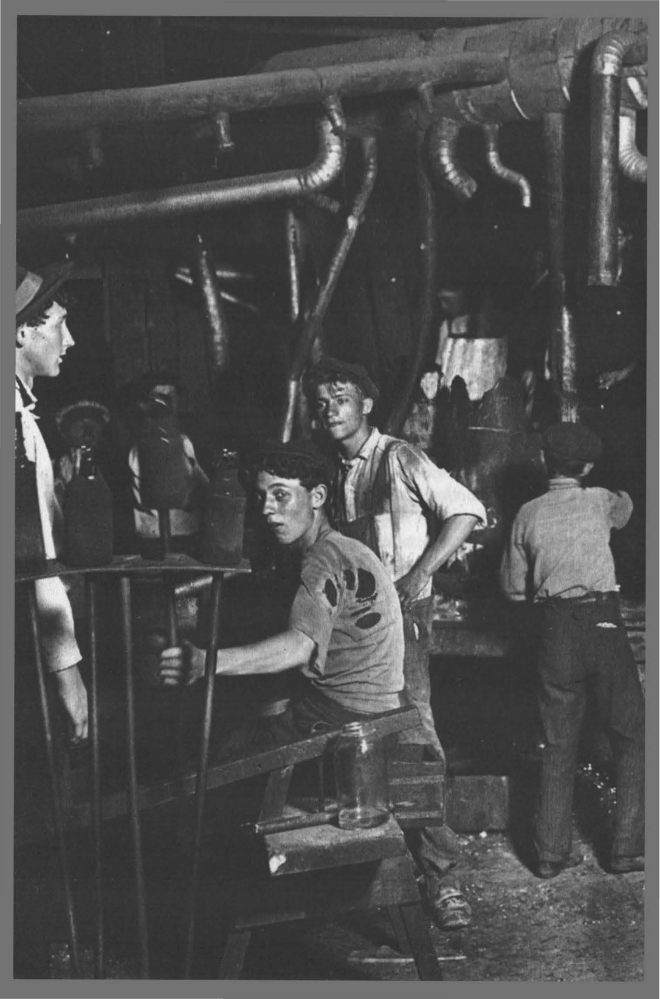

*空间开始被置于社会性语境中思考，这必定与人们意识到工业生产环境与条件的非健康性有直接关联。1880年代一家玻璃工厂中的青年工人和童工。*

〔原书第13页〕

> Ich mißtraue allen Systematikern und gehe ihnen aus dem Weg. Der Wille zum System ist ein Mangel an Rechtschaffenheit.
>
> 我不信任一切系统化者，并且避开他们。对体系的欲望，是缺乏正确行事能力的表现。
>
> ——弗里德里希·尼采[1]

建筑思想自15世纪发端以来，就一直承诺要为环境带来和平、秩序与纪律。更重要的是，它是阻止发出不和谐声音的学问。建筑师相信自己拥有技术与美学权力，并企图运用这种权力，使物质环境朝这一方向改变。从20世纪初开始，这一信念之上又增添了一种乐观（但危险）的信念：社会性也可以通过建筑来改造。甚至可以说，今天的建筑师身份认同似乎就建立在这样一种权力主张与乐观主义之上。在日常生活中，这种建筑权柄的梦想会顷刻间破灭，但这一主张的可信度〔原书第14页〕及其实用性并不会随之消失。那些每时每刻都在以各种方式把建筑师的设计与规划行为化为乌有的人，那些不仅不愿忍受其方案、甚至根本不予理会的人——总之，社会——仍然相信一个能让世界变成天堂的建筑师与建筑神话。乍看之下，不难认为这种信念是在颂扬、抬高建筑师与建筑。然而，实际上并没有谁在恭维他们。建筑师能够借助建筑手段改造世界这一观念，所指不过是社会整体中一种时而隐蔽、时而公开的极权主义期待。或者说，这个神话的潜文本，就是一种赤裸裸的反民主社会想象。真正被看重的不是建筑师，而是人们归于建筑师、并认为在其身上得到验证的想象中的极权者角色。人们寻找的是一位能在物质和社会双重意义上把世界变成天堂的“全能者”。建筑师与建筑制造出一种幻觉：扮演这个角色完全可能。如果这在建筑中可能，为什么在其他领域不可能？当然，无论在建筑还是其他领域，这都不可能。从住宅的微观尺度到大都市的宏观尺度，设计者都只是空间生产的众多社会行动者之一。必须说，即使只是布置一间住宅的室内，也要靠从房主到施工者的一群相关责任人经过相当艰难的协商才能完成。随着空间的尺度与复杂性与社会内在的多样性不断上升，参与的行动者数量也会不断增加。而且，很难说设计主体在其中最重要。断言如此，与说经济首先服从银行家的创造性意志并没有多大差别。就经济而言，显然没有人把其中一个行动者抬高到至高无上的位置；然而在建筑中，那些以建筑师为轴心、把行动者之一置于首位的叙事，却不会让任何人感到不适。恰恰相反，它还给建筑师镀上一层虚假的金光。日常语言中熟悉的例子，就是围绕天才、名流、明星等建立起来的话语。它们背后还可见到一个在建筑中只有五百年历史的“作者”概念的影子。〔原书第15页〕耐人寻味的是，尽管“作者”究竟是什么，早已在文学（而非建筑）语境中被长期讨论[2]，并且被反复说成一种虚构，但在建筑中，以建筑作品无可争议的思想与美学所有者——建筑师——为轴心的神话，似乎很少受到冲击。[3] 几个世纪里建成的无数建筑，我们并不知道它们的建筑师是谁，但这并不足以让人怀疑那个神话。全能建筑师主体始终不肯从想象的宝座上下来，建筑能够为环境带来和平、秩序、美学与纪律的信念也很少被消磨。那些抬高并神化建筑师与建筑的话语，有时会试图用一种虚假的谦逊来平衡。例如，瓦尔特·格罗皮乌斯在第一次世界大战后创建包豪斯时，把建筑说成一切审美实践的载体、把建筑师说成物质环境生产的乐队指挥，似乎就在做这样一种平衡。他的主张是：正如中世纪大教堂那样，一切艺术都可以由建筑/建造的躯体来承载。[4] 而建筑师则被从文艺复兴以来为他安置的天才与卓越才能的宝座上请下来，作为一个将催生那座想象中当代大教堂的管理者、组织者，被放到新的政治权力位置上。那个表述这一主张的著名宣言（《魏玛国立包豪斯纲领》）所用图像是《社会主义大教堂》（Katedrale des Sozialismus），〔原书第16页〕这更清楚地说明了它的政治含义。显然，这种社会主义远非一种崇尚自由的社会主义。格罗皮乌斯及其友人表达的，是对中世纪那种在政治、社会、艺术和建筑意义上都井然有序的世界的怀旧。很难说建筑师这种“大教堂建造者”的角色得到了普遍认可。也不能说它获得了艺术领域的支持。当代艺术是否愿意接受这种把主角交给建筑师的上下等级关系，甚至没有成为讨论题目。人们当然可以谈论艺术、设计与建筑之间的边界已经消解，但认为建筑是规训它们的权力，如今连可笑都算不上；恰恰相反，无法说清建筑到何处结束、其他设计与艺术生产从何处开始。一切审美实践都在越界，这显而易见。而这意味着一种把每个人都关进自己职业牢房的认识论体制的瓦解，〔原书第17页〕至少潜在地意味着产生自由的可能。也许出于同一原因，今天的建筑话语中几乎不再遇到把建筑师比作乐队指挥的说法。相反，人们更容易被名望、明星之类抬高建筑师的概念说服。因为明星与名望在当代资本主义体系中找到了现实得多的经济基础，建筑师的名字已像一切事物一样变成商品。建筑师不仅出卖自己的劳动；如果名字获得了交换价值，他也会把名字拿出来出售。名望便是如此。因此，名望或明星在建筑—设计—艺术整体中畅通无阻地游走，既容易又有利。职业边界的消融加速了这种流通。例如，扎哈·哈迪德能够从城市与建筑设计一直设计到鞋子、刀叉、服装、家具，几乎无所不包，并成为一个品牌。这时，究竟是她拥有无边无际的设计能力，还是把工作室集体设计的一切都署上明星的签名与品牌？毫无疑问是后者。从文艺复兴开始的权能建筑师神话与新的明星类型学之间当然相距很远。运用神圣才能、本身近乎半神的建筑师，与扎哈·哈迪德那样的当代商人类型相距甚远。然而，无论在职业内部还是在全社会，那个仍令人心驰神往、其权力仍被相信的建筑师形象，都尚未回归商人或劳动出售者的普通状态。“天才”（genius）概念自古罗马以来的历程，使“genius”不再是支配每个主体行动与生成的个人之神，后来又把某些主体与其个人神祇等同起来。“genius”如今几乎不再是被收在隐喻口袋里的私人个体神，而像是把那件衣服口袋染上了自己的神性。[5] 可是，这里的“神”身份虽早已被抹去，在历史学家的专业领域之外已无人记起，设计者“权能者”的形象却仍在被定义。

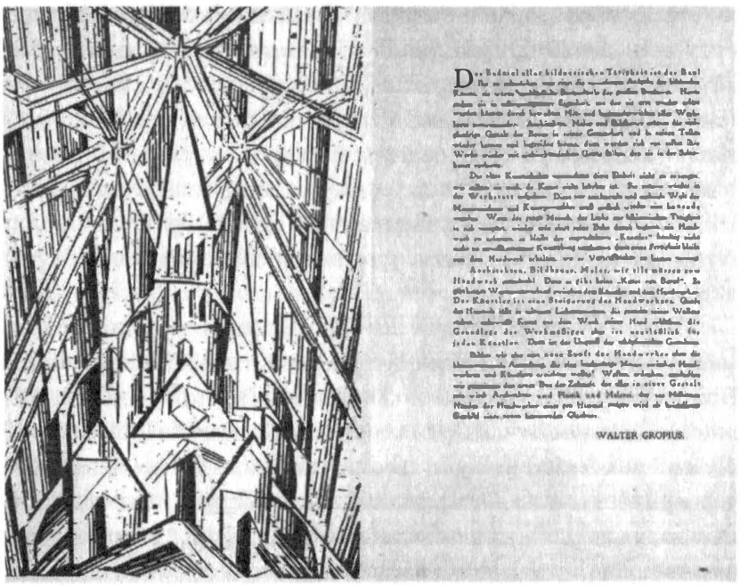

*包豪斯宣言：左为里昂内尔·法宁格的《社会主义大教堂》，右为瓦尔特·格罗皮乌斯的宣言文本，1919年。*

〔原书第18页〕

然而，那些相信问题与负面状况会凭一个专家（或权能）主体的技术与美学（更一般地说，操作性）技能得到解决的人，实际上否认了协商、妥协以及冲突/对抗等创造社会的可能，一言以蔽之，否认了政治。他们渴望的只是一种无可争议的物质环境品质，可为了得到这个不可能的对象，他们甘愿放弃自己的政治意志。问题在于，他们甚至没有意识到自己放弃了什么。沿着建筑思想可称为“传统”的路径行走，对阻止这种觉醒具有生死攸关的重要性。总之，建筑就是一切，也可以成为一切，但绝不是无辜的。当它提出和平时，它忙于生产使每个人都同意同一种物质性的工具。当它提出秩序时，它忙于限制发展彼此不同、互不相容的秩序期待的机会。当它提出纪律时，它无视规训物质环境等同于规训社会性。要捍卫这些主张，就需要把建筑的思想结构建立为一种系统性的秩序。人们对此如此相信、如此反复强调，以至于建筑概念变成了任何内在一致之整体的隐喻。例如，谈论思想的建筑性不会让任何人惊讶。柄谷行人在说整个西方哲学都由一种隐喻性的“建筑意志”建构起来时，讲的正是这一点[6]；只不过他把自己的论断范围收得很窄。在现代世界，一切日常生活实践都以其全部延伸效仿那种想象的建筑意志，努力与它拥有同一种意志。尼采在本章开头的箴言，正是把这种状态问题化。它指出，那些系统化者——不限于哲学，还包括主张把建筑意志带入社会性的人——勾画了一条极具问题的思想路线。

只要建筑意志被提上议程，实际上就存在一种使个体意志成为不可能的企图。柄谷行人的建筑意志，按其定义就规定了一种技术与美学的必然性。这种意志不是社会妥协的产物。它也不能被描述为不同个体意志与社会意志碰撞后产生的偶然结果。〔原书第19页〕它是在纯粹思想层面被生产出来、出于逻辑不矛盾性的关切而被创造、由前一个正确命题为后一个命题奠基的链条。至少它如此呈现自己。这是一条即使没有人接受也仍然有效的链条。其有效性不来自社会承认，而来自自身内在一致的构造。显然，“建筑意志”这一概念是关闭政治领域之门这一行动的别名。

在建筑中，设计者的意志被视为一种普遍常态，而且似乎能够轻易产生积极结果，因此在五个世纪里，以它为中心的绝对权力想象不断攀升。它以新的形式、新的混合、适应条件的方式不断被提上议程。本书不会叙述建筑思想那五个世纪的简史，这样的书很多。这里讲述的不是那种漫长历程的概括故事，而是那段历程至今仍在全球范围内延续的沉积物；或者更常见的是，人们仍然在毫无争议地接受并再生产这些沉积物的情况下进行思考。简言之，本书将谈及这些沉积物如何随时间积累，并试图说明建筑对和平、秩序与纪律的执念有何背景与潜文本。

过去，在开始把建筑放入政治活动内部时，人们也曾以各种方式触及我概括为“关闭政治领域”的那种状况，却没有讨论我所指出的矛盾或困境。早在1831年，维克多·雨果就在其著名小说《巴黎圣母院，1482》中题为“Ceci tuera cela／这将杀死那个”的一章里[7]，提出印刷技术将摧毁建筑的传播角色，〔原书第20页〕从而让政治与建筑领域略微间接地相遇。章节标题中的“这个”指书，“那个”指建筑；书将杀死建筑。在他看来，大教堂（以及一般意义上的建筑）曾像石头之书一样发挥作用。印刷术确立了印刷书的统治地位，从而消灭了这种可能。因此，它至少让建筑传递信息的能力变得困难，也让那种信息处于权力中心控制之下变得困难。在雨果的叙事中，大教堂就是宗教教义被翻译成建造手段后的形态。它定义了唯一的正确道路。而印刷书则预告了一个从单一信息世界走向多元而矛盾的信息世界的未来。更何况，纸书和石书一样坚固耐久。将近两个世纪过去之后，“Ceci tuera cela”的讨论仍未被人遗忘。[8]

由于雨果对建筑—书籍关系的解释方式开创和/或预示了后来许多理解，需要稍加详细地讨论。首先我要再次强调，他把建筑描述为传递信息的工具、并断言书籍摧毁了这一可能，这是借建筑关闭政治领域这一欲望的极早例子。在雨果看来，在建筑传递信息的过程中，积极的、“说话”的只有建筑。中世纪大教堂与教堂讲述宗教教义、信仰与心态结构。建筑与社会之间是一种教与学、讲述与倾听、主动与被动接受的关系。显然，这种社会理解即使在19世纪初也非常成问题。无论信息多么坚固、多么有说服力，定义其意义的不是传播的媒介，而是接受的主体。因此，大教堂拥有一种单一信息并能让所有人记住这一说法，在任何时代都只是梦境。即使信息是单一的，意义也始终是多元的。雨果似乎完全没有注意到这种多元性。他认为，印刷书用可以无限复制的文本取代了从前通过建筑讲述的单一信息，〔原书第21页〕从而使信息多元化、个体化，并因此损害了社会整体性。因此，他的主张与忧虑，与其说是建筑传递信息权力的毁灭，不如说是信息失去控制。印刷书打开了传递不同信息的道路。在这种状况下，雨果担忧的与其说是建筑的死亡，不如说是社会整体性的侵蚀与安宁的死亡。他想象着一个所有人都认可、无可争议的社会和谐与共识状态——这是为了过去，但显然实际上是为了今天。他相信这曾经存在，如今已被摧毁。问题在于，他未能看到政治就是在多元意见、信仰与期待之间进行的寻求共识、协商与冲突的实践。雨果怀念一个不需要这些实践的无政治（因而安宁）的想象旧世界。他以为建筑也是创造那个世界的旧有可能。他所提出的推理，无疑构成了后来全世界（以及土耳其）一切保守主义文化理解的共同思想基础。〔原书第22页〕尤其在法国，由于这个极早而有效的开端，建筑的政治内容问题大概会持续下去。在人们普遍不怀疑建筑只是建筑/建造/美学的东西、这几乎在全世界都无可争议的时候，法国最早由雨果播下了怀疑的种子，并将继续下去。例如，1961年，福柯先揭示了精神疾病与精神病院之间的内在关系。[9] 随后他又把监狱定义为建构现代犯罪与犯罪性的建筑现实。[10] 他在书中颠覆了那些曾被认为不容置疑的旧等式。并非犯罪创造了监狱、精神疾病创造了精神病院；情况恰恰相反：在福柯的新等式中，主体被变成客体，客体被变成主体。现代犯罪性既由法律文本定义，也由建筑空间定义。是一群人被“他者化”的过程建构了犯罪性与精神疾病的概念。而排他实践在很大程度上具有建筑内容。为了监视与监管罪犯、使其从社会中隔离，必须建立使这一切成为可能的监狱建筑。纪律以及一般意义上的全部权力结构仅由人际关系建构和强加这一信念，被福柯颠覆了。在某种意义上，空间不是社会生活与个人生活的外衣，而是其铸模。

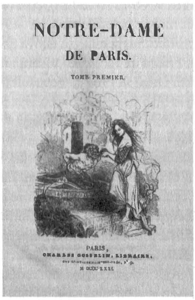

*维克多·雨果《巴黎圣母院》，扉页，1831年初版。*

几乎同一时期，列斐伏尔在《空间的生产》中阐明空间生产是一种社会生产[11]，并说明空间不是生活的中立舞台，它也生产控制与权力。但比福柯和列斐伏尔早得多，早在1929年，乔治·巴塔耶就用一篇短文以另一种方式把谈论建筑政治性的问题提上议程。[12] 他从雨果停下的地方开始，也像雨果一样把建筑等同于纪念性建筑来思考。

〔原书第23页〕

> 伟大纪念物如同壁垒，面对一切破坏性要素宣示权威的逻辑与威严：教会与国家以教堂和宫殿的形式对多数人说话，或强加沉默。其实，纪念物激发社会常识、更激发真实恐惧，这一点显而易见。攻占巴士底狱对此具有象征意义：很难用别的东西解释人群的这一行动，只能说是他们对作为人民真正主人的纪念物的仇恨。

巴塔耶的短文以其自身形态展现了一种当时非常新的意识，但它似乎更适合在纪念性语境中阅读，而非在整个建筑语境中阅读。德尼·奥利耶对同一篇文章的新解释，则把范围扩展到整个建筑领域。可以说，他由此赋予巴塔耶一个比最初意图更引人注目的内容。在这一新解释框架中，建筑不再像无数传统叙事所说的那样表达社会精神，而是被描述为扼杀社会性的实践。[13]

巴塔耶—奥利耶的论证指向：建筑和/或空间试图把社会生活强行纳入形式、浇入模具，而不是让它自由发生。就本书讨论的基本问题而言，完全可以毫无犹豫地加入这一论证，但需作两处修正。第一，建筑与空间既有扼杀社会性的权力，也使社会性成为可能。社会性只在空间/建筑中获得存在，而不是在抽象环境中。第二，这种创造—扼杀的矛盾既不可避免，也产生富有生产力的冲突。建筑/空间与社会性无休止地争斗。企图扼杀的一方与遭受扼杀的一方相互斗争。但更引人注目、更悖谬的是：空间无非就是社会性。换句话说，社会性既由人际关系、饮食实践、技术、语言、信仰、政治和无数其他实践建构，也由建造性与设计性的可能建构。当它以最后这种方式被建构时，人们称之为“建筑”。〔原书第24页〕因此，必须把这场斗争视为一种精神分裂式的分裂。当社会性与建筑斗争时，在某种意义上它是在与自己斗争。于是，所谓社会性与建筑曾和平共处，或如人们常说的，我们曾经如此生活、今天却失去了这种运气的说法，只是一种幻觉。正是在这一点上，必须开辟两条重要的研究路径：第一，和平幻觉究竟是什么；第二，冲突如何“运作”。

关于社会性—建筑和平的想象是相当新的建构。这并不意味着人们早已知道二者过去是和谐的。恰恰相反，可以说它们从未被放在彼此语境中思考。例如，19世纪以前，从未有过从建筑内部出发或以建筑为轴心的社会批判。因此，不能说和谐存在或不存在；因为这样的议题、焦虑或讨论题目根本未被生产出来。对空间的恐惧与恐惑不安的历史不会早于18世纪。[14] 这既适用于弗洛伊德意义上空间引发的无缘由恐惧，即恐惑（unheimlich），也适用于真实因素造成的、有原因的空间恐惧。然而，直到19世纪才出现对居住其中的物质—建造环境发出抱怨的人。原因并不是环境完美无缺；而是尚未存在一个与空间争执的主体。意识到空间的社会性以及社会的空间性，似乎随着资本主义与早期工业变化而开始。最早的尝试，是在19世纪的英国，人们开始把工作生活的建筑环境与穷人的居住条件表述为问题。当然，在那之前和其他地方，不能说两个领域过去存在高标准。〔原书第25页〕按今天的习惯判断，纵观历史，前现代世界在物质舒适与卫生方面，除了极少例外，几乎不可能找到及格的空间。我要再次提醒，关于健康古老环境的叙述是现代神话。一个简短的说明性例子是：古罗马人的浴场文化与当时其他清洁实践形成了醒目矛盾。至少在这个富人频繁洗澡的时代，洗衣匠获准从公共厕所收集尿液，用作洗涤过程中的漂白剂。仅此就足以说明，过去的清洁观念无法用今天的术语解释。在此语境中必须强调，土耳其尤其受喜爱的、与信仰相关的清洁神话也不符合实际。中世纪欧洲引发各种瘟疫的条件，在中东同样恶劣地存在。许多瘟疫从中东传入欧洲，这也是已知的。

以建筑为语境理解空间社会性的激进变化，始于卫生威胁的阶级化。在所有社会群体同样暴露于卫生威胁的时代与地方，并不存在这种理解。只有当某些人变得远比其他人更能防御环境威胁时，空间才能在社会性语境中被解读。尽管谈论前现代世界的情况需要谨慎，但过去可能并不存在城堡比农民住宅更健康的等级关系。中世纪领主死于瘟疫的风险看上去并不比资产者更低。几乎可以说，人口中的所有群体在健康威胁面前近乎平等。现代性与资本主义，也是卫生被直接与经济权力关联起来的历史状况之名。穷人过去也生活在恶劣空间中；但富人逐渐变得对卫生风险更有防护。社会对抗与环境意义上的卫生，由此成为相互关联的概念。卫生与建筑环境直接相关的观念，随着工厂〔原书第26页〕和工人阶级的不断扩张而更加明显。早期工业时代创造了前几代人未曾知晓的空间品质定义。在工业环境中工作与生活本身就是不健康的。我们可以看看英国议会的立法活动，作为一次快速的初步评估：这些是关于空间开始在社会语境中被思考的启发性早期例子。[15] 可以说，从18世纪末开始，出现了一长串法律：《更好地规范扫烟囱者及其学徒法》（*Act for the Better Regulation of Chimney Sweepers and their Apprentices*，1788）、《学徒健康与道德法》（*Health and Morals of Apprentices Act*，1802）、《棉纺厂法》（*Cotton Mills Act*，1809）、《工厂法》（*Factory Act*，1831）、《工厂法》（1833）、《扫烟囱者法》（*Chimney Sweepers Act*，1834）。1840、1864和1875年又通过了其他关于扫烟囱儿童的法律。《矿山与煤矿法》（*Mines and Collieries Act*，1842）禁止在矿井中雇用妇女和十岁以下儿童。《工厂法》（*Factories Act*，1844）规定工厂必须采取某些安全措施。《工厂法》（1847）为妇女和13至18岁者规定十小时工作日。《工厂法（扩展）法》（*Factory Acts (Extension) Act*，1867）、《工厂与工场（合并）法》（*Factory and Workshop (Consolidating) Act*，1891）给工作生活带来了空间条件定义。它们全都是旨在塑造工人与其工作所在的物质—空间环境之关系的规范性法律文本。

同样的空间—阶级意识也构成议会关于工人住房条件报告的主题。上文列举的法律本来就建立在这些报告之上。最终，卫生的阶级性在恩格斯的著名分析《英国工人阶级状况》中获得了明确的政治表达。[16] 这最后一部著作尤其重要，因为它是第一部在空间语境中把一个社会群体政治化的文本。

〔原书第27页〕

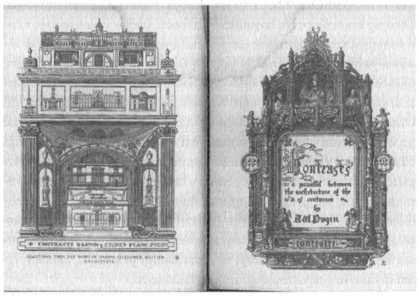

*普金《对比》的扉页。*

因此，最早诊断（并发明）可称为建筑—社会断裂之紧张关系的思想家是英国人A. W. 普金（1812—1852），这并不奇怪。普金在《对比》一书中把自己时代的建筑与晚期中世纪建筑加以比较。[17] 该书首先围绕一个主张：在此间流逝的时间里，建筑趣味水平下降了。为了证明这点，他有意把一座旧建筑与一座新建筑并置在相对页面上或同一页面上作比较。然而，他在第二版中加入的几幅晚期中世纪—当代19世纪对比图，将使变化不仅具有美学性质，也落到社会—空间基础上。其中尤其两幅关于城市宏观形式与穷人生活状况的图像将产生巨大影响。甚至今天，每一本关于该主题的新书都能为它们找到位置。〔原书第28页〕第一幅把一座显示美学与形态完整性的晚期中世纪城市，与一个环境条件恶化、混乱的早期工业城市相比较。另一幅则把过去穷人在教会帮助下获得人道生存与庇护的状态，与今天他们被视为社会负担、死后甚至没有自己坟墓的现状视觉化。因此，普金理想化了天主教过去。考虑到他是一位激进天主教徒，把信仰从宗教推进为政治意识形态和建筑行动计划，他的方法对从今天世界看过去的人一点也不奇怪。在普金想象的天主教主宰世界中，过去以和平、秩序、社会与美学完整等积极价值为特征。用这些价值的完全反面来描述当下状况，是比较的主要范式。毫无疑问，书中暗示未来只有通过重建信仰才能实现，尽管书并未视觉化或叙述那个未来。

这种面向过去的怀旧视角，从那里开始似乎成为全世界后来一切保守主义与宗教轴心政治观点的普遍态度。它们全都把信仰共同体、意见一致、无对抗、社会团结与美学品质等价值呈现为过去失去的品质。例如，按普金的论证，信仰是上述一切“积极面”的创造者。而今天的世界则由信仰多元化及/或丧失、混乱的碎片化、资本主义逐利和美学品质的破坏来定义。那么，甚至在19世纪上半叶，怀旧的社会基础就已奠定。平等的、人道的生活与居住条件被叙述为更美好的失去时代之特征，而今日世界的现实则通过提醒人们与信仰的当前距离来辩护。以至于离天主教或伊斯兰教越远，就离一个美学的、人道的、和平的、平等的天堂越远。

土耳其也有人表达这样的观点。普金之后约150年，图尔古特·詹塞维尔为逊尼派伊斯兰教和奥斯曼帝国想象了一个类似的怀旧过去。〔原书第29页〕在他几乎所有的书中，他都会讲述一个在坦齐马特所象征的断裂点之前、社会、城市、建筑、审美感受力都得到完美塑造的想象过去，并说明必须把它重新赢回。[18] 他日益扩大的读者群、近乎被神圣化的抬高，以及他的书不断再版，都说明了背后的社会需求。需求的所有者试图通过建筑，把社会性错误划定的路线转向一个被理想化的过去：一段被错误经历过的过去，应当通过一种受怀旧昨日之梦引导的建筑来修正。于是，与社会性争斗的今天获得和平。等待被直面的矛盾被清算，纪律与秩序被归还环境。

当然，怀旧的世俗形式、以及以怀旧为轴的当代建筑行动计划，也绝不少见。甚至可以断言，在某些地方和时代，它们的传播比宗教倾向的怀旧更广。仅从19—20世纪之交到纳粹政权终结的德国例子，就已经足够醒目。例如，保罗·梅贝斯的《约1800年》就是一个典型的大众样本。[19] 它在当时成了畅销书。梅贝斯通过短小文字和数百张旧城市、建筑与细部照片，讲述物质环境曾经多么美丽、连贯、有身份且无问题。然而，在20世纪初，这种世俗怀旧脉络在德国最强的代表不是梅贝斯，而应是舒尔策-瑙姆堡。他编纂了一套照片丰富的巨型“文化工作”丛书[20]，提出一种怀旧昨日想象以及以秩序—纪律为中心的今日方案。从城市宏观尺度到住宅、乡村环境，甚至国家的植被结构，一切物质—空间资料都在他的书中找到位置。〔原书第30页〕只要记得他1928年出版了《艺术与种族》[21]、并从1930年起成为纳粹党党员，就能更好理解舒尔策-瑙姆堡如何为从怀旧通往极权主义、由建筑铺就的道路提供了一个多么启发性的例子。类似的话也可以用来谈比他年轻约一代的施米特亨纳。他也尤其“怀念”歌德时代的德国。他把这位著名作家在魏玛的简朴住宅变成了一种崇拜物。他追寻一种“正确”的建筑，以把他所视为建筑混乱的当下状况带入那座建筑所象征的秩序。[22] 他后来也加入了纳粹党。很难把这些人物视为个别而次要的。舒尔策-瑙姆堡在其国家当了十年真正的意见领袖。施米特亨纳则与博纳茨并列，成为极具影响力的斯图加特工业高等学校最重要的教师之一。值得记住的是，这所学校在两次世界大战之间及战后初期，是从土耳其吸收建筑学生最多的德国机构。[23] 而且两位教师都与土耳其有紧密联系。施米特亨纳曾一度准备去土耳其授课，后来放弃。博纳茨则有漫长的土耳其职业生涯。甚至1940年代后半期到1950年代初，他还是土耳其无可争议的建筑界“大领主”（grand seigneur）。还应把那个时代土耳其的明星塞达德·哈克·埃尔德姆加入这条链条。他也提出极权主义方法，主张通过国家干预给建筑混乱带来秩序。[24]〔原书第31页〕在此语境中，强调图尔古特·詹塞维尔是埃尔德姆的学生也另有意义。[25] 这是一条从世俗教师通向宗教敏感学生的路径。它还不止于此。如今有一群人追随詹塞维尔的足迹，他甚至死后仍具有意见领袖身份。

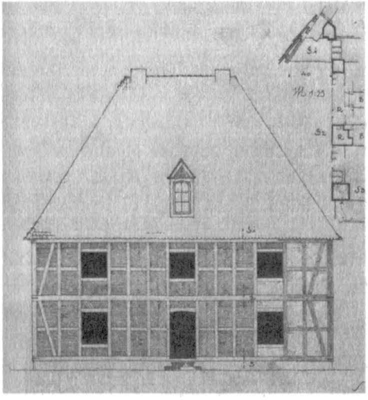

*施米特亨纳把歌德在魏玛的简朴住宅变成一种崇拜物。他不断用各种“德国”材料与技术来设计它。*

上述人物确定不是一串故障或例外。他们甚至不构成部分的特殊情况。例如，不能把他们仅仅解释为一种土耳其—德国建筑联系。对过去的怀念、对混乱今天的恐惧，以及把极权主义提为建筑与政治解药的方案，共同构成“神圣三位一体”，它并不只被少数社会垄断。充其量可以说，这种神经质在某些地方和时代略轻或略重。

〔原书第32页〕

乔治·西美尔完全没有把建筑纳入考虑，却在20世纪初对这种怀旧追寻——尤其在艺术语境中——作了如下说明[26]：

> 道德家们赞颂旧日美好时光，拥有健全风格感的人抱怨现代生活的模糊与日益增长的无形式性（Formlosigkeit），他们手里有大量可以证明自己有理的事实。然而，他们倾向于轻视这样一个事实：正在发生的并非只是消极的东西、传统形式的死亡，恰恰相反，一种完全积极的、生命性的冲动正在废除这些形式。

西美尔似乎不仅在这篇文章中，而且在总体上意识到：赋予每个时代与文化以自身秩序和性格的特定形式，其时代已经结束。而我们这里简略提到的群体，正是他所称的“抱怨现代生活模糊与日益无形式性的人”。相反，按西美尔的说法，社会、艺术与思想世界如今是由“无形式性”定义的。他相信曾经存在一种固定形式，把同一时空中被创造的一切都纳入同一套秩序原则；一切彼此不同者仿佛被填入一般性的“形式”，从外面看就像有序整体。他认为这种形式丧失始于17世纪英国启蒙运动，且如此广泛、全面，以至于不再给新形式的产生留下机会。因此，在他生活的时代，人们仅仅因为形式是形式而与之斗争。

〔原书第33页〕

在艺术领域，西美尔之后约一个世纪，无论称之为形式的死亡还是认识论权力的毁灭，都可以说变化已经变得寻常。当然，像法西斯艺术和社会主义现实主义中那样，仍有人相信重建形式的道路敞开，有些地方至今也还有人相信。但在当代艺术中，非常常见的是，形式的破坏从文学到音乐、舞蹈、绘画、摄影等所有领域不再是目标，而是作为给定事实来生产。问题在于，在建筑领域，同样的常规化过程并不像艺术中那样有效和普遍。在建筑中，秩序、纪律、唯一正确道路的想象仍保有可信度。这当然又一次要求回到开头的论证：由于建筑被视为一种将规训物质环境并由此规训社会性的工具，它不能展示艺术的解放意志。恰恰相反，在建筑中，普金的道路似乎极其畅通。对更美好过去的怀旧，以毫无无辜可言的途径，通过建筑及其中介，预谋规训今天的世界。土耳其在此并不占据特殊位置。最多可以说，这里有机会谈论一些来得太迟的普金们。

我要把至此试图概括的东西称为“社会性—建筑之争”。它的含义是：那些曾经被强行从所居天堂驱逐出去的人，为返回那个天堂而进行的斗争……当然，现实中既没有那个天堂，也没有驱逐，更没有被驱逐者。但讽刺的是，斗争是真实的。天堂不存在，因为过去曾实现过无瑕整体与统一理想这一说法，只是现代梦想或幻觉。对那个被理想化的过去更现实的判断是：从前差异被忽视和/或被轻视。因此，只要冲突尚未以尖锐对立的形式被生产出来，就被否认。在更尖锐的争执中，对手则被从环境中彻底清除。中世纪对无数基督教与穆斯林反对群体的屠杀是常态。和平，等于冲突一方被从环境中清除。于是，并不存在一个和平而自由的天堂，〔原书第34页〕后来才失去。更重要的是，也没有被从那里驱逐出去的人，因为正是那些生产出驱逐与失乐园精神病的人、那些与建筑斗争的人，创造了今天的社会。与那种想象性驱逐的创伤相联系的建筑—社会性冲突，将生产出现代性与个体——当然还有其他东西。在土耳其，仍存在大量朝这个方向的生产活动。

可以借助乔治·西美尔两篇都不涉及建筑的文章（《现代文化的冲突》与《斗争》[27]）来讨论这个问题。西美尔在这两篇文章中做冲突、争执、斗争的社会学。与那些主张社会是和谐整体、和/或渴望如此、和/或如此定义社会的主流社会科学相反，他认为不和谐也像和谐一样产生一种正常的社会存在。更重要的是，对西美尔而言，冲突不是故障，而是“社会关联化”（Vergesellschaftung）的动力之一。那么甚至可以说，环境风平浪静、寂静无声，与其说值得肯定，不如说标志着一种应当害怕的社会性毁灭。看似和谐的状态，也许不过是生活的停止。记住希腊语harmonia（和谐）词根含有“固定”“钉在一处”的意思，会很有帮助。因此，以西美尔式的方法处理上述争执，可以帮助我们看到不可调和性生产出怎样的可能。至少可以意识到，绝对“和谐”意味着永恒的固定，也就是死亡。

〔原书第35页〕

本书写作基于一个想法：建筑被以化石化的、无冲突的方式思考并非必然。使建筑成为更现实的思想与行动领域是可能的。为此，需要在长期上面对五个世纪、短期上面对最近一个世纪被生产出来的建筑思想，进行破坏性的正面交锋。

问题在于，作为生产社会关联化的实践，冲突也必须被常规化。换句话说，冲突是社会关联化的动力之一，但并不必然产生积极面。因此，抬高它和否认它一样幼稚。意识到这一点能带来什么？自由。或许会出现一种可能：意识到建筑定义了任何时代都未曾有过的广阔自由领域。至少在过去两个世纪里，思考建筑的人竭力不去经历这种自由。他们努力不运用所有这些潜在自由，而是期待建立坚不可摧的建筑思想、找到可靠且不会出错的设计道路、让所有人抵达同一个正确结论。为了建立一个可以无冲突地经历、不会磨损的和平、秩序与纪律环境，两个世纪以来，他们既打开了建筑领域，又把它彻底堵死。大约从1980年代以来，建筑领域与实践正缓慢向自由敞开。我们几乎刚刚意识到所使用的一切概念的偶然性、意识到它们是由我们制造的。我们领悟到它们可以被牺牲、改变、转化、替换，甚至彻底遗忘。我们明白它们可以被另作解释、被扭曲。

这一切都让人想到，我们生活在一个——当然是在欧洲和美国——在很大程度上已越过禁令、至少已使之成为争议并加以掏空的时代。追求自由的立场仿佛在经过艰苦磨难后取得了最终胜利……剩下的（似乎）只是把它传播到世界上较不幸的地区。但恰恰在这一刻，正是该怀疑禁令—自由二分法或对称性是否已被永远埋葬的时候。〔原书第36页〕追求自由的立场真的成功地把禁止性的极权意志压缩并隔离到一个小小的社会口袋中了吗？难道只有恐龙在抵抗自由的辉煌上升？还是说，那些直到不久前还十分天真幼稚、因为用传统语言的陈旧概念表达的禁令与禁忌，今天正经历一种新的构造，并演化为比以往复杂得多的规训体系？大概是后者正在发生。今天定义禁令的不是阻碍新形式探索的障碍，不是人工物与技术的强制性使用模式，最重要的也不是道德规范。至少在某些国家，问“云彩一样的建筑也能算建筑吗”“把磁带撒在地上也算艺术吗”并以此对建筑与艺术意志下禁令，已经很难。甚至在有些社会土壤中，这过于天真。显然，为了控制形式，手段相当有限。另一方面，也没有人反对使用计算机、钛合金幕墙板、通过数字建模产生结构方案等等。显然，提出禁止技术也已从建筑议程上退出。曾经——例如1920年代——让建筑师忙碌不已的社会责任话语退出议程以来，连指出什么对社会有益、什么无益都不再容易。强制禁止任何政治与宗教观点似乎也没有可辩护之处。总之，几乎不存在禁令。真是这样吗？

也许真正消失的不是禁令，而是曾赋予早期现代世界活力的东西：采取批判立场、产生冲突的可能……如果没有禁令，对它的对抗也就不存在。也许，不是自由本身，而是自由的幻觉让我们所有人沉默。在一个所有人都支持自由的世界里，谁还能反对谁、抵抗谁、与谁冲突，并由此生产新的存在与思考可能？过去那些显而易见、容易瞄准的禁令，也使采取批判立场变得极其容易。当然，采取批判立场的人也因此容易成为靶子。如今，与这种便利消失相关，思想也堵塞了。我们不再能够生产对抗（我将完全不谈其政治证据），〔原书第37页〕至少建筑与艺术证据就在眼前。例如，先锋派话语与方法似乎已成历史。赋予它们活力的，是对被禁止者、被神圣化与被规则化者、或仅仅变得通行者的打击。这样，方法与思想在诞生那天就过时了。可以说，乌托邦思想也是类似社会动力学的产物：通过否定今天的既定秩序及其限制与局限，为激进的未来方案作准备。批判性、冲突性立场的崩塌，标志着我们开始生活在一个无法被过时、因而无法被转化、因为无法被无情讨论的世界里。除那些仍过时地生活在早期现代过去、充满禁令的国家之外，世界就是如此。在那些国家，抵抗禁令的简单批判实践仍能运作。而欧洲和美国（有趣的是，还有土耳其）则指向一个全新的、打着自由旗号的黑暗地平线。也可以称之为人们想要的“新中世纪化”。而我更愿意把它解释为：我们正走向一种新的超威权思想体制，它使极权主义、法西斯主义之类的词语本身都变得无意义。[28]

〔原书第38页〕

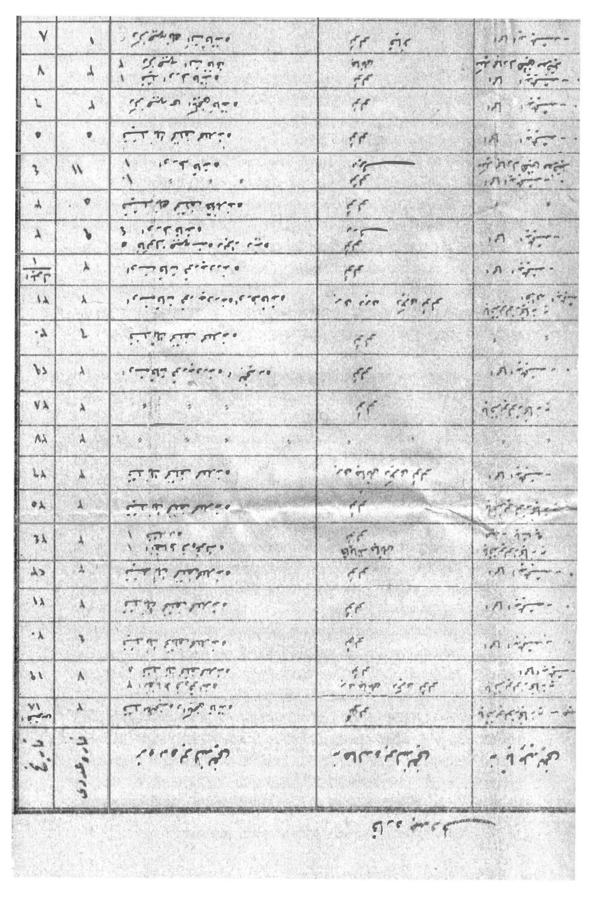

*就建筑作品所容纳的生物性存在而言，对建筑的一种数量化理解——来自土耳其的早期例证：“Fare Cedveli”（鼠表）。塞利米耶兵营中灭鼠活动的数字汇总。*

## II　作为一项新发明的建筑

〔原书第39页〕

> ［亚历山大］赫尔岑没有沉溺于乡愁或自怜，而是努力赋予自身流离失所的经历以意义，甚至将它作为一种生活方式来拥抱。正是这种拥抱使他成为现代人。错位（displacement）与失所（dislocation）不仅是经济和政治中的主导性事实，也成为现代艺术的象征。[1]

正如森内特所指出的，赫尔岑是一位政治流亡者，他成功地把自身的错位状态变成一项广泛思想活动的基础。他的错位之所以富有成效，是因为它使他有机会远离19世纪俄国的政治限制，而身处远方非但没有剥夺他思考俄国的可能，反而凭借所提供的距离感进一步促进了这种思考。毕竟，像那个时代几乎所有才华横溢的俄国知识分子一样，他在理想、知识积累和成长方式上是一位欧洲自由主义者，但在归属定义和他所关切的国家框架内，他是俄国人。实际上，他的处境还要更复杂。他有德意志血统，姓一个德语姓氏，把自己视为俄国人，却被剥夺了在俄国生活的可能。因此，与其说他失去了祖国，不如说他是多重祖国的。〔原书第40页〕而这种多重祖国状态显然不是别的，正是现代性。

这种错位与失所不仅对赫尔岑这样被拔离故土的个人具有生命意义，对经济、政治和艺术亦然。有一系列前几个时代所不知的“新”实践（也就是说，大多是17世纪以来发明出来的），它们在全世界使错位、失所与多重祖国成为可能，并且仍在使之成为可能。这些实践似乎直接或间接地为了把今天被集体地、无争议地称为建筑的现象与“事物”也抽离地点来思考而被创造出来。由于它们，建筑在隐喻意义上也已是多重祖国的。我要把这些实践称为“超地方性实践”。

一些总是特殊、总是在特定具体语境中发生的事件，只有在它们帮助下，才能在其语境之外的一种超地方平面上被思考、把握、同质化、比较（抽离地点，在一种共同化的环境中加以考察），并最终被称为“建筑的”。建筑今天的种种联想，似乎正是凭借这些实践（以及许多其他实践）才被创造出来。

由于人们假装存在一种永恒、永久的“建筑”概念，它的定义也许在每种语言中都被固定下来；但今天提到“建筑”时所想到、所中介、所联系的东西，大多数从历史尺度看相当新。我所说的，是一种可以称为“建筑的发明”的制造。这项发明正是凭借许多我们在此讨论或未能讨论的超地方实践才成为可能。这些实践中最古老的一些，在欧洲位于德国—意大利一线以西的部分，最多可追溯到16世纪，大多数则追溯到18世纪。奥斯曼与土耳其主体进入这一发明过程，即便始于18世纪晚期，真正的变化也是从19世纪中叶起才提上日程。总之，从历史—概念分析看，建筑既不是作为物质实践从史前开始，也不是作为思想活动从古代开始，更不是作为职业从伊姆霍特普开始。

然而，我们并不习惯质疑建筑与人类历史同样古老的信念。我们更愿意认为，〔原书第41页〕它与第一个需要住所的人同样古老。这一信念也这样表达：创造建筑的是人类天性中固有的一种本能。问题在于，对于想以历史编纂学的严谨来说话的人而言，既没有“人类天性”这种东西，也没有一种在人类身上可定义、并在逾万年时间里创造出无数产品的“建筑本能”。人类天性以及被称为本能的基本人类功能，都具有历史性质，并且不断变化转化。因此，例如并不存在一种艺术本质，能把史前雕像、普拉克西特列斯与多纳泰罗、书法艺术、非洲面具和达米恩·赫斯特都囊括在人类审美本能所创造的东西之内。这样一种包容性的艺术概念是在漫长过程中被制造出来的，且肯定是现代建构。[2] 今天被称为艺术品的大多数人工物，一个世纪前还不能被赋予这个名称，因为它们中有些尚不存在，有些则另有名称。或者，希腊人并不像我们那样把一组产品从其他实践中隔离、区分出来；他们用techne一词来命名一切物体制造，却没有把“艺术”造成一个自主的认识论包裹。相反，例如音乐对他们而言就不是一种techne。甚至到19世纪中叶，奥斯曼人说到“sanat”（艺术）时也还在同样宽泛的范围里说话，会把鞋匠与木匠、车工与建筑师的实践统称为“sanat”。而要把绘画、雕塑、建筑视为“sanat”（19世纪后半叶为“fen”），把珠宝业、皮革业等归入他们新发明的“zanaat”（工艺）一词之下，还要等到20世纪初。今天，艺术—工艺—设计—建筑之间的边界已变得极其可渗透，也在很大程度上失去了意义。因此，用一个时代有效的术语去表达所有时代的审美产品，显然相当成问题。

对建筑而言同样如此。这个术语在西方语言中从古代（architectura）起、在土耳其语中（mimari）至少从15世纪起就被使用，因此可以算作“一个虚伪的朋友”。〔原书第42页〕由于它的语言学语音价值和形式大体未变，人们便以为它的意义也没有改变。这造成一种欺骗性的恒定性幻觉，一种概念上的“虚伪”状态。然而几个世纪里，这个词只指涉建造生产活动和职业，并未定义一个特定的知识领域。它开始承载与今天多少相似的含义，是在文艺复兴意大利语中出现的。古代希腊人只命名从事这一实践的主体，这在这一意义上颇具启发性：该词原初的含义并不指向某种特定知识，而指向一个制造者。Arkhi-tekton一词由arkhi-（arkhon＝首领、领导者）和tekton（建造、制造、木工）组成，其含义类似今天语言中的“师傅”。罗马人则以希腊词为词根，创造出意为“建筑师所做之事”的architectura。土耳其语中的mimari与mimarlık同样来自阿拉伯语mi‘mar，这与arkhitekton-architectura之间有一种有趣的相似。然而，从语言结构看，mi‘mar在词源上并不指向一个施动者、一个做动作的人，而是一个被动分词（ism-i mef‘ul，表示承受动作之物的名词），这令人费解。尽管如此，这个术语[3]在两个文化领域中似乎都经历了一个从实践主体到实践本身、再由此到其对象的发展过程，并在这个过程中成形。〔原书第43页〕换言之，一个原本描述在特定“地点”获得存在的生产者、以及他同样在该“地点”中得到定义的生产实践和职业的术语，将随着时间开始描述一个超地方的、超时间的知识领域。这个过程同时意味着该知识领域被建构为一个“普遍”范畴。

建筑一词今天所指涉的东西，是在如此迂回的历史过程中被建构起来的，在此无法概述。这些过程包含时间与空间中广泛而不可调和的分歧；它们今天在世界几乎所有地方所抵达的节点，至少从地理和历史角度看，已是一个令人惊讶的同质化节点。今天人们提到“建筑”时想到的东西——我不打算列举它们究竟是什么——几乎构成了全球化最可信的形象。其实，对于“建筑”一词的认识论覆盖范围内之物的无争议共识，本身就直接例证、甚至澄清了我在此努力说明的问题：生产一个在超时间、超地方延展中的“建筑”概念，本来就等同于使它成为在任何地方、任何时间都有效的东西。既然已经做出一个宽泛到足以轻松容纳每个人自认为属于自己的全部空间性、建造性与思想性之物的“建筑”定义，人们为何还要怀疑其有效性呢？至少已不再剩下任何心理社会基础去质疑它。今天，一个定义如果宽泛到能同时包含爱斯基摩冰屋、非洲多贡人的棚屋、帝国大厦、佛罗伦萨的韦奇奥桥、马拉巴迪桥、乌托邦之物、绘图之物、纯话语之物、参数化实践和模拟之物，人们为什么要怀疑这个定义的有效性呢？

本书也不会把建筑的那种扩展定义问题化。问题并不系于那个定义是否有效；问题来自全世界都乐于相信它是永恒的、在所有时代都具有相同含义，也就是相信它近乎超越性。我想做的正是分析这一信念：首先指出这种信念是多么新，其次讨论为生产它而发明和/或使用的一些实践——超地方实践。但这里必须短暂插入一个括注：建筑在空间—历史延展方面的覆盖范围虽然已显示出一种被习以为常的宽广，〔原书第44页〕且几乎所有人都相信这一点，但同样的信念在建筑的概念内容方面并不成立。当然，世界上仍有相当多的人不会接受把萨尔基斯将在本章后文讨论的“龙安寺”装置视为建筑。或者，仍有太多建筑师和非建筑师无法被说服，从建筑与城市的角度去阅读情境主义者的作品——本章不讨论这些作品。因此，从建筑之发明的社会“接受”看，不难区分出两个不同侧面：一个指向地理—历史扩展，另一个指向概念扩展。不过我不会分别讨论它们，因为我认为这种二分只是一个熟悉过程的问题。也就是说，概念扩展也会在短时间内被内化，而且正在被内化。至少迄今为止的走向让人相信会如此。

下文考察的超地方实践的排列并不表示任何重要性次序。在“建筑的发明”语境中，没有哪一项实践的角色比另一项更重要。此外，这里所列也不是把建筑造就为其今天含义的标题的完整清单。读者很容易发现，还有一些极其重要、却未在此出现的超地方实践。例如，印刷术与印刷建筑书籍的“发明”如何使建筑知识超地方化（并重新发明了它），已经有至少两个人以他们自己的术语讲述过。[4] 因此，我没有在此涉及这一极为重要的超地方实践——印刷书籍的生产与使用。另一个我也未处理的重要题目，是以超地方的“美学”概念取代依附于地点的“趣味”所标示的状况。以普遍美学范畴确定艺术品质的努力，是建构今天意义上的建筑概念所必需的一种实践。

〔原书第45页〕

我也没有对讨论的实践做编年排序。粗略地说，最古老的在前、较新的在后，但所有超地方实践都是在如此漫长的形成过程中出现的，以至于无法把它们固定在被投入使用的那一天，并安放到一个恰当日期上，仿佛它们是一下子被发明出来的。它们既没有确切的开端，也没有完成其角色、从日程上消失的确定日期。我大体随意的排列如下：尺度与描述、《方法的凯旋》、《历史建筑草图》、一个“完整的建筑博物馆”、塞利米耶的鼠数统计、强度与静力学、机械与技术。

### 尺度与描述

奥斯曼城市地产为出售、捐赠或交换（istibdal）等正式交易而进行性质描述的无数文书留存至今。非专业人士可能会惊讶地发现，直到大约18世纪晚期的伊斯坦布尔，其中土地和建筑尺寸尚未用数值来定义。若要表达任何公共或私人建筑和/或地产的规模，人们会指向其使用组成部分；若要表达位置，则指向周围的其他空间数据。销售文书（hüccet）与捐赠契（vakfiye）例如用“楼下两间房、厕所、厨房，楼上三间房和厅（sofa），院中有井和炉灶”这样的资料来描述房屋。而位置判定则采取“街道、杂货商穆斯塔法之家、街区小清真寺、法特玛女士的产业为界”的形式。这样一种描述实践只把空间、一般把一切建筑现实放在地点语境中讲述。第一，位置描述直接诉诸于建在该物理社会环境、该地点的记忆来描绘空间。第二，空间本身也通过清点对该地点有效的使用组成部分来讲述。位置和尺度定义没有一种“空范畴”[5]性质的单位。〔原书第46页〕描述和界定建筑现实的所有范畴，都紧紧充满着与该地点相关的社会性。要知道房屋的位置，就必须认识那座城市里的那个街区、住在那个街区里的人，甚至必须大致熟悉那个街区的空间性。房屋的尺寸也只有熟悉当地使用习惯的人才能估出。一个不知道三居室的16世纪伊斯坦布尔住宅大致意味着怎样的空间性、怎样的居住标准、何种舒适水平的人，根本无法理解文书中讲述的是怎样一座住宅，甚至不知道它是小还是大。因此，当代历史学家遇到这类文书时，显然会无力把握其中谈论的是怎样的建筑，因为在缺乏“空范畴”式描述项的世界里，建筑知识只能通过该地点的生活经验获得。未曾在那里生活过的人，作为一种理解的可能，可以求助于描述空间之词的词典义。但这往往有遇到其他概念上的“虚伪朋友”的危险。词典无法代替那个地点的生活经验；它给我们的是当下对“房间”的定义和/或其词源。然而，真正需要知道的是，16世纪书写和使用该文书的人在其日常生活实践中认识的“房间”是什么，以及最一般地说，建筑产品是什么。甚至关于该词历史语言演变的知识，也只能提供非常有限的理解可能。

在上述历史过程中，建筑描述技术因地点而异。例如，在奥斯曼世界，从18世纪晚期伊斯坦布尔开始，建筑和地块尺寸开始以zirakare（当时术语为“satrancı zira”）为单位给出。[6] 一种作为空范畴的尺度单位，如今为位于该单位有效和无效之处的所有建筑与地块、一般地所有空间，提供了在同一超地方平面上把握和比较的可能。〔原书第47页〕这里重要的，是一个空间被以某种尺度单位表达，以及这种表达被要求。那个单位究竟是什么无关紧要，因为单位之间可以轻易换算。革命性的变化在于：使用这一超地方实践的人不只是日常生活实践框架内“生活”、体验空间，他们还以数学方式建构关于空间的知识。由此产生一种可能：想象一种包含所有可用数学方式表达的空间的超地方建筑。数值性不仅定义空间的尺寸，也与货币价值的数值性汇合。如果存在定义尺寸的单位，也就存在定义其经济价值的、非定性而是定量的定义。建筑的定义，正从定性之物依附于地点（日常生活实践框架）的世界，转向一个以具有超地方有效性的参数——如尺寸与价值单位——为基础的定量系统。当然，以身体把握和体验的可能并未消失，但已开辟出一个今后将产生无数延伸发展的新领域：也可以用数学术语来把握。

作为关于空间的知识，建筑在这一巨大观念变革前后无疑会非常不同。19世纪奥斯曼人可能仍在使用与16世纪相同的“mimari”一词，但他们说到mimari时所表达的东西已截然不同。这并非只发生在奥斯曼人身上的意外，它肯定在世界范围内发生，只是并不同时。

### “Triomphe de la méthode”：方法的凯旋

路易吉·费迪南多·马尔西利在动荡的军事—外交生涯之后回到故乡博洛尼亚，于1711年12月12日创建科学研究院（Istituto delle Scienze）。[7] 他的目标是在这一机构中把科学与其实际应用作为一个整体来处理，并从学术上振兴这座昔日辉煌正在熄灭的大学城博洛尼亚。〔原书第48页〕他把自己收藏品捐给该机构，此后几年又通过持续购买和向欧洲各地提出请求而扩大“研究院”中的收藏。这些收藏包括当时所有具有实际用途、或仅需借助工具进行研究——因而可被三维视觉化——的科学学科。有意思的是，其中也包括军事建筑。他收集的防御工事模型与图纸，今天仍是欧洲——仅次于巴黎的浮雕地图博物馆（Musée des Plans-Reliefs）之后——第二大、最重要的收藏。考虑到科学自17世纪起开始获得现代定义，人们可以问：防御工事技术模型在科学机构里做什么？答案应当是：“科学的”设计与建造也在同一时期出现。在17—18世纪之交，其他建造实践中尚不存在的、方法论式的建造与规划活动，正被用于防御工事建筑（或工程）中。以至于不仅是防御建筑，连针对该建筑的进攻也形成了方法论框架。该领域最伟大的理论家和实践者塞巴斯蒂安·勒普雷斯特·德·沃邦早在1702年就写下了《论筑城地域的进攻》（Traité de l'attaque des places）；此书后来被译成包括土耳其语在内的十五种语言。[8][9] 从此，空间不仅在规划和建造中，而且在围困与夺取的语境中，成为一系列方法论、数学与科学实践的对象。这确实是方法的凯旋。但更重要的是，在沃邦之前，谈论空间、建筑和建成的人工物，〔原书第49页〕原本只能在“生产”框架内谈论，现在也出现了在“再生产”或“消费”框架内谈论的可能。正如《论筑城地域的进攻》的例子所示，不仅建造，破坏、摧毁也可以被方法化。方法作为一种超地方实践预示两个变化：第一，其应用不依赖特定地点；在需要的任何地方，都可以按方法所定义的同一纪律、同一程序和规程来使用。第二，它提供机会，使建筑生产脱离地点而以新方式定义。空间与建筑生产的“工作”几乎可以无限丰富地细化。把它想象为一个过程而非单一的制造活动，〔原书第50页〕并规划空间和建筑的生命为一系列过程和过程之中的过程，也成为可能。techne这个描述单一制造工作的术语，已不能再命名这种复杂而多元的方法论活动。通往technologia的道路打开了。事实上，这个词也在18世纪内进入使用。（我们将在后文“机械与技术”分节中处理这个问题。）

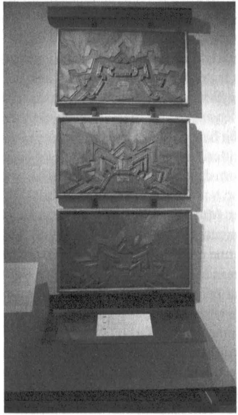

*博洛尼亚伯爵马尔西利所创建的科学研究院中的防御工事模型厅。*

另一方面，马尔西利的收藏又预示另一项新发展：现有模型中有相当一部分直接属于以其“发明者”命名的示范性防御工事。[10] 这些名字包括里姆普勒、安东·冯·赫尔博特、达津、莱昂哈德·克里斯托夫·施图尔姆、弗朗切斯科·德·马尔基、门诺·范·科霍恩、沃邦、克里斯托夫·海德曼。所有作者明确的模型都呈现环绕近似圆形区域的防御工事的一半。也就是说，建造防御结构的实践不仅与方法论秩序和系统相连，方法本身也被系统化、等价化。这些模型并不设防于某个特定地点，而是定义一种超地方的防御工事系统学。仿佛建立了一套多项选择式的方法论系统。人们可以在超地方环境中讨论所有不同防御技术“发明”的利弊，然后选择最适合目的者。方法按定义就是这种能力。方法的发明使某一实践能以同质但不同的方式进行。其差异不再取决于实施地点，而取决于一系列可计算数据。正如18世纪防御工事设计方法一样，所有方法都以若干可计算参数为基础来塑形。地点与社会性相关的无数因素和参数都可以被构想，但方法设计者只以自己认为最关键的少数数据来约束自己。对防御工事而言，这些数据例如是弹道学、地形测量/制图学与劳动力使用分析。有两个主要目标：把炮击造成的破坏降到最低——为此要让炮弹从表面弹开——并且使二者都以最少劳动力和最低成本完成。〔原书第51页〕防御工事建造者从方法中选出一种，凭判断认为它最适合那些参数、最实用，并将其适配到场地。任何实用、到处可运行、可用少量参数计算和监控的实践（实际上是一系列建造—建筑实践），在以后几个世纪将被冠以“客观性”“合理性”等形容词。尽管当时尚未使用这些形容词，同时代人已经重视并称赞沃邦能够进行精细计算、其成本分析接近实际开支。这也可以理解为用数学术语表达质量和成功。因此，这是一个不仅把生产、而且把评价、批评也数学化，也就是超地方化的世界的开端。今天，若不这样思考，在建筑世界里连呼吸都不可能。

### “Entwurff einer historischen Architectur”：一份历史建筑草图

1721年，菲舍尔·冯·埃尔拉赫出版了（用标题原有的古德语拼写）《历史建筑草图》（Entwurff einer historischen Architectur）。[11] 这是第一部在世界地理与人类历史整体中处理建筑的书籍。因此，它预示一种以世界历史尺度定义建筑为核心的新观念变革，这一变革持续至今。菲舍尔·冯·埃尔拉赫所理解的建筑，已远远不同于阿尔伯蒂或瓦萨里的理解。书中例举了从耶路撒冷所罗门圣殿到埃及、古代遗迹、中国、从苏莱曼尼耶到18世纪奥地利的几乎一切地点和时代的建筑。〔原书第52页〕18世纪早期一位奥地利人所能知道的、通过文字和图像资料可以接触到的几乎所有时代和地点的产品，被汇聚在书中，也就是一个超时间、超地方的环境中。一切都被带进永恒的现在。在1450—1700年间，建筑在建筑作品层面的历史延展未曾超出古代罗马和文艺复兴，在文本层面未曾超出古代希腊；而它几乎一步之下就变成一个涵盖整个地球和全部过去的概念。这是一种等价化，同时也是一种历史编纂学的压平。《草图》进行等价化，因为在冯·埃尔拉赫写出来之前，属于不同文化和地点的建筑从未被置于同一语境；它们如今开始共享同一空间（书的空间）。伊斯坦布尔的与罗马的、伊斯兰的与犹太的、教堂与神庙，都被归入一个叫作“建筑”的认识论范畴。当然，对阅读和写作的主体而言，它们的成就与重要性程度不同，或被接受的程度不同，但最终它们全都是建筑。《草图》另一方面也做了一种历史编纂学的压平，因为它把带有不可调和的技术、建构和/或装饰差异、在不同社会性中生长起来的一切，汇聚到书所定义的同一个永恒当下之中。由此出发，一个问题不可避免：建筑史在18世纪早期的这一诞生，究竟表明人们试图照亮一个早已存在的知识领域的过去，还是表明通过建构一个世界历史范畴，实际上发明了一个与今天的“建筑”颇为相似的概念？答案应是后者。因此，建筑史书写实际上是今天所理解的建筑的建构性实践之一。要理解这是怎样一种建构，只要看看世界各地建筑院校开设的“建筑导论”课程如何讲授就够了。在这些学校，教师通常从所有文化、所有地理区域、所有时代中挑选今天称为“建筑作品”的建造物，把它们全部当作说明同一组当下事实的材料。〔原书第53页〕例如，“正确的建筑”在每个时代都与环境协调，在每个地方都敏感于气候数据，在每个地方都功能合理，在每个地方和时代都有正确的静力学解决方案，等等。当然，这不过是一种幻象；但能在共同基础上、在同一个建筑概念的框架内这样处理所有时代，恰恰得益于一种始于《草图》的历史编纂实践。正因如此，森佩尔才能轻松谈论一种从加勒比棚屋一直延伸到19世纪欧洲建筑的、基于同样基本原则的建筑。勒·柯布西耶因此才能从所有时代、文明和地点搜罗他为自己观点寻找的支持性证据。帕特农神庙是建筑，古埃及神庙也是，19世纪的奥斯曼住宅、苏莱曼尼耶、萨伏伊别墅也都是……

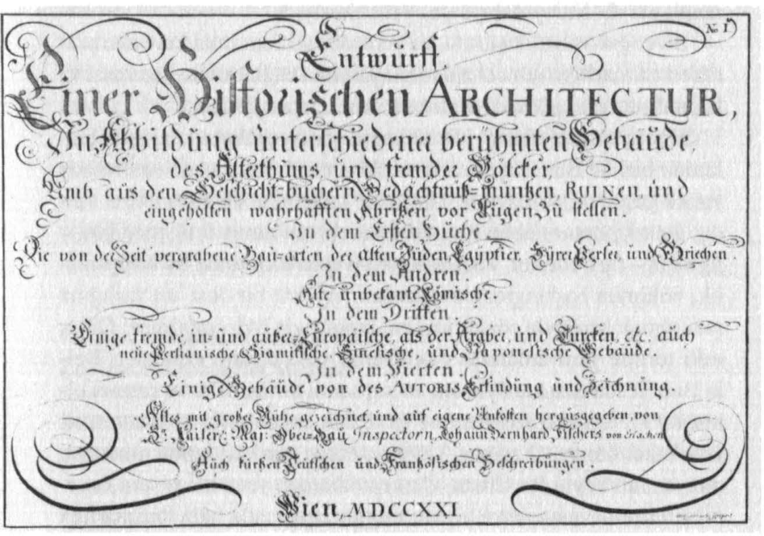

*把建筑想象为一种世界历史现实，始于菲舍尔·冯·埃尔拉赫。其著作的扉页，1721年。*

〔原书第54页〕

这种多重祖国化、这种使人离开其位置和处境化的实践，在创造建筑的当下含义方面显得至关重要、不可避免。一个反讽的例子来自日本……当日本那传奇式的西化冒险开始时，争论之一就是应如何在日语中表达西方语言里的architecture。语言中以前有一个zoka（造家）术语，但日本人——有趣的是——发现它并不与西方语言中的概念吻合。在土耳其语和欧洲语言中，这种不吻合通过接受本章开头所说的“一个虚伪的朋友”的存在而得到解决；在日语中却不这样做：他们不靠给旧词赋予新义来继续前行。也许与西方的相遇如此突然、如此全面、如此震撼，以至于把zoka与architecture的词典意义同一化并不令人信服。于是，1894年，早期现代日本建筑界的头脑伊东忠太利用汉语词根发明了新词kenchiku（建筑）。[12] 这个词今天仍在日语中作为“建筑”的对应词使用。发现architecture不应以旧日语词对应、因为二者在语义上不吻合，乍看之下让人以为日本人拥有别处所无的细致理解。然而，这个故事的后续更适合让人想到相反的东西。一旦内化了18世纪以来生产的建筑史书写实践，日本人也会像其他现代社会一样，能在同一术语的覆盖范围内以同一参数思考所有时代和地点。他们也会走上《草图》开辟的道路。而且同样是在伊东忠太的思想领导下……忠太一旦接受所有建筑都可以被安置在同一个被压平的过去中，也就能够把日本的建造生产安置进一个世界历史模型，当然是他自己的世界历史模型。〔原书第55页〕例如，他会把7世纪日本寺院法隆寺中部鼓起的木柱与古希腊神庙柱身的微凸曲线（entasis）联系起来。[13] 在他看来，西方建筑与日本建筑共享同一起源！可见，那种语义上的审慎，其结果并不是以建筑的历史性和偶然性为轴展开思考；恰恰相反，历史编纂实践在日本也服务于其建构目标：把一系列建造与空间产品加入同一超地方、超时间的世界建筑史行列。

### “Musée complet d'architecture”：完整的建筑博物馆

最早谈到建筑博物馆、因而也是在特定空间中展示建筑的文本，可能是关于1808年由沃杜瓦耶和迪朗承担、将包含模型和石膏建筑片段复制品的公共空间——一个“完整的建筑博物馆”（musée complet d'architecture）。但早在1806年，这样一个公共空间已经在巴黎开放，虽然名字不叫博物馆：“不同民族的建筑杰作画廊”（Galerie des chefs-d'œuvre de l'architecture des différents peuples）。[14] 几乎同一时期，当时最著名的英国建筑师约翰·索恩爵士决定把自己创建的、至今仍可称为浩瀚的16—19世纪建筑图纸、模型、片段与石膏模制品收藏向公众开放。这个收藏至今仍是一个公开的研究中心。[15] 它如今已有无数兄弟……〔原书第56页〕今天世界上有数以百计的建筑博物馆、画廊、中心和学校服务于展示功能。在讨论展示建筑的语境中，考察几个相互衔接的变化可能是有益的。第一，至少最初，展示建筑意味着展示那些迄今被称为建筑作品的建造物的再现物。这与初看给人的印象相反，意味着建筑作品—再现物关系的颠倒。简言之：建筑博物馆中展示的是模型、图纸、透视图、照片和杂项文件等一组再现对象。“再现”一词意味着原本重要的是建造性质的产物，而所列之物通过某些视觉化和复制技术再现那个本质性的东西。如果用这种传统方式定义再现，那么建筑博物馆以及一般意义上的展示，在建筑变革的语境中并不具有革命性意义。然而，博物馆和展览并不只是使既有建筑变得可展示；悖论般的是，它们也把建筑的展示对象、建筑再现物变成了建筑。它们不再再现本原，它们本身就是建筑对象。建造产品—再现的关系颠倒过来。如果说还存在某种再现，那就是再现对象现在再现它自己。模型、图纸等从建造物中获得自主的建筑现实。能指与所指的关系消失。由本原及其再现者组成的二分法瓦解。这一过程的正常产物，是发明出未曾建造、不打算建造、实践中也不可能建造、只存在于模型、图纸、拼贴中的建筑。事情还不止于此；正如在赫伊杜克被他称为“面具”和“诗”的作品中那样[16]，在人们不习惯视为建筑性质的媒介中也可以生产建筑。

〔原书第57页〕

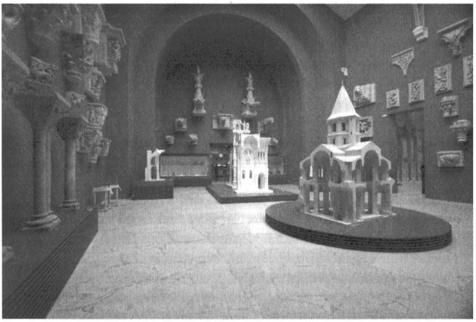

*最早的建筑博物馆之一：巴黎1879年创建的建筑与遗产之城（Cité de l’Architecture et du Patrimoine）的一处室内。*

建筑与建造物之间既有联系的松解、建筑的自主化，成为其超地方化的生产者之一。属于不同地点、语境和位置的东西，被从原初地点剥离，归入一个新地点——博物馆、画廊（以及电影、书籍，甚至如赫伊杜克例子中的“面具”、戏剧）——的财产。帕埃斯图姆神庙的软木模型，使属于帕埃斯图姆的东西也属于约翰·索恩在伦敦的博物馆住宅。建筑可以位于帕埃斯图姆，但与它相关的人工物却在另一个或多个地方。关于帕埃斯图姆神庙的知识不仅在帕埃斯图姆，〔原书第58页〕也通过没有用同样材料和工具制造的物件而存在于别处。甚至，要谈论帕埃斯图姆建筑，人们越来越觉得更合理、更必要的是去一个可以查阅测绘与复原图纸的机构，而不是去那不勒斯。逐渐地，曾经只属于帕埃斯图姆、米兰、雅典、纽约的东西，变得属于所有地方。而更重要的是，关于那个帕埃斯图姆模型的自主知识可以被生产出来。可以把它当作一个建筑模型本身——独立于它是什么的模型——来理解、研究、欣赏、历史化等等。于是，固定在场所和建构性之上的建筑想象逐渐被侵蚀。甚至真正的建筑物也不再具有不可从其所在地剥离的性质。例如，克桑托斯的涅瑞伊得斯纪念碑被运到伦敦大英博物馆，帕加马祭坛被运到柏林，登杜尔神庙被运到纽约大都会艺术博物馆。建筑一旦被超地方化，就没有办法再把它重新固定下来。在此情况下，甚至真正的建筑也仿佛成了自己的模型。展示建筑意味着使这种超地方状态也常态化。有趣的是，从超地方性语境思考，为了展示而搬迁建筑与为展示目的在原地建造之间也没有根本区别。我这样说，是想指德国从魏森霍夫（1929；校注：底本如此，[魏森霍夫博物馆](https://weissenhofmuseum.de/en/siedlung/die-ausstellung-1927/)记载该住宅展览建于1927年）开始建造的住宅展览园区。这些是包含示范住宅、旨在建设新的居住与美学世界的聚落。它们具有展览性质，也就是说，其中的住宅可以被视为自身的1:1模型。它们是超地方的，因为它们的共处是通过把不同阶级性、不同思想、不同存在方式为了展示目的聚集在一起而发生的。也就是说，创造它们的条件在真正的城市中根本不可能存在。可见，在展示活动的框架内，人们首先认为建筑的再现对象再现建筑；但随后，那再现关系几乎刚刚建立就消解，产生出“再现对象本身就是建筑产品”的知识。换言之，建筑不再能以能指—所指关系把握；那里只有能指：建筑指向建筑、展示建筑。〔原书第59页〕结果，正如几年前一位土耳其建筑学院教师不以为然地对我说的那样，可以说“一切都变成了建筑”。但为了展示建筑，本来就首先需要“一切都变成建筑”。论证的反面也成立：展示是使一切成为建筑的诸工具之一。用非常简单的话说，帕加马的希腊化祭坛在它被看作废墟和石堆的地点与时代，当然不是“建筑”。是把它转化为可展示对象的人（卡尔·胡曼及其同事）把它变成了建筑。为此他们把祭坛运到柏林，这令人痛心，但也平常。当然，它也可以在帕加马展示。然而要这样做，就必须在那里把它定义为“建筑”产品。在无法使一切成为建筑——因为无法使之超地方化——的环境中，做不到的许多事情之一就是展览。因为不是一切都变成建筑，所以无法展览；因为无法展览，所以不是一切都能被造成建筑。一些做到这一点的早期例子至今仍保持当下性。例如1930年代意大利，尤其是从米兰三年展开始，展览越来越明显地超越既有建筑。[17] 它将扩大建筑的边界，首先不是把自己安置于所在的展览建筑中，而是也要改造它。但为了理解“一切被造成建筑”语境中真正的激进变化，让我们看看展示对象与展示者之间的区分已无法辨认的例子。早在1920年代，艺术—设计—建筑之间的边界就被能做到这一点的展览跨越。弗里德里希·基斯勒1925年在巴黎大皇宫开幕的“Raumstadt”（空间城市）展览就是这样的早期产物。该展览是为“国际装饰艺术与现代工业博览会”奥地利参展部分的戏剧单元准备的。基斯勒在那里提出一座未来城市的方案。[18] 一个不接触地面、悬在空中的正交平面与杆件综合体……在一个戏剧展览中呈现的基斯勒建筑，创造了不可消解、不可分离的实践。〔原书第60页〕让我们思考这些实践意味着什么。展示目的（戏剧）、展示对象的指涉（城市与建筑）、展示对象的形式暗示（三维艺术产品）等特征当时在那里构成的整体，用今天的术语说，狭义上是一件装置，广义上则是建筑。从那里到萨尔基斯在伊斯坦布尔ARTER的展览“Interpretation of Cage/Ryoanji”（2013年11月—2014年1月）[19] 的路并不长。萨尔基斯在ARTER的出发点，是约翰·凯奇受日本京都龙安寺寺院沙庭这一建筑空间启发而写的长笛独奏乐谱。他把凯奇的音乐书写当作书法性数据，由此创作受凯奇启发的自己的水彩画。展览策展人费雷利（Fereli）的贡献，是通过萨尔基斯的水彩画，邀请一位奈伊笛演奏者（Kudsi Erguner）和一位日本笛大师（J.-E. Lagrost）在该展览空间中进行共同即兴表演。所有这些的可理解性，则由埃森·卡罗尔设计的展览图录和CD提供。因此，展览把龙安寺、凯奇、萨尔基斯、费雷利、埃尔古纳、拉格罗斯特以及卡罗尔的实践汇聚在一起。它也把这一切超地方化。京都、伊斯坦布尔、巴黎在这一作品语境中不再能够被清楚区分。那么，在此把建筑从绘画、音乐、平面设计以及从展览空间中区分出来、使之自主化的努力有多大意义？此外，还有没有可能把其中每一项都看作原本专属于其所在地？没有。使一切成为建筑，正是这件事。

〔原书第61页〕

### 塞利米耶的鼠数统计

20世纪初，一份用旧文字编排的印刷文书有一个非常奇怪的标题：“Fare Cedveli”（鼠表）。[20] 文书中包含伊斯坦布尔塞利米耶兵营的示意平面图、剖面图和空间清单。在它们上面，所有空间都被定义、编号，并绘制了标明每个空间捕获多少只活鼠或死鼠的表格。这无疑首先表明一种卫生参数的生成。它定义了该建筑的卫生标准。然而，用在那里进行的灭鼠活动的数值来定义空间，也意味着对空间、对建筑本身的重新定义。过去，空间也可以根据其所包含的固定数值被数值化地定义。但在“鼠表”中，被数量化的不是空间所包含的东西，而是那里发生的一种生物过程。据我所知，这在土耳其是建筑之统计式理解的开端，而在世界范围内也是一种不早于17世纪晚期的超地方实践。这种实践的根源不在于老鼠，而在于为人类制作预期寿命统计。已知第一份城市生命表由约翰·格朗特为伦敦编制，并于1662年出版。[21] 随后是著名天文学家、发现以自己命名的彗星的埃德蒙·哈雷为德国布雷斯劳城制作、1693年发表的历史上第一份科学意义上的系统生命统计。[22] 二者都把居住在某地之人的生活—死亡动态用数量方式表达出来。〔原书第62页〕例如，格朗特对20年间伦敦死亡原因做了一份统计表。由此，人们得以知道各种疾病、谋杀和自然死亡的比例。我们必须看到，这不仅重构了关于伦敦的知识，而且不止于此，还以生物学基础重新定义了建筑知识。用数值在永不安定的生物过程语境中表达建筑、一般地空间，也就是相对固定之物，与把特殊之物归入普遍范畴的努力相联系。这意味着，可以同时处理空间及其使用者，通过数值数据进行性质定义。这也是使建筑品质可以用数字描述。这样做，就能在空间与空间性之间进行比较。这种数值化也提供了重新定义“地点”的可能。它在心智意义上重新建构地点。关于地点的知识不再只是心理社会的，也变成了数学的。例如，由此产生这样的论断：住在某个空间比另一个更健康，或者必须把它的标准提高到某一程度。19世纪第二个四分之一开始时，英国议会委员会利用这一可能，勾勒出工人街区住房条件的统计框架。同样凭借这一可能，物理环境获得一种不只是尺寸意义上的数学性。人们开始可以思考如何、在多大程度上、在哪些语境中改变它。现代住宅建筑首先是这种生物—数学的产物。泰勒主义式有效劳动使用话语，以及它们在1920年代极其密集地决定议程的建筑改编[23]，也利用了同样的数学基础。它们都发明并使用能让物理之物在生物过程语境中被定义的数学实践。在更大尺度上，同样的数值化实践将建构新的城市规划学科。〔原书第63页〕城市规划，就是把建筑在最广泛尺度上等同于对聚落的数值和/或统计分析。这些数值化实践既提供评估、比较城市现实的可能，也使人能够按照该评估定义将要改造和建设城市空间。但最重要的是，被当作考察、比较、评估对象的那些城市现实，其实正是凭借同样实践被创造出来的。说今天人们想到城市时绝大部分是由生物—数学实践建构的，并不夸张。从人均每日通勤小时数，到人均每周体育消费，再到按城市社会群体划分的互联网访问量、涉诉数量、就医频率，一切能想到的生物—数学参数都在建构新的城市性，在最广义上做出新的建筑定义。

### 强度与静力学

安托万·皮孔在讲述18世纪末与19世纪英国和法国的建筑领域变化及工程学的诞生时，把正在发生的事情概括为“……建筑形式变得无法用它得以实现的技术来定义……”[24] 他指出的是，建筑形式与创造它的材料、建造实践相重合、并由地点来定义的状态消失了。过去，建筑形式的几何、一般地一切建筑生产实践，都不能独立于使之可能的建造技术，而建造技术也不能独立于特定地点；现代工程学至少理论上、而且常常实践中也开辟了道路，使每一种技术条件都能在任何地方建造每一种形式。建构—技术—地点之间的纽带松解。不能再说某种在特定地点有效的技术必然使某种建构结果成为可能。〔原书第64页〕也不再存在为获得特定建构结果而必须采用的技术。建构—技术纽带的松解，意味着二者关系变成了超地方的。由于这种松解，穹顶例如只是一个半球。这个半球由砖砌、由金属骨架覆盖金属板建造、或用钢筋混凝土浇筑等等，基本上不会改变它的形式定义。当然，出于意识形态理由反对这一点是一种普遍倾向，但从技术脱离地点语境看，并不存在矛盾。然而，将近一个世纪里，工程—建筑领域思考路线，正是由坚持把这件事视为矛盾及其产生的紧张所定义的。例如，“诚实”派紧抓形式—技术纽带那种古老而显然已被侵蚀的不可分离性论证。〔原书第65页〕对他们来说，例如无缝穹顶的形式是砖砌技术所强制的。或者，万神殿的藻井穹顶直接是罗马混凝土技术的产物。这样看，钢筋混凝土清真寺穹顶，或用金属结构再现万神殿穹顶，都会是激进错误，甚至是不道德态度。早期现代反历史主义理论家视为危机的情况，正是皮孔所描述变化的另一种说法。万神殿穹顶在古代罗马以创造它的技术在另一种形式中（在决定论框架内）相关联，今天则以另一种方式、且非决定论地关联……用公元前4世纪建造者、13世纪欧洲石匠、甚至希南都无法梦想的技术建造古希腊神庙、哥特式拱顶、古典奥斯曼清真寺穹顶，是可能的。技术不再被迫服务于某几种形式，形式也不再是单一技术的必然产物。从同一技术基础出发，可以创造不同的建构结果。然而，尤其令20世纪建筑师和思想家不安、甚至成为古典现代建筑史书写主要范式的这种建构—技术断裂，不仅开辟了用新技术再现旧形式的道路。更重要的是，它解放了形式生产。我将称之为“相对形式的崩溃”的变化，实际上摧毁了形式。它使建造和空间生产不再被迫服从形式。皮孔对一种此前几乎无人注意的症状所作的这一诊断，在“超地方”的建构语境中标志着一场根本性的范式变化。这是从形式—技术纽带是不可分离的决定论必然性的世界，走向二者分离/松解的世界。不过，沿着这样一条道路一路疾驰、抵达那种讨喜的建筑陈词滥调之前，最好不要着急。也就是说，整幅变化图景想说的，并不是建筑形式与技术如今在任何地方都产生相同结果、世界正走向不可逾越的同质化。恰恰相反，它意味着每一件建筑产品、每一种建造活动、每一种形式都是特殊的，并作为不可重复的“自身”获得存在。

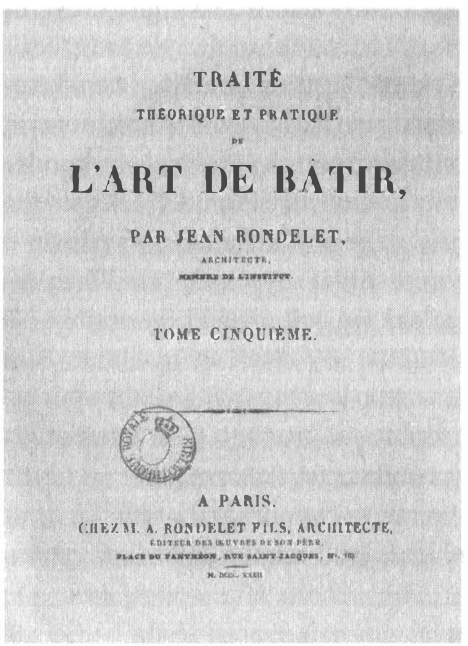

*在建造技术成为超地方实践的过程中，建造手册扮演了主要角色。一个先驱性例子：让·龙德莱，《建筑艺术的理论与实践教程》（Traité théorique et pratique de l'art de bâtir），5卷，巴黎，1812—1817年。图为该书1832年第二版第5卷。*

### “机械”与“技术”

〔原书第66页〕

雷蒙·威廉斯在《关键词》中概括一系列概念在英语中的历史形成过程时，也讲述了mechanical与technology的命运。[25] 据他所说，mechanical从15世纪起涵盖农业以外的一切制造，因此似乎也获得了阶级性内容。它有一种明确指向社会地位的贬义语调。例如1589年可以说“mechanical and men of base condition”（粗略地说，“做手工劳动的下层人”）。这类用法从18世纪起改变。该词在过去三百年里表达阶级性、因而在地点中被编码、因为它以所指向实践的社会性为轴的含义，在那个门槛之后、在今天，变成了对动作、活动和一系列实践的一般技术表达。technology在18世纪以前甚至还不是一个词。被纳入技术的实践，早先是以职业名称定义的。例如没有砌体建筑技术，只有石匠工作。不存在一种把一切制造实践使用者之集体工作都包括在内的生产概念。建筑在这种环境中自然也不被定义为技术活动。这种语义变化不仅限于上述两个词，它表明与建筑——甚至所有生产领域——相关的整个术语体系的社会意涵正在被抹去。人们正逐渐远离一个世界：在那里，每个生产性术语都直接指向社会地位、等级、职业、职责，有时甚至宗教、族群位置，至少不能与它们分离。要理解这一点，简短回顾欧洲及欧洲以外的行会及类似组织会有启发。例如，在中世纪欧洲，石匠所从事的活动并不被定义为一种技术工作，而被认为是一种生活方式、一种存在位置、一种社会团结体系，甚至一套行业秘密。〔原书第67页〕一切制造实践几乎——有时干脆——包含秘传性质的神秘，这一点随时间被遗忘；由此产生一种理解：生产之所指不是别的，只是生产过程的总和——技术。建筑是这种世俗化、这种祛魅和这种超地方化最早发生的生产领域之一。首先，建筑生产的神圣性被破坏，神秘被解开，其常态化成为可能。想把握这一变化各个侧面的人，可以从思考17世纪把石材切割工作定义为一种技术与几何实践的stereotomi（实体切割）学科的发明开始。随后，也有益于考察18世纪晚期出现且延续至今的木构造与砌体构造手册的漫长历史。

### 建筑的发明

我们用来命名一组思想、建造、空间、职业和话语现象与现实的、今天所说的“建筑”一词，似乎是在一系列实践中、并凭借这些实践被发明出来的；这些实践大多始于18世纪。如果今天说到建筑，人们想到的不再只是建造生产这一实践，或者局限于欧洲（最多加上古埃及和古希腊）所建纪念性建筑总和的历史延展，那么这正是那个漫长发明过程中的可能。如果构造与建造生产如今只构成建筑概念边界内的一部分，如果一种扩展的建筑理解几乎已把边界松动到“使一切成为建筑”，并且仍在松动，那么显而易见，我们不能再像存在一种永恒、永久的建筑那样说话。然而，甚至在1940年代，佩夫斯纳还能说林肯大教堂是建筑、一个自行车棚是建筑物[26]，而且获得接受。〔原书第68页〕不到一个世纪后，这条概念界线似乎已被大大逾越。当然可以断言，这种变化很大程度上与一种政治正确姿态有关。如果连最顽固的欧洲中心主义头脑如今也能说建筑是一种世界历史现实，知识自由主义所施加的影响当然起了作用。但显而易见，我所说的建筑概念扩展所包含的远不止这些。我说的是横向和纵向的扩展。所有时代、社会和地点都进入其范围，而且在这些地方被创造出来的建造性、空间性、口头性、书面性、乌托邦性、二维三维的、或以人工和自然材料塑形、直接或间接触及空间生产的许多东西也进入其中……尽管仍有大片抵抗和怀疑的孤岛，人们几乎到处都更相信“扩展的建筑”定义。我在此的目的——如我此前反复强调的——不是讨论这一走向。我要问题化的，是这个可称为新的定义之新、及其处于无尽生成状态这一点被不断忽略。我把它当作问题：我们可以自信地把它当作固定的、超时间的词典材料来使用。我们必须意识到，一个在西方语言中（architectura）已有近2500年、在土耳其语中（mimarlık）已有600年的词，其语音层面的稳定性所造成的错觉。我们不得不用一个在时间中冻结的词来表达不断生成之物。人类语言正是如此。这一矛盾当然无法消除，但它所产生的固定性幻象可以被意识到。例如，不必从告诉一年级本科生维特鲁威三定义的有效性开始教学。也不必犯下“米马尔·希南在做建筑，我们也在做建筑”这种失言。也不必把民居中存在着我们今日无法达到的功能性解决方案，解释为仿佛存在某种永恒品质定义。简而言之，我们可以意识到，我们一直在重新定义“建筑”概念，在其中去掉一些旧内容、放入新内容，我们今天开始把不久前还不称为建筑的东西称为建筑，可以把过去称为建筑的某些东西排除在边界之外，〔原书第69页〕甚至每天都在重新融化边界。也许到那时，我们能看到，重写建筑史的问题对于这个被认为具有固定定义的知识领域而言，是一种生命攸关的必然。最重要的是，我们领悟到建筑如今已有多重祖国，也完全可以被定义为一系列由超地方实践建构的超地方实践；不仅土耳其如此，世界任何地方都是如此。

〔原书第70页〕

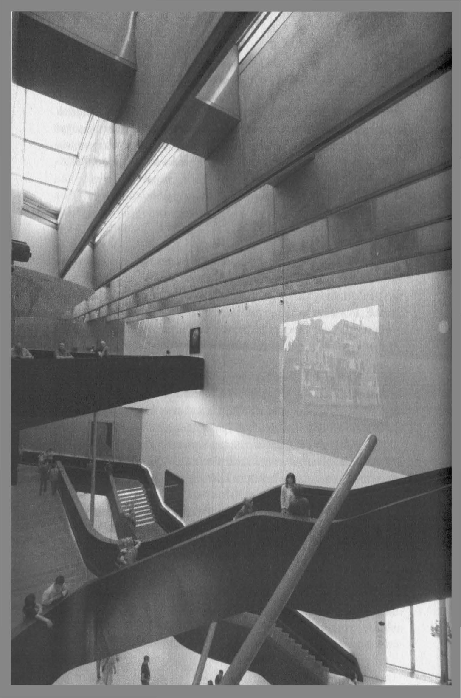

*整页图片：摄影：乌古尔·坦耶利。*

## III　重新定义职业：大都市化世界中建筑师的角色

〔原书第71页〕

> “没有‘建筑师’，只有‘建筑师们’。存在的是主体。是需要我们为之命名的人。我不认为存在这样一个想象出来的群体：他们全都被称为建筑师，表现出某些共同行为，采取某些政治姿态，整体地进行思考，仿佛历史手中的工具，按照历史的命令组织空间，并受到某个来自上方的人、某种至高力量的引导。……看不见作为行动者的主体，并不是我们偶然碰上的一次疏忽。我们看不见，是因为我们不想看见。这源于我们不愿把这一历史的、社会的转变理解为一个由主体构成的复杂乃至“笨拙”的整体。于是，你看不到人与人之间能有多么不同，更糟的是，你看不到每个人有多么悲剧。周围的环境会让你觉得，你始终生活在某种戏剧状态中。然而每个人都是悲剧性的。从某个角度看，所有主体的生活都纯粹是可悲的。我们的生活不断在冲突中发生。其中当然也会产生无数和解。但在所有这些之中，最终结果都是我们拥有一种悲剧性生活这一事实。……建筑师之所以是悲剧性的，并不是因为我把他们看成悲剧性的。我们每次都想要一个与社会和睦相处的主体。这样的主体不存在，也不可能存在。……每个主体都通过绝望地抵抗社会性而获得存在，而社会性所起的作用就像古典戏剧中的命运形象。”[1]

*建筑师明星的名字往往能让一个建筑产品的公关问题迎刃而解。罗马MAXXI当代艺术博物馆的吸引力，既归功于其内容，也归功于扎哈·哈迪德的声名。*

〔原书第72页〕

人们生活在一个前所未有的城市化世界中。这个时代是建筑师的黄金时代吗？哪怕只从工作量来看，也确实如此。毫无疑问，建筑在几乎所有时期都始终是一种城市现象。如果要把空间／建筑的生产交给专家之手，这主要发生在城市，如今也仍然如此。在乡村社会里，建筑、通过专家生产空间的可能显然有限，因为专业化的条件本身就有限。世界越城市化，对建筑和建筑师的需求就越高。今天，在被称作世界发达国家的那些地方，已经有条件谈论农民阶层的完全消失。粗略地说，自19世纪以来，世界一直在快速城市化，并变得完全由城市性来定义。另一方面，另一种变化也开始发生：城市性正向大都市的尺度攀升。也就是说，它从小城市演变为大城市，从大城市演变为巨型城市。其后果又一次直接关系到建筑。随着大都市化不断升级，可以这样说：一般意义上的建筑各类专门化、特别是建筑师的工作量也必然增加，因为建筑生产工作变得更复杂、更多样。然而，尽管有这一切，今天世界上没有任何地方是整个建筑生产部门都由建筑师运行和监管的。即便如此，大都市化的升级仍必然意味着建筑师的工作持续增加。

大都市化同时也意味着多元性的统治和同质性的毁灭。大致在19世纪和20世纪，几乎所有关于物理环境的事物，都是基于物理环境应当拥有同质性、身份完整性这一前提来思考的。长期以来，人们抱着城市应当如此塑造的信念来处理城市。城市规划几乎就是这个意思。观察当代变化的人最初的判断是：过去的城市，例如欧洲的中世纪城市和土耳其的奥斯曼城市，表现出身份完整性和同质性；长期以来，人们对此深信不疑，〔原书第73页〕甚至直到19世纪晚期，建筑和城市规划思想也大多以怀念传统城市并主张以其为范本为特征。例如，普金可以算作中世纪城市怀旧情绪的理论家[2]，西特[3]和梅贝斯[4]则可以算作主张以传统城市面貌为范例的努力的理论家和／或宣传者。如今我们既知道过去的同质性是一种梦想，也不再像从前那样容易谈论当代城市异质性的不健康。在一个大都市化不断攀升的世界里，同质性也正变得不可能。城市开始包含彼此极为不同的要素。它们既在物质上包含彼此极为不同的要素，也在社会和文化意义上变得极度异质化。彼此不同的文化存在、偏好、生活习惯、族群、边缘性、各种亚文化群体开始构成大都市。变化在于：过去也包含多样性的世界变得更加异质；但更重要的是，今天差异、群体之间的关系比过去复杂得多。说可预见的未来整个世界都将如此，大概不算预言。世界并不在朝同质性、身份完整性、文化共识前进，恰恰相反，这是一个不同偏好并存、和解只能在特定区域实现、一切决定都在受时间—空间语境限制的尺度上作出的世界。我说的是，人们有时通过在特定区域建立和解、共识与合作来运作。但也可以从消极面来写这个剧本：复杂化和异质化也触发了一种新波拿巴主义。那些对混乱产生恐慌、又难以达成和解的人，反而更愿意屈服于反民主的专横。〔原书第74页〕我写的这些都同建筑服务和建筑职业直接相关。如果世界、大都市、城市正在异质化，建筑职业领域也会如此。当然，建筑师的客户所经历的异质性还要更广。

今天，拥有超过三千万人口的东京是世界上最大的大都市；但可以预见，在不久的将来，印度的孟买、中国的上海将以超过四千万的规模成为比它更大的巨型都市。不过，我们不要把变化限定为一个由四千万人口大都市构成的世界。让我们设想：在一个几乎所有人都生活在城市、完全城市化的世界里，也会有一些四千万人口的过度集中点。可以说，乡村—城市的分裂已不再存在；相反，地球几乎所有部分都将城市化，而某些特定地点则会过度集中。大多数地方甚至已经如此。那些地方仍然像旧世界那样拥有名字，仿佛名字指向某种明确的物理存在。它们仍被继续叫做墨西哥城、伊斯坦布尔、东京、马德拉斯、圣保罗、莫斯科等等。然而，大都市不再让人想到某种具有内在连贯性的身份，甚至不再让人想到物质上的完整性。

大都市同时也是控制世界经济、生产经济价值中极重要部分的地方。世界经济如今是一种大都市经济。在这样一个世界里，作为建筑师工作，要求、也将继续要求扮演比以往时期复杂得多的角色。在不久的将来，在由单一角色统治的世界里将无法从事建筑。如果过去一提到佛罗伦萨或北京，人们心中会浮现出（真实或想象的）品质想象，而今天提到纽约或上海时这种想象不再形成，那就必须研究这为建筑职业定义了怎样的环境和可能性。

例如，16世纪生活在埃迪尔内、伊兹米特或埃斯基谢希尔的人，最多会遇到两种建筑师。实际上他们只会遇到其中一种，另一种他们根本看不见。当时有一种被称作“城市建筑师”的建筑师类型，在建筑工艺与建筑学的交界处工作，通常建造住宅。[5] 第二种〔原书第75页〕建筑师类型，则是建造由中央政权代表出资的奥斯曼“官方”砖石建筑的人。他们本来大多不居住在地方行省。他们通常集中在奥斯曼领土上的少数几个地点，首先是伊斯坦布尔。在地方行省的中等城市，或许每个世纪才能见到他们一次。建造这样一座砖石纪念性建筑时，这些建筑师中的一位会从伊斯坦布尔前来，担任工程监督角色；工程结束后便返回。单一的建筑师类型，就足以承担整座城市的所有建筑事务。因此，在旧世界中谈论单一角色的建筑师是典型情形。这种情况适用于那个世界的任何地方。在大都市的世界里，一切意义上的多元性也使建筑师多元化。它不仅使建筑师多元化，也使建筑师的角色多元化。

“建筑师的角色”其实是一个社会学用语。社会学中说“角色”，指的是人们为了实现自身的社会存在而采用的、以特定方式行动的习性。人生活在社会性之中，学会在特定角色的框架内表达自己、定义位置。例如，他学会在社会性中作为女人或男人、作为配偶、作为父亲、作为建筑师、作为公务员、作为投资者或作为受薪劳动者来行动……我们通过生活在社会实践之中，从出生那天起，一次又一次地以特定模式学习按照彼此不同的无数社会存在方式行动。可以把所学之物定义为角色，因为它们并非永久不变；它们会同时地、历时地被改变。让整个一生都处在固定的表演模式中，是不可能的。例如，在学校里扮演学生角色；随着毕业，这个角色便从日程上消失。扮演学生角色，意味着像学生那样行动。如果没有特定的幽默意图，学生不会像教师那样行动，教师也不会像学生那样行动。这源于我们对这些特定角色的熟悉。我们既在扮演时熟悉那个角色，也期待别人〔原书第76页〕扮演为他们量身定制的角色。因为我们对自身不扮演的角色也有看法。社会关系正是借助关于这些角色的预判而建立。当然，人们同时扮演学生、子女、资产阶级等角色（以及许多其他角色）。人们也按社会位置聚合成不同的行为模式群体；社会游戏因此才得以进行：人们因此才能相互理解、相互交谈、形成期待。

今天在意大利，每414人就有一名建筑师。这是世界纪录，也说明了建筑职业的现状和未来。显然，建筑师数量正在经历惊人的增长。19世纪结束时，即使在全球人口最多、最富裕的大都市伦敦，建筑师总数也不到一千。同样在19世纪末，已知在伊斯坦布尔工作的建筑师甚至不足150人。而如今土耳其有45,000名建筑师，每年至少增加2000名新的职业人士。这些数字表明，一个曾经由少数建筑师为少数人和机构做设计的世界早已崩塌。如今几乎每个人都能成为建筑师，每个人都能直接或间接地受益于建筑师的劳动。

消费社会不仅推高了商品和货物的消费。显然，人们消费了比过去多得多的食品、纺织品、鞋、家用电器、汽车，但真正攀升的是各类服务业。建筑也是服务业的一个组成部分。随着消费和生产的增长，不仅是建筑，每一种服务的性质、意义、价值，以及生产者的社会身份和角色，都在改变。例如：即使在18世纪，全世界除了小饭馆／公共食堂之外，几乎没有什么在外就餐的可能。要去那里吃饭，要么必须是单身，要么工作地点离家远到中午没有机会回家。今天，餐馆〔原书第77页〕虽然出于这类必要而去餐馆，在经济层面仍属首要，但对这个行业中可称为创造性的部分来说，已是次要的。人们去餐馆也是为了满足口腹之乐。因此，在发达国家，任何人每周去餐馆的次数早已超过一次。正因如此，现在才有可能谈论美食生产力。每天都有新的民族菜系被发掘，新的摆盘技术被创造，新的菜品被发明。食谱网站在最常访问的网站中不断刷新纪录。美食评论家、美食专家这样的职业已经出现。几乎所有富裕国家都有数十个以美食为主题的电视频道在播出，举办比赛，组织国内外美食与葡萄酒品鉴之旅。

建筑中发生的事情要比美食领域复杂得多。因为建筑职业数百年来，尤其是从15世纪意大利开始的早期现代时期，一直是一种精英职业。成为建筑师的机会曾以各种方式受到限制。因此建筑师构成的群体如此之小，以至于今天一个普通专家也能数出所有重要意大利文艺复兴建筑师的名字。几乎可以凭记忆列出1750年在罗马工作的建筑师名单。要想“发现”一位未被收入霍华德·科尔文《英国建筑师传记辞典，1600—1840》（*A Biographical Dictionary of British Architects, 1600-1840*）的建筑师，几乎是不可能的。

建筑从这种低需求、低供给体系向高需求、极高供给体系的转变，似乎让所有人、尤其是建筑师感到困惑。首先，这一转变把行业变成了残酷竞争和“消耗人才”的秩序。例如，每年全世界有数万名新建筑师进入职业，他们都知道，未来他们当中甚至千分之一都不可能成名。而在19世纪末，每个进入职业的年轻人都有望成为重要建筑师。这甚至是一种现实的期待。当时从巴黎美术学院毕业的年轻人几乎全都获得了某种知名度。在校时和毕业后，他们都属于一个小小的精英群体。而今天，建筑师数量不断攀升，全世界的建筑教育却仍维持着那套旧的精英主义、以才能为中心、精英化的〔原书第78页〕习惯。做一个比较或许能说明问题：对于进入大学学习经济学、工程学、医学等的年轻人，精英主义习惯在他们的教育和期待中占多大位置？他们大多知道，自己的职业不允许精英化、明星化。他们的目标充其量是毕业后找到一份收入不错的工作，或创办一门这样的事业。尽管很少承认，他们早已接受了系统性的常规。
在建筑学校乃至毕业之后，却没有让人顺从地接受这种平凡性的土壤。无论教学实践多么不同，所有学校都回避放弃培养明星和有才华之人的取向。教师中间盛行一种“政治正确”的姿态，不断重复说这里培养的是普通人，说“才能有什么重要”；但实际上，这套系统极度竞争、极度筛选。当然，像土耳其这样对每个开始建筑教育的人都“不淘汰地”发放文凭的国家并不多。但即使在这个获得建筑文凭如此容易的地方，人们仍然相信明星化和精英化。

可见，建筑世界如今正经历一个死胡同或两难。一方面，建筑职业的大众化使它平凡化；在资本主义生产关系框架内，建筑和其他职业一样，变成了一套普通的实践。它的魔力被破除了。也许，资本主义正在消融那些限制进入和参与的旧壁垒，使建筑不再是最后一种封闭职业。它像所有职业一样向所有人开放。另一方面，由规划、设计和建造定义的旧工作领域也在解体，变成一个无边无际、雾一般的混乱环境。然而它仍在延续自身那些文艺复兴残余的价值判断。尽管它与创造力概念已没有内在联系，却仍不离口地谈论创造力话语。它不去看创造力并非某种专属的建筑能力或特质、所有资本主义实践都可能包含创造力，反而声称自己是少数创造性职业之一。可悲的是，赋予建筑趣味和吸引力、并造成可怕人力损耗的这种天真职业〔原书第79页〕环境，其运作的经济机制也由同一个矛盾支撑着。我们用建筑填满地球，但它们充其量只有千分之一是重要的。我们培养数以百万计的建筑师，但他们中甚至千分之一都无法超越匿名状态。然而这套秩序仍在运转，需求并未下降。建筑中真正的奇迹就在这里。

今天不可能只谈论一种建筑师角色。同一个主体可以在不同的帽子下扮演不同的角色。过去当然也不存在只有一顶帽子的情况。例如在16世纪的布尔萨，身为城市建筑师的人，其角色之一就是以城市建筑师的身份行动。除此之外，他大概只能是穆斯林或基督徒。角色选项有限。今天，人人都扮演多重角色，因此可以在几乎无穷多的组合中分化。但更重要的是，与过去不同，今天的角色不是给定的，也不是有约束力的。要扮演哪些角色，很大程度上由主体自己决定。角色虽然可以从外部强加，但在一定程度上也有抵抗这种强加的可能。过去不太被容忍讨论、否认、改变的角色，今天可以被否认，可以以其他方式解释。个体变异的可能性非常广阔。我们既因所扮演的角色而彼此和解、结成群体，也就是说彼此区分、分化为可识别的群体；同时，由于我们角色的无限多元性汇聚在一起，我们每个人也成为不同的人。因为我们建筑之外的角色也会加到建筑角色之上。可以说，今天世界上的社会人格，像一道几乎有无穷多成分的方程式一样形成。作为女性建筑师是不同的，作为男性建筑师是不同的。因为女性和男性的社会角色不同。这些不只是生理差异。女性气质和男性气质的行为方式，也是在社会性中习得的行为。再加上所属族群、社会群体、阶级、家庭的教育状况等等。在这一切之上，再加入仅在建筑语境〔原书第80页〕中定义的角色，就可以推测人们是在怎样的多元性中工作。显然，在这种环境中寻找个人道路，正在跳一支相当复杂的舞。舞蹈隐喻在这里很有意义。是的，每支舞都有特定规则，但每个人都把这些舞步改编进自己的个体性来跳。正如不可能跳出完全非个人化的、只依据绝对规则的舞，社会游戏也不可能那样进行。因此，个体的存在就在这些多重角色所定义的编舞中建立起来。

但问题在于，这些角色常常彼此冲突。一个角色在某些情况下使另一些角色不可能，在某些情况下又使其成为必然；有时彼此和解，有时不能。角色冲突，意味着一个人所扮演的角色彼此矛盾，某些角色减少或破坏了扮演其他角色的机会。例如，同时做官僚、设计师和／或明星建筑师，几乎必然产生角色冲突。用韦伯的话说，作为“日常常规的支配者”的官僚[6]，把既定任务的连续性和程序的固定性放在首位；而对明星来说，本质是变化。在必须推出新产品和新方法的资本主义体系中，始终固守同一条设计道路，就是否定自己的明星角色。官僚建筑师没有这种奢侈。类似的角色冲突也见于设计师与理论家角色之间的不可调和——尽管人们常常作相反设想。理论家的建筑主张和判断，完全可以与他自己提出的设计相矛盾。他可能无法按照自己所说的、所建议的去设计或建造。这在20世纪尤其常见。商人建筑师与设计师建筑师之间的矛盾，也会产生不可低估的角色冲突。管理一家大型建筑事务所的工作，很少与设计的动力学相协调。例如，商人在提交设计服务时对时间限制和成本分析现实性的敏感度很高；他期待这些限制被严格遵守，〔原书第81页〕因为客户也抱有同样期待。而设计师几乎总是要求比所给予的更长设计时间和更宽松确定的成本界限。意见领袖／活动家与商人建筑师之间的角色冲突也不可避免。活动家以社会责任为中心思考，商人则自然把个人利益放在首位。当然，上面所列没有一种情况是无例外地出现的；有时不会发生，有时则可能以非常糟糕的方式发生。然而，建筑角色也像所有社会角色一样，绝不可能在绝对无冲突中扮演。

下面简要讨论一组建筑职业角色。

### 作为设计师的建筑师

这大概是最为人熟知、却又最少见的角色。进入建筑学校的年轻人，至少在注册时已经知道职业中的这个角色。他们相信建筑师首先是设计师。然而，设计师只是建筑师诸多角色之一。设计大致意味着：在建筑自身经济意义之外，还存在一种形式的经济意义——这种形式使建筑以那种方式转化为现实，使建筑成为那座建筑，使它区别于同类。设计是给建筑做项目的手段吗？是的，是它的手段。但它本质上是一种经济活动。许多世纪里，世界上并不存在这样一种工作门类和这样一种活动。所谓设计工作最早的例子，最多只能追溯到15世纪下半叶。尽管看起来非常矛盾，数百年来建筑师并不做设计。他们生产建筑和空间。具有经济意义的产品是建筑本身。在资本主义世界里，建筑和空间本身当然也有特定的经济价值。但除此之外，使建筑得以建造的项目、为此作出的决定，也有直接的经济现实。而传统建筑工匠除了所建造的建筑以及凝聚其中的建造劳动之外，没有其他可出售的资产。例如，如果建筑没有建成，人们就无法从为它准备的项目以及使项目成为可能的设计劳动中赚钱。即使在19世纪晚期的伊斯坦布尔，一座建筑即使被客户喜欢，只要没有开工，〔原书第82页〕人们也不期望为其设计支付报酬。可以断言，这几乎是直到1980年代的规则。而今天，至少那些被称作设计师的建筑师，并不是靠建造建筑和／或生产空间为生。他们靠做设计工作为生。独立于建筑本身，关于该建筑形式的决定如今也具有经济意义。

设计与设计师角色并不只限于建筑设计。例如，早在1910年代就出现了电影布景设计这样的工作领域，并主要由建筑师承担。比如，电影《泥人哥连》（1915）的布景设计就是由珀尔齐希完成的。（校注：底本年份如此。[德国电影资料平台filmportal的珀尔齐希档案](https://www.filmportal.de/person/hans-poelzig_1626d6cd05ee4199991e7e61bf0fbb5a)记载，他参与布景设计的是1920年的《泥人哥连：他如何来到世上》，不应与早期同名影片混同。）今天这个设计领域包含的虚拟布景多于实景。该领域也大量雇用建筑师。设计的扩散领域如今已没有边界。家具、钟表、戏剧舞台、门把手、餐具设计，都可以成为建筑师工作的一部分。但建筑师能够做这些，当然不意味着每个建筑师都会做所有这些。是否设计门把手、家具、鞋或衣服，与所扮演的建筑师角色有关，而不是与才能有关。可以说，对明星建筑师而言，几乎一切可设计的物品都可以设计。因为成为明星意味着这个人的名字也获得某种商品属性、转化为品牌，从而为附上其名的产品增添特定价值。于是，明星设计师的名字成为推高需求和／或改变需求方向的因素。阿莱西公司在1970年代还是一家不起眼的金属小商品制造商，1980年代通过请著名建筑师设计物品并推向市场，一跃进入顶级行列。名人实际上甚至不必亲自设计。在多数以明星为中心的建筑事务所里，设计是集体活动，明星充其量是在成果下面签名的人。罗杰斯、哈迪德、盖里、福斯特的签名承担的是定义和命名产品的功能。它们与其说具有美学意义，不如说具有经济现实性。

### 作为商人的建筑师

建筑师常常是商人。在资本主义生产关系占主导的世界里，他靠投资赚钱。建筑是服务业的一个组成部分。他把资本〔原书第83页〕投资到设计／项目生产领域。他与别的生产领域中的投资者或许只有一点不同：资本规模更小。他靠投资的回报生活。即使在美国，约80%的建筑事务所最多只雇用两个人。然而，建筑师把自己视为独立商人／女商人的习惯很少被侵蚀。建筑是最难放弃自身神话的职业领域之一。几乎每个刚毕业的建筑师都渴望扮演米开朗基罗式的孤独者角色。

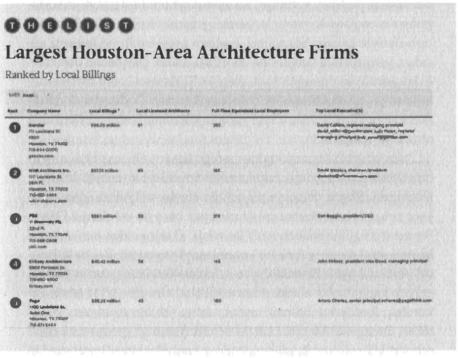

商人角色与设计师角色也经常冲突。解决办法是在和解这些矛盾中生活。因此，这也可以称为一种编舞。隐喻之所以是舞蹈〔原书第84页〕原因在于：我们通过在一个相当复杂的领域里界定把脚步迈向何处来完成工作。角色不断彼此冲突。例如，商人在提供项目设计服务时，可能比作为设计师工作的人对投资者的要求更宽容、更顺从。设计师急于把自身的职业权力放在首位，因而重视设计质量；而对商人来说，尽快获得投资回报是生死攸关的。

*作为商人的建筑师：得克萨斯州休斯敦最大的建筑事务所，员工人数、年度资产负债表、首席执行官。*

在建筑事务所无法成长、只雇用一两个人或几个人的时期，谈论商人建筑师角色还比较犹豫。今天，世界上除了占多数的“孤独者”，也有不少雇用数百名建筑师的事务所。二战前只有美国有这种事务所。自那时起，建筑服务业经历了真正的机构化。这类机构型事务所是大公司，其所有者可以被称为向该领域投入资本的真资本家。例如SOM就是这样的机构。它在自己的网页上这样介绍自己：“Skidmore, Owings & Merrill LLP（SOM）是世界上最大、最有影响力的建筑、室内设计、工程和城市规划公司之一。成立于1936年，已在50多个国家完成超过10,000个项目。”SOM如今是一家股票上市交易的建筑事务所。（校注：底本作此断言，未提供交易所或上市资料。本次核验未确认其公开上市事实；[SOM的机构介绍](https://www.som.com/about/)强调其合伙制组织，不能据事务所规模或资本运作反推股票公开上市。）可以肯定，创办和经营这些事务所的人，其商人身份通常远比设计师身份更占主导。其中有些人本来也不做设计，并不把自己称作有才华的设计师。[7] 几乎找不到证据表明SOM集团三位以斯基德莫尔、奥因斯和梅里尔为姓的创始人曾在任何时期做过设计。投资者—创始人们履行行政职能。通常，他们做生意的空间越小，做设计的机会就越多。在小型建筑实践中，建筑师可以直接参与设计，可以花少得多的时间从事经济和管理活动。不过，拥有小型事务所〔原书第85页〕并不意味着建筑师不是商人。他仍然是商人，但有机会做一个不与设计师角色冲突地扮演自己角色的商人。
### 作为劳动者的建筑师

如果一些人是商人，必然另一些人是劳动者。大多数建筑师是受薪劳动者。由于建筑中的设计、项目工作并不包含机械式的规律性，建筑师劳动者的处境甚至可以说比另一些工业和服务部门组织得更差。由于它几乎不允许规律的生产过程，又按项目组织工作，建筑师劳动者的工作时间也不可能很规律。工时概念并不总与建筑师劳动者的工作生活相符。既可能经历没有工作的时段，也可能在赶项目时通宵达旦。报酬却很少考虑这种时间使用方式。此外，建筑师劳动者的工会化可能和诉求，在几乎所有地方都很低。建筑职业意识形态几乎制造了这样一种幻觉：每个建筑师总有一天会创办自己的事务所。没有人愿意想自己会以项目劳动者的身份度过一生。因此，职业组织的要求几乎从不被感受到。在建筑师协会等职业组织强大而受尊敬的地方，人们假定它会保护所有建筑师的权利。悖论在于，至少从起源上说，世界上所有建筑师协会都是由商人建筑师倡导建立的。

### 作为学者的建筑师

这类人不必做设计，也不以通常意义作为劳动者工作。他们提供教育服务。这项工作有时与其他角色冲突，但有时也能非常成功地整合。二战前在德国，可以轻松地说所有重要设计师同时也是教师。甚至可以说，学校通常把自身身份归功于他们。菲舍尔先是慕尼黑、后来是斯图加特，珀尔齐希是布雷斯劳，博纳茨和施米特亨纳是斯图加特工业大学，格罗皮乌斯是包豪斯——他们都是定义学校、设定目标的姓名。在土耳其，〔原书第86页〕直到1980年代，尤其是在伊斯坦布尔美术学院，建筑师教师中的大多数都是全国最重要的设计师。1940—1960年间，伊斯坦布尔技术大学以埃明·奥纳特为代表，国家美术学院则以塞达德·哈克·埃尔德姆为代表。

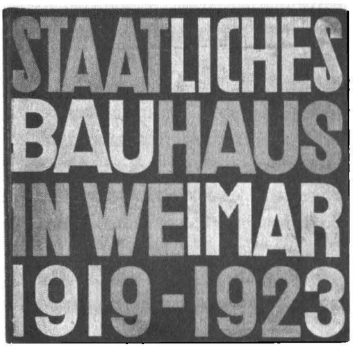

既是学者又是设计师不仅可能，而且可能是一种受偏好的位置。今天，让明星设计师在建筑学校授课是一种普遍倾向。学校由此给人一种印象：它已与建筑市场整合，让学生接触学术之外世界的现实。何况明星也会把自己的声名加到学校上，学校则把自身的声名加到明星身上。因此，自1980年代以来，全世界的建筑师传记总是包含学术职务、参与和讲座。建筑学校宣传册也会逐一列出兼职任教的建筑师。

作为名人的学者在某些情况下也能获得一种明星身份。例如，纽约库珀联盟的前教师约翰·赫伊杜克，其声名归功于学术活动，以及与之整合的展览、书籍等成果。他甚至写建筑主题的诗，画建筑主题的画。晚年他也完成了少量建筑，但那些项目也是靠他非设计性的学术声名获得的。

*作为学者的建筑师：瓦尔特·格罗皮乌斯的名声，至少与他的建筑一样，归功于他的教职生涯和著作。例如，1923年出版的第一本包豪斯总体介绍书《魏玛国立包豪斯，1919—1923》。*

〔原书第87页〕

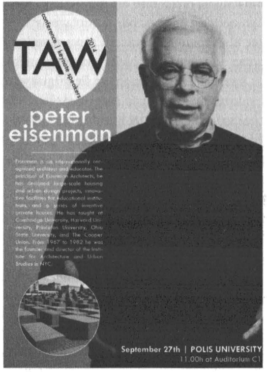

*成为明星，意味着把公共可见性的可能推到极限。例：艾森曼在阿尔巴尼亚首都地拉那讲话。*

### 作为明星／名人的建筑师

有些人并不是因为变得比其他人更出名，就成为明星或名人。明星和名人角色同样是社会性建构的。名人基本上意味着建筑师的名字开始具有一种独立于其作品经济意义的、自主的经济价值。名字转化为某种品牌，成为一种商品，甚至获得可买卖性。从1930年代的美国开始，各种建筑材料和产品的广告，都以“明星使用它们”作为论据。除了这种间接营销，明星的触碰还为设计对象增添某种灵光。例如，扎哈·哈迪德的名字曾有自己的特定品牌价值。仅仅带上她的签名，一件产品就能获得特定意义。因为名字给产品增添了经济价值。使这一点成为可能的，可能是她设计的闪耀，也可能不是。设计〔原书第88页〕质量并不是可衡量的价值。但金钱是可衡量的。名人甚至在股市上都有被定义的价值。例如，彼得·艾森曼的事务所有股票，而这些股票除艾森曼这个名字之外没有任何经济背景。（校注：此处沿底本保留；拥有公司股份与在证券交易所公开上市并非同一事实。本次核验未找到足以确认本段所暗示公开交易的资料，故不将其列为已核实的上市案例。）那间事务所里除了几件家具和电脑，当然也没有值得一提的投资资产。在资本意义上，它甚至不如一家稍大的杂货店。定义那间事务所价值的，只是一个名叫艾森曼的名人的名字。

明星对自己的明星身份有自觉。最善于扮演这一角色、同时还能拿自己开玩笑的人之一，应该是艾森曼。他引人注目，而且刻意如此。例如，有一段时期，他穿着白西装、白鞋出现在公众面前。可以说，他本人就像一个行走的广告牌。明星知道自己是谁，并在日常生活中不断重新生产这种身份。人不是靠偶然和才能成为明星的。更准确地说，才能并不是创造明星身份的唯一参数。明星通常以成为明星的决定开始自己的职业生涯。而成为明星的过程，是主体在该角色语境中采纳、发展、发明各种花招和实践的过程。它像所有社会角色一样被学习、被擦亮。这往往是一种通过在别的明星身边工作或出现而学习和发展的能力。就连赖特的写作风格也很大程度上得益于他曾为之工作的路易斯·沙利文。可以轻松地说，艾森曼把菲利普·约翰逊当作角色榜样。

明星名字的品牌化则是一个很新的概念。即使是最早的明星，在美国之外也要到1950年代才出现。明星最早出现于1900年代的美国，世界上第一位明星建筑师大概应是弗兰克·劳埃德·赖特。这可以从他很早就获得的媒体可见性看出来。早在20世纪初，他为了另一个女人抛下妻子“逃往”欧洲时，就成了通俗报刊的素材。此后他也以各种方式持续成为报纸关注的焦点。轰动性是制造明星的动力之一。它描述了一种双向运作的机制：一旦成为明星，一个人的日常生活就变得被注视；而日常生活越是被注视、越是成为轰动话题，人就越发成为明星。媒体建造明星，而明星则让媒体卖得出去、让人观看。

〔原书第89页〕

与赖特不同，1920年代、30年代或40年代的重要建筑师中，勒·柯布西耶、瓦尔特·格罗皮乌斯等没有一个是明星。他们是先锋设计师。他们的名字更多引发知识性的联想，而不携带商品价值。他们的客户可以因这种知识性暗示而获得特定意义和声望。成为先锋的客户，意味着使一种前卫实践成为可能，从而扮演历史性角色。扮演这种角色的人，从一开始就清楚这种可能性的存在，并对该领域作某种知识性投资。[8] 从明星那里购买设计服务，则应被定义为一种相当不同的情况。与从先锋建筑师那里购买的情况相反，它似乎与直接的经济期待相关。例如，带上明星的名字会给建筑产品增加额外价值；在业主之间，它也是极常见的选择设计师的参数，因为它也使业主成为明星。在土耳其，这种明星实践最早出现于1990年代初：伊斯坦布尔乌卢斯的一个住宅项目以“著名建筑师贝赫鲁兹·奇尼吉设计”作宣传。一个设计属于某位明星，能使它得到宣传，并使明星的知名度再添知名度。

明星的名字除了商品化之外，还承载其他经济意义。例如，赖特不付工资给在他身边工作的人，反而是工作人员付钱给他。[9] 因为在自己的简历里加上“曾与赖特共事”，也会给工作者增加经济价值。赖特的价值和声名会加到工作者的价值和声名上。因此，在名人身边工作，是建筑师—设计师职业生涯中具有生死攸关重要性的组成部分。土耳其如今也有类似情况。学生为了进入土耳其明星建筑师的事务所工作，每年提前数月提出申请、排队。
〔原书第90页〕

### 作为官僚／技术官僚的建筑师

官僚建筑师获得重要设计师声望和名声，是罕见的情况。最著名的公务员建筑师，当属多年在普鲁士政府“Oberbaudeputation”（高等建筑管理局）任职、拥有“Geheimer Oberbaurat”（枢密高级建筑顾问）头衔的卡尔·弗里德里希·申克尔（1781—1841）。凭借这一身份，他获得设计柏林最重要建筑的机会，改变了首都的面貌。

尽管建筑在社会生活中经常扮演技术官僚角色，建筑师本人却很少这样称呼自己。例如，工程师很容易与技术官僚身份和解。以至于19世纪初甚至诞生了一种圣西门主义社会主义，把公共行政主要尊崇为技术官僚工作。因此，在圣西门主义者看来，管理应掌握在工程师手中，社会应由工程和科学理性来运行。而建筑师习惯于把自己的职业存在主要定义为美学实践，而不是技术和科学实践。自文艺复兴以来，建筑一直是在“它更多具有知识和艺术内容，而非机械和数学内容”的论证框架内被呈现给公众的。因此，圣西门主义的建筑意识形态在土耳其之外极为罕见。最多能遇到几个像勒·柯布西耶那样时不时提出技术官僚权力要求的人。[10] 在土耳其，1970—80年间则有一个时期，建筑师和工程师共同生产出技术官僚社会主义的想象。把它的起源追溯到那些年从未被提及的圣西门，是错误的。建筑师和工程师扮演政治角色的期待，更多与土耳其“读书人”的敏感有关——从晚奥斯曼时期开始，他们试图把自己接入官僚管理传统。建筑职业的现代史在奥斯曼并不是以建立自由职业的方式发生的。在土耳其，有很长一个时期，建筑师首先被定义为公务员。[11] 甚至米马尔·希南也会在这一公务员—建筑师〔原书第91页〕身份的框架内被讲述，并被视为该身份最成功、最具象征性的例子。然而在后来的年代，公务员建筑师角色受到侵蚀。今天填满地方和中央行政机构的庞大建筑师群体，几乎构成全国声望最低的建筑师队伍。一般来说，土耳其之外的情况看起来也差不多。同样的话也适用于建筑师在建筑生产中直接作为技术员在工地工作的情况。

### 作为意见领袖／活动家的建筑师

成为意见领袖／活动家，意味着参与一个社会责任项目，把它作为一种生活方式接受。发展针对环境的批判意识，提出物理和社会环境的另一种组织方式，并据此提出政治纲领，就是试图建立一种活动家生涯。从1990年代到几年前，在土耳其可以谈论这样一种以建筑师协会为中心的广泛活动主义。抵抗建筑生产市场中的腐败、抵抗他们视为有城市问题的变化、抵抗投机收益可能性的无管制，几乎都是协会最重要的活动。多年担任协会主席、直到去世前一直不间断为媒体撰稿的奥克泰·埃金吉，整个职业生涯都是沿着这条路线建立的。

然而在土耳其，活动家角色很容易获得精英主义、家长式的语调。当以“提高社会意识”的说法表达时，活动家主体可能把自己想象成一个为无知者提供知识、为不理解者提供教育的人。那些摆脱政治先锋和“有知主体”身份、尝试与平等者共同行动的人，其活动家路径当然更有利。这至少赋予他们进行民主反对的机会。不过，如果相反方向有合适土壤，它甚至可能更有效地取得成功。在土耳其，图尔古特·詹塞维尔在保守主义和伊斯兰主义圈子里扮演过这类活动家建筑师角色。他在宗教视角框架内，发展出具有史学〔原书第92页〕纵深的批判话语，对物理和社会环境应当如何有看法，并努力让人接受这些看法。这一角色以极强的家长式语言扮演，再加上其诉诸的受众本身就倾向于尊崇“有知主体”，便把他从活动家推向某种圣徒地位。可以说，这迅速使詹塞维尔的观点僵化、变得不可讨论，从而也掏空了他的活动主义。

### 作为作家／理论家的建筑师

这一角色也不必单一扮演。成为作家／理论家并不排斥活动主义，也完全可以与设计整合。例如，阿道夫·洛斯从1900年代初起就是奥地利极具影响力的作家／理论家；他同时是活动家，而且用设计师身份强调这两个角色。甚至可以把洛斯视为第一位结合这三种角色的建筑师。仅凭为今天以Looshaus（洛斯楼）闻名的建筑而进行的斗争[12]，他就建立了先锋性的职业生涯。勒·柯布西耶既是作家，又是活动家、意见领袖和设计师。他之所以成为20世纪、甚至可能是整个现代时代最有影响力的建筑师，原因就在这里。他承担了同时扮演所有建筑师角色的任务。本来，角色越多，成为明星的可能也越多。他最成功的角色之一就是受害者角色。“没有人重视我。尽管全世界都抵抗，我仍然向他们讲述真理；即使他们不要求正确的建筑，我也坚持把它提出来。”他以大致这样的语言说个不停。他获得了从城市到凳子的所有设计可能。他甚至写了并出版了数十本书，而且不断再版。尽管如此，他仍继续抱怨自己不被赏识。赖特当作某种座右铭使用的“Truth against the World”／“对抗世界的真理”，也指向同一种受害叙事：“我注定要对抗全世界讲述真理。”图尔古特·詹塞维尔也处于类似姿态。他广受尊敬，〔原书第93页〕却仍继续说“没有人理解我，我一直被否定”。扮演受害者，声称自己没有获得应得的位置、实际上是被排除在外，几乎是每种建筑师角色都可利用的可能。

不过也可以说，这种可能正被越来越少地使用。当代明星机制会削弱受害叙事。在一个建筑师名字品牌化、商品化的系统里，明星建筑师当然会避免破坏自身的经济存在理由。他不仅不被忽视，反而在相反方向上被感知，连名字都被商品化，因此工作机会不断扩大。相反，不是明星，而是商人建筑师有时会诉诸受害叙事。频繁使用的一种受害模式，是抱怨那些阻碍建筑师承担社会责任、考虑公共利益的经济条件。它表现为：做工作时沉默、认命，而在向公众解释自己的工作时抱怨。通常，它以这样的主张表达：建筑师面对接到的项目，除了说“是”之外无法生产其他选项。设计师—商人声称，他其实意识到其中的消极面，但因不得已而无法反对。显然，这也是一个被学习、被内化的角色。其花招是假装不情愿、违心地做设计，并使用“就算我不做，反正别人也会做”之类的论据。可以说，这是一种为了在批评甚至尚未开始之前就为自己开脱而生产的虚假受压迫叙事。

所有建筑角色都是学来的。但它们没有一个能在学术意义上被教授，也不能按学习时的样子扮演。因为每个角色都与其他角色冲突——既在同一主体的个性中产生冲突，也在扮演不同角色的不同主体之间产生冲突。每个主体都在自身所处情境的框架内，为自己制作一份由各种角色组成的混合物。角色在多大程度上是社会性的，角色混合物就在多大程度上〔原书第94页〕是个体的。因此，没有一种角色能不经生活而学会。商人、劳动者、设计师、技术官僚、明星等等，究竟怎样成为？世界上没有任何一所建筑学校教授这些。那么，学校提供的所有这些建筑教育有什么用？学校为什么存在？建筑职业与其他职业的根本差别，也许就在于它迫使人提出这样的问题。医学院里进行医学教育。那里学到的实践，至少不会与毕业后医生职业生涯中应用的实践相抵触。医学教育像是一系列医疗实践的模拟。而建筑教育甚至不像建筑职业领域。学校并不代表建筑生活。几乎没有任何学校实践会在校外生活中使用。要学会建筑职业，除了做建筑，别无选择。

# 第一部分　奠基神话

〔原书第95页〕

第一部分

## 奠基神话

〔原书第96页〕

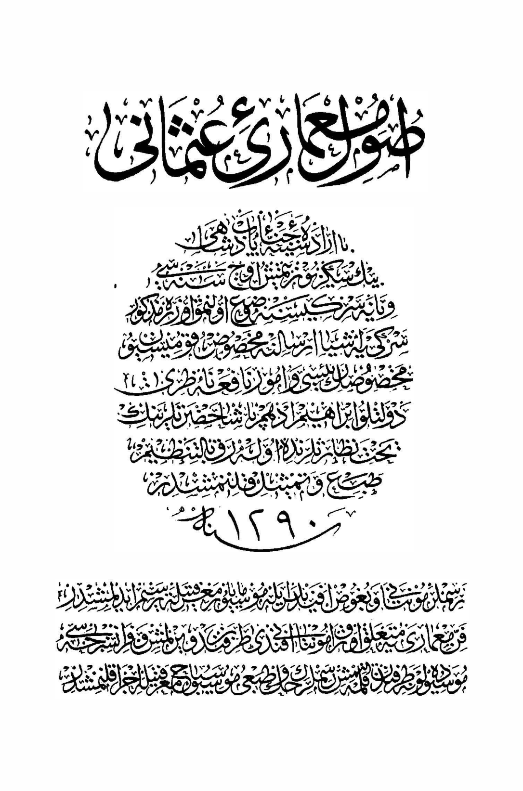

*一部很可能最早把确定奥斯曼建筑之原理也明确列为目标的著作：埃德海姆帕夏等，《奥斯曼建筑术》／《奥斯曼建筑》／《奥斯曼建筑艺术》。书名页。*

## IV　建筑的本质、原理与主要构成要素

〔原书第97页〕

2014年威尼斯建筑双年展由雷姆·库哈斯担任策展人。此事在全球范围内意义重大，因为当代建筑界这位年事渐长的“顽皮男孩”库哈斯，几乎让所有人都期待他会做出某种打破常规的事情。库哈斯为双年展确定的总题“Fundamentals”（可译为“基本要素”“根本的东西”“要紧的东西”“思想基础”等多种土耳其语说法）本应在这样的期待中引发严肃讨论。人们本应讨论、批评，并且追问：“这道回锅的抓饭还没吃够吗？”甚至“库哈斯，连你也这样？”毕竟，库哈斯多年来正是通过批评这类陈旧论调而成名、开辟新路的，如今却动手做一场以相反方向为轴心的双年展。然而，他几乎没有受到批评。其实这样做已是一项超出库哈斯本人和双年展范围的必要之举，因为今天谈论建筑的“基本要素”，意味着以思考之名对思考施加的一种压制。讽刺的是，在建筑思想中，恐怕没有哪条路径比谈论建筑的基本原则与主要构成要素更古老。沿着这条路，可以界定出一系列彼此平行的路径，它们全都可以被称为本质主义的。从维特鲁威开始——也就是从公元前后开始——无数作者就已诊断、讲述过“使建筑作品成为建筑作品”的那些基本要素，并指出它们为何〔原书第98页〕“不可或缺”。例如，维特鲁威著作的全部章节以及他那简洁的公式“firmitas, venustas, commoditas”（坚固、美观、适用）三要素，自15世纪起便获得了这样一种不可或缺性。明明可以为建筑确定并建议更多品质，那神圣的三位一体却被宣布为不可设想其反面的建筑基本要素。即使在今天，职业界中的多数人仍然相信，至少那组神圣三位一体定义着不可或缺者。塞巴斯蒂亚诺·塞利奥开辟了另一条路径：16世纪初，他在著名的作品全集中确定了建筑的根本问题[1]：第一卷讲欧几里得几何；第二卷讲自然中三维形态如何通过透视理论得到表现；第三卷讲在万神殿和古代遗迹中体现的完善形式；第四卷讲古代柱式，以及它们在门、壁炉和教堂立面上的普遍使用原理；第五卷讲柱式在塞利奥设计的庙宇中的使用；第六卷讲柱式在住宅设计中的使用；第七卷讲述一位建筑师可能遇到的问题和“意外”。这套系列中最早出版的则是第四卷，它涉及当时最受关注、最具当下性的议题，即作为主要建筑构件的柱式，以及古典建筑要素及其组合在形式与平面上的各种选项。[2] 维尼奥拉则进行了更为明确、简化的还原：16世纪末，他把古代形式秩序归类为建筑的主要构件，并尝试在比例—尺度层面把它们固定下来。[3] 他如此成功，以至于直到20世纪初，他的著作仍是建筑师和建筑教学的基础教科书之一。伊丽莎白·艾森斯坦[4]谈到印刷技术如何导致建筑知识的成文法化，〔原书第99页〕而从塞利奥和维尼奥拉起，数个世纪里无数作者所做的恰恰就是这件事。杜朗在18世纪末建立了一整套适用于一切私人和公共建筑的、像“乐高”系统那样运作的类型学基本构件清单，以及为这些构件使用的标准化组合与构图原理。[5] 这是对始于塞利奥那条路径的更严格规训尝试。然而，它所做的超出了引入规训。例如，从两根柱子并置开始，直到柱列、柱—墩、柱—墙组合、叠加不同形式的平面构图

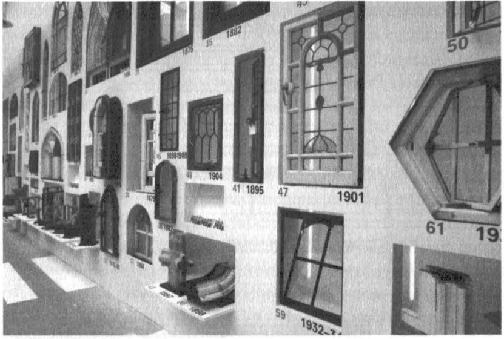

*一个即使到了2014年仍无法被放弃的概念——建筑的基本要素：“Fundamentals”。威尼斯建筑双年展中作为“fundamental”的一扇窗。*

〔原书第100页〕

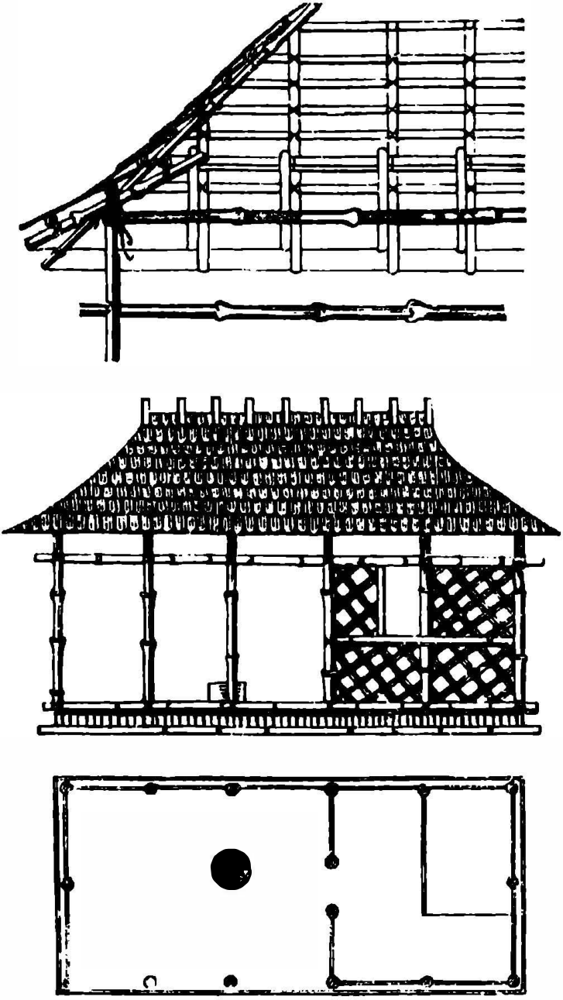

*森佩尔的建筑元型：加勒比棚屋。*

〔原书第101页〕

以及从单层到多层体量组合的设计，他建立起一个日益复杂的系统。他提出的是一张从单一构件延伸到整座建筑的类型学矩阵。自18世纪开始出现的原始棚屋概念[6]以及建筑理性主义的诞生，也是同一种寻求基本原则的努力的组成部分。两者都是对一个理性思考、天生具备理性思维的原则与基础、因而超历史、超时间的普遍人类的想象之例。这个人仿佛被置于时间序列的零点上，意识到自身人性存在面对自然的种种缺失与不足，想到自己必须栖身，知道自己为了栖身需要什么，决定如何从环境中采集这些东西、如何把它们组合起来以满足栖身需要。为满足栖身需要的这一生产应当如何沿着理性主义路线推进，每一条主要原则都已存在于他的头脑中。结果便产生出一种可以被称为此后一切建筑产品之原型或元型的构筑物：原始棚屋。这是一座单室、双坡屋顶的“原初建筑”。它有门、有窗、有屋面系统、有建造逻辑、有功能，甚至有一种堪称此后一切建筑作品祖先的美学。当然，正如今天无数考古研究所揭示的那样，这样一座棚屋从未存在过。例如，一万年前的恰塔霍裕克，人们生活在没有窗户、没有门的住所里，只能从平屋顶上的一个洞口进去。因为不存在一种建造性的普遍理性，数千年间都没有产生理性的建造体系。它没有产生过“Fundamentals／基本要素”这样的概念，以便能够界定并生产任何领域中的基本要素。因此也就不存在某种基本的解决方案或构件。幸好如此，正因为如此，才可能出现新的构件、思想、可能性和解决办法。否则，由于主要的、基本的构件不可放弃，变化的门就会关闭。事实上，从16世纪起，当这些“不可或缺”的定义得以作出时，建筑中才可能建立长期的规训体制。
〔原书第102页〕

对于那些把焦点放在形式秩序上、诊断基本要素和主要构件的人，戈特弗里德·森佩尔在19世纪中叶提供了新的可能性：他提出了一组基本要素，并声称它们构成建筑的历史性本质。在他看来，存在四种使建筑产品得以生成的基本构成要素[7]（基座：基础和砌体地下结构；屋顶：屋面系统、承重；炉灶：舒适性构件；衣着：外部覆层）。森佩尔和所有本质主义者一样，把历史变化捆绑在这四重常项的不可放弃性上，从而也打开了一种新的化石化的门。他设想出一组涵盖加勒比原住民棚屋、帕特农神庙和维也纳当代公寓的不变项。奥斯曼也加入了这支商队。它提供了另一种日后将在世界各地被反复沿用的本质主义的早期例子：1873年撰写《奥斯曼建筑术》的埃德海姆帕夏及其团队，讲述的正是奥斯曼建筑的基本构成要素（usul＝基本原则＝基本要素）。[8] 这本收录15—17世纪重要奥斯曼建筑测绘图的著作，使造就那种建筑的形式语汇可视化，但还走得更远。它们就是奥斯曼建筑的“基本”。既然构成基本的是它们，那么18、19世纪加入那一语汇的东西，就会被描述为破坏基本要素、破坏基本的构件。定义基本，同时也就间接地定义了意外与故障。“新的”事物是有故障的，因为它们破坏了基本。甚至，如果存在某种故障，就必须有一个肇事者，于是便会出现诊断责任人的机会。在奥斯曼这一特例中，又提出了破坏基本者是非穆斯林建筑师的论点，从而也为本质主义准备了族群—宗教与政治基础。从那里出发，距离想象一种由民族身份定义的不变建筑本质已经不远了。在建筑中，无论奥斯曼本质，还是此后的土耳其本质、德意志本质、日本本质、伊斯兰本质，如今在任何地方都可以加以描述。〔原书第103页〕那些“本质”中的每一种，都给出了内在于土耳其性、德意志性、伊斯兰之中的建筑之基本要素。仿佛土耳其人在其集体心智中存在着那种使土耳其人成为土耳其人的本质，并按照它生产建筑。纳粹理论家也会相信，正因自己的民族本质，他们能够立刻辨认出非德意志的（undeutsch）建筑。例如，现代主义建筑并不在德意志性的本质之中！对蒂图斯·布尔克哈特而言，伊斯兰艺术与建筑也是如此。[9] 在他看来，伊斯兰启示内部（伊斯兰的本质之中）存在一个被定义的美学宇宙；它在超越地点、时间、社会性等差异的范围内塑造着整个艺术领域。由此出发，距离确定伊斯兰艺术之基本要素、确定对伊斯兰而言是基本的东西，只有很短一段路。这样的尝试也做过很多次……几乎没有哪种意识形态、信仰或政治不能与本质的想象、与基本概念妥协。甚至一些马克思主义理论家，尽管变化之无尽与历史性问题对他们而言具有生死攸关的重要性，仍然努力去定义一种跨时代的建筑本质。即便拥有一种谈论无尽变化、反对唯心主义的马克思主义历史观，当问题落到建筑上时，也并不能阻止他们谈论一种把变化绑定在固定规则上的建筑本质（当然，并不说“本质”这个词）和基本构成要素。例如，金兹堡就从创造风格的普遍原则出发，为自身的构成主义建筑理论奠基。[10] 这些无数文本全都旨在使建筑成文法化、范畴化，也就是在时间—空间中把它固定下来。或者，既考虑到什么都不会改变，又考虑到世界不断变化的事实，建筑将这样变化：建筑的本质和基本要素保持不变，而其余部分改变。被遗忘的是这一点：变化改变世界和建筑，其剧烈程度足以改变那些被定义为“基本要素”的东西本身。〔原书第104页〕因此，没有办法确定什么与基本要素有关、什么无关。更准确地说，在一种人类活动和产品中谈论主要与次要、基本要素与可忽略之物，是不现实的。一切，绝对的一切，都既与基本要素有关，又无关。参与整体的每一样东西，在整体形成的语境中都是基本的；若没有它，整体会以另一种方式显现。矛盾的是，每一样东西也都可以为了产生某个整体而被牺牲。始终存在利用其他构件、以其他形式制作每一个整体、每一件产品的可能。没有哪一种构件是重要到不可放弃的。重要—不重要的等级序列，只讲述作出这一排序者（在个人和社会尺度上）及其想法。更重要的是，如同一切等级建构一样，它具有权力定义性。所有着手描述这类基本原则与主要要素的人，过去和现在都在编制一份超时间有效的建筑定义、构件与需求清单。这样看，对每一件建筑产品而言，都存在一组其存在不可或缺的品质／构件，而它们充其量在时间和空间中的细节层面有所差异。基本要素始终不变。因此，在数百年间产生无数新的思考可能、并在其他领域被充分使用时，建筑思想却大多被判处给一种柏拉图式的基础结构。凭借那种唯心主义基础结构，人们想象出一种使建筑物成为建筑物、使设计成为设计、使建筑成为建筑、使一个时代成为那个时代的本质，而思考不寻求固定本质的新建筑的可能性，从一开始就被消灭了。世代和主体的角色，是把那些不变基本要素当作给定价值接受，并按照它们去设计、建造；不要制造故障。然而，任何头脑稍微开放的人都能轻易发现，这些给定价值（基本要素）别说贯穿各个时代，甚至在同一地点、同一时间也并不成立。生活不断抵抗范畴化的固定。但更重要的是，在一个不断变化的世界中，想象并创造不同建筑的道路，只有通过摧毁、无视或批评前人所认为的基本要素，才能有意识地打开。例如，要建造一座拒绝“有用性”这一基本要素的18世纪“folly”建筑[11]，只有这样才可能。〔原书第105页〕在那个世纪，建造一座毫无任何具体用途的中世纪城堡废墟，显然会造成一种故障。这是在描绘历史性。任何“原教旨主义者”都会毫不犹豫地说明，它并不是建筑的基本属性之一。但只有当他们所说的不被理会时，自18世纪起，历史性的图像才可能获得一种独特的“灵光”。不幸的是，即使在今天，想寻找关于folly的严肃理论著作的人，大多也空手而归。思考那些无视现有权力结构的故障，自然很难。制造故障更难。例如，当勒·柯布西耶在朗香教堂设计出既不能轻易归入屋顶、也不能轻易归入墙、采光洞口或门的概念范围的构件〔原书第106页〕时，便制造出一种故障。在那里，没有任何东西是基本的。但当朗香教堂中那座包含不符合任何既有建筑要素之构件的设计被建造出来时，便开启了一条新的地平线。正如基本要素无法被确定、被固定，次要之物也无法被指定。在艾莉森与彼得·史密森的亨斯坦顿学校（1949—1954）或皮亚诺与罗杰斯的博堡文化中心（1969—1977）中，哪些构件是“基本的”，哪些具有次要重要性？是设备管线，还是楼梯、电梯、结构？在两者中，尤其是在后者中，整个承重系统、全部设备管线和技术系统都暴露在外，处于可见状态。把它们纳入“可见者”与“不应被看见者”的等级秩序来处理，是谈不上的。而让博堡和亨斯坦顿被视为重要的，除了对这种等级秩序的否定，还能是什么？在这些建筑中，否定如此彻底，以至于两座建筑都抹除了基本与非基本的区分。正因如此，新的思考与设计可能性才得以产生。建筑史也可以被写成讲述没有任何建造构件是基本的、不可放弃的、永恒的那样一种历史，也可以朝相反方向写……不把变化视为故障和意外的生产，而是发现保持不变是一种幻觉，这样的理论家和历史学家不会费心去辨认保持同一之物。因为即使那些看起来保持不变的东西，在意义、形式、表达、与其他构件组合的可能性等方面，也在不断差异化。相反，一种稍带解释技巧的杂技式劳动，却能够发现所有建筑都始终符合先前宣示的那些基本原则、主要要素与本质。这样灵巧的建筑史学家、理论家和设计者有很多。他们稍微用点功、费点力，就能把一切时代的一切建筑都呈现为印证同一套“基本要素”的产品。朗香教堂有承重系统，博堡也有；伊斯法罕聚礼清真寺有结构性的屋面，帕特农神庙也有……可不是吗，每座建筑都有窗、楼梯、地面铺装、卫生设备、供暖、照明。问题在于，并没有。差异与多样如此之多，只有人类语言有限的词汇量，才使把这一切放进同一个认识论包裹成为可能。〔原书第107页〕然而，语言并不只是表达、再现——恰恰相反，它构造并建造真理。因此，如果那些被称为基本构成要素的东西只用寥寥几个词来讲述——在任何语言中它们总是被这样讲述——它们就会抹除差异。既有的建筑词汇及其狭窄的语义内容，不可避免地导致固定那些基本要素。那些被呈现为使建筑产品得以生成的基本要素，即使并非有意，也会压制有可能被生产出来的差异。它们让人知道什么是基本原则、什么是主要要素。于是，建筑设计与建造的可能性就被推向局限于手头那份基本要素清单。当然，若去问库哈斯，他可能会说，他不仅试图定义等级意义上的基本要素，还试图讲述使一座建筑成为可能的所有构件，在这个语境中一切都是“基本要素”。然而，我们必须理解：不是一切，而是没有任何东西是基本的、与根基相关的。如果建筑语言和理论转向增多言说的可能性与术语，而不是生产基本构件清单，那么想象并建造新建筑与新环境的机会也会增多。定义不可或缺者，必然就是缩小语言。而缩小语言等同于缩小思想，这一点甚至无需解释。寥寥几个“fundamental”术语会在领域中建立起如此强大的权力，以至于不剩下任何说出不同话语的位置。所有“现代”反民主权力之所以鼓励建造、而不是谈论建筑并让人谈论建筑，背后的原因也在这里。

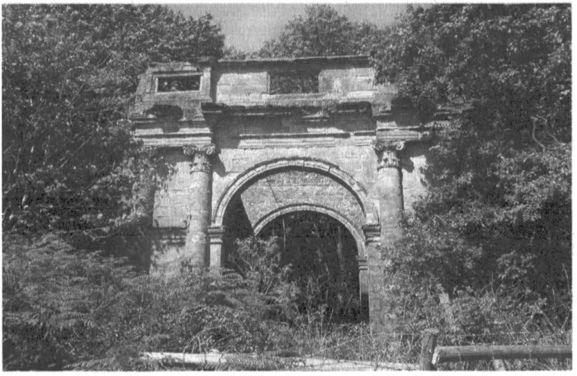

*梅里沃思城堡的一座18世纪folly：废墟化的罗马门，英格兰肯特。*

如上所述这类收窄性的推理路线，最终总是停在同一个同义反复的解释上：世界和建筑，无论我们怎样努力，总是包含同样的基本构成要素，本质上总是保持不变。巨石阵是建筑作品，毕尔巴鄂古根海姆博物馆也是，岩石圆顶圣殿、圣索菲亚、流水别墅、托普卡珀宫也都是……在它们身上，建筑的本质都以各种形式显现出来。关键问题在于：我们从这一判定中学到了什么，能学到什么，又能设计什么？答案是：什么也没有。

〔原书第108页〕

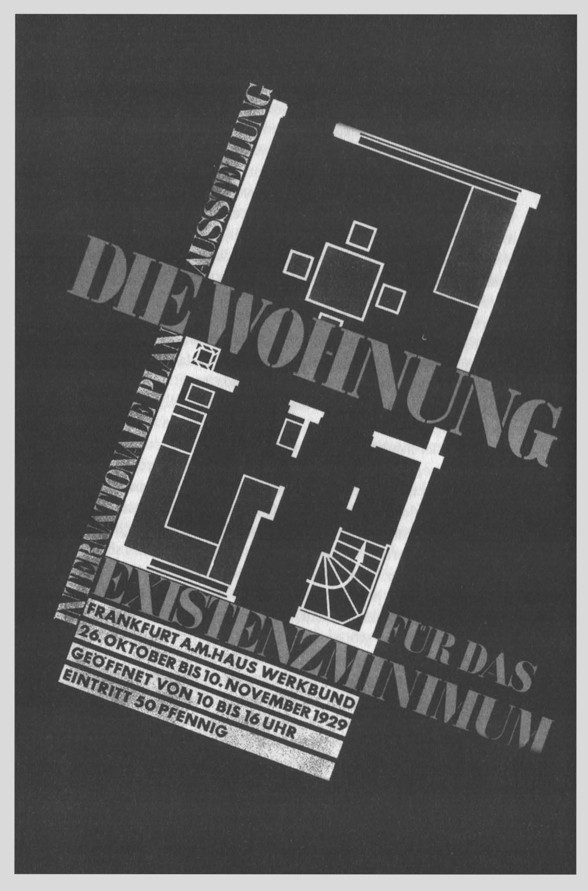

*大众住宅设计中最有影响的著作与展览之一：“Die Wohnung für das Existenzminimum”的展览海报（1929）。它体现了那个时代试图在建造与使用语境中将住宅合理化的取向。*

## V　现代性与现代主义思想

〔原书第109页〕

我们往往不倾向于把现代性与现代主义的关系问题化。甚至人们常常认为，现代主义不过是现代性在艺术／设计／建筑领域的反映。自吉迪恩以来，现代建筑早期阶段的历史，尽管近几十年来这种研究路径已大受侵蚀，仍常常被写成一部先驱者的奋斗史：他们为让这种反映成为可能、把现代性带入建筑领域而斗争。根据这种披着历史书写外衣的神话，从一百多年前开始，一群设计者不顾广大“反动派”的抵抗，努力在建筑领域运用现代性的成果、让时代的现实在那里也占据主导。也就是说，现代主义是现代性的对称物。而现代主义运动，按其定义，就是针对那些企图阻碍和／或破坏这种对称性的人所开展的活动。但是，现代性与现代主义之间的关系真的如此直接、没有问题、不言自明吗？问题也可以换一种问法：现代主义是否就是把现代性的恩惠与要求带入建筑，使前者服从于后者？问题不可避免的延续是：现代主义—现代性关联的唯一问题，是否就是把那些被视为阻碍这一显而易见关系的人清除掉？建筑现代主义真的〔原书第110页〕是现代性的亲生儿子吗？还是两者之间存在复杂、充满矛盾的联系？更进一步，还可以问：现代主义是否是一场针对现代性进行的斗争？正如稍后我将试图说明的，有理由谈论现代主义的反现代性。这些问题似乎不分地域，到处都有意义。更重要的是，现代主义究竟有多现代，并不是一个陈旧问题。因此，不能说本文的存在理由只是一种历史书写的专业兴趣。我在此假定自己提出的是一个当前问题。我认为，我们是在现代性状况的界限内获得存在的；尽管存在各种对抗性尝试，我们仍在很大程度上使用并再生产现代主义的建筑认识论。有人谈“超现代性”，有人谈“后现代性”，但我认为这些名称不过是给现代性贴上的新标签。至于现代主义建筑知识理论是否仍然有效，可以举出多到无法在此列举的证据。那么，确定一种批判立场就显得至关重要。这里试图做的，无非是寻找这样一个批判基地。归根结底，那些至少一个世纪以来声称要向所有人传授现代性的建筑师，应当问自己：他们一直在使用并生产的知识大厦，究竟在多大程度上证实了这一声称。总之，我们必须在现代性语境中把现代主义认识论问题化。

我相信，现在已经能理解：我将对建筑现代主义的现代性提出怀疑。然而，我的怀疑并不意味着我们面前摆着一系列比现代主义更“有意义、更正确”的建筑选项、形态学和认识论，只要选择它们就会成功。也就是说，我并不是在采用建筑界经常出现的那种宣传式进路。我也没有提出一种新建筑。自1960年代以来，罗西、文丘里、摩尔、布罗林、詹克斯等反现代主义者，以各种思想品质的作品做过这件事。他们的目的并不是在现代性语境中对现代主义进行批判性阅读；他们在寻找新的“正确建筑”，并致力于通过使旧建筑的合法性变得可疑来创造那些建筑。〔原书第111页〕这里的目标，则是在近几十年来被称作“现代性批判”的框架中思考。揭示在现代性内部观察到的某些矛盾，摧毁它的神话。现代性批判的目的，既不是对前现代世界的乡愁，也不是一种可以夸张地称为“超越现代性”的使命构想。它只是要带着一个历史状况自身的日常矛盾、在其日常性中理解它。不是努力摧毁现代性，而是把现代性与现代主义的关系问题化。这里的进路，其核心——我用一个明知夸张的说法——简言之是：现代建筑是现代性的一场戏仿。也就是说，我将主张，许多被贴上现代性标签的变化与转变、现代性的成果，在建筑现代主义认识论中被转化为一场“错误喜剧”的要素。我提出，它们有时被彻底颠倒、被误解，有时至少被降格为缺乏思想深度的简单刻板印象。显然，我的论断只涉及现代主义建筑认识论。我之所以不在此语境中审视现代主义形态学，是因为我认为“形态学的现代性”这样的讨论题目本身就是荒谬的。我要说，现代性讨论只能建立在建筑思想的数据之上。谈论现代性特有的建筑形式，等于把一种在现代建筑形式中表达出来的精神、一种本质归给现代性。没有什么比谈论现代性的本质和形式更“不现代”的了。为了让“现代主义是现代性的一场戏仿”这一论断具有说服力，我将再次借助一系列戏仿隐喻。这样做时，我会把现代性的某些认识论建构与建筑现代主义的某些构件联系起来，并把后者解释为前者的戏仿。它们如下：

〔原书第112页〕

作为主体戏仿的天才。作为理性戏仿的理性主义。作为现代历史观戏仿的历史主义。作为现代科学戏仿的科学主义。作为技术戏仿的技术主义。作为大都市戏仿的城市规划。作为批评戏仿的“反馈”。

作为这一审视路径的通常结果，这里不会对现代性和现代主义作简短定义。在上述每一对极性表述中，第一个词项指向一个现代性现象或题目，第二个词项则指向建筑现代主义理论的一个构件。因此，这里不会从彼此独立作出的普遍现代性与现代主义定义出发进行评价。相反，现代性—现代主义的问题化将试图在这一极性内部建立起来。换句话说，被描述的不是现代性，也不是现代主义，而是这些极性本身。

### I

“作为主体戏仿的天才”这一说法，旨在表明被称为“主体”的认识论建构在建筑中如何被界定并篡改。主体出现在这样一个世界里：知识不再是超越的、不再是给定价值，而成为有特定作者、由某些人创造出来的、具有历史偶然性的建构。在知识是给定且超越的世界中，知识位于“已经存在”的范畴里。它不是由某个特定的人造出来的；即使被造出来，它的存在也归功于神的意志；因此，主体充其量只能抵达它。就连这种抵达行动，也由于最终所要获得的知识的神圣性，而必定是艰难的。穿过那条艰难道路的人，也不可避免地分享他们所抵达之知识的神圣性，从而变得神圣。抵达知识，就是抵达神圣真理、变得神圣。现代性〔原书第113页〕用普通主体所建构的知识世界取代了这种神圣认识论。于是，它使知识、知识生产者以及知识生产的方式都变得平凡。让我们在艺术和建筑领域审视这个非常熟悉、且其理论化程度远比这里概述的更为深刻的、以主体为中心的世界。艺术、建筑宇宙似乎以一种不同于上述概述的方式建构了“艺术家主体”的概念。从文艺复兴起，艺术家主体仿佛就是按照传统认识论中神的概念模型建构的。艺术家像神一样从无中创造、创生。“天才”概念，除了是这个世俗之神的头衔，还能是什么？现代性不会放弃这个神圣主体。它只是满足于更新自己的建构。叔本华在《作为意志和表象的世界》（1819—1844）中问“想象是什么？”并这样回答：“那是动物大脑中一种非常复杂的生理事件，其结果是在该处对一幅图画或图像的意识。”但并非每个人都有能力以同样的清晰度构想这一图像。某些个体，尤其是艺术家，由于被赋予了高于常人的心智能力，其大脑会产生更精细、更敏锐的图像，并且，用叔本华的话说，他们更容易达到纯粹客观性。[1] 不难发现，即使最杰出的早期理论家，如果不把艺术家主体表述为具有超出常人之心智禀赋的人，也难以对艺术生产作出解释。现代主义将在这套基础结构上建构建筑师主体：看见别人未察觉的事实，看到别人无法预见的东西，在近乎认识论的真空中找到解决办法，比他人更早抵达光……从叔本华到现代主义先驱，隔了半个多世纪，但在解释主体在设计行动中的作用方面，几乎没有什么新话可说。希尔伯塞默1927年准备一本现代主义重要作品的实例集时，〔原书第114页〕对于这些作品所立足的共同基础，他这样说[2]：“[这里]首先涉及建筑师创造性意志的统治。”在一个说了无数关于建筑的社会性与客观性的话的时代，为了解释其建筑生产而能找到的唯一公式，仍然集中在建筑师的创造性意志上。显然，从15世纪起被创造出来的艺术家—主体神话，其界限怎么也推不破。那些谈论建筑社会介入的人，即使像希尔伯塞默那样具有马克思主义倾向，也怎么想不到去谈设计者的社会身份和设计的社会建构。现代性在建筑之外最常卡住的障碍，也将是这种从无中创造的神圣主体身份。就在希尔伯塞默写下上述文字的那些年，正着手建立现代理性天堂的苏联人，建立了以领袖崇拜为基础的种种政治说服机制。1930年代访问莫斯科的一位英国作家，会惊讶地听一位诗人告诉他：俄国农民制造出以列宁为中心的新传说，把他圣化，想象成“在天上注视我们的父亲”。[3] 那些以清除传统性为口号出发的人，将会制造出由最古老的圣化模式所建构的主体戏仿。理性和社会意识，一旦问题转向主体在变化与转变中的作用，就轻易破产。而这种情况，在苏联直到制度全面崩溃时、在建筑中几乎直到今天，都少有改变。看来，主体是现代性最薄弱的概念建构。现代主义使它更加孱弱。现代主义内部建构的天才主体，与传统的人格崇拜和文艺复兴的天才相比，也许唯一的根本差异，是现代主义建筑师天才对自身天才的信仰。现代主义杀死谦逊，创造新的建筑师自恋。在最极端的例子中，主体着手建构自己的社会身份，毫不迟疑地称自己为天才，不是相信自己〔原书第115页〕在从事建筑，而是相信自己“在创造历史”。现代主义建筑师主体就是这样一种相信自己在创造历史的主体。关于这种“作为主体戏仿的天才”如何看待自己，有一段典型的引文。勒·柯布西耶未能承担联合国大厦的设计后，怀着一种高尚的失望，就此写了一本书。书的尾声部分如下：

> 事件的相继累积、沉淀，可能使这本书显得错误且缺乏确定性。人可以遵循一条正确的行为道路；但事件在表面上看，有时实际上也是混乱的——是一条从一个极端甩向另一个极端的正弦曲线。

> 行动者完全清楚这一点；他的步伐始终随不断变化的境况调整，他们不会失去方向感。历史终将被抓住，只是会更晚一些。对立可能是真实的，也可能是表面的。关键的瞬间正存在于这种混乱之中。而让事件结出成果，只有洞察者才能做到。[4]

文本中的行动者显然就是勒·柯布西耶。他清楚境况的消极性；联合国大厦的设计没有交给他这类挫折，并不会导致他失去方向感。他充满抓住历史的使命，知道该如何抓住历史，而且已经展示过了。他未能承担设计，只是那些没有同等崇高意识的人推迟了历史那条“必然”进程的结果，仅此而已。下面在考察“作为理性戏仿的理性主义”问题时，也会谈到天才形象在这种理性主义的运作中具有多么关键的重要性。

### II

“作为理性戏仿的理性主义”这一说法，我要说明的是现代主义那种粗糙乃至幼稚的实证主义。其最极端的例子，我们在早期现代建筑认识论中通过把对人类和社会而言什么是正确、什么是必要的问题化约为数值而〔原书第116页〕给出的回答中找到。在一种简单的机制内，集中关注平方米、日照、地形、经济等数据，并且只考虑基本的人类生物功能而进行的推理，就是这类理性戏仿。例如，在“最低生存”（Existenzminimum）概念框架内思考住宅问题，从这一概念最初提出的1920年代晚期直到今天所产生的各种延伸，就是如此。[5] 然而，我并不主张自己怀疑确定住宅最低标准这一做法的合理性。我想说的是，只把住宅放在最低标准和一张功能图解中来思考，并不理性。即使在19世纪，也有人提出，若抛开无数家庭文化的指涉，住宅的理性便无法把握，而现代主义认识论并不这样做。当然，我在此就住宅所批评的这种赤裸的实证主义建构，在延伸到城市尺度的每一个建筑事实上也同样成立。例如，希尔伯塞默在《大都市建筑》中的实证主义逻辑是这样建构的[6]：

> 大都市的建筑基本上建立在对两个要素的处理之上：元素性细胞与作为整体的城市有机体。既然单个房间作为住宅的构成性构件决定了住宅将会如何，而住宅最终又构成街区，那么房间就将成为一个城市形态生成要素，而这正是建筑的真正目标。反过来，城市的平面结构也会对住宅和房间的设计产生一种指向本质的影响。

作为戏仿的理性，其最成熟的表演发生在现代主义建筑认识论与数学相交之处。例如，代表彼此不相容的现代主义的布鲁诺·陶特与勒·柯布西耶，都试图通过聚焦比例，为建筑形态学带来理性。勒·柯布西耶从他第一部著作中的几何“调节线”（les traces régulateurs）开始[7]，到晚期著作《模度》（*Le Modulor*）中，在从家具到城市的尺度上，为建造环境带来数学纪律。[8]〔原书第117页〕数学作为人类理性最纯粹的具象化，是理性主义戏仿的建构者们最喜欢的题目之一。很久以后，克里斯托弗·亚历山大在1964年初版的《形式综合论》（*Notes on the Synthesis of Form*）中[9]，提议把规划活动化约为一种数学实践，从而使它获得纯粹的理性主义。他把规划定义为在各种可能与要求之间建立一张关系矩阵。该书的导论标题为“对理性的需要”，全书以如下段落作为后记结束：

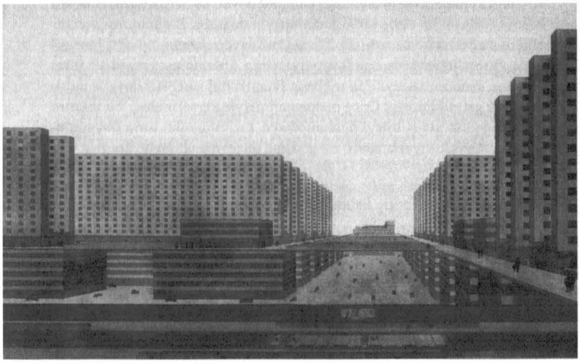

*路德维希·希尔伯塞默，“水平城市”。被化约为单一住宅单元的大都市设计。*

〔原书第118页〕

> 当然，数学的形态［shapes］是抽象的，而建筑的形态是具体而人性的。但这一差异并不涉及本质。形态的本质属性并不取决于它属于何种类型，而在于它的组织；只有当我们这样思考时，才能称它为形式。人的数学形式感，只能从数学的证明过程之感中发展出来。我相信，除非我们先学会发展出一种可与数学相类比的设计过程之感，否则我们的建筑形式感就无法达到与数学相类比的发展水平。[10]

亚历山大是一位希望建筑中的最终产品能像数学中那样具有充分理由、希望在设计领域建立一种笛卡尔式真理体制的思想家。建筑与数学之间建立的类比关系，显然哪怕只考虑数学知识的同义反复性质，也能被驳倒。一种不断致力于验证自身基本公理的思维实践，与建筑知识之间的差异，究竟如何能被作者称为“不涉及本质”，实在很难理解。更难以理解的是，这本书十余年间从美国大学开始，在世界上相当大的范围内一直作为基础建筑读物而存在。布鲁诺·陶特从第一次世界大战之前到他最后在土耳其出版的《建筑知识》（*Mimarlık Bilgisi*）所经历的变化，为现代主义理性戏仿的历史背景提供了一个例子。1913年，他在莱比锡举办的世界建筑博览会上建造了德国钢铁工业馆。围绕这座建筑，有人问他是什么规则、什么原则创造了一件艺术作品。他的回答是：“不，不应该有原则。”他从拉丁语中“principium”意为“开端”出发，会说可以从中出发，但他认为把原则“鞭打至死”是危险的。因此，他觉得下面这句罗马谚语很合适：“Principiis obsta!”（抵抗开端！）[11] 然而到了1938年，在他看来，连技术、构造和功能也只不过是比例的〔原书第119页〕辅助之物：“建筑完全且绝对地基于比例；这并不是建筑的基本品质，或者说并非与许多其他品质并列的首要品质，而是建筑所依据的唯一品质。所有其他条件与规定都服从于比例。”[12] 然而，陶特用了五十页的篇幅，却怎么也未能像勒·柯布西耶那样，为比例勾勒出一个不以主观性为基础的整体概念框架。也许他就是下不了手。他意识到，变化中的世界和现代性已经摧毁了赋予同质性的超越轴心；但他怎么也不愿接受，生成形态学的比例、组合与连接体系已经死亡。即使他领会到一种超越性的秩序原则无法建立，他也以为只要删去开头那个“超越的”一词，这个术语就仍然可以有用。早期远离那些统摄整体的普遍法则的陶特，在生命最后几年却相信了比例——这类法则中最严格的一种，即数学理性戏仿——这无疑是那二十年间的认识论转变所致。无需深究其原因，也可以说，对比例体系的寻求，说得轻一点，指向一种与现代性极为紧张的关系。数学理性，或者用其传统说法，比例体系，很可能出自这样一个目标：在一个摧毁了一切超越性知识的现代世界里，为建筑重新赢回它早已失去的、无可争议的真理与有效性权力。显然，设计主体对自身的主体状态、自身的自由与意志、自身的现代性感到不安。它为设计寻找自认为比自身特殊意志更牢固的其他依托。它回溯性地发明这些依托。它提出一些数学性的构形原则、比例秩序，并希望相信这些原则因为也曾适用于过去的形态学而获得了普遍性。在《模度》中，关于各个时代的作品都符合同一套数学规则的叙述，在这一语境中颇具启发性。勒·柯布西耶连续五〔原书第120页〕页地先在曾是哥特式修道院的沙利斯，接着在埃及阿比多斯的塞提一世神庙，在伊斯坦布尔的圣索菲亚和卡里耶，随后在托普卡珀宫的帝王门，再到其他时代和建筑中，都欢欣地“发现”自己的比例体系始终有效。[13]

理性主义戏仿最常出现在我称为“统计学乌托邦”的一组产品中。这是现代主义最受欢迎的体裁之一。在相信自身代表超越理性的统计学乌托邦建构者心中，人类的与社会的要求，不过是一些基本生物功能，以及那些只在词典定义中才被思考其存在的人类活动。这些数据以最赤裸的形式出现在统计学中，乌托邦建构者便从它们出发。人均绿地、流通面积、休闲空间不足。统计学乌托邦主义者相信，增加这些就能带来社会与个人的幸福。因为幸福和物理环境质量的定义，与个人所获得的数值成正比。理性主义建筑师主体认为，理性就是这些数值。从《雅典宪章》中可以引出无数这一方向的引文。几乎在所有这些引文中，现代城市的创造者都是卫生设施和公共服务设备的数量，而它们已被赋予一种机械化的定义。例如：“任何住宅平面，哪怕只有一户朝向北方，或因外部遮挡而失去阳光，都必须坚决否决。应当要求建造者做出草图，使每户在冬至日每天至少能获得两小时日照。”[14] 或者，在谈到城市整体时说：“人口数量和用地尺寸一旦确定，密度也就确定了。”统计学乌托邦主义者对自己的理性主义如此确信，以至于把城市设计成一座完美完成的几何体，一种柏拉图式的形式。〔原书第121页〕任何从他的超越理性之外施加于它的干扰，都会破坏这种完美的完成状态。我认为，这种理性主义完成性的主张，指向城市层面乃至一般社会层面最鲜明的反现代追求之一。对一个从此不再被破坏的永恒“正确世界”的要求，首先参照的是对现存世界及其变化的恐惧。而试图在城市尺度上建立那个“正确世界”的人能够成为崇高的天才建筑师，这几乎像是先知角色的一种当代改编。理性仿佛只是一种只有扮演那个“当代”角色的设计主体才能掌握的本领；物理环境的形式可以由他心智的能力来决定；留给其余人的唯一理性态度，就只是不破坏这种完善性的意志。因此，统计学乌托邦的建筑师主体，把它自认为理性的推理方式当作一种权力工具来使用。由于它拥有一种确定的理性把握，它不再需要与尚未达到这种把握的“普通人”共享共识与协商的环境。因此甚至可以说，建筑理性主义以全知全能的建筑师主体为中心，把整个社会都他者化了。“他者”只需接受有知主体的统治。正因如此，关于勒·柯布西耶或赖特的许多真实轶事，很大一部分都是客户如何被羞辱的故事。建筑理性主义的真正定义，也许就是把世界设想为除了建筑师主体之外没有人能够理性的世界。因此，它知道什么对所有人有益，并为那些连把世界想象成天堂都做不到的人，把世界变成天堂。

在这样审视现代主义文本之后，要看出这些理性主义是理性的戏仿，读一读陀思妥耶夫斯基的《地下室手记》仍然很有启发。陀思妥耶夫斯基在读了车尔尼雪夫斯基的小说《怎么办？》之后，于1864年，也就是比最早的现代主义建筑文本早半个世纪，写下这本书，作为对车尔尼雪夫斯基天真的理性主义—乌托邦式追求的一种批评。书中某处这样说：

〔原书第122页〕

> 逻辑当然是好东西，但它终究只是逻辑，只能满足人的思考需要；而欲望才是生命本身，从最简单的行为直到最高的逻辑。诚然，受欲望支配的生命往往不过是胡言乱语，但请记住，它仍然是生命，而不是开平方。

> 比如说，我想生活，不是为了仅仅满足思考的需要，不是为了展示人类生存能力的二十分之一，而是很自然地、调动我全部的生活力量去生活。理性在这里做什么呢？理性只知道它能够学到的东西。[15]

> ……每次到达目标都会感到不安。人喜欢向着目标前进，却不喜欢达到目标。这真是可笑。人的天性本来就是可笑的，全部的荒谬也就在这里。二乘二是令人无法忍受的东西。二乘二等于四，这是一个双手叉腰、挡住我们的路、向左右吐痰的无赖。我信仰二乘二等于四的完善性，但如果有最值得赞美的东西，那就是二乘二等于五。[16]

这段文字不是对理性的批判，而是对现代理性主义戏仿的戏仿。小说家在嘲弄一位肤浅的乌托邦作家：此人希望通过修正物理环境和社会生活中可用数字数据表达的内容，建立人间天堂。在这里，代表合理性、代表理性的是陀思妥耶夫斯基的文本。而车尔尼雪夫斯基的文本则是一种对理性的戏仿。

### III

“作为现代历史观戏仿的历史主义”这一说法，可以视为把波普尔在《历史主义的贫困》中建立的框架，改写为对现代主义认识论的批判。现代主义认识论内部有两种不同的历史主义类型学。第一种的杰出例子是莫伊谢·金兹堡的。〔原书第123页〕金兹堡在《风格与时代》（*Stil' i Epokha*）一书中[17]，建立起一个完整的传统历史循环。这个循环源于一种此后也将屡见不鲜的本质主义：建筑和世界不断变化。然而，建筑的本质在一切变化中仍保持存在。即使一切都在变，使建筑成为建筑的那种本质，作为一种超越价值，仍然持存。在这种情况下，现代主义建筑理论家有义务找出那本质所栖居的外壳变化的规律。也就是说，他有一个完全历史主义的使命定义。〔原书第124页〕金兹堡通过把全部建筑史理解为一部风格史，并说每一种风格都经历构造性的萌发、有机的成熟和装饰性的崩解三个阶段的建构，来确定这些规律。无需说，金兹堡把自己定位在第一个构造性时期。结论当然是：历史的规律既然如此，建筑师就必须意识到自己在那个历史循环中所处的位置，并据此行动。这种不断生产同一序列周期的螺旋时间观，也应在吉登斯称为现代性后果之一的“时间的空虚化”[18]现象框架中思考。现代性把时间建构为适用于一切地点的同质编年轴，提出了一种与依附于地点的时间观截然相反的东西。而金兹堡的现代主义时间螺旋，却是根据特定地点中特定风格相继经历的阶段建构的。时间不是由抽象的量度单位定义，而是由重复的风格内部变化循环定义。也就是说，时间并非空虚；它被其中发生的建筑事件的形态学秩序“填满”，其定义也由填满它的事物给出。至少在金兹堡的例子中，可以说现代主义怎么也未能把时间理解为一种绝对的编年现实。现代主义内部的第二种历史主义类型学则是目的论的。历史变化过程被想象为从某一点开始、朝某一点前进、目标与路线都已确定的进程。吉迪恩的历史观正是这样一种历史主义戏仿。在他1928年出版的划时代著作《在法国建造》中[19]，他勾勒了一个从18世纪末开始，经他自己时代，通向未来的框架。他的代表作《空间、时间与建筑》[20]则〔原书第125页〕在内容和编年范围上进一步发展了叙述。这本书直到1970年代都一直是一部无可匹敌的标准建筑史。在这两本书以及许多采取相同进路的类似著作中，欧洲和美国的历史都被建构为一场有意识地寻求创造现代主义的运动。尽管手头有足够多的“异端”数据可以界定无数不同的建筑选择与变化路径，它们要么只作为那场运动的“敌人”被纳入叙事，要么被无视。所有现代主义历史建构，包括金兹堡的螺旋历史书写，都是目的论的。历史的方向是预先知道的；主体的任务就是加入这一进程，至少不阻碍它。建筑师主体知道今天应该做什么，因为他相信自己站在把昨天与今天连接起来的那条极其有序的线上。关于那条历史书写路线的知识告诉他（仿佛如此）今天应当如何设计。现代历史意识的历史主义戏仿，提供了知道昨天、今天和明天是什么的可能。而新的历史观则提出与这些现成预言完全相反的东西。目标是历史作为开放过程的建构。把历史建构为开放过程，也意味着阻止它被工具化。由于不再关心未来会如何这种形而上学问题，也不作预言，历史学家如今只满足于理解。而历史主义的建筑认识论，则凭借工具性进路，提议朝它预告了其样貌的未来坚定行进。历史在这里仍然是传统的权力工具；它提供行动纲领，并建立针对不遵循者的制裁。历史主义者不会满足于理解。我再从陀思妥耶夫斯基《地下室手记》中简短引一段：

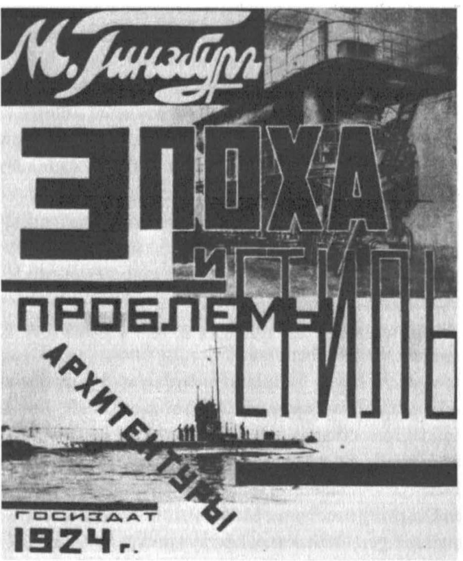

*莫伊谢·金兹堡，《风格与时代》（Stil' i Epokha），国家出版社，莫斯科，1924年。*

> 痛苦是理解的唯一来源。……理解具有一种无法用二乘二来衡量的崇高性。二乘二之后，已经没有可做的事，也没有什么可理解的了。最多只能使五种感官麻木、陷入沉思，如此而已。诚然，理解也会把人带向同一结果，也就是又没有事情可做，但至少可以捶打自己、让自己稍微振作一点。虽然这是反动的行为，但总比什么都没有好。[21]

〔原书第126页〕

### IV

“作为现代科学戏仿的科学主义”也许最极端的例子，出现在捷克现代主义的大脑卡雷尔·泰格的言论中。在他看来，可以谈论“建筑从一门应用艺术向科学的转变”。[22] 不过，把建筑、当然也把城市规划标为科学，是一种范围更广、影响至今的现代主义习惯。除了那些把建筑本身变成科学的人，几乎所有在建筑与科学之间建立类比或工具化关系的思想，都以某种方式加入了现代科学戏仿。例如，早期苏联理性主义者克林斯基和拉多夫斯基的思想[23]就是工具化科学的典型戏仿。我们知道他们在1920年代建立了一个实验室，试图测量建筑设计的心理效果。这种观点否认了两点：对象的建筑／设计效果并非内在于对象；人是在社会条件所定义的环境中生产这种知识的。这种观点否认设计知识是在人的心智中历史地形成的，把它设想为人的物理构造的组成部分。

〔原书第127页〕

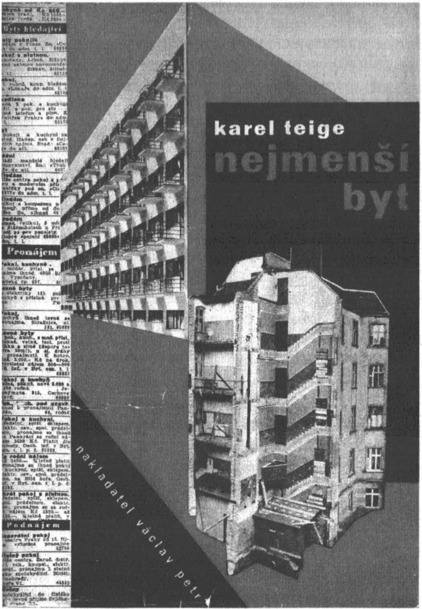

*卡雷尔·泰格甚至把建筑称为科学，从而把始于18世纪的理性主义推到最终结论。他这本名为《最低住宅》的著作，则首先把居住问题定义为一种技术现实。*

〔原书第128页〕

从这些建筑师到今天的空间心理学研究，可以画出一条线。在这条线的每一站，都会看到人们声称达到了对建筑的一种所谓客观把握，而建筑这次又被想象为一门实验科学。从社会性和神圣模式中解放出来、把建筑现实对象化的建筑师主体，这次又把它们与自然现实混淆了。在这类进路中，即使并不总是付诸实践，也潜在地会用实验方法论来寻找设计道路。显然，这是一种科学主义的类比。科学主义进路是什么、如何生长，德特勒夫·梅尔廷斯在一篇审视密斯·凡·德·罗知识积累的详尽文章中提供了一个有趣例子。梅尔廷斯表明，这位著名大师如何利用通俗科学文献中的某些著作（例如拉乌尔·H. 弗朗斯的《植物的技术成就》和《植物作为发明家》）形成一种类比思维。[24] 可以说，这种类比式科学主义思维在部分构成密斯根源的赖特那里也有一个不同版本。他的有机建筑概念赋予建筑产品一种如同自然生命中的存在过程。[25] 他试图把为自然存在物建立的知识大厦移植到建筑中。这种可称为“在建筑语境中阅读科学文本”的进路，可以写出一部很长的历史。在所有这些做法中，科学理论被清空其真实内容，只在形式上被用来解释建筑事实。这既适用于关于有机存在的理论，也完全可以用于物理学。甚至在库恩的例子中，可以看到一种为科学史绘制的框架能够被“翻译”到建筑中。用范式转换解释科学变化的《科学革命的结构》，多年来成为美国大学里向青年建筑学生推荐最多、阅读最多的书。建筑中的变化被关联到一种类似科学范式的公理结构，而这只是一种比喻，这一点会被忽视。〔原书第129页〕对科学的科学主义式戏仿，最鲜明地体现在城市规划认识论中。不满足于规划仅仅是一种实践，而喜欢把它本身称为科学，这是一种流行的习惯——而且是一种甚至传到土耳其的习惯。它的根源同样可以追溯到苏联构成主义者。其理由似乎是：无论在哪里被表述，它都是为了给显然欠缺合法性的规划提供合法性依据。为了不诉诸任何政治同意机制，就把设计数百万人的生活环境、决定他们命运这一行为合法化，人们动用了科学神话：规划者有权进行规划，因为他所生产的是科学真理——而反其道而行之已经不可设想。[26]

### V

“作为技术戏仿的技术主义”这一术语，定义的是这样一种信念：当前的技术可能性没有反映到建筑中；以及一种坚持，认为它们应当被反映进去。这里的戏仿令人想起通俗喜剧的逻辑。技术在戏剧空间中一直存在，建筑认识论却常常坚决主张它并不存在。其主张是：建筑师与技术怎么也碰不到面，而与技术调情的是剧作家一贯贬低的另一些角色（例如工程师）。当然，这出错误喜剧指向一个关于技术在现代世界中的角色如何被定义的问题。现代主义建筑认识论似乎建立在一种技术落后的执念之上。然而从19世纪开始，新的技术〔原书第130页〕与建筑的实际关系根本谈不上有什么问题。在建筑实践中，最新的技术发展立刻找到了使用领域，建筑也持续发展着自己特有的技术库。但从20世纪初开始，技术不足的执念怎么也平息不了。由工程师主导的建造生产领域的技术丰富性，长期成为建筑师嫉妒的主要对象。现代主义也许追求的不是技术，而是看起来像技术。但它不会这样表达，总会隐藏自己技术主义的诉求。换句话说，我说的是把技术转化为现代主义建筑圣像。这个圣像、这种对技术外观的执念、这种技术主义，界定了一条一直延伸到今天高科技建筑的历史轨迹。

这一取向的鲜明例子之一，又出现在勒·柯布西耶那里，出现在他那本先以英文出版的《飞机》（*Aircraft*）中。建筑师让书中作为主题的飞机与建筑、城市之间的边界常常变得无法确定。以至于有些地方，要分辨他讲的是飞机还是建筑，变得相当困难。例如下面这段文字就很典型：

> 19世纪的学校破坏了“人的尺度”和“对材料的尊重”。

> 另一方面，飞机包含着人的尺度最纯粹的表现，也是对材料的一种奇迹般的运用。

> 学校由教授们管理（这就是学校的定义）。教授们按照预先确定的课程教学。课程由权威确定。这种权威与生活有接触吗？只有机会出现时才有。生活有课程吗？没有，生活是爆炸性的。

> 工场的负责人站在他的材料和机器旁边，与生活保持接触。

> 工人们不断思考材料。指示如何加工材料的图和平面，只是指向材料内在属性的一份速记。

> 但学校的图没有脊梁，也没有支撑。它没有外观、没有重量，也没有能量。它是无定形的。

> 因此，建筑在19世纪被学校摧毁了；也正因如此，新建筑是反叛者的产物。[27]

在文本中，飞机做到了建筑因陈旧制度结构的阻碍而未能做到的一切。它作为界定建筑面前技术极点的圣像而存在。以巴克敏斯特·富勒最为鲜明、最喋喋不休的乌托邦技术主义者，把这种圣像学推到最终结果。富勒建立了一种只专注于通过技术活动创造建造环境的认识论。以至于他几乎不相信技术发明之外的任何设计活动。技术主义戏仿似乎与技术的社会性无法被理解直接相关。勒·柯布西耶在《今日装饰艺术》（*L'Art décoratif d'aujourd'hui*）中反复举例说明这一状况，而它日后也将构成现代主义知识建构最严重的弱点和死结。例如他这样写道：

〔原书第131页〕

> 研究人的尺度、人的功能，就是定义人的需求。

> 这些需求数量并不多；既然人从已知最古老的时代起就是按同一个模子造出来的，那么对全人类来说它们就非常相似。当拉鲁斯面对为人下定义的任务时，他只用三幅图像来描绘人的解剖结构：完整的机器就在那里，结构、神经系统、循环系统，而且这无一例外地原样适用于我们每一个人。

> 需求具有共同类型。这意味着它们对我们所有人都一样；因为自然对人漠然、非人（超人）且残酷，所以我们都需要在自然禀赋之外追加的工具。[28]

如果注意看，在这一需求和满足需求的技术工具的定义中，轴心是人的生物构造。当然，实际情况并非如此。尽管人的生物构造在各地、对所有人而言大体相同，但需求与我们生物上的同类性相反，极其多样且多变。以否认这一事实的方式去思考技术与需求的关系，对现代主义话语却具有生死攸关的意义。建筑和建筑师的职责定义，就建立在这种技术主义建构之上。

〔原书第132页〕

### VI

所谓“作为大都市戏仿的现代主义城市规划”，指的是建立现代主义建筑认识论的人，以对大都市现实的对抗性解释来接近自己的设计对象。归根结底，甚至可以说，那些建立并信仰建筑现代主义认识论的人看不见大都市，也许还尤其努力不去看它。这里指的是现代主义城市规划把城市定义为病人、把城市规划者定义为医生的取向。规划者从这个隐喻内部看出去，自然对大都市和城市中他所定义的物理病症之外的维度一无所知。城市只是一个光照不足、移动不够快、居住平方米不够、不够干净，最重要的是不够有纪律的空间。也就是说，大都市源自其大都市性的很大一部分品质，被定义为病症。现代主义建筑知识大厦，是通过批评孕育现代人、并且城市性与公共性得以在其中发生的物理环境不够现代，而开始工作的。我所说的对抗性取向，正是这个。他们将把现代城市的许多品质理解为疾病，而把它的解放性只理解为无纪律和混乱。塔夫里说，把大众住宅概念推上世界议程的1920年代和1930年代初的实验性早期现代主义住区，是全球性反城市意识形态的组成部分。[29] 在他看来，这种意识形态的根源一端可追溯到杰斐逊，另一端可追溯到非马克思主义的社会主义思想。其基础是对大城市的消极性的观念。〔原书第133页〕因此，新的集合住宅区将是一座不包含城市的失控与消极因素、具有内在一致性的秩序之岛。恩斯特·迈和马丁·瓦格纳等先驱城市规划者的行动背后，正是这一思想积累。当现代资本主义大都市清除社群结构和传统秩序观时，建筑师却着手在同一种大都市的建筑中，以一种否认大都市之大都市性的建构方式，把它重新建立起来。建筑师—规划者将把大众从大都市的混乱与肮脏中拯救出来，向他们提供乡村的秩序与幸福。建筑师和规划者之外的一些知识分子，似乎早在20世纪初就注意到了大都市在城市性方面的收获。他们领会到，城市在物理和社会意义上都已成为一种开放结构。他们看到它如何构成一个独特的自由领域，如何对新加入者开放，缺乏同质性如何已经变得平常。在现代城市、尤其是大都市中，他们明白人既可以置身于社会之中，又可以做到独处。他们察觉城市如今需要并创造华丽奇观，而拱廊街这样的新建筑类型也回应了这种对奇观的需求。波德莱尔、西美尔、本雅明、克拉考尔将以新的视角为理解城市界定新的机会。但从这个角度看，很难相信乔治·西美尔和瓦尔特·本雅明与希尔伯塞默和M. 瓦格纳是同一文化环境、同一历史时期的知识分子。前者越是打开一个丰富宇宙的门，后一群体就越是急于堵住他们所生产的那些开口。前者看到城市平衡状态已被永久摧毁，并探索各种开口；后者——那些把新城市规划认识论建立为大都市戏仿的人——则不断寻找如何重新建立一个平衡状态，最终还声称自己找到了。勒·柯布西耶将在纸上建造一座三百万人口的大都市，其中没有任何缺陷、无纪律或失序。因为这座城市注定要永远保持他所规定的平衡。西美尔五分钟就能向他解释清楚，他所梦想的并不是大都市。而今天，现代主义城市规划知识的当代形态〔原书第134页〕可以说，是建立在把当代大都市误认作一座百万人口村庄的基础之上。我们知道，使大都市成为大都市的，正是它整体的不可规划性；至少，这样的共识在政治上是不可能的。我们并不以惊愕来面对诸种要求的不可调和。何况，马克思也许比最早的现代主义者早几十年就能说出这一点。但自称马克思主义者的奥斯卡·尼迈耶，即使在1980年，仍以自己设计的巴西利亚远离其他城市的不守纪律为由为之辩护。从他在与舒马托夫的谈话中对现代城市所作的简短说明里，就能轻易看出他如何定义现代城市：

> 当然，如果重新来过，我会把几件事做得不同。我会安排更多花园，以及一个汽车进不去的市中心。巴西利亚没有像里约那样可供人们聚集的真正中心。也许我还会给建筑多加几层，这样道路可以少修一些。但这些都是小问题。规划是好的。巴西利亚有纪律，它超越了其他城市中的混乱与无政府状态。[30]

### VII

“作为批评戏仿的‘反馈’”想说明的是：现代性所产生的自我对象化能力，被现代主义的批评实践戏仿了。我把问题描述为：现代主义并不批判自身，而是在自己的认识论边界内，把批评的戏仿当作一种为所生产之物赋予合法性的反馈来运作。这里我不是指那些提出不同于现代主义之形态学乃至认识论的人的激进努力。我排除他们，不是因为我更加相信他们的激进努力包含更坚实的批判立场与理解，而是因为他们从一开始就选择不关心那些问题。这里说“他们以反馈代替批评”，指的是1960年代团队十（Team Ten）这样的现代主义批评群体。〔原书第135页〕可以说，像史密森夫妇和阿尔多·范·艾克这样一度持反对立场的现代主义者，进行了一场批评的戏仿。显然，他们并未发展出一种共同进路，但他们都满足于修订现代主义知识大厦，而不是审视它。也就是说，他们认为既不需要审视神圣的建筑师—主体身份，不需要审视面对社会的威权式和他者化态度，不需要审视隐喻式的科学与技术观，也不需要审视工具性的历史理解。相反，他们再生产了现代主义理解中早已隐含的一种乡愁。例如，他们的渴望指向传统的有机共同体概念。总体而言，在团队十看来，现代主义先驱忽视了这个概念、社会对话和共同体意识。早在1954年1月，由于对CIAM第九次会议不满，史密森夫妇、福尔克尔、巴克马、范·艾克、范金克尔和霍文斯·格雷韦在荷兰杜恩聚会，提出了一份称为《杜恩宣言》的批评文本。[31] 宣言第一条涉及一个错误：不把住宅看作与之相互作用的共同体的一部分。第二条则强调，在这种相互作用结晶之前，先对住宅的要素进行编码，只是浪费时间。从19世纪末滕尼斯（1887）开始，就有人说Gesellschaft（社会）正在清除Gemeinschaft（有机共同体）。人们生产出这样一种知识：人际关系如今不再发生在封闭的社群结构内部，而是发生在宽广、几乎抽象的社会结构之中。团队十以及一般意义上的现代主义批评群体却主张相反的东西。例如，史密森夫妇从1950年代到1970年代初一直写道，新建筑探索的目标应当是建立参与有限、亲近、亲密且有约束力的共同体，并且（绝望地）努力如此设计：

〔原书第136页〕

> 我们感到需要一个街角有“酒馆”的邻里。为什么因为我们的短视，就要从“我们的后院”、从我们那一点点地域感中被剥离？

> 没有与朋友的联系，我们是死的。我们应当拥有朋友圈和邻里，而不必从旁边住宅楼的前面、后面或内部穿行而过。

> 住在高处并不意味着像笼中鸟一样生活，但它必须能够提供旧秩序所提供的东西，例如景观机会、被观看时的私密性以及行动安全。[32]

引文可以按照这个腔调前前后后延长好几页。针对现代主义主脉——或者只是先驱者的现代主义——的批评，其内容总是一样的：传统世界曾拥有适合生产人际关系的空间，取而代之的是把人从人身边割裂开来的孤立化、异化空间。建筑师必须设计出恢复旧日“美好”秩序的世界，并提供救赎。如果注意看，人们从未要求建筑师放弃现代主义先驱的角色，也就是那个为“他者”知道何为真、何为善的神圣主体角色；甚至没有着手对任何现代主义理论建构进行修订。人们只是要求建筑师再扮演一次同样的角色，但这一次要带着乡愁，带着“我们失去了自己的价值”的感受去扮演。在这种批评戏仿／反馈中，论点和解决方案虽在变化，认识论范围却始终由对共同体感之丧失的强调来界定。例如，阿尔多·范·艾克对马丁·布伯《我与你》[33]作了一种扭曲的个人化阅读，把哲学家创造现代主体间对话的要求，转化为重塑建筑师那古老的现代主义纠正者、治疗者角色的方向。建筑师设计的空间应当创造社会对话的环境。[34]〔原书第137页〕现代主义建筑认识论从不生产这样的知识：许诺对话的不是空间形式，而首先是社会关系网络。建筑数十年来总是错过社会性，这不应令人惊讶。

### VIII

这里试图对现代主义建筑知识理论所作的破坏性批评，有什么用？在回答这个问题之前，首先必须确认，提出这种批评并不为时过晚。在建筑中，从学院到日常建造实践，再到非建筑师理解建筑的习惯，上述被批评的思想在许多领域仍然活着。有时它们完整而鲜活地活着，有时则留下无法擦除的痕迹。因此，必须重新概念化建筑，并清除上面列举的所有这些戏仿，画出新的理论路线。

〔原书第138页〕

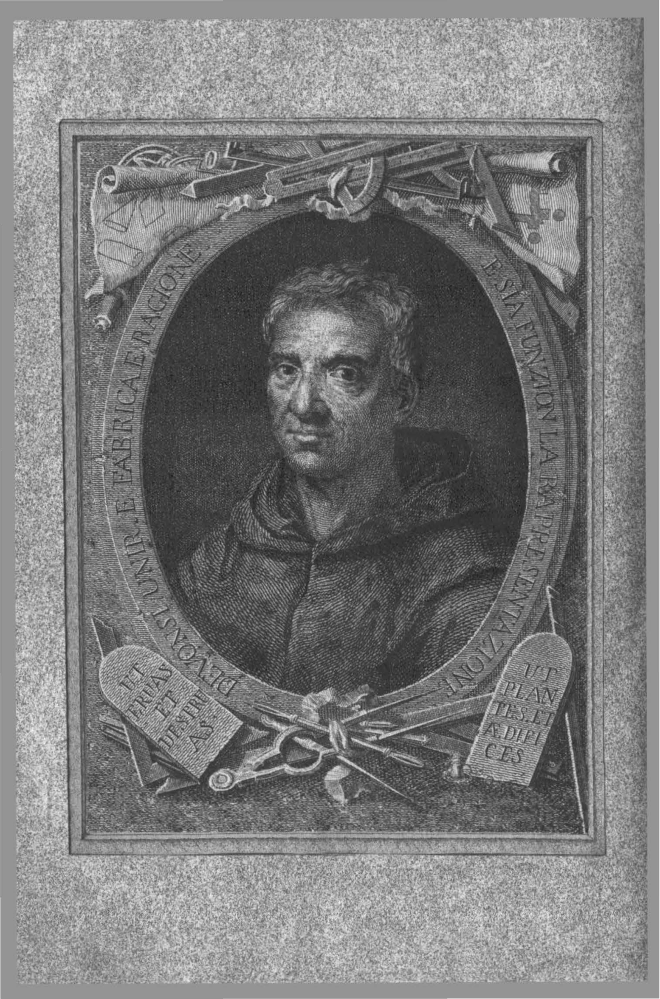

*安德烈亚·梅莫，《想象的寓言……》，巴萨诺，1787年，书名页对面的插图。*

## VI　功能—形式范式

〔原书第139页〕

*把 funzione（功能）一词从数学引入建筑语言的第一位理论家：卡洛·洛多利。*

> 凭借世界主义的神圣恩典，这种［意识］——在其完整性的框架之内——只有少数人能在不同程度上获得。就此而言，那些多年来在森林、在辽阔平原上，除了手中的猎枪之外一无所有，靠观察、研究、写作度日的孤独漫游者，是最合适的人选。没有任何教学壁垒，没有任何大学式的悖论，没有任何教育学乌托邦，横亘在他们与复杂的真理之间。他们懂得形式与功能之间那种值得赞叹的、永恒的、不可回避的联系。他们不批判它，只是观看并探究它。[1]

在艺术语境中表达功能—形式范式的最早论述之一，应该就是波德莱尔上面这段写于19世纪中叶的文字。自从他说出这些先驱性的、隐喻性的话以来，功能与形式不可分割的论点几乎成了一种不容置疑之物。现在正是提出以下问题的时候：形式追随功能吗？不，它不追随。那么，形式从何而来？功能是什么？如果形式并不源自功能，如果创生形式的机制并非由功能驱动，那么我们过去是如何设计的，现在如何设计，将来又该如何设计？此类理论讨论将在本章后半部分进行。读者首先将借由实例，进行一次历史漫游，以例示形式与功能之间绝非决定论式的关系。〔原书第140页〕不过，首先有必要指出：形式—功能关系是一个新问题；与人们通常所想的相反，这里谈论的并不是一个由维特鲁威早在公元前后就已提出的 firmitas、venustas、utilitas 三元组所界定的问题。说得最乐观些，这是一种始于18世纪的话语。因此，最好还是不要急于下判断。我们先从几个例子入手，以便对形式与功能的必然关系产生怀疑。先举几座清真寺，再举几座教堂。清真寺都古老，教堂都新（建于20世纪）。之所以讨论这两种宗教建筑，是因为几乎所有人都大致知道教堂、清真寺及其功能。我们面对的建筑，仿佛几个世纪以来始终履行着同一功能，而形式结果的多样性使功能—形式的讨论变得容易。然而，这最后一句话必须修正。尽管宗教规则具有超越时代的约束力，清真寺和教堂在使用方式上都不是恒定的。8世纪的一座清真寺与11世纪的一座教堂，其使用方式与今天的同类建筑并不相同。即使伊斯兰教与基督教的信仰公式和礼仪大体固定，宗教建筑的使用问题也并不与信仰数据重合。稍后我们还会尝试通过这两个一神教的礼拜空间，讨论形式—功能联系究竟有多复杂。不过，对于一场简捷的功能—形式讨论，这两种礼拜建筑都可以成为有用的起点。

第一个例子是突尼斯的凯鲁万大清真寺（始建于670年）。它是伊斯兰世界最古老的清真寺之一，早在倭马亚王朝时期便已开始建造。礼拜空间是一座多柱大厅，宣礼塔则是一个棱柱状的巨大实体。在几近同时代的大马士革倭马亚清真寺（706—715年）中，遇到的却是完全不同的建筑。用今天的术语说，两座建筑大致服务于同一功能。两座建筑中都有人礼拜。那么，为什么第一个例子采用柱厅式平面，而倭马亚清真寺拥有与米哈拉布墙平行的三殿式平面？〔原书第141页〕前者较低，后者较高；前者没有装饰，而倭马亚清真寺中可以看到用马赛克技法制作的图像。为了解释它们的差异，说它们所定义的建筑结果与伊斯兰礼拜功能直接相关，并没有意义。甚至，无论怎样定义，倭马亚清真寺中的图像表面有功能吗？当然，它们有存在的理由，对那个时代的人和今天的观看者也有意义。但它们可以用功能性来解释吗？伊朗伊斯法罕有一座17世纪的清真寺——沙阿清真寺（今称伊玛目清真寺）。这是一座与前两个例子完全不同的清真寺。大马士革倭马亚清真寺有一个整合的礼拜空间。而在这里，米哈拉布前方的穹顶被明显地从其他部分切分开来，旁边的殿身也与它分离，清真寺还有一个被称为四伊万式的主庭院。而从外部看到的主穹顶，是一个象征性的结构，它遮蔽了覆盖其下空间的穹顶，使其不被看见。〔原书第142页〕从内部看时，它甚至本就不打算被人看到。拿土耳其有着数千例的单一穹顶奥斯曼清真寺与刚才那些相比，找不到任何相似之处。大致可以说，它们用于同一功能。什叶派礼拜与逊尼派哈乃斐派礼拜之间的差异可以忽略不计。但建筑之间的差异之大，无法与礼拜形式的差异相提并论。空间构造、宣礼塔的形式、内部空间的采光方式、开口、结构解决方案，全都截然不同。然而，这里谈论的几乎是同一世纪的建筑。在同样属于17世纪的另一座奥斯曼建筑——伊斯坦布尔的苏丹艾哈迈德清真寺中，以及在先前的那些建筑中，进行的礼拜几乎相同。今天巴基斯坦拉合尔同样建于17世纪的巴德沙希清真寺也是如此。巴德沙希清真寺有三个与米哈拉布墙平行排列的洋葱形穹顶。它们全都覆盖在并不界定建筑内部空间的下层穹顶之上，是结构价值可以忽略的象征性穹顶。为什么它们如此，为什么是三个，是出于功能上的理由吗？并不存在任何要求它们必须是三个的功能性理由。宣礼塔为什么位于角部？为什么它们不像奥斯曼宣礼塔那样高过穹顶，反而恰好相反，低伏在下方？再远一些，在撒哈拉以南非洲的尼日尔，有一座清真寺。这座清真寺用土坯建造。就外部表达而言，它与前面那些建筑的差异也非常清晰。甚至很难说，以上列举的所有清真寺服务于几乎相同的功能。

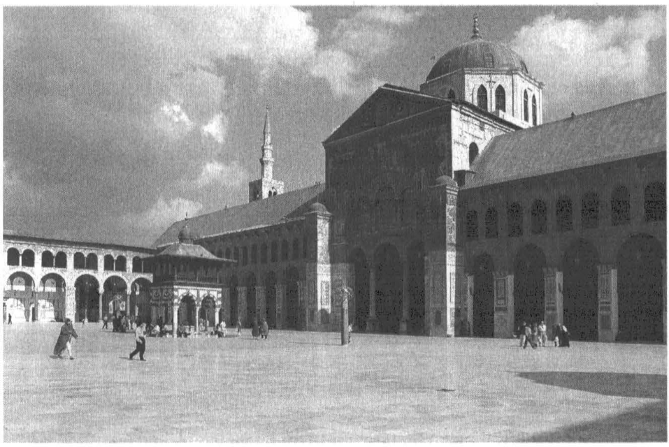

*大马士革倭马亚清真寺，从庭院看。*

对于因为想到这些建筑位于不同地理区域而产生怀疑的人，可以举开罗三座相邻的清真寺为例：赫斯雷夫帕夏清真寺（奥斯曼人来到埃及后不久建造）；它对面是一座14世纪的马穆鲁克建筑——苏丹哈桑宗教学校、陵墓与清真寺；旁边则是里法伊清真寺。最后一座建筑是很晚的例子：建于1920年代至1930年代之间。（校注：底本年代如此。[埃及旅游与文物部记录](https://egymonuments.gov.eg/ar/monuments/al-rifa-i-mosque)记载里法伊清真寺于1869年启动建造、1912年完成并开放，非1920—1930年代。）为了指出它们的差异，可以先问：苏丹哈桑建筑群中作为清真寺的部分在哪里？按照土耳其的习惯，回答这个问题并不难——指向最大的穹顶。但不对，那里是陵墓。清真寺位于那座陵墓的前方，〔原书第143页〕由围绕着一个深而狭窄庭院的四个伊万组成。比建筑群的清真寺更大、更具象征性的体量，是苏丹哈桑的陵墓。在奥斯曼土耳其，陵墓比清真寺小，而且并不直接接合到礼拜空间上。为什么14世纪的埃及不是这样做的？当然有答案，但不是功能性的。为什么清真寺要躲进陵墓的阴影里？他们把出资建造者看得比伊斯兰礼拜空间更重要吗？每一项当然都有其理由。建筑总是在一种社会性环境中实现的。当被问及“为什么这样做”时，14世纪的建筑师、20世纪初的建筑师、奥斯曼建筑师，当然都能回答。但他们是用不同的逻辑和参数来回答的。来看开罗例子中三座建筑的宣礼塔：奥斯曼清真寺的宣礼塔有圆锥形顶冠，里法伊清真寺的宣礼塔几乎是苏丹哈桑清真寺宣礼塔的复制品。为什么奥斯曼宣礼塔不同？人们同样登上它的和其他宣礼塔的阳台诵唤礼。它们履行同样的功能。〔原书第144页〕但另一方面，相隔五个世纪建造的两座清真寺——苏丹哈桑与里法伊——的宣礼塔却彼此相同。而相隔一百年建造的苏丹哈桑与赫斯雷夫帕夏清真寺的宣礼塔，却截然不同。（校注：底本建筑名称与“一百年”间隔沿录，所指建筑尚未确认。[土耳其宗教事务基金会《伊斯兰百科全书》开罗条目](https://islamansiklopedisi.org.tr/kahire)所载赫斯雷夫帕夏建筑为1535年的施水所，不能据名称相近便认作这里的清真寺或替换其名称。）现在我们来看看相似而非差异所产生的矛盾。苏丹艾哈迈德清真寺与开罗的穆罕默德·阿里帕夏清真寺，在很大程度上重复着相同的四半穹顶平面。为什么？可以说是因为它们履行同一功能吗？一些相距如此遥远、功能相同的建筑，怎么会像这两个例子一样相似？我们在比苏丹艾哈迈德清真寺晚约两个世纪建造的穆罕默德·阿里帕夏清真寺中看到相同的造型特征，这与功能相同有关吗？履行同一功能的建筑可以采取非常不同的形式，而在不同社会环境中建造、履行同一功能的清真寺，也完全可能以相同形式建造。如果功能并不决定形式，这种相似又从何而来？更重要的是，在拥有相同平面的苏丹艾哈迈德清真寺内，连想象一座坟墓都不可能；而在开罗穆罕默德·阿里帕夏清真寺内，却有建造者的坟墓。因此，拥有相同的平面布局，并不能保证它们以相同方式使用、具有相同功能。功能—形式矛盾最富启发的例子也许如下：圣索菲亚的平面布局与苏莱曼尼耶清真寺有亲缘关系。前者是6世纪作为教堂建造的，苏莱曼尼耶则是在一千年后作为清真寺建造的。那么，它们为什么如此相似？两者都有一个由两个半穹顶支撑的主穹顶，半穹顶上还有被称为半圆室半穹顶的构件。尽管无疑存在重要差异，苏莱曼尼耶中也有与圣索菲亚相同的平面元素。两座功能完全不同的建筑，在平面上却相似。那么，这里出了什么错吗？如果相信功能主义范式，就应该为不同功能创造不同形式，然而事实恰恰相反。东正教与逊尼派伊斯兰教的礼拜形式显然并不相似。教堂中的礼拜在称为后殿的区域前方进行。它前面有一道称为圣像壁的礼仪隔墙，非神职人员不能越过它。信徒必须站在圣像壁前。〔原书第145页〕而在清真寺中，人们几乎可以一直走到米哈拉布内部进行礼拜。如果清真寺拥挤，会众就在伊玛目身旁、与他同一排完成礼拜。因此，东正教教堂中的礼拜发生在通向后殿的对称轴线上，而清真寺中的礼拜则发生在与米哈拉布平行的轴线上。然而，圣索菲亚与苏莱曼尼耶清真寺——功能如此不同的两座建筑——在平面、空间和结构方面却有着根本的相似。由此至少可以得出一个结论：建筑作品、平面布局和形式，通常比功能长寿得多。否则，那些曾经服务于其他功能的建筑，在功能消失数十年甚至数百年后，就不可能仍被使用。科尔多瓦大清真寺不可能变成科尔多瓦主教座堂。而军营可以不太费力地改为学校，仓库可以改为住宅，工厂可以改为文化中心。当人们说形式—功能关系是动态的，指的也包括这一点。每一种功能〔原书第146页〕都可以适应每一种形式，每一种形式也都可以适应每一种功能。

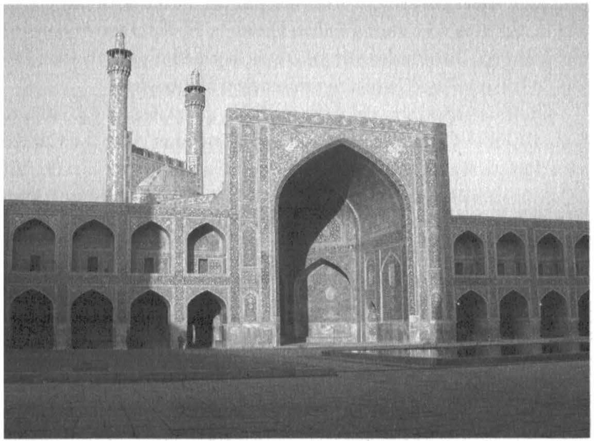

*沙阿清真寺，伊斯法罕。*

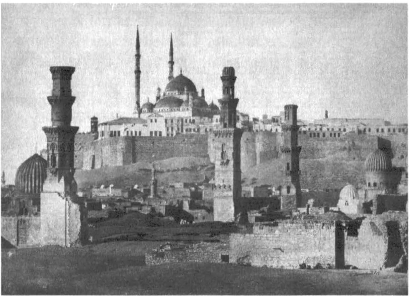

*穆罕默德·阿里帕夏清真寺，开罗，19世纪晚期照片。*

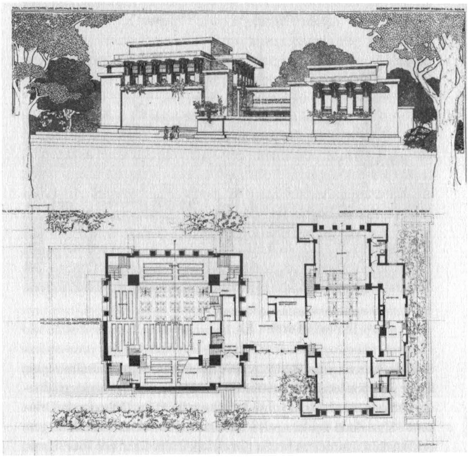

*一位论派教堂，芝加哥橡树园。建筑师：弗兰克·劳埃德·赖特。*

在教堂中，使功能—形式联系这一想象变得可疑的矛盾，也不比清真寺少。例如，两座都由赖特设计的一位论派礼拜堂：第一座是1900年代初建于芝加哥的橡树园一位论派教堂，第二座是1950年代建于威斯康星州麦迪逊的另一座教堂。同一位建筑师为同一教派的成员设计，但在平面布局与体量上，它们几乎没有任何相似之处。〔原书第147页〕位于剑桥麻省理工学院校园内、由埃罗·沙里宁设计的克雷斯格礼拜堂（1955年落成），开始设计的时间几乎与赖特的第二座建筑相同。这也是一座教堂。与此前例子的形式特征相反，这里是一个纯粹的圆柱形体量。同样位于美国的还有华盛顿大教堂，它于1920年代开工，但直到50年代才建成。（校注：底本年代如此。[教堂官方历史](https://cathedral.org/discover/history/)记载建造期为1907—1990年。）不过它是一座哥特式建筑，按照13至16世纪流行于欧洲的一种风格建造。而英国考文垂大教堂（1956—1962年）是对二战中被毁建筑的重建，它与哥特式哪怕从远处看也不相似。几乎在同一时期、于50年代后期建成的勒·柯布西耶朗香教堂（1953—1955年），则是一种抽象雕塑。另一个例子是丹下健三几乎同一时期在东京建成的东京天主教座堂（1964年落成）。它是一座天主教建筑，朗香教堂也是。安藤忠雄一件广为人知的作品建于1990年代后期，名为“水之教堂”。（校注：底本年代如此。[安藤忠雄建筑研究所提供的作品记录](https://artsandculture.google.com/asset/church-of-the-water-tadao-ando/qwEbmVcVGIcGpA?hl=ja)将水之教堂记为1988年。）它也没有后殿，在应当有后殿的位置，玻璃墙径直向自然敞开。在功能语境中，这一系列形态迥异的建筑之间有多大差别？相当小。那么，功能在设计活动中没有角色吗？关于功能的讨论是多余的吗？从安藤这座建筑内部望出去，可以获得一种有趣的解释可能。它指向这样一个事实：功能本身并不是固定的，它并不独立于建筑师的界定而获得存在。或者，它揭示了功能并非外在于设计——功能本身也是被设计出来的。例如，在上面提到的所有教堂中——包括安藤的这一座——粗略看来，似乎始终涉及同一种功能。基督教礼拜尽管并非在所有教派中都如此，却不可避免地是一种朝向单一方向的礼拜，即朝向后殿。因此，在基督教中，后殿具有与清真寺米哈拉布不同的礼仪含义。礼拜以它为指向。但在安藤的教堂里没有后殿。教堂的后殿墙完全是玻璃，墙后有一个小湖，而通常界定并标示后殿的十字架〔原书第148页〕位于小湖中央。外面的自然区域、湖以及环绕它的森林，在某种意义上界定了后殿。自然转化为后殿。借助这一建筑解决方式，基督教仿佛与日本本土信仰传统神道教的自然观相遇了。不妨回想，神道教的神社把自然奉为神圣，并置身于自然之中。安藤的水之教堂是说明设计如何进行的一个有意义的例子。建筑师在那里呈现的，究竟是功能的表达、产物、具身化，还是一种介入功能、使功能成为问题、旨在重新界定功能的设计？所以，真正的问题在于：建筑中的形式—功能关系是一种无法用单向、单纯的决定论解释的动态关系。每一项设计，都必然重新界定该设计所回应的功能。如果功能决定形式，设计就会变得像机械操作一样容易。但功能也和形式一样，并不构成一个由固定且有限数量元素组成的储备库。因此，着手设计的每一位建筑师〔原书第149页〕无论是否特意如此打算，都会开启一条重新界定功能的道路。在水之教堂的例子中，人们当然仍是按照适用于该教派所有教堂的要求进行礼拜，但这座建筑并不行使与它们相同的功能。它仍然具有最初预定的、构成其存在理由的用途。人们仍然可以在那里礼拜；在那里礼拜与在同一教派的另一座教堂里礼拜之间，根本上没有宗教上的差别。然而，建筑师已经对功能进行了重大干预。他把自然转化为建筑的一个功能性组成部分。通常教堂的礼仪轴线终止于后殿，而在这里，它终止于自然。使这座建筑成为一件重要建筑作品的，也正是这一点。总之，设计并不是像发给建筑竞赛参赛者的任务书那样，先列举功能与尺寸要求，再按照功能联系的要求，把容纳这些要求的空间组合起来。无疑，也可以那样设计，但即便在那时，每一件新的建筑产品，哪怕采用那种机械的构图方法，也会使最初预定的功能变得不同。〔原书第150页〕更何况，即便住在尺寸相同、平面相同、形式相同的住宅里，住户也会以各不相同的方式使用自己的居所空间，从而不断重新界定功能。与此相对，每一件具有历史意义的建筑实例，都是通过在功能—形式关系中生产出一种矛盾而出现的。这是一种在该实例获得存在之前并不存在的矛盾。因此可以说，在建筑中，使用者和设计者都掌握着重新界定功能的权力。可以举密斯·凡·德·罗的范斯沃斯住宅（1951年落成）作为一个有启发性的例子。这是一座除浴室兼厕所外把所有功能汇聚在单一空间中的住宅，外墙完全由玻璃构成。那么，能否说这座建筑是熟悉的住宅概念及其功能的寻常产物呢？墙、私密性、生活方式——它们原先的定义在这座建筑内部都不再有效。最初的论点被颠覆了，建筑师把形式与功能径直置入了一种全新的形态。随着范斯沃斯住宅，居家生活的概念发生了根本性的改变。甚至，范斯沃斯住宅适合哪一种居住功能呢？也许一种都不适合……

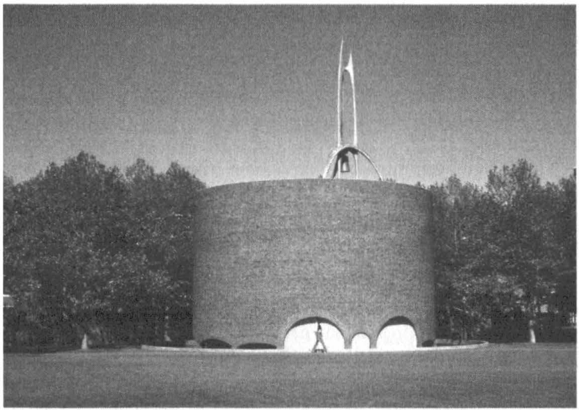

*克雷斯格礼拜堂，麻省理工学院校园，剑桥，波士顿。建筑师：埃罗·沙里宁。*

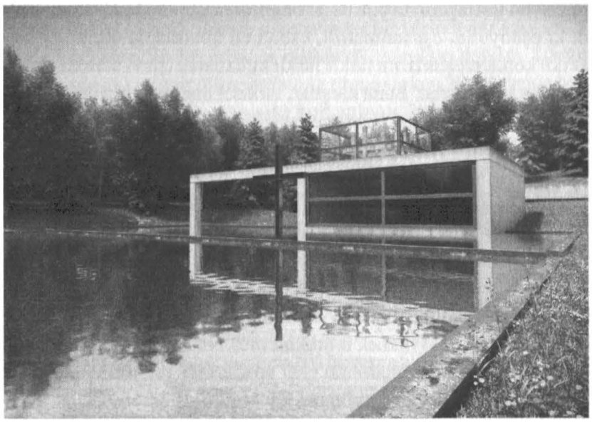

*水之教堂，Tomamu，北海道，日本。建筑师：安藤忠雄。*

不过，要讨论功能概念，并不一定非得发展出如此激进的设计姿态。不妨看看日常生活中反复出现的某些矛盾状况。例如，一座功能为礼拜的教堂或清真寺，如果某人只是出于旅游目的，或仅出于审美期待，或在炎热的日子里只是为了在里面乘凉而使用它，那么这个人在那里的存在，能用功能主义范式来解释吗？教堂、清真寺的功能是清凉消暑吗？纯粹是审美愉悦吗？是为旅游业提供可能吗——旅游的定义甚至可以表述为“消费空间”？当然，这些都是。没有哪一种比另一种更或少正当，也没有哪一种更优先。想说的是：无法为某个空间作出稳固而包罗无遗的功能定义；即便作出了，也无法设计出与之相符的空间。为了把功能讨论再拓宽一些，需要作如下判断：fonksiyon／işlev（功能）一词进入建筑语言、进入建筑师的概念储备，是在近得几乎可以称为昨天的年代。例如，甚至在理性主义建筑观的基础得以奠定的18世纪，这个词也几乎没有被使用。〔原书第151页〕在19世纪初，世界上任何地方都不可能遇到一位谈论建筑功能的建筑师。功能（fonksiyon）成为建筑师口头禅，始于20世纪初。粗略地说，它被使用至今只有一百年。建筑被建造了大约一万年，人们谈论功能却只有一百年。但读过维特鲁威的人可以轻易地说：“那里谈到了功能。”必须立即指出，这非常可疑。维特鲁威说，建筑有三个基本属性：“Venustas，firmitas，utilitas。”当翻译成现代语言时，我们习惯于用美学替代venustas，用结构替代firmitas，用功能替代utilitas。维特鲁威真的说了这些吗？不，只是维特鲁威的现代译本在这样说。要理解维特鲁威的三元组，就需要把当代的建筑解释放在一边，考察古代思想世界。维特鲁威正是在那个思想世界中成形的。维特鲁威似乎是通过对亚里士多德作相当自由的改编，才生产出这个三元组。粗略地说，他从“使一个对象成为可能的四个基本因素”或“对一个对象的存在负责的四种原因”（希腊语：aition，拉丁语：causa）的定义中分出三个，并说明它们也是建筑作品的基本存在条件。[2] 实际上他也使用了第四种原因，即causa efficiens（动力因），但正如稍后将说明的，他把它与其他三者区分开来，放在不同的位置。按照亚里士多德的说法，每一个对象要作为该对象存在，就必须具有物质性。这在拉丁语中称为causa materialis（质料因）。维特鲁威主张，使建筑作品得以存在的causa materialis——即物质性存在的理由——所必须具备的属性应当是firmitas（坚固）。藉由它，那种物质性条件才得以实现，对象才能作为自身站立起来、变得坚固。否则，建筑就不可能证实causa materialis。〔原书第152页〕亚里士多德的causa formalis（形式因）指向这样的要求：每个对象都必须具有一种可把握的形式，一种使人得以把该对象识别为该对象的形式。维特鲁威认为，causa formalis的属性应当是美（venustas）。至于causa finalis（目的因），亚里士多德将其建立在每个对象都必须有一个终极目的、目标（希腊语telos）这一必要性之上。维特鲁威也把它翻译成自己的日常语言：每一个建筑对象的causa finalis、终极存在条件，都应当是实用、可用，也就是utilitas。维特鲁威当然没有忘记亚里士多德的第四种原因，即causa efficiens（动力因）。每个对象都必须有一个使其成为该对象的实践者、创造者。就建筑而言，这一原因不是别人，正是被称为建筑师的职业人。如果注意看，维特鲁威并没有把它列入文艺复兴及以后将被神圣化的那个三元组，因为他列举的是建筑产品的基本属性，而不是建筑师的属性。至于建筑师的品质问题，他其实几乎在整本书里都在讲。从亚里士多德到维特鲁威的道路用了两个世纪，而从那里抵达现代“功能”概念的道路则用了两千年。两者都还在等待尚未完成的、全面的历史编纂学研究。[3]

这里我们只在如下范围内关心这个问题：它们示范了我所谓的“跨话语”（transdiscursive）实践。[4] 也就是说，一个话语以及使它得以存在的术语，可以脱离其原初语境，在另一个语境中、在另一个话语的机体内部被再生产。甚至，这样一种再生产过程始终在运转。维特鲁威所做的正是这件事；两千年来从他出发所做的一切、以及今天仍在借由从其他话语和知识领域移植而来的东西所做的一切，也正是这件事。实际上，在建筑中，功能一词直到20世纪初才开始被密集使用。被转化为一条信条公式的“form follows function”／“形式追随功能”，于1924年由沙利文在其名著中发表。[5]〔原书第153页〕这一变化可能与18世纪建筑界最后残存的传统组织结构的解体有关。粗略地说，从19世纪开始，以迄当时的那种方式从事建筑的可能性丧失了。对此无法轻率断言。总之，在19世纪和20世纪，关于建筑中真理是什么、它应当如何被生产，已经无法再从旧的思想体制、“知识型”（episteme）内部给出回答。建筑直面这样的生存问题：“我们将如何设计，又如何确信我们所设计之物的正确性？”要理解这一点，就需要追溯到18世纪。在18世纪，（此前仅在文学意义上被定义为一种写作风格的）风格（stil）概念开始在建筑和艺术语境中使用；而在这个世纪将尽时，欧洲已经因“自己生活在一个再也无法生产风格的时代”这一忧惧而震动。[6] 人们担心生产者所倚靠的旧纪律秩序已经崩塌。在这种条件下，有些人会绞尽脑汁思考重新发明风格的问题，但几乎所有人都会把“把建筑设计安放在牢固基础之上”作为轴心来思考。人们想要建立一种不会磨损、几乎有保证的知识结构。试图这样做的人最常诉诸的途径之一，就是从其他科学与知识领域获取话语、概念，并将其改编到建筑中。而这又意味着生产“跨话语”实践。

让我们记住，19世纪和20世纪初是自然科学以及将自然科学应用于日常生活实践的工程学的黄金时代，是一个它们带着自身所含的确定性幻象影响每一个思想区域的时期。在这种情况下，建筑师从哪里移植功能（fonksiyon／işlev）概念、或通过暗示什么来生产它，就可以推想了。区分出三条路线似乎并不困难。〔原书第154页〕第一条路线从自然科学、尤其是生物学出发。本章开头的波德莱尔引文就指向这一点。它说，无偏见地观察生物存在的人，可以轻易理解形式与功能在其中有多么紧密相关。第二条路线由机械类比界定。[7] 第三条则与数学相关。柯林斯曾把清单扩得更大：[8] 他界定出生物学、机械学、烹饪学和语言学四条跨话语路线。不过我认为，由生物学、机械学和数学组成的三元组更为现实。[9] 至少功能话语密集保留着这三者的痕迹，而另外两者如今几乎已无迹可寻。

显而易见，依靠机械类比的功能定义与19世纪发展出的机器崇拜相关。这是一种从“机器具有与其技术属性直接重合的功能性”这一主张出发的建筑功能主义想象。其最清楚的表述之一，应当是勒·柯布西耶的“住宅是居住的机器”。而众所周知，生物学式的功能性想象大大受惠于进化理论。可以这样表述：生物物种的变异与延续生命的过程，与它们履行自身功能的能力相关。“每一个有机体及其每一个组成部分都按照其功能而形成”这一主张，也可以在同一范围内看待。维奥莱-勒-杜克是这一主张在建筑中的旗手。另一方面，达尔文式的论断——不再具有功能的器官会退化并消失——想必也在功能主义思想的建构中扮演了重要角色。

〔原书第155页〕

在新真理体制的建构过程中所走的第三条跨话语路线，看来是数学。由于此前鲜受注意，[10] 这里将比另外两条讲得稍详细一些。fonksiyon（函数）这一术语最早于1673年由莱布尼茨（1646—1716）引入数学语言；也就是说，在数学里它也是新的。1694至1698年间，莱布尼茨与伯努利（1667—1748）在通信中发展并使用了该术语的这一含义。该术语首次收入数学词典则是在1716年。[11] 随着曲线开始以代数方法加以研究，函数成为在分析表达式中表示依赖于某一变量的量的必要概念。这一概念最简单地可以看作代数表达式的图形表示；它给建筑提供了什么？一个数学表达式在笛卡尔坐标系中被转化为图形时，会出现唯一一个图形（几何）结果。也就是说，存在一个唯一的代数表达式界定某个特定形式（图形结果）。（校注：由表达式确定图形，并不能反推同一图形只有一种代数表达式。例如，x²＋y²＝1与2x²＋2y²＝2表示同一个圆。这里的“唯一”是作者类比中的过强表述。）函数以一种十足的不容置疑性，把抽象的数学表达式转化为视觉性，或者把它“翻译”过去。理解寻求牢固知识基础的建筑师为何羡慕这种可能，并不很难。人们会期望建筑也生产出同样牢固的真理或对应关系。问题的输入与输出之间有一种不容争辩的关联……一种像数学中那样可靠的问题定义与求解……一种直接由数量产生的视觉性……让建筑知识被如此塑造，让设计被系于如此牢固的原则之上，以至于不再有出错的可能，并抵达一种绝对的真理。然而，功能（işlev）概念在今天建筑中的通行形态，不包含任何数学家可能接受的东西。甚至，1740年代第一个在建筑中使用funzione（功能）一词的洛多利，[12] 也已经远离了数学中的定义。〔原书第156页〕但跨话语实践在此后两个世纪里把它改造得如此之甚，以至于今天彼此之间已存在不可调和的差异。在土耳其语中，这种改造显然还要更大：在西方语言中，“fonksiyon”仍指向其他学科与实践，而在土耳其语中，“işlev”主要是建筑的专属物，甚至与fonksiyon并不重合。正如上文所说，在19世纪和20世纪相当长的一段时期里，人们希望在建筑世界中为失去的东西（或是被制造出失去之幻觉的东西，或仅仅是发生变化的东西）开辟一条牢固、可靠的设计之路。它要牢固到每一次都给出正确而一致的结果；要像数学、物理学、化学与各门工程学中那样排除主观性。功能术语就是这种要求的一个副产品。今天，问题已经归结为：这样一种知识稳固性的理想究竟是否还有意义。以这种方式建构起来的建筑知识体制，还能继续维持吗？

在给出答案之前，必须指出：在自然科学中，这种绝对客观性的神话如今也不再被相信。今天，人们已经不再怀疑“客观性”概念本身也是一种历史建构。[13] 显然，那样的年代已经过去：直到不久以前，人们还认为它是可靠的——比如在1950年，人们会说“是的，功能与形式之间存在着牢固的决定论关系”，而美国和西欧几乎没有人会对此表示怀疑。那么问题究竟是什么？答案并不简单，我们只需看到一点：在建筑中，无论使用什么概念，没有任何一个具有永恒的耐久性。没有一个经得起时间。必须意识到它们全部的历史性。概念是在漫长的历史过程中被创造出来的；它们既非亘古即有，也非永恒。舍弃所有这些概念——尽管遗憾的是，这样做极为困难——是可能的。今天使建筑成为一种复杂、困难、因而智性内涵丰富的实践，使建筑职业不再仅仅是一种设计与建造活动的状况，正源于所有这些概念的无根据性与偶然性如今已被看见。〔原书第157页〕人们不再像从前那样信任其中任何一个；例如，再也不能像从前那样说一句“是的，一座建筑有三个基本属性：结构解决方案、美，以及功能性”，就从事情中脱身。且不说建筑，连科学的定义也不再是伽利略、牛顿、法拉第的定义。今天，与他们所相信的相反，我们不再相信科学能够发现一种固定的真理。自费耶阿本德以来，科学不再界定一种系统性的真理体制。甚至，人们越来越普遍地认识到：科学并不发现真理，而是发明真理。因此，建筑正迅速舍弃自己的知识大厦，却又变得能够在任何时刻将其重建。昨天还被认作正确的东西，开始失去效力。于是，“我们该如何设计，又该如何解释已建成之物”这些问题的答案，已不再能像在1950年代或1970年代那样轻易给出。功能—形式范式只是失去的东西之一。如今，已不存在一种由形式与功能组成、并界定决定论关系的对称。我们看到为同一功能建造的建筑彼此之间有多么不同，从而明白设计例如不可能与礼拜场所的礼拜功能有所关联。恰恰相反，正如安藤忠雄的水之教堂那样，设计能够颠覆一座建筑所谓的惯例性功能。它重新定义功能。建筑不是按照功能来成形，反而能够重建所谓功能之物。它能迫使我们以另一种方式思考和／或行动。它能推动使用者以另一种方式理解世界和那座建筑。从一座完全向自然封闭的教堂设计，可以走到一个几乎在自然之中礼拜的空间。显然，借助这座建筑，人们得以以另一种方式不仅观看教堂，也观看自然。建筑作为教堂的这一状态，并不界定它将被如何成形。同样的事对清真寺也毫无疑义地成立。例如，埃姆雷·阿罗拉特设计的桑贾克拉尔清真寺……建筑消失在场地地形之中，从外面甚至看不见；仿佛乡野中一处微微的隆起。它不宣告自己的存在。〔原书第158页〕它的内部空间像一种洞穴。没有女性楼座；更准确地说，女性区域也分享着与男性区域相同的空间特质。无疑，清真寺在设计上无论多么不同，礼拜的形式并不会改变，但借助这一设计，会众和作为建筑师的我们对世界的看法都改变了；对建筑的看法改变了，对清真寺空间的理解也改变了。当然，对宗教的看法也改变了。那么，建筑职业做什么？建筑设计功能，建筑设计形式，建筑建造房屋、结构、空间，生产意义，引发理解方式的转变，建立权力，提出政治与社会变革的方案，形成斗争场域，生产意识形态斗争，等等。例如，如果说的是教堂、清真寺、犹太会堂，它就在信仰的重建中扮演角色。如果说的是剧场空间，它就重新定义戏剧。在社会意义上，建筑有能力去做的事情中，没有一件比另一件更为关键。建筑实践所创造的任何可能性，对建筑而言也都没有首要或次要之分。因此，仅仅以服务于居住功能为名设计的住宅，会超出这一功能，重新界定社会或家庭生活，或使它们像从前一样延续。功能并不是建筑产品所服从的一种命令性的上位价值。它也不是界定一座建筑将如何使用的指南或说明书。也不能把它算作启动设计的一种范式性基础。就这些意义而言，我们甚至不需要功能概念（或功能诸话语）。空间是这样一种东西：只要存在一个想把它用于某件事、想使用它的主体，每一个空间都可以获得某种可用性。关键的是那个主体的期待、要求与行动；是他们的社会性——主体正是在其中获得存在。有时则纯粹是其个体性。我上面所写的内容，布鲁诺·穆纳里早在1944年就以他风趣的方式涉及并视觉化了——不过不是在建筑语境中，而是在家具语境中。他有一篇鲜少受到注意的文章。[14]〔原书第159页〕他在那里讨论了座椅的功能性，以及在功能性主导下的设计创造力问题。一个下班回来筋疲力尽的男人（图片中的男人就是穆纳里）想在他那张设计极为普通的椅子上坐下休息。他怎么也舒服不起来；他没有让自己适应椅子，而是不断把椅子摆成新的位置，与椅子建立一种动态关系。例如，把它翻过来，或者不是平行地、而是垂直地坐在两扶手之间，又或者不是把臀部放在坐垫上，而是放在靠背上。或者把椅子放倒在地，双腿朝上架着。或者盘腿坐在里面。为揭示功能性—使用之间的关系，穆纳里这项有趣的工作很有启发性。使用、舒适、惬意，并不是由功能性的指令或说明书界定的；它们由使用者可以无限变化的个人决定与偏好所决定。〔原书第160页〕那么，空间和对象就没有使用价值吗？或者，在建筑语境中提出可用性问题，难道完全不必要吗？正是在这里，也许需要把话题从建筑的内部讨论中移开，推向经济学。首先有用的是认识到：固定对象可用性的诸形式，对资本主义经济关系世界来说是生死攸关的。可以说，必须把建筑产品也纳入“商品”概念的诞生、以及随资本主义而来的一切商品化这一事实。在一个一切都超出使用价值而获得交换价值的系统中，与建筑有关的一切显然也都成了商品。一切都可以被出售，以获取其他对象（商品）。土地／地皮、建筑物、空间、住宅、技术设备、家具陈设、建筑劳动，甚至建筑师的名字（名声，意味着具有商品价值的人名），都被商品化。正因如此，比方说，一个普通门把手的销售可能因其为福斯特的设计而抬升。一切商品化之物都必须被安放到该社会环境普遍接受的价值等级中。因此，承载交换价值的一切都必须被带到可与其他交换价值相比较的理性基础上。功能概念就是使这一点成为可能的固定化工具。当然，它只是众多固定化工具之一。它使具有同一功能的对象得以成为一个范畴群体。总之，功能最重要的作用，是建立功能群组。商品的交换价值只有通过被置于同一群组中才能被确定。功能就像一种单位，用来解释某物为何、以及比另一物贵多少。要理解这一点，讨论大众住宅生产或购物中心（AVM）单元销售中通行的语言会有所帮助。例如，当用2+1、3+1之类的表述界定住宅所包含的各种可能时，就出现了在具有同一功能的建筑商品之间进行比较的机会。没有功能分析的购物中心店铺是不可想象的。租金和销售价值由那种分析确定。一间酒店客房的出租、一家酒店的出售，只有在对功能作出理性描述之后才成为可能。〔原书第161页〕可以按照功能所标示的位置、尺寸、条件与技术，对该房间或建筑定价。功能被界定为“海景房”的房间会比“园景房”更贵。32平方米或26平方米的酒店客房当然承载不同的交换价值。熨衣、看电视、从冰箱取饮料、躺上躺椅等功能的有无，具有经济意义。因此，酒店中会作出非常详细的功能定义。但这只发生在酒店中吗？功能是使商品生产成为可能的东西。我们会预期四功能的搅拌机比三功能的更贵。如果它更便宜，则在交换价值的形成方面提供了另一些可能：它将销售得更多、更容易。因此，试图把功能和性能之类的概念从当代建筑语言、乃至一般设计语言中清除出去，并不只意味着清除一种理论上的天真。从理论上看，功能在建筑语言中的位置很容易被撼动，而且早已被撼动了，这一点是确定的。而在使用语境中，功能概念甚至没有任何用处。为某一特定功能成形的每一个空间，都可以轻易用于其他目的。通常也确实如此。卧室可以变成客厅；在设计时预定摆放沙发的位置，可以放一张桌子。在被设计为包含熨衣功能的酒店客房里，我们可能并不熨衣，而是把要熨的衣服交给相应的服务人员。总之，功能所界定的建筑规训在日常生活中逐渐被消磨。然而在建筑的经济存在框架内，情况并非如此。由于它建立了一种同质性与等价性的秩序，从而把空间变成商品，所以即便给它换个名字，从资本主义经济的角度看，功能仍是不可回避的。有必要记住，建筑生产从设计、设计者到建造，在其所有方面都是一组经济活动。那么，我们必须看到：每一项从根基上挑战功能概念的重要建筑设计，都在资本主义体系内部形成一个小小的精品式口袋。它们也许会在资本主义体系中打开一个个小伤口；至少，它们像阀门一样运作，界定了小小的舒缓与更新可能。在两种意义上，它们都是重要的。

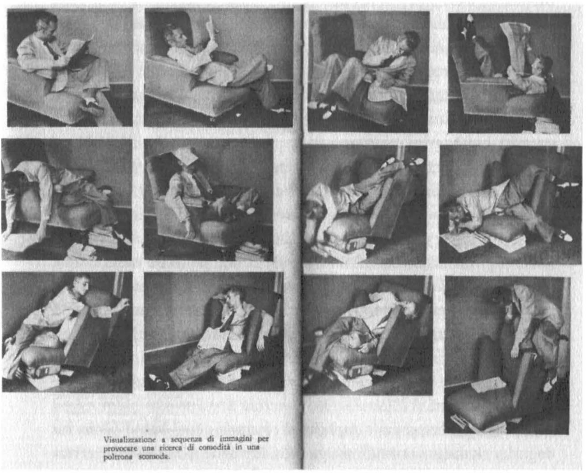

*布鲁诺·穆纳里把座椅的功能问题化。*

〔原书第162页〕

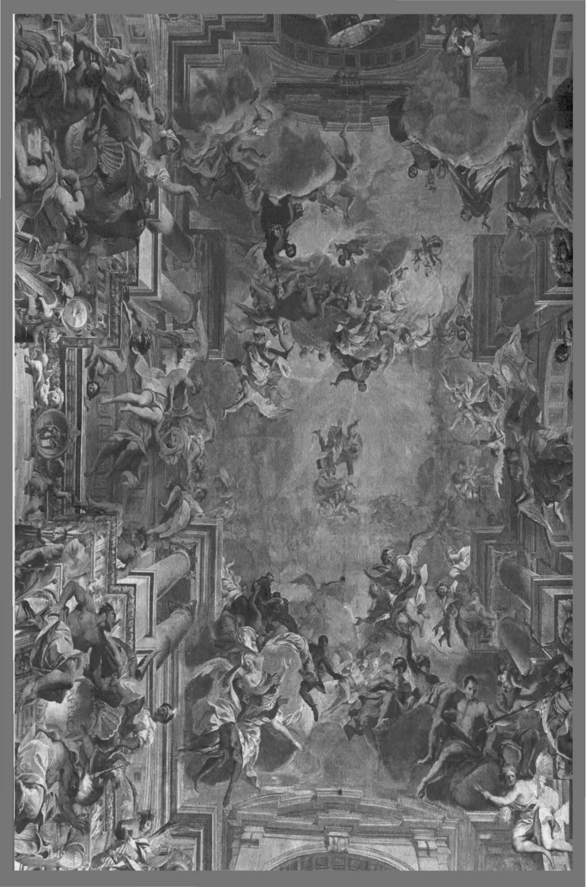

*整页图片：取自 casa-in-italia.com 的图像（网址见图片来源）。*

## VII　建筑的物质性

〔原书第163页〕

*物质性的否定：罗马圣伊尼亚齐奥教堂天顶上的错视画，它运用绘画技法，通过错觉扩展了结构空间。安德烈亚·波佐的作品（约1685年）。*

“物质性”（maddesellik）在土耳其语中并不是一个在建筑语境里惯于使用的术语。它对应英语的materiality。而materiality所指涉的material概念，在土耳其语中由两个不同的词来表达，既指“malzeme”（材料），也指“maddi”（物质的）。这里之所以选用“maddesellik”这一形式，是出于一种愿望：不去细辨建筑物质存在的种种细微差别，而是把它作为一个整体来表达。如果一定要作这样的区分，也可以说建筑由两种要素构成：心智工具与物质工具。但必须指出，区分心智之物与物质之物既困难，甚至近乎荒谬。每一种心智工具都包含物质性；更重要的是，它只有凭借物质性才成为可能。即便最抽象的思维过程，也不只是依赖某些物质条件，而是直接与物质性整合在一起展开的。作为心智之物无法与物质之物分离的例子，可以举马歇尔·麦克卢汉那部如今已成为标准引用的著作。麦克卢汉揭示了印刷书的构造特征与人类思考、行动过程的剧烈变化之间的联系。[1] 用夸张的方式概括：书的物质存在与它所包含、所激发的思想性不可分割；思想并不独立于书的物质。印刷书与手抄本〔原书第164页〕产生不同的思想性。同样的判断可以对我们使用的一切技术性／物质性工具重复——包括那些具有建筑性质的工具。不过，这里不会再次详细论述建筑的物质性与其思想性不可区分这一点。

但下文将会看到，我不可能按照“已被传统化”（化石化了）的建筑思想内部所采取的方式来讨论物质性问题。建筑学生一入学，就会被教授一些非常熟悉的刻板印象、成见和规则。其中涉及建筑物质性的那些很容易说服他们，因为它们提供了一种笛卡尔式的理性。在此语境中，可以区分出两条理性主义路线。第一条以这样一种主张为轴心：建筑由它置身其中的地理与气候物质条件所界定。第二条则把物质性表述为：建筑产品的设计品质与创造它的材料直接相关。

在第一条路线中，物质性可以被定义为一种环境／地理决定论。其根源可追溯到18世纪和启蒙运动。最早提出各民族所处气候条件决定其政治与文化制度及行为这一主张的人，大概就是让-巴蒂斯特·杜博。他在1719年出版的书中谈到了环境因素在艺术与文学中的作用。[2] 而夏尔·德·塞孔达，孟德斯鸠男爵，则以1748年出版的《论法的精神》（De l'esprit des loix）开辟了一条极具影响力的决定论解释路径。[3] 像他那样用物质环境条件来解释社会存在，似乎与启蒙〔原书第165页〕时代对因果性的普遍追寻直接相关。1764年，温克尔曼在艺术语境中表达了同样的追寻；作者把风格的形成与环境因素呈现为直接相关。[4] 例如，他认为希腊地理中的温和气候条件，与古希腊艺术对理想美的追寻之间，存在着因果关系。今天，人们甚至不再相信艺术中存在这样一种理论可能，但在建筑中，谈论气候与环境因素的决定性作用仍然十分普遍。

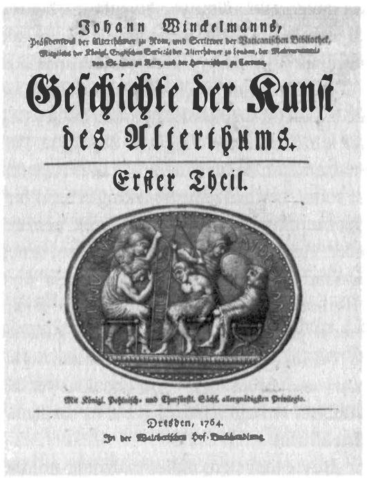

*约翰·温克尔曼那本书的初版；他在书中谈到创造风格的环境因素，提出了物质性讨论的最早例证：《古代艺术史》（Geschichte der Kunst des Alterthums），第1卷，德累斯顿，1764年。*

而材料—设计联系则界定了建筑中的第二条决定论路线。例如，当人们说每一种技术和材料都创造了自己特有的建筑时，所倚靠的正是这样一种决定论关系想象。谈论每种材料都必须按照其“本性”来使用，也不过是这种想象的延伸。对于这样思考的人来说，用赖特的话说，建筑就在“in the nature of materials／材料的本性之中”。[5] 路易·康在半个多世纪之后也主张，每种材料和技〔原书第166页〕术都会自行规定它想要怎样的建筑，从而指向一种类似的决定论。他用自己的隐喻性语言，例如就砖而言，这样说明自己的主张：“你问砖：‘你想要什么，砖？’砖对你说：‘我喜欢拱券。’你对砖说：‘看，我也喜欢，但拱券很贵，我可以用一根混凝土梁。’然后你问：‘你觉得怎么样，砖？’砖说：‘我喜欢拱券。’”[6] 我可以指出，这种孩子气的箴言式语言在1970年代颇受喜爱，甚至到今天也未被当作批判性讨论的对象。

所有这些刻板印象都把材料—建筑关系描述为一种“和平的”和谐关系。人们假定，建筑的物质内容是一种直接决定结构、装饰和空间的要素。仿佛只要建筑师服从材料的命令以及加工它的技术规则，一切设计问题就都会在提出之前得到回答，一切麻烦都会在发生之前得到解决。仿佛材料在说话，在强制规定自己的要求，而建筑师则全神贯注地倾听、或应当倾听它们。

这些把材料—建筑关系描述为和平、实则向建筑活动提议一种简单自动机制的表述，常常被呈现为适用于一切时代与地点的普遍规则。〔原书第167页〕有时，这条规则甚至被看作创造“正确建筑”的一个参数。按照这种看法，例如，如果形式服从材料的存在性命令、不与它相矛盾，正确的建筑就会出现。

然而恰恰相反，要怀疑这一主张是否界定了一条有效的正确性标准，可以找到许多例子。从世界各地搜集这类例子也相当容易。几乎在每个时代和文化领域，最终产品都常常可能与用于建造它的物质性相矛盾。为了实现某个建筑产品而预定的设计，可能要求迫使建造它所用的材料与构造超出限度。有时还会出现否定其物理特性的悖论式用法。甚至，正如后文将尝试说明的，在材料—形式关系的语境中，可以主张“最优解”并非一条普遍规则，而是一个“现代性神话”。这个神话似乎逐渐走向了更多神话，并进而变成一种神话学、一张传说之网。

物质性—建筑、物质性—建筑术的关系，在几乎每个时代都远非一种决定论关系。当然，没有物质性，建造与空间的生产是不可能的；但它们之间并不存在一种使彼此相互从属的“和平”关系。相反，这是一种“争吵的”、矛盾的关系。尽管这种关系几乎在任何地方和时代都以极为不同的形式出现，有趣的是，几个世纪以来，人们似乎并未对这种争吵与矛盾状态多加思考。而从某个历史节点开始，人们意识到了这一点；但与此同时，思考恰恰相反的东西、想象一种决定论式的物质性—建筑关系，反而成为普遍做法。

建筑与创造它自身的物质性之间的关系，是从何时、如何开始被问题化的？人们是从何时开始思考二者之间应当存在一种和平、无矛盾的关联的？

通往物质性问题化的变化过程，很可能与建筑测量实践的变化同时出现。要能够谈论物质性，物质性就必须可以被测量。而这一点并非在每个时代都以相同的方式和方法进行。几个世纪以来，在测量建筑物质性（实际上是测量一切）时，采用了我称为“物理—社会性的”方法。〔原书第168页〕使建筑能够在理性与客观性的语境中被思考的“物理—数学性的”测量实践，则是很晚近的事。[7] 在土耳其，这比西欧和中欧还要晚近。可以看到，像今天这样的测量，在18世纪以前至多只是偶发、例外的现象。

物理—社会性的测量实践，用与今天几乎完全不同的参数来确定建筑所用材料、以及一般物质性的尺寸与数量。在过去，测量对象所在的现实、“事物”，并不是在一种抽象的（超地方的）普遍单位中被测量的，而是在测量主体所处的时代—空间—对象语境中有效的单位中被测量的。例如，今天可以用重量单位测量的各种物品，过去并不是全都按重量计量的。用容积量具量扁豆、用个数计柠檬、用奥卡（okka）称新鲜豆角的重量，都是寻常事。又或者，在伊斯坦布尔，用于测量木柴重量的单位，与用于测量铁或蔬菜重量的单位并不重合。测量单位随被测量的对象而变化，而不是随对象所属的物理类别而变化。例如，水和橄榄油不用相同的单位测量。在现代世界中，二者都在一种抽象的“液体”定义之下获得同质性。而在那之前，每个对象的单位都在其社会性框架内形成。因此，不同的社会性生产不同的单位。例如，在伊斯坦布尔通行的单位，与在阿勒颇、开罗通行的单位并不重合。不同单位之间也不存在对应关系。用于计量铁的一萨马科坎塔尔（Samako kantarı）相当于多少伊斯坦布尔坎塔尔，这类知识也许会激起当代研究者的好奇。但一位16世纪的奥斯曼人既不会去做这种复杂换算，也不会对此好奇。因此，16世纪的奥斯曼建造者无法计算，比如说，一座建筑每平方米用了多少铁、石头、灰浆等等。他也没有计算的必要。在物理—社会性的测量实践中，数量与尺寸的关系是断裂的。〔原书第169页〕因此，一般来说，任何对象和／或材料的单位重量都无法确定，也不会被确定。可以知道某种材料用了多少，却不会生产出关于所用量中每一个单位的尺寸与性质的知识。例如，在16世纪奥斯曼建造者保存的费用—支出记录中，现代历史学家只有在例外情况下才能把握建造所用材料的商业与技术尺寸。例如，木构件仅以生产地点和在建筑中大致所处的构造位置来界定。这些术语如“伊内博卢立柱”“伊兹米特底梁（taban）”。有时可以知道它们产自何处，也总可以知道施工时每一种用了多少件，但一根“伊兹米特底梁（taban）”的截面尺寸和长度却无从得知。关于16世纪几十种不同的钉子，除了名称、它们以重量单位出售、以及有时产地之外，无法获得更多信息。库菲基石灰岩（küfeki taşı）块只以长度来定义。对于一种三维尺寸且每个维度都远非标准的材料，却只知道正立面的长度，显然在当时已经足够了。然而，那个时代的建造者不可能说出每天需要运多少重量的库菲基石灰岩到工地供日常使用。同样的情况几乎适用于世界各地的几乎每一种材料。材料被测量，只是为了记录建造所发生的支出。

而今天的物理—数学测量，则是为了界定数量与另一个数量之间的关系，也就是性能。这意味着：复合单位的测量是一种新的实践。复合单位使一种物理现实能够在另一种（或更多）物理现实的语境中被测量。据我所知，没有证据表明在伽利略之前就有复合单位的测量。确定的是，牛顿物理学尽可能地敞开了这种可能的大门。如今，已经有办法测量并进而计算每小时行进的距离（km/saat）、落体在一定时间间隔内的速度增量即加速度（m/s²）、单位体积物体的重量（kg/cm³）、单位面积承受的荷载（kg/m²）。在材料的性质与数量、建筑的性质与数量通过物理—数学方法变得可测量之前的时代，既不存在“最优解传说”，〔原书第170页〕也谈不上性能。可测量性与可计算性，在材料与物质的历史中标志着一个转折点。它使人们能够在最有效、最经济、最有用、最耐久等可测量标准的语境中界定建筑的物质性。这就是性能。

几个世纪以来，建筑师和建造者满足于按使用数量来测量建筑材料，并按日薪（yevmiye）来测量加工它所用的劳动。然而，比如说，为了能够谈论物质性而具有生死攸关重要性的效率核算，却并未进行。效率核算使人们能够在所耗费的劳动与所完成的工作之间建立关联：一定量的建造工作，需要多少人在多长时间内完成？最早尝试以数学精度进行这种分析的专家，大概是著名的法国防御工事设计师塞巴斯蒂安·勒普雷斯特·德·沃邦（1633—1707）及其同时代人。[8] 计算某项要塞设计需要多少材料、多少工人工作多长时间才能完成的能力，必须被视为理性、进而也是物质性理解方面的先驱。

与人们普遍以为的相反，前现代建筑不仅无意优化建筑的物质性，甚至极少愿意把它纳入考虑。建筑师和建造者常常宁愿把建筑作品的物质性——即材料以及使用它的各种技术——推到他们永远无法通过测量来确定的临界点。他们甚至常常竭力否定那种物质性，而且大多并未意识到自己在否定它。因此，界定建筑材料史很大一部分的术语，实际上应当是“去物质化”。几个世纪以来的核心，是使物质脱离其物质性的努力。人们希望让产品获得一种与其物质现实相矛盾的外观。然而，直到不久以前，建筑史学科仍将去物质化呈现为在浩瀚建筑史中〔原书第171页〕只有少数几点才会遇到的故障。

在历史编纂学中，有两个主要领域被主张去物质化是其决定性的时代特征：巴洛克与伊斯兰建筑。例如，直到几乎20世纪晚期，巴洛克建筑一直被说成具有去物质化倾向。然而今天，抛弃以理性及建筑的物质本质为中心的种种神话的观察者，会看到一幅非常不同的历史图景：只要考虑到时间与地点的差异，在物质性—建筑术关系的语境中，生产矛盾完全是寻常之事。如上文所指出的，“去物质化”作为一种总体态度，直到现代性之前不仅不是例外，反而几乎处处都是常规。

几个例子会有助于说明这一点。例如，古希腊多立克柱式与一种古老木构传统之间的关系，是建筑史中不断重复的知识。多立克神庙中的许多细节，都是在原本为木质的构件向石材转换的过程中保留下来的。彼此极为不同的技术，通过否定各自所关联的物质性，完全可能被调和起来。而在许多情况下，产品与创造它的技术直接矛盾。例如，晚期哥特建筑中的某些拱顶结构明确否定石材的本性。其蕾丝般的可见表面有时甚至无法支撑自身，而是由上方另一个结构承托。威斯敏斯特教堂内的亨利七世礼拜堂（始建：1503年）就是如此。

在后来成为古典理性主张之轴心的文艺复兴时期，也不乏去物质化的例子。恰恰相反，一个新的可能正是在那个方向上诞生的。布拉曼特在佛罗伦萨（校注：底本如此；[伦巴第文化遗产目录](https://www.lombardiabeniculturali.it/architetture/schede/LMD80-00170/)将该教堂列于米兰）的圣萨蒂罗圣母教堂后殿所作的透视错觉，是空间生产与物质性之间冲突关系的高峰之一（1482—1486年）。由于没有足够的空间安置后殿，建筑师便把它设计成单点透视，用石材和大理石等材料在墙上“画”出一个后殿。从作为礼拜空间的中殿望去，人们会看到一个深达数米的唱诗席空间；而他们所看到的，其实只是贴在墙面上的一幅建筑透视。〔原书第172页〕沿着它开辟的道路，巴洛克时期将走得更远。尤其是作为天顶画来实施的“quadratura（透视建筑画）”，充分说明了消除室内空间真实物质边界的愿望有多么强烈。天花板通过绘画技法变成一座向天空敞开的庭院。而“trompe-l'œil（错视画）”则在垂直表面上做同样的事，用错觉技法扩展和／或改变空间。例如，一个没有窗户的房间向自然敞开，或通过一个绘画性的开口与其他室内空间连接起来。

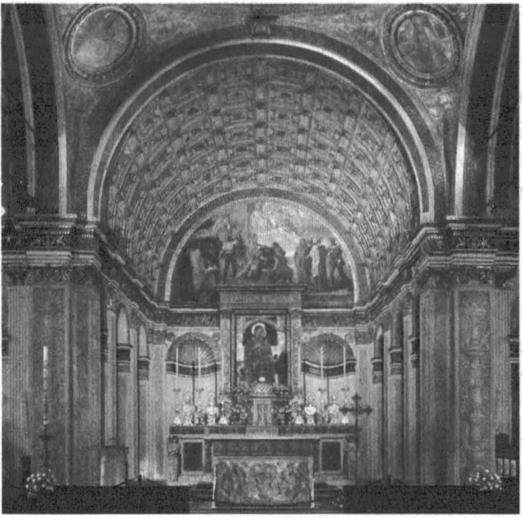

*一般认为由布拉曼特设计的建筑领域中第一例透视错觉：圣萨蒂罗圣母教堂，从正面看后殿。*

尽管其他地方和时代有无数例子，长期以来，去物质化在建筑史书写中被描述为寻常且具有界定性特征的唯一领域，却是伊斯兰建筑。例如，阿尔罕布拉宫用覆盖在土坯墙体上的织物般灰泥装饰表面，在去物质化方面颇具说服力。〔原书第173页〕例如，安纳托利亚塞尔柱的冠门——如细尖塔宗教学校或迪夫里伊大清真寺与医院——公然挑战石材的极限。在伊朗—中亚建筑中，瓷砖外覆面仿佛给建筑披上一件衣服，丝毫不能透露其背后的构造真实。由于易于举例、且与东方主义话语相关，去物质化主张在这一领域仍未被人遗忘。充斥市场的当代著作中，相当一部分都必定把去物质化列入伊斯兰建筑的特征清单。[9] 支撑这一主张的推理过程，从“伊斯兰教是一种不重视物质性与物质价值的信仰”这一论点出发。〔原书第174页〕于是建立了一个简单的等式：“因此，伊斯兰建筑也预设有摆脱物质性的倾向。”这个论点很容易说服人，甚至在伊斯兰国家也找到了支持者。人们强调，伊斯兰建筑偏重装饰，几乎竭力把使建筑得以成立的构造与物质基础藏起来不让人看见。问题在于，去物质化倾向几乎在所有前现代建筑中都普遍存在。它们至多以不同的形式和方式表现出来。把伊斯兰建筑呈现为以去物质化为中心的产品总和的史学叙述，几乎完全作为东方主义思想的残余而具有意义。它们被用来描述一个以物质性、理性与客观性，也就是以建筑的技术内容为轴心的西方。它们被用来建造一个“他者”。

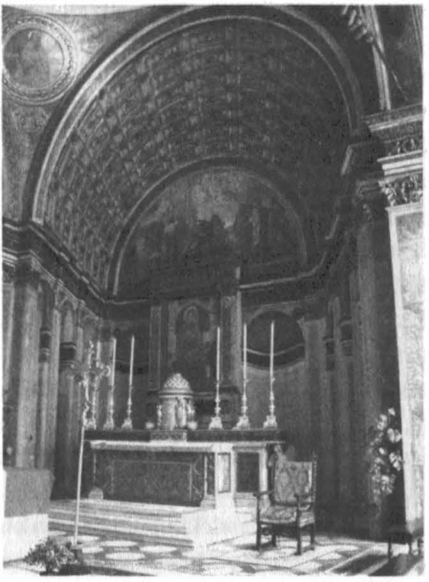

*圣萨蒂罗圣母教堂，从侧面看后殿，显示出其实际深度只有约一米。*

任何稍加留意的观察者都能发现，去物质化在欧洲、在其他地方，也和在伊斯兰国家一样普遍。从古代开始，建筑术与构造几乎始终在挑战创造它的物质性。而这种极为普遍的状况如此之久才被察觉，并非偶然。以建筑物质性为轴心的新理解在欧洲出现的时间，与伊斯兰建筑具有去物质化倾向的主张出现的时间，在年代上几乎重合。那些想象一种顾及材料物理化学特性的理性主义建筑、并一般地想象理性的人，干脆发明了一个恰好相反的文化领域。理性被想象为在某个文化领域、在西方，自古至今始终存在。而在它对面，则被放置一个自古以来就没有能力生产建筑理性、乃至一般理性的“东方”。然而，这样的西方和这样的东方都不存在。这一思维过程的名字，再一次不是别的，正是东方主义。

有趣的是，这种反物质性的伊斯兰建筑话语〔原书第175页〕在土耳其也颇受欢迎。它既会有支持者，也会在相反方向上产生影响。理解支持者并不难。谈论伊斯兰的独特性、想象一个对外封闭的文化领域，对各种右翼政治观点来说具有关乎存亡的重要性。而反对者则带着这样的论点出现：“这在其他伊斯兰国家成立，但不适用于我们。”因此，一些土耳其建筑史家、尤其是20世纪中叶的一些人，发展出一种类似的“本土”东方主义。他们开始主张，奥斯曼建筑也像西方世界一样并未走向否定物质性，而是发展出一种顾及材料与技术、一般地顾及物质性的理性主义。[10] 问题在于，无论是古典奥斯曼，还是18世纪及启蒙时代之前的欧洲，都未曾生产出这样一种理性主义。

在欧洲，理性主义建筑观直到从洛吉耶、洛多利和米利齐亚开始，才取得主导地位。[11] 在他们所有人那里，都想象着一种意识到建筑中物质主义与理性主义决定论的普遍人类。“原始棚屋”[12] 神话，首先是为了建构那个作为普遍理性之主体的人而发展出来的。其隐含或明确的信息是：人与建筑的本性中存在理性；人类在建造最初的棚屋时，就已经带着这种意识工作：他知道自己有哪些需要、手中有什么可能，并生产出一种使二者协调的最优解。〔原书第176页〕就连最初的人也观察周围环境，确定自己能够以何种理由抵抗自然条件，并在那些条件与自己周围发现的可能之间取得协调，设计出一个住所。今天人们知道，住宅的早期历史并不像这种理性主义解释所说的那样。

当理性神话在18世纪诞生时，它还只限于建构一个普遍的、超越时间的理性人；它并不把人解释为属于某种特定历史性的存在。那个想象中的、建造原始棚屋的人，是一种超越历史的存在。他知道如何产生解决方案、如何思考，仅仅因为他是人，也就是说，因为他是理性的存在。今天我们知道，理性以及推理过程也是历史性的，不能被视为人类与生俱来的永恒、自古即有的能力。

最早赋予理性主义与建筑理性以历史深度的建筑思想家，出现在19世纪中叶。欧仁·埃马纽埃尔·维奥莱-勒-杜克应当是最有影响、也最早的人之一。他通过发展“哥特式生产了理性主义建筑”这一主张来做到这一点。[13] 然而，他一方面为理性建构一个过去，另一方面又通过主张过去的工匠和建筑师都以理性主义理解工作，再次把理性从历史性中抽离出来。他建立的是一种“回溯性的理性主义”。这开辟了一条道路，要把一种18、19世纪发明的话语变成全人类历史的财产。渐渐地，这一理性主张将作为适用于所有时代与地点的普遍现实而被普遍接受，只有少数例外。

在19世纪，回溯性理性主义在德国参与得更广泛，但至少在那个世纪，它在世界范围内的影响仍较为有限。在此语境中，第一部重要著作是卡尔·伯蒂歇尔1844年出版的《希腊人的建筑术》（*Die Tektonik der Hellenen*）。[14] 作者在那里界定了他称为希腊（多立克柱式）与日耳曼（哥特式）的两种不同建筑风格。〔原书第177页〕他说明二者各自具有特定的静力学原则、物质内容与建筑术。他还主张，它们之所以成为风格，正是归功于各自的物质与构造机体。此外，他并未把这些风格描述为彼此对立的取向，而是描述为同一演化过程的阶段，从而画出一条此后直至今天都将被反复沿用的、以技术为轴心的历史变化路线。他还传递出这样的信息：必须有一个新阶段接续它们。从物质决定论的角度看，伯蒂歇尔是此后一个多世纪里将被维护的现代主义取向的真正先驱。[15] 这位今天几乎已被遗忘的作者，其相当厚重的著作在19世纪出了三版（1844、1852、1874），证明了它在德语国家的影响。它将会拥有无数追随者和批评者。[16]

现代主义建筑不断再生产那个以技术与材料处于决定论关系中的建造生产为核心的神话。从直到1960年代都是现代主义最有影响理论家的吉迪恩开始，[17] 物质决定论把新技术与新材料界定为决定建筑生产的主要因素。在吉迪恩看来，借助这种决定论，伯蒂歇尔关于能够生产一种新风格的预言，甚至早在1920年代结束前就已被证实。然而讽刺的是，许多现代主义建筑，甚至那些在其自身话语中把这一点视为核心的人所设计的建筑，反而更适合证明相反的情况。赖特草原住宅的宽大檐口让人想到木构屋顶体系，〔原书第178页〕但实际上众所周知，木质覆面掩盖着一个金属支承构件。又或者，门德尔松的爱因斯坦塔（1919—1921年）由于复杂的曲面，多年来被视为混凝土浇筑技术的一次寻常应用，而实际上它是用混凝土、砖、抹灰等混合技术建成的，直接戳穿了“忠于材料本性”的话语。[18] 更有趣的是，许多反现代主义的德国保守派建筑师将在1920年代和1930年代批评现代主义者背叛了技术与材料的本性，同时声称自己的建筑把这种决定论置于中心。[19] 在他们看来，现代主义者混乱地使用各种不同技术，并用一层掩盖一切的朴素抹灰涂层把这一切遮盖起来。

反对材料与技术、一般而言反对物质决定论的人，构成一个小得多的群体。而且他们所说的话似乎大多未被注意。居其首位的是戈特弗里德·森佩尔。他在1851年的一篇文章中这样说：

> 建筑形式的语汇，无论在古代还是在现代，大多被描述为由材料所制约、并从材料中派生出来的东西；然而，当我们相信可以通过把构造界定为建筑的实质、从而使建筑从虚假的附加物中解放出来时，我们却给它戴上了枷锁。建筑如其崇高的导师自然一样，按照自然为材料所规定的法则来选择和使用材料；在这样做时，它难道不应当使其造物的形式与性格，不以材料为基础，而以它们所体现的观念为基础吗？……
>
> ……然而，这条唯物主义的思想路线一旦与对古代的执念结盟，便导致了怪异而贫瘠的思辨，并忽视了艺术发展中最重要的一些影响。[20]

〔原书第179页〕

这段短文让人觉得，森佩尔对从物质条件解释建筑的做法采取了非常明确而坚定的立场。可以看出，他并不相信建筑产品仅仅由技术、构造和材料所决定。他毕竟多年研究古希腊建筑中的彩饰问题，而且是最早发现这种被呈现为构造之纯粹、单纯表达的建筑，实际上被一层多彩颜料覆盖的人之一。因此他意识到，仅那层五颜六色的颜料，至少就已经否定了它所覆盖的石材的物质性。然而，他多年后出版的巨著《风格》（*Der Stil*）[21] 却被大多数同时代人理解为物质决定论的表达。他在书中如此坚持讨论技术因素在风格生产中的作用问题，以至于人们无法察觉：他实际上并没有在谈论决定论，而是在指出物质性在风格与形式生产中扮演着极为矛盾的角色。而他最激进的贡献之一——Kleidung（衣物）理论——恰恰建立在“技术现实并不界定建筑表达”这一观念上。它说明，在建筑中，结构的物质现实被一层与它相矛盾的外部表达（“Kleidung”）所覆盖。〔原书第180页〕始于启蒙时代的物质决定论，看来毫无疑问地在森佩尔那里终结。然而，也可以谈论同一种决定论从19世纪中叶延续至今的“死后余生”。在建筑世界中，人们仍然非常普遍地相信仅从物质条件出发解释建筑的做法。

阿洛伊斯·里格尔追随森佩尔的足迹。他将批评并发展森佩尔所作的理论开拓。在其1901年初版、并将在艺术史文献中发挥革命性作用的《晚期罗马的艺术工业》（*Die spätrömische Kunstindustrie*）中，[22] 他将主张：与森佩尔的论点相反，用途、材料和技艺不能被算作积极的创造性因素；它们在艺术生产中像一种限制性的、制造内部矛盾的摩擦系数那样起作用。[23] 在里格尔看来，在艺术生产的语境中，这种“摩擦”是基本动力之一。有趣的是，在同样频繁且不可避免地出现这种内部矛盾的建筑领域，里格尔的观点却几乎完全未被注意。且不说他的观点，就连森佩尔的理论也影响甚微；建筑思想将继续忠于其18世纪与启蒙运动来源的话语。[24]

当物质性的历险开始在政治观点的语境中被表述时，事情变得更加复杂。当技术与材料的作用问题离开自启蒙运动开始的路线时，这一次它似乎被甩到了相反的一端。例如，德国保守主义建筑思想正是通过反对物质决定论而这样做的。施米特亨纳是1920年代和1930年代该领域最重要代表人物之一；他的《德国住宅》（*Das deutsche Wohnhaus*）中“技术世纪中的建筑艺术与风格”（Baukunst und Stil im Jahrhundert der Technik）一章〔原书第181页〕以如下奥斯瓦尔德·斯宾格勒引文开头：“风格不是材料、技术与目的（Zweck）的产物；它是精神性（geistig）氛围的一个组成部分。”[25] 施米特亨纳及其同道并不无视物质性，而是主张把它降为次要。他们认为具有决定性重要性的，是“精神性”之物。以这种方式，不难抵达那种熟悉的保守主义政治话语：民族性、种族、宗教是建筑与艺术生产中的主要因素。甚至，把物质性置于批判性基础上加以讨论的里格尔，其Kunstwollen（艺术意志）概念也会在这条路上提供支持。当人们谈论一种赋予每个时代及其全部创造以性格与能量的“艺术意志”时，就很容易从这里与Zeitgeist（时代精神／时代之灵）概念结盟。

因此，在离开物质决定论时，就有可能被甩向另一种更糟糕的决定论——一种认为精神性具有决定作用的世界观。而到了那里，就会走到一种反现代性的世界观面前。有许多观点主张，现代性摧毁了精神氛围，建筑也因此经历一个危机时期。它们提出的解决方案都很相似：世界必须重新被组织成像从前那样由精神性支配。按照所捍卫的政治观点，必须建立一种稳固的上—下关系，使文化、民族性、种族、宗教中的任何一个或其混合成为主要决定因素。可以把它称为“精神主义决定论”。需要简短提及：在土耳其，精神主义决定论有着一段漫长、至今仍在延续、且在理论上相当贫瘠的历史。齐亚·格卡尔普的hars—medeniyet（文化—文明）区分虽然没有直接指向建筑问题，却也包含一种不是由技术、而是由民族文化界定的建筑观。这种观点可以概括为：从西方获取技术与物质资料，却希望艺术和建筑保持民族性。因此，它所梦想的是一种内在于民族、而非内在于技术与建筑术的建筑。而在近年，精神主义决定论此次〔原书第182页〕以宗教性与民族性的混合物形式重新登上议程。

相信一种以物质决定论为轴心的建筑话语，与捍卫精神主义决定论一样，看来都成问题。然而，二者成问题的方式极为不同……物质决定论由于把物质因素置于主角位置，所以想象一种机械的因果关系，而有无数的实例状况证明恰恰相反。上文已指出其中一些。而精神主义版本则因其界定的上—下关系而显得有问题。这里的困境在于，把建筑视为由某些比它更高的概念和／或事实所创造的、具有次要重要性的生产。然而，我们现在必须理解，一切人类实践与社会实践并不是等级性的，而是等价的。说所谓文化就是一切人类与社会实践的总和，今天已不过是老生常谈。不是文化创造它们，恰恰相反，是它们创造文化。而在建构社会性的语境中，我们的信仰与饮食、卫生观念一样，建筑与衣着实践一样，民族性与消费习惯或艺术实践一样，家庭关系与工作关系一样，都作出关乎存亡的贡献。没有哪一样是次要的或首要的。更重要的是，文化、民族性、宗教性这类“神圣的”现实，正是通过那些被视为次要的实践被制造出来的。不可能把被归入精神性范畴并受到推崇的东西，与属于物质性范畴的东西分离开来，从而判定哪一个在下、哪一个在上。

那么，应当如何解释建筑产品与其物质——即其存在的必要条件——的关系？显然，现在已难以捍卫18世纪遗留的决定论。然而，一旦离开决定论必然性的领域、试图采取更有分寸的做法，思考也并未因此变得不同。例如，像森佩尔那样作肯定性解释，或像里格尔那样作否定性解释，差别并不大。上文开头已经说过，不应把这种关系界定为和平的决定论关联。几乎在所有情况下，物质性的性能边界和／或经济边界和／或形式边界被突破，看来都是寻常的。安卡拉从未拥有茂密的森林，而它18、19世纪的城市住宅却采用木框架结构，这就是这样一种突破。〔原书第183页〕可以说，这种做法并不具有经济上的现实性。而在一个地震频发的地区，古希腊人却仅靠把石块层层叠放来进行干砌施工，显然是在作一种性能上的突破。他们手中的材料与技术，与环境条件相矛盾。例如，椭圆穹顶的静力表现极不合适，甚至可能因自身内部应力而坍塌，但这并未阻止17、18世纪的巴洛克建筑师建造椭圆穹顶。相反，为了能以这种形式建造，他们必须与物理障碍顽强较量，并采取特殊措施。用透视技术扩展所建造空间的物质边界，甚至有时给人一种坚固建筑已经坍塌的〔原书第184页〕印象，在他们看来并不荒谬。又或者，盖里大多数建筑中金属表面具有一种织物般的飘逸感，如今甚至不再令人惊讶。我们知道巨大的金属覆面不会在气候条件中起伏，这一点本身就使这种矛盾具有意义。艾森曼在东京的Nunotani大厦中采用的让各楼层不规则地相互穿插、给人地震中已经倒塌之印象的设计手法，也界定了这样一种矛盾。所有这些都可以被描述为该词最广义上的去物质化实践。

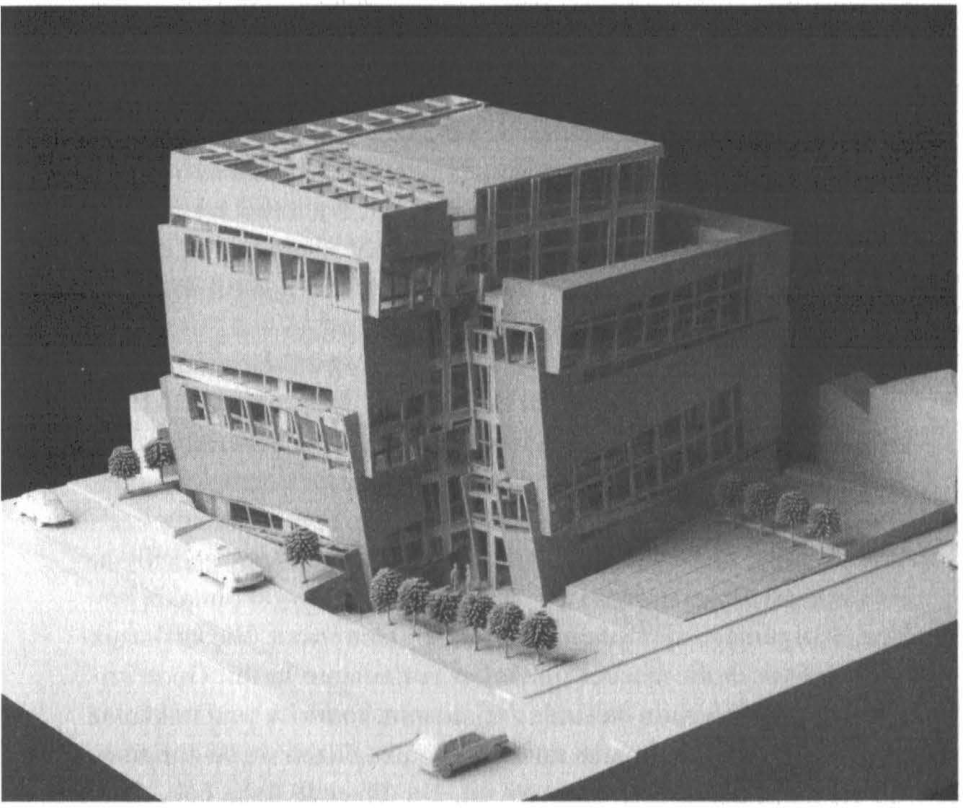

*东京的Nunotani大厦，模型。建筑师：彼得·艾森曼。*

堵住去物质化之路，想象一种不迫使现有条件、工具与技术超出限度的生产，意味着在一个不局限于建筑的尺度上，以不变的世界为目标。意味着希望生活在一个稳固的安全体制中。意味着把安于现状变成规则。近几十年来，这种倾向尤其披上生态主义的外衣而频繁被提上议程。然而，这种对平衡状态的寻求尽管极为普遍，却不过是一种从未变成现实的期待。毫无疑问，全部人类历史就是一部迫使现有条件超出限度的历史。先迫使条件超出其能力，然后不得不创造新条件的历史。而资本主义秩序属于一个这种强迫已经系统化的世界。在这一秩序中，生产更多、更经济、更醒目、更不同、更反常之物的要求，是系统内在的。这并不意味着要制造环境灾难，也不意味着肯定资本主义。以生态敏感性来生产，并不与资本主义体系矛盾。恰恰相反，它也可以作为系统的一个新组成部分而运作。即便大约二十年前并非如此，今天生态主义也已成为商品经济内部一项有利可图的生产门类。当然，这并不是说资本主义是一种能够解决一切困境的deus ex machina（解围之神）。我只想指出，认为生态敏感性是一种技术、经济和政治抵抗可能的信念是多么天真。抵抗体系、寻找新的可能，意味着与物质条件冲突。而想象一种与物质性和平的建筑，则意味着把物质条件当作既定知识来思考。〔原书第185页〕这等于提议否认那些条件是人手造就的，提议相信它们构成一种近乎神圣的必然性，并且相信除了顺应它们别无选择。如果人类照此行事，就不可能在今天所能居住的任何地理、气候、地形环境中生产出生存与栖居的可能。用最概括的定义来说，建筑不是别的，正是人以人造栖息地取代自然栖息地、并与自然之物建立无止境紧张关系的实践。因此，我们并不受制于任何我们创造的空间、任何我们生活的条件、任何我们拥有的可能——我们与之冲突。

〔原书第186页〕

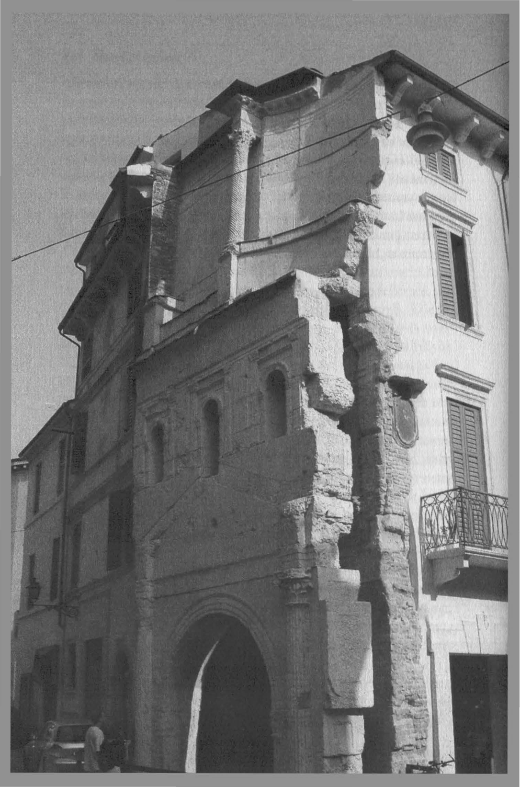

*整页图片：摄影：乌古尔·坦耶利。*

## VIII　新颖性、发明、创造力及其他建筑奇迹

〔原书第187页〕

*维罗纳罗马时期城墙城门“莱奥纳门”（Porta Leona）的残迹。*

二十世纪初——因而就所述概念而言可以说很早——的一篇奥斯曼文本中，阿扬扎德·比雷吉克利·埃克雷姆大致写道：“由于日本工业的发达，日本某些城市地区中的‘烟雾’（smog）已经与伦敦的相似。”[1] 这句赞美日本发展程度与变化速度的话，同时也暴露出进步神话的困境：发展被如此肯定，以至于它的后果——环境污染——也几乎会被当作一种正面价值。显然，新颖性、发明、创造力、发展、进步、演化这一系列亲缘概念界定着种种二律背反。一方面，它们与一个在历史尺度上很晚才被生产出来的价值概念相关；另一方面，这些概念本身又作出一些绝非轻易就能肯定的暗示。18世纪以前，这些概念在任何地方都不以今天所用的意义存在。然而，即便经过三百多年的变化过程，人们仍然不能确信它们的有效性，甚至不能确信它们的存在。人能够在认识论真空中运用一种从无到有的意志进行创造，这种信念〔原书第188页〕如今看来已不再可能。每一个新事物，都是在旧事物、现存事物所界定的语境中被建构的。旧事物的延续、修订、解释与否定，都以难以轻易分离的方式包含在每一个新事物之中。尽管如此，我们仍未把章节标题中那些从无到有的“奇迹”扫出术语库。恰恰相反，“新颖性崇拜”仍保持着不可替代性。在艺术—设计—建筑的语境中讨论“新颖性崇拜”，将在这里以“时间—价值关联的建构”为题进行。这个标题试图说明的是：界定文化现象与“事物”之价值的那些性质，是根据它们在年代意义上处于近处还是远处的位置来确定的。价值由时间性来定义。例如，“新”之所以有价值，仅仅因为它是晚近的，因为它是新的。这也是一种年代秩序、一种等级制的想象。现象、对象、思想在时间中被排列成一种仿佛从欠发展到发达、从简单到复杂、从错误到正确、甚至从低劣到高级、从丑到美的序列。如此写成的艺术史和建筑史，总是讲述发展的故事；不这样写的历史则少之又少。甚至，正如后文将试图说明的，在艺术史与建筑史书写的最初产物中，这种想象构成主轴。艺术与建筑的历史，就是发展、进步、发明新事物的故事。即便在讲述这些概念尚未存在的时代与地方时，进步主义—发展主义的史学逻辑也常常没有改变。这里的目标，是简述在世界中依据这种等级性的时间—价值秩序来理解事物的短暂历程，并至少把这个在流行想象中牢固建立起来的概念家族问题化。有两项原因使这样做变得困难：第一，这里所说的文化理解从17世纪开始首先出现在奥地利以西的欧洲国家，但今天它似乎已在世界上几乎任何地方建立了一种话语权力。然而，这种话语权力同样是在每个地方、在那种地方语境和那种语言内部被建构起来的。因此，上述概念家族的各个组成部分，在不同地方和语言中〔原书第189页〕并不以数学般的精确彼此重合。发明—进步—创新的谱系在历史过程和地理分布上表现出严重差异。当然，它允许人们进行概括，但使用这种可能相当危险，因为它会把差异同质化。因此，需要写的不是一部普遍的发明—进步—创新史，而至少是随语言和地点而变化的复数的历史。何况，所有这些变化也并非总是以相互直接影响的方式出现。18世纪初在奥斯曼帝国首次察觉到的发明—进步—创新概念化，例如，不能被视为与17、18世纪西欧所观察到的情况同源。不过，尤其在19世纪中叶前后，奥斯曼帝国也将获得一种欧洲的“接种”。第二个困境在于，这些概念并不是在所有知识领域中同时被创造的。例如，建筑或艺术中发生的变化，与文学或日常生活实践中发生的变化，在年代和含义上都不相同。而建筑与新颖性、发展及其他亲缘概念所建立的关系则相当矛盾。目前只需指出：在建筑实践中，变化、新颖性和创造力一方面被夸张地理想化并加以描述，另一方面，人们又不会轻易放弃建筑具有一种在时间与空间中不变地持续着的本质这一主张。这意味着，创造力、变化与新颖性既可以同样轻松地被肯定，也可以同样轻松地被否定。这种矛盾的另一种表现是：那些提出和／或捍卫当代建筑取向的人，会去其他空间与时代寻找并发现支持自己的例子。许多推崇创新与发展的人，同时也感到需要相信并指出那些不变之物、那些无论如何都保持有效性的事物。建筑仿佛必须不断进步，却又必须保持一个始终不变的本质。建筑思想文本的相当一部分之所以变成一篇篇冗长的矛盾修辞叙事，原因正在于此。本章末尾我将回到这个问题。

〔原书第190页〕

### I

要理解“新”这一概念的发明与变化，不妨先作一种不仅适用于土耳其文化领域、也大致适用于几乎所有传统社会的概念分析，并简要谈谈阿拉伯语／奥斯曼语中的bid'at（异端／新创）概念。Bid'at大致界定新事物；但几乎是一种永恒的新……在传统伊斯兰理解的框架内，穆罕默德时代之后出现的一切都是bid'at。这一范围内的任何东西都不会随时间变旧。它不能获得变旧所带来的认可。Bid'at按其古典含义始终是bid'at。例如，17世纪的卡蒂普·切莱比仍在这个意义上详细论述bid'at。[2] 它很少被纳入建筑讨论。然而，这一概念在建筑语境中也可以使用，例如可能包括清真寺建筑中每一个“新”事物，包括穆罕默德时代尚不存在的穹顶、宣礼塔、米哈拉布（礼拜龛）等。有迹象表明，18世纪初奥斯曼帝国改变了这种时间—价值关联，并开始在建筑语境中以不同方式建构“新”。奥斯曼诗歌在这方面甚至可以说稍早一些。17世纪末至18世纪初，开始出现试图“刷新”奥斯曼诗学的尝试。例如，那个时代如今只有专家还记得的诗人卡米，就处于这样一种寻求之中。[3] 诗人开始以一种不能说过去存在过的方式，把阿拉伯诗歌、尤其是波斯诗歌界定为迪万诗歌的源头，并开始以批判的眼光看待过去被认为完全寻常的这一状况。渐渐地，一些诗人开始担心模仿与重复。卡米在这个方向上有一联诗：

> 那个心怀恶意的对手说：“我们的诗是波斯风格。”
> 号角的声音，无法与管风琴的旋律相和谐。[4]

〔原书第191页〕

诗歌中的这种模仿焦虑并不只限于伊朗诗歌，它也表现为对奥斯曼诗歌自身过去的重复焦虑。人们认为，所生产的诗歌不过是在重复同样的词句。仍据卡米说：

> 卡米啊，如今诗歌只剩下空洞的辞句；
> 没有人能用精炼的新意（mazmun）写出一首加扎勒。[5]

更重要的是，奥斯曼诗学在郁金香时期（1718—1730）开始生产一系列新的、或意义被更新的概念，如cedid、nev-icad、tarh-ı nev、tarz-ı cedid。它们被用来描述建筑现实，标志着一种与此前时代非常不同的理解正在诞生。诗学与建筑以新的方式相遇。建筑中正在建构一种新的品质理想和新的想象，在其中，成为cedid（新的）本身作为一种价值而凸显出来。例如，内迪姆（卒于1143/1730）为他称为“尼兹赫特费扎”（Nüzhetfeza）的卡普丹·穆斯塔法帕夏宅邸所写的颂诗中说：

> 我望着你那新设计的高耸屋顶，说道：
> 若这大地上有崇高之境，便是此处。
> 柏拉图的精神说：不，不，你错了；
> 这是灵魂与威严之界的“新世界”。[6]

颂诗中，宅邸宽阔屋顶檐口的设计（tarh）因新而受到赞赏；更有趣的是，它被描述为崇高之界的“新世界”、“美洲”。这种与美洲的关联，把一个建筑元素的全新性与一个新大陆的新颖性联系起来，对建筑想象和奥斯曼诗歌而言都是独一无二的。

〔原书第192页〕

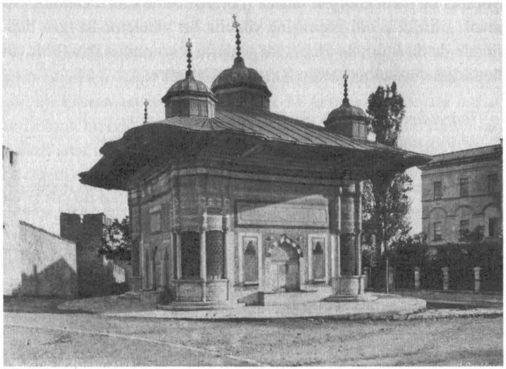

*一个让“nev-icad”（新创）这一说法获得生命的18世纪建筑：贝里格伦照片中的艾哈迈德三世喷泉。*

赛义德·韦赫比（卒于1149/1736）为艾哈迈德三世喷泉所写的纪年句，虽然不如内迪姆所创造的那种地理性新意（mazmun）那样引人注目，却包含着赞美当时那些此前没有类似设计的建筑产品的另一种新形式。[7] 这是“icad”（发明）一词以今天意义被使用的一个很早的例子：

> 他建造了这座喷泉与饮水亭，愿他因这善行得到酬报；
> 他使这个地方繁荣，发明了新的设计；
> 他使侯赛因的灵魂喜悦，让清泉流淌出澄澈之水。

对这座喷泉所作的这种描述也是符合实际的。喷泉是奥斯曼水利建筑中一次重要变化的最早例子：它把此前一直由附属于另一建筑墙面的水龙头和水槽构成的喷泉设计，转化为一个独立、各方向等重开放的中心结构。〔原书第193页〕喷泉成为一座支配其所在城市空间的纪念性建筑。确实，艾哈迈德三世喷泉使所在之处“繁荣”，而且是通过“发明新的设计”做到这一点。在苏莱曼·纳希菲（卒于1151/1738）的一联诗中，可以清楚看出两项重要变化：第一行诗赞扬一个建筑产品之平面图的美学水平，这传达出一种非常新的理解。根据诗句，建筑平面的呈现令人心旷神怡（vaz-ı resmî dilgüşâ），其设计风格无与伦比（tarz-ı tarhı bî-bedel）。这里首次被提上议程的，不是建筑本身，而是为建造它而准备的图纸、设计、图画（resm）的审美品质。第二行则出现了从19世纪晚期起将被不断重复的“发明之艺术”（icat sanatı）概念的早期用法。旧有的奥斯曼理解——艺术是一种技术性技能、一种制造实践、如古希腊语中的tekhnē，而未被描述为具有独特美学意义的实践——正在被迅速抛弃。我不知道有更早的奥斯曼语表达把建筑描述为一种发明之艺术：

> 那令人心旷神怡的平面构图，那无与伦比的设计风格；
> 看那卓越宰相的襄助，以及发明的技艺。[8]

恩德鲁尼·法齐尔贝伊（卒于1225/1810）为德夫特尔达尔角上的内沙塔阿巴德宅邸（很可能是为18世纪晚期的重建而作）所写的一联诗，[9] 由于直接涉及时间—价值关联而很有趣。诗人说，他以“旧历”暗示的过去时间，在“nev-icad”的内沙塔阿巴德设计面前，如今被他们描述为“粗糙的”（müsvette，草稿）。这是进步主义—发展主义话语——过去为生产“新”而构成一份草稿——在奥斯曼帝国的极早例子。

> 来，从这内沙塔阿巴德观赏园林吧；
> 尤其是这新创的、新造的设计。

〔原书第194页〕

> 坦言相告：面对这座色调如一的宅邸，
> 有了这一新创，我们便视旧历为粗稿。

诗与建筑交界处在18世纪初发生的、因而可以说极早的这个开端，后来似乎没有以同样的势头继续下去。奥斯曼文化对“新”的理解，将在19世纪与欧洲建立的关系框架内沿着另一条路线前进。“新”在18世纪尤其指向一种审美变化。例如，诗歌中的表达方式、想象，建筑中的形式选择都在变化。而后来的世代，可能直到塞尔韦特—菲农文学在20世纪初界定的短暂时期为止，至少把谈论审美变化降到次要位置。此时，新的含义开始与技术跃进、社会结构以及公共—组织机体的改革等问题相联系。甚至，谈论与审美、日常生活趣味、感受有关的新事物，在某种意义上受到压制。在奥斯曼知识界为自己确定的思想变化议程面前，这些会被视为无关生存、荒谬、不严肃的要求。由于思想上的主要论题预设了一种以国家存续为轴心的更新，任何与国家没有直接关系的新事物，都被简化为一种没有内容的任性。它们会被描述为偏离真正目标、在必须走的道路上浪费时间、逐渐背离真正目标。

〔原书第195页〕

在几乎每个知识分子都把自己与中央政府等同起来、把自己想象为与它处于某种“有机”联系之中的环境里，新与新颖性等概念被冻结在政治与行政行动纲领之中。18世纪诗学那种热情洋溢的语言，让位于例如齐亚帕夏和纳米克·凯末尔那种劝诫式、毫不犹豫、知道并宣告真理的诗歌。建筑在这种环境中也没有走上一条非常不同的道路。此前时代以诗歌语言和“审美的新”之发明为特征，而坦齐马特之后则由中央政府对建筑事务枯燥的公文语言所界定。文件无休止地谈论建筑之“艺”（fenn）、它的技术内容，以及从外部学习它并据此建造的必要性。

这种视角从坦齐马特开始在土耳其从未过时。竞争者会出现，分量有时减轻，但不会从议程上消失。其基本特征是：不再把新视为可以生产出来的价值，而把它表述为“必须学习的新事物”，从而使它僵化。与18世纪早期相反，人们不再努力说出新的话。也没有任何证据表明人们相信这是可能的。多数时候，被作为新事物呈现的思想和观点，是“他者”、西方早已生产出来的旧事物。它们在奥斯曼地理中被作为新事物呈现给公众。它们的价值也来自在这里是新出现的。在这方面，巴哈·特夫菲克的《科学与文学的新生》（Teceddüd-i İlmi ve Edebi）很有启发。[10] 该书的副标题“关于心理学、道德、逻辑与文学的最新理论”本身就足以表明，作者的书并没有讲述主标题所承诺的东西。作者宣称，他在这里公布的是早已写成并出版的、用他自己的话说“最新且最受赞赏”的理论。既然他告诉读者的是受到赞赏、也就是已被接受的新事物，那么新事物那种不熟悉、令人不适的性质，在书中便无从谈起。何况，他在开头就仔细说明，这些并不是他生产的，而是他从许多来源汇编的，因此才把自己的名字写为作者。[11] 因此，作者并未把自己呈现为一个有权说新话的人。显然，即便在他如此忙于新颖性的时候，他也不认为生产新事物需要作者的存在。

大约三十年后，一本早期共和国道德教科书非常清楚地说明，新被定义为“已经说出并做出来，但尚未在这里流通”的东西：

> 一个理想的土耳其青年应当热爱进步与新颖性。在科学、技术和工艺中，凡在欧洲或美国找到一切新事物，他都应当学习并把它们带回祖国。他应当接受国家在行政领域中采纳的一切新形式……他应当使自己的住所、家具、衣着，总之使生活的每一个层面和每一种外观，都变得像世界上最进步的民族。[12]

〔原书第196页〕

直至今日，这种视角虽然根据不同政治观点经历过修订，却一直被保留下来。在所有这些观点中，新颖性都被工具化了。因为它有用，所以应当学习、应当应用。对早期共和国西化派来说，这是成为文明社会的先决条件。当代伊斯兰主义者和一般保守派则进一步缩小范围，努力把应当学习的“新事物”限制在技术领域。然而，他们所追求的东西，在坦齐马特时期以及在齐亚·格卡尔普的hars—medeniyet区分中，也以微小差别同样有效。在所有这些中，“新颖性”首先具有技术内容，因此“必须带回祖国”，学习它不可避免。不具有技术性质的“新”，不仅不被视为正面，反而具有破坏社会文化内在一致性的性质。这样的新事物本来就不存在生产的问题，但连学习它们也有问题。然而，与这种天真的决定论信念相反，包括技术和审美在内，任何领域中的“新”，即便并非有意如此，也会对旧有的／既定的权力结构构成威胁。它的重要性正源于此。

这段简短概述的意思是：在土耳其，“新”概念的现代“灵晕”（aura）在18世纪之后很长时期内，也许直到1980年代，都未能建立起来。新本身没有变得有意义。因此，与“新”相关的现代神话也未曾被建构。它们不时被尝试，但始终无法形成主流，更重要的是无法获得合法性。要为新颖性辩护，它必须有具体的用处。而要证明它有用，就必须已经在该国之外被提出，并被证明有用。即便在那时，它也始终处于如此密集的文化攻击之下，以至于人们不得不一再——而且大多失败地——为它辩护。

〔原书第197页〕

### II

上文概述的以新颖性、发明、创造力为轴的奥斯曼／土耳其变化路线，尤其在坦齐马特之后与不同路线相交。人们与欧洲正在建构的亲缘概念相遇。当然，在任何语言中都不可能谈论一种线性、无中断的变化，但应当看到，土耳其语中平行概念建构有其特殊问题。下文将尝试对英语、法语、土耳其语之间的意义生产作一次比较分析。这种比较将表明，谈论一种以新颖性和创造力为轴的单一话语是不可能的。

如我们上面所指出的，创造力、新事物的生产、发明等概念在欧洲的历史不早于18世纪。在此之前，圣奥古斯丁（354—430）的“Creatura non potest creare”（被造物没有创造的权能）这句话，几乎可以代表世界任何地方的理解。创造只属于上帝的属性。即便在16世纪，情况似乎也没有发生太大变化。托尔夸托·塔索（1544—1595）以“只有两个创造者：上帝和诗人”开始作出一种新的创造力定义。然而，建筑尚未进入创造力一词的涵盖范围。在英语（creative、creation、to create）和法语（créatif、création、créer）中，这些概念以今天艺术与建筑含义被使用，不早于18世纪晚期。[13] 在奥斯曼语／土耳其语中，类似今天的意义大约要到20世纪初才出现。舍姆塞丁·萨米在《法语辞典》（Kamus-i Fransevi）中给creation的对应释义是：“创造、被创造、造化／造物、宇宙／发明、设立、发明或编纂和排列之物、珍品／首次扮演一出戏剧中的一个角色／一出戏剧的首次上演。”[14]〔原书第198页〕“发明或编纂和排列之物、珍品”这一解释表明，对奥斯曼人来说，美（bedia）可以被发明这一观念已不再陌生。然而，上文已经举出郁金香时期“发明”概念这一含义并不陌生的用法。尽管如此，直到20世纪，我不知道有任何土耳其语文本把发明与创造行为联系起来。

英语development（发展）概念，在“各民族处于一个演化发展过程中”这样的表述框架内，要到19世纪中叶才被生产出来。[15] 在经济意义上，则要到19世纪晚期才被使用。该术语的奥斯曼语同义词tekâmül在20世纪初进入使用。Underdevelopment在英语中于1945年之后，其土耳其语对应词“azgelişmişlik”则在1960年之后进入议程。

英语和法语evolution（演化）源于拉丁语evolvere（展开卷轴）。即便在1764年，它也尚未具有今天的演化含义；例如，博内用它来描述胚胎从先前形式向成年存在的变化。[16] 其含义与某种已经存在之物的“展开”相关联，就像展开一卷卷轴。19世纪中，它逐渐获得较简单的生物存在向更“发展”的存在变化的意义。1832年莱伊尔、1853年斯宾塞、1859年达尔文都在今天的“演化”意义上使用它。而在奥斯曼语中，根据1860年版雷德豪斯英语—土耳其语词典，它的对应释义是：展开一个卷起之物；顺序、系列、链条；火中生烟、心中生念并传播；“几何学中螺旋曲线按已知方式展开；……军队按连、营、团、军的编制有序执行战斗行动；机动。”[17] 该术语的生物学含义完全没有被提及，社会演化的用法也没有痕迹。它的生物学含义将在20世纪初逐渐形成。〔原书第199页〕例如，《法语辞典》给出的对应词是“neşv-ü-nema”（生长繁盛），在有机意义上则是“tekâmül”（成熟）。[18] 二者显然至多只是粗略地对应“演化”概念。第一个对应词表示生物的成长与发展，第二个则表示一般的成熟、达到完善。

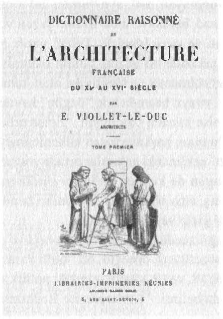

*哥特风格作为理性主义取向被发明出来的最重要文本之一：维奥莱-勒-杜克的《法国建筑理性辞典》第一卷标题页。*

在英语中，improve和improvement这些词在18世纪仍与土地相关，界定从土地获得收益的可能。它们在农业资本主义经营的语境中指向提高产出。经济含义将保留至今，但会加上社会含义。[19] 而在土耳其语中，“gelişme”“geliştirme”这样的对应词即便到今天也未能获得语义上的精确与确定，它们不是用于特定领域，而是被过度泛用。

英语originality（原创性）是18世纪晚期的一个概念，并开始作为imitation（模仿）的反义词使用。[20] 法语originale在奥斯曼语中于20世纪初获得如下词典定义：〔原书第200页〕“不是复制或模仿而来的、原本的、本身的／首次被看见的、前所未有的、新创的、珍品／以一种新方式写作或描绘的人（作家、画家、诗人）。奇怪的、怪异的、完全不同的＝原本、原件。”[21] 而originalité则被解释为“怪异、前所未见和完全不同之物、古怪”。[22] 显然，即便在20世纪初，“özgün”（原创）概念至多只是部分获得了今天的意义负担。诸如“其认识论内容只归功于自身、不源于他人、其根源在自身之中”这样的含义，尚未出现。另一方面，“原创性”那些今天仍部分存在的贬义已经被建立起来，而肯定性含义尚未被建构。原创性此时仍是奇怪而怪异的。

在英语中，progress与progressive（进步与进步的、进步主义的）这些词，例如作为“历史规律”的“进步”概念，是在18世纪晚期和19世纪的政治与工业革命期间出现的。[23] 而在土耳其语中，1860年的雷德豪斯词典给出的还是“向前走、前进、进步（terakki etmek）”之类的字面用法。[24] 然而到20世纪初，法语progrès的奥斯曼语对应词已被列为“进步、前进、进步（terakki）／增长、增加……／在职位与仕途上，或在知识与技艺上的晋升”。[25] 由此看来，今天的意义此时已经建立。而“terakki”涉及社会与科学发展的含义，很可能在1870年前后进入使用领域。例如萨杜拉帕夏在1880年代担任维也纳大使期间（1882—1891）所写的《十九世纪》一诗中，就罗列了与“terakki”有关的全部现代神话。这首诗[26]几乎公开证明，奥斯曼改革主义与唯物主义想象正在与欧洲相遇；不过，正如我将在下文说明的，最好还是不要急于作出这一草率判断：

〔原书第201页〕

> 智识之光已达完善之巅……
> 隐喻化为真实，真实化为隐喻；
> 旧日的知识也许已从根基崩塌。
> 天界、大地、智慧与化学的论题，
> 不再是心中的幻念、妄想与比拟；
> 理论问题以经验为凭证，
> 猜测的篇章抵达了确然的界限。
> 显明的理智升向天体所在的空间，
> 引力定律成了攀升的阶梯……
> 空气、闪电、光芒、蒸汽与磁，
> 在人的掌控之手中成为运动的要素……
> 声音，在测量距离时是忠实的告知者；
> 蒸汽，在照亮黑暗时是最奇妙的奇迹。
> 电把消息传往四方。
> 蒸汽，在陆地上与海上是运输的赫兹尔。
> 这个世纪岂能不向诸世纪夸耀？
> 发明缩短了空间与时间的距离。
> 还剩下什么长生泉，什么苏赫拉布的灵药？
> 还剩下什么咒语抄本，什么护身符的效力？……
> 权利与义务的界限已经确定而稳固；
> 还剩下什么压迫与侵夺，什么恣意妄为？
> 人身与财产的权利受到保护，免遭侵犯；
> 文明世界被赋予了另一种秩序。

〔原书第202页〕

《十九世纪》既提出了人们极为熟悉、广为流传的进步主义语言中以技术和科学为中心的叙述，也把旧认识论体系的崩塌以及社会结构的变化提上议程。例如，它也涉及法律的平等适用、专制秩序的崩塌、迷信的破除、报刊的作用等问题。至于艺术与文学中的新颖性，则尚未进入萨杜拉帕夏的议程。何况，他讲述一切新与先进之物时，丝毫没有勉强旧表达形式。以至于连“阿姆尔不再是宰德的奴仆，宰德也不再是阿姆尔的监护人”这样的句子——旧教法书中的标准套语——也原样使用。他的最终判断则处于奥斯曼改革主义以教育为轴的变革建议框架之内。在此语境中，他明确或隐含地示范了后来不断被再生产、甚至从未被放弃的悲观主义革新意识形态。以致他连成为积极的创新生产者的可能、变化的寻常性，以及最重要的——进步主义—革新话语最显著的特征，即怀着希望展望未来——都未曾暗示。他怀着一种深重的失落心理说道：“还剩下什么罗马人与阿拉伯人的声名，什么埃及与赫拉特。”他像指出必须消除无知那样，以一种属于他所宣称已被摧毁的旧认识论体制的判断，结束了自己的诗作。奥斯曼只是“暴露于”他所列举的这一切变化与新颖性之中，它们正在改变世界，而奥斯曼要想存续，就必须学习那些新事物。

上文概述的土耳其语概念建构有一个矛盾：〔原书第203页〕只看词典时，这些概念似乎部分地并不带有与英语和法语大不相同的内容；然而，同样的概念在奥斯曼—土耳其的使用中却发生在相当不同的话语内部。在这些话语中，“新”与其说是带有未知和含混、却令人期待的变化的属性，不如说是“他者”早已生产出来的、现成的、已经改变了世界、而东方因未能赶上、如今必须追赶的可能。也并不存在这样的情况：新同时界定一种不确定状态。话语的建构性主体在每一个阶段都寻找、发现并为自己操心的，是一个它熟悉、必须达到的“新颖状态”。它没有做、也不相信自己能做的事，则是着手生产新事物。它甚至不以同情的眼光观察这种生产。世界正在改变，新事物正在出现，只需要适应它们即可。因此，从晚期奥斯曼开始，“新”的经历很难被叙述为一种时间—价值关联的建构。新之被渴望，不是因为它新，而尤其是因为它在国际政治平衡的框架内使“他者”相对于“我”占据优势。正因如此，在全部19世纪奥斯曼文本中，几乎找不到几行描述并肯定建筑中的新与新颖性的文字。[27] 建筑并不是国际平衡方程中的一个棋子……

### III

在欧洲，建筑似乎也与上文概述的创造力—发明—进步神话建立了一种关系，它与奥斯曼／土耳其话语中所表达的相当不同，但充满张力。此前我已试图说明现代神话相关话语的复杂性。当这些话语在建筑语境中被生产出来时，就变得更加〔原书第204页〕复杂。例如，在可以被界定为建筑思想真正起始阶段的15世纪，占主导的是旧事物的再生产、复兴，而不是新事物的创造。维特鲁威写于公元前后、从古代留存至今的唯一建筑文本，从1486年首次印行开始几乎获得神圣性，其尊崇地位与有效性在后来时代也得以延续。它的价值不来自新，而来自古。以至于当17世纪新的地理学与天文学知识使托勒密的书失效、物理学求助于亚里士多德失去意义、城市建设引水道不再使用弗龙提努斯时，建筑中的维特鲁威仍保持着当代意义。甚至在今天，世界几乎各地都有建筑学院和教师建议刚入门的建筑学生阅读维特鲁威。

阿尔贝蒂于1485年出版《论建筑》，写下历史上第一部印刷建筑书，按舒瓦的说法，[28] 提出了第一部真正的建筑思想文本；他在很大程度上与维特鲁威决裂。然而，他一再通过求助于古代文本来验证自己的建筑观念。他也像维特鲁威那样把自己的书组织为“十卷”，不把旧事物的外衣披在新事物身上就无法安心。当然，直到17世纪，这种情况对所有知识领域都有效。例如，即便大发现时代颠覆了古代地理知识，人们仍会抵抗，不肯放弃旧文本。有人会认真相信，在托勒密的《地理学》某处，美洲以另一个名字被提到过。巴洛克时代（17—18世纪）成为认识论上的摧毁时期，但在建筑思想语境中，却没有出现一位试图把维特鲁威拉下王座的建筑理论家。“新”没有被理论化、被思想化，而只是通过设计与建造工具被制造出来。在文学中，17世纪结束时则出现了〔原书第205页〕著名的“古今之争”（querelle des anciens et modernes）所标示的冲突。这场冲突始于夏尔·佩罗1687年1月27日在法兰西学院朗读诗作《路易大帝的时代》（Le siècle de Louis le Grand）。他反对以古希腊罗马模式为轴心的立场，主张当代文学要强大得多。不久，这场争论在英国和德国也产生了延伸。1704年，乔纳森·斯威夫特在英国出版了至今仍著名的讽刺作品，他称之为“书的战争”（The Battle of the Books）。[29] 然而，尽管几乎涉及每一个知识领域和重要作家，参战的书中却没有维特鲁威。仅凭这一排除，就足以构成值得研究的问题。建筑中抵抗变化的意志显然很强，但建筑领域之外的智识界也不想关心建筑意义上的新与新性问题。这里没有使“新”合法化的要求与工具。建筑中的新是在不情愿中被生产出来的，并且实际地进入领域。因此，维特鲁威没有参加斯威夫特的“书的战争”，因为与其他知识领域不同，无论是斯威夫特还是其他作家，都找不到一个可以与之对立的同等“现代”人物。从15世纪中叶开始，撰写建筑的人产出了数百卷文本，却从未出版过一本不诉诸维特鲁威、不理会他的建筑书，更不用说反对他了。简言之，建筑没有它的伽利略、牛顿，只有“注释者”。他们为古人生产解释性／诠释性注疏。他们有时也实现激进的断裂，却不能强调自己的激进性、自信地将其公之于众。他们几乎把它藏起来。古今对立在18世纪上半叶也没有平息。以至于温克尔曼虽然实际上提出了一个与古今二元论颇为不同的艺术问题，他的反现代立场中仍有这场“古今之争”的痕迹。此外，温克尔曼〔原书第206页〕把冲突扩展到建筑与视觉艺术，但这样做仍然是为了捍卫古人。他会指责“新”背离自然，并主张必须回归古代。例如他写道：

> 上个世纪，一场毁灭性的瘟疫席卷了意大利和文明世界的其余部分；它用有毒的烟雾填满思想者的头脑，以灼热激荡他们的血液，使他们的文学风格变为夸张而做作的效果。同样的瘟疫也在艺术家之间蔓延；朱塞佩·阿尔皮诺、贝尔尼尼和博罗米尼在绘画、雕塑和建筑中背离自然与古代，其程度不亚于马里诺等人在诗歌中所做的。[30]

因此，对温克尔曼来说，远离古希腊本身就是一种毁灭。他把超越时间的艺术价值归给古代，甚至拒绝古今之争。悖论在于，他在写下这些古代颂词的同时，也为一种发展主义—进步主义的艺术史与建筑史书写奠定了基础。[31] 他把古代艺术作品纳入一个从原始状态向他自己理想的美的理解延伸的序列。从旧到新不断前进，也越来越接近完善。然而，温克尔曼又从完善之物画出一条通往颓败与矫饰主义的路线，却始终不肯接近创新过程不可逆的单向性观念。

同样在18世纪，那些建构全新理性主义建筑思想的先驱们，也不是无视古代，而是把古代当作既定的东西来陈述他们在启蒙时代所生产的理性：古代也是理性的！洛吉耶、洛多利和米利齐亚[32]始终无法摆脱这种回溯性的理性。到了19世纪，建筑思想家这一次则忙于在古人之间生产有效性偏好。哪些古〔原书第207页〕人对于今天更有意义、更有用？应当追随某人，可究竟是谁？首先开始的是希腊派与罗马派之间的争论。[33] 接着是哥特派与古代派之间更长久、更富有成果的争论。[34] 亲哥特的理性主义在维奥莱-勒-杜克那里找到了最强的宣传者。这位思想家把13—15世纪建筑呈现为最适合为19世纪理性主义者指路的取向，其影响持续到20世纪。

新要在艺术与建筑中获得一种特殊价值，需要等到随着印象派而开始的先锋运动。从这个节点起，创新的生产在艺术与建筑中的意义发生根本变化。或者“新”终于激进化，开始界定一种与近远过去之间的明确断裂。先锋运动把“成为新”定义为艺术产品的必要属性。甚至，先锋主义似乎把这种必须创新的属性，在与旧事物进行的有意识且无休止的斗争中，几乎绑定为一种自动机制。变化过程于是变成由一连串斗争构成。在此语境中，谈谈波焦利所界定的问题——先锋是“异化”的生产者——以及产生那种异化的特征清单，将会有所启发。按波焦利所说，异化源于先锋艺术是贵族式、精英式的少数面对无文化／无趣味的多数时的产物。更确切地说，先锋如此呈现自己。因此它将与多数异化，其动力也因始终处于少数，通常由它反对资产阶级的斗争来界定。然而另一方面，它也与少数斗争，因为它的存在归功于它既拒绝“旧古人”，也拒绝“新古人”。它像否定过去者一样否定同时代人。〔原书第208页〕与资产阶级社会及艺术同行进行的这场“绝望的”斗争，使先锋得以建构自身的合法性。斗争之所以绝望，源于如下意识的产生：每一个新事物从最初被表达的那一刻起就已变旧。既然所有时代和社会中都有古今这对概念，就可以说新的现代理解是通过对这种易朽性的心智建构而出现的。于是，“旧”在“陈腐”与“崇高”之间摆动的传统双重对立含义被磨损。过去用来标志一个物品使用寿命结束的“旧”概念，如今成为一切已走完生产阶段之物的属性。悖论的是，曾经作为旧而同时带有不可磨损的连续性与有效性品质的东西，现在恰好变成相反的东西。应当记得，中世纪欧洲法律文本以“自不可记忆之时便已存在”来根据“陈旧”为每一项封建权利辩护。而在先锋思想语境中，一切现有艺术产品都必然已经变旧。在它们首次被表达、首次以“新”之名向公众宣告时，就衰老并死亡了。毫无疑问，一切先锋都意识到自己的命运。而这又使先锋具有波焦利所说的四个必要参数或特征。每个先锋运动都必然成为虚无主义者、行动主义者、抗争者和未来主义者。[35] 它是虚无主义的，因为它像否定此前一切那样，也否定自己同时代的事物。它不留下任何有效的、有用的、“可因其年龄和／或思想而受尊敬”的东西。它是行动主义的，因为它以与前辈及同时代人的斗争来界定自己的存在。它是抗争的，因为这场绝望的斗争使它必须受苦；它永远无法抵达享受自身成功的境地。因为达到成功就意味着被接纳，也就意味着变旧。最后，它是未来主义的。宣称界定未来是先锋的存在理由。问题在于，寻找具有这些属性的建筑运动的人会失望。建筑中的先锋是十足的悖论修辞（oxymoron）。建筑甚至无法与自己产品的暂时性相安无事。〔原书第209页〕相反，直到很近的时代为止，建筑思想中的重点始终是连续性。建筑产品不应在物理意义上变旧，建筑设计及其思想也不应在认识论上变旧。本领在于生产不变旧的东西。例如，从20世纪初的赫尔曼·穆特修斯开始，有一种非常普遍的习气，就是诅咒时尚。[36] 在穆特修斯和无数建筑师看来，建筑所追求的不应是时尚的短命，而应是忠于自身建造本质的“建造艺术”（Baukunst）那种不可磨损的正确性。这意味着：每一个新事物都必须证明自己不是短暂的时尚。在一切皆可消费的资本主义文化宇宙中，唯有建筑知识不应被消费。显然，这并非对资本主义的抵抗，而可以被视为建筑中一种无论如何都无法舍弃的“永恒而不可磨损的有效性”神话的组成部分。〔原书第210页〕建筑领域与“新”概念的关系究竟多么成问题，也许最好由勒·柯布西耶来揭示。这位20世纪也许最有影响力的建筑师，其所有著作都充满对时代、工业文明、当下技术条件的赞美；然而他几乎总是以这样的主张捍卫自己的思想：它们在过去也同样有效、同样可被验证。例如，当代建筑应当以使用纯粹柏拉图式形式为基础；例如罗马人和奥斯曼人也曾这样做！美的理想在古风希腊与今天并不矛盾！错误在过去与当代世界中都源于相同原因！因此在勒·柯布西耶那里，旧永远不会变旧。这位建筑师非但不批判发展、进步神话，反而毫不犹豫地保持对它的信仰。他会无穷无尽地捍卫这一观念：历史发展过程已经界定了前进的方向。[37] 这个过程如此运作：过去的有效性从未被磨损；它在那里像一座智慧宝库，随时准备被使用。这种信仰换上不同外衣，几乎无一例外地被后来的建筑思想家反复重述。

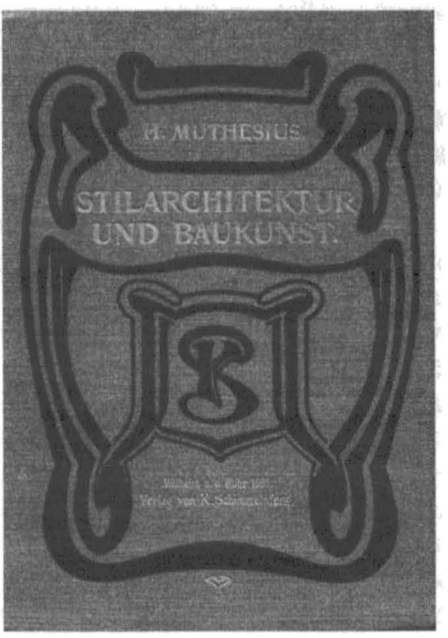

*也许第一部讨论建筑中时尚的书是赫尔曼·穆特修斯的《风格建筑与建造艺术》。初版封面。*

### IV

在建筑中不在新旧之间划出一条认识论界线，至少从15世纪以来就是常态。其中始终存在某种不确定的混合。建筑既不能不生产新事物，也不能抛弃旧事物。甚至，一种执念支配着环境：总是求助于古人来捍卫和论证新事物。然而，创新与创造力对资本主义体系而言是内在且至关重要的，这一事实与建筑中这种尊崇旧事物的执念相矛盾。阿多诺曾把资本主义与新事物生产之间的关系解释为：“艺术中的新范畴，是支配商品社会之物的必然的〔原书第211页〕副本”。[38] 资本主义生产关系必须持续发展、提升生产数量、生产的经济收益，因而也必须持续发展生产技术。生产必须在数量和质量上都得到发展，还必须持续差异化。既然不增加消费就无法增加生产，就必须通过差异化与多样化来刺激购买需求。不断推出新款式、新技术、新发明、新产品、新时尚，是体系的必要实践。投资正为此进行，而资本按其定义也必须投资。

阿多诺的话意在说明，艺术中的新至少是资本主义这一特征的孪生物。埃里克·霍布斯鲍姆也以类似方式把艺术中的先锋运动与资本主义运作联系起来。[39] 然而，把先锋与创新崇拜同商品社会联系起来，或把它们解释为同一事物的两个对称影像，对于解释19、20世纪的建筑先锋与变化并不十分有用。因为建筑生产部门比一切艺术实践都更紧密地绑定在资本主义生产关系上，它与新的联系并不局限于尊崇新。显然，每一种商业和／或艺术产品宣示自身之新，都性命攸关。那么，必然要问：既然“成为新”本身就是一项价值，甚至在资本主义世界中，新本身是一种商品，是附加在人工物交换价值上的一种价值，为什么在建筑领域中，新却常常被呈现为并非新，而只是旧的延伸？为什么这种新旧张力在艺术与文学中不像在建筑中那样强烈？

对这一问题，我尝试这样回答：波焦利所描述的那种异化必然性，在建筑领域是以与艺术中完全相反的方向被感受的：〔原书第212页〕建筑不能冒与社会大多数人疏离的风险。

从19世纪起，艺术似乎就已把自己封闭在一个由少数精英、知识分子少数派所界定的狭小经济口袋里。在那个口袋里，生产者与消费者都要求异化。在那里，新事物有长期市场机会。当它全新、产生异化时（用通俗的话说，“不被理解”时），产品在某种意义上就已得到宣传。市场成功随这种反常之物引起广泛公众好奇而攀升。例如，小说会卖得更多；波洛克的画不是刚画出来时，而是在时间中获得天文数字般的价值。然而，服务更广泛社会阶层的建筑，其经济现实与艺术不同。建筑产品只有在不异化时，或能够生产一种受控的异化幻觉时，才能实现。向建筑提出需求的人、业主及其他社会行动者（地方政府、承包商、劳动力提供者，甚至学院，通常还有整个社会）通过在一个最低限度共识的网络中达成妥协来创造物质环境。因为建筑如此强大而直接地嵌入资本主义生产关系，以至于不能只留给建筑师。这要求让步、适应、避免斗争，简而言之，不异化。异化只有作为效果、作为无害的幻觉保留下来时，才能为产品增加剩余价值。每一个新建筑产品都必须新到足以与同类区分，但又不能新到改变既定秩序。因此，建筑中不会出现艺术与文学中那样激进的创新。即便是看起来最极端的新，也要以“过去也如此”为由加以辩护，原因也许正在于此。

〔原书第213页〕

那么，在建筑中无法脱离“旧”、忘记尊崇旧与热爱新之间的紧张关系，就绝无可能。可是，要能够思考建筑（以及任何问题），首先必须把它置于批判性的地基上。要做到这一点，建筑必须世俗化；必须忘记那些神圣化的实践。必须把它从使其抵抗一切攻击的神圣铠甲中拉出来，使其无所保护。必须把它安置到新旧概念对所属的寻常性平面上。必须忘记时间—价值关联那种机械逻辑。这意味着建立一种认识论体制：既不理想化、不尊崇、不神圣化“新”，也不这样对待“旧”，而是让人意识到变化的无尽性与寻常性。也许只有这样，建筑才能真正以新鲜的方式被思考。为了说明旧与新在物理环境语境中并不造成分裂，维罗纳是个富有成果的例子：维罗纳是波河谷上的一座意大利城市。尽管是更古老的聚落，它在公元前89年被罗马人宣布为“殖民地”，并以棋盘式的网格规划重建。（校注：此处压缩了两个阶段。Davide Gangale Risoleo的考古研究〈Water for men or water for the Gods?〉，载[GROMA第8期](https://www.archaeopress.com/Archaeopress/download/9781803278971)，第77页，区分公元前89年在原聚落基础上设立殖民地，与公元前49年取得自治市地位后形成平原城市布局；不宜把两者都归于公元前89年。）但在今天城市中漫步的人，如果不是专家，除了仍然矗立的竞技场，辨认不出别的罗马建筑。城市的罗马时期城墙城门之一（莱奥纳门）在某种程度上被从数个世纪中附着于其上的后世建筑中清理出来，得以部分显露。然而，它与一座18世纪建筑的侧墙如此融合，以至于靠它才站立。旧的东西由较新的一侧承载。这里没有任何东西能呈现罗马城门的原初整体面貌。即便是专家，也难以轻易判断城门原貌是什么样子。只有城门的一部分还立着。它随地面变化、在承受曾经与之毗连的建筑荷载时逐渐偏离铅垂线，像纸板一样弯曲扭折。维罗纳城总体上也如此。

〔原书第214页〕

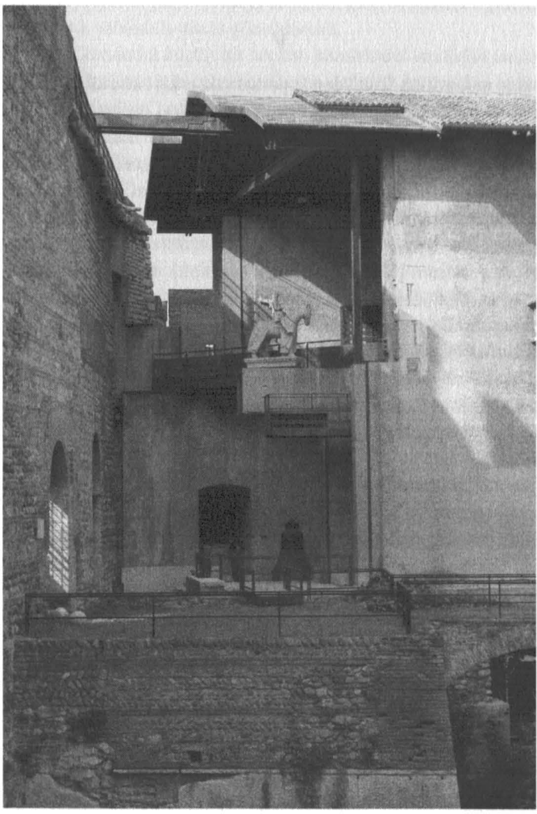

*卡斯泰尔韦基奥，维罗纳：一件从13世纪延续至今的建筑连续性产物。建筑师：卡洛·斯卡帕。*

〔原书第215页〕

拿着当代城市平面图的人，能粗略读出那里严重变形的古罗马网格。但无法确定其上的建筑与古罗马的联系。所有时代的建筑，在城市尺度上以及每一座建筑身上，都构成一个混乱的超时间整体。此外，由于意大利文物保护者和修复师非常喜爱的一种做法，某些建筑表面从中世纪到今天的时代痕迹有时被强调性地揭示出来。一座看起来不像19世纪以前的老建筑，其某些底层窗户带有13—14世纪哥特痕迹，上层却遇到16世纪晚期文艺复兴的窗框细节，这并不令人惊讶。

整座城市仿佛就是位于同一地点的卡斯泰尔韦基奥——一件卡洛·斯卡帕的修复与新设计作品。[40] 这座历史可追溯至13世纪、延续至今的城堡（校注：底本及前页图注如此。[博物馆官方建筑史](https://museodicastelvecchio.comune.verona.it/nqcontent.cfm?a_id=43066)将城堡本体建造时间记为1354—1356年，同时说明它利用了更早的城防与建筑遗存），于1958—74年间由斯卡帕修复，被处理为各个时期、细节、技术、风格、空间的混合体，其中没有任何一项被赋予足以压过相邻者的特殊重要性，并被重新功能化为博物馆。在这个几乎独一无二的综合体中，很难轻易判断旧在哪里结束、新从哪里开始。博物馆及其全部设施无碍地服务于当代需求。但它并非全新。更不是被置入一座旧建筑内部的新设计。在同一空间中，全部时间性共同存在，但其中任何一种都无法被单独体验。日常生活，以及思考过程，在最一般的意义上也恰恰如此。不存在能够从认识论真空中从零开始社会与个人生活的绝对新生产。这一点我们多少知道。我们不知道的是，绝对意义上的旧也不存在。我们不愿去想，每一个可被界定为旧的对象和思想，都被一个感知、理解它们的当代主体更新过。人们忽略或无视的是：在它们“真正地”新的那个时代，它们并没有以同样方式被感知、被理解、被赋予意义，也没有受到同样的审美判断。使一切怀旧成为可能的，正是这一点。使旧事物获得当代审〔原书第216页〕美、意识形态与文化权力的，也是同一种无视。总之，旧没有自身的特殊价值。它有被赋予的种种新价值。意识到这一点能带来什么？变化就是以破坏来建造（yıkarak yapmak）。它通过过去存在且有效之物的消失或失效而发生。这并不意味着世界每天都从一块白板（tabula rasa）出发被重新建立。恰恰相反，新总是在旧之上建立，但不断侵蚀它、使它变形、使之成为另一物、扭曲它……旧从未死去，但它被如此扭曲、如此异化，以至于只有专家才能辨认出它的古老渊源。

# 第二部分　建筑的枷锁

〔原书第217页〕

〔原书第218页〕

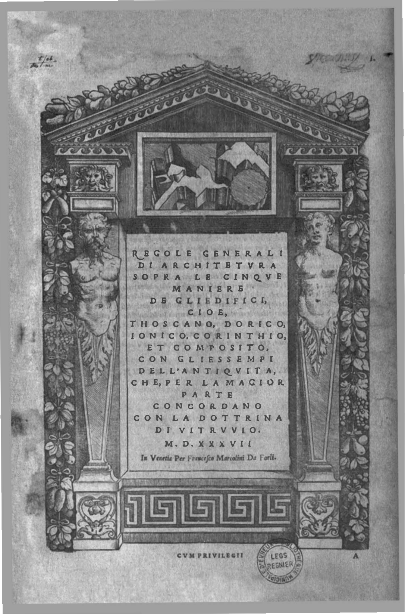

*整页图片：塞巴斯蒂亚诺·塞利奥，《建筑通则……》第四卷，威尼斯，1587年（校注：书内图源表如此记载；所印标题页的罗马数字为M.D.XXXVII，即1537年），标题页。塞利奥把其时代的建筑语言表达为一部庞大的图集，为建筑师提供了一套可以不断“模仿”的数据总集。*

## IX　模仿

〔原书第219页〕

建筑的消费者（和／或委托人）的头脑中有种种形象。他们借助这些形象选择、要求、喜欢或不喜欢。建筑师的头脑中也有形象。他们用这些形象进行设计。然而，建筑师头脑中除了形象之外，还有职业伦理、职业意识形态、行话和话语。他们借助这些来思考、批评、判断、定罪。仅凭这一点就可以说，当代世界中消费与设计、消费者与设计师之间存在一种不对称。消费者通常只了解形象，而建筑师与形象建立的关系受到伦理、意识形态与话语性“职业良知”的监督，它几乎像一种本我（altbenlik）那样运作。因此，建筑师难以把业主视为恩主。阻止他轻易接受业主要求的那些障碍，即便不总是阻止一切妥协，也监督着一切妥协。然而，还必须谈到另一个与建筑师这些自我监督机制相矛盾的事实：形象借助无数传播渠道和工具自由流通。五百年来，印刷术的发明、廉价书籍的诞生、图像媒体的出现、建筑杂志的兴起，最后是数字媒体的主导，这些变化不断加速形象的流通。没有任何权威能够阻止形象的流通，直到形象来到建筑师的门前……〔原书第220页〕阿多诺曾以颇为不公的方式加以谴责和界定的文化商品化时代[1]，也赋予建筑形象可买卖的性质，并像当代资本主义体系中的一切商品和价值一样赋予它们流动性。它们也只是这个商品世界中的一类商品。现代性摧毁传统意义结构，却不以新的意义结构取而代之。建筑形象意义的被掏空也是这一变化的一部分。最终，形象几乎从它的文化联系和语境中被解放出来。因为它几乎不对任何人表达任何东西，所以可以在任何地方存在，可用于任何功能。可见，意义丧失与“流通自由”、商品化紧密相连。换句话说，形象越商品化就越流通，越流通就越无意义，越无意义就越流通。当然，它们可能看起来像是有意义的；但它们的意义实际上在于能够流通。意义并非内在于形象。然而，曾经有一些时代，人们可以相信意义内在于形象。京都龙安寺的枯山水庭院在禅宗佛教语境中是有意义的。哥特式主教座堂立面上的雕像除了描绘一群人之外，还作出可读的宗教指涉。但例如野口勇在1950年代设计的沙庭，仅仅指涉龙安寺及类似的古老沙庭。对当代人来说，几乎只有它们从日本出发的流通旅程才有意义。我们知道它们处于流通之中，正因如此它们才能来到美国。这种意义生产过程甚至不像17世纪建造龙安寺的人的意义生产过程。（校注：底本将年代定为17世纪。[日本国家旅游局介绍](https://www.japan.travel/en/spot/1145/)明确指出石庭起源与作者仍有谜团，并介绍约1500年、室町时代末期的造园说；不宜将17世纪视为已确定的建造年代。）在这些过程中，媒体扮演中心角色。正因如此，人们认为文化产业或文化的商品化是与大众媒体机构的出现同时被提上议程的。[2] 从19世纪中叶开始，先是欧洲和美国的资产阶级，随后是全世界，先是借助大规模生产的版画、画报和廉价图画书，后来借助电影、电视以及最终将传统文化产品意义彻底虚无化的大众旅游（也就是直接去看），把大量形象填进头脑中的回收站。对媒体来说，这些只是可供出售的视觉材料，是商品。旅游也出售同样的商品。寻求更精细分析的人，可以求助于克拉考尔全面解释旅游如何是一种无内容的观看经验、其目的并不比“为看而看”更深刻的文本。[3]〔原书第221页〕对于在头脑中收集这些图像碎片、形象的人来说，除了视觉上可辨认之外，它们没有任何真正的意义。它们只在名义上被认出。一种全新的视觉知识出现了。稍有世界见闻的欧洲人和美国人，如今一看到帕特农神庙、一座埃及宣礼塔、泰姬陵，就能立刻认出来。他们对这些对象唯一的了解，就是认出它们。帕特农神庙对古希腊人、宣礼塔对马穆鲁克人、泰姬陵对17世纪阿格拉人意味着什么，只有专家才关心。在艺术史发明图像志—图像学分析实践之前，连专家也几乎不关心。20世纪则在流行媒体之外，又加入了特定领域专门化的新媒介。装饰与艺术—设计杂志对形象商品化进程作出了新的、在建筑领域尤为巨大的贡献。20世纪初，马塞尔·布罗伊尔在匈牙利佩奇城的父亲家订阅了英国《The Studio》杂志，而家中没有人懂英语。[4] 布罗伊尔一家显然也像数百万欧洲人一样，只把这类杂志视为视觉资料库。〔原书第222页〕图像与形象的贸易不仅面向街头普通人。还有一种面向职业圈的更细致、更全面、更精细的贸易。专业媒体不断向建筑师出售形象。被从语境中剥离、进入国内和国际流通的图像，构成一个真正的贸易领域。不仅是职业杂志，还有很大一部分除了作为图样书（pattern book）使用之外别无目的的书籍，以及近年来的互联网，都从事这种贸易。然而，即便在19世纪最后四分之一，也已有摄影师专门向建筑事务所出售可作范例使用的照片汇编。重要罗曼式、哥特式和文艺复兴建筑及细部的图像就这样流通。

一切视觉传播工具都必须阻止形象构成有意义的、至少具有内在一致性的整体。因为视觉化意味着把被视觉化的三维现实从其所属整体中隔离出来，并在二维中再生产。这揭示出平面—剖面—立面、透视和画法几何等再现技术的发展，以及最终摄影的发明，与形象商品化之间多么紧密地相连。建筑现实失去传统意义，与它们被转化为这种可再生产的“寻常”几何描绘有关。几何投影技术所创造的现代再现工具和摄影，也像对其他事物那样，对建筑进行“祛魅”。在前现代世界，关于建筑现实的知识主要借助口头和文字工具生产和传递；这些工具在传递形式知识方面的有限能力，使接受者和传递者都无法只专注于形式。在那种情况下，他们不可避免地会把精力集中于他们有能力生产和传递的文化意义。因此，对于透视和一般意义上的文艺复兴视觉革命之前的人来说，谈论建筑与其说是描述建筑的形式特征，不如说是谈论其社会意义。在这样的时代，建筑仍受魔法笼罩。然而，再现技术只能以几何现实的框架把握和再生产建筑。更确切地说，它们把建筑现实几何化，因为它们正是为这一目的而制造的。但这种把建筑从其社会性中剥离的几何化活动，同时也使建筑失去语境。从最初那些通过视觉化来“出售”古代建筑形式的文艺复兴插图建筑论著开始，媒体正是由此分解了建筑现实。例如，对古希腊罗马建筑师来说，并不存在一个可以脱离其所处建筑整体而独立看待的多立克、爱奥尼或科林斯柱式。文艺复兴建筑文献恰恰相反，把这些柱式分解为要素。意大利建筑师维尼奥拉在16世纪准备的这样一部图解系统化大全，[5] 甚至在20世纪初仍是建筑学校的基础教科书。〔原书第223页〕逐渐地，形象获得了相对于其所属家族的如此自主的生命，以至于从19世纪最后四分之一开始，摄影师专门拍摄旧建筑及其细部，以成套方式向建筑师出售。如果只从纯粹建筑形式的世界来看，摄影师分解的东西将由建筑师重新组合；建筑师的工作正是如此。

此后时期，形象贸易的内容几乎没有变化。只是对被拍摄对象的偏好改变了。建筑要素从其共同构成的整体中分离出来，不断被还原为纯粹的形式单元，另一方面又在所谓设计的过程中被重新聚集、组合。最一般地说（而且相当夸张），可以说15世纪之后建筑师除了做拼贴之外别无选择。一切设计活动在本质上都意味着：从“自由流通”的形象中进行选择，把它们原样和／或变形地聚集起来，以构成新的整体。人类心灵能够不断生产前所未有的新形式这一古老的早期现代神话，早已被放弃。然而，界定建筑师职业人格的意识形态、话语和伦理原则，与设计是一种拼贴生产、一种重组工作这一事实相矛盾。〔原书第224页〕建筑师难以把重组与拼贴作为寻常的事实来接受。建筑伦理和建筑话语中的一些（大多数）回避把利用形象自由流通、生产新混合物的做法合法化。形象可以自由流通、买卖，这是合法的；而从它们中作出可辨认其来源的选择，却是不合法的。人们期待所有那些形象只被看见、被认识，但几乎永远不被纳入新设计。建筑话语的重要部分努力教导建筑师如何在这场形象倾泻之下保持干燥。建筑思想领域之外已无任何有效性的陈旧廉价训诫被不断重复：“建筑师应当从历史中学习，但不应重复它，不应引用它”；“建筑师应当发展自己的视觉文化，但不应偷窃”；“应当远离建筑时尚，因为建筑不是时尚的话题。”原创性、创造力、创造符合时代精神的形式、避免模仿等标题所能概括的一整套早期现代主义概念体系，与否认形象自由流通和自由占有的努力相关联。或者更悖论地说，正因人们知道形象的自由流通无法阻止，才只试图阻止建筑师占有它们。也就是说，建筑形象是个多么奇怪的物件：可以自由买卖，却禁止使用。总之，它就像大麻之类的东西。这一切禁令的知识背景有着复杂而漫长的历史，足以成为独立研究的对象。从希腊语mimesis到拉丁语imitatio，再到文艺复兴及之后西方语言中的imitation，人们不断生产新的解释与新的理论理由。[6] 本处既不讨论那些思想努力，也不讨论土耳其从19世纪下半叶开始对“taklit”（模仿）概念的现代建构。

〔原书第225页〕

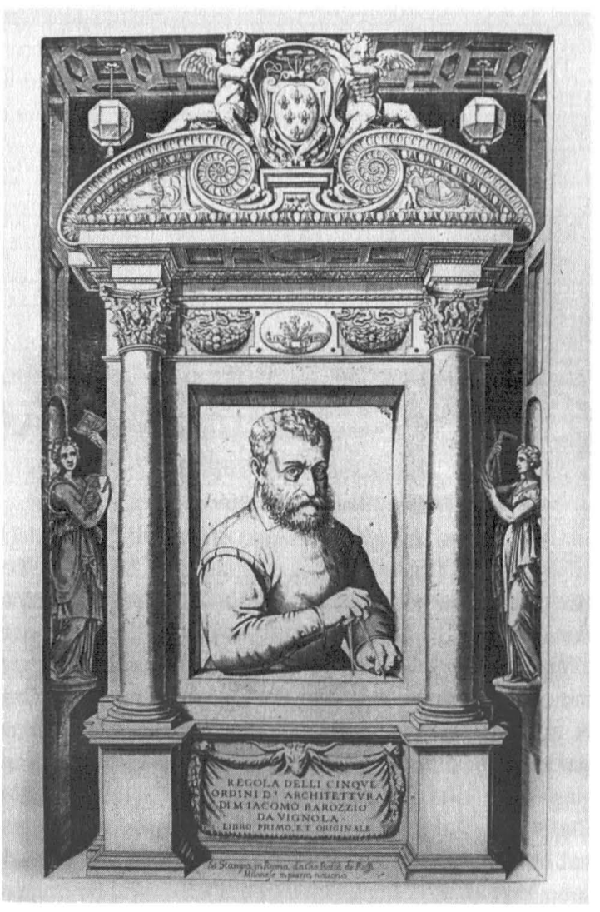

*一部将古典建筑细部编成规范、沿用超过400年的图样书（pattern book）的无数版本之一：贾科莫·巴罗齐·达·维尼奥拉，《五种建筑柱式通则》，锡耶纳，1635年（？）。*

〔原书第226页〕

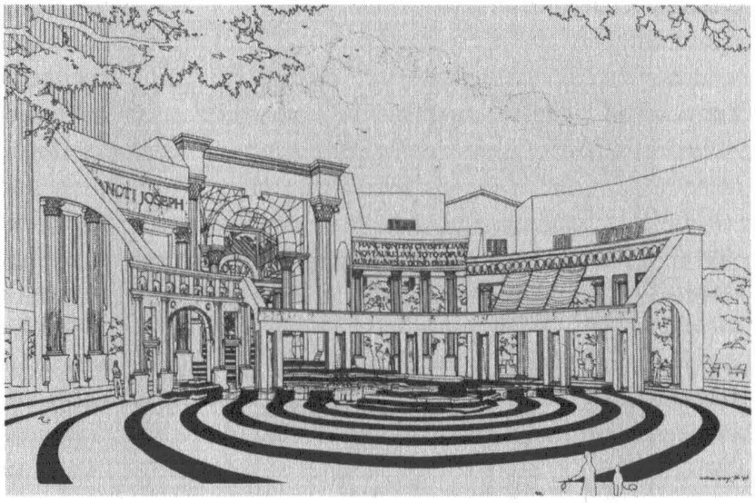

*新奥尔良的意大利广场。建筑师：查尔斯·摩尔。*

在这种情况下，人们会寻找并找到逾越任何禁令的途径。建筑的伎俩、诡计被发明出来，规避教法的权宜手段（hile-i şer'iyeler，此处借指“合法规避手段”）被使用。基本上有两种“合法规避”类型：第一种，取用自由流通中的形象，加以使用，但进行小小的伪装，阻止它们被认出。通过细微变形，使其来源难以被把握，或者把它们的细部清理得如此干净，以至于被“磨平”得像鹅卵石。就像刮掉赃物梅赛德斯汽车的发动机—车架号一样，建筑形象也接受同样处理；为防止被认出而采取改变其面貌的措施。更好的是，使用明显并非源自单一来源的复数形象库。在这一语境中，建筑界与日常生活的运作方向相反：只抢劫一个地点的窃贼会立刻被抓，因为他的赃物人人认得；而把袋子里的东西充分混合的人，其形象却并不容易辨认，甚至可能因此受到赞扬。前者不可避免地会被贴上模仿者的标签。后者甚至可能获得原创创造者的地位，因为辨认其重组作品的组成部分需要长时间细究。〔原书第227页〕从流通形象进行重组，在职业舆论中，这两种情况各自获得不同的合法性基础。第二种“合法规避”方法，则是创造话语，使自由流通形象中某一特定部分的使用合法化。某些后现代主义者为历史主义找到文化主义外衣的话语就是如此。尤其在不发达世界被提上议程的、带有保护身份焦虑（实际上是建构身份）的传统主义话语，也指向大致相同的目的。借助它们，从空中飞舞的形象中选出某些进行重组的道路已被合法化。第一种态度使查尔斯·摩尔在意大利广场中的形象杂烩合法化。第二种则为那些说“我们应当捍卫自己固有的建筑价值”的人那种天真的历史主义准备了地基。所有这一切，都是阿多诺所谓“文化商品化”这一发展的建筑后果与副产品。最终要问的问题是：在文化商品化和形象自由流通的时代，能否对原创性、模仿、复制、创造力等概念作出真正有说服力、可信、更重要的是“有用”的建筑定义？当这些概念的惯常定义被用现实世界的数据来审视时，难道不是揭示出：原创性已成为一场梦，模仿成为寻常实践，复制成为日常活动，创造力成为幻觉、甚至欺骗？没有捷径式答案。但有一点确定：建筑世界的话语、意识形态和道德判断，与现代世界的文化现实相矛盾。而建筑实践则过度忙于应对这些矛盾的权宜伎俩。要走出这一困境，似乎别无选择，只能改变、更新我们的职业—思想—话语基础和概念。

〔原书第228页〕

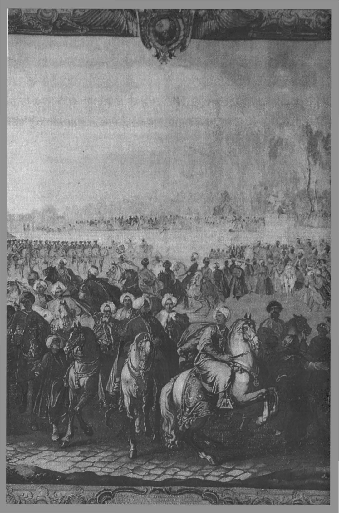

*整页图片：Atelier Lefebvre et Mommerque，1734—1737年。*

## X　无法遗忘的东方主义

〔原书第229页〕

*与西方相遇也有其神话。例如，“二十八”穆罕默德·切莱比出使巴黎一事很快便获得了这种性质。其实，把此事作为奥斯曼人和法国人两群人相互近距离体验、彼此好奇的过程来书写其历史，会更有成效。当时的一幅挂毯描绘了切莱比离开杜伊勒里花园的情景。*

一位日本人冈仓觉三在1887年结束长期海外旅行回国后，问同胞：“西方那所谓本质，究竟在欧美哪个国家？”他说，“所有这些国家都有不同的制度；在一个国家正确的事，在邻国却是错误的；宗教、习俗、道德全都不同。”[1] 大约一个世纪后，1986年（校注：正文年份如此，原注2则作1987年；该书[版权页](https://api.pageplace.de/preview/DT0400.9780195364330_A23604276/preview-9780195364330_A23604276.pdf)记1987年），法特玛·米盖·格切克在《东方与西方相遇》一书中讲述18世纪奥斯曼—欧洲关系时，作出大致如下的判断：“使节在奥斯曼帝国和法国的效果彼此极为不同。在法国，影响是暂时的，表现为制造某种时尚，并迅速消逝；而在奥斯曼国家，其影响却长久而广泛。”[2] 第一位观察者似乎早在19世纪结束之前就意识到，西方—东方这一极性是多么单薄。他指出了一个不可能性：把彼此极为不同的国家／文化置于同一个“西方”定义之下。显然，他对东西方二分法持怀疑态度。一个世纪后〔原书第230页〕发言的是一位学院派历史学家，而且是一位有重要成果的严肃历史学家，却说两个不同的文化领域以几乎不可调和的方式互相感知。看见西方的奥斯曼人，被呈现为比看见东方的法国人引发了更广泛变化的人。显然，这一呈现尤其以“二十八”切莱比·穆罕默德（Yirmisekiz Çelebi Mehmed）为中心，并被纳入关于他是奥斯曼西方化最早代表之一的传说。何况，写下这些话的书名就是《东方与西方相遇》，所以读者可以猜到，格切克并不打算在书中讨论、问题化这种区分。这里要尝试问题化的，是东西方分裂以及它在土耳其被作为一种历史书写范式使用的方式。在全球范围内，如何可能不依据东西方极性范式来书写文化关系史？有趣的是，可以说它的时尚早已过去。爱德华·萨义德讲述并猛烈批判世界被如此对立二元地思考的历史背景，已近半个世纪。[3] 如今已达到巨大规模的后殖民社会科学文献，似乎半个世纪以来一直在把东方主义打得粉碎。但甚至不能说东西方这一建构已被侵蚀。然而，如上面的例子所示，甚至在19世纪晚期，就已有人说它是建构。格切克的表述不仅指向18世纪，也指向一种几乎直到今天仍被认为有效的东方—西方文化关系动力学。因此，它是一个讨论这种历史书写范式的合适起点。首先无疑，这一范式所界定的东西方关系被书写为一种不平等关系。但除此之外，它还示范了一种早该退出议程的历史书写理解。它书写历史时，仿佛我们拥有作定量比较的可能。使节〔原书第231页〕在法国和土耳其的影响作重要性比较，被呈现为一种寻常的历史书写实践。这种有趣的“伪理性主义”在历史书写中经常遇到，因此不被诧异；可是，一个戴人类学家帽子而非历史学家帽子的人，很容易说明不同文化间相遇不能用“同一单位”衡量和比较。不同的主体在不同地方、与不同事物、与不同主体、在不同条件下相遇，会有不同结果和不同的连带后果。每一次相遇都必须在自己的特殊语境中审视。然而历史学家常常忘记，他们并未在等价条件下进行实验室实验，因此不能比较结果。不过，也不宜急于断言这是一种普遍的职业变形。〔原书第232页〕历史学家是在东西方范式给予的自信下作这种比较的。因为世界借助这一范式仿佛从正中被一分为二，历史学家也仿佛站在正中的分界线上说话写作。仿佛他同等清晰地观察和评价两边。然而，同一个想象的位置并没有引导历史学家以一种对称方式书写。例如，一位稍具创造力的历史学家本可以提出，用类似术语处理法国所谓“Turquerie”的法国异国情调，与土耳其今天也许可称为“Europerie”的18世纪及19世纪初奥斯曼异国情调。几乎同一个世纪里，奥斯曼上层阶级开始对某些异国欧洲形象和物品感兴趣，欧洲也对异国奥斯曼形象和物品感兴趣。例如，奥斯曼上层妇女成了某种欧洲瓷器的收藏者。[4] 欧洲瓷器在这里的存在，应当让现代历史学家想到的不只是日常需求的满足。哈蒂杰苏丹与梅林的关系及其设计后果，也完全可以被理解为一种特殊的异国情调。[5] 一位让建筑师在宫中建造欧洲新古典亭阁、[6] 出于好奇向自己的建筑师订购沙发的奥斯曼人，其目的无疑不同于一位让画家为自己画一幅穿奥斯曼服装肖像的欧洲女性；但也应当问：她在何种方式上不同，又在何种方式上相似。半个世纪前坦皮纳尔所说的、18世纪奥斯曼人与西方人“互相品尝”的精彩判断，本可以在同一语境中激发更富有成果的阅读。“品尝”这一隐喻不带任何意识形态指涉，只关乎体验、好奇、从与所知甚少之物的相遇中获得愉悦，它为理解文化变化

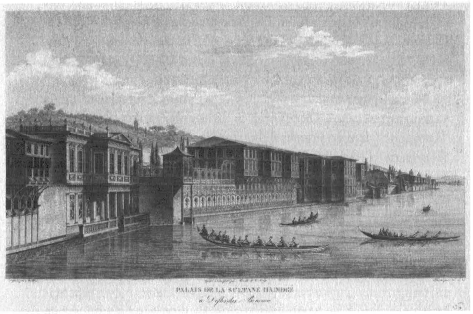

*奥斯曼人在“品尝”西方：画面左侧可见的哈蒂杰苏丹宫的小型新古典亭阁，应是奥斯曼对欧洲的异国情调的第一个例子。建筑师：A. I. 梅林。*

〔原书第233页〕

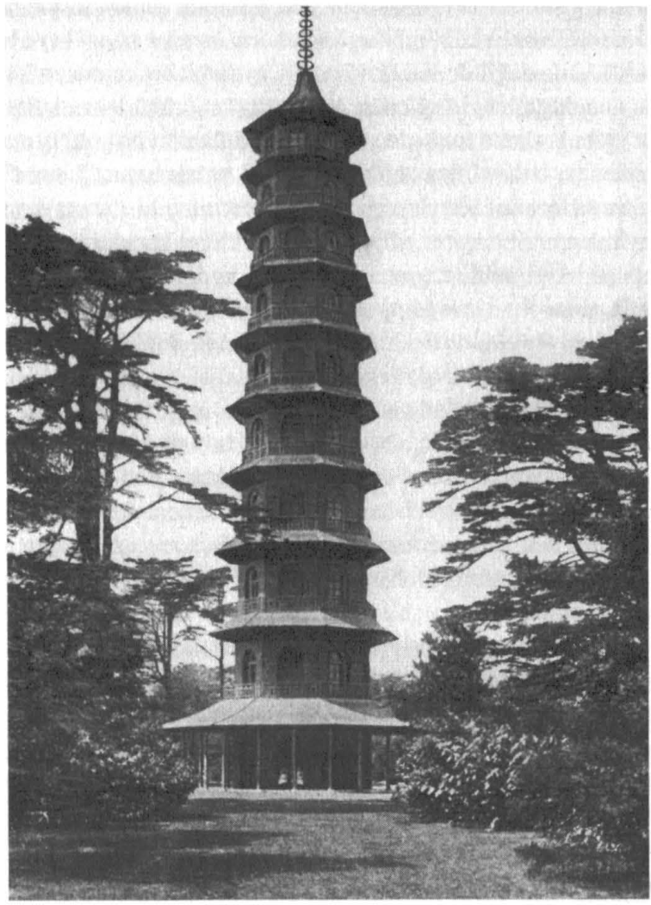

*英国人在“品尝”东方：一张旧明信片上的伦敦附近邱园宝塔（1761—62）。建筑师：威廉·钱伯斯。同一地点，同一位建筑师还建造了一座清真寺。*

〔原书第234页〕

提供了新的可能。社会科学家常常宁愿认为，文化相遇不是发生在主体之间和特定场所，而是仿佛发生在一个抽象的文明环境中。诸如acculturation（文化化、文化适应）这类带有强制暗示的术语的使用，也许是这种进路的结果。然而，“互相品尝”以及单独的“品尝”这一隐喻，只指向对事先并不了解其滋味之物的体验。这就在把文化相遇历史化时，消除了将其升华、将其归结为意志决定的执念。那些进路总用“阻止衰落”“技术知识转移”“弥补军事损失”“现代化”“西方化”等标签，为每一种源自欧洲、加入奥斯曼和土耳其文化的新事物赋予意义并使之正当化；“品尝”的隐喻为此提供了一个值得认真对待的替代方案。与那些进路相反，它使相遇寻常化。“品尝”的原因，可能并不比试图理解所面对之新事物的滋味更复杂。最重要的是，也完全可能得出结论说，被品尝的东西只是美味，并将其内化。当然，也存在无数相反的情况。此外，坦皮纳尔这一隐喻还提出一种对称性。双方不是单向地，而是可以互相品尝对方。这与那种赋予权力关系以夸张重要性的东方主义理解多么不同，显而易见。品尝并不需要比好奇、愉悦更崇高、更神圣的一面。尤其，它让人有可能认识到：文化、文明、民族并不相遇；相遇的是主体，是真实的、寻常的人。[7] 文化变化的故事，应当是他们在一个个具体时间—空间中这些再寻常不过的相遇、品尝、尝到或尝不到滋味的状态的故事。

如此朴素的历史书写对称性，在文本中几乎遇不到。相反，在格切克以及许多人的推理中，一种明显的不对称引人注目。也就是说，在这一双边关系的历史中〔原书第235页〕奥斯曼从欧洲取得、学到的东西构成轴线，而当涉及欧洲从别处取得、学到的东西时，历史叙述的轴线由学习者构成。前一种情况的故事，是欧洲起源的物品的故事；后一种情况，是欧洲主体的故事。对了解土耳其以及一般非西方国家意识形态刻板印象的人来说，稍微夸张地说：如果是欧洲人，那么向“他者”学习的主体是在做一件寻常的事。如果涉及奥斯曼、土耳其、一般非欧洲主体，那么向“他者”学习就极容易被问题化。向“他者”学习几乎是一种可耻无能的表达。学习使奥斯曼—土耳其—东方主体遭受文化异化。例如，他可能不理解（！）就模仿。甚至人们常常相信他大多如此。他在否认自己的本质。他在与自己的文化异化。伊朗保守思想家，例如贾拉尔·阿拉赫迈德（Jalal Al-e Ahmad）认为，他是一个“Garbzede”（被西方击中的人）。[8] 要注意这个术语的冲击力。他被西方击中了。其最接近的类似词也许是“地震受害者”或“灾民”。应当问的问题则是：为什么不能把文化关系仅仅视为观念、话语、物品、人工物、实践、形象，当然还有人，在寻常而无尽运动中的流动？为什么无论从什么来源、学习任何东西，都不能只是学习？如果养成提出这类问题的习惯，本可以产生广泛的历史书写可能性；然而却未能产生。这种历史书写可能性的无法使用、其延伸与连带后果，爱德华·萨义德在大约40年前讲述并开创了一个时代。从他到霍米·巴巴和迪佩什·查克拉巴蒂[9]〔原书第236页〕的这段时间里，我们不再把东西方二分法视为历史真实本身，并对所谓东方主义的霸权性历史书写进路作批判性阅读。但东西方二元性作为一种范式，仍未退出议程。它在流行媒体中不断被重新生产。学术界即便不再像从前那样轻松地说出东方和西方这些词，甚至对此特别谨慎，却仍然在不点明它们的情况下继续谈论那旧的二分。显然，人们仍相信存在两个彼此对立的文化世界。即便是我从严肃、自由派、重要的学院派历史学家法特玛·米盖·格切克那里引用的段落，也表明我们多么顽固地无法放弃这种已黏在语言上的话语。何况，即便不使用东西方分裂话语，至少在土耳其，与不同文化地理建立的关系中，与欧洲和北美建立的关系仍被置于一种不同于其他的历史书写范式之下。这就是上文简要描述的不对称的理解范式。已知许多国家也有类似进路。就这里的特殊情况而言，与欧洲建立的文化纽带被评价为一种激进的、异化的转变，而其他的则被贴上“文化关系”的标签并寻常化。把那种被视为激进的转变放在“西方化”术语框架中思考，则从不被诧异。也就是说，一种由“我”以及被想象为其镜像的“他者”构成的二元意识形态建构被建立起来。此外，在这一意识形态构造中，“我”想以其（按意识形态主张）“扭曲”的意志或通过强制，脱离自身、变成自己想象的镜像，即西方化。在这一过程中，自愿与强制两极按政治立场被提上议程。有人认为西方化是不可避免的命运，有人则把它视为受骗、愚昧导致的一种取向。但两极并不像想象中那么不同。保守派显然反对他们视为“异化”的这一状况。但左倾者也在同一领域中不安。例如，我不知道有哪项研究从马克思主义视角全面问题化东西方这一建构。把东西方二分法当作既定事实，并把自己描述为处于东方〔原书第237页〕内部，显然就很难另作思考。因为在该语境中界定的一切变化，都会获得“东方想要成为西方”这样扭曲的性质；所有保守思想家都指出这是精神分裂状况。这样看，他们也有道理。如果主体想变成自己所定义的“他者”，就会出现不可调和的矛盾。其结果就是：把某些文化关系视为“使我们成为我们”的文化化过程，而把与西方建立的关系通常描述为“使我们脱离自身、异化我们”的影响。因此，重要的不是学到了什么，而是从哪里学到的。如果东西方二分法的第一部分向第二部分学习，问题就产生了。东方最好向东方学习。举例来说，没有一个当代土耳其历史学家会问题化16、17世纪什叶派—逊尼派冲突极具破坏性的时代仍然十分活跃的伊朗—奥斯曼文化关系。18世纪末似获得新动力的埃及—伊斯坦布尔关系也未被问题化。例如，当时萨杜拉阿迦以“那位埃及美人将娇媚地起舞”（Raks eyleyecek naz ile ol afet-i Mısri）这句歌词将这一情形写入歌曲；正是这一情形，使今天甚至存在一种称为“土耳其肚皮舞”的“民族”实践。然而肚皮舞是18世纪晚期至19世纪初从开罗传到伊斯坦布尔的，恰恰是一种“外来”文化实践。但无论与伊朗建立的文化关系的结果，还是从埃及输入的做法，抑或源自叙利亚的果仁蜜饼，都不被视为文化异化的证据。它们早已是“我们的”。例子可以增加。鲁米利亚出身的土耳其人和锡尔特人也都会做一种他们称为“Büryan”的肉饭，远在一万公里外的孟加拉也吃，在那里叫“Biryani”。他们一天也不会认为自己吃了一顿“盲目崇外的外族饭”。然而，如果建议同样这些人做“波尔多酱汁肉”或“马赛鱼汤”，他们无疑会问这种装腔作势的要求是从哪来的。如果被视为异物的是“马赛鱼汤”（bouillabaisse）而不是“比里亚尼肉饭”（Biryani），原因也许首先在于，从接触至今所经过的时间，肉饭较长、马赛鱼汤较短。接触肉饭已经久到足以将其内化，而马赛鱼汤则没有。然而，这会是极具误导性的解释。若这样看，土耳其的文化变〔原书第238页〕化中复杂的政治就无法理解。因为内化和据为己有的过程不是由时间间隔之宽窄和古老程度界定的，而是意识形态性质的过程。某些实践和事实容易内化，某些极难或根本不被内化。恩德鲁尼·拉西赫在18世纪晚期或19世纪初写的一首“şevkiyye”中说：

> 他们端来金色的酒，说“先生，请喝吧”；
> 那位玫瑰般的人时而喝波尔卡［伏特加］，时而喝拉基，时而喝朗姆酒；
> 而“神父黑”（Papazkarası）酒也成了这场宴席的亲密伴侣。[10]

18世纪伊斯坦布尔饮用的伏特加和朗姆酒，甚至“神父黑”酒，仍未被像拉基那样内化；也未被像埃及起源的肚皮舞那样内化。如果想到两次相遇几乎同时发生，就会明白差异不是年代性的。将其视为异物的原因不是间隔时间较短，而是其起源属于被标为东方或西方的文化地理。差异来自用不同意识形态眼镜看待实践与物品的来源。这一偏好不仅对土耳其，而且对几乎所有试图把自己置于“西方—东方”二分法中的社会，大概都在某种程度上有效。

那么，是否可能发展一种不同的历史—文化理解？更重要的是，它是否必要？是的，必要。为此，只需把一切文化关系理解为“仅仅”寻常的相遇。一切文化关系与影响，无论源自哪里，都只是与迄今尚未认识的人、实践、话语、物品、形象相遇。一切变化都不过是阿尔君·阿帕杜莱书名所说的“物的社会生命”中的一个阶段。[11] 如果与学习同义的“物的社会生命”被寻常化，就能理解所谓“西方化”过程产生的创伤并不与其他变化产生的创伤有多大区别。甚至可以领会，那种创伤是想象的。它只是由意识形态动力无尽地重新生产出来。然而，恰在要生产这种寻常性知识时，〔原书第239页〕就会面对必须克服一系列历史书写困境的压力。我想简要概括为两组：

无论与谁、与哪里建立文化关系，要谈论其寻常性，首先必须摆脱19世纪残余的文化定义。只要文化是赋予一个群体、尤其一个民族身份的价值总体的陈旧民族主义浪漫定义仍然有效，向他人学习和“品尝未知”就仍会被视为问题。更重要的是，社会永远无法摆脱把其他社会他者化。只要文化继续被视为一个为区分“我”与（福柯意义上的）“他者”而定义的封闭系统，向“他者”学习当然就会被视为严重的败坏原因。这样做时，“我”就沦为破坏赋予其身份、自我之系统内在一致性的叛徒。所有保守思想路线几乎都由识别这种背叛的策略来界定……这种极权主义的文化理解——因为它旨在把每个人关进自己特定的民族和／或族群和／或宗教监狱——显然必须被放弃。必须赋予文化那个包容而解放性的定义：“人在自然中已有之物上添加的一切。”这样做，就有可能使文化脱离其古老的神圣性，把它安置到所属之处，即社会性之中。人们会看到，文化只是使作为社会存在的人得以生活的一套实践、物品、思想总体。人们会理解，文化是人及社会的寻常功能：它不断变化、不停转变，因新事物加入而丰富，因遗忘而贫乏；人和社会每时每刻都在同时做着这两件事。也就是说，必须移除对文化定义的那种霸权性强调。文化是使我们成为我们的东西，但更重要的是我们制造文化。文化生产我们，但我们也每时每刻生产和再生产文化。总之，文化不是被保存和固定的东西，而是被做成的东西。追问这种生产所用材料的来源，既不必要，也不可能。稍长远、稍细致的历史书写分析〔原书第240页〕能够辨认出每一种文化现实、每一个“物”在其生命的前一阶段属于别处。可以提出一些摆脱这一点的战术；但最终不可避免地会延伸到毛泽东时代中国人类学所依据的荒谬地步：那里几十年来认真主张，地球上所有人都是智人这一物种，但只有中国人是由北京猿人（Homo erectus pekinensis）起源的另一个物种。（校注：底本如此，本章未给出该历史判断的文献出处，尚未核实其所指的具体学者与文本。不能把现代人起源的多地区进化假说直接等同于“中国人另属一个物种”的主张。[中国科学院古脊椎所的吴新智生平记录](https://ivpp.cas.cn/tzgg/202112/t20211205_6288039.html)所述多地区进化说及连续进化附带杂交说，分别提出于1984年和1998年，也不能直接用来证明这里对毛泽东时代的概括。）看来，对文化特殊性的坚持，几乎总是会升级为对种族特殊性的坚持。

要像上文所建议的那样对文化定义作广泛修改，还必须放弃文化事实之间的价值差异、等级—范畴区分。显然，这是维持东西方区分的基本参数之一。如何问题化一切文化关系，长期由物质与精神之间划定的界限界定。甚至至今仍然如此。土耳其几乎从坦齐马特以来生产的话语，都提出能够把文化范围内的物质与精神、思想性事物与对象性事物、技术与文化分开的主张。物质性事物及相关事物的流通、转移被问题化的情况很少。而精神性的、例如齐亚·格卡尔普所谓“hars”（文化的）东西，只属于“我们”。它不容易改变，也不应改变。然而今天，必须永远从社会科学议程中删除把具有思想、精神、智力等时髦标签的事实与物质文化数据这类事实分开、并用不同参数来思考的做法。理由只有一个：识别物质与精神，与人们所想的相反，几乎不可能。不能作出文化之外与之内这样的区分。在此语境中可以指出，“物”概念近年来作为新的理论可能被提上议程。以埃丝特·帕斯托里的《与物一起思考》一书，[12] 以及赫纳雷、霍尔布拉德和瓦斯泰尔编的《通过物思考》[13] 等研究开辟的道路上，[14] 已经表明，有生命—无生命、物质—精神的二分是可以而且应当被超越的。〔原书第241页〕就对社会与个人生活的影响而言，就产生变化而言，所有“物”都同等有效和重要。把实践、思想、话语、对象全都视为“物”的思考道路似乎已经打开。人们也逐渐理解，物从一个地方到另一个地方、从一个时代到另一个时代的搬运，界定了一个多么有趣的研究领域。这些搬运过程使东西方这类简单天真的区分失效。

如果推进这两个极其广泛的理论可能，就更容易看到文化关系只是“物”的无尽运动。我们会意识到，社会、人，即文化的主体，生产、品尝、学习、使用、传递那些无尽流动的“物”，也能遗忘并摧毁它们。如果把这些“物”放在“占有”“据为己有”“学习”“使用”“变化”等概念框架中考察，就不仅能获得对土耳其历史和建筑的不同寻常理解，还可能使一般文化互动史摆脱某些执念。

首先，可以不再把变化、转化、西方化、身份丧失等概念置于中心、当作主要行动者，不再把“物”仅仅视为前者的结果。我们习惯于在一条把社会变化的名字、指示它的术语置于前台的思想路线上前进。我们谈论社会学和历史书写文献以持续固执加以理论化、历史化的过程。关于这些过程的文献讲述世界西方化、欧洲化、东西方分裂、现代化、世俗化、激进化，以及更多变化—转化。而“物”则仿佛在这些过程〔原书第242页〕框架内被理解为沿途遇到、进入流通、使用、被占有、被学习的东西。也许其极端例子是“文明冲突”一词。这是一种把一切主体想象为由“自己属于某个文明”的意识所界定的存在者的理解。它意味着在努力看见主体头脑中的意识形态、宗教、思想沉思时，看不见日常生活。但更重要的是，它导致否认相遇者不是文明、宗教、民族主义，而是主体。它即便不直接，也隐含地这样做。然而，这种推理方式应当被翻转。例如，使用葡萄牙人带来的第一批火器的日本人，并没有遇到“欧洲文明”这一抽象概念；他们只是学会了使用一种新可能。16世纪日本并没有两个“世界”相遇；一组“物”在一个此前不知道它们的地方，被此前不知道它们的人使用。又或者，开始骑欧洲人带来、此前不认识的马的印第安人，并没有表现出改变文明的意志；他们只是利用了拥有一种新交通工具的机会。又或者，18世纪开始进口迈森瓷器的奥斯曼人，所做的也不是“欧洲化”“改变文明”“与自身本质异化”，而是使用一种有用、无疑也奢侈的“物”。又或者，16世纪在西部和中欧找到市场的奥斯曼地毯如何在那里被使用，日本商品也在19世纪欧美找到了同样的使用机会。在这些例子中，东方没有与西方相遇。“物”被搬运、以某种方式被使用、被占有。

然而，“物”的运动永远不只是某些东西换了位置。例如，奥斯曼地毯因其在欧洲稀有而成为身份标志，后来甚至在绘画作品中被描绘到被称为“霍尔拜因地毯”的程度；某些日本产品成为印象派画家的灵感来源。欧洲火器在日本封建制的崩溃和中央集权的建立中发挥了作用。马在短时间内几乎变成〔原书第243页〕定义美国印第安人的唯一动物，而哥伦布之前他们并不认识这种动物。简而言之，每一个学习过程，无论聚焦欧洲还是其他地理，当然都具有变革性。学习就是变化。遗忘也是如此……

〔原书第244页〕

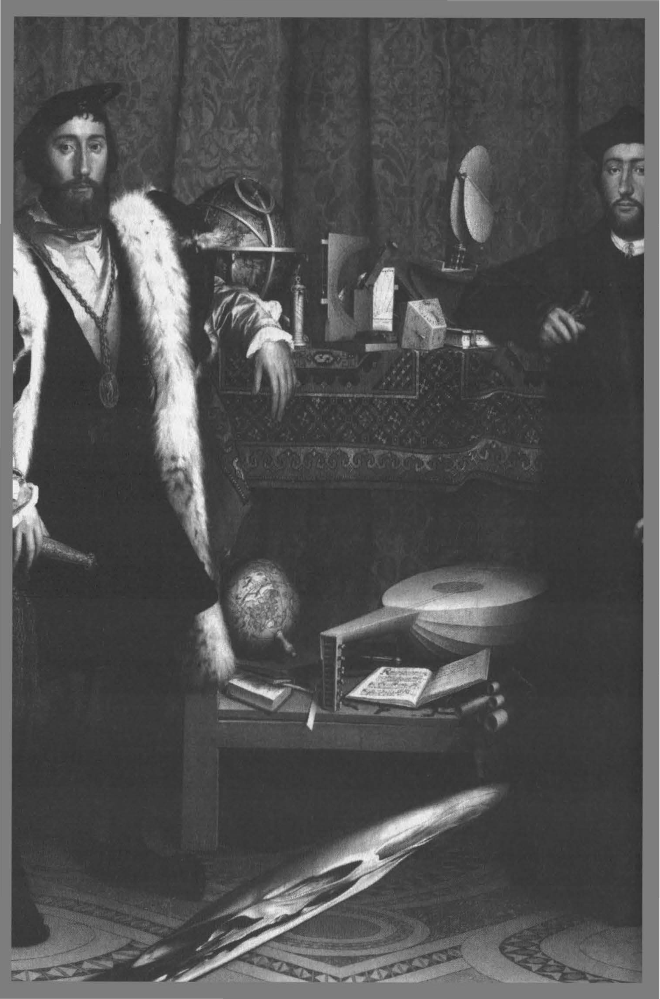

*整页图片：汉斯·霍尔拜因，《大使们》，1533年，伦敦国家美术馆。把文化相遇理解为与先前未知的“物”面对面，比把它夸大为受到他者影响更有成效。在这幅霍尔拜因的画中，桌上铺着一块后来艺术史家会称为“霍尔拜因地毯”的奥斯曼地毯。它是那个时代昂贵的身份—声望标志。*

## XI　作为影子拳击的西方主义

〔原书第245页〕

从语言学上说，西方主义（*garbiyatçılık*）的生成与使用当然都是可能的，但它无法与东方主义（亦译“东方学”，*şarkiyatçılık*）被广泛接受的境况相提并论。乍看之下，它会唤起一种绝对的对称：东方主义是对东方所作的政治、文化、地理性建构，西方主义则是与之对称的、对西方的制造。但最好不要被这种对称所迷惑。至少在萨义德通过分析使其无辜性变得可疑之前，东方主义的科学主张曾非常强。它还生产出“理解、研究东方”这类“无辜的”期待，其学术外观具有学科性的严肃。尽管多亏萨义德，它逐渐部分地变成一个带有诅咒意味的概念，但它仍积累起庞大的文献。西方主义并非如此。此处讨论的西方主义，指的是自认为东方人者建构起“西方”概念，继而占有、据为己有同一个西方所生产之物中特别挑选出的一部分。西方主义同样也是福柯意义上的“他者”生产。然而，东方主义把东方建构为永恒、先在的他者，西方主义则打算至少部分地、在某些领域把西方及被称作西方的事物从“他者性”中移出。它不否认东西方分裂，却使东方人有可能把自己重新定义为“某种”西方人。或者，他仍然继续做东方人，〔原书第246页〕与此同时，借助西方主义实践，他试图获得对西方所生产之物的主张权。

为了举例说明西方主义如何运作，我将从一本最初用韩语写成、后来译成汉语和英语、2012年出版的书入手。该书一开始就冠有这样一个标题：《现代主义：东西方文化的一个混血儿》。[1] 它主张，现代建筑是在远东影响下出现的。它还以图像例证支持自己的论点。许多古代远东建筑简素的室内外照片，令人如此强烈地联想到现代主义作品中的极简主义，以至于很难不同意这一主张。世界对这类主张也并非陌生。20世纪50年代末，丹下健三与摄影师石元泰博编了一本关于桂离宫的书。[2] 现代主义“早已”存在于日本传统建筑之中这一主张，第一次在那里被极具说服力地表达出来。石元在桂离宫拍摄的非凡照片全都采用正面取景，也就是始终以90度呈现水平与垂直线，因而仿佛是从蒙德里安的画作中迸发出来的。这座17世纪的京都别墅看上去仿佛出自特奥·凡·杜斯堡之手。仿佛展示出一种比密斯·凡·德·罗本人更有魅力、更富诗意的密斯式建筑。人们甚至可以认为，日本人在现代主义被发明之前就已经是现代主义者了。

这种可概括为“在过去或传统中发掘现代主义”的主张，在日本为何产生，值得讨论之处很多。例如可以理解，一个在二战中战败并长期处于美国占领下（1945—1952）的国家经历了文化创伤，因此20世纪50年代民族文化与建筑受到推崇。[3] 这一议题当时沿着被称为“传统论争”（*dentō ronsō*）的路线〔原书第247页〕密集地占据着议程。一个蒙受屈辱的社会想要重新获得自尊。把往昔的成就重新提上议程，并在本土传统之上创造一种现代建筑，变得至关重要。为了让现代主义内化，证明它非但不是外来的（西方的），而且从根源上属于日本，至少并非外来，已成为某种必然。在此语境中，不仅是桂离宫，伊势神宫也被置于类似的现代主义再阐释之下。[4] 甚至逐渐地，全部日本传统建筑都开始被呈现为“现代的”。

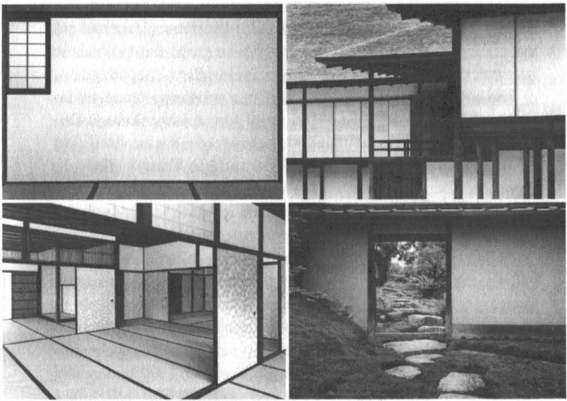

*图像说明：丹下—石元合作的产物，收录于桂离宫书中的照片使现代主义显得仿佛出现在日本。*

〔原书第248页〕

但在丹下与石元之前，布鲁诺·陶特早在1933年、条件还非常不同的时候就已经“发现”了桂离宫，并在次年发表。[5] 他参观别墅，用一组水彩画传达印象，并说自己在三百年前建造的作品中发现了自身现代主义理想的映照。他的路径当然不是西方主义的；这位著名德国建筑师也没有从东西方极性框架看问题。正如他对桂离宫作出的最终判断所表明的，对他而言桂离宫是永恒的。它体现了一种超越时间、不能归属于任何时代的建筑真理理想。在欧洲现代主义内部，以不同建筑为中心而重复类似主张的情况已发生无数次。塞达德·哈克·埃尔德姆几乎从同一时期开始发展的观点，就其理由与目标而言（但仅就这一方面而言），似乎更接近丹下—石元路线，而非欧洲路线。埃尔德姆提醒人们注意他所谓内在于“土耳其家屋”之中的现代性。他认为，土耳其的乡土住宅在现代性之前就印证了现代理想。后来从20世纪60年代起，以坚吉兹·贝克塔什为首，许多土耳其建筑师都将主张类似观点。可以说，他们都试图为现代主义准备一个本土基础。他们所寻找的是一种植根于民族传统的现代主义。然而，这一主张在日本产生了像丹下—石元合作那样成功、甚至在全世界具有说服力的成果，在土耳其的例子中却含有重大的技术缺陷：在日本，该主张最有力的支持来自以视觉方式呈现例证，而在土耳其，人们只使用言语手段。例如，丹下与石元在桂离宫的照片中，无论在拍摄阶段还是后来的取景裁剪中，都成功创造出了惊人地看似现代主义的图像。书中所有图像从一开始就是为了创造一个现代主义的桂离宫而拍摄的。〔原书第249页〕此外，它们全都被作者剪裁加工，只挑出其中看起来最“现代”的部分收入书中；[6] 最后，书的设计还出自包豪斯出身的著名平面设计师赫伯特·拜尔之手。最终，每一幅图、每一页都以这样的方式呈现：当西方和日本读者把它们当作现代主义构图来观看时，不会感到异样。而在土耳其，视觉性几乎从未被用于这类支持。人们不断谈论土耳其家屋的现代性，但这些主张始终只是通过重复“现代主义论点对这类建筑也同样成立”来维护。例如，（仿佛）土耳其家屋也显示出灵活平面，（仿佛）它符合功能，（仿佛）它并非通过风格强制来规划，（仿佛）它是极简的，（仿佛）它与自然融为一体，等等。当然，这些没有一项是真的。在所列举的那些话语以及随它们获得存在的“认识型”并未被生产出来的环境中，仅仅从某些形式相似性出发说“那些东西这里也曾被知道”，并不现实。例如，在一个没有写出和／或阅读过证明人们思考过经济理性的文本的社会里，建筑理性主义是不可能的。在功能概念尚未被生产出来的环境中，功能主义思想无法生长，功能主义主张也无从提出。因为它们没有一项是建筑的属性，全部都是谈论建筑的主体的语言成分。它们只能通过在语言和话语上的研究来识别，而非通过建筑上的观察。现代话语无法为那些尚未发明或内化它们的时空中产生的建筑生产提供理由与根据。无论在日本还是在土耳其，都不能如此……然而，要问题化的并不是日本人或土耳其人为何犯错。需要探讨的是，为什么这些主张在文本之外同样可通过视觉证明的可能性，在土耳其竟从未被人想到。当然，在土耳其，也完全可以用类似石元与丹下的摄影想象的方式，构造出一套伪现代主义的视觉总集。借助拍摄与取景的技巧，也能在土耳其的传统住宅中捕捉到“现代”图像。未曾进行这样的尝试，预示了土耳其西方主义与日本不同的一个取向。〔原书第250页〕首先，它指向一种更信任言语表达、而非视觉之物的文化偏好。但更重要的是，它表明人们思考时以话语性的现代性为中心，而非形式与审美的现代性。从20世纪30年代开始，重要的不是建筑图像显得现代，而是建筑思想是理性主义的（不说出名字就是西方的），简言之是现代的。住宅并非这种现代性追寻的唯一目标。人们还会以同样方式相信，古典奥斯曼建筑也是现代思想性的产物；至今仍有相当多数的人相信这一点。在职业圈中，今天仍普遍相信古典奥斯曼建筑师像当代建筑师一样使用物理—数学技术，以特有的语境主义意识工作，并且是理性的。[7] 甚至可以断言，如今保守派、尤其伊斯兰主义圈子大量踏行这条西方主义路径。因此，日本人思考时把建筑传统呈现出现代的（西方现代的）外观放在首位。土耳其人过去和现在都要求外观尤其不要像“他者”；但他们过去乃至现在都想相信，那种“本土”图像毕竟是在现代思想过程之内被创造出来的。甚至可以说，这是土耳其西方主义最明显、最具界定性的取向之一。进而，如果说在日本西方主义的主脉中——至少在20世纪50、60年代——在建筑语境中参与西方是一种至关重要的期待，那么也应当考虑到，土耳其西方主义主脉中存在着一种重大的犹豫。这种犹豫在意识形态上也是至关重要的……那些一直以为自己“本来就”理性而现代的人，为什么需要看起来像西方人？困境在于，以理性为首，所有现代建筑思维实践最初都是由那个被贴上“西方”标签的“他者”生产的。至少在日本，这一发觉并未成为争论，而日本人也未曾声称自己过去就“已经以现代方式思考”，〔原书第251页〕这一点是确定的。

由此至少可以得出一个结论：对日本人而言并不存在一场与西方的回溯性（涵盖过去的）竞赛，而在土耳其大众文化中，这件事却具有至关重要的意义。例如，下面这类论点被反复重复：过去“我们”要发达得多；“我们的建筑”成功得多、理性得多；锡南设计建筑时进行工程计算；他顾及城市环境条件；从前在军事技术领域最先进的是奥斯曼人。建筑是表达“那场竞赛曾由土耳其赢得”这一信念时最常诉诸的实践。但这种信念根本无法视觉化。此类主张始终只能借助言语手段讲述和维护。在这场想象性的竞赛中，视觉手段可能提供具有破坏性的相反解释。例如，意大利文艺复兴大师把所设计的建筑画到了细部，却没有可供竞赛之用、能摆在这些图纸旁边的奥斯曼图纸。相信那场回溯性竞赛已被赢得的通俗意识形态家，在这种情况下当然会避免给文本加上一幅用于争辩的图像。何况，人们也不会费太大力气去证明这类主张……主张被说出，获得广泛接受，却无人解释，也不期待有人解释，更不投入特定的思想劳动。主张的正确性与有效性由重复的频率来保证。因此，土耳其西方主义的效能停留在非常低的水平。在这种环境中，不会产生例如丹下—石元式合作的机会。少数几乎只有一句话的论点被无尽重复，就足以满足相信的需要。这些论点实际上像简短的祈祷文一样运作。它们提醒人相信的必要；却不会让人想到思考与讨论，想到思想是一种持续进行的活动，必须始终被重新生产。恰恰相反，借助这些话语，真正的需要几乎尚未产生就被消解了。

土耳其西方主义的另一个特征，是它的内向性。“我们曾经赢过与西方的那场竞赛”这类主张，首先是为国内市场生产的。它们不会被端到国外。即便偶尔端出去，也不指望别人相信。它们装作是对“他者”说的，但也仅止于此。〔原书第252页〕甚至，“他者”不接受它，还被当作该主张有效的证明。想象一种永不可调和的东西方对立的人，总是带着这样的信念思考：对白，对方必定说黑。显而易见，这是一种影子拳击。当然，“桂离宫”也是一种影子拳击。在那里，人们主张一座建于17世纪的建筑在现代性之前就已现代。不过，任何受过现代主义美学滋养的人，几乎都会在视觉上把它感知为现代的。若抛开它获得存在的真实历史语境，桂离宫与现代主义极简美学并不冲突；它几乎是现代的。日本建筑中这场与现代主义的想象性相遇，如同在构成桂离宫书首要目标读者的欧洲与美国一样，在土耳其也引起了兴趣。尤其是阿利居尔·艾韦尔迪对此问题深感兴趣。[8] “东方早于西方成为现代主义者和／或为现代主义做了准备”的主张和／或暗示，在20世纪80年代又出现了一次小小的推进。例如在土耳其，埃尼斯·科尔坦出版了一本以奥斯曼—土耳其人对勒·柯布西耶的影响为轴心的书。[9] 书中讲述年轻的让纳雷在尚未成为勒·柯布西耶之前所作的“东方之旅”中看到之物，对于塑造他后来观点的重要性。[10] 在他之前，阿道夫·马克斯·福格特也已指出这种影响，[11] 但福格特研究的是勒·柯布西耶形式语言的根源，而科尔坦则把“这些东西是从土耳其学来的”这一主张推到前台。前者凸显勒·柯布西耶学到了什么、如何学得、通过哪些中介学得并加以示范；后者则凸显他是从哪里学来的。〔原书第253页〕上述这些土耳其出版物同样面向内部消费。在建筑之外，也将看到据有现代主义的种种追寻。例如，贝德里·拜卡姆在他专门讨论此问题的书中提出，现代艺术史被带有偏见地书写。他认为，现代艺术在很大程度上有着非西方的根源，而它的历史书写却背叛了这些根源。这干脆是一场西方阴谋。[12] 西方人从非西方文化中学到了现代艺术，却隐瞒了这一点。尽管直接用英语写书使拜卡姆显得像个例外，但完全可以断言，他的书在国外并未引起反响。何况，即便没有该书那种自负而论战性的语言，现代艺术与非西方文化之间存在联系这一话题也并非未被写过的真相。也不能说它曾被欧美的艺术史界否认。拜卡姆的著作也只是一场面向国内市场的论战。而我提到过的Hyunjoon Yoo那本书，则沿着这条极为熟悉的“内化现代主义”路线，预示了一种新的伪学术开拓。首先，与拜卡姆那愤怒、论战性的文本不同，他非常冷静地表达自己的主张。更重要的是，他借助后殖民文献提供的一种可能，说现代主义是一个东西方的混血儿，强调其混杂性。在这样做时，他使用了巴巴那本具有开启视野意义的书[13]所界定的一种可能，但另一方面又将其扭曲到会破坏其论点的地步。巴巴在挖空文化纯洁性主张的同时，也不可避免地否定了东西方极性。他讲述的是，文化无非是“始终—在—一切地方”进行着的无尽混杂生产，〔原书第254页〕除此之外别无他物。而Hyunjoon Yoo甚至不把东西方极性当作讨论对象。他对那种极性的存在毫无怀疑。他谈论现代主义的混杂性。然而，如果以巴巴式路径处理混杂性话语，那么用通用标签界定所有文化的道路就必然被封闭。且不说把世界劈成两半的东方、西方这类文化定义，就连韩国、日本、土耳其这类民族文化定义也会失去基础。对巴巴而言，混杂性不是偶尔在某些情况下发生的故障，而是界定文化的根本特征。文化现实必然是混杂的。没有任何文化材料可以被绑定在单一地点上，并定义成该地特有的东西。因此，如果作者沿着这条巴巴式路线前进，他就必须放弃东方—西方概念；但他与无数同类一样，无法放弃。显然，爱德华·萨义德几十年前写出那本震撼性的《东方学》，表明东西方概念在学术上多么成问题，但它在某些领域影响甚微。许多人仍然相信世界被组织为东方—西方两个对立极。多数人并不怀疑每一种文化产物都由这种极性界定。萨义德曾把这种极性问题化，这一点常被遗忘。看来，萨义德书中最被广泛接受的部分，是“这两个概念与霸权性权力关系有关”这一主张。尤其在通俗思想路线上——建筑往往是其中一环——东方主义获得了一个新定义：“西方有意误解和歪曲表述东方的实践”。而东方学家则是使用这门学科的工具剥夺东方应有权利的人。因此，东西方分裂非但未受讨论，反而作为受害状态的表达被重新建构起来。这一状况不过是把萨义德可概括为“必须忘掉东西方极性”的论述颠倒过来。于是几乎产生了一种任务定义：如今要把曾被东方学家误解、错误表述的东方，正确地讲述给西方。作出这种任务定义的人，显然把自己视为被误解、被错误表述、被迫害的人。

〔原书第255页〕

那些在这种生产受害感的东西方分裂中把自己视为东方人的人，其困境当然也无法通过建立新的东方叙述来消除。问题在于，他不仅想重新向“他者”讲述旧的东方，而且这一次要“以正确的方式”讲述，同时还想以一种新方式向自己讲述当下的东方。若就建筑而言，对想象中的东方主体来说，正如“昨天”被误解／错误表述，“今天”也被错误地塑形，并被错误地生活着。第一种受害状态的责任人是西方人，第二种的责任人则是东方人自己的错误、模仿癖、与“本质”文化价值的断裂、对传统的疏离，或他从内部或外部遭受的背叛，或他的麻木昏聩。这个清单还可以延长。但受害叙事是一种建构身份的可能，这一点不会改变。东方或土耳其身份，常常被建构成这种受害状态之客体的主体。经历受害感的人，对他们所生产的当代形态是西方的感到不安。他们认为，环绕四周、自己在其中工作并产出成果的一切现代之物，根源都在另一个极。他们带着这种回溯性兼当下的忧虑生活。这种想法又作为新的受害层次，被加到他们的身份结构上。面对一个垄断创造力、霸权性地向世界强加形式与美学的西方，一个无能而无生产力的东方形象先被创造出来，然后又从中生产出另一重受害状态。也可以说，这种进路在日本至少今天没那么至关紧要，却在土耳其制造了严重的神经质。于是，发现本土形态中内在的西方性（现代性）的道路再一次被堵死。在土耳其，无法创造以桂离宫为中心的现代神话的类似物。但真正被堵住的，是形态生产的可能性。由于形态始终被视为处于西方威胁之下，关于它唯一能做的事，就是坚持把它与“本土”来源联系起来。而这又把人囚禁在一种难以从中走出的历史主义取向中。我把这种意识形态立场、这条西方主义思想路线称为一种隐喻性的“镜子恐惧”。它指的是这样一种恐惧：照镜子时看到的不是自己，而是另一个人，即“他者”。〔原书第256页〕它也是一种担心：会突然在镜中看见一个已远离自身之我的“我”。其结果是不照镜子，因而逃避视觉性，和／或只能化着能让自己在镜中始终显得像自己的浓妆去照镜子。在丹下—石元的桂离宫或Hyunjoon Yoo的书中，镜子隐喻便失去了运作的可能。而害怕照镜子的人，也会逃避思考自身。他们如此害怕会看见的东西，以至于只有通过不思考自己，才勉强忍受活着。可以说，包括土耳其在内的伊斯兰国家，普遍存在一种镜子恐惧。然而，人们本可以期望萨义德之后人人都能做社会科学家早已做过的事，确认东西方分裂是一个应当被忘掉的问题。人们本应期望，不要把每个人挤进由“我们”和“他者”构成的永恒、先在的身份二难，也不要陷入那个恶性循环。但显然没有做到。因此，尽管人们想要采用巴巴式路径来揭示文化关系与影响包含相互性，却无法轻易使用它。在一个复杂的全球尺度上，行动者与活动不断彼此借用、相互影响，本应讨论这些，结果却是“学习”这一行为本身被问题化。在这种情况下，“不学习”几乎被定义为一种美德。结果是，有时用精致语言、有时用通俗语言，生产出如下论点：“我们没有向你们学习，是你们向我们学习；你们甚至不只是学习，现在还对我们说‘这些都是我们自己的财产’。”一旦相信这种说法，就非得写出上面那样的书不可。意识形态神经质强烈的人说“那些本来就是我们的”；冷静一些的人则说“我们的历史里本来就有现代主义、创造力、科学性、天才以及一切能想到的正面品质”。在一个因不断向“他者”、向西方学习而把自己视为永远的学生的环境中，这种本土化显然意味着一种心理上的松快。因此可以断言，在日本、韩国和土耳其，都发展出一种可称为“学习，却装作没有学习”的路径。要摆脱这种天真信念，首先每个主体都必须把其所称的“我们的”东西当作它自身、在不“与他人比较”的情况下去理解、喜爱并接受（如果不想，也可以不喜爱、不接受）。〔原书第257页〕为了能爱它们，他不应把自己“本质”文化财产是否像在别处、别种语境中看到的东西，是否也受他者重视，当作条件。他不应使用那种不断争论它们是否“本质”的、心怀背叛恐惧的丈夫的病态男性语言。他还必须放弃把世界看作文化竞赛场。他必须摆脱“我输掉了那场竞赛”的精神病。以这种精神病看世界的人，不可避免会变得神经质。于是，他们要么开始夸张地抬高自己视为固有财产的东西，把它们与别人隔离；要么陷入“你们以为是你们文化的价值，其实都学自我们”这种可笑的幼稚。而这不过是影子拳击。这是主体试图与自己的影子搏斗的状态……学习的主体因为向“他者”学习、因为不得不学习而憎恨自己，甚至不能照镜子；又因为无法惩罚自己，便向自己的影子挥拳。土耳其是两种态度都极为普遍的地方之一。不断热衷于诊断根在外部的心态、行为、信仰、意识形态、美学和概念，是第一种态度的表现。发展出那种态度的人忙于无尽地诊断并谴责威胁“我们的文化”的模仿癖、抄袭癖、崇洋媚外等等。而第二种态度有时发展到说模仿者不是我们，而是他者。西方科学不也是从伊斯兰世界学来的吗？现代主义在这里不是更古老吗？奥斯曼住宅不就是现代性本身吗？锡南不也研究建筑的抗震表现、进行工程计算吗？抽象艺术不是早在欧洲之前就在我们这里出现吗？支撑“向东方学习的西方”这一形象的天真路径，同时也奠基于一种信念：现代性和／或现代主义也是内在于对象之中的属性。例如，把桂离宫视觉化的石元及这一构想的提出者丹下认为，使蒙德里安的画成为现代的，仅仅是其几何正交构图。在桂离宫拍摄的照片本就是为了证明该主张而取景；他们确信，只要在取景中捕捉到与蒙德里安相似的构图，就遇到了现代主义。〔原书第258页〕他们把蒙德里安为何创作那样的构图置于次要位置。他们也不问建造桂离宫者那些看似相似的构图原因何在。最重要的是，他们在两处都不考虑历史语境。他们只专注于自己视为最终成品之物的形式相似。他们把自己识别出（但更多是建构出）的相似，放在“新西方人向更古老的东方人学习”的理解框架内评价。同样的逻辑也适用于在非洲面具与毕加索作品之间识别出亲缘关系的人。或适用于把勒·柯布西耶的“东方之旅”定性为向奥斯曼人学习过程的人……这样思考的人，梦想着值得学习的崇高知识，以及只学习和转述这些知识的被动主体。他们不愿理解，真正重要的是具有无尽重读、再生产对象、知识、思想、图像能力的主体的主动态度。这意味着再一次贬低学习。对如此看问题的人，重要的不是学习并再生产所学之物，而是被学之物和教授它们的人。然而，学习行为是一种再生产行为。所学之物不会保留其在被学习之处的意义，而被从原初语境中抽离。它们会变异。例如，勒·柯布西耶从无数来源搜罗形式与思想材料，这是勒·柯布西耶的能耐，而不是他所学之物的能耐。那些以柱子架离地面的史前住宅、波利尼西亚或奥斯曼住宅，可能对当代的某个目的有用；试图从这一角度理解它们，并由此创造出“底层架空柱”（piloti）构想的人，是勒·柯布西耶。这方面的赞誉（如果需要这种赞誉的话——其实并不需要）应当归于他，而不是波利尼西亚人和奥斯曼人。因为知识、图像、技术、对象、思想，简言之“物”，即便没有教授者也能运动、被搬运、被获得、被学习，并触发其他生产。若放在“物”（参见第十章）在全世界的流动性框架中看，所谓教授者这一行动者甚至并不具有至关重要的意义，很多时候根本没有这样一个人；存在的是被学之物与学习者。而这种运动或搬运的方向则几乎无关紧要。当印象派画家在19世纪末的法国饶有兴味地观看日本木版画时，日本人正转向欧洲油画。〔原书第259页〕17世纪，日本人从葡萄牙人那里学会了油炸，即*tempero*（油炸腌汁、调味汁）；今天世界各地都在吃一种日本料理——天妇罗（裹脆浆油炸）。（校注：底本年代及词源如此。[日本农林水产省介绍](https://www.maff.go.jp/e/policies/market/k_ryouri/search_menu/2438/index.html)将相关葡萄牙油炸料理的传入追溯到16世纪中叶，普及则在江户时期；其[长崎天妇罗介绍](https://www.maff.go.jp/j/keikaku/syokubunka/k_ryouri/search_menu/menu/46_18_nagasaki.html)并列Tempero与Temporas等名称起源说，不能将一种词源说当作定论。）在18世纪的伊斯坦布尔，上层阶级热衷获取欧洲物品，[14] 而在欧洲，人们以“Turquerie”（土耳其风尚）之名对奥斯曼美学感兴趣。[15] 在这种往来中，任何一方的态度都不更卑下，也不更高尚。被搬运之物也并不更有价值或更无价值。这不过是“物”的寻常流动性。“物”从一个地方被搬到另一个地方，它们的每一次运动都会在它们身上、并通过它们生产出新的意义、新的“物”；每一个被搬运的“物”在每一次运动中都会变成一个“新物”。如果世界只是这样一种无尽交换的环境，为什么在某些地方，有些人会如此可悲地蜷缩在精神病中挣扎？看来，无法安抚那些需要把文化审美化的人。只要有人非要把自己视为己有的文化材料看作有价值，并让它们参与世界尺度的竞赛，只要这种受伤心理得不到治疗，显然人们就会继续写“我比你们更早知道、更早做过”之意的文本，并继续打影子拳击。

〔原书第260页〕

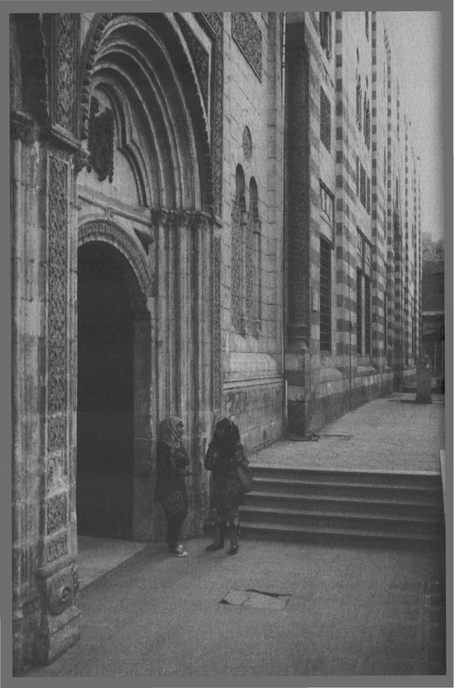

*整页图片：开罗卡劳恩伊斯兰学校的哥特式大门。（校注：底本称卡劳恩学校；[MIT建筑史课程的图像档案](https://ocw.mit.edu/courses/4-615-the-architecture-of-cairo-spring-2002/resources/1056-2/)将从十字军阿卡教堂移来的哥特式门洞归于苏丹纳赛尔·穆罕默德伊斯兰学校。）它是从阿卡十字军大教堂运到埃及的战利品。摄影：乌古尔·坦耶利。*

## XII　地方

〔原书第261页〕

作为现代主义标志性作品之一，斯图加特的魏森霍夫住区从建成年代起就遭遇批判性反对；20世纪30年代，一张加入这场反对的德国反宣传明信片把该住区描绘成一个阿拉伯村庄。有人在一张当时的魏森霍夫照片上以照片蒙太奇加上骆驼、披斗篷的男人、披罩袍的女人，图像充满陈词滥调地指涉一个北非城镇的空间。魏森霍夫被批评为一种与其说属于德国、不如说属于北非城市的设计产物；它不在本该在的地方。它本该属于阿拉伯人，却被安放在德国土地上。关于“地方”问题的任何讨论，尤其如果要从“地方应被视为至关重要且具有约束力的既定条件”这一意图开始，就不应在不顾这张明信片的情况下进行。[1] 打算投入讨论的人，如果对早期现代主义建筑的信念很牢固，就更应迟疑地迈步。〔原书第262页〕例如，既肯定20世纪20年代德国的“新建筑”（*Neues Bauen*）取向，又同样轻松地谈论“地方”的身份（甚至重要性），会产生严重的困境。例如，讨论者很容易发现自己与反对魏森霍夫、在德国国家社会主义党强力支持下推行的一项法西斯文化纲领共享同一种思想基础。那张批评魏森霍夫的明信片，是一种信念的产物：在特定地理中内在地存在着／应当存在传统、文化、建筑、人的存在方式，甚至民族和种族。即便不考虑其中明显的东方主义贬低——这里不考虑它，它也另当别论地值得讨论——谈论地方仍是踏入危险地基。在19世纪下半叶之前，世界上任何地方都不曾在建筑语境中进行关于地方的讨论，甚至在暗示层面上也不曾谈及地方概念。可以说，没有人谈论属于某个地方，没有人谈论归属由地方界定的状态。甚至在几百年间，做完全相反的事才是一种被追求、被推崇的可能。例如，在苏萨建造宫殿的大流士在铭文中宣告了一系列劳动力和材料的流动，从伊奥尼亚到腓尼基，从美索不达米亚和埃及直到印度；这张网络因他而成为可能。[2] 最终建成的建筑群恰如他所预见，以各种形态表现出自己并不属于单一地方。其柱式、装饰、技术与平面构图呈现出广泛的多元性。它们不属于一个地方，而属于古代东地中海—西亚世界的各个角落、许多地方。这个名为苏萨的地方，几乎容纳了许多其他地点。这是对不同地理（地方）的帝国统治主张，在波斯君主这个特定“地方”集体表达出来的一种方式。因此，在伊朗高原上建立起一个建筑环境、一个 *place*、一个地方，它因这些东西的位移（displacement）而获得存在。另一个例子可以是开罗苏丹卡劳恩伊斯兰学校的大门。（校注：底本称卡劳恩学校；[MIT建筑史课程的图像档案](https://ocw.mit.edu/courses/4-615-the-architecture-of-cairo-spring-2002/resources/1056-2/)将从十字军阿卡教堂移来的哥特式门洞归于苏丹纳赛尔·穆罕默德伊斯兰学校。）在巴勒斯坦的阿卡从十字军手中夺回之后，当地哥特式大教堂的大门被从原处拆下，运往开罗，〔原书第263页〕并被安放进那座新建筑。[3] 这是一次“位移”。是把属于另一个“地方”的东西搬到另一个地方。但情况还包含更复杂的第二次“位移”，因为阿卡的哥特式大教堂——就像以地方为中心思考的人会轻松说出的——实际上也不在它所属的地方……一座哥特式建筑本不应位于巴勒斯坦，而应位于它在西欧和中欧的故乡、它的特定地方。这些例子只是一个世界最有趣的景象中的两个；那个世界并不进行地方讨论，相反，其目标是超越对地方的依赖，但也知道这种依赖很难轻易超越。在前现代世界，交通与通讯手段即信息运输的有限性，以及把主体紧紧绑定在特定社会领域中的文化代码，不可避免地使每个人早已依赖地方。有人把超越这种有限性的可能——有时只是其幻觉——变成一种本领，更重要的是，变成一场政治权力表演。

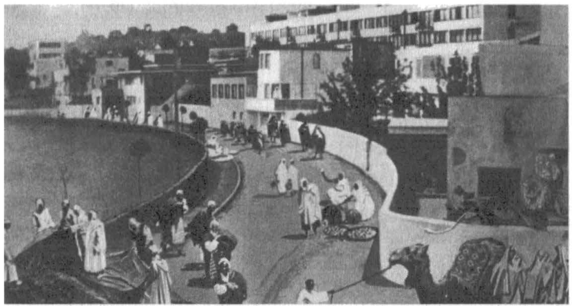

*图像说明：作为阿拉伯村庄的魏森霍夫。现代主义建筑标志性作品之一在一张纳粹宣传明信片中遭到带有种族主义指涉的贬低：一种地方不在德国的建筑。*

〔原书第264页〕

地方讨论是界定现代性的构造、变化之一。现代性似乎除了别的一切，也借助地方讨论而结构化。始于19世纪的折衷主义、历史主义倾向，使用一种可能：生产不依赖于这些倾向所生长的地理与时间、甚至不属于单一时间—空间的建筑。它们是这种可能的结果。借助这种可能，大流士只有动用绝对政治权力才能完成的位移，或在开罗作为战利品获得存在的位移，在折衷主义时代变得容易实施。然而，过去极其困难之事在19世纪及以后获得的容易性，也立刻——如果说法合适的话——变成道德争论的对象。历史主义常常以“建造特定地方特有建筑”的关切得到维护；至今其拥护者也大多这样维护它。人们认为每个特定地方都有特定的建筑形态；作为对不属于该地之物在那里获得存在的反应，他们主张复兴那种特定形态。生产“本土”建筑的目标，大多伴随这一意识形态背景。但在19世纪，历史主义——即便也被用于创造本土建筑——更多是作为在一个生产全新位移可能的世界中超越“地方”约束性的工具而获得存在。能在从未为那种建筑提供空间基础的巴黎、罗马、爱丁堡建造古希腊风格建筑，在伊斯坦布尔建造哥特风格建筑，[4] 这直接关联于建筑形态可以超越地方与时间被搬运和再生产。生产现代的超地方建筑，也是殖民权力的惯常实践之一。把欧洲建筑风格搬到印度是一个熟悉的例子。[5]〔原书第265页〕但与殖民主义无关的超地方尝试甚至更多。例如在奥斯曼和日本[6]出现的欧洲建筑，就是引人注目的超地方尝试。如果不以早已陈旧的一般性谴责态度对待折衷主义与历史主义，也可以对它们进行严肃阅读。前现代世界缺乏生产超地方、超时间状态的能力；它唯一的位移可能不过是运送工人、专家，而且往往是强制迁移。[7]〔原书第266页〕有时，这会加上从遥远地理搬运建筑材料。圣索菲亚建造时从整个地中海周边古代纪念物搜集大理石构件，与其说是满足实际需求，不如说与特意要求材料位移有关。[8] 同样，13世纪威尼斯人用源自伊斯坦布尔的旧建筑构件装饰圣马可教堂外部，这一做法与他们建立海上帝国的目标之间有着牢固联系。[9] 借助这种移置，人们能够想象圣马可、威尼斯与帝国首都君士坦丁堡之间的联系。而现代世界由以下一点界定：把形式、话语、思想、神话从其一度看似黏附于其上的时间—空间语境中撕开。现代性就是完成这件事的名字：知识、人、资本与形态的流动性相较从前异常增长。因此可以说，“位移”表达现代性，而 *place*／“地方”表达反现代立场。注意，我在此主张“地方”表达的不是前现代，而是反现代。我以此指出，前现代世界从未生产过以地方概念为中心的话语。“地方”与“失所”这对概念一起获得存在。对本身就是现代的“位移”状况的不安，也就是时间—空间中固定状态（或者说，既然这种固定化从未可能，则是固定化幻觉）被摧毁而产生的不适，如同产生一系列反现代态度，也生产出了以地方为中心的态度。“我们有权在这个地方、这个此刻，建造一个不属于此时此地的设计吗？”这个问题是争论的关键论点。〔原书第267页〕几乎所有经典化的20世纪建筑史著作，每次都毫不犹豫地以“不”回答，开始工作。在他们看来折衷主义是错的，因为那些不属于那里、不属于那种文化、那个时间—空间即那个地方的建筑元素，是从别的地方搬运来的。今天该问的是：这一变化是否像吉迪恩[10]等史家确信的那样，是一种显然负面的状况；还是相反，是一种崭新可能的使用？现代性不正是界定这种可能的形容词吗？当人们获得超越数百年束缚人的“在那里、在那个地方存在”状态的可能时，主体甚至会努力不让自己“仅仅”存在于那个地方。说到这种渴望，也许不必寻找更深层的心理社会背景。可以说，一个19世纪晚期的加尔各答孩子借助一本英国画册得知挪威的雪与寒冷，于是不仅生活在加尔各答，也“生活”在挪威。在美国田纳西建造帕特农神庙复制品的大学管理者，又有何不同？（校注：底本主体如此。[纳什维尔市政府记录](https://www.nashville.gov/departments/parks/parthenon)说明当地帕特农复制品为1897年田纳西州百年博览会所建，位于百年公园；不能据本句认定它是大学管理者兴建的校园建筑。）或者在维也纳让人在两千多年后原样建造本位于雅典的古代忒修斯神庙的人呢？答案想必绝不简单。至少可以尝试理解、理论化这些及类似现象。简言之，更合理的做法不是肯定过去世代必然始终由特定地方（及地点）界定的状态，而是认真对待所有社会群体对这一状态的超越，甚至把它视为一种解放可能。把对地方即对始终同一时间—空间性之依赖的摧毁遭到诅咒这件事问题化，比把“失所”问题化、为之忧心要有成效得多。如果放弃神化单一空间—时间语境，新的建筑理论路线也会出现。自电报以来，〔原书第268页〕信息能够同时跨大陆传输，这生产出一种新的时间—空间理解。更不必说新的社交媒体所提供的、让人同时既在此处又在别处的当下可能……其实只要提醒人们：存在通过跨大陆互联网流量生产的建筑产品，其时间—空间语境已无法再用地方一词描述。皇后区韩国长老会教堂的例子[11]在这方面几乎具有反讽性。它建在美国纽约市，却是为韩国长老会会众建造的，仅此就已表明需要为地方讨论界定新路线。还应加上：该建筑方案是由分处三个不同城市的三家建筑事务所（格雷格·林恩、迈克尔·麦金托夫、道格拉斯·加罗法洛）合作，完全在互联网环境中完成的。现在大概必须问：这座建筑在一系列不同语境中属于哪个地方？它是为韩国人建造的，所以原本属于韩国吗？还是说，既然他们已是“不再是韩国人的韩国人”，所以属于皇后区？长老会“原本”是一种盎格鲁—撒克逊新教取向，所以属于盎格鲁—撒克逊世界吗？还是属于一个显然没有从其“原初地方”生长出自身宗教的共同体？属于设计者所定位的地方吗？属于教堂拔地而起的那个地点吗？这座教堂究竟属于哪个地方？还是说我们面对的是一种在一切语境中都已“位移”的建筑？因此，首先必须放弃相信神化地方的必然性，并指出它的某些危险，至少某些复杂后果。这一尝试不可避免地将成为一种历史书写分析。例如，可以讨论20世纪初在德国提上议程、寻求一种像地方特有物种一样依附于其所在地的建筑的倾向。由于它延伸到土耳其，[12] 还具有另一种效能。在德国，〔原书第269页〕“故乡风格”（*Heimatstil*）是这一倾向的产物之一。这个词大致可译为“故乡风格”，但实际上包含的更多。这是一种时而具有以“血与土”（*Blut und Boden*）这对概念表达的种族主义指涉、但始终带有明确民族主义指涉的倾向。简言之，凡在该民族的故乡、文化与种族边界内没有根源的建筑，都不应在该民族地理所定义的“地方”占有一席之地。例如，该运动最重要的代表人物之一、其《文化工作》丛书在当时代成为畅销书的舒尔策—瑙姆堡，[13] 后来成为纳粹党成员。还应记得，斯图加特学派最有影响力的人物施米特亨纳[14] 既持有类似观点，也同样是该党成员。仅凭这一点，〔原书第270页〕想必也应有可得出的结论。简言之，显而易见，关于地方的讨论并非始终必然无辜。相反，它几乎每次登上议程都产生极权主义、至少排他性的结果。神化对土地的依附，会把区分谁属于该土地、谁不属于作为主要目标。最终，“故乡”包含一些人，因为他们属于那个地方；也排除一些人，因为他们不属于那个地方。因此，在开始以为地方的定义甚至无需解释之前，我们先问：“地方是什么？”但不是为了下定义，而是为了辨认其复杂后果……这里有几个可以非常简要指出的条目。人们作过各种各样的地方定义。其中一些可称为民族—地方，另一些可称为种族—地方。纳粹谈论的是种族—地方：在一个种族的特定地方，〔原书第271页〕不应存在属于另一个种族的人。塞达德·哈克·埃尔德姆谈论民族—地方。[15] 他在谈论土耳其应当有一种属于该民族—地方的土耳其民族建筑。然而，这一议题随第二次世界大战一起被埋葬。二战不是通过建筑，而是通过德国与纳粹主义的毁灭，把此类讨论带上议程。20世纪60年代初，西格弗里德·吉迪恩以“地方性（和／或地方主义＝区域主义）讨论”之名重新提出这一争论。[16] 尽管被清空了历史主义—民族主义指涉，但完全可以断言，他是从故乡风格留下的地方开始说话的。他主张，20世纪60年代初，相对于现代主义在30年代的普遍主义，一种依附于所处地方（地方主义）的现代主义开始出现，并特别提请注意日本当时的发展。60年代将尽时，这场讨论也被带到土耳其。比伦特·厄泽尔是把区域主义与地方性讨论带入土耳其议程的第一人。当然，在土耳其的版本中，如同在任何环境中一样，地方与地方性话语也在提议一种排他性的建筑进路。[17] 但可以说，例如在60年代，吉迪恩与厄泽尔谨慎地避开民族—地方定义，以文化主义路径思考。那些年通常以气候—地方、历史—地方、文化—地方等概念为轴。在这些概念中，地方的定义是气候性的、历史性的、文化性的。例如，在一个文化占统治地位的地方，是否应允许另一种建筑存在、这样做是否正确，这类争论被大量而低效地进行。在建筑领域之外，地方讨论则以全新面貌、通过马克·奥热的《非地方》一书于1992年登上议程。[18]〔原书第272页〕奥热发明“非地方”（*non-lieu*）概念，以此称呼一部分建筑存量。但他关心的与其说与建筑直接相关，不如说是对某些新出现的建筑类型做人类学。实际上他旨在讨论日常生活实践与建筑交界处的问题。他发明地方与非地方这对概念，是为了界定两种不同的物理性—社会性关系。也可以说，为了这种定义，他把地方—人的关系过度理想化了。他认为非地方为人的行为和社会的对话提供的基础相当少；它们很大程度上用书面指示和指令来引导其中的人之存在。而地方生产多样性与多元性，甚至自由。超市是非地方，因为它例如不具有获得历史性的性质。[19] 一家存在五十年的超市没有物理意义上的存续机会，因为超市总须不断更新。即便经营它的公司有一百年历史，超市空间也只属于现在。机场也是如此。它的物理性必须每时每刻更新。否则无法运作。照奥热看，这阻止历史性在建筑对象上积累。奥热从同一路径出发，也把关系性问题提上议程。[20] 在非地方之上无法积累记忆，因为无法与之建立移情关系；照奥热看，人们无法对非地方产生认同感。这一视角，尽管奥热并未如此打算，却导致以传统主义视角谴责他所谓“超现代性”世界中相当大一部分建筑存量。现在我们必须进一步细致思考：为何它在建筑界整体上未必如此，却在土耳其尤其受到如此重视。我想指出，这种兴趣相当值得注意。但这里我宁愿不涉及这个需要更全面探讨的问题，而集中讨论地方概念的内容。

*图像说明：维也纳忒修斯神庙，19世纪。雅典公元前5世纪建筑忒修斯神庙（Theseion）的复制品。19世纪晚期着色版画。*

*图像说明：谈论地方极易与谈论种族相遇：1900—1930年间德国有影响力的建筑思想家之一保罗·舒尔策—瑙姆堡在《艺术与种族》一书中，把对属于德国土地之艺术的追寻推向一种种族主义批评的顶峰。*

*图像说明：《艺术与种族》中的一组比较：种族污染与现代艺术生产的关系。*

〔原书第273页〕

首先应指出，奥热与自己的定义相矛盾。奥热说地方是一种人类学现实；这正是他自己以及从他那出发的人，在非地方语境中常忘记的要害。地方的人类学性意味着，它每时每刻都由我们通过个体与社会的行动和实践重新定义。地方被不断再生产。不能说它在我们之外作为一个既定外壳存在，而我们在其中运动。地方并不外在于我们。然而非地方也不外在于我们。同样可以轻松主张，它也通过我们的每一次行动、甚至仅仅通过我们的存在而被再生产。甚至我们每次在那里以不同方式存在，也会使一家超市或机场不断变成另一种东西。我们必须把“我们不断对地方与非地方作出相当动态的贡献”当作一个起始论点。但着手进行这样一种理解转变，意味着开始从根本上改造建筑界至少过去两个世纪所生产的知识结构。地方中心话语不可分割的伴随物“记忆”与历史性，尽管近年来在建筑界思考其反面已相当普遍，也引发一系列复杂问题。人们养成了毫不犹豫谈论地方和／或城市记忆的习惯。在这些说法中，一谈到城市和／或地方的记忆与历史性，要么是在作生物学类比、赋予它人的属性，要么是在想象一种内在于地方的历史性。第一种选择只是一个荒谬的隐喻。第二种的答案则是：历史性并不内在于地方，它只是一种社会建构。换言之，生产历史与历史性的是主体，而不是建筑产品或对象。[21] 显然，地方、城市没有记忆。谈论它们有记忆，只指向一件事：说话者希望某种以特定方式建构的历史性、某种以特定方式写成的历史永远有效，无法与之分离，〔原书第274页〕甚至倾向于把它强加于人。谈论一种使那个地方成为那个地方的历史性，正如开头的例子，是批评魏森霍夫为“被逐出故乡的”阿拉伯村庄的前提。这是在幻想一种既使“德国”或斯图加特或魏森霍夫地方成为德国／斯图加特／魏森霍夫地方，又使阿拉伯村庄成为阿拉伯村庄的历史性、身份、本质。而想象一个固定的、决定我们所有人、使我们成为我们、生产关于过去的知识、即拥有构成我们记忆之本质的地方，就是相信主体（人与社会）被动，而客体（地方）主动；这是一种严重的理解偏差。危害是什么？其危害，就是任何强加特定历史性／身份／本质的态度所带来的危害。也就是说，公开或隐秘地提出极权主义与反民主纲领，并强迫所有人接受它……强迫我们每一个人接受一种在我们之外存在、却把我们囊括在内的必然记忆、身份、历史书写，这就是对周围环境施加一种把建筑工具化的意识形态恐怖。我们可以忍受或不忍受那种恐怖；但每一个相信地方、记忆与身份之约束性的人，都必须作出决定：是捍卫民主立场，还是相反？居伊·德波与阿斯格·约恩（以及一般而言的情境主义者[22]）早在20世纪50年代就在艺术实践语境中提出了建筑界至今仍难以达成的这种理解。他们将通过“心理地理学”制图尝试，例如把一张真实的巴黎城市平面拆解为组成要素、再在新的关系整体中组合起来描绘，试图表明我们生活其中的地方更多是我们自己制造的，而非现成发现的。《赤裸的城市》（1957）[23] 是这方面最早的作品。〔原书第275页〕后来的《回忆录》（*Mémoires*）[24] 也是关于建筑想象与经验之复杂结构的另一项早期尝试。在他们的第二部作品中，建筑与地方被定义为“预制”图像的主观再生产，正如书名所示。地方、记忆与城市，不断通过“预制”的图像与话语——它们在我们之前已被创造，也由我们与他人共享——〔原书第276页〕而被持续建构。但始终由不同主体以不同方式，并始终被变异、扭曲到无法辨认的程度……可以说，情境主义者指出了这样一种可能的存在：如果今天非要继续谈论地方，就必须采取现实态度，谈论多元的地方性，并不可避免地谈论多元的时间性。也就是谈论那些在时间与空间中无法固定、不被固定、无需固定的对象与主体……而这种谈论的可能，则可以通过以“位置”而非“地方”概念为轴心来思考而产生。“位置”一词与“地方”一词之间那个至少在土耳其很少被重视的意义差异非常巨大。从位置说话，就是谈论多元性；从地方说话，则是谈论单一性……从特定地方说话的人，参与那里现存的一种地方定义。他要么在其中，要么在外。其判断也集中于区分内部者与外部者。这种谈论除了确定谁应被排除、谁可以正当地留在内部，别无成效。而位置总包含多元性，因为每个主体虽同时只能占据一个地方，却在许多位置上行动。例如，作为写这篇文章的人，我在不同语境中同时占据着不同、有时完全不可调和甚至矛盾的人与社会位置：我以一个有建筑学位的人说话，但也以一位从未建过房子的建筑师的位置说话。我以教师的位置、建筑写作者的位置说话。我以男人身份说话。我以早已过了中年的已婚者身份说话。我作为一个经历过特定教育阶段、属于特定社会群体的父母的后代说话。在写这篇文章的时间段里，我以从周围得到一系列“意见”的人的身份写作。每个位置都不只生产一个“我”，实际上生产许多我意识到或未意识到的位置、许多个“我”。建筑也完全如此。从地方说话，意味着从一开始就取消了带着这种多元性意识思考与工作的可能。但最重要的是，“位置”概念关联于主体发挥主动作用，而“地方”描述一种使主体服从于它〔原书第277页〕的必然状态，因而预见了无为与被动。想必已经明白，在这一切之后，本文试图建立一种反地方论述的作者，并没有说“建筑在世界各地都一样；在全球化时代，建筑早已获得这样一种普遍的通行性”。建筑（以及一般而言一切文化生产与实践）从来不是普遍的；它们在每个被创造的情境中都是特定的。它们也没有以别种方式存在的机会。对每个特定情境、每种不同的自然与人文地理、每种特定的行动者组合、每个时代以及主体的每个不同位置，建筑都被重新定义。没有任何特定情境可以再次重复。我们与不同的行动者合作，在不同可能、不同社会性、不同位置与时间性中，在这一切不可再次重复的编舞之内设计和建造空间。建筑、实际上人所生产的一切，都具有这种特定性。因此，没有理由停止谈论地方的重要性。而要让相反的情况成为可能，我们只有进行严肃的概念修正才有机会。

*图像说明：居伊·德波的《巴黎心理地理学指南》（1957）把城市定义为一种随每一次人的行动而重建、无法也不应被规训的空间性，从而对“地方”概念提出非常激进的批评。*

〔原书第278页〕

*整页图片：柏林“欧洲被害犹太人纪念碑”的混凝土碑林。摄影：乌古尔·坦耶利。这是一件这样的作品：连极易被神圣化（并因此极易被磨蚀）的犹太人大屠杀，它都能不借助任何神圣性暗示来讲述。*

## XIII　神圣性的幻象

〔原书第279页〕

也许自路德以来，世界就不再能够生产神圣性了。这一点从以下事实即可看出：这位引发极其广泛变革的人，本人并没有成为圣徒，也没有获得神圣性。他的坟墓没有变成朝圣地。他几乎只保持了宗教思想家、神学家的身份。而这本来也是他的目标。他在维滕贝格大学授课，直到去世。就连始终不愿放弃封圣程序的天主教会，如今也无法轻易宣布新的男女圣徒。男女圣徒的生产自中世纪以来持续减少，最终停了下来。（校注：这里是作者关于神圣性的概括，不能按字面理解为天主教封圣已停止。例如，[教廷记录](https://www.vatican.va/special/canonizzazione-27042014/index_en.html)明确记载若望二十三世与若望保禄二世于2014年4月27日获宣圣，早于本书首版。）后来新教各派的创始人，也没有获得类似早期基督教圣徒的神圣性。新教如何收窄神圣性的边界并进入一种新的思想体制，仅凭它摧毁圣物概念这一点便足以说明。那种把圣徒（神圣者）的身体部位，以及他们使用过／与之相关的物品也赋予神圣性的态度消失了。神圣性不再是具有物质实存的东西，而被抽象化了。在新教之前，每天“发现”新圣物、无休止地生产旧神圣性之新“物质证据”都是可能的。而且确实在生产……要为伊斯兰世界描绘一幅总体图景很难；但那里新的圣徒（逊尼派）和伊玛目后裔（什叶派）也不容易轻易出现。新的崇拜领域不再涌现。在伊斯坦布尔，法提赫时代“发现”的艾郁普，以及马哈茂德二世时代（1808—1839）被“发现”的数十座圣门弟子坟墓之后，再没有形成新的神圣空间。〔原书第280页〕当然，不能说全球范围内不再出现新的宗教、教派和修会（以及像土耳其那样秘密或半秘密的“共同体”）。但显然，它们的影响力和说服力已经狭窄到无法与旧有者相比。

不过，也不难作出与这一判断相矛盾的观察。尤其从中东看过去……这里有人为了以宗教之名建立国家而奔忙。也有像伊朗和以色列这样公开声明自己以宗教为基础的国家。还有一些人，甚至不相信在宗教之外还存在道德、哲学、法律等性质的思考与规则定义可能。也有像土耳其这样的政府：毫不迟疑地宣称要培养虔诚一代，于是把向公民强加“应当如何与神圣性建立关系”视为民主职责。显然，在这片地理中，对沉浸于神圣性之生活的期待一点也不少。那么，“世界不再能够生产神圣性”这句话至少对这里无效吗？

我认为，不。应当把当代中东的这些习惯——不断谈论神圣性、不断激化围绕神圣性的躁动、不断致力于让神圣性得以再生产——恰恰视为证实我上面所说之事的材料。正如17世纪不断谈论宗教的清教徒英格兰，最终恰恰与人们的期待相反，使社会的神圣性理解世俗化了；在这片地理中，很可能也在运行同样的过程。和那里一样，这里（只不过晚了三四百年）也用一种严厉、粗鲁、自以为是的语言谈论宗教，强加于人，教训人。神圣性的生产可能越收窄，“一切坚固的东西都烟消云散”，神圣性被提上议程的频率就越高。借用一种说法：旧日宁静的神圣性，正让位给躁动易怒的神圣性。但还不止于此：对神圣性作出越来越精细、确切的定义的要求正在增加。对神圣性正处于危险之中、必须为保护它付出不懈努力的焦虑正在升级。躁动进一步加剧。这些神圣性不仅在中东，而且在几乎任何地方，都可以放在宗教、教派、信仰、身份、思想体制等宽广框架中思考。毫无疑问，我在此讨论意义上的神圣性，涵盖一切被宣布为正确性与有效性不容置疑的话语生产。

〔原书第281页〕

*图像说明：凡界定神圣性的政权，都与法西斯主义相遇；图像是否现代几乎无关紧要：1933年罗马开幕的“法西斯革命展览”（Mostra della Rivoluzione Fascista）中的“殉难者角”。*

（校注：底本开幕年份如此；[意大利国家中央档案馆记录](https://search.acs.beniculturali.it/OpacACS/guida/IT-ACS-AS0001-0003706)记该展于1932年在罗马展览宫举办。）

〔原书第282页〕

因此，相信宗教应当对社会生活具有决定性，当然属于神圣性领域；但例如，变得无法想象资本主义之外还有别的经济存在，或把公共领域中国家监控的升级视为寻常，或把族群身份当作牢固的黏合剂，或崇拜可持续性概念，等等，也完全可以纳入神圣性的范围。甚至可以说，宗教性神圣性的生产正在减少，而世俗的神圣性仍然构成一个丰饶的生产地带。神圣性与人崇拜什么关系不大，更关乎人需要崇拜、并寻找某个可崇拜之物的状态。因此，即便最世俗的对象和概念，也可能被神圣化。

在过去几个世纪里，只要不公开声明反对，几乎没有人讨论谁在神圣性面前站在何处；至少就宗教／信仰而言，当时通行着一种比今天灵活得多的神圣性理解。渐渐地，人们试图把一切神圣性的内容、规则和边界牢牢固定下来，也试图细致地判定信徒是站在边界之内还是之外。不妨这样定义：世界历史状况已经从一个神圣性具有包容性的阶段，转向一个神圣性具有排他性的阶段；这一变化已经发生，并且仍在发生。这是社会科学家在宗教语境中早已注意到的现象，也有人讨论它在土耳其如何出现。[1] 说宗教在现代世界变得有弹性，并不正确；相反，应当说它变得无法伸展了。〔原书第283页〕因此，土耳其常被提起的下面这种说法并不算太错：“我外婆一点也不像今天某些穆斯林。”确实，几代人之前的家庭民间伊斯兰，与今天宗教事务局那种不断提醒规则和禁令、板着脸的伊斯兰之间，存在根本差异。前者是神圣性作为日常生活寻常组成部分的世界历史状况；后者则是一种抵抗世俗化环境、试图通过强加规则使其僵化的焦躁语言。

几个历史例子可以稍微说明这种僵化状态。例如，众所周知，中世纪早期欧洲的婚姻制度长期处于教会关切之外，后来才逐渐转变为通过宗教仪式缔结的神圣纽带。[2] 今天，教堂婚礼几乎已成标准。我们文化地理中的例子也很有趣：例如，帖木儿时代上层饮酒、举办酒宴，包括帖木儿在内所有人都醉得不省人事，这被视为寻常，却没有任何资料表明帖木儿的穆斯林身份、他作为宗教捍卫者的身份受到怀疑。[3] 又如，当时与异端直接相关的塞伊特加齐建筑群曾由巴耶济德二世大规模重建，而这位苏丹仍可算作逊尼派伊斯兰的旗手。还应记得，在很长时间里，性身份并未接受神圣性的审判。[4] 在奥斯曼世界，直到18世纪末，都很难遇到谈论同性恋在宗教上有问题的人，〔原书第284页〕也很难遇到排他性的语言。今天，对同性恋的谴责几乎已变成一种不可想象其反面的伊斯兰虔诚参数。

对其他身份而言，如今也出现了一种排他性的神圣性语言生产：从17世纪几乎到坦齐马特改革，被称作“转宗者”（Dönmeler）的萨洛尼卡群体，其穆斯林身份本来不受怀疑，却逐渐开始成为争论对象；这也是宗教性僵化具有启发性的例子。[5] 今天，宗教事务基金会《伊斯兰百科全书》的“Dönme”条目写道：“一个属于奥斯曼臣民、为更容易实现其宗教和政治理想而表面上接受伊斯兰教的犹太社团。”[6] 显然，撰写、批准、出版这条令人羞耻的条目，以及读到它却不抗议的人，都相信自己有权决定谁算穆斯林。一群人自己把自己称为穆斯林，还不够。宗教的“现代”新建构，正与这种僵化和排他性同义。当然，上述百科全书条目属于“现代”世界，并不意味着它在道德、法律、人道、礼貌和史学意义上有效。

如今，土耳其想必是这种僵化以及排他性地定义神圣性的“天堂祖国”。这并不意味着这里曾经盛行过一种宽容体制。宽容从来不是奥斯曼的常规实践，也不是直到18世纪任何政治和／或认识权力的常规实践。何况一谈到神圣性，宽容只是一种不可能，甚至是一个矛盾修辞。充其量可以说，过去界定规范、强加规则的工具很少，存在大片不受监管的社会领域，因为监管的技术手段有限。现代性也意味着，一切政治与认识权力可用的触及、获取信息、传递、监管和禁止手段都得到了极大发展。例如，我提到的那条百科全书条目〔原书第285页〕借助这类技术手段，如今可以使数百万人相信，某群人究竟是什么、不是什么，以及他们应当被算作伊斯兰之外，都是可以知道的。所以现代性是一柄雅努斯之斧：一方面，它增殖思想，为思想传播提供机会，并使共识变得不可能；但同一套工具也可以用来抵抗这种增殖、抵抗神圣性的多元化和碎片化及其解体，并清除差异。法西斯主义正因如此才是一种现代政权。[7] 可以把任何以缩减不断增殖的言说、差异化和去神圣化（desanctification）之可能为目标的政权或认识体制称为法西斯。并非一定要出现一个希特勒和墨索里尼。凡是界定神圣性、强加神圣之物，并在与神圣性的关系中区分局外人与局内人的政权，在隐喻和事实意义上都是法西斯。在建筑、日常生活实践、信仰、政治甚至科学中这样做，在定义框架内几乎不改变什么。

这样的每一种政权都不可避免地生产虚假的神圣性和神圣性幻象。而把历史神圣化，则是这类政权不可或缺的实践。因此，一切版本的法西斯主义，最广义上说，总是谈论历史，把历史变成崇拜对象，但也在学术意义上杀死史学实践。被神圣化的历史无法被书写。它无法在学术意义上被书写，却成为意识形态恐怖体制的强大支柱。于是，它也转化为一种驱动建筑生产的可能。可悲的是，建筑恰恰是生产当下神圣性幻象时经常诉诸的工具。

今天在这个意义上观察土耳其的人，可以看到一场世界上罕见的历史神圣化狂潮。把奥斯曼从土耳其历史的寻常部分中抽出，加以理想化、拔高，把它讲成包治一切社会病的灵药，呈现为人间实现的天堂——这些都是这种神圣化的工具。人们不断讲述：如果它没有被摧毁——〔原书第286页〕这个国家本来会多么幸福、和平地生活；那是一个不曾存在的过去，一种神圣性的幻象。一位正义与发展党议员把共和国时期称作“90年的广告间歇”，明确表达了这种不存在的过去如何充当建构今天的意识形态工具。当然，同一观念也会有稍微精细的表述。例如，土耳其就是这样一个国家：时任总理可以站出来谈论从“民族”（ulus）制度转向“米勒特”（millet）制度有何优点，[8] 并参照坦齐马特改革之前的奥斯曼族裔—宗教政治。为了以“米勒特”秩序取代世俗的民族概念、让每个人都由族裔—宗教归属来定义，可以找许多理由；唯一不能说的是，这是民主的。问题在于，把历史神圣化的人，已经摧毁了成为民主者、以民主方式行动、提出民主诉求的可能。民主是一种制度：它知道我们的一切归属——包括身份与认同——都是约定俗成的，并把对这些归属的讨论视为寻常。例如，在民主民族国家的边界内，有些人可以说“我不接受这个民族定义”。而在如今已被神圣化的奥斯曼米勒特制度中，不可能说“我不把这个米勒特制度当回事”。因此，把奥斯曼当作“我们的历史”来神圣化地讲述，提议复兴它，就是明确提议建立一个反民主的世界。

被神圣化的历史也需要自己的布景。建筑既是这布景——也就是信息——又是神圣化实践之一——也就是媒介。去神圣化（desanctification）所起的作用，是让活着的人接受再神圣化（resanctification）。为此，清除把奥斯曼历史中被神圣化的时代与今天隔开的“故障间隙”，也变成一项神圣任务。在这个语境中，建筑将从“故障”或“广告间歇”之前停下的地方继续下去。阿塔谢希尔米马尔·希南清真寺的设计者希尔米·谢纳尔普的官方网站在谈及此事时这样写道：

〔原书第287页〕

*图像说明：阿塔谢希尔米马尔·希南清真寺。*

> 阿塔谢希尔米马尔·希南清真寺采用奥斯曼—土耳其建筑风格，该风格在伊斯兰文明中构成宗教建筑的顶峰，且不重复既有作品。它以六边形平面表达空间中的统一性；这种在古典建筑中未被充分发展的形制，围绕中央穹顶布置六个半穹顶和六根支柱，从传统延伸向未来，把传统与技术融为一体，把奥斯曼风格与今天的建造技术结合起来。我们由此试图为我们文化的传统链条增添一个原创的新环节。[9]

在今日土耳其，对于伊斯兰主义浓度较高的保守主义脉络而言，这几乎是一段标志性的引文。尤其需要注意它提出的连续性主张，即坚持上述建筑并非模仿，以及它作为原创环节被加入传统链条的说法。建筑师否认自己的建筑只是把旧事物重新提上台面、只是一个“复兴”例子，并主张它是从传统中断处延续下去的独特产品，坚持这一点。〔原书第288页〕他认为，六边形平面的清真寺传统拥有尚未被充分开发的潜力。这一类型学群体大约在三个世纪前被放弃，并不改变它仍然“传统”的性质。设计者可以用当下的努力填补这段历史间隙，从锡南停下的地方继续工作。这样一种历史性理解，足以说明今天的一位伊斯兰主义者如何想象自己。他把自己定义为这样一种人：要求把过去的某个时代与今天连接起来，而且相信自己能够做到。于是他赋予过去的一个片段以神圣性。他既生产出一种幻觉，仿佛能够造出工具，让那段他认为在自己与更早过去之间筑起屏障的“敌对的近过去”如同从未发生；又以这种方式把将要连接过去的今天也神圣化。显然，对持这种观点的人而言，建筑和建筑师拥有实现这一奇迹的权力。〔原书第289页〕它让两种神圣性相遇，并抹去中间那块“被去神圣化”的区域。锡南、奥斯曼、阿卜杜勒哈米德二世等等，总之，昨日的神圣之物与今日的神圣之物相连接！

*图像说明：皮金是建筑领域最深入探讨神圣性的人物之一。这是他把自己设计的所有教堂汇聚一堂加以呈现的绘图。*

不做神圣化、不再赋予神圣性的历史主义倾向和话语，是那些已经意识到自身实践在生产复制品、摹本或仿制品的倾向与话语。他们不会声称能把一个封闭而逝去的过去无视中间几个世纪直接接到今天，也不会说自己延续了15世纪出现的某种建筑类型学。19世纪欧洲和美国的大多数历史主义脉络，正是带着这种意识工作的。众所周知，当时大多数历史主义者把自己理解并解释为：由于没有发明出可供追随的新风格，只能被迫使用旧风格。因此，他们清楚自己面对的是一个年代错置的问题。

例如，19世纪把宗教与建筑结合起来的旗手A. W. 皮金，曾深入思考天主教信仰与教堂建筑之间的内在关系。在他短暂而影响深远的一生中，他反复讲述这一点。但他没有尝试“修补过去”。他知道这不可能。他支持哥特复兴，却不是把它当作让英格兰重新皈依天主教的工具来支持。他带着无法回到中世纪的忧伤写作。是的，他也相信一个天堂般的过去。他写了《对比：十四与十五世纪的宏伟建筑与当今同类建筑的比较》（*Contrasts: Or, a Parallel Between the Noble Edifices of the Fourteenth and Fifteenth Centuries and Similar Buildings of the Present Day*）这本颇具影响力的书，比较今天与中世纪，说明现存状况多么糟糕。[10] 但那本书是严肃的当代文化批评，不是日常政治宣言，也不是行动计划。因此，皮金并未声称自己不在模仿。他是在清楚复制品就是复制品的前提下设计与写作的。在他另一本详细讨论教堂建筑的书里，有这样一段值得注意的话：

〔原书第290页〕

> 大教堂和修道院教堂，这些信仰与信念的奇妙纪念碑，无论多么壮丽、宏伟，在宗教上多么有教益，在今天的处境中，我们都不能把它们当作模仿对象。与它们竞争根本无从谈起；一个孱弱而缩减的复制品，只是比把过去的胜利漫画化稍好一点。[11]

这是一种知道自己处境含混之人的语言：他一方面肯定过去，另一方面又无法轻易认可对过去的模仿。他一方面把过去想象为天堂，另一方面又看到把过去变成模仿对象并不能提供解决方案。于是，他刚开始神圣化，就已经在破坏被神圣化者的神圣性。像皮金这样说话的主体，经历着一种悲剧性矛盾。尽管他本人从未有此意图，也可以说这是一种具有生产民主与自由潜力的悲剧性矛盾。皮金虽然因与过去的距离而深感失落，却知道这种距离是寻常的、不可消除的。正因如此，他让门对新的变化保持敞开。即便他把新的、不同的世界视为敌人，称之为堕落，他仍能与它处于一种艰难的和平之中。悲剧主体恰恰因为这种现实主义而是悲剧性的。正因为他制造僵局、制造矛盾，无法消除它们，并且知道自己无法消除，他才忍受环境与条件。他容忍不同的存在、不同的生活方式、不同的思想。他渐渐能够学会宽容。通向解放的道路也因此得以打开。况且在这种状态下，不同意他所说的人也能对他表现宽容，因为宽容是一种包含相互性的社会实践。它之所以不等同于上位者对下位者的恩赐式容忍，原因也在这里。文化生活的民主化正是这样发生的。

而在土耳其及其类似地方，那些想象自己正在与过去进行历史性相遇的人，却看不到自己思想位置的年代错置。他们想象的是在16世纪被冻结、到21世纪才被解冻的主体，以及这样一种社会性。〔原书第291页〕他们无法生产出“与过去相遇是不可能的”这一意识。他们无法理解重新神圣化的道路多么堵塞。因此，他们无法成为悲剧主体。相反，他们以严肃而板着的面孔，变成了颇具效果的喜剧人物，例如一个个巴斯特·基顿。但更重要的是，这种要求激发出一套行动纲领：它看上去可以实现把过去连接到今天的诉求，至少诉求持有者相信如此。而由于它定义了一项神圣任务，就必然引发一切形式的政治斗争。那种神圣性当然是伪神圣性，是神圣性的幻象。然而，正如本文开头试图说明的，这样的神圣性也清除了与民主最后的联系。把自己的伪神圣性强加给整个社会的执念，最终会启动使社会和平不可能的动态。包括建筑在内的一切文化实践、一切人类行动、一切公共领域，都会变成斗争舞台。

〔原书第292页〕

*（空白页，底本无正文。）*

# 第三部分　可能性

〔原书第293页〕

〔原书第294页〕

*整页图片：让·巴蒂斯特·范穆尔，《帕特罗纳·哈利勒》，阿姆斯特丹国立博物馆。公共性是由那些走上公共空间、以此提出要求的人建造的。在奥斯曼历史上，帕特罗纳起义扮演了这样的角色。耐人寻味的是，同一批起义者却要求收窄他们自己进入公共空间的可能，并在很大程度上成功了。画中人物是帕特罗纳·哈利勒。*

## XIV　公共性与混沌

〔原书第295页〕

> 在大约过去一个世纪里，城市以革命性的方式影响了欧洲历史的每一个方面。城市并不是一种抽象：它们是真实时间与真实地点的聚集，有时彼此相似，有时独一无二。它们提供政治变革的人员、意识形态和机制；它们是妇女为改变自己在世界中的位置而进行的斗争的舞台，也是实现这种改变与阻止这种改变的工具；城市空间与地点改变我们向自己和他人讲述世界的方式，并界定我们观看自身的方式；它们为从根本上改变我们观看身体与性别的方式提供必要的基础设施，并赋予我们与生活各个面向紧密相连的指导性观念与心智结构。
>
> 城市之所以重要，在于我们是谁、我们以何种方式生活、我们如何理解社会的本质，以及我们如何能在自尊原则的框架之外爱这些城市。〔原书第296页〕城市是我们的一部分，关涉我们从哪里来、正朝着我们认为值得珍视的方向走向何方。我们爱自己的民族与宗教，但在现代欧洲，它们对日常生活之肌理、模式与理解的贡献，远远不及拥有工厂、住宅区、夜总会、办公室、大学和购物中心的城市。[1]

上面这段长引文出自莱夫·杰拉姆的《街头生活》（*Streetlife*）。这本书围绕街道和一般意义上的公共空间，考察创造20世纪欧洲的种种变化与转型。它讲述一切造就20世纪的事物，无论积极还是消极，都发生在街头。它叙述城市在这些变化中如何获得新的定义，地点和空间如何通过（主动、被动的）斗争在精神与物质意义上被建造。可你看，这本书477页中，没有一页谈到土耳其。我们仍不觉得奇怪。就街道而言，土耳其历史直到近年来的学术动向之前从未被书写过。在这里，街道在政治舞台上偶尔出现又消失；社会性几乎每次走上街头，都会遭到史学上的诅咒；因此，无论对昨天还是对当下（例如2013年盖齐抵抗相关事件），我们都还缺乏阅读装备。可是在这个国家，至少自18世纪以来，街道一直以持续的执拗不断提醒自己的存在。在土耳其，先是在伊斯坦布尔，后来在其他地方，人们过去和现在都在为在街头、在公共空间中存在与存续而斗争。何况这些斗争，如同在任何地方一样，尽管有时指向崇高目标，多数时候只是作为对寻常社会生活与个人生活的诉求而进行的。问题在于，这里占支配地位的史学传统以谴责为主，而不是书写那些在街头存在状态的历史。当然，这一脉络正在逐步瓦解。但还有很多工作要做。例如，界定17世纪晚期和18世纪、被以官方口吻者称为“禁卫军起义”而彻底抹杀、最终在马哈茂德二世时期以可怕暴力从地球上抹去的伊斯坦布尔街头，那些被贬低的行动者仍在等待愿意书写他们的历史学家。人们刚刚才开始意识到，那些“禁卫军”其实是寻常的伊斯坦布尔中产阶级。[2] 不仅是他们，例如18世纪想进清真寺礼拜却遭轻视、被拒之门外的妇女，以及19世纪晚期冒着被骚扰的危险走上迪雷克莱拉勒（Direklerarası）的姑娘们，也在等待同样善解人意的笔。1877年奥斯曼—俄国战争前夕〔原书第297页〕涌向高门抗议的宗教学校学生（suhteler），以及除了去潜在犯罪场所喝一杯别无办法的享乐者，也在等待这种理解。坚持不戴面纱走上街头的晚期奥斯曼受过教育的姑娘们，也在等待因她们的勇气而受到赞颂。总之，过去两个世纪的所有不合规范者，远比那些惩戒、侮辱、放逐甚至消灭他们的掌权者更值得史学上的尊重与研究劳动。除了少数罕见例外，那些不合规范者仅仅因为不离开街道、仅仅因为不遵守为在那里存在而设的严苛规则、仅仅因为留在那里，就成就了许多。可惜他们也没能成就许多事。下面有一些这类在公共空间中存在（停留）状态的偶然例子，以及那些试图或未曾试图把他们从街头清除的掌权者令人警醒的短篇故事。要理解公共空间和公共性，就必须在世界历史视角中把握土耳其的街道。不是作为设计的对象，而是作为日常生活实践的空间……

### 9

1932年的一张照片显示纽约中央公园被称为“草坪”（Lawn）的区域。画面中，一片多石的平地上排列着一群破败棚屋：1929年大萧条让数百万人失业，其中一小部分人把中央公园当作自己的居所。据说当时有数百处类似的聚居点，通常以未能应对危机的总统之名，被称作“胡佛村”（Hooverville）。这是世界最优雅公园之一中央的一幅赤裸贫困景象。1932年9月22日《纽约时报》的一篇报道引述公园管理处副专员约翰·哈特的话：“公园管理部门虽然深感悲痛，但今天上午还是决定清除这处聚居点。我们并不想这么做。那里的人维持着秩序，也尽其所能建起并布置了舒适的棚屋。但聚居点内既没有水，也没有卫生设施。”[3]

〔原书第298页〕

*图像说明：纽约中央公园内1929年经济大萧条时期的棚户区：胡佛村。*

现在，请记住这幅画面，让我转述一个在历史学家会议上被说起的、关于旧日“天堂般的奥斯曼”的传说式轶事：“从前奥斯曼人不会用网兜从市场携带食物，而是用带盖的草篮，因为买不起里面食物的人若在公共空间看到他人的富足，可能会感到不适。这是多么深刻的社会敏感性啊！”

很难找到两个偶然的例子，能如此清楚地说明公共空间中两种对立的生存方式。第一个例子中，贫困、绝望以及对造成这一切者的批判态度公开显露。进行这种表达的人，通过把公园变成家来展示自己的存在。他们至少在那里住了两年。另一方面，在官员约翰·哈特的话中，可以看到公共权力无法容忍这种情况，却以常识坦诚地、几乎羞怯地加以解释。市政负责人虽然认为棚户有理，却仍在规则有效性的框架内思考。他不得不指出，不能允许公共空间像私人空间一样使用。但他看到了贫困，没有找借口无视它。第二个例子中，在那个存在极为可疑的传说式奥斯曼主体那里，则是在推介一种社会榜样：明知贫困、明知连食物都找不到，却为了把这一点从眼前藏起来而伪善。不向找不到食物的人展示食物，被呈现为一种道德姿态。这种以掩盖街头负面为轴心来描述街道、并把它奉为正确规范的进路，想象的是怎样一种公共性？它实际上梦想的是：每个主体都应尽可能迅速地逃回自己的私人空间，在那里获得不可见性。且不说他所作所为，连他的金钱能力被人羡慕都非常危险。要消除这种可能，只能清除公共空间中一切显现的可能，甚至偶然显现的可能。

〔原书第299页〕

### 8

在18世纪伊斯坦布尔写作的一部史书中，作者谢姆达尼扎德讲述休闲游园（mesire），也就是公共空间中的娱乐，是多么不道德。他担心，妇女越是去游园地、走上公共空间，就越会失去道德纯洁性：

> 男女混杂（男人和女人混在一起），小妇人们上秋千、下秋千时，俊俏的后生把女人们抱进怀里，放上秋千，再抱下来；女人们在秋千上，腰间的带子当众显露，又让人用悦耳的声音唱起歌来；那班“智力有缺的妇人”（智力不足的女人群体）……有的经丈夫允许，有的未经允许……去游园（去消遣）……每个街区都剩不下五个可以称作贞洁的妇人了。[4]

〔原书第300页〕

*图像说明：一幅18世纪绘画中在萨达巴德游园地娱乐的妇女。妇女的公共化是保守批评的主要目标之一。*

〔原书第301页〕

同样在18世纪写成、名为《奇谈书》（*Risale-i Garibe*）的日常生活批评文本中，[5] 一位不知名的作者诅咒一种极其卑劣的态度：有些无耻之徒去奴隶市场，并不打算购买，却触摸年轻的女奴，公然骚扰。这是同一地点、同一时间产生的两种对立批评，涉及两类妇女和两种“触摸”方式在公共空间中的位置。一种关于已婚妇女在公共空间中的存在状态，另一种关于女奴在公共空间（市场）中的存在状态。已婚妇女的名节会因出现在公共空间而受损；而女奴在市场中的存在，充其量只和那个挑选面包前先用手摸捏、缺乏体谅的顾客一样恶劣。由此得出的结论是：带着购买意图触摸当然是允许的；触摸是可耻的，但在被购买之前，女奴的名节不会因触摸而受损。出现在公共空间会使一件商品贬值吗？恰恰相反，金钱价值只有在公共空间中才能被定义。可是一旦转移到私人领域，妇女就成了“装饰品”，不可触碰。

在这些18世纪的例子中，不难发现妇女在公共空间中定位自身的可能性如何被堵塞。一旦被占有，妇女就不应出现在公共空间；在购买完成之前，她可以留在货架上。但也只能留在货架上，仅此而已。况且，如果用这套术语，无论是已婚的“装饰品”，还是市场上的女奴，恐怕都不必再说，她们只是财产。为了不再是财产，“妇女”必须以“我只属于我自己”来抵抗。她必须在隐喻意义上“沦落街头”。例如，要像玛丽·沃斯通克拉夫特在18世纪就写下第一部妇女权利理论文本《女权辩护》（*Vindication of the Rights of Women*）那样，甚至不惜生下私生子。

〔原书第302页〕

### 7

同一位保守的奥斯曼作者谢姆达尼扎德，对郁金香时代著名的宰相达马特·易卜拉欣帕夏作了大致如下的批评：这位宰相为了欺骗人民，使他们察觉不到自己失败的治理和与伊朗战争的惨败，发明了游园地、娱乐和广场；用这种方式败坏了人民的道德。[6] 显然，作者没有想到，伊斯坦布尔人可能希望独立于大宰相，在公共空间中现身和娱乐。他把统治权视为公共空间的唯一监管者和道德的保护者，有时也是败坏者。在他看来，伊斯坦布尔人不过是可以轻易落入这种欺骗的、被动的、智力不全者。这是权力语言的典型例子：它声称，在公共空间中的存在不可能由走上那里的人有意识地提出；在那里的人只能是受骗才走上公共空间。但这不是最后一个例子。它与此后1970年代说上街者是被煽动的人、2013年说在塔克西姆、在盖齐抗议政府的人是被内外势力欺骗的权力语言，几乎没有什么不同。这是相隔两个世纪产生的两种话语，它们都承认城市人没有自己的自主头脑，只是群氓，而统治就是引导群氓的工作。两种话语都在建构各自特定的社会、城市和空间想象：社会是容易被欺骗的成年儿童的总和；街道是不能交给这些孩子气头脑的空间之名；也就是说，公共空间不应被交给公众。最后，城市不是由作为社会性和建造性主体的城市人建造的，而是由统治者建造的。其他人只会沉默；他们必须沉默。

〔原书第303页〕

### 6

在19世纪末写成的若干坦齐马特小说中（例如艾哈迈德·米德哈特的《费拉通先生与拉基姆先生》和纳默克·凯马尔的《觉醒》（*İntibah*）），道德坚定的男人会为自己购买女奴，或由“体贴”的母亲为儿子购买女奴，以免让“坏女人”进入自己的生活。许多男人几乎总在游园地、在公共空间遇见那类女人，从而在精神上、有时在财务上被毁掉。让“坏女人”变坏的是她因存在于公共空间而产生的“不道德”。好女人则是在私人空间受保护、属于私人财产、也就是没有“沦落”到公共空间的人。供个人使用的妓女是好的；仅在公共空间中“出现的女人”就已经是坏的。因此在《觉醒》中，爱上游园地坏女人玛赫佩凯尔的阿里贝伊，仰赖自己私人空间中、自己财产中的“妓女”（用有教养的说法，女奴）迪拉舒普，才摆脱这场灾祸。他甚至教她弹钢琴和法语。（校注：底本在此衔接两部小说，疑有情节混用。Ahmet Koçak关于欧洲女家庭教师的[研究](https://dergipark.org.tr/en/download/article-file/235884)，第64页，将钢琴与法语教学情节明确归于《费拉通先生与拉基姆先生》中的嘉南（Canan），教师为约瑟菲诺（Jozefino）；不能直接据此认定为《觉醒》中阿里贝伊亲自教授迪拉舒普的情节。此处保留底本表述并提示这一疑点。）拥有财产当然给了他这种教学权利。女人在这件事上没有发言权，也没有选择学或不学。这些作家片刻也没有想到：那些永远不会走上公共空间、会像“装饰品”一样被保护在家中的女奴—妻子，难道只能在同丈夫的对话中实现这些智识能力吗？不在公共空间中展开的智识生活可能吗？这些想象着从未在公共空间存在过的当代妇女的孩子气男人，能产生出现代主体吗？最后，这样的人对家和私人空间的定义，与一座带钢琴的监狱相差多少？他们对公共空间的定义，与一个只有单一性别的地狱又相差多少？

### 5

在土耳其，乌托邦生产的可能似乎一直非常有限。这类极罕见的文本之一，是1913年首次出版的《梦中进步》（*Rüyada Terakki*）。作者毛拉·达武特扎德描述了四百年后发达的伊斯坦布尔。在这个世界里，男女平等已经实现。妇女能做男人能做的一切工作，能工作，能谋生。〔原书第304页〕然而这种平等制度是这样运作的：它把一天分成平等的两半，一半属于妇女，一半属于男人！中午响起警报，男人们离开公共空间，把它留给妇女。属于妇女的那半天开始了。那时看不到任何男人，妇女因此享有各种自由（！）。随后警报再次响起，公共空间又重新分配给男人，没有妇女。[7] 这就像想象同一个街区浴场上午归男人、下午归女人使用的城市空间。在这种乌托邦秩序中，妇女有一切自由，唯独没有看见男人的自由（男人也没有看见女人的自由）。男女没有共享同一空间的自由。男女没有在属于所有人的地方争论、交谈、相爱、打架——简言之，共同生活——的自由。达武特扎德是一位有趣的“进步者”，即使在自己的乌托邦里，也无法想象以公共的方式开放公共空间。那么，对于培养他的那个社会阶层来说，公共空间是什么？只不过是一个必要时穿过、本身却没有特定意义的空场。它不是对话、斗争、表达不同存在与生活方式的场所。人们不在那里停留，只是从那里经过。真正重要的是男女都要做的工作。为了做那件事，他们顶多不得不轮流使用公共空间。对这位乌托邦想象的持有者而言，公共空间的定义是一片永恒的空洞。为了走向某个特定目标，必须利用那里。但公共空间本身不能成为目标；相遇与照面不会在那里发生。而公共性，显然对他们而言，并不意味着在任何意义和范围内与“他者”相遇。对拒绝这种可能的人而言，公共空间像一根电缆：正负电流只是从中穿过。然而达武特扎德忘了一件事：即便在电缆里，有时也会短路，正负极相触，系统接通。遗憾的是，这个比喻〔原书第305页〕只能走到这里。或者，如果非要把这个比喻推到底，就必须承认，现代城市社会本身就是一个发生接触的场域。也就是说，抵抗的社会群体和个人只是寻常现象，而抗拒的统治权则会让电路跳闸。

### 4

一位当代保守派女性作者写道：“在我自己的城市里，我甚至无法穿过塔克西姆。”显然，公共空间让她如此不适，公共空间里有那么多“不受欢迎的人”和人性状态，以至她连待在那里都不愿意。另一个例子：一位去柏林巨大的蒂尔加滕公园晒太阳的德国人，抱怨来野餐的土耳其人：“他们用烤架把周围搞得烟雾弥漫、气味刺鼻，用喧闹声扰人，他们不懂得使用公园；我们在那里光着身子晒太阳，他们却穿着大衣坐在那儿。”土耳其作家和德国抱怨者都在以同样方式表达关闭公共空间的要求。区别在于：在德国，那种规训公园、在道德上管教地铁、企图封闭公共空间的心态，无法支配公共权力；在土耳其却能。因为在这里，街道能够重新界定各种权力（不仅是政治权力，还包括各种认识权力）以及街道空间本身的成功斗争形式，才刚刚萌芽。只有当权力无法规训街道、而街道能够规训（驯服）权力时，这种威权语言才会改变。在这里，自18世纪以来，除了罕见的例外，街道总是失败者。因此，连自由与民主的诉求都还处在爬行阶段。

### 3

在伦敦，海德公园；在纽约，中央公园；在柏林，蒂尔加滕公园，都形成与城市公共空间的严格秩序原则相对立的空间。而在土耳其，公园被设计、建造和使用时，带有一种甚至超越城市空间日常秩序的整齐期待。在民主国家，公园内部给予城市居民的自由比公园外部更多。〔原书第306页〕公园里可以赤身躺卧，公园外不行。街头不能烧烤，公园里可以。公园设计也指向同样的自由。中央公园、海德公园、蒂尔加滕公园都像是从自然中切下、或因城市扩张而留在城内的自然区域。其实它们是人工的，是建造和制造出来的。但仿佛是以自然空间的偶然性与自发性造成的。土耳其的公园却比街道更有纪律。混凝土道路、不可进入的草坪、禁止践踏的花坛、军营式排列的长椅——在土耳其的公园里无法体验自然；充其量只能立正向自然敬礼。

*图像说明：天安门广场，北京，1989年6月5日。*

### 2

天安门广场位于北京中心。面积44万平方米，是世界上最大的广场之一。其中有国家博物馆、毛泽东纪念堂、人民大会堂、旧帝国宫殿正门等非常重要的公共建筑。〔原书第307页〕然而今天，它整个周边被约1.60米高的铁栅栏围起来。18:00以后禁止公众进入。周围有巡逻。人行道上拉起手风琴式栅栏，穿行其中的道路被禁止交通，地铁站出口被封锁。除警察外无人能进入。早晨“开门”。进入其中要经过安检门，若是中国人还要出示身份证，并接受衣物和包袋检查，这些都是“自由”的。里面穿制服的警察比普通民众还多。便衣警察数量无从得知，但这个字面玩笑般意为“天安门”（天上和平之门）的空间里，民众很可能是少数。导致这一切的原因是：这个国家为要求民主与自由而举行的大规模抗议曾发生在那里，而一位勇敢的学生冲到前来把广场“交给民族意志”的坦克前，阻止了它们。那位学生怎么样了？他被处决了。（校注：底本如此断言，但[美国公共电视网PBS的调查](https://www.pbs.org/wgbh/frontline/article/remembering-the-tiananmen-square-crackdown-and-the-tank-man/)指出，这名挡坦克者的身份与最终结局仍不明；“学生”身份及“被处决”的说法均不能作为已核实事实。）

*图像说明：北京天安门广场，在警察监管下进入。*

〔原书第308页〕

### 1

埃尔道安·特齐奇曾任高等教育委员会主席。当大学禁止想戴头巾者进入时，他作出的解释是“头巾在公共领域是被禁止的”，并把公共领域定义为警察可以查问身份的地方。这个说法来自一位宪法学者，因而似乎应当相信其有效性；照此说法，公共性是由警察的监控创造的。因此，天安门广场和至今仍令人恐惧其被占领的塔克西姆盖齐，是公共性的理想显现空间。在中国和土耳其，被交给“民族意志”的公共空间似乎都成了警察休息营的同义词。两地公共性定义的这种重合，暴露出一种可悲的语言与心态共性，以及民主的堵塞。把公共性和民族意志定义为警察的暴力垄断的人，无法建造公共空间。无法建造公共空间、无法打开公共领域，就意味着无法生产民主。

### 0

**公共空间由斗争者建造**

上面的例子说明了什么？它们说明公共空间是一个斗争场域，也说明今天某些政权对广场、对公共空间被人民占领怀有致命的恐惧……天安门和塔克西姆表明，在亚洲两端，存在着两种生产相似管理技术、带有相似民主弱点、怀有相似恐惧的政权。这两种政权以及许多类似政权（即便它们并不理解）都知道：对民主的诉求同时也是对公共空间的诉求，是对在公共空间获得可见性的诉求，是对在公共领域获得承认的诉求。公共空间由“劫掠者”打开，穿制服的人则想关上它。即便他们以为自己穿着西装、打着领带就是平民，实际上仍是穿制服的。

自由首先是在公共空间中建造的；不是在书本、法律文件和法令中建造的。〔原书第309页〕与欧盟接轨的法律也完全不是。自由是在公共空间中建造的，但不是靠躲藏、逃跑、不露面、伪善来建造，而是靠公开显现、抵抗、即使令人不快也表达真相、说真话来建造。它是靠在中央公园里搭起棚屋来建立的。不是靠无视穷人的贫困，而是靠看见并表达它来建立。不是靠以为向警察出示身份证是寻常公民义务，而是靠指出例如美国这样不强制携带身份证的国家也存在来建立。与坦齐马特小说所做的相反，不是靠培养好女奴来建立，而是靠“自由坏女人”坚持在公共空间中现身的执拗来建立。有时以戴头巾的方式建立，有时以比基尼的方式建立。谁以何种装扮被排除在公共空间之外，就以那种装扮坚持抵抗来建立。它是靠一个个玛丽·沃斯通克拉夫特来建立的。不是靠建造公寓前院那种规整的、有花坛、有苗圃的公园，而是靠设计像自然一样自由的景观来建立。不是靠做那种入口设安检门、警察、身份检查、路障的广场这类悲剧性玩笑，而是靠向所有人开放广场来建立。它由那些努力打开空间的人建立。不是由掌权者建立，而是由抵抗者建立。

〔原书第310页〕

*整页图片：洛杉矶沃尔特·迪士尼音乐厅。一个以生产界定设计过程的决定、而非以决定形式为轴心的项目。摄影：埃拉·图萨武尔。*

## XV　设计过程，而非形式

〔原书第311页〕

> 我想坚持这一点：建筑师首先是知识分子，而且比任何其他身份都更是知识分子。建筑师不是建造者。他们是言说者。他们不制造具体物体。他们制造关于物体的论述。
>
> ——马克·威格利[1]

建筑界至少一个世纪以来一直经历着转折点与断裂点的通货膨胀。无数作者在无数文本中标示出建筑已经历、正经历、将经历、理应经历的转折点。如果把历史写成一条以“渐强”（crescendo）标点的线性进程，就不难想象出那些声响更响、神经张力更高的区段。但即便不打算把历史写成线性的或目的论的，回望过去也仍能察觉到重要的变化门槛。可以辨认出这样一些时间区间：新的实践浮现，新的建筑思考方式诞生，职业的新执行方式出现。这里提出的论点是：我们在不久前经历过这样一个时间区间，而且如今仍身处其中。这个论点可以概括为：当今建筑中正在发生的重要变化之一，简而言之，就是形式的意识形态正在被过程的意识形态取代。〔原书第312页〕在这个表述中，形式指设计性的和／或已建成的建筑产品。过程则可定义为直接或间接促成、影响该产品实现的一切技术性、社会性、政治性、审美性等活动。而意识形态，用比喻的说法，使对该产品的产生负有首要责任的职业人士能够绘制其所用的认知地图。借助这些地图，他们得以把握将要展开行动的领域，从而能够为在这个领域中的行动画出路线。

建筑中的当下变化——当然是在无数其他变化并存的情况下——沿着这样一条轨迹发生：不久前占支配地位的，是以思考“结果—产品应当如何、以及如何抵达那个预先设想的结果”为中心的意识形态；如今，旨在讨论“使结果—产品得以产生的过程究竟是什么”的思维程序正在诞生并攀升。渐渐地，谈论结果—产品的可能性本身也在消失。当然，建筑师的活动有时仍能带来一件设计性的、甚至有时是建造性的产品，但已很难把它称为结果。它只不过是一次建筑性的发生。它不是特定因素有意识的结果，而正如本章结尾将强调的，仅是一场“事故”。

在这一变化中，建筑实践将在何处、以何种方式、通过哪些路径发生，这类问题具有了生死攸关的重要性。因此，思考的重心不再是结果—产品应当如何，而更多、更明确地转向建筑行动将如何执行。换言之，取代以建筑产品为中心的，是一种以建筑行动、建筑实践和建筑师的存在领域为中心的思考方式。

然而变化不止于此。前一时期把产品（建筑作品）想象为建筑实践与行动的产出，被一套因果关系之网包裹着。如今再建立如此简单的等式已不可能。建筑师正一步步看到，他们不得不谈论建筑设计的偶然性。建筑理论家／史家亦然……〔原书第313页〕然而，可以说所有现代主义话语都在因果等式的框架内，把产品想成建筑过程自身直接而自然的结果。“形式追随功能”这句箴言表达的取向，是其中最常见、最素朴也最容易理解的例子。这意味着，建筑产品是该建筑在使用性语境中被最优化的解决方案所导致的结果。一切用“解决问题”的隐喻来解释设计取向的思路，都依赖或理想化一个论点：建筑师带来这一最优解，形式便会自行到来。而当今世界的变化，简而言之，可以概括为：设计行动已不可能再使用“解决”的隐喻。

问题与解决隐喻失效，意味着建筑中现代主义式的数学确定性理想崩塌。这一理想与笛卡尔逻辑直接相关。笛卡尔发明坐标系统和解析几何，使代数表达式（函数）能够获得一种几何性的视觉形态；这在他之后三百年，为建筑中梦想一种同样直接、同样精确的功能—形式关系开辟了道路。正如笛卡尔体系使代数之物对应于几何之物，建筑师也想要建立一个设计体系，使抽象的“功能”（function）或数学理性“毫厘不差地”对应于具体形式。勒·柯布西耶在《光辉城市》中以“笛卡尔是美国人吗？”为标题，用来说明美国的建筑与城市理性，[2] 这很能说明这种笛卡尔式关系之梦。显然，“功能”一词正是为了建立这种关联才从数学引入建筑的。而今天，我们开始看到，数学与建筑之间的这种类比关系不过是一种幼稚的模仿。哪怕只有入门级的数学知识也不难理解：在建筑中，既不能把“功能”名下所描述的东西想成数学的函数表达式，也不能把形式定义为坐标系统中的几何图形、一种再现对象。〔原书第314页〕在数学的同义反复逻辑中可能成立的那种关系，在建筑的社会世界中并不成立。这个荒谬的隐喻竟然作为不可置疑的建筑现实被接受，其迂回曲折足以需要另作一项历史学研究（参见第六章）。

直到大约1990年代，建筑的目标一直是确定结果—产品将是什么、将如何。而建筑师的权力，则被假定为如同数学家对数学的权力一般绝对。在形式意识形态占支配地位的那个阶段，建筑师被假定为第一权威：人们假定他知道结果—产品将是什么、将如何，并使其产生；这很少是真的，而人们更少怀疑其真实性。一切形式意识形态都致力于讨论如何最成功地施行这一权限。要相信建筑师手中握有决定结果—产品如何的绝对权限，就不可避免地把建筑师想成主体，把建筑产品想成他的客体。主客体关系当然不是固定的；依时期、地点、取向等不同，其形式和参数会变化。但对于建筑师作为这种“绝对主体”的角色，却不存在表达怀疑的可能。建筑师可以建立参数，可以区分对错，可以描述伦理，可以确定美与舒适的范围，甚至能规定在建造环境中生活将如何被生活。也就是说，他可以制定规范。因此，说形式的意识形态通常是规范性的，也不算错。

如果把鲍曼用以描述知识分子角色之现代扮演方式的两种隐喻[3] 移用到建筑上，那么建筑师曾是立法者，而如今正转向成为解释者。

那些可称为早期现代的争论，也许是因为人们从未怀疑设计主体那项“立法”权限，所以只关涉所定法律的内容。创造法律的逻辑和法律的内容都可能改变，但“立法依据的是何种权力基础”却从未被追问。例如，有人提出审美—数学的参数，建立起以比例为核心的意识形态，宣称结果—产品的成功源于其设计组成部分之间的数学关系。[4] 有人建立历史主义意识形态，其基础是社会记忆使过去的建筑不被遗忘，甚至主张建筑的本质在一切时代本来就是始终相同的。[5] 与他们相对，另一些人建立反历史主义的观念，主张过去与当下之间存在、或应当存在一道明确的断裂。〔原书第315页〕有些意识形态主张，在建筑中确立绝对理性将使设计活动趋于完善：他们尝试把泰勒主义与福特主义中使劳动和生产理性化的理论移用到建筑。[6] 还有一些走得更远的，声称只要把项目策划与需求分析转化为数学矩阵，设计就会彻底客观化。[7] 所有这些都是使“正确建筑”成为可能的法规，因而对它们的违反就被界定为问题。这样的例子可以翻页写下去。但它们有一个共同特征：几乎一切形式的意识形态，无论明言还是暗含，都建立在这样一个论点之上——仿佛存在一项授予建筑师的社会委托。建筑作为统合一切审美实践的屋顶，使用这一委托的建筑师作为掌控并组织这一切的乐队指挥式主体，[8] 这一构想就是如此。也就是说，社会仿佛把自己将在其中获得存在的物理与审美环境应如何被决定的权利，转让给了建筑师，通常也转让给了规划者。而建筑师也负有义务：要尽可能好地行使这项权利，因为这是他能够服务的前提条件。当然，经常会出现让人以为这项假想权利并不真实的情况，但这些情况并不要求去讨论这份现代性赠予建筑师的权利。它们被当作违反规则，或当作无知造成的无意识状态。只有在极少数情况下，才谈得上建筑师与其客户及其他社会行动者之间需要达成共识。因此，几代人以来，建筑师一直在讲：那些不知道社会作过这种移交的“坏”客户，如何束缚了建筑师的手脚。〔原书第316页〕以“立法者”一词比喻地概括的建筑师权利或角色，有两个基本依托。更准确地说，这项权利的行使、这一角色的扮演所需的合法性基础，位于两根支柱之上：其合法性的第一根支柱，是他拥有建造与空间生产的知识；也就是说，如同在一切智识活动中一样，建筑中的从业者之所以拥有权力，是因为社会其余部分不掌握那种特殊的、客观的、复杂的技术知识。第二，建筑师由于拥有这种知识，便负有服务社会的义务。社会为了享有这种高等知识的恩惠，不得不接受建筑师的权力；而建筑师则作为对社会接受这种被动地位的回报，要比社会本身更考虑社会的利益，在一切空间事务上领导社会。他将界定生活应当在何处、以何种方式被生活，确定规范并制定法律。这种为建筑师立法者角色的社会接受提供基础的责任基础结构，当然只是理论上的，更准确地说，只是想象出来的。〔原书第317页〕它虽足以奠定并捍卫一种智识权力，但实际上，物理环境的建造在很大程度上发生在建筑师这项近乎绝对的权力主张之外（今天仍然如此）。建筑师与其说是一个领导社会的知识分子，不如说处处不得不像“社会手中的笔”那样工作。然而长期以来，没有人怀疑既有意识形态结构的有效性。即便建筑师常常发现，自己不是像独裁者那样工作，而是像社会手中的笔那样工作，而且自己制定的法律几乎从未被遵守，意识形态结构仍然延续。立法者的角色未被讨论；那些无视这一角色的人——法律正是为他们而设——被假定为错了，并将通过教育被引回正途。

今天，立法者角色已不再有说服力。显而易见，建筑师身份也在知识分子角色总体变化的语境中，转为一种解释性／阐释性结构。鲍曼说，这种新的知识分子角色意味着在不同知识与活动领域之间进行某种中介。在日渐扩张的认识环境中，必须有人站到不仅限于专业领域的知识之间、群体之间、职业之间、观点之间的位置上。从系统的运转来看，这甚至可以说是必要的。既然人们如今深深怀疑知识领域之间边界的有效性，新的认识系统就必须不断质疑自身的僵化、封闭与学科权力。当然，由于建筑工作本身即是社会性，建筑师至少潜在地比多数职业更适合承担这种认识性沟通与质疑的任务。但这只是潜在地如此。另一方面，建筑职业对自己学科权力的戒备与独占欲，也与其他多数职业相当，甚至超过多数职业。为了建立这种权力，至少意大利有五百年的历史，且大体上成功了。然而（如后文所述），建筑生产领域中的等级位置随新技术发展而崩塌等必然性，正一步步使建筑师适应新的解释者角色。〔原书第318页〕也就是说，决策、设计、项目设计、静力计算、施工这些过程已不再彼此分离、顺序而行，建筑师也变成在这些过程之间穿梭织网的沟通专员。而要完成这项沟通任务，思考这种整合的、非等级的建筑活动将如何开展、如何理论化，就必然成为建筑的首要工作。本章开头引自威格利的话也概括了这一点。建筑师变得健谈、变成以生产论述为主要工作的人，这不仅与智识练习兴趣的增长有关，还联系着一场更广阔、更具震撼性的认识转变。

实际上，使立法者角色不再可扮演的变化，先于建筑师，已开始侵蚀城市规划权威的合法性基础。尤其在发达资本主义经济体中，几十年来，规划权威一直经历着合法性危机。换言之，“规划权威的权力依据是什么”这个问题，已变成无法再认为得到回答的问题。对于不仅是国家与地方、甚至超国家行动者的行动与利益焦点的空间，比如大都市与全球城市，规划者能够从谁、从什么来源取得规划权限？从前可以说，这项权利来自“专家的知识，专家能够知道真相、知道对所有人而言好的东西，有时甚至违背他们的意愿去实现它”。曾经，不只是明显技术官僚的社会主义国家，资本主义国家也假定规划者的技术专门知识构成规划权力的基础。或者，尤其在社会主义国家，可以主张规划者不过是掌握政治权力者手中的技术工具，因而其权限依赖于按照“民主”主权原则建立的权力所提供的合法性。然而，如今已没有机会再用这类简单的障眼法，把规划知识的有效性问题当作已经解决。因为正在生产出一种认识：城市领域不是等待在规划主体手中被揉捏的客体，而越来越应被视为一个自身的主体。在城市与建筑行动的关系中，“城市是主体而非客体”这一认识的诞生，似乎有两部重要文本起了先导作用：〔原书第319页〕雷纳·班纳姆的《洛杉矶》[9] 与文丘里和斯科特—布朗的《向拉斯维加斯学习》。[10] 第一部书要以同情的理解把握大都市，把它看作一种寻常的建筑生产中心；这种观点在此前发展出的建筑话语中找不到合法性基础。它展示出一座在惯常话语语境中已被判定为以“错误”建筑为特征的城市所具有的“寻常性”，并在现代主义的规范性习惯之外阅读城市—建筑关系。第二部书则把这一关系推进到细节中讨论。拉斯维加斯建筑，以及通过它提出的著名“装饰棚屋”（decorated shed）概念，被提上议程，是为了表明城市结构与建筑产品之间并非只有形式上的部分—整体协调，而是存在一种动态关系。雷姆·库哈斯的《癫狂的纽约》将沿着它们开辟的道路前行，并完成一场革命。[11]〔原书第320页〕库哈斯提出了一种简明而彻底的观念转变。现代主义者——例如勒·柯布西耶——曾主张，如果按全新的摩天楼建筑彻底重建纽约，它会理性得多；[12] 库哈斯则致力于在纽约自身的理性中理解纽约。他创造的“曼哈顿主义”（Manhattanism）概念表达了这种理解，并宣告纽约摩天楼不是错误，而正是那种大都市的“堆积建筑”本身。

*图像说明：界定当代城市理解的最早文本之一：《向拉斯维加斯学习》（Learning from Las Vegas）。*

由此可见，早期现代主义、甚至现代性的主要范式之一正在崩塌。城市被想象为建筑行动的材料，或被想象为等待主宰它的熟练演员登场的舞台；这个时代正在结束。几代人以来，无人怀疑城市领域的这种性质。然而如今，一种意识正在诞生：城市是无数行动者与因素的多重合力。唯一的主宰是社会。

变化的智识氛围，为以不同于现代主义话语的方式理解城市—建筑关系开辟了道路。不过，在城市语境中重新思考建筑的冲动，也在很大程度上由一种数量上的变化所触发，并且仍在被触发。这些变化之首，是建筑的大都市化。乡村性正在全球范围内快速消失。在不久的将来，世界上几乎不会剩下任何可称为“农民”的社会群体。这一变化在美国和英国几乎一个世纪前就已发生，它创造出一种新的定居系统，在其中，即便从事农业的人也不再能被算作农民。在这个完全具有城市身份的新世界中，系统倾向于生产大城市。巨型都市正在诞生，而且看来还会变得更大。逐渐可以说，建筑已成为一种绝对的城市的、大都市的活动。

正当这一变化发生时，世界又面临一次重要的认识转变：与地点相联系的归属模式正经历根本改变。〔原书第321页〕在大都市的世界主义世界中，民族国家世界所特有的土地归属模式正在转变。位移（displacement）作为一种新的人类存在形式而变得寻常。可以说，这一点在美国已被相当全面地理论化。[13] 甚至在同一国家内，以地点定义的归属也比任何其他地方都更加受侵蚀，新的多重和／或跨地归属正在形成。在这种情况下，建筑自20世纪初以来频繁生产的那些将土地依附神圣化的取向，可资利用的空间正越来越少。[14] 当然，这一论断只有在记住土耳其这类国家存在时才成立：它们抵抗这一变化，在定义多重与跨地归属方面仍十分艰难。在这个根本不适合生产和使用“编码于土地之中”、依附于土地的特定场所的建筑形式的环境中，形式的意识形态再也难以轻易生长。以地点为中心的话语曾提供一种“运气”：在设计行动尚未开始之前，就知道哪些形式专属于那个地点，并自然而然地辨认并排除不属于那里的东西。如今有人认为，这在人的层面和建筑层面都是一种诅咒，而非运气。仅仅回想德国境内的土耳其人、定居阿拉尼亚的德国人这类“失所”（displaced）群体的存在，就足以证明，不能指望以身份和地点为轴的建筑再依赖过去那些方便的做法。又比如，1876年卡斯特被印第安人击败并杀死的“小比格霍恩”（Little Bighorn），如今对于“它是为谁、以何种方式成为纪念地”已没有单一答案。[15] 是属于白人美国人的，还是属于美洲原住民的？小比格霍恩是谁的胜利，又是谁对谁实施屠杀的记忆空间？〔原书第322页〕在这样一个不再由少数群体问题、而由多数群体问题构成的世界里，说明谁属于何处，需要的不只是一个简单的答案。也就是说，在复杂而跨地的身份世界中，习惯用再现那些归属的形式去讲述归属，是建筑师必须忘掉的又一种陈旧取向。

建筑界在遗忘一些事物的同时，也在刚刚吸收一些新的形成物。一场巨大的技术变革已经使建筑最熟悉的旧思维程序之一注定被遗忘。在数字革命之前，通常把建筑实践描述为一种分阶段推进的过程：从思考与问题化开始，到前期设计，再到规划与项目设计，随后是工程设计与施工，逐步抵达结果。这意味着，产品是由一些各自自主、因而也能单独完成的实践相加创造出来的。这些实践依次排列，一个先于另一个，并在很大程度上决定另一个，同时也界定了一种实践的等级制。这几乎是一种按照身体隐喻运作（更准确地说，被假定如此运作）的意识形态结构。隐喻地说，大脑作出决定，身体各器官执行，最终产生的产品只能在大脑最初预见的范围内有细节上的差异。可以说，建筑生产系统建立在一个幻觉之上：代表大脑的论述性（理论性）活动阶段所提出之物，决定结果的形式。既然所使用的形式语汇完全倚赖欧几里得几何，相信这个幻觉也很容易。每个数学表达式都定义唯一而固定的形式。设计主体在设计中再现那种数学现实时，也就建立了再现对象与结果—产品之间的直接关系。总之，几乎只需在设计的开端确定结果—形式，然后坚定地迈步走向把它变为现实。

数字革命以多种方式表明，这个幻觉无法继续。但最彻底的变化，看来发生在通往产品的过程背后的知识体制之中。建筑（建造生产）中的行动者被身体隐喻按等级连接起来的生产逻辑正在崩塌。每一种实践都在自己特有的媒介中进行，等上一项完成后才启动，且各自内部已经完成；如今，这些自主实践已经或正在倾向于变成一种单一的、复杂的、整合的实践。可预见形式的黄金时代自文艺复兴开始，如今似已结束。即便从一个最任意的起点出发，例如从一张被揉皱的纸片那样偶然的起点出发，就通往结果的整个过程而言，那个任意的起点对结果—形式也并不具有决定性的重要意义。在创造建筑产品的过程中，它只界定了一个出发点，并不规定结果将如何。后续的建筑实践不断在过程中来回往复，并通过持续反馈得到推进。旧等级制中，专家一个接一个排队：一个从另一个停下之处开始，再把工作交给下一个。取代它的，是一种新的——可以说——“民主的”生产过程：下一阶段的活动反过来与上一阶段的决定相结合，同时作出修订与解决问题的决定。在这样一个过程中，最初的形式决定甚至会被最后工业生产阶段的另一个决定立即重新处理，所有实践构成一个不可分割的整体。〔原书第323页〕弗兰克·O. 盖里在讲述洛杉矶沃尔特·迪士尼音乐厅的项目设计过程时，非常透明地表明，这座建筑中不同的规划与项目设计阶段已不再彼此独立，而是作为一个不间断的过程运作。[16] 在盖里事务所，设计先以模型开始，也就是传统的做法。但紧接着，为航天工业开发的CATIA程序被用来“读取”并数字化这些模型中的形式。〔原书第324页〕随后，在传统体系中，建筑师、结构工程师和提供钢构件的制造商各自依靠不同工具和不同项目团队分头完成的工作，也通过CATIA在同一个程序的协作框架中运行，作为一种单一过程来推进。可以说，不同专家借助同一程序，把各自职责范围内的工作添加到他人先前的工作之上，并在必要时加以修订。这样，项目设计过程在同一程序所界定的地基上始终无需转回非数字方式，而是转化为一种单块的整体活动：不同专家始终向中央的池子添加新的贡献。不仅如此，CATIA还把建造生产纳入这一过程。制作金属构件的公司也使用它，并按照现场施工者的安装顺序来组织生产。最后，构件在现场的放样定位也仍然通过CATIA进行。

荷兰建筑事务所UN Studio似乎走得比这种纯技术的整体过程理解更远。它不仅把设计—项目设计—建造这三者塑造成一个单一的复杂过程，还尝试在一个更加整合的社会性中定义它。建筑师说，我们的立场“是把建筑项目重新表述为基础设施、城市规划、建造、功能配置与公共政策之间一种无缝的星丛；这也是一项意识形态选择，并得到当代地缘政治领域中新兴趋势的印证”。[17] 他们又补充说：“我们称之为包容性建筑（inclusive architecture）：一个涵盖建筑全部领域、非等级、复杂、生成性且整体的设计过程。结构工程、城市规划和基础设施这些流动领域，是建筑最重要的参数之一。这些领域在一个项目中相互竞争而获得存在。既然如此，为什么在设计过程中必须把项目分成碎片来处理？包容性意味着在四五个主题之间来回切换，如同计算机软件允许在信息层之间移动一样。”[18]

〔原书第325页〕

*图像说明：洛杉矶沃尔特·迪士尼音乐厅。建筑师：弗兰克·O. 盖里。*

UN Studio的说明只是以设计过程而非形式为轴心的新取向之一。这些话表明，那种把设计、项目设计和建造中的技术性事务与人性、社会性事务隔离开来思考的旧态度也在崩解。说他们把建筑等级制埋进了历史——至少说他们带着这一意图行动——并不算错。这些等级制中看起来最坚固者之一，是形式的支配地位。现代主义话语以“从内向外设计”“从需求中生成形式”“不向形式主义投降”等箴言表达的一系列论点，与形式的意识形态实际所做的恰好相反。它们所依托的技术基础，也在很大程度上使这种相反的做法不可避免。〔原书第326页〕然而今天，取代欧几里得几何的非标准几何，[19] 虽然并不使创造可预见形式成为不可能，但必须记住，可预见形式并不被它们视为具有生死攸关的重要性。我们已身处一个同一数学术语可以表达不同形状的世界。既然如此，那种要求做一件在初步设想结果—形式时就能被精细而精确预判的建筑设计，就不能算有意义、算现实。结果—形式不过是单一数学术语所定义的无数可能性中获得存在的选项之一。产品之所以最终成为这样，并不是因为形式从开始就被如此确定；它之所以产生这样的结果产品，是因为它在建造生产过程内部战略与战术决定之网中如此发生。

最引人注目的变化之一，是结构逻辑的转变。对于固定形式，甚至在第一次决定其用途时就能预估如何计算——这种工程解决思路当然不能说已被摧毁，但它已不再所向无敌。

在二维表面上、用作为先前经验“具有普遍有效性”之结果的公式来表现结构行为的经验性计算，已不再是唯一途径。把建筑构件的结构行为定义在杆件与框架这类简单几何中的旧取向，必然迫使建筑采用正交设计。结构构件只能在正交形式中被抽象和计算，也使设计被囚禁在基本几何体、也就是棱柱的世界里。（校注：“只能在正交形式中”并非传统静力学的一般限制。倾斜杆件组成的桁架也可用力的平衡条件分析；参见[MIT的桁架图解静力学示例](https://ocw.mit.edu/ans7870/4/4.461/f04/module/data/singlePanel.html)。数字方法扩大了复杂结构分析的能力，但不能据此把既有静力计算一概限定为正交结构。）因此，旧的静力计算思路并不考虑每一件不同设计的静力行为也是特殊的。相反，它让一切设计去适应杆件与框架特定而有限的形式模式。它总是把特殊还原为普遍。此外，以同样方式进行的静力计算，永远只报告是否越过了某一临界阈值。新的数字取向则不把三维形式还原为二维与正交，而是三维地建模结构行为。〔原书第327页〕它并不在那种非此即彼的确定两极中运作。对于承载或保持稳定，它不会只给出“足够”或“不足够”的回答。它在一个几乎可称为混沌的结构行为总体中界定出一个可能性区域，并向设计者给出指令，让设计者在不断审视自己想要抵达的形式的同时，朝那个可能性区域靠近。因此，“建筑设计在哪里结束，结构设计在哪里开始”这样的问题，已不再是合理的问题。我们再次面对建筑生产过程中实践不可分割这一事实。独立于设计的结构设计已不复存在。

总之，最近几十年出现、或者建筑界直到那个时间区间才开始感受到的一系列发展，使旧的建筑知识（形式的意识形态）至少可以说变得可疑。这是一场将取消一种可追溯至柏拉图的思维方式的转变。真实与存在固定而连续的主张，开始让位于瓦蒂莫所定义的思想：二者都是事件（event），因此远非固定，而是通过不断重新解释、重新阐释、重新书写和建造而被创造出来的。[20] 瓦蒂莫把真实成为“事件”定义为形而上学的死亡，并把这一根本变化与他称为艺术的终结或衰落的转变联系起来。他所说的似乎可以轻松地从艺术的一般语境移用到建筑。在他看来，艺术的死亡有三种形式：[21] 第一，在现代性的终点，艺术作品失去作为独特事实的品质。不再存在一个与所有其他话语类型相隔绝、并由唯心主义美学支撑的自主艺术领域。在艺术死亡的时代，作品反而开始使自身的地位和传统制度框架变得可疑。第二，借助新兴的大规模复制技术（从摄影开始，直到电子媒介）〔原书第328页〕，经验的审美化在大众尺度上实现，从而导致这样一种观念的崩塌：可以存在一个独立于大众文化整体的艺术领域。第三，瓦蒂莫说，高雅艺术不断尝试自杀。为了否认大众文化创造的“媚俗”（kitsch），艺术家要么转向沉默的美学，要么背对传统审美经验的道路。就建筑而言，可以对这些作出如下快速解读：建筑产品正在失去作为一种特殊存在的性质。不存在独立于其他人文与社会实践之外的纯粹建筑。不能建立一种只在自身知识领域中运作的自主建筑认识论。也不能建立一个位于日常生活实践之上的崇高建筑领域。第二，不存在独立于大众文化的建筑生产可能。在整个早期现代性中，先锋派的高雅艺术都依赖一种为其提供潜文本的通俗文化来思考和创作。[22] 它通过与通俗文化建立的对抗关系而行动。它用这种对立来定义自身的合法性与取向。今天，这样的地基已不复存在。最后，第三，由于与通俗之物之间的那些旧有想象边界被摧毁，建筑看起来选择了收窄审美经验的可能性，而非扩大它。我们身处这样一个“沉默”建筑的世界：它们除了自身可见的现实之外，不试图指向任何事物，也不试图指向任何概念。

或许可以用一个新的隐喻来讲述建筑领域正在经历的变化。前一时期的隐喻链条从“设计是一个问题”的类比开始。既然设计能像数学与自然科学中的问题那样被定义，它也就可解。适合新时代的隐喻或许只能这样：建筑中的结果—产品是一场“事故”。生产过程的无数〔原书第329页〕行动者，以及一切技术性与非技术性的工作，在每一件产品身上，都汇聚到一个最初很难预见的共识点，转化为一个特定的结果。我谈论的是一种偶发的、一次性妥协所产生的、无法再次重复的偶然结果。因此，以这一现实为轴心的思考方式，其正确方向应是：结果—产品无法事先确定，但其“发生”可以预估。也就是说，结果—形式无法由一位崇高的设计主体设计并转化为现实；它在一个特定的复杂过程之中，以不能归因于任何单一主体意志的方式“发生”。

形式的意识形态通常是一种问题生产与解决的活动。过程的意识形态则能进行事故预估。它们努力确定事故将在何种条件下、以何种比例在一个可预见的框架内发生。它们努力定义如何以最小的损害渡过事故。它们把无损害的事故不可能、绝对的正确不可能当作前提，并从这里开始思考。

那么，那位已经失去对结果—形式古老（且在很大程度上被想象的）绝对权力、行动几乎由“事故与命运”决定的设计者，能做什么？他可以尝试审视本章开头的那个判断。也就是说，与其从设计结果—形式开始，他可以从设计建筑生产过程开始。他制作一种实践编舞，描述哪些实践将在何种“剧本”框架内与哪些其他实践融合。他画的不是结果—形式，而是路线图。在试图把世界问题化之前，他先通过把自己的职业角色与人的角色问题化来思考建筑。[23] 也就是说，他不把本章开头的威格利引文当作对建筑师的赞美，而看作一种判断。他把这些话视为一项建议：建议那些手中已不掌握古老“建造”权力的人去运用思考的可能性。

〔原书第330页〕

*整页图片：布鲁诺·陶特，《一座住宅》（Ein Wohnhaus），斯图加特，1927年，封面。1920年代在住宅设计方面留下最多建造性与思想性作品的建筑师，也许正是布鲁诺·陶特；图为介绍他为自己建造的住宅的那本书的封面。*

## XVI　谈论住宅

〔原书第331页〕

人们会以为，关于住宅建筑的谈论与关于建筑写作本身一样古老。从维特鲁威经阿尔伯蒂一直画到今天，这样一条路径看似不难。然而这并不是一个符合实情的史学判断。如果要围绕那些以当今建筑师惯用的术语来处理住宅的文本去建构叙述，那么就不可能早于18世纪。要分析维特鲁威以及文艺复兴和其后建筑理论家关于住宅所说的话，需要一套与当代建筑知识相当不同的史学装备。更何况，在城市与乡村住宅并非由建筑师、而由营造匠人建造的时代，被当作建筑论题的住宅只是最高阶层的府邸，那时的“住宅”含义与今日迥然不同。聚焦于此的研究是另一个讨论课题。至于18世纪开始的住宅话语，由于它们之间存在着一种使它们得以产生的一般态度亲缘关系，对当代建筑师来说（似乎）更容易理解。这是一种常常具有欺骗性的总体外观——它的内部包含着带有激进差异的多样性——但一位历史学家为了绘制总体风景的爱好，有时可以对这些差异视而不见。在我所描绘的风景中，18世纪及以后试图把住宅建筑与日常生活实践相互联系、或使二者彼此适配的做法，看起来像一种典型的共同态度。〔原书第332页〕在更早的论述中，人们针对“住宅应当是什么样”给出的是建筑术和风格上的答案；而跨过18世纪的门槛之后，一系列问题浮现出来：“为了让日常生活以最好、最舒适、最安宁、最有效、最高效、最经济、最审美的方式被生活，住宅应当是什么样？”18世纪之前的理论家几乎把住宅设想为独立于其中所过生活的东西。对他们来说，好像并不存在这样一个论题，因此也没有多少话可说。举帕拉第奥的别墅为例粗略浏览一下就足够了。要在定义它们的平面几何与空间在日常生活中如何使用之间寻找联系，是白费力气。那些别墅几乎只是建筑术的现实。它们有比例、对称、第三维度的构型、纪念碑性，也有为这一切给出的具体和／或意义上的理由。然而，并不存在任何时代文本表明，同一种建筑在规划时曾把其使用者——威尼托贵族——的居住实践（无论总体还是细节）纳入考虑。（校注：这一断言过于绝对。帕拉第奥自己的[《建筑四书》第二卷第一、二章](https://www.c82.net/architecture/book2)已讨论住房应适合居住者、满足家庭使用，并说明厨房、储藏、寝居等空间及冬夏房间的朝向与大小。这不等同于现代建筑师对生活方式的规划权，却不足以支持“没有任何时代文本考虑居住实践”的概括；圆厅别墅每个房间的具体历史用途则是另一问题。）当然，它们容纳日常生活实践：人们在里面坐卧、取暖、吃饭、睡觉。它们提供威尼斯城内无法获得的乡间住宅。它们被当作避暑别墅使用。它们有用。但显然，设计出的住宅将如何容纳这些实践、又是否会作用于这些实践，这个问题在建筑师的议程中并不占位置。例如，我们不知道圆厅别墅（Villa Rotonda）的中央空间和四个角上的房间各自派什么用场。帕拉第奥也不知道。他大致假定，任何威尼托住宅里的任何房间通常怎样使用，这些房间也会怎样使用。建筑师对建筑的使用方式没有支配权，也没有提出这种权力要求。更确切地说，人们接受：使用方式是在建筑师关切之外、“本来就已经存在”的习惯框架内形成的。尽管这在当代建筑师看来十分触目、甚至不可能，但说“曾经有一个时期，使用问题对建筑而言是外在的”，并不算太夸张。

17世纪——当然是在一种十分粗糙的分析中——人们开始思考日常生活与建筑空间之间的动态联系。或者，这个说法听起来也许矛盾：这正是日常生活被“发明”的时期。这一发明的最初表现，尤其从法国开始。〔原书第333页〕一方面，生活实践被优雅化、精细化、审美化；另一方面，人们追求一种不同于习以为常生活的舒适水平，也就是说，“舒适”这一概念被生产出来。此前几乎不被察觉、未曾形成明确意识就被经历着的日常生活，正朝着新的目标、期待、审美要求和愉悦而被改造。也可以把这称为日常生活之旧社会编码的破裂。（要了解这一甚至无法在此概述的转变，诺贝特·埃利亚斯那部纪念碑式的经典著作《文明的进程》仍然十分有用。[1]）这一转变的主线，是日常生活变得可以谈论、可以干预，简而言之，可以被客体化。经历生活的人改变“只是活着”的态度，开始问自己：一种不同于他们所经历的生活、更好的日常生活是否可能？对更精致、更舒适、更具审美内容、不同于习以为常者（即被编码者）的生活之要求，同时意味着要相应地塑造使这种生活成为可能的物理环境。如果把埃利亚斯的史学分析当作轴心，建筑师是在一个世纪的延迟之后才看到这一事实。不过，住宅在建筑思想中的位置至今尚未被完整而细致地书写，所以这里只能粗线条地讲述。高度概括地说，从18世纪起，人们开始谈论精致化、审美化的居住之建筑。最初在法国，一群建筑写作者会讨论上层阶级府邸的每一个单元应当是什么样。[2] 但在法国的住宅语境中，人们尚且在代表贵族说话。而把住宅建筑问题化的热潮，则与资产阶级在文化生活中获得无可匹敌的支配地位同时出现。说它的诞生地是美国，并不为错。这个国家正在迅速成长、致富、城市化。住宅需求极高，可用于建造住宅的资源异常庞大。〔原书第334页〕每个资产阶级家庭都想为自己建造一座优雅程度足以与另一个家庭竞争的住宅，而这一目标又能轻易实现；这个时期开启了独户住宅漫长的黄金时代。普通住宅由建筑师设计的时代，也随这一变化开始。于是，大量住宅文献也随之诞生。例如，直到1830年代，美国建筑文献仍以施工手册为特征；从1840年代开始，则爆发了以住宅建造为主题的图样书（pattern book）浪潮。[3] 施工手册很快将退出议程。它们是教木匠如何建造结构的指南；住宅图册则提供住宅设计范例，向准备建房者提出建议。虽然还不是为低收入群体，但对中产阶级而言，住宅已不再是绝对依赖既有建筑可能性、因而不值得思考的建筑。对上层阶级来说，住宅在一切时代都是身份象征；对资产阶级而言，它将成为某种不同而且更多的东西。一种住宅概念将会出现：个体愿望可以在其中得到表达，竞争的可能性与以几乎相同的经济手段实现差异化的要求，都能在其中得到回应。到19世纪中叶，人们在谈论住宅时，几乎已经确立了一种可称为“功能主义”的语言。例如，在资产阶级的另一个诞生地英国，1865年，罗伯特·克尔的《绅士之家》（The Gentleman's House）在当时称得上一本畅销书，其中详细说明了，一座府邸的建筑应当如何设计，才能最完美地容纳上层阶级成员的日常生活实践。[4] 图样书在使事物标准化的同时，也使其差异化。它们提供选项，而每一个标准化的选项在实践中又为生产出别的建筑打开了门。〔原书第335页〕克尔的书（以及类似的著作）对建筑选项世界的贡献，是使生活实践不再只能“通过生活来学习”，而开始可以“通过阅读来学习”。

*图像说明：一部关于住宅之功能内容与规划的先行研究：罗伯特·克尔，《绅士之家；或，从牧师住宅到宫殿，如何规划英国住宅》（The Gentleman's House; or, How to Plan English Residences from the Parsonage to the Palace），伦敦：John Murray，1865年。*

20世纪之初，在德国，赫尔曼·穆特修斯出版了著名的《英国住宅》（Das englische Haus）；就居住文化与建筑的关系而言，这是一部非凡之作。[5] 作者向同胞介绍自己多年来实地观察的英国上层与中上层阶级居住文化，并以详细例证呈现他们住宅的建筑。这本书是第一份重要出版物，把住宅建筑与生活实践之间的关系当作一项激进的变革纲领来讨论。它建议德国资产阶级通过住宅建筑来改造自身。它的样板是英国——一个更早、也更为成功地建立起新资产阶级生活的国家。欧洲人此时还不知道美国在这一语境中的先驱角色。穆特修斯不只是提出一种更高水准的日常生活；他同时也间接地进行一种日常生活批评。〔原书第336页〕显然，他认为德国中产阶级的生活不符合当代世界，并且应当被改变。在这样一种批判性的地基上，住宅几乎不再是委托建造并使用它的主体之客体，而变成了创造并塑造使用者的主体。这是一个此后将变成建筑陈词滥调的观念的第一次有效表达。同样的观点也构成了德国“改革运动”（Reformbewegung）的背景。路斯那种与“把西方文化带到奥地利”这一想法相连的住宅话语，[6] 也可以放进建筑—日常生活实践这个关系框架中，甚至放在穆特修斯之前。路斯同样批评奥地利资产阶级的生活方式。随后，他向这个阶级提出一种不同于其所经历的新的生活方式，以及能够界定、塑造这种生活方式的住宅。而且不止于此：他提供了一套一直延伸到服装的整体设计变革纲领。[7]〔原书第337页〕第一次世界大战终结了中产阶级天堂之梦的“美好年代”（belle époque）。世界各地都在经历激烈的政治变化。左翼政治上升。苏维埃革命发生。最终，1920年代建筑中的住宅讨论，其对象已不再是最富有者，而是下层中产阶级、尤其是工人阶级。穆特修斯那种赋予建筑、因而也赋予建筑师一种改造性权力的观点（他还暗示得更多），被扩展到了对整个社会大多数的改造之上。勒·柯布西耶、格罗皮乌斯这样的建筑师，以及CIAM这样的组织性平台，将长期忙于这个问题。[8] 日常生活实践与住宅的建筑设计之间的关系，是第二次世界大战之前被讨论得最多的建筑议题之一。苏联构成主义者公开把自己的取向放在政治地基上，纳粹的保守建筑思想家如此，避免直接谈论政治性的现代主义者亦然；占据不同立场的人，都始终把这场讨论放在中心。新社会——无论右翼还是左翼取向——似乎长期都是通过住宅设计来想象的。例如，苏联先驱以“共同住宅”类型学，预想旧资产阶级家庭的毁灭和新工人家庭的建立。有人甚至会提出一种连全家一起吃饭也不鼓励、私人生活的边界被大大压缩的住宅构想。[9] 而像施米特亨纳这样的右翼德国人，则相信“德国人与扎根于德国土地上的住宅建筑”之间有着不可分割的联系，并努力依此设计。[10] 德意志性是这样一种本质：按照这种观念，它不仅规定每个德国人将如何生活、规定其全部文化存在，也超出其个人要求之外，规定他的住宅将是什么样。这种思想也有“被稀释”的土耳其版本。例如，塞达德·哈克·埃尔德姆在1940年代试图把现代土耳其人与传统土耳其住宅的价值结合起来——后者在他看来正是前者的直接表达。〔原书第338页〕对他来说，人—住宅—社会文化存在之间的纽带同样不可分割。至少土耳其仍普遍相信这种纽带的牢固性，以及它对住宅的决定作用。总体而言，1920年代到1940年代，一大批建筑思想家的论述充满这样的提议：在现代主体的语境中塑造住宅，并通过住宅塑造现代主体。泰勒主义美学、关于有效而经济的生活与工作的神话，也可以加入其中。[11] 以泰勒主义为轴心、把住宅和生活实践理性化的理想，同样指向一种将社会与空间一同改造的执念。

*图像说明：在德国，更新住宅想象的思想中有相当重要的一部分，其存在要归功于穆特修斯的《英国住宅》。*

*图像说明：阿道夫·路斯1903年只能出版两期的杂志《他者》（Das Andere），是一份以改革日常生活为目标的出版物。*

两次世界大战之间的住宅建筑思想，颇可被解释为建造一种“精神监狱”。〔原书第339页〕对某些人来说，是阶级归属；对另一些人，是民族身份；对某些人，则是成为现代理性的、经济的主体的必然性——每一种都向所有人规定了一种超出个人选择之外的必然生活方式，以及与之相连、同样必然的住宅。或者说，人们相信它理应如此规定。住宅—人的关系，在任何时代都没有像两次世界大战之间那样被如此意识形态化地定义。那个时代的人，是被期待属于某个社会群体、并据此行动，且被假定会如此行动的人。住宅理论家的思想至多只在“他属于哪个群体”这一点上有所不同。这种取向完全没有包含的是：现代世界中的人，并不因社会枷锁而与自己的住宅（无论那住宅以何种形式、何种思想创造出来）绑缚在一起，也并非必须如此。然而建筑思想家们看起来恰恰相反：他们以牢固建立这种纽带为目标。如果现代性意味着一切强制性社会性和约束性文化位置的侵蚀，那么建筑、尤其是住宅建筑，就会去想象用其他工具重建那些已被侵蚀的社会约束和文化位置。

上面概述的过程也表明：18世纪怀着改造并精细化日常生活实践的意图出发的住宅思想，在20世纪之内一步步与日常生活实践切断了联系。它最终走到这一步：为所有主体规定一种根据其社会位置确定的正确生活，以及一种容纳这种生活的住宅。甚至住宅中的标准化这样一个基本概念，也是依靠这个底土才成为可能。在相同的住宅中居住（除经济理由之外）的合法性，除了相信相同的社会文化位置具有约束力之外，没有别的依据。只有相同者才能住在相同的住宅里。

第二次世界大战之后的一代，并没有很忙于质疑战前时期的这种信念。在欧洲被战争搅得天翻地覆、连最低限度的居住条件在许多地方都变得困难时，美国却作为独户住宅的天堂而闪耀。资产阶级住宅经过现代主义疫苗，获得了全新的表达。住宅建筑手册出现了新的爆发。装潢杂志的热潮开始，美国中产阶级的生活方式成为全世界向往与效仿的样板。〔原书第340页〕另一方面，在新的冷战条件下，住宅建筑也变成了冲突的工具之一。[12] 例如，美国的宣传战略家把美式独户住宅展示为资本主义制度成功的证明。建筑话语最明显地政治化（却又声称绝对脱离政治）的这个时间区间，一直持续到苏联制度崩溃。有趣的是，住宅问题提供了被用来说明苏联制度失败的最有力、几乎无可争议的证据：社会主义制度无法为其公民提供数量和品质都足够的住宅。在社会主义国家，住宅把日常生活变成一种折磨。可以说，这几十年来一直是资本主义阵营广泛用于批评社会主义的依据。尽管如此，像意大利“倾向派”（Tendenza）成员那样坚定的左翼，仍组织旅行去实地考察东德的预制批量住宅建造方法。现代人与现代社会，几乎在世界各地一直通过住宅被思考，直到1990年。当然，像哈布拉肯的“支撑体”（Supports）概念[13] 这样的某些取向，曾试图通过让使用者参与自己住宅的设计，来讨论两次大战之间的那种“居家软禁”。然而，他们既无法用“灵活性”之外的任何理由为自己的观点奠基，在实践中也很少有人听取他们的声音。

然后发生了什么？建筑领域中人们开始不谈住宅了。住宅讨论几乎结束。值得指出一个非意识形态的物质原因：在发达资本主义国家，住宅需求尤其从1970年代起失去了紧迫性。两次世界大战之间，欧洲城市尤其是低收入群体面临严重的住宅短缺。住宅建筑（或者说“居家软禁”）话语的黄金时代，也是这种短缺的副产品。〔原书第341页〕在冷战最后几十年，资本主义美国和欧洲的充足住宅数量与社会主义国家不足的供应量之间的比较，会给人一种自信：住宅问题已经不存在了。社会主义制度崩溃后，这种信念更加巩固。那些国家的住宅需求由新资本主义制度满足得如此之快，以至于似乎不再需要谈论这个问题。

*图像说明：赫鲁晓夫与尼克松之间著名的“厨房辩论”。这场在1959年莫斯科开幕的美国国家展览会上、以样板厨房为媒介展开的交锋，是冷战年代美国建筑宣传最著名、最成功的活动。*

土耳其在这一总体图景中并非例外。1970年代，这个国家给人的印象是住宅短缺永远无法消除；几十年后，它今天已完全以住宅供应过剩为特征。何况在这个新的生产过剩时期，凭借“最好的投资是住宅投资”这样的论调，居住将被归结为唯一一种现实：经济。这似乎产生了悖论性的后果。〔原书第342页〕一方面，在这种经济现实的重压下，建筑师沉默了；另一方面，建筑师的名字开始变成附加在同一经济现实之上的一项价值。例如，住宅小区在营销时突出一个被做成品牌的设计师名字，就是如此。[14] 品牌在任何领域都一样，在住宅中也是一种独立于产品物理存在和使用效用的价值。但这样一来，谈论住宅就与撰写广告文案几乎没有分别。这里所说的话显然不仅适用于土耳其，也适用于中国、日本、美国、欧洲，几乎一切地方。

在三百年的思想训练之后——训练的内容是住宅与日常生活实践之间不可分割的纽带，以及建筑的改造性力量——在新条件下，建筑师不得不放弃告诉社会应当如何生活。那种强迫每个人接受为其量身定制的“居家软禁”的建筑思想沉默了。当不再有办法向正确的人描述正确的住宅，住宅也就不再被谈论。住宅成了营销者、广告商、信贷机构、经济学家和投资者的口头禅。建筑师开始变成添加设计与品牌价值的行动者。人们或许会认为，与从前相比，这对建筑师的职业生涯像是一种贬低。从被期待改造社会的崇高设计者，走向谦卑的工匠——某种意义上是这样。

然而，也可以作出另一种判断。也许今天，建筑思想终于正在从那个漫长的“居家软禁”中解放出来。当正确住宅的神话——那种容纳正确生活、指向正确身份、正确社会文化位置的住宅神话——崩塌时，也许现在终于能够看到，人与住宅的关系所包含的内容，远多于少数几条决定论式的判断。简而言之，从1920年代开始、并在德语词“新客观性”（neue Sachlichkeit）中找到最佳表达的那种取向，其认识论基础已经崩塌。[15] 人们已经理解，客观性即便在科学意义上也是一种虚构。〔原书第343页〕因此，从使住宅得以产生的人文因素的一份客观清单出发来设计住宅的理想，无法被客观地实现——这一点相当不情愿地被接受了。在建筑中，正如在其他知识领域一样，我们已经很难相信简单的因果关系。

于是，我们终于可以开始生产解放性的论述，而不是把每个人禁锢于他的阶级、身份、民族、信仰，也就是一种真理体制，以及按照它们塑造的住宅。我们可以看见，住宅并不是只能被这些条件所决定的东西，它也可以被用来超越它们——而且本来就已经被这样使用。我们也可以察觉到，主体会通过住宅展开一种成为不同于现状之物的探寻。最重要的是，我们可以理解：住宅不断向使用者提醒他“实际上”是什么，这件事本身是有问题的。我们也可以怀疑建筑师和／或意识形态家拥有定义我们是什么的权利。也许他们自信知道的东西，不过是一种意识形态执念。是时候承认，“利用真实的可能性去满足真实的需要”这句话是一个梦。况且，我们可能希望以某种我们并不具有的样子出现，为此也可以利用自己的住宅。更有甚者，我们或许还有机会领会：谈论人的真实自我和真实身份是没有意义的。一旦放弃那种认为住宅直接反映某些人视为必然的社会位置及与其相连的日常生活实践的执念，我们甚至可以在社会意义上获得解放。也就是说，也许我们会看到这一点：我们其实并不是按照自己的生活方式和身份来建造住宅，而是通过我们所建造的住宅来定义自己的生活方式和身份。总之，为了发展住宅建筑的话语，今后很可能会有与我们迄今为止所访问过的道路大不相同的道路。

〔原书第344页〕

*整页图片：法国贝尔福的朗香教堂。（校注：底本地点如此。[法国文化部记录](https://www.culture.gouv.fr/regions/drac-bourgogne-franche-comte/actualite-a-la-une/en-haute-saone-la-chapelle-notre-dame-du-haut-de-le-corbusier-fete-ses-70-ans)说明该教堂位于上索恩省朗香，不能将邻近的贝尔福当作其实际行政所在地。）勒·柯布西耶在多年赞美直角形式之后，设计了一座完全由曲线构成的朗香教堂。与其说这是一个矛盾，不如说它也许正是在使矛盾本身具有意义。对绝对一致性的焦虑，可能生产出思想上的僵化。摄影：乌古尔·坦耶利。*

## XVII　矛盾与失所

〔原书第345页〕

有一本书，把陀思妥耶夫斯基几篇篇幅短小、带有政治内容的文章收在一起。[1] 作者那种引人注目的天真令人震惊。但借助这本书，我们也获得了机会，去思考艺术活动与政治思想之间的联系，以及政治介入如何影响（或未能影响）艺术家的创作。它甚至让人想到：政治—文化上的天真和矛盾，有时本身就有意义，就艺术产品的品质而言，也完全可能是有益的。

书中的文章由作者1880年在莫斯科一座普希金雕像揭幕典礼上发表的演说，以及围绕这篇演说写下的文字组成。那篇演说曾被满怀热情地聆听，广受喜爱。它们共同的核心，是西欧派与斯拉夫派之争——这场冲突在19世纪最后四分之一世纪里，为俄国界定了一个关乎生死存亡的讨论题目。西欧派主张，俄国必须从根本上改变、西化，成为欧洲的一部分。包括陀思妥耶夫斯基在内的斯拉夫派则说，俄国从彼得大帝开始走上激进变革之路是一个错误；为了建立未来所需要的一切，早已潜在地存在于俄罗斯人民的怀抱之中，因此，把它们“从潜能变为现实”，应当成为基本的文化政策。在斯拉夫派看来，东正教信仰、人民的俄语、俄罗斯情感，以及一般未被欧洲性浸染的俄罗斯文化，应当成为新俄国的构成性要素。〔原书第346页〕他们相信，西化的知识分子轻视人民及其文化，并且谈论的是不顾人民而改造俄国。那些不知道俄国也曾有人用这类论点说话的土耳其人，或许会感到惊讶。我们生活的这个国家，从坦齐马特以来就对这类话习以为常。土耳其的思想环境不断把类似的断言热了又热、重新端上桌来，区别只在于用土耳其民族主义者、传统主义者、伊斯兰主义者、民族左派、蓝色安纳托利亚主义者等名称替换了“斯拉夫派”这个词。更何况，在土耳其，谈论“回到本质”的人所搬上议程的“诸本质”清单，比旧俄国要宽广得多。对某些人来说，“我们的本质”形成于伊斯兰教传入前的中亚。某些伊斯兰主义者主张回归早期伊斯兰时代的希贾兹。另一方面，一种将奥斯曼古典时代秩序理想化的新奥斯曼主义本质主义，也找到了不容小觑的拥趸。“回归我们自己”“从地方走向普遍”之类话语，提议抵达安纳托利亚乡村生活“未受污染”的文化，对土耳其的某些群体来说同样典型。这些东西的无穷混合体，再以新的酱汁调味，不断被搬上台面。有人在土耳其或俄国为这些主张辩护，这本身毫无可怪之处。这种对本质的追寻，可能出现在任何与社会—文化变迁关系不睦的地方和人文环境之中。如果说有些俄国人曾经相信自己在西化中失去了本质，那么直到第二次世界大战之前，也有些德国人抱怨现代化败坏了他们的本质自我。另一位著名小说家三岛由纪夫及其追随者为了抗议被败坏的日本本质身份而切腹，距今也不算久。（校注：据[共同通信社的事件说明](https://kotobank.jp/word/三島事件-138528)，与三岛一同死亡的是森田必胜，另三名同行者后来获刑；这里的复数称谓不能理解为所有同行者均已自尽。）几乎每个伊斯兰国家都有一些群体，以这样或那样的反民主观点出场，试图重建因世俗化而失去的身份。两个世纪以来，这一切早已被听见、被经历，变得司空见惯。真正令人吃惊的是，陀思妥耶夫斯基竟然相信这类主张；更令人吃惊的是，他为了支持自己的主张，竟把普希金的作品当作例证。看到陀思妥耶夫斯基如此投入“回归我们自己”的话语，就很难理解，他如何向自己解释那些为他赢得世界文学史上纪念碑式地位的小说。〔原书第347页〕毕竟，作为一位纪念碑式的人物，陀思妥耶夫斯基难道不知道，长篇小说这种体裁直接就是根在别处、对俄国而言异己的，也就是一种欧洲的文学体裁吗？难道他不明白，长篇小说连同其技术性的写作特征在内，整体上本来就是进口的？一个从欧洲学习长篇小说、却又以近乎重新定义它的革命性方式加以改造、并留下小说史上最重要几个范例的人，竟然说“俄罗斯文化对我们已经足够”。读到这些文本、听到那些演说的人，难道不会想：“这么说，俄国人本来就不该写小说”？更进一步说，陀思妥耶夫斯基难道没有得出这样的判断：由于自己所做的事（既是职业写作，也是长篇小说）根在别处，不写小说才更为正确？这位斯拉夫派作家，究竟如何画出《地下室手记》中那个可悲的主人公——也许是整个小说史上最不具民族性的角色？他怎么会看不到，那也许是文学史上最早的现代性批判（1864年）？他怎么会没有察觉：能够创造出这样一个主人公，正得益于一个广泛的、内化了现代性的俄罗斯理性主义知识分子群体所造就的环境？〔原书第348页〕如果没有那些欧化的、理性的、发展出笛卡尔式思维实践的、根在别处的俄国人，《地下室手记》中那个无法用单纯理性主义解释的对抗性人物，又怎么可能被写出来？几乎唯一创造出他的东西，也许就是普通人与早期现代性的理性主义人性想象之间那种不可调和性。连陀思妥耶夫斯基本人，也是凭借这种对立才获得存在的。他在彼得堡学过工程，接受的教育使19世纪理性主义以最纯粹的形态得到体验。就算他看不见自己和作品的“欧洲性”，他又怎么能略过他百般赞美的普希金早在19世纪初就已具备的欧洲性？普希金正是那个人：他尤其借用法语的句法和词汇，重新构造俄语，使之成为一种流利的新文学语言。即便从生活、兴趣和爱情来看，普希金也是一个离传统俄罗斯人（如果世上真有这样的人、这样一种一般类型的话）极其遥远的西欧人（当然，如果真有这种人的话）。陀思妥耶夫斯基以及国内外无数与他相似的人，如果说创造了某种值得阅读、观看、注视、倾听、思考的东西，那首先应归功于他们的失所，归功于他们的 displacement。使普希金成为俄语第一位伟大诗人的，正是这种位置变换。那个环境不让他享受轻易的归属和身份找到“现成”定义的优势，始终把他留在模棱两可之中；正因如此，他才成功写下了值得阅读的文本。他是一个俄国家庭的孩子，八岁时已把法语当作家庭日常语言使用，此后也只以法语文学为养料，却又从俄罗斯乳母那里听民间故事。他只从她那里得到温情，智力养料却来自法语。甚至在生理上，他也是矛盾的。由于有一位黑人祖先，他的肤色深得无法被算作俄国人，然而他又属于贵族的最上层。他从皇村的贵族中学毕业，内化了源自欧洲的知识，但走到街上时，观察到的却是另一个俄国。他的整个朋友圈都由西化知识分子构成。他从那个圈子结婚，爱上那个圈子里的西化女性。也正因如此，他死于一场非常欧洲式的决斗……普希金并不是在经历矛盾；矛盾就是他的日常生活本身。〔原书第349页〕例如，他非常清楚，自己的母语并不像法语那样，是一门经过充分锤炼、产生过文学、科学和思想产品的语言，可他却想用这种语言写作。他没有用人民的俄语来写，也不可能那样做……他改造了俄语。他用这种语言写下了充满如他本人一般复杂、难以叙述之人物的文本——例如，《叶甫盖尼·奥涅金》。陀思妥耶夫斯基也将去写那些与他所理想化的本质俄罗斯性相距甚远之人的小说。

*图像说明：陀思妥耶夫斯基，瓦西里·佩罗夫的画作；普希金，瓦西里·马特的版画。*

正因为如此——也就是说，正因为他本人是在极为艰难的对立中成长、思考和写作的——每当谈论政治和文化政策，他就不断梦想一种极为单纯、明白、无矛盾的俄罗斯性与俄罗斯文化。他想象与人民融为一体。他所想要的，有一天果真实现了……然而，从1930年代开始，当一个相信那种文化、认为这样一种文化已经建成的人占多数的俄国出现时，陀思妥耶夫斯基式的人物便不可避免地不会再成长起来。甚至在新的苏维埃制度中，陀思妥耶夫斯基也不再属于被大力推荐阅读的人。他曾用繁复的俄语，写出充满极其繁复人物的小说，其中是非对错根本无法分辨。在一个信奉粗糙理性的政权里，《地下室手记》的作者和主人公没有位置。

普通人大多生活在他们借以获得存在的那个社会整体之中，沉浸于其中。普希金式的人物与陀思妥耶夫斯基式的人物却没有这种优势。他们无法在一个为他们提供无问题、无矛盾生活机会的“量身定做”环境中存在。这并不是因为他们特别以此为目标，而是因为他们没有被给予以另一种方式存在的机会。于是，其中有些人，比如陀思妥耶夫斯基，就梦想一个与他们自身复杂性完全相反的方向：一个内在一致的世界，一种无矛盾的存在，一种本质的语言与文化。他们希望别人不要再经历自己的困境、不安、矛盾和位置变换。但他们无法意识到，在那样一个无人失所的世界里，说出有意义之话的可能也将不复存在。因此，他们就成了一个巨大两难困境的纪念碑式样本，如陀思妥耶夫斯基那样：他们所写下的，他们所创造的文学、艺术、设计与思想产品，都远非天真。〔原书第350页〕然而，同一个以政治主体或文化批评者身份说话的人，却以其可悲的幼稚令我们所有人震惊。

建筑中也有这样的人。

勒·柯布西耶同样一生都在与自己争斗着生活和工作。他一边梦想着当代城市，一边把乌托邦极权主义推向极致。《三百万人的城市》方案在一切方面都是一个生活与审美纪律的环境，是乌托邦式反民主的杰作。勒·柯布西耶曾非常认真地相信，建筑是一种服从固定规则的秩序体制。在《模度》中，他努力界定一种由数学比例原则定义的建筑之不可动摇的秩序。另一方面，在他几乎每一座建筑中，他都践踏了已变得陈腐的规则，包括他自己颁布的规则。写下《直角之诗》[2] 的人，也建造了朗香教堂那样一座没有任何直角构件的建筑。以“住宅是居住的机器”一语在全世界引起轰动的男人，却在雅乌尔住宅中为粗粝的手工劳动、为近于乡土建筑的粗放不精、为前工业时代竖起了一座纪念碑。看到这些深刻的矛盾，我们很容易察觉他陷入了思想混乱。但如果没有那些内在张力和思想混乱，我们反而更难领会：他大多数重要作品都将无法产生。然而，在勒·柯布西耶一例中，我们面对的同样是一种关乎立场选择的矛盾，它与陀思妥耶夫斯基的矛盾并无多大不同。

对塞达德·哈克·埃尔德姆，也可以重复同样的话。他也是一个充满矛盾的人。他早年生活的重要部分在国外度过，习惯把德语和法语用得比土耳其语更流利，却在土耳其、在土耳其民族主义最为一家独大的时期，建立了一种民族主义建筑生涯。他同样是一个无所归属者，一个失所的人，充满矛盾。[3] 他比同代所有来自土耳其的建筑师都更有趣、更引人注目、更多产，其原因至少之一应当就是这种状态。毫无疑问，使一件艺术作品成为可能、使其制作者变得重要的，并不是矛盾。然而，一种没有张力的内在一致状态，正如它会把小说人物变成纸板人物一样，也会使现实中的人流于平庸。〔原书第351页〕那些对自己要说出的每一句话都确信不疑、在每一个行动中都毫不犹豫，因为绝不回头改变最初决定的人，最好的情况下也只能是同义反复。他们无穷无尽地重复同样的话。于是，矛盾自然不会出现。可是，也没有一句值得倾听的话。

失所和／或无所归属，会剥夺一个人因感到自己属于所在之处而无问题地生活的自信。它使归属何处变得可疑和／或模棱两可，从而迫使一个人观察自己和周围环境，思考自身。这种状态会把他所处的环境、社会性和他自身，径直变成对他而言异己的东西。

那些相信自己在所属之处——像一株本地特有植物那样——获得存在并生活的人，也没有必要讨论自己的存在。他们既不把自身，也不把自身置于其中的社会性与物质性变成问题。于是，他们就有机会——当然，那实际上是他们的不幸——相信一切本该如此，在一种深沉的安宁中漠然生活。然而，也许唯一使人成为人的那个参数，对他们不再适用：在所有生物中，他们已经失去了成为唯一能思考自身之物种的可能。于是，他们写不了小说和诗；无法形成对城市与建筑的问题意识；无法创造艺术作品。当然，他们可以制造出自己已经做到这一切的幻觉。

唯有异化能够打开创造力与思想性的道路。它并非必定打开，而是可能打开。

〔原书第352页〕

*整页图片：美国国会图书馆收藏，华盛顿特区。*

## 代结论　自由、建筑与破而后立

〔原书第353页〕

*图像说明：19世纪晚期纽约一个贫民街区，夏夜酷热中在户外席地而睡的人们。拥有不可侵犯性的住宅与私人生活的私密性，本身都是带有经济内涵的建筑可能性。*

> 十分清楚。使人免于犯罪的唯一办法，就是使他免于自由。
>
> ——叶夫根尼·扎米亚京[1]

谈到人权的先驱文本并不谈论建筑，也不谈论广义的物质环境。无论是《美国独立宣言》（1776年）与《美国宪法》（1787年），还是《法国人权宣言》（1789年），抑或是构成该领域早期历史的英国政治文献《大宪章》（1215年）和《人身保护法》（1679年），都与这个题目无关。只有今天，才有可能把最广义的空间生产领域纳入这些政治话语的框架。当然，即使这个题目最古老的文本，只要稍加阐释努力，也可以放在“作为人权的建筑”的语境中阅读。但这并不是因为它们原本就被设想成这样写下的，而是因为作为新一代的我们，随时拥有对它们进行新阅读、重新思考的可能……当然，一旦使用这种可能，就能在建筑与人权的交叉地带界定出无数问题或题目。当有人说，每个人都有权获得一座可以在其中像人一样生活的住宅，并置身于可以像人一样生活的物质环境之中，没有人会感到惊讶。这句话与“每个人都应当有足以像人一样生活的收入”这句话并没有多大差别。〔原书第354页〕在这样的定义中，建筑与物质环境就是人权向我们许诺的东西。它是权利的对象。那项权利向我们许诺的，是让我们拥有其对象（一个适于人生活的空间）。这是一个我们毫无异议的美好许诺。但我们必须看到，人权这个题目并不只是由几个浅显、天真的命题构成，其含义并非自明。一般而言，关于人权的命题非但不天真，反而复杂，尤其充满两难。它们与其说界定了一种可以轻易使用的自由可能，不如说生产了为抵达那种可能而进行的斗争。众所周知，一部谈论自由与平等的宪法，并不足以把它们生产出来。对二者都必须付出广泛的努力，把许诺转化为寻常状态。当然，这并不是说那些努力和斗争必定是物质性的。相反，它们绝大部分是思想性和阐释性的。但最重要的是，人权斗争是一项没有终点的努力。例如，《美国独立宣言》宣布每个人都有追求幸福的权利，这恰恰提供了把幸福的范围尽可能宽广地思考的可能，并且，除其他内容之外，还可能暗示每个人都有权追求建筑／空间品质。仔细看便知，它并没有明确提到这一点；只是存在按刚才所说的方式阅读它的可能。但在整个19世纪和20世纪，也没有谁努力从那里把这一建筑意涵揭示出来。又比如，从17世纪的文本，甚至从13世纪的《大宪章》开始，在私人空间不可侵犯这类权利定义中，就可以辨认出与建筑直接相关的内容。如果我们认为那些文本有效，也就是公共权力不能任意干涉私人生活，那么它也不应任意干涉构成私人生活物质环境的私人建筑空间。如果认为警察不得在没有法院许可的情况下搜查住宅、军队不得征用住宅，那么公共权力改变同一住宅根本性格的建筑行为，也可能会成为问题。至少可以认为，要使这种干预通过法律工具获得正当性，需要作出特别的努力。

〔原书第355页〕

如果住宅空间具有不可侵犯性，这并不仅仅意味着“要进门必须取得有管辖权的法院许可”。但从那一政治定义出发，至少可以界定一个至关重要的法律题目：确定公共权力对建筑空间干预的界限。例如，借此完全可以为针对征收／改造政策、主张自由的反对意见创造基础。为了普遍利益，在何种程度上、以何种理由干预私人空间才算正当？公共利益是否首要到足以把一切私人利益降到次要位置？公共利益的种种定义是否足够有说服力？还是说，“公共利益”这个词的定义远非自明，反而应当不断在人权与自由的语境中重新界定？这类问题在那套权利话语刚刚诞生时的既有法律文献中并不存在，而是通过重新阅读旧文本、以生产新的解放可能才建立起来。随着每一次新的阅读，都会产生扩大、细化（有时也缩小）权利范围的新话语。在建筑语境中，也需要进行这种积极的重新阅读。例如，城市某些区域是贫民窟，这是显而易见的事实。但这一理由，能否正当化政治、技术官僚和建筑权威和／或当权者的强制行为，即迫使在那里栖身的人接受他们所界定的“更好的居住标准”？还是说，每个人都有一项基本人权，可以自行界定自己特有的居住标准？正如每个人都有权（或应当有权）提出并捍卫自己特有的观点，他是否同样有权按照自己的看法界定自己的居住条件？毫无疑问，建筑师中也不乏会回答“岂有此理，那样会陷入混乱”的人。也很容易反问：“难道人有悲惨生活的权利吗？”但问题不能被这样构造。如果仍坚持这样问，可以这样回答：“每个人也有自由，按一种可能被他人称为悲惨、但在他自己看来却有意义的居住标准生活。”总之，每个人都应当有权就自己的居住与空间使用条件提出想法，并在社会尺度上为之辩护和宣传。〔原书第356页〕包括卫生条件在内，我们必须看到，居住标准并非绝对，而是历史—社会的现实。当我们看到这一点时，也就把权威（政治、技术、建筑、规划方面的权力）向每个人强加居住与生活环境的那种可能，一并置于讨论之中。公共与个人之间的这一地带，正在被刻画为一个不断扩展的讨论领域。面对几乎在世界各地都日益强势的公共权力，个人不得不努力为自己开辟自由地带。就住宅而言，在几乎所有发达资本主义国家，都可以看到被某些人视为边缘的群体——其实他们只是不加入主流态度——通过建立公社、另类生活村落，或者非法占据空置街区和建筑，努力为自己创造出权威定义之外的生活方式的场所。这种努力是一项基本人权吗？毫无疑问是。显而易见，这些是有意义的法律与建筑问题。同样显而易见的是，人们对它们思考得太少。在一个像土耳其这样、以公共利益之名可以轻易漠视个人权利（这是最轻的说法）的国家，这些话尤其应当得到认真得多的对待。别忘了，从个人自由与人权在19世纪晚期、即哈米德统治时期首次被提上议程以来，它们大多数时候都以想象出来的公共利益之名受到限制，至今仍然如此。新闻、通信与获取信息的自由面前，几乎总是被摆上对既定社会秩序的威胁可能造成的危险——只要一提起这些危险，就足以让人噤声。然而，自由的障碍并不总是由法律文本和官僚工具造成；多数时候，社会多数人敌视自由的行动甚至更为有效。甚至政治权力的限制性，几乎总是倚靠社会中广泛存在的一些限制要求。禁止传统与伪传统社会结构的正常变化、以此阻止变化的期待，恰恰是由亲手摧毁这些结构的社会中的人自己生产出来的。在这样一种自我去自由化的环境中，发明一整套道德、家庭、民族、宗教、卫生以及当然是建筑性质的禁令，并不困难。〔原书第357页〕例如，在土耳其非常普遍的一种倾向是：除16世纪奥斯曼建筑风格路线上的清真寺设计之外，不接受任何其他设计。这种倾向造成了这样一种无名禁令，并反映了一种社会根基深厚的极权意志。它很可能表明，在社会的一个重要部分中，对自由的期待——且不限于建筑范围——相当低落。显然，这个题目尚待超越建筑、同时顾及总体民主期待的详细分析。了解不同社会群体中民主诉求与建筑自由诉求之间存在哪些相关性，会很有意思。如果进行量化研究，我们大概会看到：自我去自由化的倾向在各个领域以相似比例表现出来。

以上概述的内容，涉及人权话语语境中建筑可能具有的两种可能中的第一种。在这一叙述中，建筑是人权所许诺的对象。在某种意义上，它是使某项特定人权成为可能的工具，因为自由并非在抽象的规则体系中，而是自然而然地存在于空间、场所之中。这并非在说法律规则不重要。这里想说明的是，法律原则与规则几乎总是在空间／场所的框架内被界定。权利在记录规则的文本中被界定，却无法在那里实施；它们总是在具有物质性的空间中才获得存在。它们关乎空间，并且总是界定出空间。例如，对盎格鲁—撒克逊法而言至关重要的住宅不可侵犯概念，当然也描述了一座不可侵犯的住宅是什么样子。没有司法裁决，公共权力便不能进入其中、不能干预私人领域的住宅，当然不可能是18世纪伊斯坦布尔街区、德川时代东京，或者19世纪纽约廉租贫民住宅中的那些空间。对于我刚才列举的这一切，公共权力都会毫无顾忌地闯入。因为在资本主义世界中，具有不可侵犯性的住宅，或者一般意义上的私人领域，必须同时被建造为一座所有权堡垒，才能免受干预。这在经济上和物质上都是必然的。例如，地籍测量与制图以精确而明确的方式界定地产边界时，便赋予它经济与物质上的不可渗透性，在空间和时间中把它固定下来，并保护它免受干预。〔原书第358页〕19世纪晚期纽约贫民窟中的出租房间、德川时代东京的中产阶级住宅，以及18世纪伊斯坦布尔的房屋，都不是那样的堡垒，因此在法律上也没有得到免受干预的保护。当然，反过来也成立：正因为它们在法律上没有受到保护，在物质和经济上也就没有受到保护。在空间—权利关系的语境中，鸡与蛋只是同一现实的两个表现。二者都不外在于对方。因此，在公共权力能够轻易进入的18世纪东京中产阶级住宅中，薄薄的围护结构也使它在物质上具有可渗透性；而大名的宅邸建筑群则是高墙围合的小城堡。19世纪晚期纽约穷人的出租住宅，几乎没有个人与家庭的边界。在湿热之夜，愿意的人完全可以爬到屋顶，与陌生人共享同一空间。他们没有私人空间。富裕纽约人宅邸的内外边界，以及内部空间之间的隔障，几乎具有绝对的不可渗透性。或者，旧伊斯坦布尔街区的居民生活，几乎除性领域之外，都在众目睽睽之下进行。每个人都知道别人吃什么、怎么说话、与谁交谈，以及那些今天被认为属于私人生活不可侵犯范围的日常活动细节。家庭与人格的界限越可渗透，住宅在物质上和社会上也就越可渗透。因此，在那里当然不存在适当的建筑基础，可以谈论作为人权之私人空间在法律意义上的受保护状态。“An Englishman's home is his castle”（英国人的家就是他的城堡）这句话，正是指向这种自由—空间纽带。个人自由、住宅不可侵犯与私人生活保护之类问题，直接关联现代资产阶级城市住宅的建筑。这句话偏偏在英语中被发明出来，因此也不是偶然。住宅在哪里获得城堡那种隐喻性的不可侵入性，就在哪里获得法律上的受保护状态。反过来也成立：住宅在哪里未能获得法律上的保护，那里也就不可能获得物质的不可渗透性。〔原书第359页〕总之，再重复一次：一个自由的政治主体，也就是拥有并能行使人权的主体，并不只在社会性领域中获得存在，它也通过建筑工具被界定。如果一个人能够在空间上建立并行使权力，那他无疑比无法建立、无法行使这种权力的人更自由。而当他向那些人施加自己的权力时，也就为自己准备好了重新界定自由的空间与法律可能。不过，要谈论建筑与人权的关系，与其停留在以上概述，不如讨论建筑作为一个知识与行动领域能够多么自由地生产思想，这会更有成效。也就是说，值得寻找答案的问题是：建筑能够生产解放的可能吗？

从人权概念以今天的术语出现的时刻、至少从18世纪开始，这一概念所讲述的，是处于任何社会归属之外、具有自主性的个人，无论置身何种政治制度、何种社会、何种种族、宗教或语言群体，都必定应当拥有的东西。人当然有无数归属，也有潜在地无数用于界定自己的身份。人权关涉的是从这些归属和身份中自主化、剥离出来的人性状态。当然，现实中不存在无归属、无身份的人。人是社会存在，这意味着他存在于某些社会群体之中。而人权话语恰恰在一个假想的零点上被生产出来：无论一个人成长并生活在何种社会性、何种身份、何种归属定义之中，他都在与其他人拥有同等权利这一基础上彼此共通。人权话语一般在宣示这一点：无论他属于哪个群体，他都无疑拥有某些权利。那么，建筑能否被造就为一项实现这些权利的人类努力？建筑这一知识与行动领域能否朝这个方向被塑造，能否成为一个建构人权话语的主体？首先必须指出：迄今为止，建筑在这一方向上几乎是一个看不到什么希望的领域。例如，可以轻松地断言，与建筑相反，当代艺术是一个富有成效的自由生产与斗争领域。〔原书第360页〕在一个正以越来越惊人的速度被宗教、性别、民族、族裔和文化边界清晰化的焦虑所撼动的世界里，艺术经常——从最引人注目的电影到其他一切领域——讲述并提醒人这种超越身份的存在。自19世纪晚期以来，艺术几乎首先变成了一个批判平台。而建筑环境的特点，却是执意提出相反的东西。而且，这个问题看起来也是一种非常普遍的、世界尺度的倾向。更重要的是，在建筑中，即使是以人类价值之名辩护的东西，有时也恰恰可能使歧视合法化。例如，2016年威尼斯建筑双年展芬兰馆公布结果的“从边界到家园”（From Border to Home）竞赛就是如此。[2] 在这场旨在解决来到芬兰的难民住房问题的竞赛中，有人提议在赫尔辛基为他们建一座卡斯巴（Kasbah）。其所做的，是把难民与想象出来的“本质”空间相认同，从而把难民铐在他的身份上。这是给身份镣铐套上的一层慈善建筑外衣。目的是向阿拉伯人提供一种被想象为与阿拉伯性有有机联系的空间。在这个只接纳了几千名难民的国家，人们不是给予这有限的少数人生产身份的自由，而是在寻找一种发明障碍的建筑。而这种建筑，则被设想为北欧气候中的一座北非村庄。对一个无论走到哪里都被提醒必须继续做难民、继续做阿拉伯人的难民来说，谈论这种建筑的人性价值，想必是悲喜剧式的。还有一个更加悲惨的“EIA（Europe in Africa，非洲中的欧洲）”项目。其设计者在突尼斯与意大利之间，向那些想逃离非洲、抵达欧洲的人提出了一个可容纳两万人、设施一应俱全的难民岛乌托邦。[3] 他们不会进入欧洲，但将在这座露天监狱里享受欧洲的一切好处。显然，欧洲人的迁徙自由权，并不在提供给这个大陆偷渡者的种种好处之中。他们被禁锢在这座为他们提供的欧洲模拟岛上。（校注：此处是作者对方案的批评。[EIA项目官网](https://www.europeinafrica.com/)的方案自述则设想，居民在岛上生活、工作五年后可取得欧洲护照并离岛前往欧洲国家居住；这是设计者的提案，不是已生效的移民制度。该页所说“超过两万人”指过去二十五年渡地中海死亡的人数，不能据此确认底本的岛屿容纳人数。此处保留底本数字及评价，并提示其与项目自述的区别。）

〔原书第361页〕

这些并不是几个智力有障碍的建筑师偶然提出的方案。它们是建筑领域中一种非常普遍的问题界定与解决方案生产态度的寻常、但至多只能说是过分天真的结果。

问题再次是：在一个过于热衷于通过各种身份定义来建造监狱的世界里，建筑能否凭借自身所创造的思考与行动可能，提出解放的机会？至少，它能否不参与那些不遗余力把每个人关进其强制身份监狱之人的行动？它能否不去筑高边界，而是建构在更广阔多样性中共同生活的空间与话语？

为此，存在着不容小觑的可能。首先，建筑可以不再向那些“承受其影响”的人讲述他们是什么、是谁，不再施加意识形态暴力。例如，我们的法院、学校建筑和纪念碑，可以不持续不断地告诉我们是何人。我们属于哪种宗教、具有何种意识形态基础、是哪个民族或族裔的成员，不必通过建筑工具不断被告诉我们。建筑可以用不谈论这些东西的话语来讨论和生产。因为我们都应当有一项基本人权：自由地决定我们是什么。因此，在欧洲，不必通过建筑工具向非欧洲人讲述他们不是欧洲人。这不必一边敲着他们的脑袋一边灌输给他们。只有到那时，才可能在人权和建筑这个标题下获得交谈的可能。

那些看起来非常无害的城市身份话语，同样会使自由变得可疑。对于每一个谈论身份的人，我们都有权问他：这身份是谁界定的、为何以那种方式界定；更重要的是，为什么必须加入那种定义。我们有不加入的权利；而且应当有。应当有一项基本权利，使我们不必忍受别人告诉我们：应当做怎样的穆斯林、怎样的土耳其人、怎样的家庭成员、怎样的女人或男人。我们也可以对那些人行使同样的权利，比如他们告诉我们伊斯坦布尔、伊兹密尔、代尼兹利或开塞利应当由何种建筑身份主导。〔原书第362页〕对于那些谈论应当如何规训公共空间的人，我们也应当行使这一权利。借此我们才会看到，把公共空间严格置于建筑监管之下，是对自由的一次打击。正因为我们很少想到行使这一权利，甚至不相信我们有这样的权利，所以多数情况下，持相反主张的人才能声称上述这些都是建筑任务。

谈论建筑积极地参与人权的生产，同时也意味着提议建筑彻底转变自身。为此，正如本书前面一些章节简要尝试过的那样，必须对几个世纪以来的建筑话语进行无情的批判性阅读。例如，到那时就有可能放弃从19世纪以来屡见不鲜的做法：去“描绘”政治性与意识形态立场。拒绝让建筑像一种粗糙的表征工具那样运作，就可以为自由提供一种存在可能。遗憾的是，这种描绘式态度今天仍在全球范围内继续塑造几乎所有人的潜意识。例如，非常普遍的民族主义形象期待始终无法被突破。不仅中国人、阿拉伯人或土耳其人要求自己被以自己特有的形象描绘，别人也期待他们以那种建筑装扮出现。更有趣的是，那些给自己以想要的外表示人的自由的人，却想对“他人”实行服装管制。例如，一个并不期待德国人像德国人那样出现、并不期待他通过建筑来描绘自己的欧洲人，却很容易对印度人提出这种期待。

还有一些更难以采取的解放立场：屈米曾说过，需求任务书本身也是一种意识形态工具。他说得对。而且，他那句话指向的，是比刚才讨论的政治性枷锁更复杂、更精细的意识形态强加。确实，即使一座住宅的任务书，也会就家庭、女人、男人、孩子的角色与位置，就实际上支配环境的家庭生活崇拜，说出许多东西。在这种情况下，建筑师哪怕只是指出意识形态之物具有意识形态性，也能界定一个非常解放的立场。甚至完全不强调这一点，仅仅展示另一种家庭存在方式也是可能的，就能提出一种解放的可能。〔原书第363页〕赖特早期的住宅，以及密斯·凡·德·罗的范斯沃斯住宅，之所以也重要，是因为它们指向了这样的可能。赖特的做法是拒绝把住宅的不同空间作为一个个房间彼此隔离，而是把它们整合起来，获得流动性。密斯则搁置传统家庭生活最熟悉的习惯——限制墙体的可渗透性——把住宅简化为一个绝对透明的玻璃棱柱。他们通过展示其他生活可能，提供了从那些被界定为不容置疑的习以为常的意识形态立场中自主出来的机会。他们提醒我们，每一种人的社会地位、每一种位置都具有偶然性。他们说，我们并未被禁锢在永恒不变的地位、位置和存在方式中。如果寻求其他存在可能不算最基本的人权，那什么才算？

传统人的特征，是一种理想：作为自己所是的样子出现，并作为自己所呈现的样子存在。显然，这是一种贬低“显现”的说法。仿佛人有一个比其显现更深、更真实的本质，而他用自己显现和想要显现的样子把它藏了起来。因此，那种界定道德义务的论证是：人应当回归对自己而言本源的东西。他不应运用自己身上的意志可能。他应当永远不安，担心自己的形象是否反映了“真实自我”。他应当陷入害怕错误地表现自我的精神困扰，以至于无法行动、无法生产、无法思考。恰恰相反，自由不是别的，就是主体有权按自己想要的样子存在和显现。个人就是有权把自己带往想要的位置，并／或想象自己就在那里的主体。〔原书第364页〕建筑可以像其他无数社会实践一样，服务于这种可能的产生。总之，在人权与自由的语境中谈论建筑是可能的。但前提是停止重复那些熟悉的空话。

此时，该回到本章开头引用的扎米亚京了。如果对自由的限制被呈现为预防犯罪的唯一手段，那么至少就建筑而言，那些被称为犯罪的东西必须被放到解剖台上。这在隐喻意义上意味着颠覆建筑刑法。本书正是为了做这件事而写的。

它有一种非常简单的方法论取向。它尝试对它所能触及的每一种施加禁令、划出必须走的道路、要求人们信仰其所谓永恒真理的观念和话语，进行历史编纂学分析。这样一种尝试的产出，是发现它们有着与我们今天所见、所知形态大不相同的起源。只有这样，才能理解那些仍被视为有效的东西中有相当一部分已经过时。

达到这种理解之后，读者可以走上两条同样具有破坏性的道路。第一，摧毁并遗忘那些过时的东西，至少暂时把它们搁置起来。第二，尝试以新的方式阅读那些文本和话语。但不是为了收集、工具化对今天有效的智慧，而是为了获得对昨天的新意识……其悖论性的意义是：如果不摧毁关于昨天的叙述，就无法理解今天、为今天画出有效的新道路、新路线。

我们知道，每一种把过去转化为历史文本的叙述，同时也在描述一个今天。或者说，每一部历史文本，都是历史学家按照他所描述的是怎样的今天，去想象一段通往今天的历史过程而写成的。那么，要梦想不同的今天和未来，除了写出以新方式给过去编写剧本的新历史，别无选择。

这与旧的建筑史编纂实践有什么区别？除了避免爱上过去之外，没有任何区别。建筑史学家／理论家是这样一种人：只有当他不对自己的历史专业材料抱以同情时，才能生产出值得阅读和思考的作品。旧一代人是为爱而写作。而被爱的昨天，除了提出一个自18世纪下半叶温克尔曼以来一直被合法化的想象性今天之外，无法生产任何东西。然而，建筑史／理论文本应当让人想到：可能存在着与历史学家所提出、所暗示的不同的今天和未来。它至少应当把这种解放的机会给予读者。

## 图片来源

〔原书第365页〕

以下条目按图片所在页码排列。

- **12**　19世纪晚期照片。
- **16**　《未来的大教堂；魏玛国立包豪斯宣言与纲领》（*Kathedrale der Zukunft, Manifest und Programm des Staatlichen Bauhauses in Weimar*）, Berlin, 1919。
- **21**　Victor Hugo, 《巴黎圣母院》（*Notre-Dame de Paris*）, Paris, 1831。
- **27**　Augustus W. N. Pugin, 《对比：十四、十五世纪的高贵建筑与当代同类建筑的比较，展示当今品味的衰落，并配以相应文字》（*Contrasts: Or, A Parallel Between the Noble Edifices of the Fourteenth and Fifteenth Centuries and Similar Buildings of the Present Day. Shewing the Present Decay of Taste. Accompanied by Appropriate Text*）, 自费出版，第1版，伦敦, 1836。
- **31**　Paul Schmitthenner, 《德国住宅》（*Das deutsche Wohnhaus*）, 《建筑造型》（*Baugestaltung*）第I卷, Wittwer, Stuttgart, 1932。
- **38**　乌古尔·坦耶利（Uğur Tanyeli）档案，无日期，可能印制于1909—1928年间的文件。
- **49**　摄影：乌古尔·坦耶利（Uğur Tanyeli）。
- **53**　Johann Fischer von Erlach, 《历史建筑设计纲要：依据史书、纪念币、遗迹及取得的可靠图样，呈示古代与异域民族的各类著名建筑。第一书：为时间湮没的古代犹太人、埃及人、叙利亚人、波斯人与希腊人的建筑方式；第二书：鲜为人知的古罗马建筑；第三书：欧洲内外的异域建筑，如阿拉伯、土耳其及较新的波斯、暹罗、中国与日本建筑；第四书：作者构思并绘制的若干建筑》（*Entwurff einer historischen Architectur: in Abbildung unterschiedener berühmten Gebäude, des Alterthums, und fremder Völcker, umb aus den Geschicht-Büchern. Gedächtnüss-Müntzen. Ruinen, und eingeholten wahrhafften Abrissen, vor Augen zu stellen. in dem ersten Buche. Die von der Zeit vergrabene Bau-Arten der alten Jüden, Egyptier, Syrer, Perser, und Griechen. in dem andren. Alte unbekante römische. in dem dritten. Einige fremde in- und ausser-europäische, als der Araber, und Türcken, etc. auch neue persianische, siamitische, sinesische und japonesische Gebäude. in dem vierten. Einige Gebäude von des Autoris Erfindung und Zeichnung*）, 维也纳, 1721。
- **57**　摄影：乌古尔·坦耶利（Uğur Tanyeli）。
- **64**　Jean Rondelet, 《建造艺术的理论与实践论》（*Traité théorique et pratique de l'art de bâtir*）, 第5卷, Paris, 1817。
- **70**　摄影：乌古尔·坦耶利（Uğur Tanyeli）。
- **83**　https://www.pagethink.com/media/uploads/news-images/lg_hbj_architecture_firm_rankings.jpg
- **86**　《魏玛国立包豪斯，1919—1923》（*Staatliches Bauhaus in Weimar 1919–1923*）, Bauhaus Verlag, F. Bruckmann, 1923。

〔原书第366页〕

- **87**　http://4.bp.blogspot.com/wa69sAoiMXY/VCQRmZOBUSI/AAAAAAAAAiQ/4Rfyyycz8U4/s1600/peter%2Beisenman.jpg
- **96**　Edhem Paşa 等，《奥斯曼建筑原理》（*Usul-i Mi'mari-i Osmani / L'architecture ottomane / Die ottomanische Baukunst*）, L'Imprimerie et lithographie centrales, İstanbul, 1873。
- **99**　摄影：乌古尔·坦耶利（Uğur Tanyeli）。
- **100**　Gottfried Semper, 《技术与构造艺术中的风格，或实用美学》（*Style in the Technical and Tectonic Arts, or, Practical Aesthetics*）, Harry Francis Mallgrave、Michael Robinson译，导论：Harry Francis Mallgrave，Getty Research Institute Texts & Documents，第666页。
- **105**　摄影：乌古尔·坦耶利（Uğur Tanyeli）。
- **108**　《最低生存标准的住宅》（*Die Wohnung für das Existenzminimum*），展览海报，1929年。
- **117**　Ludwig Hilberseimer, 《大都市建筑》（*Großstadtarchitektur*）, Stuttgart, 1927。
- **123**　Moisei Ginzburg, 《风格与时代》（*Stil' i epokha*）, Gosizdat, 莫斯科, 1924。
- **127**　Karel Teige, 《最小住宅》（*Nejmenší byt*）, 布拉格, 1932。
- **138**　Andrea Memmo, 《已故卡洛·德·孔蒂·洛多利修士构思并仅以口头即兴讲给友人的寓言》（*Apologhi immaginati, e sol estemporeamente in voce esposti agli amici suoi dal fu Fra Carlo De Conti Lodoli*）, Bassano, 1787，卷首插图。
- **141**　http://teachmiddleeast.lib.uchicago.edu/foundations/golden-age-islam/images/islam-08.jpg
- **143**　摄影：乌古尔·坦耶利（Uğur Tanyeli）。
- **145**　19世纪晚期照片。
- **146**　《弗兰克·劳埃德·赖特的建成作品与设计》（*Ausgeführte Bauten und Entwürfe von Frank Lloyd Wright*）, Ernst Wasmuth A.-G., Berlin, 1910。
- **148**　https://ksamedia.osu.edu/sites/default/files/originals/boston-cambridge_ma_mit_chapel_eero_sarrinen_1955_2.jpg
- **149**　© Tadao Ando Architect & Associates。
- **159**　Bruno Munari，〈在一把不舒适的扶手椅上寻找舒适〉（Ricerca di comodità in una poltrona scomoda），*Domus*, 202，1944年10月。
- **162**　http://www.casa-in-italia.com/artpx/ignazio/ignazio.htm
- **165**　Johann Winckelmann, 《古代艺术史》（*Geschichte der Kunst des Alterthums*）, 第1卷, Dresden, 1764。
- **172**　摄影：Gülsün Tanyeli。
- **173**　摄影：Gülsün Tanyeli。
- **183**　*AU*, 91/09，第57页。
- **186**　摄影：乌古尔·坦耶利（Uğur Tanyeli）。
- **192**　摄影：Guillaume Berggren。
- **199**　Eugène Viollet-le-Duc, 《十一至十六世纪法国建筑详解辞典》（*Dictionnaire raisonné de l'architecture française du XIe au XVIe siècle*）, 第1卷, Édition Bance-Morel, Paris, 1854。

〔原书第367页〕

- **209**　Hermann Muthesius, 《风格建筑与营造艺术：十九世纪建筑的变迁及其当下立场》（*Stilarchitektur und Baukunst. Wandlungen der Architektur im XIX. Jahrhundert und ihr heutiger Standpunkt*）, K. Schimmelpfeng, Mülheim/Ruhr, 1901。
- **214**　摄影：乌古尔·坦耶利（Uğur Tanyeli）。
- **218**　Sebastiano Serlio, 《建筑五种样式的一般规则：托斯卡纳式、多立克式、爱奥尼式、科林斯式与混合式，附大体符合维特鲁威学说的古代范例》（*Regole generali di architettura sopra le cinque maniere de gli edifici: cioè, thoscano, dorico, ionico, corinthio, et composito, con gli essempi dell'antiquità, che per la magior parte concordano con la dottrina di Vitruvio*）, 第4卷, 威尼斯，1587年。（校注：图源表底本记为1587年，但第218页所印标题页的罗马数字M.D.XXXVII为1537年；保留原表记录，并提示这一冲突。）
- **225**　Giacomo Barozzi da Vignola, 《建筑五种柱式规则》（*Regola delli cinque ordini d'architettura*）, Siena, 1635？
- **226**　*AU*, 1978/5，《查尔斯·摩尔的作品》（*The Work of Charles Moore*），第293页。
- **228**　Atelier Lefebvre et Mommerque，1734—1737。
- **231**　Antoine Ignace Melling, 《君士坦丁堡与博斯普鲁斯海峡两岸风景游记》（*Voyage pittoresque de Constantinople et des rives du Bosphore*）, Treuttel et Würtz, Paris, 1819。
- **233**　19世纪晚期明信片。
- **242**　Hans Holbein，《大使们》（Elçiler），1533年，英国国家美术馆，伦敦。（校注：底本此处标作242页；实际插图位于244页。）
- **247**　Kenzo Tange, Walter Gropius（导论）, Yasuhiro Ishimoto（摄影）, 《桂离宫：日本建筑中的传统与创造》（*Katsura: Tradition and Creation in Japanese Architecture*）, Yale University Press, New Haven, 1960。
- **260**　摄影：乌古尔·坦耶利（Uğur Tanyeli）。
- **263**　1930年代宣传明信片。
- **265**　19世纪晚期手工上色版画。
- **269**　Paul Schultze-Naumburg, 《艺术与种族》（*Kunst und Rasse*）, J. F. Lehmanns Verlag, Berlin，第1版，1928年。
- **270**　同上。
- **275**　Guy Debord，〈巴黎心理地理指南〉（Guide psychogéographique de Paris），1957年。
- **278**　摄影：乌古尔·坦耶利（Uğur Tanyeli）。
- **281**　Dino Alfieri、Luigi Freddi（编），《法西斯革命展览：国家法西斯党进军罗马十周年》（*Mostra della rivoluzione fascista: Partito Nazionale Fascista primo decennale della Marcia su Roma*）, Direttorio Nazionale del Partito Nazionale Fascista, Roma, 1933。
- **287**　http://www.ucesinsaat.com.tr/proje/1
- **288**　Augustus Welby Northmore Pugin, 《英国教会建筑的现状》（*The Present State of Ecclesiastical Architecture in England*）, C. Dolman, 1843，第1图版。
- **294**　Jean Baptiste Vanmour，〈帕特罗纳·哈利勒〉（Patrona Halil），荷兰国立博物馆, Amsterdam。
- **298**　https://www.6sqft.com/wp-content/uploads/2015/11/hooverville-22.jpg
- **300**　伊斯坦布尔大学图书馆。
- **306**　摄影：Jeff Widener。
- **307**　摄影：乌古尔·坦耶利（Uğur Tanyeli）。

〔原书第368页〕

- **310**　摄影：Ela Tusavul。
- **319**　Robert Venturi, Denise Scott Brown, Steven Izenour, 《向拉斯维加斯学习》（*Learning from Las Vegas*）, MIT Press, Cambridge, Mass., 1972。
- **325**　摄影：Ela Tusavul。
- **330**　Bruno Taut, 《一座住宅》（*Ein Wohnhaus*）, Frankh'sche Verlagshandlung W. Keller & Co., Stuttgart, 1927。
- **335**　Robert Kerr, 《绅士之家；或，从牧师住宅到宫殿，如何规划英国住宅》（*The Gentleman's House, or How to Plan English Residences from the Parsonage to the Palace*）, John Murray, 伦敦, 1865。
- **336**　Hermann Muthesius, 《英国住宅：发展、条件、布局、建造、陈设与室内空间》（*Das englische Haus: Entwicklung, Bedingungen, Anlage, Aufbau, Einrichtung und Innenraum*）, 3卷, Ernst Wasmuth, Berlin, 1908–1911。
- **338**　阿道夫·路斯出版的《他者》（Das Andere）杂志首页。
- **341**　http://dirty-furniture.com/wp-content/uploads/2015/10/Kitchen-Debate.jpg
- **344**　摄影：乌古尔·坦耶利（Uğur Tanyeli）。
- **347**　佩罗夫的陀思妥耶夫斯基肖像，莫斯科国立特列季亚科夫画廊；以及瓦西里·马特的普希金版画。
- **352**　美国国会图书馆收藏，华盛顿特区。

## 封底

〔原书第369页〕

**乌古尔·坦耶利**

**破而后立**

> “我谈论的是‘破而后立’，因为通常被称为‘进步’、‘先锋’、‘前卫’的许多人和潮流，所提出的论证无法舍弃旧物，甚至把它们当作智慧宝库，用来为当代之物提供理由。结果，这一切都成了一种僵尸生产。本书正是一项努力，去辨认并讨论那些僵尸、那些活死人。”
>
> “我使用‘无政府’一词，是因为我想把建筑知识领域中占支配地位的权力结构——话语、偏见、刻板印象、信仰——问题化。我相信它们构成了极其脆弱的思想建构。而它们的权力，悖论性地恰恰归功于这些弱点。人们相信它们、被它们说服，并肆无忌惮地继续在话语和／或设计实践中运用它们。一旦不再信仰，整个思想建构的地基就会被掏空，只剩一片无基之地。”
>
> “而我更重要的目标，是建筑话语中隐藏的极权主义。在许多建筑思想文本中，都会谈到一种极权主义期待：世界可以凭建筑师的个人才能变成天堂；而且大多数时候，人们对此毫不不安。这样一种信仰，实际上与其说是在为设计主体被想象出来的权力输送水源，不如说是在为政治权威不受制约的真实权力引水，服务于独裁主张的合法化。也可以这样说：建筑师的设计权力与政治管理者进行社会工程的权力之间，距离非常短。二者都渴望一种意图凌驾于社会之上的独裁。”
>
> ——乌古尔·坦耶利

Metis非文学（Metis Edebiyatdışı）

ISBN 978-605-316-085-4

Metis出版社（Metis Yayınları）

www.metiskitap.com

# 原注

## I

[1] 弗里德里希·尼采，《偶像的黄昏，或怎样用锤子从事哲学》（*Götzen-Dämmerung, oder wie man mit dem Hammer philosophiert*），莱比锡：C. G. Naumann，初版1889年；“箴言与箭”章，第26条。

[2] 这场讨论的两篇先驱文本有易于获取的英译本：罗兰·巴特，〈作者的死亡〉（“Death of the Author”），载《图像—音乐—文本》（*Image-Music-Text*），S. Heath译，伦敦：Fontana，1977年，第142—148页（法文原版1967年）；米歇尔·福柯，〈作者是什么？〉（“What Is an Author?”），载《语言、反记忆、实践：米歇尔·福柯访谈与文选》（*Language, Counter-Memory, Practice: Selected Essays and Interviews by Michel Foucault*），D. F. Bouchard编，D. F. Bouchard与S. Simon译，伊萨卡：康奈尔大学出版社，1977年，第113—138页（1969年首次以法文发表演讲）。

[3] 仅建筑师—作者神话在土耳其的建造历程，就足以表明世界上这一领域曾想象出许多彼此并不相似的行动者形象，并使人们有可能怀疑“作者”的权力。参见乌古尔·坦耶利，〈建筑师作者的发明、职业的征服、民族的建构〉（“Mimar Müellifin İcadı, Mesleğin Fethi, Ulusun İnşası”），《社会历史》（*Toplumsal Tarih*），第189期，2009年9月，第68—74页。

[4] 第一份包豪斯宣言以文本和图像两种方式表达了这一点。文本见：www.dnk.de/_uploads/media/186_1919_Bauhaus.pdf（访问日期：2016年8月18日）。

[5] 参见吉奥乔·阿甘本，《渎神》（*Profanations*），Jeff Fort译，纽约：Zone Books，2007年，第9—18页。

[6] 柄谷行人，《作为隐喻的建筑：语言、数、货币》（*Metafor Olarak Mimari: Dil, Sayı, Para*），Barış Yıldırım译，伊斯坦布尔：Metis，2006年。

[7] 维克多·雨果，《巴黎圣母院，1482》（*Notre-Dame de Paris. 1482*），巴黎，1831年，第5卷第2章。土耳其文译本：《巴黎圣母院》（*Notre Dame'ın Kamburu*），V. Yalçıntoklu译，伊斯坦布尔：İş Kültür，2014年。

[8] 例如，几年前巴黎蓬皮杜中心曾就此举行一场公开座谈：“Ceci tuera cela? L'édition d'architecture comme contre-archive”，*Paroles*，2013年11月7日。参见 www.centrepompidou.fr/cpv/resource/cMdkayx/ryj1.1!10R（访问日期：2016年9月2日）。

[9] 米歇尔·福柯，《古典时代疯狂史——疯狂与不理性》（*Histoire de la folie à l'âge classique – Folie et déraison*），巴黎：Plon，1961年。

[10] 米歇尔·福柯，《规训与惩罚》（*Surveiller et punir*），巴黎：Gallimard，1975年。

[11] 亨利·列斐伏尔，《空间的生产》（*La production de l'espace*），巴黎：Anthropos，1974年；土耳其文译本：《空间的生产》（*Mekânın Üretimi*），Işık Ergüden译，伊斯坦布尔：Sel，2014年。

[12] 乔治·巴塔耶，〈建筑〉（“Architecture”），《全集》（*Œuvres complètes*），第1卷，巴黎：Gallimard，1971年，第171—172页。

[13] 德尼·奥利耶，《反对建筑：乔治·巴塔耶的写作》（*Against Architecture: The Writings of Georges Bataille*），B. Wing译，剑桥（马萨诸塞）与伦敦：October Books、MIT Press，1992年，第47—51页。

[14] 参见乌古尔·坦耶利，〈作为一种现代性问题的死亡审美化与土耳其〉（“Bir Modernlik Sorunsalı Olarak Ölümü Estetize Etmek ve Türkiye”），《死亡、艺术与空间研讨会》（*Ölüm Sanat ve Mekân Sempozyumu*），2010年11月4—5日，MSGSÜ，Gevher Gökçe Acar编，伊斯坦布尔：Dakam，2011年，第73页及以下。

[15] www.parliament.uk/about/living-heritage/transformingsociety/livinglearning/19thcentury/keydates/（访问日期：2016年9月8日）。

[16] 弗里德里希·恩格斯，《英国工人阶级状况》（*Die Lage der arbeitenden Klasse in England*），莱比锡，1845年；土耳其文译本：《英国工人阶级状况》（*İngiltere'de Emekçi Sınıfların Durumu*），Oktay Emre译，伊斯坦布尔：Ayrıntı，2013年。

[17] 奥古斯都·W. N. 普金，《对比：或十四、十五世纪的高贵建筑与当代类似建筑之平行比较，展示当今趣味的衰败，并附相应文本》（*Contrasts: Or, A Parallel Between the Noble Edifices of the Fourteenth and Fifteenth Centuries and Similar Buildings of the Present Day. Shewing the Present Decay of Taste. Accompanied by Appropriate Text*），作者自印，伦敦，1836年。

[18] 他的著作中，《不把穹顶放在地上》（*Kubbeyi Yere Koymamak*）、《奥斯曼城市》（*Osmanlı Şehri*）、《理解伊斯坦布尔》（*İstanbul'u Anlamak*）、《伊斯兰中的城市与建筑》（*İslam'da Şehir ve Mimari*）等书由不同出版社多次再版。

[19] 保罗·梅贝斯，《约1800年：在其传统发展最后一百年中的建筑与手工艺》（*Um 1800. Architektur und Handwerk im letzten Jahrhundert ihrer traditionellen Entwicklung*），2卷，慕尼黑：Bruckmann，1908年。

[20] 保罗·舒尔策-瑙姆堡在这一主题上最重要的作品是“文化工作”（*Kulturarbeiten*）丛书。这套九卷本包括：第1卷：*Hausbau*，1901年；第2卷：*Gärten*，1902年；第3卷：*Dörfer und Kolonien*，1904年；第4卷：*Städtebau*，1906年；第5卷：*Das Kleinbürgerhaus*，1907年；第6卷：*Das Schloß*，1910年；第7—9卷：*Die Gestaltung der Landschaft durch den Menschen*：第7卷：第一部分，I. *Wege und Strassen*；II. *Die Pflanzenwelt und ihre Bedeutung im Landschaftsbilde*，1916年；第8卷：第二部分，III. *Der geologische Aufbau der Landschaft und die Nutzbarmachung der Mineralien*；IV. *Wasserwirtschaft*，1916年；第9卷：第三部分，V. *Industrie*；VI. *Siedlungen*，1917年。均由慕尼黑G. D. W. Callwey出版。

[21] 保罗·舒尔策-瑙姆堡，《艺术与种族》（*Kunst und Rasse*），慕尼黑：Lehmann，1928年。

[22] 他的两部书尤为重要：保罗·施米特亨纳，《德国住宅》（*Das deutsche Wohnhaus*），第1卷《建筑造型》（*Baugestaltung*），斯图加特：Wittwer，1932年；《艺术中的温柔法则，特别是建筑艺术中的温柔法则。演讲》（*Das sanfte Gesetz in der Kunst, in Sonderheit in der Baukunst. Rede*），斯特拉斯堡：Hünenburg，1943年。

[23] 参见埃米内·塞达·卡伊姆，《1920—1960：沿伊斯坦布尔—斯图加特线路，从凯马利·瑟伊莱梅佐卢的职业生涯解读土耳其—德国建筑关系》（*1920-1960: İstanbul-Stuttgart Hattı Kemali Söylemezoğlu'nun Kariyeri Üzerinden Türk-Alman Mimarlık İlişkilerini Okumak*），未刊硕士学位论文，伊斯坦布尔：耶尔德兹技术大学，2010年。

[24] 例如参见塞达德·哈克·埃尔德姆，〈走向本土建筑〉（“Yerli Mimariye Doğru”），《建筑师》（*Arkitekt*）10/3—4，1940年，第69—74页。关于新版及评价：比伦特·坦朱，《犹豫与重复：建筑与城市文本，1873—1960》（*Tereddüt ve Tekerrür: Mimarlık ve Kent Üzerine Metinler 1873-1960*），伊斯坦布尔：Akın Nalça Kitapları，2008年，第284页及以下。

[25] 我曾在此前文章中也提及埃尔德姆、詹塞维尔与德国的联系：乌古尔·坦耶利，〈重新审视詹塞维尔的建筑与思想：一幅世俗肖像〉（“Cansever'in Mimarisine ve Düşüncesine Yeniden Bakmak: Sektiler Bir Portre”），《Arredamento Mimarlık》，第278期，2014年4月，第64—65页。

[26] 乔治·西美尔，《现代文化的冲突。一次演讲》（*Der Konflikt der modernen Kultur. Ein Vortrag*），慕尼黑与莱比锡：Verlag Duncker & Humblot，1918年；土耳其文译本：乔治·西美尔，《现代文化中的冲突》内（*Modern Kültürde Çatışma*），Tanıl Bora译，伊斯坦布尔：İletişim，2004年；socio.ch/sim/verschiedenes/1918/kultur.htm（访问日期：2016年8月15日）。不过，西美尔仍然相信，他所说的无形式状态终将结束，有一天会抵达一个新的形式生产阶段，因为在上文所引表述之后紧接着的句子是：“然而，由于这一事件的范围尚未使这种冲动集中于新形式的创造，它几乎从必然性中造出美德，并使自己不得不仅仅因为形式是形式而与之斗争。”

[27] 乔治·西美尔，《现代文化的冲突。一次演讲》。第二篇文章见：乔治·西美尔，《社会学：关于社会关联化形式的研究》（*Soziologie: Untersuchungen über die Formen der Vergesellschaftung*），Verlag Duncker & Humblot，柏林，1908年，“第4章：斗争”（“Kapitel IV: Der Streit”），第186—255页。

[28] 最后三段取自拙文：乌古尔·坦耶利，〈专题：禁令！〉（“Dosya: Yasak!”），《Arredamento Mimarlık》，第245期，2011年4月，第66—67页。

## II

[1] 理查德·森内特，《外国人：关于流亡的两篇文章》（*The Foreigner: Two Essays on Exile*），伦敦：Notting Hill Editions，2011年，第viii页；土耳其语译本：《外国人：关于流亡的两篇文章》（*Yabancı: Sürgün Üzerine İki Deneme*），T. Birkan译，伊斯坦布尔：Metis，2014年。

[2] 拉里·希纳，《艺术的发明：一部文化史》（*The Invention of Art: A Cultural History*），芝加哥与伦敦：芝加哥大学出版社，2001年；土耳其语译本：《艺术的发明：一部文化史》（*Sanatın İcadı: Bir Kültür Tarihi*），İsmail Türkmen译，伊斯坦布尔：Ayrıntı，2004年。

[3] 无论是arkhitekton与architectura，还是（比前者更甚的）mi‘mar与mi‘mari，其语义变迁史都尚未得到充分研究。但可以确定的是，二者都经历了从“做事者”到“事”的语言学形成过程。阿拉伯语中的经历则因今天使用muhandis而非mi‘mar来对应architect而更加混乱。mi‘mar（拼写为mim、ayn、mim、elif、re）的起源也与流行的通俗信念相反，并不明确。从结构上看，“mi‘mar”一词与“makbul”（被接受的）、“maktul”（被杀的）、“menkul”（被转移的）等词有共同之处。这些词分别具有“被接受者”“被杀害者”“被转移者”等含义。它们显然不符合“mi‘mar”的意义结构。如果它与“amir”（拼写为ayn、elif、mim、re）——意为“处于良好、受照料状态”——有亲缘关系，那么“mi‘mar”在词源上可能意为“使某物保持受照料状态者”。无论如何，这个词的词源仍需研究。关于欧洲的历程，参见斯蒂芬·帕塞尔，《建筑的四个历史定义》（*Four Historical Definitions of Architecture*），蒙特利尔：麦吉尔—皇后大学出版社，2012年。这最后一本书从事的工作与我在本文中试图做的相似，但在方法语境中与我的并不重合，甚至不属于类似性质。

[4] 伊丽莎白·L. 艾森斯坦，《早期现代欧洲的印刷革命》（*The Printing Revolution in Early Modern Europe*），剑桥：剑桥大学出版社，Canto版，1993年，第53—55页；以及马里奥·卡尔波，《印刷时代的建筑：建筑理论史中的口头性、书写、活字印刷与印刷图像》（*Architecture in the Age of Printing: Orality, Writing, Typography, and Printed Images in the History of Architectural Theory*），S. Benson译，剑桥（马萨诸塞）与伦敦：MIT Press，2001年。

[5] “空范畴”一词是我借用吉登斯的“emptying space and time”（空间与时间的虚空化）概念衍生出来的：安东尼·吉登斯，《现代性的后果》（*The Consequences of Modernity*），牛津：Polity Press，1990年，第18页及以下；土耳其语译本：《现代性的后果》（*Modernliğin Sonuçları*），Ersin Kuşdil译，伊斯坦布尔：Ayrıntı，1994年。

[6] 以下基于istibdal记录的研究包含大量相关数据：H. 格克琴·厄兹卡亚，《18世纪伊斯坦布尔的房屋：建筑、租金、舒适、隐私》（*18. Yüzyılda İstanbul Evleri: Mimarlık, Rant, Konfor, Mahremiyet*），伊斯坦布尔：伊斯坦布尔研究院，2016年。

[7] 瓦尔特·泰加（编），《波吉宫博物馆指南：科学与艺术》（*Guide to the Museo di Palazzo Poggi, Science and Art*），博洛尼亚，第2版：2001年，第8页。

[8] 土耳其语版本：《围城之艺：攻城、防御、要塞与堡垒作战》（*Fenn-i Muhasara, Darben ve Def'an Muhasara ve Muharebe-i Kıl'a ve Husun*），康斯坦丁·伊普西兰蒂译，伊斯坦布尔：拉希德·埃芬迪印刷所，1209年（1794年）。

[9] 这份小册子的部分影印本：《方法的凯旋：国王工程师沃邦先生的筑城进攻论》（*Le Triomphe de la méthode, traité de l'attaque des places de Monsieur de Vauban ingénieur du roi*），N. Faucherre与P. Prost编，巴黎：Découvertes Gallimard Albums，1992年。原版：塞巴斯蒂安·勒普雷斯特·德·沃邦，《筑城地域的进攻与防御论；附地雷实践论》（*Traité de l'attaque et de la défense des places; avec un traité de la pratique des mines*），2卷，海牙：De Hondt，1737—1742年。

[10] 关于这些，参见西尔维奥·莱迪，〈军事建筑厅的防御工事模型〉（“I modelli di fortificazione della camera dell'architettura militare”），载《武器的科学：路易吉·费迪南多·马尔西利1658—1730》（*La scienza delle armi, Luigi Ferdinando Marsili 1658-1730*），博洛尼亚：Pendragon，2012年，第155—165页。

[11] 书名足以表达其内容和方法：约翰·菲舍尔·冯·埃尔拉赫，《历史建筑草图：以若干著名古代建筑与异民族建筑的图像，并借助史书、纪念章、废墟以及实地获取的真实图样，将之呈现于眼前。第一书：古代犹太人、埃及人、叙利亚人、波斯人和希腊人被时间掩埋的建筑方式。第二书：古老而未知的罗马建筑。第三书：若干欧洲内外的异民族建筑，如阿拉伯人和土耳其人等，以及新的波斯、暹罗、中国乃至日本建筑。第四书：若干由作者发明并绘制的建筑》（*Entwurff einer historischen Architectur*），维也纳，1721年。书名虽为德语，正文却是法语。

[12] 关于该词存在的理由，参见〈伊东忠太关于选择“建筑”一词的日译并据此更改造家学会名称的提议〉（“Chuta Ito's Proposal to Choose the Japanese Translation of the Word 'Architecture' and Rename Zoka Gakkai Accordingly”）以及中谷礼仁，〈作为“Architecture”含混译名的Kenchiku或Zoka〉（“Kenchiku or Zoka as Vague Translation of 'Architecture'”），载《Round：亚洲现代建筑选集》（*Round, Selected Writings on Modern Architecture from Asia*），Ol Jewels，Yasushi Zenno与Jagan Shah编，大阪，2006年，第24—28、29—32页。

[13] 参见渡边俊夫，〈日本帝国建筑：从托马斯·罗杰·史密斯到伊东忠太〉（“Japanese Imperial Architecture: From Thomas Roger Smith to Ito Chuta”），载《挑战过去与现在：十九世纪日本艺术的蜕变》（*Challenging Past and Present: The Metamorphosis of Nineteenth-Century Japanese Art*），Ellen P. Conant编，檀香山：夏威夷大学出版社，2006年，第249页。

[14] 关于建筑博物馆最早的一些尝试及其在法国——此类尝试的故乡——的历史，参见维尔纳·赞比恩，《建筑博物馆》（*Le Musée d'architecture*），巴黎：Picard，1988年。

[15] 索恩收藏品的主要部分属于16—19世纪；不过，我说的是一个总体收藏，其时间跨度一般可上溯至古埃及。关于这一收藏及其空间，参见蒂姆·诺克斯，《伦敦约翰·索恩爵士博物馆》（*Sir John Soane's Museum, London*），摄影：德里·摩尔，伦敦：Merrell，2009年。

[16] 关于约翰·赫伊杜克在扩展建筑内容方面的贡献，参见其以下书籍与装置作品：《制造》（*Fabrications*），1974年；《美杜莎面具》（*Mask of Medusa*），1985年；《博维萨》（*Bovisa*），1987年；《里加项目》（*The Riga Project*），1989年；《符拉迪沃斯托克》（*Vladivostok*），1989年；《实践》（*Prace / Practice*），1991年；《柏林之夜》（*Berlin Night*），1993年；《测深》（*Soundings*），1993年；《调整地基》（*Adjusting Foundations*），1995年；《恋爱中的建筑》（*Architectures in Love*），1995年；《安全》（*Security*），1995年；《锡翼、金角、石幕：深紫红房间里的婚礼》（*Pewter Wings Golden Horns Stone Veils: Wedding in a Dark Plum Room*），1997年。

[17] 关于三年展的图示汇编：亚历山德罗·罗卡，《三年展图集：米兰三年展》（*Atlante della Triennale. Triennale di Milano*），米兰：Charta，1999年。

[18] 建筑师关于此事的文本：弗里德里希·基斯勒，〈生命建筑—空间城市—功能性建筑〉（“Vitalbau-Raumstadt Funktionelle Architektur”），《风格》（*De Stijl*），第6卷第10—11期，1925年，第141页及以下。

[19] 展览图录：萨尔基斯，《Cage/Ryoanji的诠释》（*Interpretation of Cage/Ryoanji*），İlkay Baliç编，设计：埃森·卡罗尔，ARTER，伊斯坦布尔，2013年。

[20] 我档案中的这份四页文书（64×31厘米）可惜没有日期。不过，其中一张平面图把塞利米耶兵营的一个立面称为“学院立面”，据此可以说它属于军医学校（Tıbbiye）迁至海达尔帕夏（1903）并改称学院（1909）之后的时期。因此，该文书可能编制于阿拉伯文字被废弃的1928年之前最多19年。

[21] 理查德·斯通，《1650—1900年英国社会科学中的若干经验主义者》（*Some British Empiricists in the Social Sciences 1650-1900*），剑桥：拉法埃莱·马蒂奥利基金会与剑桥大学出版社，1997年，第209页及以下。

[22] 同上书，第240页及以下。

[23] 关于极其丰富的泰勒主义文献，一个快速入门：毛罗·F. 吉连，《机械的泰勒化之美：科学管理与现代主义建筑的兴起》（*The Taylorized Beauty of the Mechanical: Scientific Management and the Rise of Modernist Architecture*），普林斯顿与牛津：普林斯顿大学出版社，2006年。

[24] 安托万·皮孔，〈铁结构建造的第一步：引入一种新建筑材料所提出的问题〉（“The First Step of Construction in Iron: Problems Posed by the Introduction of a New Construction Material”），载《钢铁之前：结构铁材的引入及其后果》（*Before Steel: The Introduction of Structural Iron and Its Consequences*），M. Rinke、J. Schwartz编，苏黎世：Niggli，2010年，第52页。

[25] 雷蒙·威廉斯，《关键词：文化与社会的词汇》（*Keywords: A Vocabulary of Culture and Society*），伦敦：Fontana Press，1976年，第201—202、315—316页；土耳其语译本：《关键词：文化与社会的词汇》（*Anahtar Sözcükler: Kültür ve Toplumun Sözvarlığı*），Savaş Kılıç译，伊斯坦布尔：İletişim，2005年。

[26] 尼古劳斯·佩夫斯纳，《欧洲建筑纲要》（*An Outline of European Architecture*），伦敦：John Murray，初版1942年，第23页。

## III

[1] 乌古尔·坦耶利，〈没有建筑师，只有建筑师们〉（“Mimar Yoktur, Mimarlar Vardır”），哈克·耶尔特勒哲访谈，《新建筑师》（*Yeni Mimar*），2007年8月；网络版：www.mekanar.com/tr（访问日期：2014年9月17日）。

[2] 奥古斯都·韦尔比·诺斯莫尔·普金，《对比：或十四、十五世纪的高贵建筑与当代同类建筑之间的平行比较，显示当今趣味的衰败》（*Contrasts: Or, A Parallel Between the Noble Edifices of the Fourteenth and Fifteenth Centuries and Similar Buildings of the Present Day. Shewing the Present Decay of Taste*），伦敦，1836年。

[3] 卡米洛·西特，《根据艺术原则进行的城市建造》（*Der Städtebau nach seinen künstlerischen Grundsätzen*），维也纳，第4版即最终版，1909年。

[4] 保罗·梅贝斯，《约1800年：其传统发展最后一百年中的建筑与手工艺》（*Um 1800. Architektur und Handwerk im letzten Jahrhundert ihrer traditionellen Entwicklung*），2卷，慕尼黑：Bruckmann，1908年。

[5] 坚吉兹·奥尔洪卢，〈城市建筑师〉（“Şehir Mimarları”），《奥斯曼研究》（*Osmanlı Araştırmaları*），第2卷，1981年，第1—30页。

[6] 马克斯·韦伯，〈官僚制〉（“Bureaucracy”），载《韦伯的理性主义与现代社会：政治、官僚制与社会分层新译》（*Weber's Rationalism and Modern Society: New Translations on Politics, Bureaucracy, and Social Stratification*），Tony Waters与Dagmar Waters编并译，纽约：Palgrave MacMillan，2015年，第73—127页。

[7] 例如，SOM的合伙人之一在回忆录中一次也没有把自己称为明星：纳撒尼尔·亚历山大·奥因斯，《中间的空间：一位建筑师的旅程》（*The Spaces in Between: An Architect's Journey*），波士顿：Houghton Mifflin Company，1973年。

[8] 劳伦·索思，〈勒·柯布西耶的客户及其1920年代的巴黎住宅〉（“Le Corbusier's Client and Their Parisian Houses of the 1920s”），《艺术史》（*Art History*），第6卷第2期，1983年6月，第188—198页。

[9] 这一可能大概是由赖特的妻子奥尔吉瓦娜（Olgivanna）在1930年代初经济危机时期发现并提出的。“塔里埃森学徒团”（Taliesin Fellowship）这一学徒制度的起源就在这里。参见布伦丹·吉尔，《许多面具：弗兰克·劳埃德·赖特传》（*Many Masks: A Life of Frank Lloyd Wright*），纽约：G. P. Putnam's Sons，1987年，第326页及以下。

[10] 玛丽·麦克劳德，〈建筑还是革命：泰勒主义、技术官僚主义与社会变革〉（“Architecture or Revolution: Taylorism, Technocracy, and Social Change”），《艺术杂志》（*Art Journal*），第43卷第2期（“修正现代主义历史：1920年代与1930年代建筑”专辑），1983年夏季，第132—147页。

[11] 乌古尔·坦耶利，〈建筑师作者的发明、职业的征服、民族的建构〉（“Mimar Müellifin İcadı, Mesleğin Fethi, Ulusun İnşası”），《社会历史》（*Toplumsal Tarih*），第189期，2009年9月，第73—74页。

[12] 克里斯托弗·朗，《洛斯楼》（*The Looshaus*），纽黑文与伦敦：耶鲁大学出版社，2012年。

## IV

[1] 沃恩·哈特与彼得·希克斯（编），《塞巴斯蒂亚诺·塞利奥论建筑》第一卷：《建筑与透视全集》第1—5卷（*Sebastiano Serlio on Architecture Volume One: Books 1–5 of "Tutte l'Opere d'Architettura et Prospetiva"*），纽黑文与伦敦：耶鲁大学出版社，1996年，第xxvi页。

[2] 塞巴斯蒂亚诺·塞利奥，《论建筑的普遍规则：论五种建筑方式——托斯卡纳式、多立克式、爱奥尼式、科林斯式与混合式，附古代实例，其大部分与维特鲁威学说相符》（*Regole generali di architetura sopra le cinque maniere de gli edifici: cioe, thoscano, dorico, ionico, corinthio, et composito, con gli essempi dell'antiquita, che per la magior parte concordano con la dottrina di Vitruuio*），第4卷，威尼斯，1537年。

[3] 贾科莫·巴罗齐·达·维尼奥拉，《建筑五柱式规则》（*Regola delli cinque ordini d'architettura*），罗马，初版1562年。

[4] 伊丽莎白·艾森斯坦，《早期近代欧洲的印刷革命》（*The Printing Revolution in Early Modern Europe*），剑桥：剑桥大学出版社，Canto丛书，1983年，第53—55页。该书是同一作者《作为变革动因的印刷机：早期近代欧洲的传播与文化变革》（*The Printing Press as an Agent of Change: Communications and Cultural Transformations in Early Modern Europe*）两卷本的缩编版，剑桥大学出版社，1979年。

[5] J. N. L. 杜朗，《在巴黎理工学院讲授的建筑学课程纲要》（*Précis des leçons d'architecture données à l'École Polytechnique*），2卷，巴黎，1802年。

[6] 参见约瑟夫·里克沃特，《论天堂中亚当的房屋：建筑史中的原始棚屋观念》（*On Adam's House in Paradise: The Idea of the Primitive Hut in Architectural History*），纽约：现代艺术博物馆，1972年。

[7] 戈特弗里德·森佩尔，〈建筑的四种要素〉（"The Four Elements of Architecture"），载《建筑的四种要素及其他文稿》（*The Four Elements of Architecture and Other Writings*），H. F. 马尔格雷夫与 W. 赫尔曼译，剑桥：剑桥大学出版社，1989年，第101—126页（第五章）。

[8] 埃德海姆帕夏等，《奥斯曼建筑术》／《奥斯曼建筑》／《奥斯曼建筑艺术》（*Usul-i Mi'mari-i Osmani / L'architecture ottomane / Die ottomanische Baukunst*），伊斯坦布尔：中央印刷与石印局，1873年。

[9] 蒂图斯·布尔克哈特，《伊斯兰艺术：语言与意义》（*Art of Islam: Language and Meaning*），彼得·霍布森译，伦敦：Islamic Festival Trust Ltd.，1976年；土耳其语版：《伊斯兰艺术：语言与意义》（*İslam Sanatı: Dil ve Anlam*），图兰·科奇译，伊斯坦布尔：Klasik，2006年。

[10] 参见莫伊谢·金兹堡，《风格与时代》（*Стиль и эпоха*，*Stil' i epokha*），莫斯科：Gosizdat，1924年。英文版：《风格与时代》（*Style and Epoch*），阿纳托尔·森克维奇二世导读并翻译，剑桥（马萨诸塞）与伦敦：Opposition Books，MIT Press，1982年。

[11] Folly可以定义为一种没有任何具体实用性的建筑。它通常是18世纪与19世纪初园林设计的组成部分。例如，在这一时期的英格兰、法国和意大利，可以见到建成城堡废墟、古代神庙遗迹乃至奥斯曼帐篷形式的构筑物。关于这个主题有无数著作，几乎都包含视觉实例，却很少涉及理论讨论。快速浏览可参见：en.wikipedia.org/wiki/Folly（访问日期：2016年10月21日）。

## V

[1] R. 菲舍尔、H. F. 马尔格雷夫与 E. 伊科诺穆，《共情、形式与空间：德国美学问题，1873—1893》（*Empathy, Form, and Space: Problems in German Aesthetics 1873–1893*），"导论"，圣莫尼卡：盖蒂出版社，1994年，第10页。

[2] 路德维希·希尔伯塞默，《国际新建筑》（*Internationale neue Baukunst*），斯图加特：Verlag Julius Hoffmann，1927年，第5页。

[3] 彼得·斯塔基，《俄罗斯之春》（*Russian Spring*），伦敦：Selwyn & Blount，1937年，第198—199页。

[4] 勒·柯布西耶，《联合国总部》（*UN Headquarters*），纽约：Reinhold Publishing Corporation，1947年，第79页。

[5] 关于这一概念，参见《最低生存》（*Existenzminimum*），斯图加特：Verlag Julius Hoffmann，1933年。

[6] 路德维希·希尔伯塞默，《大都市建筑》（*Großstadtarchitektur*），斯图加特：Verlag Julius Hoffmann，1927年，第22页。

[7] 勒·柯布西耶，《走向建筑》（*Vers une architecture*），巴黎：Les Éditions G. Crès et Cie.，增订新版，无出版年，第49—64页。

[8] 勒·柯布西耶，《模度》第1、2卷（*Le Modulor*），巴黎：Éditions de l'Architecture d'Aujourd'hui，1948年、1955年；土耳其语版：《模度》（*Modulor*），阿齐兹·乌富克·克勒奇译，伊斯坦布尔：YEM，2014年。

[9] 克里斯托弗·亚历山大，《形式综合论》（*Notes on the Synthesis of Form*），剑桥（马萨诸塞）：哈佛大学出版社，1964年。

[10] 同上书，第134页。

[11] 转引自曼弗雷德·施派德尔（编），《布鲁诺·陶特：自然与幻想》（*Bruno Taut: Natur und Fantasie*），柏林，1995年，第116—117页。

[12] 布鲁诺·陶特，《建筑知识》（*Mimari Bilgisi*），A. 科拉坦译，伊斯坦布尔：美术学院出版社，1938年，第75页。（校注：底本原注印作“The Doom Manifesto”，原页已核；该宣言通称“The Doorn Manifesto”，参见[代尔夫特理工大学所存研究](https://research.tudelft.nl/files/157405461/Habitat_EcologyThinking_introductie_ISSUU_nai010.pdf)。此处保留底本原题并注明。）

[13] 据英译本转译：勒·柯布西耶，《模度》第1卷（*The Modulor*），P. de Francia、A. Bostock译，伦敦：Faber and Faber，1961年，第192—197页及以下。

[14] 勒·柯布西耶，《雅典宪章》（*Atina Anlaşması*），A. 约吕坎译，安卡拉：重建与安置部住房总局，1969年，第47页。

[15] 费奥多尔·陀思妥耶夫斯基，《地下室手记》（*Yeraltından Notlar*），M. 厄兹居尔译，伊斯坦布尔：İletişim，2000年，第43页。

[16] 同上书，第49页。

[17] 莫伊谢·金兹堡，《风格与时代》（*Стиль и эпоха*，*Stil' i epokha*），莫斯科，1924年；英文版：《风格与时代》（*Style and Epoch*），A. 森克维奇译，剑桥（马萨诸塞）与伦敦：MIT Press，1983年。

[18] 安东尼·吉登斯，《现代性的后果》（*The Consequences of Modernity*），剑桥：Polity Press，1991年，第18页；土耳其语版：《现代性的后果》（*Modernliğin Sonuçları*），埃尔辛·库什迪尔译，伊斯坦布尔：Ayrıntı，1994年。

[19] 西格弗里德·吉迪恩，《在法国建造：铁建造，钢筋混凝土建造》（*Bauen in Frankreich. Bauen in Eisen, Bauen in Eisenbeton*），莱比锡：Klinkhardt & Biermann，1928年；英文版：《在法国建造：铁建造，钢筋混凝土建造》（*Building in France, Building in Iron, Building in Ferro-Concrete*），J. D. 贝里译，圣莫尼卡：盖蒂出版社，1995年。

[20] 西格弗里德·吉迪恩，《空间、时间与建筑》（*Space, Time and Architecture*），剑桥（马萨诸塞）：哈佛大学出版社，1947年。仅凭这本书成为畅销书、重印数十次这一点，就足以说明历史主义在现代主义内部的力量与扩散程度。

[21] 陀思妥耶夫斯基，同上书，第49—50页。

[22] 卡雷尔·泰格，〈构成主义理论〉（"The Theory of Constructivism"），载《形式追随科学：泰格、吉拉尔与欧洲科学功能主义，1922—1948》（*Forma sleduje vědu: Teige, Gillar a evropský vědecký funkcionalismus 1922–1948 / Form Follows Science: Teige, Gillar, and European Scientific Functionalism, 1922–1948*），布拉格，2000年，第208页。

[23] 就这两位人物的思想，我不知道有西方语言写成的全面研究。简短提及可参见：谢利姆·O. 汉-马戈梅多夫，《苏联建筑的先驱者：1920—1930年代对新解决方案的探索》（*Pioneers of Soviet Architecture: The Search for New Solutions in the 1920s and 1930s*），伦敦：Thames and Hudson，1987年，第143—144页。更详尽的信息参见：谢利姆·O. 汉-马戈梅多夫，《苏联先锋派建筑》第1卷（*Arkhitektura sovetskogo avangarda*），莫斯科：Stroyizdat，1996年，第236—258页。

[24] 德特勒夫·梅尔廷斯，〈生活在丛林中：密斯、有机建筑与城市建造的艺术〉（"Living in a Jungle: Mies, Organic Architecture, and the Art of City Building"），载菲利斯·兰伯特（编），《密斯在美国》（*Mies in America*），纽约：CCA、惠特尼美术馆、Abrams，第591—641页。

[25] 弗兰克·劳埃德·赖特，《一种美国建筑》（*An American Architecture*），埃德加·考夫曼编，纽约：Horizon Press，1955年，第23—28页。

[26] 就土耳其的具体情况，我曾在以下文章中简要谈及这一点：乌古尔·坦耶利，〈"城市规划科学原则"的神话〉（"'Şehircilik Biliminin İlkeleri' Efsanesi"），载《梦、建造、异议：建筑批评文集》（*Rüya, İnşa, İtiraz: Mimari Eleştiri Metinleri*），伊斯坦布尔：Boyut，2013年，第401—404页。

[27] 勒·柯布西耶，《飞机》（*Aircraft*），伦敦：The Studio Ltd.，1935年，无页码，文字位于第61号图片上。

[28] 勒·柯布西耶，《今日装饰艺术》（*L'Art décoratif d'aujourd'hui*），巴黎：Éditions G. Crès，1925年。据英译本转译：《今日装饰艺术》（*The Decorative Art of Today*），J. I. 邓尼特译，剑桥（马萨诸塞）与伦敦：MIT Press，1987年，第74页。

[29] 曼弗雷多·塔夫里，《建筑与乌托邦：设计与资本主义发展》（*Architecture and Utopia: Design and Capitalist Development*），B. L. 拉彭塔译，剑桥（马萨诸塞）与伦敦：MIT Press，1979年，第119页。

[30] 亚历克斯·舒马托夫，《希望之都：巴西利亚及其人民》（*The Capital of Hope: Brasilia and Its People*），纽约：Vintage Books，1980年，第36页。

[31] 〈杜恩宣言〉（"The Doom Manifesto"），载艾莉森·史密森（编），《团队十读本》（*Team 10 Primer*），剑桥（马萨诸塞）与伦敦：MIT Press，1974年，第75页。（校注：底本原注印作“The Doom Manifesto”，原页已核；该宣言通称“The Doorn Manifesto”，参见[代尔夫特理工大学所存研究](https://research.tudelft.nl/files/157405461/Habitat_EcologyThinking_introductie_ISSUU_nai010.pdf)。此处保留底本原题并注明。）

[32] 艾莉森·史密森与彼得·史密森，《平凡与光：1952—1960年的城市理论及其在1963—1970年一个建筑项目中的应用》（*Ordinariness and Light: Urban Theories 1952–1960 and Their Application in a Building Project 1963–1970*），伦敦：Faber and Faber，1970年，第34页。

[33] 马丁·布伯，《我与你》（*Ich und Du*），柏林，1923年。关于范·艾克与这本书的思想联系：利亚娜·勒费夫尔与亚历山大·佐尼斯，《阿尔多·范·艾克：人文主义反叛者，战后世界中的居中》（*Aldo van Eyck: Humanist Rebel, Inbetweening in a Postwar World*），鹿特丹：010 Publishers，1999年，第62页及以下。

[34] 同上书，多处，尤其第131页及以下。

## VI

[1] 夏尔·波德莱尔，〈1855年世界博览会，美术〉（"Exposition universelle, 1855, beaux arts"），载《夏尔·波德莱尔全集》第2卷，《美学珍玩》（*Oeuvres complètes de Charles Baudelaire, II, Curiosités esthétiques*），巴黎：Michel Lévy Frères，1868年，第213页。

[2] 以上内容参见鲍里斯·亨尼希，〈四因说〉（"The Four Causes"），《哲学杂志》（*The Journal of Philosophy*），第106卷第3期，2009年，第137—160页。维特鲁威与这些原因之间的关系，是我自己界定的。

[3] 实际上，关于这个问题已有若干严肃研究。例如，爱德华·罗伯特·德·祖尔科，《功能主义理论的起源》（*Origins of Functionalist Theory*），纽约：哥伦比亚大学出版社，1957年。

[4] 乌古尔·坦耶利，〈阅读城市历史地层——一位建筑史学家的意见〉（"Reading Urban Historical Strata – An Architectural Historian's Opinion"），载《城市历史地层：从士麦那到伊兹密尔》（*Urban Historical Stratum: From Smyrna to İzmir*），A. E. 格克苏与 Ş. 格克琴·敦达尔编，伊兹密尔：多库兹埃于尔大学，2010年，第14—19页。

[5] 路易斯·H. 沙利文，《一种观念的自传》（*The Autobiography of an Idea*），纽约：多佛出版社，1956年（初版由AIA出版，1924年），第258页。

[6] 仅从风格问题的语境来接近这个主题，就已经很有启发性。早在1820年代，一场围绕“我们应当以哪种风格建造？”（"in welchem Stil sollen wir bauen?"）这一问题的讨论，就在整个欧洲、尤其在德国变得至关重要。关于这场讨论的原始文本，参见海因里希·许布施等，《我们应当以何种风格建造？德国建筑风格之争》（*In What Style Should We Build? The German Debate on Architectural Style*），沃尔夫冈·赫尔曼导论并翻译，洛杉矶：盖蒂出版社，1992年。

[7] 祖尔科，同上书；他应当是最早区分功能主义两条路线（依托机械类比与生物类比）的研究者。罗泽玛丽·哈格·布莱特也同意他的看法：罗泽玛丽·哈格·布莱特，〈导论〉（"Introduction"），载阿道夫·贝内，《现代功能建筑》（*The Modern Functional Building*），迈克尔·罗宾逊译，洛杉矶：盖蒂研究所，1996年，第9页及以下。

[8] 彼得·柯林斯，《现代建筑中的观念变迁，1750—1950》（*Changing Ideals in Modern Architecture, 1750–1950*），伦敦：Faber and Faber，1965年，第149—182页。

[9] 福特也提出了类似的三重表述：阿德里安·福特，《词语与建筑：现代建筑词汇》（*Words and Buildings: A Vocabulary of Modern Architecture*），伦敦：Thames & Hudson，2000年，第174—195页（“功能”一章）。

[10] 据我所知，福特是第一位论及数学类比的作者。参见同上书，第174—175页。

[11] 关于数学中函数概念的简史，参见若昂·佩德罗·蓬特，〈函数概念的历史及其若干教育意涵〉（"The History of the Concept of Function and Some Educational Implications"），*The Mathematics*（校注：完整刊名为[*The Mathematics Educator*](https://repositorio.ulisboa.pt/entities/publication/1ae258f5-f4f0-465a-8700-b3b104958c29)），第3卷第2期。core.ac.uk/download/files/489/12423242.pdf（访问日期：2016年7月26日）。

[12] 最早主张洛多利把“功能”取自数学的人：约瑟夫·里克沃特，〈洛多利论功能与再现〉（"Lodoli on Function and Representation"），《建筑评论》（*Architectural Review*），第161卷，1976年7月。重印于：约瑟夫·里克沃特，《技艺的必然性》（*Necessity of Artifice*），伦敦：Academy Editions，1982年，第115—121页。

[13] 一项聚焦于视觉性之客观建构的全面历史分析：洛兰·达斯顿与彼得·加利森，《客观性》（*Objectivity*），纽约：Zone Books，2010年。

[14] 布鲁诺·穆纳里，《在不舒服的扶手椅中寻找舒适／Seeking Comfort in an Uncomfortable Chair》（*Ricerca della comodità in una poltrona scomoda*），伊莎贝尔·巴特斯译，曼托瓦：Maurizio Corraini s.r.l.，2014年。最初以文章形式发表于《Domus》第202期，1944年10月。

## VII

[1] 参见马歇尔·麦克卢汉，《谷登堡星汉：印刷人的形成》（*The Gutenberg Galaxy: The Making of Typographic Man*），多伦多：多伦多大学出版社，1962年；土耳其语版：《谷登堡星汉：印刷人的形成》（*Gutenberg Galaksisi: Tipografik İnsanın Oluşumu*），居尔·恰阿勒·居文译，伊斯坦布尔：YKY，2001年。

[2] 让-巴蒂斯特·杜博，《诗歌与绘画的批判性思考》（*Réflexions critiques sur la poésie et sur la peinture*），巴黎：Jean Mariette，1719年。我没有见过这本书。转引自：亚历克斯·波茨，〈导论〉（"Introduction"），载约翰·约阿希姆·温克尔曼，《古代艺术史》（*History of the Art of Antiquity*），H. F. 马尔格雷夫译，洛杉矶：盖蒂研究所，2006年，第40页注12；土耳其语版：《古代艺术史》（*Antikçağ Sanat Tarihi*），奥乌兹·厄兹居尔译，伊斯坦布尔：Say，2012年。

[3] 孟德斯鸠，《论法的精神，或法律与每一政府的宪制、风俗、气候、宗教、商业等之关系；作者另附关于罗马继承法、法国法及封建法的新研究》（*De l'esprit des loix ou du rapport que les loix doivent avoir avec la constitution de chaque gouvernement, les moeurs, le climat, la religion, le commerce, &c. à quoi l'auteur a ajouté des recherches nouvelles sur les loix romaines touchant les successions, sur les loix françaises, & sur les loix féodales*），日内瓦［巴黎］：Chez Barrillot & Fils，初版未署日期（1748年）。

[4] 初版：约翰·约阿希姆·温克尔曼，《古代艺术史》（*Geschichte der Kunst des Alterthums*），德累斯顿：Waltherischen Hof-Buchhandlung，1764年，第25—30页。较易获得的英文版：J. J. 温克尔曼，同上书。

[5] 赖特生前出版的一部非常重要的回顾性专著也使用这个名称：亨利-拉塞尔·希区柯克，《材料的本性：弗兰克·劳埃德·赖特的建筑，1887—1941》（*In the Nature of Materials: The Buildings of Frank Lloyd Wright 1887–1941*），纽约：Duell, Sloan and Pearce，1942年。

[6] www.brainyquote.com/quotes/authors/l/louis_kahn.html（访问日期：2016年9月6日）。

[7] 我曾详细研究过这一问题：乌古尔·坦耶利，〈16世纪奥斯曼建筑的技术背景：空间的数学化理解〉（"16. Yüzyıl Osmanlı Mimarlığının Teknolojik Arka Planı: Mekanın Matematiksel Kavranışı"），《社会历史》（*Toplumsal Tarih*），第258期，2015年6月，第20—34页。

[8] 例如，参见埃莱娜·韦兰，〈沃邦时代工程师技术理性的条件〉（"Les conditions de la rationalité technique des ingénieurs au temps de Vauban"），载蒂埃里·马丁与米歇尔·维罗尔（编），《沃邦：现代性的建筑师？》（*Vauban, architecte de la modernité?*），贝桑松：弗朗什-孔泰大学出版社，2008年，第73—85页。

[9] 即使在可以说较为晚近的研究中，这种取向仍在延续。例如，罗伯特·希伦布兰德，《伊斯兰建筑：形式、功能与意义》（*Islamic Architecture: Form, Function and Meaning*），爱丁堡：爱丁堡大学出版社，1994年，第24页，把伊斯兰传统中形式与装饰里的含混性（ambiguity）与错觉主义（illusionism）称为基本特征。

[10] 多安·库班的全部研究都旨在把理性主义归给奥斯曼建筑。我曾在以下著作中简短讨论：乌古尔·坦耶利，《建筑的行动者，土耳其1900—2000》（*Mimarlığın Aktörleri, Türkiye 1900–2000*），伊斯坦布尔：GG，2007年，第326—327页。

[11] 弗朗切斯科·阿尔加罗蒂，《建筑论》（*Saggio sopra l'architettura*；初版收入作者《各类作品集》[*Opere varie*]，1757年），首个单行本：威尼斯：Nella Stamperia Graziosi，1784年。马可·安托万·洛吉耶神父，《建筑观察》（*Observations sur l'architecture*），海牙与巴黎：Desaint，1765年。安德烈亚·梅莫，《洛多利式建筑要素，或以科学之坚固与非任性之优雅建造的艺术》（*Elementi d'architettura lodoliana, ossia l'arte del fabbricare con solidità scientifica e con eleganza non capricciosa*），2卷，罗马：Pagliarini，1786年。弗朗切斯科·米利齐亚，《民用建筑原理》（*Principi di architettura civile*），3卷，Stamperia di Jacopo de' Rossi，初版1781年。与这一年代顺序相反，该领域的先驱是从1740年代开始公开提出自己观点、但没有将其出版的卡洛·洛多利（1690—1761）；因此，他的观点先通过阿尔加罗蒂的书、随后又主要通过梅莫的书而得以付印。

[12] 关于原始棚屋，参见约瑟夫·里克沃特，《论天堂中亚当的房屋：建筑史中的原始棚屋观念》（*On Adam's House in Paradise: The Idea of the Primitive Hut in Architectural History*），纽约：现代艺术博物馆，初版1972年。

[13] 例如，他写下了这部纪念碑式的著作：欧仁-埃马纽埃尔·维奥莱-勒-杜克，《11至16世纪法国建筑理性辞典》（*Dictionnaire raisonné de l'architecture française du XIe au XVIe siècle*），10卷，巴黎：Morel et Cie.，1875年。

[14] 卡尔·戈特利布·威廉·伯蒂歇尔，《希腊人的建筑术》（*Die Tektonik der Hellenen*），2卷，波茨坦：Ferdinand Riegel，1844年。

[15] 例如：凯·K. 古乔，〈重构建筑史：卡尔·伯蒂歇尔建筑术理论中的历史主义〉（"Restructuring Architecture's History: Historicism in Karl Bötticher's Theory of Tectonics"），载《（重新）审视建筑术：建筑／技术／生产》（*(Re)viewing the Tectonic: Architecture/Technology/Production*），ACSA东中部地区会议，密歇根大学，2000年秋；repository.cmu.edu/cgi/viewcontent.cgi?article=1036&context=architecture（访问日期：2016年8月3日）。

[16] 关于这些以及物质决定论理论后来的德语区代表，参见索克拉蒂斯·乔治亚迪斯，〈导论〉（"Introduction"），载西格弗里德·吉迪恩，《在法国建造，用铁建造，用钢筋混凝土建造》（*Building in France, Building in Iron, Building in Ferro-Concrete*），J. 邓肯·贝里译，洛杉矶：盖蒂，1995年，第1—78页。

[17] 从他第一部重要的现代主义文本开始，他就把技术与材料的作用置于中心：西格弗里德·吉迪恩，《在法国建造。用铁建造。用钢筋混凝土建造》（*Bauen in Frankreich. Bauen in Eisen. Bauen in Eisenbeton*），莱比锡：Klinkhardt & Biermann Verlag，1928年。

[18] 这座建筑在构造机体上的这种复杂性，在其最近一次修复中明显地显露出来。关于这一点，参见格哈德·皮希勒，〈建筑构造，或者：为什么爱因斯坦塔始终是一个需要照管的案例？〉（"Die Baukonstruktion, oder: Warum bleibt der Einsteinturm ein Pflegefall?"），载诺贝特·胡泽（编），《门德尔松。爱因斯坦塔：一次修复的历史》（*Mendelsohn. Der Einsteinturm, Die Geschichte einer Instandsetzung*），斯图加特与苏黎世：Karl Kraemer Verlag，2000年，第91—101页，尤其是第92—93页的构造分析图。

[19] 例如，维尔纳·黑格曼，〈斯图加特市府的蠢行与1930年柏林建筑展〉（"Stuttgarter Schildbürgerstreiche und berliner Bauausstellung 1930"），《Wasmuths Monatshefte für Baukunst》，第XII卷第1期，1928年，第8—12页。尤其第9页图1的说明颇为有趣：“斯图加特制造联盟建筑展览会上，一座住宅施工期间。‘不当拼装、连接在一起的铁构件、实心混凝土、空心混凝土、木框架、木板、屋面板、浮石混凝土、灰泥……的混乱共存，简直是外行的胡乱拼凑。’”

[20] 戈特弗里德·森佩尔，〈建筑的四要素〉（"The Four Elements of Architecture"），载《建筑的四要素及其他著作》（*The Four Elements of Architecture and Other Writings*），H. F. 马尔格雷夫与W. 赫尔曼译，剑桥：剑桥大学出版社，1989年，第102页。此文本还有一个粗疏且极难使用的土耳其语译本：《建筑的四要素与两场演讲》（*Mimarlığın Dört Öğesi ve İki Konferans*），阿尔普·蒂梅尔特金、尼哈特·于尔纳译，伊斯坦布尔：Janus，2015年。

[21] 戈特弗里德·森佩尔，《技术艺术与建筑术艺术中的风格，或实践美学。技术家、艺术家与艺术之友手册。第一卷：织物艺术自身及其与建筑艺术的关系。——第二卷：陶艺、建筑术、切石术、金属技术，自身及其与建筑艺术的关系》（*Der Stil in den technischen und tektonischen Künsten oder praktische Aesthetik. Ein Handbuch für Techniker, Künstler und Kunstfreunde. Erster Band: Die Textile Kunst für sich betrachtet und in Beziehung zur Baukunst. — Zweiter Band: Keramik, Tektonik, Stereotomie, Metallotechnik, für sich betrachtet und in Beziehung zur Baukunst*），2卷，美因河畔法兰克福与慕尼黑：Verlag für Kunst und Wissenschaft与Friedrich Bruckmann，1860—1863年。

[22] 阿洛伊斯·里格尔，《根据奥匈帝国出土物所见的晚期罗马艺术工业》（*Die spätrömische Kunstindustrie nach den Funden in Österreich-Ungarn*），2卷，维也纳：Staatsdruckerei，1901年、1923年。

[23] 玛格丽特·艾弗森，《阿洛伊斯·里格尔：艺术史与理论》（*Alois Riegl: Art History and Theory*），马萨诸塞州剑桥与伦敦：MIT Press，1993年，第72页。

[24] 阿莫斯·拉波波特在其颇具影响力的《住宅形式与文化》（*House Form and Culture*，恩格尔伍德克利夫斯，新泽西：Prentice-Hall Inc.，1969年）中，把气候、构造、材料与技术描述为修正性（modifying）因素时，也许是接近森佩尔理论最多的研究者之一。

[25] 保罗·施米特亨纳，《建筑塑造。第一辑：德国住宅》（*Baugestaltung. Erste Folge: Das deutsche Wohnhaus*），斯图加特：Konrad Wittwer，1934年，第5页。

## VIII

[1] 阿扬扎德·比雷吉克利·埃克雷姆，《日本人》（*Japonlar*），伊斯坦布尔：妇女专刊报印刷所，1906年，第21页。

[2] 卡蒂普·切莱比，《真理之衡：择取至真》（*Mizanü'l-Hak fî İhtiyarü'l-Ahak*），O. Ş. 格克亚伊编，伊斯坦布尔：MEB出版社，1993年，第65—66页。

[3] 阿里·耶尔德勒姆，〈卡米对迪万诗歌与诗人的看法〉（"Kami'nin Divan Şiiri ve Şairi Hakkındaki Düşünceleri"），《菲拉特大学社会科学学报》（*Fırat Üniversitesi Sosyal Bilimler Dergisi / Fırat University Journal of Social Science*），第11卷第2期，2001年，第188—189页。

[4] 同上文，第188页。按今天语言的表述：“说我们的诗属波斯风格的是那心怀恶意之人／号角之声，无法与管风琴的旋律相和谐。”

[5] 同上文，第189页。按今天语言的表述：“卡米啊，如今诗歌只剩下空洞的辞句／没有人能用精炼的新意（mazmun）写出一首加扎勒。”

[6] 阿萨夫·哈莱特·切莱比，《迪万诗歌中的伊斯坦布尔（选集）》（*Divan Şiirinde İstanbul (Seçki)*），伊斯坦布尔：Hece，2002年，第115页。

[7] 同上，第123页。

[8] 同上，第125页。

[9] 同上，第187页。

[10] 巴哈·特夫菲克，《科学与文学的新生：关于心理学、道德、逻辑与文学的最新理论》（*Teceddüd-i İlmi ve Edebi, Psikolojiye, Ahlaka, Mantığa ve Edebiyata Da'ir En Son Nazariyeler*），伊斯坦布尔：Dersaadet书店老板阿尔森，1911年。该书也已以拉丁字母出版：巴哈·特夫菲克，《科学与文学的新生》，韦利·克勒查尔斯兰简化并编，科尼亚：Çizgi，奥斯曼哲学研究，2016年。

[11] 新版：同前，第29页。

[12] A. 法伊克·蒂尔克曼，《国民与军事道德》（*Milli ve Askeri Ahlak*），伊斯坦布尔：军事高中出版社，1943年，第229页。

[13] 雷蒙·威廉斯，《关键词：文化与社会的词汇》（*Keywords, A Vocabulary of Culture and Society*），伦敦：Fontana Press，1976年，第82—84页。

[14] 舍姆塞丁·萨米，《法语辞典：法土插图词典》（*Kamus-i Fransevi, Fransızcadan Türkçeye Lugat / Dictionnaire français-turc illustré*），伊斯坦布尔：Mihran，第4版，1905年，第654页。

[15] 雷蒙·威廉斯，同前，第102—104页。

[16] 同上，第120—123页。

[17] J. W. 雷德豪斯，《英语—土耳其语词典》（*A Lexicon, English and Turkish*），伊斯坦布尔，1860年，第301页。

[18] 舍姆塞丁·萨米，同前，第1003页。

[19] 雷蒙·威廉斯，同前，第160—161页。

[20] 同上，第230—231页。

[21] 舍姆塞丁·萨米，同前，第1587页。

[22] 同上。

[23] 雷蒙·威廉斯，同前，第243—245页。

[24] 雷德豪斯，同前，第602页。

[25] 舍姆塞丁·萨米，同前，第1775页。

[26] 参见 www.ekultursanat.com/siir/eser-623-0ndokuzuncu-Asir-Sadullah Pasa（访问日期：2016年10月28日）。

[27] “Tarz-ı cedid”（新风格）这一术语从1880年代起频繁见于文本，但其指涉始终模糊。该术语可以指涉任何欧洲起源的建筑形式。

[28] 弗朗索瓦丝·舒瓦，《规则与模型：建筑与城市主义理论论集》（*The Rule and the Model: On the Theory of Architecture and Urbanism*），D. 布拉顿译，马萨诸塞州剑桥与伦敦：MIT出版社，1977年，尤其第5、6章。（校注：底本年份作1977；[MIT出版社书目](https://mitpress.mit.edu/9780262032261/the-rule-and-the-model/)载该英译本出版于1997年。）

[29] 该书有很多新版。其一：乔纳森·斯威夫特，《一个木桶的故事，附〈书的战争〉与〈精神之机械运作〉》（*A Tale of a Tub, to which is Added the Battle of the Books and the Mechanical Operation of the Spirit*），A. C. 格思凯尔奇与D. 尼科尔·史密斯编，牛津：克拉伦登出版社，1920年。

[30] 约翰·约阿希姆·温克尔曼，《古代艺术史》（*Geschichte der Kunst des Alterthums*），德累斯顿：Waltherischen Hof-Buchhandlung，1764年，第359—360页。

[31] 关于这一贡献，参见恩斯特·H. 贡布里希，《进步观念及其对艺术的影响》（*The Ideas of Progress and Their Impact on Art*），纽约：库珀联盟艺术与建筑学院，1971年。

[32] 关于18、19世纪的建筑理性主义，参见彼得·柯林斯，《现代建筑中的观念变迁，1750—1950》（*Changing Ideals in Modern Architecture, 1750–1950*），伦敦：Faber and Faber，1965年，第198—217页；约瑟夫·里克沃特，《最初的现代人》（*The First Moderns*），马萨诸塞州剑桥与伦敦：MIT出版社，1980年。

[33] 关于这场争论，参见乔瓦尼·巴蒂斯塔·皮拉内西，《对马里耶特先生来信的观察：附关于建筑的意见，以及一篇关于美术在古代欧洲的传入与发展的新论著的序言》（*Observations on the Letter of Monsieur Mariette: With Opinions on Architecture, and a Preface to a New Treatise on the Introduction and Progress of the Fine Arts in Europe in Ancient Times*），约翰·威尔顿-伊利导论，卡罗琳·贝尔尼什与大卫·布里特译，洛杉矶：盖蒂出版社，2002年，尤其导论。

[34] 关于德语国家的非常有用、全面的概述：海因里希·许布施等，《我们应当以何种风格建造？德国建筑风格之争》（*In What Style Should We Build? The German Debate on Architectural Style*），沃尔夫冈·赫尔曼译并导论，洛杉矶：盖蒂出版社，1992年。

[35] 雷纳托·波焦利，《先锋理论》（*The Theory of the Avant-Garde*），杰拉尔德·菲茨杰拉德译，马萨诸塞州剑桥：哈佛大学出版社Belknap出版社，1968年。

[36] 参见赫尔曼·穆特修斯，《风格建筑与建造艺术》（*Stilarchitektur und Baukunst*），米尔海姆-鲁尔：K. Schimmelpfeng出版社，1902年；英文版：《风格建筑与建造艺术：19世纪建筑的转变及其现状》（*Style-Architecture and Building Art: Transformations of Architecture in the Nineteenth Century and Its Present Condition*），斯坦福·安德森译并导论，洛杉矶：盖蒂出版社，1994年。

[37] 尤其是该书第一部分，示范了连续性与发展、创新概念近乎机械论的解释：勒·柯布西耶，《现代建筑年历》（*Almanach d'architecture moderne*），巴黎：G. Crès et Cie，1925年，第6—15页（“建筑年历”一章）。

[38] 转引自彼得·比尔格，《先锋理论》（*Theory of the Avant-Garde*），迈克尔·肖译，约亨·舒尔特-萨斯序，明尼阿波利斯：曼彻斯特大学出版社／明尼苏达大学出版社，1984年，第61页。

[39] 埃里克·J. 霍布斯鲍姆，《落后于时代：20世纪先锋派的衰落与失败》（*Behind the Times: The Decline and Fall of the Twentieth-Century Avant-Gardes*），沃尔特·纽拉特纪念讲座，伦敦：Thames & Hudson，1999年。

[40] 参见理查德·墨菲，《卡洛·斯卡帕与卡斯泰尔韦基奥》（*Carlo Scarpa and the Castelvecchio*），伦敦：Architectural Press，1991年。

## IX

[1] 参见特奥多尔·W. 阿多诺与马克斯·霍克海默，《启蒙辩证法》（*Dialectic of Enlightenment*），J. 卡明译，伦敦与纽约：Verso Classics，1997年，第120—167页，“文化工业：作为大众欺骗的启蒙”一章；土耳其语版：“文化工业：作为大众欺骗的启蒙”，载《启蒙辩证法》，奥乌兹·厄兹居尔译，伊斯坦布尔：Kabalcı，2010年。

[2] 例如参见约翰·布伦克曼，〈大众媒体：从集体经验到私有化文化〉（"Mass Media: From Collective Experience to the Culture of Privatization"），《社会文本》（*Social Text*），第1期，1979年冬，第101页。

[3] 齐格弗里德·克拉考尔，〈旅行与舞蹈〉（"Travel and Dance"），载《大众装饰：魏玛随笔》（*The Mass Ornament: Weimar Essays*），T. Y. 莱文编并译，马萨诸塞州剑桥与伦敦：哈佛大学出版社，第65页及以下；土耳其语版：〈旅行与舞蹈〉，载《大众装饰》，奥尔罕·克勒奇译，伊斯坦布尔：Metis，2011年。

[4] 克里斯托弗·威尔克，《马塞尔·布罗伊尔：家具与室内》（*Marcel Breuer: Furniture and Interiors*），纽约：现代艺术博物馆，1981年，第15页。

[5] 贾科莫·巴罗齐·达·维尼奥拉，《五种建筑柱式通则》（*Regola delli cinque ordini d'architettura*），罗马：Camera Apostolica，1562年（？）。

[6] 参见詹姆斯·S. 阿克曼，〈模仿〉（"Imitation"），载《起源、模仿、惯例：视觉艺术中的再现》（*Origins, Imitation, Conventions: Representation in the Visual Arts*），马萨诸塞州剑桥与伦敦：MIT出版社，2002年，第125—141页。

## X

[1] 高坂正显（编），《明治时代的日本思想》（*Japanese Thought in the Meiji Era*），D. 阿博施译，东京：泛太平洋出版社，1958年，第220页；转引自马里乌斯·B. 詹森，〈19世纪日本的文化变化〉（"Cultural Change in Nineteenth-Century Japan"），载E. P. 科南特（编），《挑战过去与现在：19世纪日本艺术的蜕变》（*Challenging Past and Present: The Metamorphosis of Nineteenth Century Japanese Art*），檀香山：夏威夷大学出版社，2006年，第32页。

[2] 法特玛·米盖·格切克，《东方与西方相遇：18世纪的法国与奥斯曼帝国》（*East Encounters West: France and the Ottoman Empire in the Eighteenth Century*），牛津：牛津大学出版社，1987年，第72页。

[3] 爱德华·W. 萨义德，《东方学：西方对东方的观念》（*Orientalism, Western Conceptions of the Orient*），伦敦：Routledge & Kegan Paul，1978年（初版）；土耳其语版：《东方学：西方对东方的理解》，贝尔娜·于尔纳译，伊斯坦布尔：Metis，1999年。

[4] 参见图莱·阿尔坦，〈作为收藏者的18世纪奥斯曼公主：从中国瓷器到欧洲瓷器〉（"Eighteenth-Century Ottoman Princesses as Collectors: From Chinese to European Porcelain"），载N. 阿夫哲奥卢与F. B. 弗拉德（编），《全球化文化：18世纪的艺术与流动性》（*Globalizing Cultures: Art and Mobility in the Eighteenth Century*），《东方艺术》（*Ars Orientalis*）特刊，华盛顿特区：史密森学会，2011年。

[5] 关于哈蒂杰苏丹与A. I. 梅林的关系，参见弗雷德里克·希策尔、雅克·佩罗、罗伯特·安赫格尔，《哈蒂杰苏丹与梅林师傅：书信集》（*Hatice Sultan ile Melling Kalfa, Mektuplar*），E. 居尔泰金译，伊斯坦布尔：历史基金会尤尔特出版社奥斯曼研究丛书，2001年。

[6] 关于这座亭阁的一幅图像，参见安托万·伊尼亚斯·梅林，《君士坦丁堡与博斯普鲁斯两岸如画旅行》（*Voyages pittoresques de Constantinople et des rives du Bosphore*），巴黎，1819年，第30图版。

[7] 关于这一点，参见乌古尔·坦耶利，《追寻奥斯曼空间：15—19世纪的越界文本》（*Osmanlı Mekanının Peşinde: Sınıraşımı Metinleri 15–19. Yüzyıllar*），伊斯坦布尔：Akın Nalça Kitaplığı，2015年，第95页及以下。

[8] 简要信息参见阿里·盖萨里，《20世纪伊朗知识分子》（*Iranian Intellectuals in the 20th Century*），奥斯汀：得克萨斯大学出版社，1998年，第88页及以下。

[9] 在庞大的后殖民文献中只提及这两位，是因为我赋予他们在历史书写上的特殊重要性：霍米·巴巴，《文化的定位》（*The Location of Culture*），伦敦：Routledge Classics，1994年；迪佩什·查克拉巴蒂，《将欧洲地方化：后殖民思想与历史差异》（*Provincializing Europe: Postcolonial Thought and Historical Difference*），普林斯顿：普林斯顿大学出版社，2000年；土耳其语版：《将欧洲地方化：后殖民思想与历史差异》，伊尔凯尔·朱吕特译，伊斯坦布尔：海峡大学出版社，2012年。

[10] 全诗参见阿萨夫·哈莱特·切莱比，《迪万诗歌中的伊斯坦布尔》，安卡拉：Hece，2002年，第232—233页。

[11] 阿尔君·阿帕杜莱，《物的社会生命：文化视角中的商品》（*The Social Life of Things: Commodities in Cultural Perspective*），剑桥：剑桥大学出版社，1986年。

[12] 埃丝特·帕斯托里，《与物一起思考：走向一种新的艺术观》（*Thinking with Things: Toward a New Vision of Art*），奥斯汀：得克萨斯大学出版社，2005年。

[13] 阿米里亚·J. 赫纳雷、马丁·霍尔布拉德与萨里·瓦斯泰尔（编），《通过物思考：以民族志方式理论化人工物》（*Thinking Through Things: Theorising Artefacts Ethnographically*），伦敦：Routledge，2007年。

[14] 一项较新的研究：莉泽洛特·E. 绍尔马-耶尔奇与A. 艾森拜斯（编），《物的权力与文化转化的流动》（*The Power of Things and the Flow of Cultural Transformations*），柏林、慕尼黑：Deutscher Kunstverlag，2010年。

## XI

[1] Hyunjoon Yoo，《现代主义：东西方文化的混血儿》（*Modernism: A Hybrid of Eastern and Western Culture*），上海：同济大学出版社，2012年。

[2] 丹下健三，《桂：日本建筑中的传统与创造》（*Katsura: Tradition and Creation in Japanese Architecture*），瓦尔特·格罗皮乌斯序，纽黑文：耶鲁大学出版社，1960年。

[3] 关于此点，参见中森康文，《桂：日本建筑中的现代主义图景。石元泰博摄影》（*Katsura: Picturing Modernism in Japanese Architecture. Photographs by Ishimoto Yasuhiro*），休斯敦：休斯敦美术馆，2010年，第31页及以下。

[4] 乔纳森·M. 雷诺兹，〈伊势神宫与日本传统的现代主义建构〉（"Ise Shrine and a Modernist Construction of Japanese Tradition"），《艺术通报》（*The Art Bulletin*），第83卷第2期，2001年6月，第316—341页，尤其第324页及以下。

[5] 布鲁诺·陶特，《1934年京都桂离宫访问后的思考》（*Gedanken nach dem Besuch in Katsura, Kioto, 1934*），东京：岩波书店，1934年。新版缩印本收入：曼弗雷德·施派德尔，《布鲁诺·陶特：从阿尔卑斯建筑到桂离宫》（*Bruno Taut: From Alpine Architecture to Katsura Villa*，展览图录），东京：Watari Um，2007年，第154—171页。

[6] 中森康文，同上，第36—37页“丹下的裁剪”（"Tange's Croppings"）以及第37—42页“丹下的编辑工作与拜尔的书设计”（"Tange's Editorship and Bayer's Book Design"）两节。

[7] 一位工程学校教师所写的这类早期尝试：齐亚·科贾伊南，《锡南建筑师与20世纪建筑》，伊斯坦布尔：Kenan Basımevi，1939年。

[8] 关于阿利居尔·艾韦尔迪（1935—1986）：他是伊斯坦布尔技术大学建筑学院教师，其博士论文《日本建筑的空间，尤其对室内空间构造的探讨》（伊斯坦布尔：伊斯坦布尔技术大学建筑学院出版社，1972年）也以这一课题为主题。他还有相关研究：〈从广岛和平纪念堂到东京国立体育馆……关于丹下健三与当代日本建筑的一篇论文〉，《建筑》（*Mimarlık*），第10期，1965年，第22—25页。值得在此记下一处反讽：阿利居尔·艾韦尔迪正是“向他者学习”最激烈的反对者之一埃克雷姆·哈基·艾韦尔迪的儿子。

[9] 埃尼斯·科尔坦，《从勒·柯布西耶眼中看土耳其建筑与城市主义》（*Le Corbusier Gözüyle Türk Mimarlığı ve Şehirciliği*），伊斯坦布尔：Boyut，1983年。

[10] 关于这次旅行，参见勒·柯布西耶，《东方之旅》（*Le voyage d'Orient*），让·珀蒂编，巴黎：Edition Forces Vives，1966年；以及朱利亚诺·格雷斯莱里编，《勒·柯布西耶，东方之旅：夏尔·爱德华·让纳雷的未刊摄影与写作》（*Le Corbusier, viaggio in Oriente: gli inediti di Charles Edouard Jeanneret, fotografo e scrittore*），威尼斯：Marsilio，1984年。

[11] 阿道夫·马克斯·福格特，《勒·柯布西耶，高贵的野蛮人：走向现代主义的考古学》（*Le Corbusier, the Noble Savage: Toward an Archaeology of Modernism*），拉德卡·唐奈尔译，马萨诸塞州剑桥与伦敦：MIT出版社，1998年。

[12] 贝德里·拜卡姆，《猴子有权作画：一场为争取非西方艺术家权利的文化游击战，以及新现成品艺术的空虚世界》（*Monkeys' Right to Paint: The Fight of a Cultural Guerilla for the Rights of Non-Western Artists and the Empty World of Neo-Ready-Mades*），伊斯坦布尔：Literatür，1994年。

[13] 霍米·K. 巴巴，《文化的定位》（*The Location of Culture*），伦敦：Routledge，初版1994年。

[14] 关于此事，我不知道有详尽研究。但18世纪奥斯曼文献中充斥着无数源于欧洲的织物、玻璃与瓷器家用品。例如，从一份1732年的记录可以看出，奥斯曼商人马纳塞斯·阿塔诺（Manasses Athano）向迈森订购了2000打杯子，两年后这一数量提高到3000打。见M. 巴哈·坦曼（编），《埃克雷姆·哈基·艾韦尔迪（1899—1984）：建筑史家、修复师、收藏家》，伊斯坦布尔：伊斯坦布尔研究院，2014年，第306页。遗憾的是，该出版物未说明这一信息的来源。

[15] 参见佩兰·斯坦，《18世纪法国艺术中的土耳其风尚》（*Turquerie in Eighteenth Century French Art*），纽约：纽约大学出版社，1997年；土耳其语版：《土耳其风尚：18世纪欧洲的土耳其时尚》，努雷丁·埃尔·于塞尼译，伊斯坦布尔：YKY，2015年。内巴哈特·阿夫哲奥卢，《土耳其风尚与再现政治，1728—1876》（*Turquerie and the Politics of Representation, 1728–1876*），伦敦：Routledge，2011年；海登·威廉斯，《土耳其风尚：一种18世纪欧洲幻想》（*Turquerie: An Eighteenth-Century European Fantasy*），伦敦：Thames & Hudson，2014年。

## XII

[1] 关于地方问题、本书在此尝试全面阐述的观点，我最初于2011年12月22日在马尔特佩大学发表。该演讲的录音整理稿发表于：乌古尔·坦耶利，〈建筑从来不是普遍的；它在每个被创造的情境中都是特定的……〉，载尼尔·艾纳勒、阿里·帕沙奥卢（编），《工厂》（*Fabrika*），伊斯坦布尔：EAA，2012年，第41—53页。2012年4月6日，我又在米马尔·希南美术大学建筑学院的“星期三研讨课”范围内，以〈作为险恶建筑概念的地方〉为题发表演讲。本文包含这些演讲所表达的内容，但比它们都更全面。

[2] www.livius.org/da-dd/darius/darius_i_t03.html（访问日期：2012年4月16日）。

[3] 多丽丝·贝伦斯—阿布赛义夫，《开罗的伊斯兰建筑：导论》（*Islamic Architecture of Cairo: An Introduction*），开罗：美国开罗大学出版社，1989年，第100页。

[4] 一个非常有趣的新哥特式位移例子是伊斯坦布尔的克里米亚教堂（Kırım Kilisesi）。关于其设计与建造历程，参见马克·克林森，《帝国建造：东方主义与维多利亚建筑》（*Empire Building: Orientalism & Victorian Architecture*），伦敦与纽约：Routledge，1996年，第136—166页。

[5] 关于这个如今已有庞大文献的题目，一份深入的概览性资料：彼得·斯克里弗、维克拉姆阿迪蒂亚·普拉卡什（编），《殖民现代性：英属印度与锡兰的建造、居住与建筑》（*Colonial Modernities: Building, Dwelling and Architecture in British India and Ceylon*），伦敦与纽约：Routledge，2007年。

[6] 就欧洲与美国建筑被直接位移的例子而言，日本比19世纪的奥斯曼帝国提供了更明确的忠于根源的基础。作为一部易于获取但缺少细节和深度的出版物：戴维·B. 斯图尔特，《现代日本建筑的生成：从奠基者到篠原一男与矶崎新》（*The Making of Modern Japanese Architecture: From the Founders to Shinohara and Isozaki*），东京、纽约、伦敦：讲谈社国际，2002年，第13—62页。

[7] 这种强迫劳动力迁移的实践在奥斯曼历史中也有一个有趣的例子。已知在塞利姆二世征服埃及后（校注：底本作II. Selim；征服埃及者实为塞利姆一世，见[埃及旅游与文物部历史介绍](https://egymonuments.gov.eg/en/historical-periods/ottoman-period/)），曾从那里向伊斯坦布尔带来强制征用的工人和专家，以及建筑材料。参见米夏埃尔·迈内克，〈奥斯曼土耳其的马穆鲁克大理石装饰〉（"Memlukischen Marmordekorationen in der osmanischen Türkei"），《德国考古研究所通报，开罗分部》（*Mitteilungen des Deutschen Archäologischen Instituts, Abteilung Kairo*），1971年。

[8] 例如，关于作为拜占庭原始资料的《记述》（*Diegesis*），参见特奥多尔·普雷格（编），《君士坦丁堡起源作家集》（*Scriptores originum Constantinopolitanarum*），第1卷，莱比锡，1902年，第74—108页。

[9] 安东尼·卡特勒，〈从战利品到学术：意大利对拜占庭文物反应方式的变迁〉（"From Loot to Scholarship: Changing Modes in the Italian Response to Byzantine Artifacts"），《敦巴顿橡树园文集》（*Dumbarton Oaks Papers*），卷次XVIX，1995年，第337—338页。（校注：底本卷次和页码如此。[期刊目录](https://www.jstor.org/stable/i255270)所载该文为第49卷，即XLIX，1995年，第237—267页；底本所引337—338页不在该文范围内，确切引页未能据此确定。）

[10] 这位作者的全部著作都关于对折衷主义的否定。最重要的是：西格弗里德·吉迪恩，《空间、时间与建筑：一种新传统的成长》（*Space Time and Architecture: The Growth of a New Tradition*），马萨诸塞州剑桥：哈佛大学出版社，初版1941年。

[11] 图片见：〈纽约长老会教堂，纽约州纽约市〉（"New York Presbyterian Church, New York, NY"），《现代钢结构》（*Modern Steel Construction*），2002年6月。

[12] 塞达·卡伊姆，《1920—1960：伊斯坦布尔—斯图加特线路，通过凯马利·瑟伊莱梅佐卢的职业生涯阅读土耳其—德国建筑关系》，耶尔德兹技术大学自然科学研究院建筑系建筑史与理论项目，未刊硕士论文，伊斯坦布尔，2010年。这项研究是关于斯图加特—伊斯坦布尔建筑线路何等繁忙的唯一一项具体而详尽的分析。

[13] 关于舒尔策—瑙姆堡：诺贝特·博尔曼，《保罗·舒尔策—瑙姆堡，1869—1949：画家、政论家、建筑师》，埃森：R. Bacht，1989年。

[14] 关于施米特亨纳：沃尔夫冈·福伊格特、哈特穆特·弗兰克（编），《保罗·施米特亨纳，1884—1972》，图宾根、柏林：Ernst Wasmuth Verlag，2003年。其观点最全面的表述见：保罗·施米特亨纳，《建筑塑造，第一辑：德国住宅》，斯图加特：Verlag Konrad Wittwer，1932年。

[15] 例如，塞达德·哈克·埃尔德姆，〈民族建筑问题〉（"Milli Mimari Meselesi"），《建筑师》（*Arkitekt*），第9—10期，1939年，第220—223页。

[16] 《空间、时间与建筑》1962年出版的第四版中新增的导论，第xxxvi页及以下。

[17] 其博士论文的印刷版为：比伦特·厄泽尔，《区域主义、普遍主义与我们的当代建筑：一篇尝试》，伊斯坦布尔：伊斯坦布尔技术大学建筑学院，1964年。

[18] 马克·奥热，《非地方：超现代性人类学导论》（*Non-lieux, Introduction à une anthropologie de la surmodernité*），巴黎：Seuil出版社，1992年；英文版：《非地方：超现代性人类学导论》（*Non-Places: Introduction to an Anthropology of Supermodernity*），J. 豪译，伦敦、纽约：Verso，1995年。

[19] 同上，第54页及以下。

[20] 同上，第101页及以下。

[21] 我曾在以下文章中更全面地讨论此点：乌古尔·坦耶利，〈建筑师的记忆与被压扁的过去〉（"Mimarların Hafızası ve Yassıltılmış Geçmiş"），载阿伊谢·申图雷尔、沙法克·乌拉尔、厄兹莱姆·贝尔贝尔、丰达·乌兹·索恩梅兹（编），《时间—空间》，伊斯坦布尔：YEM，2008年，第216—223页。

[22] 以下著作相当成功地描述了德波与约恩，以及情境主义者整体在界定地方与城市问题的新视角方面的作用。有趣的是——正如该群体首批理论性建筑评价的出版日期所表明——建筑界几乎过了半个世纪才注意到这一问题：西蒙·萨德勒，《情境主义城市》（*The Situationist City*），马萨诸塞州剑桥、伦敦：MIT出版社，1998年。关于城市的基本情境主义文本汇编：汤姆·麦克多诺（编），《情境主义者与城市》（*The Situationists and the City*），纽约、伦敦：Verso，2009年。

[23] 这是一份包括网络在内都很容易获取的视觉文献。我使用的是：西蒙·萨德勒，同上，第60页，图1.32。

[24] 居伊·德波，《回忆录：阿斯格·约恩的承重结构，本书完全由预制构件组成》（*Mémoires, Structures portantes d'Asger Jorn, Cet ouvrage est entièrement composé d'éléments préfabriqués*），哥本哈根：Permild & Rosengreen，1959年。

## XIII

[1] 关于宗教如何失去其作为共同归属标识的旧含义，并在现代世界获得作为信仰体系的、新的规范性、僵化含义：Peter van der Veer, 《帝国相遇：印度与英国的宗教和现代性》（*Imperial Encounters: Religion and Modernity in India and Britain*）, 普林斯顿：普林斯顿大学出版社, 2001。已知19世纪晚期奥斯曼政府曾对它所认为“不够”穆斯林的一些群体展开某种内部传教活动，以使他们改信正确信仰；关于此事与同一变化的关系，参见 Marc David Baer, 《转宗者：犹太改宗者、穆斯林革命者与世俗土耳其人》（*The Dönme: Jewish Converts, Muslim Revolutionaries, and Secular Turks*）, 加利福尼亚州斯坦福：斯坦福大学出版社, 2010, 第20—21页及第272页注94；土耳其语译本：《萨洛尼卡转宗者：犹太改宗者、穆斯林革命者与世俗土耳其人》（*Selanikli Dönmeler: Musevilikten Dönenler, Müslüman Devrimciler ve Laik Türkler*）, 译者：Sevinç Kayır, 伊斯坦布尔： Doğan Kitap, 2011。

[2] 参见 Georges Duby, 《骑士、贵妇与教士：中世纪法国现代婚姻的形成》（*The Knight, the Lady and the Priest: The Making of Modern Marriage in Medieval France*）, 译者：Barbara Bray, 芝加哥：芝加哥大学出版社, 1983；土耳其语译本：《骑士、女性与教士：封建法国的婚姻》（*Şövalye, Kadın ve Rahip: Feodal Fransa'da Evlilik*）, 译者：Mehmet Ali Kılıçbay, 伊斯坦布尔： Ayrıntı, 1991。

[3] 一位观察者的证词：Ruy Gonzalez de Clavijo, 《出使帖木儿记，1403—1406》（*Embassy to Tamerlane 1403–1406*）, 译者：Guy Le Strange, 伦敦： Routledge, 1928。

[4] 16世纪法官阿希克·切莱比（Aşık Çelebi）的同性爱情生活，在此语境中具有启发性。参见 Jan Schmidt, 〈爱情、爱人和被爱者：《诗人感知录》中的爱情关系〉（"Aşk, Aşıklar ve Maşuklar: Meşa'irü'ş-Şu'ara'da Aşk İlişkileri"），《阿希克·切莱比及其诗人传研究文集》（*Aşık Çelebi ve Şairler Tezkiresi Üzerine Yazılar*）, 编者：Hatice Aynur, Aslı Niyazioğlu, 伊斯坦布尔： 科奇大学出版社, 2011, 第103—113页。关于此题的一般性论述，参见 Dror Ze'evi, 《奥斯曼穆斯林社会中的欲望与爱情，1500—1900》（*Müslüman Osmanlı Toplumunda Arzu ve Aşk 1500–1900*）, 译者：F. Aytuna, 伊斯坦布尔： Kitap, 2007。

[5] Marc David Baer, 《转宗者……》（*The Dönme...*）, 同上书。

[6] Abdurrahman Küçük, 〈转宗者〉（"Dönme"），《土耳其宗教事务基金会伊斯兰百科全书》（*Türkiye Diyanet Vakfı İslam Ansiklopedisi*）, 第9卷, 伊斯坦布尔， 1994, 第518页。

[7] 关于法西斯主义之现代性的阅读：Roger Griffin, 《现代主义与法西斯主义：墨索里尼与希特勒统治下的开端感》（*Modernism and Fascism: The Sense of a Beginning under Mussolini and Hitler*）, Palgrave Macmillan, 2007。

[8] 报道：《自由报》（*Hürriyet*）, 2016年2月12日。

[9] www.hassa.com/tr/proje/atasehir-mimar-sinan-camii（访问日期：2016年2月18日）。

[10] A. Welby Pugin, 《对比：十四与十五世纪的宏伟建筑与当今同类建筑的比较，揭示当今趣味的衰退》（*Contrasts: Or, a Parallel Between the Noble Edifices of the Fourteenth and Fifteenth Centuries and Similar Buildings of the Present Day, Shewing the Present Decay of Taste*）, 伦敦： Charles Dolman, 1836。

[11] A. Welby Pugin, 《英格兰教会建筑的现状》（*The Present State of Ecclesiastical Architecture in England*）, 伦敦： Charles Dolman, 1843, 第5页。

## XIV

[1] 莱夫·杰拉姆，《街头生活：欧洲二十世纪未被讲述的历史》（*Streetlife, The Untold History of Europe's Twentieth Century*），牛津：牛津大学出版社，2011年，第385页。

[2] 参见一位重要奥斯曼史家杰马尔·卡法达尔的一份易读的通俗评述：Esra Yalçınalp（访谈），〈发动政变的是苏丹，而非禁卫军〉（"Yeniçeri Değil Padişah Darbeci"），《阿特拉斯历史》（*Atlas Tarih*），第20期，2013年6—7月，第54—63页，尤其第62页。

[3] ephemeralnewyork.wordpress.com/2008/10/08/the-hoovervilles-of-new-york-city/（访问日期：2013年6月17日）。

[4] 谢姆达尼扎德·苏莱曼，《历史之镜》（*Müriyü't-Tevarih*），贝亚泽特国家图书馆，第344a叶；转引自穆尼尔·阿克特佩，《帕特罗纳起义（1730）》（*Patrona İsyanı (1730)*），伊斯坦布尔，1958年，第44页。

[5] 佚名，18世纪，《伊斯坦布尔奇谈书》（*İstanbul'a Dair Risale-i Garibe*），哈亚蒂·德韦利编，伊斯坦布尔：Kitabevi，1998年。

[6] 转引自 希琳·哈马德，《城市的欢愉：十八世纪的伊斯坦布尔》（*The City's Pleasures, Istanbul in the Eighteenth Century*），西雅图、伦敦：华盛顿大学出版社，2008年，第33—34页；土耳其语译本：《欢愉之城：十八世纪的伊斯坦布尔》（*Şehr-i Sefa: 18. Yüzyılda İstanbul*），伊尔克努尔·居泽尔译，伊斯坦布尔：İletişim，2010年。原注出自谢姆达尼扎德，同上。两百年之后，哈马德还能说这位奥斯曼批评者的想法也许是对的，这表明当下的奥斯曼史学今天仍受同样的堵塞之苦。

[7] 毛拉·达武特扎德·穆斯塔法·纳齐姆·埃尔祖鲁米，《梦中进步与伊斯兰文明之景象》（*Rüyada Terakki ve Medeniyet-i İslamiyeyi Rüyet*），恩金·克勒奇编，伊斯坦布尔：海峡大学出版社，2012年，第216页及以下。

## XV

[1] Mark Wigley, 〈文字排印的智慧〉（Typographic Intelligence），Ben van Berkel & Caroline Bos，《UN Studio展开》（*UN Studio Unfold*），鹿特丹：NAi Publishers，2002年，第122页。

[2] Le Corbusier, 《光辉城市》（*La ville radieuse*）, Paris: Vincent, Fréal & Cie., 1933；英文版：《光辉城市》（*The Radiant City*）, London: Faber & Faber, 1967, p. 127。（校注：底本将法文版记为1933年；[勒·柯布西耶基金会的书目](https://www.fondationlecorbusier.fr/oeuvre-livre/la-ville-radieuse-le-corbusier-1935/)所列该书出版年为1935年。）

[3] 参见 Zygmunt Bauman, 《立法者与阐释者：论现代性、后现代性与知识分子》（*Yasa Koyucular ile Yorumcular: Modernite, Postmodernite ve Entelektüeller Üzerine*）, trans. K. Atakay, İstanbul: Metis, 1996。

[4] 自文艺复兴开始、以比例为核心的论述，其最后一个重要版本出自勒·柯布西耶：Le Corbusier, 《模度：可普遍应用于建筑与机械的人体尺度和谐测量研究》（*Le Modulor. Essai sur une mesure harmonique à l'échelle humaine applicable universellement à l'architecture et à la mécanique*）, 第1、2卷，Boulogne: Éditions de l'Architecture d'aujourd'hui, 1950, 1955。

[5] 19世纪的建筑环境以无数历史主义取向为特征。对此的整体概观，参见 Hanno-Walter Kruft, 《建筑理论史：从维特鲁威至今》（*A History of Architectural Theory from Vitruvius to the Present*）, trans. R. Taylor, E. Callender, A. Wood, London and New York: Zwemmer and Princeton Architectural Press, 1994，多处，尤其第323页及以下（第23章，〈十九世纪的英国〉（England in the Nineteenth Century））。

[6] 关于这一吸引了大量文献的问题，参见 Mauro F. Guillén, 《机械的泰勒化之美：科学管理与现代主义建筑的兴起》（*The Taylorized Beauty of the Mechanical, Scientific Management and the Rise of Modernist Architecture*）, Princeton and Oxford: Princeton University Press, 2006。

[7] 例如 Christopher Alexander, 《形式综合论札记》（*Notes on the Synthesis of Form*）, Cambridge, Mass.: Harvard University Press, 1964。

[8] 这一观点最有力的倡导者是瓦尔特·格罗皮乌斯。他曾无数次阐述自己的想法。例如 Walter Gropius, 《民主中的阿波罗：建筑师的文化义务》（*Apollo in the Democracy: The Cultural Obligation of the Architect*） 中的〈建筑师在现代社会中的角色〉（The Role of the Architect in Modern Society）一章，New York, Toronto, London, Sydney: McGraw-Hill Book Company, 1968, pp. 43–55。

[9] Reyner Banham, 《洛杉矶：四种生态的建筑》（*Los Angeles: The Architecture of Four Ecologies*）, Harmondsworth: Allen Lane The Penguin Press, 1971。

[10] Robert Venturi, Denise Scott Brown and Steven Izenour, 《向拉斯维加斯学习：被遗忘的建筑形式象征主义》（*Learning from Las Vegas: The Forgotten Symbolism of Architectural Form*）, Cambridge, Mass.: MIT Press，初版1968年。（校注：底本如此；[MIT出版社的版本说明](https://mitpress.mit.edu/9780262036962/learning-from-las-vegas/)记载本书初版于1972年出版。）

[11] Rem Koolhaas, 《癫狂的纽约：曼哈顿的追溯宣言》（*Delirious New York. A Retroactive Manifesto for Manhattan*）, New York: Oxford University Press，初版1978年。

[12] 关于勒·柯布西耶自己的“光辉城市”方案与纽约的比较，参见 Le Corbusier, 《光辉城市》（*The Radiant City*）, 前引书，第202页。

[13] 参见 David Jacobson, 《美国的地方与归属》（*Place and Belonging in America*）, Baltimore and London: The Johns Hopkins University Press, 2002。尤其从第127页开始的最后三章聚焦于当代美国。虽然本书的轴心不是建筑，但它对归属之象征形式的关注，使这项研究也可以直接放在建筑语境中阅读。

[14] 我曾在那里较详细地讨论过这一问题：Uğur Tanyeli, 〈地方、非地方、纳粹、奥热及其引发的思考〉（Yer, Yer-olmayan, Naziler, Auge ve Akla Getirdikleri），*Arredamento Mimarlık*, 257, May 2012, pp. 106–11。另见本书第十二章。

[15] David Jacobson, 前引书，pp. 133–43。

[16] Gil Garcetti, 《钢铁：沃尔特·迪士尼音乐厅的建造》（*Iron: Erecting the Walt Disney Concert Hall*）, Los Angeles: Balcony Press, 2002，Frank O. Gehry 的〈前言〉，pp. 6–8。

[17] Ben van Berkel and Caroline Bos, 〈从图解到设计模型〉（From Diagram to Design Model），《UN Studio：空间的演化》（*UN Studio: Evolution of Space / Entwicklung des Raums*）, ed. P. Cachola Schmal, Frankfurt: DAM, p. 24。

[18] 同上，第25页。

[19] 这里有必要特别指出并纠正一个错误观念：非标准几何并不是欧几里得几何的替代选项。在建筑语境中，它们不只定义曲线或“皱褶”形式。一切使用数字技术的设计工具都依赖一种非欧几里得的几何基础设施。因此，电脑屏幕上的那些熟悉的基本几何形状，按其数学定义也是非标准几何的产物。（校注：本注将数字表示、非标准形式与非欧几里得几何混为一谈。采用参数曲线或NURBS并不意味着放弃欧几里得几何；[Rhino官方数学文档](https://developer.rhino3d.com/en/guides/general/essential-mathematics/parametric-curves-surfaces/)即在通常的三维坐标中说明直线、圆及NURBS曲线的表示。因此，“一切”数字设计工具均依赖非欧几里得几何的说法不成立。）

[20] Gianni Vattimo, 《现代性的终结：后现代文化中的虚无主义与阐释学》（*The End of Modernity. Nihilism and Hermeneutics in Post-Modern Culture*）, trans. and intro. J. N. Snyder, Cambridge: Polity Press, 1991, p. xx。这段简短说明出自译者导言。（校注：底本译者缩写作J. N. Snyder；[庞培法布拉大学瓦蒂莫档案书目](https://www.upf.edu/documents/83895855/215819426/Arxiu%2BGianni%2BVattimo%2B-%2BFitxa%2Bde%2BFons.pdf/2c966408-c107-9870-cf3b-8abccca52504)所列该版译者为John R. Snyder，故此处首字母有误。）

[21] 同上，pp. 51–64（〈艺术的死亡或衰落〉（The Death or Decline of Art）一章）。

[22] 关于这一点，参见 Andreas Huyssen, 《大分裂之后：现代主义、大众文化与后现代主义》（*After the Great Divide: Modernism, Mass Culture, Postmodernism*）, Bloomington and Indianapolis: Indiana University Press, 1986, p. 16及以下。

[23] Uğur Tanyeli, 〈这次实验的语境：设计过程而非结果形式〉（Bu Deneyin Bağlamı: Sonuç-Biçim Yerine Süreci Tasarlamak），Kozikoğlu, Pasquero, Poletto, 《纤维之室：探索结构逻辑》（*Lifli Oda, Strüktürel Mantığı Araştırmak / Fibrous Room. Evolving Structural Logic*）, İstanbul: GG, 2008年1月5日—3月8日，无页码（宣传册）。

## XVI

[1] Norbert Elias, 《文明的进程：社会发生与心理发生研究》（*Uygarlık Süreci: Sosyo-Oluşumsal ve Psiko-Oluşumsal İncelemeler*）, 2卷，trans. E. Ateşman, E. Özbek, İstanbul: İletişim, 2000, 2002。

[2] 例如，尼古拉·勒卡米斯·德·梅济耶尔（Nicolas Le Camus de Mézières）初版于1780年的著作。英文新版：《建筑的精神：或论建筑艺术与我们感官的类比》（*The Genius of Architecture; or, The Analogy of That Art With Our Sensations*）, trans. D. Britt, Santa Monica: Getty Center, 1992。

[3] Henry-Russell Hitchcock, 《美国建筑书籍：1895年前在美国出版的建筑及相关主题书籍、图集与小册子目录》（*American Architectural Books: A List of Books, Portfolios, and Pamphlets on Architecture and Related Subjects Published in America before 1895*）, Minneapolis: University of Minnesota Press，第3版，1946年，第iii页。（校注：版次与年份沿底本保留，尚未据该版本实物核定；不能仅因另有1962年修订版记录便改写此处。）

[4] Robert Kerr, 《绅士之家；或，从牧师住宅到宫殿，如何规划英国住宅》（*The Gentleman's House; or, How to Plan English Residences, from the Parsonage to the Palace*）, London: John Murray, 1865。

[5] Hermann Muthesius, 《英国住宅：发展、条件、布局、建造、陈设与室内空间》（*Das englische Haus. Entwicklung, Bedingungen, Anlage, Aufbau, Einrichtung und Innenraum*）, 3卷，Berlin: Ernst Wasmuth, 1908–11。

[6] 这是他1903年只能出版两期的杂志的副标题：《他者：将西方文化引入奥地利的刊物》（*Das Andere: Ein Blatt zur Einführung abendländischer Kultur in Österreich*）。

[7] 他的观点作为短篇文集首次出版：Adolf Loos, 《向虚空言说，1897—1900》（*Ins Leere gesprochen 1897–1900*）, Paris and Zürich: Éditions Georges Crès, 1921。

[8] 对这一取向，在当时最重要人物的参与下编纂而成的最佳、最精炼的原始文献：佚名，《最低生存标准的住宅》（*Die Wohnung für das Existenzminimum*）, Frankfurt a.M.: Englert und Schlosser, 1930。

[9] 一份易于获取的英文资料：Selim O. Khan-Magomedov, 《苏联建筑的先驱：1920与1930年代对新方案的探索》（*Pioneers of Soviet Architecture: The Search for New Solutions in the 1920s and 1930s*）, London: Thames and Hudson, 1987, pp. 341–98。

[10] 关于他的住宅观点：Paul Schmitthenner, 《建筑造型，第一辑：德国住宅》（*Baugestaltung, erste Folge: Das deutsche Wohnhaus*）, Stuttgart: Konrad Wittwer Verlag, 1932。

[11] 例如参见 Mauro F. Guillén, 《机械的泰勒化之美：科学管理与现代主义建筑的兴起》（*The Taylorized Beauty of the Mechanical: Scientific Management and the Rise of Modernist Architecture*）, Princeton and Oxford: Princeton University Press, 2006。（校注：本注底本将作者中间名首字母记为G.；此处据[普林斯顿大学出版社目录](https://assets.press.princeton.edu/catalogs/art09.pdf)及本书前引同一著作统一为F.。）

[12] 例如展览就承担了这一功能。参见 Andrew James Wulf, 《冷战时期美国的国际展览：通过文化外交赢得人心》（*U.S. International Exhibitions during the Cold War: Winning Hearts and Minds through Cultural Diplomacy*）, Lanham, Boulder, London, New York: Rowman & Littlefield Publishers, 2015。

[13] N. John Habraken, 《支撑体：大规模住宅的另一种选择》（*Supports: An Alternative to Mass Housing*）, London: Architectural Press, 1972；荷兰语初版：1961年。

[14] 第一个这样营销的住宅小区，是贝赫鲁兹·奇尼吉（Behruz Çinici）在1990年代临近结束时在乌卢斯（Ulus）规划的“铂金”（Platin）。但它也成为“建筑师不做广告”这类批评的目标。参见 Uğur Tanyeli, 〈建筑师做广告吗？〉（Mimarlar Reklam Yapar mı?），*Arredamento Mimarlık*, 100+34, March 2001, p. 7。

[15] 关于客观性的一份总体性历史诠释——它使人想到可能的、但尚未被进行的建筑阅读——参见 Lorraine Daston and Peter Galison, 《客观性》（*Objectivity*）, New York: Zone Books, 2010。

## XVII

[1] 陀思妥耶夫斯基，《关于普希金的三篇讲话》（*Puşkin Üzerine Üç Konuşma*），Ö. Üner译，伊斯坦布尔：Dedalus，2014年。

[2] 勒·柯布西耶，《直角之诗》（*Le poème de l’angle droit*），巴黎：Éditions Tériade，1955年。

[3] 关于埃尔德姆的无所归属，参见乌古尔·坦耶利，〈青年塞达德·哈克·埃尔德姆：一种跨文化身份的建构〉（Genç Sedad Hakkı Eldem: Kültürlerarası Bir Kimlik İnşası），载《塞达德·哈克·埃尔德姆Ⅰ：青年岁月》（*Sedad Hakkı Eldem 1, Gençlik Yılları*），E. Eldem、B. Tanju、U. Tanyeli编，伊斯坦布尔：奥斯曼银行档案与研究中心，2008年，第45—46页。

## 代结论

[1] 叶夫根尼·扎米亚京，《我们》（*Biz*），Ömer Ertan Yurtsever译，伊斯坦布尔：Aylak Adam，2016年，第43页。

[2] www.finnisharchitecture.fi/2016/06/venice-biennale-searching-for-architectural-solutions-to-support-migrants-and-refugees/（访问日期：2016年11月5日）。

[3] 荷兰籍设计师：eia@td-architects.eu；项目网站：www.europeinafrica.com/（访问日期：2016年11月5日）。
